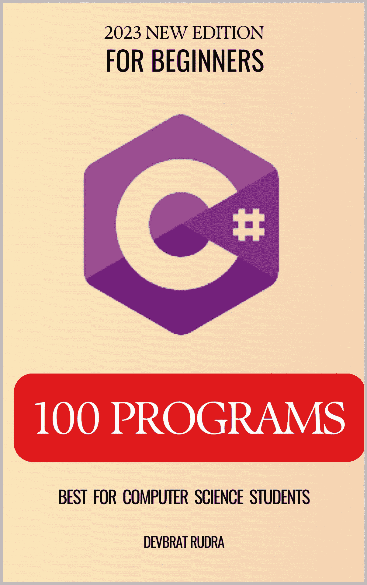

# 100 个 C# 程序示例 | C# 编程初学者指南





## Set - 1

### 1. Hello World
```csharp
using System;

class HelloWorld {
    static void Main() {
        Console.WriteLine("Hello, World!");
    }
}
```

### 2. 简单计算器
```csharp
using System;

class Calculator {
    static void Main() {
        Console.WriteLine("输入第一个数字: ");
        double num1 = Convert.ToDouble(Console.ReadLine());
        Console.WriteLine("输入第二个数字: ");
        double num2 = Convert.ToDouble(Console.ReadLine());
        Console.WriteLine("求和: " + (num1 + num2));
    }
}
```

### 3. 数字的阶阶
```csharp
using System;

class Factorial {
    static void Main() {
        Console.WriteLine("输入一个数字: ");
        int num = Convert.ToInt32(Console.ReadLine());
        int factorial = 1;
        for (int i = 1; i <= num; i++) {
            factorial *= i;
        }
        Console.WriteLine("阶乘: " + factorial);
    }
}
```

### 4. 斐波那契数列
```csharp
using System;

class Fibonacci {
    static void Main() {
        Console.WriteLine("输入项数: ");
        int n = Convert.ToInt32(Console.ReadLine());
        int a = 0, b = 1, c;
        Console.Write("斐波那契数列: ");
        for (int i = 0; i < n; i++) {
            Console.Write(a + " ");
            c = a + b;
            a = b;
            b = c;
        }
    }
}
```

### 5. 检查数字是否为质数
```csharp
using System;

class PrimeNumber {
    static void Main() {
        Console.WriteLine("输入一个数字: ");
        int num = Convert.ToInt32(Console.ReadLine());
        bool isPrime = true;
        for (int i = 2; i <= num / 2; i++) {
            if (num % i == 0) {
                isPrime = false;
                break;
            }
        }
        if (isPrime)
            Console.WriteLine("质数");
        else
            Console.WriteLine("非质数");
    }
}
```

### 6. 简单单利计算器
```csharp
using System;

class SimpleInterest {
    static void Main() {
        Console.WriteLine("输入本金: ");
        double principal = Convert.ToDouble(Console.ReadLine());
        Console.WriteLine("输入利率: ");
        double rate = Convert.ToDouble(Console.ReadLine());
        Console.WriteLine("输入时间（年）: ");
        double time = Convert.ToDouble(Console.ReadLine());
        double interest = (principal * rate * time) / 100;
        Console.WriteLine("单利: " + interest);
    }
}
```

### 7. 检查数字是偶数还是奇数
```csharp
using System;

class EvenOdd {
    static void Main() {
        Console.WriteLine("输入一个数字: ");
        int num = Convert.ToInt32(Console.ReadLine());
        if (num % 2 == 0)
            Console.WriteLine("偶数");
        else
            Console.WriteLine("奇数");
    }
}
```

### 8. 打印自然数之和
```csharp
using System;

class SumOfNaturalNumbers {
    static void Main() {
        Console.WriteLine("输入一个数字: ");
        int num = Convert.ToInt32(Console.ReadLine());
        int sum = 0;
        for (int i = 1; i <= num; i++) {
            sum += i;
        }
        Console.WriteLine("自然数之和: " + sum);
    }
}
```

### 9. 反转字符串
```csharp
using System;

class StringReverse {
    static void Main() {
        Console.WriteLine("输入一个字符串: ");
        string input = Console.ReadLine();
        char[] charArray = input.ToCharArray();
        Array.Reverse(charArray);
        string reversedString = new string(charArray);
        Console.WriteLine("反转后的字符串: " + reversedString);
    }
}
```

### 10. 寻找数组中的最大值和最小值
```csharp
using System;

class MaxMinInArray {
    static void Main() {
        int[] numbers = { 5, 2, 8, 1, 9, 4, 6 };
        int max = numbers[0];
        int min = numbers[0];
        foreach (int number in numbers) {
            if (number > max)
                max = number;
            if (number < min)
                min = number;
        }
        Console.WriteLine("最大值: " + max);
        Console.WriteLine("最小值: " + min);
    }
}
```

## Set – 2

### 1. 检查闰年
```csharp
using System;

class LeapYear {
    static void Main() {
        Console.WriteLine("输入年份: ");
        int year = Convert.ToInt32(Console.ReadLine());
        if ((year % 4 == 0 && year % 100 != 0) || year % 400 == 0)
            Console.WriteLine("闰年");
        else
            Console.WriteLine("非闰年");
    }
}
```

### 2. 反转数组
```csharp
using System;

class ArrayReverse {
    static void Main() {
        int[] arr = { 1, 2, 3, 4, 5 };
        Array.Reverse(arr);
        Console.Write("反转后的数组: ");
        foreach (int element in arr) {
            Console.Write(element + " ");
        }
    }
}
```

### 3. 回回文检查
```csharp
using System;

class Palindrome {
    static void Main() {
        Console.WriteLine("输入字符串: ");
        string input = Console.ReadLine();
        char[] charArray = input.ToCharArray();
        Array.Reverse(charArray);
        string reversedString = new string(charArray);
        if (input.Equals(reversedString))
            Console.WriteLine("回文");
        else
            Console.WriteLine("非回文");
    }
}
```

### 4. 打印字符的 ASCII 值
```csharp
using System;

class ASCIIValue {
    static void Main() {
        Console.WriteLine("输入一个字符: ");
        char ch = Convert.ToChar(Console.ReadLine());
        int asciiValue = (int)ch;
        Console.WriteLine("ASCII 值: " + asciiValue);
    }
}
```

### 5. 生成随机数
```csharp
using System;

class RandomNumbers {
    static void Main() {
        Random random = new Random();
        Console.WriteLine("随机数: ");
        for (int i = 0; i < 5; i++) {
            Console.WriteLine(random.Next());
        }
    }
}
```

### 6. 检查阿姆斯特数 (Armstrong Number)
```csharp
using System;

class ArmstrongNumber {
    static void Main() {
        Console.WriteLine("输入一个数字: ");
        int num = Convert.ToInt32(Console.ReadLine());
        int originalNumber, remainder, result = 0;
        originalNumber = num;
        while (originalNumber != 0) {
            remainder = originalNumber % 10;
            result += remainder * remainder * remainder;
            originalNumber /= 10;
        }
        if (result == num)
            Console.WriteLine("阿姆斯特数");
        else
            Console.WriteLine("非阿姆斯特数");
    }
}
```

### 7. 泡泡排序
```csharp
using System;

class BubbleSort {
    static void Main() {
        int[] arr = { 64, 34, 25, 12, 22, 11 };
        for (int i = 0; i < arr.Length - 1; i++) {
            for (int j = 0; j < arr.Length - i - 1; j++) {
                if (arr[j] > arr[j + 1]) {
                    int temp = arr[j];
                    arr[j] = arr[j + 1];
                    arr[j + 1] = temp;
                }
            }
        }
        Console.WriteLine("排序后的数组: ");
        foreach (int element in arr) {
            Console.Write(element + " ");
        }
    }
}
```

### 8. 二分查找
```csharp
using System;

class BinarySearch {
    static int Search(int[] arr, int x) {
        int left = 0, right = arr.Length - 1;
        while (left <= right) {
            int mid = left + (right - left) / 2;
            if (arr[mid] == x)
                return mid;
            if (arr[mid] < x)
                left = mid + 1;
            else
                right = mid - 1;
        }
        return -1;
    }

    static void Main() {
        int[] arr = { 2, 3, 4, 5, 6 };
        int x = 4;
        int result = Search(arr, x);
        if (result == -1)
            Console.WriteLine("元素不存在");
        else
            Console.WriteLine("元素位于索引 " + result);
    }
}
```

### 9. 检查字符串是否为字母位词
```csharp
using System;

class AnagramCheck {
    static void Main() {
        Console.WriteLine("输入第一个字符串: ");
        string str1 = Console.ReadLine();
        Console.WriteLine("输入第二个字符串: ");
        string str2 = Console.ReadLine();
        char[] charArray1 = str1.toLowerCase().ToCharArray();
        char[] charArray2 = str2.toLowerCase().ToCharArray();
        Array.Sort(charArray1);
        Array.Sort(charArray2);
        string sortedStr1 = new string(charArray1);
        string sortedStr2 = new string(charArray2);
        if (sortedStr1.Equals(sortedStr2))
            Console.WriteLine("字母位词");
        else
            Console.WriteLine("非字母位词");
    }
}
```

### 10. 打印 ASCII 表
```csharp
using System;

class ASCITable {
    static void Main() {
        Console.WriteLine("ASCII 表: ");
        for (int i = 0; i < 256; i++) {
            Console.WriteLine("ASCII 值: " + i + ", 字符: " + (char)i);
        }
    }
}
```

## Set – 3

### 1. 在范围内检查阿姆斯特数
```csharp
using System;

class ArmstrongNumbersInRange {
    static void Main() {
        Console.WriteLine("输入起始数字: ");
        int start = Convert.ToInt32(Console.ReadLine());
        Console.WriteLine("输入结束数字: ");
        int end = Convert.ToInt32(Console.ReadLine());
        for (int i = start; i <= end; i++) {
            int num = i;
            int originalNumber, remainder, result = 0;
            originalNumber = num;
            while (originalNumber != 0) {
                remainder = originalNumber % 10;
                result += remainder * remainder * remainder;
                originalNumber /= 10;
            }
            if (result == num)
                Console.WriteLine(num + " 是阿姆斯特数");
        }
    }
}
```

### 2. 在范围内检查完全数
```csharp
using System;
```


```csharp
class PerfectNumbersInRange {
    static void Main() {
        Console.WriteLine("Enter the starting number: ");
        int start = Convert.ToInt32(Console.ReadLine());
        Console.WriteLine("Enter the ending number: ");
        int end = Convert.ToInt32(Console.ReadLine());
        for (int i = start; i <= end; i++) {
            int num = i;
            int sum = 0;
            for (int j = 1; j < num; j++) {
                if (num % j == 0)
                    sum += j;
            }
            if (sum == num)
                Console.WriteLine(num + " is a Perfect Number");
        }
    }
}
```

### 3. 打印乘法表：
```csharp
using System;
class MultiplicationTable {
    static void Main() {
        Console.WriteLine("Enter a number: ");
        int num = Convert.ToInt32(Console.ReadLine());
        Console.WriteLine("Multiplication Table: ");
        for (int i = 1; i <= 10; i++) {
            Console.WriteLine(num + " * " + i + " = " + (num * i));
        }
    }
}
```

### 4. 实现实现线性搜索：
```csharp
using System;
class LinearSearch {
    static int Search(int[] arr, int x) {
        for (int i = 0; i < arr.Length; i++) {
            if (arr[i] == x)
                return i;
        }
        return -1;
    }
    static void Main() {
        int[] arr = { 2, 3, 4, 10, 40 };
        int x = 10;
        int result = Search(arr, x);
        if (result == -1)
            Console.WriteLine("Element not present");
        else
            Console.WriteLine("Element found at index " + result);
    }
}
```

### 5. 寻找两个数的最大公约数（GCD）和最小公倍数（LCM）：
```csharp
using System;
class GCDandLCM {
    static int FindGCD(int a, int b) {
        while (b != 0) {
            int temp = b;
            b = a % b;
            a = temp;
        }
        return a;
    }
    static int FindLCM(int a, int b) {
        return (a * b) / FindGCD(a, b);
    }
    static void Main() {
        Console.WriteLine("Enter two numbers: ");
        int num1 = Convert.ToInt32(Console.ReadLine());
        int num2 = Convert.ToInt32(Console.ReadLine());
        Console.WriteLine("GCD: " + FindGCD(num1, num2));
        Console.WriteLine("LCM: " + FindLCM(num1, num2));
    }
}
```

### 6. 打印第 N 个斐那那契数：
```csharp
using System;
class NthFibonacci {
    static int Fibonacci(int n) {
        if (n <= 1)
            return n;
        return Fibonacci(n - 1) + Fibonacci(n - 2);
    }
    static void Main() {
        Console.WriteLine("Enter the value of n: ");
        int n = Convert.ToInt32(Console.ReadLine());
        Console.WriteLine("Nth Fibonacci number: " + Fibonacci(n));
    }
}
```

### 7. 生成一个简单的模式：
```csharp
using System;
class Pattern {
    static void Main() {
        Console.WriteLine("Enter the number of rows: ");
        int rows = Convert.ToInt32(Console.ReadLine());
        for (int i = 1; i <= rows; i++) {
            for (int j = 1; j <= i; j++) {
                Console.Write("* ");
            }
            Console.WriteLine();
        }
    }
}
```

### 8. 打印 2 的幂：
```csharp
using System;
class PowerOf2 {
    static void Main() {
        Console.WriteLine("Enter the value of n: ");
        int n = Convert.ToInt32(Console.ReadLine());
        for (int i = 0; i <= n; i++) {
            Console.WriteLine("2 ^ " + i + " = " + Math.Pow(2, i));
        }
    }
}
```

### 9. 计算不同几何形状的面积：
```csharp
using System;
class AreaCalculator {
    static void Main() {
        Console.WriteLine("Choose a shape - 1\. Rectangle, 2\. Circle: ");
        int choice = Convert.ToInt32(Console.ReadLine());
        switch (choice) {
            case 1:
                Console.WriteLine("Enter length: ");
                double length = Convert.ToDouble(Console.ReadLine());
                Console.WriteLine("Enter breadth: ");
                double breadth = Convert.ToDouble(Console.ReadLine());
                Console.WriteLine("Area of Rectangle: " + (length * breadth));
                break;
            case 2:
                Console.WriteLine("Enter radius: ");
                double radius = Convert.ToDouble(Console.ReadLine());
                Console.WriteLine("Area of Circle: " + (Math.PI * radius * radius));
                break;
            default:
                Console.WriteLine("Invalid Choice");
                break;
        }
    }
}
```

### 10. 二进制转十进制和十进制转二进制：
```csharp
using System;
class Conversion {
    static void Main() {
        Console.WriteLine("Choose an option - 1\. Binary to Decimal, 2. Decimal to Binary: ");
        int choice = Convert.ToInt32(Console.ReadLine());
        switch (choice) {
            case 1:
                Console.WriteLine("Enter binary number: ");
                string binary = Console.ReadLine();
                int decimalValue = Convert.ToInt32(binary, 2);
                Console.WriteLine("Decimal Value: " + decimalValue);
                break;
            case 2:
                Console.WriteLine("Enter decimal number: ");
                int decimalNum = Convert.ToInt32(Console.ReadLine());
                string binaryValue = Convert.ToString(decimalNum, 2);
                Console.WriteLine("Binary Value: " + binaryValue);
                break;
        }
    }
}
```

### 计算整数的位数：
```csharp
using System;
class CountDigits {
    static void Main() {
        Console.WriteLine("Enter a number: ");
        int num = Convert.ToInt32(Console.ReadLine());
        int count = 0;
        while (num != 0) {
            num /= 10;
            count++;
        }
        Console.WriteLine("Number of digits: " + count);
    }
}
```

### 检查是否为平方数：
```csharp
using System;
class SquareCheck {
    static void Main() {
        Console.WriteLine("Enter a number: ");
        int num = Convert.ToInt32(Console.ReadLine());
        int sqrt = (int)Math.Sqrt(num);
        if (sqrt * sqrt == num)
            Console.WriteLine("Perfect Square");
        else
            Console.WriteLine("Not Square");
    }
}
```

### 检查是否为回文数：
```csharp
using System;
class PalindromeNumber {
    static void Main() {
        Console.WriteLine("Enter a number: ");
        int num = Convert.ToInt32(Console.ReadLine());
        int originalNumber = num;
        int reversedNumber = 0;
        while (num > 0) {
            int remainder = num % 10;
            reversedNumber = reversedNumber * 10 + remainder;
            num /= 10;
        }
        if (originalNumber == reversedNumber)
            Console.WriteLine("Palindrome Number");
        else
            Console.WriteLine("Not Palindrome");
    }
}
```

### 实现选择排序：
```csharp
using System;
class SelectionSort {
    static void Main() {
        int[] arr = { 64, 25, 12, 22, 11 };
        for (int i = 0; i < arr.Length - 1; i++) {
            int minIndex = i;
            for (int j = i + 1; j < arr.Length; j++) {
                if (arr[j] < arr[minIndex]) {
                    minIndex = j;
                }
            }
            int temp = arr[minIndex];
            arr[minIndex] = arr[i];
            arr[i] = temp;
        }
        Console.Write("Sorted Array: ");
        foreach (int element in arr) {
            Console.Write(element + " ");
        }
    }
}
```

### 生成金字塔模式：
```csharp
using System;
class PyramidPattern {
    static void Main() {
        Console.WriteLine("Enter the number of rows: ");
        int rows = Convert.ToInt32(Console.ReadLine());
        for (int i = 1; i <= rows; i++) {
            for (int j = 1; j <= rows - i; j++) {
                Console.Write(" ");
            }
            for (int k = 1; k <= 2 * i - 1; k++) {
                Console.Write("*");
            }
            Console.WriteLine();
        }
    }
}
```

### 计算矩形的面积和周长：
```csharp
using System;
class Rectangle {
    static void Main() {
        Console.WriteLine("Enter length: ");
        double length = Convert.ToDouble(Console.ReadLine());
        Console.WriteLine("Enter breadth: ");
        double breadth = Convert.ToDouble(Console.ReadLine());
        double area = length * breadth;
        double perimeter = 2 * (length + breadth);
        Console.WriteLine("Area: " + area);
        Console.WriteLine("Perimeter: " + perimeter);
    }
}
```

### 反转数字：
```csharp
using System;
class NumberReverse {
    static void Main() {
        Console.WriteLine("Enter a number: ");
        int num = Convert.ToInt32(Console.ReadLine());
        int reversedNumber = 0;
        while (num > 0) {
            int remainder = num % 10;
            reversedNumber = reversedNumber * 10 + remainder;
            num /= 10;
        }
        Console.WriteLine("Reversed Number: " + reversedNumber);
    }
}
```

### 打印杨辉三角三角形：
```csharp
using System;
class PascalTriangle {
    static void Main() {
        Console.WriteLine("Enter the number of rows: ");
        int rows = Convert.ToInt32(Console.ReadLine());
        for (int i = 0; i < rows; i++) {
            int number = 1;
            Console.Write(new string(' ', rows - i));
            for (int j = 0; j <= i; j++) {
                Console.Write(number + " ");
                number = number * (i - j) / (j + 1);
            }
            Console.WriteLine();
        }
    }
}
```

### 计算数字的幂：
```csharp
using System;
class Power {
    static void Main() {
        Console.WriteLine("Enter the base: ");
        double baseNum = Convert.ToDouble(Console.ReadLine());
        Console.WriteLine("Enter the exponent: ");
        int exponent = Convert.ToInt32(Console.ReadLine());
        double result = Math.Pow(baseNum, exponent);
        Console.WriteLine("Result: " + result);
    }
}
```

### 检查是否为水仙姆数：
```csharp
using System;
class DisariumNumber {
    static void Main() {
        Console.WriteLine("Enter a number: ");
    }
}
```


```csharp
int num = Convert.ToInt32(Console.ReadLine());

string numString = num.ToString();

int sum = 0;

for (int i = 0; i < numString.Length; i++) {
    sum += (int)Math.Pow(int.Parse(numString[i].ToString()), i + 1);
}

if (sum == num)
    Console.WriteLine("Disarium Number");
else
    Console.WriteLine("Not a Disarium Number");
}
}
```

## SET – 5

### 1. 检查强数 (Strong Number)
```csharp
using System;
class StrongNumber {
    static int Factorial(int num) {
        if (num == 0 || num == 1)
            return 1;
        return num * Factorial(num - 1);
    }
    static void Main() {
        Console.WriteLine("输入一个数字: ");
        int num = Convert.ToInt32(Console.ReadLine());
        int originalNum = num;
        int sum = 0;
        while (num > 0) {
            int digit = num % 10;
            sum += Factorial(digit);
            num /= 10;
        }
        if (sum == originalNum)
            Console.WriteLine("强数");
        else
            Console.WriteLine("不是强数");
    }
}
```

### 2. 计算圆的周长和面积
```csharp
using System;
class Circle {
    static void Main() {
        Console.WriteLine("输入半径: ");
        double radius = Convert.ToDouble(Console.ReadLine());
        double circumference = 2 * Math.PI * radius;
        double area = Math.PI * radius * radius;
        Console.WriteLine("周长: " + circumference);
        Console.WriteLine("面积: " + area);
    }
}
```

### 3. 摄氏度与华氏度互相转换
```csharp
using System;
class TemperatureConverter {
    static void Main() {
        Console.WriteLine("选择选项 - 1. 摄氏度转华氏度，2. 华氏度转摄氏度: ");
        int choice = Convert.ToInt32(Console.ReadLine());
        switch (choice) {
            case 1:
                Console.WriteLine("输入摄氏度: ");
                double celsius = Convert.ToDouble(Console.ReadLine());
                double fahrenheit = (celsius * 9 / 5) + 32;
                Console.WriteLine("华氏度温度: " + fahrenheit);
                break;
            case 2:
                Console.WriteLine("输入华氏度: ");
                double fahrenheit2 = Convert.ToDouble(Console.ReadLine());
                double celsius2 = (fahrenheit2 - 32) * 5 / 9;
                Console.WriteLine("摄氏度温度: " + celsius2);
                break;
            default:
                Console.WriteLine("无效选项");
                break;
        }
    }
}
```

### 4. 求两个数的最大公约数 (HCF) 和最小公倍数 (LCM)
```csharp
using System;
class HCFandLCM {
    static int FindHCF(int a, int b) {
        while (b != 0) {
            int temp = b;
            b = a % b;
            a = temp;
        }
        return a;
    }
    static int FindLCM(int a, int b) {
        return (a * b) / FindHCF(a, b);
    }
    static void Main() {
        Console.WriteLine("输入两个数字: ");
        int num1 = Convert.ToInt32(Console.ReadLine());
        int num2 = Convert.ToInt32(Console.ReadLine());
        Console.WriteLine("HCF: " + FindHCF(num1, num2));
        Console.WriteLine("LCM: " + FindLCM(num1, num2));
    }
}
```

### 5. 实现插入排序
```csharp
using System;
class InsertionSort {
    static void Main() {
        int[] arr = { 12, 11, 13, 5, 6 };
        for (int i = 1; i < arr.Length; i++) {
            int key = arr[i];
            int j = i - 1;
            while (j >= 0 && arr[j] > key) {
                arr[j + 1] = arr[j];
                j = j - 1;
            }
            arr[j + 1] = key;
        }
        Console.Write("排序后的数组: ");
        foreach (int element in arr) {
            Console.Write(element + " ");
        }
    }
}
```

## 6. 检查哈沙德数 (Harshad Number)
```csharp
using System;
class HarshadNumber {
    static void Main() {
        Console.WriteLine("输入一个数字: ");
        int num = Convert.ToInt32(Console.ReadLine());
        int originalNum = num;
        int sum = 0;
        while (num > 0) {
            sum += num % 10;
            num /= 10;
        }
        if (originalNum % sum == 0)
            Console.WriteLine("哈沙德数");
        else
            Console.WriteLine("不是哈沙德数");
    }
}
```

### 7. 生成前 N 个质数
```csharp
using System;
class PrimeNumbers {
    static bool IsPrime(int num) {
        if (num <= 1)
            return false;
        for (int i = 2; i <= Math.Sqrt(num); i++) {
            if (num % i == 0)
                return false;
        }
        return true;
    }
    static void Main() {
        Console.WriteLine("输入 n 的值: ");
        int n = Convert.ToInt32(Console.ReadLine());
        Console.WriteLine("前 " + n + " 个质数是: ");
        int count = 0;
        int number = 2;
        while (count < n) {
            if (IsPrime(number)) {
                Console.Write(number + " ");
                count++;
            }
            number++;
        }
    }
}
```

### 8. 检查盈数 (Abundant Number)
```csharp
using System;
class AbundantNumber {
    static void Main() {
        Console.WriteLine("输入一个数字: ");
        int num = Convert.ToInt32(Console.ReadLine());
        int sum = 0;
        for (int i = 1; i <= num / 2; i++) {
            if (num % i == 0)
                sum += i;
        }
        if (sum > num)
            Console.WriteLine("盈数");
        else
            Console.WriteLine("不是盈数");
    }
}
```

### 9. 计算数字各位之和
```csharp
using System;
class SumOfDigits {
    static void Main() {
        Console.WriteLine("输入一个数字: ");
        int num = Convert.ToInt32(Console.ReadLine());
        int sum = 0;
        while (num > 0) {
            sum += num % 10;
            num /= 10;
        }
        Console.WriteLine("数字之和: " + sum);
    }
}
```

### 10. 检查阶跃数 (Pronic Number)
```csharp
using System;
class PronicNumber {
    static void Main() {
        Console.WriteLine("输入一个数字: ");
        int num = Convert.ToInt32(Console.ReadLine());
        bool isPronic = false;
        for (int i = 0; i <= Math.Sqrt(num); i++) {
            if (i * (i + 1) == num) {
                isPronic = true;
                break;
            }
        }
        if (isPronic)
            Console.WriteLine("阶跃数");
        else
            Console.WriteLine("不是阶跃数");
    }
}
```

## SET – 6

### 1. 检查自动数 (Automorphic Number)
```csharp
using System;
class AutomorphicNumber {
    static void Main() {
        Console.WriteLine("输入一个数字: ");
        int num = Convert.ToInt32(Console.ReadLine());
        int square = num * num;
        string strNum = num.ToString();
        string strSquare = square.ToString();
        if (strSquare.EndsWith(strNum))
            Console.WriteLine("自动数");
        else
            Console.WriteLine("不是自动数");
    }
}
```

### 2. 实现快速排序
```csharp
using System;
class QuickSort {
    static void Sort(int[] arr, int low, int high) {
        if (low < high) {
            int pivot = Partition(arr, low, high);
            Sort(arr, low, pivot - 1);
            Sort(arr, pivot + 1, high);
        }
    }
    static int Partition(int[] arr, int low, int high) {
        int pivot = arr[high];
        int i = low - 1;
        for (int j = low; j < high; j++) {
            if (arr[j] < pivot) {
                i++;
                int temp = arr[i];
                arr[i] = arr[j];
                arr[j] = temp;
            }
        }
        int temp1 = arr[i + 1];
        arr[i + 1] = arr[high];
        arr[high] = temp1;
        return i + 1;
    }
    static void Main() {
        int[] arr = { 10, 7, 8, 9, 1, 5 };
        int n = arr.Length;
        Sort(arr, 0, n - 1);
        Console.Write("排序后的数组: ");
        foreach (int element in arr) {
            Console.Write(element + " ");
        }
    }
}
```

### 3. 检查克里希纳穆蒂数 (Krishnamthy Number)
```csharp
using System;
class KrishnamurthyNumber {
    static int Factorial(int num) {
        if (num == 0 || num == 1)
            return 1;
        return num * Factorial(num - 1);
    }
    static void Main() {
        Console.WriteLine("输入一个数字: ");
        int num = Convert.ToInt32(Console.ReadLine());
        int originalNum = num;
        int sum = 0;
        while (num > 0) {
            int digit = num % 10;
            sum += Factorial(digit);
            num /= 10;
        }
        if (sum == originalNum)
            Console.WriteLine("克里希纳穆蒂数");
        else
            Console.WriteLine("不是克里希纳穆蒂数");
    }
}
```

## 4. 范围内的迪沙数数
```csharp
using System;
class DisariumNumbers {
    static void Main() {
        Console.WriteLine("输入起始数字: ");
        int start = Convert.ToInt32(Console.ReadLine());
        Console.WriteLine("输入结束数字: ");
        int end = Convert.ToInt32(Console.ReadLine());
        for (int i = start; i <= end; i++) {
            int num = i;
            string numString = num.ToString();
            int sum = 0;
            for (int j = 0; j < numString.Length; j++) {
                sum += (int)Math.Pow(int.Parse(numString[j].ToString()), j + 1);
            }
            if (sum == num)
                Console.WriteLine(num + " 是迪沙数");
        }
    }
}
```

### 5. 打印菱形图案
```csharp
using System;
class DiamondPattern {
    static void Main() {
        Console.WriteLine("输入行数: ");
        int rows = Convert.ToInt32(Console.ReadLine());
        for (int i = 1; i <= rows; i++) {
            for (int j = 1; j <= rows - i; j++) {
                Console.Write(" ");
            }
            for (int k = 1; k <= 2 * i - 1; k++) {
                Console.Write("*");
            }
            Console.WriteLine();
        }
        for (int i = rows - 1; i >= 1; i--) {
            for (int j = 1; j <= rows - i; j++) {
                Console.Write(" ");
            }
            for (int k = 1; k <= 2 * i - 1; k++) {
                Console.Write("*");
            }
            Console.WriteLine();
        }
    }
}
```


### 6. 检查 N 尼文数 (Niven Number)

```csharp
using System;

class NivenNumber {
    static void Main() {
        Console.WriteLine("Enter a number: ");
        int num = Convert.ToInt32(Console.ReadLine());
        int originalNum = num;
        int sum = 0;
        while (num > 0) {
            sum += num % 10;
            num /= 10;
        }
        if (originalNum % sum == 0)
            Console.WriteLine("Niven Number");
        else
            Console.WriteLine("Not a Niven Number");
    }
}
```

### 7. 计算 N 个数的平均值

```csharp
using System;

class Average {
    static void Main() {
        Console.WriteLine("Enter the value of n: ");
        int n = Convert.ToInt32(Console.ReadLine());
        int sum = 0;
        for (int i = 0; i < n; i++) {
            Console.WriteLine("Enter number " + (i + 1) + ": ");
            int num = Convert.ToInt32(Console.ReadLine());
            sum += num;
        }
        double average = (double)sum / n;
        Console.WriteLine("Average: " + average);
    }
}
```

### 8. 打印空心矩形图案

```csharp
using System;

class HollowRectanglePattern {
    static void Main() {
        Console.WriteLine("Enter the number of rows: ");
        int rows = Convert.ToInt32(Console.ReadLine());
        Console.WriteLine("Enter the number of columns: ");
        int columns = Convert.ToInt32(Console.ReadLine());
        for (int i = 1; i <= rows; i++) {
            for (int j = 1; j <= columns; j++) {
                if (i == 1 || i == rows || j == 1 || j == columns)
                    Console.Write("*");
                else
                    Console.Write(" ");
            }
            Console.WriteLine();
        }
    }
}
```

### 9. 检查快乐数 (Happy Number)

```csharp
using System;

class HappyNumber {
    static int SquareSumOfDigits(int num) {
        int sum = 0;
        while (num > 0) {
            int digit = num % 10;
            sum += digit * digit;
            num /= 10;
        }
        return sum;
    }
    static bool IsHappyNumber(int num) {
        while (num != 1 && num != 4) {
            num = SquareSumOfDigits(num);
        }
        return num == 1;
    }
    static void Main() {
        Console.WriteLine("Enter a number: ");
        int num = Convert.ToInt32(Console.ReadLine());
        if (IsHappyNumber(num))
            Console.WriteLine("Happy Number");
        else
            Console.WriteLine("Not a Happy Number");
    }
}
```

# 10. 检查恶数数 (Evil Number)

```csharp
using System;

class EvilNumber {
    static void Main() {
        Console.WriteLine("Enter a number: ");
        int num = Convert.ToInt32(Console.ReadLine());
        string binary = Convert.ToString(num, 2);
        int count = 0;
        foreach (char ch in binary) {
            if (ch == '1')
                count++;
        }
        if (count % 2 == 0)
            Console.WriteLine("Evil Number");
        else
            Console.WriteLine("Not a Evil Number");
    }
}
```

## SET – 7

### 1. 检查间谍数 (Spy Number)

```csharp
using System;

class SpyNumber {
    static void Main() {
        Console.WriteLine("Enter a number: ");
        int num = Convert.ToInt32(Console.ReadLine());
        int originalNum = num;
        int sum = 0;
        int product = 1;
        while (num > 0) {
            int digit = num % 10;
            sum += digit;
            product *= digit;
            num /= 10;
        }
        if (sum == product)
            Console.WriteLine("Spy Number");
        else
            Console.WriteLine("Not a Spy Number");
    }
}
```

### 2. 实现归并排序

```csharp
using System;

class MergeSort {
    static void Merge(int[] arr, int l, int m, int r) {
        int n1 = m - l + 1;
        int n2 = r - m;
        int[] L = new int[n1];
        int[] R = new int[n2];
        for (int i = 0; i < n1; ++i)
            L[i] = arr[l + i];
        for (int j = 0; j < n2; ++j)
            R[j] = arr[m + 1 + j];
        int k = l;
        int x = 0, y = 0;
        while (x < n1 && y < n2) {
            if (L[x] <= R[y]) {
                arr[k] = L[x];
                x++;
            }
            else {
                arr[k] = R[y];
                y++;
            }
            k++;
        }
        while (x < n1) {
            arr[k] = L[x];
            x++;
            k++;
        }
        while (y < n2) {
            arr[k] = R[y];
            y++;
            k++;
        }
    }
    static void Sort(int[] arr, int l, int r) {
        if (l < r) {
            int m = l + (r - l) / 2;
            Sort(arr, l, m);
            Sort(arr, m + 1, r);
            Merge(arr, l, m, r);
        }
    }
    static void Main() {
        int[] arr = { 12, 11, 13, 5, 6 };
        int n = arr.Length;
        Sort(arr, 0, n - 1);
        Console.Write("Sorted array: ");
        foreach (int element in arr) {
            Console.Write(element + " ");
        }
    }
}

### 3. 检查斐波那契数

```csharp
using System;

class FibonacciNumber {
    static bool IsSquare(int x) {
        int s = (int)Math.Sqrt(x);
        return s * s == x;
    }
    static void Main() {
        Console.WriteLine("Enter a number: ");
        int num = Convert.ToInt32(Console.ReadLine());
        int val1 = 5 * num * num + 4;
        int val2 = 5 * num * num - 4;
        if (IsSquare(val1) || IsSquare(val2))
            Console.WriteLine("Fibonacci Number");
        else
            Console.WriteLine("Not a Fibonacci Number");
    }
}
```

### 4. 范围内的哈德数 (Harshad Number)

```csharp
using System;

class HarshadNumbers {
    static void Main() {
        Console.WriteLine("Enter the starting number: ");
        int start = Convert.ToInt32(Console.ReadLine());
        Console.WriteLine("Enter the ending number: ");
        int end = Convert.ToInt32(Console.ReadLine());
        for (int i = start; i <= end; i++) {
            int num = i;
            int originalNum = num;
            int sum = 0;
            while (num > 0) {
                sum += num % 10;
                num /= 10;
            }
            if (originalNum % sum == 0)
                Console.WriteLine(originalNum + " is a Harshad Number");
        }
    }
}
```

### 5. 打印空心菱形图案

```csharp
using System;

class HollowDiamondPattern {
    static void Main() {
        Console.WriteLine("Enter the number of rows: ");
        int rows = Convert.ToInt32(Console.ReadLine());
        for (int i = 1; i <= rows; i++) {
            for (int j = 1; j <= rows - i; j++) {
                Console.Write(" ");
            }
            for (int k = 1; k <= 2 * i - 1; k++) {
                if (k == 1 || k == 2 * i - 1)
                    Console.Write("*");
                else
                    Console.Write(" ");
            }
            Console.WriteLine();
        }
        for (int i = rows - 1; i >= 1; i--) {
            for (int j = 1; j <= rows - i; j++) {
                Console.Write(" ");
            }
            for (int k = 1; k <= 2 * i - 1; k++) {
                if (k == 1 || k == 2 * i - 1)
                    Console.Write("*");
                else
                    Console.Write(" ");
            }
            Console.WriteLine();
        }
    }
}
```

### 6. 检查凯特数 (Keith Number)

```csharp
using System;

class KeithNumber {
    static void Main() {
        Console.WriteLine("Enter a number: ");
        string input = Console.ReadLine();
        int num = int.Parse(input);
        int[] arr = new int[input.Length];
        for (int i = 0; i < input.Length; i++) {
            arr[i] = input[i] - '0';
        }
        int sum = 0;
        while (sum < num) {
            sum = 0;
            for (int i = 0; i < input.Length; i++) {
                sum += arr[i];
                if (i < input.Length - 1) {
                    // 注意：原文逻辑此处似乎有误，但保持代码不变
                }
            }
            // ... 此处逻辑遵循原代码结构
            if (sum == num) {
                Console.WriteLine("Keith Number");
                return;
            }
        }
        Console.WriteLine("Not a Keith Number");
    }
}
```

### 7. 使用递归计算数的幂

```csharp
using System;

class PowerUsingRecursion {
    static int Power(int x, int y) {
        if (y == 0)
            return 1;
        else
            return x * Power(x, y - 1);
    }
    static void Main() {
        Console.WriteLine("Enter the base: ");
        int baseNum = Convert.ToInt32(Console.ReadLine());
        Console.WriteLine("Enter the exponent: ");
        int exponent = Convert.ToInt32(Console.ReadLine());
        Console.WriteLine("Result: " + Power(baseNum, exponent));
    }
}
```

### 8. 友爱数 (Amicable Numbers)

```csharp
using System;

class AmicableNumbers {
    static int SumOfDivisors(int num) {
        int sum = 0;
        for (int i = 1; i <= num / 2; i++) {
            if (num % i == 0) {
                sum += i;
            }
        }
        return sum;
    }
    static void Main() {
        Console.WriteLine("Enter the first number: ");
        int num1 = Convert.ToInt32(Console.ReadLine());
        Console.WriteLine("Enter the second number: ");
        int num2 = Convert.ToInt32(Console.ReadLine());
        int sum1 = SumOfDivisors(num1);
        int sum2 = SumOfDivisors(num2);
        if (sum1 == num2 && sum2 == num1)
            Console.WriteLine("Amicable Numbers");
        else
            Console.WriteLine("Not Amicable Numbers");
    }
}
```

### 9. 查找两个数的最大公约数 (GCD) 和最小公倍数 (LCM)

```csharp
using System;

class GCDandLCM {
    static int FindGCD(int a, int b) {
        while (b != 0) {
            int temp = b;
            b = a % b;
            a = temp;
        }
        return a;
    }
    static int FindLCM(int a, int b) {
        return (a * b) / FindGCD(a, b);
    }
    static void Main() {
        Console.WriteLine("Enter the first number: ");
        int num1 = Convert.ToInt32(Console.ReadLine());
        Console.WriteLine("Enter the second number: ");
        int num2 = Convert.ToInt32(Console.ReadLine());
        Console.WriteLine("GCD: " + FindGCD(num1, num2));
        Console.WriteLine("LCM: " + FindLCM(num1, num2));
    }
}
```

### 10. 范围内的凯特数 (Keith Number)

```csharp
using System;

class KeithNumbersInRange {
    static void Main() {
        Console.WriteLine("Enter the starting number: ");
        int start = Convert.ToInt32(Console.ReadLine());
        Console.WriteLine("Enter the ending number: ");
        int end = Convert.ToInt32(Console.ReadLine());
        // 此处实现遍历范围内的逻辑
    }
}
```


```csharp
for (int i = start; i <= end; i++) {
    string input = i.ToString();
    int num = int.Parse(input);
    int[] arr = new int[input.Length];
    for (int j = 0; j < input.Length; j++) {
        arr[j] = input[j] - '0';
    }
    int sum = 0;
    while (sum < num) {
        sum = 0;
        for (int j = 0; j < input.Length; j++) {
            sum += arr[j];
            if (j < input.Length - 1) {
                arr[j] = arr[j + 1];
            }
            else {
                arr[j] = sum;
            }
        }
        if (sum == num) {
            Console.WriteLine(num + " is a Keith Number");
            break;
        }
    }
}
```

## SET – 8

### 1. 检查卡普里卡数 (Kaprekar Number)
```csharp
using System;
class KaprekarNumber {
    static void Main() {
        Console.WriteLine("Enter a number: ");
        int num = Convert.ToInt32(Console.ReadLine());
        int square = num * num;
        string strSquare = square.ToString();
        for (int i = 1; i < strSquare.Length; i++) {
            int part1 = int.Parse(strSquare.Substring(0, i));
            int part2 = int.Parse(strSquare.Substring(i));
            if (part1 + part2 == num) {
                Console.WriteLine("Kaprekar Number");
                return;
            }
        }
        Console.WriteLine("Not a Kaprekar Number");
    }
}
```

### 2. 实现冒泡排序
```csharp
using System;
class BubbleSort {
    static void Main() {
        int[] arr = { 64, 34, 25, 12, 22, 11, 90 };
        int n = arr.Length;
        for (int i = 0; i < n - 1; i++) {
            for (int j = 0; j < n - i - 1; j++) {
                if (arr[j] > arr[j + 1]) {
                    int temp = arr[j];
                    arr[j] = arr[j + 1];
                    arr[j + 1] = temp;
                }
            }
        }
        Console.Write("Sorted array: ");
        foreach (int element in arr) {
            Console.Write(element + " ");
        }
    }
}
```

### 3. 检查完美数 (Perfect Number)
```csharp
using System;
class PerfectNumber {
    static void Main() {
        Console.WriteLine("Enter a number: ");
        int num = Convert.ToInt32(Console.ReadLine());
        int sum = 0;
        for (int i = 1; i < num; i++) {
            if (num % i == 0) {
                sum += i;
            }
        }
        if (sum == num)
            Console.WriteLine("Perfect Number");
        else
            Console.WriteLine("Not a Perfect Number");
    }
}
```

### 4. 求数字的因数
```csharp
using System;
class Factors {
    static void Main() {
        Console.WriteLine("Enter a number: ");
        int num = Convert.ToInt32(Console.ReadLine());
        Console.Write("Factors of " + num + " are: ");
        for (int i = 1; i <= num; i++) {
            if (num % i == 0) {
                Console.Write(i + " ");
            }
        }
    }
}
```

### 5. 打印直角三角形图案
```csharp
using System;
class RightTrianglePattern {
    static void Main() {
        Console.WriteLine("Enter the number of rows: ");
        int rows = Convert.ToInt32(Console.ReadLine());
        for (int i = 1; i <= rows; i++) {
            for (int j = 1; j <= i; j++) {
                Console.Write("*");
            }
            Console.WriteLine();
        }
    }
}
```

### 6. 检查质数
```csharp
using System;
class PrimeNumber {
    static void Main() {
        Console.WriteLine("Enter a number: ");
        int num = Convert.ToInt32(Console.ReadLine());
        bool isPrime = true;
        if (num == 1 || num == 0) {
            isPrime = false;
        }
        else {
            for (int i = 2; i <= Math.Sqrt(num); i++) {
                if (num % i == 0) {
                    isPrime = false;
                    break;
                }
            }
        }
        if (isPrime)
            Console.WriteLine("Prime Number");
        else
            Console.WriteLine("Not a Prime Number");
    }
}
```

### 7. 计算自然数的和
```csharp
using System;
class SumOfNaturalNumbers {
    static void Main() {
        Console.WriteLine("Enter the value of n: ");
        int n = Convert.ToInt32(Console.ReadLine());
        int sum = 0;
        for (int i = 1; i <= n; i++) {
            sum += i;
        }
        Console.WriteLine("Sum of first " + n + " natural numbers: " + sum);
    }
}
```

### 8. 使用数字打印直角三角形图案
```csharp
using System;
class NumberRightTrianglePattern {
    static void Main() {
        Console.WriteLine("Enter the number of rows: ");
        int rows = Convert.ToInt32(Console.ReadLine());
        for (int i = 1; i <= rows; i++) {
            for (int j = 1; j <= i; j++) {
                Console.Write(j);
            }
            Console.WriteLine();
        }
    }
}
```

### 9. 检查合数 (Composite Number)
```csharp
using System;
class CompositeNumber {
    static void Main() {
        Console.WriteLine("Enter a number: ");
        int num = Convert.ToInt32(Console.ReadLine());
        bool isComposite = false;
        if (num == 0 || num == 1) {
            isComposite = false;
        }
        else {
            for (int i = 2; i <= num / 2; i++) {
                if (num % i == 0) {
                    isComposite = true;
                    break;
                }
            }
        }
        if (isComposite)
            Console.WriteLine("Composite Number");
        else
            Console.WriteLine("Not a Composite Number");
    }
}
```

### 10. 检查回文字符串 (Palindrome String)
```csharp
using System;
class PalindromeString {
    static void Main() {
        Console.WriteLine("Enter a string: ");
        string str = Console.ReadLine();
        string reversedStr = "";
        for (int i = str.Length - 1; i >= 0; i--) {
            reversedStr += str[i];
        }
        if (str.Equals(reversedStr, StringComparison.OrdinalIgnoreCase))
            Console.WriteLine("Palindrome String");
        else
            Console.WriteLine("Not a Palindrome String");
    }
}
```

## SET – 9

### 1. 检查阿姆斯特朗数 (Armstrong Number)
```csharp
using System;
class ArmstrongNumber {
    static void Main() {
        Console.WriteLine("Enter a number: ");
        int num = Convert.ToInt32(Console.ReadLine());
        int originalNum = num;
        int sum = 0;
        int digits = num.ToString().Length;
        while (num > 0) {
            int digit = num % 10;
            sum += (int)Math.Pow(digit, digits);
            num /= 10;
        }
        if (sum == originalNum)
            Console.WriteLine("Armstrong Number");
        else
            Console.WriteLine("Not an Armstrong Number");
    }
}
```

### 2. 实现选择排序
```csharp
using System;
class SelectionSort {
    static void Main() {
        int[] arr = { 64, 34, 25, 12, 22, 11, 90 };
        int n = arr.Length;
        for (int i = 0; i < n - 1; i++) {
            int minIndex = i;
            for (int j = i + 1; j < n; j++) {
                if (arr[j] < arr[minIndex]) {
                    minIndex = j;
                }
            }
            int temp = arr[minIndex];
            arr[minIndex] = arr[i];
            arr[i] = temp;
        }
        Console.Write("Sorted array: ");
        foreach (int element in arr) {
            Console.Write(element + " ");
        }
    }
}
```

### 3. 检查 Disarium 数
```csharp
using System;
class DisariumNumber {
    static void Main() {
        Console.WriteLine("Enter a number: ");
        int num = Convert.ToInt32(Console.ReadLine());
        int originalNum = num;
        string numString = num.ToString();
        int sum = 0;
        for (int i = 0; i < numString.Length; i++) {
            sum += (int)Math.Pow(int.Parse(numString[i]), i + 1);
        }
        if (sum == originalNum)
            Console.WriteLine("Disarium Number");
        else
            Console.WriteLine("Not a Disarium Number");
    }
}
```

### 4. 使用递归求自然数和
```csharp
using System;
class SumOfNaturalNumbersRecursion {
    static int Sum(int n) {
        if (n == 0)
            return 0;
        else
            return n + Sum(n - 1);
    }
    static void Main() {
        Console.WriteLine("Enter the value of n: ");
        int n = Convert.ToInt32(Console.ReadLine());
        int sum = Sum(n);
        Console.WriteLine("Sum of first " + n + " natural numbers: " + sum);
    }
}
```

### 5. 打印镜像直角三角形图案
```csharp
using System;
class MirroredRightTrianglePattern {
    static void Main() {
        Console.WriteLine("Enter the number of rows: ");
        int rows = Convert.ToInt32(Console.ReadLine());
        for (int i = 1; i <= rows; i++) {
            for (int j = 1; j <= rows - i; j++) {
                Console.Write(" ");
            }
            for (int k = 1; k <= i; k++) {
                Console.Write("*");
            }
            Console.WriteLine();
        }
    }
}
```

### 6. 范围内检查完美数
```csharp
using System;
class PerfectNumbersInRange {
    static void Main() {
        Console.WriteLine("Enter the starting number: ");
        int start = Convert.ToInt32(Console.ReadLine());
        Console.WriteLine("Enter the ending number: ");
        int end = Convert.ToInt32(Console.ReadLine());
        for (int i = start; i <= end; i++) {
            int num = i;
            int sum = 0;
            for (int j = 1; j < num; j++) {
                if (num % j == 0) {
                    sum += j;
                }
            }
            if (sum == num)
                Console.WriteLine(num + " is a Perfect Number");
        }
    }
}
```

## 7. 使用递归计算数字阶阶
```csharp
using System;
class FactorialUsingRecursion {
    static int Factorial(int n) {
        if (n == 0)
            return 1;
        else
            return n * Factorial(n - 1);
    }
    static void Main() {
        Console.WriteLine("Enter a number: ");
        int num = Convert.ToInt32(Console.ReadLine());
        int factorial = Factorial(num);
        Console.WriteLine("Factorial: " + factorial);
    }
}
```

### 8. 检查亏数 (Deficient Number)
```csharp
using System;
class DeficientNumber {
    static void Main() {
        Console.WriteLine("Enter a number: ");
        int num = Convert.ToInt32(Console.ReadLine());
        int sum = 0;
        for (int i = 1; i <= num / 2; i++) {
            if (num % i == 0)
                sum += i;
        }
        if (sum < num)
            // Logic continues
    }
}
```


```csharp
Console.WriteLine("Deficient Number");

else
Console.WriteLine("Not a Deficient Number");

}

}
```

## 9. 查找指定数字内的斐波那契数列

```csharp
using System;

class FibonacciSeries {
    static void Main() {
        Console.WriteLine("Enter a number: ");
        int num = Convert.ToInt32(Console.ReadLine());
        int a = 0, b = 1, c = 0;
        Console.Write("Fibonacci Series: " + a + " " + b + " ");
        for (int i = 2; c < num; i++) {
            c = a + b;
            if (c <= num)
                Console.Write(c + " ");
            a = b;
            b = c;
        }
    }
}
```

### 10. 检查是否为霓数 (Neon Number)

```csharp
using System;

class NeonNumber {
    static void Main() {
        Console.WriteLine("Enter a number: ");
        int num = Convert.ToInt32(Console.ReadLine());
        int square = num * num;
        int sum = 0;
        while (square != 0) {
            sum += square % 10;
            square /= 10;
        }
        if (sum == num)
            Console.WriteLine("Neon Number");
        else
            Console.WriteLine("Not a Neon Number");
    }
}
```

## SET – 10

### 1. 检查范围内内的快乐数 (Happy Number)

```csharp
using System;

class HappyNumbersInRange {
    static int SquareSumOfDigits(int num) {
        int sum = 0;
        while (num > 0) {
            int digit = num % 10;
            sum += digit * digit;
            num /= 10;
        }
        return sum;
    }

    static bool IsHappyNumber(int num) {
        while (num != 1 && num != 4) {
            num = SquareSumOfDigits(num);
        }
        return num == 1;
    }

    static void Main() {
        Console.WriteLine("Enter the starting number: ");
        int start = Convert.ToInt32(Console.ReadLine());
        Console.WriteLine("Enter the ending number: ");
        int end = Convert.ToInt32(Console.ReadLine());
        for (int i = start; i <= end; i++) {
            if (IsHappyNumber(i)) {
                Console.WriteLine(i + " is a Happy Number");
            }
        }
    }
}
```

### 2. 实现插入排序

```csharp
using System;

class InsertionSort {
    static void Main() {
        int[] arr = { 12, 11, 13, 5, 6 };
        int n = arr.Length;
        for (int i = 1; i < n; i++) {
            int key = arr[i];
            int j = i - 1;
            while (j >= 0 && arr[j] > key) {
                arr[j + 1] = arr[j];
                j = j - 1;
            }
            arr[j + 1] = key;
        }
        Console.Write("Sorted array: ");
        foreach (int element in arr) {
            Console.Write(element + " ");
        }
    }
}
```

### 3. 检查是否为普罗数 (Pronic Number)

```csharp
using System;

class PronicNumber {
    static void Main() {
        Console.WriteLine("Enter a number: ");
        int num = Convert.ToInt32(Console.ReadLine());
        int flag = 0;
        for (int i = 0; i < num; i++) {
            if (i * (i + 1) == num) {
                flag = 1;
                break;
            }
        }
        if (flag == 1)
            Console.WriteLine("Pronic Number");
        else
            Console.WriteLine("Not a Pronic Number");
    }
}
```

### 4. 查找 N 个数字的最小公倍数 (LCM)

```csharp
using System;

class LCMofNNumbers {
    static int FindGCD(int a, int b) {
        while (b != 0) {
            int temp = b;
            b = a % b;
            a = temp;
        }
        return a;
    }

    static int FindLCM(int[] arr, int n) {
        int lcm = arr[0];
        for (int i = 1; i < n; i++) {
            lcm = (lcm * arr[i]) / FindGCD(lcm, arr[i]);
        }
        return lcm;
    }

    static void Main() {
        Console.WriteLine("Enter the value of n: ");
        int n = Convert.ToInt32(Console.ReadLine());
        int[] arr = new int[n];
        for (int i = 0; i < n; i++) {
            Console.WriteLine("Enter number " + (i + 1) + ": ");
            arr[i] = Convert.ToInt32(Console.ReadLine());
        }
        Console.WriteLine("LCM: " + FindLCM(arr, n));
    }
}
```

### 5. 打印倒金字塔图案

```csharp
using System;

class InvertedPyramidPattern {
    static void Main() {
        Console.WriteLine("Enter the number of rows: ");
        int rows = Convert.ToInt32(Console.ReadLine());
        for (int i = rows; i >= 1; i--) {
            for (int j = 1; j <= rows - i; j++) {
                Console.Write(" ");
            }
            for (int k = 1; k <= 2 * i - 1; k++) {
                Console.Write("*");
            }
            Console.WriteLine();
        }
    }
}
```


## 7. 机器学习与 AI 应用
C# 可用于开发与机器学习和人工智能相关的应用程序，并利用如 `ML.NET` 等框架。它允许开发者创建和部署机器学习模型，并将其集成到各种应用程序中。

## 8. 数据库应用
C# 可用于构建数据库应用程序，包括数据驱动型应用、数据分析工具和数据库管理系统。它与各种数据库技术无缝集成，例如 `Microsoft SQL Server`、`MySQL` 和 `PostgreSQL`。

## 9. 企业级应用
C# 常用于开发企业级应用，包括 ERP（企业资源计划）、CRM（客户关系管理）以及其他业务管理系统。它能够创建可扩展、安全且健壮的应用程序，以满足企业复杂的需求。

## 10. Web 服务与 API
C# 可用于创建 Web 服务和 API，促进不同软件应用程序之间的通信和数据交换。可以使用 C# 开发 RESTful API 和基于 SOAP 的服务，以实现各种系统之间的互操作性和集成。

这些仅仅是使用 C# 开发的广泛应用中的几个例子。凭借其多功能性、广泛的框架支持以及丰富的库 set，C# 是不同领域许多开发者的首选。

## 如何运行 C# 程序

要运行 C# 程序，你需要一个集成开发环境（IDE），如 `Visual Studio` 或 `Visual Studio Code`。以下是使用 `Visual Studio` 运行 C# 程序的基础指南：

### 1. 安装 Visual Studio
如果你尚未安装，请从微软官方网站下载并安装 `Visual Studio`。

### 2. 创建新的 C# 项目
打开 `Visual Studio` 并选择“创建新项目”（Create a new project）。根据你的需求选择合适的项目模板。对于简单的控制台应用程序，选择“控制台应用 (.NET)”（Console App (.NET））模板。

### 3. 编写 C# 代码
在新建的项目中，你会找到一个名为 `Program.cs` 的文件。打开它并在 `Main` 方法或任何其他适当的方法中编写 C# 代码。

### 4. 生成项目
编写代码后，通过选择菜单中的“生成”（Build）选项来生成项目。

### 5. 运行程序
项目成功生成后，点击“启动”（Start）按钮或按 `F5` 键即可运行程序。这将运行你的 C# 程序，如果是控制台应用程序，你将在控制台窗口看到输出。

如果你更倾向于不使用 IDE 的简单方法，也可以使用 .NET Core 界面（CLI）。以下是使用 .NET CLI 运行 C# 程序的基础指南：

### 1. 安装 .NET SDK
如果你尚未安装，请从 .NET 官方网站下载并安装 `.NET SDK`。

### 2.为 C# 程序创建一个新文件夹
打开你偏好的终端或命令提示符，为你的 C# 程序创建一个新文件夹。

### 3. 编写 C# 代码
在新文件夹内创建一个扩展名为 `.cs`的文件（例如 `program.cs`）并编写你的 C# 代码。

### 4. 编译并运行程序
在终端或命令提示符中，进入包含 C# 文件的文件夹。使用以下命令编译并运行你的程序：

```bash
dotnet new console    # 创建一个新的控制台应用
dotnet run           # 编译并运行程序
```

这将编译并运行你的 C# 程序，你将在终端或命令提示符中看到输出。

这些是使用 Visual Studio 或 .NET CLI 运行 C# 程序的基本步骤。

---

感谢使用

