# C# 高级编程（开发者指南）


- 学习解决实际编程问题的高效方案
- 掌握用于Windows和Web的C#与ASP.NET编程
- 探讨微软®推荐的ASP.NET最佳实践
- 学习用于ADO.NET、GDI+、发出IL、线程和异步Web服务的高级编程技术


# 关于作者

Paul Kimmel于1990年在密歇根州奥卡莫斯创立了Software Conceptions, Inc.。Paul专攻面向对象架构和软件设计。他是*Windows Developer Magazine*的框架专栏作家，*codeguru.com*的双月专栏作家，以及*InformIT*的特约撰稿人。Paul撰写了多本关于面向对象编程的著作。他目前是一个用于管理俄勒冈州警长办公室惩教部门的C#和ASP.NET企业应用程序的首席架构师，并且已在美国、加拿大和波多黎各的电信、保险、金融行业以及执法和政府机构中成功实施了数十个企业和商业应用程序。


## 想了解更多？

我们希望您喜欢这本McGraw-Hill电子书！如果您想了解更多关于这本书、其作者或相关书籍和网站的信息，请[点击此处](#)。

For Trevor, Douglas, and Noah,
I love you for the good-natured, loving boys you are
and the fine men I know you will be.
Love, Fat Daddy

此页有意留白。

有关本标题的更多信息，请点击此处。


有关本标题的更多信息，请点击此处。


xiv


目录 xv


# 致谢

我谨向 McGraw-Hill/Osborne 出版社的 Wendy Rinaldi 和 Katie Conley 致以谢意。一本书的出版凝聚着大量的工作，而包含大量代码的书籍更是如此。若没有她们的远见卓识与辛勤付出，我便不会有此著书之机。但愿我能以拙作回馈她们的付出。

感谢 Waterside 出版社的 David Fugate 以其前瞻性主导管理，并悉心处理那些使我得以安心写作的繁杂实务。特别感谢 Mary Bonnici，多年来她一如既往地以专业精神妥善处理所有财务事宜。

特别感谢微软公司的 Susan Warren 和 Rob Howard。Susan 和 Rob 提供了宝贵的协助，包括审阅提纲、针对棘手问题给予及时主动的帮助，以及协调所有关于 IBUYSPY 的内容。谢谢你们，Susan 和 Rob。

感谢 Steve Ballmer，他制定了一项政策，要求所有忙碌的微软员工放下手头工作，为客户提供支持，协助作者创作。显然，程序经理和开发人员们对此政策极为重视。据我所知，无人因协助我解决技术问题而获得直接报酬，而我的整体经历充分体现了微软对开发人员、对 Microsoft .NET，以及对那些致力于为开发者提供最高质量资讯的作者和出版商的坚定承诺。感谢所有程序经理和开发人员，他们始终乐此不疲、迅速地回答了成百上千的问题。

感谢 Lewis Gouge 先生。Gouge 先生在本人与 Multnomah 县信息系统部之间起到了牵线搭桥的作用。使用 .NET 为惩戒部门构建企业级系统是一项充满回报的挑战。感谢 Steve “Mr. Ed” Chennault、Mark “Ploki” Davis、Bill Arnold、Joe “Bilbo” Shook、Robert Phillips、Brook Riddick、Yvette Yutze、Jeff Braunstein、Peggy Duerscherl、Richard “Jelly” Augelli、Eric “Hank Hill” Cotter、John “Ballpeen” Armitage、Kathy Erwin、Geoff Caylor 和 Karen Britton。我非常享受与这么多才华横溢的人共事并向他们学习的过程。

感谢位于俄勒冈州波特兰市 Wynne's 餐厅的 Yonnie、Erin 和 Larinda 为我们提供的美食与饮品。

最后，感谢我的家人——Lori、Alex、Douglas、Noah 和 Trevor。除了构建软件和写作之外，我最享受的便是与你们共度的时光。家， truly 是我心之所系。

# 引言

《高级 C# 编程》一书关乎程序员与代码。本书的构思核心在于为那些需要即刻解决问题的程序员提供大量代码示例。

每一章都设有一个简短的导言，介绍本章展示的程序，阐述您可能遇到的问题类型，以及所提供的代码将如何帮助您应对这些问题。随后，您可以直接查阅完整的代码清单以寻找解决方案，并阅读后续的技术解析，了解支撑这些代码的技术原理。

由于每个代码清单都是一个完整的应用程序，您将看到多个应用程序示例，它们展示了 C# 和 Microsoft .NET 的主要及次要功能。

《高级 C# 编程》专为那些在类似语言（如 C++、Delphi 或 Visual Basic .NET）方面具有中高级经验，或已阅读过介绍 C# 面向对象编程基础的入门书籍的开发者而撰写。

作为特色内容，第 12 至 16 章展示了使用 C# 进行 ASP.NET Web 编程的高级方面。我很高兴地告诉您，《高级 C# 编程》的这些章节以 IBUYSPY.COM 网站作为演示 Web 软件开发概念的应用程序。若没有微软及 ASP.NET 项目经理 Susan Warren 的祝福与鼎力相助，我们无法完成此书。

本书中的代码示例将展示如何运用 C# 编程在 Windows 和 Web 领域中最有益且最强大的功能。关于反射、程序集、面向对象编程、安全与身份验证，以及用于电子商务网站的 Web 服务和 Web 应用程序等您需要了解的一切，均可在本书中找到。您所要做的，便是打开它，开始探索。

# 部分

# Windows 应用程序

# 学习目标

-   学习 C# 的高级惯用法
-   学习 .NET 的基本 Windows 编程技能
-   学习自定义控件的创建，包括异形窗体、控件透明度、GraphicsPath 对象和线性渐变画笔等主题
-   通过参与 .NET Terrarium 游戏来学习点对点编程和 Web 服务
-   全面学习 ADO.NET

# 第 1 章

## 语言基础

**本章内容：**

-   面向对象基础
-   运算符重载
-   特性
-   反射
-   总结

这是《C# 开发者指南》中独一无二的一章。在开始探索代码示例之前，它提供了一个关于高级惯用法的概览。这些高级惯用法对于实现 C# 中的解决方案至关重要，本章的回顾将帮助我们所有人打下共同的基础。

对于拥有多年面向对象编程经验的资深程序员而言，本章或许能为您温故知新。对所有人而言，C# 编程以及广义上的 .NET 编程中，因 .NET 而引入的一些重要方面将是全新的内容。关于“委托”、“反射”和“程序集”含义的讨论，将为构建 C# 高级应用程序提供重要基础。本章之后的每一章都将建立在这些高级通用概念之上。

## 面向对象基础

面向对象基础远非基础。每种面向对象语言都实现了优秀面向对象语言所需特性的一个子集。而 C#，区别于 C++、Delphi、Visual Basic 6 或 Visual Basic.NET，拥有其独特的实现面向对象编程语言（OOPL）这些方面的方式。

面向对象编程的原则是*封装、继承、聚合和多态*。支持这些基本原则的语言被视为面向对象语言。存在多种多样的惯用法和构造来促进每一条原则，包括诸如模板、运算符重载、接口、多线程、多重继承、异常处理、指针和垃圾回收等特性。C# 是一种强大的 OOPL，它通过提供运算符重载、继承、接口、异常处理、垃圾回收、多接口继承、反射和多线程等支持面向对象编程的原则。C# 不支持模板、原始指针或多重类继承。关于后三者特性是否弊大于利，存在诸多争论；因此，它们未被纳入 C#。

作为多重继承、指针和模板的替代，您将获得一些新的特性，这些特性将助您构建 Web 应用程序和 Web 服务。C# 支持 COM 互操作、多语言编程和快速应用程序开发。这其中存在一些权衡。

C# 是*托管*代码。其好处在于，您无需担心由错误指针导致的切片问题，而且垃圾回收器将帮助您避免内存泄漏。其代价是放弃了原始指针。指针支持一些高级惯用法，如引用计数对象和访问所有内存空间。这种对任何内存地址的访问既提供了终极控制，也带来了终极责任。权力越大，责任越重。（若需使用原始指针，您仍可使用非托管 C++ 代码。）

C# 的语法最接近 C++。您在 C# 中将经常使用的大部分日常惯用法与 C++ 具有相同的语法，这使得 C++ 程序员的学习曲线最为平缓。Delphi 和 Java 程序员也会发现转向 C# 相对容易，甚至 VB 程序员也会发现从 VB 过渡到 C# 比从 VB 过渡到 C++ 更为轻松。


### 定义类

类构造与 C++ 中的基本元素相同。要在 C# 中定义一个类，你需要将以下构造添加到代码单元中。

```
Access-modifier class name
{
}
```

> **提示**
> *C# 区分大小写。关键字的拼写必须与代码中使用的大小写一致。C++ 也区分大小写；而其他语言，如 Delphi 和 Visual Basic .NET，则不区分大小写。*

访问修饰符描述了类的可访问性。供通用的类将是*公共*的。*名称*是在同一命名空间中通过字符和大小写唯一确定的任何名称。（我们稍后会回到命名空间的话题。）

将这些基本规则应用于定义类，以下示例演示了在 C# 中定义的类。

```
public class MyFirstClass
{
}
```

在 C# 中，类默认具有公共访问权限；按照惯例，类名首字母大写，如示例所示。“My”中的 *M*，“First”中的 *F* 和“Class”中的 *C* 都大写，这种约定称为*帕斯卡命名法*。（约定是为了培养一致性，但你可以选择是否采用。本书将遵循这些约定。）

### 在控制台应用程序中实现类

*控制台应用程序*是在命令提示符下运行，没有图形用户界面，或者至少没有 Windows 窗体图形用户界面的应用程序。

当你从“新建项目”对话框创建控制台应用程序时，你会得到如下所示的基本代码：

```
using System;
namespace HelloWorld
{
    /// <summary>
    /// Class1 的摘要说明。
    /// </summary>

    class Class1
    {
        /// <summary>
        /// 应用程序的主要入口点。
        /// </summary>
        [STAThread]
        static void Main(string[] args)
        {
            //
            // TODO: 在此处添加启动应用程序的代码
            //
        }
    }
}
```

清单开头的 *using* 语句表明该控制台应用程序正在使用随 Microsoft.NET 框架安装的 System.dll 程序集。System 程序集包含公共语言运行时最基本的内容。目前，可以将程序集视为应用程序或 DLL，将 *using* 语句视为 C++ 中的“include”或 Delphi 中的“uses”。

接下来是命名空间构造。命名空间是比类更高层次的概念化。命名空间是组织元素并唯一标识它们的便捷方式。两个不同的命名空间可以包含相同的类。默认情况下，分配给控制台应用程序的命名空间是“新建项目”对话框中给出的项目名称。

三个斜杠标记（///）是用于支持自动生成文档的特殊注释，C# 也支持 // 和 /\* \*/ 注释样式。接下来提供类定义。默认情况下，自动生成的代码构造被赋予*类型编号*的名称——例如 Class1，其中 Class 派生自构造的类型（一个类），数字作为后缀附加以确保名称唯一。我们建议你为类提供一个描述性的名称。

在基本的控制台应用程序中，我们有启动过程 Main。Main 被定义为*静态*成员，这意味着我们不需要拥有封闭类的实例就可以调用该方法。参数 **string[] args** 表示 Main 接收到一个表示命令行参数的字符串数组。

最后，请注意所有构造都有一个开括号和闭括号对 {}，使用相同级别的块缩进以提高可读性。

**Hello World**
使用我们简单的控制台应用程序，我们可以通过添加语句 `Console.WriteLine("Hello World!");` 将一些文本显示到控制台；修改后的应用程序如下所示。

```
using System;
namespace HelloWorld
{
    /// <summary>
    /// Class1 的摘要说明。
    /// </summary>
    class Class1
    {
        /// <summary>
        /// 应用程序的主要入口点。
        /// </summary>
        [STAThread]
        static void Main(string[] args)
        {
            Console.WriteLine("Hello World!");
            Console.ReadLine();
        }
    }
}
```

使用 Visual Studio 6 键盘方案——可在 Visual Studio .NET 的“我的配置文件”中修改——我们可以按 F5 运行应用程序。`WriteLine` 和 `ReadLine` 都是 Console 类中的静态成员，因此我们不需要创建 Console 对象的实例来调用这些方法。

`Console.WriteLine` 将一行写入命令提示符，并在文本末尾附加一个换行符，语句 `Console.ReadLine` 则等待回车键按下后继续。另外，请注意 C# 中的语句以分号结尾。

**从命令提示符读取**
如果你想读取从命令提示符传递的参数，那么你可以从参数 *args* 表示的字符串数组中获取它们。通过如下修改代码，我们可以回显在命令提示符输入的文本，而不是“Hello World”。

```
using System;
namespace HelloWorld
{
    /// <summary>
    /// Class1 的摘要说明。
    /// </summary>
    class Class1
    {
        /// <summary>
        /// 应用程序的主要入口点。
        /// </summary>
        [STAThread]
        static void Main(string[] args)
        {
            Console.WriteLine(args[0]);
            Console.ReadLine();
        }
    }
}
```

前面的代码将命令行上传递的第一个参数的值写入控制台。

要提供命令行参数，请从命令行运行程序集，或者按照以下步骤在 Visual Studio .NET IDE 中提供命令行参数。

1.  在 Visual Studio .NET 中，单击“视图” | “解决方案资源管理器”。
2.  在“解决方案资源管理器”中，右键单击项目名称，然后选择“属性”上下文菜单。
3.  在“属性页”对话框中，选择“配置属性”文件夹，然后选择“调试”页。
4.  在“启动选项”部分的“命令行参数”中输入一个值（参见图 1-1）。
5.  按 F5 在 VS.NET IDE 中重新运行应用程序。你将看到在步骤 4 的“命令行参数”字段中输入的值。

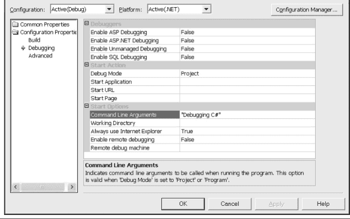

图 1-1 在 HelloWorld 属性页中提供命令行参数

### 实现字段和属性

字段是类中的数据。按照惯例，字段是私有的；如果你需要为消费者提供访问权限，我们建议你通过属性方法来实现。属性方法或属性，从消费者的角度看，它们看起来和行为都像数据，但从生产者的角度看，它们的行为像方法。

> 注意
> 消费者是使用这些类的程序员，生产者是创建这些类的程序员。同一个程序员可以既是同一类的生产者，也是消费者。

数据的好处当然在于它提供了一种维护对象状态的方式。属性的好处在于它们允许你通过代码约束访问数据的方式，就像访问仅限于通过方法访问一样，但从消费者的角度看，属性的使用方式就像数据一样。

**定义字段**
字段可以是任何类型的数据。按照惯例，字段使用私有访问修饰符，只允许生产者直接操作字段。消费者必须使用属性方法来操作字段。

> 注意
> 按照惯例，你应该使用驼峰命名法命名字段。在驼峰命名法中，第一个单词的首字母小写，后续单词的首字母大写。不要使用匈牙利命名法。

如果字段是复杂的数据类型，那么你可以在构造函数中（参见“实现方法”部分）或按需创建这些类型的实例。以下清单演示了一个简单的字段类型，它将 `args[0]` 的值存储为字符串类型。

```
using System;
namespace HelloWorld
{
    /// <summary>
    /// Class1 的摘要说明。
    /// </summary>
    class Class1
    {
        private static string arg0 = null;
        /// <summary>
        /// 应用程序的主要入口点。
        /// </summary>
        [STAThread]
        static void Main(string[] args)
        {
            arg0 = args[0];
```


```csharp
Console.WriteLine(arg0);
Console.ReadLine();
}
}
```

粗体语句定义了一个静态字段。因为我们将 `args[0]` 的值赋给了私有字段 `arg0`，而此时并不存在 `Class1` 的实例。

Main 方法是控制台应用程序的入口点。我们本可以仅使用它来完成此任务，并相应地修改类以在使用类实例的情况下执行相同任务。修改后的代码如下：

```csharp
using System;
namespace HelloWorld
{
    /// <summary>
    /// Class1 的摘要说明。
    /// </summary>
    class Class1
    {
        private string arg0 = null;

        public void WriteCommandLine( string arg )
        {
            Console.WriteLine(arg);
            Console.ReadLine();
        }
        /// <summary>
        /// 应用程序的主入口点。
        /// </summary>
        [STAThread]
        static void Main(string[] args)
        {
            Class1 class1 = new Class1();
            class1.arg0 = args[0];
            class1.WriteCommandLine(class1.arg0);
        }
    }
}
```

在前面的示例中，Main 方法仅扮演启动方法的角色，而类的一个实例被用来执行实际工作。Main 方法创建了一个 Class1 的实例。`args[0]` 的值被赋给了私有字段 `arg0`；我们可以这样做是因为 Main 也是 Class1 的一个成员。语句

```csharp
class1.WriteLine(class1.arg0)
```

将命令行的内容写入控制台。

#### 定义属性

如果你对控制台应用程序、静态成员和创建对象已经比较熟悉，那么这段代码就非常简单了。我们稍微提升一点难度。我们将抛开这个示例，来研究属性的使用机制。*属性* 本质上是方法。属性可以有一个 getter（获取器）和一个 setter（设置器）。*getter* 是在属性被用作右值（等号右边的值）时调用的属性方法。*setter* 是在属性被用作左值（等号左边的值）时调用的。

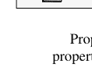

> **提示**
> 你不一定需要有一个与属性关联的后备字段。属性的值可以是派生出来的，而不必存储在字段中。

属性和任何成员一样，可以拥有访问修饰符，对于属性来说通常是 `public`。一个可读可写属性的基本语法如下。

```csharp
Access-Modifier Type Property-Name
{
    get
    {
        return field;
    }
    set
    {
        field = value;
    }
}
```

*Access-Modifier*（访问修饰符）通常是 `public`，但也可以是任何允许的访问修饰符（参见“使用修饰符”部分）。*Type* 是属性所代表的字段的类型。*Property-Name* 是任何有效的名称。通常，属性与其后备字段之间存在一种关系。一种惯例是为字段使用带下划线前缀的名称，而为属性使用不带下划线的名称。例如，字段 `myValue` 可能会与属性 `MyValue` 关联。这种惯例使得更容易将属性与其字段值关联起来。你不会想把时间花在费力查找字段上。

getter 由属性的 `get{}` 部分定义。这是一个代码块，你可以在这个代码块中放入或多或少的代码。最终，你需要返回代表属性值的值。

setter 由属性的 `set{}` 部分定义。这也是一个代码块，你可以在 setter 中放入任意多的代码。不太直观的一点是，传递给 setter 的值由参数 `value` 表示。这个参数是隐式的；你只需知道它的存在。

#### 属性命名约定

Microsoft 提供了一些命名指南。与其自己发明，不如温和地建议你采纳这些指南以保持一致性。不同开发者之间的一致性是拥有指南的原因。下面的项目符号列表反映了 Microsoft 提出的命名约定。

- 使用描述性的名词来命名你的属性。
- 使用 Pascal 大小写命名约定。如前所述，Pascal 大小写名称将名称中每个单词的首字母大写。例如，`MyProperty` 显示了“My”中的 `M` 和“Property”中的 `P` 都是大写的。
- 不要使用匈牙利命名法（没想到吧！）。
- 使用与其后备字段相同的名称来命名属性。字段使用 camel 大小写，属性使用 Pascal 大小写。（camel 大小写将第一个单词的首字母小写，后续单词的首字母大写。例如，“camelCased”演示了 camel 大小写。）

#### 只读属性

只读属性是那些只有 getter 的属性语句。当使用者不能更改属性的值时，使用只读属性。假设我们有一个温度类。这个温度类有两种模式——摄氏度和华氏度。根据温度模式，我们将为温度值返回两个可能值中的一个。以下代码清单演示了只读的温度属性 `Value`。

```csharp
public enum TemperatureMode
{
    fahrenheit, celsius
}

class Temperature
{
    private TemperatureMode mode = TemperatureMode.fahrenheit;
    private double celsius = 0;
    private double fahrenheit = 0;

    public Temperature( double aTemperature, TemperatureMode aMode )
    {
        mode = aMode;
        SetTemperature(aTemperature, aMode);
    }

    private void SetTemperature(double aTemperature, TemperatureMode aMode)
    {
        if( aMode == TemperatureMode.fahrenheit )
        {
            fahrenheit = aTemperature;
            celsius = FahrenheitToCelsius(aTemperature);
        }
        else
        {
            celsius = aTemperature;
            fahrenheit = CelsiusToFahrenheit(aTemperature);
        }
    }

    public static double CelsiusToFahrenheit(double celsius)
    {
        return celsius * (9.0/5) + 32;
    }

    public static double FahrenheitToCelsius(double fahrenheit)
    {
        return (fahrenheit - 32) * 5.0/9;
    }

    public TemperatureMode Mode
    {
        get
        {
            return mode;
        }
        set
        {
            mode = value;
        }
    }

    public double Value
    {
        get
        {
            return mode == TemperatureMode.fahrenheit ?
                fahrenheit : celsius;
        }
    }

    public bool Test()
    {
        return fahrenheit == CelsiusToFahrenheit(celsius)
            && celsius == FahrenheitToCelsius(fahrenheit);
    }
}
```

该代码清单定义了一个枚举，用于表示当通过只读属性 `Value` 请求时，温度将以何种模式显示。（`Value` 属性以粗体显示。）

前面的代码清单还有其他一些有趣的亮点。`Value` 属性演示了在 C、C++ 和 C# 中都有的三元运算符 (`?:`)。测试条件在问号 (`?`) 之前。问号 (`?`) 之后是真值，冒号 (`:`) 之后是假值。温度属性中的测试条件是

```csharp
mode == TemperatureMode.fahrenheit
```

真结果将是 `fahrenheit` 字段。假结果将得到 `celsius` 字段的值。`mode` 属性演示了一个可读可写的属性语句。`CelsiusToFahrenheit` 和 `FahrenheitToCelsius` 被实现为静态方法，因为可以合理地假设这两个方法在没有 Temperature 对象的情况下对代码的其他部分也会很有用。

#### 只写属性

只写属性语句将只有 setter。只写属性比只读属性更少见，因为读取属性比写入属性更不容易造成危害。

你可能想使用可写属性的一个场景是在查询密码时。你可能不想让消费者在密码被提供之后还能询问提供了什么密码。推测一下，一些恶作剧的程序员可能会窥探包含密码的对象。

Visual Studio .NET 中的帮助文档指出不要使用只写属性。从语义上讲，只写属性是修改对象但没有方法来读取修改后的值的方法。你或许可以为只写属性设计一个有用的编程习惯用法。没有技术上的禁止不允许使用只写属性。

#### 索引属性

索引属性用于表示类中包含的项目列表。索引属性支持 `object[index]` 符号，其中对象对使用者来说看起来像一个数组。索引属性有一些特殊的符号和一些使用指南。

- 每个类使用一个索引属性，并将其设为默认索引属性。
- 避免使用非默认索引属性。
- 一般规则是，将索引属性命名为 `Item`。


▸ 对于包含元素数组的类，应使用索引器属性。

▸ 不要使用语义上等价的索引器属性和方法。应择一使用。

以下代码展示了一个名为 `IndexedProperty` 的类。该类缓存了命令行参数（或任何字符串数组）的副本，并允许使用者索引底层数组中的任意元素。就所有实际目的而言，`IndexedProperty` 类的实例可以像数组一样使用。

```
class IndexedProperty
{
    private string[] args = null;

    public IndexedProperty(string[] args)
    {
        this.args = new string[args.Length];
        args.CopyTo(this.args, 0);
    }

    [System.Runtime.CompilerServices.IndexerName("Command")]
    public string this [int index]
    {
        get
        {
            return args[index];
        }
        set
        {
            args[index] = value;
        }
    }
}
```

索引器属性始于包含 `this[int index]` 的那一行。除了属性方法头之外，getter 和 setter 的实现方式与其他任何属性相同。索引器在 C# 中没有显式名称；它是隐式的，你只需在对象名后添加 `[]` 索引运算符即可。例如，如果我们创建了 `IndexedProperty` 类的一个实例，那么我们就可以使用索引器来索引该字段。

在前面的例子中，索引器代表了 `*args*` 字段。以下代码片段展示了如何创建 `IndexedProperty` 对象的实例并索引 `*args*` 字段。

```
IndexedProperty obj = new IndexedProperty(args);
Console.WriteLine( obj[0] );
Console.ReadLine();
```

第一条语句创建了 `IndexedProperty` 类的一个实例，第二行展示了如何像使用数组一样使用索引器来访问 `obj`。

> 提示
你可以在 Visual Studio .NET 的代码编辑器中使用 "this." 来让 Intellisense 显示对象内部成员的列表。

`IndexedProperty` 中还有几个值得关注的点。构造函数演示了当字段和参数同名时如何进行区分。注意，在构造函数中，参数 `args` 和字段 `args` 是相同的。（如果出现这种情况，你可能需要将参数或字段重命名。）当发生名称冲突时，你可以使用对自身的隐式引用 "this" 来指明你引用的是对象的字段，而不是同名的参数。

> 提示
你可以通过在“类视图”窗口中右键单击类并从上下文菜单中选择“添加 | 添加索引器”来插入索引器属性。完成向导（如图 1-2 所示）即可插入索引器。

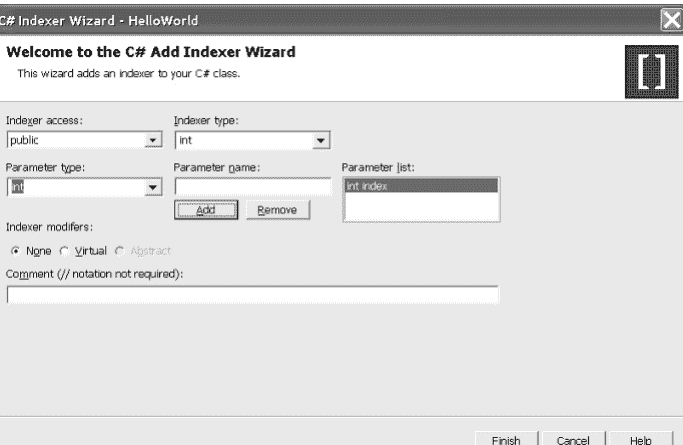

图 1-2 已填写的 C# 索引器向导，用于为 `IndexedProperty` 类添加索引器

应用于索引器属性的 `IndexerNameAttribute` 用于为不支持索引器的语言提供一个友好的名称。

```
[System.Runtime.CompilerServices.IndexerName("Command")]
```

（有关属性的更多信息，请参考“属性”部分。）

如果我们将在 C# 中定义的 `IndexedProperty` 类用于 Visual Basic .NET 程序，那么我们可以创建该类的实例，并通过名称 `Command` 访问索引器属性。假设我们将实例命名为 "obj"，如前面的例子所示，那么 **obj.Command(0)** 将调用索引器属性并返回 `*args*` 的第 0 个元素。

### 实现方法

C# 中的方法总是具有相同的方法头选项。以下语法示例展示了在向类添加方法时可以提供的所有可能信息。

```
[Attribute][Modifiers]Return-Type Name( [parameters] )
```

所有在方括号 `[]` 中的语法特性都是可选的。你在实现方法（或其他成员）时不一定要使用属性；当你理解它们时，你就会知道何时以及为何使用属性。修饰符，如 `public`，描述了可访问性。修饰符与信息隐藏相关。所有方法都需要一个返回类型。相当于过程的是返回 `void` 的方法，而函数返回非 `void` 的数据类型。方法的*名称*应该是一个动词或动词短语。你可以提供零个或多个参数。参数的签名是*类型 名称*，如果使用多个参数，则用逗号分隔。下面的要点列表转述了微软建议的方法命名准则。

- 使用动词或以动词开头的短语作为方法名。
- 使用 Pascal 命名法。
- 不要使用匈牙利命名法。（为了保持一致性，我加上了这一条。）
- 提供描述性的名称，说明方法执行的行为（例如，`CalculateBalance`）。

> 注意
如果到现在还不清楚，让我说明一下，微软正在逐步放弃使用匈牙利命名法。匈牙利命名法是为弱类型 C 语言采用的，并传播到了 VB 语言。像 C# 这样的强类型语言不需要前缀表示法。编译器会确保你不会不恰当地混合使用类型。

本章已经演示了几个方法的例子，在整本书中你还会看到数百个。让我们继续下一个主题。

### 构造函数

有两种特殊方法：构造函数和析构函数。构造函数与类的名称完全相同。除了构造函数之外，任何其他成员都不能与类同名——这里的*相同*也适用于大小写。构造函数可以有零个或多个参数，并且没有返回类型。（我们将在下一节讨论析构函数。）

构造函数通过添加具有不同参数的其他构造函数来实现重载。下面的要点列表概述了构造函数准则。

- 如果一个类只有静态成员，那么请实现一个私有构造函数以防止创建实例。
- 保持构造函数简短，在构造函数中只执行简单的任务，如参数到字段的赋值。这种方法允许对象非常快速地创建。
- 为子类提供一个受保护的构造函数。
- 作为建议，不要为结构体实现空构造函数。如果你不为结构体提供无参构造函数，编译器会添加一个默认构造函数，将所有成员初始化为其空等价值。
- 使用构造函数参数来设置属性。使用参数构造类或使用默认构造创建对象并为属性赋值，应该产生相同的结果。
- 在命名参数时保持一致。一种常见的技术是为每个重载的构造函数添加数量递增的参数。

### 析构函数

析构函数与构造函数同名，只是在析构函数名前添加了取反运算符（`~`）。

> **注意**
`~` 字符在 C++ 中用作二进制补码运算符。使用取反运算符作为析构函数是某人的一个巧妙想法，暗示了构造函数和析构函数之间的关系。也就是说，析构函数是构造函数的补充。

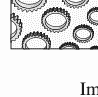

当你的类中需要清理资源（例如关闭文件）时，请实现析构函数。在实现构造函数时，请记住构造函数的名称受类名的约束。析构函数不能被重载或继承。析构函数是自动调用的，永远不能直接调用。CLR 垃圾回收器调用析构函数。当析构函数被调用时，它隐式调用 `Object.Finalize` 方法。最后，析构函数没有修饰符或参数。

### 非确定性析构和垃圾回收

C# 使用非确定性析构。CLR 实现了一个垃圾回收器，当对象不再使用时清理内存。这意味着在 C# 中，你不必像在 C++ 或 Delphi 中那样过多地担心析构函数。

垃圾回收器会在对象不再需要时调用其析构函数。析构函数将调用任何 `Finalize` 方法。你可以通过

调用`GC.Collect`并非推荐做法。垃圾回收器会挂起所有运行中的线程，这可能导致性能问题。此外，垃圾回收器自身能很好地判断何时运行。

### 实现 Dispose 方法

若类中包含非托管资源，可实现 Dispose 方法以支持确定性资源清理。通过允许消费者调用 Dispose 方法，您可以让用户自行决定何时释放文件或网络连接等资源。

可采用类似以下代码的方式实现 Dispose 方法。

```
private bool disposed = false;
public void Dispose()
{
    if (disposed) return;
    // 清理代码放在此处
    GC.SuppressFinalize(this);
    disposed = true;
}
```

首先声明一个私有字段 *disposed*，用于追踪 Dispose 方法是否已被调用，并将其初始化为 False。在 Dispose 方法中，先检查是否已调用过 Dispose，若已调用则直接返回。执行清理操作后，调用`GC.SuppressFinalize()`方法，并传入需要阻止其终结器执行的对象引用。最后将字段 disposed 设为 True。

多数情况下您无需实现析构函数或 Dispose 方法。CLR 中的托管对象会自动进行垃圾回收。仅在确实需要时才实现析构函数和 Dispose 方法。

### 实现事件

事件构成了 Windows 面向对象体系三要素的顶点，属性和方法则构成其基石。事件专门用于响应代码中的特定事件。与属性和方法类似，事件也存在两种视角：消费者视角和生产者视角。

编写类时，您需要预判哪些内部事件希望消费者能响应。对于这些事件，您需要引入事件机制，并在事件发生时触发该事件。而在使用类时，您需要编写事件处理程序，将其绑定到对象的事件上，并编写实际响应事件触发的代码。（*绑定*事件仅指将方法与事件关联。）

在 C++ 中我们使用函数指针模式，在 Delphi 中使用过程类型模式来实现事件和事件处理程序。C# 发展出本质上属于原始函数指针的机制——委托模式。*委托*是存储函数指针的特殊类。与原始函数指针的区别在于，委托可以维护多个函数指针。包含多个函数指针的委托称为*多播委托*。

技术上，委托语句将过程的签名描述为类型。任何签名与委托签名匹配的方法都可添加到委托对象的调用列表中。描述委托签名与在 C++ 中描述函数指针或在 Delphi 中描述过程类型保持一致。以下三条语句展示了这种相似性：

```
typedef void (*func)();       // Visual C++ 6.0 函数指针定义
type TProc = procedure;      // Delphi (Object Pascal) 过程类型
delegate void Delegate();    // C# 委托
```

每条语句大致展示了对应语言中的函数指针声明。区别仅在于只有 C# 委托（或任何 .NET 语言委托）能存储多个地址。C++ 的函数指针和 Delphi 的过程类型只能指向一个函数地址。若要引用多个函数地址，在 C++ 和 Delphi 中需要创建指针类型数组。而 C# 实质上在类型内部包含了数组机制，允许单个委托存储多个地址。这是核心区别。

当然，如果您是 VB6 程序员，需要先了解什么是函数指针，再理解委托的不同之处。对于 C++ 和 Delphi 专业人士，可将其理解为具有单一签名的函数指针数组。但若您不理解函数指针原理和委托用法，编写的代码将如同两条腿的凳子般不稳固。

#### 使用现有委托声明事件

事件声明非常直接。事件主要供类消费者使用，因此通常声明为公共成员。语法示例如下：

```
[访问修饰符] event [委托类型] 事件名
```

*访问修饰符*通常为 public。*event* 关键字是表示该成员为事件的字面量。*委托类型*是由方法签名描述的类，使用 *delegate* 关键字。现有委托示例如 *EventHandler* 委托。*事件名*是事件的成员名称，消费者将在代码中通过此名称引用事件。以下语句展示了使用 EventHandler 委托的事件：

```
public event EventHandler Changed;
```

*EventHandler* 的签名是返回 void 并带有 *object* 和 *System.EventArgs* 两个参数的过程。EventHandler 委托在 CLR 中的声明为：

```
public delegate void EventHandler(object sender, System.EventArgs e);
```

（此委托已存在，无需自行定义。）*EventHandler* 被许多 Windows 窗体控件使用，例如 *Button* 控件的 *Click* 事件。

#### 声明新的委托类型

若要定义自定义委托，可参照上一节中 *EventHandler* 委托的基本示例。

委托定义与过程头完全相同，只是在访问修饰符和返回类型之间添加了 delegate 关键字。以下示例定义了一个无返回值且无参数的新委托：

```
public delegate void Delegate();
```

请注意 C# 区分大小写，上述示例引入了名为"Delegate"的委托。任何返回 void 且无参数的过程都可赋值给声明为 Delegate 类型的事件或字段。

#### 作为生产者触发事件

由生产者触发事件。在 C# 中通过事件名调用过程来触发事件。按照惯例，触发事件的是与事件同名并带有"On"前缀的 protected 成员。回到最初定义的 EventHandler 类型的 Changed 事件，我们可以将其与触发事件的受保护方法配对：

```
public event EventHandler Changed;
protected void OnChanged()
{
    if(Changed == null) return;
    Changed(this, System.EventArgs.Empty);
}
```

事件名为"Changed"。消费者可将任意多个符合 EventHandler 委托签名的方法赋值给这个事件成员。在包含此代码的类内部，您可以在任何需要触发 Changed 事件的位置调用 OnChanged。OnChanged 会检查 Changed 是否已绑定至少一个委托；若未绑定则直接返回。否则生产者会将 Changed 当作方法调用，并传入必要参数。

当生产者触发带有 sender 参数的事件时，该值始终通过内部自引用 this 满足。在简单示例中我们传递 null 的 System.EventArgs 参数，因为未使用该值。若需向消费者的事件处理程序传递特定值，可创建 System.EventArgs 实例或创建接受 EventArgs 特定子类的委托。

#### 作为消费者处理事件

消费者通过将事件处理程序绑定到对象的事件成员来处理事件。示例程序 EventsDemo.sln 包含 EventChanged 和 Form1 类。我们假设 Form1 包含 EventChanged 对象并希望处理 EventChanged.Changed 事件。为此 Form1 需要创建 EventChanged 实例，并将方法赋值给 EventChanged.Changed。以下示例展示了 Form1 中将事件处理程序绑定到 EventChanged.Changed 的代码：

```
private void button1_Click(object sender, System.EventArgs e)
{
    MessageBox.Show(sender.ToString());
}
```


### 创建类的实例

对象是通过使用 `new` 运算符调用构造函数来实例化的。你可以创建对象的实例，并将它们赋值给类型与所实例化对象相同或为其祖先类型的变量。也就是说，子类型的实例可以赋值给声明为对象父类型的变量。反之则不成立。（更多相关信息，请参见后续的“继承”部分。）

请记住，构造函数与类同名，可以有公共或非公共访问修饰符，并且可以有零个或多个参数。构造函数可以重载。因此，可能存在不止一个适合你调用的构造函数。以下是几个演示对象实例化的示例。

```csharp
// simple object creation
FileStream fs = new FileStream("c:\\temp\\killme.txt", FileMode.CreateNew);
fs.Write(new Byte[]{65, 66, 67, 68, 69}, 0, 5);
fs.Close();

// array examples
string[] strings = new string[10];
strings[0] = "Some Text!";
int[] integers = new int[]{0,1,2,3,4,5};
```

第一条语句创建了 `FileStream` 类的一个实例。（你需要使用 `using` 语句将 `System.IO` 命名空间添加到你的应用程序中，才能使用 `FileStream` 类。）`FileStream` 对象有多个构造函数。示例中使用的构造函数接受一个文件路径和一个 `FileMode`。请记住，C# 字符串使用反斜杠（\）作为转义字符；当你需要在字符串中表示反斜杠时，需要使用 `\\` 反斜杠对。第二条语句演示了使用初始化列表内联构造一个字节数组。

第一个数组示例演示了构造一个可容纳 10 个字符串的字符串数组。C# 中数组的有效索引是从 0 到 n – 1，其中 n 表示数组中的元素数量。第二个示例使用初始化列表构造一个整数数组。初始化列表提供了数组的值和范围。`integers` 的大小为 6，有效索引为 0 到 5。在 C# 中，你可以为数组同时指定元素数量和初始化列表，但并非两者都需要。

```csharp
private EventChanged obj = new EventChanged();
private void Form1_Load(object sender, System.EventArgs e)
{
    obj.Changed += new System.EventHandler(button1_Click);
    obj.Value = 5;
}
```

`EventChanged` 对象名为 "obj"，并在窗体中作为字段实例化。`Form1_Load`（本身也是一个事件）将 `EventChanged.Changed` 事件连接到 `Form1` 的 `button1_Click` 方法。（按钮点击方法已经存在，并且恰好与 `Changed` 事件具有相同的签名。）`+=` 运算符用于将新的 `System.EventHandler` 对象赋值给 `Changed`。这样做会将事件处理程序附加到调用列表中。

只有 `+=` 和 `-=` 运算符被重载，用于向事件的调用列表中附加和移除事件处理程序。你不能使用赋值运算符将委托赋值给事件。

#### 多播是如何工作的？

将事件声明视为一个字段，其类型是一个聚合类型：委托。当你将委托赋值给事件时，你是在将该委托插入到一个列表中，该列表是委托类型的一个成员。当你通过将事件作为方法调用来引发事件时，你实际上是在与一个对象交互。当事件方法在内部被调用时，它会遍历附加到内部列表的所有委托，并逐个调用它们。

回到我们包含公共事件 `EventHandler Changed` 的示例，当我们通过调用 `Changed` 来引发事件时，每个赋值给 `Changed` 的委托都会被调用。这被称为多播。委托可以绑定到单个方法，也可以绑定到多个方法。

可以通过将多个委托赋值给单个事件，从而将整个解决方案的多个部分分层到一个事件中。你不应该做的是依赖于委托以任何特定顺序被调用。

#### 定义接口

接口允许你为类定义一个适配器。在面向对象的世界中，我们有继承、聚合和关联。继承描述了一种新事物是现有事物的泛化的关系。例如，吉普车是汽车的泛化，可以使用继承来描述。吉普车拥有变速箱，这体现了聚合关系。吉普车也可能有一个驾驶员，这是关联关系的一个例子。变速箱属于吉普车，但驾驶员不属于。

接口描述了有时可以通过其他方式（如继承、聚合或关联）定义的关系，但最好被描述为*支持的能力*。例如，汽车中的立体声音响设备可能有旋钮，允许你调谐电台或选择 CD 上的曲目。但是，如果同样的立体声音响设备允许你在不直接触摸设备上旋钮的情况下调谐 FM 电台，该怎么办？我们可以说，支持调谐功能的立体声音响设备具有一个调谐接口。因此，我们可以附加其他利用立体声音响接口的控件。也许一个红外设备或方向盘上的控件可以使用该接口来执行与立体声音响设备上的物理控件相同的功能。

立体声音响上的旋钮是设备上的*物理*控件。音量是一个*属性*。改变音量的能力可以实现为一个方法或属性方法，而两者反过来都可以用来支持改变音量的接口。其他设备可以实现相同的接口，我们称之为 `Audio`。其他不相关的设备也可以支持 `Audio` 接口：电视、民用波段收音机、手机、电话、立体声音响或飞机中的通信设备。假设我们创建一个通用遥控器，它可以与任何实现 `Audio` 接口的设备通信。任何支持音频接口的设备都可以用同一个遥控器进行调整——调大或调小音量。现在，你的环绕声、大屏幕电视和调谐器都可以由同一个设备控制。

定义接口的基本语法与定义类的语法相似。下一个代码片段通过实现 `Audio` 接口来演示基本语法。（按照惯例，我们将使用 `I` 前缀命名接口。）

```csharp
public interface IAudio
{
    void AdjustVolume( int value );
}
```

接口定义有一个访问修饰符；在示例中，访问修饰符是 `public`。关键字 `interface` 跟在访问修饰符之后，接口的名称构成了接口头。接口的成员不使用访问修饰符，但每个成员都有一个过程头。每个实现接口的类都必须实现接口定义的所有方法。

### 实现接口

假设你已定义了一个接口，或者想要实现一个现有接口。你需要指明该类将实现该接口。以下清单演示了一个接口和一个部分完成的、实现了该接口的类。

```csharp
public interface IAudio
{
    void AdjustVolume(int value );
}

public class Radio : IAudio
{
    private int volume = 0;

    void IAudio.AdjustVolume(int value)
    {
        volume += value;
    }
}
```

类 `Radio` 在类头中使用继承语法来表明它实现了 `IAudio` 接口。（继承和实现接口的语法是相同的：在类头中添加一个冒号和接口的名称。）当你指明要实现一个接口时，你就是在签订一份契约，声明你将添加接口定义的方法。实现接口的方法与普通方法之间的一个显著区别是，对于所有接口方法，你必须在过程头中包含接口名称和成员运算符。过程头 `void IAudio.AdjustVolume(int value)` 表明这个 `AdjustVolume` 的实现满足了 `IAudio` 接口与 `Radio` 类之间的契约。

如果你实现不止一个接口，那么请将其他接口添加到类头中，每个额外的接口用逗号分隔。

重要的是要记住，当你实现一个接口时，你并没有从接口中获得任何方法或数据。另外，请记住，接口中只能描述方法；你不能在接口中描述字段或属性。

### 继承

当你定义继承关系时，至少涉及两个类。一个是父类，第二个是子类。（父类和子类之间的关系也称为*超类*和*子类*，其中超类等同于父类，子类等同于子类。）这种父子关系被称为 *IsA*（是一种）关系。例如，我是我父亲（和母亲）的后代，所以我是一个 Kimmel（和 Symons），继承了来自 Kimmel（和 Symons）的 DNA 粘液。

当你在 C# 中定义继承关系时，子类会获得父类中定义的所有成员。当你继承时，你会获得父类中定义的所有字段、属性和方法。与染色体遗传不同，面向对象的继承意味着你会获得一切。

我想你们大多数人都理解继承，但我想再介绍一种描述，因为继承是一个重要的概念。如果类 B 继承自类 A，那么从逻辑上讲，A 交 B 将等于类 A。

继承的表示法与接口继承的表示法相同。要表明类 B 继承自类 A，你应该如下编写类头：

```csharp
public class B : A
```

与接口继承不同，当你从一个类继承时，你不必实现来自父类的任何方法，因为它们已经在父类中实现了。

#### 继承术语

有很多与继承关系相关的术语。既然你会在本书中遇到它们，我将在此简要回顾其中的几个。

- 如果类 B 继承自 A，那么 A 是*父类*，B 是*子类*。
- 如果类 B 继承自 A，那么 A 也被称为*超类*，B 是*子类*。
- 继承关系满足 *IsA* 测试。在我们的例子中，我们会说 B IsA A（尽管这在语法上很糟糕）。


- 继承也被称为*泛化*。
- *兄弟类*是指继承自同一父类的类。
- 在讨论继承关系时，你偶尔会听到人们提到*祖父类*、*祖先类*和*后代类*。

这些对同一事物（继承）的不同称呼可能会引起混淆。

据我所知，在讨论对象继承关系时，没有人用过表亲或姑姨这类词，但这些词可以被使用，并且应该用来描述与人类亲属关系相同的关系。例如，表亲就是你父母兄弟姐妹的孩子。

### 继承的一般准则

在继承方面，你是老板。根据经验，我为使用继承关系提供了一些指导原则，但最终你必须根据具体情况做出决定。

- 如果你定义了一个类，后来发现需要修改，那么考虑从原始类继承以添加新代码。
- 尽量保持你的继承关系浅而宽。在兄弟类和子类的数量之间没有完美的比例，但在成熟的框架中，通常兄弟类比后代类多。
- 探究*重构*。重构是迄今为止发明的引导程序员简化现有代码的最佳方法。本质上，重构是一种将共同代码提取出来的有组织的方法。（遗憾的是，我们无法在此详细阐述重构，但重构将用于生成本书中的代码清单。）
- 不要害怕实验和改变主意。
- 探索现有的框架以获得比例感。（值得探索的优秀框架包括 Delphi 的 VCL 和 .Net Framework。）

### 继承示例

你将在本书中找到数十个继承的例子，你也可以在 CLR 中找到更多例子。为了彻底，我们将继续用收音机的例子来演示继承的基本技术方面。下一个代码清单演示了几个具有相同根类（我们的 Radio 类）的类。

```csharp
public interface IAudio
{
    void AdjustVolume(int value);
}

public class Radio : IAudio
{
    private int volume = 0;

    void IAudio.AdjustVolume(int value)
    {
        volume += value;
    }

    public int Volume
    {
        get
        {
            return volume;
        }
        set
        {
            volume = value;
        }
    }

    private double station = 94.1;

    public double Station
    {
        get
        {
            return station;
        }
        set
        {
            station = value;
        }
    }

    public void Receive()
    {
    }
}

public enum RadioBand
{
    AM, FM
}

public class AMFMRadio : Radio
{
    private RadioBand band = RadioBand.AM;
    public RadioBand Band
    {
        get
        {
            return band;
        }
        set
        {
            band = value;
        }
    }
}

public class CommunicationsRadio : Radio
{
    public void Transmit()
    {
    }
}
```

该代码清单提供了几个继承的例子。CommunicationsRadio 和 AMFMRadio 继承自 Radio。AMFMRadio 引入了 AM 和 FM 波段的概念，而 CommunicationsRadio 引入了发射能力以及继承的接收能力。

### 封装与聚合

封装和聚合指的是类包含成员的能力。更具体地说，*聚合*指的是类（和结构）能够包含其类型也是类（或结构）的成员的能力。

我最喜欢的封装的例子是人体和膀胱之间的关系。值得庆幸的是，膀胱被封装在人体内部。你能想象一个人们可以通过挤压你的膀胱来表达对你的不满的世界吗？“哎哟，那是我的脚！”挤一下。

真是一团糟。

显然，膀胱是一个类。它执行一项功能并具有状态。我们知道这个功能是什么，我们经常在最不合适的时候感受到这个状态。值得庆幸的是，膀胱被皮肤和骨骼以及与生俱来的个人空间感所封装。

这就是你应该如何看待封装和聚合。封装允许你将数据安全地放在类中，限制访问并避免尴尬的情况。聚合允许你将复杂类型安全地放在类中，同样限制访问并避免尴尬的情况。

思考谁拥有和保护数据是职责所在。（不要让你的邻居拥有你的膀胱。）将聚合视为向新类型添加复杂类型——即类。膀胱是一个复杂类型，人体有一个成员是膀胱。

在专家医疗系统中，实现一个代表人体和膀胱的类可能是合适的。然而，为了方便，我们将扩展我们的 Radio 例子来演示聚合和封装。代码清单演示了一个新的类 BoomBox，它有一个 AMFMRadio。AMFMRadio 演示了封装和聚合。

```csharp
public class BoomBox
{
    private AMFMRadio radio;

    public AMFMRadio Radio
    {
        get
        {
            return radio;
        }
    }

    BoomBox()
    {
        radio = new AMFMRadio();
    }
}
```

### 多态

多态被以多种方式描述过。有好几次我看到它被追溯到希腊词根，解释为“多种形态”，有时这些描述又长又复杂。我将尝试一些不同的方法。我将使用一个我希望对你有意义的类比。

假设你有一项适合孩子做的家务。我有四个孩子。我们在他们十八个月大的时候就开始让他们做家务。是的，一个蹒跚学步的孩子在十八个月大的时候就能清空废纸篓。也许有点残忍，但很有效。这里是这个类比：

你正在看超级碗。第四节还剩两分钟，你的球队持球但落后8分。他们不仅要完成达阵，而且你的球队必须拿到两分转换。更增加紧张气氛的是，你和庄家赌了500美元赌你的球队赢。现在，你的啤酒喝完了。你需要啤酒，但你不能离开比赛，因为等你回来时，比赛就结束了。你需要一个孩子去跑腿买啤酒，任何一个孩子都行。

这就是多态。
当你有一个可以通过共同提供者集合中的任何提供者解决的普遍问题时，你就需要多态。

如果啤酒和橄榄球的类比对你没有意义，别担心；对我来说也没太大意义。让我们尝试一种更技术性的方法（给那些看 TLC 而不是周一晚间橄榄球的人）。

记得我说过继承也被称为泛化吗？好吧，如果你将某样东西声明为通用（或父）类型，并实例化——创建——特定类型的实例，那么你在创建的特定类型方面就有更多选择。一个很好的例子是 EventHandler 委托。EventHandler 委托被定义为第一个参数接收一个 object。object 类是所有类的根。这实际上意味着任何 object 都可以被传递以满足 EventHandler 方法的 sender 参数。这就是多态；声明通用类型并实际使用特定类型。

### 使用修饰符

修饰符处理*信息隐藏*。信息隐藏体现了“眼不见，心不烦”的老话。也就是说，作为生产者，如果你能对消费者隐藏某些东西，那么他们就不必担心它。因此，心不烦。
访问修饰符允许你在编程时将东西“心不烦”。在生产类时，只公开消费者需要与之交互才能使用该类的东西。通过限制你在公共接口中暴露的内容，你正在使你的类更容易被使用。即使你是你所生产类的第一个消费者，这也是正确的。

有几种访问修饰符可供选择。C# 支持 public、protected、internal、protected internal、private 和 read-only（用于字段）。下面的项目符号列表简要描述了每种访问修饰符的目的。

- *public* 访问修饰符提供对类型和成员的无限制访问。
- *protected* 访问修饰符在内部和子类中提供无限制访问，对消费者提供限制访问。protected 访问修饰符可以应用于嵌套类型。
- *private* 访问修饰符提供最严格的访问。只有类的生产者可以使用其私有成员。消费者和子类无法访问私有成员。private 访问修饰符可以应用于嵌套类型。
- *internal* 访问修饰符意味着类型和成员仅在同一程序集内可访问。internal 修饰符用于允许代码跨类边界在内部协作，而不将这些元素暴露给程序集外的消费者。
- *protected internal* 修饰符将访问限制在同一程序集内的嵌套类型。

当你声明顶级类型时，必须使用 public 或 internal 访问修饰符。只有当类型是嵌套时，你才可以对类型使用 private 和 protected 访问。*嵌套类型*是包含类型定义的类型定义。

你不能组合访问修饰符，protected internal 修饰符除外。你不能在命名空间上使用访问修饰符。如果你没有指定访问修饰符，那么

默认访问级别将被使用。最好明确指定访问级别，而不是依赖于默认访问。

#### 使用类修饰符

当你定义类且外层元素是命名空间时，则该类可被定义为具有 public 或 internal 访问级别。如果你没有为顶级类指定修饰符，则该类将具有 public 访问级别。

嵌套类可以使用任何访问修饰符定义，但你只能在嵌套类上使用 protected、protected internal 和 private 访问修饰符。

类访问修饰符规则也适用于任何结构体和枚举类型。

#### 使用成员修饰符

你也可以在类型的成员上使用任何访问修饰符。如果你定义成员时没有指定访问修饰符，则成员默认为 private。

### 运算符重载

运算符是对其执行操作的符号。当数据是操作的对象时，数据被称为*操作数*。常见运算符（如加法运算符 +）为值类型而存在。值类型的一个例子是整数，例如 5。对整数类型执行像 5 + 4 这样的操作是直观的。

不幸的是，所有可能存在的类型无法被预见；但当类型被发明出来时，对这些类型执行简单操作也可能是直观的。字符串连接运算符就是一个例子。当你遇到像这样的代码时：

```
string s = "overloaded operators " + "are cool"
```

人们会直观地理解该语句正在执行字符串连接。

重载运算符是方法。具体来说，它们是具有特殊语法的方法。你可以通过将重载运算符视为两个部分来理解运算符。第一部分实现一个常规的命名方法，执行该运算符本应执行的任务。第二部分使用特殊语法定义运算符方法，并在运算符内部调用该命名方法。（当然，你完全可以跳过运算符重载，但那会很无趣。）

### 编写运算符方法

运算符方法的过程头与常规方法非常相似。指定返回类型和参数类型及名称；但是，不是使用方法名，而是使用关键字 *operator* 和运算符符号，其位置本应是方法名所在之处。

借鉴帮助文件中的示例，我们可以实现一个复数类。（复数有实部和虚部。）我们可以实现一个重载的加法运算符，它将两个复数的实部和虚部相加，得到一个新的复数，该复数是两个相加复数的和。

```
public static Complex operator +(Complex c1, Complex c2)
{
    return new Complex(c1.real + c2.real, c1.imaginary + c2.imaginary);
}
```

代码清单摘自一个结构体，该结构体定义了复数为一个用实数和虚数的标量部分初始化的数。例如，如果你用实参数 2 和虚部 3 构造一个复数，那么你将得到复数 2 + 3i。上例中的重载运算符为 Complex 类型定义了 + 运算符，它是一个静态类型，接受两个 Complex 对象并返回一个新的 Complex 对象，该对象是两个参数的和。在示例中，你会通过编写一个将两个复数相加的语句来调用这个 operator+ 方法。

```
Complex c = new Complex(4, 3);
Complex d = new Complex(1, 2);
Complex e = c + d;
```

前两个语句创建了两个复数的实例。最后一个语句调用了 operator+ 方法，将一个新对象返回给变量 *e*。掌握重载运算符的最佳方法是编写一些简单的示例，并在调用运算符的语句和运算符方法内部设置断点。你很快会看到该操作会导致方法调用。

### 重载运算符指南和限制

定义重载运算符时要谨慎。最重要的是要避免创建违反直觉的运算符。例如，重载加法运算符来执行减法。不要这样做。遵循这些重载运算符的基本指南将使你免于麻烦：

- 定义使用 op_ 前缀后跟运算符名称来执行该操作的方法，以支持像 Visual Basic .NET 这样不支持运算符重载的语言。
- 通过调用命名方法来实现重载运算符。（为什么要将运算符行为编码两次？）
- 仅在运算符适用的类中重载运算符。
- 当操作直观且结果看起来合乎逻辑时，使用运算符重载。
- 对称地重载运算符。如果你实现了加法，那么也要实现减法。

表 1-1 列出了运算符并指明它们是否可以被重载。并非所有运算符都可以被重载。

表 1-1 运算符的可重载性

| 运算符 | 可重载性 |
| :--- | :--- |
| +, -, !, ~, ++, --, True, False | 可重载的一元运算符。 |
| +, -, *, /, %, &, \|, ^, <<, >> | 可重载的二元运算符。 |
| ==, !=, <, >, <=, >= | 可重载但必须成对重载的比较运算符。（你会收到编译器指示哪个是配对运算符，并提醒你需要重载该配对运算符。） |
| &&, \|\| | 这些条件逻辑运算符不能被重载。 |
| [] | 数组运算符不能被重载，但你可以定义索引器。（有关更多信息，请参阅“索引属性”部分。） |
| +=, -=, \*=, /=, %=, &=, \|=, ^=, <<=, >>= | 赋值运算符不能被重载。 |
| =, ., ?:, new, is, sizeof, typeof | 这些运算符不能被重载。 |

重载运算符允许你定义特殊方法，使代码编写更简单、更直观。你不需要经常编写重载运算符，但你作为 CLR 代码的使用者会经常使用它们。

### 属性

正是像接口和属性这样的习语让我们程序员陷入了麻烦。原因是这些术语承担了双重职责。多年来，“接口”仅仅意味着类中声明的成员。当 COM 被引入时，接口有了另一层含义；接口变成了一种构造——很像一个类。（对于 VB 程序员来说，接口和类在很大程度上是模糊不清的。）

“属性”和属性习语存在同样的问题。在一般意义上，“属性”是“property”的同义词。属性是类型的一个属性。.NET 属性本身实际上是一个类。（围绕属性的混淆讨论可能会像围绕父类与子类、超类与子类以及对象与类的讨论一样多。）

在 C# 中，大写的 Attribute 是一个向你的程序集添加元数据的类。元数据（或附加数据）的添加是为了帮助根除“DLL 地狱”。历史上，应用程序需要的外部数据存储在注册表或 INI 文件中。属性允许这些辅助数据随程序集一起携带。属性类允许你向程序集添加元数据，而反射允许你在需要时提取该元数据。这类似于从注册表读取和写入数据。由于元数据巧妙地嵌入到程序集中的结果，部署 .NET 应用程序比部署基于 COM 的应用程序更简单。

可以在 AssemblyInfo.cs 模块中找到属性的示例。一个例子是 AssemblyTitleAttribute 类。

```
[assembly: AssemblyTitle("")]
```

通过在 AssemblyTitleAttribute 的括号内添加文本，你可以为你的程序集添加一个标题，该标题将显示在属性对话框中。按照惯例，属性类有一个 Attribute 后缀，但当使用该属性时，后缀会被省略。assembly: 标签表示这是一个程序集级属性。

由于属性是作为类实现的，你可以概括现有的 Attribute 类来为新的用途创建新属性。属性用于许多事情，从为组件属性提供提示到请求安全权限。许多新的属性将被创建，但使用属性的节奏与构造对象的节奏相似。将属性类的名称放在属性描述的实体之前，并传递属性构造函数定义的参数。构造函数参数被称为*位置参数*。你也可以通过传递命名参数来初始化属性对象中的属性。

### 反射

反射是 .NET 中实现的一种能力，允许你动态发现信息，例如程序集中的命名空间、接口、类、方法、属性和字段。除了提供一种请求属性描述的元数据值的方法外，反射还允许你了解程序集中定义的类型和成员，反射还允许你在运行时发出中间语言（IL）代码。IL 在意图上类似于 Java 字节码。IL 是在编译成机器可读代码之前的代码。

反射是强大的魔法。我们将在本书中详细探讨它。第 2 章演示了如何使用反射发现有关程序集的信息，第 10 章演示了如何创建可以使用反射读取的自定义属性。

## 总结

本章概述了你在几乎每个创建的应用程序中都需要的核心语言基础知识。将有 16 个章节及其相关应用程序在上下文中演示这些概念。虽然本章中的示例很简短，但这些主题是所有 C# 编程的核心，你将在后续章节中找到许多关于它们的示例。


## 第2章
程序集查看器

**本章内容：**
- 演示主题
- 程序集管理器的代码清单
- 次要主题
- 总结

本章将演示如何动态加载程序集，并使用反射来探索这些程序集。在第二章就接触程序集和反射，任务相当艰巨，但程序集查看器将帮助你掌握这些主题，同时学习如何使用`Windows Forms`命名空间中的控件和`GDI+`构建`Windows`应用程序。

### 演示主题

本章的主要主题是使用动态发现功能，通过反射来探索程序集。如果你能够动态加载和使用程序集，就可以利用瘦客户端编程的优势，通过`HTTP`连接加载程序集，从而支持基于`Windows Forms`应用程序的自动部署和更新。本章还将提供大量关于以下主题的示例：

- 使用值类型
- 使用`StringBuilder`类
- 定义静态方法
- 定义类和继承
- 定义和实现接口
- 使用`IEnumerator`接口
- 在`Windows Forms`中安全地进行多线程编程
- 使用`Graphics`对象进行编程
- 使用`System.Diagnostics`进行调试
- 从资源加载信息，以方便国际化
- 使用`PrintDocument`进行基本打印

#### 程序集管理器的代码清单

本章将详细讨论`AssemblyViewer.sln`的代码，该代码可在McGraw-Hill/Osborne网站`www.osborne.com`上找到。完整的代码需要43页才能完全列出，为了避免书籍内容冗余，我们将在清单2-1中仅重现关键部分。幸运的是，你可以轻松复制列出的类和方法，或者从`www.osborne.com`发布的源代码中剪切和粘贴它们。

`AssemblyManager.cs`模块包含`AssemblyManager`类。该类演示了如何使用反射来加载和探索程序集。

```
清单 2-1 AssemblyManager.cs 管理程序集的加载和读取。
```

```csharp
1: using System;
2: using System.Reflection;
3: using System.Diagnostics;
4: using Diag = System.Diagnostics;
5: using System.IO;
6: using System.Collections;
7: using System.Text;
8: using System.Windows.Forms;
9:
10: namespace AssemblyViewer
11: {
12: /// <summary>
13: /// AssemblyManager的概要说明。
14: /// </summary>
15: public class AssemblyManager
16: {
17: private string name = "";
18: private Assembly assembly;
19:
20: public AssemblyManager(string assemblyName)
21: {
22: Debug.Assert(File.Exists(assemblyName));
23: Name = assemblyName;
24: }
25:
26: public Assembly Assembly
27: {
28: get
29: {
30: return assembly;
31: }
32: }
33:
34: public string Name
35: {
36: get
37: {
38:     return name;
39:   }
40:   set
41:   {
42:     if(name.Equals(value)) return;
43:     name = value;
44:     Changed();
45:   }
46: }
47:
48: private void Changed()
49: {
50:   Debug.Assert(File.Exists(name));
51:   assembly = null;
52:   assembly = Assembly.LoadFrom(name);
53: }
54:
55: private string Formatted(Type type)
56: {
57:   const string mask = "{0} \r\n";
58:   string result = string.Format(mask, type.Name);
59:   Broadcaster.Broadcast(result);
60:   return result;
61: }
62:
63: private string Formatted(MemberInfo info)
64: {
65:   const string mask = "\t{0} {1}\r\n";
66:   string result = string.Format( mask,
67:   info.MemberType.ToString(), info.Name );
68:   Broadcaster.Broadcast(result);
69:   return result;
70: }
71:
72: private string Load()
73: {
74:   StringBuilder str = new StringBuilder();
75:   IEnumerator outer = assembly.GetTypes().GetEnumerator();
76:
77:   while(outer.MoveNext())
78:   {
79:     Type type = (Type)outer.Current;
80:        str.Append(Formatted(type));
81:
82:        IEnumerator inner = type.GetMembers().GetEnumerator();
83:
84:        while(inner.MoveNext())
85:        {
86:            str.Append(Formatted((MemberInfo)inner.Current));
87:            Application.DoEvents();
88:        }
89:    }
90:
91:    return str.ToString();
92: }
93:
94: public string Text
95: {
96:     get
97:     {
98:         return GetText();
99:     }
100: }
101:
102: public string GetText()
103: {
104:     return Load();
105: }
106:
107: }
108: }
```

#### using 语句

你会在两个地方看到`using`关键字。`using`语句用于导入命名空间，以及作为管理对象的块语句。

清单2-1演示了如何使用命名空间。可以将`using`语句理解为向`DLL`添加引用。框架中的程序集实际上包含在`DLL`文件中；因此

```csharp
using System.Reflection;
```

引用的是以`system`开头的`DLL`。

程序集可以包含多个命名空间。例如，`System.Reflection`包含在`System.dll`程序集中。然而，`System.Windows.Forms`实际上是包含`Windows Forms`控件的程序集的名称。你可以通过导航到`C:\WINNT\Microsoft.NET\Framework\v1.0.3705\`来探索`.NET`框架中的程序集。

#### 使用 using 指令创建别名

你可以使用*using*指令为命名空间创建别名。将

```csharp
using System.Diagnostics;
```

改为

```csharp
using Diag = System.Diagnostics;
```

就为`System.Diagnostics`命名空间创建了一个别名`Diag`。在任何你可能使用完全限定的`System.Diagnostics`命名空间的地方，都可以用别名`Diag`来替换它。

#### 定义 using 作用域

*using*的第二种用法类似于`VB.NET`中的`with`语句。当你在代码中将*using*语句与一个对象一起使用时，你定义了一个作用域，该作用域将在*using*块结束时隐式地释放该对象。即使在*using*块结束之前抛出了异常，只要在*using*块中创建的对象实现了`IDisposable`接口，该对象就会被释放。

`IDisposable`是一个只有一个方法`Dispose`的接口。如果你需要确定性的清理，就实现`IDisposable`。例如，当你打开一个文件时，你会希望在使用完文件后尽快关闭它。以下代码片段演示了如何使用*using*块来定义一个在块结束时释放对象的块。

```csharp
using (FormAbout form = new FormAbout())
{
    form.ShowDialog();
}
```

*using*语句声明并创建对象的实例。*using*语句中引用的实例名称在块中使用，当块退出时，会调用窗体的`Dispose`方法。（要验证这一点，可以重载继承的`Dispose`方法并在`Dispose`方法中设置断点。如果你不确定如何重载方法，请参考本章后面的“定义接口”部分。）

#### 定义你的命名空间名称

几年前，类是最高的抽象层次。命名空间提供了一种在更高层次的关系中组织类并创建唯一名称的方法。命名空间是组织管理的工具。

> **注意**
> `ProgIds`的用途与命名空间类似。但是，`ProgIds`仅限于39个字符，并且不保证唯一。`ProgIds`（除了句点外不能包含任何标点符号）仍然支持用于`COM`互操作。

当你创建一个应用程序时，你给它的名称将用作默认命名空间。你添加到该项目的每个模块都将被赋予与项目定义的相同命名空间。如果你向解决方案添加一个新项目，新项目将获得与项目名称相同的命名空间名称。

命名空间是公共的，你不能为命名空间添加访问修饰符。你可以在命名空间内声明类、接口、结构、枚举、委托和其他命名空间类型。

清单2-1的第11行表明`AssemblyManager`定义在`AssemblyViewer`命名空间中。如果你不指定命名空间，将使用默认命名空间。你可以在`AssemblyViewer`项目的“常规属性页”中修改默认命名空间（参见图2-1）。

### 定义类

清单2-1的第15行包含`AssemblyManager`类的类头。`AssemblyManager`被定义为公共类，是清单中唯一的类。在大多数情况下，你定义的类都将具有公共访问权限。第108行定义了`AssemblyManager`的结束块。（有关类的常规信息，请参考第1章。）

```csharp
15:     public class AssemblyManager
108: }
```

图 2-1  在 Visual Studio .NET 中查看默认命名空间


#### 实现构造函数

构造函数是类中唯一可以与类名同名且大小写相同的成员。构造函数使用访问修饰符，可以包含参数来初始化实例，但不定义返回类型。作为通用规则，构造函数应保持简短明了。

清单 2-1 的第 19 至 23 行实现了 AssemblyManager 的构造函数。第 21 行确保程序集文件存在，第 22 行将 assemblyName 参数赋值给 Name 属性。以下小节将讨论两种策略，使你的构造函数能够可靠地运行，正如我们在 AssemblyManager 构造函数中所做的那样。

**使用 Assert 保护你的代码**
第 21 行调用了静态方法 File.Exists，返回一个布尔值，指示 assemblyName 所代表的文件是否存在。静态方法 Debug.Assert 定义在 System.Diagnostics 命名空间中。Assert 是一个开发工具，你可以用作哨兵。当使用条件编译常量 DEBUG 时，Assert 方法会被启用。这意味着你可以保留调试代码，并使用条件编译来切换调试代码。

当 Assert 方法中评估的条件失败时，调用堆栈会显示在对话框中，使你能够继续运行应用程序或中止。Assert 方法的目的是为开发者提供一个早期警告，表明对系统状态所做的假设失败了。（编写一个简单的程序，调用 `System.Diagnostics.Debug.Assert(false)` 来查看调用堆栈跟踪对话框。）

**初始化对象属性**
构造函数的目的是初始化对象的状态。清单 2-1 第 19 至 23 行的构造函数初始化了 AssemblyManager。第 22 行所做的比它看起来要多一点。如果你仔细观察，会注意到 Name 是 AssemblyManager 类的一个属性。如果遵循约定，我们知道大写属性是一个属性。

`Name = assemblyName` 调用了第 33 至 44 行 Name 属性的属性设置器。如果你查看设置器方法，会看到如果底层字段等于 *value* 参数，我们就退出设置器。参数 *value* 是隐式的；你只需要知道 *value* 是传递给设置器的参数名，并具有属性的数据类型。因为设置器不仅仅改变字段值，所以我们使用 if 条件作为哨兵来防止不必要的工作。

如果 *value* 不同——也就是说，如果 *value* 代表一个不同的程序集——那么我们调用 Changed 方法。我们不在设置器中实际执行工作，而是使用一个方法。当提供新的程序集名称时，Changed 方法会加载该程序集。

Changed 方法定义在清单 2-1 的第 47 至 52 行。我们再次检查程序集是否存在。我们可能在创建 AssemblyManager 后更改名称。（如果我们选择，可以去掉构造函数中的原始检查。）旧程序集被赋值为 null，并使用新名称加载程序集。Assembly.LoadFrom 是一个静态方法，返回一个已初始化的程序集实例。

#### 使用反射遍历程序集

AssemblyManager 类的主要功能是 Load 函数。Load 使用枚举器遍历程序集中定义的所有类型，并对每个类型使用一个枚举器来遍历该类型的成员。使用嵌套循环，我们获取所有类型和所有这些类型的成员。这些信息被格式化并作为字符串返回，这允许我们为该类创建一个简化的接口（参见清单 2-1 中的 Text 属性和 GetText 方法）。

Load 定义在清单 2-1 的第 69 至 90 行。第 70 行实例化了一个 StringBuilder 对象。（StringBuilder 定义在 System.Text 命名空间中。）StringBuilder 用于方便地将大量格式化的字符串信息添加到单个字符串缓冲区中。你可以使用字符串值类型，但一些简单的比较试验表明，对于许多字符串操作，StringBuffer 运行得更快。

StringBuilder 比 String 在许多字符串连接操作中更快的原因是 StringBuilder 是可变的，而 String 是不可变的。也就是说，StringBuilder 是为连接设计的，但当你连接字符串时，每次操作都会创建一个新的字符串对象。因此，以下代码

```
string str += "Hello, World!";
```

执行一个 String.Concat（静态）操作，返回一个新的字符串实例，而 StringBuilder 只是将额外的字符串信息打包到 StringBuilder 缓冲区中。不会创建新的 StringBuilder 对象。

##### 什么是反射？

反射是 .NET 发现类的运行时类型信息的能力。然而，它远不止于此。通过反射，你可以发现程序集中定义的类型和成员的所有信息，以及动态加载和运行这些程序集。除此之外，你还可以使用 System.Reflection.Emit 命名空间来发出中间语言（IL）以在运行时构建类型。

反射是一种灵活性和能力尚未真正被广大 IT 社区完全吸收的特性。当它被完全理解时，很可能会构建许多基于此技术的工具。现在，让我们将反射的定义保留为前一段和第 1 章中提供的描述。反射也将在第 5 章和第 10 章中讨论。

##### 使用反射

当你有一个程序集对象的实例时，你通过向程序集请求包含程序集中定义的成员的集合来使用反射。当你有一个类型的实例时，你向该类型请求表示 Method、Field、Event、Property、Constructor 和 Parameter 信息的集合。这些类型中的每一个——比如 FieldInfo——都描述了所引用的类型的元素。

获取程序集对象实例有两种简单的方法。第一种是调用 Assembly.LoadFrom，传递程序集的名称；第二种是调用静态方法 Reflection.Assembly.GetCallingAssembly。第一种方法的例子可以在清单 2-1 的 Changed 方法中找到，第二种方法返回包含调用 GetCallingAssembly 的程序集。

在获得要探索的程序集的引用后，你需要调用包含你想要获取的信息的方法。例如，如果我想获取程序集定义的所有类型，那么我声明一个 Type 数组并调用 *assembly*.GetTypes()，其中 *assembly* 指向任何程序集实例。AssemblyViewer 应用程序使用一个枚举器来遍历这些类型。

**什么是枚举器？**
理解枚举器是什么以及为什么可能使用它们是很重要的。当你编写代码来遍历集合、列表或数组中的数据时，你通常可能使用 *for* 或 *while* 循环。然而，*for* 或 *while* 构造都不是对象；它们是语句。语句不能作为参数传递给方法，但枚举器是对象，可以作为参数传递给方法。啊！

为可迭代的事物（如字符串中的字符、DataSet 中的行或数组的成员）实现枚举器，为你提供了一种单一、通用的遍历方式。使用枚举器也意味着你可以将枚举器传递给方法。你可能会问，什么时候你想将枚举器传递给方法？一个非常有洞察力的问题，学员。当你编写一个算法时，无论数据类型如何，该算法都是相同的。

无论数据类型如何都相同的算法示例是排序算法。如果我传递一个允许我遍历数据的枚举器，而不是特定类型的数组，那么我编写一次算法并传递各种枚举器实例。使用枚举器不仅对排序算法有用。当方法的实现与数据无关时，你可以并且应该定义任何方法来接受枚举器。

.NET 框架定义了 IEnumerator 接口。任何支持枚举其元素的类都可以实现 IEnumerator 接口。IEnumerator 要求消费者实现 MoveNext、Reset 和 Current。MoveNext 可以用作循环控制方法，返回一个布尔值，Current 属性返回当前引用的对象。Reset 将内部引用索引移动到第一个元素。

**使用枚举器遍历程序集信息**
实现 IEnumerator 接口的类型通常有一个 GetEnumerator 方法。例如，Assembly.GetTypes 返回一个 Type 数组。System.Array 实现了 IEnumerator，System.Array.GetEnumerator 返回一个 IEnumerator。

要枚举程序集中的每个类型，你需要编写类似于以下代码：

```
IEnumerator enumerator = assembly.GetEnumerator();
While(enumerator.MoveNext())
{
    // do something with enumerator.Current;
}
```


清单 2-1 中的 `Load` 方法演示了如何通过 `Type.GetMembers` 返回一个用于遍历 `Types` 和 `MemberInfo` 数组的枚举器。

`GetMembers` 返回一个 `MemberInfo` 数组。`MemberInfo` 数组中的元素包括属性、字段、方法和事件。如果你想获取仅包含方法的数组，可以调用 `Type.GetMethods`。对于其他成员类型，情况也类似。

#### 执行通过反射发现的代码
反射提供的能力远不止于发现程序集中包含的内容。实际上，你可以调用通过反射在程序集中发现的类型和成员。下一个清单是动态加载程序集并通过反射调用静态方法的示例。

```csharp
const string s =
    "c:\\winnt\\Microsoft.NET\\Framework" +
    "\\v1.0.3705\\System.Windows.Forms.dll";
Assembly assembly = Assembly.LoadFrom(s);
Type type = assembly.GetType(
    "System.Windows.Forms.MessageBox", true);
type.InvokeMember("Show", BindingFlags.Public |
    BindingFlags.InvokeMethod |
    BindingFlags.Static, null, null,
    new object[] {"Invoked by Reflection"});
```

第一条语句定义了指向框架中定义的 `System.Windows.Forms.dll` 程序集的常量路径。第二条语句使用 `Assembly.LoadFrom` 方法加载程序集——清单 2-1 提供了此操作的另一个示例。第三条语句获取 `MessageBox` 类的元类型，最后一条语句调用 `MessageBox` 类中的一个成员。第一个参数是要引用的成员的名称。第三个参数将三个枚举值进行按位或运算，表示 `Show` 是一个我们想要调用的 `Public`、`Static` 方法。第一个 `null` 参数可以替换为一个描述如何绑定方法的子类，第二个 `null` 是你想要在其上调用方法的类型的实例。例如，如果 `Show` 是一个非静态方法，那么我们需要创建一个 `MessageBox` 类的实例并将其传递给此参数值。最后一个参数是将传递给被调用方法的参数数组。

#### 广播操作

清单 2-1 中包含一个语句 `Broadcaster.Broadcast`。这是我设计的一种技术，用于将内部信息发送到单个位置，允许希望了解情况的监听器收听广播。作为一个例子，我们可以将主窗体指定为监听器，并在主窗体上显示操作状态。AssemblyViewer 正是这样做的；主窗体有一个状态栏，用于在加载操作期间显示 `AssemblyManager` 的进度。

**注意**

已有用于使用调试和跟踪监听器写入事件日志的功能。但是，当应用程序中未定义条件编译指令 `DEBUG` 和 `TRACE` 时，这些工具不会随应用程序一起发布。通常，你不会发布定义了这些常量的应用程序。（你可以也应该在已发布的应用程序中将关键信息写入 EventLog；你只是不会使用跟踪监听器来执行此操作。请使用 `EventLog` 类进行部署后的事件日志记录。）

清单 2-2 显示了 `Broadcaster` 类和 `IListener` 接口。

```
清单 2-2  Broadcaster 类和 IListener 接口的实现。

1:  using System;
2:  using System.Collections;
3:
4:  namespace AssemblyViewer
5:  {
6:      /// <summary>
7:      /// Broadcaster 的摘要说明。
8:      /// </summary>
9:      public class Broadcaster
10:     {
11:         private static Broadcaster instance = null;
12:         private ArrayList listeners = null;
13:         protected Broadcaster()
14:         {
15:             listeners = new ArrayList();
16:         }
17:
18:         static private Broadcaster Instance
19:         {
20:             get
21:             {
22:                 if( instance == null )
23:                     instance = new Broadcaster();
24:                 return instance;
25:             }
26:         }
27:
28:         public static void Add(IListener listener)
29:         {
30:             Instance.listeners.Add(listener);
31:         }
32:
33:         public static void Remove(IListener listener)
34:         {
35:             Instance.listeners.Remove(listener);
36:         }
37: 
38:         public static void Broadcast(string message)
39:         {
40:             IEnumerator enumerator = Instance.listeners.GetEnumerator();
41:             while(enumerator.MoveNext())
42:             {
43:                 if(((IListener)enumerator.Current).Listening())
44:                     ((IListener)enumerator.Current).Listen(message);
45:             }
46:         }
47:     }
48: 
49:     public interface IListener
50:     {
51:         bool Listening();
52:         void Listen(string message);
53:     }
54: }
```

清单 2-2 中显示的 `Broadcaster` 类和 `IListener` 接口用于集中管理对象与图形用户界面（GUI）之间的信息共享。基于 `Broadcaster` 的实现，任何实现了 `IListener` 接口并向 `Broadcaster` 注册的类都能够接收发送到 `Broadcaster` 的字符串数据。这个类和接口演示了一些显著的技术，我们将逐一进行考察。

#### 实现 Broadcaster

`Broadcaster` 演示了单例模式。*单例* 是一个你希望确保只有一个实例的类。通常，这种模式用于反映单一资源的存在，例如单个打印机。单例类通过将构造函数设为 `protected` 或 `private`，并仅通过静态成员提供访问来创建。`Broadcaster` 通过内部的、私有的 `Instance` 属性来实现这一点。

`Broadcaster` 中的每个公共方法都是静态的。当你调用 `Broadcaster`（或任何单例）中的公共成员时，该方法会引用只读的 `Instance` 属性。`Instance` 检查 `Broadcaster` 的单一实例是否已创建。如果单例不存在，则创建一个实例并赋值给私有字段 *instance*。然后返回单例对象。结果是 `Broadcaster` 包含了对其自身实例的引用。

... 应用程序，或执行这些任务的某种组合。（建议你将 `Debug` 和 `Trace` 监听器与 `Broadcaster` 模式结合使用。）此外，请注意使用了 `IEnumerator` 来迭代监听器的 `ArrayList`。

#### 定义接口

`IListener` 接口定义了两个方法：`Listening` 和 `Listen`。`Listening` 是一个返回布尔值的函数，表示实现 `IListener` 接口的对象是否希望接收消息。这允许对象在不从 `Broadcaster` 注销的情况下，形象地说，"捂住耳朵"。`Listen` 方法是在监听时接收字符串内容的方法。

你可以通过实现 `IListener` 接口来使用 `Broadcaster`。`FormMain` 类实现了 `IListener`，以便在状态栏中显示广播消息。在主窗体的示例中，你可以在窗体的 `Load` 事件中将窗体添加到监听器列表。另一个将控件添加到监听器列表的好地方是在类的构造函数中。考虑实现 `IDisposable` 和 `Dispose`，以便在对象被释放时将其从 `Broadcaster` 的监听器列表中移除。

以下代码片段演示了在实现 `IListener` 接口并从 `Broadcaster` 接收消息的类中可能遇到的部分代码。

```csharp
public class FormMain : System.Windows.Forms.Form, IListener
{

    private void FormMain_Load(object sender, System.EventArgs e)
    {
        Broadcaster.Add(this);
    }

    protected override void Dispose( bool disposing )
    {
        if( disposing )
        {
            if(components != null)
            {
                components.Dispose();
            }
        }
        Broadcaster.Remove(this);
        base.Dispose( disposing );
    }

    void IListener.Listen(string message)
    {
        ChangeStatus(message.Trim());
    }
}
```


```csharp
bool IListener.Listening()
{
    return true;
}
```

在示例中，当窗体被添加到 Visual Studio .NET 中的项目时，我们已经在系统提供的受保护 `Dispose` 方法中插入了将窗体从 Broadcaster 的监听器列表中移除的代码。

## 次要主题

AssemblyManager 包含加载和遍历程序集类型与成员的代码。AssemblyManager 类中有大量额外的代码，就像任何应用程序中都会存在的一样，这些代码也已得到描述。现在，我们将进入本章的次要主题。

在本节中，让我们看看在基于 Windows Forms 的应用程序中常见的内容。

#### 值类型与引用类型

无论你使用字符串类型还是 StringBuilder 类，你都在使用对象。每样东西，包括那些看起来像是原始类型的东西，在 .NET 中都是一个类，每个类都有相同的根：Object。

为了轻松证明像字符串这样的类型在 .NET 中是类，可以声明一个字符串变量，然后开始输入一行使用该字符串变量和成员访问运算符的代码。Intellisense 将显示你可以在字符串类型上调用的成员列表（见图 2-2）。只有类型才能拥有成员；因此，成员列表清楚地表明，那些看似原始类型的东西实际上是复合类型。

像 int 和 string 这样的看似原始类型与像 StringBuilder 和 AssemblyManager 这样显然是类的类型之间存在差异。你像使用原始类型那样使用的类型是从 ValueType 类派生的。不是值类型的类称为 *引用类型*。

值类型和引用类型之间有一些显著的差异。像 string 和 int 这样继承自 ValueType 的类型是在栈上分配的，而引用类型是在堆上分配的。在栈上分配值类型使得它们比在堆上创建时更快。值类型不被垃圾回收，从而减少了垃圾回收器的工作量。当你需要在值类型上调用成员时，会在后台创建一个堆分配的对象，并将值类型的内部值复制到该堆分配的对象。当你完成在值类型上调用成员后，堆分配对象中的值会被复制回值类型，然后堆分配的对象被销毁。这些复制和复制回的内部操作分别称为 *装箱* 和 *拆箱*。

> 图 2-2 Intellisense 说明了像 string 这样的类型是类。

> 注意

可以将栈内存想象为提供给方法的内存，将堆内存想象为全局内存池。栈内存字面上是你的 CPU 栈寄存器所引用的一块内存，而堆内存是由你的 CPU 数据寄存器引用的。

BoxingDemo.sln 是一个控制台应用程序，它演示了发生装箱的场景。查看中间语言 (IL) 代码很容易找出装箱何时发生。有一个名为 “box” 的 IL 指令被调用。你可以在接下来的内容中看到该控制台应用程序的 IL 代码（在图 2-3 中）。

```csharp
using System;
namespace BoxingDemo
{
    /// <summary>
    /// Summary description for Class1.
    /// </summary>
    class Class1
    {
        /// <summary>
        /// The main entry point for the application.
        /// </summary>
        [STAThread]
        static void Main(string[] args)
        {
            int I = 5;
            string s = I.GetType().Name;
            Console.WriteLine(s);
        }
    }
}
```

像 int 类型这样的 ValueType 对象不会随身携带它们的类型信息。这是它们相对于引用类型来说比较轻量级的原因之一。当调用 `I.GetType` 方法时，会发生装箱，从而按需提供类型信息。请注意，不需要任何特殊代码；装箱是作为 CLR 的功能在后台自动发生的。

> 图 2-3 控制台应用程序的中间语言代码。

#### Windows Forms 控件

AssemblyViewer 演示了几个 Windows Forms 控件。（但需要注意的是，由于 AssemblyManager 的存在，我们可以在 AssemblyManager 周围再包装一个表示层，创建控制台应用程序或 Web 应用程序。）主窗体演示了 Form、StatusBar、MainMenu、OpenFileDialog 和 RichTextBox 控件。接下来我们将查看 FormMain 模块。

FormMain.cs 包含 400 行代码。为了防止章节内容过于臃肿，我们将参考代码清单中的摘录，而不是在此处提供 FormMain.cs 的完整清单。

##### 使用 Form 控件

当将窗体添加到项目时，默认命名空间会包装定义窗体的类。包含窗体定义的文件中，类标题跟在命名空间之后。Windows 窗体的类标题将演示继承的语法，因为你创建的每个窗体都将继承自 `System.Windows.Forms.Form`。类标题如下所示。

```csharp
public class FormMain : System.Windows.Forms.Form, IListener
```

该语句被理解为 FormMain 继承自 `System.Windows.Forms.Form`，并且由于 IListener 是一个接口，因此实现了 IListener 接口。

当你使用窗体时，你已经拥有了从基 Form 类继承的所有成员，并且 Visual Studio .NET IDE 为窗体提供了两个视图。有一个 *代码设计器视图*，你在其中编写和编辑代码；还有一个 *窗体设计器视图*，你在其中可视化地设计图形用户界面。这种图形设计器和代码视图的双重视图，正是使 C# 和 Visual Studio .NET 的组合成为快速应用程序环境的原因。

##### 向窗体添加控件

你可以通过从工具箱中将控件拖放到窗体设计器视图来向窗体添加控件。将控件拖放到窗体上称为“绘制界面”。或者，你也可以通过声明对控件的引用并创建实例来以编程方式添加控件。

当在窗体上绘制控件时，会将一个字段添加到窗体的类中。构造函数会调用 `InitializeComponent` 方法。`InitializeComponent` 创建控件的实例。所有这些代码都由窗体设计器为你添加，对于演示动态添加控件所需的步骤非常有用。（我们将在本书后面再次讨论动态控件创建。）

这一切的 RAD（快速应用程序开发）部分在于，窗体设计器根据你与 IDE 的交互生成代码。

##### 代码大纲

当打开窗体时，可能很难找到 `InitializeComponent` 方法，尽管该方法通常相当长。寻找一个包含文本 “Windows Form Designer Generated Code” 的框。IDE 使用代码大纲来允许你折叠和展开代码区域。由于窗体设计器代码由设计器管理，因此该代码块默认是折叠的。

窗体设计器代码的折叠状态暗示你应该不要动这些代码。当然，欢迎你展开代码并检查控件是如何创建和管理的。

##### Region 指令

代码大纲引入了新的 region 指令。region 指令允许你手动创建逻辑代码块，这些代码块可以展开和折叠，以方便代码整理。region 指令使用 pragma 运算符 `#`，是一个块语句。

```csharp
#region some text
#endregion
```

`#region` 和 `#endregion` 之间的代码可以折叠和展开，以组织你的代码。例如，你可以将所有私有方法放在一个 region 指令内，并折叠包含私有成员的代码行。`some text` 的值是一个语句，指示 region 内部的内容，在 region 折叠时为读者提供提示。

使用代码视图中的 + 和 - 符号，或者编辑菜单中的“大纲”菜单项来展开和折叠代码区域。

##### 在窗体中实现事件处理程序

为 Windows 窗体实现事件处理程序最简单的方法是在窗体设计器视图中选择感兴趣的控件。按 F4 键将焦点置于属性窗口，然后单击属性窗口中带有闪电图标的按钮。单击闪电图标会切换属性窗口视图，使其显示所选对象的事件。要选择另一个对象，请在窗体设计器上单击一个控件，或从属性窗口顶部的对象列表中选择备用控件。

要允许窗体设计器为你生成事件处理程序，请双击与你要生成代码的事件名称相邻的可编辑区域。

当你双击属性窗口的可编辑部分时，会为你生成一个具有正确签名的事件处理程序。此外，将事件连接到委托属性的代码会插入到窗体代码的设计器管理区域（即 `InitializeComponent` 方法）中。

FormMain 实现了 Load 事件。Load 事件的代码——包括连接代码和事件处理程序——如下所示。

```csharp
private void InitializeComponent()
{
    // an excerpt from InitializeComponent
    this.Load += new System.EventHandler(this.FormMain_Load);
}
private void FormMain_Load(object sender, System.EventArgs e)
{
    Initialize();
}
```


`InitializeComponent` 方法将窗体设计器生成的 `Form_Load` 方法添加到 `Load` 委托的调用列表中。（请记住：委托是多播的，这意味着可以为一个类似 `Load` 的委托分配多个处理程序。）`FormMain_Load` 处理程序也是由设计器生成的。同样，这一切的 RAD（快速应用开发）部分在于，在属性窗口中双击事件比从头编写前面的代码要快得多。当然，你也可以从头编写这些代码，而且有时你确实需要这么做。

一个好的策略是创建一个名为 `Initialize` 的简单方法来执行你的初始化代码。这可以使 `Load` 处理程序保持简洁。事实上，这对于事件处理程序来说是一个普遍的好策略：编写一个命名良好的方法来为处理程序执行工作。这样做可以得到自文档化的代码。

**编写代码** 当涉及编写代码时，在类中编写代码和在窗体类中编写代码没有区别。类就是类。根据需要而不是类的类型来添加字段、属性、方法和事件。

#### 使用状态栏

StatusBar 控件用于显示应用程序的状态，通常位于窗体的底部。在 AssemblyViewer 应用程序中，我们将 StatusBar 作为广播消息的显示控件。（请记住，`FormMain` 实现了 `IListener` 接口。）

```csharp
private void Initialize()
{
    openFileDialog1.InitialDirectory = GetInitialDirectory();
    Broadcaster.Add(this);
}
private void ChangeStatus(string status)
{
    statusBar1.Text = status;
    statusBar1.Refresh();
}
void IListener.Listen(string message)
{
    ChangeStatus(message.Trim());
}
```

在 AssemblyViewer 中，我们如 `Initialize` 方法所示，将 `MainForm` 注册为 `Broadcaster` 的一个监听器。`IListener.Listen` 方法实现了 `IListener` 接口的 `Listen` 方法。当 `Broadcaster` 为注册的监听器调用 `Listen` 时，`FormMain` 通过调用 `ChangeStatus` 方法在状态栏上显示信息。

当然，你可以将主窗体直接连接到 `AssemblyManager`，但我更倾向于让类不直接连接到 GUI。通过不在 `AssemblyManager` 中持有对 `FormMain` 的引用，更容易在新的上下文（如控制台应用程序）中使用 `AssemblyManager`。你也可以使用事件来实现类似的结果。这些技术中的任何一种都说明了*松散耦合*的概念。

#### 使用MainMenu

菜单由 `MainMenu` 和 `MenuItem` 对象组成。当你在窗体上绘制主菜单时，`MainMenu` 控件被添加到组件托盘中（在灰色窗体画布下方）。主菜单的呈现绘制在窗体本身上。当你想要将 `MenuItem` 对象添加到主菜单时，你可以直接通过在希望该菜单项显示的位置键入名称来实现。可用的 `MenuItem` 位置由虚线轮廓和其中的文本 “Type Here” 指示。当你键入菜单的标题时，窗体设计器会生成连接菜单所需的字段和代码。菜单项最常见的事件是 `Click` 事件。要生成一个 `Click` 事件处理程序，双击该菜单项或使用前面描述的属性窗口技术。请记住，`MainMenu` 和 `MenuItem` 对象是控件。它们接收焦点并与任何其他控件一样进行交互。

#### 使用OpenFileDialog

`OpenFileDialog` 控件显示一个 Windows 资源管理器风格的对话框，使用户能够基于程序员描述的文件掩码选择文件。`OpenFileDialog` 支持程序员可配置的 `InitialDirectory` 和 `Title`。以下方法摘自 `FormMain` 模块，演示了如何显示对话框并检索选定的 `FileName`。

```csharp
public void OpenAssembly()
{
    if( openFileDialog1.ShowDialog() == DialogResult.OK)
        OpenAssembly(openFileDialog1.FileName);
}
```

对 `OpenAssembly` 的调用将选定的程序集加载到 AssemblyViewer 中。如果你想指定一个适合于选择程序集的过滤器掩码，那么你可以使用属性窗口或以下语句来指定掩码：

```csharp
openFileDialog1.Filter = "Class Library(*.dll)|*.dll|Executables (*.exe)|*.exe";
```

过滤器掩码成对指定。第一半部分是从 “文件类型” 组合框中可选择的显示掩码，第二半部分是实际的掩码。例如，“Class Library (*.dll)|*.dll” 将在 “文件类型” 组合框中显示 “Class Library (*.dll)”，并且当你选择此过滤器时，对话框中将仅显示匹配 `*.dll` 的文件。

#### 使用RichTextBox

Rich Text 是一种标记语言。被称为 Rich Text Format 或 RTF，Rich Text 支持描述文本格式的嵌入式标签。`RichTextBox` 类似于 `TextBox`，但支持嵌入式 RTF 格式。`RichTextBox` 的主要目的是显示格式化文本，但它也可以显示纯文本，并具有内置功能，支持将文本属性的内容加载和保存到文件中。

**将文本放入RichTextBox** 文本可以是纯文本或 Rich Text。要以编程方式将字符串数据分配给 `RichTextBox` 控件，请将字符串变量分配给 `Text` 属性。

`richTextBox1.Text = "C# Developer's Guide";`

**加载文本文件** 通过调用 `LoadFile` 方法从外部文本文件加载文本。`LoadFile` 有三种形式，最简单的一种指定包含 RTF 格式的文件的文件名：

`richTextBox1.LoadFile("file.rtf");`

`RichTextBox` 的第二种形式具有 `RichTextBoxStreamType` 枚举，允许你表达文件包含的格式类型。例如，要加载纯文本，你可以重写 `LoadFile` 语句：

`richTextBox1.LoadFile("file.rtf", RichTextBoxStreamType.PlainText );`

`RichTextBoxStreamType` 是在 `System.Windows.Forms` 命名空间中定义的枚举。你需要使用完全限定名或确保有一个指向 `System.Windows.Forms` 命名空间的 *using* 语句。

**保存文本文件** `RichTextBox.SaveFile` 执行与 `LoadFile` 对称的操作。`SaveFile` 通过调用 `SaveFile` 并传递文件名，将 `RichTextBox` 控件的内容写入 RTF 或 TXT 文件。

**使用ZoomFactor** `RichTextBox.ZoomFactor` 是一个有趣的属性。使用 `ZoomFactor`，你可以表示文本大小增加的百分比。将 `ZoomFactor` 设置为 2 将使文本大小加倍，而设置为 .64 将使文本大小减小约一半。可接受的值范围是从 .64 到 64，后者是正常大小的 64 倍。此属性对于支持残障人士的应用程序和演示文稿来说是一个极好的功能。例如，假设你正在用高射投影仪显示 `RichTextBox` 的内容。设置 `ZoomFactor` 以增加文本大小将使你的听众更容易看到 `RichTextBox` 控件中的内容。

**使用LinkLabel** `LinkLabel` 控件代表一个 Windows 窗体超链接，进一步模糊了 Windows 和 Web 应用程序之间的界限。在 `LinkLabel.Text` 属性中输入一个 URL，当用户单击 `LinkLabel` 控件时，`Text` 属性的值可以用于打开 IE。

下面的代码清单摘自 AssemblyViewer 中的 “关于” 窗体。应用程序作者的 URL 在一个 `LinkLabel` 中表达。当用户单击链接标签时，IE 将启动并打开 **www.softconcepts.com** 的默认页面。

```csharp
private void linkLabel1_LinkClicked(object sender,
    LinkLabelLinkClickedEventArgs e)
{
    (sender as LinkLabel).LinkVisited = true;
    Process.Start( (sender as LinkLabel).Text );
}
```

`Process` 类定义在 `System.Diagnostics` 命名空间中，`Start` 是一个静态方法。`Process` 类对于启动、停止、控制和监控应用程序非常有用。在此示例中，`http://` 标识符隐式指示 `Process.Start` 启动一个新的 IE 实例，因为 URL 和 Internet Explorer 之间存在关联。

#### 基本打印

Crystal Reports 是 Seagate Software 的一个流行工具，现在是 Crystal Decisions。对于高级打印和报表，你可以将基于 Crystal Decisions 的控件集成到你的应用程序中，但基本打印由 `PrintDocument` 控件支持。

要实现基本打印，请向应用程序添加一个 `PrintDocument` 控件并调用 `Print` 方法。当你调用 `PrintDocument.Print` 时，会触发 `PrintPage` 事件。`PrintPage` 被传递一个 `PrintPageEventArgs` 对象，该对象包含一个表示打印机设备上下文（DC）的 `Graphics` 对象。使用此 `Graphics` 对象，你可以使用 `Graphics` 类支持的方法，如 `DrawString`。以下代码摘自 `FormMain` 模块，将 `RichTextBox` 的内容写入打印机。

```csharp
public void printDocument1_PrintPage(
    object sender, PrintPageEventArgs e)
{
    e.Graphics.DrawString(richTextBox1.Text,
        richTextBox1.Font, Brushes.Black, 0, 0);
}
```

你可以使用完全相同的代码将 `RichTextBox` 控件的文本内容写入其他设备上下文，例如窗体本身。

如果你想支持打印机设置，那么使用 `PageSetupDialog`。`PageSetupDialog` 允许用户修改给定文档的 `PageSettings` 和 `PrinterSettings`。要使用 `PageSetupDialog` 控件，请将 `PageSetupDialog` 控件单击并拖到应用程序上，并将 `PageSetupDialog.Document` 属性设置为一个 `PrintDocument` 控件，在 AssemblyViewer 中是 `printDocument1`。

要显示 `PageSetupDialog`，请调用 `ShowDialog` 方法。你所做的更改将应用于与 `PageSetupDialog` 关联的 `PrintDocument`。（有关演示这两个控件的示例，请参阅 AssemblyViewer 中的 `MainForm.cs` 模块。）

#### 嵌入式资源文件管理

资源文件用于将内容（如字符串数据）外部化。通过将字符串数据放在资源文件中，你可以提供资源文件的不同语言版本，从而更轻松地使文本国际化。


要将资源文件添加到应用程序，请在解决方案资源管理器中右键单击项目。从项目上下文菜单中，选择“添加” | “添加新项”。在“添加新项”对话框中，选择“程序集资源文件”模板，如图 2-4 所示。

当您在解决方案资源管理器中选择资源文件时，将显示一个资源编辑器，如图 2-5 所示。您可以使用该编辑器向资源文件添加资源内容。如图所示，字符串资源条目以包含名称、值、注释、类型和 mimetype 信息的表格形式呈现。这与资源文件类似。最大的区别在于 .NET 中的资源文件存储为 XML 文件，而不是纯文本。您可以通过单击 XML 选项卡（如图 2-5 所示）来查看 XML。

Utility.cs 模块演示了如何使用 ResourceManager 从资源 (.resx) 文件中读取数据。要从资源文件中读取字符串信息，请创建 System.Resources 命名空间中定义的 ResourceManager 类的实例并调用 GetString 方法。下一个代码清单演示了如何使用 Utility.cs 模块中实现的 ResourceManager。

```csharp
public class Utility
{
    public static string GetResourceString(string resourceName)
    {
        ResourceManager manager = new
            ResourceManager("AssemblyViewer.Resource1",
            Assembly.GetExecutingAssembly());
        return manager.GetString(resourceName);
    }
}
```

ResourceManager 需要知道您要加载的资源文件以及包含该资源文件的程序集。在示例中，我们获取的是执行程序集中默认命名的资源文件。

#### 多线程

最后，我们来讨论多线程。多线程是一个复杂的主题。多线程包含多个方面，因此在本章中，我们将对多线程的讨论限定在它用于帮助实现 AssemblyViewer 的方式上。

AssemblyViewer 使用一个单独的线程在应用程序加载时显示启动屏幕。这无疑是一种奢侈，但如果启动屏幕是线性执行的，那它的意义何在？也就是说，在启动屏幕加载期间，并没有发生真正的初始化，而且我从来不喜欢让启动屏幕包含初始化代码。（不过，您可能会发现许多启动屏幕实际上确实包含初始化代码。）

在我们的示例应用程序中，启动屏幕在它自己的线程上“闪现”。在 .NET 中，有四种方法可以制造看似异步的行为。Timer 控件和 Application.Idle 事件提供事件驱动的同步行为。控件支持异步 BeginInvoke 和 EndInvoke。ThreadPool 类提供了一个可用线程池，而 Thread 类允许您自己创建和管理线程。

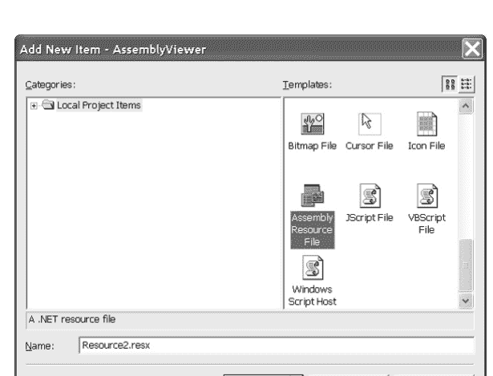

图 2-4 “添加新项”对话框允许您从模板列表中向项目添加项。

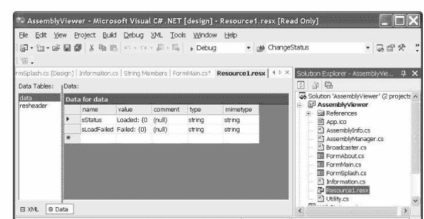

图 2-5 使用字符串资源编辑器将文本信息外部化，以方便应用程序国际化。

AssemblyViewer 使用 ThreadPool 类中的一个线程；因此，这里介绍的是线程的这个方面。

#### ThreadPool 线程

ThreadPool 是一个类，它为您管理一个线程池。使用 ThreadPool 中的线程进行多线程处理与创建 Thread 对象并无不同。但是，您的工作量减轻了一些，并且从线程池中获取线程通常比创建 Thread 类的实例更快一点，因为线程池中很可能有一个线程正在等待您给它分配工作。

要使用 ThreadPool 中的线程，您只需以委托的形式给 ThreadPool 一些工作来做。在这个实例中，该委托将充当一个过程，代表线程要完成的工作。多线程的所有其他方面与您自己创建 Thread 对象是一样的。需要记住的最重要的一点是，ThreadPool 线程需要像 Thread 实例一样小心处理，尤其是在涉及 Windows 窗体控件时。Windows 窗体控件不是线程安全的；因此，当从线程与 Windows 窗体控件交互时，您必须格外小心。

代码清单 2-3 中的以下摘录来自 FormSplash.cs，实现了 AssemblyViewer 中的淡入启动屏幕。该窗体本身就是一个带有 PictureBox 控件的窗体。PictureBox 控件包含一张从 www.digitalblasphemy.com 下载的很酷的图片。

**代码清单 2-3** FormSplash.cs（摘录）演示了实现淡入启动屏幕的多线程代码。

```csharp
bool done = false;
private void Increment()
{
    Opacity += .05;
    lock(this)
    {
        done = Opacity >= 1;
    }
}

private void Show(Object state)
{
    try
    {
        while(!done)
        {
            this.Invoke(new MethodInvoker(Increment));
            Thread.Sleep(100);
        }
        Thread.Sleep(1500);
    }
    finally
    {
        Close();
    }
}

public static void Splash()
{
#if !DEBUG
    FormSplash form = new FormSplash();
    form.Opacity = 0;
    form.Show();
    ThreadPool.QueueUserWorkItem(
        new WaitCallback(form.Show));
#endif
}
```

本章和本节的剩余部分将参考代码清单 2-3 中的代码。

#### 在 ThreadPool 中排队工作项

委托非常重要，没有它们事件处理程序就无法工作，而且除非您理解委托，否则无法在任何 .NET 语言中使用多线程。简而言之，委托包含一个或多个方法的地址。线程通过给线程一个包含代表要完成工作的过程的委托来工作。

在代码清单 2-3 中，静态方法 Splash 创建了一个透明度（Opacity）为 0 的 Splash 窗体。当 Form.Opacity 为 0 时，窗体是透明的；1 表示不透明的窗体。透明度百分比在 0 到 1 之间，您将得到一个半透明的窗体。Splash 窗体以透明方式显示，线程将慢慢增加透明度值，直到窗体变为不透明，此时线程完成工作。

代码清单 2-3 中的第 34 和 35 行演示了如何使用 ThreadPool 类进行多线程处理。ThreadPool 在 System.Threading 命名空间中定义，QueueUserWorkItem 是一个静态方法。

QueueUserWorkItem 接受一个 WaitCallback 委托。WaitCallback 委托的签名是一个具有单个 object 参数的方法。（在本示例中，我们不会使用 state 对象，但我们仍然必须提供该参数。state 参数有助于将信息传递给工作方法。）

QueueUserWorkItem 将 Show 方法添加到 ThreadPool 中的一个队列中，该队列将依次使用或创建一个线程来执行工作。您可以通过从“调试” | “窗口” | “线程”菜单项打开“线程”窗口来确认多线程正在发生。当一个线程被分配时，它将在该线程上调用 Show 方法——即 WaitCallback 委托。

#### Windows 窗体同步方法调用

Show 方法定义在代码清单 2-3 的第 11 到 26 行。此 Show 方法通过调整透明度（Opacity）来慢慢淡入窗体。不幸的是，由于 Windows 窗体控件不是线程安全的，因此必须在控件所在的同一线程上更改透明度。Show 方法并不在那个线程上。

我们实际更新透明度值的方法是调用窗体的 Invoke 方法。Invoke 是线程安全的；Invoke 将委托参数编组到与调用对象相同的线程上。（同样，没有委托，安全的线程处理是不可能的。）

Invoke 需要一个 MethodInvoker 委托，并执行用于初始化该委托的方法内部的代码。Increment 方法更新透明度值。done 字段用于指示窗体是否已不透明。我们在更新 done 字段时对其加锁，阻止运行 Show 的线程在 done 值更新之前检查它。

最后，Show 使用 try-finally 结构来捕获异常并关闭窗体。例如，如果用户在 Splash 窗体完全不透明之前关闭了应用程序，Show 将引用一个已释放的窗体（这在代码清单 2-3 的第 17 行）并引发异常。异常处理程序响应立即的应用程序关闭。

## 总结

也许许多书籍不展示完整应用程序的原因是，即使创建基本应用程序也需要几十种技能。正如本章所演示的，简单的应用程序可以借鉴广泛的编程技巧。

本章演示了 Windows 窗体编程、多线程、反射、枚举、委托和资源文件管理。第 3 章实现了一个视频信息亭，并进一步探讨了 GDI+ 编程。


## 第3章
视频亭

### 本章内容：
- 演示主题
- 什么是 GDI+？
- 探索播放控件
- 次要主题
- 总结


### 演示主题

幸运的是，Windows 中图形编程的强大功能已被封装到一个面向对象的框架中。虽然 Windows 长期以来一直提供大量的图形编程支持，但过去使用起来颇具挑战性。本章中的视频亭示例程序展示了如何使用这个名为“GDI+”的新框架。许多巧妙且引人入胜的应用程序都使用非标准的用户界面来传达信息或鼓励用户与之互动。本章演示了使用 GDI+ 所需的一些基本技能。本章演示的技能将帮助你创建以传统方式（或许是以巧妙的新方式）使用图形的专业应用程序。

通过本章中的示例，你将能够掌握 GDI+ 的复杂之处，并找到演示以下主题的代码：

- 创建自定义控件（简介）
- 创建控件库
- 使用 `ControlPaint` 类绘制标准控件
- 使用虚方法
- 重写事件
- 异常处理，包括捕获特定异常
- 使用 COM 互操作（通过使用 ActiveX 媒体播放器演示）
- 实现接口
- 使用 `TODO` 注释向你的待办事项列表添加项目
- 使用 `MessageBox` 和 `TimeSpan` 类

### 什么是 GDI+？

为了符合 .NET 的精神，也许 GDI+ 应该重新命名为 GDI.NET。不过名称与技术本身无关。（这种不对称性就是让我感到困扰。）Windows 一直支持非常高级的图形编程。这项基本技术被称为 *GDI*（*图形设备接口*）。GDI 的问题在于它不够平易近人。

可以打个比方，Windows 的可视化编程就像在画布上作画。仔细想想，只要手稳、稍微勤奋一点，你可以在 Paint 这样的程序中绘制一个 Windows 应用程序窗体。在画布上作画的比喻与此完全相同，只不过这里有标准化的代码块替你完成绘制工作。

在 Windows 中，画布被称为 *设备上下文*（*DC*）。如果你使用过 GDI（.NET 之前的 Windows 编程），那么你一定使用过需要设备上下文句柄的 API 方法，通常缩写为 hDC。GDI 之所以不够平易近人，是因为它由一堆杂乱无章的结构和 API 方法组成，缺乏组织和分类；也就是说，GDI 是过程化的。

GDI+ 是 GDI 的一个组织化、分类化的面向对象版本。通过将画布和其他绘图功能封装到面向对象的框架中，我们获得了与其他任何面向对象框架相同的优点。我们获得了可复用的类和组件，它们更易于使用和理解。简而言之，GDI+ 将 GDI 包装到了一个面向对象的框架中。现在，我们不必东翻西找，只需在构成 GDI+ 的命名空间这个一般区域中查找，并了解这些命名空间中类型和类的组织方式即可。

> **注意**
>
> 需要注意的是，微软开发人员是第一批从这种分类中受益的人，当他们在开发新的图形功能时，这种对基础、零散的 API 图形方法进行分类的方式很有帮助。GDI+ 中的新功能包括渐变画笔、基数样条、独立的路径对象、可缩放区域和 Alpha 混合，以及对多种图像格式的支持。你将在本章中直接接触渐变画笔、路径对象和可缩放区域。

### GDI+ 命名空间

GDI+ 由 System.Drawing.dll 中的类组成，该程序集包含 System.Drawing、System.Drawing.Design、System.Drawing.Drawing2D、System.Drawing.Imaging、System.Drawing.Printing 和 System.Drawing.Text 命名空间。这些命名空间包含支持三大类图形管理的类和类型：2D 矢量图形、图像处理和排版。

*矢量图形*包括由点定义的基本线条、形状和曲线绘制功能。*图像处理*包括对显示难以用矢量图形渲染的图形（如数字照片、位图和图标）的支持。而*排版*支持使用各种字体、大小和样式绘制文本。这种广泛的支持为你渲染基于图形的图像、矢量图形和文本提供了极大的灵活性。

### 理解 GDI+ 编程模型

互联网是一个无状态的环境。在互联网时代，许多事情似乎都在朝着无状态的方向发展。*无状态*简单地说就是，每次代码交互时，都必须提醒它需要知道什么。（有点像在所有人都在一起工作但彼此陌生的会议上佩戴姓名牌。无状态环境意味着你的代码对其他代码来说始终是陌生的。）

无状态对于互联网是必要的，因为要为数百万连接的用户跟踪状态信息是非常困难的。我的假设是，如果这种方式被认为适用于互联网的潜在巨大规模，那么它同样也适用于图形编程的需求。

在实际应用中，无状态意味着每次你想在画布上显示一些文本时，你都必须提醒 GDI+ 使用什么字体和画笔。就像一个步履蹒跚的老爷爷，GDI+ 就是记不住。（我们稍后会再讨论字体和画笔。）这意味着你必须替 GDI+ 记住。也就是说，每次绘制文本时，你都必须告诉 GDI+ 使用什么字体和画笔来绘制文本。GDI+ 不仅会忘记你刚刚使用的字体和画笔，它也不会记住你上次写文本的位置，它甚至会忘记屏幕的大小。没错。如果你在上次请求一个 `Graphics` 对象（可以理解为 DC）和下次使用该 `Graphics` 对象之间更改了画布的大小，GDI+ 不会更新有关画布大小的信息。

无状态意味着程序员必须在每次代码与设备上下文交互时显式地指定字体、画笔、钢笔、颜色和位置等信息。在 .NET 中，你也绝不能缓存 DC。以下代码是绝对禁止的：

```
public class CacheGraphics : System.Windows.Forms.Form
{
    Graphics graphics;
    public CacheGraphics()
    {
        graphics = new Graphics();
    }
}
```

上面的代码定义了一个继承自 `Form` 的类 `CacheGraphics`。构造函数创建一个新的 `Graphics` 对象并将其存储在 *graphics* 字段中。虽然 `Graphics` 是包含 DC 的类的名称，但清单中所示的两件事——直接创建 `Graphics` 对象并缓存该 `Graphics` 对象——都是错误的。由于 GDI+ 是无状态的，对 DC 的更改不会传播到你缓存的 `Graphics` 对象。例如，如果你调整了窗体的大小，那么你的 `Graphics` 对象所代表的区域就不能准确地反映你的 DC。此外，你必须调用工厂方法 `CreateGraphics` 来获取 `Graphics` 对象的实例。

> **提示**
>
> 你可以通过将类的构造函数设为 `protected` 或 `private`，并通过同一类中的公共静态方法调用该方法，来强制你代码的消费者使用工厂方法。

需要工厂方法 `CreateGraphics` 是因为实例化 `Graphics` 对象需要在幕后完成大量工作。使用工厂方法可以确保所有必需的初始化每次都正确进行。这种技术还允许 `Graphics` 类的生产者在幕后执行一些优化。（如果我们能访问公共语言运行时的源代码，我们就会知道那是什么了。）

正如你将在本章中看到的，你不应该缓存 `Graphics` 对象；每次需要时都应使用 `CreateGraphics` 来请求它。你必须在每次需要时都使用工厂方法 `CreateGraphics`（或从事件处理程序中获取 `Graphics` 对象参数），并且在每次执行图形操作时，你都需要传入状态信息，如字体和画笔。

### 探索播放控件

图 3-1 所示的播放控件展示了自定义图形用户界面。从图中你也许能分辨出，该控件位于一个边缘略圆且没有标题栏的窗体中。更明显的是那些椭圆形按钮。在黑白图中可能不太容易看出，但除了按钮是圆形或椭圆形之外，它们还使用渐变画笔来增强 3D 效果。

你可能还会注意到，一些控件显示基本图像，比如三角形的播放按钮，而其他控件则显示图像，比如显示文件夹的打开按钮。

其他效果包括背景外观、VK（Video Kiosk 浮雕商标标志）以及播放控件顶部的自定义滑块。我将描述创建这些效果的代码，并提供源代码，以便你可以进一步实验或解决可能遇到的任何问题。

### 实现播放控件

播放控件由按钮组成。与标准按钮一样，这些按钮响应 `Click` 事件。在这方面，该控件非常简单：点击一个按钮，调用一个 `Click` 事件处理程序，然后运行一些代码。

有两个问题使得该播放控件可以在通用意义上复用，而不是作为某个应用程序的一次性窗体。这些按钮被实现为独立的控件，并且播放控件本身不做任何事情。每个按钮的 `Click` 事件只是调用另一个实现了 `IPlayer` 接口的类上的等效操作。（我们还没有讨论 `IPlayer` 接口；我们接下来就会讲到。）例如，如果你点击“播放”按钮，那么与播放控件关联的播放器的 `Play` 方法就会被调用——只要它实现了 `IPlayer` 接口。因此，类允许我们复用单个控件，而接口则允许我们复用整个组件。也许收音机、录像机或磁带播放器的等效组件都可以使用这个通用组件。`IPlayer` 接口如清单 3-1 所示。

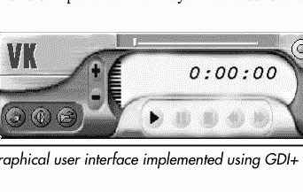


#### 清单 3-1 IPlayer 接口允许我们将 PlayControl 的图形用户界面与任何特定实现分离，从而创建一个真正的瘦客户端。

```csharp
using System;

namespace VideoKiosk
{
    public interface IPlayer
    {
        void Close();
        void Play();
        void Pause();
        void Stop();
        void FastForward();
        void FastReverse();
        void VolumeUp();
        void VolumeDown();
        bool Open();
        double Duration();
        bool Mute();
        void Mute(bool state);
        double Elapsed();
    }
}
```

从清单中我们可以确定，IPlayer 接口相当通用，可能适用于我们可能选择在计算机上模拟的许多现代设备。

在视频亭中，主窗体 Form1.cs 实现了 IPlayer 接口。这意味着 IPlayer 和 Form1 之间的契约是 Form1 必须实现接口定义的所有方法。随后，根据我们的实现，Form1 可以作为播放器与 PlayControl 关联。这可以通过在 PlayControl 的构造函数中向窗体传递 PlayControl 实例的引用来实现。以下是在 Form1 的 Load 事件中创建 PlayControl 并将其与 Form1 关联的调用。

```csharp
private PlayControl control = null;
private void Form1_Load(object sender, System.EventArgs e)
{
    control = new PlayControl(this);
    control.Show();
}
```

这是 PlayControl 的构造函数。PlayControl 实例会跟踪与其关联的播放器。

```csharp
private IPlayer player;
public PlayControl()
{
    InitializeComponent();
}

public PlayControl(IPlayer player) : this()
{
    this.player = player;
}
```

由于 Form1 拥有 PlayControl，我们知道当 Form1 关闭时，PlayControl 也会关闭。PlayControl 构造函数演示了如何调用默认构造函数。默认构造函数是不带参数的 PlayControl 方法。调用默认构造函数至关重要，因为默认构造函数包含对 InitializeComponent 的调用。没有 InitializeComponent 语句，就不会创建任何控件，窗体也不会正确显示或工作。

> 注意：如果你在理解代码时遇到困难，可以运行示例 VideoKiosk.sln 来逐步调试代码。从这两个片段来看，首先调用的是 Form1_Load。包含 `new PlayControl(this)` 的语句调用了接受 IPlayer 接口的 PlayControl 构造函数。由于构造函数中存在 `: this()` 子句，因此会调用默认构造函数。在默认构造函数中调用了 InitializeComponent，当默认构造函数返回时，会执行 `this.player = player`。（理解构造函数的调用方式很重要。）

正是 `: this()` 子句调用了默认构造函数。默认构造函数返回后，player 参数被缓存到 *player* 字段中。我们的 PlayControl 现在有了一个可以控制的播放器。

> 注意：一个理智的人可能会合理地争辩：“为什么不使用 ActiveX Media Player 提供的默认控件？”或者“为什么不在包含媒体播放器的窗体中直接实现播放控制？”简单的回答是“那我们还有什么可讨论的呢？”更好的回答是，我们当然可以那样做。然而，多做一点工作，我们就有了一个新的组件 PlayControl，它是一个独立的组件，以后可以用于其他事情（同时我们也有了讨论的内容）。

现在，当用户点击播放按钮（我们都知道是哪个）时，PlayControl 中的代码非常简单。

```csharp
player.Play();
```

这条语句运行 Form1 中的代码。在我们的示例程序中，Form1 中的代码包含以下内容。

```csharp
void IPlayer.Play()
{
    axMediaPlayer1.Play();
}
```


当然，如果我们使用 ActiveX Media Player 以外的东西，IPlayer.Play 中的代码会有所不同。（我在第 1 章介绍了接口。如果需要复习实现接口的内容，可以回顾那些材料。）在真实的应用程序中，我们需要的不仅仅是调用 Play 方法的简单语句。一个应用程序会包括事件调用和一些健全性检查。VideoKiosk 实现了 Play，如清单 3-2 所示。

#### 清单 3-2 实现 PlayControl.Play 方法。

```csharp
private void Play()
{
    if(player==null) return;
    try
    {
        player.Play();
        PlayerState = PlayerState.playing;
    }
    catch
    {
        PlayError();
        PlayerState = PlayerState.stopped;
    }
}

private void playButton1_Click(
    object sender, System.EventArgs e)
{
    Play();
}
```

通常，将代码直接写入事件处理程序是不良的做法。相反，我们使用一个命名良好的方法 Play，它与 PlayControl 上下文一起，准确地指示正在发生的事情。Play 方法使用一个哨兵来检查确保内部对播放器的引用不为 null。（有些人喜欢正向的 if 条件检查和块语句。我更喜欢哨兵。如果条件失败，则禁止进入。）在一个异常处理块中，调用播放器的 Play 方法。使用接口确保有一个 Play 方法，使用异常处理块确保如果播放器出现问题，我们的程序不会崩溃。（想想你的红外遥控器。即使电视没插电，你也可以按下遥控器上的按钮而不会发生任何坏事。这里也是同样的概念。）如果我们成功通过了对 `player.Play` 的调用，那么我们就改变播放器的状态。（这用于更新按钮的启用状态。）

> 注意：你能想象如果硬件设备像某些软件那样运行会怎样吗？按下遥控器上的“开”按钮，如果你没付有线电视费，遥控器就会电击你。思考合理的失败状态是我们编写异常处理程序的方式。不要蓝屏！（也就是说，不要出现蓝屏死机！）

如果确实发生了错误，例如没有媒体文件，那么 catch 块就会接管。调用 PlayError 方法，PlayControl 状态返回为停止。你可以查看 PlayError。PlayError 使用你在第 1 章学到的 MessageBox 类来显示一条消息，指示无法播放媒体文件。使用单独的 PlayError 方法提供了以后在需要时添加更多有用内容的机会，同时现在先提供一个解决方案。也许我们可以编写代码更密切地诊断问题，并提供合理的解决方法。

> 提示：请注意，我没有在 Play 方法中实际处理改变按钮状态。这将会做得太多。实际上改变 PlayerState 属性为我们提供了一个方便的地方来做这件事。因为 PlayerState 设置器是一个方法，我们可以在设置器中运行一些代码。例如，我们可以更新按钮状态以反映 PlayerState 的新值。

### 为 PlayControl 创建图形用户界面

创建技术先进的图形用户界面具有挑战性。创建既吸引人又专业的图形用户界面，不仅技术上具有挑战性，还需要艺术家可能比计算机科学家更具备的艺术技巧。当然，优秀的程序员也可能同时是有才华的艺术家，而这种组合是创建像图 3-2 所示的 Windows Media Player 的 Headspace 皮肤这样的界面所需要的。

有几种方法可以创建高级界面，包括使用数码摄影、粘土动画、矢量图形和绘图。实现艺术上吸引人的界面的一个好策略是雇佣艺术家来完成艺术部分。雇佣专业艺术家来绘制、绘制或拍摄图形用户界面，然后让你的程序员将图像转化为应用程序。

为了创建 PlayControl，我借用了随戴尔笔记本电脑附带的 Intervideo WinDVD 控件的背景。按钮、跟踪器和已用时间文本被添加到基本背景图像上。

### 将背景图像添加到 PlayControl

窗体类有一个 BackgroundImage 属性。如果你的 Windows 应用程序需要基本的灰色背景以外的东西，那么你可以创建一个自定义图像或使用现有的图形，并将该图像分配给窗体的 BackgroundImage 属性。这样做将消除仅使用控件创建高级外观的需要。


### 向 PlayControl 添加自定义控件

在我们符合人体工学的 PlayControl 上，矩形按钮会显得格格不入。为了让按钮在我们的 PlayControl 中看起来协调，我们需要深入研究 GDI+ 工具箱。

**图 3-3** *没有背景图像的 PlayControl*

**图 3-4** *背景图像为我们的应用程序提供了一个视觉上吸引人的背景，无需代码或自定义控件。*

PlayControl 中的圆形形状表明，边缘更柔和的椭圆形按钮会看起来更协调。不幸的是，这些控件不属于标准工具箱；因此，我们将不得不创建自定义按钮。

快速创建新控件的一个绝佳方法是向项目中添加一个自定义控件。自定义控件提供了一个类，其中包含您创建各种控件所需的所有方法和属性。清单 3-3 展示了一个基于自定义控件的圆形按钮，它为图 3-1 中 PlayControl 上显示的所有按钮提供了基础。

```
清单 3-3 PlayControl 上圆形按钮的源代码基础

1: public class RoundButton :
2:   System.Windows.Forms.Control
3: {
4:   private bool hasOutline = false;
5:
6:   protected bool down = false;
7:
8:   protected virtual Color GetColor()
9:   {
10:     Color[] colors = {Color.Silver, Color.Gray};
11:     return colors[Convert.ToInt32(down)];
12:   }
13:
14:   protected virtual Brush GetBrush(bool buttonState)
15:   {
16:     return new LinearGradientBrush(
17:       new Point(2,2), new Point(Width -1 , Height - 1),
18:       Color.White, GetColor());
19:   }
20:
21:   private int GetPenWidth()
22:   {
23:     // use button state to adjust pen width
24:     return 1 + Convert.ToInt32(down);
25:   }
26:
27:    private Pen GetPen()
28:    {
29:        return new Pen(Brushes.Black, GetPenWidth());
30:    }
31:
32:    public bool HasOutline
33:    {
34:        get
35:        {
36:            return hasOutline;
37:        }
38:        set
39:        {
40:            hasOutline = value;
41:            Invalidate();
42:        }
43:    }
44:
45:    private void DrawButtonOutline(Graphics graphics)
46:    {
47:        graphics.DrawEllipse(GetPen(), 1, 1,
48:            Bounds.Width - 2, Bounds.Height - 2);
49:    }
50:
51:    private void DrawButton(Graphics graphics)
52:    {
53:        graphics.FillEllipse(GetBrush(down), 0, 0,
54:            Width, Height);
55:        if (hasOutline) DrawButtonOutline(graphics);
56:    }
57:
58:    protected override void OnPaint(
59:        System.Windows.Forms.PaintEventArgs e)
60:    {
61:        base.OnPaint(e);
62:        DrawButton(e.Graphics);
63:        DrawGraphic(e.Graphics);
64:    }
65:
66:    protected override void OnResize(System.EventArgs e)
67:    {
68:        GraphicsPath path = new GraphicsPath();
69:        path.AddEllipse(0, 0, Bounds.Width, Bounds.Height);
70:         Region = new Region(path);
71:         Invalidate();
72:         base.OnResize(e);
73:     }
74: 
75:     protected override void OnMouseDown(
76:         System.Windows.Forms.MouseEventArgs e)
77:     {
78:         base.OnMouseDown(e);
79:         down = true;
80:         Invalidate();
81:     }
82: 
83:     protected override void OnMouseUp(
84:         System.Windows.Forms.MouseEventArgs e)
85:     {
86:         base.OnMouseUp(e);
87:         down = false;
88:         Invalidate();
89:     }
90: 
91:     protected virtual void DrawDownGraphic(
92:         Graphics graphics)
93:     {
94:         Matrix m = new Matrix();
95:         m.Scale(1.03F,1.03F);
96:         graphics.Transform = m;
97: 
98:     }
99: 
100:     protected virtual void DrawGraphic(
101:         Graphics graphics)
102:     {
103:         if(down) DrawDownGraphic(graphics);
104:     }
105: 
106:     protected virtual Brush GraphicBrush()
107:     {
108:         return Enabled ? Brushes.Black: Brushes.Silver;
109:     }
110: }
```

这段代码展示了 GDI+ 的几个方面。我们将从 RoundButton.cs 模块中提取的代码分解成几个部分，分别描述所展示的技术。

### 构造函数、析构函数和 Dispose 方法

因为控件是一个类，所以您可能会在控件中遇到在任何类中都可能发现的东西。有三个常见方法您可能会在任何类（包括控件）中找到——它们是构造函数、析构函数和 Dispose 方法。

RoundButton 没有实现构造函数、析构函数或 Dispose 方法。在这个特定实例中，我们不需要它们。在这个特定实例中，我们不执行任何需要它们存在的操作。Controls.dll（VideoKiosk.sln 的一部分）中的其他类展示了构造函数和 Dispose 方法的示例。

**控件构造函数** 构造函数的目的是初始化在类中定义的对象。这对于控件类同样适用。如果您的控件不包含需要使用 new 运算符创建的成员，或者您的类不需要执行任何特殊初始化，那么您就不需要构造函数。

构造函数通常是公共的，不定义返回类型，并且与包含它们的类同名。在我们的 RoundButton 类中，我们不使用构造函数，因为我们不需要执行任何特殊初始化。

构造函数可以通过定义与类同名的额外方法进行重载，但您不需要使用修饰符来特别指示构造函数被重载。两个与类同名的方法——包括构造函数和析构函数——将自动重载，对该构造函数的调用将根据唯一的参数类型进行解析。

Form 类展示的一个好策略是在构造函数中调用初始化程序方法，而不是使构造函数变得混乱。Form1 调用 InitializeComponent 方法。这样做的原因是 Form 上有需要初始化的已绘制控件。

**控件 Dispose 方法** C# 是一种 .NET 语言。我陈述一个显而易见的事实，以此过渡到一个可能不太明显的话题。像 Object Pascal 或 C++ 这样的语言使用确定性构造和析构。这意味着程序员负责创建和销毁对象。

.NET 使用非确定性析构。这意味着程序员不负责销毁对象。垃圾回收器将为您清理对象。因此，您将编写调用 new 运算符的代码，但没有等效的 free 运算符。不方便的是，有时您会编写使用需要确定性清理的资源的代码。这就是 Dispose 方法的用武之地。

> **注意**
> 您可以通过调用 GC.Collect 来显式调用垃圾回收器，但这不是推荐的做法。

所有这一切的结果是，您可能会看到更多实现 Dispose 方法的类，而不是析构函数。因为 Dispose 是一个公共方法，使用者可以显式调用它，但您无法在 .NET 中依赖析构函数的调用时机。如果您需要确定性清理，那么请实现一个 Dispose 方法。


析构函数在哪里？控件中的析构函数在何处？这是一个合理的问题。正如前面章节所述，C# 使用非确定性清理，因此你遇到析构函数的频率会低于使用确定性清理的语言。但是，你应该了解构造函数的样子以及适用于构造函数的规则。

```
~RoundButton()
{
}
```

析构函数也适用其他规则。类只能有一个析构函数，且该析构函数不能定义为接受任何参数。析构函数不能被重载或继承，也不能被调用。析构函数由垃圾回收器自动调用。用户无法控制析构函数何时被调用。

### 使用数组实现条件逻辑

我即将描述的技巧是从 Danny Thorpe 那里学来的，他是另一位帮助构建 Borland Delphi 的才华横溢的开发者。在 Object Pascal 中，使用数组而不是条件逻辑会导致代码显著优化。如果你在 C# 中将条件逻辑与数组索引进行比较，可能会惊讶地发现，使用条件逻辑生成的 IL 代码比索引数组更短。以下代码片段演示了两种基于 *down* 字段值返回颜色的变体。

```
protected virtual Color GetColor()
{
    Color[] colors = {Color.Silver, Color.Gray};
    return colors[Convert.ToInt32(down)];
}

protected virtual Color GetColor()
{
    if( down )
        return Color.Gray;
    else
        return Color.Silver;
}
```

第一个示例使用数组，生成简洁的代码清单。第二个示例使用 *if-条件* 逻辑，稍微更容易理解。如我所述，第二个示例产生更短的 IL 代码。其原因是 C# 不允许类型化数组；因此，我们必须将布尔值 *down* 转换为整数以索引数组。

对于非常简单的评估，我们可以使用三元（?:）运算符。下一个示例演示使用三元运算符评估 *down* 状态。

```
protected virtual Color GetColor()
{
    return down ? Color.Gray : Color.Silver;
}
```

三元运算符的理解如下：在 *return* 关键字之后，立即评估一个产生布尔值的结果。如果评估（示例中为 *down*）为 true，则返回问号符号（?）之后的表达式。如果评估为 false，则评估并返回冒号（:）之后的表达式。在示例中，如果 *down* 为 true，则返回灰色。

第三种实现产生最少的 IL 代码。不幸的是，使用三元运算符进行多选评估变得困难，如果你必须评估超过两个可能的选择，可能需要使用 case 语句。然而，*GetColor* 实现中演示的布尔评估实际上在 RoundButton 中使用了简洁的代码，并且是我的最爱。最后，由于数组索引包含在命名良好的函数 *GetColor* 中，使用比通常偏好稍显晦涩的代码是可以的。

无论你使用哪种技术，都应该意识到一般含义：

- 索引选择数组产生简洁、晦涩的代码。
- 使用 *if-条件* 代码相当直接且易于理解，但如果你有太多选择或嵌套 *if* 条件，则变得难以管理。
- Case 语句有助于组织多个选择。
- 三元运算符非常适合简单的布尔评估。

选择适合你需求的任何技术，但尽量避免复杂的 *if-条件* 逻辑或复杂的 case 语句。

**Color 结构体** Color 结构体包含一个预定义颜色的长列表。当你需要颜色时，可以使用其中一个预定义颜色，或者通过将颜色表示为名称来指定颜色。*GetColor* 方法演示了使用现有颜色。

你还可以通过指定从 0 到 255 的 alpha 混合、红色、绿色和蓝色值来指定自定义颜色。颜色的 alpha 组件表示透明度；值 127 表示大约 50% 透明的颜色。语句 *Color.FromArgb(255, 0, 0, 255)* 创建一种漂亮的蓝色。

**Convert 类函数** *GetColor* 中使用的 Convert 类包含静态方法，这些方法将值从一种类型转换为特定类型。*Convert.ToInt32* 会将参数值转换为 32 位整数。*Convert.ToInt32(down)* 将布尔字段 *down* 转换为整数表示。

> **提示**
> *Convert 类演示了一个只有方法的类的示例。因为 Convert 不需要维护状态，所有方法都可以是静态的，这意味着你不必创建 Convert 类的实例来使用它。*

Convert 类中的方法是重载的，并定义为接受各种数据类型。如果 Convert 方法无法将你传递的值转换为请求的类型，将抛出 InvalidCastException。

### 使用图形对象

Graphics 类的实例表示 GDI+ 中的画布。每次你想要执行自定义绘图时，都需要请求一个 Graphics 对象。有几种获取 Graphics 对象的方法。你可以对具有画布的控件（如窗体）调用 CreateGraphics 方法，或者你可以从传递给 Paint 事件处理程序的 PaintEventArgs 参数中获取 Graphics 对象作为属性。

无论你如何获取 Graphics 对象，一旦你有了 Graphics 对象，就可以调用 Graphics 类定义的任何方法。因为 GDI+ 是无状态的，你不应该缓存 Graphics 对象，也不应该在调用方法之间使用相同的 Graphics 对象。

清单 3-3，第 58 到 64 行，演示了如何使用传递给 Paint 事件处理程序的 PaintEventArgs 参数中的 Graphics 对象。清单 3-4 演示了如何在每次执行绘制操作时请求一个 Graphics 对象。

### 实现 Paint 事件处理程序

Paint 事件处理程序接收两个参数。第一个参数是一个对象，第二个参数是 PaintEventArgs 类的实例。当你需要执行自定义绘制时，可以实现 Paint 事件处理程序。为了我们的讨论目的，有两种自定义效果直接应用于 PlayControl。PlayControl 的 Paint 事件处理程序如下：

```
private void PlayControl_Paint(
    object sender, System.Windows.Forms.PaintEventArgs e)
{
    OutlineControl(e.Graphics);
    DrawTrademark(e.Graphics);
}
```

重构的方法描述了每个方法执行的任务。第一条语句勾勒出 PlayControl，以提供一个漂亮整洁的边缘。这是必要的，因为我们没有使用标准的窗体形状。第二条语句绘制 "VK" 商标浮雕。清单 3-4 包含支持 OutlineControl 和 DrawTrademark 的代码。

**清单 3-4** 支持 PlayControl 自定义绘制的 Paint 事件处理程序的代码

```
private Point[] GetPoints(int shift)
{
    return new Point[]
    {
        new Point(3 + shift, 0 + shift),
        new Point(Bounds.Width - 3 + shift, 0 + shift),
        new Point(Bounds.Width + shift, 3),
        new Point(Bounds.Width + shift, Bounds.Height - 3 + shift),
        new Point(Bounds.Width - 3 + shift, Bounds.Height + shift),
        new Point(3 + shift, Bounds.Height + shift),
        new Point(0 + shift, Bounds.Height - 3 + shift),
        new Point(0 + shift, 3 + shift),
        new Point(3 + shift, 0 + shift)
    };
}

private void OutlineControl(Graphics graphics)
{
    graphics.SmoothingMode = SmoothingMode.AntiAlias;
    graphics.DrawPolygon(new Pen(Brushes.Black, 2),
        GetPoints(-1));
    graphics.DrawPolygon(new Pen(Brushes.White, 2),
        GetPoints(1));
}

private void DrawShadowText(Graphics graphics,
    string s, Font font, Brush foreBrush, Brush backBrush, int x, int y)
{
    graphics.DrawString(s, font, backBrush, new Point(x, y));
    graphics.DrawString(s, font, foreBrush, new Point(x-1, y-1));
}

private void DrawTrademark(Graphics graphics)
{
    Font font = new Font("Haettenschweiler", 24,
        FontStyle.Bold);
    DrawShadowText (graphics, "VK", font,
        Brushes.DarkSlateBlue, Brushes.White, 5, 5);
}
```

OutlineControl 在第 17 到 24 行使用传递给 PlayControl 的 Paint 事件处理程序的 Graphics 对象，并将 SmoothingMode 设置为 AntiAlias。抗锯齿将通过重叠多边形中的一些像素来混合像素，从而帮助创建更平滑的线条，从而产生更平滑的外观。使用定义窗体形状的相同点（由 GetPoints 返回）绘制多边形，结果为窗体提供了一个整洁的轮廓边缘。

DrawTrademark 采用了我命名为 DrawShadowText 的第二种方法。DrawShadowText 使用两个画笔绘制文本两次。通过将文本稍微向一个方向或另一个方向偏移，可以创建不同的阴影效果。通过将文本偏移 -1 并使用较亮的颜色绘制文本，创建内嵌效果（浮雕）。通过更改第 30 行上的偏移值，可以创建各种文本效果。


重写 OnPaint 方法  
如果你在窗体上创建自定义效果，那么每次窗体重绘时都需要重新创建这些效果。然而，如果你创建自定义控件，并且这些控件具有自定义效果，那么你就需要重写该自定义控件的 OnPaint 方法。通过重写 OnPaint 方法，你可以确保控件外观的自定义内容在每次控件绘制时都得到重新创建。这正是清单 3-3 第 58 到 64 行所示的 RoundButton 类所采用的策略。

现在参考清单 3-3，重写的 OnPaint 方法并不是一个事件处理程序。该方法是执行自定义绘制的类的内部方法，因此不需要 sender 参数。OnPaint 方法确实接收一个 PaintEventArgs 对象，其中包含用于执行自定义绘制的 Graphics 对象。如果你想执行默认的绘制，那么你应该调用继承的 OnPaint 方法，如第 92 行所示；通过调用基类中的继承 OnPaint 方法，你将确保事件处理程序也被触发。

在执行继承的绘制之后，你可以添加执行自定义绘制的代码。在清单 3-3 中，调用了 DrawButton 和 DrawGraphic 方法。这两个额外的方法共同创建了圆形按钮。我们稍后将研究一些支持创建圆形按钮的 GDI+ 方法。

使控件无效  
当你想要重绘一个控件时，你需要调用 Invalidate 方法。Invalidate 将通过调用 OnPaint 方法来强制控件被绘制，而 OnPaint 又会触发 Paint 事件。在 HasOutline 属性中演示了使控件无效的过程。当 HasOutline 发生变化时，hasOutline 字段被更改，并且控件在第 72 行被无效化，以重新绘制带有轮廓的控件。

绘制和填充形状  
Graphics 类定义了多个用于绘制和填充形状的方法。DrawEllipse 和 FillEllipse 方法用于创建自定义按钮。例如，FillEllipse 绘制并填充基本按钮，而当 HasOutline 为 True 时，DrawEllipse 绘制按钮的轮廓。

绘制方法使用 Pen 对象来绘制表示形状的线条。形状被表示为由边界矩形限定的区域。FillEllipse 的工作方式与 DrawEllipse 几乎相同；但是，它需要传递一个 Brush 对象给 FillEllipse，而不是 Pen，因为填充方法绘制的是区域的内部。

绘制和填充方法有两种形式。一种形式接受定义矩形区域的整数参数，第二种形式接受表示矩形区域的浮点数。拥有形状绘制方法的浮点数版本的好处在于，你可以执行返回浮点数的算术运算，而无需将这些数字截断为整数。

具体调用哪种绘制或填充方法取决于参数的类型。多态性在这里有所帮助。每种绘制和填充方法都有多个重载版本，编译器根据参数类型确定调用哪个具体的方法。

除了通过表达四个点来定义矩形区域外，你还可以将矩形区域表示为一对 Point 结构或一个 Rectangle 结构。如果你使用点或矩形，那么当初始值为整数时，你需要使用 Point 或 Rectangle；当初始值为浮点数值时，你需要使用 PointF 和 RectangleF。在 RoundButton.cs 模块中可以找到一些使用 Point 和 Rectangle 结构的示例。

### 应用变换到 Graphics 对象

GDI+ 使用世界坐标、页面坐标和设备坐标。当你调用 Graphics 方法时，你表达的位置是在世界坐标空间中的。GDI+ 通过两次转换来变换世界坐标参数，首先从世界坐标到页面坐标，然后再到设备坐标。

GDI+ 在后台处理这些转换。对我们程序员来说，好处在于我们可以更改原点，将 PageUnit 从默认的像素更改为其他度量单位，并执行诸如缩放图像之类的操作。

这些功能被用来创建当用户点击 RoundButton 对象时按钮位置改变的视觉效果。然而，如果用户点击按钮时，按钮的外观没有发生哪怕轻微的变化，那么这种错觉就会消失。以下摘自 RoundButton 类的代码片段在绘制按钮图形之前，对 Graphics 对象应用了一个缩放的 Matrix 变换，从而产生按钮在被点击时略微移动的错觉。

```csharp
protected virtual void DrawDownGraphic(Graphics graphics)
{
    Matrix m = new Matrix();
    m.Scale(1.03F, 1.03F);
    graphics.Transform = m;
}
```

```csharp
protected virtual void DrawGraphic(Graphics graphics)
{
    if(down) DrawDownGraphic(graphics);
}
```

```csharp
protected override void DrawGraphic(Graphics graphics)
{
    base.DrawGraphic(graphics);
    graphics.FillPolygon(GraphicBrush(), GetPoints());
}
```

```csharp
protected override void OnPaint(System.Windows.Forms.PaintEventArgs e)
{
    base.OnPaint(e);
    DrawButton(e.Graphics);
    DrawGraphic(e.Graphics);
}
```

```csharp
protected override void OnMouseDown(System.Windows.Forms.MouseEventArgs e)
{
    base.OnMouseDown(e);
    down = true;
    Invalidate();
}
```

当用户点击 RoundButton 控件的实例时，OnMouseDown 方法被触发。从代码清单中我们可以确定，基类的 OnMouseDown 方法被调用。这将允许用户拦截该事件；也就是说，我们没有破坏默认行为。然后，*down* 字段被设置为 True，控件被无效化。调用 Invalidate 方法强制发生重绘。此时，重写的 OnPaint 方法被调用。同样，我们先执行 base.OnPaint 的行为，然后执行自定义行为。

自定义的 Paint 行为先绘制按钮，然后绘制图形。如果 *down* 为 True——在我们的场景中确实如此——则调用 DrawDownGraphic 方法。（这就是变换发挥作用的地方。）DrawDownGraphic 创建一个 Matrix 对象。调用 Matrix.Scale 来缩放 Matrix 对象，然后将该 Matrix 对象应用于 graphics.Transform 属性。最终结果是一个图形，看起来像是在按钮被按下时略微移动了。

当你理解其原理后，你会发现它们相当直接明了。艺术性在于找到合适的画笔、颜色和阴影组合，使错觉尽可能逼真。你需要自己运行 VideoKiosk.sln 示例应用程序来判断按钮的逼真程度。艺术性越好，应用程序的质量就越高。

### 使用 GraphicsPath 对象创建异形窗体

GraphicsPath 类在 System.Drawing.Drawing2D 命名空间中定义。GraphicsPath 对象用于表示一系列相连的线条和曲线。你听说过异形 Windows 窗体。嗯，GraphicsPath 对象就是创建异形 Windows 窗体的方法。

GraphicsPath 对象允许你通过向 GraphicsPath 对象添加线条和曲线，然后使用该对象来定义窗体的裁剪区域，从而创建异形窗体。PlayControl 具有圆角，展示了一个微妙的异形窗体。以下摘自 PlayControl 的代码片段通过圆角化展示了如何微妙地塑造 PlayControl。（清单 3-3 第 66 到 73 行的 OnResize 方法中定义了另一个演示 GraphicsPath 对象的例子。）

```csharp
private void ShapeForm()
{
    GraphicsPath path = new GraphicsPath();
    path.AddPolygon(GetPoints(0));
    Region = new Region(path);
}
```

创建了一个 GraphicsPath 对象。将由 GetPoints 定义的多边形添加到 GraphicsPath，然后该 GraphicsPath 对象被用来定义

PlayControl 表单。`Region = new Region(path)` 演示了修改表单剪裁区域的代码。此代码片段展示了一个创建形状化 Windows 窗体的简明示例。该示例对 PlayControl 很有用，因为它很合适，但作为独立示例则不太引人注目。下一节将演示一个更高级的形状化窗体。

### 定义剪裁区域
System.Windows.Forms 控件有一个 Region 属性。Region 属性是一个类，表示控件的剪裁区域。区域是可缩放的，因为它们使用世界坐标表示。当你定义剪裁区域时，你不仅仅是绘制一个形状——被剪裁的区域就是窗体。清单 3-5 取自 ShapedForm.sln。该代码重新定义了窗体的剪裁区域，使其显示为图 3-5 所示的样子。窗体被剪裁以包含窗体的框架。你可以点击图 3-5 中所示剪裁窗体的上部并拖动窗体，该窗体将响应用户的输入，就像它是一个正常形状的矩形窗体一样。

清单 3-5 基于添加到 GraphicsPath 对象的字符串的形状化窗体

```
private void Form1_Load(object sender, System.EventArgs e)
{
    BackColor = Color.Red;
    GraphicsPath path = new GraphicsPath();
    path.AddString("C#", Font.FontFamily, 1, 75,
        new Point(0, 0), new StringFormat());
    Region = new Region(path);
}

private void Form1_Click(object sender, System.EventArgs e)
{
    MessageBox.Show("Clicked!");
}
```

> 提示 记得添加 using 语句以包含 System.Drawing.Drawing2D 命名空间。

该代码在窗体加载事件中更改了背景色。创建了一个 GraphicsPath 对象，并向该路径添加了一个字符串，使用窗体的字体和一些基本的位置和大小信息。一个新的剪裁 Region 被构造并分配给窗体的 Region 属性。结果显示在图 3-1 中。如果你仔细看，可以看到 Form.Text 属性，并且当你运行应用程序时，你将能够辨别窗体标题栏和客户区域。（标题栏是蓝色的，客户区域是红色的。）点击客户区域，将调用 Form1_Click 方法。

### 线性渐变画笔

画笔用于填充形状的内部。有几种画笔，包括 HatchBrush、LinearGradientBrush、PathGradientBrush、SolidBrush 和 TextureBrush。当你使用这些画笔类型填充图形形状时，它们会产生特定的效果。当你需要画笔时，可以创建其中一种画笔类型的实例，或者使用 Brushes 类，该类包含预定义的实心画笔。

如果本书是彩色印刷的，你将能够从图 3-1 中辨别出自定义的圆形按钮正在使用 LinearGradientBrush 来增强 3D 效果。LinearGradientBrush 是一种画笔，其颜色在画笔所绘制的空间内从起始颜色过渡到结束颜色。你可能最常在启动屏幕或旧式安装程序中看到这种技术的应用。

LinearGradientBrush 有几个重载的构造函数。清单 3-3 第 45 到 50 行使用的版本接受两个点和两种颜色。这些点描述渐变的起点和终点，而颜色描述渐变的起始和结束颜色。在该示例中，通过使用白色起始颜色和较暗的结束颜色，我们获得了光线在按钮上反射的外观，这增强了 3D 外观。

你可以指定各种属性来细化渐变效果。Blend 属性是一个类，描述在渐变路径上的位置使用起始和结束颜色的百分比。GammaCorrection 属性是一个布尔值，指示是否对渐变应用伽马校正。InterpolationColors 属性允许你指定一个支持显示多色线性渐变的 ColorBlend。LinearColors 属性是一个颜色数组，包含渐变的起始和结束颜色。Transform 属性定义了一个 Matrix，允许你平移、缩放、旋转或倾斜渐变。最后，Rectangle 属性定义渐变画笔的起始和结束点。

LinearGradientBrush 用于绘制 RoundButton 的内部。产生渐变的颜色基于 `down` 字段的值。未按下的按钮颜色较亮，按下的按钮颜色较暗。

清单 3-6 演示了 LinearGradientBrush 的 RotateTransform 和 SetTriangularShape 方法。你必须运行代码才能看到其漂亮的视觉效果。无法用黑白方式再现它。

清单 3-6 GradientBrush.sln 演示程序展示了 LinearGradientBrush 类的一些高级功能。

```
using System;
using System.Drawing;
using System.Drawing.Drawing2D;
using System.Collections;
using System.ComponentModel;
using System.Windows.Forms;
using System.Data;

namespace GradientBrushDemo
{
  public class Form1 : System.Windows.Forms.Form
  {

    [ 已省略由窗体设计器生成的代码]
    private System.Windows.Forms.Timer timer1;

    private float angle = 0;

    private LinearGradientBrush GetBrush()
    {
      return new LinearGradientBrush(
        new Rectangle( 20, 20, 200, 100),
        Color.Orange,
        Color.Yellow,
        0.0F,
        true);
    }

    private void Rotate( Graphics graphics,
      LinearGradientBrush brush )
    {
      brush.RotateTransform(angle);
      brush.SetBlendTriangularShape(.5F);
      graphics.FillEllipse(brush, brush.Rectangle);
    }

    private void Rotate(Graphics graphics)
    {
      angle += 5 % 360;
      Rotate(graphics, GetBrush());
    }

    private void timer1_Tick(object sender, System.EventArgs e)
    {
        Rotate(CreateGraphics());
    }

    private void Form1_Paint(object sender,
        System.Windows.Forms.PaintEventArgs e)
    {
        Rotate(e.Graphics);
    }
}
}
```

该示例使用 Timer 控件定期绘制一个椭圆。渐变画笔使用黄色和橙色。每次调用 Rotate 方法时，一个浮点值增加 5。使用模运算将角度保持在 0 到 360 之间。该角度表示度数。RotateTransform 方法在第 32 行旋转渐变画笔。SetBlendTriangularShape 使用结束颜色作为中心焦点，FillEllipse 使用渐变画笔绘制一个填充的椭圆形。

### 画笔

当你绘制填充区域时，需要画笔。当你绘制线条时，你将需要画笔。你可以从 Pens 对象获取基本画笔，或者你可以从头创建一个 Pen 实例，并指定 PenAlignment、Width、Color 和 DashStyle。

以下示例创建一个用 LinearGradientBrush 初始化的 Pen 对象，并使用该 Pen 绘制一个椭圆。

```
LinearGradientBrush brush =
    new LinearGradientBrush(new Rectangle(0, 0, 2, 2),
        Color.White, Color.Green, LinearGradientMode.ForwardDiagonal);

Pen p = new Pen(brush, 10F);
e.Graphics.DrawEllipse( p, 5, 5, 100, 200);
```

（为方便起见，代码包含在 ShapedForm.sln 示例中。）

### 实现跟踪器控件

RoundButton 派生自 Control 类。当你创建自定义控件时，一个更简单的技术是找到一个与你想要创建的新控件相近的控件，并从该控件继承。对于 RoundButton，我们或许可以通过继承 ButtonBase 类来改进控件或简化其构造。

另一个需要记住的策略是，如果你想在自己的应用程序中使用控件，那么在你的应用程序中创建该控件是合理的。如果你想重新分发你的控件，那么你将需要创建一个控件类库，该库将

将你的控件打包成一个整洁、可重新分发的包。（有关创建自定义控件的更多信息，请参阅第 9 章。）

有时你会发现没有合适的控件可以继承。这意味着你必须从控件食物链的更上层派生你的控件，继承自 `System.Windows.Forms.Control` 类。

**注意**

出于我们的目的，本章我们将继续使用 Control 作为我们控件的基类——你可以阅读第 8 章和第 9 章以获取有关创建控件的更一般信息。通常，你需要了解如何创建 Control 类库，如何实现和测试控件类及自定义控件，以及如何将这些控件放置在工具箱中。在后面的章节中，你还将学习如何在工具箱中将自定义图标与你的控件关联。

### 定义 Tracker 控件

出于我们的目的，将 Tracker 实现为自定义控件是合理的。Tracker 显示为图 3-1 中 PlayControl 顶部的小滑块。Tracker 的行为与你可能已经熟悉的 ProgressBar 控件非常相似。

与 ProgressBar 一样，Tracker 使用图形来指示相对进度。Tracker 允许用户指定一个最小值、最大值和位置值。如果位置更接近最小值，则图形进度指示器更接近控件的左侧；如果位置更接近最大值，则进度指示器接近控件的右侧。

实现 Tracker 控件将使你能够更详细地探索 GDI+。Tracker 的完整源代码清单定义在 VideoKiosk.sln 的 Controls.dll 项目中的 Tracker.cs 文件中。Minimum 定义了 Tracker 的相对左侧，Maximum 定义了相对右侧。进度指示器沿着一个水平凹槽绘制，该凹槽的位置相对于 Position 属性的值。对于有经验的程序员来说，确定进度指示器绘制在哪里很简单，只需将位置的百分比乘以最小值和最大值之间的差值即可。

假设值的范围在 0 到 1,000 之间。为了使控件无效化并可能重绘多达 1,000 次，我们定义了任意数量的细分，以便在变化显著时以固定间隔绘制进度指示器。

### 使用 SetStyle 方法

PlayControl 模拟了我们投入大量精力创建界面的情景。背景图像代表了这种投入。用控件覆盖背景图像将是一种遗憾。通过让背景图像从控件中透视出来，我们能够保持视觉上吸引人的背景。

不幸的是，控件默认不支持透明背景。因此，我们必须让像 Tracker 这样的控件看起来像我们的背景图像，或者让背景图像显示出来。第二种选择可能会产生最无缝的结果，并且实际上实施成本更低。

为了让背景图像显示出来，控件需要你设置 `ControlStyles.SupportsTransparentBackColor` 属性。这可以通过在控件的构造函数中调用 `Control.SetStyle` 方法来完成。

```csharp
public Tracker()
{
    this.SetStyle(ControlStyles.SupportsTransparentBackColor, true);
}
```

当你将 Tracker 控件绘制到 PlayControl 上时，你可以将 BackColor 设置为 Transparent，这将允许窗体上的背景图像显示出来。实际结果是 Tracker 控件与 PlayControl 融为一体。

### 使用 ControlPaint 类

在 GDI 中，如果你想绘制具有 3D 外观的斜角控件，可以使用 API 过程 `DrawEdge`。GDI+ 实现了一个 `ControlPaint` 类，其中包含几个支持绘制 3D 边框形状以及看起来像标准控件（如 Button）形状的静态方法。

`ControlPaint` 类定义在 `Systems.Windows.Forms` 命名空间中。`ControlPaint` 具有用于绘制按钮、复选框、组合按钮、网格、菜单字形、单选按钮和大小调整手柄等的静态方法。与其试图弄清楚如何绘制看起来像进度指示器凹槽的东西，我使用了 `ControlPaint` 类来创建 Tracker 的视觉外观。

### 绘制 3D 边框

Tracker 类有一个 `DrawBar` 方法，用于绘制进度指示器似乎沿其移动的凹槽。`DrawBar` 接受一个图形对象参数并调用 `DrawBorder3D` 方法。

```csharp
protected virtual void DrawBar(Graphics graphics)
{
    ControlPaint.DrawBorder3D(graphics, GetX(), GetY(),
        GetWidth(), GetHeight(), Border3DStyle.Etched, Border3DSide.All);
}
```

`DrawBorder3D` 是一个静态方法，因此我们不需要创建 `ControlPaint` 对象来调用此方法。与许多绘图方法一样，我们将区域表示为矩形的边界。`GetX()`、`GetY()`、`GetWidth()` 和 `GetHeight()` 是我实现的方法，用于根据 Tracker 的大小返回凹槽的计算偏移量。最后两个参数是从可用的枚举值中根据所需结果选择的。我希望进度指示器看起来像是沿着凹槽移动，而蚀刻边框样式和所有边框边创造了这种效果。

### 绘制按钮控件

有几种方法可以创建 Tracker 按钮。你可以加载一个图形图像，然后根据 Tracker 的大小缩放图像。为了方便起见，按钮的形状似乎很合适。`Tracker.DrawTracker` 方法使用 `ControlPaint.DrawButton` 方法创建进度指示器。

```csharp
protected virtual void DrawTracker(Graphics graphics)
{
    ControlPaint.DrawButton(graphics,
        TrackPosition(), (Height-8)/2, 5, 10, ButtonState.Normal);
}
```

我实现了 `TrackPosition` 方法来确定进度指示器在水平轴上的位置。垂直偏移量由 `(Height-8)/2` 计算确定，除非 Tracker 太小而无法使用，否则这将相当有效。`ButtonState.Normal` 枚举值以按钮正常的向上状态外观绘制按钮。

### 调用 Graphics.DrawImage 方法

PlayButton 实现了多个按钮。所有按钮之间最大的区别在于按钮上显示的图像。在分发控件之前，我们应该利用这一知识。

如果主要区别在于绘制的图形，那么我们应该能够提取绘制图形的能力，并将所有按钮合并为一个按钮。`RoundButton.cs` 模块包含几个按钮类。虽然我实现了一个名为 `ImageButton` 的控件，但我没有合并所有的按钮类。如果你为其他按钮创建了图像，那么你可以相当容易地合并按钮类并摆脱其他按钮。

下面的代码清单源自 `DarkButton` 控件，而 `DarkButton` 又源自 `RoundButton` 控件。`DarkButton` 演示了如何重写一些更改渐变画笔的方法。再次说明，这是可以通过将用于创建渐变的两种画笔颜色作为 `RoundButton` 类的属性来泛化的代码。清单 3-7 迈出了下一步，将按钮的图形方面外部化。

#### 清单 3-7

此代码实现了一个 `ImageButton`，它派生自清单 3-3 中的 `RoundButton`。

```csharp
public class ImageButton : DarkButton
{
    // TODO: Make sure that the image can be deleted!
    private Image graphic = null;

    public ImageButton()
    {

    }

    protected override Color GetColor()
    {
        Color[] colors = {Color.MidnightBlue, Color.Black};
        return colors[Convert.ToInt32(down)];
    }

    private int GetX()
    {
        return (Width - graphic.Size.Width) / 2;
    }

    private int GetY()
    {
        return (Height - graphic.Size.Height) / 2;
    }

    private ImageAttributes GetImageAttribute()
    {
        ImageAttributes attribute = new ImageAttributes();
        attribute.SetColorKey(Color.White, Color.White,
            ColorAdjustType.Default);
        return attribute;
    }

    private Rectangle GetRectangle()
    {
        return new Rectangle(GetX() + 1, GetY() + 1,
            graphic.Size.Width, graphic.Size.Height);
    }

    protected override void DrawGraphic(Graphics graphics)
    {
        base.DrawGraphic(graphics);
        if( graphic == null ) return;

        graphics.DrawImage(graphic,
            GetRectangle(), 0, 0,
            graphic.Size.Width, graphic.Size.Height,
            GraphicsUnit.Pixel,
            GetImageAttribute());
    }
}
```


## 92 高级 C# 编程

```csharp
public Image Graphic
{
    get
    {
        return graphic;
    }
    set
    {
        graphic = value;
        Invalidate();
    }
}
```

在按钮上绘制图像的关键是允许图像的周围部分被遮蔽而不显示。例如，如果你有一个 16×16 像素的图像，但图像并未占据所有像素，那么就会有一部分图像你不想显示。要定义那些你不想显示——想要屏蔽掉的像素——你需要创建一个 `ImageAttributes` 对象，该对象定义了你想要屏蔽的像素颜色。

如第 46 行所示，`DrawImage` 有许多重载版本，以适应各种旨在精确管理图形图像合并的参数。所使用的版本接受一个 `Image` 参数、一个指定图像边界区域的 `Rectangle`、要绘制的图像部分的四个坐标（允许你细分图像）、坐标描述的 `GraphicsUnit`，以及前面描述的 `ImageAttributes` 对象。

> **提示**
> 你可以编写代码来读取特定像素。例如，你可以读取左上角的像素，并将该像素的颜色用作要屏蔽的颜色。

`ImageButton` 使用了一个带有白色颜色键的 `ImageAttributes` 对象。结果是，白色从显示的图像中被屏蔽掉了。如果你想隐藏图像的一部分，那么在这种情况下，使你想要隐藏的那部分图像为白色。图 3-6 显示了在未使用 `ImageAttributes` 对象屏蔽额外像素的情况下尝试显示图像的结果。


## 次要主题

我们在本章涵盖了很多内容。包含 `Controls.dll` 类库的 `VideoKiosk.sln` 完整代码清单包含数百行代码。正如我们所讨论的，其中一些代码可以被整合。稍加努力，你可以将按钮的数量减少到一个单独的圆形图像按钮。如果我替你完成了这些，你可能会错过所有演示 GDI+ 强大功能的各种代码片段和技术，例如形状绘制。

还有其他一些用于完成 `VideoKiosk.sln` 示例程序的 .NET 方面。虽然这些主题相对于使用 GDI+ 进行编程是次要的，但你会发现它们很有帮助。让我们再花几页来探讨 .NET 的这些方面。

#### 实现经过时间时钟

经过时间时钟在 Timer 计时事件上更新。使用 Timer 控件是执行轻量级后台处理的一种便捷方式。显然，使用 Timer 并非多线程，但对于更新时钟这样的简单任务，Timer 是合理且足够的。

Timer 控件的工作原理是在以毫秒表示的时间间隔过去时引发事件。当 `Timer.Interval` 过去时，`SetPosition` 方法使用 `Player.Elapsed` 值来更新 `Tracker` 的位置。更新 `Tracker` 进度指示器的一个副作用是更新包含以数字时钟形式显示的经过时间的显示标签。

位置值以秒为单位表示；因此，位置值可用于创建时钟显示的时间值。这是通过创建一个 `TimeSpan` 结构实例并用经过的秒数初始化来实现的。创建时钟的代码如下所示。

```csharp
private TimeSpan GetSpan(int position)
{
    return new TimeSpan(0, 0, 0, position, 0);
}

private string GetMask()
{
    return "{0}:{1,2:0#}:{2,2:0#}";
}

private string GetFormatted(TimeSpan span)
{
    return string.Format(GetMask(), span.Hours,
        span.Minutes, span.Seconds);
}

private void ChangePosition()
{
    labelElapsed.Text = GetFormatted(GetSpan(Position));
}
```

`TimeSpan` 结构知道如何将位置表示的经过秒数转换为小时、分钟和秒。每 60 秒将自动转换为另一分钟，60 分钟转换为一小时。`GetMask` 方法返回一个用于控制 `TimeSpan` 外观的格式化字符串，该格式化字符串用于更新数字时钟。

#### 使用 TimeSpan 评估时间差

`TimeSpan` 结构用于测量短至 100 纳秒的时间段，这些在 `TimeSpan` 中表示为一个刻度。`TimeSpan` 值可以表示为以天、小时、分钟、秒和秒的小数为单位测量的正负时间跨度。字符串格式 `d.hh:mm:ss.ff` 将显示单个 `TimeSpan` 表示的天、小时、分钟、秒和秒的小数。`TimeSpan` 表示的最大时间单位是天。

如果 `TimeSpan` 的默认字符串值是可接受的，那么我们可以使用 `TimeSpan.ToString()` 方法，该方法默认以 `hh:mm:ss` 格式返回 `TimeSpan`。

如果你对 `DateTime` 值执行算术运算，例如将一个时间减去另一个时间，该操作将返回一个 `TimeSpan` 对象。

#### 格式化字符串

就我们的目的而言，我们选择不使用默认的 `TimeSpan.ToString` 方法。这是一个任意决定，使我们能够更仔细地研究 `string.Format` 方法和格式化掩码。（在生产系统中，使用 `TimeSpan.ToString` 方法会更便宜。）

`GetMask` 返回一个格式化掩码。掩码是 `"{0}:{1,2:0#}:{2,2:0#}"`。括号 `{ }` 中的字符代表可替换的格式字符，其他所有内容代表字面值。检查 `{1,2:0#}`，我们理解这个可替换参数是可替换参数 1，它用零填充，长度最多可以是两个数字字符。

通常，括号中的第一个值代表要格式化的基于零的参数。第二个参数（如果存在，由逗号分隔）代表格式化值的宽度。如果添加负号，则值左对齐；加号将使值右对齐。默认情况下，宽度将用空格填充格式化值。可选的格式化字符串跟在冒号后面。我们的 `0#` 格式化字符串意味着格式化输出将用零和一个数字填充。如果数字占据了两个空格，则不会显示零。

#### 使用 ToolTip 控件

Windows 窗体提供了 `ToolTip` 组件。当你将 `ToolTip` 组件添加到应用程序时，它会被添加到组件托盘中，而不是直接添加到窗体上。组件托盘中的组件是不可见组件；也就是说，它们不会在运行时显示。

当你将 `ToolTip` 添加到特定窗体的组件托盘时，该窗体上的控件将在其属性列表中添加 `ToolTip` 属性。如果你为 `ToolTip` 属性提供了文本，那么当用户将鼠标悬停在控件上时，提示将会显示。

> **注意**
> 组件是通过拖放到窗体上添加到组件托盘的。然而，不可见组件是拖放到窗体上的，但实际显示在组件托盘中。这种策略可能是为了帮助减少窗体杂乱而采用的。

`ToolTip` 控件与其他控件的关系并非立即直观。如果你最初检查 Windows 窗体控件，你可能会怀疑 .NET 不支持工具提示。你只需要将 `ToolTip` 组件添加到窗体，方法是将该组件拖放到组件托盘中。

#### 将控件添加到工具箱

通常，你创建用户控件是为了将多个控件添加到一个公共容器中。当你将控件添加到项目时，该控件会自动添加到工具箱的“Windows 窗体”选项卡中。

如果你想将控件类库中的控件添加到工具箱，那么你需要创建一个控件类库，从工具箱上下文菜单中选择“自定义工具箱”，并使用“自定义工具箱”对话框将控件类库添加到你希望显示在工具箱中的列表中。第 8 章和第 9 章将更详细地阐述这个主题。

#### 捕获和处理特定异常

第 2 章通过演示使用 `try finally` 构造实现的资源保护块介绍了异常处理的主题。`VideoKiosk` 演示了 `try catch` 构造以及如何捕获特定实例的异常。

要捕获方法中的任何异常，请使用 `try catch` 构造，将要尝试的代码放在 `try` 关键字后面的括号中，将错误处理代码放在 `catch` 关键字后面的括号中。以下片段演示了 `try catch` 异常处理块的基本语法。

```csharp
try
{
    // code to try
}
catch
{
    // code to run if an error occurs
}
```


## 96 高级 C# 编程

该示例演示了通用异常处理器。如果前面代码的 *try* 块中发生任何异常，则会运行 *catch* 块中的代码。并非每个过程都应该有异常处理块。如果你知道如何解决该错误，那么你会希望实现一个异常处理器。如果代码可能导致程序崩溃，那么你可能希望实现一个异常处理器，以有序的方式关闭并记录错误。但是，应避免使用那种笼统的、不起作用的异常处理方式。后者是 .NET 应用程序的默认行为。

如果你想处理特定的异常并忽略所有其他异常，那么你可以通过实现一个或多个 *catch* 块来指明你要处理的异常类。下面的 SetMaximum 方法演示了如何捕获当持续时间大于 32 位整数时可能发生的 OverflowException。

```
private void SetMaximum(double duration)
{
    try
    {
        tracker1.Minimum = 0;
        tracker1.Maximum = Convert.ToInt32(duration);
    }
    catch(OverflowException e)
    {
        MessageBox.Show(e.Message, "Media Error!",
            MessageBoxButtons.OK, MessageBoxIcon.Exclamation);
    }
}
```

如果 duration 大于 32 位整数的最大值，Convert.ToInt32 方法将引发异常。如果发生这种情况，*catch* 块将捕获对象 e 中的 OverflowException，然后可以利用它来帮助解决错误。该示例只是向用户显示错误，想法是他们可能会选择另一个文件。

如果发生 OverflowException 以外的异常，那么在 SetMaximum 中实现的 *catch* 块将不会被通知到该异常。

#### 将 TODO 项目添加到任务列表

Visual Studio .NET 支持注释令牌。注释令牌是特殊的关键字，包括 TODO 以及你自己定义的关键字。当这些关键字紧接在双斜杠 (//) 注释令牌之后出现时，这些注释会作为任务添加到任务列表中。

你可以在 Visual Studio 中通过选择“视图” | “显示任务” | “所有” 或 “视图” | “显示任务” | “注释” 在任务列表中查看注释令牌。如果有你想提醒自己去做的事情，请在代码中你想执行任务的位置添加一个 TODO 注释。包含提醒你问题是什么的文本。要添加自定义注释令牌，请在“选项”对话框的“环境” | “任务列表”页面（参见图 3-7）定义这些自定义注释。

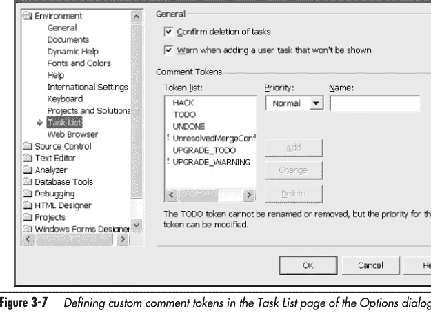

清单 3-7 在 ImageButton 类的第 3 行演示了一个 TODO 项。TODO 注释提醒我必须确保可以删除 Image 属性。如果你有一个 Image 属性，那么与 Image 属性自动关联的 Image 编辑器将允许你使用“打开”对话框选择图像。遗憾的是，你无法通过将 Image 重置为 (None) 来自动删除 Image。你必须为 Image 属性添加一个 DefaultValueAttribute 以支持删除图像。DefaultValueAttribute 提供了一个初始值，如果你在属性窗口中移除了提供的值，它会提供一个替代值。清单 3-8 演示了对 ImageButton 类的修订，该修订允许我删除 Image 属性。

```
清单 3-8 修订 ImageButton 类并解决清单 3-7 中的 TODO 提醒

1:  public class ImageButton : DarkButton
2:  {
3:      private Image graphic = null;
4:
5:      public ImageButton()
6:      {
7:
8:      }
9:
10:    protected override Color GetColor()
11:    {
12:        Color[] colors = {Color.MidnightBlue, Color.Black};
13:        return colors[Convert.ToInt32(down)];
14:    }
15:
16:    private int GetX()
17:    {
18:        return (Width - graphic.Size.Width) / 2;
19:    }
20:
21:    private int GetY()
22:    {
23:        return (Height - graphic.Size.Height) / 2;
24:    }
25:
26:    private ImageAttributes GetImageAttribute()
27:    {
28:        ImageAttributes attribute = new ImageAttributes();
29:        attribute.SetColorKey(Color.White, Color.White,
30:            ColorAdjustType.Default);
31:        return attribute;
32:    }
33:
34:    private Rectangle GetRectangle()
35:    {
36:        return new Rectangle(GetX() + 1, GetY() + 1,
37:            graphic.Size.Width, graphic.Size.Height);
38:    }
39:
40:    protected override void DrawGraphic(Graphics graphics)
41:    {
42:        base.DrawGraphic(graphics);
43:        if( graphic == null ) return;
44:
45:        graphics.DrawImage(graphic,
46:            GetRectangle(), 0, 0,
47:            graphic.Size.Width, graphic.Size.Height,
48:            GraphicsUnit.Pixel,
49:            GetImageAttribute());
50:    }
51:
52:    [DefaultValue(null)]
53:    public Image Graphic
54: {
55:     get
56:     {
57:         return graphic;
58:     }
59:     set
60:     {
61:         graphic = value;
62:         Invalidate();
63:     }
64: }
65:
66: }
```

清单 3-8 第 52 行的 DefaultValueAttribute 解决了 TODO 问题。当你修复了一个 TODO 问题时，删除 TODO 注释，提醒就会从任务列表中移除。

一个好的策略是定义注释令牌，以帮助你组织和跟踪未解决的问题。你可以简单地使用 TODO 注释令牌，或者定义对你或你的团队具有特殊意义的自定义令牌。

#### 使用 Process 类

第 2 章介绍了 Process 类。Process.Start 静态方法与 PlayControl 上最左侧 ImageButton 的 Click 事件处理程序相关联。单击此按钮并编写以下代码：

```
Process.Start("http://www.softconcepts.com");
```

#### COM 互操作

.NET 中有一个称为“COM 互操作”（用于互操作性）的概念。COM 使用类型库来描述接口，而 .NET 通过引入反射并将元数据嵌入 .NET 程序集来消除类型库。第 2 章解释了反射、程序集和元数据。

一个完美的例子是在 VideoKiosk 中使用的 ActiveX MediaPlayer。ActiveX MediaPlayer 是一个基于 COM 的控件。当你想在 .NET 中使用 COM（也称为 ActiveX）控件时，你可以通过从工具箱上下文菜单中选择“自定义工具箱”来导入这些控件。Visual Studio .NET 将导入该 COM 控件的类型库，允许你在 .NET 应用程序中使用基于 COM 的控件。

遗憾的是，当你在 .NET 程序集中使用 COM 控件时，你是在倒退回“DLL 地狱”区域。你将不得不创建一个安装程序来分发和注册那些 COM 控件，就像你在开发和部署 .NET 之前开发的应用程序时所做的那样。

## 总结

GDI+ 是 GDI 的一个进化阶段。以前你可以用 GDI 做的所有优秀的图形编程，现在有了 .NET 会变得容易得多。之所以更容易，是因为我们现在有了很好的方法和功能，它们被组织到类中，使这些功能更容易找到和使用。

记住，GDI+ 是无状态的。每次调用 GDI+ 方法时，你都必须传递颜色、画笔和字体等信息。还要记住，你不应该缓存 Graphics 对象。使用工厂方法 CreateGraphics 请求 Graphics 对象，或者使用传递给 Paint 事件处理程序的 Graphics 对象。

最后，GDI+ 支持矢量图形、图像和排版。矢量图形支持线条和曲线绘制。图像支持管理复杂的图像，如位图、GIF 或 JPEG 文件，而排版支持高级排版和字体。和 GDI 一样，GDI+ 是一条大鱼——只是组织得更好，更容易上手。

## 第 4 章

### Terrarium

**本章内容：**

- 演示主题
- 下载、安装和配置 Terrarium
- 玩 Terrarium
- 回顾 Terrarium 框架
- 创建植物和生物
- 将植物和生物引入 Terrarium
- 次要主题
- 序列化对象
- 总结

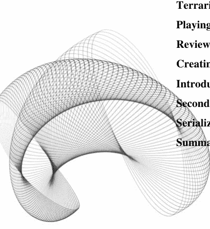


# 高级C#编程

孩子们因乐趣而充满动力。我们领域中的许多成年人也同样被乐趣所驱动。也许一些成熟、资深的程序员已与他们内心的彼得·潘失去了联系，但最近在俄勒冈州与一个开发团队的合作经历表明，富有创造力的成年人同样被乐趣所激励。

在俄勒冈州参与一个项目时，我和几位合同开发者面临着一项艰巨的任务：帮助大型机程序员学习C#。这些程序员此前毫无Windows编程经验，仅具备基本的电脑操作技能，也没有C或C++的编程基础。问题在于，我们如何让学习一门新语言、新范式和复杂主题知识变得有趣？我们在Terrarium中找到了答案。

2001年，我在访问微软时，Tom Kaiser提到了这款基于.NET开发的点对点游戏。他对这项技术和Terrarium游戏充满热情。次年，当我面临培训困境时，幸运地回想起了那次讨论。通过网络搜索，我惊喜地发现Terrarium可以在**www.gotdotnet.com**网站上获取。我从该网站下载了Terrarium，几分钟后便启动并运行了一个包含一些小动物和植物的Terrarium。我在几分钟内就创建了一个小型生态系统。老派人士和管理层可能会对这个想法嗤之以鼻，但富有创造力的人确实因乐趣而充满动力。

#### 什么是Terrarium？

Terrarium是一款基于.NET开发的游戏。它是一个包含植物、食草动物和食肉动物的虚拟生态系统。植物生长并繁殖。食草动物吃植物，生长并繁殖，而食肉动物吃食草动物，同样生长并繁殖。食草动物捕食植物，食肉动物捕食食草动物。所有这些过程都在你的电脑上可视化地进行。存在描述生长、消耗和繁殖模式的规则。关键在于，你和其他程序员可以通过编写.NET代码来定义这些规则。真正的诀窍在于，在生态系统中创造一种平衡，或者主宰一切，消耗眼前的所有东西。

Terrarium很有趣。你的代码会与其他程序员的代码进行交互，而这种交互为学习如何使用.NET编程提供了一种强大的方式。

### 演示主题

除了获得乐趣，我们还需要学习。（除非你财务独立且无需老板监督，否则这是真理。）创建植物和动物可以教会你很多关于编程的知识，尤其是关于C#编程的知识。

Terrarium采用了点对点模型。与客户端-服务器模型（也称为星型辐射模型）不同，Terrarium展示了一个由相互通信的对等体组成的应用程序，以协同的方式工作。在Terrarium中，客户端（个人电脑）相互作用以创建一个生态系统。你的电脑和其他电脑（对等体）都是一个更大生态系统的一部分。植物和动物在你生态系统的个人电脑之间移动。更准确地说，你编写的代码会被传输到组成你生态系统的其他对等体上，并在那些对等体上安全运行。

按照Terrarium游戏的术语，植物和动物是被“传送”的。Terrarium服务器存储一个对等体IP地址列表。当传送器——由一个蓝色球体代表——遇到一个生物体时，会从你的对等体列表中随机选择一个对等体，并将该生物体发送到该对等体的IP地址。生物体的传输发生在个人电脑上，通过序列化生物体的状态并发送一份生物体程序集的副本来完成。发送的程序集会被检查是否存在安全违规和违反游戏礼仪的行为——例如，不允许使用Reflection和文件IO。如果生物体是安全的，并且没有包含可能有效允许作弊的代码，那么就会创建该生物体的一个实例，并反序列化其状态。

通过参与Terrarium生态系统可以学到什么？这正是本章的主题。通过阅读本章并完成其中的示例，你将有机会（在获得乐趣的同时）学习关于以下内容的知识：

- Windows窗体应用程序的智能客户端更新
- 使用DirectX和COM互操作的图形应用程序
- 正则表达式
- 反射
- XML Web服务
- 点对点网络应用程序
- 代码访问安全性
- 继承
- 应用属性来定义行为
- 实现事件处理程序

#### 下载、安装和配置Terrarium

你需要做的第一件事是从**www.gotdotnet.com**下载Terrarium客户端应用程序（如图4-1所示）。如果你想托管自己的Terrarium，也可以从同一网站下载Terrarium服务器。（你不必下载Terrarium服务器；客户端应用程序就足够了。）在你同意在线客户协议后，Terrarium是免费的。

> 提示
> 每个希望参与你生态系统的人，都需要下载一份Terrarium客户端的副本。

下载Terrarium客户端（以及可选的服务器）后，你需要执行一些基本的配置步骤来设置你希望如何运行Terrarium。你可以通过几种方式运行Terrarium；接下来将讨论每种方式及你需要进行的配置设置。

104 高级C#编程

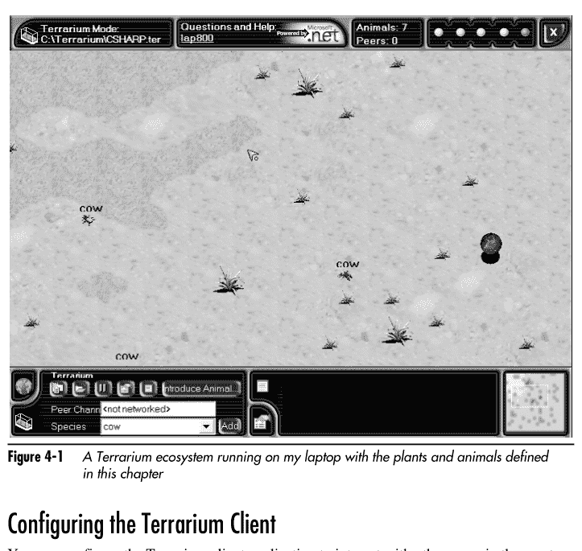

##### 配置Terrarium客户端

你可以配置Terrarium客户端应用程序，使其与广阔世界中的其他对等体交互。此选项会将你的电脑注册到Terrarium服务器，以便其他对等体知道在哪里可以找到你。Terrarium服务器会将你的电脑放入全球生态系统的一个切片中；你的电脑可能会与几十个甚至数百个其他电脑进行交互。

你也可以为了测试和调试目的创建自己的Terrarium，创建一个无服务器的点对点生态系统（如果你的网络管理员不允许你的电脑与防火墙外交互，这是一个不错的选择），或者安装Terrarium服务器以获得更健壮的内部生态系统。出于我们的目的，你至少需要一台运行Terrarium客户端实例的电脑，该实例运行着自己的生态系统（一个.ter文件）。

如果你选择将Terrarium服务器运行在公司防火墙之后，那么你需要在一台安装了MS SQL Server的机器上安装Terrarium服务器。（我发现MSDE——桌面版SQL Server——可以可靠地运行Terrarium服务器，尽管微软不推荐这样做。）

让我们来研究一下为屏幕保护程序模式、带或不带对等体的Terrarium模式以及生态系统模式配置Terrarium客户端的步骤。之后，我们将快速回顾如何安装和配置Terrarium服务器。

##### 运行Terrarium客户端

Terrarium是一个有趣的屏幕保护程序。除了其他几个配置选项外，你还可以将Terrarium配置为你的屏幕保护程序。让我们快速回顾一下这些内容，以便我们可以开始编程。

##### 配置屏幕保护程序模式

安装Terrarium客户端时，你可以指定希望Terrarium作为你的屏幕保护程序运行。如果你选择不将Terrarium用作屏幕保护程序，以后改变主意时，随时可以从“显示”程序的“屏幕保护程序”选项卡中选择.NET Terrarium。

> 如果你的同事从未见过Terrarium，当植物和虫子在你的屏幕上被积极追逐和消耗时，预计会吸引一些注意力。

##### 配置Terrarium模式

Terrarium模式可用于调试和测试你的虫子（bugs），然后再将它们放入生态系统。你需要创建一个Terrarium以Terrarium模式运行。请按照以下步骤创建Terrarium：

1. 要以Terrarium模式运行，请单击“显示Terrarium模式控件”按钮，如图4-2所示。（按钮图标由左下角的鱼缸图标表示，当鼠标悬停时会显示提示文本。）
2. 单击“创建新Terrarium”，并在“新Terrarium”对话框中提供一个文件名。单击“保存”后，Terrarium将以Terrarium模式重启。
3. 如果你希望其他玩家能够参与这个Terrarium，请为对等通道提供一个名称（也在图4-2中显示）。

你已准备好将植物和动物引入Terrarium。在Terrarium客户端的右上角是状态指示器、客户端实例中的动物数量以及你生态系统切片中的对等体数量。绿色状态指示器表示一切正常，红色状态指示器表示Terrarium的某个方面未

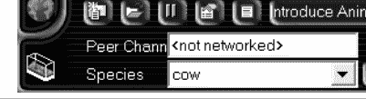

正在正常运行。您可以将鼠标悬停在状态指示器上以获取信息，或者点击客户端顶部中心的“帮助”链接以获取更多信息（参见图4-3）。

##### 配置生态系统模式

生态系统模式是指您在更大的生态系统中与其他参与者一起游玩。（您可以从 **www.gotdotnet.com** 安装自己的 Terrarium 服务器实例。）要在生态系统模式下游玩，您需要修改一些游戏设置。右键单击 Terrarium 客户端以配置您的 Terrarium 客户端。您需要进行以下几项更改才能加入生态系统：

1. 在 Terrarium 游戏设置对话框中，单击“注册”按钮并输入电子邮件地址。此信息用于向您发送状态信息。
2. 单击“社区”按钮，选择您的国家/地区和州（您可以将此信息留空）。
3. 您可以单击“性能”按钮并调整 CPU 使用率滑块来测试性能。
4. 最后，单击“服务器”按钮并输入您要加入的 Terrarium 服务器的 URL。例如，默认路径是 **http://www.terrariumgame.net/terrarium/**。如果您在本地计算机上安装了 Terrarium 服务器，则需要输入该 URL。例如，在我的笔记本电脑上运行服务器时，我将服务器 URL 更改为 **http://lap800/terrarium/** —— 即我安装 Terrarium 服务器的位置。
5. 单击“接受更改”以更新游戏设置。（您需要停止并重新启动客户端，服务器 URL 游戏设置才能生效。）

您需要访问 **www.gotdotnet.com** 网站以查看可用的服务器位置。

#### 配置 Terrarium 服务器

要运行本章中定义的示例，您不需要安装和配置 Terrarium 服务器。因此，我不会详细说明如何配置 Terrarium 服务器。我只想告诉您，在我撰写本文档的地方，有一个服务器正在防火墙后运行，并且一切顺利。

请遵循配置 Terrarium 服务器的说明，包括安装 SQL Server。我们一直成功地使用 Microsoft SQL Server Desktop Engine（称为 MSDE）运行 Terrarium 服务器，没有任何问题。

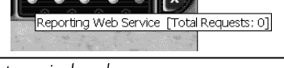

#### 游玩 Terrarium

要游玩 Terrarium，您需要加入生态系统或以 Terrarium 模式运行，并添加植物、食草动物和食肉动物。除了各种生物带来更活跃的互动外，生态系统必须保持一定的平衡。没有植物，食草动物会饿死。没有食肉动物，食草动物会消耗掉所有可用的植物并最终死亡。食肉动物太多，食草动物会很快被吃光，然后食肉动物也会饿死。

以 Terrarium 模式成功运行会鼓励您找到一种平衡。通常情况下，大量的植物能让您的食草动物茁壮成长。生态系统似乎寻求大约每十只食草动物对应一只食肉动物的平衡。但有一个问题：引入过多的食肉动物品种，您的食肉动物会同时捕食其他食肉动物和食草动物。创造一个和谐的生态系统或制造“杀手”程序都很有趣；这取决于您的视角。（我们团队中的一些人喜欢创造最具攻击性的食草动物，并通过创造最大的种群数量来“获胜”。）

#### 每六分钟进行一次环境报告

当您运行 Terrarium 时，它大约每六分钟收集一次统计数据。您可以查看这些信息以确定哪些生物占据主导地位，以及您的 Terrarium 中植物和动物的相对健康状况。单击“显示跟踪窗口”会显示一个跟踪窗口和一个种群统计窗口。要查看生态系统中生物的跟踪信息以及 Terrarium 中生物体的相对种群数量，请选择一个特定的生物实例并打开跟踪窗口（图 4-4 显示了一个鹿的跟踪示例）。

如果您以生态系统模式运行并运行自己的服务器，那么您可以通过 Web 服务直接从服务器获取广泛的服务器统计数据。通过将浏览器导航到随 Terrarium 服务器安装的 Web 应用程序，即可访问这些统计数据。服务器统计数据一目了然。

#### 理解 Terrarium 中的 XML Web 服务

Terrarium 是一个对等应用程序。服务器用于收集生态系统统计数据等信息。XML Web 服务被用于允许参与者访问这些统计数据并了解其创作的情况。

#### 编程 XML Web 服务

让我们花点时间来了解一下 XML Web 服务。

计算机软件需要一种直接可靠的方式来交换数据。微软提供了基于专有实现的分布式 COM（DCOM）。由于各种原因——部分是由于其专有性质——DCOM 无法满足客户的实际需求。XML Web 服务是思考一个现有问题的新方式：我们如何让在不同计算机上、用不同语言实现的软件实现互操作？

微软相信答案是 XML Web 服务。XML，即可扩展标记语言，是一种标准化的标记语言，类似于 WML 和 HTML。XML 是由具有推断含义的标签组成的简单文本，并支持用户定义的扩展。因为 XML 是文本，所以它可以通过 TCP/IP 网络（例如互联网）轻松传输。纵观全局，我们有一种用户可定义的、基于文本的语言，可以描述事物并通过互联网轻松传递。数据可以用 XML 表示，更重要的是，对象可以表示为 XML 文本。其结果是，复杂的对象可以作为简单的 XML 文本在互联网上传输。XML Web 服务是 .NET 框架中实现这些功能的部分的名称。

要实现 Web 服务，请从“新建项目”对话框中选择 ASP.NET Web Service 模板。该模板将创建一个以 DLL 为目标的解决方案，其中包含一个继承自 System.Web.Services.WebService 的类。Web 服务像任何其他程序集一样包含代码。区别在于，用 WebMethodAttribute 标记的方法可以直接被使用者调用。（Web 服务可能与其他服务通信，但让我们暂时搁置这一点。）

Web 服务是一种基于 XML 的技术，支持使用开放标准而非专有标准在互联网（任何 TCP/IP 连接）上传输信息。Web 服务提供者和使用者不是由同一实体实现的。由同一生产者实现并存在于同一基础设施内的代码，对该生产者是可访问的。Web 服务解决了诸如操作系统互操作性和为外部使用者提供数据访问等问题。

假设您为一家工具供应商工作，您的公司已决定提供一个执行复杂字符串搜索功能的正则表达式库。您可以将这些正则表达式公开为 XML Web 服务，并允许使用者付费使用您的正则表达式。正则表达式实现为一种简洁的语言，可以执行一些非常强大的字符串搜索和替换操作。例如，`^[0-9a-zA-Z]+$` 可用于确定字符串是否包含至少一个或多个字母或数字字符。我们可以将我们的正则表达式作为工具库的一部分，公开为一个命名的 XML Web 服务。（正则表达式在 .NET 框架的 System.Text.RegularExpressions 命名空间中实现。）

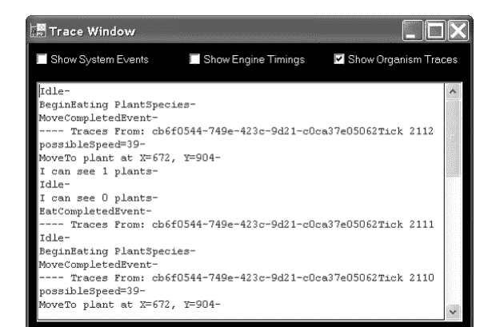

##### 清单 4-1：表示发布正则表达式的工具供应商的 Web 服务

```csharp
1: using System;
2: using System.Collections;
3: using System.ComponentModel;
4: using System.Data;
5: using System.Diagnostics;
6: using System.Web;
7: using System.Web.Services;
8: using System.Text.RegularExpressions;
9: 
10: namespace Expressions
11: {
12:   /// <summary>
13:   /// Expressions 的摘要说明。
14:   /// </summary>
15:   public class Expressions : System.Web.Services.WebService
16:   {
17:     public Service1()
18:     {
19:       //代码生成：此调用是
20:       //ASP.NET Web 服务设计器所必需的
21:       InitializeComponent();
22:     }
23: 
24:     #region 组件设计器生成的代码
25: 
26:     //Web 服务设计器所必需的
27:     private IContainer components = null;
28: 
29:     /// <summary>
30:     /// 设计器支持所需的方法 - 请勿修改
33:     /// 代码编辑器的内容。
34:     /// </summary>
35:     private void InitializeComponent()
36:     {
37:     }
38:   }
```

ASP.NET Web Service 模板生成的唯一代码是第 51 至 55 行定义的 WebMethod。请注意，该方法除了第 51 行的 `WebMethod` 属性外，看起来与其他任何方法并无二致。.NET Framework 为我们处理了大量工作。解决方案 `Expressions.sln` 包含清单 4-1 所示的 Web 服务，而 `TestExpressions.sln` 则包含一个调用该 Web 服务的 Windows 窗体应用程序。

要实现清单 4-1 中代码所代表的 Web 服务，请按照以下编号步骤操作。

1.  创建一个新的 ASP.NET Web 服务项目。将项目命名为 **Expressions**。
2.  将第 51 至 55 行的方法添加到您在步骤 1 中创建的 `WebService` 类中。
3.  在包含步骤 2 代码的 `.cs` 模块顶部添加 `using System.Text.RegularExpressions;` 语句。
4.  通过选择“调试”然后“开始”来编译并运行 Web 服务应用程序。（此步骤将打开 Internet Explorer 以及模板创建的 `.asmx` 页面（参见图 4-5）。您可以使用此页面测试 Web 服务。）

您可以创建第二个项目来编写测试应用程序。一个 Windows 窗体应用程序就足够了。在解决方案资源管理器中为测试应用程序添加 Web 引用。您可以创建 Web 服务中定义的对象的实例。例如，假设您将 Web 服务命名为“Expressions”并将其安装在您的 PC 上。在第二个项目中添加对 Web 服务的 Web 引用后，您可以创建服务的实例，如下所示。

```
localhost.Expressions expressions = new localhost.Expressions();
expressions.IsAlphaNumeric("test123");
```

第一条语句创建了 Web 服务的实例。获得 Web 服务对象的实例后，我们就可以像使用同一项目中定义的对象一样使用它。

本节中的示例相当基础。更多 Web 服务示例请阅读第 12 章。

#### 生物计时

当 Terrarium 运行时，其中的每个有机体都会获得一小片 CPU 时间，大约 2 到 5 毫秒。每个有机体都在这短暂的间隔内执行诸如休息、觅食、防御和繁殖等动作。

#### 传送门

在您玩耍时，一个蓝色球体会在生态系统中四处漂浮。这个蓝色球体就是传送门（如图 4-6 所示），它负责在生态系统中传送植物和动物。传送门负责将来自系统中其他对等方的有机体与本地的同伴进行交叉授粉。最终结果是，您永远无法预知您的生态园中会出现什么。（在生态系统模式下玩耍时，某些肉食动物可能会造成毁灭性打击。）

传送门让 Terrarium 变得有趣。请访问 www.gotodotnet.com 网站了解高级策略，包括追踪传送门的位置。传送门可用作逃生路线、汇聚点，或用于将您的有机体传播到最多对等方的手段。

#### 智能客户端更新

Terrarium 附带的另一个示例应用程序是应用程序更新器（AppUpdater.dll）。应用程序更新器安装在 `\Program Files\Terrarium\ bin` 目录中。

当您启动 Terrarium 以及在其运行期间定期，Terrarium 客户端会联系主服务器应用程序并请求应用程序的更新。客户端联系主服务器上的一个 XML Web 服务。将您的客户端版本与最新版本进行比较。如果服务器包含客户端的更新版本，则会将更新加载到一个新目录中。下次启动 Terrarium 时，将运行新版本。至少会保留一个旧版本，以防出现问题。

.NET 支持修订后的 *瘦客户端编程* 概念。应用程序更新器展示了此模型。其概念很简单：一个应用程序无缝且自动地从网络上抓取更新的组件——可以下载或部署一个小的应用程序启动器，该应用程序的整个 *存在理由* 就是下载应用程序的其余部分，并持续从网络上抓取更新的程序集。该网络可以是互联网。

图 4-6 蓝色球体是传送门，负责在生态系统中的对等方之间移动有机体。

#### 动态更新程序集

`Assembly` 类有一个名为 `LoadFrom` 的方法。`Assembly.LoadFrom` 接受一个程序集名称。参数 `assembly` 可以位于本地文件系统上，也可以位于世界上某个 Web 服务器的另一端。当您拥有一个 `Assembly` 时，您可以比较清单信息（如版本号），有条件地更新或不更新程序集。其好处是，这可以在用户不介入的情况下发生。

让我们回到我们的正则表达式订阅服务。假设我们选择允许客户通过互联网动态加载正则表达式，而不是动态调用测试有限正则表达式集合的 Web 方法。我们可以通过从 Web 加载一个程序集、从程序集中读取所有表达式并继续处理来实现这一点。当可用的表达式变得越来越好时，用户会感到惊喜。清单 4-2 实现了向订阅者提供正则表达式的程序集。

> 清单 4-2 可通过网络动态加载的类库程序集

```
using System;
using System.Collections;

namespace Expressions
{
    public class Expressions
    {
        public Hashtable GetExpressions()
        {
            Hashtable hashtable = new Hashtable();
            hashtable.Add("Numeric", @"^\d+$");
            hashtable.Add("Social Security Number",
                @"^(\d\d\d)-(\d\d)-(\d\d\d\d)$" );
            return hashtable;
        }
    }
}
```

**提示**
“at” (`@`) 符号可防止反斜杠被当作转义字符处理。

遵循我们最初的概念，我们不希望直接将表达式提供给用户。如果他们拥有与源代码相同的表达式，为什么还需要我们的服务呢？示例程序用键和值填充了一个哈希表。我们可以向消费者展示键并应用相应的值。用户只需选择“Social Security Number”，而在内部我们应用正则表达式 `@"^(\d\d\d)-(\d\d)-(\d\d\d\d)$"`。（该正则表达式被理解为匹配具有三个数字、一个连字符、两个数字、一个连字符和四个数字的字符串。表达式使用 `^` 和 `$` 分别限制字符串开头和结尾的额外字符。）

消费者应用程序支持复杂的字符串匹配。要检索更新的正则表达式，我们的消费者应用程序会将包含表达式的程序集加载到我们的消费者应用程序中。清单 4-3 演示了如何请求、加载并从程序集中获取信息。

##### 清单 4-3 从 Web 服务器加载程序集

```
private void UpdateExpressions()
{
  try
  {
    Assembly assembly =
      Assembly.LoadFrom("http://localhost/regex/expressions.dll");

    Type type = assembly.GetType("Expressions.Expressions");
    Object instance = Activator.CreateInstance(type);

    Hashtable newtable = (Hashtable) type.InvokeMember("GetExpressions",
      BindingFlags.Instance | BindingFlags.InvokeMethod |
      BindingFlags.Public, null, instance, new object[]{});

    foreach(object key in newtable.Keys)
    {
      comboBox1.Items.Add(key.ToString());
    }

    hashtable = newtable;
  }
  catch(Exception e)
  {
    MessageBox.Show(e.Message, "Update Error",
      MessageBoxButtons.OK, MessageBoxIcon.Error);
  }
}
```

此代码使用 `http://` 标识符加载程序集。命名空间和类（“Expressions.Expressions”）作为字符串传递，以从程序集中加载类型。使用 `Activator` 类创建对象的实例；并调用返回 `Hashtable` 的 `GetExpressions` 方法。我们将所有代表表达式的键读取到一个组合框中。如果上述所有代码都成功，则名为 `hashtable` 的字段将被赋值给本地 `Hashtable` `newtable`。用户看到的是我们命名良好的表达式，但永远不会看到实际的表达式，这些表达式代表着我们的知识产权，也是我们获得报酬的原因。


一个完整的可运行示例在 Client.sln 中演示。你需要编译两个项目——client.csproj 和 expressions.csproj——来测试该示例。expressions.dll 程序集需要被复制到一个 Web 服务器上。只要运行 Internet Information Services，你的 PC 就可以工作。我们的示例演示了将 PC 作为测试平台，但使用任何其他 Web 服务器同样有效。

#### 点对点计算

每个 Terrarium 客户端在 Terrarium 游戏中都是一个平等的节点。当你在生态系统模式下运行时，服务器会将几个逻辑上相近的节点关联到你的节点列表中。（这就是服务器在 Terrarium 中的角色：跟踪节点。）所有的节点组都有一定的重叠，因此 Terrarium 中的每个节点最终都成为了一个大型生态系统的一部分。

当蓝色球传送器遇到一个生物体时，会从你的节点列表中随机选择一个节点。Terrarium 使用 System.IO 将生物体的状态流式传输到文件中。包含传送器选定的生物体以及该生物体流状态信息的程序集，会使用 System.Net.Sockets 命名空间中的 NetworkStream 类发送到选定的节点。

接收节点会检查生物体程序集是否引用了在 Terrarium 上下文中可能代表作弊的程序集，例如 Reflection。如果生物体程序集通过了评估，该生物体将被加载到接收端的 Terrarium 客户端中，并使用 System.Runtime.Serialization 读取生物体的状态。结果是，在接收端重新创建了一个重复的生物体，并将其从发送端移除。*（传送——也许这就是我们将来如何让《星际迷航》传送器工作的方式。扫描你的大脑。在新位置创建一个克隆体。通过电子邮件发送被传送者的大脑扫描数据，将大脑扫描数据加载到克隆体中，然后销毁原始体。）*

#### 多语言编程支持

Terrarium 是程序员试验多语言编程支持的绝佳场所。（我们在此不深入探讨多语言编程。）然而，可以预见的是，在不久的将来，编程团队将由具备多种 .NET 编程语言技能的程序员组成，这是很实际的。

#### 代码访问安全性

在 Terrarium 生态系统中运行意味着通过网络不断发送和接收程序集，编译后的代码随机来回移动。这可能会让管理者、网络管理员甚至开发者感到有些不安。

Terrarium 的一个引人入胜的方面是它证明了，如果采用安全模型，编译后的代码可以在计算机之间安全地移动。有关代码访问安全性的简要示例，请参阅后面的部分“介绍代码访问安全性”，以及第 16 章中更全面的安全性讨论。

#### 审视 Terrarium 框架

任何合理的应用程序都可能通过其架构来描述。Terrarium 是一个点对点应用程序，你通过创建植物和动物生物体与之交互。你不能随意创建任何生物体。你需要通过继承在 OrganismBase.dll 程序集中定义的现有类型——Plant 或 Animal——来创建生物体。你的生物体表现如何，取决于你在 Terrarium 架构背景下为你的策略编程的水平。

Terrarium 的架构过于庞大，无法在此详细涵盖。（可能很快就会有人写一本关于 Terrarium 的书。）你可以在 www.gotodotnet.com 网站上找到交叉引用的架构概述。虽然你无需深入研究该信息也能创建新的生物体，但这些生物体将会处于劣势。Terrarium 中的顶级类包括 Action、AnimalState、DefendAction、EngineSettings、MoveToAction、OrganismState、PlantState、Vector、Animal、AttackAction、EatAction、MovementVector、Organism、Plant 和 ReproduceAction。从这些顶级类型中，你或许可以推断出 Terrarium 中的交互可能相当复杂。你的推断是正确的。

Terrarium 中还有几个事件、事件参数、属性、异常和接口。Terrarium 框架中的所有这些成员都用于描述你的生物体的行为。基本思想是，你通过继承 Plant 或 Animal 来创建一个生物体。你应用属性来描述生物体的特征，并实现事件处理器来编纂生物体在特定情境下的响应。要想成功，植物必须生长和播种。更重要的是，动物必须狩猎、觅食、繁殖，并可能进行攻击、防御和躲避。

我将提供植物、食草动物和食肉动物的基本示例。但是，如果你打算在更大的生态系统中竞争，那么需要提醒你的是，目前存在一些严重的缺陷。

#### 创建植物和小动物

Terrarium 中的图形很有趣，但远不如编码植物和动物的概念性和竞争性方面精彩。植物通过传播种子来生长和繁殖。如果你的植物播种和生长的速度超过被吃掉的速度，它们就会茁壮成长。不幸的是，就植物而言，一旦你释放了一种植物，你就只能任由食草动物直接摆布，并间接地受食肉动物影响。通常，植物容易实现且表现相当不错。相反，植物看起来并不太有趣。

动物则不同。动物会移动并积极参与生态系统。动物表现如何更取决于程序员所实现的巧妙策略。（如果你的动物被吃掉了，不要难过。成为一个好的程序员和一个好的战略家并不是一回事。在 Terrarium 中，好的代码实际上可能适得其反，因为面向对象的代码可能比 hack 代码运行得更慢。）在下一节中，我们将探讨一些基本的植物和动物。

##### 创建植物

植物很无聊，但却是生态系统的重要组成部分。植物为我们提供了一种将生物体引入生态系统的便捷且简单的方法。创建生物体的基本步骤如下：

1.  创建一个类库项目。
2.  添加对 organismbase.dll 的引用，该文件随 Terrarium 客户端一起安装。
3.  添加对 system.drawing.dll 的引用，这是随 .NET 框架一起提供的 GDI+ 程序集。
4.  定义一个继承自 Plant 类（或 Animal 以创建动物）的类。
5.  定义一些必需的属性。
6.  编写你的生物体代码（参见清单 4-4）。

```
清单 4-4  一个植物的实现
1:  using System;
2:  using System.Collections;
3:  using System.Drawing;
4:  using System.Reflection;
5:  using System.IO;
6:  
7:  [assembly: OrganismClass("AloeVera")]
8:  [assembly: AuthorInformation("Paul Kimmel", "pkimmel@softconcepts.com")]
9:  
10:  [MaximumEnergyPoints(10)]
11:  [MatureSize(26)]
12:  [SeedSpreadDistance(50)]
13:  
14:  public class AloeVera : Plant
15:  {
16:    public override void SerializePlant(MemoryStream m)
17:    {}
18:    
19:    public override void DeserializePlant(MemoryStream m)
20:    {}
21:    
22:  }
```

程序集属性 OrganismClass 为我们将要引入生态系统的类命名。你需要定义一个与用于初始化 OrganismClass 属性的类名相同的类。（第 14 至 22 行实现了 AloeVera 植物。）程序集级别的属性 AuthorInformation 是必需的；此信息用于标明所有权，并在生态系统出现问题时提供联系信息。

MaximumEnergyPoints、MatureSize 和 SeedSpreadDistance 这些值的作用类似于植物的 DNA，用于描述植物。你可以尝试调整这些属性值，以创建生长旺盛、茁壮成长和易于发芽的植物。

第 16 和 19 行实现了空的序列化和反序列化方法。这些是你必须实现的抽象方法；它们对动物具有更多意义。你可以在生物体被传送时存储有关其生态系统的信息。你可能需要为动物实现这些方法。（有关在 Terrarium 中实现序列化的更多信息，请参阅后面的部分“序列化对象”。）

##### 创建小动物

动物的实现比植物更具挑战性。无论你是编程食草动物还是食肉动物，编程动物的某些方面都是相同的。在我们实现食草动物和食肉动物之前，我们将先探讨实现动物的共同方面。

要实现一个动物，无论是食草动物还是食肉动物，你需要执行以下步骤：

1.  创建一个类库项目。
2.  添加对 organismbase.dll 和 system.drawing.dll 的引用。
3.  创建一个继承自 Animal 的类，其类名与你将提供给 OrganismClass 程序集级别属性的名称相同。
4.  实现一套大致描述你的生物体概念性 DNA 的属性。这些属性包括 MatureSize、Carnivore、AnimalSkin、MarkingColor、MaximumEnergyPoints、EatingSpeedPoints、AttackDamagePoints、DefendDamagePoints、MaximumSpeedPoints、CamouflagePoints 和 EyesightPoints。
5.  提供描述你的生物体行为的代码。（这是棘手的部分。）

##### 动物的通用规则

你有 100 个点数可以分配到 MaximumEnergyPoints、EatingSpeedPoints、AttackDamagePoints、DefendDamagePoints、MaximumSpeedPoints、CamouflagePoints 和 EyesightPoints 中。对于食草动物，你可能希望强调 MaximumSpeedPoints 和 EatingSpeedPoints 之类的属性。你可能还想强调 DefendDamagePoints——想想犀牛和非洲水牛。CamouflagePoints，即隐藏能力，对于小型快速的动物可能是一个好的属性，而 DefendDamagePoints 对于大型、缓慢的动物可能是一个好的属性。如果你创建的是食肉动物，那么你可能希望拥有巨大的 AttackDamagePoints、EyesightPoints 和 MaximumSpeedPoints，但要弱化 camouflage 等属性。我不是动物学家，但我能想到对于各种属性来说合理且有意义的组合。狮子相当成功，因为它们拥有一定的速度、

利用伪装，并造成最大伤害。另一方面，鬣狗成群结队地捕猎和食腐。（我认为肉食动物和草食动物是特定类型的动物，并强调这些动物所具有的特性。）

如果你在Terrarium模式下测试你的生物——而非生态系统模式——你可能会根据属性设置收到警告。似乎武断地，DefendDamagePoints应以4为增量设置，EyesightPoints应以10为增量设置（见图4-7）。

动物有其属性特征，这些特征会增强或削弱一个物种的成功。更重要的是你为这些动物编写的代码。一个聪明的策略师可能会编写代码来创建协作捕猎行为或积极的避免捕食者反应。

某些事情会加速你生物的灭亡。如果你的生物抛出未处理的异常，那么该生物实例将被销毁并从生态系统中移除。Terrarium鼓励编写主动进行异常处理的代码。如果你的生物花费太长时间来完成其活动，它也会被销毁。你每回合大约有2毫秒的时间来安排你生物需要发起或完成的所有活动。复杂的代码可能仅仅因为代码“便秘”而导致你的生物死亡。

你可以使用WriteTrace在Terrarium模式下向跟踪窗口发送消息。在将生物引入生态系统之前，使用WriteTrace调试它们。

创建了你的生物体后，你可以将你的生物添加到本地Terrarium。这将为你提供最大的调试机会……嗯，是调试你的“bug”（程序错误/生物）。你可以查看跟踪消息以了解你的bug的实际行为，并查看关于你生物成功情况的统计数据。一旦你将生物体引入生态系统，就不能重新引入相同的生物。你可以添加更多现有生物的副本，但不能是修订后的副本。如果你修改了同一个bug并希望重新引入该bug，那么你需要创建一个新的本地Terrarium。

当你的bug准备好迎接黄金时段时，将其引入更大的生态系统。顺便提一下，在撰写本文时，有一些Terrarium竞赛，如果你的bug是最成功的，你可以赢得像Xbox这样的酷东西。为了看到一些真正成功的生物，鼓励你参与更大的生态系统并获取领先bug的副本。你可以使用.NET IL反汇编程序（ILDASM.EXE）来查看这些生物的元素。一些领先的程序被编程以表现出非常复杂的行为。

##### 创建草食动物

我将从演示一个草食动物开始。草食动物更容易编程，并且往往比肉食动物成功约十倍，尽管即使是草食动物的行为也可能变得相当复杂。

我选择了一头牛。牛能够生存下来的原因似乎是因为我们把它们关在围栏里并给它们送食物。根据我对牛行为的理解，我编程让牛环顾四周。如果牛看到任何食物，牛就向食物移动。如果牛撞到任何东西，它就尝试吃掉它。牛没有捕食者的概念，只有简单的食物搜寻行为；牛在生态系统中可能表现不佳（见清单4-5）。

###### 清单 4-5 Terrarium 中的牛等效物

```csharp
using System;
using System.Drawing;
using System.Collections;
using System.Reflection;
using System.IO;

[assembly: AuthorInformation("Paul Kimmel",
  "pkimmel@softconcepts.com")]
[assembly: OrganismClass("Cow")]

[MatureSize(30)]
[Carnivore(false)]
[AnimalSkin(AnimalSkinFamilyEnum.Beetle)]
[MarkingColor(KnownColor.Blue)]
[MaximumEnergyPoints(10)]
[EatingSpeedPoints(10)]
[AttackDamagePoints(0)]
[DefendDamagePoints(10)]
[MaximumSpeedPoints(30)]
[CamouflagePoints(15)]
[EyesightPoints(25)]

public class Cow : Animal
{
  PlantState target = null;

  protected override void Initialize()
  {
    Idle += new IdleEventHandler(IdleEvent);
    MoveCompleted +=
      new MoveCompletedEventHandler(MoveCompletedEvent);
  }

  private void IdleEvent(object sender, IdleEventArgs e)
  {
    WriteTrace("Idle");
    if(CanReproduce)
      BeginReproduction(null);
    if( IsMoving || IsReproducing || IsEating )
        return;

    SearchForFood();
  }

  private void SearchForFood()
  {
    ArrayList organisms = Scan();
    foreach(OrganismState organism in organisms)
    {
        if( organism is PlantState )
        {
            MoveTo( (PlantState)organism );
            return;
        }
    }
  }

  private int PossibleSpeed()
  {
    int possibleSpeed = Species.MaximumSpeed;
    while( possibleSpeed > 2 &&
        State.EnergyRequiredToMove(possibleSpeed,
            possibleSpeed) > (State.StoredEnergy / 2))
    {
        possibleSpeed /= 2;
    }

    if( possibleSpeed < 2) possibleSpeed = 2;
    return possibleSpeed;
  }

  private void MoveCompletedEvent(object sender,
    MoveCompletedEventArgs e)
  {

    try
    {
        if(WithinEatingRange(target)
            && (State.EnergyState < EnergyState.Full))
            BeginEating(target);
    }
    catch
    {
    }
  }

  private void MoveTo(PlantState plant)
  {
    target = plant;
    BeginMoving(new MovementVector(plant.Position, PossibleSpeed()));
  }

  public override void SerializeAnimal(MemoryStream m)
  {}

  public override void DeserializeAnimal(MemoryStream m)
  {}
}
```

牛的大小相当大，如其MatureSize属性为30所示（最大的动物可以有48的成熟尺寸）。成熟尺寸越大，动物能繁殖所需的时间就越长。然而，大型动物可能具有威慑力；因此，体型可能是超级捕食者的一个好特质。

将Carnivore属性设置为False表示该动物是草食动物（第12行）。你必须从现有的皮肤中选择。你可能在描述一头牛的等效物，但Terrarium中的所有生物在视觉上都表现为AnimalSkinFamilyEnum值中定义的某种虫子。使用AnimalSkin属性描述你的生物体的外观。MarkingColor属性将用于描述色彩鲜艳的虫子。（MarkingColor属性在Terrarium的早期版本中未实现。）

第15到21行定义的牛的属性相当弱。牛的能量点数低，进食速度非常慢，几乎没有DefendDamagePoints，速度慢，并且视力差。（听起来像是一种只能在圈养环境中茁壮成长的动物吗？）

牛定义在第23到96行。生物行为被实现为事件处理程序。这些处理程序在重写的Initialize方法中建立（见第27到32行）。牛实现了一个IdleEventHandler和一个MoveCompletedEventHandler。（还有更多行为可以描述，包括攻击和防御行为。）事件处理程序使用重载的+=运算符与事件关联，如第29到31行所示。

当我们的牛获得一个空闲的CPU时间片——一个回合时，它会检查是否可以繁殖（第37到38行）。带有Begin前缀的方法是异步的。这意味着当第38行被调用时，它会立即返回。第40行检查我们是否在繁殖或移动——可能是在搜寻食物或进食。如果牛正在做这些事情中的任何一件，如第40和41行所编码，那么我们立即返回。最后，如果第40行上的任何条件都不满足，那么我们开始搜寻食物。

第46到57行实现了食物搜寻行为。第48行上的Scan方法返回牛能看到的所有生物体，这是由EyeSightPoints视野属性定义的。对每个生物体进行评估。当发现植物时，牛向植物移动，这由第51行的PlantState检查表示。

我们以消耗至多一半可用能量的速率移动。MoveTo方法定义在第88到92行。BeginMoving是一个异步方法，让我们的bug开始移动。MovementVector接受一个Point结构参数和一个速度。我们在PossibleSpeed方法中计算速度。

PossibleSpeed 是一个我从 www.gotdotnet 网站的一些代码示例中借来的流行算法。通过反复试验，我发现以最高速度运行一个 bug 可能会导致自杀。PossibleSpeed（第59至71行）评估生物的最大速度，该速度由 MaximumSpeedPoints 定义。PossibleSpeed 值用于确定生物可以行进的速度和距离，这取决于储存的能量以及以特定速度移动特定距离所需的能量。以最大速度奔跑很可能导致你的生物以惊人的速度狂奔，然后仿佛死于心脏病发作。

MoveCompletedEvent 可能因多种原因被调用。回想一下，BeginMoving 是异步的。我们的 bug 可能会因为到达食物源或撞到其他东西而停止移动。我们的 bug——第73至85行——只是假设我们已经到达了食物目的地。如果我们处于 WithinEatingRange（在进食范围内）并且饥饿——由第80行的 State.EnergyState 值表示——那么我们就开始进食。一个成功的 bug 可能会检测到捕食者或障碍物的存在并采取其他行动，比如逃跑。

最后，我们必须重写 SerializeAnimal 和 DeserializeAnimal 方法。对于 Cow（牛）来说，这些是空方法。（有关更多信息，请参阅本章后面的“序列化对象”。）

###### 遍历对象集合
清单4-5的第49至56行演示了 *foreach* 构造。在第2章中，我演示了 IEnumerable 接口。你可以从实现了 IEnumerable 的类（如 ArrayList）请求一个枚举器来遍历对象集合。遍历对象的一种更简单的方法是 *foreach* 构造。*Foreach* 支持声明一个变量并遍历包含集合中定义的对象的集合，如清单4-5所示。这比使用枚举器更容易，尽管它依赖于 IEnumerable 接口。你可以通过实现 IEnumerable 来创建可以用 *foreach* 遍历的强类型集合。接下来你将看到一种实现强类型集合的简单方法。

###### 继承自 CollectionBase 和 ReadOnlyCollectionBase
强类型集合是特定类型对象的集合，例如，生物集合或联系人集合。创建强类型集合最直接的方法是继承自 ReadOnlyCollectionBase 或 CollectionBase。ReadOnlyCollectionBase 将有助于创建只读的强类型对象集合，而 CollectionBase 将有助于创建可读写的强类型对象集合。清单4-6演示了如何创建客户对象的强类型集合。

```
清单4-6 此代码演示了通过继承 ReadOnlyCollectionBase 创建的 Customer 对象的强类型集合。
1: public class Customers : ReadOnlyCollectionBase
2: {
3:     public Customers()
4:     {
5:         ReadCustomers();
6:     }
7:  
8:    public Customer this[int index]
9:    {
10:      get
11:      {
12:        return (Customer)InnerList[index];
13:      }
14:    }
15:  
16:  
17:    public Customer this[string name]
18:    {
19:      get
20:      {
21:        return (Customer)this[Find(name)];
22:      }
23:    }
24:  
25:    private int Find(string name)
26:    {
27:      for( int i = 0; i < Count - 1; i++)
28:      {
29:        if( this[i].Name.Equals(name) ) return i;
30:      }
31:      return -1;
32:    }
33:  
34:    private void ReadCustomers()
35:    {
36:      InnerList.Add(
37:        new Customer("Robert Golieb", "(617) 555-1212"));
38:      InnerList.Add(
39:        new Customer("Mark Davis", "(503) 555-1212"));
40:    }
41:  }
42:  
43:  public class Customer
44:  {
45:    private string name;
46:    private string phone;
47:  
48:    public Customer(string name, string phone)
49:    {
50:      this.name = name;
51:      this.phone = phone;
52:     }
53:  
54:     public string Name
55:     {
56:         get
57:         {
58:             return name;
59:         }
60:         set
61:         {
62:             name = value;
63:         }
64:     }
65:  
66:     public string Phone
67:     {
68:         get
69:         {
70:             return phone;
71:         }
72:  
73:         set
74:         {
75:             phone = value;
76:         }
77:     }
78: }
```

ReadOnlyCollectionBase 类实现了 ICollection 和 IEnumerable。ICollection 旨在提供 Count、将元素复制到数组以及对底层元素的同步访问。IEnumerable 有一个方法：GetEnumerator。IEnumerable 是 foreach 在遍历集合或数组中的元素时所必需的接口。

清单4-6中的代码实现了一个 Customer 类和一个名为 Customers 的 Customer 对象集合。通过继承自 ReadOnlyCollectionBase，我们获得了用于存储元素的底层结构以及实现 ICollection 和 IEnumerable 的代码。通过实现索引器 *this*，我们可以像使用类型数组一样对待 Customers 的实例。例如，customers[0]（其中 customers 是 Customers 类的一个实例）将返回第0个索引位置的 Customer 对象。索引器在第8至14行实现。我们也可以实现一个接受字符串的索引器（参见第17至23行）。字符串索引器和 Find 方法协同工作，接受一个字符串并找到包含 Name 字段（该字段包含索引值）的对象。例如，Customers["Robert Golieb"] 将返回 Name 初始化为 Robert Golieb 的对象。

只有生产者可以初始化 ReadOnlyCollectionBase 的元素。第34至40行的 ReadCustomers 方法演示了一种初始化集合的方法。你也可以通过从 XML 文件或数据库读取来初始化集合。要创建一个可读写的强类型集合，请继承自 CollectionBase 类。

##### 改进 Cow
我们可以通过添加一些智能行为来改进 Cow（牛）这种草食动物。我们可以添加事件处理器来响应攻击并表现出防御行为，而且我已经演示了如何寻找食物。Deer.sln 提供了对 Cow 的改进。鹿使用 ReadOnlyCollectionBase 来跟踪食物并寻找最近的食物来吃。你可以通过打开 Deer.sln（可在 **www.osborne.com** 网站上获取）来查看鹿的代码。清单4-7演示了用于跟踪鹿的食物的集合。

```
清单4-7 为草食动物实现一个食物跟踪集合

public class Plants : ReadOnlyCollectionBase
{
    private Animal animal;

    public PlantState ClosestPlant()
    {
        PlantState closest = null;
        foreach(PlantState plant in this)
        {
            if((closest == null) ||
               ( animal.DistanceTo(plant) < animal.DistanceTo(closest)))
                closest = plant;
        }

        InnerList.Remove(closest);
        return closest;
    }

    public Plants(Animal animal)
    {
        this.animal = animal;

        ArrayList organisms = animal.Scan();
        foreach(OrganismState organism in organisms)
        {
            if( organism is PlantState )
                InnerList.Add(organism);
        }
    }

    public PlantState this[int index]
    {
        get
        {
            return (PlantState)InnerList[index];
        }
    }
}
```

> **注意**
> 你可以通过设置 AttackDamagePoints 属性并在植食动物上调用 BeginAttacking 方法来创建凶猛的草食动物。也许你可以杀死所有吃植物的竞争对手，或者摧毁更弱的肉食动物。

当鹿饥饿时，它会请求一个范围内的植物集合。Plants 集合从扫描结果中移除了动物。Plants.ClosestPlant 方法返回离单个鹿位置最近的植物，并从集合中移除该植物。返回最近的植物，鹿就可以以最少的能量消耗进食。清单4-5中提供的 Cow（牛）死于缺乏主动性。而使用植物跟踪策略的鹿（解决方案可供下载）比牛效率高得多，它毁灭了如此多的植物，以至于最终饿死了自己。

##### 创建肉食动物
肉食动物的创建稍微复杂一些。它们的食物来源会移动，甚至可能反击。肉食动物也可能被吃掉。对一些生态系统中的肉食动物的观察表明，似乎存在每10只草食动物对应1只肉食动物的比例。这可能是 Terrarium 游戏本身中编写的规则。没有肉食动物，可能很难在 Terrarium 中实现平衡。

一个略微修改过的肉食动物的代码需要十页。为了避免用巨大的代码清单来填充本书，我在此不复制该代码，但我确实鼓励你下载示例 Lion.sln 代码并查看完整的清单。我将介绍 Lion.sln 中的一些基本要点，这将帮助你构建一个肉食动物。

###### 设置肉食动物属性
肉食动物和草食动物使用相同的属性。你可能需要为肉食动物平衡这些属性。要创建一个食肉动物，你必须将 Carnivore 属性初始化为 True，否则你的生物将无法食用动物。（没有杂食动物。）你可以增加像 AttackDamagePoints 这样的属性来对猎物造成巨大伤害，或者增加像 MaximumSpeedPoints 这样的属性来创建相当于狮子或猎豹的生物。

某些属性任意地必须是某个值的偶数倍。EatingSpeedPoints 属性需要是4的倍数。（饥饿的肉食动物，如狮子，可以从容进食，除非有鬣狗在附近游荡。）在 Terrarium 模式下测试你的生物将为你提供有关浪费的 DNA 点数的提示。


##### 编程捕猎行为

`Scan` 方法会返回你的生物体可以看到的一个生物体 `ArrayList`。`Scan` 返回植物和动物。你可以筛选该列表，只包含动物或只包含植物，如代码清单 4-6 所示。例如，食肉动物可能只关心动物；你也可以编程实现更高级的行为，比如朝植物移动，希望饥饿的食草动物可能会出现。

#### 将植物和生物体引入生态缸

当你完成植物或动物的编程后，可以将其引入生态系统。如果你的代码存在缺陷，例如未处理的异常，那么你将无法修改它并重新引入同一生物体。因此，最好在将生物体提交到更大的生态系统之前，先在生态缸模式下进行测试。

一种过于激进的异常处理方法将防止你的生物体被生态缸应用程序销毁。以下代码片段展示了为狮子实现的一个 `AttackCompletedEvent` 处理程序。

```
private void AttackCompletedEvent(object sender, AttackCompletedEventArgs e)
{
    try
    {
        if(e.Killed)
        {
            if (CanEat)
            {
                BeginEating(e.AttackAction.TargetAnimal);
            }
        }
    }
    catch(Exception x)
    {
        WriteTrace(x.Message);
    }
}
```

当 `AttackCompletedEvent` 被触发时，我们可以检查 `AttackCompletedEventArgs`，它会指示被攻击者是否已死亡。如果已死亡，那么我们可以检查是否可以进食——`State.EnergyState < EnergyState.Full`——如果是，则调用异步的 `BeginEating` 方法开始进食猎物。

当向每个客户端引入新程序集时，会检查该程序集的代码，看是否可能在游戏环境中被视为作弊。如果你的生物体通过审查，那么当你第一次引入该生物体时，系统会向生态缸中添加十个该生物体的副本。

如果你的生物体灭绝了，那么你可以从灭绝物种列表中添加原始生物体。你不能修改该物种并重新引入修改后的代码。因此，一个已经灭绝的物种很可能因为相同的原因再次死亡。

#### 引入代码访问安全

生态缸是来自不同目的地的代码的典型示例。在生态系统模式下，代码可能来自世界任何地方——请记住，生态系统没有孤立的片段。生态缸是微软引入新的代码访问安全模型的好方法。

任何使用公共语言运行时的代码都必须与安全模型交互。其基本前提是，使用 CLR 的代码必须产生可验证的类型安全代码，并且你不能假定代码会被授予任何权限。例如，如果你为通用消费创建了一个 Web 服务，你不应假定你的代码会被授予特定权限，并且必须处理因权限被拒绝而导致的错误。（有关代码访问安全和命令式、声明式安全的更多信息，请参阅第 16 章。）

## 次要主题

生态缸支持对象状态序列化的概念。序列化对象状态简单来说就是将对象的状态信息写入另一种形式——例如，二进制文件。将对象的状态写入文件有助于通过网络传输该状态信息。对称的反序列化方法确切知道要从序列化文件中读取数据的顺序和类型。

生态缸为你提供了一个适合实验序列化的契机。当传送器碰到你的生物体实例时，会从你的对等体列表中选择一个对等体。该生物体将从你的生态缸中移除，并将其 DLL 的一个副本发送到从列表中选择的对等体。状态信息也会被发送。如果你为 `SerializePlant` 或 `SerializeAnimal`，以及 `DeserializePlant` 或 `DeserializeAnimal`（视情况而定）提供了实现，那么这些额外的状态信息也会被发送。本章的剩余部分将通过为食肉动物狮子实现 `Serialize` 和 `Deserialize` 方法来演示序列化。

### 序列化对象

本章前面，我提到了生态缸如何使用 `System.IO` 命名空间。生物体中的 `Serialize` 和 `Deserialize` 方法使用了 `MemoryStream` 类。*流* 简单来说就是一组连续的字节集合。将数据表示为连续的字节正是计算机看待数据的方式，而连续的字节块可以通过多种方式轻松移植，包括通过互联网。`MemoryStream` 是一种存储在内存中的流——与代表文件的 `FileStream` 不同。

编程的一个概念层级是类。通过将数据表示为具有公共接口的各种流，各种形式的数据得以以一致和多态的方式被处理。实现一个接受流的方法，无论你处理的是 `MemoryStream` 还是 `FileStream`，你执行的具体操作都是相同的。流类型之间存在细微差别。例如，你不会为 `MemoryStream` 指定文件名，而 `FileStream` 将文件表示为连续的字节块，很直观地，你实际需要一个文件来完成此目的。

你可以通过实现 `Serialize` 和 `Deserialize` 方法来跟踪生态缸中生物体的额外状态信息。你只需要提供这些方法的桩实现，但代码清单 4-8 展示了如何在生物体被传送时序列化状态信息，以及在生物体传送后反序列化状态信息。

##### 使用 MemoryStream 对象序列化生物体

标记了 `abstract` 修饰符的方法必须在子类中被重写和实现，即使该实现只是一个空的方法调用。这就是我们迄今为止对生物体实现所做的。我们没有实现序列化方法，因为没有实际的理由这样做。然而，你可以设想一个理由。也许你的生物体跟踪成功击杀的次数以及经常攻击它的物种类型。你可能会选择流式传输最具攻击性的生物体和最易捕获的猎物，并选择避开前者，寻找后者，以帮助你的生物体更成功。这是一个策略问题。代码清单 4-8 通过流式传输狮子在传送前参与的活动来演示序列化和反序列化。

```
代码清单 4-8  使用 MemoryStream 对象序列化和反序列化状态信息

public override void SerializeAnimal(MemoryStream m)
{
    try
    {
        byte[] buffer = new Byte[]{
            Convert.ToByte(IsDefending), Convert.ToByte(IsAttacking),
            Convert.ToByte(IsEating), Convert.ToByte(IsMoving)};
        m.Write(buffer, 0, buffer.Length);
        WriteTrace("SerializeAnimal");
    }
    catch(Exception e)
    {
        WriteTrace(e.Message);
    }
}

public override void DeserializeAnimal(MemoryStream m)
{
    try
    {
        byte[] buffer = new Byte[4];
        m.Read(buffer, 0, buffer.Length);
        WriteTrace("WasDefending: " + Convert.ToBoolean(buffer[0]));
        // ... (剩余代码被截断)
        WriteTrace("WasAttacking: " + Convert.ToBoolean(buffer[1]));
        WriteTrace("WasEating: " + Convert.ToBoolean(buffer[2]));
        WriteTrace("WasMoving: " + Convert.ToBoolean(buffer[3]));
        WriteTrace("DeserializeAnimal");
    }
    catch(Exception e)
    {
        WriteTrace(e.Message);
    }
}
```

`SerializeAnimal` 方法写入包含代码清单 4-8 中代码的动物的 `IsDefending`、`IsAttacking`、`IsEating` 和 `IsMoving` 属性。为了演示我们可以检索状态信息，`DeserializeAnimal` 方法读取与 `SerializeAnimal` 方法写入的完全相同数量的数据。

##### 写入 FileStream

`FileStream` 代表了一种你无法添加到生物体中的代码。当生物体加载到生态缸中时，生态缸会查找尝试执行文件 IO 的代码。生态缸不允许文件 IO，因为这可能允许恶意代码在对等体之间传输。这种禁止是 .NET 中安全模型实际运行的一个例子。如果你尝试代码清单 4-9 中的代码，你将收到错误并且你的生物体将失败，但该代码将演示如何获取临时文件名并将信息写入文件。

```
代码清单 4-9  此代码演示了使用 FileStream 类进行文件 IO。

string filename = Path.GetTempFileName();
FileStream file = new FileStream(filename, FileMode.CreateNew);
m.WriteTo(file);
file.Close();
```

代码清单 4-9 中的第一条语句演示了如何在 .NET 中请求临时文件名。（你可能记得 `GetTempFileName` 曾经是一个 Windows API 方法。现在 `GetTempFileName` 是在 `System.IO` 命名空间中定义的 `Path` 类的一个静态方法。）第二条语句演示了如何创建一个新的 `FileStream` 和文件，传递第一条语句中创建的 .tmp 文件名。`m.WriteTo` 语句演示了如何将数据写入...

信息从一个流传输到另一个流。对象 *m* 是传递给 SerializeAnimal 方法的 MemoryStream 的代表。任何 MemoryStream 的实例都可以。最后，我们关闭 FileStream，将文件句柄返回给操作系统。

## 总结

Terrarium 提供了一个绝佳的机会来学习大量 C# 编程知识。如果你有点想象力，Terrarium 甚至有点令人上瘾。对学习的上瘾是件好事。希望你有机会安装 Terrarium 客户端——甚至可能是服务器——并创建几个生物体添加到生态系统中。在使用 Terrarium 进行实验的过程中，你将获得关于继承、实现事件处理器和使用属性、异常处理器、正则表达式、反射、实现强类型集合以及流和序列化在 .NET 中如何工作的速成课程。本章和 www.osborne.com 以及 www.softconcepts.com 网站提供的代码中都详细展示了这些主题。

本章还介绍了代码访问安全性。安全性在第 16 章中有详细说明。

# 第 5 章
# 使用 ADO.NET 构建数据库应用程序

**本章内容：**
- 演示的主题
- ADO.NET 命名空间快速回顾
- 连接到数据源
- 理解适配器的作用
- 使用 DataSet
- 使用 DataTable
- 使用 DataView
- 使用 DataReader 访问只读数据
- 在 DataGrid 中显示信息
- 使用 Command 对象
- 使用 CommandBuilder 生成 SQL
- 总结

当前版本的 ADO 包含了旨在适应我们当今世界的修订。在 21<sup>st</sup> 世纪，信息是大生意。成千上万甚至数百万并发用户快速访问海量数据是现实。ADO.NET 的修订正是为了反映这一现实。

以前的 ADO 版本主要基于*连接*模型。每个用户在与数据交互时都持有一个到数据源的连接。结果是大量可能的物理连接导致的瓶颈。假设客户端是连接到互联网的 PC，服务器是 Web 服务器，那么距离和带宽会使数据库问题更加严重。

通常，可以用单位时间内的事务数量来衡量总吞吐量。如果每分钟完成一个事务，应用程序每天可以支持 1,440 个事务。每秒一个事务，应用程序每天可以支持 86,400 个事务。显然，这些数字远未达到数百万级别。ADO.NET 进行了修订，以解决到数据源的物理连接有限的问题，提高可靠性，并在当今互联的世界中运行。

当前的 ADO.NET 基于断开连接模型，并以 DataSet 和 XML 为中心。简而言之，ADO.NET 模型遵循这样的模式：连接到数据源，执行短暂的事务，然后从数据源断开连接。ADO.NET 引入了一些新的功能和类。本章将演示如何使用 ADO.NET 编写数据库应用程序。

### 演示的主题

第 2 章通过演示如何探索 CLR，引入了反射的主题。工具提供商可以使用这样的实用程序来完整地记录 CLR，并提供一个将 CLR 的特定方面与示例代码关联起来的参考应用程序。为了使这个概念可行，我们需要将通过反射发现的信息写入数据库，然后向该数据库添加代码示例。

根据我与一位微软项目经理的讨论，微软内部有一个应用程序，在内部为使用 .NET 的开发人员扮演资源工具的角色。幸运的是，微软发布了 Rotor，这是公共语言基础设施的共享源代码，是 .NET 基类库的重要组成部分。Rotor 可以从微软下载。

我们可以创建自己的参考应用程序，作为演示 ADO.NET 的合理方式。本章演示的主题以 CLR 参考应用程序为背景，将向你展示如何

- 使用连接
- 使用适配器
- 使用新的 DataSet 类进行编程
- 填充 DataTable 并与其交互
- 使用 DataView 类
- 使用 DataReader 加速数据库访问
- 使用 Command 对象执行 SQL 命令
- 使用 CommandBuilder 自动生成 SQL 语句
- 使用 DataGrid 创建数据绑定的图形用户界面

次要主题部分将借鉴演示的主题，描述如何将 DataSet 作为 XML Web 服务的返回类型，将数据绑定到网页上的控件，以及继承 TraceListener 以方便调试和测试。

### ADO.NET 命名空间快速回顾

ADO.NET 由程序集、命名空间和类组成，它们是更大的 .NET Framework 的一部分。ADO.NET 的主要命名空间是 System.Data 命名空间。System.Data 包含 DataSet 和 DataTable 等类。在 System.Data 命名空间内，有 System.Data.Common、System.Data.OleDb、System.Data.SqlClient 和 System.Data.SQLTypes。此外，System.XML 对于 ADO.NET 和整个 .NET 都至关重要。

System.Data.Common 命名空间包含 ADO.NET 提供程序共享的类。例如，System.Data.OleDb 和 System.Data.SQLClient 命名空间都包含继承自 System.Data.Common 命名空间中通用适配器的适配器。

System.Data.OleDb 和 System.Data.SQLClient 是包含对称功能的命名空间。SQLClient 命名空间包含用于处理 MS SQL Server 7.0 或更高版本数据库的类，而 OleDb 命名空间包含用于处理所有其他 OLE DB 兼容数据库（包括 MS Access）的类。

System.Data.SQLTypes 包含表示本机 SQL 数据类型的类。

最后同样重要的是 System.XML。XML 用于描述数据。例如，如果你将 DataSet 指定为 Web 服务的返回类型，那么 DataSet 将被序列化为 XML，以便于传输 DataSet。XML 用于定义数据模式（XSD 模式）。

随着我们继续本章的示例，我将指出特定的类来自何处，你可以将这一小节作为资源来探索有关 ADO.NET 的更多信息。

让我们系统地探讨 ADO.NET，从我们必须做的第一件事开始：创建到数据源的连接。

### 连接到数据源

有先前版本 ADO 经验的程序员知道 ADO 支持断开连接的数据库模型。然而，.NET 之前的 ADO 基本上是基于连接模型的，并且不基于 XML。断开连接的 ADO.NET 不会保持连接——我们称之为断开连接——并使用 XML，这使得在网上传输数据变得容易，因为 XML 只是超文本。

但是，你需要创建并使用一个连接来访问数据。你可以为 MS SQL Server 7.0 或更高版本的数据源创建一个 SqlConnection，或者为任何其他支持 OLE DB 的数据源创建一个 OleDbConnection。

为了优化连接使用，你需要利用连接池。连接池是应用程序可以共享的连接集合或池。OleDbConnection 自动使用连接池。SqlConnection 隐式地管理连接池。使用相同连接字符串的 SqlConnection 可以被池化。你必须关闭连接才能利用连接池。

#### 连接到 OLE DB 数据存储

ADO.NET 创造了一个环境，使得从编写的代码角度来看，处理各种数据源的条件是相似的。要学习如何使用 ADO.NET 编程，你可以使用任何可用的数据源。支持 OLE DB 的一个这样的数据源是 Microsoft Access Jet 引擎。（MS Access 与 Microsoft Office Professional 一起提供。）我们将使用 Access 作为我们的 OLE DB 示例。

要连接到 OLE DB 提供程序，你需要提供一个特定的连接字符串。你可以采用几种好的策略来获取一个可用的连接字符串。如果在表示层添加连接，你可以直接从服务器资源管理器将 OleDbConnection 拖到 Windows 窗体或 Web 窗体上（参见图 5-1）。另一种创建连接字符串的好策略与创建 Microsoft 数据链接文件有关。

如果你创建一个带 .UDL 扩展名的文本文件（例如，在 Windows 资源管理器中），然后双击该文件，你可以使用数据链接属性小程序（参见图 5-2）来配置连接。数据链接属性小程序为你提供了一个可视界面来创建连接。填写每个选项卡上的信息，.UDL 文件将包含一个有效的连接字符串。要创建到 Microsoft Access 2000 或 2002 数据库的连接，请按照以下步骤操作：

1. 创建一个带 .UDL 扩展名的空白文本文件。双击该文件，用数据链接属性小程序打开文件。
2. 在“提供程序”选项卡上，选择 Microsoft Jet 4.0 OLE DB 提供程序。单击“下一步”按钮，如图 5-2 所示。
3. 在“连接”选项卡上，使用浏览按钮（一个带有省略号标题的按钮）浏览到你的数据库文件。Access 数据库具有 .MDB 扩展名。（你可以使用 Windows 资源管理器搜索 Access 数据库。）你可以忽略第 2 项，将默认用户名“Admin”留在用户名字段中，除非你知道这对所选数据库无效。
4. 你可以使用“测试连接”按钮来确定你是否有有效的连接。
5. 如果测试成功，你可以单击“确定”保存配置更改。


#### 第5章：使用 ADO.NET 构建数据库应用程序

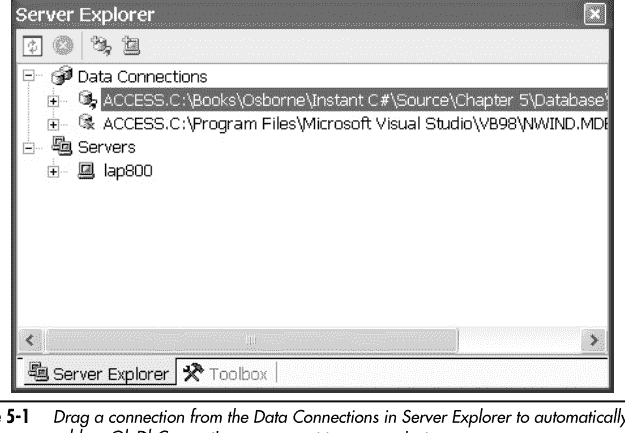

图 5-1 从服务器资源管理器中的“数据连接”拖动连接，会自动向项目添加一个 OleDbConnection 组件。

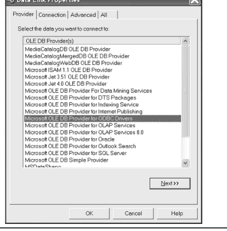

图 5-2 使用“数据链接属性”小程序，可以快速准确地配置连接字符串。

“数据链接属性”小程序的“高级”选项卡允许您指定访问权限。默认设置是通过此连接对数据库进行共享的读写访问。“全部”选项卡包含名称和值对，允许您修改每个连接值。通常情况下，默认设置即可，除非您有特定原因需要修改初始化值，例如 `Jet OLEDB:Encrypt Database`。
关闭“数据链接属性”小程序后，您可以用记事本打开 `.UDL` 文件，并复制该小程序创建的连接字符串。下面是 UDL 小程序为本书源代码中提供的示例数据库 `Reference.mdb` 创建的连接字符串值示例。

```
Provider=Microsoft.Jet.OLEDB.4.0;DataSource=C:\Temp\Reference.mdb;
Persist Security Info=False
```

将前面的语句用引号括起来，您就可以用它来初始化 `OleDbConnection` 对象，而无需记住提供程序名称 `Microsoft.Jet.OLEDB.4.0`。清单 5-1 演示了如何编写代码来打开由示例连接字符串描述的数据库。

##### 清单 5-1

以下代码演示了如何打开 `OleDbConnection` 并使用资源保护块确保其关闭。

```
public static void TestConnection()
{
    OleDbConnection connection = new OleDbConnection();
    connection.ConnectionString =
        @"Provider=Microsoft.Jet.OLEDB.4.0;" +
        @"Data Source=C:\Temp\Reference.mdb;" +
        @"Persist Security Info=False";

    connection.Open();
    try
    {
        Console.WriteLine(connection.State.ToString());
        Console.ReadLine();
    }
    finally
    {
        connection.Close();
    }
}
```

#### 提示

C# 中的字符串可以是 `@` 引用的，也可以是普通引号引用的。普通引号引用的字符串将单个反斜杠视为转义字符，将双反斜杠视为一个反斜杠。`@` 引用的字符串将防止处理转义字符。

要在清单 5-1 中使用 OleDb 提供程序，需要添加一个 `using` 语句来引用 `System.Data.OleDb` 命名空间。您可以在创建对象时将连接字符串传递给构造函数，或者在对象创建后将连接字符串赋值给 `ConnectionString` 属性，以此来创建 `OleDbConnection` 对象。调用 `Open` 方法打开连接。`try finally` 处理程序中 `try` 部分的代码（也称为资源保护块）代表实际的工作。在清单 5-1 中，我们只是将连接对象的状态写入控制台。`finally` 块总是会被调用，这正是我们想要的。我们总是希望关闭连接，而 `finally` 块将确保即使发生异常，连接也会被关闭。

#### 连接到 MS SQL Server 数据存储

从连接 SQL 数据库所需代码的角度来看，代码与清单 5-1 几乎相同。最大的区别在于连接字符串。连接字符串需要包含与 MS SQL Server 数据库相关的信息。您可以使用前一节描述的相同两种技术——从服务器资源管理器拖动连接或创建 UDL 文件并使用“数据链接属性”小程序——来定义指向 SQL Server 数据库的连接字符串。

我们可以使用与清单 5-1 中几乎相同的代码来打开与 SQL Server 数据库的连接。（Microsoft Desktop Engine [MSDE] 是一个适合在开发环境中使用的 SQL Server 数据库，因为它允许您在未连接的 PC 上进行初始软件编写。当您在海滩或吊床上编程时，这特别有用。）连接到 SQL Server 数据库时，您需要包含 `System.Data.SqlClient` 命名空间，并创建 `SqlConnection` 对象的实例。

```
SqlConnection connection = new SqlConnection();
connection.ConnectionString = 
    @"data source=LAP800\VSDOTNET;initial catalog=master;" + 
    @"integrated security=SSPI;persist security info=False;" + 
    @"workstation id=LAP800;packet size=4096";
```

使用一个架构良好的框架可以带来巨大的好处。让我们花一点时间来看看 ADO.NET 提供的其中一个好处。

### 使用 ADO.NET 接口声明类型

您可能想做的一件合理的事情是，使数据提供程序之间的切换变得容易。有几种情况可能会发生这种情况，接下来我将描述其中一种。

在俄勒冈州波特兰市的一个项目中，我们正在用 C# 为 IBM 的 Universal Database 构建一个企业解决方案。我住在密歇根州，发现偶尔回家远程办公很方便。（这有助于我处理庭院杂务。）我想在家庭办公室工作——那里有多处理器工作站、平面显示器、一个很棒的图书馆、一把巨大的办公椅，而且最重要的是，有家人在身边——但我不想安装客户可能使用的每一个数据库。相反，我将编写应用程序，允许我快速简单地切换到备用的数据提供程序。将 ADO.NET 与数据库的 CASE 工具结合使用，您可以轻松地在非生产环境中复制生产数据库。当然，如果您的雇主不认同我的观点，那么您可以将备用数据库场景作为一个灵活性问题提出来。
基本思想是，您定义返回 ADO.NET 接口（而不是特定的提供程序类）的方法，然后构造一个特定的提供程序类。您可以结合 CASE 工具，使用 ADO.NET 接口（而不是类）和通过外部 XML 文件管理的布尔值开关来复制生产数据库，这样您就拥有一个通用的应用程序开发环境和数据库异构性。

#### 使用 IDbConnection 在数据库之间切换

清单 5-2 演示了我们如何将变量声明为 ADO.NET 提供程序实现的接口，并基于动态标准创建特定提供程序的实例。清单 5-2 使用条件编译指令在数据库之间切换。此解决方案需要重新编译。稍后，我将演示如何在不重新编译的情况下实现相同的结果。

##### 清单 5-2

使用 `IDbConnection` 接口声明您的类型，然后您可以将任何实现了该接口的 ADO.NET 连接赋值给它。

```
public class MultiConnection
{
    private static string GetConnectionString()
    {
        #if DEBUG
        return @"Provider=Microsoft.Jet.OLEDB.4.0;" +
               @"Data Source=C:\Temp\Refernce.mdb;" +
               @"Persist Security Info=False";
        #else
        return @"data source=LAP800\VSDOTNET;initial catalog=master;" +
               @"integrated security=SSPI;persist security info=False;" +
               @"workstation id=LAP800;packet size=4096";
        #endif
    }

    private static IDbConnection GetConnection()
    {
        #if DEBUG
        return new OleDbConnection(GetConnectionString());
        #else
        return new SqlConnection(GetConnectionString());
        #endif
    }

    public static void Test()
    {
        IDbConnection connection = GetConnection();
        connection.Open();
        try
        {
            Console.WriteLine(connection.State.ToString());
            Console.ReadLine();
        }
        finally
        {
            connection.Close();
        }
    }
}
```

对代码所做的唯一真正更改是将连接声明为 `IDbConnection`，而不是 `SqlConnection` 或 `OleDbConnection`。代码的其余部分与清单 5-1 中的前面示例一致。您可以切换清单 5-2 中第 5 行和第 17 行的条件编译语句，以在 SQL 和 OLE 数据库之间切换。

一个通用的框架使得编写一次代码成为可能，并且可以在像数据库这样重要的东西之间切换，而无需为每个数据库编写多个版本的代码。一个优秀的框架将这种灵活性触手可及。.NET 框架是一个卓越的框架。我们可以使用 `BooleanSwitch` 在不重新编译的情况下将切换数据库外部化。

### 使用 BooleanSwitch 在数据提供程序之间切换

允许用户在数据库之间切换可能有益的第二种情况是，当您正在编写消费产品，并且不想强制您的客户使用特定的数据库提供程序时。假设您编写了一个消费类应用程序，并希望允许客户在数据库之间进行选择。等到客户拿到应用程序时，再重新编译就太晚了。您可以内部使用 `BooleanSwitch`，外部使用 XML 文件来支持在数据提供程序之间切换（以及支持任何类型的外部化动态切换）。

清单 5-3 是清单 5-2 的修订版。该修订版演示了添加 `BooleanSwitch`，而清单 5-4 提供了定义开关的 XML 文件的清单。

#### 清单 5-3

此代码（清单 5-2 的修订版）演示了使用 `BooleanSwitch`。

```
public class SwitchedMultiConnection
{
    private static BooleanSwitch Switch =
        new BooleanSwitch("Provider",
            "Supports switching between data providers");

    private static string GetConnectionString()
    {
        if( Switch.Enabled )
```


## 142 高级 C# 编程

```csharp
10:     {
11:         return @"Provider=Microsoft.Jet.OLEDB.4.0;" +
12:             @"Data Source=C:\Books\Osborne\Instant C#" +
13:             @"\Source\Chapter 5\Database\Reference.mdb;" +
14:             @"Persist Security Info=False";
15:     }
16:     else
17:     {
18:         return @"data source=LAP800\VSDOTNET;initial catalog=master;" +
19:             @"integrated security=SSPI;persist security info=False;" +
20:             @"workstation id=LAP800;packet size=4096";
21:     }
22: }
23:
24: private static IDbConnection GetConnection()
25: {
26:     if (Switch.Enabled)
27:     {
28:         return new OleDbConnection(GetConnectionString());
29:     }
30:     else
31:     {
32:         return new SqlConnection(GetConnectionString());
33:     }
34: }
35:
36: public static void Test()
37: {
38:
39:     IDbConnection connection = GetConnection();
40:     connection.Open();
41:     try
42:     {
43:         Console.WriteLine(connection.State.ToString());
44:         Console.ReadLine();
45:     }
46:     finally
47:     {
48:         connection.Close();
49:     }
50: }
```

清单 5-3 的第 3 到 5 行声明并初始化了一个作为静态成员的 BooleanSwitch。将开关设为静态意味着我们将只实例化一个 BooleanSwitch，并在所有使用该开关的类实例之间共享它。第 9 行和第 26 行使用 BooleanSwitch 代替了条件编译指令，来决定我们应该使用 OleDb 还是 SqlClient 连接。

BooleanSwitch 和条件编译指令之间存在一些差异。条件编译指令必须更改并重新编译。求值失败的代码会被排除在编译后的程序集之外。BooleanSwitch 代码块中两个分支的代码都会被写入编译后的程序集，而要在不同版本的代码之间切换，我们只需在 XML 文件中更改开关的外部定义，无需重新编译。包含开关定义的 .config 文件在清单 5-4 中提供。

```
清单 5-4 以下代码定义了包含 BooleanSwitch 的 .config 文件。

<configuration>
    <system.diagnostics>
        <switches>
            <add name="Provider" value="1" />
        </switches>
    </system.diagnostics>
</configuration>
```

将配置文件命名为与使用它的程序集相同的名称，并添加 .config 扩展名。例如，如果你的程序集名为 myapp.exe，那么你的配置文件将是 myapp.exe.config。在与包含程序集的目录相同的目录中创建配置文件。配置文件中定义的 BooleanSwitch 内容的完整描述在第 7 章的“使用开关”部分提供。

将提供程序接口与 BooleanSwitch 对象结合，为我们提供了一种在不重新编译代码的情况下切换提供程序的便捷方式。ADO.NET 谜题的下一个部分是适配器。

### 理解适配器的作用

ADO.NET 将数据访问与数据操作分离开来。适配器是 ADO.NET 数据访问层的一部分。适配器用于在连接和存储缓存数据以供操作的类（包括 DataSet 和 DataTable）之间移动数据。要从数据源的连接中读取数据，可以使用 Fill 方法。要仅读取模式，可以调用 FillSchema 方法，而 Update 将接受对 DataTable 或 DataSet 中数据的修改后的修订，并将这些修订更新到数据源。

有一个用于 OLE DB 提供程序的 OleDbDataAdapter，一个用于 MS SQL Server 提供程序的 SqlDataAdapter，以及一个允许你编写与提供程序无关代码的 IDbAdapter 接口，就像我们在前面部分使用 IDbConnection 所做的那样。

适配器用 SQL 和连接对象初始化。适配器提供了从连接到数据操作对象的桥梁。在本节中，我将演示适配器的 Fill、FillSchema 和 Update 方法。

144 高级 C# 编程

### 初始化适配器

适配器用一个 SQL SELECT 命令和同一提供程序类型的连接对象初始化。对 OleDbProvider 使用 OleDbConnection，对 SqlClientProvider 使用 SqlConnection。（我不会重复此信息。假设如果 OleDb 提供程序或 SqlClient 提供程序之一有特定的类，那么对于另一种提供程序类型也存在对称的类。）

要初始化适配器，请使用一个 SQL SELECT 命令和一个类似的连接创建适配器实例。下面是一个适配器对象的示例，它使用指向本书提供的 Reference.mdb MS Access 数据库的 OleDbConnection 创建。

```csharp
OleDbConnection connection = new OleDbConnection();
connection.ConnectionString =
    @"Provider=Microsoft.Jet.OLEDB.4.0;" +
    @"Data Source=C:\Temp\Reference.mdb;" +
    @"Persist Security Info=False";

OleDbDataAdapter adapter = new OleDbDataAdapter(
    "SELECT * FROM METHOD", connection);
```

最后一行语句演示了初始化适配器对象的四种可能方式之一。适配器的其他三个重载构造函数是所示函数的变体；你可以使用 Visual Studio 帮助文档查看其他变体的示例。

### 连接池策略

如果你还记得，我们之前谈到过连接池。连接池隐式地基于连接字符串。为了通过连接池更优化地利用连接，你可以使用一种简单的技巧来确保你的代码不会充斥着字面量连接字符串。清单 5-5 提供了一个重构类的示例，该类支持仅维护一个连接字符串实例。

```
清单 5-5 此代码演示了如何使用类来确保你只有一个连接字符串实例。
1:  public class FactoredConnection
2:  {
3:      private static BooleanSwitch booleanSwitch =
4:          new BooleanSwitch("PKimmel",
5:          "Used to switch between connection strings");
6:
7:      public static string GetOleDbConnectionString()
8:      {
9:          if(booleanSwitch.Enabled)
10:         {
11:             return @"Provider=Microsoft.Jet.OLEDB.4.0;" +
12:    @"Data Source=C:\Books\Osborne\Instant C#" +
13:    @"\Source\Chapter 5\Database\Reference.mdb;" +
14:    @"Persist Security Info=False";
15: }
16: else
17: {
18:    return @"Provider=Microsoft.Jet.OLEDB.4.0;" +
19:           @"Data Source=C:\Temp\Reference.mdb;" +
20:           @"Persist Security Info=False";
21: }
22: }
23:
24: public static string GetSqlConnectionString()
25: {
26:    if(booleanSwitch.Enabled)
27:    {
28:       return @"data source=LAP800\VSDOTNET;initial catalog=master;" +
29:              @"integrated security=SSPI;persist security info=False;" +
30:              @"workstation id=LAP800;packet size=4096";
31:    }
32:    else
33:    {
34:       throw new Exception(
35:          "Make sure you have a MS SQL Server instance available.");
36:    }
37: }
38:
39: public static OleDbConnection GetOleDbConnection()
40: {
41:    return new OleDbConnection(GetOleDbConnectionString());
42: }
43:
44: public static SqlConnection GetSqlConnection()
45: {
46:    return new SqlConnection(GetSqlConnectionString());
47: }
48: }
```

同样，在清单 5-5 中，我们在第 9 行和第 26 行使用了 BooleanSwitch——来支持在连接字符串版本之间轻松切换。这与我们可能为连接与断开开发环境所采取的方法一致。请注意，*GetSqlConnectionString* 的 *else* 条件会抛出一个异常。你需要确保你可以访问安装在你桌面上的 MS SQL Server 或 MSDE，并且你的应用程序可以访问一个实例。

使用清单 5-5 中演示的方法，我们可以确定通过使用相同的连接字符串来促进连接池。这种方法并不禁止你创建不使用 FactoredConnection 类的新连接实例。

### 通用编程策略

前面的部分演示了一个 FactoredConnection 类，它通过创建一个包含连接字符串的单独类来促进连接池。编写像这样演示的代码还有另一个战略原因。我将其称为 *Kimmel 的收敛代码理论*。

> 注意
> Kimmel 的收敛代码理论：收敛到单个算法或类实例的代码是好的，因为它促进了重用、一致性以及高度重编排的动态行为。

收敛代码与发散代码背后的基本思想是，可以重用而不复制代码的最小代码单元是 *方法*。低于方法的任何部分都必须复制才能重用。也就是说，代码行必须被复制和粘贴才能重用。复制和粘贴的代码是发散代码，原因很简单，即存在多于一个算法实例。发散代码的负面结果是，对于发散代码的每个实例，程序员必须复制、单独测试并分别维护各个代码行。结果是发散代码倾向于根据代码被复制和粘贴的次数而随时间退化。结果是发散代码倾向于在行为上产生语义相似但发散的操作，导致性能不可靠的错觉。

总结一下：相对于我们的 FactoredConnection 类，我们只有一个连接字符串实例需要维护。如果连接发生变化，我们只需在一个地方传播更改。如果我们希望 FactoredConnection 的行为发生变化，那么我们同样只需在一个地方更改代码。考虑我们希望从外部资源（如注册表）读取连接字符串的情况。同样，我们只需要在一个地方更改代码。

收敛代码以方法的形式产生了以下好的经验法则：优先使用单一、简短、命名良好、高度可重用的方法，而不是代表多个、整体式、不可重用方法的代码行。William Opdyke 在 1990 年的博士论文是 *重构* 这个主题的推动力，这支持了我的收敛理论。你可以在 Martin Fowler 的卓越著作 *《重构：改善既有代码的设计》*（Addison-Wesley）中阅读关于重构的内容。

### 调用适配器 Fill 方法

Fill 方法用于在连接和 DataSet 之间移动数据。要填充 DataSet，你需要创建一个连接和一个适配器，并调用适配器的 Fill 方法。一个 DataSet 对象作为参数传递给 Fill 方法。你不需要显式创建连接实例来使用适配器。你可以将连接字符串而不是连接对象传递给适配器，适配器将在内部创建一个实例。

的连接，然后自动打开和关闭连接。以下是几个演示使用 `Fill` 命令的示例。

```csharp
public static void TestFill()
{
    OleDbConnection connection = FactoredConnection.GetOleDbConnection();
    OleDbDataAdapter adapter = new OleDbDataAdapter(
        "SELECT * FROM METHOD", connection);

    DataSet dataSet = new DataSet();
    connection.Open();
    try
    {
        adapter.Fill(dataSet);
    }
    finally
    {
        connection.Close();
    }

    WalkDataSet(dataSet);
}
```

前面的示例详细地创建了 `OleDbConnection`、`OleDbDataAdapter` 和 `DataSet`，打开连接，然后填充 `DataSet`。`WalkDataSet` 代表一个执行实际工作的方法。（你可以在网上 www.osborne.com 的 ADOSampleCode.sln 中找到 `WalkDataSet` 的代码。）

接下来的第二个示例演示了一个简洁的版本，它将连接字符串传递给 `OleDbDataAdapter` 构造函数，适配器将负责打开和关闭连接。

```csharp
private static void TestFill2()
{
    OleDbDataAdapter adapter = new OleDbDataAdapter(
        "SELECT * FROM METHOD",
        FactoredConnection.GetOleDbConnectionString());

    DataSet dataSet = new DataSet();
    adapter.Fill(dataSet);
    WalkDataSet(dataSet);
}
```

（`FactoredConnection` 类在前面的“连接池策略”一节中已介绍。）前面的示例演示了填充 `DataSet` 的一种简洁方式。更重要的是，注意在这两种情况下，我们都是在连接关闭后操作 `DataSet` 的。（第一个示例显式关闭连接，第二个示例在 `Fill` 操作后关闭连接。）这演示了 ADO.NET 的无连接操作模式。数据已缓存在 `DataSet` 中，并且完全独立于连接和适配器。

### 调用适配器的 FillSchema 方法

如果你正在执行大量的插入语句，并且对现有数据行不感兴趣，那么你可以只请求架构。要仅将架构（表的描述）读入 `DataSet`，请使用 `FillSchema` 方法。

与 `Fill` 方法一样，你实际上可以填充单个 `DataTable` 或将表添加到 `DataSet`。`DataSet` 是一个表的集合，以及这些表之间的可选关系。（有关更多信息，请参阅后面的“使用 DataSet”和“使用 DataTable”部分。）`FillSchema` 接受一个 `DataSet` 或 `DataTable` 参数，以及一个 `SchemaType` 枚举值，可以是 `Mapped` 或 `Source`。这是一个仅将表的描述读入 `DataSet` 的方法示例。

```csharp
public static void TestFillSchema()
{
    OleDbDataAdapter adapter = new OleDbDataAdapter(
        "SELECT * FROM METHOD",
        FactoredConnection.GetOleDbConnectionString());

    DataSet dataSet = new DataSet();
    adapter.FillSchema(dataSet, SchemaType.Source);
}
```

前面片段中的 `DataSet` 将包含一个只有列的表；这些列代表架构信息。枚举值 `SchemaType.Source`（两个可能值之一，另一个是 `SchemaType.Mapped`）指示适配器使用源表描述的架构。另一种选择是使用列映射转换的架构。（有关列映射的更多信息，请参阅本章后面的“使用 DataSet”部分。）

### 更新数据更改

适配器在连接和 `DataSet` 之间扮演桥梁的角色。正如我们使用适配器通过连接从数据源读取数据到 `DataSet` 中一样，我们也使用适配器来更新对数据所做的更改。更新包括 SQL `UPDATE`、SQL `INSERT` 和 SQL `DELETE` 操作。

我们指示适配器更新数据的方式是为我们想要执行的操作提供 SQL 命令。例如，如果我们添加了新行，那么在调用 `Update` 方法之前，我们需要向适配器提供一个 `INSERT` 命令。更新数据的基本步骤是：打开连接、创建一个提供 SQL `SELECT` 语句和连接作为初始值的适配器、用数据填充 `DataSet`、修改数据、创建描述如何执行更新的 SQL 命令，并调用适配器的 `Update` 方法。清单 5-6 演示了这些步骤的一个版本。

# 第 5 章：使用 ADO.NET 构建数据库应用程序 149

> 清单 5-6：此代码演示了如何使用适配器更新 `DataSet`。

```csharp
1: public static void TestUpdate()
2: {
3:     OleDbConnection connection =
4:         FactoredConnection.GetOleDbConnection();
5:
6:     OleDbDataAdapter adapter = new OleDbDataAdapter(
7:         "SELECT * FROM METHOD", connection);
8:
9:     DataSet dataSet = new DataSet();
10:    connection.Open();
11:    adapter.Fill(dataSet);
12:    connection.Close();
13:
14:    DataRow row = dataSet.Tables[0].NewRow();
15:    row["Name"] = "TestUpdate";
16:    dataSet.Tables[0].Rows.Add(row);
17:
18:    OleDbCommandBuilder commandBuilder =
19:        new OleDbCommandBuilder(adapter);
20:
21:    connection.Open();
22:    adapter.Update(dataSet);
23:    connection.Close();
24: }
```

清单 5-6 的第 3 行和第 4 行创建了一个连接对象。第 6 行和第 7 行使用连接对象创建适配器。第 9 行创建了一个 `DataSet` 的实例。第 10 行打开连接，第 11 行填充 `DataSet`，第 12 行关闭连接。我们不需要打开的连接来管理 `DataSet`，最好立即关闭连接。在实际应用程序中，实际添加数据的代码不太可能如此简单。

清单 5-6 的第 14 到 16 行演示了如何向 `DataSet` 中的表添加新行。第 14 行添加行。第 15 行更新行中的一个字段，第 16 行使用 `Rows.Add` 命令将行添加到表的 `Rows` 集合中。

清单 5-6 的第 18 行使用适配器构造一个 `OleDbCommandBuilder`。命令构建器自动使用表的架构信息来生成 `INSERT`、`DELETE` 和 `UPDATE` SQL 命令。有关 `OleDbCommandBuilder` 的更多信息，请参阅本章后面的“使用 CommandBuilder 生成 SQL”部分。

清单 5-6 的第 21 到 22 行打开连接、更新数据库并关闭连接。`DataSet` 知道我们插入了一个新行；因此，适配器知道要使用适配器的 `InsertCommand` 属性来写入我们在第 14 到 16 行添加的数据行。

## 使用 DataSet

`DataSet` 是 ADO 记录集的演进。`DataSet` 是 ADO.NET 的一个无连接存储库，你可以使用 `DataSet` 对象而无需连接到数据源。我们只简要介绍了 `DataColumn`、`DataRow` 和 `DataTable`，但这些对象可以存在，并且你可以在不连接到数据源的情况下以编程方式与它们交互。

通常，`DataSet` 模型与我们对关系数据库的思考方式一致。`DataSet` 包含一个 `DataRelationCollection` 和一个 `DataTableCollection`。`DataTableCollection` 包含 `DataRowCollection`、`DataColumnCollection`、`ChildRelations`、`ParentRelations` 和 `ExtendedProperties`。`DataRowCollection` 包含 `DataRow` 对象的实例，`DataColumnCollection` 包含 `DataColumn` 对象。还有一个由 `DataView` 类表示的数据视图。

你可以像本章前面演示的那样，通过连接到数据提供程序，以传统方式使用 `DataSet` 和包含的对象，或者你可以将 `DataSet` 用作内存中的存储库，以有组织的方式存储数据。下一节将演示如何使用 `DataSet` 的各个方面。

### 将 DataTable 对象添加到 DataSet

当你创建一个 `DataSet` 对象并基于单个 SQL `SELECT` 语句从 `DataAdapter` 填充它时，真正发生的是创建了一个 `DataTable` 并将其添加到 `DataSet` 的 `DataTableCollection` 中。其前提是，为了使 ADO.NET 支持用于数据库管理的无连接模型，它必须支持存储和管理可能存在的关系中的数据。

最常见的关系是简单的主从关系。一个表扮演主表的角色，另一个表扮演从表的角色。在典型的主从关系中，你将需要一个主表、一个从表和一个 `DataRelation`。本章可下载的 AssemblyViewer.sln 演示了一个这样的关系，它存在于一个包含 CLR Typeinfo 对象和 ConstructorInfo 对象的表之间。清单 5-7 演示了如何填充 `DataTable` 对象并将这些对象添加到 `DataSet` 中。

> 清单 5-7：此代码演示了如何将 DataTable 对象添加到 DataSet 中。

```csharp
1:  OleDbConnection connection = new OleDbConnection(connectionString);
2:  OleDbDataAdapter adapter = new OleDbDataAdapter(
3:    "SELECT * FROM TYPE", connection);
4:  DataSet dataSet = new DataSet();
5:
6:  DataTable typeTable = new DataTable("TYPE");
7:  adapter.Fill(typeTable);
8:  dataSet.Tables.Add(typeTable);
9:
10: DataTable constructorTable = new DataTable("CONSTRUCTOR");
```


## 创建主从关系

在前一节中，我们向 DataSet 添加了两个表。为了在逻辑上连接这些表，我们需要创建一个 DataRelation 对象并将其添加到表中。清单 5-8 展示了代码，当与清单 5-7 中的代码结合时，它在 DataSet 中定义了主从关系。

```
清单 5-8    向 DataSet 添加 DataRelation。

DataColumn parent =
    dataSet.Tables["TYPE"].Columns["UnderlyingSystemType"];
DataColumn child =
    dataSet.Tables["CONSTRUCTOR"].Columns["DeclaringType"];
DataRelation relation = new DataRelation(
    "TypesAndConstructors", parent, child);
dataSet.Relations.Add(relation);
```

> **注意**

通常，我倾向于将相关列命名为相同的名称，以便于识别同一数据库中表之间的关系。但是，Reference.mdb 数据库表示 CLR 中定义的类型，其列是根据 CLR 中实际属性的名称创建的。例如，UnderlyingSystemType 是 CLR 中定义的 TypeInfo 类型中的一个属性。

与 SQL 中的 JOIN 语句一样，DataRelation 依赖于列。在清单 5-8 中，我们通过从每个 DataTable 中选择一个列来初始化两个 DataColumn 对象，这两个列代表了两个不同表之间的逻辑关系。在公共语言运行时中，TypeInfo 对象具有一个 UnderlyingSystemType 属性，该属性与 ConstructorInfo 的 DeclaringType 属性在逻辑上相关。我们使用 TYPE 表的 UnderlyingSystemType 列和 CONSTRUCTOR 表的 DeclaringType 列来初始化一个新的 DataRelation，并向 DataRelation 构造函数提供一个名称和两个逻辑相关的列作为参数。

当清单 5-8 中的最后一条语句 `dataSet.Relations.Add(relation)` 运行时，你在 DataSet 中就有了一个逻辑上的主从关系。这个关系如图 5-3 所示。图 5-3 是从 MS Access 2002 的“关系”对话框中创建的，但它准确地可视化了清单 5-7 和清单 5-8 代码运行后的 DataSet。每个显示的表代表一个 DataTable，表之间的线代表 DataRelation 对象。

你可以将 DataSet 绑定到 Windows Forms 或 Web Forms 的 DataGrid，DataGrid 将通过以层次结构呈现数据来准确地管理主从方面的内容。你可以查看 AssemblyViewer.sln 以获取示例。将 DataSet 绑定到 DataGrid 的代码只需要一条语句：

```
dataGrid1.DataSource = dataSet;
```

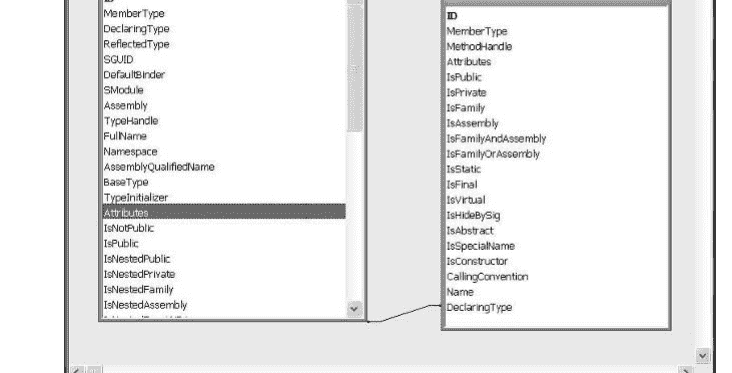

图 5-3 MS Access 中的“关系”对话框准确地描述了由单个 DataRelation 关联的两个 DataTable。

## 创建数据列映射

你可能想做的另一件常见事情是清理不好看的列名。我遇到过大量列名晦涩难懂的数据库，比如 NAME_SEQ_TS。通常，在原始 DBA 离开项目后，很难弄清楚这些列的作用。不幸的是，你可能并不总是处于可以重新设计数据库的位置。

> 注意

记录和管理数据库是使用 CASE 工具的好理由。ERwin、DataArchitect 和 Select 都是很好的 CASE 工具，它们可以轻松地设计、记录和维护数据库。

我们选择不重新设计数据库的一个实例是，客户重新实现系统的动机并非对现有实现不满意。客户只是不想再被收取高昂租金的硬件供应商所挟持。我们的任务说明书是提供一个新系统，其行为复制现有系统的行为。不应该有新功能。现有系统是用 Natural 和 Adabas 实现的，我们将其移植到 C#、ASP.NET 和 UDB。本质上，我们将一个作为终端应用程序实现的非面向对象系统移植到一个瘦客户端 Web 应用程序。我们的任务说明书实际上不允许重新设计数据库，所以我们做了次优的选择。我们使用列映射来更清晰地为那些具有晦涩名称的旧遗留列命名。清单 5-9 演示了我们如何协同使用 DataTableMapping 和 DataColumnMapping 对象来支持为列提供备用名称。

```
清单 5-9 使用 DataTableMapping 和 DataColumnMapping 对象

OleDbConnection connection = new OleDbConnection(connectionString);
OleDbDataAdapter adapter = new OleDbDataAdapter(
    "SELECT * FROM PARAMETER_TABLE", connection);
DataSet dataSet = new DataSet();

DataTableMapping tableMapping =
    adapter.TableMappings.Add("Parameter", "PARAMETER_TABLE");

tableMapping.ColumnMappings.Add("ParameterType", "Parameter Type");
adapter.Fill(dataSet, "Parameter");

dataGrid1.DataSource = dataSet.Tables[0];
```

清单 5-9 创建了一个名为 Parameter 的表映射，该映射映射到 Reference.mdb 的 PARAMETER_TABLE 表。当我们调用 DataTableMapping.ColumnMappings.Add 方法时，DataColumnMapping 是隐式创建的。源表列 ParameterType 被映射到易于阅读的“Parameter Type”列。在 adapter 上调用 Fill 方法并使用 DataTableMapping 名称将使用映射后的列名从源表 PARAMETER_TABLE 填充数据表中的列。

当然，你可以通过使用描述列别名的 SQL 语句来实现这一点——通常是在 SELECT 语句中使用 As 子句。DataTableMapping 和 DataColumnMappings 也可以用于更新。清单 5-10 演示了如何使用映射后的表和列来使用映射后的值执行更新。

**清单 5-10** *清单 5-9 的修订版本演示了如何对映射后的表和列执行更新。*

```
OleDbConnection connection = new OleDbConnection(connectionString);
OleDbDataAdapter adapter = new OleDbDataAdapter(
    "SELECT * FROM PARAMETER_TABLE", connection);
DataSet dataSet = new DataSet();

DataTableMapping tableMapping =
    adapter.TableMappings.Add("Parameter", "PARAMETER_TABLE");

tableMapping.ColumnMappings.Add("ParameterType", "Parameter Type");
adapter.Fill(dataSet, "Parameter");

// 演示使用映射对象进行更新
DataRow dataRow = dataSet.Tables[0].NewRow();
dataRow["Parameter Type"] = "Test";
dataSet.Tables[0].Rows.Add(dataRow);
adapter.InsertCommand = (new
    OleDbCommandBuilder(adapter)).GetInsertCommand();
adapter.Update(dataSet, "Parameter");

dataGrid1.DataSource = dataSet.Tables[0];
```

**提示**

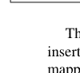

> 创建内联对象以避免在代码中杂乱地放置临时变量是完全可以接受的，如清单 5-10 中内联创建的 OleDbCommandBuilder 所示。如果你在相同的代码中后续不需要对该对象的引用，可以使用内联对象。

以“Demonstrates”开头的注释是插入新代码以修改清单 5-9 的地方。这段代码与执行无映射的更新非常相似。我们请求一个新的 DataRow。我们使用 DataRow 的索引器通过引用映射后的列名来修改单个字段。我们将修改后的行添加到 Rows 集合中，并通过创建一个 OleDbCommandBuilder 来为我们编写 SQL 并调用 OleDbDataAdapter.Update 命令来完成操作。请记住，要像我们执行 Fill 操作一样，在更新时使用映射后的表名。


## 使用 DataTable

DataTable 对应数据库中的表。你也可以将 DataTable 用作内存中的数据存储，用于那些永远不会进入数据库的数据。正如我那位聪明且优秀的朋友 Eric Cotter 所说："可以将 DataTable 看作一种方便的数据存储方式。"

虽然并不要求将 DataTable 的使用限制在数据库应用中，但 DataTable 最初是为此目的而定义的。DataTable 对象主要由 DataRowCollection 和 DataColumnCollection 对象组成。逻辑上，DataTable 看起来像一个电子表格，其中列和行的交点代表一个字段。你可能希望在 DataTable 上执行的操作包括：从数据源填充表，以及在修改表中的数据后更新该数据源。我们已经看过几个演示 DataTable 这种用法的示例，本章的 AssemblyViewer.sln 中还有更多。另一个你可能想要执行的任务是以编程方式创建和定义 DataTable，包括创建主键列和自增列。

AssemblyViewer.sln 定义了几种继承自 DataTable 的类型。这些类型中的每一种都能够创建一个内存中的 DataTable，或一个 Access 数据库中代表类型对象的表。例如，Database.cs 中定义的 PropertyTable 能够从 PropertyInfo 对象读取所有属性，定义一个 DataTable，并将所有 PropertyInfo 详情添加到 DataTable 中。（关于反射的讨论，请参见第 2 章和第 11 章。）

基本思路是：将一个类型传递给 PropertyTable 的 CreateNew 方法。使用反射获取该类型所有的 PropertyInfo——即属性描述——对象。然后使用 PropertyInfo 对象的属性名称和类型动态创建一个表，接着遍历传递给 CreateNew 的类型所代表的每个属性的 PropertyInfo 对象，并将每个 PropertyInfo 对象的值添加到这个动态表中。（我想在这里列出 AssemblyViewer.sln 的完整代码，但仅重构后的 Database 模块就有 728 行代码。你将需要下载示例解决方案并逐步运行应用程序来探索所有代码。）为了便于你理解，下面的项目符号列表描述了应用于类型所有成员的反射算法。

-   确定你想要探索的类型的元素。在本例中，我们将只探索类型的属性。
-   属性由 `System.Reflection.PropertyInfo` 类描述。
-   遍历 PropertyInfo 类的所有属性，为 PropertyInfo 类定义的每个属性向 DataTable 添加一个列。每个属性本身也由相同的属性描述。
-   遍历你想要探索的类型的全部属性，写入与每个属性的 PropertyInfo 关联的值。

一个属性由 PropertyInfo 对象描述。PropertyInfo 对象有几个描述属性的属性。（有点绕口。）一个属性由 MemberType、PropertyType、Attributes、IsSpecialName、CanRead、CanWrite、Name、DeclaringType 和 ReflectedType 描述。类型中的每个属性都使用其类型记录中这些元素的值进行初始化。为了创建一个描述类及其属性的表，我们可以存储 PropertyInfo 对象每个属性的值。当将此数据添加到表时，添加一个主键列和为每个 PropertyInfo 属性添加列会很有帮助。这正是 AssemblyViewer.sln 所做的。我们将在接下来的章节中，通过查看在 Reference.mdb 数据库中创建属性表的代码来逐步检查此过程的每个部分。

### 创建 DataTable 对象

创建 DataTable 很容易。确保你引用了 `System.Data.dll` 程序集，在新项目中它默认是引用的。在你将要声明 DataTable 的模块中添加一个引用 `System.Data` 命名空间的 using 语句。构造一个新的 DataTable 实例，并为 DataTable 提供一个名称。

```csharp
DataTable table = new DataTable("PROPERTY");
```

回想一下我说过你可以独立于提供程序和 DataSets 使用 DataTable。前面的代码就是你创建新 DataTable 所需的全部。

### 创建主键、自增列

就我们的目的而言，我们可以使用一个简单的自增列作为属性表的主键。我们向在上一节中创建的表添加一个 DataColumn，并为该数据列提供一些特定信息。更新后的代码如下所示，见代码清单 5-11。

代码清单 5-11 此代码演示了如何在 DataTable 中创建自增主键列。

```csharp
DataTable table = new DataTable("PROPERTY");
DataColumn column = table.Columns.Add();
column.ColumnName = columnName;
column.AutoIncrement = true;
column.AutoIncrementSeed = 1;
column.AutoIncrementStep = 1;
column.Unique = true;
table.PrimaryKey = new DataColumn[]{column};
```

在创建 DataTable 后，我们通过调用 `DataTable.Columns.Add` 方法创建一个新列。如演示所示，提供 ColumnName，通过将 `DataColumn.AutoIncrement` 属性设置为 True 来指示此列是自增的。你可以选择性地设置 `DataColumn.AutoIncrementSeed` 和 `DataColumn.AutoIncrementStep` 属性，或者为每个属性使用默认值 1。AutoIncrementSeed 值是自增列的起始数字，AutoIncrementStep 值定义了每次递增的值。如前面的代码片段所示，指示该列必须是唯一的。

最后，DataTable 的主键可以由多列组成。因此，我们必须用 DataColumn 对象的数组初始化 `DataTable.PrimaryKey` 属性。在我们的示例中——在代码清单 5-11 的最后一行——组成键的列数组由我们的单个列构成。

### 遍历 PropertyInfo 类的属性

添加基本的普通列比添加主键列和自增列容易得多。我们只需要通过向 DataTable 请求来创建一个 DataColumn 对象，并为该列提供名称和数据类型。按照这个逻辑，我们可以使用代码清单 5-12 中的代码创建一个映射到 PropertyInfo 记录的 DataTable。

```csharp
代码清单 5-12 此代码演示了如何创建一个映射 PropertyInfo 类的表。
DataTable table = new DataTable("PROPERTY");
DataColumn column = table.Columns.Add();
column.ColumnName = columnName;
column.AutoIncrement = true;
column.AutoIncrementSeed = 1;
column.AutoIncrementStep = 1;
column.Unique = true;
table.PrimaryKey = new DataColumn[]{column};

PropertyInfo[] infos = typeof(PropertyInfo).GetProperties(
    BindingFlags.Public | BindingFlags.NonPublic |
    BindingFlags.Instance | BindingFlags.Static);

foreach(PropertyInfo info in infos)
{
    column = table.Columns.Add();
    column.ColumnName = info.Name;
    column.DataType = typeof(string);
    column.ReadOnly = true;
}
```

新代码检索 PropertyInfo 类自身的 PropertyInfo 对象数组。BindingFlags 指示我们应该获取类型的公共和非公共成员，以及实例和静态成员。`foreach` 语句在底层通过从类型请求一个枚举器来工作。这意味着该类型必须实现 `IEnumerable` 接口。System.Array 类型——任何使用 `[]` 数组运算符声明的类型——都隐式实现了 `IEnumerable` 接口。对于每个 PropertyInfo，我们向 DataTable 请求一个 DataColumn；设置 ColumnName、DataType 和 ReadOnly 属性。（设置 ReadOnly 属性是因为我们无法真正通过修改数据库来改变类型的实现；因此，允许用户修改 PropertyInfo 值没有意义。）

当我们全部完成后，我们就得到了一个其模式（Schema）映射 PropertyInfo 类属性的表。可以使用类似的方法向 DataTable 添加数据行。有关向 DataTable 添加数据行的示例，请参见代码清单 5-6 和 5-10。你也可以参考 AssemblyViewer.sln 中的几个向 DataTable 添加数据的示例。

## 使用 DataView

DataView 默认是 DataTable 中数据的只读视图。你可以通过将 DataView 的 AllowNew、AllowEdit 和 AllowDelete 属性更改为 True 来启用对 DataView 的修改。DataView 使用一个 DataTable 初始化，并可用于排序、过滤和修改数据。

我们可以通过过滤我们的 Property 表的 CanWrite 字段来创建一个显示只读属性的 DataView。代码清单 5-13 演示了如何创建一个 DataView 并应用一个行过滤器，其语法大致相当于 *Where* 子句中的谓词。

```csharp
代码清单 5-13 *此代码演示了如何创建一个 DataView 并应用行过滤器。*

OleDbConnection connection = new OleDbConnection(connectionString);
OleDbDataAdapter adapter =
    new OleDbDataAdapter("SELECT * FROM PROPERTY", connection);
DataTable table = new DataTable();
adapter.Fill(table);
DataView dataView = new DataView(table);
dataView.RowFilter = "CanWrite = 'False'";

dataGrid1.DataSource = dataView;
```

代码清单 5-13 与前面清单的主要区别在于创建了 DataView。如前所述，我们用一个 DataTable 初始化 DataView。我们也可以选择性地过滤和排序 DataView，而无需重新查询数据源。该示例演示了 `DataView.RowFilter`，它通过 CanWrite 的字符串值 'False' 来过滤 PROPERTY 表中的行。

最后一步演示了如何将 DataView 绑定到 Windows Forms DataGrid。有关完整代码列表，请参考 AssemblyViewer.sln。要了解更多关于将 ADO.NET 与控件结合使用的内容，请查看本章后面的“将 DataSet 绑定到 DataGrid”部分。

## 使用 DataReader 获取只读数据

DataReader 可用于获取数据的只进只读视图，而无需 DataSet 的开销。DataReader 需要一个连接和一个命令，并通过调用命令对象的 ExecuteReader 方法来初始化。清单 5-14 提供了一个使用 OleDbDataReader 的简要示例。

**清单 5-14** *使用 OleDbDataReader 读取 SQL 命令返回的所有行*

```
OleDbConnection connection = new OleDbConnection(connectionString);
OleDbCommand command =
    new OleDbCommand("SELECT * FROM FIELD", connection);
connection.Open();
OleDbDataReader reader = command.ExecuteReader();
while( reader.Read())
{
    Debug.WriteLine(reader.GetValue(0));
}
reader.Close();
connection.Close();
```

我们无法将 DataReader 绑定到网格，因为 DataReader 没有实现 IList 或 IListSource 接口。这是技术原因。逻辑原因是，网格可以向前和向后滚动，而 DataReader 是只进的。

在 DataReader 处于活动状态时，必须保持连接打开，如代码所示。确保在完成使用后调用 reader 的 Close 方法，因为在 reader 关闭之前无法重用连接。使用 DataReader 的好处在于它执行读操作非常快。

## 在 DataGrid 中显示信息

面向对象的框架通常非常灵活，因为整个框架中存在一定程度的共性。一个例子是 Windows Forms DataGrid 控件。DataGrid 控件有一个 DataSource 属性。你可以将各种对象分配给 DataSource，因为 DataSource 被设计为可以与任何实现了 IList 或 IListSource 接口的对象一起使用。（IListSource 有两个成员，其中一个返回实现了 IList 的对象。）因此，在绑定到 DataSource 属性时具有极大的灵活性。

通常，DataSource 属性可以分配给 DataTable、DataSet、DataView、DataViewManager 以及任何实现了 IList 或 IListSource 的对象。DataSource 泛型实现的最终效果是，你显然可以绑定到 ADO.NET 中定义的对象，但也可以绑定到任何类型的对象列表。

回想一下，在清单 5-12 中我们调用了 GetProperties 方法。GetProperties 返回一个 PropertyInfo 对象数组，在代码中表示为 PropertyInfo[]。数组的底层类型是 System.Array。有趣的是，System.Array 实现了 IList 接口。因此，我们应该能够将 DataGrid.DataSource 属性直接绑定到 GetProperties 返回的 PropertyInfo[]。实际上，如果你编写以下代码，你将得到与将清单 5-12 中的 DataTable 分配给 DataGrid 的 DataSource 属性几乎相同的结果。

```
dataGrid1.DataSource = this.GetType().GetProperties();
```

前面的单条语句产生了图 5-4 中 DataGrid 所示的视图。尝试绑定到通过调用 GetMembers、GetFields 和 GetMethods 返回的数组。

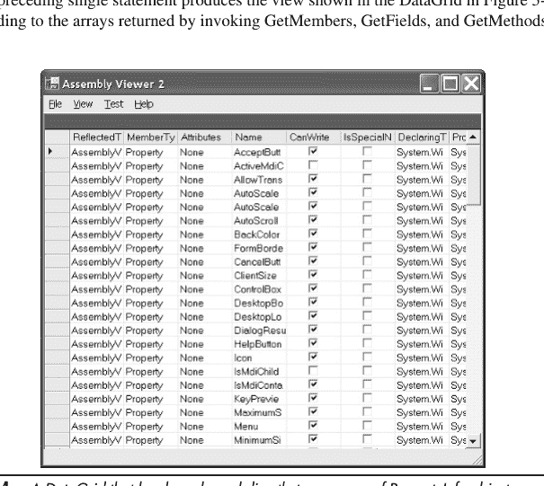

图 5-4 直接绑定到 PropertyInfo 对象数组的 DataGrid

## 使用 Command 对象

Command 对象用于将 SQL 命令封装在一个对象中。对于 MS SQL Server 提供程序使用 SqlCommand，对于 OLE DB 提供程序使用 OleDbCommand。Command 对象存储表示 SELECT、UPDATE、INSERT 和 DELETE 语句的 SQL 文本，并为你提供用于特定提供程序的其他 SQL 命令的对象。其他命令的示例包括 CREATE TABLE、ALTER TABLE 和 DROP TABLE。

要创建 OleDbCommand 对象，我们可以通过传递 SQL 文本和 OleDbConnection 对象的实例来构造该对象的实例。OleDbCommand 对象可用作 OleDbDataAdapter 的指令，或直接用于执行不返回结果集的 SQL 命令。清单 15-4 提供了创建用于请求 DataReader 的 OleDbCommand 的示例。你可以查看该示例以及 AssemblyViewer.sln 中创建的 OleDbCommand 对象以获取更多示例。

我们还没有看过的其中一种命令是用于在数据库中创建实体的命令。我们可以使用 OleDbCommand 和 SQL CREATE TABLE 语句向数据库添加新表。清单 5-15 中的代码演示了如何在 Access 数据库中创建表。（你需要稍微修改 SQL 以匹配你使用的提供程序的语法；提供程序的用户指南是特定 SQL 语法的最佳资源。）

清单 5-15 此代码演示了如何在 OLE DB 提供程序中创建表。

```
const string connectionString =
    @"Provider=Microsoft.Jet.OLEDB.4.0;Password=" + 
    @"User ID=;Data Source=C:\Temp\Reference.mdb;";
OleDbConnection connection = new OleDbConnection();
const string SQL =
    @"CREATE TABLE Constructor ([ID] COUNTER (1,1), " +
    @"[MemberType] string, [MethodHandle] string, " +
    @"[Attributes] string, [IsPublic] string, " +
    @"[IsPrivate] string, [IsFamily] string, " +
    @"[IsAssembly] string, [IsFamilyAndAssembly] string, " +
    @"[IsFamilyOrAssembly] string, [IsStatic] string, " +
    @"[IsFinal] string, [IsVirtual] string, [IsHideBySig] string, " +
    @"[IsAbstract] string, [IsSpecialName] string, " +
    @"[IsConstructor] string, [CallingConvention] string, " +
    @"[Name] string, [DeclaringType] string, " +
    @"CONSTRAINT [Index1] PRIMARY KEY ([ID]))";
OleDbCommand command = new OleDbCommand(SQL, connection);
command.ExecuteNonQuery();
```

清单 5-15 中的大部分代码是 SQL 文本。（我们马上会看到更好的管理 SQL 语句的方法。）第一条语句是 Jet OLE DB 提供程序的字面连接字符串，包括 Provider、Password、User ID 和 Data Source 子句。第二条语句创建 OleDbConnection 的一个实例。第三条语句是适用于 Jet OLE DB 提供程序的字面 CREATE TABLE SQL 语句。（Jet 是 MS Access 数据库引擎的名称。）OleDbCommand 对象是通过用 SQL 文本和连接对象初始化一个实例来创建的。最后，我们使用命令对象将查询发送到数据库引擎。

CREATE TABLE 语句特定于我们向其发送 SQL 文本的数据库。基本语法是 CREATE TABLE (tablename fielddefinitions [fielddefinition1, ... fielddefinition(n)] constraints)，其中表名是有效名称，字段定义指示字段名、数据类型和任何约束（如主键）。

CREATE TABLE 语句演示了如何创建自增列。描述为 [ID] COUNTER (1,1) 的 ID 列定义了一个自增列，使用种子值 1 和增量值 1。CONSTRAINT [Index1] PRIMARY KEY ([ID]) 定义了一个名为 Index1 的索引作为基于 ID 列的主键。

## 使用 CommandBuilder 生成 SQL

编写 SQL 语句可能有点乏味。在 ADO.NET 中有一种更简单的方法来生成 SQL。构造一个 OleDbCommandBuilder 实例，并用一个用 SELECT 语句初始化的适配器来初始化命令构建器。SELECT 语句返回的架构可用于生成 SQL INSERT、DELETE 和 UPDATE 语句。

清单 5-6 的第 18 行和第 19 行用一个 OleDbDataAdapter 实例构造了 OleDbCommandBuilder。用于初始化 OleDbDataAdapter 的命令文本是“SELECT * FROM METHOD”。从可以从 METHOD 表中读取的架构中，可以生成冗长的 SQL 命令实例。当你调用 OleDbDataAdapter.Update 命令时，OleDbCommandBuilder 创建的 SQL 是根据对 DataSet 中表的更改来更新数据源所必需的。

## 次要主题

你知道如何创建连接并使用适配器将通过连接读取的数据桥接到 DataTable 或 DataSet。这些对象很少单独使用。在你的典型应用程序中，你将把 ADO.NET 对象与可视控件、应用程序以及可能的 Web 服务结合使用。

本章的这一部分介绍了你将使用 ADO.NET 的上下文方式，包括从 Web 服务返回 DataSet。你可以将本章这一部分中的示例作为这些主题的简要介绍，并浏览本书的其余部分以获取更多示例。探索随 Visual Studio .NET 提供的示例应用程序以及 www.gotdotnet.com 和 www.codeguru.com 网站，作为更多代码示例的附加资源。


### 将 DataSet 绑定到 DataGrid

你可以将数据直接绑定到 `System.Web.UI.WebControls.DataGrid`。要求是数据必须实现 `IEnumerable` 接口。如果数据对象实现了 `IList` 或 `IListSource` 接口，则可以将数据绑定到 `System.Windows.Forms.DataGrid` 控件。`DataSet` 类实现了 `IEnumerable`、`IList` 和 `IListSource`，这意味着你可以快速创建一个用户界面，将 `DataSet` 绑定到 Windows 窗体或 Web 窗体中的 `DataGrid`。

以下两个代码片段演示了如何将 `DataSet` 绑定到 Windows 窗体和 Web 窗体的 `DataGrid`。

```
DataGrid.DataSource = DataSet;
```

以上语句就是将 `DataSet` 绑定到 Windows 窗体 `DataGrid` 所需的全部代码。

```
DataGrid.DataSource = DataSet;
DataGrid.DataBind();
```

以上是将 `DataSet` 绑定到 Web 窗体 `DataGrid` 所需的两个基本语句。

`DataGrid` 代表 `DataGrid` 的一个特定实例，而 `DataSet` 代表一个 `DataSet` 对象的特定实例。此外，你还可以将 `DataTable` 或任何其他实现了必要接口之一的集合进行绑定。例如，`System.Array`（当你声明任何类型的数组时使用的底层类型）实现了 `IList` 接口。因此，正如前面“在 DataGrid 中显示信息”部分所演示的，任何类型的数组都可以在 `DataGrid` 中显示。数组中对象类型的公共属性将用于创建 `DataGrid` 中的列。

### 从 Web 服务返回 DataSet

XML 是 .NET Framework 的组成部分。ADO.NET 使用 XML 来管理数据。`DataSet` 是用 `SerializableAttribute` 定义的。正是 `SerializableAttribute` 和 XML 支持从 Web 服务返回 `DataSet`。清单 5-16 包含一个整体的 Web 方法（定义在可从 www.osborne.com 下载的 `Reference.sln` 中），该方法动态探索传递给 Web 方法的类型的方法。

```
清单 5-16  *此代码演示了一个返回 DataSet 的 Web 方法。*

[WebMethod, ReflectionPermission(SecurityAction.Demand)]
public DataSet GetMethods(string type)
{
    DataTable table = new DataTable("METHOD");
    MethodInfo[] methods = Type.GetType(type).GetMethods();
    DataColumn column;
    foreach(PropertyInfo propertyInfo
      in typeof(MethodInfo).GetProperties())
    {
      column = table.Columns.Add();
      column.ColumnName = propertyInfo.Name;
      column.DataType = typeof(string);
    }

    DataRow dataRow;
    foreach(MethodInfo methodInfo in methods)
    {
      dataRow = table.NewRow();
      foreach(PropertyInfo propertyInfo
        in methodInfo.GetType().GetProperties())
      {
        dataRow[propertyInfo.Name] =
          propertyInfo.GetValue(methodInfo, null);
      }
      table.Rows.Add(dataRow);
    }
    DataSet dataSet = new DataSet();
    dataSet.Tables.Add(table);
    return dataSet;
}
```

传入类型的完整命名空间，`GetMethods` Web 方法将基于 `MethodInfo` 类型的属性创建一个表。这些属性成为 `DataTable` 的列。每个方法的属性成为 `DataTable` 的行。将 `DataTable` 添加到 `DataSet` 中，我们就可以返回动态反射类型的方法。如果我们要在 Web 服务中使用反射，则需要 `Demand` `ReflectionPermission`。任何从网络下载的代码都不能保证被授予反射权限。

### 实现 TraceListener

`AssemblyViewer.sln` 定义了一个继承自 `TraceListener` 的嵌套类。通过继承 `TraceListener`，我们可以将自定义 `TraceListener` 监听器的实例注册到 `System.Diagnostics.Trace` 类的 `Listeners` 集合中。结果就是我们的自定义监听器可以捕获 `Trace` 消息并将其作为我们表示层的一部分显示出来。（这与 Terrarium 提供的 Trace 窗口一致。有关 Terrarium 的信息，请参阅第 4 章。）

清单 15-17 演示了添加到 `AssemblyViewer.sln` 主窗体中的一个私有嵌套 `TraceListener` 类，我们可以将主窗体用作 `TraceListener` 窗口，在测试应用程序时显示 `Trace` 信息。

```
清单 15-17  *自定义 TraceListener 的实现*

private class Listener : TraceListener
{
    private StatusBar statusBar;
    public Listener(StatusBar statusBar) : base()
    {
        this.statusBar = statusBar;
    }

    public override void Write(string text)
    {
        statusBar.Text = text;
        Application.DoEvents();
    }

    public override void WriteLine(string text)
    {
        statusBar.Text = text;
        Application.DoEvents();
    }
}
```

要实现自定义 `TraceListener`，你需要重写 `Write` 和 `WriteLine` 方法。当我们向 `System.Diagnostics.Trace.Listeners` 集合添加 `TraceListener`（即 `Listener`）的实例时，使用 `Trace` 对象写入的消息也会发送到我们的监听器。根据我们监听器的实现，我们存储对 `StatusBar` 的引用，并在 `StatusBar` 控件上显示跟踪信息。实际上，拥有窗体的 `StatusBar` 控件变成了一个可视的跟踪窗口。

与其发明新的类，我们可以找到使用现有类的新方法。.NET Framework 组织良好但范围广泛。在编写大量新代码之前，请尽可能利用现有的框架。

## 总结

与本书的一般方法一致，本章演示了你可能在单个应用程序中发现的几个主题。大量应用程序都是数据库应用程序。ADO.NET 提供了数据库编程方面的进步，旨在提高可伸缩性。你可以使用较旧版本的 ADO 与 COM 互操作——但是一旦你习惯了 ADO.NET，你就不想再回到过去了。

本章提供了一个 `AssemblyViewer.sln`，它基于你对反射的知识，演示了如何创建动态数据库。反射属性是实现这一点的便捷机制。

完成本章后，你应该对 ADO.NET 有了很好的理解，并提高了对反射的理解；你还应该知道如何将数据绑定到 Windows 窗体和 Web 窗体的 `DataGrid` 控件，以及如何实现自定义 `TraceListener`。本章还进一步介绍了 Web 服务。你会发现这些技能在简单的 Windows 应用程序以及复杂的企业解决方案中都很有用。

## 第二部分

## 工具和组件

**目标**

- ▸ 了解 Visual Studio .NET 的可扩展性模型，包括公共对象模型
- ▸ 创建 Visual Studio .NET 项目模板
- ▸ 学习如何使用 `System.Diagnostics` 命名空间编写可靠的应用程序
- ▸ 使用 `PerformanceCounters` 跟踪应用程序的行为
- ▸ 创建用户控件和自定义控件，包括构成控件的表面
- ▸ 学习使用 `ThreadPool` 以实现最佳控件行为
- ▸ 创建 `TypeConverter`、`TypeDescriptor` 和 `TypeEditor`，并实现扩展提供程序和 `IConvertible`
- ▸ 使用特性为应用程序添加元数据，并创建自定义特性
- ▸ 学习如何将控件添加到工具箱，包括如何将自定义图像与控件关联
- ▸ 使用反射探索 .NET 框架

## 第 6 章

## 自定义 Visual Studio .NET

**本章内容：**

- 演示的主题
- 创建自定义向导
- 为 Visual Studio .NET 向导创建项目模板
- 使用向导扩展 Visual Studio .NET
- 次要主题
- 回到 Jscript .NET
- 使用 regasm 实用工具
- 总结

微软在为 Visual Studio .NET 提供自动化和可扩展性模型方面做了大量工作。自动化和扩展 Visual Studio .NET 以支持常见任务是促进快速应用程序开发的最佳方式。繁琐、高度重复或单调的任务可以通过创建向导、加载项、宏或项目模板来实现自动化，从而加快开发速度。

宏基于 Visual Basic 语言，并由一个庞大的可扩展性模型支持，该模型让你能够控制 Visual Studio .NET 的方方面面。我将不会试图提供可扩展性接口的参考手册（那需要一整本书），而是演示如何创建向导、创建自定义项目模板和编写宏。因此，你将拥有一个实用的工具来创建自己的向导——对 Visual Studio .NET 的扩展——并对 .NET 的可扩展性模型有一个很好的介绍。

### 演示的主题

如果你发现自己在重复执行相同的任务，那么你就准备好学习本章了。你我经常执行的一个明显任务是创建一个新项目。无论我们是实现 Web 服务、ASP.NET、Windows 还是控制台应用程序，我们都会使用“文件 | 新建项目”小应用程序来基于现有项目模板创建项目。你可以用 Visual Studio .NET 做的一件事是创建自己的自定义项目模板。创建项目模板的步骤有点复杂，但在本章中，我将为你提供示例，演示如何

- 通过实现 `IDTWizard` 接口创建自定义向导
- 创建自定义项目模板
- 注册和测试向导
- 在宏 IDE 中编写宏

本章第二部分的次要主题演示了支持性主题。我将介绍 Jscript.NET 以及 Visual Studio .NET 自带的向导引擎如何使用它，以及如何使用 `regasm` 实用工具，这是在全局程序集缓存中注册程序集所必需的。

### 创建自定义向导

微软使向导无处不在。几乎每个使用过计算机的人都用过向导。通常所用的“向导”一词指的是需要反馈以创建所需结果的一系列线性对话框。向导本质上是线性子程序。在 1990 年代初之前，许多程序都是线性的。当 Windows 操作系统和 Windows 编程语言变得普遍时，开发者开始编写以空间方式运行的应用程序。有趣的是，我们已经回到了线性子程序。

程序——向导——因为在某些情况下，将用户交互限制为一系列线性步骤会更容易。当执行基于结果的、新的或困难的任务时尤其如此。

对于专业程序员，*向导*指的是编写一个应用程序或子程序，该程序支持一系列线性步骤以完成特定目标。具体来说，我们通过实现 IDTWizard 接口来完成此操作。对于用户来说，操作向导的机制很简单，大部分情况下只需单击“下一步”。对于开发人员来说，创建向导涉及一些特定的机制，并且需要付出相当多的努力，将选择综合为简单的输入，以便尽可能快地引导向导用户到达“下一步”按钮。幸运的是，Microsoft 开发人员使实现向导的机制变得简单，但和往常一样，创造性的部分留给了个人开发工作。清单 6-1 提供了一个简单的“Hello World”风格的向导作为入门介绍。有关实际向导的示例，请参阅本章后面的“使用向导扩展 Visual Studio .NET”部分。

#### 清单 6-1 继承 IDTWizard 接口以为 Visual Studio .NET 创建向导

```
using System;
using EnvDTE;
using System.Windows.Forms;

namespace HelloWizard
{
    public class HelloWizard : IDTWizard
    {
        public void Execute(object Application,
            int hwndOwner, ref object[] ContextParams,
            ref object[] CustomParams, ref wizardResult retval)
        {
            MessageBox.Show("Hello Wizard");
            retval = EnvDTE.wizardResult.wizardResultSuccess;
        }
    }
}
```

表面上看，向导是一个实现了 EnvDTE 中定义的 IDTWizard 接口的类。向导只有一个方法，即 Execute 方法。Execute 启动向导。你的代码从这一点开始做什么取决于你引导用户完成的任务。我们的向导显示一个消息框，并返回一个表示成功的枚举值。还有一些额外的步骤需要执行来测试向导，我们接下来将进行讨论。

### 创建向导项目

向导是作为类库项目创建的。使用“新建项目”对话框（如图 6-1 所示），并选择“类库”项目模板。为向导提供一个名称，然后单击“确定”。创建向导项目不需要采取特殊步骤。

### 实现 IDTWizard 接口

要实现 IDTWizard 接口，你需要在项目引用部分添加对 envdte.dll 程序集的引用。EnvDTE 代表设计时环境，即 Visual Studio .NET 的可扩展性模型。添加一个 `using` 语句来引用 EnvDTE 命名空间，并表明你的类实现了 IDTWizard 接口。（实现接口和继承使用相同的符号，如清单 6-1 中的类头所示。）

> **提示**
>
> 输入 `using`，然后按 CTRL-空格键可获得可用命名空间的下拉列表。

IDTWizard 有一个你需要实现的方法。向导将使用所有者的句柄、上下文数组、自定义参数数组和返回值进行初始化。返回值使用按引用传递的参数修饰符。

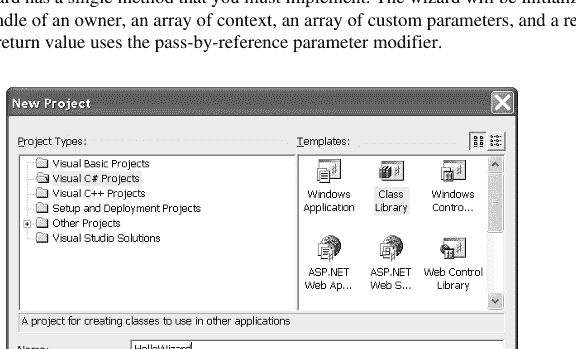

图 6-1 已选择“类库”模板的“新建项目”对话框

### 按引用传递参数

如果你想从方法返回单个值，那么定义并实现一个被称为函数的方法。函数是返回类型不是 void 的方法。你还可以对参数使用 ref 修饰符来返回多个值。使用 ref 修饰符定义的参数反映调用方对这些参数所做的更改。ref 修饰符等效于在 C++ 中传递指针、在 Visual Basic .NET 中传递 **ByRef** 参数或在 Delphi 中传递 **var** 参数。有关 ref 修饰符的正确放置位置，请参阅清单 6-1。

### 测试向导

测试向导的一个简单方法是创建一个调用向导的宏。单例对象 DTE 包含一个方法 LaunchWizard，该方法将加载并运行向导。有关宏和向导启动文件的解释，请参阅本章后面的“编写宏”和“使用宏测试向导”。清单 6-2 包含测试 HelloWizard 的宏代码，清单 6-3 包含你可以放在向导启动文件中的文本。（这些清单仅供参考。本章的其余部分将描述使用这些文件需要完成的关系和步骤。）

#### 清单 6-2 *用于测试 HelloWizard 的 Visual Basic 宏*

```
Imports System
Imports EnvDTE
Imports System.Diagnostics

Public Module Module1

    Public Sub Test()

        Const Path As String = _
            "C:\Temp\HelloWizard.vsz"

        Debug.WriteLine("This is running!")
        Dim ContextParams(1) As Object
        ContextParams(0) = Nothing
        DTE.LaunchWizard(Path, ContextParams)

    End Sub

End Module
```

可以通过打开宏 IDE 来创建宏。选择“工具”|“宏”|“宏 IDE”以打开“宏 IDE”（如图 6-2 所示，代码如清单 6-2 所示）。从清单 6-2 可以明显看出，你需要创建一个向导启动文件。向导启动文件的扩展名为 .vsz，并且与启动文件关联的包含向导的类库同名。清单 6-3 包含 HelloWizard.dll 的向导启动文件。

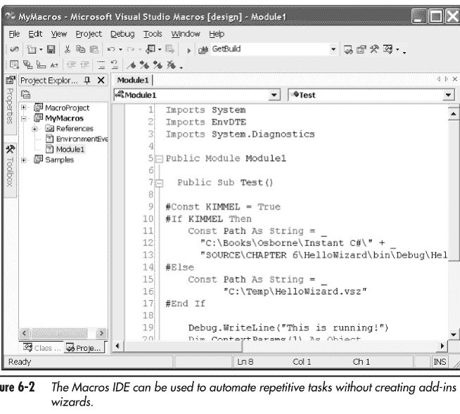

图 6-2 可以使用“宏 IDE”来自动化重复性任务，而无需创建外接程序或向导。

#### 清单 6-3 HelloWizard.dll 类库的向导启动文件示例

```
VSWIZARD 7.0
Wizard=HelloWizard.HelloWizard
Param=<Nothing>
```

清单 6-3 中显示的文本应放在名为 HelloWizard.vsz 的文件中，该文件放置在与使用 regasm.exe 注册的 HelloWorld.dll 所在目录相同的目录中。Regasm 是随 Visual Studio .NET 一起分发的实用程序。有关更多信息，请参阅本章后面的“注册向导”。

高级 C# 编程 174

### 为 Visual Studio .NET 向导创建项目模板

Visual Studio .NET 随附了多个项目模板，允许你创建诸如类库项目、Windows 和 Web 应用程序、Web 服务、控件和外接程序等项目。没有专门用于创建向导的项目模板。作为项目模板的入门介绍，我们将逐步创建一个将在“新建项目”对话框中显示的项目模板。

在 C:\Program Files\Microsoft Visual Studio .NET\Common7\IDE\VsWizard.dll 中有一个向导 VsWizard.dll，它为项目模板提供了一个基本引擎。这个通用引擎使用特定的示例文件、脚本和其他输入文件从项目模板创建新项目。因此，我们不必编写自定义引擎来创建项目模板，但我们确实必须创建一些引擎用作输入的特定文件，以及一些用作模板的示例文件来创建新的向导项目。我们的目标，尽可能简单地表述，是*为 Visual Studio .NET 向导创建一个新的项目模板*。以下是我们需要完成的步骤来创建向导项目模板，我将从现在起称之为向导库：

- 复制一个与我们想要创建的新模板接近的现有模板。我们将使用现有的类库模板，因为向导项目是一个类库或 DLL。
- 根据我们要创建的模板类型，向我们的模板项目添加新的模板文件。要创建向导，我们需要一个包含实现 IDTWizard 的类的 .cs 文件。我们可以使用清单 6-1（不含 MessageBox）作为模板。
- 修改 templates.inf 文件，其中包含我们的模板项目中包含的文件列表。
- 修改 common.js (Jscript .NET) 源代码，其中包含由 vsWizard 引擎调用的方法。我们需要添加代码来创建一个特定的类库项目，该项目包含对 envdte.dll 程序集的引用。
- 修改 default.js 脚本文件，其中包含对我们的模板项目通用的方法。
- 向我们的项目模板添加一个图标文件。
- 修改向导启动文件，以确保 vsWizard 引擎向导与我们的模板关联。
- 修改 VSDir 文件，将我们的项目模板添加到“新建项目”对话框中。

这些步骤不必按任何特定顺序完成，但我们将按照定义好的顺序进行。如你所见，这是一个复杂的过程（我希望能变得简单得多）。然而，这是一个可扩展且通用的解决方案，支持任何项目模板。接下来的每个小节将依次描述整个过程中的每个部分，并附有解释性细节。


### 复制现有项目模板

项目模板以你在新建项目对话框中看到的图标表示（参见图 6-2）。尽管你可以使用任何文本编辑器从头创建项目，但它们比从头开始使用文本编辑器创建项目要容易得多。

> **注意**
> 不同版本的 Visual Studio 将提供不同的项目模板。请查看你的帮助文档，了解你的 Visual Studio .NET 版本可用的功能。专业开发人员应该使用企业架构师版本。

创建新项目模板的最简单方法是复制一个与你想创建的新模板相近的现有模板。最接近的可用模板是类库模板。默认情况下，这些文件安装在 `C:\Program Files\Microsoft Visual Studio .NET\VC#\VC#Wizards`。类库模板由 `CSharpDLLWiz` 表示。要创建新的派生项目模板，请按照以下编号步骤操作：

- 1. 复制 `C:\Program Files\Microsoft Visual Studio .NET\VC#\VC#Wizards\CSharpDLLWiz` 文件夹，并将副本粘贴到同一目录中。（如果你没有使用默认安装目录，则需要进行必要的调整。）
- 2. 副本默认命名为 "Copy of CSharpDLLWiz"。使用 Windows 资源管理器将此文件重命名为 `CSharpDLLWizWiz`，以相对保持与所示约定的接近。

这些向导文件夹包含 Scripts 和 Templates 子目录，每个子目录都包含一个语言标识符。在我使用的版本中，语言标识符是 1033。（我相信语言标识符是代表英语的标识符；非英语用户将有不同的标识符。）

Scripts\1033 文件夹包含 Jscript default.js 文件，其中包含特定于我们项目模板的脚本。请参阅本节后面的“修改 default.js 脚本”。Templates\1033 文件夹包含实际文件，其中包含向导引擎将复制以创建我们新项目的代码。有关此过程的更多详细信息，请参阅下一节“为向导库模板添加文件”。

如果你有一个看起来像以下示例的新文件夹，那么我们就可以继续了。

```
C:\Program Files\Microsoft Visual Studio .NET\VC#\VC#Wizards
    CSharpDLLWizWiz\Scripts\1033
        default.js
    CSharpDLLWizWiz\Templates\1033
        assemblyinfo.cs
        file1.cs
        Templates.inf
```

请记住，这些文件都是从 `CSharpDLLWiz`（表示类库项目模板）复制而来的。

### 为向导库模板添加文件

Templates\1033 文件夹需要更新以包含我们想要在向导库模板中的文件。我们不需要更改正在使用的文件名；因此，我们不需要更改 `Templates.inf` 的内容。但是，我们确实需要更改 `file1.cs` 文件，使其包含描述向导模板的代码。清单 6-4 提供了修改后的 `file1.cs` 文件的代码。

> **提示**
> 确保你使用相同的文件名。这些文件名被 Jscript 函数使用，如果你在未更新脚本以适应新文件名的情况下更改了文件名，你的项目模板将无法工作。

清单 6-4 修改模板源文件 `file1.cs`，以描述一个包含 `IDTWizard` 实现的类

```
using System;
using EnvDTE;

namespace [!output SAFE_NAMESPACE_NAME]
{
    /// <summary>
    /// Summary description for [!output SAFE_CLASS_NAME].
    /// </summary>
    public class [!output SAFE_CLASS_NAME] : IDTWizard
    {
        public [!output SAFE_CLASS_NAME]()
        {
            //
            // TODO: Add constructor logic here
            //
        }

        public void Execute(object Application, int hwndOwner,
            ref object[] ContextParams,
            ref object[] CustomParams, ref wizardResult retval)
        {
            //
            // TODO: Add your custom code here
            //
        }
    }
}
```

这段代码看起来与我们清单 6-1 中的示例几乎完全相同，只是添加了由 `SAFE_CLASS_NAME` 表示的可替换令牌。同样，除非你准备好更改引用这些值的脚本文件，否则不要更改它们。我不会演示这个过程，但你可能通过仔细检查支持的 Jscript 代码就能弄清楚。

### 修改 default.js 脚本

default.js 脚本文件在 Scripts\1033 中定义。我们只需要做一个小的更改，但这是一个重要的更改。如你所知，向导项目需要对 `envdte.dll` 程序集的引用。我们将在新的向导库项目中加载对此程序集的引用，因此我们必须相应地修改我们的脚本以确保这一点发生。这是必须与 common.js 脚本文件中的更改协调才能正常工作的更改之一——也是我认为项目模板可能需要改进的原因之一。（有关协调更改的信息，请参阅下一节“修改 common.js 脚本”。）清单 6-5 提供了修改后的 `default.js` 脚本文件。

```
// (c) 2001 Microsoft Corporation

function OnFinish(selProj, selObj)
{
    var oldSuppressUIValue = true;
    try
    {
        oldSuppressUIValue = dte.SuppressUI;
        var strProjectPath = wizard.FindSymbol("PROJECT_PATH");
        var strProjectName = wizard.FindSymbol("PROJECT_NAME");
        var strSafeProjectName = CreateSafeName(strProjectName);
        wizard.AddSymbol("SAFE_PROJECT_NAME", strSafeProjectName);

        var bEmptyProject = 0; //wizard.FindSymbol("EMPTY_PROJECT");

        var proj = CreateCSharpProject(strProjectName,
            strProjectPath, "defaultDll.csproj");

        var InfFile = CreateInfFile();
        if (!bEmptyProject)
        {
            AddReferencesForWizard(proj);
            AddFilesToCSharpProject(proj,
                strProjectName, strProjectPath, InfFile, false);
        }
        proj.Save();
    }
    catch(e)
    {
        if( e.description.length > 0 )
            SetErrorInfo(e);
        return e.number;
    }
    finally
    {
        dte.SuppressUI = oldSuppressUIValue;
        if( InfFile )
            InfFile.Delete();
    }
}

function GetCSharpTargetName(strName, strProjectName)
{
    var strTarget = strName;

    switch (strName)
    {
        case "readme.txt":
            strTarget = "ReadMe.txt";
            break;
        case "File1.cs":
            strTarget = "Class1.cs";
            break;
        case "assemblyinfo.cs":
            strTarget = "AssemblyInfo.cs";
            break;
    }
    return strTarget;
}

function DoOpenFile(strName)
{
    var bOpen = false;

    switch (strName)
    {
        case "Class1.cs":
            bOpen = true;
            break;
    }
    return bOpen;
}

function SetFileProperties(oFileItem, strFileName)
{
    if(strFileName == "File1.cs" || strFileName == "assemblyinfo.cs")
    {
        oFileItem.Properties("SubType").Value = "Code";
    }
}
```

《高级 C# 编程》第 180 页

向导引擎被设计为使用外部 Jscript 函数，这当然是创新者的一个可选选择。如果你了解 Jscript，那么代码就不言自明。有四个函数：OnFinish、GetCSharpTargetName、DoOpenFile 和 SetFileProperties。当请求向导库项目模板时，会专门调用这些方法。SetFileProperties 设置一个属性，表示两个 .cs 文件包含代码。DoOpenFile 用于在 Visual Studio .NET 中打开类模块，这是你将感兴趣的要修改的文件，因为它包含自定义向导的实现。GetCSharpTargetName 执行简单的文件名替换。我们模板中唯一相关的更改是 `file1.cs` 被创建为 `class1.cs`。OnFinish 执行 `file1.cs` 中可替换参数的替换并组装项目，包括添加引用。我们需要做的唯一更改是在第 22 行替换为对 `AddReferencesForWizard` 的调用。原始脚本文件包含对 `AddReferencesForClass(proj)` 的调用，该函数在 `common.js` 中定义。我们需要实现 `AddReferencesForWizard`；我们将在下一节完成这一步。

### 修改 common.js 脚本

项目模板根据共享的向导引擎、预定义的文件夹结构、一些预先存在的模板文件以及两个相互作用以创建新项目模板的 Jscript 文件被分成不同的部分。我发现这种文件夹和脚本的复杂结合有点难以接近，完全不直观。作为一名程序员，我更喜欢一种统一的方法。


### 创建向导启动文件

我们已经在前面的“创建自定义向导”部分讨论过向导启动文件。在本例中，向导已经存在，因此我们将指示“新建项目”对话框使用哪个向导。项目模板的向导启动文件位于 `C:\Program Files\Microsoft Visual Studio .NET\VC#\CSharpProjects` 文件夹中（使用默认安装时）。

类库项目模板的向导启动文件包含在 `CSharpDLL.vsz` 中。遵循所示的扩展名，我们将向导启动文件命名为 `CSharpDLLWiz.vsz`。你可以从复制 `CSharpDLL.vsz` 文件并将其粘贴到同一目录开始。将文件重命名为 `CSharpDLLWiz.vsz`，并修改它以指向我们的模板目录，如清单 6-7 所示。

```
清单 6-7  我们的向导库项目模板的向导启动文件

VSWIZARD 7.0
Wizard=VsWizard.VsWizardEngine
Param="WIZARD_NAME = CSharpDLLWizWiz"
Param="WIZARD_UI = FALSE"
Param="PROJECT_TYPE = CSPROJ"
```

唯一的更改是将第一个参数改为引用我们的向导库文件夹。第一个参数是相对路径，其他参数为向导引擎提供条件值。

我们几乎完成了。最后一步是创建 VSDir 文件并通过创建一个新的向导项目来测试项目模板。

### 创建 VSDir 文件

VSDir 文件用于向“添加新项”和“新建项目”对话框提供信息，以描述项目项的显示方式。通过目视观察，你可以大致了解这些文件的内容。通常，你需要指定一个图标和一个名称，并指定“添加新项”和“新建项目”对话框中的小程序与调用哪个操作之间的关联。VSDir 文件在清单 6-8 中提供。清单之后提供了对这些看似晦涩条目的解释。

```
清单 6-8  我们项目模板向导的 VSDir 文件

CSharpDLLWiz.vsz|{FAE04EC1-301F-11d3-BF4B-00C04F79EFBC}|Wizard Library|
20|#2323|{FAE04EC1-301F-11d3-BF4B-00C04F79EFBC}|4547| |WizardLibrary
```

条目作为单行文本输入到包含现有项目模板项的 VSDir 文件中。默认情况下，此文件是 `C:\Program Files\Microsoft Visual Studio .NET\VC#\CSharpProjects\CSharpEx.vsdir`。这与你的向导启动文件所在的文件夹相同。

条目由管道符号（`|`）分隔成字段。每个管道符号分隔一个字段。表 6-1 描述了 VSDir 文件中每个字段的名称和条目值。

| 字段名称 | 条目值 | 描述 |
| :--- | :--- | :--- |
| 相对路径名 | CSharpDLLWiz.vsz | 使用相对路径指定向导启动文件。将 .vsz 文件存储在与 .vsdir 文件相同的目录中。 |
| {FAE04EC1-301F-11d3-BF4B-00C04F79EFBC} | CLSID 包 | 表示资源 DLL 的 GUID。此特定 GUID 指向一个名为 C Sharp Editor Factory 的项。 |
| Wizard Library | 已本地化的名称 | 这是模板的本地化名称，也是出现在对话框中的名称（参见图 6-3）。 |
| 20 | 排序优先级 | 确定元素列出的顺序。排序优先级 1 为最高。 |
| #2323 | 描述 | 包含模板本地化文本描述的字符串或资源标识符。（描述出现在“新建项目”对话框中——再次参考图 6-3。） |
| {FAE04EC1-301F-11d3-BF4B-00C04F79EFBC} | DLLPath 或 CLSID 包 | 包含一个 GUID，该 GUID 指向一个包含模板图标的 EXE 或 DLL 资源。 |
| 4547 | 图标资源 ID | 与前面的条目结合，指示使用资源文件中的哪个图标。（我们将使用与类库相同的图标。） |
| <空> | 标志 | 位标志，我们的模板不使用。你可以参考 Visual Studio .NET 帮助文档中关于 VSDir 文件的各个标志值。 |
| WizardLibrary | 建议的基名称 | 指定模板的默认名称。我们的条目代表一个项目；因此，向导库项目的根名称将是 WizardLibrary。第一个新项目将是 WizardLibrary1，依此类推。 |

**表 6-1** 用于描述“添加新项”或“新建项目”对话框中条目的字段

表 6-1 中显示的示例用于描述我们的向导库项目模板，如图 6-3 所示。

要测试向导库项目模板，请选择“文件” | “新建” | “项目”，然后选择向导库模板，如图 6-3 所示。单击“确定”后，你应该会获得一个新的类库项目，其中包含一个 `assemblyinfo.cs` 文件和一个名为 `Class1.cs` 的文件（该文件提供了 `IDTWizard` 的基本实现）。确保也添加了对 `envdte.dll` 程序集的引用。现在，你只需要专注于执行自动化任务的代码。

## 184 高级 C# 编程

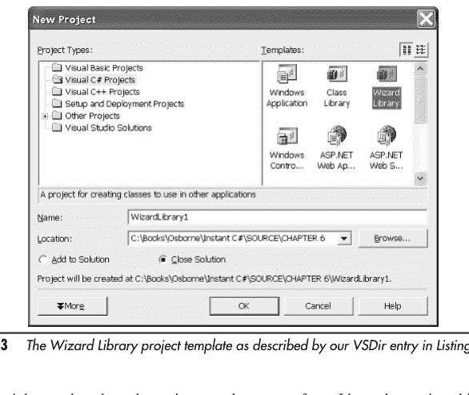

图 6-3 由清单 6-8 中的 VSDir 条目描述的向导库项目模板

你可能会想知道项目模板来自哪里。我还没有提到它。与整个过程一致，有几个文件是共享的。其中一个是 `DefaultDLL.csproj` 文件。此文件由 DLL 项目模板共享，位于 `C:\Program Files\Microsoft Visual Studio .NET\VC#\VC#Wizards` 文件夹中，名为 `DefaultDLL.csproj`。

创建项目模板更多的是复制粘贴和文件管理过程，而不是编程过程。但是，如果你想自动化重复性任务或简化困难任务，那么就创建一个项目模板。

### 使用向导扩展 Visual Studio .NET

向导的好处在于，你可以为初级到中级开发人员提供一种简便的方法来完成可能困难的事情，并且你可以自动化某些任务。通过创建向导，你可以让团队中的每个人都能使用 .NET 编程的高级方面。

在本节中，我将演示一个实用的向导，该向导可以自动创建强类型集合。强类型集合继承自抽象类 `ReadOnlyCollectionBase` 或 `CollectionBase`。这些类实现了 `IList`、`IListSource` 和 `IEnumerable`。结果是，你可以创建一个行为类似于数组的集合，可以绑定到 `DataGrid` 等控件，并且可以将集合序列化为 ADO.NET `DataSet`。


TypedCollectionWizard 自动化创建基于 `System.Collections.CollectionBase` 类的强类型集合；创建一个新的模块，一个继承自 CollectionBase 的类；并添加一个索引器和 Add 方法以支持 Web Services 的序列化。我将引导你完成 TypedCollectionWizard 的创建过程，这展示了 Visual Studio .NET 的可扩展性。你将学习如何编写宏以及如何针对通用环境对象模型进行编程。

### 编写宏

创建、注册和测试向导的步骤与“创建自定义向导”中描述的步骤相同。将有助于学习的技能包括编写和运行宏、使用 C# 进行常规编程、创建 Windows Forms 用户界面、使用 `regasm.exe` 注册程序集以及编写向导启动文件。我们将从编写宏开始，这没有什么特别的原因。

自动化和可扩展性模型的一部分是宏的支持。宏 IDE 是一个独立的基于项目的开发环境。宏使用 Visual Basic .NET 编写。你可以录制与 Visual Studio .NET 的交互，也可以从头开始编写宏。你从 Visual Studio .NET 的“工具 | 宏 | 宏 IDE”菜单项启动宏 IDE。你已经知道如何使用 Visual Studio .NET，而宏 IDE 与之非常相似。

打开宏 IDE。从“视图”菜单中选择“项目资源管理器”。宏 IDE 以项目为中心，宏项目存储在扩展名为 `.vsmacro` 的文件中。但是，你可以导入和导出包含 Visual Basic .NET 代码的模块。要创建宏，请选择一个现有模块或创建一个新模块（源代码文件）并打开它。添加一个简单的子例程。（子例程是 VB 对方法的俗称。）将光标放在文本编辑器中的子例程上，然后从宏 IDE 菜单中选择“调试 | 开始”。清单 6-9 展示了一个 HelloWorld 宏。

```
清单 6-9  在 Visual Basic .NET 语言的宏 IDE 中编写的 HelloWorld 宏

Sub HelloWorld()
    MsgBox("Hello World!")
End Sub
```

正如你可能猜到的，这个宏显示一个消息框，等效于静态 C# 方法调用 `MessageBox.Show("Hello World!")`。本章的所有宏都可以在名为 Module1.vb 的文件中下载。

这样的宏仅适用于介绍。更有用的宏可能是将新类添加到现有项目的宏。这在本质上与我们将使用 TypedCollectionWizard 所做的事情相似。

清单 6-10 中的宏将新类添加到 Visual Studio .NET 中的活动项目。参数 "Local Project Items\Class" 是如果你将命令——AddNewItem——连接到文件夹 Local Project Items 和项 Class，在“添加新项”对话框中的一个路径。从图 6-4 可能很明显。

```
清单 6-10  将新类添加到现有项目的宏

Sub TestNewFile()
  DTE.ItemOperations.AddNewItem( _
    "Local Project Items\Class", "")
End Sub
```

AddNewItem 的第二个参数是要添加的文件的名称。如果你将此选项留空或传递空字符串，那么将创建一个唯一且适当命名的文件。如果你用 C# 编写等效于清单 6-10 的代码，你将需要传递一个空字符串。*很好*。大问题是 DTE 是什么？我接下来将花点时间回答这个问题。

### 通用环境对象模型简介

我认为 DTE 是一个代表设计时环境的对象。在帮助文档中，设计时环境被称为 *通用环境对象模型*、自动化模型或可扩展性模型。一个好的单一名称会很有帮助。在提到 Visual Studio .NET 可扩展性时，我们只使用 DTE。

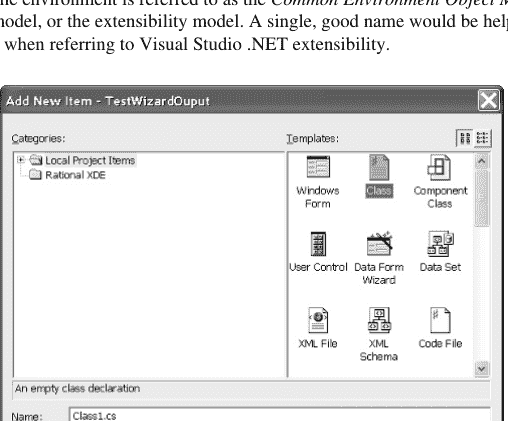

图 6-4  AddNewItem 方法需要你想要添加的项的逻辑路径。

DTE 是表示一个对象模型的根对象，该模型公开了 Visual Studio .NET 的功能。（Visual SourceSafe 也有类似的东西，许多其他 Microsoft 应用程序也是。）DTE 使用接口提供对 Visual Studio .NET 的面向对象的可访问性。这通常被称为 *自动化*。你可以通过查看 Visual Studio .Net 中的帮助链接 `ms-help://MS.VSCC/MS.MSDNVS/vsintro7/html/vxgrfautomationobjectmodelchart.htm` 访问的可视参考来了解通用环境对象模型（DTE）的广泛程度。它非常广泛。

不幸的是，DTE 如此之大，以至于如果不写另一整本书，我们很难触及皮毛。（如果我收到足够多的致我出版商的信，那么这样一本书可能会出版。）相反，我们将采用目标方法来解决我们的特定问题，同时为你提供介绍。以下部分演示了如何从宏和 C# 代码中使用 DTE，这将为你提供一个合理的开始。对 DTE 有一个良好的概念性愿景是将其视为充当外观的接口，允许你与 Visual Studio .NET 交互，包括菜单、文档、项目、宏等。

### 使用宏编写代码

本章早些时候，我演示了如何使用项目模板来有效地生成代码。向导引擎本质上使用现有代码作为模板，并填入更改的部分，如类名。但是，你可以使用 DTE 动态生成新代码。在宏中动态编写代码是测试我为 TypedCollectionWizard 创建 C# 代码生成器方法的好方法。清单 6-11 展示了我用来测试 DTE 生成代码能力的宏。

```
清单 6-11    使用宏生成代码

1: Public Sub TestWriteCode()
2:    Try
3:      Dim item As ProjectItem = _
4:        DTE.ItemOperations.AddNewItem( _
5:        "Local Project Items\Code File")
6: 
7:      Dim defaultNamespace = _
8:        item.ContainingProject.Properties. _
9:        Item("DefaultNamespace").Value
10: 
11:      Dim code As CodeNamespace = _
12:        item.FileCodeModel.AddNamespace(defaultNamespace)
13: 
14:      Dim editPoint As EditPoint = _
15:        code.StartPoint.CreateEditPoint
16: 
17:      editPoint.LineDown(2)
18:      editPoint.Insert(DateTime.Now.ToString() + vbCrLf)
19: 
20:   Catch e As Exception
21:      MsgBox(e.Message, MsgBoxStyle.OKOnly, "Error")
22:   End Try
23: End Sub
```

总之，清单 6-11 中的代码创建了一个新的 C# 代码文件，向其添加了一个命名空间，并在该命名空间中插入了一些文本。清单 6-12 提供了一个运行清单 6-11 中宏的输出示例。

清单 6-11 的第 3 到 5 行创建了一个不包含代码的新 C# 源代码文件，并获取了表示该文件的 ProjectItem 的引用。（这与清单 6-10 中的宏类似。）此源代码文件将被添加到 Visual Studio .NET 中具有焦点的任何项目中，但不会创建一个项目。第 7 到 10 行确定包含我们新文件的项目的默认命名空间是什么，第 11 和 12 行创建了一个格式化的命名空间元素（见清单 6-12）。注意我们保留了 CodeNamespace 对象的引用。就像我们手动编写代码一样，一切都是上下文相关的。返回的对象表示上下文。

清单 6-11 的第 14 和 15 行在命名空间的开头创建了一个编辑点。编辑点可用于手动插入代码，或者我们可以使用其他 Add 方法（探索 FileCodeModel 以获取可用方法）。第 17 行将编辑点向下移动两行，第 19 行插入了一些代表我们代码的文本。结果如清单 6-12 所示。

```
清单 6-12  由清单 6-11 中宏生成的代码

namespace TestWizardOuput
{
    5/9/2002 5:12:23 PM
}
```

显然，如果我们能创建一个文件，添加一个命名空间和其他元素，并直接编写文本，那么以这种方式编写代码是可能的。TypedCollectionWizard 使用部分模板和 DTE 来生成完整的强类型集合类。

### 创建代码生成器

可以通过分解永不改变的代码元素并为将要改变的元素使用可替换的字符串参数来创建代码生成器。这是向导引擎从模板创建代码所采用的方法，也是用于为 TypedCollectionWizard 生成代码所采用的方法。清单 6-13 包含表示模板的类。

#### 清单 6-13 Wizard 类代表了向导创建的类型化集合的模板代码。

```csharp
using System;

namespace TypedCollectionWizard
{
    /// <summary>
    /// Summary description for Wizard.
    /// </summary>
    public class Wizard
    {
        /// <summary>
        /// Parameter 0 is the class name; parameter 1 is the type name;
        /// parameter 2 is the optional setter; parameter 3 is the comment.
        /// </summary>
        private const string template =
            "  // Code generator by pkimmel@softconcepts.com\r\n" +
            "  {3}\r\n" +
            "  public class {0} : System.Collections.CollectionBase\r\n" +
            "  {\r\n" +
            "      public {1} this[int index]\r\n" +
            "      {\r\n" +
            "          get{ return (({1})InnerList[index]); }\r\n" +
            "          {2}\r\n" +
            "      }\r\n\r\n" +
            "      public int Add({1} value)\r\n" +
            "      {\r\n" +
            "          return InnerList.Add(value);\r\n" +
            "      }\r\n" +
            "  }\r\n";

        private const string setter =
            "set{ InnerList[index] = value; }\r\n";

        private string name;
        private string typeName;
        private bool hasGetter = true;
        private bool hasSetter = true;
        private string comment;

        public Wizard(string name, string typeName, bool hasGetter,
           bool hasSetter, string comment)
        {
            this.name = name;
            this.typeName = typeName;
            this.hasGetter = hasGetter;
            this.hasSetter = hasSetter;
            this.comment = comment;
        }

        private string GetSetter()
        {
            return hasSetter ? setter : "\r\n";
        }

        private string GetCode()
        {
            return
                string.Format(template, name, typeName,
                    GetSetter(), comment);
        }

        public string GetTemplate
        { get{ return template; } }

        public string Code
        { get{ return GetCode(); }}
    }
}
```

## 190 高级 C# 编程

向导的代码很容易理解。我来总结一下。清单 6-13 的第 14 到 28 行代表了使用参数化值的模板代码，这些值会因类的不同而变化。其余代码接受参数作为参数，并在请求时（即当调用 GetCode 时）将这些值替换到参数中。更重要的是策略。通过为向导使用一个类，我可以在不完成向导的情况下测试生成器，确保生成的代码是准确的。可下载的 TestWizardCode.csproj 项目正是如此。假设类型化集合的名称为 Customers，它代表一个 Customer 对象的集合，向导将生成清单 6-14 所示的类。

```csharp
public class Customers : System.Collections.CollectionBase
{
    public Customer this[int index]
    {
        get{ return (Customer)InnerList[index]; }
        set{ InnerList[index] = value; }
    }

    public int Add(Customer value)
    {
        return InnerList.Add(value);
    }
}
```

清单 6-14 实际上是语法正确的代码。假设你已经实现了一个描述 Customer 的类，那么这段代码将能编译并正确工作。从集合类继承的代码允许我们将类型化集合绑定到控件、使用 foreach 结构枚举元素、将 Customers 序列化到 DataSet 以及从 Web 服务返回 Customers。这是一个非常强大的组合，也是读者应该习惯使用的常见设计模式。

下一步是创建一个用户界面，允许使用者输入代表集合和收集对象类型的值。

### 实现向导用户界面

我毫不掩饰地从 Visual Studio .NET 中复制了“添加索引器向导”。（实际上，我希望 TypedCollectionWizard 看起来像是与类似的向导属于一体。）图形用户界面如图 6-5 所示。

用户界面的代码可在名为 FormWizard.cs 的文件中下载。我将告诉你我用来使对话框窗体更易于使用的一些策略。

### 用户界面策略

通常，我使用属性方法来访问控件的值。因此，我引用的是数据而不是控件；如果我更改控件，那么我只需要在一个地方更改对控件的引用。例如，以下是代表在 TextBox 中输入的类型化集合名称的代码。

```csharp
private string ClassName
{ get{ return textBoxClassName.Text; }}
```

## 192 高级 C# 编程

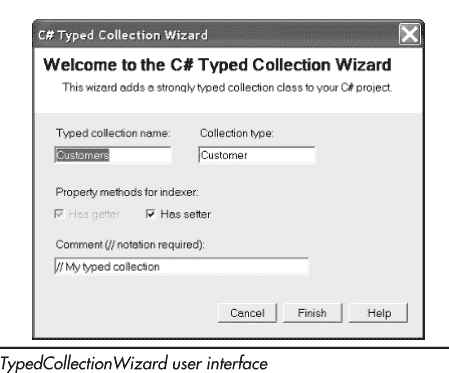

图 6-5 TypedCollectionWizard 用户界面

如果我将底层控件从 TextBox 更改为其他控件，那么我只需要更改在此处引用 TextBox 值的 GUI 代码。

我采用的另一个策略是在用户界面和类中都验证字段输入。这是基于“垃圾进，垃圾出”（G.I.G.O.）的概念，这是我计算机科学中学会的第一个首字母缩写词。我使用正则表达式来验证输入。类名必须是连续的字母数字字符串，并以字母字符开头。以下代码确认了这一点：

```csharp
private void DoValidateField(Control control, string value,
    string expression, string errorText)
{
    if( !Regex.IsMatch(value, expression))
    {
        control.Focus();
        throw new Exception(errorText);
    }
}

private void ValidateClassName()
{
    DoValidateField(textBoxClassName,
        ClassName, @"^\w$|^\w[A-Za-z0-9]+$",
        "Valid class name is required");
}
```

> 提示
重构是一种改进现有代码设计的系统方法，由 William Opdike 命名，并在引入 XP（极限编程）时得以普及。

方法 ValidateClassName 调用了一个重构的方法，该方法接受一个控件和三个字符串参数。第三个参数是一个正则表达式。如果控件的 Text 内容与正则表达式不匹配，则控件将获得焦点并抛出异常。（有关正则表达式的更多信息，请参阅第 4 章。）

### 对话框窗体策略

FormWizard 用作对话框窗体。我用于对话框窗体的一个策略是创建一个名为 Execute 的静态方法。该静态方法接受输入并返回窗体的输出。窗体消费者不需要担心窗体的创建和销毁，只需关心输入和输出。以下简短的代码清单展示了 FormWizard 如何为消费者提供此服务。

```csharp
public static bool Execute(ref string generatedCode)
{
    using(Form1 form = new Form1())
    {
        if( form.ShowDialog() == DialogResult.OK)
        {
            generatedCode = form.Code;
            return true;
        }
        else
            return false;
    }
}
```

消费者最终将是 TypedCollectionWizard。实现 IDTWizard 的类只需调用此静态方法，评估布尔返回值，并处理生成的代码。

如果你正在编写基于 Windows Forms 的应用程序，可以使用与前面代码片段相同的方法。另一种选择是，你的对话框窗体的消费者必须构造窗体、评估 DialogResult，并关心窗体的特定属性。本质上，你将不得不在每次与窗体交互时重复前面的代码，这将使代码量至少增加一倍。以下是如何基于静态 Execute 方法显示窗体。

```csharp
string generatedCode = string.Empty;
if(FormWizard.Execute(ref generatedCode))
    // do something
```

前面展示了窗体和窗体消费者之间非常简单的交互。

### 实现向导

由于我们已将生成器实现为一个类，并将窗体简化为一个简单的 Execute 方法交互，因此实现向导变得轻而易举。如果你回忆一下前面的“创建自定义向导”部分，我们所要做的就是实现 IDTWizard.Execute 方法。此外，我们的向导必须获取窗体返回的代码并将其写入代码文件。清单 6-15 演示了实现向导的一种方法。

> 清单 6-15 实现 ITDWizard 接口并完成向导

```csharp
using System;
using System.IO;
using EnvDTE;
using System.Windows.Forms;

namespace TypedCollectionWizard
{
    /// <summary>
    /// Summary description for Class1.
    /// </summary>
    public class CollectionWizard : IDTWizard
    {
        // Implements IDTWizard.Execute
        public void Execute(object Application,
            int hwndOwner, ref object[] ContextParams,
            ref object[] CustomParams, ref wizardResult retval)
        {
            string generatedCode = string.Empty;
            if( FormWizard.Execute(ref generatedCode))
            {
                WriteCode((DTE)Application, generatedCode);
                retval = EnvDTE.wizardResult.wizardResultSuccess;
            }
        }
```


### 第 6 章：自定义 Visual Studio .NET 195

```
25:     else
26:     {
27:         retval = EnvDTE.wizardResult.wizardResultCancel;
28:     }
29:   }
30:
31:   private void WriteCode(DTE dte, string generatedCode)
32:   {
33:     try
34:     {
35:       DoWriteCode(dte, generatedCode);
36:     }
37:     catch(Exception e)
38:     {
39:       MessageBox.Show(e.Message, "Error Writing Code",
40:       MessageBoxButtons.OK, MessageBoxIcon.Error);
41:     }
42:   }
43:
44:
45:   private void DoWriteCode(DTE dte, string generatedCode)
46:   {
47:     ProjectItem item = dte.ItemOperations.AddNewItem(
48:       @"Local Project Items\Code File", "" );
49:
50:     string defaultNamespace =
51:       (string)item.ContainingProject.Properties.Item(
52:       "DefaultNamespace").Value;
53:
54:     CodeNamespace code =
55:       item.FileCodeModel.AddNamespace(defaultNamespace, 0);
56:
57:     EditPoint editPoint = code.StartPoint.CreateEditPoint();
58:     editPoint.LineDown(2);
59:     editPoint.Insert(generatedCode);
60:   }
61: }
```

到现在，这段代码的大部分应该看起来很熟悉了。清单 6-15 的第 14 到 29 行满足了 IDTWizard 契约。我们没有显示 "Hello Wizard"，而是显示窗体，并在 Execute 返回 True 时编写代码。WriteCode 使用 try catch 异常处理程序来管理错误处理，而 DoWriteCode 则生成代码文件。

## 高级 C# 编程

可能不太明显的是，DTE 对象作为第一个参数传递给 Execute 方法；我们在清单 6-15 的第 22 行将 *Application* 对象参数转换为 DTE 对象，并使用该 DTE 实例来创建源代码文件。第 45 到 60 行的 DoWriteCode 几乎与清单 6-11 中的宏代码及其后的说明完全相同。我们在第 59 行写入的是 Wizard 类返回的生成代码，而不是日期和时间。

Visual Studio .NET 中的自动化模型功能强大且范围广泛。它是使 .NET 成为软件开发人员和软件开发极具吸引力的选择的 Visual Studio .NET 方面之一。接下来，我们需要测试该向导。我们将从创建向导启动文件开始。

### 完成示例向导启动文件

向导启动文件具有 .vsz 扩展名，在加载和运行向导时读取。TypedCollectionWizard 的启动文件很简单。我们只需为向导提供一个名称，并指示没有参数。以下文本将被添加到名为 TypedCollectionWizard.vsz 的文件中，并复制到包含 TypedCollectionWizard.dll 的同一文件夹。

```
VSWIZARD 7.0
Wizard=TypedCollectionWizard.CollectionWizard
Param=<Nothing>
```

向导引擎并不要求你将 .vsz 文件放在与向导 DLL 相同的文件夹中。但是，将向导和启动文件放在同一目录中可以轻松工作。

第一行是必需的，必须原样添加。第二行描述了程序集以及该程序集中包含 IDTWizard 实现的类。后续语句用于描述传递给向导的参数。我们的向导不接受任何参数，这正是启动文件中 Param 语句所指示的。下一个清单是 C# 索引器向导启动文件，它与向导引擎一起工作。此文件显示了两个参数。

```
VSWIZARD 7.0
Wizard=VsWizard.VsWizardEngine
Param="WIZARD_NAME = CSharpIndexerWiz"
Param="PROJECT_TYPE = CSPROJ"
```

你可以传递你的向导需要的任何参数。所演示的风格描述了名称为 WIZARD_NAME 和 PROJECT_TYPE 的值。

### 注册向导

未添加到全局程序集缓存（GAC，发音为 *gak*）但需要注册表信息的程序集，可以使用 .NET 附带的 regasm 实用程序进行注册。要注册 TypedCollectionWizard，请输入以下命令：

```
c:\winnt\Microsoft.NET\v1.0.3705\regasm
c:\temp\TypedCollectionWizard.dll /codebase
```

所描述的路径是 .NET 框架的默认路径，特别是版本 1.0.3705。目录 c:\temp 假设你正从 c:\temp 目录注册向导。如果你使用其他目录，请将该目录替换为 c:\temp。/codebase 开关使用 file:// 标记在注册表中存储完整路径。该向导不是 COM 组件；是 Visual Studio .NET 应用程序使用注册表信息来加载程序集。（有关 regasm 的更多信息，请参阅本章末尾的“使用 regasm 实用程序”。）

我在本节开头提到了全局程序集缓存。GAC 是一个计算机范围内的缓存，用于存储许多应用程序共享的程序集。向导仅由 Visual Studio .NET 使用；因此，我们不需要将向导添加到 GAC。GAC 实际上是一个类似于文件夹的存储库，它使用程序集元数据来确定程序集之间的差异，从而有助于避免与 COM 相关的常见冲突。你可以从 Visual Studio .NET 帮助文档中了解有关 GAC 的更多信息。.NET 附带 GACutil.exe，这是一个用于将程序集添加到 GAC 的实用程序。

### 使用宏测试向导

创建了向导用户界面和向导类的测试应用程序、创建了向导以及创建了启动文件后，我们可以使用清单 6-2 中的宏来测试向导。在将 `const Path` 变量替换为 TypedCollectionWizard.vsz 向导启动文件的路径信息后，可以使用宏运行向导。Visual Studio .NET 支持向 Visual Studio .NET 添加菜单项或其他某种形式的入口。你可以创建一个实现 IDTExtensibility2 接口的加载项，并结合 IDTWizard 接口在 Visual Studio .NET 中创建菜单项。有关加载项和 IDTExtensibility2 的更多信息，请参阅 Visual Studio .NET 中的“创建加载项”帮助主题。IDTCommandTarget 接口将允许你从命令窗口运行向导作为替代选项。

### 从命令窗口运行向导

既然我们有了一个可以启动我们的向导的宏，我们就可以从命令窗口运行 TypedCollectionWizard。选择“视图” | “其他窗口” | “命令窗口”以打开命令窗口。如果你创建了测试宏——借用清单 6-2 中的代码——那么当你在命令窗口中输入 **M** 时，你应该会看到一个宏列表。我在 MyMacros 项目中的名为 Module1 的模块中创建了我的测试宏，并将子程序命名为 TestCollectionWizard。参考 Macros 对象，整个命令变为

```
Macros.MyMacros.Module1.TestCollectionWizard
```

Intellisense 将在你开始输入单词 **Macros** 时提供可用命令列表，如图 6-6 所示。

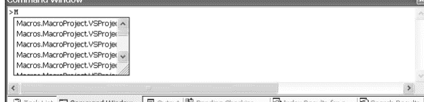

图 6-6  Intellisense 在命令窗口中显示可用命令列表。


**提示**
你可以使用命令窗口访问 Visual Studio .NET 中的自动化模型并直接启动命令。例如，在命令窗口中输入 **File.NewFile** 以打开“新建文件”对话框。

## 次要主题

正如你现在可能已经确定的，专业程序员必须熟悉多种语言和实用程序，才能充分利用 .NET。本章介绍了 gacutil.exe、regasm.exe、Jscript.NET、宏和 Visual Basic .NET。我们无法在这里全部学习。我花了十几年的阅读和实验才学会如何使用它们。但是，我可以介绍主题并为你指明正确的方向，以帮助你进一步探索兴趣（并为我的出版商多卖几本书）。作为本章的结束，我想简要回顾一下 Jscript .NET 和 regasm.exe 实用程序。

### 回到 Jscript .NET

我在本章开头简要提到了 Jscript。Jscript 在模板项目的实现中扮演次要角色。有一个外部编译器可用于编译 Jscript .NET 代码。然而，Jscript 是像 C# 和 Visual Basic .NET 一样的完整语言。Visual Studio .NET 中有大量关于 Jscript 的信息，你可以使用命令行编译器 jsc.exe 来编译 Jscript 代码。如果你感兴趣，请参考 **www.osborne.com** 和 **www.amazon.com** 网站上关于 Jscript 的书籍。

你可能遇到脚本的地方（除了创建模板项目时）是网页和 ACT 的客户端代码。ACT，即 Microsoft Application Center Test，是随 Visual Studio .NET 企业版附带的应用程序。ACT 用于自动测试 Web 客户端应用程序。你可以在 ACT 中编写自定义脚本或修改录制的脚本来测试你的网页。

按照编号步骤编写和编译 Jscript .NET 应用程序。（Jscript .NET 应用程序必须从命令提示符编译。）


## 第7章

事件日志记录器

**本章内容：**
* 演示的主题
* 探索 System.Diagnostics 命名空间
* 使用 EventLog 组件
* 将跟踪作为调试策略
* 转储堆栈
* 自动管理调试代码
* 实现日志记录器
* 次要主题
* 创建对话框
* FileVersion 信息
* 使用 Debug 类
* 测量性能
* 总结

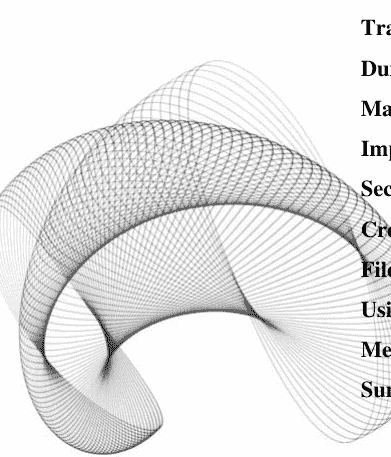

规划如何测试和调试你的代码，几乎与编写代码的方式和内容同样重要。一个优秀的UML模型和设计，如果没有同样出色的测试与调试策略，就像蝙蝠侠没有罗宾一样。“独行侠”听起来远不如“双人搭档”响亮。

当你构建应用程序时，你需要单元测试、白盒和黑盒测试、少量的自动化测试，以及一个良好的质量保证流程。第一步是采用一些基本策略，确保你的代码在离开你的工作站之前就是优秀的。当程序员测试自己的代码时，这被称为*单元测试*。通过将测试代码集成到你的生产代码中，你可以减少实际花费在测试上的时间，因为你的代码会在出错时自动提醒你。包含能够通过编译器开关来开启和关闭测试代码的能力，是专业性的标志。让为你自己和其他人轻松集成自诊断或跟踪能力，是造就编程传奇的方式。

我最早读过的关于调试和测试策略的最佳书籍之一是戴夫·蒂埃伦的《无虫！》（Addison-Wesley，1992年）。蒂埃伦的策略对微软发布MS-DOS 5.0起到了关键作用。（DOS 5.0现在已是陈年旧事了。）许多由蒂埃伦和其他人（如杰拉尔德·温伯格）引入的技术至今仍然盛行。就在几年前，程序员还得费尽心机发明几种好技术，因为现成的合适技术并不多。我们不再需要从头构建调试和测试代码了。公共语言运行时在System.Diagnostics命名空间中引入了大量的验证功能。适度地运用它们，你就能消灭bug。如果你勤勉而一贯地采用一些基本策略，bug就没有什么机会了。

本章演示了.NET Framework直接支持的几种能力，它们将帮助你最大限度地减少从你工作站漏出的bug数量。

### 演示的主题

.NET Framework有许多方面。.NET代表了微软的一项巨大投入，旨在为其所有开发工具打造一个连贯而强大的框架。如果你探索.NET的任何部分，你会很快发现你可能探索上好几天。System.Diagnostics命名空间就是这样一个领域，我鼓励你花大量时间去研究它。

本章首先向你展示一些你可能在概念上熟悉，但在实现上可能是新的基本能力。我们将逐步介绍.NET中的全新能力。

通过本章的示例，你将能够通过掌握以下内容来构建更好的应用程序：
- 使用EventLog组件
- 记录到远程计算机
- 采用跟踪作为调试策略
- 转储和查看堆栈帧
- 使用BooleanSwitch和ConditionalAttribute自动管理调试代码
- 使用自定义对话框引导和响应用户输入
- 访问FileVersion信息
- 将调试信息写入输出窗口并断言程序不变量
- 以及，使用PerformanceCounter跟踪应用程序的资源使用情况

### 探索 System.Diagnostics 命名空间

你可以轻松找到System.Diagnostics命名空间中所有的类、命名空间和成员，因此我不在这里列出它们。（如果我们开始列举，那可能还需要500页。）我要告诉你的是，Diagnostics命名空间包含的类远比Debug类多。

System.Diagnostics命名空间包含了一系列类，使你能够大规模地应对影响应用程序有效性的风险。与Debug类类似，Diagnostics命名空间包含用于在后台跟踪代码和写入事件日志的类；调试特性；可以从外部配置文件读取的开关，允许你在不重新构建应用程序的情况下开启和关闭代码；以及大量的性能计数器。（仅性能计数器的数量和种类就足以写满一本书。查看服务器资源管理器中的性能计数器作为证据。）

我将使用Diagnostics命名空间的特定功能，为你提供一个保护Windows和Web应用程序的安全网。我将演示Debug类如何编写关于你的程序在后台运行情况的信息，以及它如何确保关于程序状态的基本假设是不可侵犯的。我们将使用BooleanSwitch类来读取外部配置信息，从而在不重新构建应用程序的情况下开启和关闭我们的调试代码。我们将使用ConditionalAttribute让编译器在编译时通过在生成中间语言之前自动剥离能力来开启和关闭代码。我们将查看PerfMon.sln，它演示了如何使用PerformanceCounters来跟踪任何应用程序的资源使用情况。此外，我们还将使用EventLog，在构建和部署应用程序时，为存储关于我们的应用程序的信息提供一个方便的自定义事件日志位置。

### 使用 EventLog 组件

工具箱的“组件”选项卡包含几个有用的组件。一个特别有用的是EventLog组件。EventLog组件可以从工具箱拖放到组件托盘中。通过修改EventLog组件的属性，你可以快速指定要写入的日志名称、日志条目所属的源（Source），以及包含你要写入日志的计算机。默认的日志名称是Application、System和Security。通常，你会将日志条目写入自定义日志或Application日志。如果在EventLog.Log属性中输入一个唯一的名称，你可以创建一个自定义日志文件。（你可以通过搜索文件在计算机上找到物理日志文件

1.  打开记事本。
2.  输入 **print("Hello World!")**。
3.  将文本保存为Hello.js，记住Hello.js文件保存的位置，然后关闭记事本。
4.  打开命令提示符（对于老手来说，就是一个DOS窗口）。
5.  在命令提示符处，输入 `c:\winnt\Microsoft.NET\Framework\V1.0.3705\jsc Hello.js`，如果需要，请包含Hello.js的路径。

jsc.exe编译器会将Hello.js源文件转换为可执行程序集Hello.exe。输入 **Hello** 来运行Hello.exe应用程序。输出应该只是文本"Hello World!"。

# 使用 regasm 实用程序

向导是通过COM集成到Visual Studio .NET中的DLL程序集。注册向导最可靠的方法是使用.NET框架附带的regasm.exe实用程序。看起来效果最好的regasm.exe的两种形式是

```
regasm assemblyname /codebase

和

regasm assemblyname /unregister
```

语句中的regasm部分指的是该实用程序。斜体字的 *assemblyname* 是包含向导的DLL程序集，/codebase开关会将代码库添加到注册表中。从技术上讲，/codebase开关等同于完整的路径信息。
第二个语句注销向导程序集。在修改并重新编译向导程序集之前，你需要运行第二个语句，用你的向导名称替换 *assemblyname* 的值。
向导本身并不使用COM。Visual Studio .NET的可扩展性依赖于COM。注册向导程序集允许Visual Studio .NET加载它。当你使用/codebase注册程序集时，你会收到一个警告，表明你应该为程序集添加强名称。这将有助于避免版本问题。你可以使用.NET附带的强名称实用程序—sn.exe—为你的程序集添加强名称。如果你打算共享这个向导，这是个好主意。
要查看将写入注册表的条目，请使用/regfile开关运行regasm，如下所示：

```
regasm assemblyname /regfile:regfile
```

将 *assemblyname* 替换为你的程序集的名称，第二个 *regfile* 替换为具有.reg扩展名的文件的名称。如果你生成了一个注册表文件，那么条目不会写入注册表。如果你尝试使用和不使用/codebase开关，你会看到当你指定/codebase开关时，使用了file:// moniker和路径信息。没有/codebase开关，Visual Studio就找不到向导。

## 总结

这么多伟大的技术，时间却这么少。短短十年前，我记得为硬盘错误中断0x24编写了我自己的中断处理程序。这种系统错误发生在例如用户在驱动器读写软盘时取出软盘的情况下。异常处理已经取代了编写中断处理程序，成为捕获严重错误的方式。

技术发展如此之快，专业程序员最终将不得不专业化。就像水管工、电工、屋顶工、木工、建筑师、总承包商、石膏板安装工、屋顶工（以及家庭建筑商的其他任何工作）一样，程序员也将不得不专业化。在这一章中，我们涉及了三种编程语言——Visual Basic .NET、Jscript和C#——以及几个实用程序——GACutil.exe和regasm.exe。就像其他已经存在了一段时间的行业一样，我们的行业将走向专业化。我们仍然以程序员为中心的世界为主导，但专业领域已经被识别出来，软件工具的复杂性和客户的需求最终将要求我们的行业培养专业人才。我专攻使用UML和OOP语言的面向对象架构。

有趣的是，对专业人才的需求在亚当·斯密的《国富论》中有很好的记载。斯密简单地描述了如何通过为制针工人（裁缝用的小尖头线轴）分配专业角色，使制针厂能够每天生产数千根针而不是数百根。斯密的描述可能是现代装配线背后的主要推动力。软件工具的复杂性最终将迫使专业化，并可能催生一种装配线式的软件开发形式。专业化早已迫在眉睫，但幸运的是，装配线式的软件开发还有很长的路要走。


带`.evt`文件扩展名。通常，日志文件位于`c:\winnt\system32\config`目录中。）如果在测试期间你将向日志写入大量条目，请使用自定义日志。部署应用程序时，请写入到你的应用程序所对应的源（Source）下列出的“应用程序”日志。

> **注意**

日志和源在注册表中的键*HKEY_LOCAL_MACHINE\SYSTEM\CurrentControlSet001\Services\Eventlog*下列出。你可以直接修改这些键，但如果EventLog键被错误修改，一些应用程序（可能是重要的应用程序）可能会停止工作。如果你打算修改注册表，最好在修改前导出注册表的完整副本。

源是一个唯一名称，用于标识日志条目的来源。指定源名称时，它必须在所有日志中唯一。这意味着，如果你在“应用程序”日志中指定了一个名为“Demo”的源，那么你就不能在任何其他日志中定义一个名为Demo的源。如果你想在新日志中使用一个源，你需要从现有日志中删除该源。

### 写入EventLog

在构建和测试应用程序时，创建一个自定义日志，并尽可能多地写入信息，以确保你能够诊断以后可能出现的问题。部署应用程序时，你将需要更有选择性地记录，只记录关键信息。请记住，事件日志存储在硬盘上的文件中，磁盘和文件空间都会被填满。

> **提示**

EventLog类有几个静态WriteEntry方法。你可以通过向某个静态EventLog.WriteEntry方法传递Source和消息来写入日志文本，而无需EventLog组件的实例。

无论你是在开发期间写入自定义日志，还是在部署后写入应用程序日志，写入日志的过程都是相同的。设置Log、Source和MachineName属性，并调用某个重载的WriteEntry方法。至少，你可以简单地传递一个包含要记录的文本的字符串消息。假设我们有一个名为eventLog1的EventLog组件，我们可以用以下语句向事件日志写入一个条目：

```
eventLog1.WriteEntry("test");
```

假设组件eventLog1.Source已设置为Application源，那么上面的语句将创建一个事件日志条目，该条目与图7-1所示的条目非常相似。（结果会根据操作系统、日期和时间、计算机名称以及写入事件日志条目的计算机的其他特定因素而略有不同。）

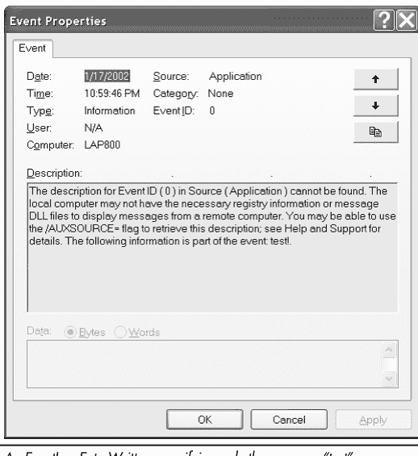

图7-1   一个仅指定消息“test”的EventLog EntryWritten事件。

### 处理EntryWritten事件

EventLog组件定义了一个事件：EntryWritten。EntryWritten事件处理程序允许你的程序响应由你的应用程序或其他应用程序写入的事件，只要事件日志条目是在本地主机上写入的。写入远程计算机的事件不会被EntryWritten事件接收。EventLog组件的这一特性支持编写一个监视其他应用程序行为的实用程序应用程序。

EntryWritten事件是一个委托，接收两个参数：一个对象和一个System.Diagnostics.EntryWrittenEventArgs。EntryWrittenEventArgs参数包含一个Entry属性。EntryWrittenEventArgs.Entry属性是一个EventLogEntry对象，包含描述事件的信息。EventLogEntry类包含有关事件生成和写入的时间、事件消息、事件源和计算机名称的信息。你可以使用此信息来监视应用程序的运行状况。

### 响应事件条目

要响应EntryWritten事件，请将EventLog.EnableRaisingEvents属性设置为True，并实现一个EntryWritten事件处理程序。这两项任务中的任何一项或全部都可以通过编程方式或使用属性窗口来完成。

McGraw-Hill/Osborne网站www.osborne.com上提供的DebugDemo.sln示例应用程序演示了一个EntryWritten事件处理程序。如果你运行DebugDemo.exe应用程序的第二个实例，你将看到应用程序的两个实例都在响应事件日志条目，即使你可能只与单个实例交互。下面的事件处理程序演示了将发送到事件日志的信息写入RichTextBox控件的示例。

```
private void eventLog1_EntryWritten(object sender,
System.Diagnostics.EntryWrittenEventArgs e)
{
    richTextBox1.AppendText(e.Entry.Message + "\n");
}
```

字符串Message内容和一个换行符被追加到RichTextBox的text值。

### EntryWritten事件的频率

EntryWritten事件接收至少五秒前发生的事件。这意味着你每五秒只会收到一个EntryWritten事件。如果你调用WriteEntry的频率高于每五秒一次，你可能不会收到最近写入的事件的通知。

根据我的经验，你可能会收到几个间隔非常近的条目，但并非全部都会收到。例如，假设你编写了一个for循环，连续写入100个条目。在第一次循环执行时，你可能只会得到大约十几个条目，而其余的事件则会在日志下一次被写入时才被获取。

> **提示**
要在Windows XP机器上运行EventViewer，请打开控制面板，单击打开管理工具小程序，然后双击事件查看器快捷方式。你也可以运行一个Microsoft Management Console（mmc.exe）实例并添加事件查看器管理单元。

当然，你可以使用EntryWritten处理程序来早期通知系统问题，并查询事件日志以获取详细信息。你可以使用EventViewer来了解有关应用程序行为的更多信息，或者使用EventLog组件编写一个自定义查询工具。

### 将事件记录到远程机器

能够将事件记录到远程机器，可以成为密切关注关键业务应用程序运行情况的一种绝佳方式。

假设你在一个秘密项目中工作——就像我最近在俄勒冈州参与的一个项目。你开发了一个应用程序，在认真进行了单元测试后将其交付给测试组。测试组在测试实验室中部署该应用程序，并开始使用自动化测试运行该应用程序，同时也让一些用户偶尔试用这个测试版产品。通过使用EventLog组件和远程机器日志记录来实现该应用程序，你可以不时地在自己的机器上查看应用程序的情况，而无需前往测试实验室。如果确实出了问题，当测试人员打电话来时，你会显得料事如神。更重要的是，你将对正在发生的事情有一个准确的了解，因为这些情况是通过你机器上日志中写入的条目来描绘的。

默认情况下，当你调用EventLog.WriteEntry时，条目会写入到本地机器。本地机器是默认值，在EventLog.MachineName属性中由一个句点（.）表示。要写入特定的机器，请将EventLog.MachineName属性修改为要记录日志的设备的名称；例如，FORD-4PBWU将指示事件日志控件将条目写入名为FORD-4PBWU的机器。

## 跟踪作为调试策略

据我所知，程序员一直在使用像C语言中的printf这样的函数将调试信息写入控制台，以跟踪应用程序内部发生的情况。这种策略仍然是跟踪应用程序内部操作的绝佳技术（有点像在牛的胃上开个口，窥视其消化过程）。

随着图形用户界面（GUI）和Web应用程序的广泛采用，向控制台写入输出通常不再方便。跟踪应用程序内部“消化过程”的一般策略仍然有效。幸运的是，支持跟踪应用程序内部操作的工具已经改进，以跟上我们正在构建的应用程序的类型。

为此，.NET在System.Diagnostics命名空间中实现了一个Trace类。Trace类将输出写入到一个TraceListener，默认情况下是Visual Studio .NET中的输出窗口。你也可以创建继承自抽象TraceListener类的其他类的实例，并指示Trace类将跟踪消息发送给这些监听器。（这是一个面向对象技术的绝佳例子：跟踪的能力与TraceListener的接收者是分离的。）

> **提示**
*在编写生产代码时写入跟踪信息。此时你最了解你感兴趣的行为表现。*

你可以将跟踪信息发送到的一个便利位置是EventLog。EventLogTraceListener是TraceListener的子类，便于将跟踪信息发送到事件日志。你无需设计一种机制来编写跟踪细节，而是可以将事件日志与跟踪能力相结合，以极其细致地跟踪应用程序的执行路径。


### 追踪至事件日志

追踪相当于编写一个打印语句，在程序运行时告诉你有关应用程序内部状态的信息。如果你想保留追踪信息的记录，可以使用自定义事件日志。

要使用自定义事件日志捕获追踪信息记录，你需要一个 `EventLog` 对象、一个使用 `EventLog` 对象初始化的 `EventLogTraceListener`，以及调用 `Trace.WriteLine` 方法的语句等。

#### 创建 EventLogTraceListener

`EventLogTraceListener` 与 `EventLog` 对象交互，将追踪信息发送到事件日志。要创建 `EventLogTraceListener` 的实例，你可以编写如下语句：

```
System.Diagnostics.EventLogTraceListener listener = new
    System.Diagnostics.EventLogTraceListener(eventLog1);
```

上述示例假设存在一个名为 `eventLog1` 的 `EventLog` 组件，并且至少设置了 `EventLog.Source` 属性。假设你在 *using* 语句中包含了 `Systems.Diagnostics` 命名空间，你可以将前面的代码简化为仅包含类名，如下所示。

```
Using System.Diagnostics;
...
EventLogTraceListener listener = new EventLogTraceListener(eventLog1);
```

#### 注册追踪监听器

`EventLogTraceListener` 在 `Systems.Diagnostics` 命名空间中定义。如果你想将追踪输出到 `EventLog`，以下代码示例演示了如何设置这种关系。（你可以在本书提供的 `DebugDemo.sln` 示例应用程序中找到示例代码。）

```
private void MenuForm_Load(object sender, System.EventArgs e)
{
    eventLog1.Source = "Trace";
    Trace.Listeners.Add( new EventLogTraceListener(eventLog1));
    Trace.WriteLine("Test!");
}
```

上述代码假设存在一个名为 `eventLog1` 的 `EventLog` 组件。该组件仅具有从工具箱的"组件"选项卡拖出时定义的默认信息——即没有 `Source` 或日志名称，并且将记录到本地计算机。你必须设置 `Source` 的名称。如果 `Source` 不存在，那么该组件将为你创建它。`Trace` 类有一个名为 `Listeners` 的静态属性。`Listeners` 是一个静态只读属性，其类型定义为 `TraceListenerCollection`。要使 `eventLog1` 成为 `Trace` 类的监听器，我们可以传递一个使用 `eventLog1` 初始化的 `EventLogTraceListener` 的新实例，如前面的代码清单所示。最后一条语句演示了一条 `Trace` 语句，将文本 "Test!" 写入输出窗口和应用程序事件日志。

### 转储堆栈

`System.Diagnostics` 命名空间中定义的另外两个类是 `StackFrame` 和 `StackTrace` 类。这些类用于各种目的，包括诊断你的应用程序。例如，`StackTrace` 类的一个实例被定义为 `Exception` 的一部分。

#### 使用 StackTrace 作为诊断工具

你可能希望进行追踪并将意外的异常写入自定义事件日志。为了进一步诊断，弄清楚在发生问题时实际发生的处理顺序可能会有所帮助。`Exception.StackTrace` 对象可以帮助你完成此任务。

提醒一下：当你的程序运行时，每个被调用方法的地址都会被压入堆栈内存。当方法返回时，信息从堆栈内存中弹出。通过这种方式，在应用程序运行期间，堆栈可能压入和弹出数百万次。在任何时刻，堆栈上都有一定数量的帧，指示方法调用的顺序。你可以使用这些信息来诊断你的应用程序。

`DebugDemo.sln` 包含一个菜单项"工具 | 堆栈跟踪"，它通过强制无限递归（尽管我们知道它在哪里，所以我们在它溢出堆栈帧之前捕获递归）来有意压入堆栈，并通过显示堆栈跟踪来捕获递归（参见清单 7-1）。

> 清单 7-1 此代码模拟无限循环场景，并在异常时转储堆栈跟踪。

```
private int i = 0;
private void StackWinder()
{
    i += 1;
    if( i > 50 ) throw(new Exception("StackWinder"));

    StackWinder(); // intentionally wind up the stack!
}

private void menuItem16_Click(object sender, System.EventArgs e)
{
    try
    {
        StackWinder();
    }
    catch(Exception e)
    {
        StackTrace st = new StackTrace();
        foreach(StackFrame sf in st.GetFrames())
        {
            Console.WriteLine(sf.GetMethod());
        }
    }
}
```

210 Advanced C# Programming

```
{
    StackWinder();
}
catch(Exception x)
{
    richTextBox1.Clear();
    richTextBox1.AppendText(x.StackTrace.ToString());
}
```

当在 `DebugDemo.sln` 中单击"工具 | 堆栈跟踪"菜单项时，清单 7-1 中的事件处理程序将被调用。处理程序调用 `StackWinder`，后者通过调用自身 50 次来有意压入堆栈。在第五十次调用 `StackWinder` 后，会抛出一个异常，如图 7-2 所示。菜单项单击处理程序中的 `catch` 块将异常捕获到对象 "x" 中，并将堆栈跟踪写入 `RichTextBox`。（最后一步模拟了追踪堆栈跟踪。）

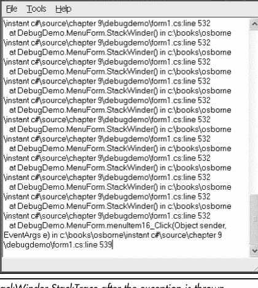

#### 使用 StackFrame 作为诊断工具

以下代码片段演示了如何为当前文件创建 `StackFrame` 对象的实例，并显示文件、行和列信息。（此输出与 `StackTrace` 中找到的每一行信息一致。）

```
StackFrame f = new StackFrame(true);
richTextBox1.AppendText(f.ToString  () + "\n");
```

你可以查看 `StackFrame` 对象的文本内容，以查看代码执行的确切顺序。

## 自动管理调试代码

如果你必须编写诊断代码，在部署应用程序前删除它，然后在应用程序进入维护模式时重写它，那么追踪和诊断能力会变得非常麻烦。多年来，大多数程序员都熟悉条件预处理器指令。

例如，用条件指令包裹代码。如果指令的计算结果为 `false`，则代码将被编译器移除。C# 实现了预处理器指令；因此，只有当预处理器条件常量被定义时，以下指令才会允许上一节中的 `StackFrame` 示例。

```
#if DEBUG
    StackFrame f = new StackFrame(true);
    richTextBox1.AppendText(f.ToString  () + "\n");
#endif
```

如果常量 `DEBUG` 被定义，预处理器会包含该代码。否则，代码将被排除。Visual Studio .NET 会为你提供提示。如果代码将被包含，那么代码将显示为彩色。如果编译器指令的计算结果为 `False`，那么代码将显示为灰色。（这种颜色在你编码时出现的事实表明，预处理器在你编码时正在运行。当然，事实是 VS.NET IDE 在你编码时格式化代码并提供 Intellisense 信息。）

Visual Studio .NET IDE 相对于条件编译器指令进行了改进。编译器指令的缺点是你必须在需要有条件地删除代码的每个地方都放置它们，并且每次更改条件常量的值时都必须重新编译。.NET 支持一种改进形式的条件编译和开关，维护在外部 XML 文件中。在 XML 文件中使用 switch 类意味着你能够在不重新编译源代码的情况下打开或关闭调试代码。我们将在本节中探讨条件编译和 XML 开关。

### 条件编译

条件编译由编译器指令管理。编译器指令是后面跟着一个被计算为布尔值的值的 `pragma`。例如，`#if` 是预处理器条件 `if` 语句。如果 `#if` 语句后的标记计算结果为 `true`，那么编译器会包含 `#if` 和 `#endif` 之间的代码。如果条件编译变量的计算结果为 `false`，那么代码将不会包含在输出程序集中。以下代码演示了散布的条件代码。

```
#if DEBUG
    EventLog.WriteEntry("conditionally written debug information");
#endif
// ... Some more code
#if DEBUG
    EventLog.WriteEntry("some more conditionally written debug information");
#endif
```

**提示**
条件编译器指令在 C# 中区分大小写。例如，`DEBUG` 和 `debug` 表示两个独立的常量。

通过将 `EventLog.WriteEntry` 语句包装在一个方法中，你可以将预处理器指令的出现次数减少到每个有条件编译的代码块一次。以下是修改后的版本。

```
Private void DebugWrite(string message)
{
    #if DEBUG
        EventLog.WriteEntry(message);
    #endif
}
DebugWrite("conditionally written debug information");
// ... Some more code
DebugWrite("some more conditionally written debug information");
```

现在你看到条件代码只存在于一个地方：包装函数。虽然这是一个更好的解决方案，但仍然存在问题。你能推断出缺陷吗？
即使在你部署应用程序并取消定义 `DEBUG` 编译器常量后，所有对 `DebugWrite` 的调用仍然会发生。`DebugWrite` 现在是一个空过程，但它仍然存在于应用程序中。Microsoft 发明了一种使用属性管理条件代码的更好方法。

`ConditionalAttribute` 类将计算一个常量。如果常量存在，则该过程保留。如果常量未定义，则该过程将从 IL 中剥离，并且对该过程的每次调用也将自动从 IL 中剥离。
`ConditionalAttribute` 适用于方法。你在每个应该有条件地发射到 IL 的方法前加上 `ConditionalAttribute`，并构造该属性。

通过一个区分大小写的字符串进行求值。如果该字符串被定义，那么条件方法的所有调用都会被发送到中间语言（IL）。取消定义用于初始化 ConditionalAttribute 的字符串后，调用和条件方法会自动从程序集中移除。清单 7-2 包含一个演示 ConditionalAttribute 的示例。图 7-3 和 7-4 展示了条件指令被取消定义前后的发出 IL。

### 清单 7-2 使用 ConditionalAttribute

```csharp
using System;

namespace ConditionalDemo
{
    class Class1
    {
        [STAThread]
        static void Main(string[] args)
        {
            HelloWorld();
        }

        [System.Diagnostics.Conditional("DEBUG")]
        static void HelloWorld()
        {
            Console.WriteLine("Hello World");
            Console.ReadLine();
        }
    }
}
```

在 IL 反汇编中，你可以清晰地看到 HelloWorld 方法及其在 Main 方法中的调用。当你部署应用程序时，你需要更改配置管理器以反映你正在发布代码。这可以通过在配置管理器中将活动解决方案配置从 Debug 更改为 Release 来实现。更改活动解决方案配置的一个效果是，编译器条件 DEBUG 在 Release 配置中未定义。图 7-4 展示了当 DEBUG 不再定义时发出的 IL。

> 符合公共语言规范（CLS）的语言可以忽略 ConditionalAttribute。

这里重要的是，你可以编写所有想要的测试代码，而不用担心你的程序集会因膨胀或方法疲劳而受损。对条件方法的调用会被编译器移除。

214 高级 C# 编程

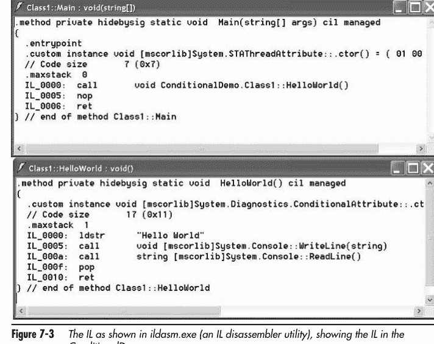

图 7-3 如 ildasm.exe（一个 IL 反汇编实用工具）所示的 IL，展示了 ConditionalDemo.exe 中的 IL

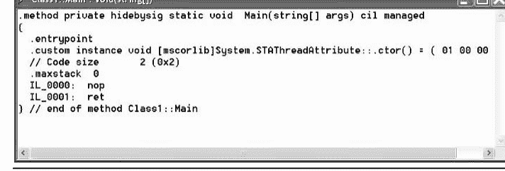

图 7-4 当 DEBUG 未定义时，ildasm.exe 中 ConditionalDemo.exe 的 IL

## 使用开关

ConditionalAttribute 是对普通预处理器指令的改进，但你仍然需要重新编译应用程序以包含或排除条件方法。还有第三种选择，即 BooleanSwitch。

### BooleanSwitch 示例

DebugDemo.exe 示例应用程序演示了使用 BooleanSwitch 来确定是否创建 EventLogTraceListener。以下是代码。

```csharp
static BooleanSwitch booleanSwitch =
    new BooleanSwitch("MySwitch", "Test Switch");

private void MenuForm_Load(object sender, System.EventArgs e)
{
    if (booleanSwitch.Enabled)
    {
        eventLog1.Source = "Trace";
        Trace.Listeners.Add(new EventLogTraceListener(eventLog1));
        Trace.WriteLine("Test!");
    }
}
```

第一条语句定义了一个静态 BooleanSwitch 对象，使用开关 MySwitch 初始化它。示例中的 BooleanSwitch 将在与此程序集关联的 .config 文件中查找名为 MySwitch 的开关。Load 事件处理程序评估 BooleanSwitch。如果 XML .config 文件为该开关定义了一个非零值，那么 BooleanSwitch.Enabled 为 True，示例中的代码将运行。开关名称不区分大小写。开关的任何非零值都将被视为 True 值。

### 在 .config 文件中定义 BooleanSwitch

你可以为每个程序集定义一个 .config 文件。配置文件的名称与程序集相同，只是在文件名末尾加上 .config。例如，我们的 DebugDemo.exe 应用程序将评估与程序集在同一文件夹中的 DebugDemo.exe.config 文件。清单 7-3 展示了描述 BooleanSwitch MySwitch 的 .config 文件。

```xml
<configuration>
    <system.diagnostics>
        <switches>
            <add name="MySwitch" value="0" />
        </switches>
    </system.diagnostics>
</configuration>
```

类似于 HTML，XML 使用标签对。开始标签定义在大于和小于（<>）符号对内，结束标签包含一个正斜杠 </>。<configuration></configuration> 标签定义了配置文件的内容。配置文件只能包含一对配置标签。

### 实现日志记录器

当然，你可以在需要事件日志记录时随时创建 EventLog 对象的实例或使用静态方法。然而，通过构建集体上更易于使用和更有用的代码块，可以实现速度和健壮性。例如，我们可以封装 EventLog 类，并制作一个比创建实例和定义源更容易使用的实用程序。我们将创建 TestLog 类库，它具有易于使用的接口，并自动创建和管理事件源。我们可以将这个类库插入任何我们想要在测试期间创建自定义日志的应用程序中。

> **注意**
> 封装属于特定框架的类和组件还有另一个动机。通过在现有组件周围放置一个包装器或外观，你可以使其更易于使用，或者在不影响客户端的情况下交换实现外观的代码。外观是支持简化类接口概念的模式的名称。

清单 7-4 提供了 TestLog 类库中定义的 Logger 类的完整清单。代码为 EventLog 对象添加了一个外观。因为 Logger 类并没有完全隐藏底层的 EventLog 对象，所以可能很难交换底层实现——即 EventLog。不过，EventLog 更易于使用。

## 清单 7-4 所示的 Logger 类使用外观使 EventLog 更易于使用。

```csharp
using System;
using System.Diagnostics;

namespace TestLog
{
    public class Logger
    {
        #region Private Members
        private static EventLog log = null;
        private static EventLogTraceListener listener = null;
        private static string source = "";
        private static string logName = "";
        private static string machineName = "";

        private Logger(string source, string logName, string machineName)
        {
            Logger.source = source;
            Logger.logName = logName;
            Logger.machineName = machineName;
            Initialize();
        }

        private void Initialize()
        {
            Check();
            CheckListener();
            log = new EventLog(logName, machineName, source);
            listener = new EventLogTraceListener(log);
            Trace.Listeners.Add(listener);
        }

        private void Check()
        {
            if (SourceExists() && !LogNamesEqual())
            {
                string name =
                    EventLog.LogNameFromSourceName(source, machineName);
                CheckLog(name);
                EventLog.DeleteEventSource(source, machineName);
                EventLog.Delete(name, machineName);
            }
        }

        private void CheckLog(string log)
        {
            const string Mask = "Do not delete default log {0}";
            if (log.ToUpper() == "APPLICATION"
                || log.ToUpper() == "SYSTEM"
                || log.ToUpper() == "SECURITY")
                throw (new Exception(string.Format(Mask, source)));
        }

        private void CheckListener()
        {
            Trace.Listeners.Remove(listener);
        }

        private bool SourceExists()
        {
            return EventLog.SourceExists(source, machineName);
        }

        private bool LogNamesEqual()
        {
            return EventLog.LogNameFromSourceName(
                source, machineName).ToUpper() == logName.ToUpper();
        }

        private static EventLog CreateDefault()
        {
            CreateNew("Logger", "Test", ".");
            return log;
        }
        #endregion

        public static void CreateNew(string source,
            string logName, string machineName)
        {
            Logger drop = new Logger(source, logName, machineName);
        }

        public static EventLog Log
        {
            get
            {
                return log != null ? log : CreateDefault();
            }
        }

        [Conditional("DEBUG")]
        public static void WriteEntry(string message)
        {
            Log.WriteEntry(message);
        }

        [Conditional("DEBUG")]
        public static void WriterEntry(string message,
            EventLogEntryType type)
        {
            Log.WriteEntry(message, type);
        }
    }
}
```


## Logger 类的实现

```csharp
public static EventLogEntryCollection Entries
{
    get
    {
        return Log.Entries;
    }
}

public static void WriteEntry(string message, EventLogEntryType type)
{
    Log.WriteEntry(message, type);
}
```

Logger 类使得 EventLog 更易于使用，其背后的逻辑相当简单。在构建应用程序时，鼓励你记录尽可能多的必要信息，以帮助你消除错误。当发布应用程序时，你可能希望将关键信息写入应用程序日志。否则，你可能会填满事件日志，这本身也会带来问题。

一个良好的策略是在测试期间创建一个自定义日志，并记录任何有助于你追踪错误的信息。`TestLog.Logger` 类的实现充分考虑了构建和测试的需要。当我构建一个应用程序时，我只想记录跟踪信息，而不必担心创建唯一的源名称或指定自定义日志。通过编写这个 Logger 类，我可以自动化创建和管理自定义日志，并确保源名称在所有日志中都是唯一的。每次我使用 Logger 时，它都会为我处理这个过程。

以下各节定义了管理自定义事件日志所需的步骤，并解释了由 Logger 自动管理的内容。

### 创建事件源

当你创建一个 EventLog 的实例时，需要指定事件源。源名称在单台计算机的所有日志中必须是唯一的。如果你想手动创建一个事件源，可以调用静态方法 `CreateEventSource`，并传递源名称和日志名称，或者源名称、日志名称和计算机名称。以下示例演示了该方法的调用。

```csharp
EventLog.CreateEventSource("MyApp", "Application");
```

前面的示例在应用程序日志中创建了名为 `MyApp` 的源。

如果你查看 Logger 类，会发现我们并没有显式地创建事件源。（我们确实显式地删除了一个事件源。）我们不创建事件源的原因是 `WriteEntry` 方法会自动创建一个不存在的源。如果源已经存在于另一个日志中，则会引发异常。我们确实会删除一个冲突的源（如果它存在的话）。

### 确定源是否存在

`SourceExists` 是定义在 EventLog 中的一个静态方法。将源名称传递给该方法，它会返回一个布尔值，指示该源是否存在。此方法会检查计算机上的所有事件日志。`EventLog.SourceExists` 在清单 7-4 的第 50 行有演示。

> 注意

不要删除默认的应用程序、系统或安全日志。删除这些日志可能会导致计算机停止运行。将 EventLog 封装到 Logger 类中的另一个好处是，我可以编码检查以确保不会意外删除其中一个默认日志。`CheckLog` 方法就起到了这个作用。

如果源存在，我们使用 `EventLog.LogNameFromSourceName` 方法来确定哪个日志包含我们想要使用的源名称，然后从该日志中删除该源。清单 7-4 中第 32 到 42 行的 `Check` 方法实现了源名称冲突解决代码。如果源存在并且我想要使用的日志名称与源所在的日志名称不相同，则会删除该源和日志。

### 删除事件源

当你完成使用后，或者需要删除一个冲突的源时，可以通过调用静态方法 `EventLog.DeleteEventSource` 来删除一个事件源。传递 `Source` 和 `MachineName`，源将从包含它的日志中被移除。清单 7-4 的第 39 行演示了如何删除事件源。

### 删除自定义日志

当你完成使用自定义事件日志后，可能需要删除它。不要删除任何默认日志，包括应用程序、系统或安全日志。你可能会发现，在注册表中重新创建这些日志条目非常困难，并且，由于它们的删除，你的计算机可能无法正常工作。

> 注意

如果我没记错的话，我曾在应用程序日志上调用 delete 方法，以查看 EventLog 是否允许我这样做。`EventLog.Delete` 删除了应用程序日志。幸运的是，我已经导出了注册表的这个分支，并能够恢复它。除非你愿意丢弃机器配置并重新开始，否则我不建议这样做。但也许从那时起，微软已经在 EventLog 中实施了安全防护措施。

Logger 类会在清单 7-4 的第 40 行删除包含我们源的日志，只要该日志不是那三大默认日志之一。

### 添加跟踪监听器

Logger 类还会自动将我的自定义事件日志设置为一个跟踪监听器。这发生在清单 7-4 的第 28 和 29 行。

Logger 类的最终结果是，只需调用两个静态 `Logger.WriteEntry` 方法之一，就能建立一个自定义日志和跟踪监听器。如果你再次仔细查看清单 7-4，你还会发现，消费者使用 Logger 类所必需的方法数量被限制在少数几个。

Logger 类使得在构建应用程序并向其中写入跟踪信息时，创建和使用自定义日志变得非常容易。

## 其他主题

探索 `DebugDemo.sln` 示例程序，你会发现其中演示了诊断命名空间的其他几个特性。`DebugDemo.sln` 演示了如何：

- 实现自定义对话框
- 实现私有构造函数及其使用时机
- 按引用传递参数
- 使用 `FileVersion` 类（而不是反射）创建“关于”对话框
- 使用 `Debug` 类（并回顾 `Assert` 方法）

最后，我们将探讨 `PerformanceCounter` 对象。性能计数器有助于测量系统的性能和资源使用情况。这可以成为你工具库中一个非常宝贵的工具。

### 创建对话框

对话框是以模态方式显示的窗体，用于提示用户输入信息。Visual Basic .NET 有 `InputBox` 方法，它不过是一个围绕窗体包装的函数。模拟这种“函数包裹窗体”的行为的好处是，使消费者能够轻松执行基本操作。

`DebugDemo.sln` 实现了一个 `InputBox` 类，它显示一个单行的输入文本框。这个窗体（如图 7-5 所示）用于从用户查询信息。`InputBox` 接受一个标题、说明文字和默认值，用于描述显示的内容。（`InputBox` 是仿照 VB.NET 的 `InputBox` 函数建模的。）

如果用户单击“确定”，窗体返回 `DialogResult.OK`。如果用户单击“取消”，窗体返回 `DialogResult.Cancel`。

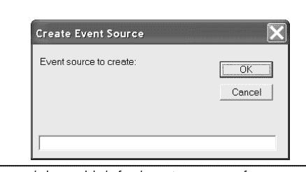

**图 7-5** 一个仿照 VB.NET InputBox 函数的自定义对话框

### 对话框返回 DialogResult

对话框返回 `DialogResult` 枚举值之一。在创建自定义对话框时，你应该强制执行此约定。`Form.ShowDialog` 函数返回一个 `DialogResult` 值。你需要做的就是确保调用了 `ShowDialog` 方法，并使用一个返回 `DialogResult` 值的控件。

`System.Windows.Forms.Button` 控件有一个 `DialogResult` 属性。要创建一个“确定”按钮，请在按钮的 `Text` 属性中输入 **OK**，并将 `DialogResult` 值设置为 `OK`。当用户单击“确定”按钮时，它将关闭窗体并将 `ShowDialog` 方法的返回值设置为 `DialogResult.OK`。同样的过程也适用于“取消”按钮。

### 用于对话框的私有构造函数

为了让对话框更易于使用，你应确保消费者通过受约束的方式调用对话框，即通过 `InputBox.Show` 静态方法。在这个例子中，`Show` 是一个工厂方法。为了使其成为构造窗体的唯一方式，请将访问修饰符 `*private*` 应用于窗体的构造函数。结果是，只有成员方法才能构造窗体的实例。以下代码片段演示了这种技巧。

```csharp
private InputBox()
{
    InitializeComponent();
}

private InputBox(string title, string caption,
    string defaultValue) : this()
{
    Text = title;
    label1.Text = caption;
    textBox1.Text = defaultValue;
}

public static DialogResult Show(string title, string caption,
```


## C# 中的按引用传递参数

ref string defaultValue )
{
    using(InputBox form = new InputBox(title, caption, defaultValue))
    {
        DialogResult result = form.ShowDialog();
        if( result == DialogResult.OK )
            defaultValue = form.textBox1.Text;

        return result;
    }
}

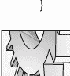

> **提示**

代码清单中演示的 `using` 语句将确保调用窗体的 `Dispose` 方法。在 `using` 语句中构造的对象将在 `using` 块结束时自动释放。

从代码清单中我们可以确定有两个构造函数，它们都与类同名。默认构造函数调用 `InitializeComponent`。如果没有这个构造函数，我们窗体上的控件就不会被创建。第二个构造函数也是私有的，接受我们的 `title`、`caption` 和 `defaultValue` 参数。`:` this() 子句指示编译器也调用默认构造函数。

因为两个构造函数都是私有的，我们创建窗体实例的唯一方法是通过公共工厂方法 `Show`。这正是我们想要的。因为我们要测试 `Show` 方法的 `DialogResult` 值，所以我们需要一种替代方法来从方法中获取输入值。我们可以通过按引用传递 `defaultValue` 来实现这一壮举。

如果你需要在 C# 中从一个方法获取多个返回值，你可以将参数定义为引用参数。结果是对引用参数的更改将反映给调用者。（按引用传递参数类似于 C++ 中的指针传递、VB 中的 `ByRef` 以及 Pascal 中的 `var`。）

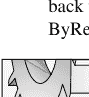

> **提示**

参数列表仅因 `ref` 关键字而不同的两个方法将构成重载。请注意，不能按 `ref` 方式传递属性。

上一节代码清单中显示的 `Show` 方法将 `defaultValue` 定义为一个将被更改的参数，通过在 `Show` 方法中参数类型 (`string`) 前添加 `ref` 关键字来实现。调用方法时也必须指定 `ref` 关键字。从 `DebugDemo.sln` `MenuForm` 中我们可以看到如何调用 `InputBox.Show` 方法。

```csharp
if( InputBox.Show(title, caption, ref log) == DialogResult.OK)
```

注意变量 `log` 前使用了 `ref` 关键字。方法可以通过 `ref` 关键字的存在或缺失来重载。

对于没有 `ref` 或 `out` 关键字传递的参数的更改不会反映给调用者。使用 `ref` 关键字，更改将反映给调用者，并且 `ref` 参数必须被赋予某个值。使用 `out` 关键字，更改将反映给调用者，但 `out` 参数不保证已被初始化。如果按 `ref` 或 `out` 方式传递数组，你是在表明数组本身将被更改，而不是数组中的值。如果你只想更改数组中的值，则不需要使用 `ref` 或 `out` 关键字。

## 文件版本信息

第 2 章中的“关于”窗体演示了如何使用反射从 `Assembly` 类获取文件版本信息。使用反射检索版本信息为我们提供了一个介绍 `Assembly` 类和反射的便利机会。幸运的是，有一种更简单的方法来检索版本信息。

`System.Diagnostics` 命名空间包含一个 `FileVersion` 类，该类具有的属性表示了我们在“关于”窗体中可能使用的所有值。`DebugDemo.sln` 中定义的 `FormAbout` 演示了检索应用程序信息是多么容易。（当然，你仍然需要在项目包含的 `AssemblyInfo.cs` 模块的程序集属性中指定此信息。）

```csharp
FileVersionInfo info =
    FileVersionInfo.GetVersionInfo(Application.ExecutablePath);
label1.Text = info.ProductName;
label2.Text = "Version: " + info.ProductVersion;
label3.Text = info.FileDescription;
label4.Text = info.LegalCopyright;
label5.Text = info.Comments;
```

`FileVersionInfo.GetVersionInfo` 静态方法从传递给方法的文件名中检索 `FileVersionInfo` 对象。如前面的代码片段所示，如果你想获取正在执行的应用程序的文件信息，可以传递 `Application.ExecutablePath` 属性。当你拥有 `FileVersionInfo` 对象后，只需查询所需的属性即可获取信息。

`FileVersionInfo` 类的一个缺点是必须将程序集属性与 `FileVersionInfo` 属性匹配。`FileVersionInfo` 名称与程序集属性名称并不完全相同。表 7-1 展示了在创建“关于”窗体时可能有用的配对关系。

`AssemblyCopyright` 属性将 © 符号嵌入到属性文本中。你可以使用字面值将特殊符号嵌入到字符串中。版权符号的字面值是 `\xA9`，即十六进制值 A9。

如果对次版本号、生成号和修订号值使用星号，则会自动生成 `AssemblyVersion` 信息。例如，`[assembly: AssemblyVersion("1.0.0.*")]` 将生成一个版本号 1.0.0，其中最后一个值（修订号）由编译器生成。

## 使用 Debug 类

`Debug` 类定义在 `System.Diagnostics` 命名空间中。`Debug` 包含所有静态方法，这些方法有助于查找和解决应用程序中的缺陷。`WriteLine` 方法用于将关于应用程序内部操作的文本写入输出窗口，而 `Assert` 方法用于强制应用程序保持不变式。编写显示应用程序内部状态的信息，并结合断言预定的假设保持为真，对于构建无错误应用程序非常有价值。

### 将调试信息写入输出窗口

`Debug.WriteLine` 默认用于将文本写入输出窗口。你可以结合 `Debug.Indent` 和 `Debug.Unindent` 将格式化的层次结构信息写入输出窗口。`Debug.WriteLineIf` 的工作方式类似于 `WriteLine`，但仅在布尔表达式为 `True` 时才写入信息。以下演示了 `WriteLine` 和 `WriteLineIf` 方法：

```csharp
Debug.WriteLine("source deleted");
Debug.WriteLineIf( EventLog.SourceExists("MySource"), "Deleting MySource");
```

如果你调用 `Debug.Indent` 方法，那么每次调用 `Indent` 时，调试信息将在文本前写入一个制表符。`Unindent` 每次调用将减少一个制表符的缩进。

### 断言一切

`Debug.Assert` 类用于在构建程序时强制关于程序状态的假设。`Assert` 通过挂起应用程序并在每次假设被打破时提醒你来强制执行假设。它通过计算布尔表达式来实现。例如，如果你编写一个条件测试来确定事件日志名称是否不是“APPLICATION”，那么你可以将相同的测试用于断言。`if` 条件检查是为了确保你的代码行为正确，而断言的结合是为了在单元测试期间，如果测试失败，告诉你（开发者）。

```csharp
Debug.Assert(log.ToUpper() != "APPLICATION");
```

该技术是将断言与条件逻辑相结合。条件逻辑用于部署，而匹配的断言用于调试。例如，如果你作为程序员希望在记录器试图删除其中一个默认日志时得到通知，那么你可以编写一个断言来确保你得到通知。修改 `Logger.CheckLog` 方法，我们可以添加一个断言，如果日志是应用程序日志，则告诉我们。

```csharp
private void CheckLog(string log)
{
    const string Mask = "Do not delete default log {0}";

    Debug.Assert(log.ToUpper() != "APPLICATION");
    if (log.ToUpper() == "APPLICATION"
        || log.ToUpper() == "SYSTEM"
        || log.ToUpper() == "SECURITY")
        throw(new Exception(string.Format(Mask, source)));
}
```

### 调试工具简史

`Assert` 功能是最古老且最好的程序员技巧之一。像断言这样的功能内置于操作系统中。操作系统 BIOS 加载提供基本系统功能的函数。这些功能——例如打印到屏幕、写入视频缓冲区或管理鼠标行为——被称为*中断*。

编号最低的中断之一——可能是最早的一个——是中断 3，调试或“软冰”中断。中断 3 挂起应用程序的执行，将应用程序置于调试模式。最早的程序员——以 MS-DOS 为例，Tim Paterson、Bill Gates 和 Paul Allen——需要调试工具。

你仍然可以使用汇编语言和调试中断以及支持汇编语言编程的工具。以下脚本是 Hello World! 应用程序的汇编语言版本。该程序可以使用命令行上的 `debug.exe` 程序编写，并在命令窗口中遵循下面的每条指令。

```assembly
debug
a100
jmp 110
db "Hello, World$"
mov dx,102
mov ah,9
int 3
```


## 第7章：事件日志

```
int 21
int 20
<return>
rcx
1a
w
g
```

指令 `a100` 和 `<return>` 之间的行构成了汇编代码。指令 `a100` 表示在偏移量100（十六进制）处汇编。指令 `jmp 110` 类似于 goto 语句，`db` 是字符串指针，`mov dx,102` 将数据寄存器 dx 指向字符串 "Hello, World!$"，而 `$` 是字符串终止符。`Mov ah,9` 将函数9移入 ah 寄存器，而中断 21（函数9）运行由操作系统加载的打印字符串函数。如果你在调试器中使用 `g`（运行）指令运行此程序，程序将在指令 `int 3`（调试中断）处停止，并转储该点之前CPU的状态。

`hello.com` 程序包含在本书的源代码中，可在 McGraw-Hill/Osborne 网站 www.osborne.com 上找到。本段论述的重点是，调试工具是历史最悠久且生命周期最长的工具之一——这是有充分理由的。

如果日志命名为应用程序日志，则执行速度会显著减慢，使你能够评估这个潜在的关键情况。将显示如图7-6所示的对话框，为你提供中止、重试或忽略断言失败的机会。在这个特定实例中，你可以单步执行该方法，并确保异常将被抛出。

如果你点击“中止”，执行将终止。如果你点击“重试”，应用程序将在断言之后的下一行中断，你可以逐步执行代码或评估问题出在哪里。“忽略”按钮将指示应用程序继续处理并忽略断言。

## 启用和禁用 Debug 类

如果你每次修改和部署应用程序时都必须添加和删除 Debug 代码，那么使用 Debug 类将需要大量的额外工作。然而，如果你在编写生产代码时编写调试代码，你将能最大程度地意识到在给定时刻你对应用程序状态所做的假设。

当配置管理器配置为 Debug 版本时，将定义 `DEBUG` 条件编译常量，Debug 代码将运行。当你将配置更改为 Release 时，`DEBUG` 常量将未定义，Debug 代码将变为空操作代码——即 Debug 代码将自动被禁用。

即使在发布应用程序时，也请保留你的 Debug 代码，并使用条件编译常量 `DEBUG` 来切换 Debug 代码的开和关。

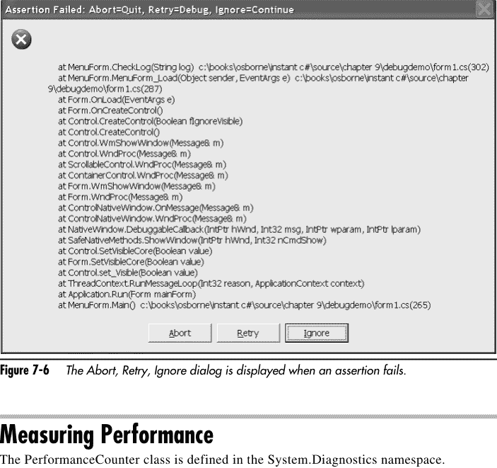

## 度量性能

`PerformanceCounter` 类在 `System.Diagnostics` 命名空间中定义。性能计数器通过类别与性能对象关联。`PerformanceCounters` 允许你跟踪资源使用情况，包括内存、物理磁盘、CPU和线程等。（如果你查看服务器资源管理器——在 Visual Studio .NET 的标准版中不可用——你会看到有数百个可以度量的性能对象。）

你可以通过将计数器从服务器资源管理器拖到你的应用程序中来使用 `PerformanceCounters`。就像服务器资源管理器可以列出多个服务器一样，你可以从其他服务器选择 `PerformanceCounters`。

以下步骤将演示使用 `LogicalDisk` `PerformanceCounter` 跟踪和显示C:驱动器可用磁盘空间的一个示例。

1.  在 Visual Studio .NET 中，选择“视图 | 服务器资源管理器”菜单选项。
2.  选择代表你PC的服务器名称并展开服务器树节点。
3.  展开 PerformanceCounters 节点，直到找到 LogicalDisk 树节点。（性能计数器按字母顺序分类列出。）
4.  展开 LogicalDisk 节点及其从属的 FreeSpace 节点（见图7-7）。
5.  将C:驱动器性能对象拖到你希望包含对计数器引用的窗体的组件托盘上。

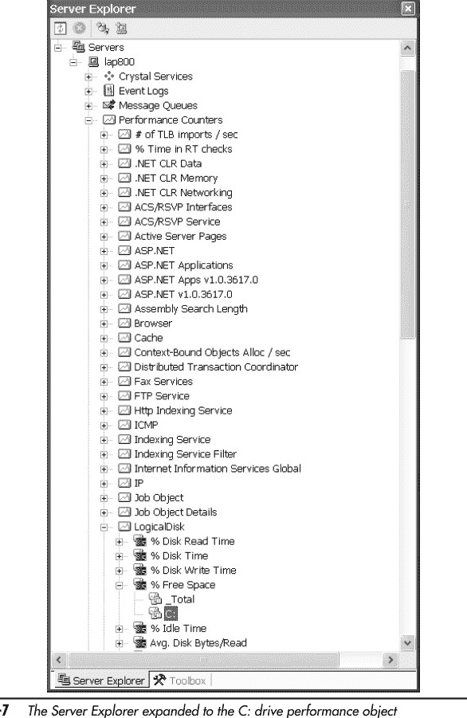

图7-7 服务器资源管理器展开到C:驱动器性能对象

将性能对象从服务器资源管理器拖出会正确配置性能对象。当然，你可以以编程方式创建 `PerformanceCounter` 的实例，并初始化属性以指示你要跟踪的性能对象。如果你正在创建一个没有窗体的程序集，则需要手动创建 `PerformanceCounter`。要手动配置此 `PerformanceCounter`，请将 `CategoryName` 设置为 "LogicalDisk"，`CounterName` 设置为 "% Free Space"，`InstanceName` 设置为 "C:"，并将 `MachineName` 设置为你的计算机名称。

配置好 `PerformanceCounter` 后，我们可以查询计数器获取当前的测量值。`DebugDemo.sln` 演示了通过查询 `Application.Idle` 事件上的可用空间来显示空闲空间百分比计数器。（`Application.Idle` 是一个在你的应用程序没有主动执行任何操作时触发的事件。）`Form_Load` 事件用于将 `OnIdle` 事件处理程序附加到 `Application.Idle` 事件。读取空闲空间值并将其显示在 `StatusBar` 中的代码清单如下。

```csharp
private float GetFreeSpace()
{
    return (float)performanceCounter1.RawValue / 1024;
}

private string GetFreeSpaceString()
{
    const string Mask = "Free Space C: {0:f} GB";
    return string.Format(Mask, GetFreeSpace());
}

private void OnIdle(object sender, System.EventArgs e)
{
    statusBar1.Text = GetFreeSpaceString();
}
```

`PerformanceCounter` 值从 `RawValue` 属性读取。`GetFreeSpace` 将该值转换为表示千字节倍数的十进制数。`GetFreeSpaceString` 格式化该值，将十进制数嵌入字符串，并附加正确的单位。`LogicalDisk` 类别的 `RawValue` 单位是千，倍数是百万。通过将原始值除以1,024，倍数变为 1,024 × 1,000,000，即一千兆字节（GB）。

有关展示 `PerformanceCounters` 能力的高级示例，请查看随 .NET 示例一起提供的 `PerfMon.sln`。

## 总结

本章演示了如何使用 `System.Diagnostics` 中的类来编写调试信息、使用断言、跟踪并编写有关应用程序运行状况的信息到事件日志。如果你过去广泛使用 VB6 或 Windows API 编程，那么你可能熟悉其中的一些功能。

.NET 的一个新功能是对这些功能的增强支持，以及能够随时查看堆栈跟踪或查看堆栈帧中的信息。将所有这些功能与 FileVersion 信息以及数百个 `PerformanceCounters` 结合起来，你就可以获得有关应用程序及其资源使用情况的详细图景。

# 第8章：创建用户控件

**本章内容：**

**演示主题**

-   理解用户控件
-   创建 ButtonCluster 控件
-   创建 PickList 控件
-   实现 AboutBox 控件
-   定义数据绑定用户控件
-   用户控件中的自定义绘制
-   透明的用户控件背景
-   通过继承扩展用户控件

**次要主题**

-   加载列表框
-   动态定位和调整控件大小
-   总结

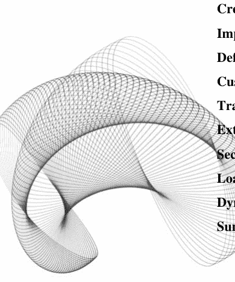

通过创建新的类和自定义控件来扩展.NET框架，是程序员可以参与的最有效和最有趣的活动之一。

`UserControl` 类是一个包含绘图表面的控件，就像窗体一样，允许你在 Windows Forms 和 ASP.NET 的窗体设计器中设计复合控件。你可以使用Visual Basic多年来存在的同一RAD（快速应用程序开发）方法，以可视化方式设计可重用控件，而不是使用代码基于图形用户界面来设计控件。

设计用户控件时，你执行的活动与设计窗体时相同。将控件拖放到窗体上、生成事件处理程序、修改属性并实现新方法。设计窗体和用户控件之间唯一值得注意的区别是，窗体通常是为最终用户设计的，而用户控件是为最终用户和其他开发人员共同设计的——也就是说，你的用户控件将出现在窗体上和工具箱中。最后一点信息表明，如果我们想构建可重用的用户控件，那么我们需要使它们足够通用，这样它们就不会过于依赖于特定的应用程序。

本章将演示如何使用窗体设计器为 Windows Forms 应用程序设计用户控件，以及如何使这些控件可重用。

### 演示主题

要构建可用的用户控件，你需要了解几个方面。如前所述，用户控件在设计和使用上与窗体非常相似。这意味着你的用户控件将包含组成控件，并且这些组成控件将具有你可能希望暴露给用户控件使用者的属性和事件。此外，你可能希望执行自定义绘制并将数据绑定到用户控件。

通过本章的示例，你将能够：

-   实现用户控件
-   公开组成控件的属性和事件
-   在用户控件中执行自定义绘制
-   使用 ADO.NET 和实现 `IList` 接口的对象将数据绑定到用户控件

### 理解用户控件

在C#中实现自定义控件有三种基本策略。你可以继承 `Control` 类以获得最大的灵活性，但工作量也最大。你可以从一个更接近你想要创建的新控件的控件来实现，从而导致灵活性降低但工作量减少。例如，如果你想制作一个具有特殊效果的标签控件，你可以从 `System.Windows.Forms.Label` 继承。最后，如果你想制作


#### 什么是用户控件？

在.NET框架中，用户控件定义在`System.Windows.Forms`和`System.Web.UI`命名空间中。就我们的目的而言，我们指的是`System.Windows.Forms.UserControl`。用户控件继承自`ContainerControl`，而`ContainerControl`又继承自`ScrollableControl`，`ScrollableControl`本身继承自`Control`类。如果你查看.NET框架，你会注意到这与Windows窗体的继承层次完全相同。

设计用户控件时，你将执行与设计窗体时相同的操作。与窗体类似，用户控件包含其他控件，这些控件被称为*组成控件*。用户控件拥有图形用户界面，与窗体一样，并且通常包含许多组成控件以构成完整解决方案的一部分。例如，你可以实现一个包含基本联系信息的用户控件，并将该控件集成到联系人管理窗体中。（请参阅本章后面“定义数据绑定用户控件”一节。）

#### 图形界面为王

我是以最积极的意义这么说的：我越是看到程序员实现的Windows应用程序图形界面，就越是确信应该先由图形设计师进行渲染，然后程序员再解决技术挑战。（艾伦·库珀在《颠倒的世界》中提到左脑型程序员为右脑型世界设计软件时产生的问题。我们程序员就是他所指的“颠倒者”。）

设计用户控件视觉效果时，你可以采用以下几种策略：

-   你可以获取出色的背景图形，并使你的控件半透明。
-   你可以让右脑型人士或图形设计师为你设计一些基本视觉效果，然后你可以创建一套标准的用户控件，以便反复使用。
-   你可以分层叠加控件，以创建深度和丰富性的效果，模仿一些外观更精美的现有软件。（有一些外观精美的应用程序可供借鉴，以助你入门。）

不幸的是，我在说服客户雇佣设计师来设计界面方面并不十分成功，不得不更多地依赖最后一种方法，这超出了我的期望。（我怀着希望，通过在此指出图形界面可以由真正的艺术家精美地渲染，会有人采纳这种方法。）

### 创建控件库

假设你必须依赖*三原色*——三种颜色——和对称性来创建图形用户界面，那么你至少可以依赖用户控件来促进一致性。三原色、对称且一致的界面虽然算不上艺术，但也不会显得俗气。现在你需要一个开始构建用户控件的地方。

新建项目对话框中的Windows控件库模板是开始构建用户控件的好方法。Windows控件库将生成一个扩展名为DLL的程序集，项目将创建一个单独的用户控件。（你可以从类库开始并手动添加用户控件，但如果合理的捷径可用，没有理由不采用。）

创建Windows控件库时，输出类型将是类库（即DLL），模板将添加`System`、`System.Data`、`System.Drawing`、`System.Windows.Forms`和`System.XML`命名空间引用。模板还将添加`AssemblyInfo.cs`和`UserControl1.cs`模块。AssemblyInfo文件用于添加元数据，UserControl模块包含一个继承自`UserControl`的类，你可以用它来开始实现你的第一个用户控件。

你可以根据需要向控件库添加任意数量的用户控件。每个模块不限于一个类，但你确实希望将每个模块限制为一个用户控件，因为`.resx`文件将通过文件名与用户控件关联。

此时构建用户控件的推荐方法是，以通用解决方案为目标构建控件，并使用通用应用程序测试用户控件。当控件具有你确定的必要的一般属性、方法、事件和组成控件后，你就可以将新的用户控件集成到你的应用程序中。我们将使用这种方法来构建用户控件。第一个控件是四个按钮的堆叠，它们会根据用户控件的大小自动调整大小。第二个控件整合了这些按钮，创建了一个包含两个列表框的用户控件，按钮作为在两个列表框之间移动元素的视觉隐喻。（构建完这两个控件后，我们将探讨一些其他类型的控件。）

### 创建 ButtonCluster 控件

ButtonCluster在用户控件容器上使用四个标准按钮控件。图8-1中显示了ButtonCluster控件位于窗体的中心。按钮上的文本表明，点击特定按钮将按箭头指示的方向移动元素（参见图8-1）。


#### 注意

值得注意的是，对于熟悉Windows应用程序的人来说，这些按钮的行为可能看起来很直观，但对于非Windows用户来说可能完全不直观。这是每个新软件应用程序都会呈现的难题。

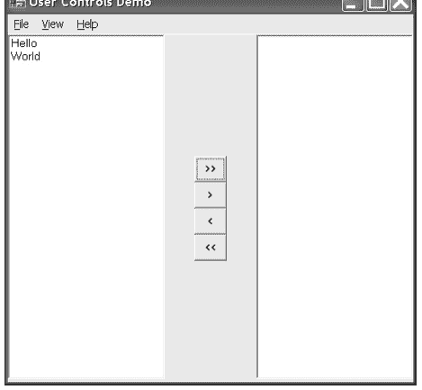

图8-1 *ButtonCluster用户控件位于两个列表框之间。*

现状是，软件开发者必须对他们的受众有所了解，如果Windows应用程序偏离Windows的外观和感觉太远，那么即使是经验丰富的计算机用户也会感到困惑。目前的方法是在需要时为新应用程序的用户提供定制培训。

从图8-1我们可以确定用户控件由四个按钮组成。为了保持按钮对齐，我们需要响应发送给用户控件的Resize事件，我们需要修改按钮的Text属性，并且我们需要暴露各个按钮的Click事件，以便允许用户响应Click事件。

> **提示**
> 用户控件（或窗体）上的控件被称为组成控件。你会遇到术语“暴露”，例如“暴露组成控件的属性”。其他文本将其称为接口提升。当你在包含控件中暴露聚合的成员时，“暴露成员”和“接口提升”都是可以接受的。为了与你可能遇到的.NET帮助保持一致，我们将使用“暴露”。

#### 设计用户控件视觉界面

我们的第一个用户控件的视觉外观由四个大小相同的按钮垂直排列组成。为了使控件尽可能通用，我们可能希望允许按钮水平对齐。我们可能还希望允许实际按钮使用其他类型的按钮进行渲染（如第2章中的VideoKiosk按钮），但我们会保持按钮簇简单。

要创建按钮簇类，请创建一个新的Windows控件库项目。在用户控件容器上放置四个按钮。使用Visual Studio .NET的“格式”|“使大小相同”|“两者”菜单使按钮大小完全相同。（使按钮大致呈正方形。）使用“格式”|“对齐”|“中心”菜单项沿中心垂直轴对齐按钮。调整用户控件的大小，使其宽度大致等于单个按钮，高度等于所有四个按钮（示例可见于图8-1）。不必担心精确的视觉尺寸，因为我们将编写代码使控件在视觉上完美。接下来我们需要编写代码，使每个按钮的大小与容器控件的大小成比例调整。

#### 实现用户控件Resize事件处理程序

当用户控件调整大小时，我们希望我们的按钮占据并完全消耗恰好四分之一的可用空间。幸运的是，用户控件可以像窗体一样设计。要生成Resize事件处理程序，我们可以使用属性窗口的“事件”视图。

```csharp
private void UserControlButtons_Resize(object sender,
    System.EventArgs e)
{
    ResizeButtons();
}
```

遵循良好的惯例，我们只需通过调用一个命名良好的方法来实现事件处理程序。命名良好的方法减少了注释的需要，并且名称精确地指示了代码将做什么。或者，我们可以重写`OnResize`方法。如果你选择重写`OnResize`，请确保调用基类方法。按照惯例，.NET使用`On`前缀表示事件方法；因此，`Resize`事件会有一个调用它的`OnResize`方法。（你可以查找此信息或直接依赖惯例。）

如果你选择重写`OnResize`方法，那么重写的方法可以实现如下：

```csharp
protected override void OnResize(System.EventArgs e)
{
    base.OnResize(e);
    ResizeButtons();
}
```

我们可以使用重写的`OnResize`方法来实现组成控件的调整大小行为。我们不需要同时使用事件处理程序和重写的事件处理程序；虽然两种方法都可行，但我通常更倾向于重写方法。


因此，如果你使用函数指针来实现调整大小的行为，而使用者实现了此事件，你的事件处理程序将会丢失。这是因为函数指针事件处理程序一次只能指向一个函数。

委托则不同。委托维护一个内部调用列表。这个内部调用列表允许委托——在 .NET 中即事件——指向多个事件处理程序，并在每次事件触发时通知所有处理程序。这被称为*多播*。由于委托可以多播，我们可以使用事件处理程序来实现调整大小的行为，而不用担心其他开发者会破坏我们的调整大小事件处理行为。多播委托允许我们使用事件处理程序或重写方法来扩展用户控件的行为。

### 为按钮确定等分区域

现在我们有了一个事件处理程序，当用户控件调整大小时，它会收到通知。接下来，我们可以实现代码，使每个按钮大小相等。

在编码时，判断一个解决方案是否足够通用以在其他上下文中发挥作用很有价值。确定矩形的分数部分通常是有用的，经验表明我可以重用此行为。当代码可能普遍有用时，最好创建一个新类并在新类中实现该行为。清单 8-1 实现了一个 `Rectangle` 类，该类可以为作为边界矩形分数细分的矩形计算新的顶部和底部位置。

```
清单 8-1  Rectangles 类包含用于确定边界矩形细分的静态方法。

using System;
using System.Drawing;

namespace UserControlsExamples
{
    public class Rectangles
    {
        private Rectangles(){}

        public static Rectangle GetVerticalRectangle(
            Rectangle rectangle, int index, int segments )
        {
            Rectangle r = rectangle;
            r.Size = new Size( r.Width,
                NewBottom(rectangle, index, segments));

            r.Location = new Point(0,
                NewTop(rectangle, index, segments));
            return r;
        }

        public static int NewTop( Rectangle rectangle,
            int index, int segments )
        {
            return (int)((float)index / segments *
                rectangle.Height);
        }

        public static int NewBottom( Rectangle rectangle,
            int index, int segments)
        {
            return rectangle.Height / segments;
        }
    }
}
```

这个类非常直接：根据细分数量和你想要的具体分割位置计算新的顶部位置，并通过将高度等分来计算底部位置。更重要的是我们如何能够判断何时需要创建一个新类。简单地说，我们为一个方法提供一个好名字，然后问自己，这个方法听起来是否像这个特定事物（这个类）的行为。我将该方法命名为 `GetVerticalRectangle`。因此，问题就变成了“`ButtonCluster.GetVerticalRectangle`——即 `GetVerticalRectangle`——听起来像是按钮簇的好方法吗？”线索就在方法名 `GetVerticalRectangle` 中。名词 *Rectangle* 提供了关于此方法可能应该归属的对象类型的合理线索。这不是一门完美的科学，但经验和实验会有所帮助。

> ### 提示
> **我们如何确定不需要创建 Rectangles 类？答案：没有状态信息。也就是说，没有字段。如果一个类只有方法，那么这些方法可以是静态的，我们就不需要该类的实例。**

现在我们有了用于确定矩形细分的一些通用方法，就可以相当容易地调整按钮簇中按钮的大小了。

```
private void Initialize()
{
    buttons = new Button[]{buttonAllRight, buttonRight,
        buttonLeft, buttonAllLeft};
}

private void ResizeButtons()
{
    if( buttons == null ) return;
    for( int i=0; i<buttons.Length; i++)
    {
        buttons[i].Bounds = Rectangles.GetVerticalRectangle(
            this.Bounds, i, buttons.Length);
    }
}
```

`ButtonCluster` 类的实现是为了将每个按钮的引用存储在一个数组中（参见前面的清单）。将按钮存储在数组字段中便于遍历每个按钮并对每个矩形调用 `Rectangles.GetVerticalRectangle` 方法。参数 `this.Bounds` 是用户控件的矩形区域。索引 `i` 用作矩形细分，而数组的 `Length` 表示细分数量。这种方法实际上使代码具有相当好的可扩展性，因为我们不依赖于字面值来确定索引或按钮数量。

最后谈谈策略。当然，你可以使用用户控件的 `Controls` 数组来访问按钮；但是，如果你选择这条路线，你会更倾向于编写代码来检查 `Controls` 数组中每个 `Control` 的类型信息。两种方法都相当有效。如果你使用 `Controls` 数组，那么如果用户控件包含类似类型的控件，但你又不想对所有相同类型的控件执行统一操作，你可能会遇到困难。

### 公开组成控件的事件

就按钮簇的视觉方面而言，我们只需要修改 `Text` 属性就完成了。为了更精致的外观，可以使用 `Button.Image` 属性并提供一个图形箭头。

然而，在程序上，我们还没有完全完成。按钮的目的是响应 `Click` 事件。就目前实现的事件处理程序而言，使用者将无法获取此控件上包含的按钮的 `Click` 事件。这提出了一个稍微棘手的问题。一个解决方案——尽管不是最好的——是我们必须公开组成控件的事件。公开组成控件事件并不像看起来那么难。但问题是我们为什么必须这样做？

我将先回答“如何做”，然后再探讨“为什么”。理解为什么我们必须公开组成控件成员，以及替代方案是什么，将帮助我们预见不久的将来可能会出现什么。（你正在学习什么是现有的，以及什么是可能的。）

#### 提升组成控件中的事件

当你向用户控件添加控件时，新控件作为字段添加到用户控件中。用户控件上的控件属性被封装在两层深度中。假设你有一个用户控件实例 `userControl1`。进一步假设 `userControl1` 包含一个 `Button` 控件。要获取按钮的 `Text` 属性，使用者必须编写类似 `userControl1.Button.Text` 的代码。计算成员访问运算符的数量——有两个——我们知道 `Text` 属性在两层深度中。因此，按钮的 `Text` 属性不会出现在属性窗口中。

假设 `Button` 是公共的，使用者可以以编程方式修改用户控件中包含的按钮的属性。但是，如果你想在属性窗口中修改这些属性和事件，那么你就必须公开组成控件的属性和事件。我们希望使使用者能够编写响应单个按钮点击的代码，因此我们需要公开按钮的点击事件。

要公开组成控件事件，我们需要为控件编写事件处理程序。然后我们需要在用户控件中实现新的事件。当组成控件事件触发时，我们将触发的事件传递给新的用户控件事件。实际上，我们将事件从包含的控件向上冒泡到用户控件的界面层。清单 8-2 展示了必要的步骤。

```
清单 8-2   公开组成控件事件

private void Initialize()
{
    buttons = new Button[]{buttonAllRight, buttonRight,
        buttonLeft, buttonAllLeft};

    buttonAllRight.Click += new EventHandler(OnAllRightClick);
    buttonRight.Click += new EventHandler(OnRightClick);
    buttonAllLeft.Click += new EventHandler(OnAllLeftClick);
    buttonLeft.Click += new EventHandler(OnLeftClick);
}

private bool IsValidIndex(int index)
{
    return (index >= buttons.GetLowerBound(0) &&
        index <= buttons.GetUpperBound(0));
}

public Button this[int index]
{
    get
    {
        Debug.Assert(IsValidIndex(index));
        return buttons[index];
    }
}

public event EventHandler AllRightClick;
public event EventHandler RightClick;
public event EventHandler AllLeftClick;
public event EventHandler LeftClick;

private void OnAllRightClick(object sender, System.EventArgs e)
{
    if(AllRightClick != null)
```


## 242 高级 C# 编程

```csharp
35: AllRightClick(sender, e);
36: }
37: 
38: private void OnRightClick(object sender, System.EventArgs e)
39: {
40: if(RightClick != null)
41: RightClick(sender, e);
42: }
43: 
44: private void OnAllLeftClick(object sender, System.EventArgs e)
45: {
46: if(AllLeftClick != null)
47: AllLeftClick(sender, e);
48: }
49: 
50: private void OnLeftClick(object sender, System.EventArgs e)
51: {
52: if(LeftClick != null)
53: LeftClick(sender, e);
54: }
```

清单 8-2 的第 27 到 30 行声明了四个公共事件。这些事件将以 `AllRightClick`、`RightClick`、`AllLeftClick` 和 `LeftClick` 的名称出现在属性窗口的事件视图中。使用者可以为这些事件属性添加事件处理程序。按照惯例，清单 8-2 的第 6 到 9 行为我们的组成按钮控件的 Click 事件添加了私有事件处理程序。当 Button Click 事件被触发时，我们的内部事件会检查使用者是否已将事件处理程序关联到我们的公共事件上。如果 UserControl 的公共事件已分配了处理程序，那么这些事件就会被向上冒泡到 UserControl 的表面。图 8-2 展示了调用堆栈视图，其中事件按其被调用的顺序显示。

> **提示**

事件的运算符是 `+=`（和 `-=`），如清单 8-2 所示。委托甚至不支持赋值运算符 `=`。赋值意味着单个值，例如单个委托。然而，所有的委托都是多播委托。你可以从调用列表中添加或移除委托，但不能为一个事件属性只赋值一个事件处理程序。

我们本可以使用窗体设计器为清单 8-2 中的组成按钮控件生成事件处理程序，但无论是我们编写事件处理程序还是窗体设计器生成它们，结果都是一样的。真正的问题是，为什么我们必须将组成控件的属性和事件公开出来。

### 成员提升的可行替代方案

你可能会认为，你可以将组成控件（如 ButtonCluster 中的按钮）声明为 public。一旦组成控件是公共的，使用者就可以直接访问其属性和事件。事实上，Visual Studio .NET IDE 允许你这样做（参见图 8-3）。

**图 8-2** *调用堆栈显示组成控件首先响应事件，并且事件被冒泡到包含控件。*

图 8-3 显示 `AllRightButton` 作为一个嵌套的引用属性。你可以修改属性值，但不能修改嵌套引用类型属性的事件；它们甚至不会出现在属性窗口中。当然，当你修改嵌套引用类型的属性时，这些属性无法正确地持久化到资源文件中。结果是，嵌套属性在关闭 IDE 后不会被保留，在编译和运行应用程序时也不会被保留。从技术上讲，这是一个缺陷。

> **注意**
> 将组成对象的字段设为 public 在属性窗口中同样无法正确工作。只有属性和事件才会出现在属性窗口中；公共字段不会。

如果你对 C# 的历史略知一二，你可以得出一些结论。首先，正如图 8-2 所示，我们试图做的事情似乎很直观。如果你可以以编程方式修改嵌套属性，那么你也应该能够在设计时修改它们。其次，C# 部分是由创建 Borland Delphi 的同一个人——Anders Hejlsberg——构思的。Delphi 构建在 Object Pascal 语言之上，并且在其最近的版本中支持设计时嵌套对象。我的直觉告诉我，你不必再将组成控件的属性和事件公开很长时间了。预计在不久的将来，嵌套对象将在 IDE 中正常工作。目前，公共的嵌套对象属性在设计时无法正确保持状态。

你可能尝试做的第二件事是直接公开组成事件。考虑以下代码：

```csharp
public EventHandler AllRightClick
{
    get
    {
        return buttonAllRight.Click;
    }
}
```

要直接公开一个组成事件，你可能会认为你可以像演示的那样返回事件属性。这个声明将允许事件属性作为赋值语句的右侧值，但赋值 (`=`) 并未为事件定义。（事件定义了加法赋值 (`+=`) 和减法赋值 (`-=`) 运算符，但没有定义普通的赋值。）

**图 8-3** 属性窗口中嵌套的引用类型——一个按钮

此外，你可能会尝试创建一个委托类的子类并重载赋值 (`=`) 运算符。然而，委托类是使用 `sealed` 修饰符声明的，这意味着你不能创建委托的子类。你只能基于方法签名声明新的委托。

### 创建 PickList 控件

我们有了 ButtonCluster。我们可以通过引用包含 ButtonCluster 的 DLL 程序集在任何应用程序中使用它。我们也可以在另一个 UserControl 中将 ButtonCluster 用作一个控件。通过分层构建复杂性，而不是构建一个单一的、庞大的控件，我们最终得到了更多独立的控件，并且这些控件更易于管理。

我们将构建的下一个控件是一个 UserControl，包含两个 ListBox 控件和一个 ButtonCluster。由于 ButtonCluster 是一个独立的 UserControl，当我们在构建 PickList 控件时，我们扮演的是 ButtonCluster 使用者的角色，只需专注于新的行为。这显然比构建一个在一个类中定义 Button 和 ListBox 行为的单一控件要简单。PickList UserControl 如图 8-1 所示。

通过创建一个新的 UserControl 来实现 PickList。在 UserControl 上绘制两个 ListBox 控件，在它们之间放置一个面板，并将 ButtonCluster 添加到面板中。为了保持 ListBox 和包含 ButtonCluster 的面板之间的相对位置，将左侧 ListBox 的 `Dock` 属性更改为 `Left`，右侧 ListBox 的 `Dock` 属性更改为 `Right`，中间面板的 `Dock` 属性更改为 `Fill`。当 UserControl 调整大小时，ListBox 和 ButtonCluster 将保持图 8-1 所示的外观。ButtonCluster 的位置可以通过以下语句保持：

```csharp
buttonCluster1.Location = new Point(
    panel1.Left + (panel1.Width - buttonCluster1.Width) / 2,
    panel1.Top +   (panel1.Height - buttonCluster1.Height) / 2);
```

ButtonCluster 的水平位置相对于面板左边缘的偏移量是包含面板和 ButtonCluster 宽度之差的一半。ButtonCluster 的垂直位置相对于面板顶部的偏移量是面板高度和 ButtonCluster 高度之差的一半。

视觉效果已经完成。现在我们需要实现将元素在两个 ListBox 之间移动的行为。我们可以通过使用属性窗口为每个按钮生成事件处理程序来构建此行为的框架。

### 向 ListBox 添加和移除元素

有四个按钮，我们可以通过几种方式实现每个按钮的各自行为。点击 `>>`（全部向右）按钮，所有元素将从左侧列表移动到右侧列表。`<<`（全部向左）按钮执行相反的操作。点击 `>`（向右）按钮，只有选中的项目从左侧列表移动到右侧列表，而 `<`（向左）按钮将选中的项目从右侧列表移动到左侧列表。

ListBox 中的项目被定义为一个嵌套类型 `ObjectCollection`。清单 8-3 演示了处理在 ListBox 控件之间移动元素的方法。

### 清单 8-3 在 ListBox 控件之间移动项目

```csharp
private void SourceToTarget(ListBox.ObjectCollection source,
   ListBox.ObjectCollection target)
{
   target.AddRange(source);
   source.Clear();
}

private void MoveAllLeft()
{
   SourceToTarget(listBoxRight.Items, listBoxLeft.Items);
}

private void MoveAllRight()
{
   SourceToTarget(listBoxLeft.Items, listBoxRight.Items);
}

private void SourceToTarget(ListBox.SelectedObjectCollection
   source, ListBox.ObjectCollection target)
{
   IEnumerator e = source.GetEnumerator();
   while(e.MoveNext())
   {
      target.Add(e.Current);
   }
}

private void RemoveSelected(ListBox listBox)
{
   for( int i=listBox.Items.Count - 1; i>=0; i--)
      if(listBox.GetSelected(i))
         listBox.Items.RemoveAt(i);
}

private void MoveLeft()
{
   SourceToTarget(listBoxRight.SelectedItems,
      listBoxLeft.Items);
   RemoveSelected(listBoxRight);
}
```


### MoveRight 方法及相关技术

`MoveRight` 方法将选中的项目从左侧列表框转移到右侧列表框。以下是其实现代码：

```csharp
private void MoveRight()
{
    SourceToTarget(listBoxLeft.SelectedItems,
        listBoxRight.Items);
    RemoveSelected(listBoxLeft);
}
```

`MoveAllRight` 和 `MoveAllLeft` 方法调用 `SourceToTarget` 方法，该方法接受两个 `ListBox.ObjectCollection` 对象。列表会根据移动项目的不同方向进行转置。`ListBox.ObjectCollection` 代表列表中的所有项目。在代码清单 8-3 的第 4 行调用 `AddRange` 之后，我们在第 5 行清空源列表中的所有元素。为了只移动选中的项目，我们调用 `SourceToTarget` 方法，该方法接受一个 `ListBox.SelectedObjectCollection` 作为第一个参数，一个 `ListBox.ObjectCollection` 作为第二个参数。我们根据移动元素的方向对参数进行转置。我们通过使用枚举器只复制选中的项目；有趣的是，`AddRange` 并没有为 `ListBox.SelectedObjectCollection` 定义。在枚举所有选中项目并将选中项目复制到目标（第 18 到 26 行）之后，我们调用 `RemoveSelected`。`RemoveSelected` 使用一个整数，因为 `GetSelected` 和 `RemoveAt`（第 31 和 32 行）被定义为接受一个整数。

`ListBox` 使用一个特殊的集合来存储列表中的对象，这多少有些令人遗憾。这或许有助于内存优化，但它使得编写管理列表间项目移动的通用工具变得更加困难。

### BeginUpdate 和 EndUpdate

有时你需要将大量项目移动到 `ListBox` 中。如果你允许 `ListBox` 在每次添加元素时更新列表视图，`ListBox` 的加载时间会更长。为了加载大量项目，请在开始加载列表之前调用 `ListBox.BeginUpdate`，并在完成加载列表后调用 `ListBox.EndUpdate`。`BeginUpdate` 将阻止列表绘制新项目，直到你调用 `EndUpdate`。以下代码片段演示了这一技术：

```csharp
listBox1.BeginUpdate();
// 加载列表。例如，添加代码清单 3 的第 21 到 25 行的代码。
listBox1.EndUpdate();
```

### 实现 AboutBox 控件

AboutBox 是你将在大多数 Windows 应用程序中看到的一个窗体。这是一个很好的候选项，可以构建一次并多次使用。本节演示如何实现一个 AboutBox `UserControl`。About 属性使用我们在第 7 章学过的 `System.Diagnostics.FileVersionInfo` 类从程序集元数据中读取。我不会在这里重复这些信息（请参阅第 7 章的“FileVersion 信息”一节）。在本节中，我们将重点介绍如何公开组合属性，例如 About 图像属性。

### 绘制和编码 AboutBox

你可以将第 7 章提到的 AboutBox 中的控件复制粘贴到一个 `UserControl` 上。（你需要从 www.osborne.com 网站下载源代码。）你也可以将第 7 章 DebugDemo 中 `FormAbout.cs` 窗体的 `FormAbout_Load` 代码复制到 `UserControl` 的 Load 事件中。（我不会在这里重复那段代码。）

`FileVersionInfo` 动态读取程序集元数据以填充显示在 AboutBox 窗体上的值；因此，将代码从窗体移动到 `UserControl` 使其在控件相同的情况下可重用。当然，你可以选择将 AboutBox 代码保留在窗体中，并在每次需要 About 信息时导入该窗体的副本，但 `UserControl` 版本为你提供了额外的灵活性。

### 公开组合属性

公开组合属性比公开组合事件更容易。要公开你的 `UserControl` 中包含的控件的属性，请声明一个与要公开的控件属性类型相同的公共属性。在新定义的 `UserControl` 属性中返回和设置组合控件属性的值。

例如，我们已经定义了 `AboutBoxInfo` `UserControl`。为了允许用户更改 `PictureBox.Image` 属性，我们需要公开 `Image` 属性。假设我们的 `PictureBox` 控件允许使用默认名称，那么将下一个属性语句添加到我们的用户控件中，将适当地公开组合图像属性。

```csharp
public Image Image
{
    get
    {
        return pictureBox1.Image;
    }
    set
    {
        pictureBox1.Image = value;
    }
}
```

从外部看，`UserControl` 现在有了一个 `Image` 属性。

我想在这里提一下关于风格的说明。注意我使用了 `PictureBox` 的默认名称 "pictureBox1"。之前我提到过，你应该为方法、属性、事件和字段提供良好、描述性的名称。学会何时担心这些事情也很重要。对于 `UserControl AboutBoxInfo`，只有一个 `PictureBox`，并且它是 `UserControl` 的私有成员。由于使用者无法直接与 `PictureBox` 交互，并且只有一个 `PictureBox`，所以 `pictureBox1` 是个不错的名字。当然，这是一个主观判断，但软件开发既要知道该做什么，也要知道不该做什么或不必担心什么。

如果我们能够简单地使组合控件公开并直接操作它们，那就太好了。你可以使组合控件公开，但它们在属性窗口中将无法正常工作。你可以在设计时在属性窗口中修改公共组合属性的值，但这些值在你关闭 Visual Studio .NET 或编译应用程序时将不会保留。我推测这个功能将在下一两个版本中得到支持，届时你将不必公开组合属性和事件。（如前所述，我觉得做出这个假设是合理的，因为公共组合控件似乎是直观的，并且 Anders Hejlsberg 也参与了 .NET 的开发。）

### 定义一个数据绑定的 UserControl

`Control` 类引入了一个 `DataBindings` 属性，它是一个 `ControlBindingsCollection`。你可以将控件绑定到任何实现了 `IBindingList`、`ITypedList` 或 `IList` 接口的类。明显的类有 `ArrayList` 和 `Hashtable`，以及 ADO.NET 的 `DataSet`、`DataTable`、`DataView` 和 `DataViewManager` 类。此外，你可以绑定到相同类型的强类型对象的列表。这意味着你可以将控件绑定到用户定义对象的数组。

第 5 章重点介绍 ADO.NET，因此我们将研究将自定义类型的数组绑定到我们的 `UserControl`。我们需要做的第一件事是构造一个包含我们想要绑定的组合控件的 `UserControl`。我们将定义一个显示联系信息的 `UserControl`。接下来，我们需要定义一个能够包含我们想要管理的信息的类，然后将该类的一些实例添加到一个数组中。最后，我们将自定义对象绑定到 `UserControl`，并提供一种遍历数组中元素的方法。

### 实现 UserControl

创建一个名为 `ContactInformation` 的 `UserControl`。向 `ContactInformation` 添加三个 `Label` 和三个 `TextBox` 控件。将 `Label` 的 `Text` 属性更改为 "First Name:"、"Last Name:" 和 "Phone Number:"。定义三个名为 `FirstName`、`LastName` 和 `PhoneNumber` 的公共属性。将这些属性定义为 `string` 类型。完成的示例如图 8-4 所示。将该图作为视觉指南。

对于 `ContactInformation` 控件，你唯一需要编写的代码是公开三个组合 `TextBox` 控件的 `Text` 属性的代码：

```csharp
public string FirstName
{
    get
    {
        return textBox1.Text;
    }
    set
    {
        textBox1.Text = value;
    }
}
```

```csharp
public string LastName
{
    get
    {
        return textBox2.Text;
    }
    set
    {
        textBox2.Text = value;
    }
}
```

```csharp
public string PhoneNumber
{
    get
    {
        return textBox3.Text;
    }
    set
    {
        textBox3.Text = value;
    }
}
```

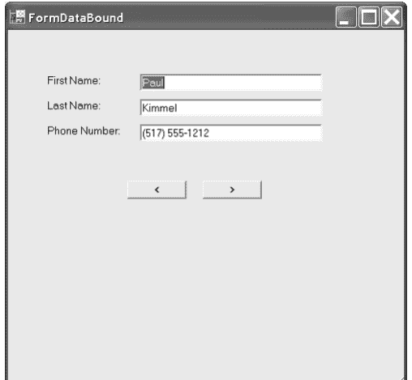
*图 8-4 一个包含数据绑定的 ContactInformation UserControl 的窗体*


用户永远不会看到 TextBox 控件本身，因此你无需重命名 TextBox 控件。从用户的角度来看，你拥有一个名为 ContactInformation 的 UserControl，其属性为 ContactInformation.FirstName、ContactInformation.LastName 和 ContactInformation.PhoneNumber。

### 实现 ContactInformation 类

定义一个属性与 ContactInformation UserControl 相匹配的类是方便且容易的。定义一个复数形式的类来包含我们自定义类的集合会很有帮助。（这些类代表通常所说的业务对象。）清单 8-4 定义了 Contact 类和容器 Contacts。

清单 8-4 Contact 和 Contacts 类

```csharp
public class Contacts
{
    private ArrayList items;

    public Contacts()
    {
        items = new ArrayList();
    }

    public ArrayList Items
    {
        get
        {
            return items;
        }
    }
}

public class Contact
{
    private string firstName;
    private string lastName;
    private string phoneNumber;

    public Contact( string firstName, string lastName, string phoneNumber)
    {
        this.firstName = firstName;
        this.lastName = lastName;
        this.phoneNumber = phoneNumber;
    }

    public string FirstName
    {
        get
        {
            return firstName;
        }
        set
        {
            firstName = value;
        }
    }

    public string LastName
    {
        get
        {
            return lastName;
        }
        set
        {
            lastName = value;
        }
    }

    public string PhoneNumber
    {
        get
        {
            return phoneNumber;
        }
        set
        {
            phoneNumber = value;
        }
    }
}
```

清单 8-4 实现了一个包含三个字段和三个匹配属性的类。构造函数定义为初始化这三个字段：firstName、lastName 和 phoneNumber。第 1 到 17 行的 Contacts 类包含一个 ArrayList 字段 items。Items 属性被定义为只读属性（因为我们只实现了 getter 方法）。我们希望用户能够更改 ArrayList 的元素，但不能更改 ArrayList 本身。将 ArrayList 属性设为只读正是我们实现这一目标的方式。如果我们查看 Visual Studio .NET 帮助文档，可以确定 ArrayList 实现了 IList，并且是一个适合绑定到我们 UserControl 属性的属性。

### 绑定与导航

我们需要创建一些测试数据来测试我们的 UserControl。清单 8-5 创建了几个 Contact 实例和一个用于存储它们的 Contacts 对象。每个控件，包括 UserControl，都有一个 DataBindings 属性。我们将使用 ContactInformation DataBindings 属性来表达 Contact 对象与 UserControl 之间的绑定。最后，我们将使用 UserControl 的 BindingContext 属性来支持在 Contacts 中进行导航，从而完成这个示例。

清单 8-5 包含 ContactInformation UserControl 的窗体以及将 ArrayList 中的同类对象绑定到该 UserControl 的代码

```csharp
Contacts c = new Contacts();

private void FormDataBound_Load(object sender, System.EventArgs e)
{
    c.Items.Add( new Contact("Paul", "Kimmel", "(517) 555-1212"));
    c.Items.Add( new Contact("Trevor", "MacDonald", "(517) 555-1212"));

    contactInformation1.DataBindings.Add(
        new Binding("FirstName", c.Items, "FirstName"));

    contactInformation1.DataBindings.Add(
        new Binding("LastName", c.Items, "LastName"));

    contactInformation1.DataBindings.Add(
        new Binding("PhoneNumber", c.Items, "PhoneNumber"));
}

private void buttonNext_Click(object sender, System.EventArgs e)
{
    ((CurrencyManager)contactInformation1.
        BindingContext[c.Items]).Position += 1;
}

private void buttonPrevious_Click(object sender, System.EventArgs e)
{
    ((CurrencyManager)contactInformation1.
        BindingContext[c.Items]).Position -= 1;
}
```

**提示**
为了提高可读性，你可以在成员运算符处添加换行，而无需添加任何特殊的换行符。

清单 8-5 中的代码可以在 TestControls.sln 示例程序中找到，包含在 FormDataBound.cs 窗体模块中。Form_Load 事件创建了两个 Contact 对象和一个 Contacts 对象。DataBindings.Add 接受一个 Binding 对象。Binding 对象使用要绑定的属性、要绑定的数据源以及该源中要绑定的数据成员进行初始化。第一个参数是我们 UserControl 中的属性。数据源由 ArrayList Items 表示，数据成员是 ArrayList 中某个对象的命名属性，具体来说是 Contact.FirstName、Contact.LastName 和 Contact.PhoneNumber。由于我是 UserControl 和业务类的作者，我在两者中都以相同的名称命名了属性。这样做正是为了方便易用。要导航 Contacts 对象中的元素，我们必须将数据源 Contacts.Items 与 UserControl contactInformation1 同步。BindingContext 属性返回 BindingManagerBase 的一个特定子类。如果数据源返回单个属性，则 BindingContext 返回一个 PropertyManager，而我们的示例返回一个集合；因此，BindingContext 返回一个 CurrencyManager。CurrencyManager 允许我们通过增加或减少 Position 属性来遍历元素。CurrencyManager 自动处理集合的开始和结束。因此，当 Position 属性被修改时，没有特殊的异常处理代码。将控件绑定到对象数组后，你不需要编写任何特殊代码来修改数据。更改 TextBox 中的数据，绑定的字段也会被修改；当你绑定到 ADO 对象时，也会得到完全相同的行为。

### UserControl 中的自定义绘制

当你向自定义 UserControl 添加组合控件时，你需要为每个特定控件的 Paint 事件处理程序中的组合控件提供自定义绘制。假设我们希望 ContactInformation UserControl 的标签看起来是浮雕效果。（浮雕是一种使文本看起来有深度的效果。）使用绘制在 UserControl 上的 System.Windows.Forms.Label 控件，我们需要实现一个事件处理程序来处理 Label 的 Paint 事件，如以下代码所示：

```csharp
this.label1.Paint += new
    System.Windows.Forms.PaintEventHandler(this.label1_Paint);
private void label1_Paint(object sender,
    System.Windows.Forms.PaintEventArgs e)
{
    // 演示文本自定义
    Label l = (sender as Label);
    e.Graphics.DrawString(l.Text, l.Font, Brushes.White, new PointF(2, 0));
}
```

第一条语句为 label1 的 Paint 事件添加事件处理程序。你可以使用属性窗口生成此语句和事件处理程序方法体。这两行代码通过将 sender 参数转换为 Label 类型并使用 Graphics 对象来绘制文本来创建一个临时变量。标签中的文本恰好在偏移量 2, 2 处打印。通过偏移第二次绘制文本并使用更亮的颜色，我们可以创建浮雕效果。

这种简单方法存在几个问题。如果文本换行或对齐方式更改，则此代码将无法工作。我们可以通过编写更多代码来检查标签的属性，并补偿换行文本或交替文本对齐来解决这个问题。假设你已经解决了文本布局的任何问题，你应该避免部署包含实现了自定义绘制行为（或任何自定义行为）作为事件处理程序的 UserControl 的应用程序。如果你想要标签的自定义文本效果，那么请子类化标签类型并在 UserControl 中使用新类。当你编写代码时，请考虑哪个类负责此行为的问题。当你确定答案后，请将该行为放在该类中。阅读第 9 章以获取创建自定义控件以及继承和自定义现有控件的示例。

### 透明的 UserControl 背景

第 2 章提出，你可以创建一个高质量的图形背景，并将控件绘制在此背景之上。将透明控件混合到图形背景中将允许你创建丰富的用户界面。要让你的自定义 UserControl 透明，你需要设置控件样式以支持透明背景。这可以通过在 UserControl 的构造函数中调用 SetStyle 方法轻松实现，如下所示：

```csharp
SetStyle(ControlStyles.SupportsTransparentBackColor, true);
```

因为 UserControl 不支持 Color.Transparent BackColor 值，你可以在调用 SetStyle 之后或将 UserControl 放到窗体上时将 BackColor 设置为 Transparent。TestControls 示例项目中的 TransparentForm 窗体演示了一个透明的 UserControl，其图片框中有一个气球，无缝地漂浮在水面之上。

### 通过继承扩展 UserControl

你可以通过继承扩展现有的 UserControl。从项目菜单中，选择“添加继承的控件”。将打开“添加新项”对话框，并选中“继承的用户控件”模板。单击“确定”后，将显示“继承选择器”对话框（见图 8-5）


## 次要主题

在构建本章中的一些用户控件时，我们依赖了一些额外的功能。本节将涵盖这些内容。你会发现这些主题对通用编程或创建自定义控件都很有用。我们将涵盖的两个主要主题是：

-   在加载列表控件时使用 BeginUpdate 和 EndUpdate
-   动态定位和调整控件大小

### 加载列表框

为大型任务选择的策略可能会影响应用程序的性能。如果在列表框中加载数千个项目，那么当你的应用程序更新时，用户可能不得不等待。如果逐个加载这些项目，结果可能会更糟糕。

在加载列表框时，可以使用几种策略让应用程序看起来响应更快。你可以使用 `BeginUpdate` 和 `EndUpdate` 来防止列表框在每次添加项目时重绘，或者你可以使用后台线程来加载项目。我将在这里演示这两种技术。

#### 使用 BeginUpdate 和 EndUpdate

之前，我介绍了 `ListBox.BeginUpdate` 和 `ListBox.EndUpdate` 方法。如果你编写代码向 ListBox 添加大量元素，每个添加的项目都会强制 ListBox 更新，每次添加元素都会产生重绘列表的开销。对于大型列表，这可能导致非常差的性能。

相反，每次你向 ListBox（或 ComboBox）逐个加载项目时，可以在加载项目之前调用 `BeginUpdate`，并在加载过程结束后调用 `EndUpdate`。你可以包含一个 `try finally` 块，以确保调用 `EndUpdate` 方法。下面的代码演示了如何将 100,000 个整数对象加载到 ListBox。

```
private void LoadListBox()
{
    listBox1.BeginUpdate();
    try
    {
        for(int i=0; i<100000; i++)
            listBox1.Items.Add(i);
    }
    finally
    {
        listBox1.EndUpdate();
    }
}
```

如果这段代码在窗体加载时运行，用户将不得不等待项目加载完成。另一个替代方案是使用单独的线程加载项目。如果用户不需要在能够与包含 ListBox 的窗体交互之前看到所有项目，那么我们可以在后台进程中加载 ListBox。

#### 使用线程池加载列表框

在 .NET 中有几种使用线程的方法。最简单的方法之一是使用 `ThreadPool` 中可用的线程。`ThreadPool` 类包含一个线程池，你可以以委托的形式向其发送工作。定义一个委托来执行加载 ListBox 的工作，并将该委托发送到 `ThreadPool.QueueUserWorkItem`。此外，Windows 窗体不是直接线程安全的。你必须调用控件的 `Invoke` 方法才能在创建控件的同一线程上与 Windows 窗体控件交互。清单 8-6 稍微复杂一些，因此添加了行号以供参考。

**清单 8-6** 使用 ThreadPool 执行后台任务

```
1:  private delegate void Add(int i);
2:
3:  private void AddItem(int i)
4:  {
5:      listBox1.Items.Add(i);
6:      Application.DoEvents();
7:  }
8:
9:  private void LoadListBox(object state)
10: {
11:     for( int i=0; i<100000; i++)
12:         listBox1.Invoke(new Add(AddItem), new object[]{i});
13: }
14:
15: private void Form1_Load(object sender, System.EventArgs e)
16: {
17:     System.Threading.ThreadPool.QueueUserWorkItem(
18:         new System.Threading.WaitCallback(LoadListBox));
19: }
```

要使用 `ThreadPool` 类加载 ListBox，我们需要完成几个步骤。第一步是定义一个委托类型，该类型反映了我们将用于与窗体线程交互的过程。第 1 行定义了一个新委托 `Add`，使用一个接受整数并返回 void 的方法签名。在清单 8-6 中，第 3 到 7 行定义了一个直接与 ListBox 交互的方法。`AddItem` 一次插入一个项目，并调用 `DoEvents` 以帮助刷新窗体线程的消息队列。第 9 到 13 行代表了将在其自身线程上运行的方法。`LoadListBox` 接受一个参数，一个对象。一个返回 void 并接受一个对象的方法与 `WaitCallback` 委托具有相同的签名。`LoadListBox` 循环遍历并调用 `AddItem` 方法。我们使用 `listBox1.Invoke`——`Invoke` 是线程安全的——以确保项目确实被添加到 ListBox 所在的线程上。

第 15 到 19 行要求 ThreadPool 执行一些工作。`ThreadPool.QueueUserWorkItem` 以 `WaitCallback` 委托的形式将工作放入 ThreadPool 队列。ThreadPool 使用可用的线程调用委托方法，或启动一个新线程。无论哪种方式，我们只关心 ThreadPool 完成它的工作。

在第 12 行设置一个断点并启动应用程序。你可以打开“线程”窗口——通过在 IDE 中单击“调试”|“窗口”|“线程”——并看到 `LoadListBox` 在与窗体运行的不同线程上运行。如果你单步执行应用程序，可以确定 `listBox1.Invoke` 导致应用程序跳转到窗体和 ListBox 所在的线程以添加项目。最重要的是，窗体加载完成...

### 动态定位和调整控件大小

控件范围以两种方式定义。控件具有 `Top`、`Left`、`Width` 和 `Height` 属性，以及 `Location` 和 `Size` 属性。你可以通过直接修改 `Top`、`Left`、`Width` 或 `Height` 属性来修改控件的范围，但不能修改 `Location.X` 和 `Location.Y` 以及 `Size.Width` 和 `Size.Height` 属性。`Location` 和 `Size` 是不可变的。

如果你想一次更改 `Location.X` 和 `Location.Y`（左上角）控件，或者 `Size.Width` 和 `Size.Height`（与左上角一起描述右下角），那么你将必须创建一个新的 `Location` 或 `Size` 结构实例。

控件的 `Location` 属性是一个 `Point` 结构，`Size` 属性实际上是一个名为“Size”的结构。你使用 `new` 运算符并通过传递 X 和 Y 值来构造 `Location` 的实例。你使用 `new` 运算符并通过表达 Width 和 Height 的新值来构造 `Size` 结构的实例。UserControlsExamples.sln 中的 `Rectangles` 类演示了如何构造 `Size` 和 `Location` 的实例。

要更改 ListBox 的左上位置，你可以编写以下代码：

```
listBox1.Location = new Point(5,5);
```

如果你一次修改 `Left`、`Top`、`Width` 或 `Height` 值，那么控件将在每次调整时被重绘。通过同时修改 `Top` 和 `Left` 值，你将减少控件被重绘的次数。

## 总结

实现自定义 UserControl 是构建由多个现有控件组合而成的新控件的好方法。UserControl 非常适合构建通常被称为业务控件的控件。本章演示了一个业务控件 ContactInformation UserControl 的例子。

在本章中，你学习了如何实现自定义 UserControl，如何公开组成部分的属性和事件，如何执行自定义绘制，以及如何将业务对象绑定到自定义 UserControl。你还看到任何实现 `IList` 接口的类都可以绑定到控件，并且学习了如何使用 `BindingContext` 来导航这些对象的数组。

结合自定义绘制、透明度、聚合和继承将允许你分层添加效果，从而产生多样化的 UserControl 工具集。为了提高性能，你可以引入一个额外的工作线程，就像我们用来在 ListBox 中加载大量项目一样。正是这些技术的组合产生了灵活而强大的 UserControl，可以多次使用。


# 第9章

## 特效文本

**本章内容：**

- 演示主题
- 快速控制原型设计
- 创建类库
- 测试你的组件
- 将组件添加到工具箱
- 创建合并模块

**次要主题**

- 创建类型转换器
- 实现类型编辑器
- 使用 EditorAttribute 应用自定义编辑器
- 定义 Windows 窗体设计器

**总结**

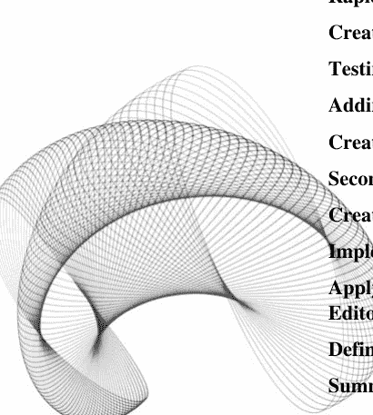

C# 中有大量支持构建自定义控件的功能。本章将继续讨论在 C# 中构建控件的话题。在第8章中，我们探讨了 `UserControl`。现在，我们将详细探讨构建、测试和注册自定义控件所需的各个方面。

我们将从构建一个用于 Windows 窗体的特效 Label 控件开始讨论，因为这将涵盖控件构建的大部分方面。此外，我们还将探讨 C# 对序列化组件、创建设计器、类型转换器和类型编辑器的支持。这些技能将使你能够充分利用 C# 中构建专业控件的全套支持，使其能与 Windows 窗体应用程序良好交互。（如果你有兴趣为 ASP.NET 构建控件，请参阅第14章。）

### 演示主题

本章的主要目的是演示在程序集中构建、测试和部署专业自定义控件所需的大部分知识。通过本章的示例，你将能够做到以下几点：

- 原型设计组件
- 为你的控件创建库项目
- 使用 `ComponentModel` 命名空间中的特性
- 测试你的控件
- 将你的控件添加到工具箱
- 创建合并模块项目以共享你的控件

所有这些技能将通过构建一个呈现各种阴影效果的 `EffectsLabel` 控件来演示。（如果你寻找的内容未列在这些主题中，请务必查看本章后面的“次要主题”部分。该部分演示了几项高级功能；我只是在实现 `EffectsLabel` 时没有需要它们。）

### 快速控制原型设计

开始构建控件的一种便捷方式是在 Windows 窗体应用程序中对其进行原型设计。选择一个接近你想要自定义的控件的控件。将该控件拖放到窗体上，并利用窗体和控件的事件来快速原型设计你的自定义控件。（快速应用程序设计（RAD）也适用于控件。控件定义在 DLL 程序集中，而 DLL 本身就是一个应用程序。RAD 技术对控件同样有效。）

在第3章中，我们实现了一个 `DrawShadowText` 方法，为 `PlayControl` 创建浮雕效果。将来我们可能想使用特殊的文本效果。因此，我们将原型设计一个更永久的解决方案，当我们解决了所有问题后，我们将把我们的解决方案封装在一个自定义控件中，该控件可以在完成后无需任何未来编码即可重用。

第一步是选择一个与我们最终想要创建的控件相似的控件。选择一个接近的祖先进行继承意味着我们将只需编写少量的额外代码。如果我们选择了一个过于通用的祖先，那么我们将有更多的工作要做。`Label` 控件非常适合显示文本，因此我们将使用 `System.Windows.Forms.Label` 控件作为我们自定义控件的基础。在一个 Windows 应用程序的窗体上绘制一个 `Label` 控件。（记住，我们这里是在进行原型设计。完整的原型解决方案示例请参考 `TestLabel.sln`。）

### 为自定义绘制实现 PaintEventHandler

Label 控件包含了大部分解决方案。如果我们在 Label 上第二次绘制文本，并在第二次绘制时稍微偏移文本，我们就可以创建各种效果。我们可以在 Label 的 `PaintEventHandler` 中执行自定义绘制。

> **提示**
要为 Label 创建 `PaintEventHandler`，请选择 Label，然后单击“属性”窗口中的“事件”按钮（闪电小图标）切换到事件视图。双击 `Paint` 事件以生成处理程序。

Label 的 `Paint` 处理程序有一个 `PaintEventArgs` 参数，该参数使用表示 Label 设备上下文的 `Graphics` 对象初始化。我们可以使用由 `Graphics` 对象表示的 GDI+ 来第二次绘制字符串，通过偏移创建效果。（你已经知道如何执行此操作，只是在有限的程度上，因为它在第3章中进行了演示。对于一个健壮的解决方案，还有一些额外的考虑，我们稍后将讨论。）

### 将控件实例传递给方法

在原型设计时，请将你将要继承的控件实例传递给我们可能需要定义的任何方法。在实际创建新控件之前，我们需要用于原型设计的控件实例。通过传递控件实例，而不是依赖其在包含窗体中的存在，我们可以逐字复制原型中的代码，并且它应该只需相对较少的修改即可工作。

到目前为止，我们有一个带有一个 Label 的 Windows 应用程序来原型化我们的解决方案。你可以使用 `Graphics.DrawString` 第二次绘制 `Text` 属性以创建初始效果。你很快就会意识到，这不仅仅是写文本那么简单。让我们通过检查创建健壮解决方案所涉及的考虑因素继续进行。

### 问题分析

我们的问题是创建一个具有特殊文本效果的 Label 控件。以下是我们为创建健壮解决方案必须解决的问题的完整分解：

- Label 中的文本如果长度超过控件边界的宽度，可能会换行。
- & 符号是代表快捷键前缀的助记符。如果我们使用助记符，则必须显示助记符而不是字面上的 & 符号。
- 文本可以以多种不同方式对齐。我们的文本将必须考虑 `TextAlign` 属性进行显示。
- 我们将必须容纳特殊的显示和布局信息。
- 我们将需要第二种颜色以及 X 和 Y 偏移量来创建视觉效果。

这应该涵盖了。

如你所见，在 Label 中显示文本涉及相当多的细节。只要我们只需要为这项努力支付一次代价，最终结果就是值得的。接下来的小节将解决前面列表中描述的每个问题。

### 绘制文本

要绘制字符串，我们可以使用传递给 Label 的 `PaintEventHandler`（名为 `Paint`）的 `Graphics` 对象。我们必须使用 Label 的 `Text` 和 `Font`，并且我们需要确定 `Brush`、`Rectangle` 和 `StringFormat` 对象。以下是 `TestLabel.csproj` 中实现的 Label 的 `PaintEventHandler` 和支持的 `Draw` 方法。

```csharp
private void Draw(Label label, Graphics g)
{
    Rectangle r = label.ClientRectangle;
    r.X -= 1;
    r.Y -= 1;
    g.DrawString(label.Text, label.Font, Brushes.Black, r, GetFormat(label));
}
private void label1_Paint(object sender,
    System.Windows.Forms.PaintEventArgs e)
{
    Draw((Label)sender, e.Graphics);
}
```

（记住避免直接在事件处理程序中实现行为。编写命名良好的方法有助于重用和支持自文档化的代码。）我们无法从列表中确定 `Brush`、`Rectangle` 和 `StringFormat` 对象是如何创建的。

代码到目前为止看起来相当简单。当代码看起来简单时，这意味着我们的解决方案具有适当数量的细节。本节的其余部分将描述如何实现未知元素：`Brush`、`Rectangle` 和 `StringFormat`。

### 创建 Brush

对于原型设计，我们可以使用 `Brushes` 类中的 `Brush`。`Brushes` 包含几十个属性，定义了一系列的画笔和颜色。对于原型设计，我们可以使用这些标准画笔之一。当我们实现实际控件时，我们可以让用户指定一种颜色。我们可以从颜色构造一个画笔，如下所示：

```csharp
Brush brush = new SolidBrush(color);
```


`SolidBrush` 类定义在 `System.Drawing` 命名空间中。你需要添加对 `System.Drawing.dll` 程序集的引用，并在包含画笔引用的模块中添加一条 `using` 语句。该 `using` 语句如下：

```
using System.Drawing;
```

### 创建矩形区域

为了确保第二次绘制文本时，其位置与原始文本在同一个矩形区域内，我们可以使用 `Label` 控件自身的 `ClientRectangle` 属性。为了创建特定的文本效果，我们需要在第二次绘制文本时对其位置进行轻微的偏移。通过将文本在 X 方向和 Y 方向各偏移 -1 个像素（即 X–1 和 Y–1），可以创建一个浅阴影效果，其中 X 和 Y 代表 `ClientRectangle` 的左上角位置。

通过改变文本偏移值，可以实现其他效果。实现一个真正灵活的解决方案，最终意味着让消费者（即代码使用者）能够指定偏移值。在原型设计阶段，使用字面值就足够了。

### 创建 StringFormat 对象

`StringFormat` 对象是我们需要派生的最具挑战性的值。前面章节（“绘制文本”）代码片段中调用的 `GetFormat` 函数，隐藏了我们必须经历的曲折过程来获得 `StringFormat` 对象。

根据本节开头的要点列表，我们必须解决助记符（或热键）问题、文本对齐问题和布局问题。当我们得出这些问题的解决方案后，就可以测试原型了。假设一切运行正常，我们就可以创建这个控件了。

我信奉这句格言：*divide et impera*（分而治之）。`GetFormat` 方法的实现包含了多个命名方法，这些方法描述了我们创建 `StringFormat` 对象所需完成的所有步骤。这对于确保第二次绘制文本时，除了画笔颜色和偏移外观外，其余部分与第一次完全一致至关重要。

```
private StringFormat GetFormat( Label label )
{
    StringFormat format = new StringFormat();
    SetLineAlignment(label.TextAlign, format);
    SetAlignment(label.TextAlign, format);
    SetFlags(label.RightToLeft, format);
    SetMnemonic(label.UseMnemonic, format);
    return format;
}
```

从代码中我们可以确定需要创建一个 `StringFormat` 对象。为了确保文本正确对齐，我们需要设置 `StringFormat.LineAlignment` 和 `StringFormat.Alignment` 属性。这是通过将 `Label.TextAlign`（一个 `ContentAlignment` 枚举值）转换为 `StringAlignment` 枚举值来完成的。不幸的是，`StringFormat` 需要 `StringAlignment` 值，但 `Label` 使用 `ContentAlignment` 属性。因此，`TextAlign` 属性需要进行转换。接下来，我们需要设置 `StringFormat.FormatFlags` 属性，并确定我们是否使用和号 (`&`) 作为助记符（热键指示符）。清单 9-1 包含了前面代码清单中 `GetFormat` 方法所描述的四个格式化方法。

#### 清单 9-1  SetLineAlignment、SetAlignment、SetFlags 和 SetMnemonic 的编号列表

```
1:  private StringFormat GetFormat( Label label )
2:  {
3:      StringFormat format = new StringFormat();
4:      SetLineAlignment(label.TextAlign, format);
5:      SetAlignment(label, format);
6:      SetFlags(label.RightToLeft, format);
7:      SetMnemonic(label.UseMnemonic, format);
8:      return format;
9:  }
10: 
11: 
12: private void SetLineAlignment(ContentAlignment TextAlign,
13:     StringFormat format)
14: {
15:     switch(TextAlign)
16:     {
17:         case ContentAlignment.BottomLeft:
18:             format.LineAlignment = StringAlignment.Far;
19:             break;
20:         case ContentAlignment.MiddleLeft:
21:             format.LineAlignment = StringAlignment.Center;
22:             break;
23: 
24:         case ContentAlignment.TopLeft:
25:             format.LineAlignment = StringAlignment.Near;
26:             break;
27: 
28:         case ContentAlignment.BottomCenter:
29:             format.LineAlignment = StringAlignment.Far;
30:             break;
31: 
32:         case ContentAlignment.MiddleCenter:
33:             format.LineAlignment = StringAlignment.Center;
34:             break;
35: 
36:         case ContentAlignment.TopCenter:
37:             format.LineAlignment = StringAlignment.Near;
38:             break;
39: 
40:     case ContentAlignment.BottomRight:
41:         format.LineAlignment = StringAlignment.Far;
42:         break;
43: 
44:     case ContentAlignment.MiddleRight:
45:         format.LineAlignment = StringAlignment.Center;
46:         break;
47: 
48:     case ContentAlignment.TopRight:
49:         format.LineAlignment = StringAlignment.Near;
50:         break;
51: }
52: 
53: 
54: private void SetAlignment(Label label, StringFormat format)
55: {
56:     switch(label.TextAlign)
57:     {
58:         case ContentAlignment.BottomLeft:
59:             format.Alignment = StringAlignment.Near;
60:             break;
61: 
62:         case ContentAlignment.MiddleLeft:
63:             format.Alignment = StringAlignment.Near;
64:             break;
65: 
66:         case ContentAlignment.TopLeft:
67:             format.Alignment = StringAlignment.Near;
68:             break;
69: 
70:         case ContentAlignment.BottomCenter:
71:             format.Alignment = StringAlignment.Center;
72:             break;
73: 
74:         case ContentAlignment.MiddleCenter:
75:             format.Alignment = StringAlignment.Center;
76:             break;
77: 
78:         case ContentAlignment.TopCenter:
79:             format.Alignment = StringAlignment.Center;
80:             break;
81: 
82:         case ContentAlignment.BottomRight:
83:             format.Alignment = StringAlignment.Far;
84:             break;
85:     case ContentAlignment.MiddleRight:
86:       format.Alignment = StringAlignment.Far;
87:       break;
88: 
89:     case ContentAlignment.TopRight:
90:       format.Alignment = StringAlignment.Far;
91:       break;
92:   }
93: }
94: 
95: private void SetFlags(RightToLeft rightToLeft, StringFormat format)
96: {
97:   if(rightToLeft == RightToLeft.Yes)
98:     format.FormatFlags |= StringFormatFlags.DirectionRightToLeft;
99: }
100: 
101: private void SetMnemonic(bool UseMnemonic, StringFormat format)
102: {
103:   if(UseMnemonic )
104:     format.HotkeyPrefix = HotkeyPrefix.Show;
105: }
106: 
```

清单 9-1 中的代码包含两个比通常情况下更长的方法。`SetAlignment` 和 `SetLineAlignment` 使用了冗长的 switch 语句，将 `ContentAlignment` 映射到 `StringAlignment` 值。`StringFormat.Alignment` 依赖于 `StringAlignment` 枚举值，而不是 `ContentAlignment` 值。我们或许可以尝试通过操作底层位来在 `ContentAlignment` 和 `StringAlignment` 之间进行算法转换，但结果会是脆弱的代码。例如，如果 CLR 被修改以改变底层位，那么我们的代码就会中断。通过引用枚举名称，生成的代码虽然不优雅，但更加健壮。

`SetFlags` 和 `SetMnemonic` 是简单明了的方法——尽管 `SetMnemonic` 这个名字有点拗口——它们展示了自描述代码的优点。与其编写注释来描述我们在做什么，不如使用一个命名良好的方法，它既能执行操作又能描述操作。作为一般原则，优先选择命名良好的方法，而不是注释。

### 创建类库

在原型控制完成之后，我们准备创建类库，并将我们的原型代码转换为自定义控件。为了完成控件并从代码中获得最大效益，我们需要完成几个步骤。

为了从我们的代码中获得更多好处，我们可以从仅对控件有用的特定行为中抽象出通用行为。这个过程在很大程度上取决于主观判断，但值得努力的是找到可能可重用的代码，并将其与自定义控件分离。抽象出的代码将需要传递控件的实例，而成为自定义控件一部分的代码则不需要对控件的引用。我们可以为添加到控件本身的方法移除任何 `Label` 参数。

### 抽象通用行为

你可能很容易想象到需要换行打印并使用助记符的场景。为了避免再次编写那些 switch 语句，将 `SetAlignment` 和 `SetLineAlignment` 放在一个单独的实用程序类中是值得的。我还选择将 `SetFlags`、`SetMnemonic`、`GetFormat` 工厂方法和 `DrawText` 放在另一个独立的类中。所有这些代码都可以在其他上下文中重用。

因为我只描述了方法而没有描述字段，所以所有这些方法都可以实现为静态方法。当一个类不需要维护状态时，你可以使用静态方法——例如我们为实用程序类描述的那样——这样你就不必创建类的实例来使用这些方法。

由于在 Windows 应用程序中原型设计的方法将被放置在一个独立于自定义控件本身的类中，我们将必须传入 `Label` 控件的实例。我提供了一个 `TextEffects` 实用程序类的部分代码清单，展示了 `SetMnemonic` 方法的更改。（其余代码可以在 `www.osborne.com` 的 `EffectsLabel.cs` 模块中找到。）

```
public class TextEffects
{
    public static void SetMnemonic(Label label, StringFormat format)
    {
        if(label.UseMnemonic)
            format.HotkeyPrefix = HotkeyPrefix.Show;
    }
}
```

我们之前说将成为上述实用程序类一部分的其余方法也需要进行相同的更改。传入方法运行所需的任何数据，并将该方法设为静态。

### 定义新控件

定义一个自定义控件很简单。当你创建一个类库项目时，类库模板会添加一个类模块。默认情况下，模块中会有一个类；将该类重命名为我们将用于控件的名称，并在类头中表达继承关系。

如果你想创建一个全新的控件，可以从 `Control` 类继承。在我们的示例中，我们正在基于 `System.Windows.Forms.Label` 控件构建一个具有自定义效果的标签，因此我们将从 `Label` 控件继承。我们可以使用命名空间来表明我们是从 `Label` 继承的，或者我们可以向模块添加一条 `using` 语句来缩短继承声明。

类的头部。以下是两种形式。第一个示例在类头部中使用了命名空间名称，第二个示例则演示了 *using* 语句和简化的类头部。

```
public class EffectsLabel : System.Windows.Forms.Label
```

或

```
using System.Windows.Forms;
public class EffectsLabel : Label
```

> **注意**
>
> *如果我们引用了一个命名空间，那么我们需要添加对包含该命名空间的程序集的引用。类库默认不引用 System.Windows.Forms.dll；因此，为了我们的自定义控件，需要添加对它的引用。*

两种形式都可以——命名空间用于组织，但在代码中如果需要多次书写，就会变得冗长。如果有两个相同的名称，那么可以使用命名空间来澄清这些名称的成员关系。

在定义了继承关系之后，我们需要向自定义控件添加字段、属性、事件、方法和任何其他必要的成员。完整的代码在代码清单 9-2 中提供。目前，我们将逐一探讨各个元素。

### 调用基类构造函数

如果我们的控件提供了一个构造函数，那么我们需要调用继承的基类构造函数。EffectsLabel 有几种我们将会定义的样式；因此，我们将使用构造函数来设置默认的标签样式并调用基类构造函数。

```
public EffectsLabel() : base()
{
    Style = DrawStyle.Shadowed;
}
```

构造函数没有返回类型，并且与类同名。通过在构造函数头部添加冒号后跟关键字 *base* 来调用基类构造函数。然后，我们可以添加任何额外的代码来初始化我们的类。Style 属性是作为自定义行为的一部分引入的，因此我将在接下来演示支持更改样式的代码。

### 添加属性和方法

控件只是类。它们恰好是继承了一些基本能力的类，这些能力使它们能够在 Windows 窗体或 Web 窗体中显示并响应用户输入。这个基本能力继承自 Control 类。在大多数情况下，我们所做的一切就是添加成员，用字段、属性、方法和事件来描述类的行为和外观。

为了支持 EffectsLabel 的样式概念，我们可以实现一个枚举，用文本而不是整数来描述样式；枚举更具表现力。而且，我们需要实现一个字段来存储样式，以及一个属性，以便属性窗口可以在设计时显示样式。以下是附加的代码：

```
public class EffectsLabel : Label
{
    public enum DrawStyle{Custom, Shadowed, Engraved, Embossed};
    private DrawStyle style;
    private Point offset;

    public EffectsLabel() : base()
    {
        Style = DrawStyle.Shadowed;
    }

    public DrawStyle Style
    {
        get
        {
            return style;
        }
        set
        {
            style = value;
            DrawStyleChanged();
            Invalidate();
        }
    }
    protected virtual void DrawStyleChanged()
    {
        switch(style)
        {
            case DrawStyle.Shadowed:
                offset = new Point(-1, -1);
                break;
            case DrawStyle.Embossed:
                offset = new Point(-1, -2);
                break;
            case DrawStyle.Engraved:
                offset = new Point(1, 2);
                break;
            case DrawStyle.Custom:
                offset = new Point(0, 0);
                break;
        }
    }
}
```

枚举 DrawStyle 将允许用户从命名的样式中进行选择。存储样式的底层字段列在枚举器之后。构造函数紧随枚举和字段之后。公共属性 Style（注意使用字段采用 camel-casing，属性采用 Pascal-casing 的约定）将允许用户在设计时更改样式。getter 只是返回底层字段值，而 setter 执行更新控件所需的步骤。

setter 更改字段值并调用 DrawStyleChanged。DrawStyleChanged 使用 case 语句根据所选的 DrawStyle 定义偏移值。最后，控件被无效化，导致 OnPaint 方法被调用。使用 Invalidate 而不是直接调用 OnPaint 来重绘控件。使用 Invalidate 将有助于避免闪烁，通过向控件发送一条消息来绘制控件的更改区域，并且消息队列可以管理控件实际重绘的次数。

### 添加点睛之笔

有几个特性可以用来为我们的自定义控件增添润色和完善。本节提供了 EffectsLabel 控件的完整清单，并将描述代码中包含的特性，以及其他产生最终控件的细节。

## 代码清单 9-2 EffectsLabel 控件的完整清单

```
/// <summary>
/// Custom text effects for Windows Forms
/// </summary>
[ToolboxBitmap(
  @"EffectsLabel2.bmp")]
//[ToolboxBitmap(typeof(Label))]
public class EffectsLabel : Label
{
  public enum DrawStyle{Custom, Shadowed, Engraved, Embossed};
  private DrawStyle style;
  private Point offset;
  private Color overlayColor = Color.Black;

  public EffectsLabel() : base()
  {
    Style = DrawStyle.Shadowed;
  }

  [Description("Describes the appearance of the label's text."),
   Category("Appearance")]
  public DrawStyle Style
  {
    get
    {
      return style;
    }
    set
    {
      style = value;
      DrawStyleChanged();
      Invalidate();
    }
  }

  [Description(
  "The ForeColor to create the shadow effect."),
  Category("Appearance")]
  public Color OverlayColor
  {
    get
    {
      return overlayColor;
    }
    set
    {
      overlayColor = value;
      Invalidate();
    }
  }

  [Description("Change this value directly to create a custom effect."),
  Category("Appearance")]
  public Point Offset
  {
    get
    {
      return offset;
    }
    set
    {
      Style = DrawStyle.Custom;
      offset = value;
      Invalidate();
    }
  }

  protected virtual void DrawStyleChanged()
  {
    switch(style)
    {
      case DrawStyle.Shadowed:
        offset = new Point(-1, -1);
        break;
      case DrawStyle.Embossed:
        offset = new Point(-1, -2);
        break;
      case DrawStyle.Engraved:
        offset = new Point(1, 2);
        break;
      case DrawStyle.Custom:
        offset = new Point(0, 0);
        break;
    }
  }

  protected override void OnPaint(PaintEventArgs e)
  {
    base.OnPaint(e);
    Draw(e.Graphics);
  }

  private void Draw(Graphics g)
  {
    TextEffects.DrawText(this, g, new SolidBrush(overlayColor),
      offset.X, offset.Y);
  }
}
```

### 自动文档功能

代码清单 9-2 中的第 1 到第 3 行演示了三个井号 (///) 注释，可用于为代码生成文档。“工具 | 生成注释网页”菜单选项会将标记为三个井号的注释合并到 HTML 帮助文档中。图 9-1 显示了代码清单 9-2 第 2 行的注释被合并到 EffectsLabel 的帮助文档中。

除了使用三个井号来记录代码外，你还可以使用特殊的 XML 标签来创建其他文档功能。表 9-1 列出了用于生成文档的注释标签。

### 定义类别

属性窗口按字母顺序或按类别组织属性。这是为了帮助消费者在设计时找到属性。CategoryAttribute 在代码清单 9-2 中的多个地方进行了演示。第 20 行演示了 CategoryAttribute。我们正在指示 DrawStyle 被归类为“外观”属性。如果在属性窗口中点击“分类”按钮，那么所选控件的属性将按类别显示，如图 9-2 所示。

如果用于初始化 CategoryAttribute 的字符串是唯一的，那么将在属性窗口中创建一个新的类别。

### 提供描述


## 第9章：特效文本 275

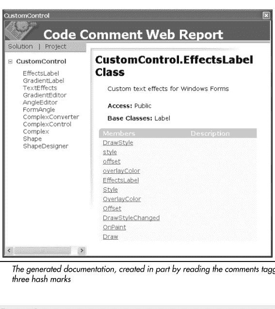

**图 9-1** *生成的文档，部分通过读取带有三个井号标记的注释创建*

| 注释标签 | 描述 |
| :--- | :--- |
| `<c>` | 表示描述中的文本指的是代码。 |
| `<code>` | 使用此标签表示多行注释指的是代码。 |
| `<example>` | 与 `<code>` 标签结合使用，表示注释代表示例代码。 |
| `<exception>` | 用于指定类可以抛出的异常。 |
| `<include>` | 使用 `<include>` 引用外部文件中的注释。 |
| `<list>` | 此标签允许你为表格或列表指定标题。使用 `<listheader>` 和 `<item>` 来构建列表或表格的元素。 |
| `<para>` | 通过将行文本分隔为段落来为注释提供结构。 |
| `<param>` | 为命名参数提供引用。 |
| `<paramref>` | 使用 `<paramref>` 表示一个单词是参数。 |
| `<permission>` | 支持记录成员的权限级别。 |
| `<remarks>` | 使用 `<remarks>` 提供类型的概述。 |
| `<returns>` | 支持提供方法返回类型的描述。 |

**表 9-1** *用于为你的代码生成 HTML 文档的注释 XML 文档标签*

| 注释标签 | 描述 |
| :--- | :--- |
| `<see>` | 为文档项创建交叉引用。 |
| `<seealso>` | 将项添加到文档的“另请参阅”部分。 |
| `<summary>` | `<remarks>` 用于提供有关类型的信息，而 `<summary>` 用于提供有关该类型成员的信息。 |
| `<value>` | 支持为属性提供描述。 |

**表 9-1** *用于为你的代码生成 HTML 文档的注释 XML 文档标签（续）*

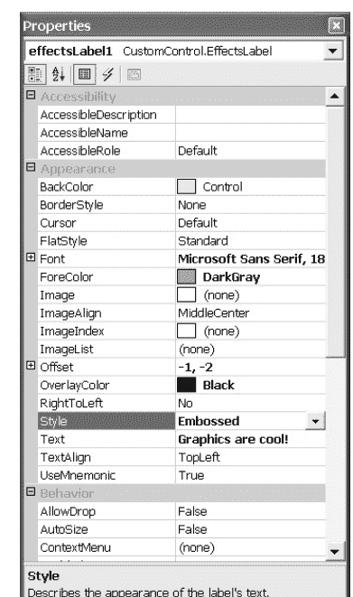

**图 9-2** 属性窗口，其中 EffectsLabel 属性按类别排序

用于初始化 DescriptionAttribute 的内容将显示在属性窗口的底部，除非你取消选择 Description 上下文菜单项。

如果你应用多个属性，就像我们在清单 9-2 中多处所做的那样，那么你可以用逗号分隔这些属性。下面是清单 9-2 的一个摘录，演示了应用于 DrawStyle 属性的两个属性。

```
19:     [Description("描述标签文本的外观。"),
20:      Category("外观")]
```

### 为你的控件添加自定义位图

如果你希望你的控件拥有自定义位图，则可以将 ToolboxBitmapAttribute 应用到类。此属性可以引用外部位图文件，或使用类型信息来请求现有控件的现有图标。

```
[ToolboxBitmap(@"c:\temp\EffectsLabel2.bmp")]
// [ToolboxBitmap(typeof(Label))]
```

第一条语句演示了如何将外部位图与我们的控件关联（见图 9-3），第二条（已注释）语句演示了如何请求 Label 控件的类型信息。如果我们使用第二条属性语句，那么我们的 EffectsLabel 将拥有与 Label 控件相同的图标。


**注意**
注意 ToolboxBitmapAttribute 语句中 @ 符号的使用。\（斜杠字符）用于转义文本序列。（回想一下，我们曾用它来创建“关于”框中的 © 符号。）要在字符串中实际获得反斜杠，你需要使用两个反斜杠 \\ 或者你可以使用单个反斜杠和 @ 字符来指示字符串应按原样解释，而不是处理转义序列。

要为 EffectsLabel 创建自定义的 16x16 像素位图，你可以使用“项目”|“添加新项”菜单并向解决方案添加一个位图。此步骤将自动打开图像编辑器，它允许你绘制自定义位图。图像编辑器的工作方式类似于 Windows 提供的“画图”程序。

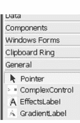

**图 9-3** 自定义的 EffectLabel2.bmp——放大——在工具箱中

### 测试你的组件

宏过程中的下一个重要步骤是测试你的自定义控件。你需要设计一些单元测试来测试你的自定义控件的所有代码路径。在系统中，每个类及其内部的每个方法都需要进行单元测试。对于控件，一个类（或少数几个类）代表整个程序集；你仍然需要测试每个类，但这个过程更短，因为需要测试的内容更少。

测试你的自定义控件的一个简单方法是向包含该控件的解决方案中添加一个应用程序。如果该控件是 Windows 窗体控件，则向解决方案中添加一个 Windows 应用程序。在你的 Windows 应用程序中添加对控件的项目引用，并以编程方式创建和调用方法来测试你的自定义控件的行为。下面的代码清单创建了图 9-4 中所示的文本。

```
private void TestLabel_Load(object sender, System.EventArgs e)
{
    CustomControl.EffectsLabel effectsLabel = new
        CustomControl.EffectsLabel();
    effectsLabel.Text = "动态创建！";
    effectsLabel.AutoSize = true;
    effectsLabel.Style = CustomControl.EffectsLabel.DrawStyle.Embossed;
    effectsLabel.ForeColor = Color.White;
    effectsLabel.OverlayColor = Color.Black;
    effectsLabel.Font = new Font("Times new Roman", 24);
    Controls.Add(effectsLabel);
}
```

测试 Windows 窗体控件的代码可以放在窗体的 Load 事件处理程序中。前面的代码测试了许多代码路径，但你需要一个良好的策略来测试所有代码路径。你可以对 EffectsLabel 类进行一些修改以促进此过程。

### 实现测试功能

第一个修改是使测试方法成为 EffectsLabel 类的一部分。实现一个名为 Test 的静态方法并调用该方法。因为我们在测试 Windows 窗体控件，我们需要传入要添加控件的 Controls 集合，或者我们可以返回自定义控件的一个实例，并在外部将其添加到 Controls 集合中。

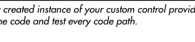

以下对 EffectsLabel 类的添加使我们的自定义控件自成一体，包括可测试性。

```
public static void Test(ControlCollection Controls)
{
    EffectsLabel effectsLabel = new EffectsLabel();
    effectsLabel.Text = "动态创建！";
    effectsLabel.AutoSize = true;
    effectsLabel.Style = DrawStyle.Embossed;
    effectsLabel.ForeColor = Color.White;
    effectsLabel.OverlayColor = Color.Black;
    effectsLabel.Font = new Font("Times new Roman", 24);
    Controls.Add(effectsLabel);
}
```

要测试我们的控件，我们只需调用 EffectsLabel.Test，并传递拥有容器控件的 ControlCollection。这通常是窗体的 Controls 属性，但你也可以传递任何 ContainerControl 派生类（如 Panel 控件）的 Controls 属性。

### 实现陷阱行为

里根总统在冷战结束时谈到俄罗斯人时经常说“信任但要核实”。这条明智的建议对软件开发也很适用。信任你的代码能工作是因为你很聪明——但也要核实。核实你的代码能工作有助于避免尴尬的情况。

你可以通过简单地执行这些路径来在某种程度上验证所有代码路径都能工作。执行一条路径仅仅意味着你编译并测试代码，提供测试数据以通过代码中所有可能的分支。这不会测试你的代码在所有可能状态下的情况，但它将帮助你确保没有明显的、令人尴尬的缺陷。确保你已经测试了所有状态的一个好方法是实现一个陷阱。

*陷阱*是一个被调用的方法，当一个代码路径被执行时会停止处理。你可以通过使用参数 False 调用 Debug.Assert 方法来简单地实现一个陷阱。如果你在每个代码分支处放置一个陷阱，并在每次触发时注释掉陷阱，你就有了一个记录，验证了所有分支都已被测试。如果你需要在组件更新后重新运行测试，请移除所有注释以重置陷阱。下面是一条演示该技术的语句。（此语句假设你在包含陷阱的模块中包含了 *using* 语句，引用 System.Diagnostics 命名空间。）

```
Debug.Assert(false);
```

例如，如果我们想确保所有的 DrawStyle 都产生正确的视觉效果，我们可以在 DrawStyleChanged 方法中为每种情况放置一个陷阱。通过目视检查每种 DrawStyle 的效果，并在每个

当外观符合预期时，我们就能确保所有样式都正确绘制。以下是前面描述的 `DrawStyleChanged` 方法的修订版本。

```
protected virtual void DrawStyleChanged()
{
    switch(style)
    {
        case DrawStyle.Shadowed:
            Debug.Assert(false);
            offset = new Point(-1, -1);
            break;
        case DrawStyle.Embossed:
            Debug.Assert(false);
            offset = new Point(-1, -2);
            break;
        case DrawStyle.Engraved:
            Debug.Assert(false);
            offset = new Point(1, 2);
            break;
        case DrawStyle.Custom:
            Debug.Assert(false);
            offset = new Point(0, 0);
            break;
    }
}
```

当每个陷阱被触发并且你对结果满意时，只需在源代码中注释掉该陷阱，并在 Assert 对话框中单击“忽略”按钮。由于我们使用的是 `Debug.Assert` 方法，当以 Release 模式编译控件程序集时，陷阱代码将自动被禁用。

在将控件安装到工具箱之前测试这类代码会更容易。通过编程方式测试控件将节省你的时间和精力。（当然，如果你想的话，也可以在测试之前将代码添加到工具箱。）最终，当你对控件满意时，你会想将其添加到工具箱。我们将在下一节中进行此操作。

### 将组件添加到工具箱

创建了自定义控件后，你会希望将该控件集成到工具箱中。此步骤通过选择“工具”|“自定义工具箱”并浏览到包含该自定义控件的程序集来完成。

你可以通过工具箱上下文菜单向工具箱添加其他选项卡，并将你的控件拖放到它们自己的选项卡中。

将控件添加到工具箱后，你可以将控件实例拖放到窗体上。当你从工具箱将控件添加到应用程序时，会将控件的一个实例添加到窗体，并将对程序集的引用添加到解决方案的引用列表中。

如果你修改了控件，那么你可能需要重置工具箱并重新添加修改后的程序集到工具箱。（如果控件的更改似乎未在你的应用程序中反映出来，请移除对控件程序集的引用，重置工具箱，然后添加工具箱引用的更新程序集列表。）

### 创建合并模块

到目前为止，我们已经构建并测试了一个自定义控件，并将其安装在我们的工具箱中。假设你想将控件分发给其他开发人员。为了可靠地将控件与你的应用程序一起分发，你需要创建一个合并模块项目。

合并模块项目在 Visual Studio .NET 中被定义为模板项目。建议的流程是为每个自定义控件定义一个合并模块项目，并包含安装自定义控件所需的所有文件、资源、注册表项和安装逻辑。合并模块包含组件的版本信息，确保当其他应用程序程序集依赖于这些组件时，这些组件不会被移除。因此，在合并模块已添加到安装程序文件后，应为你的组件的每个版本创建一个新的合并模块。合并模块不能直接安装；合并模块必须作为 Windows Installer (`.msi`) 文件的一部分进行安装。

请按照下面提供的编号步骤，将合并模块项目添加到包含自定义控件的解决方案中，将 CustomControl 项目的输出添加到合并模块，并创建一个 Windows Installer。

1.  选择“文件”|“添加项目”|“新建项目”，并在“添加新项目”对话框中选择合并模块项目模板。（合并模块项目是“安装和部署项目”文件夹中的一个模板。）
2.  为合并模块提供一个有意义的名称，然后单击“确定”。（我为 EffectsLabel 程序集使用了 `CustomControls.msm`。）
3.  在解决方案资源管理器中选择合并模块项目，然后单击“项目”|“添加”|“项目输出”，以打开“添加项目输出组”对话框（如图 9-5 所示）。
4.  重复步骤 1。这次，选择安装项目模板。
5.  在解决方案资源管理器中选择安装项目，然后选择“项目”|“添加”|“合并模块”。将显示合并模块资源管理器对话框。导航到 `CustomControls.msm` 合并模块并单击“确定”。
6.  当安装项目被编译时，Windows Installer、安装程序和 `.ini` 文件将被复制或创建在安装项目文件夹中。

安装项目的主要输出是 `setup.msi` 文件。此文件包含应用程序文件、注册表设置、依赖文件（如我们的 `CustomControl.dll`）以及安装这些文件的说明。

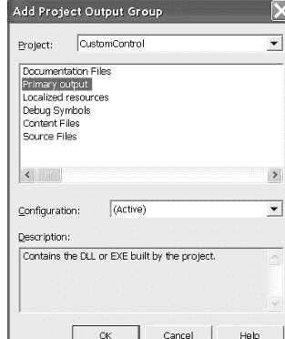

## 次要主题

有几个高级主题有助于创建高级自定义控件。我们并不一定需要这些功能来实现 EffectsLabel，但你会发现在创建专业外观和质感时它们很有用。为了演示本章这一节的主题，我包含了几个额外的组件，以展示如何

-   实现 `IConvertible` 接口以进行运行时类型转换，并演示运算符重载。
-   创建一个 `Type Converter`，并通过 `TypeConverterAttribute` 应用转换器。
-   创建一个自定义类型编辑器。
-   实现 `IDesigner` 接口。

这些技能将用于创建一个形状控件、一个渐变文本标签和一个表示复数的控件。最后一个控件是为了演示自定义 `TypeConverter` 而创建的，但作为控件本身并不是特别有用。

### 创建类型转换器

类型转换器允许数据以多种逻辑方式表示。例如，将一个整数表示为数字值和字符串值都是有意义的。当你想执行算术运算时需要整数，而当你想显示该值时需要字符串。

公共语言运行时提供了两种转换类型的方式。`IConvertible` 接口要求你实现将简单数据类型（例如整数和字符串）相互转换的方法。`IConvertible` 接口仅在运行时有用，并且如果两个类型之间的转换没有意义，它会抛出一个异常。（记住，你必须实现接口定义的每个方法。）一个例子是尝试将字符串 "Hello World!" 转换为 `DateTime` 值。

第二种转换类型的方式是派生一个 `TypeConverter` 类。`TypeConverter` 实现起来更复杂一些，但支持在更复杂的类型之间进行转换。例如，我们可以使用 `TypeConverter` 为 `Image` 提供一个合适的字符串表示。这就是 `System.ComponentModel` 命名空间中定义的 `ImageConverter` 的角色。

一般来说，`IConvertible` 接口更快，因为你直接调用方法，但它灵活性和功能性较差，并且仅在运行时支持。`TypeConverter` 更慢，因为它依赖于反射（反射之所以慢是因为它依赖于动态绑定和方法调用），但它支持设计时和运行时转换，并且比 `IConvertible` 接口灵活得多。实现 `IConvertible` 以在现有的 .NET 类型之间转换。实现 `TypeConverter` 以在新类型和代表性类型之间转换。

接下来的两个小节演示了如何实现 `IConvertible` 接口和 `TypeConverter`。

#### 实现 IConvertible

实现 `IConvertible` 的类将允许消费者在该类表示的类型和 `IConvertible` 接口命名的类型之间进行转换。`IConvertible` 不支持转换回原始类型，因为无法提前知道可能会从哪些类型进行转换。如果你定义了一个实现 `IConvertible` 的类，那么你必须实现 `GetTypeCode`、`ToBoolean`、`ToByte`、`ToChar`、`ToDateTime`、`ToDecimal`、`ToDouble`、`ToInt16`、`ToInt32`、`ToInt64`、`ToSByte`、`ToSingle`、`ToString`、`ToType`、`ToUInt16`、`ToUInt32` 和 `ToUInt64`。

> **提示**
> `System.Convert` 类实现了静态方法，支持在参数类型和方法命名的类型之间进行转换。在运行时进行一般类型转换时，请使用 `Convert` 类。

为了演示 `IConvertible` 接口，我们实现一个表示复数的类。复数是由实部和虚部组成的数字。当两个复数相加时，实部相加，虚部相加，得到新数字。

实现一个复数理所当然地需要支持在表示复数的值和字符串之间进行转换。我们还必须实现一些

运算符以支持算术运算，我们可能会选择将复数转换为整数，只需简单截断其虚数部分。我们可以从一个实现复数结构的`struct`开始。我们将使用清单 9-3 所示的结构来演示如何实现`IConvertible`接口，并选择性地演示`TypeConverter`。

```
1:  public struct Complex : IConvertible
2:  {
3:    private int r;
4:    private int i;
5:
6:    public Complex( int r, int i )
7:    {
8:      this.r = r;
9:      this.i = i;
10:   }
11:
12:   public override string ToString()
13:   {
14:     return i>=0 ? string.Format("{0} + {1}i", r, i) :
15:     string.Format("{0} - {1}i", r, i * -1);
16:   }
17:
18:   private static Complex op_Add(Complex lhs, Complex rhs)
19:   {
20:     return new Complex(lhs.r + rhs.r, lhs.i + rhs.i);
21:   }
22:
23:   public static Complex operator+(Complex lhs, Complex rhs)
24:   {
25:     return op_Add(lhs, rhs);
26:   }
27:
28:   private static Complex op_Subtract(Complex lhs, Complex rhs)
29:   {
30:     return new Complex(lhs.r - rhs.r, lhs.i - rhs.i);
31:   }
32:
33:   public static Complex operator-(Complex lhs, Complex rhs)
34:   {
35:     return op_Subtract(lhs, rhs);
36:   }
37:
38:     TypeCode IConvertible.GetTypeCode()
39:     {
40:         return TypeCode.Object;
41:     }
42:
43:     private void ThrowException(string message)
44:     {
45:         throw new InvalidCastException(message);
46:     }
47:
48:     bool IConvertible.ToBoolean(IFormatProvider provider)
49:     {
50:         ThrowException("conversion to Boolean not supported");
51:         return false;
52:     }
53:
54:     byte IConvertible.ToByte(IFormatProvider provider)
55:     {
56:         ThrowException("conversion to byte not supported");
57:         return 0;
58:     }
59:
60:     char IConvertible.ToChar(IFormatProvider provider)
61:     {
62:         ThrowException("conversion to char not supported");
63:         return ' ';
64:     }
65:
66:     DateTime IConvertible.ToDateTime(IFormatProvider provider)
67:     {
68:         ThrowException("conversion to DateTime not supported");
69:         return DateTime.Now;
70:     }
71:
72:     decimal IConvertible.ToDecimal(IFormatProvider provider)
73:     {
74:         return (decimal)r;
75:     }
76:
77:     double IConvertible.ToDouble(IFormatProvider provider)
78:     {
79:         return (double)r;
80:     }
81:
82:     short IConvertible.ToInt16(IFormatProvider provider)
83:     {
84:         return (short)r;
85:     }
86:
87:     int IConvertible.ToInt32(IFormatProvider provider)
88:     {
89:         return (int)r;
90:     }
91:
92:     long IConvertible.ToInt64(IFormatProvider provider)
93:     {
94:         return (long)r;
95:     }
96:
97:     sbyte IConvertible.ToSByte(IFormatProvider provider)
98:     {
99:         ThrowException("conversion to sbyte not supported");
100:        return (sbyte)0;
101:    }
102:
103:    float IConvertible.ToSingle(IFormatProvider provider)
104:    {
105:        return (float)r;
106:    }
107:
108:    string IConvertible.ToString(IFormatProvider provider)
109:    {
110:        return ToString();
111:    }
112:
113:    object IConvertible.ToType(Type type, IFormatProvider provider)
114:    {
115:        return this.GetType();
116:    }
117:
118:    ushort IConvertible.ToUInt16(IFormatProvider provider)
119:    {
120:        return (ushort)r;
121:    }
122:
123:    uint IConvertible.ToUInt32(IFormatProvider provider)
124:    {
125:        return (uint)r;
126:    }
127:
128:    ulong IConvertible.ToUInt64(IFormatProvider provider)
129:    {
130:        return (ulong)r;
131:    }
132:
133:    [Conditional("DEBUG")]
134:    public static void Test()
135:    {
136:        IConvertible c = new Complex(1,1);
137:        Debug.WriteLine(c.GetTypeCode().ToString());
138:        try{Debug.WriteLine(c.ToBoolean(null));}
139:        catch(InvalidCastException e){Debug.WriteLine(e.Message);}
140:        // 在每个 try catch 块中测试每个方法
141:    }
142: }
```

`IConvertible`接口定义了本节第一段中描述的方法。你必须为每个接口成员提供一个实现，但一个合适的实现可能是为我们不想转换到的类型抛出一个异常。清单 9-3 的第 97 到 101 行演示了当用户尝试将我们的`Complex`结构体转换为有符号字节时抛出异常。

`IConvertible`方法由`System.Convert`类调用。`Convert`的所有成员都是静态的。例如，要将`Complex`转换为整数，你可以这样写：

```
Complex c = new Complex(1, 3);
Convert.ToInt32(c);
```

`Convert`类将调用实现了`IConvertible.ToInt32`的`Complex`方法。

如前所述，`IConvertible`接口中的方法仅在运行时可用。像 Visual Studio .NET 这样的 RAD 工具也有设计时方面。为了支持在设计时转换类型，我们可以实现一个`TypeConverter`。下一节将使用`Complex`结构体来演示设计时类型转换。

### 实现 TypeConverter

`TypeConverter`类用于支持类型之间的转换。一个常见的转换是对象与其字符串表示形式之间的转换。本章前面遇到的一个例子是，当`Image`属性没有`Image`对象时，`ImageConverter`会显示文本。

本节演示一个自定义的`TypeConverter`，如何使用`TypeConverterAttribute`将`TypeConverter`与类型关联，以及如何使用`TypeDescriptor`类在`TypeConverter`支持的两种类型之间进行转换。

### 定义 ComplexConverter 类

`TypeConverter`基类引入了几个可以重写的方法，具体取决于你想要支持的转换行为种类。与`IConvertible`接口不同，`TypeConverter`在设计时和运行时都受支持，并且`TypeConverter`支持类型之间的来回转换。例如，我们的转换器支持将字符串转换为`Complex`，并将`Complex`转换回字符串。

清单 9-4 演示了`Complex`结构体的`TypeConverter`。在清单 9-4 之后，我将描述`ComplexConverter`类，并演示如何使用`TypeConverterAttribute`将`TypeConverter`与类关联。

#### 清单 9-4 为 Complex 结构体实现 TypeConverter

```
1:  public class ComplexConverter : TypeConverter
2:  {
3:      public override bool CanConvertFrom(ITypeDescriptorContext context,
4:        Type sourceType)
5:      {
6:          return sourceType == typeof(string) ? true :
7:            base.CanConvertFrom(context, sourceType);
8:      }
9:
10:     public override object ConvertFrom(ITypeDescriptorContext context,
11:       CultureInfo culture, object value)
12:     {
13:         if (value is string)
14:         {
15:             string[] v = ((string)value).Split(new char[] {'+', '-', 'i'});
16:             return ((string)value).IndexOf('-') > 0 ?
17:               new Complex(int.Parse(v[0]), int.Parse(v[1]) * -1) :
18:               new Complex(int.Parse(v[0]), int.Parse(v[1]));
19:         }
20:         return base.ConvertFrom(context, culture, value);
21:     }
22:
23:     public override object ConvertTo(ITypeDescriptorContext context,
24:       CultureInfo culture, object value, Type destinationType)
25:     {
26:         if (destinationType == typeof(string))
27:         {
28:             return value.ToString();
29:         }
30:         return base.ConvertTo(context, culture, value, destinationType);
31:     }
32:
33:     public override bool CanConvertTo(ITypeDescriptorContext context,
34:         Type destinationType)
35:     {
36:         return destinationType == typeof(string) ? true :
37:             base.CanConvertTo(context, destinationType);
38:     }
39: }
```

`ComplexConverter`实现了字符串和`Complex`值之间的转换。（回想一下，你也可以在更复杂的类型之间转换，就像 CLR 中实现的`ImageConverter`所演示的那样。）`ComplexConverter`实现了`CanConvertFrom`、`ConvertFrom`、`ConvertTo`和`CanConvertTo`。以*Can*为前缀的方法回答是否支持特定类型转换的问题。没有*Can*前缀的方法则实际执行转换。

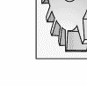

**提示**

清单 9-4 的第 7 行演示了如何使用`base`关键字调用方法或引用基类成员。

清单 9-4 的第 3 到 6 行的`CanConvertFrom`执行动态类型评估。如果第 4 行的`sourceType`参数是字符串，则该方法返回`True`；否则，代码将责任传递给父`TypeConverter`类。

清单 9-4 的第 10 到 21 行实现了重写的`ConvertFrom`方法。第 15 行使用`string.Split`方法来确定字符串是否格式正确。`Complex`类型格式正确的字符串格式为：*number ± imaginaryi*。由*number*表示的部分是实数部分，由*imaginary*表示的部分带有*i*后缀。第 17 和 18 行演示了`int.Parse`方法，用于清理`Split`返回的字符串数组并构造一个新的`Complex`对象。

清单 9-4 的第 23 到 31 行实现了`ConvertTo`方法。我们实现了一个重写的`Complex.ToString`方法，我们可以使用它（参见第 28 行将`Complex`转换为字符串）。最后，第 33 到 38 行实现的`CanConvertTo`方法在我们尝试转换为字符串表示的`Complex`类型时返回`True`。

自定义`TypeConverter`中还有其他可以重写的功能。请参阅`System.ComponentModel`命名空间中定义的`TypeConverter`类的 Visual Studio .NET 帮助文档。

### 使用 TypeConverterAttribute

应用自定义`TypeConverter`是通过使用`TypeConverterAttribute`将其与转换的目标类型关联来完成的。要将`ComplexConverter`与

复杂结构体，在清单 9-3 定义的结构体中添加一个属性。以下代码展示了紧邻清单 9-3 结构体头部的属性。

```
[TypeConverter(typeof(ComplexConverter))]
public struct Complex : IConvertible
```

你需要添加一个引用 `System.ComponentModel` 命名空间的 *using* 语句，并且 `ComplexConverter` 类需要能被 `Complex` 结构体访问。`Complex` 结构体和 `ComplexConverter` 都在 `ComplexControl.csproj` 的 `imaginary.cs` 模块中实现，可从 **www.osborne.com** 网站下载。

> **提示**
> 本章的所有代码可在 **http://www.softconcept.com/books/source** 和 **http://www.osborne.com** 在线获取。

### 使用 TypeDescriptor 类进行运行时转换

将 `TypeConverterAttribute` 应用到类可确保在设计时发生类型转换。例如，删除图像会将图像属性重置回文本 "(None)"，因为 `ImageConverter` 是 CLR 的一部分。
在我们将 `ComplexConverter` 与 `Complex` 结构体关联后，`Complex` 属性也将获得设计时支持。如果你想使用 `TypeConverter` 执行运行时类型转换，则需要通过 `TypeDescriptor` 类请求 `TypeConverter`，而不是直接创建通用的 `TypeConverter`。
以下代码片段演示了如何动态请求 `Complex` 结构体的 `TypeConverter` 并执行与字符串之间的转换。

```
CustomControl.Complex c = new CustomControl.Complex(2, 3);
string s = "1+1i";
```

```
if( TypeDescriptor.GetConverter(c).CanConvertTo(typeof(string)) )
    s = TypeDescriptor.GetConverter(c).ConvertToString(c);
CustomControl.Complex d =
    (CustomControl.Complex)TypeDescriptor.GetConverter(c).ConvertFrom(s);
```

第一条语句创建一个 `Complex` 类型的实例。第二条语句定义一个格式与复数一致的字符串。`TypeDescriptor.GetConverter` 返回与传递给 `GetConverter` 的类型相匹配的转换器。`CanConvertTo` 返回一个布尔值，指示转换是否受支持。在此例中我们已知支持，因此执行了转换。最后一条语句将字符串转换回 `Complex` 结构体。
`TypeConverter` 使用反射执行类型转换，因此会比通过 `IConvertible` 接口执行的转换慢。回顾一下，`IConvertible` 接口允许你将类型转换为新类型，但无法反向转换。此外，`TypeConverter` 支持设计时转换，这对于在 Visual Studio .NET 中实现行为直观的组件至关重要，正如 `Point`、`Rectangle` 和 `Image` 类型所展示的那样。

### 实现类型编辑器

上一节演示了类型转换器。如果你一直在参考示例代码，那么你应该知道可以通过在任何表示 `Point` 的属性中输入逗号分隔的字符串来定义 `Point` 属性的值。`TypeConverter` 是实现专业、自定义控件的一个方面。

你是否曾好奇过属性窗口中属性旁的小图标是如何绘制的？或者下拉列表、颜色下拉列表或基于对话框的属性编辑器是如何实现的？答案是 `UITypeEditor`。`UITypeEditor`（即用户界面类型编辑器）是 .NET 中实现编辑器的基类。

如果你定义了一个自定义控件，其属性无法通过简单的字符串值管理——即使你已经有了 `TypeConverter`——那么你需要一个 `UITypeEditor`。或者，如果你想提供一种炫酷的方式在设计时编辑属性，你也需要一个 `UITypeEditor`。

本节将演示如何实现一个基于对话框的 `UITypeEditor`、一个基于 `NumericUpDown` 控件的下拉编辑器，以及一个在属性窗口中展示自定义绘制的 `UITypeEditor`。我们将通过实现一个 `GradientLabel` 来达成目标。（我们的 `GradientLabel` 将是一个使用渐变画笔绘制标签的自定义控件。）我们将通过实现一个 `GradientEditor` 在 Text 属性中展示标签输出的示例。此外，我们将使用两个版本的 `AngleEditor` 来演示下拉式 `NumericUpDown` 编辑器和基于对话框的编辑器。`AngleEditor` 将允许我们表达用于描述 `LinearGradientBrush` 的角度。

#### 创建 GradientEditor

通常，提供视觉线索以展示属性在自定义控件中的作用很有用。例如，如果你有一个 `Shape` 控件，那么描述一个提供视觉提示的编辑器可能很有用，该提示可以展示形状的外观。这种特性丰富了 IDE，并使你的控件看起来更专业。

`GradientLabel` 控件在 `CustomControl.csproj` 类库中实现。该控件演示了 `UITypeEditor` 的绘制能力。（`GradientEditor` 在图 9-6 中很难看清，但它由印有绿色和白色渐变画笔"T"的加框区域表示。在此例中，你可能需要相信我的话。）

确立了我们的 `UITypeEditor` 目标——在属性窗口中显示 `LinearGradientBrush` 的效果后，我将展示清单 9-5 中的代码。

**清单 9-5** *实现 GradientEditor 的源代码，该编辑器在属性窗口中基于 LinearGradientBrush 显示文本*

```
public class GradientEditor : UITypeEditor
{
    public override bool GetPaintValueSupported(
        ITypeDescriptorContext context)
    {
        return true;
    }

    public override void PaintValue(PaintValueEventArgs e)
    {
        GradientLabel label = (GradientLabel) e.Context.Instance;
        e.Graphics.DrawString(label.Text, label.Font,
            new LinearGradientBrush(e.Bounds,
                label.ForeColor, label.BlendColor, label.Angle),
            e.Bounds);
    }
}
```

你需要添加对 `System.Design.dll` 程序集的引用才能使用泛化的 `UITypeEditor`（如清单 9-5 第 1 行所示）。`UITypeEditor` 类定义在 `System.Drawing.Design` 命名空间中。在包含清单 9-5 代码的模块顶部添加一个 *using* 语句。

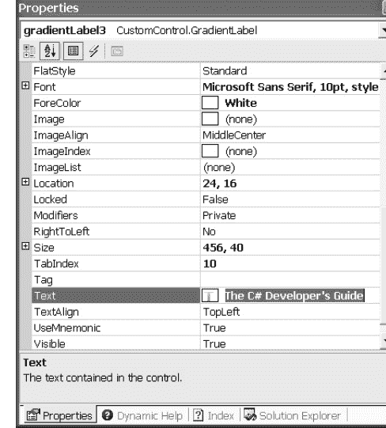

**图 9-6** *GradientEditor 显示在选中的属性中*

> **提示**
> 当你在加框区域绘制内容时，使用 `PaintValueEventArgs` 参数的 *Bounds* 属性来限制显示区域。

我们的目标是创建一个显示渐变文本的自定义编辑器；因此，我们只需重写从 `UITypeEditor` 继承的 `GetPaintValueSupported` 和 `PaintValue` 方法。`GetPaintValueSupported` 默认返回 False。通过在清单 9-5 第 6 行返回 True，我们表明我们将在属性窗口中执行自定义绘制。第 9 行 `PaintValue` 方法的 `PaintValueEventArgs` 参数代表属性窗口中加框区域的小画布——也称为 hDC、DC 或设备上下文（参见图 9-6）。第 10 到 16 行之间的 `PaintValue` 代码使用 GDI+、`DrawString` 和 `LinearGradientBrush` 来显示 `GradientLabel` 视觉效果变化的示例。

#### 实现 AngleEditor

`GradientEditor` 演示了 `UITypeEditor` 的自定义绘制方面。`AngleEditor` 演示了如何实现支持编辑值的方法。要实现 `AngleEditor`，我们将重写 `UITypeEditor.EditValue` 和 `UITypeEditor.GetEditStyle`。`GetEditStyle` 返回一个 `UITypeEditorEditStyle` 枚举值；返回的枚举值描述了要显示的编辑器类型。
清单 9-6 演示了 `AngleEditor`。使用编译器指令来分离支持编辑器对话框和下拉版本的代码。如果 `GetEditStyle` 返回 `UITypeEditorEditStyle.DropDown`，则定义编译器指令 `DROPDOWN`。要使用模态对话框版本的 `AngleEditor`，请取消定义 `DROPDOWN` 编译器指令。

> **清单 9-6** 一个自定义 UITypeEditor，演示自定义编辑器的 GetEditStyle 和 EditValue 方法

```
public class AngleEditor : UITypeEditor
{
    private IWindowsFormsEditorService editorService = null;

    private bool IsValidContext(ITypeDescriptorContext context)
    {
        return context != null && context.Instance != null;
    }

    private bool IsValidProvider(IServiceProvider provider)
    {
        return provider != null;
    }

    private IWindowsFormsEditorService GetService(
```

## 第9章：特效文本 294 高级 C# 编程

```
public class AngleEditor : UITypeEditor
{
    private IWindowsFormsEditorService editorService;

    private IWindowsFormsEditorService GetService(
        IServiceProvider provider)
    {
        return (IWindowsFormsEditorService)provider.GetService(
            typeof(IWindowsFormsEditorService));
    }

    public override object EditValue(ITypeDescriptorContext context,
        IServiceProvider provider, object value)
    {
        if( !IsValidContext(context) || !IsValidProvider(provider))
            return value;

        editorService = GetService(provider);
        if( editorService == null ) return value;

#if DROPDOWN

        NumericUpDown control = new NumericUpDown();
        control.Maximum = 360;
        control.Minimum = 0;

        if(value is float)
        {
            control.Value = Convert.ToDecimal(value);
            editorService.DropDownControl(control);
        }
        return (float)control.Value;
#else
        if(value is float)
        {
            using( FormAngle form = new FormAngle())
            {
                form.Angle = (float)value;
                if(editorService.ShowDialog(form) == DialogResult.OK)
                    return form.Angle;
            }
        }

        return value;
#endif
    }

    public override UITypeEditorEditStyle GetEditStyle(ITypeDescriptorContext context)
    {
        return IsValidContext(context) ?
#if DROPDOWN
            UITypeEditorEditStyle.DropDown : base.GetEditStyle(context);
#else
            UITypeEditorEditStyle.Modal : base.GetEditStyle(context);
#endif
    }
}
```

> **提示**
条件指令必须首先在模块顶部定义。

本示例中显示的编辑器类型取决于清单9-6第1行定义的条件指令。如果定义了 `DROPDOWN`，那么我们将在第61行尝试返回 `UITypeEditorEditStyle.DropDown` 枚举值；否则我们将在第63行尝试返回 `UITypeEditorEditStyle.Modal` 值。（图9-7显示了属性窗口中的下拉式 AngleEditor。）

清单9-6第59行调用的 `IsValidContext` 方法用于测试上下文是否有效。`IsValidContext` 在第4至7行实现。它用于测试 `PropertyDescriptor` 和 `PropertyDescriptor` 容器是否不为 null。

`GetEditStyle` 是第一个关键方法。第二个关键方法是 `EditValue`，定义在清单9-6的第21至55行。第24行实现了一个哨兵检查；如果我们没有有效的上下文或提供程序，则方法返回参数 `Value`。`ITypeDescriptorContext` 引用一个 `PropertyDescriptor`（通常用于执行数据类型转换）和一个 `IServiceProvider`。`IServiceProvider` 实现了一个方法 `GetService`。我们需要的服务提供程序是 `IWindowsFormsEditorService`。`IWindowsFormsEditorService` 定义了用于显示下拉控件或作为模态对话框显示的方法。

清单9-6第31至41行定义的 DropDown 版本创建了 `NumericDropDown` 控件的一个实例，设置最小值和最大值，并使用 `IWindowsFormsEditorService` 显示该控件。第43至53行实现了模态对话框行为。第45行的 `using` 块用于创建表单，并使用 `IWindowsFormsEditorService` 在 Visual Studio .NET 的上下文中显示该表单。剩下的就是将自定义的 `UITypeEditor` 与属性关联起来。

#### 使用 EditorAttribute 应用自定义编辑器

就像本章中的许多事情一样，我们使用一个属性将自定义的 `UITypeEditor` 与控件关联起来。`EditorAttribute` 定义在 `System.ComponentModel` 命名空间中。

我们将要使用的 `EditorAttribute` 版本接受自定义类型和基类型的类型信息。自定义类型是上一节定义的 `AngleEditor` 类，以及我们从中派生的类型 `UITypeEditor`。我们希望将编辑器与 `GradientLabel` 的 `Angle` 属性关联起来。结合 `GradientLabel` 的 `Angle` 属性的所有属性，带有属性的属性在下面的代码清单中提供：

```
[Description("Describes the orientation of the gradient."),
Category("Appearance"),
Editor(typeof(AngleEditor), typeof(UITypeEditor)),
DefaultValue(45)]
public float Angle
{
    get
    {
        return angle;
    }
    set
    {
        angle = value;
        Invalidate();
    }
}
```

`Angle` 属性的四个属性提供了描述、类别、默认值和自定义的 `UITypeEditor`。这些代表了对属性本身的显著增强，从而带来了更丰富的用户体验。

## 第9章：特效文本 297

#### 定义 Windows 窗体设计器

用 C# 编程是一种有益且有趣的体验。（为了有趣，可以试试第4章的 Terrarium 示例。）然而，不幸的是，我们必须结束本章。这意味着我必须留一些东西让你自己去发现；否则，等我写完这本书，就该写第二版了。我想通过快速讨论 `IDesigner` 接口和 `ControlDesigner` 类来结束本章。

`IDesigner` 接口定义在 `System.ComponentModel.Design` 命名空间中。该接口定义了 `Component` 和 `Verbs` 属性以及 `DoDefaultAction` 和 `Initialize` 方法。`IDesigner` 接口的一个有趣应用是定义 `ControlDesigner` 类。

`ControlDesigner` 定义在 `System.Windows.Forms.Design`（在 `System.Web.UI.Design` 中也有一个）命名空间中。通过继承和扩展 `ControlDesigner` 类，你可以在设计时为自定义控件提供扩展行为。基本方法非常简单：从 `ControlDesigner` 继承；定义一个只读的 `Verbs` 属性，它将成为 Visual Studio .NET 中控件的上下文菜单；并使用初始化后对 `Component` 属性的引用来在设计时更新引用的控件。最后，使用定义在 `System.ComponentModel` 命名空间中的 `DesignerAttribute` 将 `ControlDesigner` 与控件关联起来。

`CustomControl.csproj` 项目中包含的 `shape.cs` 模块演示了一个绘制形状的控件。设计器显示一个额外的菜单项，基于清单9-7中的实现——一个“关于”菜单项。你可以参考网上可用的 Shape 控件代码。清单9-7提供了 `ShapeDesigner`。

**清单9-7 实现 ControlDesigner 以扩展自定义控件的设计时支持**

```
public class ShapeDesigner : ControlDesigner
{
    public override DesignerVerbCollection Verbs
    {
        get
        {
            return new DesignerVerbCollection(
                new DesignerVerb[]{new DesignerVerb("About",
                new EventHandler(OnAbout))});
        }
    }

    private void OnAbout(object sender, System.EventArgs e)
    {
        const string About =
            "The C# Developer's Guide\n" +
            "Copyright \xA9 2002. All Rights Reserved.\n" +
            "Written by Paul Kimmel. pkimmel@softconcepts.com\n";
        MessageBox.Show(About, "About", MessageBoxButtons.OK,
            MessageBoxIcon.Information);
    }
}
```

清单9-7第13至22行的 `OnAbout` 实现了我们设计器的行为。`OnAbout` 处理程序显示一个简单的“关于”对话框，以告知使用我控件的开发者关于作者的信息。（这是一种完全有效的 `ControlDesigner` 用途，特别是如果你从事开发工具业务的话。）第3至11行实现了重写的、只读的 `Verbs` 集合。本质上，一个动词（verb）对应一个菜单项，而对于菜单，你通常需要一个处理点击事件的处理程序。第7、8和9行构造了 `DesignerVerbCollection`，一个 `DesignerVerb` 数组，并用菜单标题和响应动词被点击调用时的事件处理程序初始化了该数组。

> **提示**
本章中有几个属性是用类型信息初始化的。这样做的原因是，通过获取任何类型的类型信息，可以使用反射动态访问该类型的成员，而无需事先了解该类型。有关反射的信息，请参阅第2章。

你可以通过使用我们的自定义 `ControlDesigner` 的类型信息初始化 `DesignerAttribute`，将 `ShapeDesigner` 与控件关联起来。该属性的应用在下面的代码片段中演示：

```
[ToolboxBitmap(@"C:\temp\Shape.bmp"),
    Designer(typeof(ShapeDesigner))]
public class Shape : Control
{ // 在此处实现该类
}
```

## 总结

本章是那些写起来很有趣的章节之一。我本质上是一个工具制造者（toolsmith）。工具制造者是喜欢构建解决方案组成部分（如组件）的人。构建自定义控件既有趣又有回报，因为它通常是一项快速的工作，具有高度可见和可重用的结果，并且没有与开发系统相关的许多其他事情，比如收集需求和开会。

本章包含的内容远不止一个 `EffectsLabel`。我向你介绍了许多你可以反复使用以构建坚实、专业且丰富的自定义控件的方面。你学习了如何创建控件、`ControlDesigner` 和 `TypeEditor`。


## 第10章：创建自定义属性

**本章内容：**

- 演示主题
- 定义自定义属性类
- 实现属性构造函数
- 向自定义属性添加其他成员
- 应用 AttributeUsageAttribute
- 读取属性
- 次要主题
- 为属性添加注释
- 实现扩展器提供程序
- 回顾 EditorBrowsableAttribute
- 回顾 DesignerSerializationVisibilityAttribute
- 总结

到现在为止，你已经听说过很多关于属性的内容。属性提供了 Microsoft 缓解“DLL 地狱”影响的手段之一。DLL 地狱是由与注册和复制应用程序的 COM 组件相关的版本问题引起的。过去，描述 COM 组件的信息被写入注册表，并与组件分开传递。属性部分的作用是将过去写入注册表的信息与程序集本身结合起来，以帮助解决这个问题。（*程序集*是与其元数据——即由属性添加的信息——组合在一起的应用程序。）

> 注意：任何用户定义的类型都可以用作属性。假定大多数属性将继承自 System.Attribute。

属性通常派生自 System.Attribute 类，因为 Attribute 类就是为此特定目的而设计的。属性支持向代码添加各种各样的信息。属性使用反射进行检查，并用于多种目的，包括声明式安全。第9章演示了如何使用属性来增强 Windows 窗体的设计时功能，并为控件提供描述和分类。

> 注意：声明式安全通过使用属性关联安全权限来实现。命令式安全通过声明安全类的实例并在运行时调用这些类上的方法来实现。

你已经有多次机会探索反射（参考第2章的 AssemblyViewer.sln）并使用各种属性（参考第9章的控件示例）。在本章中，我将演示如何通过创建自定义属性来结合和扩展这些技能。

### 演示主题

本章演示的基本技能与实现自定义属性有关。有关本章涵盖的相关主题，请参阅本章后面的“次要主题”部分。本章的主要内容演示如何

- 实现自定义属性
- 应用 AttributeUsageAttribute
- 为你的自定义属性定义构造函数
- 描述自定义属性的位置参数和命名参数
- 应用自定义属性

我们将通过构建一个 HelpAttribute 类来实现这些目标。HelpAttribute 类将支持将 URL、HTML 目标和描述与应用该属性的代码相关联。任何代码都可以使用反射来解析 URL。

### 定义自定义属性类

假设你正在构建工具。通过使用 HelpProvider 和帮助文件，可以轻松地为你的用户界面关联上下文帮助。如果你想将帮助与你的代码关联起来呢？这正是开发人员想要的。你可能选择使用 HelpAttribute 将帮助与代码关联起来。基于你的工具中客户正在使用的特定类，你可以基于代码上下文显示帮助。

创建自定义属性需要你继承自 System.Attribute。你知道如何在 C# 中指定继承关系，因此我将在此处演示类头，不再赘述。

```csharp
class HelpAttribute : System.Attribute
```

如果有一个现有的属性提供了我们需要的一些行为，那么我们可以从那个其他属性继承。

### 实现属性构造函数

如果你有任何需要运行的初始化代码，那么你将需要实现一个构造函数。此外，就属性而言，如果你需要初始值（回想第9章的 DescriptionAttribute），你将需要定义一个构造函数。

必须提供的参数，因为它们是提供给构造函数的参数，被称为*位置参数*。属性支持位置参数和命名参数。我选择要求用户提供 URL 和描述，以及可选的目标标签。基于这些决定，我们需要实现一个具有两个位置参数和一个命名参数的构造函数。

#### 位置参数

*位置参数*是构造函数参数。如果我想实现具有两个位置参数（URL 和描述）的 HelpAttribute，那么我需要相应地定义构造函数。到目前为止，我们描述的类已经演变为如下所示：

```csharp
class HelpAttribute : System.Attribute
{
    private string url;
    private string description;
    public HelpAttribute( string url, string description )
    {
        this.url = url;
        this.description = description;
    }
}
```

如上所述，该属性必须使用与每个构造函数参数对应的字符串参数来应用。以下是一个示例：

```csharp
[Help("http://www.softconcepts.com", "SoftConcepts Home")]
```

#### 命名参数

可以提供给属性的可选参数被称为*命名参数*。命名参数在自定义属性中实现为具有 *getter* 和 *setter* 的公共属性。这与位置参数相反，位置参数通常仅通过具有 getter 的公共属性公开。

对于我们这个项目，我们需要实现一个名为“target”的命名参数，并且我们需要为 URL 和 Description 字段实现公共的只读属性。如果我们实现了这些属性，那么我们属性的使用者将无法读取我们自定义属性的状态。如这里所示，HelpAttribute 通过添加以下细节已经“成熟”了一些：

```csharp
class HelpAttribute : System.Attribute
{
    private string url;
    private string description;
    private string target;
    public HelpAttribute( string url, string description )
    {
        this.url = url;
        this.description = description;
    }

    public string Target
    {
        get
        {
            return target;
        }
        set
        {
            target = value;
        }
    }
    public string URL
    {
        get
        {
            return url;
        }
    }
    public string Description
    {
        get
        {
            return description;
        }
    }
}
```

现在这个类有两个位置参数和一个命名参数。随着属性方法的添加，使用者将能够读取属性的值。此外，URL 和 Description 在属性创建后不可修改。受我们的实现约束，该属性现在可以使用两个或三个参数来应用。

```csharp
[Help("http://www.amazon.com", "Books Online")]
[Help("http://www.yahoo.com", "Search Engine", Target="Maps")]
```

第一个示例使用必需的位置参数，这些参数将传递给构造函数。第二个示例演示了位置参数（必须放在前面）和命名参数。注意属性名称 Target 的用法。正如命名参数指定所建议的，在为属性的命名参数提供值时使用该名称。

> 注意：通过检查属性语句，你可能对 .NET 如何管理属性做出一些推断。属性语句是只读的。属性的名称用于请求构造函数信息。反射、属性名称和参数可用于动态调用构造函数。命名参数的属性名称可以与反射结合使用来初始化属性的属性。（如果有框架源代码来探索这个假设就好了。）

### 向自定义属性添加其他成员

自定义属性只是以特殊方式使用的类。如果需要，你可以向自定义属性添加其他成员。基本思想是添加支持你的属性将扮演角色的成员。


### 应用 AttributeUsageAttribute

在将我们的特性编译到类库之前，我们需要做的最后一件事是将 `AttributeUsageAttribute` 应用到我们的自定义特性上。`AttributeUsageAttribute` 用于指定一个特性可以应用到哪些类型的实体、该特性是否可以被多次应用以及该特性是否可被继承。

`AttributeUsageAttribute` 有一个位置参数，即 `AttributeTargets` 枚举值，以及两个命名参数：`Inherited` 和 `AllowMultiple`。在展示 `HelpAttribute` 的应用示例后，我们将逐一介绍 `AttributeUsageAttribute` 的每个参数。示例如下，它位于类头之前。

```csharp
[AttributeUsage(AttributeTargets.All)]
public class HelpAttribute : Attribute
```

### 指定特性目标

`AttributeTargets` 枚举用作 `AttributeUsageAttribute` 的位置参数。如果你的特性适用于所有成员，则使用 `AttributeTargets` 初始化 `AttributeUsageAttribute`——正如我们为 `HelpAttribute` 所做的那样。

如果你想将特性限制在特定类型的代码元素上，请选择描述你的自定义特性可以应用于的元素的枚举成员。你可以使用按位或运算符 (`|`) 组合特性。例如，如果你定义了一个可以应用于属性和方法的特性，那么你可以像下面这样应用 `AttributeUsageAttribute`。

```csharp
[AttributeUsage(AttributeTargets.Method | AttributeTargets.Property)]
```

### 指定特性是否可被继承

`AttributeUsageAttribute` 接受两个命名参数。`Inherited` 属性是一个布尔属性，你可以在应用 `AttributeUsageAttribute` 时对其进行初始化。如果你用 `Inherited = true` 初始化 `AttributeUsageAttribute`，那么继承自应用了你的特性的类的类，也会继承你的特性。

默认情况下，`Inherited` 属性为 `True`。下面是一个展示 `Inherited` 命名参数的 `AttributeUsageAttribute` 示例。

```csharp
[AttributeUsage(AttributeTargets.Struct, Inherited=false)]
```

前面的语句表明该特性可以应用于结构体，并且该特性不可被继承。

### 指定特性是否可以被多次应用

`AllowMultiple` 命名参数是一个布尔值，默认为 `False`。如果 `AllowMultiple` 为 `True`，则该特性可以被多次应用于同一成员。`AllowMultiple` 为 `True` 的特性称为多重使用特性。当 `AllowMultiple` 为 `False` 时，这些特性称为单一使用特性。

```csharp
[AttributeUsage(AttributeTargets.All, AllowMultiple=true)]
```

`AllowMultiple` 默认为 `False`。你只应该在多次应用特性不会产生冲突的情况下，才允许一个特性被应用多次。例如，你不希望允许多个安全特性被应用，然后还得担心冲突的安全权限。（有关 .NET 中安全的更多信息，请参阅第 16 章。）下一节的清单 10-1 提供了一个可以合理地允许多次使用的自定义特性示例。

### 读取特性

第 2 章演示了如何使用反射读取有关类的信息。反射的一个方面是能够检索已应用于类型上的自定义特性。给定一个特定类型的 `System.Type` 记录，我们可以请求应用于该类型的特性。要探索应用于类型成员的特性，我们可以请求该类型的成员，然后请求应用于每个成员的特性。

思考一下类型和成员之间的关系。特性既可以应用于类，也可以应用于类的成员。此外，类的成员本身也可能是复杂的类型，即类。清单 10-1 是一个方法，它遍历类的所有成员并请求该类及其成员的自定义特性信息。

```csharp
// 清单 10-1：使用反射探索类型的所有特性

1:  ArrayList topics;
2:  [Help(@"C:\Temp\CWP13.HTM", "Constructor")]
3:  public HelpAttributeDemo()
4:  {
5:      topics = new ArrayList();
6:      topics.AddRange( GetType().GetCustomAttributes(
7:          typeof(HelpAttribute), false));
8:
9:      MemberInfo[] memberInfo = GetType().GetMembers();
10:     IEnumerator enumerator = memberInfo.GetEnumerator();
11: }
12: while( enumerator.MoveNext())
13: {
14:     topics.AddRange( ((MemberInfo)
15:         enumerator.Current).GetCustomAttributes(
16:         typeof(HelpAttribute), false));
17: }
18: }
```

清单 10-1 中第 1 行的 `ArrayList` 用于存储反射得到的特性。（此过程定义在在线提供的 `HelpAttribute.sln` 的 `HelpAttributeDemo` 类中。`.HTM` 帮助文档（如图 10-1 所示）是使用 Visual Studio .NET 中的“工具”、“生成注释网页”创建的。）第 2 行使用从 Visual Studio .NET 生成的网页应用了一个 `HelpAttribute`。特性的描述解释了该方法是构造函数。第 5 行构造了 `ArrayList`。

清单 10-1 中的第 6 行调用 `GetType` 以获取 `HelpAttributeDemo` 类的 `Type` 信息。该 `Type` 对象用于请求自定义特性数组。通过将 `typeof(HelpAttribute)` 指定为 `GetCustomAttributes` 的参数，`GetCustomAttributes` 将仅返回应用于该类的 `HelpAttribute` 特性。

清单 10-1 中的第 9 至 16 行请求了 `HelpAttributeDemo` 类型的所有 `MemberInfo` 对象。`memberInfo` 数组（第 10 行）用于请求一个枚举器，而第 13 至 16 行（构成一条语句）将应用于 `HelpAttributeDemo` 所有成员的所有 `HelpAttribute` 特性添加到 `topics` `ArrayList` 中。

回到我们的场景，一旦我们动态发现了所有特性，我们就可以显示描述列表。当用户可以选择特定描述时，与拥有该描述的 `HelpAttribute` 相关联的将是一个 URL。通过该 URL，我们可以显示帮助页面。`HelpAttributeDemo` 类和 `AttrbuteDemo.exe` 应用程序精确地演示了这种行为。

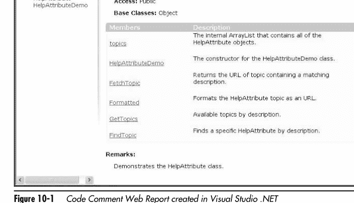

#### 提示

从 Visual Studio .NET 的“工具”菜单生成注释网页。

使用反射的关键是请求 `Type` 信息。有了 `Type` 信息，你就可以使用反射来探索类型的所有成员，包括读取特性实例及其属性。

## 次要主题

上一节演示了一个使用反射显示动态 HTML 帮助的 `HelpAttribute`。一个有想法的人可能想使用这个特性，但也希望有一种简单的方法来生成专业的网页。你可以使用文档标签和 Visual Studio .NET 自动生成 HTML 注释页。

本章的这一节将演示几个主题。除了为你的代码生成 HTML 文档而设计的标签外，本节还将探讨：

- `ToolTip` 组件以及如何实现扩展器提供程序
- `EditorBrowsableAttribute`
- `DesignerSerializationAttribute`

### 注释特性

Visual Studio .Net 将为你的源代码生成高质量的 HTML 文档。你提供注释，Visual Studio .Net 会处理其余部分。

第 9 章的表 9-1 介绍了用于注释源代码的注释 XML 标签。你可以将 Visual Studio .NET 帮助文档作为一般参考。这里，我将演示几个用于创建图 10-1 所示 HTML 文档的注释标签。

图 10-1 中显示的“描述”列是通过使用 `<summary>` 标签创建的。图 10-1 底部显示的“备注”部分是使用 `<remarks>` 标签创建的，而 `<param>` 和 `<returns>` 注释如图 10-2 所示。图 10-2 中所示方法的类型、名称和描述信息是由 `<param>` 标签创建的，返回信息由 `<returns>` 标签添加。

图 10-1 中所示的 `topics` 元素的“描述”是通过向 `topics` 字段添加以下注释创建的。

```csharp
/// <summary>
/// 包含所有 HelpAttribute 对象的内部 ArrayList。
/// </summary>
ArrayList topics;
```


## 高级 C# 编程

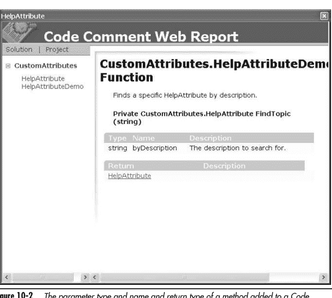

*图 10-2：使用 `<param>` 和 `<returns>` 标签添加到代码注释网页报告中的方法的参数类型、名称和返回类型*

图 10-1 中的“备注”部分是使用以下应用于 `HelpAttributeDemo` 类的注释创建的。

```
/// <remarks>
/// Demonstrates the HelpAttribute class.
/// </remarks>
[Help(@"C:\Temp\CWP11.HTM", "Class")]
public class HelpAttributeDemo
{
```

参数和返回信息是通过应用 `<param>` 和 `<returns>` 标签创建的，如下所示。

```
/// <param name="byDescription">The description to search for.</param>
/// <returns>HelpAttribute</returns>
[Help(@"C:\Temp\CWP17.HTM", "Find Topic")]
private HelpAttribute FindTopic(string byDescription)
```

通过提供文本和文档标签，你可以为你的源代码创建丰富的帮助文档。

### 实现扩展器提供程序

扩展器提供程序向其他组件提供属性。与其让每个控件都拥有自己的 `Hint` 属性，扩展器提供程序可以动态地向控件提供一个 `Hint` 或 `ToolTip` 属性。已经存在几个扩展器提供程序，包括 `ComponentTray`、`ErrorProvider`、`HelpProvider`、`LocalizationExtenderProvider`、`PropertyTab` 和 `ToolTip`。

例如，`ToolTip` 提供程序可以被添加到组件托盘中，并动态地为控件提供 `ToolTip` 控件。使用者可以通过调用 `IExtenderProvider` 类必须实现的唯一方法 `CanExtend` 来查询扩展器提供程序。`CanExtend` 返回一个布尔值，指示特定提供程序是否可以扩展该使用者。要创建自定义扩展器提供程序，请定义一个继承自 `Component` 并实现 `IExtenderProvider` 接口的类。

为了演示 `IExtenderProvider` 接口，我们将创建一个 `HelpProvider`，通过向控件添加 `HelpLink` 属性来扩展控件。实现 `HelpProvider` 需要利用 .NET Framework 的几个基本特性。我们需要继承自 `System.ComponentModel.Component`，实现 `System.ComponentModel.IExtenderProvider` 接口，并应用 `System.ComponentModel.ProviderPropertyAttribute`。我们将在接下来的小节中探讨这些部分，并在本章末尾提供该提供程序的完整代码清单。

### 指定 HelpProvider 的类头

`HelpProvider` 将提供帮助信息的链接。我们需要一个集合来存储这些链接。`IExtenderProvider` 接口和 `ProviderPropertyAttribute` 定义在 `System.ComponentModel` 命名空间中，我们将把 `HelpProvider` 与 Windows 窗体控件关联起来。因此，在实现 `HelpProvider` 的模块中包含这些功能的命名空间会很有帮助。

> **注意**
> 术语“概括化”是指从一个类派生，而术语“实现化”是指实现一个接口。这些术语是同义词。“继承”和“实现”最常用于编程语言（如 C#）的上下文中，而“概括化”和“实现化”最常用于建模语言（如统一建模语言 UML）的上下文中。

为了将 `HelpProvider` 放置在组件托盘中，我们需要继承 `System.Windows.Forms.Component` 类并实现 `System.ComponentModel.IExtenderProvider`。`using` 语句和类头如下：

```
using System;
using System.Collections;
using System.ComponentModel;
using System.Windows.Forms;

public class HelpProvider : Component, IExtenderProvider
```

最后一条语句表明 `HelpProvider` 继承自 `Component` 并实现了 `IExtenderProvider`。

### 应用 ProviderPropertyAttribute

`ProviderPropertyAttribute` 用于为特定扩展器提供程序将要提供的属性提供名称。你可以使用提供的属性名称以及此提供程序可以扩展的对象的名称或类型来初始化 `ProviderPropertyAttribute`。我们希望我们的提供程序通过 `HelpLink` 属性扩展 `System.Windows.Forms.Control` 对象，这指导了 `ProviderPropertyAttribute` 语句（如下所示，相对于类头）：

```
[ProvideProperty("HelpLink", typeof(Control))]
public class HelpExtender : Component, IExtenderProvider
{
```

`ProviderPropertyAttribute` 表明我们的提供程序将提供一个名为 `HelpLink` 的属性，并且可以扩展 `Control` 对象。（请记住，每个 Windows 窗体控件都继承自 `Control`。）`ProvidePropertyAttribute` 的另一种形式使用属性名称和提供的属性类型进行初始化。

当 `HelpProvider` 被添加到组件托盘时，每个 `Control` 都将拥有一个 `HelpLink` 属性，除非该 `Control` 被 `CanExtend` 方法明确排除。

### 实现 IExtenderProvider 接口

`IExtenderProvider` 定义了 `CanExtend` 方法。当一个类实现一个接口时，该类必须实现接口定义的所有成员。你可以显式地实现接口成员，通过在满足接口契约的成员前加上接口名称前缀，或者通过声明一个与接口中定义的成员签名完全相同的公共成员。以下两种方法签名都将满足 `IExtenderProvider` 接口：

```
public bool CanExtend(object extendee)

或

bool IExtenderProvider.CanExtend(object extendee)
```

公共方法 `CanExtend` 隐式地满足了 `IExtenderProvider` 接口，而第二个示例显式地满足了该契约。

假设你有一个类实现了两个包含一个或多个相同成员的接口。你可以使用第二种显式实现接口的形式来指示哪些成员正在实现特定接口。

我们的控件将扮演提供程序的角色给任何 `Control`；因此，如果扩展对象的类型是 `Control`，`HelpProvider.CanExtend` 方法将返回 `True`。以下是 `CanExtend` 方法的实现。

```
bool IExtenderProvider.CanExtend(object extendee)
{
    return extendee is Control;
}
```

### 实现 HelpProvider

`HelpProvider` 将向它扩展的每个控件提供一个 `HelpLink` 属性。因此，剩下要做的就是实现获取和设置 `HelpLink` 的方法，并提供一个存储所有 `HelpLink` 的地方。清单 10-2 提供了 `HelpProvider` 的完整实现。

```
1:  using System;
2:  using System.Collections;
3:  using System.ComponentModel;
4:  using System.Windows.Forms;
5:  
6:  namespace HelpExtender
7:  {
8:      [ProvideProperty("HelpLink", typeof(Control))]
9:      public class HelpExtender : Component, IExtenderProvider
10:     {
11:     
12:         private Hashtable links;
13:         
14:         public HelpExtender()
15:         {
16:             links = new Hashtable();
17:         }
18:         
19:         public string GetHelpLink(Control control)
20:         {
21:             return links[control] == null ? string.Empty
22:                 : (string)links[control];
23:         }
24:         
25:         public void SetHelpLink(Control control, string text)
26:         {
27:             if(text == null)
28:                 links[control] = string.Empty;
29:             else
30:                 links[control] = text;
31:         }
32: 
33:         bool IExtenderProvider.CanExtend(object extendee)
34:         {
35:             return extendee is Control;
36:         }
37: 
38:     }
39: }
```

清单 10-2 中第 14 到 17 行定义的构造函数创建了一个 `Hashtable` 实例。我们将依赖每个类从 `Object` 类继承的 `GetHashCode` 方法，作为存储唯一 `HelpLink` 值的手段。`GetHelpLink` 和 `SetHelpLink` 为 `HelpLink` 属性提供读写行为。

清单 10-2 中第 25 到 31 行的 `SetHelpLink` 使用控件来索引 `Hashtable`，将特定控件的 `HelpLink` 字符串值存储在控件本身创建的哈希索引处。`GetHelpLink` 执行相反的操作。如果特定索引处的 `Hashtable` 条目返回 `null`，则返回 `string.Empty` 值；否则，哈希函数返回一个对象（我们知道它是一个字符串），我们可以返回该字符串值，如第 22 行所示。

### 使用 HelpProvider

在类库中包含包含 `HelpProvider` 的模块。构建类库项目并将 `HelpProvider` 库添加到工具箱。（有关在 Visual Studio .NET 中自定义工具箱的信息，请参阅第 9 章中的“将组件添加到工具箱”。）

要使用 `HelpProvider`，请从工具箱将 `HelpProvider` 拖动到窗体上。`HelpProvider` 将被添加到组件托盘，并且窗体及其上的控件将被扩展一个 `HelpLink` 属性（如图 10-3 所示）。

由扩展器添加的属性的值位于扩展器中，而不是在它扩展的控件中。通常，你会通过请求特定对象实例的属性来读取属性值。例如，`button1.Text` 提供对名为 `button1` 的对象的 `Text` 属性的访问。要访问由扩展器添加的属性的值，请从扩展器的 `Get` 方法请求该值。以下语句演示了如何请求与名为 `button1` 的对象关联的 `HelpLink` 值。

```
helpExtender1.GetHelpLink(button1)
```

在我们的示例中，`HelpLink` 是一个 URL，指向一个使用注释网页创建的 HTML 文档。为了显示该网页，我们可以将 `HelpLink` 的值传递给 `Process.Start` 方法。`HTTP://` 标识符与 Internet Explorer 相关联。


# 第十章：创建自定义特性

在我的机器上）；因此，使用 HTTP:// 地址调用的 Process.Start 将打开 URL 中引用的文档。

## 回顾 EditorBrowsableAttribute

`EditorBrowsableAttribute` 定义在 `System.ComponentModel` 命名空间中。通过使用 `EditorBrowsableState` 枚举值进行初始化，`EditorBrowsableAttribute` 将决定属性或方法是否在编辑器中可见。例如，`[EditorBrowsable(EditorBrowsableState.Never)]` 会将其应用的元素从 Visual Studio .NET 的 Intellisense 功能中隐藏。

`EditorBrowsableState` 的值有 `Never`、`Always` 和 `Advanced`。如果在“选项”对话框中选择了“隐藏高级成员”（如图 10-4 所示），那么使用 `EditorBrowsableState.Advanced` 初始化的 `EditorBrowsableAttribute` 的成员将不会被 Intellisense 显示。

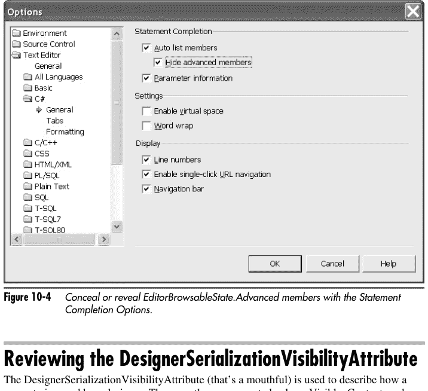

**图 10-4** 通过语句完成选项隐藏或显示 *EditorBrowsableState.Advanced* 成员。

## 回顾 DesignerSerializationVisibilityAttribute

*DesignerSerializationVisibilityAttribute*（这是一个拗口的名称）用于描述设计器如何保存属性。你可以使用 *DesignerSerializationVisibility* 枚举中定义的三个枚举值（`Visible`、`Content` 和 `Hidden`）来初始化此特性。`Visible` 值表示设计器可以使用默认行为来序列化属性。使用 `Hidden` 表示属性不被序列化，使用 `Content` 表示属性的值被序列化。例如，使用 `Content` 来序列化集合的元素。

我们可以结合 *EditorBrowsableAttribute*、*BrowsableAttribute* 和 *DesignerSerializationVisibilityAttribute* 来解决第 9 章中的一个语义缺陷。第 9 章引入了一个 *EffectsLabel*。*EffectsLabel* 继承自 *Label*，并通过重写 *OnPaint* 行为创建了阴影效果。这个缺陷很微妙。为了创建阴影效果，叠加颜色与现有的、继承的 *ForeColor* 组合在一起。缺陷在于 *ForeColor* 实际上创建了背景阴影效果，而 *OverlayColor* 属性实际上变成了 *ForeColor*。一个理智的人可能会被这种微妙但恼人的不一致所困惑。

为了解决这个问题，我们可以引入一个名为 *ShadowColor* 的新属性，并隐藏名为 *ForeColor* 的旧属性。因此，*EffectsLabel* 具有名为 ShadowColor 和 OverlayColor 的属性，每个属性的作用在 EffectsLabel 的上下文中要清晰得多。要完成修订，我们只需将清单 10-3 中显示的两个属性添加到第 9 章定义的 EffectsLabel 控件类中。

> 清单 10-3 将清单中的代码添加到第 9 章的 EffectsLabel 自定义控件中，以隐藏 ForeColor 属性并引入一个更有意义的 ShadowColor 属性。

```csharp
[Browsable(false),
EditorBrowsable(EditorBrowsableState.Never),
DesignerSerializationVisibility(DesignerSerializationVisibility.Hidden)]
public override Color ForeColor
{
    get
    {
        return base.ForeColor;
    }
    set
    {
        base.ForeColor = value;
    }
}

[Category("Appearance"),
Description("The color that is used to create the shadow.")]
public Color ShadowColor
{
    get
    {
        return ForeColor;
    }
    set
    {
        ForeColor = value;
    }
}
```

清单 10-3 第 1 行的 `BrowsableAttribute` 将阻止 `ForeColor` 在“属性”窗口中显示。第 2 行应用的 `EditorBrowsableAttribute` 将阻止 IntelliSense 在代码设计器中显示 `ForeColor` 属性，而应用的 `DesignerSerializationVisibilityAttribute` 将阻止 `ForeColor` 被代码编辑器序列化。

就所有意图和目的而言，通过添加清单 10-3 中的代码进行修订的 EffectsLabel 将不再具有 `ForeColor` 属性。从使用者的角度来看，EffectsLabel 将具有 `ShadowColor` 和 `OverlayColor`，这在阴影标签的上下文中更有意义。当然，你我都知道（从清单 10-3 可知）`ShadowColor` 是通过继承的 `ForeColor` 实现的。我们运用了一点障眼法，使 EffectsLabel 更易于使用。

## 总结

代码的意图应该通过你编写代码的方式来传达。在大多数情况下，控件的使用者和提供者将通过你提供给它们的成员来接触你的代码。使用者可能永远不会看到你的内部注释，并且很可能在探索代码之后才会遇到你的外部文档。

本章演示了如何通过创建自定义特性和扩展器提供程序，将帮助文档与你的代码关联起来。本章的最后一部分演示了如何组合特性来执行一些编程上的障眼法，以隐藏现有属性并暴露更能传达意义的新属性。

你可以创建自定义特性来向代码添加元数据。使用扩展器提供程序通过添加新属性来扩展现有控件，并且你可以使用现有特性来传达有关代码的额外信息。

# 第十一章：实用反射

**本章内容：**

-   演示的主题
-   动态发现和使用类型
-   使用反射探索 .NET Framework
-   发射动态程序集
-   次要主题
-   反射与 Web 服务
-   实现元类惯用法
-   序列化对象
-   发射正则表达式程序集
-   总结

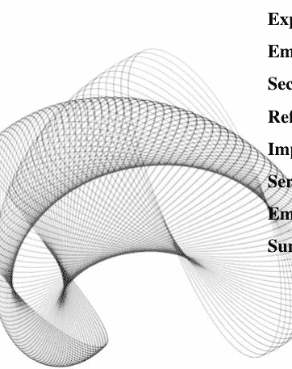

反射是一种促进动态管理程序集的能力。它是运行时类型信息的演进增强。通过反射，你可以加载和发射程序集，可以使用编译和运行的代码动态发现和创建类型，并且可以使用运行代码调用操作或发射成员。

运行时类型信息（RTTI）支持动态类型发现。查询 COM 接口支持动态接口发现。反射为这两种操作以及更多功能提供了支持。除了发现有关类型或接口的信息外，反射还允许你发现有关字段、事件、属性、方法、构造函数和特性的信息。对发现有关程序集和类型的信息的一个增强是编写发射器——即定义代码生成器——编写面向对象的中间语言（IL）。本章将演示如何完成所有这些事情。

### 演示的主题

本章演示了使用反射的实际应用。有几个示例程序，以及对第 5 章的 Assembly Viewer 2 示例应用程序的讨论。在本章中，你将有机会学习如何

-   使用反射动态发现有关类型的信息
-   在运行时加载程序集
-   以编程方式探索 .NET Framework
-   发射程序集、模块、类和成员

次要主题通过演示反射的一些额外用途来补充核心反射主题。在次要主题中，我将演示如何实现元类——类的类——惯用法，使用 XML 序列化对象，将对象序列化到 ADO.NET DataSet，以及发射编译的正则表达式。

### 动态发现和使用类型

你可能会遇到多个这样的情况：你定义一个泛型类型，并在运行时（而不是编译时）将该泛型对象初始化为特定类型。本章中的几个示例将在实际应用中证明是有用的，例如本章后面“实现元类惯用法”中描述的元类惯用法。本节将演示发现类型信息的基本概念，你将在日常编程和从类的 Type 对象创建对象时使用这些信息。


# 使用类型对象

当你调用 `typeof(object)` 操作时，会返回一个类的 Type 记录的实例。与任何其他类一样，Type 类也有成员。唯一的区别是，Type 类包含描述类型的属性、字段和方法。例如，如果你声明一个默认名为 Class1 的新类并请求 `typeof(Class1)`，那么你将获得一个 System.Type 的实例作为返回值。使用这个 Type 对象，你可以通过 Type.InvokeMember 在 Type 对象上调用操作。下面是一个简短的示例：

```csharp
using System;

namespace TypeofDemo
{
    class Class1
    {
        [STAThread]
        static void Main(string[] args)
        {
            Type type = typeof(Class1);
            Console.WriteLine(type.FullName);
            Console.ReadLine();
        }
    }
}
```

`typeof` 语句返回 Class1 的 Type 对象的一个实例。`FullName` 成员返回 Type 对象所表示类型的命名空间和名称。此示例将把 TypeofDemo.Class1 写入控制台。

Type 对象包含关于其所属程序集以及类型定义的成员的方法。有一些方法可以请求属性、构造函数、事件、字段、属性、接口、方法、方法参数、嵌套类型、所属程序集和命名空间，以及应用于类型的访问修饰符。

请求类型的第二种方法是将全名传递给 Type.GetType 共享方法。`Type.GetType("TypeofDemo.Class1")` 将返回表示 Class1 的 Type 对象，这与 `typeof(Class1)` 语句完全一样。你只需要获取其 Type 对象的实例，就可以探索类型或在其上调用操作。

元类是类的类。Type 类类似于元类，但 Type 类更不具体。Type 类描述所有类型，而元类描述单个类型。因为 Type 类是针对所有类型的通用类，所以你将在 Type 对象上执行的操作也是通用的，需要比元类更多的信息。例如，在元类上调用一个构造函数，你会得到正确的对象。在 Type 对象上调用构造函数，你必须间接调用构造函数，将参数作为对象数组传递。如果你熟悉元类，差异将是显而易见的。一般来说，可以将元类视为描述特定类的类，将 System.Type 类视为描述所有可能的类。

# 使用反射实例化对象

除非你只是在类型上调用静态成员，否则你将需要构造一个反射类型的实例。有三种方法可以使用类型的 Type 对象创建实例。你可以使用 Activator.CreateInstance 方法。你可以请求一个 ConstructorInfo 并使用该类型实例化一个实例，或者你可以调用 Type.InvokeMember 并传递描述构造函数的参数。这三种方法都相当有效；使用静态 Activator.CreateInstance 方法似乎是最简单的。

接下来的三个简短片段演示了如何从名称请求 Type 对象并创建该类型的实例。

```csharp
// Using an activator
Type type = Type.GetType("TypeofDemo.Class1");
object o = Activator.CreateInstance(type);
type.InvokeMember("Test", BindingFlags.InvokeMethod,
    null, o, new object[]{});
```

此示例使用共享方法 Activator.CreateInstance 创建 Class1 的实例。传递 Type 对象，CreateInstance 将调用默认构造函数。CreateInstance 有几个重载形式；例如，如果你传递一个代表构造函数参数的参数数组，那么 CreateInstance 将使用与参数最匹配的构造函数创建类型的实例。

```csharp
// Using a ConstructorInfo
Type type = Type.GetType("TypeofDemo.Class1");
ConstructorInfo constructorInfo = type.GetConstructor(new Type[]{});
object o = constructorInfo.Invoke(new object[]{});
type.InvokeMember("Test", BindingFlags.InvokeMethod,
    null, o, new object[]{});
```

第二个示例获取一个 ConstructorInfo 对象，它表示单个构造函数。ConstructorInfo 对象用于通过传递一个对象值数组来创建类型的实例。ConstructorInfo 对象将匹配参数最接近的构造函数。传递一个空的对象数组将调用默认构造函数。

```csharp
// Type.InvokeMember
Type type = Type.GetType("TypeofDemo.Class1");
object o = type.InvokeMember("Class1",
    BindingFlags.CreateInstance, null, null, new object[]{});
type.InvokeMember("Test", BindingFlags.InvokeMethod,
    null, o, new object[]{});
```

最后一个示例将构造函数视为方法并调用方法 Class1。回想一下，C# 中的构造函数与类同名，并且无论你是否定义，每个类都有一个默认构造函数。回想一下本节开头 Class1 的代码，我们没有显式定义构造函数；但是，如果你检查图 11-1 中的 IL，很明显已经定义了一个默认构造函数。

# 动态成员调用

你可能听过这样一句话：".NET 允许开发人员与语言无关"以及"你选择的 .NET 语言是一种生活方式的选择"。这些说法是正确的，原因有几个。第一个原因是 C# 和 Visual Basic .NET 对公共语言运行时具有同等的访问权限。第二个原因是 C# 和 Visual Basic .NET 之间只有少数几个显著的差异（大多数差异是语法上的）。其中一个显著的差异是 Visual Basic .NET 支持隐式晚期绑定，而 C# 不支持。

> 注意
> 当然，有几种 .NET 语言。基本思想是 .NET 语言位于 CLR 之上。因此，为 .NET 实现的许多语言在语法上的差异最为显著。

隐式晚期绑定是指你将类型定义为通用类型（如 Object）并将其分配给特定类型的实例。Visual Basic .NET 中的晚期绑定意味着你基于对实例化类型定义的成员的假设来调用操作。我将通过一个例子来说明这一点。下面是使用 Activator 创建 Class 的实例并调用名为 Test 的成员的代码。

```csharp
// Using an activator
Type type = Type.GetType("TypeofDemo.Class1");
object o = Activator.CreateInstance(type);
type.InvokeMember("Test", BindingFlags.InvokeMethod,
    null, o, new object[]{});
```

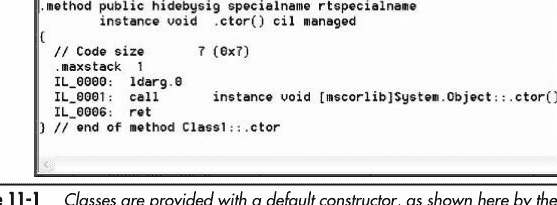

这是 Visual Basic .NET 中的相同代码清单。

```vb
Dim type As Type = Type.GetType("VBTypeofDemo.Class1")
Dim o As Object = Activator.CreateInstance(type)
o.Test()
```

注意，我们不需要使用 InvokeMember 来调用 Test 方法，即使我们声明 *o* 为 Object 实例而不是 Class1 实例。这就是 Visual Basic .NET 中的晚期绑定。

# 定义要调用的成员

正如面向对象框架通常的情况一样，你可能会发现任何方法都有几个重载方法。涵盖每个方法的所有变体是集成帮助或参考手册的功能。有三个版本的 InvokeMember。我将要演示的版本接受五个参数，并具有以下方法签名：

```csharp
public object InvokeMember(string, BindingFlags, Binder, object, object[]);
```

第一个参数是要调用的成员的名称。你可以使用同一个——InvokeMember——方法与字段、属性、事件或方法进行交互。

当你调用 InvokeMember 时，返回类型定义为 object。当然，当你编写代码时，你会知道期望什么类型，并且可以将返回类型强制转换为实际返回的类型。例如，如果你在事件上调用 InvokeMember，那么你可以将返回类型强制转换为事件定义的委托类型。（有关于调用名为 Test 的成员方法的示例，请参阅前面的部分。）

# 指定 BindingFlags

我们正在讨论的 InvokeMember 版本的第二个参数是一个包含 BindingFlags 枚举值的 OR 参数。 BindingFlags 描述了成员的类型，包括访问修饰符等内容。 BindingFlags 值定义在表 11-1 中。

 BindingFlags 以特定的组合方式进行 OR 运算。三个常见的组合包括一个指示成员类型的标志、一个指示访问级别的标志，以及一个指示成员是实例成员、静态成员还是两者的标志。以下是一些有意义的 BindingFlags 组合示例：

```csharp
BindingFlags.GetField | BindingFlags.NonPublic | BindingFlags.Instance
BindingFlags.InvokeMember | BindingFlags.Public | BindingFlags.Static
BindingFlags.SetProperty | BindingFlags.Public | BindingFlags.Instance
```

作为一般规则，字段是私有的；因此，表明我们想要一个非公共实例是有意义的，当调用字段操作时。通常，公共方法构成公共接口，所以我们可能想要调用公共静态或实例方法。（第二


## 326 高级 C# 编程

| 成员名称 | 描述 |
| :--- | :--- |
| CreateInstance | 表示应创建调用类型的实例。 |
| DeclaredOnly | 表示在反射成员时跳过继承的成员。 |
| Default | 无绑定标志。 |
| ExactBinding | 参数类型必须与参数类型精确匹配。 |
| FlattenHierarchy | 返回静态成员。（不包括嵌套类型。） |
| GetField | 用于指示对 Field 成员的引用 |
| GetProperty | 用于指示对 Property 成员的引用。 |
| IgnoreCase | 反射成员时忽略大小写。 |
| IgnoreReturn | 返回值可忽略，用于 COM 互操作。 |
| Instance | 包括实例成员。 |
| InvokeMethod | 调用方法时使用。 |
| NonPublic | 用于非公共成员。需要 ReflectionPermission。 |
| OptionalParamBinding | 用于具有默认参数和 varargs 的方法。 |
| Public | 搜索中包含公共成员。不需要 ReflectionPermission。 |
| PutDispProperty | 应调用 COM 对象上的 PROPPUT。 |
| PutRefDispProperty | 应调用 COM 对象上的 PROPPUTREF 成员。 |
| SetField | 将调用的成员视为左侧值。 |
| SetProperty | 调用属性设置器。 |
| Static | 调用中包含静态成员。 |
| SuppressChangeType | （帮助显示此功能未实现。） |

表 11-1 组合 BindingFlags 值以描述要调用的成员类型

语句演示了如何调用公共静态方法。）最后一个示例调用公共属性设置器方法。清单 11-1 中的代码已添加到示例类 Class1 中。额外的代码实现了一个私有字段和一个表示基础字段值的公共属性。

```
清单 11-1 BindingFlags 组合获取和设置字段与属性的示例

1: private string field;
2: 
3: public string Property
4: {
5:     get { return field; }
6:     set { field = value; }
7:     }
8:
9:     private static void DemoBindingFlags()
10:     {
11:         Type type = Type.GetType("TypeofDemo.Class1");
12:         object o = Activator.CreateInstance(type);
13: 
14:         type.InvokeMember("field",
15:             BindingFlags.SetField | BindingFlags.NonPublic |
16:             BindingFlags.Instance, null, o,
17:             new object[]{
18:             "Welcome to Valhalla Tower Material Defender!"});
19: 
20: 
21:         string s = (string)type.InvokeMember("Property",
22:             BindingFlags.GetProperty | BindingFlags.Public |
23:             BindingFlags.Instance, null, o,
24:             new object[]{});
25: 
26:         Console.WriteLine(s);
27:         Console.ReadLine();
28: 
29:     }
```

清单 11-1 的第 1 至 7 行代表了我们将要反射的字段和属性。请注意，字段是私有的，属性是公共的。（将字段成员命名为 *field*，将属性成员命名为 *property* 与我们的讨论无关。）DemoBindingFlags 在第 11 行通过将全名传递给 Type.GetType 方法来请求类型，第 12 行使用 Activator 创建该类型的实例。

清单 11-1 的第 14 至 24 行演示了一种 BindingFlags 组合，它允许我们设置私有字段值，而对象参数数组接受一个与我们要反射的字段类型相同的单个参数。*field* 字段是一个字符串；因此，我们传递一个包含单个字符串元素的数组。因为 *field* 是一个实例成员，我们需要传递一个对象来调用反射操作——即，我们需要内存来存储字段值。


> **注意**
> 如果你是一名初级程序员，属性、公共访问修饰符和实例可能看起来很陌生。我尊重你作为初学者钻研这个主题的雄心，所以这里快速回顾一下你需要学习的内容，以便理解 BindingFlags。属性是表现得像数据的方法，与封装的概念有关。公共访问修饰符与信息隐藏的主题相关，而实例化与类与对象的概念有关。这些都是你必须学习的基本面向对象编程概念。

清单 11-1 的第 21 至 24 行演示了如何获取公共属性值并将该值分配给一个临时变量。在这种情况下，BindingFlags.GetProperty、BindingFlags.Public 和 BindingFlags.Instance 不言自明。如果你理解属性、公共访问和实例方法的概念，那么这些标志就说得通了。这次我们将 InvokeMember 的结果作为右侧值使用；InvokeMember 被定义为返回一个对象，但类型实际上是字符串，所以我们在第 21 行执行了类型转换。其余的代码只是显示文本 "Welcome to Valhalla Tower Material Defender!"。

### 定义绑定器

无论你是否将 Binder 传递给 InvokeMember，你都在使用一个 Binder——DefaultBinder。绑定器用于将你传递给 InvokeMember 的参数转换为成员期望的正式参数类型。最简单的做法是传递你调用的成员期望的参数类型。然而，你很可能会遇到希望类型之间进行合理转换的情况。例如，IBM 的通用数据库（Universal Database）对 Timestamp 数据类型有特定的格式。如果你在 SQL 语句中将有效的 .NET 日期/时间值传递给 Timestamp 函数，UDB 将不会接受它。这是我编写的一个方法，用于将 .NET DateTime 值转换为适合 UDB Timestamp 数据类型的字符串。

```
public static string ToTimeStamp(DateTime Value)
{
    return string.Format("{0}-{1:0#}-{2:0#}-{3:0#}.{4:0#}.{5:0#}.{6:000000}",
        Value.Year, Value.Month, Value.Day,
        Value.Hour, Value.Minute, Value.Second,
        Value.Millisecond);
}
```

> **注意**
> IBM 的某位工作人员可能知道一种解决方法；然而，我测试了几种变体，似乎需要为 DateTime 值指定精确的字符串格式才能设置 Timestamp 列。

按照 string.Format 方法，UDB Timestamp 的基本语法是 d-m-yy-hh:mm:ss.mils。用简单的英语来说，格式是日、月、年值用连字符分隔，然后是连字符和小时、分钟、秒以及六位数的毫秒值。如果这些高度专业化的值能够接受合理的日期和时间值并为我执行转换，那将是更可取的。这就是 Binder 的角色。

Binder 类是一个抽象类。如果你想描述自定义绑定，那么你可以继承 Binder 类并实现 BindToMethod、BindToField、SelectMethod、SelectProperty、ChangeType 和 ReorderArgumentArray，这些都继承自默认的 Binder 类。（Binder 类定义在 System.Reflection 命名空间中。）清单 11-2 演示了一个在解析 DateTime 属性时将在字符串和 DateTime 值之间执行转换的绑定器。

## 328 高级 C# 编程

#### 清单 11-2 这是一个简单的绑定器，它将字符串转换为 DateTime。

```
1: public class DateTimeBinder : Binder
2: {
3:
4:     public override MethodBase BindToMethod(
5:         BindingFlags bindingAttr,
6:         MethodBase[] match,
7:         ref object[] args,
8:         ParameterModifier[] modifiers,
9:         CultureInfo culture,
10:        string[] names,
11:        out object state)
12:    {
13:        state = null;
14:        return match.Length == 1 ? match[0] : null;
15:    }
16:
17:    public override FieldInfo BindToField(
18:        BindingFlags bindingAttr,
19:        FieldInfo[] match,
20:        object value,
21:        CultureInfo culture)
22:    {
23:        return null;
24:    }
25:
26:    public override MethodBase SelectMethod(
27:        BindingFlags bindingAttr,
28:        MethodBase[] match,
29:        Type[] types,
30:        ParameterModifier[] modifiers)
31:    {
32:        return null;
33:    }
34:
35:    public override PropertyInfo SelectProperty(
36:        BindingFlags bindingAttr,
37:        PropertyInfo[] match,
38:        Type returnType,
39:        Type[] indexes,
40:        ParameterModifier[] modifiers)
41:    {
```


## 第11章：实践反思

```csharp
42:     return null;
43: }
44:
45: public override object ChangeType(
46:     object value,
47:     Type type,
48:     CultureInfo culture)
49: {
50:     if ( value.GetType() != typeof(string)) return value;
51:
52:     try
53:     {
54:         return Convert.ToDateTime(value);
55:     }
56:     catch
57:     {
58:         return value;
59:     }
60: }
61:
62: public override void ReorderArgumentArray(
63:     ref object[] args,
64:     object state)
65: {}
66: }
```

快速浏览清单11-2，你可以确定大多数继承的方法只是空壳。我只希望这个转换器做一件事：将日期/时间的字符串表示形式转换为DateTime值。

`BindToMethod`设置*out*参数——*out*参数不由调用者初始化，但期望在被调用者返回时有一个值——以及我们想要绑定到的`MethodBase`对象。我的实现只在找到唯一一个匹配项时返回一个`MethodBase`对象。

`MethodBase`类是`MethodInfo`的基类。在我们的示例中，我将一个`DateTimeBinder`传递给一个反射属性请求。当属性被发出为IL代码时，会发出名为`get_property`和`set_property`的隐藏方法，其中`property`是与这些方法关联的属性名称。当属性被反射时，会从这些隐藏方法中检索值。因此，即使我们反射的是属性，也会为Binder调用`BindToMethod`。（图11-2显示了为`Class1.DateOfBirth`发出的设置器（高亮显示）和获取器方法。）

为了演示清单11-2中的`DateTimeBinder`，在`Class1`示例类中添加了一个`DateOfBirth`属性和一个`dateOfBirth`字段。清单11-3中的代码演示了隐式调用自定义Binder的`BindToMethod`和`ChangeType`方法的代码。


```csharp
Type type = typeof(Class1);
object o = Activator.CreateInstance(type);
type.InvokeMember( "DateOfBirth",
    BindingFlags.Instance | BindingFlags.SetProperty |
    BindingFlags.Public, new DateTimeBinder(),
    o, new object[]{@"02/12/1966"});
```

与我们目前看到的示例的唯一区别是使用了自定义Binder——清单11-3中的`DateTimeBinder`。清单11-3中的`InvokeMember`方法将使用`DateTimeBinder`来绑定被反射的`DateOfBirth`调用。如果没有自定义Binder，对`InvokeMember`的调用将会失败，因为`DateOfBirth`被定义为`DateTime`成员，而不是`string`成员。

### 向InvokeMember传递参数

如果需要向反射成员传递值，请将参数作为异构对象参数的数组传递（参见清单11-3）。你可以像清单11-3所示的那样内联声明此值，或者声明一个临时变量。（尽量避免使用临时变量。避免使用临时变量在关于重构的书中有所论证。）

`DefaultBinder`将使用对象数组中参数的顺序和类型来解析反射成员。如果你实现了自定义Binder，那么你可以使用`ReorderArgumentArray`方法来帮助解析调用者意图调用哪个成员。

如果你调用的是方法、属性设置器或字段，那么对象参数的数组将用作方法的参数，或作为字段和属性设置方法的右侧值。清单11-4演示了如何调用索引属性并向反射成员传递多个参数。除非你理解索引器及其表示方式，否则这并不直观。

```csharp
1:  DateTime[] dateTimes = new DateTime[10];
2:  public DateTime this[int index]
3:  {
4:    get{ return dateTimes[index]; }
5:    set{ dateTimes[index] = value;}
6:  }
7:
8:  private static void InvokeIndexedPropertyDemo()
9:  {
10:    Type type = typeof(Class1);
11:    object o = Activator.CreateInstance(type);
12:    type.InvokeMember( "Item",
13:      BindingFlags.Instance |
14:      BindingFlags.SetProperty | BindingFlags.Public,
15:      null, o, new object[]{0, new DateTime(1966, 2, 12)});
16:
17:    Console.WriteLine(((Class1)o)[0].ToString());
18: }
```

清单11-4的第1行声明了一个`DateTime`值的数组字段。（如果你要声明一个固定大小的数组，那么属性方法应该有一些错误处理，但这与我们的讨论无关。）第2至第6行定义了一个索引器，它支持将包含对象视为数组。索引器名为*this*。第8至第18行实现了一个调用索引器的测试方法。

需要特别注意的是：我们通过名称"Item"来引用索引器。这并不直观：你只需要知道索引器可以通过一个名为`Item`的隐含属性来引用。使用默认名称作为索引器使得在不直接支持索引器的语言中引用索引器变得方便。例如，Visual Basic .NET不直接支持索引器；但是，Visual Basic .NET的C#类使用者可以通过引用隐含的`Item`属性来调用索引器。最后，请注意我们可以向参数数组传递不同的类型。在清单11-4的第15行，我们传递了一个整数和一个DateTime值。整数代表索引值，DateTime值将通过属性设置方法分配给底层字段。

## 使用反射加载程序集

程序集包含应用程序的元数据和IL表示。要动态使用程序集，你可以调用`Assembly`类的`Load`或`LoadFrom`静态方法。（在第4章中，你有机会学习了如何使用`Assembly.LoadFrom`，它从路径和程序集文件名加载程序集。我不会在这里重复这些信息；有关`LoadFrom`的示例，请参阅第4章。）我将在这里演示如何使用`Assembly.Load`方法加载程序集。

> **注意**
> *你可以使用`Assembly.LoadFromPartialName`加载在GAC（全局程序集缓存）中注册的程序集，但不推荐这种做法。*

`Assembly.LoadFrom`方法是在运行时加载程序集最简单的方式。`Assembly.Load`有七种变体。你可以参考帮助文档了解`Assembly.Load`变体的详细信息。其中一个版本的`Assembly.Load`接受一个`AssemblyName`对象，该对象明确描述了程序集，包括程序集的全名、版本、文化和公钥令牌。清单11-5演示了`Assembly.LoadFrom`方法的示例（供快速参考），清单11-6演示了使用`AssemblyName`对象的`Assembly.Load`，展示了如何构造和初始化`AssemblyName`对象。

**清单11-5** `Assembly.LoadFrom`方法快速参考

```csharp
Assembly assembly = Assembly.LoadFrom(
    "C:\\WINNT\\Microsoft.NET\\Framework\\" +
    "V1.0.3705\\System.Windows.Forms.dll");
foreach( Type type in assembly.GetTypes())
{
    Console.WriteLine(type.FullName);
}
```

清单11-5通过提供`System.Windows.Forms.dll`程序集的完整文件路径来加载程序集。（有关更多反射示例，请查看第4章。）这是动态加载程序集最简单的方式。`foreach`语句遍历`System.Windows.Forms`定义的所有类型。

**清单11-6** 使用`AssemblyName`对象加载程序集

```csharp
AssemblyName assemblyName = new AssemblyName();
assemblyName.CodeBase =
    "file:///C:\\WINNT\\Microsoft.NET\\Framework\\" +
    "V1.0.3705\\System.Windows.Forms.dll";

assemblyName.Version = new Version("1.0.3300.0");
assemblyName.CultureInfo = new CultureInfo("en-US");

Assembly assembly = Assembly.Load(assemblyName);

foreach( Type type in assembly.GetTypes())
{
    Console.WriteLine(type.FullName);
}
```

清单11-6中的代码等同于清单11-5中的代码。我们使用了更详细的`Assembly.Load`方法，传递一个`AssemblyName`对象实例。我们本可以只初始化`AssemblyName.CodeBase`参数，如使用`file://`标记和路径所示。清单11-6还演示了如何指定`Version`和`CultureInfo`；`Version`和`CultureInfo`都是对象属性。在示例中，我们加载了用字符串"en-US"初始化的`CultureInfo`对象所表示的英文-美国版本。我们可能使用这种更详细的`Load`方法版本在特定文化的程序集之间进行切换。

## 使用反射对象生成用户界面

能够反射类型信息意味着你可以动态地弄清楚对象属性的类型和值。将特定种类的数据等同于特定的控件，就可以动态创建用户界面。例如，假设你有一个带有字符串属性的对象。将属性的名称等同于`Label`的`Text`属性，将字符串数据类型等同于`TextBox`控件，将属性的值等同于`TextBox`的值，然后你就可以向窗体添加一个`Label`和一个`TextBox`。对其他对象属性重复此过程，你就得到了一个动态用户界面。使用`DataBinding`，控件中的更改会自动反映在对象中。

清单11-7结合了强类型集合、反射集合包含类型的属性和`DataBinding`来生成用户界面。注意，窗体对用于创建用户界面的对象类型一无所知；一切都是使用反射完成的。

```csharp
1:  using System;
2:  using System.Drawing;
3:  using System.Collections;
4:  using System.ComponentModel;
5:  using System.Windows.Forms;
6:  using System.Data;
7:  using System.Reflection;
8:
9:  namespace DynamicUserInterface
10: {
```


## 334 高级 C# 编程

```csharp
public class Form1 : System.Windows.Forms.Form
{
    [Used outlining to hide auto-generated code]
    [Windows Form Designer generated code]

    [STAThread]
    static void Main()
    {
        Application.Run(new Form1());
    }

    private void menuItem7_Click(object sender, System.EventArgs e)
    {
        const string about =
            "Dynamic User Interface Demo\r\n" +
            "Written by Paul Kimmel. pkimmel@softconcepts.com\r\n" +
            "Copyright © 2002. All Rights Reserved.\r\n" +
            "Published in Advanced C# Programming\r\n";

        MessageBox.Show(about, "About",
            MessageBoxButtons.OK, MessageBoxIcon.Information);
    }

    private void menuItem2_Click(object sender, System.EventArgs e)
    {
        Application.Exit();
    }

    private void menuItem4_Click(object sender, System.EventArgs e)
    {
        CompactDiscs compactDiscs = CompactDiscs.Create();
        CreateUserInterface(compactDiscs, typeof(CompactDisc));
    }

    private void menuItem5_Click(object sender, System.EventArgs e)
    {
        Customers customers = Customers.Create();
        CreateUserInterface(customers, typeof(Customer));
    }

    private void ClearControls()
    {
        panel1.Controls.Clear();
    }

    private object dataSource;
    private void CreateUserInterface(IList list, Type type)
    {
        dataSource = list;
        ClearControls();

        PropertyInfo[] properties = type.GetProperties();
        for (int i = 0; i < properties.Length; i++)
        {
            AddControl(properties[i], i, list);
        }
    }

    private void AddControl(PropertyInfo propertyInfo, int i, IList list)
    {
        Label label = new Label();
        label.AutoSize = true;
        label.Text = propertyInfo.Name;
        label.Location = new Point(10, (i + 1) * 25);
        panel1.Controls.Add(label);

        TextBox textBox = new TextBox();
        textBox.Location = new Point(250, (i + 1) * 25);
        textBox.Width = 250;
        panel1.Controls.Add(textBox);
        textBox.DataBindings.Add("Text", list, propertyInfo.Name);
    }

    private void menuItem8_Popup(object sender, System.EventArgs e)
    {
        menuItemNext.Enabled = panel1.Controls.Count > 0;
        menuItemPrevious.Enabled = panel1.Controls.Count > 0;
    }

    private void menuItemNext_Click(object sender, System.EventArgs e)
    {
        try
        {
            panel1.BindingContext[dataSource].Position += 1;
        }
        catch { }
    }

    private void menuItemPrevious_Click(object sender, System.EventArgs e)
    {
        try
        {
            panel1.BindingContext[dataSource].Position -= 1;
        }
        catch { }
    }
}
```

在我们深入研究代码之前，需要做几点说明。清单11-7的第14行和第15行代表被折叠（outline）的代码。这段代码目前无法直接运行。请下载并运行 `UserInterfaceDemo.sln` 来测试此代码。折叠的代码代表了由视图设计器自动生成的控件、构造函数和 Dispose 方法。

执行实际工作的代码定义在 `CreateUserInterface` 和 `AddControl` 方法中。在清单11-7的第58至68行，将一个 `IList` 和一个 `Type` 传递给 `CreateUserInterface`。`CreateUserInterface` 遍历由 `Type` 定义的所有属性，并调用 `AddControl`。清单11-7的第70至83行的 `AddControl` 方法创建一个 `Label` 控件，并将其 `Text` 属性设置为 `PropertyInfo.Name` 的值。然后，创建一个 `TextBox`，并使用 `IList` 和 `PropertyInfo.Name` 值来创建一个 `Binder`（第82行），将其绑定到 `TextBox` 的 `Text` 属性。`menuItemNext_Click` 和 `menuItemPreviousClick` 事件处理程序使用 `panel1` 的 `BindingContext` 在 `IList` 中的对象之间向前或向后移动。修改 `TextBox` 中的值，绑定对象的属性就会随之更新。

`Types.cs` 实现了两个强类型集合，分别包含 `Customer` 和 `CompactDisc` 对象，以此来演示用户界面生成器。

要创建一个健壮的解决方案，还剩下什么工作？好吧，如果我正在实现这个软件，我会考虑进行以下更改：

- 在 `PropertyInfo.Name` 值中插入空格，使 `Label.Text` 属性更用户友好。
- 也许可以右对齐 `Label` 控件，并使所有 `Label` 的宽度与最宽的文本值相同，从而减少 `Label` 和 `TextBox`（或其他控件）之间的空白。
- 使用 `PropertyInfo.PropertyType` 来确定要呈现的最佳控件，而不是默认使用 `TextBox`。
- 动态分配事件处理程序以促进数据验证。
- 实现一个布局管理器以支持动态更改界面样式。
- 将代码生成代码分离到一个单独的类中。
- 将代码生成代码实现为一个接口，并为 Windows 窗体和 Web 窗体分别实现一个版本。

> 我几十年前就打开了潘多拉魔盒。使用反射生成智能用户界面是完全可能的。你也可以使用反射来发出动态类型。我担心的是，某些经理读到这一点后会认为程序员被淘汰的时代即将到来。事实远非如此。用户的需求比以往任何时候都更大。我们或许能够自动化一些无聊的任务，比如创建通用的输入屏幕，但这只会留出时间去解决更具挑战性的问题。这是所有创新似乎都会经历的演变模式。随着面向对象语言的当前演变，我确实认为我们正处于一些巧妙应用的起步阶段。

前面的项目符号列表描述了针对实际应用想到的可能改进；可能还有一些其他好的修改方案。稍加想象力，就可以创建一些相当高级的用户界面。

## 使用反射探索 .NET 框架

第2章的 `AssemblyViewer.sln` 演示了允许你探索 .NET 框架的代码。如果你从头开始阅读本书，你已经具备了足够的知识来构思一些算法，使用反射来发现关于类型的信息。使用反射处理类型的关键在于获取一个 `Assembly` 对象，获取该程序集中定义的类型，并对这些类型中定义的成员调用操作。

`Assembly.GetTypes` 将返回一个 `System.Type` 对象数组，代表程序集中定义的所有类型。从 `Type` 对象中，你可以通过请求相应的 Info 对象来获取任何成员的信息。例如，要获取单个类型的所有成员，可以调用 `Type.GetMembers`。`GetMembers` 返回一个混合了不同 `MemberInfo` 对象的数组，将构造函数、属性、事件、字段和方法组合在一个数组中。`ConstructorInfo`、`PropertyInfo`、`EventInfo`、`FieldInfo` 和 `MethodInfo` 类都继承自 `MemberInfo` 类。所有这些类都定义在 `System.Reflection` 命名空间中。

你可以通过调用该类型的 get 方法来请求特定类型的数组。例如，`Type.GetMethods` 将返回一个 `MethodInfo` 对象数组。`Type.GetMethod` 将返回单个 `MethodInfo`，具体基于你传递给 `GetMethod` 的参数。当你有一个特定的 Info 对象时，对成员调用操作更容易；然而，从“动态成员调用”部分中你知道，你可以直接使用 `Type` 对象对成员调用操作。

在下一节中，我将演示一些在依赖动态类型交互的实际应用中你可能想要执行的操作。我们将回顾第5章 `AssemblyViewer.sln` 中的反射示例、动态调用的方法和参数示例，以及使用反射绑定到事件。

### 返回到 CLR 参考应用程序，Assembly Viewer 2

`AssemblyViewer.sln` 包含几个关于字段、属性、方法、事件、构造函数和类型的反射示例。你可能还记得，第5章的示例应用程序允许你在运行时加载一个程序集，并将所有类型及其现有成员添加到数据库中。有关反射的通用示例，请参考该应用程序。我将在本节中不时引用 `AssemblyViewer.sln`，并提供一些额外的新示例程序。

### 请求类型信息

思考反射的一种简单方式是将其视为一个实体的层次结构，程序集位于层次结构的顶点。程序集内部是类型，每个类型内部是成员，包括嵌套类型。成员可能包括枚举、结构、类、属性、方法、事件、字段和构造函数。因此，一旦加载了程序集，接下来你需要做的就是请求一个 `Type` 对象。

请求类型对象有几种方法。你可以使用 `typeof` 运算符，这是获取 `Type` 对象最简单、最方便的方式，或者使用静态方法 `Type.GetType`。以下是几个语法示例，演示如何获取类型信息。

```csharp
typeof(type)
Type.GetType(typename)
```

例如，`typeof(Form1)` 将返回一个名为 `Form1` 的类的 `Type` 对象。第二个例子有点误导性。从 `Type.GetType` 的帮助文档来看，你可能认为可以简单地将 `typename` 参数表示为一个简单的名称。棘手的是，对于某些类型似乎确实可以这样做。例如，`Type.GetType("System.Int32")` 将返回 `Int32` 的 `Type` 对象，但 `Type.GetType("System.Windows.Forms.Form")` 将返回 `null`。然而，如果你将程序集限定名传递给 `Type.GetType`，那么它就能正常工作。以下是一个示例，演示了 `System.Windows.Forms.Form` 类的程序集限定名，以及为什么你会欣赏 `typeof`。

```csharp
Type.GetType("System.Windows.Forms.Form, System.Windows.Forms, Version=1.0.3300.0, Culture=neutral, PublicKeyToken=b77a5c561934e089");
```

要可靠地使用 `Type.GetType` 反射类型，你需要提供一个程序集限定名。以下是一个示例，展示如何使用程序集限定名按名称加载 `System.Windows.Forms.Form` 类。清单11-8提供了一个程序集限定名的例子。该片段摘自可下载的 `TypeDemo.sln`。（你可能从该片段中看出，用户界面由窗体上的两个 `Button` 控件和一个 `TextBox` 组成。）


### 清单 11-8 反射类型和 MemberInfo 对象，包括程序集限定名示例

```csharp
private void ReflectMembers(Type type)
{
    textBox1.Clear();
    foreach(MemberInfo memberInfo in type.GetMembers())
    {
        textBox1.AppendText(memberInfo.Name + "\r\n");
    }
}

private void button1_Click(object sender, System.EventArgs e)
{
    ReflectMembers(typeof(System.Windows.Forms.Form));
}

private void button2_Click(object sender, System.EventArgs e)
{
    const string assemblyQualifiedName =
        "System.Windows.Forms.Form, System.Windows.Forms, " +
        "Version=1.0.3300.0, Culture=neutral, " +
        "PublicKeyToken=b77a5c561934e089";
    ReflectMembers(Type.GetType(assemblyQualifiedName));
}
```

清单 11-8 中第 1 行开始的 `ReflectMembers` 方法演示了如何将所有成员作为一个同构集合进行遍历。这是一种快速参考的良好策略。第 10 到 13 行的事件处理程序演示了如何使用 `typeof` 运算符获取类型信息。如果没有对程序集的引用，`typeof` 运算符将无法工作。例如，如果 `System.Windows.Forms.dll` 不是程序集的一部分，你将无法获取其类型信息。

清单 11-8 中第 15 到 23 行的事件处理程序演示了如何使用程序集限定名获取与 `button1` 事件处理程序相同类型（即 `System.Windows.Forms.Form`）的类型信息。字符串中的字段包括要获取 `Type` 对象的类型、声明类型、版本和区域设置信息，以及公钥。

一个合理的人可能会询问如何获取完全限定的程序集名称。答案是，我使用 `typeof` 运算符反射了 `System.Windows.Forms.Form`，并读取了 `Type.AssemblyQualifiedName` 属性。这不太方便。下面是一个由程序集限定名需求带来的实际问题示例。

Geoff Caylor 是俄勒冈州一个 C# 项目开发团队的程序员之一，他提出了使用反射来生成 ASP.NET 用户界面的想法。Geoff 想创建一个自定义特性（参见第 10 章）来标记我们业务对象中的属性，并附上一个提示，描述为特定字段呈现哪种 Web 控件。当 GUI 生成器读取该属性时，可以读取自定义特性并呈现一个合适的控件。解决这个问题有几种方法：可以创建一个布局管理器并动态解析要呈现的控件类型；或者将要呈现的控件的 `Type` 对象与属性关联；或者将要呈现的控件的字符串名称关联起来——例如，对于布尔属性关联“CheckBox”。Geoff 最初在原型设计时选择了后者，因为它看起来很轻量；也就是说，他选择使用字符串。然而，如果没有程序集限定名，你就无法获取 `System.UI.Web.WebControls.CheckBox` 的类型信息，并且将属性绑定到特定的程序集版本会在 .NET Framework 更新后立即失效。（回顾一下，程序集限定名包含版本信息。）对于这个问题，有一个实用的解决方案，可能涉及一个布局管理器，以及一个控件提示方面和动态控件类型解析。

> 我在前面提到的俄勒冈州项目中的角色是架构师。项目经理就一个实际问题征求了我的意见。在我们项目中，既有精通 OOP 原则的承包商，也有正在向 OOP 和 .NET 过渡的大型机程序员。项目经理对深奥的代码（如用户界面生成器）表示担忧，担心经验不足的正式员工是否能够维护这类代码。我创造了“*深奥恐怖主义*”（esoterrorism）一词，用于指代那些有意或恶意地深奥难懂的代码。（我们希望避免不必要的深奥代码。）

我们务实的方法是高效地完成项目，利用 .NET 最好和最强大的方面，同时不使代码难以维护。解决方案是，我们提供了与记录完善的模式和重构相关的模型和书面架构概览，并为那些在“初级”程序员看来可能深奥的代码标注了模式名称或“重构”。例如，当我们使用工厂方法时，我们提供了团队资料库中一本描述工厂方法的书籍作为参考。显然，利用这些信息是正式和新员工的责任，但除此之外别无实际可行的选择。

所有这些都与“初级”程序员的概念相关。“*初级程序员*”意味着新手，也是对薪酬微薄的程序员的委婉说法。这样的人可能知道什么，或者有动力去学习什么，都是个未知数。我们无法证明忽略 Web 服务、接口、委托、反射、继承，或者初级程序员可能尚未理解的任何其他事物是合理的，因为这样做会危及主要目标，即交付应用程序。一个次要但真实的目标是考虑到客户长期的预算限制。技术和人的因素的这种结合展示了为什么软件开发可能很困难，以及为什么有一位经验丰富的架构师和项目经理指导应用开发非常重要。

### 反射方法和方法参数

要使用反射获取方法信息，你可以使用 `MemberInfo.Name` 和 `MemberInfo.MemberType`，或者直接从类型请求 `MethodInfo` 对象。就方法而言，仅知道方法名称是不够的。你必须获取方法的完整签名才能确定如何调用该方法。因此，在获取 `MethodInfo` 对象后，你将需要获取描述必须提供给方法调用的参数的 `ParameterInfo` 对象。清单 11-9 提供了一个显示类型方法近似签名的示例。

```csharp
using System;
using System.Reflection;
using System.Text;

namespace InvokeMethod
{
    class Class1
    {
        [STAThread]
        static void Main(string[] args)
        {
            Type type = typeof(System.Windows.Forms.MessageBox);
            MethodInfo[] methods = type.GetMethods();

            foreach( MethodInfo methodInfo in methods )
            {
                ApproximateSignature( methodInfo );
            }

            Console.ReadLine();
        }
    }

    private static void ApproximateSignature( MethodInfo methodInfo )
    {
        // access return_type name( paramtype1 param1
        // [, paramtypen paramn]);
        const string mask = "{0} {1} {2}({3})";

        Console.WriteLine( string.Format(mask,
            GetAccessModifier(methodInfo), methodInfo.ReturnType,
            methodInfo.Name, GetParameterList( methodInfo )));
    }

    private static string GetAccessModifier(MethodInfo methodInfo)
    {
        return methodInfo.IsPublic ? "public" : "private";
    }

    private static string GetParameterModifier(
        ParameterInfo parameterInfo )
    {
        if( parameterInfo.IsIn ) return "[in]";
        if( parameterInfo.IsOut) return "[out]";
        return string.Empty;
    }

    private static string GetParameterList(MethodInfo methodInfo)
    {
        // modifier type name
        const string mask = "{0} {1}";
        StringBuilder s = new StringBuilder();
        ParameterInfo[] parameters = methodInfo.GetParameters();

        for( int i = 0; i < parameters.Length; i++ )
        {
            if( GetParameterModifier(parameters[i]) != string.Empty )
                s.Append( GetParameterModifier(parameters[i]) );
            s.Append( string.Format(mask,
                parameters[i].ParameterType, parameters[i].Name ));
            if( i < parameters.Length-1 ) s.Append( ", ");
        }
        return s.ToString();
    }
}
```

清单 11-9 中的代码将打印出近似的方法签名。你可以使用此程序获得对方法的良好可视化概览，但使用此信息以纯动态方式调用方法将很困难，因为参数可能代表任何类型，包括尚未发明的类型。

清单 11-9 中的代码从第 12 行的 `Main` 方法开始，请求 `System.Windows.Forms.MessageBox` 类的方法签名。（此代码的示例应用程序是 `InvokeMethod.sln`。）`ApproximateSignature` 显示访问修饰符、返回类型、名称和参数列表。反射区分公共方法和非公共方法；


### 动态访问属性和字段

使用反射访问属性和字段的关键在于，通过 `InvokeMember`、`PropertyInfo` 或 `FieldInfo`（视情况而定）获取属性和字段；将引用转换为适当的数据类型；然后就像处理普通属性或字段一样处理其值即可。

清单 11-9 的第 40 至 46 行的 `GetParameterModifier` 只返回 `[in]` 和 `[out]` 修饰符。你可能还记得，参数也有一个 `ref` 修饰符。这在类型签名中表现为一个和号 (&)。因此，如果一个字符串参数使用了 `ref` 修饰符，那么 `ParameterInfo.ParameterType` 将返回 `System.String&`。这个和号在 C++ 中实际上用于表示按引用传递的对象。（`ref` 参数中出现和号，暗示了创建 C# 所使用的底层语言。）

通过一些创新，你或许能够创建一个完全动态的方法调用应用程序。为特定方法反射 `MethodInfo` 和 `ParameterInfo` 对象。使用 `ParameterInfo` 动态生成输入字段的用户界面，从用户那里获取参数，并通过将这些参数传递给方法来调用该方法。这是对 Web Services 使用 .asmx 页面所做事情的合理近似。（有关 Web Services 动态输入测试页面的示例，请参阅第 4 章的 Expressions.sln Web Service。）

创建动态用户界面并使用动态用户输入调用该方法的部分留作练习。如果你结合前面“使用反射对象生成用户界面”部分演示的用户界面窗体代码以及本章各处提供的动态调用方法的示例，就能推导出解决方案。如果遇到困难，可以从 www.osborne.com 或 www.softconcepts.com 网站下载 `InvokeMethod.sln` 作为示例实现。动态窗体在 `input.cs` 中演示，调用则在 `Main.cs` 中提供。

> **提示**
> 如果你喜欢挑战，可以在下载代码之前，尝试完成动态窗体、方法和参数反射以及方法调用的示例。这里有一个提示可以帮助你入门：查看 Web Services 的 .asmx 页面以获取灵感。解决方案在可下载的 `InvokeMethod.sln` 中提供。

因此，`GetAccessModifier` 只返回 `public` 或 `private`，但实际上可能是 `public`、`protected`、`private`、`internal` 或 `protected internal`。你可以根据 `ReflectionPermission` 设置动态调用公共和非公共方法。`GetParameterList` 提供参数列表，包括任何修饰符、类型和名称，如第 48 至 64 行所示。

> **注意**
> 像反射这样的技术，包括发出动态代码的能力（见本章后面的“发出动态程序集”），最终可能导致能够编写自身代码的智能程序，但是，正如你可能从本节中领会到的那样，编写完全动态的代码可能具有挑战性。从本节可以看出，如果不预先知道方法签名的某些信息，可能很难调用任何方法。

我暗示了有两种访问属性和字段的方式：通过 `InvokeMember`，或者获取属性的 `PropertyInfo` 或字段的 `FieldInfo`。我将使用 `InvokeMember` 和 Info 对象来演示如何将属性和字段用作左值和右值。本节使用的类在清单 11-10 中提供。

**清单 11-10** *一个用于演示反射字段和属性的类*

```csharp
public class Target
{
    private string text;

    public string Text
    {
        get { return text; }
        set { text = value; }
    }
}
```

`Target` 类代表任何具有字段和匹配属性的类。（显然，如果我们修改字段或属性，相关的值也会被修改。）`Target` 将用于在接下来的部分中演示反射。

### 使用 InvokeMember 设置和获取字段

`InvokeMember` 可用于与任何成员类型交互。`InvokeMember` 的一般应用是：命名成员、提供 `BindingFlags`、指定 `Binder` 或传递 `null` 以使用 `DefaultBinder`、为非静态成员传递一个对象，以及传递一个表示成员参数的对象数组。清单 11-11 提供了一个使用 `InvokeMember` 操作来自清单 11-10 的私有实例字段 `Target.text` 的示例。

**清单 11-11** *在私有实例字段上使用 InvokeMember*

```csharp
Type type = typeof(Target);
object o = Activator.CreateInstance(type);

// 使用 InvokeMember 设置私有字段
type.InvokeMember("text",
    BindingFlags.SetField | BindingFlags.NonPublic |
    BindingFlags.Instance, null, o,
    new object[] { "Advanced C# Programming" });

// 使用 InvokeMember 获取私有字段
string text = (string)type.InvokeMember("text",
    BindingFlags.GetField | BindingFlags.NonPublic |
    BindingFlags.Instance, null, o, new object[] {});

MessageBox.Show(text);
```

前两条语句获取 `Type` 对象并创建 `Target` 类型的实例。第一次使用 `InvokeMember` 指定了字段名 `text`，并指定了有助于精确定位该字段的 `BindingFlags`。我们想设置字段值，因此传递了 `BindingFlags.SetField`。该字段是私有的，因此我们将 `BindingFlags.NonPublic` 与 `BindingFlags.SetField` 进行或运算（由 `|` 运算符表示）；`Target.text` 是私有的，这通过将 `BindingFlags.Instance` 与我们的 `BindingFlags` 参数进行或运算来表示。我们可以对 `text` 字段使用 `Type.DefaultBinder`；因此，传递 `null` 将隐式指示 `InvokeMember` 使用 `DefaultBinder`。参数 `o` 代表 `Activator.CreateInstance` 方法返回的 `Target` 实例，最后，我们设置的是一个字段，只需要一个值。字段 `Target.text` 被赋值为字符串 `"Advanced C# Programming"`。

第二次调用 `InvokeMember` 是为了获取 `Target.text` 字段的值。要调用 `text` 的设置方法，我们需要对传递给 `InvokeMember` 的参数进行一些更改。我们不再使用 `BindingFlags.SetField`，而是将 `BindingFlags.GetField` 或运算到 `BindingFlags` 参数中。因为我们调用的是一个有效的函数，所以可以向 `InvokeMember` 传递一个空数组。最后，将 `InvokeMember` 的返回值转换为我们正在获取的类型。当最终语句执行时，`MessageBox.Show` 方法将显示 `"Advanced C# Programming"`。

### 使用 FieldInfo 设置和获取字段

使用 `FieldInfo` 对象比使用 `InvokeMember` 执行相同操作要简单得多。原因是当我们获取 `FieldInfo` 对象时，我们已经将上下文设置为字段，因此需要提供的信息更少（见清单 11-12）。

**清单 11-12** *使用 FieldInfo 对象反射字段*

```csharp
Type type = typeof(Target);
object o = Activator.CreateInstance(type);
//使用 FieldInfo 设置和获取字段
FieldInfo field = type.GetField("text",
    BindingFlags.NonPublic | BindingFlags.Instance);
field.SetValue(o, "www.codeguru.com");
text = (string)field.GetValue(o);

MessageBox.Show(text);
```

清单 11-12 中的前两条语句创建了 `Target` 对象的一个实例。第三条语句获取 `Target.text` 字段的 `FieldInfo`。由于该字段是私有的，我们需要使用 `BindingFlags` 来精确定位它。请注意，我们不需要使用 `BindingFlags.GetField` 或 `BindingFlags.SetField`；只需指定访问类型以及我们想要实例成员还是静态成员就足够了。最后两条语句设置并获取该字段的值。

### 使用 InvokeMember 设置和获取属性

使用 `InvokeMember` 获取和设置属性与获取和设置字段非常相似。在字段和属性上使用 `InvokeMember` 之间唯一显著的区别在于 `BindingFlags` 的使用。我们需要使用 `BindingFlags.SetProperty` 和 `BindingFlags.GetProperty`，如清单 11-13 所示。

**清单 11-13** *对属性调用操作*

```csharp
Type type = typeof(Target);
object o = Activator.CreateInstance(type);

// 使用 InvokeMember 设置和获取属性
type.InvokeMember("Text",
    BindingFlags.SetProperty | BindingFlags.Instance |
    BindingFlags.Public, null, o,
    new object[] { "Windows Developer Magazine" });

// 使用 InvokeMember 获取属性
text = (string)type.InvokeMember("Text",
    BindingFlags.GetProperty | BindingFlags.Instance |
    BindingFlags.Public, null, o, new object[] {});

MessageBox.Show(text);
```

如果你反射的是一个索引属性，你需要在传递给 `InvokeMember` 的对象数组中传递索引。（有关在索引属性上调用 `InvokeMember` 的示例，请参阅前面“将参数传递给 InvokeMember”部分。）

### 使用 PropertyInfo 设置和获取属性

使用 `PropertyInfo` 对象设置和获取属性与使用反射操作 `FieldInfo` 对象类似，如清单 11-14 所示。

**清单 11-14** *使用 PropertyInfo 对象*

```csharp
Type type = typeof(Target);
object o = Activator.CreateInstance(type);
//使用 PropertyInfo 获取和设置属性
PropertyInfo property = type.GetProperty("Text");
property.SetValue(o, "www.softconcepts.com", null);
text = (string)property.GetValue(o);

MessageBox.Show(text);
```


```
text = (string)property.GetValue(o, null);

MessageBox.Show(text);
```

清单11-14中的`PropertyInfo`对象通过接受`SetValue`的第三个参数和`GetValue`的第二个参数，考虑了可能存在的索引属性。正如清单11-14所示，`PropertyInfo.GetValue`向`GetValue`传递`null`，因为`Target.Text`不是索引属性。对于索引属性，需要传递一个参数来指定要修改的值的索引。

### 动态绑定事件

你可以将事件处理程序动态绑定到通过反射获取的`EventInfo`对象。通过`Type`对象按名称获取`EventInfo`对象，并调用`EventInfo.AddEventHandler`将事件处理程序与反射对象的实例关联起来。我在`Target`类中添加了一个`Changed`事件来演示这一点。清单11-15包含修订后的`Target`类以及一段演示如何将事件处理程序关联到`Changed`事件的代码片段。

```
清单11-15 绑定到反射的事件成员

1: public class Target
2: {
3:     private string text;
4:
5:     public string Text
6:     {
7:         get{ return text; }
8:         set
9:         {
10:            text = value;
11:            OnChanged();
12:        }
13:    }
14:
15:    private void OnChanged()
16:    {
17:        if( Changed != null )
18:            Changed(this, System.EventArgs.Empty);
19:    }
20:
21:    public event EventHandler Changed;
22: }
23:
```

```
24: public class Class1
25: {
26:     [STAThread]
27:     static void Main( string[] args )
28:     {
29:         Type type = typeof(Target);
30:         object o = Activator.CreateInstance(type);
31:         EventInfo eventInfo = type.GetEvent("Changed");
32:         eventInfo.AddEventHandler(o, new EventHandler(Class1.OnChanged));
33:
34:         ((Target)o).Text = "New Value";
35:     }
36:
37:
38:     private static void OnChanged(object sender , System.EventArgs e)
39:     {
40:         MessageBox.Show(((Target)sender).Text);
41:     }
42: }
```

清单11-15的第1至22行修订了`Target`类，现在包含一个`OnChanged`方法，如果`Changed`不为`null`，则触发`Changed`事件。当`Text`属性的值在第11行被更改时，会调用`OnChanged`。

静态方法`Class1.Main`获取`Target`的`Type`对象，并在清单11-15的第29和30行创建了`Target`的实例。`Target`的`Type`对象在第31行用于获取代表`Target.Changed`的`EventInfo`对象。调用`EventInfo.AddEventHandler`方法将`Class1.OnChanged`与`Target.OnChanged`关联起来。（我们不需要`Class1`的实例，因为使用的是静态事件处理程序。）我们在第34行采用了一个快捷方式来更改`Target.Text`，这将触发`Changed`事件。第38至41行的`OnChanged`处理程序将显示由变量`o`表示的`Target`对象的`Text`属性。

直接使用对象与使用反射对象的基本操作是相同的。唯一的区别是，你必须编写冗长的代码来指定要交互的类型和成员。

## 发射动态程序集

.NET编程中一个强大且具有巨大未开发潜力的方面，是能够使用`Reflection.Emit`命名空间来生成代码。

微软的.NET将代码编译为MSIL（微软中间语言）。MSIL近似于汇编语言，但不绑定到特定的操作系统。MSIL的最终效果是，我们可能会看到.NET应用程序运行在Windows和基于Intel计算机之外的其他平台上。IL代码在执行前会被即时编译（JIT）成机器语言。我猜想已经有人在为苹果Macintosh或Unix平台开发.NET，但我们今天的一个好处是能够从正在运行的应用程序中将IL代码发射到内存和磁盘。`System.Reflection.Emit`命名空间支持这种能力。在本节中，我将回顾`Emit`命名空间的重要方面，并演示如何发射程序集、类和代码，并动态加载和执行程序集。

发射带有代码的程序集和类型所需的基本步骤类似于从头编写代码。你必须定义相同的元素；区别在于你必须编写代码来完成这项工作，而不是用键盘和编辑器来创建实体。创建动态程序集和动态类型的基本步骤包括：

-   将程序集发射到内存和磁盘
-   发射模块
-   发射动态类型（类）
-   发射成员，包括构造函数、方法、属性和字段
-   保存、加载和执行动态程序集

演示本节主题的所有代码均可在`Emitter.sln`中下载。代码演示了发射一个继承自`System.Collections.CollectionBase`的强类型集合和一个`Test`集合对象。在两个发射IL的示例类之间，有发射字段、属性、方法、构造函数、类、模块和程序集的示例。还有`Reflection.Emit`示例演示了声明局部变量、执行类型转换、应用`DefaultMemberAttribute`以及创建类索引器。其中几个主题被探讨，但建议下载`Emitter.sln`以获取完整的示例应用程序。

有几个重要且易于遵循的策略，将帮助你编写发射MSIL的代码。如果你记住必须用发射器代码执行与在IDE中交互相同的操作，你就不太可能遗漏步骤。如果你记住阅读大量代码将帮助你编写代码，并将这个概念应用到发射MSIL上，你会发现编写发射器更有趣。最后，请记住，因为你可以用C#编写代码，编译代码，并使用`ildasm.exe`实用程序查看MSIL，你将拥有一个绝佳的资源来创建、查看和学习你自己代码生成的MSIL。

### 在内存中发射程序集

发射MSIL时需要执行的步骤之一是创建程序集。程序集具有由`AssemblyName`类表示的名称和由`AssemblyBuilder`类表示的`Assembly`对象。

注意

> 在MSIL中发射的实体有专门用于生成这些实体的类似类。这些类以`Builder`后缀结尾。因此，要发射程序集，你需要一个`AssemblyBuilder`。要发射类或结构，你需要一个`TypeBuilder`，依此类推。请查看`System.Reflection.Emit`命名空间以获取所有`Builder`类。

如前所述，本节的代码示例包含在`Emitter.sln`中。`Emitter.sln`包含一个模块`Emitter.cs`，它提供了一个发射器的实现，该发射器编写一个从`CollectionBase`类派生的强类型集合，并且还包含一个可用作集合类的示例类。（有关强类型集合的更多信息，请参阅第6章。）`EmitTypedCollection`创建一个派生类，该类将`System.Collections.CollectionBase`泛化为任何用于初始化发射器的类型。例如，如果你有一个代表你最喜欢的艺术家和曲目的`Music`类，你可以在运行时发射一个类型化集合，而无需编写任何额外代码。

创建我们的发射器的第一步是创建一个动态程序集来包含类型化集合。`EmitTypedCollection.GetClass`是一个静态工厂方法，是发射器的起点。`GetClass`返回一个`Type`，它实际上是动态创建的类型。`GetClass`需要一个`string`和一个`Type`参数。`string`参数表示类型化集合类、模块和程序集的名称，`Type`参数将是动态类存储的强类型。

`GetClass`有两种形式。第一种形式接受`string`和`Type`参数，第二种版本接受`string`、`Type`、`AppDomain`和`AssemblyBuilderAccess`枚举值。所有这些信息对于创建`AssemblyName`和`Assembly`对象都是必要的，这是我们首先必须创建的对象。清单11-16展示了将产生动态程序集的代码实现，尽管目前还是空的。

提示

> 重要的是要记住，代码的编排取决于个人。你当然可以将发射器代码合并到更少的方法中，但最终会有一些极其冗长的方法。

```
清单11-16 发射动态程序集的基本要素

1: public class EmitTypedCollection
2: {
3:   private string name;
4:   private Type collectedType;
5:   private AssemblyName assemblyName;
6:   private AssemblyBuilder assemblyBuilder;
7:   private ModuleBuilder moduleBuilder;
8:   private TypeBuilder typeBuilder;
9:   private MethodBuilder addMethod;
10:  private PropertyBuilder indexerProperty;
```


public EmitTypedCollection(string name, Type collectedType)
{
    this.name = name;
    this.collectedType = collectedType;
}

public static Type GetClass(string name,
    Type collectedType)
{
    return GetClass(name, collectedType,
        Thread.GetDomain(), AssemblyBuilderAccess.Run);
}

public static Type GetClass(string name,
    Type collectedType, AppDomain domain,
    AssemblyBuilderAccess access)
{
    EmitTypedCollection o = new EmitTypedCollection(name,
        collectedType);

    return o.CreateClass(domain, access);
}

private Type CreateClass(AppDomain domain,
    AssemblyBuilderAccess access)
{
    assemblyName = CreateAssemblyName();
    assemblyBuilder = CreateAssemblyBuilder(domain, assemblyName, access);
    moduleBuilder = CreateModuleBuilder(assemblyBuilder, access);
    typeBuilder = CreateTypeBuilder(moduleBuilder);
    EmitCode(typeBuilder);

    return typeBuilder.CreateType();
}

private AssemblyName CreateAssemblyName()
{
    AssemblyName aName = new AssemblyName();
    aName.Name = name;
    return aName;
}

private AssemblyBuilder CreateAssemblyBuilder(AppDomain domain,
    AssemblyName assemblyName, AssemblyBuilderAccess access)
{
    return domain.DefineDynamicAssembly(assemblyName, access);
}
// 这里需要添加更多代码

如清单11-16所示，分解后的代码应该更容易理解。调用 *GetClass(name, collectedType)* 来开始。调用重载的 *GetClass*，添加了 `AppDomain` 和 `AssemblyBuilderAccess` 枚举值。`AppDomain` 的存在是为了提供应用程序隔离。我们将发出一个程序集，而程序集通过 `AppDomain` 进行隔离。在列表中，我们使用此代码运行的应用程序 `Emitter.exe` 的 `AppDomain`。`AssemblyBuilderAccess` 有三个枚举值：`Run`、`RunAndSave` 和 `Save`。对于不写入磁盘的动态程序集，使用 `Run`；对于在内存中运行并保存，使用 `RunAndSave`；对于将程序集写入磁盘但不在内存中运行，使用 `Save`。（您可以通过以常规方式在应用程序中引用来运行已保存的程序集。）

第二个 `GetClass` 创建我们的 `EmitTypedCollection` 类的实例并调用 `CreateClass`。`CreateClass` 是发射器的控制枢纽。正如所承诺的，`CreateClass` 创建一个 `AssemblyName`、一个 `AssemblyBuilder`、一个 `ModuleBuilder` 和一个 `TypeBuilder`，最后发出该类型中包含的代码。（模块、类型和构建代码的代码尚未显示，这是有意为之。）

你知道如何构造一个 `AssemblyName`；因此，清单11-16中第47到52行的代码应该不足为奇。最后，`AssemblyBuilder` 代码非常直接。对 `domain.DefineDynamicAssembly(assemblyName, access)` 的调用被分离到 `CreateAssemblyBuilder` 方法中（第54到59行），以提供一个描述正在发生什么的、命名良好的方法。更重要的是这里引入的重复模式。

当您编写代码时，您所做的一切都依赖于上下文。发射代码也是如此。为了得到一个程序集，您创建一个新项目。模块在 Visual Studio .NET 中添加到项目中。当您发射代码时，您直接发射程序集，但仍然需要将模块添加到程序集。这种上下文依赖的行为在我们在第57行使用 `AppDomain.DefineDynamicAssembly` 时很明显。这段代码被理解为动态程序集属于该 `AppDomain`。您将随处可见这种重复模式。`AppDomain` 包含程序集，程序集包含模块，模块包含类型，类型包含成员，成员包含代码。

清单11-16中的粗体代码将在接下来的“使用构建器对象创建 IL”一节中进行描述。

### 将发射的程序集保存到文件

`Assembly` 类包含一个 `Save` 方法。如果您使用 `AssemblyBuilderAccess.Save` 或 `AssemblyBuilderAccess.RunAndSave` 值（示例见清单11-16第22行的 `AssemblyBuilderAccess.Run`）调用 `AppDomain.DefineDynamicAssembly`，则可以将动态程序集写入磁盘。

静态工厂方法 `EmitTypedCollection.SaveAssembly` 和私有实例方法 `EmitTypedCollection.SaveAssembly` 演示了如何将 `Test` 类和包含 `Test` 对象的强类型集合类发射到磁盘。您可以像使用在 Visual Studio .NET IDE 中手工编写的程序集一样，加载和试验 `Test.dll` 应用程序。创建类型化集合所使用的代码与 `EmitTypeCollection` 中定义的代码相同，而 `EmitType` 提供了一个包含字段、属性和构造函数的简单类的示例。

要试验 `Test.dll` 程序集，请按照以下编号步骤操作：
1.  下载并运行 `Emitter.sln`。
2.  单击图11-3所示的“写入程序集”按钮。
3.  关闭应用程序并打开 `Emitter.sln` 项目。
4.  在 `Emitter.csproj` 中添加对 `Test.dll` 程序集的引用。（`Test.dll` 应与编译后的 `Emitter.sln` 位于同一目录中。）
5.  找到 `button3_Click` 事件处理程序。这是图11-3所示的“测试已写入”按钮的事件处理程序。将编译器 `#if` 条件更改为 `True`，以启用用于测试 `Test.dll` 的代码。
6.  再次运行 `Emitter.sln` 并单击“测试已写入”按钮。

按照编号步骤操作将允许您尝试 `Test.dll` 中的发射代码。测试代码将创建 `Test` 集合的一个实例，将一个 `TestData` 对象添加到集合中，演示 `foreach` 构造，并将强类型集合绑定到 `DataGrid`（如图11-3所示）。

如果您想修改发射 `Test.dll` 的代码，请移除对 `Test.dll` 的引用，禁用条件代码，修改 `EmitTypedCollection` 或 `EmitType` 代码，并重复编号步骤以测试您的更改。当然，您可以单步执行代码以探索一切如何工作。

### 使用构建器对象创建 IL

构建器对象对于发射实体（包括动态程序集）非常有益。清单11-16的第40、41、42和44行展示了构建器的重要性。在第40行，我们创建了一个 `ModuleBuilder`，在第41行创建了一个 `TypeBuilder`。最终，我们想要获得我们的 `TypeBuilder`，它代表我们将要发射的类。清单11-17展示了我实现的 `CreateModuleBuilder` 和 `CreateTypeBuilder` 方法。（这些是清单11-16中 `EmitTypedCollection` 类的一部分。）

354 高级 C# 编程


图11-3 单击“写入程序集”以写入包含发射类型和类型化集合的 `Test.dll` 程序集。

> 清单11-17 EmitTypedCollection 方法创建了 `ModuleBuilder` 和 `TypeBuilder`，分别表示动态模块和类。

```
private ModuleBuilder CreateModuleBuilder(AssemblyBuilder assemblyBuilder,
    AssemblyBuilderAccess access)
{
    if( access == AssemblyBuilderAccess.Run)
        return assemblyBuilder.DefineDynamicModule(name);
    else
        return assemblyBuilder.DefineDynamicModule(name + ".mod",
            NameToFileName);
}

private TypeBuilder CreateTypeBuilder(ModuleBuilder moduleBuilder)
{
    TypeBuilder t = moduleBuilder.DefineType(name,
        TypeAttributes.Public | TypeAttributes.BeforeFieldInit,
        typeof(System.Collections.CollectionBase));

    Type type = typeof(DefaultMemberAttribute);
    ConstructorInfo constructorInfo =
        type.GetConstructor(new Type[]{typeof(string)});

    CustomAttributeBuilder customAttributeBuilder =
        new CustomAttributeBuilder(constructorInfo, new Object[]{"Item"});
    t.SetCustomAttribute(customAttributeBuilder);
    return t;
}
```

清单11-17中的代码看起来比实际更令人生畏，但当我们进入编写代码行的发射器代码时，它确实显示出一种趋向复杂的趋势。如果我们要在内存中运行程序集，`CreateModuleBuilder` 会发射一个动态模块名称；如果我们要将程序集和模块保存到磁盘，则会发射一个有效的程序集名称和模块。`.mod` 扩展名表示一个包含编译后可执行代码的模块，类似于 `.lib` 文件。`.mod` 文件是编译和链接过程之间的中间文件。`NameToFileName` 方法是由我实现的；`NameToFileName` 只是为传递给发射器的名称添加了一个 `.dll` 扩展名。

`CreateTypeBuilder` 正在为我们定义和发射类。`ModuleBuilder.DefineType` 创建一个 `TypeBuilder` 对象并发射类型代码。传递给 `DefineType` 的参数表明我们想要一个从 `CollectionBase` 类派生的公共类，演示了如何发射一个子类。`TypeAttributes.BeforeFieldInit` 在访问任何静态成员之前初始化类。要发射的默认类型是类，但我们可以通过将 `TypeAttributes.Class` 与 `TypeAttributes` 参数进行或运算来指定这一点。

在定义类型之后，剩余的语句演示了如何为我们的类发射一个属性。因为我们正在发射一个类型化集合，所以我们想要一个索引器。通过发射 `DefaultMemberAttribute`，我们表示 `Item` 将是我们的默认成员。使用 `DefaultMemberAttribute` 发射 `Item` 与定义一个 *this* 索引器属性相同。第一条语句获取我们想要发射的属性的 `Type` 对象。第二条语句获取 `DefaultMemberAttribute` 的 `ConstructorInfo`，该构造函数接受一个名为 "argument" 的字符串。然后，我们通过从 `ConstructorInfo` 构造对象来请求一个 `CustomAttributeBuilder`（另一个有助于发射实体的构建器，在这种情况下是属性）。最后，我们调用 `TypeBuilder.SetCustomAttribute` 来发射我们的属性并返回 `TypeBuilder`。


此时，我们位于清单11-16的第42行 `EmitCode` 处。我们有一个包含模块和类型的程序集。我们准备好发射成员和代码行。此时，清单可能相当长。

### 编写操作码行

编写代码行要求我们有需要代码行的构建器。事件和字段比方法更容易发射，因为属性、字段和事件由


我们可以通过查看一个典型的类型化集合来确定需要向 IL 发出哪些成员以动态创建类型化集合。清单 11-18 包含了一个原型类型化集合，我们可以将其用作路线图。

#### 清单 11-18 一个包含名为 Prototype 类实例的类型化集合

```csharp
public class PrototypeCollection : CollectionBase
{
    public PrototypeCollection(){}

    public Prototype this[int index]
    { get{ return (Prototype)List[index]; }
      set{ List[index] = value; }
    }

    public int Add(Prototype value)
    {
        return List.Add(value);
    }
}
```

发出的 14 行代码等同于大约 266 行的发射器代码。经过一些重构，我确信可以大幅减少这个数量，但即使减半，我们谈论的仍然是数量级更大的发射器代码。问题在于我是否会获得至少十倍的回报。简单来说，我或其他开发者是否会创建超过 10 个类型化集合。答案是肯定的，因此可以说值得编写一次发射器。

显然，从代码清单中我们可以确定我们需要发出一个继承自 `CollectionBase` 的类型。（我们在清单 11-17 中做了这个。）我们可能想发出一个构造函数。虽然我们的构造函数什么也不做，但我将演示这个过程。我们需要发出一个带有 set 和 get 方法的索引器属性。get 方法出人意料地复杂，因为我们必须发出一个动态类型转换。而且，如果我们希望我们的类型化集合适当地序列化，我们将需要发出一个 Add 方法。以下列表描述了我们仍然需要完成的步骤。

- 发出一个调用基类的构造函数。
- 发出一个索引属性，它将是我们的默认属性。
- 发出索引器的 get 和 set 方法。
- 发出 Add 方法。

总结一下，我们需要发出一个构造函数、三个方法和一个属性。清单 11-19 中的 `EmitCode` 方法展示了我如何组织剩余步骤。

#### 清单 11-19 EmitCode 方法组织发出我们类型化集合发射器的剩余部分

```csharp
private void EmitCode(TypeBuilder typeBuilder)
{
    EmitMethod(typeBuilder);
    EmitProperty(typeBuilder);
    EmitConstructor(typeBuilder);
}
```

`EmitMethod` 发出 Add 方法。`EmitProperty` 发出索引属性以及支持它的 set 和 get 方法。`EmitConstructor` 发出我们那个无操作的构造函数。

#### 发出 Add 方法

与到目前为止的示例一致，我们需要获得一个 Builder。方法存在于类型中；因此，我们需要从表示将包含该方法的 TypeBuilder 请求一个 MethodBuilder。清单 11-20 包含了发出 Add 方法的 `EmitMethod` 代码。此代码演示了发出 IL 的几个重要方面。

#### 清单 11-20 发出一个方法

```csharp
private void EmitMethod(TypeBuilder typeBuilder)
{
    addMethod = typeBuilder.DefineMethod(
        "Add", MethodAttributes.Public |
        MethodAttributes.HideBySig, CallingConventions.HasThis,
        typeof(int),
        new Type[] { collectedType });

    ILGenerator generator = addMethod.GetILGenerator();
    generator.DeclareLocal(typeof(int));

    generator.Emit(OpCodes.Ldarg_0);
    Type type = typeof(System.Collections.CollectionBase);

    MethodInfo methodInfo = type.GetMethod("get_List",
        BindingFlags.InvokeMethod | BindingFlags.NonPublic |
        BindingFlags.Instance,
        null, Type.EmptyTypes, null);

    generator.Emit(OpCodes.Call, methodInfo);
    generator.Emit(OpCodes.Ldarg_1);

    type = typeof(System.Collections.IList);
    methodInfo = type.GetMethod("Add");
    generator.Emit(OpCodes.Callvirt, methodInfo);
    generator.Emit(OpCodes.Stloc_0);
    Label label = generator.DefineLabel();
    generator.Emit(OpCodes.Br_S, label);
    generator.MarkLabel(label);
    generator.Emit(OpCodes.Ldloc_0);
    generator.Emit(OpCodes.Ret);
}
```

清单 11-20 中的代码是 `EmitTypedCollection` 类的一部分，行号仅为参考而添加。
清单 11-20 的第 3 到 7 行使用 `TypeBuilder.DefineMethod` 方法定义了一个新方法。第一个参数将是方法名，第二个参数将是方法属性。第三个参数表明我们正在传递一个对拥有对象的引用，即无处不在的 *this* 对象；第四个参数表明返回类型是整数；第五个参数表明单个参数将是我们将在此集合中存储的任何类型。使用的 `MethodAttributes` 表明该方法将是一个公共方法，并且该方法通过名称和签名进行隐藏，描述了信息隐藏的实现方式。
`ILGenerator` 类在清单 11-20 的第 9 行引入。当我们想要编写单行代码时，我们获得一个上下文相关的 ILGenerator。第 10 行声明了一个局部变量，该变量用作临时变量来保存添加到集合中的项目的索引。Test.dll 中 Add 方法的 MSIL 如图 11-4 所示。第 10 行发出图 11-4 中所示的 `.locals` 语句。
清单 11-20 的第 12 行将第一个参数加载到计算堆栈上，发出 `Ldarg.0`。这是隐式的 *this* 引用。第 13 行获取 `CollectionBase` 的 Type 对象；我们需要它来获取 get 方法——`get_List`——用于从 `CollectionBase` 继承的 List 属性。（你必须理解属性及其与 get 和 set 方法的关系才能走到这一步。）使用 MethodInfo 对象，我们可以发出调用 List 属性的 get 方法的代码，返回 List 对象。对 List 的引用在第 21 行被放置在计算堆栈上。有了从 `CollectionBase` 继承的 List 对象，我们可以在第 23 和 24 行获取继承的 `IList.Add` 方法的 MethodInfo。因为我们处理的是接口，所以我们必须使用多态调用来获取由 `CollectionBase` 实际实现的 Add 方法，这发生在第 25 行。
最后，我们将 Add 返回的整数存储到局部变量中（第 26 行），定义一个标签（在底层代码中臭名昭著的 *goto* 仍然存在，第 27 行），并发出一个分支语句（分支到我们的标签，第 28 和 29 行——`Br_S` 就是 *goto* 语句）。我们加载由继承调用 add 返回的整数，以便在方法返回时由调用者获取——分别在第 30 和 31 行。


在这个级别的发出代码中有很大一部分非常相似：获得一个 ILGenerator 并编写完成你算法的各个 OpCodes 行。

#### 发出索引器属性和属性方法

清单 11-21 演示了将属性发出到类型的代码。`PropertyBuilder` 很直接，但依赖于实际实现属性的 get 和 set 方法。get 和 set 方法只是与属性关联的方法。你可以使用清单 11-20 作为实现方法的示例，但我包含了属性 get 方法，因为它演示了通过发出代码进行动态类型转换。（set 方法请参考 `Emitter.cs`。）

#### 清单 11-21 发出一个属性和一个属性 get 方法

```csharp
private void EmitProperty(TypeBuilder typeBuilder)
{
    indexerProperty = typeBuilder.DefineProperty("Item",
        PropertyAttributes.None, collectedType,
        new Type[] {typeof(int)});

    indexerProperty.SetSetMethod(EmitSetter(typeBuilder));
    indexerProperty.SetGetMethod(EmitGetter(typeBuilder));
}

private MethodBuilder EmitGetter(TypeBuilder typeBuilder)
{
```


# 高级C#编程

```
14: MethodBuilder getBuilder = typeBuilder.DefineMethod(
15: "get_Item",
16: MethodAttributes.Public | MethodAttributes.HideBySig |
17: MethodAttributes.SpecialName, collectedType,
18: new Type[]{typeof(int)});
19:
20: ILGenerator generator = getBuilder.GetILGenerator();
21: generator.DeclareLocal(collectedType);
22: generator.Emit(OpCodes.Ldarg_0);
23:
24: Type type = typeof(System.Collections.CollectionBase);
25: MethodInfo methodInfo = type.GetMethod("get_List",
26: BindingFlags.InvokeMethod | BindingFlags.NonPublic |
27: BindingFlags.Instance,
28: null, Type.EmptyTypes, null);
29:
30: generator.Emit(OpCodes.Call, methodInfo);
31: generator.Emit(OpCodes.Ldarg_1);
32:
33: type = typeof(System.Collections.IList);
34: methodInfo = type.GetMethod("get_Item",
35: BindingFlags.Instance | BindingFlags.Public |
36: BindingFlags.InvokeMethod,
37: null, new Type[]{typeof(int)}, null);
38:
39: generator.Emit(OpCodes.Callvirt, methodInfo);
40: generator.Emit(OpCodes.Castclass, collectedType);
41: generator.Emit(OpCodes.Stloc_0);
42: Label label = generator.DefineLabel();
43: generator.Emit(OpCodes.Br_S, label);
44: generator.MarkLabel( label );
45: generator.Emit(OpCodes.Ldloc_0);
46: generator.Emit(OpCodes.Ret);
47: return getBuilder;
48: }
```

清单11-21中的`EmitProperty`方法很简单。从`TypeBuilder`请求一个`PropertyBuilder`；如果你只指定一个`get`方法，该属性就是只读属性。包含一个`set`方法，你就有了一个读写属性。因为我们正在实现一个索引属性，所以需要指定返回类型和参数类型。返回类型是我们正在收集的对象的类型，而参数类型是索引器，一个整数。

正如我提到的，`get`方法就是简单的方法。`EmitGetter`方法在机制上与其他所有方法相似：你正在编写代码来发出算法。我不会重复与`Add`方法相似的部分，但我想指出几个显著点。按照惯例，我们分别使用`get_`和`set_`前缀后跟属性名来表示属性的getter和setter，如清单11-21第15行所示。通常，我们不会让这些方法直接供消费者使用，因为getter和setter代表了属性的实现细节。然而，我将getter设为公共，以便你能在发出的对象中看到它。`SpecialName`方法属性表示我们正在处理一个特殊用途的方法。

最后一点新信息是清单11-21第40行发出的类型转换。记住，强类型集合的好处之一是我们从索引器获取强类型对象，而不是在代码中到处写类型转换；我们只在一个地方做，即索引器。第40行展示了如何发出类型转换。第40行发出的代码等效于`(type)List[index]`中的转换部分，其中`type`代表我们集合中存储的类型。

所有的`OpCodes`都可以在Visual Studio .NET帮助文档中查找。

### 发出调用基类构造函数的构造函数

最后，我们通过简要检查构造函数来结束。大多数构造函数用于初始化字段。你知道如何根据参数初始化字段，因为这与初始化传递给方法的字段相同。（如果你需要示例，请下载`Emitter.cs`类并查看`EmitType`类的构造函数发出器。）清单11-22演示了如何调用基类构造函数；在我们的示例中，我们显式地调用`CollectionBase`构造函数。

```
清单11-22  发出调用基类构造函数的构造函数
1:  private void EmitConstructor(TypeBuilder typeBuilder)
2:  {
3:      ConstructorBuilder constructor =
4:          CreateConstructorBuilder(typeBuilder, new Type[]{});
5:  
6:      ILGenerator generator = constructor.GetILGenerator();
7:      EmitConstructorCode(generator);
8:  }
9:  
10: private void EmitConstructorCode(ILGenerator generator)
11: {
12:     generator.Emit(OpCodes.Ldarg_0);
13:     Type type = typeof(System.Collections.CollectionBase);
14:     ConstructorInfo parent =
15:         type.GetConstructor(BindingFlags.NonPublic | BindingFlags.Instance,
16:         null, Type.EmptyTypes, null);
17: 
18:     generator.Emit(OpCodes.Call, parent);
19:     generator.Emit(OpCodes.Ret);
20: }
```

在清单11-22中，`EmitConstructor`通过调用其构造函数直接创建了一个`ConstructorBuilder`。请求一个`ILGenerator`来为发出的构造函数代码创建上下文，而`EmitConstructorCode`编写代码行。（这一切都发生在清单11-22的第1到第8行。）

与方法代码一样，我们需要发出代表我们算法的单行代码。我们唯一声明的目的是显式调用基类的构造函数。清单11-22的第12行加载`this`指针。第13行获取`CollectionBase`类的`Type`对象，该对象可用于获取`Collection`类的`ConstructorInfo`对象。我们在第18行生成对父构造函数的调用，并在第19行返回。

构造函数应该简单。构造函数的一般经验法则是调用父构造函数、将参数存储到字段中，以及如果需要则调用`Initialize`方法。冗长复杂的构造函数会显著减慢创建大量特定类型对象的应用程序的速度。

## 加载和执行动态程序集

我提供了几种类型的示例来演示如何加载程序集并创建这些程序集中定义的类型的实例。我不会在此重复这些信息。磁盘上的程序集与代码已发出到内存中的程序集之间最大的区别是，发出的程序集已经加载。这就是我们的`GetClass`方法所表明的。

当`GetClass`返回时，我们已经在内存中有了程序集和类型。你所需要做的就是创建它的一个实例。`Emitter.sln`示例应用程序包含一个表单（如图11-3所示）。单击“Test In-Memory”按钮以基于简单的`Music`类型创建强类型集合。动态集合将被绑定到`DataGrid`（也如图11-3所示）。

```
Type type = EmitTypedCollection.GetClass(
    "MusicCollection", typeof(Music));

// 测试构造
IList list = (IList)Activator.CreateInstance(type);

// 测试 Add
list.Add(new Music("Charlie Pride", "16 Biggest Hits"));
list.Add(new Music("Ted Nugent", "Great Gonzos"));

// 测试索引器
for( int i =0; i < list.Count; i++)
{
Music m = (Music)list[i];
Debug.WriteLine(m.Artist + ", " + m.Title);
}

// 通用测试
dataGrid1.DataSource = list;
```

> 清单11-23 创建和使用包含强类型Music集合的内存程序集实例

清单11-23发出类型并使用`Activator`创建`MusicCollection`类型的实例。因为该类型是动态创建的，所以我们必须使用兼容的类型作为实例，即`IList`；但是，如果该类型被发出到磁盘，我们可以将类型声明为`MusicCollection`对象。

几个`Music`对象被添加到集合中。我们使用`for`循环来测试索引器，最后，我们将列表绑定到`DataGrid`以证明它确实是一个强类型集合。（回想第6章，强类型集合实现了`IList`、`IListSource`和`IEnumerable`，使得类型化集合非常易于使用。）

发出动态IL有很多内容。如果你能将其想象为C#代码，那么你很可能可以编写一个发出器来生成该代码。对于你在Visual Studio .NET中键入C#代码时编写的所有构造，都有支持。这包括我没有展示的内容，比如异常处理程序。发出是一个庞大的主题，很容易就能单独写满一本书。在关于.NET发出的全面书籍出版之前，我希望我已经为你提供了一个合适的入门方式。

## 次要主题

我将通过向你展示几个可以使用反射和IL实现的巧妙方法来结束本章。我将保持简短，因为你已经从之前的讨论中，特别是第6章中知道了这些机制。

### 反射和Web服务

反射被用于Web服务中。Web服务序列化对象以支持从Web方法返回对象。返回的对象是所请求对象的扁平化版本。例如，如果你请求从Web方法返回一个强类型集合——比如`MusicCollection`——你实际得到的将是`Music`对象的数组，而不是实际的`MusicCollection`对象。这仍然有用，但不如获得完全重构的`MusicCollection`对象那样强大。（有关此主题的更多信息，请参见第12章。）

.NET如何从Web服务返回对象？答案是XML序列化和反射。这两项技术相结合，支持通过互联网等网络从应用程序中获取聚合数据。

Web服务、XML序列化和反射是切换到.NET的三个令人信服的理由。


### 实现元类惯用法

元类是类的类。或者，换一种说法，元类是一个被视为对象的类。.NET 并不直接支持元类惯用法。（例如，Borland 的 Delphi 支持。）然而，你可以使用反射来实现元类惯用法。

要像使用元类一样使用一个类，你可以将类的 `Type` 对象作为参数传递给一个方法。有了类型对象，你可以请求信息对象，比如 `MethodInfo` 对象。使用 `Activator` 创建类的实例，并使用 `Type.InvokeMember` 方法动态调用操作——瞧！——你就有了一个元类。清单 11-24 包含了一个来自 Metaclass.sln 示例程序的示例。

```
Listing 11-24  Treating a class like an object, a metaclass

private void CreateControl(Type type)
{
    Control control = (Control)Activator.CreateInstance(type);
    control.Text = "Dynamic";
    control.Location = new Point(10, 35 * (Controls.Count - 2));
    Controls.Add(control);
}

private void button1_Click(object sender, System.EventArgs e)
{
    CreateControl(typeof(CheckBox));
}

private void button2_Click(object sender, System.EventArgs e)
{
    CreateControl(typeof(TextBox));
}
```

在清单 11-24 中，我们将 `Type` 对象传递给了 `CreateControl`。显然，一个细心的人会看出，通过传递控件的实例给 `CreateControl`，也可以达到同样的结果。我们正在纠正两个不足。第一，我们消除了 `CreateControl` 的使用者必须创建实例的需要，而如果我们传递一个 `Control` 类型，这将是我们必须做的。第二，当使用者不知道要创建哪种类型时，问题就出现了。

不知道类型在实现工厂模式时尤其有用。例如，我们可以实现一个代码生成器，它有一个工厂方法，能够根据需要动态创建控件。调用者不必知道要创建什么控件；调用者可能只知道数据。工厂模式可以检查数据的类型，并根据数据返回一个控件的实例。调用者只需接受它得到的东西。

进一步完善这种方法，我们可以询问所有可能的子类型，数据是否代表该子类型感兴趣的那种数据。通过使用元类惯用法，我们可以在不创建类型实例的情况下询问子类型。如何做到？通过在静态成员上使用 `InvokeMember`。我们不必创建每种可能的子类型，而只需在一个静态方法上使用 `InvokeMember`，传递数据。如果子类型对数据感兴趣，我们就可以创建该子类型的实例。这在目前的 .NET 控件中行不通，因为它们不是以这种方式实现的。但是，你可以编写新代码来扮演元类的角色。

### 序列化对象

对象可以被序列化为 XML。反射在 XML 序列化中扮演着角色，因为 XML 序列化器使用反射来确定需要序列化的属性。你可以编写自定义序列化来序列化任何你想要的数据，但默认行为也相当不错。

在清单 11-23 的最后一行，我们将一个强类型集合绑定到了 `DataGrid.DataSource`。如果你想将一个类型化的集合转换为 `DataSet` 并将该数据持久化到数据库中呢？XML 序列化，结合反射，支持这种行为。清单 11-25 演示了如何将清单 11-23 中的 `MusicCollection` 直接序列化到 `DataSet` 中的一个 `DataTable`。

```
Listing 11-25 Serializing a typed collection to an ADO.NET DataSet

private void SerializeToDataSet()
{
    PrototypeCollection c = new PrototypeCollection();
    c.Add(new Prototype("Item 1"));
    c.Add(new Prototype("Item 2"));
    c.Add(new Prototype("Item 3"));

    XmlSerializer serializer =
        new XmlSerializer(typeof(PrototypeCollection));
    MemoryStream stream = new MemoryStream();
    serializer.Serialize(stream, c);
    stream.Position = 0;
    DataSet dataSet = new DataSet("Data");
    dataSet.ReadXml(stream);
    dataGrid1.DataSource = dataSet.Tables[0];
}
```

**注意**

你可以序列化动态程序集，如清单 11-25 所示。将程序集写入磁盘，然后就可以序列化程序集中的对象。

清单 11-25 创建了一个 `PrototypeCollection` 实例，并向其中添加了三个元素。在我们创建集合之后，我们基于 `PrototypeCollection` 的类型创建了一个 `XmlSerializer` 实例。要序列化一个对象，类必须实现 `ISerializable` 或者将 `Serializable` 属性应用到该类。`CollectionBase` 应用了 `Serializable` 属性，所以我们派生的集合是可序列化的。

在基于 `PrototypeCollection` 创建了 `XmlSerializer` 之后，我们创建了一个 `MemoryStream` 作为接收序列化对象的地方。我们调用 `XmlSerializer.Serialize`，将集合的序列化形式写入 `MemoryStream`。最后，我们重新定位流，创建一个 `DataSet`，并将 XML 从流读取到 `DataSet` 中。

当清单 11-25 的最后一行完成后，`DataSet` 对象包含了 `PrototypeCollection` 的序列化形式。你可以在 Emitter.sln 示例应用程序中观察结果。

有几件事情你需要注意才能使代码工作。你需要包含 `System.IO` 命名空间才能使用 `MemoryStream`。（其他流，比如 `FileStream`，也可以。）你需要包含 `System.Xml.Serialization` 命名空间，因为它包含 `XmlSerializer` 类，最后，你的集合对象需要一个不接受任何参数的默认构造函数。最后这个要求的原因是，反序列化通过调用默认构造函数来构造对象，然后使用反射和属性重新分配底层的字段值。没有默认构造函数，序列化器就无法创建对象的序列化副本。（`Prototype` 和 `PrototypeCollection` 类的代码可以在 Emitter.sln 程序集中下载。）

### 发射正则表达式程序集

一个已经存在且可供使用的发射器是 `Regex.CompileToAssembly` 方法所代表的发射器。`CompileToAssembly` 发射一个包含泛化了 `Regex` 类的类的 DLL 程序集。发射的正则表达式类包含表示你的正则表达式的初始化字符串。

我将稍后演示如何发射程序集。正则表达式有它们自己的语法，代表一种语言，尽管是一种简洁的语言（参见第 4 章和第 6 章了解正则表达式的示例）。正则表达式由构成正则表达式语言的字面字符和元字符组成。.NET 正则表达式使用一个类似于 Perl、Python、Emacs 和 Tcl 所使用的非确定性有限自动机引擎，并且与 Perl 5 兼容。你也可以将正则表达式编译到程序集中，导致加载时间更长但执行更快；加载程序集需要更长时间，但当编译到程序集中时，正则表达式被转换为 .NET 代码，执行速度比由正则表达式引擎执行更快。在有限的测试案例中，我注意到编译后的正则表达式速度有显著提高，Visual Studio .NET 的帮助文档也表明情况确实如此。

你可以使用 `CompileToAssembly` 方法动态编译并将编译后的正则表达式发射到程序集中。幸运的是，有人编写了这个发射器，使其相对易于使用。清单 11-26 包含了 EmitExpressionDemo.sln 的部分内容，该程序将编译后的正则表达式发射到程序集中。（整个示例应用程序支持在将正则表达式发射到程序集之前输入和测试它们。）

清单 11-26 演示将编译后的正则表达式发射到程序集的代码

```
private string InputString
{ get{ return textBox2.Text; }}

private string Expression
{ get{ return textBox1.Text; }}

private void Compile()
{
    RegexCompilationInfo[] CompilationInfo =
        new RegexCompilationInfo[]{
            new RegexCompilationInfo(Expression,
            RegexOptions.Compiled,
            "Regex", "CompiledExpressions", true)};

    AssemblyName assemblyName = new AssemblyName();
    assemblyName.Name = "Regex";
    Regex.CompileToAssembly(CompilationInfo, assemblyName);
}
```

要创建一个泛化 `System.Text.RegularExpressions.Regex` 类的类，代表一个不可变的正则表达式，请创建一个 `RegexCompilationInfo` 对象数组和一个 `AssemblyName`，然后调用 `Regex.CompileToAssembly` 方法。将 `RegexCompilationInfo` 对象数组传递给 `CompileToAssembly`。要将正则表达式转换为 .NET 代码，请将 `RegexOptions.Compiled` 选项传递给 `RegexCompilationInfo` 构造函数。

## 总结

如果反射是汽车上的一个选项，你可能会仅仅因为反射带来的丰富功能而考虑购买一辆汽车。反射是运行时类型信息的演进，是 XML 序列化、发现类型信息、类型和成员的动态绑定以及在运行时发射代码的核心。本章有几个示例演示了这些主题。

反射的副产品之一是 `Regex` 类能够将正则表达式发射到程序集中。除了支持 Web 服务和 ADO.NET 的发射器之外，我预计将会出现一个新的小型产业，就像 1990 年代的组件产业一样，致力于创建和销售 .NET 发射器。


# 第三部分

# Web 应用程序 — IBUYSPY 门户

# 目标

- 学习使用 C# 实现同步和异步的 Web 服务
- 学习如何实现 IBuySpy 门户的各个方面
- 学习如何创建自定义的服务器和用户控件
- 探索并提升你的 ADO.NET 技能，包括存储过程
- 了解表单和 Windows 身份验证
- 阅读关于代码库安全性的介绍

# 第 12 章

# 实现 Web 服务

**本章内容：**

- 演示主题
- Web 服务：发现与描述
- 测试 Web 服务
- 创建简单的 Web 服务
- 从 Web 服务返回复杂数据
- 从 Web 服务返回 DataSet
- 次要主题
- 总结

有多种技术支持 XML Web 服务。我将在本章中介绍这些技术。然而，如果你将 Web 服务视为所有这些支持工具和技术的集合，你可能会认为使用 XML Web 服务很困难。事实并非如此。正是因为有了这些技术，创建和使用 Web 服务才变得更加容易。

你可能在关于 XML Web 服务的讨论中听说过 XML、UDDI、WSDL、DISCO、HTTP 和 SOAP 这些缩写词。这么多工具可能会让 Web 服务显得很复杂。我将讨论这些技术和工具在 Web 服务中所扮演的角色，但重要的是要知道，这些技术和工具大多能在后台无缝运行。如果我们在创建 Web 服务之前必须掌握 XML、UDDI、WSDL 或 SOAP，那 Web 服务确实会很有挑战性。幸运的是，我们不需要这样做。C# 和 Visual Studio .NET 让我们可以专注于解决方案的设计和代码编写。

### 演示主题

使用 C# 和 Visual Studio .NET 编程 XML Web 服务，使你可以专注于 C# 代码。有多种技术在后台工作，因此我们也将涵盖它们。在本章中，你将学习以下内容：

- WSDL、DISCO、UDDI、XML、HTTP 和 SOAP 的支持作用
- 创建、测试和使用 Web 服务
- 从 Web 服务返回复杂数据类型
- 对象序列化

对象被序列化为 XML，并通过网络传输。在大多数情况下，XML 和序列化是自动进行的，无需你干预；但是，在某些情况下，你可能希望控制这些工具和序列化过程。次要主题部分将演示如何实现 ISerializable 接口并自行管理 XML 序列化。

### Web 服务：发现与描述

对 UDDI 最好的描述来自我听到的微软国家技术团队的 Harry Pierson 所说：UDDI 是 Web 服务的“黄页”。更详细的解释来自 UDDI 这个缩写词本身。UDDI 代表统一描述、发现和集成。有几家公司托管 UDDI 服务器。我知道的两个 UDDI 目录托管方是微软和 IBM。你可以浏览 http://uddi.microsoft.com 获取微软托管的 Web 服务列表。

一个方便的 Web 服务浏览工具是“添加 Web 引用”对话框，如图 12-1 所示。（注意图 12-1 中显示的 UDDI 目录链接。）如果你想查找位于特定位置的 Web 服务，可以在地址栏中输入 Web 服务的 URL。Web 服务由 .asmx 文件表示。例如，如果你创建了一个名为 WebService1 的 Web 服务，取消注释 HelloWorld Web 方法的示例代码，然后编译该 Web 服务，你就可以通过 http://localhost/WebService1/ 浏览并选择 Service1.asmx 文件。

.asmx 页面将显示在“添加 Web 引用”对话框中，就像我们使用 Internet Explorer 浏览到它一样。（我们可以在“添加 Web 引用”对话框中测试 Web 方法。）在选择 .asmx 文件后，“添加引用”按钮将被启用。单击“添加引用”按钮（如图 12-1 所示），将 Web 服务整合到项目中。

UDDI 使得查找和使用 Web 服务变得容易。你真正需要的技能就是你用来浏览你最喜欢的网站（我的一个绝对是 Amazon.com）的那些技能。


#### DISCO 回归

技术人员*确实*有幽默感。Disco.exe 是一个实用工具的名称，“添加 Web 引用”对话框使用它来创建 .MAP 文件、.disco 文件和 .wsdl 文件。（你也可以从 Visual Studio .NET 命令提示符运行 disco.exe 工具。）

> **提示** 选择“开始”|“程序文件”|“Microsoft Visual Studio .NET”|“Visual Studio .NET 工具”|“Visual Studio .NET 命令提示符”，打开一个配置好的命令窗口，方便你访问 .NET 框架工具。

Reference.map 包含指向 DISCO 和 WSDL 文件的 URL 引用。DISCO 文件是发现文件，WSDL 文件描述 Web 服务类的模式。（我们稍后会更详细地讨论 WSDL 文件。）清单 12-1 提供了 Reference.map 文件的列表。清单 12-2 提供了同一 Web 服务的 DISCO 文件的示例列表。

##### 清单 12-1 包含指向 Web 服务的 DISCO 和 WSDL 文件引用的 MAP 文件

```xml
<?xml version="1.0" encoding="utf-8"?>
<DiscoveryClientResultsFile xmlns:xsd="http://www.w3.org/2001/XMLSchema"
    xmlns:xsi="http://www.w3.org/2001/XMLSchema-instance">
    <Results>
        <DiscoveryClientResult
            referenceType="System.Web.Services.Discovery.ContractReference"
            url="http://localhost/TemperatureConverter/Service1.asmx?wsdl"
            filename="Service1.wsdl" />
        <DiscoveryClientResult
            referenceType="System.Web.Services.Discovery.DiscoveryDocumentReference"
            url="http://localhost/TemperatureConverter/Service1.asmx?disco"
            filename="Service1.disco" />
    </Results>
</DiscoveryClientResultsFile>
```

##### 清单 12-2 包含指向 Web 服务契约文件（即 WSDL 文件）引用的 DISCO 文件

```xml
<?xml version="1.0" encoding="utf-8"?>
<discovery xmlns:xsd="http://www.w3.org/2001/XMLSchema"
    xmlns:xsi="http://www.w3.org/2001/XMLSchema-instance"
    xmlns="http://schemas.xmlsoap.org/disco/">
    <contractRef ref="http://localhost/TemperatureConverter/Service1.asmx?wsdl"
        docRef="http://localhost/TemperatureConverter/Service1.asmx"
        xmlns="http://schemas.xmlsoap.org/disco/scl/" />
    <soap address="http://localhost/TemperatureConverter/Service1.asmx"
        xmlns:q1="http://tempuri.org/" binding="q1:Service1Soap"
        xmlns="http://schemas.xmlsoap.org/disco/soap/" />
</discovery>
```

MAP 和 DISCO 文件以 XML 实现，这展示了 XML 在 .NET 中使用的另一个方面。幸运的是，这些文件是由 DISCO 工具生成的。

如果你在心理上过滤掉 XML，你会注意到 MAP 文件包含指向生成 WSDL 和 DISCO 文件的命令以及 DISCO 和 WSDL 文件名称的 URL。你可以通过在 Internet Explorer 中输入 Web 服务的名称后跟 ?WSDL 查询来请求 WSDL。例如，要返回温度转换器的 WSDL，我们可以输入 http://localhost/TemperatureConverter/Service1.asmx?wsdl。

> **注意**
>
> *TemperatureConverter Web 服务最初是为我在 www.codeguru.com 的 VB 技术笔记部分撰写的一篇文章而实现的。你可以在那里找到代码。我在下一节中用 C# 重新实现了它，但 Web 服务不一定必须与你正在开发的语言相同。XML 是 Web 服务生产者和消费者之间共享的通用语言。*

#### WSDL

如果你编写 Web 服务，你会知道该 Web 服务定义了哪些方法和类。但是，如果你使用外部供应商的 Web 服务，你必须有一些信息来源告诉你 Web 服务中包含了什么。这包括服务提供的 Web 方法的签名以及这些 Web 方法返回的类型。

*WSDL（Web 服务描述语言）*，发音为“whiz-dul”，描述了 Web 服务中包含的内容，并提供了使用这些 Web 方法所需的信息。清单 12-3 提供了用 C# 实现的温度转换器，清单 12-4 提供了描述该 Web 方法的 WSDL 的部分内容。

##### 清单 12-3 一个将温度从华氏度转换为摄氏度的 Web 方法

```csharp
[WebMethod]
public double FahrenheitToCelsius(double temperature)
{
    return (temperature - 32) * 5 / 9;
}
```

我们稍后将讨论创建 Web 服务的步骤。从清单 12-3 中，你也许可以推断出方法和 Web 方法之间一个明显的区别是 WebMethodAttribute 的应用。

##### 清单 12-4 FahrenheitToCelsius Web 方法的 WSDL 文件摘录

```xml
- <types>
- <s:schema elementFormDefault="qualified"
targetNamespace="http://tempuri.org/">
```

### 使用 Web 服务

```xml
- <s:element name="FahrenheitToCelsius">
  - <s:complexType>
  - <s:sequence>
    <s:element minOccurs="1" maxOccurs="1" name="temperature" type="s:double" />
    </s:sequence>
    </s:complexType>
    </s:element>
  - <s:element name="FahrenheitToCelsiusResponse">
  - <s:complexType>
  - <s:sequence>
    <s:element minOccurs="1" maxOccurs="1" name="FahrenheitToCelsiusResult"
    type="s:double" />
      </s:sequence>
      </s:complexType>
      </s:element>
      <s:element name="double" type="s:double" />
      </s:schema>
      </types>
```

XML 表明存在一个名为 FahrenheitToCelsius 的元素，它接受一个名为 *temperature* 的参数（一个双精度浮点数）。第二个元素名称标签描述了方法响应，名为 FahrenheitToCelsiusResponse。FahrenheitToCelsiusResponse 有一个名为 FahrenheitToCelsiusResult 的返回值，它也是一个双精度浮点数。

当我们在应用程序中使用此 Web 方法时，如清单 12-3 所示调用它。所有用于描述 Web 服务的 XML 都对我们这些使用者隐藏。当你添加对 Web 服务的引用时，会创建一个代理类。你可以创建 Web 服务类的实例并调用 Web 方法，就像 Web 服务类包含在调用应用程序中一样。

要使用 Web 服务，请从“项目”菜单或解决方案资源管理器的上下文菜单中选择“添加 Web 引用”。使用“添加 Web 引用”对话框浏览到包含要链接的服务的 UDDI 目录服务或网站。

图 12-2 显示了添加到 TestConvertTemperature.csproj 中的 ConvertTemperature Web 服务（Web 服务和测试应用程序均可下载）。主机的名称被添加到 Web 引用文件夹中，并充当命名空间的角色。例如，要引用 Web 服务类，我们可以在包含 Web 服务的模块中添加一个 *using* 语句，或者可以使用 Web 服务类的完全限定路径。清单 12-5 包含一个控制台应用程序的代码，演示了如何创建 ConvertTemperature Web 服务的实例。

**清单 12-5** *使用 ConvertTemperature Web 服务*

```csharp
using System;
using Service = TestConvertTemperature.localhost;

namespace TestConvertTemperature
{
    class Class1
    {
        [STAThread]
        static void Main(string[] args)
        {
            Service.Convert convert = new Service.Convert();
            Console.WriteLine(convert.FahrenheitToCelsius(32));
            Console.ReadLine();
        }
    }
}
```


图 12-2 解决方案资源管理器中包含对 ConvertTemperature Web 服务的 Web 引用


#### 提示

我使用了 using 语句的 别名 = 命名空间 形式，将代理类的命名空间缩短为别名 Service。

清单 12-5 展示了如何引用从主机派生的命名空间 TestConvertTemperature.localhost。然而，System 命名空间包含 Convert 类，因此我们可以通过使用全名声明 Convert 类来消除歧义。请注意，在我们的代码中，它看起来就像 Convert 类定义在本地程序集中一样。

对于程序员来说，这是 XML Web 服务强大功能和易用性的一个例子。所有的技术和工具都在后台默默地工作，使我们达到 Web 服务看起来就像任何程序集中的任何类一样的程度。在后台，HTTP 或 SOAP 以及 XML 被用于跨网络编排调用。（当然，在我们的例子中，网络是我的笔记本电脑。）

当你引入一个 Web 服务时，会创建一个代理类。当你使用 Visual Studio .NET 时，不必担心这一点，但你可以使用 wsdl.exe 工具生成代理源代码以查看其外观。运行 wsdl.exe 工具，并将 Web 服务的 URL 传递给 WSDL 工具。例如，在我的笔记本电脑上——个人电脑和笔记本电脑是测试 Web 服务的绝佳场所——我可以使用以下命令行为 ConvertTemperature Web 服务生成代理文件：

```
wsdl http://localhost/ConvertTemperature/ConvertTemperature.asmx
```

生成的 Convert.cs 模块——Convert 是包含清单 12-3 中 Web 方法的 Web 服务类的名称——包含一个名为 Convert 的类，该类继承自 System.Web.Services.Protocols.SoapHttpClientProtocol，一个构造函数和三个方法。代理方法 FahrenheitToCelsius 使用对 SoapHttpClientProtocol.Invoke 方法的同步调用来调用 Web 服务。其他两个方法支持异步 Web 方法调用。

再次强调，了解代理类是使用 WSDL 创建的很重要，但这些事情会自动发生。对于一般情况，你可以简单地添加一个 Web 引用并创建 Web 服务的实例，就像它是项目引用的程序集中的一个类一样。

### 查看 Web 服务线格式

Web 服务有三种线格式：HTTP GET、HTTP POST 和 SOAP。HTTP GET 使用名称-值对编码的 URL。例如，我们可以使用 HTTP GET URL 编码地址调用 Web 服务：

```
http://localhost/converttemperature/ConvertTemperature.asmx/FahrenheitToCelsius?temperature=32
```

HTTP POST 使用名称-值对编码，但参数编码在消息头中。SOAP 消息编码为 XML。如果你好奇，可以导航到命令页面查看 SOAP、HTTP GET 和 HTTP POST 消息及响应的示例。

```
http://localhost/converttemperature/ConvertTemperature.asmx?op=FahrenheitToCelsius
```

如果你发送一条 HTTP GET 消息（如本节第一个示例所示）并将结果与 HTTP GET 响应编码进行比较，你将看到响应编码描述了来自 Web 服务的响应格式。清单 12-6 显示了 HTTP GET 响应的格式和 FahrenheitToCelsius Web 服务的实际响应。

**清单 12-6** *来自 .asmx 页面的 HTTP GET 请求和响应格式*

```
GET /converttemperature/ConvertTemperature.asmx/FahrenheitToCelsius?temperature=string

<?xml version="1.0" encoding="utf-8"?>
<double xmlns="http://tempuri.org/">double</double>
```

第一条语句演示了 HTTP GET 消息的语法，其余语句演示了响应文本。实际响应中“double”一词将被实际值替代。再次说明，这是 Web 服务技术的支持信息。当我们将 Web 服务作为应用程序的一部分使用时，消息请求和响应格式对我们隐藏。

### 测试 Web 服务

有几种测试 Web 服务的方法。你可以使用 Visual Studio .NET 中的集成调试器来测试 Web 服务。你可以使用“生成并浏览”方法，运行 Web 服务应用程序，并在浏览到 Web 服务 .asmx 页面时在生成的测试页面中输入数据。或者，你可以在 IDE 外部浏览到 Web 服务，并使用 HTTP GET 编码的 URL 调用 Web 方法。（作为替代方案，你也可以在 HTML 文档中使用 HTTP POST 消息来调用 Web 服务。）

Visual Studio .NET 中的集成调试是测试 Web 服务最便捷的方式。在包含要测试代码的 .asmx.cs 源文件中设置断点，然后生成并运行 Web 服务应用程序。当 Web 服务被调用并到达你的断点时，调试器将把代码视图切换到 Visual Studio .NET，你可以像调试任何其他程序集一样单步执行代码并进行调试。（最终，Web 服务是一个 DLL 程序集，可以这样测试。）

## 创建简单的 Web 服务

要在你的个人电脑上创建 Web 服务，你需要连接到可以访问 IIS 服务器的网络，或者在你的个人电脑上安装 IIS。可以通过在“新建项目”对话框中选择 ASP.NET Web 服务小程序来创建项目。向导引擎将使用 CSharpAddWebServiceWiz 向导模板创建一个 Web 服务项目。表 12-1 描述了将添加到你的 Web 服务中的文件以及这些文件在 Web 服务中扮演的角色。

所有这些文件可能看起来有点令人生畏，但你可以通过向 .asmx.cs 文件添加公共方法，并用 WebMethodAttribute 标记这些方法来实现一个 Web 服务。你在第 2 章学习了如何向 AssemblyInfo.cs 文件添加元数据。可以修改 Web.config 以启用跟踪或 cookie 支持，也可以修改 Global.asax 文件以响应应用程序级别的事件。

应用程序级别包含一个继承自 System.Web.HttpApplication 的 Global 类。HttpApplication 事件和方法可以在 Visual Studio .NET 帮助文档中深入了解。

### 返回简单数据

最容易创建的 Web 服务是返回简单数据（如双精度浮点数）的 Web 服务，如 ConvertTemperature Web 服务所示。我们将介绍创建过程...

| 文件名/扩展名 | 描述 |
| --- | --- |
| .dll | 编译为 DLL 的 Web 服务程序集 |
| .pdb | 包含符号调试信息 |
| .sln | Web 服务解决方案文件 |
| .csproj | Web 服务项目文件 |
| .csproj.webinfo | 包含服务器或个人电脑上的项目路径 |
| AssemblyInfo.cs | 包含项目的程序集元数据 |
| .asmx | 包含 Web 服务处理指令；用作 Web 服务的入口点 |
| .asmx.cs | 你的 Web 服务的代码隐藏文件。这是你的 Web 方法被编码并与 .asmx 和 .asmx.resx 文件配对的地方 |
| .asmx.resx | 资源文件 |
| .vsdisco | 描述 Web 服务可搜索路径的发现文件 |
| Global.asax | 包含应用程序级别的事件处理程序 |
| Global.asax.cs | 应用程序级别事件的代码隐藏页面 |
| Web.config | ASP.NET 应用程序的配置信息 |

表 12-1 ASP.NET Web 服务的项目文件


一个简单的 Web 服务，需要指定命名空间、添加描述并处理 Web 服务异常。幸运的是，我们可以从 Web 服务返回复杂类型，这将在下一节中介绍。

要创建一个 Web 服务，请在“新建项目”对话框中创建一个新的 ASP.NET Web 服务项目。Web 服务项目将被创建在 `c:\inetpub\wwwroot\webservicename` 目录中。如果你使用 localhost 主机名创建项目，该目录将位于你的 PC 上。`.asmx.cs` 后台代码文件将包含一个默认名为 `Service1` 或类似名称的类。该类将继承自 `System.Web.Services.WebService`。正是这种继承关系使该解决方案成为一个 Web 服务。为了提供一些功能，你需要定义一个应用了 `WebMethodAttribute` 的公共方法。

你可以根据需要拥有任意数量的 Web 方法和辅助方法。一个好的 Web 服务模型是：先实现解决方案，然后实现一个 Web 服务和 Web 方法，来暴露消费者可能希望使用的解决方案的某些方面。与面向对象编程的普遍原则一样，如果你将公共 Web 方法的数量和种类保持在较少的范围内，你的 Web 服务将更易于使用。如果提供的 Web 方法太少，你的 Web 服务可能不够有吸引力。令人高兴的是，.NET 的 Web 服务技术让我们能够专注于解决方案本身，而不必纠结于技术细节。

代码清单 12-7 将通过使用埃拉托斯特尼筛法的近似方法来判断一个数字是否为质数。下面是代码清单及其后的代码摘要。

**代码清单 12-7** *使用埃拉托斯特尼筛法计算质数*

```csharp
using System;
using System.Collections;
using System.ComponentModel;
using System.Data;
using System.Diagnostics;
using System.Web;
using System.Web.Services;

namespace Primes
{
    [WebService(Namespace="http://www.softconcepts.com",
    Description="Calculate primes using the Sieve of Eratosthenes")]
    public class Primes : System.Web.Services.WebService
    {
        public Primes()
        {
            //CODEGEN: This call is required by the
            //ASP.NET Web Services Designer
            InitializeComponent();
        }

        [WebMethod]
        public long[] PrimesTo(long max)
        {
            return (new PrimeEngine(max)).Primes;
        }

        [WebMethod]
        public bool IsPrime(long number)
        {
            return (new PrimeEngine(number)).IsPrime(number);
        }
    }

    class PrimeEngine
    {
        private ArrayList primes;

        /// <summary>
        /// Calculates prime numbers up to max
        /// using an approximation of the 'Sieve of Eratosthenes'
        /// </summary>
        public PrimeEngine(long max)
        {
            primes = new ArrayList();
            primes.Add(2L);
            BuildPrimes(max);
        }

        private bool TestPrime(long number)
        {
            foreach(long l in Primes)
            {
                if(number % l == 0) return false;
                if(l >= Math.Sqrt(number)) return true;
            }
            return true;
        }

        public void BuildPrimes(long max)
        {
            if(max < 3) return;
            for(long i=3; i<=max; i++)
            {
                if(TestPrime(i)) primes.Add((long)i);
            }
        }

        public bool IsPrime(long number)
        {
            return primes.IndexOf(number) > -1;
        }

        public long[] Primes
        {
            get{ return (long[])primes.ToArray(typeof(long)); }
        }
    }
}
```

> 注意
> 计算大质数非常耗时。埃拉托斯特尼筛法在处理非常大的质数时速度会极慢。由于计算大质数需要时间，因此它们非常适合用于加密。基本思想是，当信息窃贼解决了一个大质数时，利用数据的时机已经过去了。

`WebService` 类 `Primes` 暴露了 `PrimeEngine` 的功能。该 Web 服务允许消费者查询一个数字是否是质数，并将返回一个指定最大值范围内的长整数数组。根据代码清单 12-7 中的实现，计算非常大的质数将会很慢。

所有整数都是质数的乘积。质数是只能被自身和1整除的数。埃拉托斯特尼是大约两千两百年前亚历山大城一位受尊敬的学者和图书馆员。埃拉托斯特尼确定，可以通过检查一个数是否能被所有小于该候选数平方根的质数整除来计算质数。（我们只需要检查到平方根为止的数，因为如果一个大于平方根的数是除数，那么一个小于平方根的数也必定是除数。）

如果我们用第一个质数2来初始化质数数组，那么我们可以用2来计算2和候选数之间的所有质数。`PrimeEngine` 构造函数用已知最小的质数2初始化数组，并计算所有到 `max` 为止的质数。（我们不会计算超出需要的质数，因为使用埃拉托斯特尼算法计算巨大的质数将会很慢。）`BuildPrimes` 方法在代码第65到73行检查3和最大值之间的所有整数。`TestPrime` 方法——在代码清单12-7的第54到63行——遍历所有已计算出的小于该数的质数。如果该数能被其中一个质数整除，那么该候选数就不是质数，我们在第58行返回false。如果我们测试到一个大于或等于该候选数平方根的数，那么我们就可以确定这是一个质数，并停止测试。

我倾向于将解决方案实现为类。这样，如果我想将某个解决方案暴露给特定类型的消费者，我就可以基于现有的类来实现该解决方案。例如，我宁愿在解决通用问题的类中实现解决方案，而不是在 Web 方法中实现。这样一来，解决方案就可以暴露给各种消费者。值得注意的是，你可以添加对 Web 服务 DLL 的引用，创建 `WebService` 派生类的实例，并直接调用其方法。从根本上说，`WebService` 就是一个类，只要你能访问物理 DLL，就可以像使用任何其他类一样使用和处理它。

### 指定命名空间和描述

Web 服务类必须是唯一的。命名空间用于唯一地描述 Web 服务。当你在测试 Web 服务时，可以使用默认的 `tempuri.org`。在部署 Web 服务之前，你可以将 `WebServiceAttribute` 应用于 Web 服务类，为 `Namespace` 提供命名参数值，并添加一个 `Description`，让消费者了解该 Web 服务的功能。代码清单 12-7 中的第11和12行演示了如何使用 `WebServiceAttribute`。（有关命名参数和自定义属性的更多信息，请参考第10章。）

### 处理 Web 服务异常

你可以处理或从 Web 服务中抛出异常。消费者实际上会收到一个 `SoapException`。`SoapException` 类将包含指示底层异常的内容，但异常类将是 `SoapException`。要处理从 Web 服务中抛出的异常，请使用 `catch` 块或指定 `SoapException` 的 `catch` 块。以下是处理 `SoapException` 的 `try` `catch` 块的语法示例。

```csharp
try
{
    //invoke Web Method
}
catch(SoapException x)
{
    // handle exception
}
```

如果你想在 Web 服务代码中抛出异常，你可以抛出特定类别的异常，它将被转换为 `SoapException`。例如，如果消费者向 `Primes` Web 服务传递了一个小于2的数字，我们可以抛出一个 `ArgumentException`。以下两个方法可以添加到代码清单 12-7 的 Web 服务中，以便为无效参数引发异常。

```csharp
private void ThrowException(long number)
{
    const string error = "Number ({0}) must an integer greater than 2";
    throw new ArgumentException(string.Format(error, number));
}

private void Validate(long number)
{
    // method body continues
}
```


### 异步调用 Web 服务

有两种方式可以调用 Web 方法。第一种是同步调用 Web 方法：调用该方法并等待响应返回。第二种是调用 Web 方法，执行其他一些处理，并在稍后处理来自该 Web 方法的响应。第二种方式被称为*异步处理*。.NET 在其框架的大部分功能中支持异步处理，包括 Windows 窗体、ASP.NET Web 窗体和 ASP.NET Web 服务，以及 .NET 的其他方面。

当为 Web 服务添加引用时，`wsdl.exe` 工具会生成一个代理类。代理类内部为 Web 服务中的每个 Web 方法提供了两个方法：`BeginXXX` 和 `EndXXX`。例如，我们的 `IsPrime` 方法将由一个同步方法 `IsPrime` 和一对异步方法 `BeginIsPrime` 和 `EndIsPrime` 来表示。后两个方法是对 `SoapHttpClientProtocol.BeginInvoke` 和 `SoapHttpClientProtocol.EndInvoke` 异步方法调用的封装。通过使用异步方法，你可以调用 Web 方法上的操作，执行一些额外的处理，并在数据就绪时异步处理结果。清单 12-8 展示了一个控制台应用程序客户端，它异步调用 `IsPrime` Web 方法。通过这种方式，同一个客户端可以向 `IsPrime` 发送多个请求，并在结果可用时显示它们。

#### 清单 12-8 异步调用 Web 服务

```csharp
using System;
using TestPrimes.localhost;

namespace TestPrimes
{
    class Class1
    {
        [STAThread]
        static void Main(string[] args)
        {
            TestAsynch();

            Console.WriteLine("Press any key...");
            Console.ReadLine();
        }

        private static void TestAsynch()
        {
            while(true)
            {
                Console.WriteLine("Enter a number (Q=Quit):");
                string value = Console.ReadLine();
                if( value.ToUpper() == "Q" ) return;
                try
                {
                    TestPrime(Convert.ToInt64(value));
                }
                catch
                {
                    Console.WriteLine(value.ToString() + " is not a number");
                }
            }
        }

        private class Data
        {
            public long number;
            public DateTime dateTime;

            public Data(long number)
            {
                this.number = number;
                dateTime = DateTime.Now;
            }

            public TimeSpan Elapsed()
            {
                return DateTime.Now.Subtract(dateTime);
            }
        }

        private static void TestPrime(long prime)
        {
            IAsyncResult result =
            p.BeginIsPrime(prime, new AsyncCallback(Class1.Callback),
                new Data(prime));
        }

        static Primes p = new Primes();

        private static void Callback(IAsyncResult result)
        {
            if( result.IsCompleted )
                WriteResult(result);
        }

        private static void WriteResult(IAsyncResult result)
        {
            WriteResult((Data)result.AsyncState, p.EndIsPrime(result));
        }

        private static void WriteResult( Data data, bool isPrime)
        {
            const string mask = "{0} {1} prime";
            Console.WriteLine(string.Format(mask, data.number,
                new string[]{"is not", "is"}[Convert.ToInt16(isPrime)]));
            Console.WriteLine("Calculated in " + data.Elapsed());
        }
    }
}
```

> 注意
`static` 修饰符的使用与解决方案本身无关。使用静态方法是为了方便。唯一的区别在于，如果我不使用静态方法，我就必须创建 `Class1` 的实例。使用实例方法既不会增加也不会削弱该示例的效果。

清单 12-8 的第 19 至 35 行实现了一个表示简单用户界面的 `while` 循环。输入一个数字来测试其是否为质数，或输入 `Q` 退出。`TestPrime` 方法在第 55 至 60 行实现。由于 `TestPrime` 通过调用 `BeginIsPrime` 异步调用 Web 方法 `IsPrime`，因此它会立即返回。

调用异步方法时，需要传递一个 `AsyncCallback` 委托。封装方法 `BeginIsPrime` 接受要测试的数字、`AsyncCallback` 委托以及一个可选的第三个参数，该参数用于向 `AsyncCallback` 委托传递数据。在我们的示例中，我们传递了一个内部类 `Data` 的实例。`Data` 存储了被测试的数字和一个初始起始时间。（我们可以使用这个初始起始时间来计算经过的时间。）`Data` 类演示了嵌套类惯用法以及如何向异步委托传递复杂数据。

清单 12-8 的实现。如果异步调用完成，那么我们通过重载的 `WriteResult` 方法将 `IsPrime` 方法的结果写入控制台。

我们可以为异步示例创建任何用户界面。重点在于，我们使用了 `BeginInvoke` 和 `EndInvoke` 的封装方法，并且我们使用 `EndInvoke` 方法在异步数据通过委托就绪时获取数据。无论我们是使用 Windows 窗体还是 Web 窗体，还是使用其他用户界面来实现异步 Web 方法，异步方法的这种基本用法都是一致的。

你可以使用从 `BeginInvoke`（在我们的示例中是 `BeginIsPrime`，即 `BeginInvoke` 的封装方法）返回的 `IAsyncResult` 对象，并通过 `AsyncWaitHandle` 属性获取一个 `WaitHandle`。`WaitHandle` 可以通过调用 `WaitHandle.WaitOne`、`WaitHandle.WaitAll` 或 `WaitHandle.WaitAny` 来实现阻塞。如果你调用 `EndInvoke`，你的代码也会阻塞。

结合目前讨论的技术，你可以在循环中测试 `IAsyncResult.IsCompleted`，使用 `WaitHandle`，或者使用 `EndInvoke`（在我们的示例中是 `EndIsPrime`）来阻塞直到异步方法调用返回。例如，你可以调用 `BeginInvoke`，执行其他一些操作，然后调用 `EndInvoke` 来阻塞直到异步调用返回。

## 从 Web 服务返回复杂数据

你可以从 Web 服务返回简单数据，更重要的是，你也可以从 Web 服务返回复杂数据。Web 服务会为 Web 服务中定义的类创建一个代理类型。代理类型展平了原始类型，将属性转换为公共字段，并为你提供了一个等效的仅包含原始对象值的纯数据记录。

> **提示**
SOAP 协议支持从 Web 服务返回复杂数据类型。如果你使用 HTTP GET 或 HTTP POST 协议，则仅限于简单的名称-值对数据。

例如，假设你有一个 Web 服务，它返回关于一个职业运动队的基本统计数据。你可能在 Web 服务中存储了球队名称、所在城市、州以及比赛统计数据，并提供一些基本操作。我们可以将该类命名为“Team”。Web 服务中包含的类将是一个完整的 `Team` 对象，但是，当你从 Web 服务返回 `Team` 对象时，它看起来将是扁平的。清单 12-9 包含一个 Web 服务以及代表运动队信息的 `Team` 类。清单 12-10 显示了在 `wsdl.exe` 工具为 `Team` 类生成代理类后，该 `Team` 类会是什么样子。（我使用了 `sproxy.exe` 手动生成了当你添加 Web 引用时自动生成的 Team 代理类。）

### 清单 12-9 一个 Web 服务以及 Web 服务中定义的一个代表运动队信息的类

```csharp
using System;
using System.Collections;
```


## 第12章：实现Web服务

```csharp
using System.ComponentModel;
using System.Data;
using System.Diagnostics;
using System.Web;
using System.Web.Services;

namespace ComplexDataDemo
{
    public class Service1 : System.Web.Services.WebService
    {
        public Service1()
        {
            //CODEGEN: Required by the ASP.NET Web Services Designer
            InitializeComponent();
        }

        [Component Designer generated code]

        [WebMethod]
        public Team CreateTeam(string name)
        {
            return new Team(name);
        }
    }

    public class Team
    {
        private string name;
        private string city;
        private string state;
        private bool isProfessional;
        private string sport;
        private int season;
        private int wins;
        private int losses;
        private int ties;

        public Team() {}
        public Team(string name)
        {
            this.name = name;
        }

        public string Name
        {
            get { return name; }
            set { name = value; }
        }

        public string City
        {
            get { return city; }
            set { city = value; }
        }

        public string State
        {
            get { return state; }
            set { state = value; }
        }

        public bool IsProfessional
        {
            get { return isProfessional; }
            set { isProfessional = value; }
        }

        public string Sport
        {
            get { return sport; }
            set { sport = value; }
        }

        public int Season
        {
            get { return season; }
            set { season = value; }
        }

        public int Wins
        {
            get { return wins; }
            set { wins = value; }
        }

        public int Losses
        {
            get { return losses; }
            set { losses = value; }
        }

        public int Ties
        {
            get { return ties; }
            set { ties = value; }
        }

        public override string ToString()
        {
            const string mask =
                "Name: {0}\r\n" +
                "City/State: {1}, {2}\r\n" +
                "Sport: {3}\r\n" +
                "IsProfessional: {4}\r\n";

            return string.Format(mask,
                name, city, state, sport, isProfessional);
        }
    }
}
```

代码清单12-9第23行的`WebMethod`创建并返回一个`Team`实例。`Team`类（第30行至第113行）包含多个字段、属性以及一个表示`Team`类功能的方法`ToString`。从Web服务返回聚合数据很有价值——但你需要知道，包含Web服务的程序集中的`Team`对象与客户端接收到的`Team`对象并非同一个实例。

当你为代码清单12-9所示的Web服务添加引用时，你会得到一个扁平化的`Team`对象。代码清单12-10展示了客户端从该Web服务获取的`Team`类。

**代码清单12-10** 从Web服务返回的复杂类型不包含方法，但包含反映公共属性的字段。

```csharp
/// <remarks/>
[System.Xml.Serialization.XmlTypeAttribute(Namespace="http://tempuri.org/")]
public class Team {
    /// <remarks/>
    public string Name;

    /// <remarks/>
    public string City;

    /// <remarks/>
    public string State;

    /// <remarks/>
    public bool IsProfessional;

    /// <remarks/>
    public string Sport;

    /// <remarks/>
    public int Season;

    /// <remarks/>
    public int Wins;

    /// <remarks/>
    public int Losses;

    /// <remarks/>
    public int Ties;
}
```

请注意，代码清单12-10中的字段已被移除，属性被替换为公共字段。我们的`ToString`方法也不见了踪影。

XML序列化用于将复杂数据转换为从Web服务返回的对象的XML表示形式。

### 从Web服务返回DataSet

从Web服务返回数据的一种极好方式是返回`DataSet`。在Web服务的两端——服务端和客户端——`DataSet`都是一个完整的对象。这意味着你可以返回一个包含多个表、表关系和映射关系的`DataSet`。第5章讨论了ADO.NET和`DataSet`；如何从Web服务返回`DataSet`则在第5章“从Web服务返回DataSet”一节中进行了演示。第11章“对象序列化”一节则演示了如何将对象序列化为`DataSet`。这两节都提供了额外的Web服务示例。

`DataSet`是由微软设计的，旨在无需程序员干预即可被Web服务使用。`DataSet`使用`DiffGram`来序列化`DataSet`的原始和当前行值。Web服务使用者无需担心`DataSet`的序列化和反序列化；`DataSet`可以跨Web服务边界完全重建。

Web服务可以使用`DataSet`。简单来说，这意味着如果你将一个`DataSet`传递给Web服务或从Web服务返回一个`DataSet`，那么你将得到一个`System.Data.DataSet`对象。如果在Web服务中使用自定义类，那么你会得到一个扁平化的类（参见代码清单12-9和代码清单12-10）。例如，代码清单12-9中的`Team`类在从Web服务返回时被扁平化成了代码清单12-10中的`Team`类。

有趣的是，如果我为代码清单12-9中的Web服务添加引用，我可以修改`reference.cs`代理文件。通过移除代码清单12-10中扁平化版本的`Team`类，并添加一个引用包含真实`Team`的程序集的`using`语句，Web服务将返回一个完全初始化的`Team`版本，包括其方法。

我不知道确切答案，但`DataSet`之所以能像对象一样被使用，似乎仅仅是因为在由WSDL生成的`Reference.cs`文件中引用了`System.Data`。不幸的是，手动更改`Reference.cs`文件（在示例中，移除生成的`Team`类并添加`using`语句和对`Teams.dll`程序集的引用）并不是一种可扩展的方案，因为每当更新Web引用时，`Reference.cs`文件都会被重新生成。

## 次要主题

对象可以序列化为XML文档，或者以二进制或SOAP格式序列化。你可以使用`XmlSerializer`类将对象转换为XML文档，也可以使用`Serializable`属性来支持序列化为二进制或SOAP格式。你还可以实现`System.Runtime.Serialization.ISerializable`接口，在使用SOAP或二进制格式化程序时控制序列化过程。

第11章“对象序列化”一节演示了如何使用`XmlSerializer`。在本节中，我将演示如何使用`SoapFormatter`序列化对象，以及如何实现`ISerializable`接口，让你能够手动控制`BinaryFormatter`和`SoapFormatter`如何序列化对象。

### 使用SoapFormatter

`SoapFormatter`会将对象格式化为SOAP文档。`SoapFormatter`类实现了`System.Runtime.Remoting.Messaging.IRemotingFormatter`。我们可以将`SoapFormatter`声明为`IRemotingFormatter`，并像在第11章中使用`XmlSerializer`一样来序列化对象。代码清单12-11演示了如何将`Team`类序列化为SOAP文档。

**代码清单12-11** *将对象序列化为SOAP文档*

```csharp
// include these additional namespaces
using System.Runtime.Remoting.Messaging;
using System.Runtime.Serialization.Formatters.Soap;
using System.IO;

public void SerializeToSoap()
{
    Teams.Team team = new Teams.Team("Red Wings");
    team.IsProfessional = true;
    team.City = "Detroit";
    team.State = "Michigan";
    team.Sport = "Hockey";

    IRemotingFormatter formatter = new SoapFormatter();
    MemoryStream stream = new MemoryStream();
    formatter.Serialize(stream, team);
    stream.Position = 0;
    textBox1.Text = 
        System.Text.ASCIIEncoding.ASCII.GetString(stream.ToArray());
}
```

（代码清单12-11中的示例可以在ComplexDataDemo.csproj示例程序中找到。）这里我们直接创建了一个`Team`类的实例（该类位于Teams.csproj项目中）。我们创建了`SoapFormatter`和`MemoryStream`的实例。（`MemoryStream`定义在`System.IO`中。）我们指示格式化程序将对象序列化到流中，重新定位流，并使用`System.Text.ASCIIEncoding.ASCII.GetString`方法将流转换为字符串。

我们可以调用`stream.ToArray`返回一个字节数组（`byte[]`），`ASCII.GetString`方法可以将字节转换为ASCII字符串。当最后一条语句运行时，对象将呈现为一条SOAP消息，如图12-3所示。

应用于`Team`类的`System.SerializableAttribute`属性正是允许`SoapFormatter`和`BinaryFormatter`序列化`Team`类的原因。（这是原始的`Team`类，而不是Web服务返回的`Team`类。）如果你想手动控制序列化过程，可以实现`ISerializable`接口并配合使用`Serializable`属性。

### 实现ISerializable接口

`System.Runtime.Serialization.ISerializable`要求你实现一个`GetObjectData`方法以支持使用`BinaryFormatter`或`SoapFormatter`序列化对象，并实现一个受保护的构造函数（该构造函数接受与`GetObjectData`相同的参数）以支持使用`BinaryFormatter`和`SoapFormatter`反序列化对象。


## 第12章：实现Web服务

清单12-12所示的修改演示了如何为`Teams.csproj`中定义的`Team`类实现`ISerializable`接口。`Team`类的其余代码如清单12-9所示。

```
清单12-12 实现ISerializable以支持SOAP和二进制序列化

using System;
using System.Runtime.Serialization;
using System.Diagnostics;

namespace Teams
{
    [Serializable]
    public class Team : ISerializable
    {
        // 清单12-9的原始代码在此处。
        protected Team(SerializationInfo info,
                       StreamingContext context)
        {
            name = (string)info.GetValue("name", typeof(string));
            city = (string)info.GetValue("city", typeof(string));
            state = (string)info.GetValue("state", typeof(string));
            isProfessional = (bool)info.GetValue("isProfessional", typeof(bool));
            sport = (string)info.GetValue("sport", typeof(string));
            season = (int)info.GetValue("season", typeof(int));
            wins = (int)info.GetValue("wins", typeof(int));
            losses = (int)info.GetValue("losses", typeof(int));
            ties = (int)info.GetValue("ties", typeof(int));

            DateTime dateTime = (DateTime)info.GetValue("DateTime",
                typeof(DateTime));
            Debug.WriteLine("Serialized at: " + dateTime.ToString());
            Debug.WriteLine("Deserialized at: " + DateTime.Now.ToString());
        }

        public void GetObjectData(SerializationInfo info,
            StreamingContext context)
        {
            info.AddValue("name", name);
            info.AddValue("city", city);
            info.AddValue("state", state);
            info.AddValue("isProfessional", isProfessional);
            info.AddValue("sport", sport);
            info.AddValue("season", season);
            info.AddValue("wins", wins);
            info.AddValue("losses", losses);
            info.AddValue("ties", ties);
            info.AddValue("DateTime", DateTime.Now);
            Debug.WriteLine("Serialized at: " + DateTime.Now.ToString());
        }
    }
}
```

`ISerializable`的基本实现会在调用`SoapFormatter.Serialize`或`BinaryFormatter.Serialize`时调用`GetObjectData`方法。`GetObjectData`将您希望序列化的字段值写入`SerializationInfo`对象。该构造函数允许调用方使用`SerializationInfo`对象初始化一个对象实例——在本例中是`Team`实例。

如果您只需要写入由公共属性表示的成员，则无需实现`ISerializable`。为了演示，我们实现的`ISerializable`添加了一个`DateTime`值，用于指示对象被序列化和反序列化的时间。`ISerializable`的实际用途是序列化构成对象状态的数据，这些数据可能存储在没有关联公共属性的私有字段中。

`StreamingContext`对象包含有关传输数据来源或目标的信息。例如，您可以查询`context.State == StreamingContextStates.CrossMachine`来确定上下文是否为不同的计算机。

有关使用`SoapFormatter`或`BinaryFormatter`的更多信息，请查阅Visual Studio .NET帮助文档中关于.NET Remoting的信息。Remoting是.NET支持同一或不同计算机上不同操作系统进程间通信的另一种方式，它是Microsoft DCOM技术的一个非专有替代品。

## 总结

我至少读过一篇文章和一本书，其中指出Microsoft的Web服务“尚未完全准备好投入主要用途”，或者说围绕Web服务有很多炒作而缺乏实质内容。没有什么比这更偏离事实了。

在本章中，我演示了如何从Web服务返回简单和复杂数据。显然，XML和SOAP的开放标准意味着这并非Microsoft专有技术，同样明显的是，我们可以发出Web服务能够满足的请求，并获取高级数据类型。这些操作可以同步和异步执行。

到目前为止，我发现的唯一困难是返回我所谓的完全重构对象。当返回自定义对象时，默认行为是将对象展平为Web服务中实际对象的仅包含字段的浅层图像。（在本章前面的一个注释中，我描述了一种绕过这个有限制的方法——尽管这种行为代表的是限制还是必要性值得商榷。当从Web服务返回类型时，显然无法保证客户端机器上存在该类型或其任何子类型。）我怀疑，感知的限制和过度炒作的看法可能是由于对支持Web服务的一些核心技术理解不足造成的。.NET包含很多内容，广大开发人员可能还需要一段时间才能对其有既广泛又深入的理解。

我确实相信开放标准（XML和SOAP）优于专有标准（DCOM），并且XML Web服务代表了一种强大而引人注目的系统间和跨网络共享数据的方式。

## 第13章：IBuySpy与ASP.NET中的动态用户界面

**本章内容：**

- 演示主题
  - 创建层叠样式表
  - 实现门户横幅
- 补充主题
  - 管理门户
  - 调试IBuySpy门户
  - 移动模块简介
  - 总结

本书的这一部分意义重大，因为接下来的四章包含了经微软明确许可从IBuySpy门户示例应用程序中摘录的示例。

IBuySpy.com（见下方logo）是一个在线Web店面应用程序，销售幽默且虚构的间谍用品。更重要的是，它是一个完整的工作Web应用程序，采用Microsoft的ASP.NET技术，展示了Visual Basic .NET、C#、安全性以及Microsoft移动互联网工具包，从而为开发人员开辟了道路。您可以下载、进行可视化自定义（使用管理工具）或以编程方式自定义门户应用程序，借鉴生产级代码中展示的实用示例和最佳实践。

整个IBuySpy门户可从**www.ibuyspy.com**下载。这包括应用程序、数据库、文档和源代码。您可以安装并配置IBuySpy门户在您的PC或Intranet上运行，微软授权您使用任何代码以及许多图表来帮助构建您自己的门户应用程序。本章及后续三章（由微软慷慨提供）将帮助您处理IBuySpy门户代码以及构建自己的ASP.NET应用程序。

要在您的PC上下载并运行IBuySpy门户，您需要

- Windows 2000或Windows XP服务器或专业版
- SQL Server或MSDE 2000或更高版本
- .NET Framework SDK或Visual Studio .NET
- Microsoft Internet Explorer 5.5或更高版本

要安装门户，您需要从**www.ibuyspy.com**下载IBuySpy门户（PortalCS_VS_0204.exe）并运行自解压存档。确保您的目标环境具备必要的配置，并按照门户设置和配置的说明操作。

### 演示主题

IBuySpy门户演示了构建Web门户应用程序所需了解的一切。IBuySpy包括动态网页、SQL Server数据库、安全性、移动设备页面、代码隐藏、存储过程、动态内容、管理等等。

本章重点介绍了如何结合ASP.NET、自定义`UserControls`和代码来实现具有动态用户界面的环境。在本章的第一部分，我们将探讨

- 如何创建层叠样式表
- 如何实现IBuySpy门户横幅
- 门户模块以及门户的动态特性
- 支持动态界面设计的存储过程
- 门户基于角色的安全性

与本书其余部分保持一致，“补充主题”部分将提供与“演示主题”和IBuySpy门户相关的补充材料，包括讨论如何管理门户和调试IBuySpy门户应用程序，以及介绍Microsoft移动互联网工具包。

#### 创建层叠样式表

层叠样式表（CSS文件）已经存在一段时间了。层叠样式表允许您在命名样式中、在单一位置描述HTML和ASP.NET网页的外观，并将这些样式应用于您的内容。结果是，它使得将内容的*外观*与*实际*内容分开管理变得更加容易。IBuySpy门户具有独特的外观（见图13-1），主要由`portal.css`层叠样式表控制。

> 注意
*图13-1中的视图显示了用户认证之前的IBuySpy门户应用程序。最终用户将可以访问某些功能，而管理用户将有一个额外的Admin选项卡和链接，允许对门户进行动态内容管理。*

图13-1中您看到的几乎都是动态内容，由`UserControls`或门户样式表表示。您可以通过选择File | New | File，然后从New File对话框中选择Style Sheet小程序（见图13-2）来创建样式表。`portal.css`样式表已经存在，我们可以通过从解决方案资源管理器中选择`portal.css`文件来探索和自定义它。

#### 浏览样式表

与Visual Studio .NET的许多方面一样，您看到的视图与您所处的工作上下文相关。当您打开一个`.css`文件进行修改时，您将看到样式表的文本以及CSS大纲——描述样式表内容的文档大纲（见图13-3）。


## 402 高级 C# 编程


图 13-1 IBuySpy 门户应用程序中显示的视觉效果由 portal.css 层叠样式表中描述的集中值控制。


图 13-2 通过选择“文件 | 新建 | 文件”并从“新建文件”对话框中选择“样式表”小程序，将层叠样式表添加到 ASP.NET 项目中。

第 13 章：IBuySpy 和 ASP.NET 中的动态用户界面 403


**提示** 你也可以通过选择 .aspx 文件并选择“视图 | 其他窗口 | 文档大纲”来为 ASP.NET 页面的内容打开文档大纲。

CSS 大纲以及任何大纲视图都可以帮助你快速导航样式表文档，而无需滚动浏览每一行文本。要导航到特定元素，请展开包含该元素的文件夹，然后在 CSS 大纲中单击该元素名称。“元素”文件夹中的项目包括水平线 `<HR>`、链接和列表 `<LI>` 的样式等。“类”文件夹中的项目包括你创建的命名类的样式。

你可以通过在 CSS 大纲视图中使用上下文菜单，或通过手动编辑实际样式表文档中的文本来添加、编辑或构建样式。样式生成器（参见图 13-4）提供了一种分类管理样式的方式，而 .css 文档本身则使用了 Intellisense，以便更容易正确地向样式元素添加属性（参见图 13-5）。


**提示** 你可以按 CTRL+SPACEBAR 来显示元素的可用属性列表，或开始键入属性名称。

404 高级 C# 编程


```
/* 页面横幅 */
/* 注意：站点标题、站点链接和选项卡由 MobilePortalBanner.ascx 呈现 */
/* 站点标题文本的样式 */
.SiteTitle {
    font-family: Verdana Bold, Helvetica, sans-serif;
    font-size: 20px;
    font-weight: bold;
    color:#cccc99;
}
/* 选定选项卡的背景颜色 */
.Tab {
    background-image: ...;
    background-position: ...;
    background-repeat: ...;
}
/* 未选定选项卡的颜色 */
.OtherTabsBg {
    /* ... */
}
```

### 定义元素

像水平线标签这样的元素具有默认外观。你可以通过为 `<HR>` 元素添加样式规则来修改默认外观。以下步骤描述了为水平线元素添加元素样式规则的可视化过程。

1.  在 CSS 大纲中，右键单击“元素”文件夹，然后从上下文菜单中选择“添加样式规则”。（将显示“添加样式规则”对话框，如图 13-6 所示。）
2.  选择“元素”单选按钮，然后选择 HR 元素。
3.  单击“确定”将样式规则添加到 .css 文档。

如果你选择了 HR 元素，你将在样式表文档中看到以下文本：

```
HR
{
}
```

该示例被称为*样式块*。通过向样式块添加声明，你可以控制该样式在包含该样式块的样式表的所有页面中的外观。

添加样式块后，你可以手动在样式块中输入声明，或使用前面提到的样式生成器来定义样式。IBuySpy 门户的水平线定义如下：

```
HR {
    color: dimgrey;
    height:1pt;
    text-align:left
}
```


图 13-6 你可以使用“添加样式规则”对话框来定义新样式。

样式表明水平线的颜色为暗灰色，高度为 1 点，文本左对齐。水平线的示例如图 13-2 所示，该图显示了 IBuySpy 门户的主页。将颜色声明更改为 `color: red`，构建并运行门户，你将看到所有水平线实例现在都将显示为红色。这比在每个 .aspx 和 .ascx 页面中执行全局查找和替换要方便得多。

### 定义类

类的添加和定义方式与元素类似。类定义了一个新的样式规则，你将该规则与网页中的控件关联起来。要添加新类，请在 CSS 大纲视图中右键单击“类”文件夹，然后选择“添加样式规则”。这次，选择“类名”单选按钮并键入类的名称。例如，如果你想为门户站点创建样式规则，你可以将类命名为 SiteTitle。单击“确定”，SiteTitle 样式块将被添加到 .css 文档中。

你可以使用“生成样式”对话框来可视化地描述样式，或者手动输入声明，并使用 Intellisense 进行指导。“生成样式”对话框在选择颜色等项目时特别有用。如果你选择 RGB 颜色，在样式生成器中直观地选择颜色（如图 13-7 所示）可能比猜测更容易。以下是 SiteTitle 的样式块。

```
.SiteTitle {
    font-family: Verdana Bold, Helvetica, sans-serif;
    font-size: 20px;
    font-weight: bold;
    color:#cccc99;
}
```

> **提示**
> *我为最后的颜色声明添加了分号，但样式规则中的最后一个声明不需要分号。*

尝试 portal.css 样式表中的元素和类，看看这些更改对门户页面的效果。

### 使用元素和类

当你为水平线等元素添加样式规则时，只要使用该元素，这些规则就会被应用。如果你想将一个类描述的样式规则与控件关联，你必须将该类与控件的 CssClass 属性关联，或者通过手动编辑描述控件的 HTML；在“属性”窗口中修改属性比直接修改 HTML 更容易。

SiteTitle 实际上只在门户应用程序中应用了一次。SiteTitle 被应用于 DesktopPortalBanner.ascx（用户控件）。横幅控件包含一个带有“IBuySpy Portal”文本的标签。下面显示了为标题标签设置 CssClass 属性的 ASP。包含修改后的 Label 控件的 CssClass 属性的“属性”窗口如图 13-8 所示。

图 13-7 使用“生成样式”对话框直观地选择一些声明值要容易得多，如这里的颜色选择器对话框所示。

图 13-8 Label 控件的 CssClass 属性演示了从 portal.css 样式表中应用样式规则的实例。


```xml
<asp:label id="siteName" CssClass="SiteTitle" EnableViewState="false"
    runat="server" />
```

每当你想将样式表中的类应用于控件时，你需要定义样式规则，找到该对象的 CssClass 属性，然后在“属性”窗口中（或直接在 HTML 文本中）键入样式规则的名称。一些控件，如 DataList，具有嵌套属性，这些属性也包含 CssClass 属性。也就是说，你可以为控件的不同元素应用不同的样式。例如，DataList 控件有一个 CssClass 属性，以及嵌套属性 EditItemStyle.CssClass、FooterStyle.CssClass、HeaderStyle.CssClass、ItemStyle.CssClass、SelectedItemStyle.CssClass 和 SeparatorStyle.CssClass 属性。每个都可以有自己的样式规则，或者将继承应用于控件本身的规则。

### 实现门户横幅

ASP.NET 用户控件在 IBuySpy 门户中被大量使用。用户控件的好处显然是重用。描述通用布局并插入用户控件比硬连线用户界面的每个方面要容易得多。例如，创建一个横幅意味着每个页面只需*引用*该横幅即可显示它。即使你只使用页面的一部分一次，创建用户控件仍然是有益的，因为用户控件可以轻松地重用。图 13-9 显示了 DesktopPortalBanner.ascx 用户控件在呈现之前的样子，而图 13-1（顶部）显示了控件在网页中呈现后的显著差异。

在 IBuySpy 门户中遵循的基本方法是，页面和控件定义门户页面的基本布局，而样式表和代码决定要显示哪些元素。结果是一个完整而精细的 Web 应用程序，具有相对较少的 .aspx 网页和数量相等的可重用用户控件。

### 设计用户控件

为网页创建用户控件的基本步骤与第 8 章中概述的步骤类似，该章介绍了创建用户控件的主题。当你创建 Web 用户控件时，你将继承自 System.Web.UI.UserControl 而不是 System.Windows.Forms.UserControl。你可以通过从“添加新项”对话框中选择“Web 用户控件”小程序来将 Web 用户控件添加到项目中。DesktopPortalBanner 已经存在，因此我们将从其说明开始（如图 13-9 所示）。

> **提示**
> 你可以通过从页面中删除 `<html>`、`<body>` 和 `<form>` 元素，并将任何 `@Page` 指令更改为 `@Control` 指令，将 Web 窗体页转换为用户控件。确保删除不适用于 `@Control` 指令的 `@Page` 属性。


从图13-9可以看出，DesktopPortalBanner在设计时所花费的精力是最小的。控件布局由一个`<table>`描述，并且有几个Label控件、HTML链接和一个DataList。我们将在后续章节中探讨实现DesktopPortalBanner.ascx用户控件的各个方面。

### 使用设计视图

在将Web用户控件添加到项目后，我们可以使用设计器或HTML编辑器来创建控件布局。实现DesktopPortalBanner的ASP和HTML如清单13-1所示，可供参考。（在本文本和HTML设计器中都格式化HTML是很困难的，这也是使用文档大纲来导航文本有益的原因之一。）

> **清单13-1** 实现DesktopPortalBanner.ascx用户控件的HTML

```
1: <%@ Control CodeBehind="DesktopPortalBanner.ascx.cs"
2: Language="c#" AutoEventWireup="false"
3: Inherits="ASPDotNetPortal.DesktopPortalBanner" %>
4: <%@ Import Namespace="ASPDotNetPortal" %>
5: <%--
6: 
7: DesktopPortalBanner用户控件负责在每个.aspx页面顶部显示标准门户横幅。
8: 
9: DesktopPortalBanner使用门户配置系统获取门户站点名称和选项卡设置的列表。然后，它将此内容呈现到页面中。
10: 
11: --%>
12: <table width="100%" cellspacing="0" class="HeadBg" border="0">
13:   <tr valign="top">
14:     <td colspan="3" class="SiteLink"
15:     background="<%= Request.ApplicationPath %>/images/bars.gif"
16:     align="right">
17:       <asp:label id="WelcomeMessage" forecolor="#eeeeee" runat="server" />
18:       <a href="<%= Request.ApplicationPath %>"
19:       class="SiteLink">门户主页</a>
20:       <span class="Accent">
21:           |</span>
22:       <a href="<%= Request.ApplicationPath %>/Docs/Docs.htm"
23:       target="_blank" class="SiteLink">
24:       门户文档</a>
25:       <%= LogoffLink %>
26:       &nbsp;&nbsp;
27:     </td>
28:   </tr>
29:   <tr>
30:     <td width="10" rowspan="2">
31:       &nbsp;
32:     </td>
33:     <td height="40">
34:       <asp:label id="siteName" CssClass="SiteTitle"
35:       EnableViewState="false" runat="server" />
36:     </td>
37:     <td align="middle" rowspan="2">
38:       <a href="http://www.asp.net">/images/poweredby_simple.gif"
40:       border="0"></a>
41:     </td>
42:   </tr>
43:   <tr>
44: <td>
45:   <asp:datalist id="tabs" cssclass="OtherTabsBg"
46:     repeatdirection="horizontal" ItemStyle-Height="25"
47:     SelectedItemStyle-CssClass="TabBg"
48:     ItemStyle-BorderWidth="1" EnableViewState="false" runat="server">
49:   <ItemTemplate>
50:     &nbsp;<a href='<%= Request.ApplicationPath %>/DesktopDefault.aspx?tabindex=<%# Container.ItemIndex %>&tabid=<%# ((TabStripDetails) Container.DataItem).TabId %>' class="OtherTabs"><%# ((TabStripDetails) Container.DataItem).TabName %></a>&nbsp;
51:   </ItemTemplate>
52:   <SelectedItemTemplate>
53:     &nbsp;<span class="SelectedTab"><%# ((TabStripDetails) Container.DataItem).TabName %></span>&nbsp;
54:   </SelectedItemTemplate>
55: </asp:datalist>
56: </td>
57: </tr>
58: </table>
```

用户控件与网页有许多相同的HTML元素。从上一节我们知道，用户控件没有`<form>`、`<html>`和`<body>`元素，并且代码隐藏是使用`@Control`指令而不是`@Page`指令与控件关联的。

### 使用HTML表格管理布局

管理用户控件（和页面）布局的一种优秀且轻量级的方法是向控件添加一个HTML表格，以便使用行和单元格细分控件的布局空间。清单13-1中的`<table>`从第16行延伸到第62行，与添加到该表的控件交织在一起。文档大纲视图是导航表格各个元素（如三个行元素`<tr>`）的最佳方式，您可以使用上下文菜单向表格添加行和单元格。要创建非常精细的布局，还可以嵌套HTML `<table>`元素。
要创建一个与DesktopPortalBanner布局类似的`<table>`元素，请按照以下步骤操作：

1. 创建一个新的Web用户控件。
2. 选择工具箱中的HTML选项卡，并将Table控件拖到用户控件设计器上。（默认情况下，HTML表格中呈现三列和三行；我们将修改默认数量。）
3. 右键单击右上角单元格，然后从上下文菜单中选择“删除 | 单元格”。重复此步骤，删除中间的数据单元格。
4. 按F4显示属性窗口，并将`<TD>`（数据单元格）元素的`colspan`属性更改为3。此步骤将创建一个顶行，类似于图13-1中用于显示“门户主页”和“门户文档”链接的顶行。
5. 要创建DesktopPortalBanner的底部两行，请再次使用上下文菜单从底行删除两个单元格。
6. 选择中左侧数据单元格，并将`rowspan`属性更改为2。
7. 对中右侧单元格重复步骤6。
8. 将鼠标悬停在任一中间数据单元格的垂直边缘上，然后拖动鼠标，直到第二行和第三行的中间单元格占据控件的大部分水平空间。
9. 最后，选择具有两行跨度的最右侧数据单元格，然后按F4打开属性窗口。将单元格宽度更改为约50。

前面九个步骤的结果创建了如图13-10所示的表格布局和清单13-2中所示的代码。


图13-10 一个近似DesktopPortalBanner用户控件布局的表格布局

**清单13-2** 与DesktopPortalBanner布局类似的HTML表格控件

```
<%@ Control Language="c#" AutoEventWireup="false"
Codebehind="WebUserControl1.ascx.cs"
Inherits="ASPNetPortal.WebUserControl1"
TargetSchema="http://schemas.microsoft.com/intellisense/ie3-2nav3-0"%>
<TABLE id="Table1" height="96"
cellSpacing="1" cellPadding="1" width="784" border="1">
  <TR>
    <TD colSpan="3"></TD>
  </TR>
  <TR>
    <TD rowSpan="2"></TD>
    <TD width="739"></TD>
    <TD width="50" rowSpan="2"></TD>
  </TR>
  <TR>
    <TD width="739"></TD>
  </TR>
</TABLE>
```

我在使用表格管理布局时采用的一个策略是将边框值保持为大于0，这样我就可以在向布局添加控件时看到单元格边界。要完成DesktopPortalBanner，我们需要添加一些作为数据占位符的控件。

### 向表格添加控件

现在我们有了数据单元格，我们可以通过将控件拖放到用户控件单元格上来添加控件以创建用户控件设计。例如，垂直线是通过向`<TD>`元素添加背景图像来创建的。这在清单13-1的第19行中进行了演示；注意使用了函数调用`Request.ApplicationPath`附加到相对路径`/images/bars.gif`。

使用服务器端脚本块允许您内联插入脚本。`Request.ApplicationPath`调用将被替换为实际的应用程序路径。（使用服务器端脚本使得可以轻松地将门户应用程序移动到您的PC或部署它。）横幅的顶行包含一个标签，该标签在您登录时将被替换为欢迎消息。有两个超链接允许用户导航到门户主页或门户文档，以及用于显示LogoffLink字段的服务器端脚本。同样，当您登录时，如果用户已通过身份验证，LogoffLink字段将在页面加载事件中返回渲染注销链接的HTML。这是初始化LogoffLink字段的DesktopPortalBanner.ascx.cs代码隐藏文件。

```
if (Context.User.Identity.AuthenticationType == "Forms")
{
  LogoffLink =
```


### 添加 DataList 以实现导航标签页

DataList 控件是从工具箱的 Web 选项卡中添加的，它可以绑定到与 DataGrid 相同类型的对象，例如 ArrayList 或 DataSet。DataList 是一个数据绑定的模板派生控件，支持查看、更新和删除列表中的数据。巧妙的是，DataList 用于将标签页名称绑定到显示的可用标签页，这些标签页基于 IBuySpy 门户的认证状态：管理员用户会看到更多项目，而最终用户看到的标签页项目则较少。

DataList 可以通过“编辑模板”上下文菜单项进行编辑。你可以修改几个模板来为 DataList 创建所需的效果，包括：页眉和页脚模板、项目模板以及分隔符模板。项目模板包括 ItemTemplate、AlternatingItemTemplate、SelectedItemTemplate 和 EditItemTemplate。页眉和页脚模板描述页眉和页脚的外观，分隔符模板描述 DataList 项目之间的内容。项目模板描述 DataList 数据绑定内容的外观。ItemTemplate 描述 DataList 中的所有项目。AlternatingItemTemplate 描述 DataList 中每隔一个项目的外观。SelectedItemTemplate 描述选中的 DataList 项目的外观，而 EditItemTemplate 描述列表中正在编辑的元素。如果你想在任何特定状态下自定义 DataList 的外观，就需要定义这些模板项目中的每一个。

如果你为 DesktopPortalBanner 打开 DataList 的项目模板编辑器，可能很难看出使用了哪些模板以及它们是如何定义的，因此我们将转向代码。（当然，你也可以直接转到 HTML 编辑器或属性窗口来修改 DataList 和其他 ASP.NET 控件。）清单 13-3 包含描述横幅 DataList 的 ASP.NET 代码。

```
1:  <asp:datalist id="tabs" runat="server"
2:  EnableViewState="false" ItemStyle-BorderWidth="1"
3:  SelectedItemStyle-CssClass="TabBg"
4:  ItemStyle-Height="25" repeatdirection="horizontal"
5:  cssclass="OtherTabsBg">
6:    <ItemTemplate>
7:      &nbsp; <a href='<%= Request.ApplicationPath
     %>/Default.aspx?tabindex=<%# Container.ItemIndex %>&tabid=<%#
     ((TabStripDetails) Container.DataItem).TabId %>'
       class="OtherTabs">
       <%# ((TabStripDetails) Container.DataItem).TabName %>
     </a>&nbsp;
   </ItemTemplate>
   <SelectedItemTemplate>
     &nbsp;<span class="SelectedTab"><%# ((TabStripDetails)
       Container.DataItem).TabName %>
     </span>&nbsp;
   </SelectedItemTemplate>
</asp:datalist>
```

（ASP.NET 包含一些非常长的文本。我选择大致按照它在 HTML 编辑器中出现的方式显示描述 DataList 的代码，而不是任意将语句分成可格式化的块，行号是为了参考而添加的。）

DataList 本身由 `<asp:datalist>` 和 `</asp:datalist>` 标签定义。基本上，ASP.NET 控件被呈现为文本，这支持在任何文本编辑器中构建 ASP.NET 页面。（我现在不会这样做，但 ASP.NET 是在 Visual Studio .NET 之前发布的，这是早期 beta 开发者可能演示构建网页的方式。）第 1 行到第 5 行描述了 DataList。`runat` 属性表示 DataList 代码将在服务器上处理。`EnableViewState="false"` 属性表示 DataList 的视图状态信息将不会存储在页面上。（视图状态信息看起来像乱码文本，但实际上是明文存储的加密状态信息。）`SelectedItemStyle-CssClass` 代表 `DataList.SelectedItemStyle.CssClass` 属性，并被分配了在 `portal.css` 层叠样式表中定义的规则 `TabBg`。`ItemStyle-Height` 为 25；项目将水平显示；DataList 的通用样式规则是 `OtherTabsBg` 样式。（你可以检查 `portal.css` 来查看这些规则定义的样式。你会发现这些样式定义了背景颜色，正如样式名称中使用的 `Bg` 后缀所暗示的。）

`&nbsp;`（不间断空格）用于强制 DataList 中数据绑定元素之间的空格。此标签用于 `ItemTemplate` 和 `SelectedItemTemplate` 中数据绑定元素的左右两侧，以在元素之间产生均匀的间距。同样，DataList 使用服务器端脚本标签。DataList 标签页项目在代码隐藏页面中以编程方式获取，我们稍后将讨论这一点。`DesktopPortalBanner` 中的 DataList 演示了如何在运行时以编程方式绑定数据，从而产生如图 13-1 所示的标签页。

### 在代码隐藏模块中编程

演示代码隐藏模块的一种方便方法是描述门户应用程序中如何生成标签页——即 DesktopPortalBanner 中的 DataList。

ASP.NET 是一个比 Windows 窗体更具挑战性的图形用户界面创建工具，因为创建界面的方式更多。在 Windows 窗体中，我们有窗体设计器和代码隐藏。在 ASP.NET 中，我们有页面设计器、HTML 编辑器和代码。幸运的是，代码隐藏页面确实使将代码与 ASP.NET 网页关联变得更加容易，其方式与自 Alan Cooper 发明 Visual Basic 以来我们实现非 Web 应用程序的方式更为一致。

你可以按 F7 从页面设计器视图切换到代码隐藏视图，按 SHIFT+F7 切换回页面设计器视图。按照惯例，ASP.NET 页面具有 `.aspx` 扩展名，代码隐藏文件具有 `.aspx.cs` 扩展名，但关联发生在 `@Page` 和 `@Control` 语句的 `Codebehind` 属性中（示例见清单 13-2。）

你可能认为代码隐藏代码首先运行，但情况并非总是如此。`Global.asax` 页面中的代码首先执行。我将从 `Global.asax` 页面开始，到数据绑定到名为 `tabs` 的 DataList 控件为止，描述执行顺序。

### 在 Global.asax 模块中实现事件处理程序

`Global.asax` 模块继承自 `HttpApplication`，为你提供了一个方便的地方来添加事件处理程序以响应应用程序级别的事件。`Global.asax` 文件不能被用户直接请求，但其中的代码会在请求应用程序级别事件时运行。在 IBuySpy 门户应用程序中，`Global.asax` 文件实现了两个事件处理程序：`BeginRequest` 和 `AuthenticateRequest`。（你可以实现大约十几个事件处理程序；在应用程序文件中编写任何代码都是可选的。）

在门户中，`BeginRequest` 使用 URL 编码的消息字符串中的 `TabIndex` 和 `TabId` 在每次请求时构建 `PortalSettings` 对象。实现了 `AuthenticateRequest` 事件处理程序以确定用户是否已通过身份验证以及该人被分配了哪些角色。清单 13-4 包含 `Application_BeginRequest` 事件处理程序的代码（有关基于角色的安全性的更多信息，请参阅第 16 章。）

> 清单 13-4 `BeginRequest` 事件处理程序用于基于 URL 编码的请求初始化 `PortalSettings`。

```csharp
1: protected void Application_BeginRequest(Object sender, EventArgs e)
2: {
3:     int tabIndex = 0;
4:     int tabId = 0;
5:
6:     // 从查询字符串获取 TabIndex
7:
8:     if (Request.Params["tabindex"] != null) {
9:         tabIndex = Int32.Parse(Request.Params["tabindex"]);
10:    }
```


### 从数据库读取门户设置

`PortalSettings` 类定义在 `configuration.cs` 模块中。门户设置通过使用 *tabindex* 和 *tabid* 参数作为 `GetPortalSettings` 存储过程的参数，从门户数据库中读取。在本节中，我们将探讨 `PortalSettings` 类的构造函数，包括如何使用 ADO.NET 创建、调用存储过程以及从中获取信息。

当您在选项卡导航器中选择一个项目时，`ItemTemplate` 中的超链接会创建一个 URL 编码的请求字符串，例如此处演示的：
http://localhost/PortalCSVS/DesktopDefault.aspx?tabindex=1&tabid=2

请求中的参数可以通过 `Request.Params` 属性读取，使用参数名作为索引器，如清单 13-4 的第 9 行和第 15 行所示。参数 *tabindex* 和 *tabid* 被用作 `PortalSettings` 构造函数的参数。每次发出请求时，`PortalSettings` 对象都会被重新创建。`PortalSettings` 对象在 IBuySpy 门户中至关重要，它提供了有关 Web 应用程序呈现的信息。门户设置存储在应用程序的 `Context` 对象中，在单个请求的生命周期内，可以在应用程序的任何位置访问该对象。

```csharp
// 从查询字符串获取 TabID
if (Request.Params["tabid"] != null) {
    tabId = Int32.Parse(Request.Params["tabid"]);
}
Context.Items.Add("PortalSettings", new PortalSettings(tabIndex, tabId));
```

### 实现存储过程

`PortalSettings` 类从清单 13-5 所示的存储过程初始化。当您创建门户时，脚本 `PortalDB.sql` 会运行以创建门户数据库。脚本执行的步骤之一就是生成 `GetPortalSettings` 存储过程，清单 13-5 中显示的存储过程对此稍作修改，然后在 `PortalSettings` 构造函数中从数据库检索特定的门户设置值。

> **清单 13-5** *一个根据门户上下文略有不同并用于检索门户设置的存储过程*

```sql
ALTER PROCEDURE dbo.GetPortalSettings
(
    @PortalAlias   nvarchar(50),
    @TabID         int,
    @PortalID       int OUTPUT,
    @PortalName     nvarchar(128) OUTPUT,
    @AlwaysShowEditButton bit OUTPUT,
    @TabName        nvarchar (50)  OUTPUT,
    @TabOrder       int OUTPUT,
    @MobileTabName nvarchar (50)  OUTPUT,
    @AuthRoles      nvarchar (256) OUTPUT,
    @ShowMobile     bit OUTPUT
)
AS
/* 首先，获取输出参数 */
IF @TabID = 0
    SELECT TOP 1
        @PortalID       = Portals.PortalID,
        @PortalName     = Portals.PortalName,
        @AlwaysShowEditButton = Portals.AlwaysShowEditButton,
        @TabID          = Tabs.TabID,
        @TabOrder       = Tabs.TabOrder,
        @TabName        = Tabs.TabName,
        @MobileTabName = Tabs.MobileTabName,
        @AuthRoles      = Tabs.AuthorizedRoles,
        @ShowMobile     = Tabs.ShowMobile
    FROM
        Tabs
    INNER JOIN
        Portals ON Tabs.PortalID = Portals.PortalID
    WHERE
        PortalAlias=@PortalAlias
    ORDER BY
        TabOrder
ELSE
    SELECT
        @PortalID       = Portals.PortalID,
        @PortalName     = Portals.PortalName,
        @AlwaysShowEditButton = Portals.AlwaysShowEditButton,
        @TabName        = Tabs.TabName,
        @TabOrder       = Tabs.TabOrder,
        @MobileTabName = Tabs.MobileTabName,
        @AuthRoles      = Tabs.AuthorizedRoles,
        @ShowMobile     = Tabs.ShowMobile
    FROM
        Tabs
    INNER JOIN
        Portals ON Tabs.PortalID = Portals.PortalID
    WHERE
        TabID=@TabID

/* 获取选项卡列表 */
SELECT
    TabName,
    AuthorizedRoles,
    TabID,
    TabOrder
FROM
    Tabs
WHERE
    PortalID = @PortalID
ORDER BY
    TabOrder

/* 获取移动设备选项卡列表 */
SELECT
    MobileTabName,
    AuthorizedRoles,
    TabID,
    ShowMobile
FROM
    Tabs
WHERE
    PortalID = @PortalID
    AND
    ShowMobile = 1
ORDER BY
    TabOrder

/* 然后，获取模块信息的 DataTable */
SELECT
    *
FROM
    Modules
    INNER JOIN
        ModuleDefinitions ON Modules.ModuleDefID = ModuleDefinitions.ModuleDefID
WHERE
    TabID = @TabID
ORDER BY
    ModuleOrder
```

我们无法在有限的篇幅内包含一个存储过程教程。一本优秀的 SQL Server 开发者指南，例如 Michael Otey 和 Paul Conty 所著的 *SQL Server 2000 Developer's Guide* (McGraw-Hill/Osborne)，是每位数据库开发者的必备工具。此外，IBuySpy 门户中有几十个存储过程，您可以借鉴或学习。我将为您提供一个简要概述，解释存储过程的工作原理以及它们在门户中的使用方式。

存储过程最多可接受 2,100 个参数，并且可以返回参数。Microsoft SQL Server 的存储过程可以包含任意数量的 T-SQL 语句。其结果是，您可以将一个对大量相关数据的复杂请求打包到一个存储过程中，这些存储过程随后在服务器上作为一组运行，并选择性地以您感兴趣的输出参数形式返回数据。`ALTER PROCEDURE dbo.GetPortalSettings` 定义了两个输入参数和八个输出参数——也就是说，我们从这一个存储过程中从数据库获取了八项数据。

清单 13-5 中的存储过程根据我在前面“在 Global.asax 模块中实现事件处理程序”部分提到的，通过 URL 编码请求传递的 *TabId* 来修改 `GetPortalSettings`。基于第 17 行到第 58 行的 T-SQL If Else 测试，向存储过程添加了一个 SELECT 语句。第 59 行到第 73 行获取选项卡列表。第 75 行到第 91 行获取移动设备页面的选项卡列表，第 93 行到第 106 行获取模块信息。

### 为存储过程定义输入和输出参数

`GetPortalSettings` 和其他存储过程代表了作为一种增强性能的通用策略的封装形式。存储过程将多个 SELECT 语句封装到一个更简单的包中，所有的 SELECT 查询作为来自门户应用程序的单个请求在数据库服务器上运行。这减少了门户应用程序与数据库服务器之间的请求频率，从而实现了性能调优。

既然我们知道门户使用存储过程来简化编程和提高性能，我们需要了解如何使用 ADO.NET 调用存储过程。（有关 ADO.NET 的介绍，请参见第 5 章。）清单 13-6 显示了 `PortalSettings` 类的构造函数，它通过调用清单 13-5 中的 `GetPortalSettings` 存储过程进行初始化。

> **清单 13-6** *PortalSettings 构造函数展示了存储过程在 IBuySpy 门户中的使用方式。*

```csharp
//**************************************************
//
// PortalSettings 构造函数
//
// PortalSettings 构造函数封装了呈现给定请求的门户选项卡视图所需的所有逻辑。
//
// 这些门户设置存储在 SQL 数据库中，下面通过调用 "GetPortalSettings" 存储过程来获取。
// 此存储过程以 SPROC 输出参数的形式返回值，并使用三个结果集。
//
//**************************************************

public PortalSettings(int tabIndex, int tabId) {

    // 创建连接和命令对象的实例
    SqlConnection myConnection = new SqlConnection(
        ConfigurationSettings.AppSettings["connectionString"]);
    SqlCommand myCommand = new SqlCommand("GetPortalSettings", myConnection);

    // 将命令标记为 SPROC
    myCommand.CommandType = CommandType.StoredProcedure;

    // 向 SPROC 添加参数
    SqlParameter parameterPortalAlias = 
        new SqlParameter("@PortalAlias", SqlDbType.NVarChar, 50);
    parameterPortalAlias.Value = "p_default";
    myCommand.Parameters.Add(parameterPortalAlias);

    SqlParameter parameterTabId = 
        new SqlParameter("@TabId", SqlDbType.Int, 4);
    parameterTabId.Value = tabId;
    myCommand.Parameters.Add(parameterTabId);
```


## 422 高级 C# 编程

```csharp
// 向存储过程添加输出参数
SqlParameter parameterPortalID =
    new SqlParameter("@PortalID", SqlDbType.Int, 4);
parameterPortalID.Direction = ParameterDirection.Output;
myCommand.Parameters.Add(parameterPortalID);

SqlParameter parameterPortalName =
    new SqlParameter("@PortalName", SqlDbType.NVarChar, 128);
parameterPortalName.Direction = ParameterDirection.Output;
myCommand.Parameters.Add(parameterPortalName);

SqlParameter parameterEditButton =
    new SqlParameter("@AlwaysShowEditButton", SqlDbType.Bit, 1);
parameterEditButton.Direction = ParameterDirection.Output;
myCommand.Parameters.Add(parameterEditButton);

SqlParameter parameterTabName =
    new SqlParameter("@TabName", SqlDbType.NVarChar, 50);
parameterTabName.Direction = ParameterDirection.Output;
myCommand.Parameters.Add(parameterTabName);

SqlParameter parameterTabOrder =
    new SqlParameter("@TabOrder", SqlDbType.Int, 4);
parameterTabOrder.Direction = ParameterDirection.Output;
myCommand.Parameters.Add(parameterTabOrder);

SqlParameter parameterMobileTabName =
    new SqlParameter("@MobileTabName", SqlDbType.NVarChar, 50);
parameterMobileTabName.Direction = ParameterDirection.Output;
myCommand.Parameters.Add(parameterMobileTabName);

SqlParameter parameterAuthRoles =
    new SqlParameter("@AuthRoles", SqlDbType.NVarChar, 256);
parameterAuthRoles.Direction = ParameterDirection.Output;
myCommand.Parameters.Add(parameterAuthRoles);

SqlParameter parameterShowMobile =
    new SqlParameter("@ShowMobile", SqlDbType.Bit, 1);
parameterShowMobile.Direction = ParameterDirection.Output;
myCommand.Parameters.Add(parameterShowMobile);

// 打开数据库连接并执行命令
myConnection.Open();
SqlDataReader result = myCommand.ExecuteReader();

// 读取第一个结果集 -- 桌面标签信息
while(result.Read()) {

    TabStripDetails tabDetails = new TabStripDetails();
    tabDetails.TabId = (int) result["TabId"];
    tabDetails.TabName = (String) result["TabName"];
    tabDetails.TabOrder = (int) result["TabOrder"];
    tabDetails.AuthorizedRoles =
        (String) result["AuthorizedRoles"];

    this.DesktopTabs.Add(tabDetails);
}

if (this.ActiveTab.TabId == 0) {
    this.ActiveTab.TabId =
        ((TabStripDetails) this.DesktopTabs[0]).TabId;
}

// 读取第二个结果集 -- 移动标签信息
result.NextResult();

while(result.Read()) {

    TabStripDetails tabDetails = new TabStripDetails();
    tabDetails.TabId = (int) result["TabId"];
    tabDetails.TabName = (String) result["MobileTabName"];
    tabDetails.AuthorizedRoles =
        (String) result["AuthorizedRoles"];

    this.MobileTabs.Add(tabDetails);
}

// 读取第三个结果集 -- 模块标签信息
result.NextResult();

while(result.Read()) {

    ModuleSettings m = new ModuleSettings();
    m.ModuleId = (int) result["ModuleID"];
    m.ModuleDefId = (int) result["ModuleDefID"];
    m.TabId = (int) result["TabID"];
    m.PaneName = (String) result["PaneName"];
    m.ModuleTitle = (String) result["ModuleTitle"];
    m.AuthorizedEditRoles = (String) result["AuthorizedEditRoles"];
    m.CacheTime = (int) result["CacheTime"];
    m.ModuleOrder = (int) result["ModuleOrder"];
    m.ShowMobile = (bool) result["ShowMobile"];
    m.DesktopSrc = (String) result["DesktopSrc"];
    m.MobileSrc = (String) result["MobileSrc"];

    this.ActiveTab.Modules.Add(m);
}

// 现在读取门户输出参数
result.NextResult();

this.PortalId = (int) parameterPortalID.Value;
this.PortalName = (String) parameterPortalName.Value;
this.AlwaysShowEditButton = (bool) parameterEditButton.Value;
this.ActiveTab.TabIndex = tabIndex;
this.ActiveTab.TabId = tabId;
this.ActiveTab.TabOrder = (int) parameterTabOrder.Value;
this.ActiveTab.MobileTabName = (String) parameterMobileTabName.Value;
this.ActiveTab.AuthorizedRoles = (String) parameterAuthRoles.Value;
this.ActiveTab.TabName = (String) parameterTabName.Value;
this.ActiveTab.ShowMobile = (bool) parameterShowMobile.Value;

myConnection.Close();
}
```

### 第 13 章：ASP.NET 中的 IBuySpy 和动态用户界面

注意
第 13、14、15 和 16 章中的代码经 Microsoft Corporation 许可提供，其列出方式与 IBuySpy 门户中的实际情况完全一致，仅为分页目的进行了非常少量的更改。其风格反映了门户代码作者的风格，格式和内容均保持原样，以避免无意中的修改。我将在本节和下一节中引用清单 13-6 中的 `PortalSettings` 构造函数。

在第 5 章中，你学习了如何创建连接对象。`PortalSettings` 构造函数在清单 13-6 的第 19 和 20 行创建了一个 SQL 提供程序连接对象。与第 5 章的一个区别是门户存储应用程序信息的方式。连接字符串存储在 `web.config` 文件中（参见清单 13-7）。`ConfigurationSettings` 类的共享属性 `AppSettings` 允许你从 `web.config` 文件的 `<appSettings>` 元素中存储和检索应用程序设置。

#### 清单 13-7 *可通过 ConfigurationSettings 类访问的 IBuySpy 门户 web.config 文件的 appSettings 部分*

```xml
<!-- 特定于应用程序的设置 -->
<appSettings>
<add key="ConnectionString"
value="server=localhost;Trusted_Connection=true;database=Portal" />
</appSettings>
```

接下来，构造函数创建一个 `SqlCommand` 对象，用于表示存储过程（参见清单 13-6 的第 21 行）。在第 24 行，我们指明命令类型将是存储过程——`CommandType.StoredProcedure`。前面的这几个步骤与执行存储过程的通用循环行为一致。下一个通用步骤是表示存储过程的输入和输出参数，然后执行存储过程并检索任何输出值。（我们将在下一节中查看运行存储过程和检索输出参数。）

存储过程的参数，就像 .NET 框架中的其他一切一样，被表示为类的实例。要创建并发送一个参数到存储过程，我们需要创建 `SqlParameter`（对于 OLEDB 提供程序则是 `OleDbParameter`）类的一个实例，并将该参数对象添加到 `SqlCommand` 对象的 `Parameters` 集合中。清单 13-6 的第 26 到 30 行演示了一个输入参数 *PortalAlias*，而第 38 到 40 行演示了一个输出参数。（清单 13-6 中有几种这两种参数的示例。）

清单 13-6 第 28 行显示的 `SqlParameter` 构造函数是用参数名、数据类型和大小初始化的。（`SqlParameter` 类有六个重载构造函数。）第 29 行为 *PortalAlias* 输入参数提供了一个输入值，第 30 行将该参数添加到 `SqlCommand.Parameters` 集合中。

输出参数的初始化方式类似。我们不是提供一个表示输出参数输入参数的 `SqlCommand.Value`，而是将 `SqlParameter.Direction` 值修改为 `ParameterDirection.Output`。清单 13-6 第 40 行展示了一个输入参数和输出参数之间差异的示例。当我们表达完所有的输入和输出参数后，就可以调用存储过程了。

#### 调用 GetPortalSettings 存储过程
在创建了连接、命令和参数对象之后，我们就可以连接到 *Portal*（IBuySpy 数据库的默认名称）并检索结果了。清单 13-6 的第 79 行打开连接，我们使用 `SqlCommand` 对象执行存储过程。由于我们只是在读取数据，可以使用 `SqlDataReader` 来检索输出参数。`SqlDataReader` 是从 `SqlCommand.ExecuteReader` 方法（第 80 行）返回的；`SqlDataReader` 是一个单向、只读的游标，比 `DataSet` 提供更好的性能。


## 426 高级 C# 编程

与 SELECT 语句的顺序一致，我们通过执行 Read 来检索所有桌面标签信息，从而获取结果数据。当所有 TabDetail 对象都从结果集初始化完成（第 83 至 93 行）后，我们通过调用 SqlDataReader.NextResult（如第 101 行所示）转到下一个结果集。此事件序列会重复执行，直到我们读取完所有结果集，最后通过关闭连接来结束构造函数的执行（参见第 150 行）。

请注意，在单个结果集中可能返回多行数据的情况下，我们使用 *while* 循环和 SqlDataReader.Read 来检索所有行，而输出参数则通过第 138、139、140、143、144、145、146 和 147 行上的参数对象读取。（值 tabIndex 和 tabId（第 141 和 142 行）被传入我们的构造函数；我们只是将它们存储在 PortalSettings.ActiveTab 对象中。）

### 调试、创建和修改存储过程

使用存储过程和 ADO.NET 代表了一种你将在 IBuySpy 门户中持续且重复使用到的策略。存储过程是管理数据的优化方式，而断开的 ADO.NET 模型支持极高的可扩展性。理解如何使用存储过程实例化一个对象，将使你能够处理门户中的所有对象以及任何采用此策略的其他应用程序。有关门户中更多使用此策略的类示例，请参阅门户 Components 文件夹中的 *.cs* 源代码文件。

你需要知道如何做的最后一件事是编写、修改和调试存储过程。Visual Studio .NET IDE 通过 Server Explorer 窗口支持创建、修改和调试存储过程（参见图 13-11）。

要创建新的存储过程，请右键单击“Stored Procedures”节点（参见图 13-11）或任何单个存储过程，然后从上下文菜单中选择“New Stored Procedure”。如果你安装了 SQL Server Enterprise Manager，此步骤将创建一个模板存储过程。（如果你的工作站上没有安装 Enterprise Manager，则不会显示此菜单项。）

要编辑现有的存储过程，请选择你要编辑的存储过程，然后从右键单击上下文菜单中选择“Edit Stored Procedure”。你也可以从同一个菜单运行或单步执行特定的存储过程。如果你尝试调试存储过程但没有足够的权限，可能会收到错误（参见图 13-12）。请联系你的管理员或单击图 13-12 所示的“Help”按钮，以获取有关解决此问题的说明。当你单步执行存储过程时，可以像调试 C# 代码一样使用断点和监视值。

### 实现页面加载初始化处理程序

处理完 BeginRequest 事件后，会引发 Page_Init 事件（随后是 Page_Load 事件）。门户使用 Page_Init 事件处理程序来初始化从存储过程读取并存储在 BeginRequest 事件结束时 HttpContext 对象中的门户设置。DesktopDefault.aspx 网页的 Page_Init 事件处理程序如代码清单 13-8 所示。

## 第 13 章：IBuySpy 与 ASP.NET 中的动态用户界面

图 13-11 Server Explorer 展开显示 IBuySpy 门户按字母顺序排列的存储过程

图 13-12 尝试从 Server Explorer 调试存储过程但没有足够权限

## 428 高级 C# 编程

**代码清单 13-8 DesktopDefault.aspx 网页的 Page_Init 事件处理程序使用 PortalSettings 对象动态初始化页面。**

```csharp
private void Page_Init(object sender, EventArgs e) {
    //
    // CODEGEN: This call is required by the ASP.NET Web
    // Form Designer.
    //
    InitializeComponent();

    //**********************************************************************************
    //
    // Page_Init Event Handler
    //
    // The Page_Init event handler executes at the very beginning
    // of each page request (immediately before Page_Load).
    //
    // The Page_Init event handler below determines the tab
    // index of the currently
    // requested portal view, and then calls the
    // PopulatePortalSection utility
    // method to dynamically populate the left,
    // center and right hand sections of the portal tab.
    //
    //**********************************************************************************

    // Obtain PortalSettings from Current Context
    PortalSettings portalSettings =
        (PortalSettings) HttpContext.Current.Items["PortalSettings"];

    // Ensure that the visiting user has access to the current page
    if (PortalSecurity.IsInRoles(
        portalSettings.ActiveTab.AuthorizedRoles) == false) {
        Response.Redirect("~/Admin/AccessDenied.aspx");
    }

    // Dynamically inject a signin login module into the top
    // left-hand corner of the home page if the
    // client is not yet authenticated
    if ((Request.IsAuthenticated == false)
        && (portalSettings.ActiveTab.TabIndex == 0)) {
        LeftPane.Controls.Add(
            Page.LoadControl("~/DesktopModules/SignIn.ascx"));
        LeftPane.Visible = true;
    }

    // Dynamically Populate the Left, Center and Right
    // pane sections of the portal page
    if (portalSettings.ActiveTab.Modules.Count > 0) {

      // Loop through each entry in the configuration system for this tab
      foreach (ModuleSettings _moduleSettings in
        portalSettings.ActiveTab.Modules) {

        Control parent = Page.FindControl(_moduleSettings.PaneName);

        // If no caching is specified, create the user control
        // instance and dynamically
        // inject it into the page. Otherwise, create a cached
        // module instance that
        // may or may not optionally inject the module into the tree

        if ((_moduleSettings.CacheTime) == 0) {

          PortalModuleControl portalModule =
            (PortalModuleControl) Page.LoadControl(
              _moduleSettings.DesktopSrc);

          portalModule.PortalId = portalSettings.PortalId;
          portalModule.ModuleConfiguration = _moduleSettings;

          parent.Controls.Add(portalModule);
        }
        else {

          CachedPortalModuleControl portalModule =
            new CachedPortalModuleControl();

          portalModule.PortalId = portalSettings.PortalId;
          portalModule.ModuleConfiguration = _moduleSettings;

          parent.Controls.Add(portalModule);
        }

        // Dynamically inject separator break between portal modules
        parent.Controls.Add(new LiteralControl("<" + "br" + ">"));
        parent.Visible = true;
      }
    }
}
```

默认网页 DesktopDefault.aspx 的视觉设计非常简单，如图 13-13 所示。本质上，DesktopDefault.aspx 网页由 DesktopPortalBanner.ascx 用户控件的实例和一个 HTML 表格组成。你在门户中看到的其余部分（参见图 13-1）都是在 Page_Init 事件处理程序中动态合并进来的。（实际上，代码清单 13-8 包含了 DesktopDefault.aspx 页面的所有用户自定义代码。）设计的简洁性和动态使用用户控件的灵活性是使用 ASP.NET 编程的好处。

用户自定义代码从代码清单 13-8 的第 25 和 26 行开始。第 25 和 26 行获取我们在 global.asax 文件的 BeginRequest 事件处理程序中创建的 PortalSettings 对象的本地副本。第 29 至 32 行使用基于角色的安全性来确定我们是否有权查看指定为 ActiveTab 的页面。如果我们没有权限，则在第 31 行被重定向到 AccessDenied.aspx 页面。（波浪号 (~) 表示 URL 相对于应用程序的根目录。如果你在项目的 admin 文件夹中查看，可以看到 AccessDenied 页面的设计。）

图 13-13 IBuySpy 门户的主页面设计非常基础，包含一个用户控件和一个 HTML 表格。


### 回顾门户设计

如果用户尚未通过身份验证，SignIn.ascx 控件将被添加到 HTML 表格的左上角窗格（LeftPane）中，如图 13-1 所示。由于门户的设计方式，只要未登录，每次显示 DesktopDefault.aspx 页面时，SignIn 控件都会出现。

最后，清单 13-8 中第 46 至 86 行的其余代码会遍历所有模块——这些是与每个选项卡关联的动态控件，从数据库中读取——并将这些模块放置在不同的数据单元格（在应用程序中称为*窗格*）中。PaneName 存储在 PortalSettings.ActiveTab.Modules 集合中——参见第 49 行，ModuleSettings 对象具有 PaneName 属性。Page.FindControl (ModuleSettings.PaneName) 用于定位页面上某个 HTML 数据单元格上的特定用户控件（参见第 52 行）。

> **提示**
>
> 请记住，"模块"是 IBuySpy 门户中的本地术语。门户在指代构成门户动态界面的 UserControls 时使用"模块"一词。

窗格名称在清单 13-8 的第 52 行被解析。如果模块尚未被缓存——第 60 行——那么我们使用 Page.LoadControl 动态加载模块，设置 PortalId 和 ModuleSettings，并最终将模块添加到页面的 Controls 集合中。（这些步骤发生在第 62 至 69 行。）

如果模块已被缓存，则会创建门户定义的 CachedPortalModuleControl 实例，进行初始化，并添加到页面的 Controls 集合中。有关缓存的更多信息，请参阅第 15 章。

在添加每个模块后，会动态插入一行分隔符——`<BR>` 标签。清单 13-8 的第 82 行演示了如何将 LiteralControl 动态插入到网页中。（有关创建自定义服务器控件的更多信息，请参阅第 14 章。）循环持续进行，直到所有模块都已添加到动态页面中。主选项卡的动态页面创建结果可以在图 13-1 中看到。

显然，门户中发生的事情远不止 DesktopDefault.aspx 页面的简单设计和清单 13-8 中的代码。理解这一点对于理解门户设计的优雅之处至关重要。

IBuySpy 页面的数量相对较少，但用户体验非常丰富。关键是网页相当通用，而构成 IBuySpy 门户丰富和动态特性的正是被称为模块的 UserControls。这理应如此。本质上，门户的开发者展示了与良好 OOP 实践一致的最佳实践；也就是说，通过类惯用法使各个元素自我负责。例如，登录模块是一个独立的类，它知道如何接受用户名和密码以及进行身份验证。因此，模块可以在任何需要的地方被插入——实际上是被重用。

你在门户中看到的很大一部分是 UserControls 和层叠样式的结合。有关创建构成丰富和动态客户端体验的 UserControls 的更多信息，请参阅第 14 章。

## 辅助主题

IBuySpy 是探索 .NET 技术的多样化试验场。我们已经展示了用于构建这个丰富 Web 门户应用程序的 .NET 的许多方面，我想借此机会展示一些辅助功能特性，你可以将它们整合到你自己的项目中，或者这些特性将使你与门户的交互成为一次成功的体验。

### 管理门户

IBuySpy 门户支持动态管理。如图 13-1 所示，门户支持用户身份验证。所展示的安全性类型是门户自身管理的基于角色的安全性。你可以使用登录模块添加新用户，或者使用 user=guest 和 password=guest 登录。（有关门户和 .NET 安全性的更多信息，请参阅第 16 章。）

如果你使用默认的管理员密码"guest"或任何其他管理员密码登录，门户将显示一个管理选项卡和额外的管理链接。管理选项卡和管理链接允许非程序员自定义门户（参见图 13-14）。更重要的是，这些特性提供了一条清晰的路径（通过一些探索），展示了如何实现一个支持远程用户（甚至是非程序员）进行管理和扩展的 Web 应用程序。


**图 13-14** 支持动态和远程自定义的管理选项卡和管理链接。

例如，请注意图 13-14 中显示的门户包含一个示例图片：本周特惠——文件运输系统。知道夜视镜有大量库存积压，门户管理员用户选择将积压的夜视镜作为本周特惠。通过以管理员身份登录并点击"本周特惠"旁边的编辑链接（参见图 13-14），管理员用户可以直接从门户快速更新每周特惠提醒。

要修改门户，请点击前面提到的编辑链接。修改文本和 `` 标签，使其指向代表夜视镜新促销活动的内容。（有关 IBuySpy 中展示的行政管理设施的示例，请参见图 13-15。）完成后点击更新链接，修改将会生效。如果你查看图 13-15 中的初始页面内容和修改后的内容，你会注意到我更新了一些文本内容和图像链接。（作为一个尽责的经理，我当然也会去查找 productID。）


```
The QLT2112 <a
href="http://www.ibuyspy.com/store/ProductDetails.aspx?
productID=399"><b>Night Vision Goggles</b></a> are on special
this week to clear an overstock.  Purchasers of the P38 <a
href="http://www.ibuyspy.com/store/ProductDetails.aspx?
productID=357">Escape Vehicle (Air)</a> receive one free.
<p>

</p>
</span>
```

**图 13-15** 使用内置管理功能动态更新门户。


> **注意**
>
> *请注意，点击产品信息的超链接会将我们带到 IBuySpy 商店。商店代表一个独立的应用程序。我问过 Susan Warren，她说对开发者来说，门户是这两个应用程序中更有趣的一个。你可以在线访问 IBuySpy 商店 **www.ibuyspy.com**。*

### 调试 IBuySpy 门户

当你下载门户时，你将无法立即单步调试应用程序。在线的门户代码经过了轻微修改以支持产品就绪状态。门户的安装和设置非常顺利，但你需要进行一项额外的更改来调试门户。

要在 Visual Studio .NET 中调试 IBuySpy 门户代码，你需要打开 web.config 文件，找到 `<compilation debug=false>` 标签，并将值更改为 True。（新值将是 `<compilation debug=true>`。）更改后，你将能够轻松地探索和调试所有门户代码。

### 介绍移动模块

IBuySpy 门户演示了如何使用 Microsoft 的 Mobile Internet Toolkit 来利用相同的核心代码为 WAP 手机和 PDA 等支持 Web 的移动设备提供服务。如果你从 **www.microsoft.com** 下载并安装 Microsoft Mobile Internet Toolkit (MMIT)，你将能够使用门户代码中附带的移动设备页面进行实验。

MMIT 超出了本书的范围，但值得重申的是，一个架构良好的应用程序将允许你使用 .NET 为移动设备利用相同的基本面向对象代码。将业务对象与界面分开，移动工具包将允许你为移动应用程序开发重用相同的代码。（我的书 *.NET 移动应用程序开发*（Wiley 出版，将于今年晚些时候出版）将深入探讨 Microsoft Mobile Internet Toolkit 和 .NET。）

## 总结

IBuySpy 门户是开发者尽早充分利用 ASP.NET 和 C# 的绝佳资源。Microsoft 提供了这个门户应用程序，并开放了代码供开发者学习或直接使用。

通过探索 IBuySpy 门户来理解 .NET 的各个方面之外，在本章中你还学习了更多关于 ADO.NET、T-SQL、存储过程、创建动态用户界面、层叠样式表、DataList 控件以及在 global.asax 模块中管理应用程序事件的知识。

第 14、15 和 16 章将探讨 Web UserControls、缓存以及它们在 IBuySpy 门户中的安全应用。借鉴 Microsoft 和 Susan Warren 提供给我们的最佳实践，你将能够从一开始就构建可扩展、动态的企业级 ASP.NET 和 C# 应用程序。


## 第14章 创建自定义Web控件

**本章内容：**

- 演示的主题
    - 动态渲染控件
    - 审查PortalModuleControl基控件
    - 绑定选项卡数据
    - 可视化设计登录模块
    - 创建图像模块
    - 创建链接模块
    - 实现XML/XSL转换模块
    - 创建自定义门户模块
- 次要主题
    - 使用HttpServerUtility
    - 使用Repeater控件
- 总结

控件本质上是具有可视化方面的类。从这个角度来看，控件至少和类一样强大，而它们的可视化表示使得控件比普通类更强大。尽管可视化类很强大，但在设计业务对象以及图形用户界面时，以面向对象的方式设计应用程序同样重要。这正是IBuySpy门户采用的方法。

在IBuySpy门户中，控件是实现门户的核心。IBuySpy门户实现了一个通用的UserControl，它是门户应用程序中许多模块的基类。本章将探讨IBuySpy门户中的用户控件（称为“模块”），并演示如何扩展门户应用程序，以保持与构建IBuySpy门户所使用的架构策略一致。

### 演示的主题

本章将重点介绍IBuySpy门户控件以及用于实现这些控件的.NET类。门户示例附带了七个基本模块，提供了多种动态生成的网页。本章将描述如何从自定义UserControl继承和实现它，并演示如何：

- 使用HtmlWriter动态渲染控件
- 概括PortalModuleControl
- 将数据绑定到DataList控件
- 创建链接模块
- 使用XSL转换来格式化XML数据，将数据与其外观分离

“次要主题”部分探讨了HttpServerUtility类，并介绍了Repeater控件。Repeater控件有助于我们在网页上呈现只读数据。

#### 动态渲染控件

Render方法大致相当于Windows窗体的Paint方法。它不接收GDI+ Graphics对象，而是接收一个HtmlTextWriter。HtmlTextWriter代表服务器控件在渲染到网页时的输出流。你可以在自定义服务器控件中重写Render方法，以增强服务器控件的外观或在控件渲染时添加内容。

门户在两个不同的地方使用了Render方法。在探索如何创建自定义服务器控件之后，我们将查看门户对Render方法的使用。

#### 创建自定义服务器控件

你可以通过创建一个新的类库并定义一个从System.Web.UI.Control继承的新类来创建自定义服务器控件。重写从Control继承的Render方法，你就有了一个自定义服务器控件。

> **注意**
从Control类创建自定义服务器控件是最后的选择。原因很简单。你希望尽可能重用代码，并尽可能高效地完成创建控件的工作。因此，你应该从一个已经提供了尽可能多功能的控件开始。如果你需要创建一个组合控件，那么最好的起点是User Control。微软的Susan Warren说过，从User Control派生的控件几乎总是最佳选择。这种观点在iBuySpy门户中得到了体现。

代码清单14-1实现了一个自定义用户控件，该控件有一个Text属性，只是简单地显示Text属性的值。HelloWorld控件是一个服务器控件，因为它继承自System.Web.UI.Control，是一个Label的简单近似。

**代码清单14-1** 一个基本的自定义服务器控件，继承自System.Web.UI.Control并重写了Render方法。

```csharp
1:  using System;
2:  using System.Web;
3:  using System.Web.UI;
4:
5:  namespace ServerControl
6:  {
7:      public class HelloWorld : Control
8:      {
9:          private string text;
10:         public string Text
11:         {
12:             get{ return text; }
13:             set{ text=value; }
14:         }
15:
16:         protected override void Render(HtmlTextWriter writer)
17:         {
18:             writer.RenderBeginTag("i");
19:             writer.Write(Text);
20:             writer.RenderEndTag();
21:         }
22:     }
23: }
```

代码清单14-1中的第2行和第3行为包含我们可能在任何服务器控件中需要的代码的命名空间添加了`using`语句。第5行为控件提供了一个命名空间，我们稍后注册用户控件时会用到。第7行演示了对System.Web.UI.Control的继承，使这个简单的类成为一个服务器控件。第9到14行引入了单个附加字段和相关属性，第16到21行实现了重写的Render方法。

Render接收一个HtmlTextWriter，代表我们的HTML内容IO流。当页面被渲染时，各种控件被处理。这是我们用HTML描述控件的机会。HtmlTextWriter.RenderBeginTag为我们编写标签括号。例如，**writer.RenderBeginTag("i")**会将斜体标签`<i>`添加到流中。第19行的Write方法将文本字面量发送到HTML流，第20行关闭之前打开的标签。将HelloWorld.Text属性赋值为字面量“Hello, World!”时，渲染后的HTML是`<i>Hello, World!</i>`，渲染输出是Hello, World!

你可以采用Render方法的变体。例如，你可以将整个字面量内容直接写入流，如下所示：
`writer.Write("<i>Hello, World!</i>");`

对于非常简单的输出，这种方法效果很好，但随着标签数量和属性种类的增加，作为字面量文本会变得难以管理。

HtmlTextWriter定义了大约两 dozen 的方法用于渲染HTML。你可以通过定义自定义服务器控件来渲染简单或复杂的组合控件。你会发现使用User Control创建组合控件要容易得多，并且新控件可以更容易地从现有控件中构思出来，而不是从零开始。

#### 将自定义服务器控件集成到网页中

在上一节中，我们定义了一个自定义控件，它是一个在DLL程序集中定义的类。要将该控件集成到ASP.NET应用程序中，我们需要引用该DLL、注册该程序集，并将控件包含在ASP.NET网页的`<body>`中。

我在ServerControl.csproj中创建了HelloWorld控件，该控件可在www.osborne.com（或www.softconcepts.com）下载。我还创建了ConsumeServerControl.csproj。ConsumeServerControl是一个包含单个页面的Web应用程序，演示了如何注册控件并将服务器控件的实例添加到页面中。代码清单14-2提供了一个完整的示例Web页面，给出了一个HTML示例，展示了使用自定义控件所需的额外步骤。

> **提示**
Register语句区分大小写。

#### 第14章：创建自定义Web控件

```
代码清单14-2 注册自定义控件并将其单个实例添加到原本空白的Web页面
1: <%@ Page language="c#" Codebehind="WebForm1.aspx.cs" AutoEventWireup="false" Inherits="ConsumerServerControl.WebForm1" %>
2: <%@ Register TagPrefix="ACSP" Namespace="ServerControl" Assembly="ServerControl"%>
3: <!DOCTYPE HTML PUBLIC "-//W3C//DTD HTML 4.0 Transitional//EN" >
4: <HTML>
5: <HEAD>
6: <title>WebForm1</title>
7: <meta content="Microsoft Visual Studio 7.0" name="GENERATOR">
8: <meta content="C#" name="CODE_LANGUAGE">
9: <meta content="JavaScript" name="vs_defaultClientScript">
10: <meta content="http://schemas.microsoft.com/intellisense/ie5" name="vs_targetSchema">
11: </HEAD>
12: <body MS_POSITIONING="GridLayout">
13: <ACSP:HelloWorld runat="server" id="HelloWorld1" Text="Hello, World!" />
14: </body>
15: </HTML>
```

加粗的语句表示我添加的代码部分。代码清单14-2的第2行实现了@Register语句。@Register语句将别名与实际的命名空间关联起来。在本例中，别名ACSP（高级C#编程）与命名空间ServerControl关联。TagPrefix定义了别名。Namespace提供完整的实际命名空间名称，Assembly提供包含该命名空间的程序集的名称。（如果你还记得，当我们创建一个类库时，默认情况下程序集和命名空间的名称是相同的。）代码清单14-2的第13行演示了如何将控件的实例添加到页面中。runat属性表示该控件应在服务器上处理。id属性为控件提供了一个唯一的名称。如果我们想在代码隐藏页中引用此控件，我们需要在代码隐藏页中添加一个与id属性中指示的名称相同的字段。Text属性设置Text属性的值。代码清单14-3展示了一个代码隐藏页的示例，其中定义了HelloWorld1字段，允许我们以编程方式修改HelloWorld控件。

```
代码清单14-3 在代码隐藏页中添加匹配字段，允许我们以编程方式与自定义控件交互。
1: using System;
2: using System.Collections;
3: using System.ComponentModel;
```


using System.Data;
using System.Drawing;
using System.Web;
using System.Web.SessionState;
using System.Web.UI;
using System.Web.UI.WebControls;
using System.Web.UI.HtmlControls;

namespace ConsumerServerControl
{
    /// <summary>
    /// WebForm1 的摘要说明。
    /// </summary>
    public class WebForm1 : System.Web.UI.Page
    {
        protected ServerControl.HelloWorld HelloWorld1;
        private void Page_Load(object sender, System.EventArgs e)
        {
            // 在此处放置用户代码以初始化页面
        }

        [Web Form Designer 生成的代码]

        private void WebForm1_Init(object sender, System.EventArgs e)
        {
            HelloWorld1.Text = "Hello, World!";
        }
    }
}

代码清单 14-3 第 20 行中加粗的 case 语句包含了我添加的 `field` 语句，以便于以编程方式引用 HelloWorld1 控件。例如，第 30 行在每次页面初始化时都初始化 HelloWorld1.Text 属性。

按照定义，我们的控件将始终被初始化为具有 "Hello, World!" 文本。这种行为与静态文本 Label 控件一致。如果我们想要创建一个能被用户修改并在将控件回发到服务器时保持其值的控件呢？我们将不得不编写代码行为，以允许自定义服务器控件在多次回发之间保存状态信息。

## 保存控件状态

为了使自定义控件能够在页面回发之间保持状态，我们需要在自定义控件类中实现 `IPostBackDataHandler`。`IPostBackDataHandler` 要求我们实现 `LoadPostData` 和 `RaisePostDataChangedEvent` 方法。`LoadPostData` 将允许我们从 ViewState 中读取值，而 `RaisePostDataChangedEvent` 则为我们提供引发更改事件的机会。

### 在表单回发之间保留控件值

有时你希望在表单回发之间保留状态信息，而有时则不希望。例如，你很可能希望为登录控件的用户名部分保存状态信息，但不希望为密码信息保存状态信息。也就是说，你不想在回发时填充密码字段，从而可能允许其他人借用另一个用户的密码。

为了支持这种动态关系，我们可以实现一个自定义服务器控件，该控件显示并支持用户名的回发，但不支持密码的回发。通过在基础控件中结合静态文本和 `<input>` 标签，我们可以实现显示提示和输入框的基本行为。代码清单 14-4 提供了一个自定义控件的实现，以及实现密码行为的该自定义控件的泛化版本。（请记住密码不支持回发行为。）

#### 代码清单 14-4 渲染提示和输入控件的基础类，以及实现密码控件的子类

```
using System;
using System.Web;
using System.Web.UI;
using System.Web.UI.WebControls;
using System.Collections.Specialized;

namespace ServerControl
{
    public class InputBox : Control
    {
        private string fieldValue;
        private string prompt;
        private string type;

        public string FieldValue
        {
            get{ return fieldValue; }
            set{ fieldValue = value; }
        }

        public string Prompt
        {
            get{ return prompt; }
            set{ prompt = value; }
        }

        public string Type
        {
            get{ return type; }
            set{ type = value; }
        }

        protected override void Render(HtmlTextWriter writer)
        {
            writer.AddStyleAttribute("width", "125");
            writer.RenderBeginTag("b");
            writer.Write(prompt);
            writer.RenderEndTag();
            writer.AddAttribute("type", type);
            writer.AddAttribute("value", fieldValue);
            writer.AddAttribute("Name", UniqueID);
            writer.AddStyleAttribute("width", "125");
            writer.RenderBeginTag("input");
            writer.RenderEndTag();
        }
    }

    public class PasswordText: InputBox
    {
        public PasswordText() : base()
        {
            Prompt = "Password: ";
            Type = "password";
        }
    }
}
```

代码清单 14-4 的第 9 行到第 46 行实现了基础类 `InputBox`。`InputBox` 允许用户指定提示文本的值和输入标签的类型。`Prompt` 属性将是标签中显示的值，而 `type` 将用作 `<input>` 标签的 `Type` 属性。（将 `Type` 初始化为 "text" 我们会得到一个基本的 HTML 文本框。将 `Type` 初始化为 "password" 我们会得到一个基本的密码文本框，它会掩盖输入的字符。）代码清单 14-4 的第 48 行到第 54 行实现了 `PasswordText` 自定义控件。`PasswordText` 提供了一个简单的构造函数，将控件初始化为具有一个提示和类型为 "password" 的 `<input>` 标签——所有这些都非常适合用于输入密码的控件。对于 `PasswordText` 控件，我们不希望将 `PasswordText` 控件的值回发到表单。另一方面，回发非密码值（如用户名）是合适的。

## 回发表单数据

代码清单 14-5 展示了如何实现 `IPostBackEventHandler`。`IPostBackEventHandler` 接口用于实现 `UserNameText` 控件。`UserNameText` 泛化了 `InputBox` 并实现了 `IPostBackDataHandler`。

### 代码清单 14-5 支持表单回发状态保留

```
public class UserNameText: InputBox, IPostBackDataHandler
{
    public UserNameText() : base()
    {
        Prompt = "User Name: ";
        Type = "text";
    }

    public virtual bool LoadPostData(string key,
        NameValueCollection values)
    {
        if (FieldValue == null || !FieldValue.Equals(values[key]))
        {
            FieldValue = values[key];
            return true;
        }
        return false;
    }

    public virtual void RaisePostDataChangedEvent(){}
}
```

代码清单 14-5 实现了 `IPostBackDataHandler.LoadPostData` 方法。`NameValueCollection` 类定义在 `System.Collections.Specialized` 命名空间中。`NameValueCollection` 表示当页面回发时所有传入的名称及其关联值。第 9 行到第 18 行的代码获取此值，并在表单的值与对象的值不同时，将其分配给 `FieldValue` 属性。

`RaisePostDataChangedEvent` 可用于调用一个引发值已更改事件的方法。如果你需要使用 `IPostBackDataHandler` 的这一方面，请向类添加一个事件语句，并实现一个带有 `On` 前缀的引发事件的方法，例如 `OnDataChanged`。然后，从 `RaisePostDataChangedEvent` 方法中调用 `OnDataChanged`，通过添加到控件类的事件来调用事件处理程序。

## 创建复合自定义控件

复合控件是由多个子控件组成的自定义控件。构建复合控件的一种好方法是从 `UserControl` 类继承并添加控件。然而，你也可以通过从 `System.Web.UI.Control` 类继承、实现 `INamingContainer` 接口并重写 `CreateChildControls` 方法来以编程方式创建复合控件。

`INamingContainer` 接口不需要你实现任何成员。它为你做的是确保子控件在页面上具有唯一的名称，即使你在同一页面上使用多个复合控件实例也是如此。

`CreateChildControls` 方法将组成复合控件的所有子控件添加到自定义控件的 `Controls` 集合中。为了演示复合控件，我们可以使用 `UserNameText` 和 `PasswordText` 自定义控件创建一个新的自定义控件。因为这两个控件都已经知道如何呈现自身，所以我们的复合控件不需要实现 `Render` 方法。代码清单 14-6 实现了我命名为 `SignIn` 的自定义服务器控件。

```
public class SignIn : Control, INamingContainer
{
    private UserNameText GetUserNameTextBox()
    {
        return (UserNameText)Controls[1];
    }

    private PasswordText GetPasswordText()
    {
        return (PasswordText)Controls[3];
    }

    public string UserName
    {
        get{ return GetUserNameTextBox().FieldValue; }
        set{ GetUserNameTextBox().FieldValue = value; }
    }

    public string Password
    {
        get{ return GetPasswordText().FieldValue; }
        set{ GetPasswordText().FieldValue = value; }
    }
}
```

> **代码清单 14-6** *创建一个名为 SignIn 的复合自定义服务器控件，由两个嵌套的子控件组成*


## 使用 WebControl 库项目模板

`System.Web.UI.WebControls.WebControl` 类是创建自定义服务器控件的一个良好起点。WebControl 类包含用于管理服务器控件外观的属性、用于响应与控件交互的公共事件，以及你期望在服务器控件中找到的方法。例如，WebControl 引入了一个 `DataBind` 方法，可以调用该方法将服务器控件绑定到数据源。你会发现许多 Web 控件都派生自 WebControl 类，该类提取了大多数 Web 控件共有的行为。

如果你想自定义派生自 WebControl 的控件的呈现行为，则需要重写 `RenderContent` 方法。

当你想创建自定义服务器控件时，请创建一个包含从 WebControl 类继承的类的新类库。你可以通过从“新建项目”对话框中选择“Web 控件库”模板来轻松完成此操作。通常，在创建新的 Web 控件时，请考虑以下准则：

-   通过继承自 `UserControl` 来实现新的 Web 控件。（此方法在大多数情况下都适用。）
-   如果你需要更精细的控制，请考虑使用 `WebControl`。
-   如果你想从零开始，请继承自 `Control` 类。

## 查看门户中的自定义控件

在门户中，唯一直接从 `System.Web.UI.Control` 派生的控件是 `CachedPortalModuleControl`。这符合在许多情况下可以从更不通用的控件继承的理念。`CachedPortalModuleControl` 被定义为支持在 IBuySpy 门户中缓存模块。由于此控件侧重于缓存，我们将推迟对 `CachedPortalModuleControl` 的深入探讨，直到第 15 章详细讨论缓存时。

## 查看 PortalModuleControl 基控件

在 IBuySpy 中，“模块”一词特指从 `PortalModuleControl` 派生的 `UserControl`，该基控件在 IBuySpy 门户中定义。`PortalModuleControl` 是一个在 `Components\DesktopControls.cs` 文件中定义的 `UserControl`，它定义了用于管理模块呈现的特定于门户的属性。

## 探索基控件属性

`PortalModuleControl` 引入了五个公共属性，每个模块都将继承这些属性。这些属性是 `ModuleId`、`PortalId`、`IsEditable`、`ModuleConfiguration` 和 `Settings`。`ModuleId` 是一个关键值，用于导航门户数据库中的数据。`PortalId` 用于标识门户的特定实例。`IsEditable` 属性用于确定模块是否可以被修改。`ModuleConfiguration` 属性返回一个 `ModuleSettings` 对象，该对象定义特定选项卡的详细信息。`Settings` 属性返回一个基于 `ModuleId` 包含特定模块设置的 `Hashtable`。模块设置从 `PortalSettings.GetModuleSettings` 获取，该方法调用了 `GetModuleSettings` 存储过程。`GetModuleSettings` 存储过程从 `ModuleSettings` 表中返回信息。例如，`ModuleSettings` 表包含指向外部信息的设置名称和值，例如 `ImageModule.ascx` 控件中找到的“本周特价”图像。

在基类中共享这些属性的好处是，它们充当了一个通用字符串器，为在门户应用程序添加到 Web 页面时协调现有和新模块提供了基础设施。我们将在接下来的“创建自定义门户模块”部分中回到这些属性。

### 使用控件属性

`PortalModuleControl` 对自定义 `UserControl` 定义的每个属性应用了两个属性：`BrowsableAttribute` 和 `DesignerSerializationVisibilityAttribute`。`BrowsableAttribute` 防止属性显示在“属性”窗口中。`DesignerSerializationVisibilityAttribute` 用于描述属性的序列化方式。你可以在第 10 章中阅读更多关于这些属性的内容。

> **注意**
> 在口语中，我们支持人们专攻语言学的概念。我认为自己是一个面向对象的语言学家。通过探索各种语言中的常见习语，我发现通过在其他语言中找到相关的习语，有助于理解语言的各个方面是如何工作的。Borland 有一种优秀的语言，Delphi。Delphi 语言引入了 `published` 访问修饰符的概念。在 Delphi 中标记为 `published` 的属性会显示在 Delphi 的属性窗口中。C# 不支持 `published` 访问修饰符；相反，C# 使用属性来实现相同的功能。除非 `Browsable` 属性初始化为 `False`，否则公共属性将显示在 Visual Studio .NET 的“属性”窗口中。

### 绑定选项卡数据

`DesktopPortalBanner` 模块使用 `DataList` 来显示门户的选项卡。`DataList.DataSource` 属性可以绑定到任何实现 `System.Collections.IEnumerable` 接口的对象。

`DesktopPortalBanner` 遍历 `PortalSettings.DesktopTabs`，并确定特定选项卡是否被用户角色支持。如果选项卡具有用户角色支持的功能，则代表选项卡详细信息的对象将被添加到 `ArrayList` 中。包含选项卡详细信息的 `ArrayList` 被赋值给 `DataList.DataSource` 属性，然后调用 `DataList.DataBind` 方法。IBuySpy 门户的这一方面可以在 `DesktopPortalBanner` 模块的 `Page_Load` 事件中探索（参见清单 14-7）。

```
清单 14-7  将 ArrayList 绑定到 DataList 控件的示例，动态创建 DesktopPortalBanner 选项卡

private void Page_Load(object sender, System.EventArgs e)
{
    // 从当前上下文中获取 PortalSettings
    PortalSettings portalSettings = (PortalSettings)
        HttpContext.Current.Items["PortalSettings"];

    // 动态填充门户站点名称
    siteName.Text = portalSettings.PortalName;

    // 如果用户已登录，自定义欢迎消息
    if (Request.IsAuthenticated == true) {

        WelcomeMessage.Text = "Welcome " +
            Context.User.Identity.Name + "! <"
            + "span class=Accent" + ">|<" + "/span" + ">";

        // 如果身份验证模式是 Cookie，则提供注销链接
        if (Context.User.Identity.AuthenticationType == "Forms") {
            LogoffLink = "<" + "span class=\"Accent\">|</span>\n" +
                "<" + "a href=" + Request.ApplicationPath
                + "/Admin/Logoff.aspx class=SiteLink> Logoff" + "<" + "/a>";
        }
    }

    // 动态呈现门户选项卡条
    if (ShowTabs == true) {
        tabIndex = portalSettings.ActiveTab.TabIndex;

        // 构建要显示给用户的选项卡列表
        ArrayList authorizedTabs = new ArrayList();
        int addedTabs = 0;

        for (int i=0; i < portalSettings.DesktopTabs.Count; i++) {
            TabStripDetails tab =
                (TabStripDetails)portalSettings.DesktopTabs[i];
```

就类而言，`SignIn` 并不是非常复杂。继承自 `System.Web.UI.Control` 并重写 `CreateChildControl` 使其成为自定义服务器控件，并且添加多个子控件使其成为复合控件。加入 `INamingContainer` 接口可以管理子控件的唯一名称。图 14-1 显示了在 Web 页面上呈现的 `SignIn` 控件。

复合控件与其他自定义控件一样，被合并到 Web 页面中。在页面顶部添加 `Register` 指令，并包含复合控件的标签引用。（有关语法示例，请参考清单 14-2，该示例演示了如何添加自定义控件。）

复合自定义服务器控件 `SignIn` 例证了一种重要的战略性编程方法。通过从 `InputBox` 开始逐步构建控件，复合控件的创建变得非常容易。同样的策略也用于制作精美的家具或创作复杂的交响乐。在家具上进行多次轻量级应用会呈现出具有深度的光泽。复杂的交响乐始于几个简单的音符，在作品进行过程中逐渐增加复杂性和乐器。软件也是如此。以小的增量逐步增加复杂性和添加更改，比试图管理在巨大飞跃中创建的代码要简单得多。

```
protected override void CreateChildControls()
{
    Controls.Add(new LiteralControl("<hr>"));
    Controls.Add(new UserNameText());
    Controls.Add(new LiteralControl("<br>"));
    Controls.Add(new PasswordText());
}
```

## 探索基控件属性

`PortalModuleControl` 引入了五个公共属性，每个模块都将继承这些属性。这些属性是 `ModuleId`、`PortalId`、`IsEditable`、`ModuleConfiguration` 和 `Settings`。`ModuleId` 是一个关键值，用于导航门户数据库中的数据。`PortalId` 用于标识门户的特定实例。`IsEditable` 属性用于确定模块是否可以被修改。`ModuleConfiguration` 属性返回一个 `ModuleSettings` 对象，该对象定义特定选项卡的详细信息。`Settings` 属性返回一个基于 `ModuleId` 包含特定模块设置的 `Hashtable`。模块设置从 `PortalSettings.GetModuleSettings` 获取，该方法调用了 `GetModuleSettings` 存储过程。`GetModuleSettings` 存储过程从 `ModuleSettings` 表中返回信息。例如，`ModuleSettings` 表包含指向外部信息的设置名称和值，例如 `ImageModule.ascx` 控件中找到的“本周特价”图像。

在基类中共享这些属性的好处是，它们充当了一个通用字符串器，为在门户应用程序添加到 Web 页面时协调现有和新模块提供了基础设施。我们将在接下来的“创建自定义门户模块”部分中回到这些属性。

### 使用控件属性

`PortalModuleControl` 对自定义 `UserControl` 定义的每个属性应用了两个属性：`BrowsableAttribute` 和 `DesignerSerializationVisibilityAttribute`。`BrowsableAttribute` 防止属性显示在“属性”窗口中。`DesignerSerializationVisibilityAttribute` 用于描述属性的序列化方式。你可以在第 10 章中阅读更多关于这些属性的内容。

> **注意**
> 在口语中，我们支持人们专攻语言学的概念。我认为自己是一个面向对象的语言学家。通过探索各种语言中的常见习语，我发现通过在其他语言中找到相关的习语，有助于理解语言的各个方面是如何工作的。Borland 有一种优秀的语言，Delphi。Delphi 语言引入了 `published` 访问修饰符的概念。在 Delphi 中标记为 `published` 的属性会显示在 Delphi 的属性窗口中。C# 不支持 `published` 访问修饰符；相反，C# 使用属性来实现相同的功能。除非 `Browsable` 属性初始化为 `False`，否则公共属性将显示在 Visual Studio .NET 的“属性”窗口中。

### 绑定选项卡数据

`DesktopPortalBanner` 模块使用 `DataList` 来显示门户的选项卡。`DataList.DataSource` 属性可以绑定到任何实现 `System.Collections.IEnumerable` 接口的对象。

`DesktopPortalBanner` 遍历 `PortalSettings.DesktopTabs`，并确定特定选项卡是否被用户角色支持。如果选项卡具有用户角色支持的功能，则代表选项卡详细信息的对象将被添加到 `ArrayList` 中。包含选项卡详细信息的 `ArrayList` 被赋值给 `DataList.DataSource` 属性，然后调用 `DataList.DataBind` 方法。IBuySpy 门户的这一方面可以在 `DesktopPortalBanner` 模块的 `Page_Load` 事件中探索（参见清单 14-7）。

```
清单 14-7  将 ArrayList 绑定到 DataList 控件的示例，动态创建 DesktopPortalBanner 选项卡

private void Page_Load(object sender, System.EventArgs e)
{
    // 从当前上下文中获取 PortalSettings
    PortalSettings portalSettings = (PortalSettings)
        HttpContext.Current.Items["PortalSettings"];

    // 动态填充门户站点名称
    siteName.Text = portalSettings.PortalName;

    // 如果用户已登录，自定义欢迎消息
    if (Request.IsAuthenticated == true) {

        WelcomeMessage.Text = "Welcome " +
            Context.User.Identity.Name + "! <"
            + "span class=Accent" + ">|<" + "/span" + ">";

        // 如果身份验证模式是 Cookie，则提供注销链接
        if (Context.User.Identity.AuthenticationType == "Forms") {
            LogoffLink = "<" + "span class=\"Accent\">|</span>\n" +
                "<" + "a href=" + Request.ApplicationPath
                + "/Admin/Logoff.aspx class=SiteLink> Logoff" + "<" + "/a>";
        }
    }

    // 动态呈现门户选项卡条
    if (ShowTabs == true) {
        tabIndex = portalSettings.ActiveTab.TabIndex;

        // 构建要显示给用户的选项卡列表
        ArrayList authorizedTabs = new ArrayList();
        int addedTabs = 0;

        for (int i=0; i < portalSettings.DesktopTabs.Count; i++) {
            TabStripDetails tab =
                (TabStripDetails)portalSettings.DesktopTabs[i];
```

## 可视化设计登录模块

IBuySpy门户中的所有模块都采用一种基本的设计方法。其控件和布局非常简单（参见图14-2）。通过应用portal.css级联样式表并添加编程自定义，实现了整体的美观和协调。

登录控件由三个span、两个TextBox控件、一个CheckBox控件、一个HTML表格和两张图片组成。账户登录、电子邮件和密码使用`<span>`标签定义。`<span>`标签允许您选择HTML文档中的一个区域并将其包装在该标签内。然后，您可以为控件或span内包含的文本应用属性或样式表类。例如，账户登录文本被包装在以下`<span>`标签中。

```html
<span class="SubSubHead" style="HEIGHT: 20px">Account Login</span>
```

级联样式表类是SubSubHead，span的高度为20像素。您可以在portal.css中查找SubSubHead类的样式规则。

> **注意**
> 如果在“属性”窗口中将文档的targetSchema设置为Internet Explorer 3.02/Navigator 3.0，则“插入 | Span”菜单项将不会启用。但是，您可以手动将`<span>`标签输入到HTML文本中。您将收到一条警告，表明当前模式不支持该标签。

TextBox和CheckBox控件是ASP.NET Web控件，登录和注册链接实际上是与超链接关联的图片。渲染后的SignIn.ascx控件如图14-3所示。Signin.ascx模块的代码相对较短，演示了窗体身份验证和使用Cookie。我们将把这些主题的讨论推迟到第16章。

图14-3 渲染后的SignIn.ascx模块

## 创建图像模块

自定义控件不必复杂才有用。保持自定义控件简短精炼实际上可以实现更大的重用性并减少缺陷。ImageModule.ascx模块就是这一理念的例证。这个非常简单的模块由DesktopModuleTitle.ascx控件和第二个包含ASP.NET图像控件的用户控件组成。（图像控件在`System.Web.UI.WebControls`命名空间中定义。）

回想一下，在管理模式下，您可以动态更改此模块引用的图像。这个简单的模块将消除重复实现图像和相关文本布局的需要。图14-4显示了渲染后的ImageModule，展示了标题“夜视”和相关图像。清单14-8显示了负责管理图像宽度和高度的Page_Load事件处理程序。

图14-4 ImageModule管理一个简单的图像和标题，以及管理模式下的编辑链接（未显示）。

### 清单14-8 管理ImageModule图像高度和宽度的代码

```csharp
private void Page_Load(object sender, System.EventArgs e) {
    String imageSrc = (String) Settings["src"];
    String imageHeight = (String) Settings["height"];
    String imageWidth = (String) Settings["width"];
    // 设置图像源、宽度和高度属性
    if ((imageSrc != null) && (imageSrc != "")) {
        Image1.ImageUrl = imageSrc;
    }
    if ((imageWidth != null) && (imageWidth != "")) {
        Image1.Width = Int32.Parse(imageWidth);
    }
    if ((imageHeight != null) && (imageHeight != "")) {
        Image1.Height = Int32.Parse(imageHeight);
    }
}
```

动态图像路径、高度和宽度是从继承的Settings属性中读取的。（我们在前面的“探索基控件属性”一节中讨论了Settings属性。）Settings属性通过调用PortalSettings.GetModuleSettings方法进行初始化。PortalSettings.GetModuleSettings方法调用一个名为GetModuleSettings的存储过程，该过程读取模块设置，包括ModuleSettings表中的图像源。在默认安装中，高度和宽度属性没有值。

## 创建链接模块

Links.ascx模块是另一个使用DataList控件的控件示例。链接模块提供超链接，类似于用于创建门户主页上显示的快速启动部分的那些链接。（快速启动部分实际上由一个名为QuickLinks.ascx的更简单的控件支持。）链接模块为我们提供了另一个使用DataList的模块。这一次，我们将从DataBinder和HTML源代码中的脚本块的角度来研究如何描述DataList数据的呈现。

> **注意**
> 本节描述Links.ascx控件和代码。IBuySpy门户默认使用的实际控件是QuickLinks.ascx控件。这两个控件使用略有不同的设计和编码技术产生类似的结果。您可以通过修改Modules表将QuickLinks.ascx控件与Links.ascx控件互换。将ModuleDefID从8更改为7，其中Modules.ModuleID为1。我选择Links.ascx模块是因为它比修改后的QuickLinks.ascx模块演示了更多的代码。

## 在HTML代码中编写脚本块

DataList控件与Repeater和DataGrid一样，是一个模板控件。控件的呈现由模板描述。将控件上单个元素的显示方式表示为一个模板标签，所有显示的项都将在视觉上由模板定义。您可以通过在HTML编辑器中手动编写脚本来定义这些模板，也可以使用设计器中的模板编辑器。在本节中，我将描述为Links.ascx模块定义模板的ASP，下一节将演示如何使用模板编辑器。清单14-9显示了Links.ascx模块DataList的ASP代码。

### 清单14-9 DataList通过提供描述元素将如何显示的ASP.NET代码来描述，如Links.ascx模块中的清单所示。

```html
<asp:DataList id="myDataList" CellPadding="4" Width="100%"
    runat="server">
    <ItemTemplate>
        <SPAN class="Normal">
            <asp:HyperLink id=editLink runat="server"
                NavigateUrl='<%# "~/DesktopModules/EditLinks.aspx?ItemID=" +
                DataBinder.Eval(Container.DataItem,"ItemID") + "&amp;mid=" + ModuleId
                %>'
                ImageUrl="<%# linkImage %>">
            </asp:HyperLink>
            <asp:HyperLink id=HyperLink1 runat="server" NavigateUrl='<%#
                DataBinder.Eval(Container.DataItem,"Url") %>'
                Target="_new" ToolTip='<%#
                DataBinder.Eval(Container.DataItem,"Description") %>'
                Text='<%# DataBinder.Eval(Container.DataItem,"Title") %>'>
            </asp:HyperLink>
        </SPAN>
    </ItemTemplate>
</asp:DataList>
```

当您从工具箱的“Web窗体”选项卡将DataList控件绘制到Web窗体或用户控件上时，您会得到清单14-9第1至14行所示的代码。`<asp:DataList>`标签描述了DataList。模板的描述定义在第2至13行之间。Links.ascx模块仅定义了一个ItemTemplate。您可以以类似于定义ItemTemplate的方式来定义分隔符、页眉和页脚模板。（我们稍后会回到这一点。）

ItemTemplate中的第一个操作是包含一个`<span>`。回想一下，span可以用作应用级联样式表的便捷方式。portal.css文件中的Normal类应用于第3至12行之间span中的元素。第4至11行的其余代码定义了DataList中的一个元素。


用于描述 DataList 元素外观的控件包含两个超链接。第一个 HyperLink 控件由第 4 至 7 行定义，第二个由第 8 至 11 行定义。第一个链接代表编辑链接本身的链接，而第二个链接实际上会将用户导航到描述的位置。

## 使用 NavigateUrl

清单 14-9 的第 5 行引入了 HyperLink 控件的 NavigateUrl 属性。第 5 行的所有代码创建了一个 URL 编码的路径。回想一下，第一个超链接指向一个允许管理员角色用户编辑链接本身的位置。第 5 行的所有代码只是动态描述了这个路径。

```
NavigateUrl='<%# "~/DesktopModules/EditLinks.aspx?ItemID=" + DataBinder.Eval(Container.DataItem, "ItemID") + "&mid=" + ModuleId %>'
```

NavigateUrl 将是 ~/DesktopModules/EditLinks.aspx?ItemID=value&mid=value。波浪号 (~) 是根相对指示符，这意味着 DesktopModules 是一个相对于网站根目录的文件夹。EditLinks.aspx 是一个 ASP.NET 网页，ItemID 和 mid 是 URL 编码字符串中的名称。实际的 ItemID 是从与 DataList 关联的 DataSource 动态读取的，而 ModuleId 是从 PortalModuleControl 类继承的。

第二个 HyperLink 控件使用类似的技术将 URL 动态关联到 HyperLink.NavigateUrl 属性。如果登录用户是管理员，第一个链接导航到代表此控件编辑页面的动态 URL；如果用户未通过身份验证，则导航到错误页面。第二个链接导航到动态关联的 Web 地址。

## 使用块脚本

动态代码定义在由 <% 和 %> 标记的脚本块中。例如，第一个 HyperLink 控件在视觉上由 HyperLink.ImageUrl 属性的脚本块中定义的值 linkImage 表示。从清单 14-9 的第 6 行，

```
ImageUrl="<%# linkImage %>">
```

我们根据继承属性 PortalModuleControl.IsEditable 是 True 还是 False，将第一个 HyperLink 的 ImageUrl 设置为 ~/images/edit.gif 或 ~/images/navlink.gif 之一。此逻辑发生在 Links.ascx 模块的 Page_Load 事件中，该事件修改了 linkImage 字段。

第二个 HyperLink 控件显示链接的工具提示和文本值。（第一个链接名为 editLink，第二个链接名为 HyperLink1——分别对应清单 14-9 的第 4 行和第 8 行。）第二个 HyperLink 控件导航到 DataSource 的 Url 字段的值。在第二个 HyperLink 的脚本块之外，我们在第 9 行找到了 Target 属性 _new，表示将打开一个新页面。第二个 HyperLink 的第二个脚本块从第 9 行开始。此脚本块从 DataSource 读取 Description，并将此值分配给 HyperLink.ToolTip 属性；最后一个脚本块从第 10 行开始，将 DataSource 的 Title 值分配给 HyperLink.Text 属性。最后一个脚本块表示 HyperLink 的显示值。

组合后，这两个 HyperLink 将创建一个蓝色箭头图像，对于未通过身份验证的用户，该图像导航到错误消息屏幕；对于已通过身份验证的管理员，则创建一个铅笔，导航到编辑屏幕。链接的第二部分将显示链接的标题和实际的目标 URL。例如，当您未登录时，您将看到一个蓝色箭头图形和文本“ASP.NET Site”。单击 ASP.NET Site 文本，您的浏览器将尝试导航到 www.asp.net 网站。

## 使用 DataBinder

DataBinder 类用于评估和解析数据绑定表达式。静态方法 DataBinder.Eval（如清单 14-9 所示）用于动态绑定到 DataList.DataSource 属性中的字段。有两个版本的静态 Eval 方法。第一个版本的 Eval 允许您表达数据的源和数据的字段名。例如，Container.DataItem 表示 DataList 中的 DataList.DataListItem，而 ItemID 表示 ItemID 字段。

DataBinder.Eval 的第二种形式是一个表示格式化表达式的字符串。例如，如果我们显示表示美元金额的值，我们可能会写

```
DataBinder(Container.DataItem, "Amount", "{0:c}")
```

其中“Amount”是 DataSource 中字段的名称，“{0:c}”是显示值为货币的实际格式字符串。您可以在 Console 应用程序中尝试以下语句以尝试格式化字符串：

```
Console.WriteLine("{0:c}", 13567);
```

前面的语句将把 $13,567.00 写入控制台。您可以在 DataBinder.Eval 语句中使用与 Windows 或 Console 应用程序相同的格式化表达式。

如果在脚本中遇到 DataBinder 语句，那么您可以期望在代码隐藏模块中找到相关的 DataSource 和字段。您可以在代码隐藏模块的 Page_Load 事件处理程序中找到 Links.ascx 模块的 DataSource 代码。下一个代码片段显示了为 Links.ascx 模块的 DataList 提供动态 DataSource 的代码。

```
ASPNetPortal.LinkDB links = new ASPNetPortal.LinkDB();
myDataList.DataSource = links.GetLinks(ModuleId);
myDataList.DataBind();
```

LinksDB 类被称为门面模式。门面模式为执行构成应用程序业务规则一部分的操作提供了简化的接口。您可以在 LinksDB.cs 中找到 Links.ascx 模块的代码。LinkDB.GetLinks 返回一个 SQLDataReader，如示例所示，可以直接绑定到 DataList。

## 使用模板编辑器创建脚本块

修改 DataList 模板的另一种方法是使用设计器中的模板编辑器。模板编辑器允许您将控件直接拖放到设计器中，如图 14-5 所示，并通过在属性窗口中更改值来直观地修改构成模板的控件的外观。

要直观地修改模板，请右键单击控件，然后选择“编辑模板”和您希望修改的特定模板区域。完成后，再次显示上下文菜单并选择“结束模板编辑”。例如，您可以通过编辑 SeparatorTemplate 并将水平线控件拖入代表 SeparatorTemplate 模板的字段中，来在 DataList 元素之间添加水平线。SeparatorTemplate 的外观由 SeparatorTemplateStyle 标签控制。（您可以在 HTML 编辑器或属性窗口中修改此值。）


图 14-5  模板编辑器可用于直观地设计控件模板。

## 实现 XML/XSL 转换模块

XML 包含自描述数据。您可以应用 XSL/T 转换样式表，将数据与格式分离。通过更改 XSL/T 表，您可以更改数据的外观，而无需更改 XML 文档中的数据。XSL/T（或 XSLT）是使用级联样式表的实用替代方案。

IBuySpy 门户在 XmlModule 控件中演示了 XML 和 XSLT。一个演示 XmlModule 的示例默认位于主页右下角，标题为“Top Movers”。XmlModule 模块是使用 DesktopModuleTitle.ascx 控件和工具箱 Web Forms 选项卡上的 Xml 控件创建的。

Xml 控件使您可以轻松指定 XML 文档和 XSLT 文档。指定 Xml.DocumentSource 属性，Xml 控件将显示 XML 文档的内容。为 Xml.TransformSource 属性包含一个 XSL/T 文件，XML 文档将以与 .xsl 文件中描述的转换一致的格式化样式显示。清单 14-10 包含“Top Movers”数据的示例 XML 文件，清单 14-11 包含用于创建图 14-6 所示布局的 XSL 转换文件。

### 查看 XML 文档

清单 14-10 包含表示 IBuySpy.com 商店收入趋势的 XML 文档。我将在清单 14-10 之后回顾 XML 文件的格式，这相当简单。


## 清单 14-10 *sales.xml 文档，展示 IBuySpy.com 商店的收入趋势*

```xml
<?xml version='1.0'?>
<sales xmlns:HTML="http://www.w3.org/Profiles/XHTML-transitional">
    <product id='Travel'>
        <revenue>60</revenue>
        <growth>8</growth>
    </product>
    <product id='Communications'>
        <revenue>45</revenue>
        <growth>-7.8</growth>
    </product>
    <product id='Deception'>
        <revenue>10</revenue>
        <growth>9</growth>
    </product>
    <product id='Munitions'>
        <revenue>4</revenue>
        <growth>-3</growth>
    </product>
</sales>
```

例如，此 XML 文档与 Web 服务可能返回的数据格式一致。清单 14-10 第 1 行的第一个语句是 XML 声明。它包含一个必需的版本号和可选的字符编码信息。第 2 行的第二个语句定义了一个命名空间，通过 xmlns（XML 命名空间）语句唯一标识 sales 元素。命名空间标签在存在另一个 sales 标签但意在传达其他含义的情况下，能唯一标识 sales 标签。清单 14-10 中文档的其余部分描述了包含收入和增长值的命名产品对象。每个 product 标签代表一个产品对象。

这种格式化为 XML 的数据可能源自 DataSet、产品对象的集合或数组。我们可以使用文本编辑器、或任何能够导出为 XML 文档的工具或程序来创建这样的文档。

XML 被用作持久化数据的底层框架，包括由 ADO.NET 对象表示的数据。因此，非传统类型的数据也可以用作数据源。ADO.NET 或用户定义的对象可以被序列化为 XML，也可以从 XML 反序列化。例如，你可以使用 XmlSerializer 保存对象的视图状态信息，并从 XML 重新组装该对象。（有关于从 XML 文档构建 DataSet 的示例，请参考第 11 章中的 Emitter.sln。）

请注意，我并未提及清单 14-10 中定义的 XML 的呈现方式。那是 XSL/T 文档的角色。

### 审阅 XSL 文档

XSL/T 文档支持将文档数据与数据呈现分离。XML 文档包含数据，而 XSL/T 文档包含描述如何选择和呈现数据的转换。清单 14-11 包含了用于 XmlModule.ascx 控件的 sales.xsl 文档，随后是简要概述。

**清单 14-11** sales.xsl XSL/T 文档描述了 sales.xml 数据的呈现方式，将内容与表现分离。

```xml
<xsl:stylesheet version="1.0"
xmlns:xsl="http://www.w3.org/1999/XSL/Transform">

<xsl:template match="/">
<table width="210" border="1pt" cellspacing="0" cellpadding="3"
bordercolor="#dddddd" style="border-collapse:collapse;">
    <tr>
        <th align="left">Product <br/>Category</th>
        <th>Revenue (Millions)</th>
        <th>Growth</th>
    </tr>
    <xsl:for-each select="sales/product">
        <tr>
            <td class="Normal" width="100">
                <i><xsl:value-of select="@id"/></i>
            </td>
            <td class="Normal">
                <CENTER>
                    <xsl:value-of select="revenue"/>
                </CENTER>
            </td>
            <td class="Normal">
                <xsl:if test="growth &lt; 0">
                    <xsl:attribute name="style">
                        <xsl:text>color:red</xsl:text>
                    </xsl:attribute>
                </xsl:if>
                <CENTER>
                    <xsl:value-of select="growth"/>
                </CENTER>
            </td>
        </tr>
    </xsl:for-each>
</table>
</xsl:template>
</xsl:stylesheet>
```

460 高级 C# 编程

> XML 和 XSL 是完整的技术，被纳入 .NET 体系，但又独立于 .NET。如果你要大量创建自定义文档，建议至少获取一本关于 XML 和 XSLT 的完整书籍。位于 ms-help://VS.CC/MS.MSDNVS/xmlsdk30/htm/xmlconxsdevelopersguide.htm 的 Visual Studio .NET 中的 XSLT Developer's Guide 是 Microsoft XML 3.0 的一个很好的入门资源。

XSL/T 文档创建了一个独立于 XML 数据的新 XML 树。我们文档中使用的许多标签是可识别的 HTML 标签，例如 `<table>`、`<th>` 和 `<td>`。其他元素是 XSL/T 文档所特有的。例如，清单 14-11 中从第 11 行开始到第 32 行结束的 *for-each select* 指示应返回 XML 文档中代表产品对象的所有行——其中 sales/product 代表命名空间 sales，product 代表产品项。所选的值是收入和增长值，分别由第 18 行和第 28 行指示。并且，如果增长数是负数——由第 22 行的 if test 表示——则文本将以红色字体显示。

与任何语言一样，像 *for-each select* 和 *if test* 这样的 XSL/T 简单元素有助于提供强大的功能和灵活性。因此，建议获取一本作为 XML 参考资料的书籍。McGraw-Hill/Osborne 有一本优秀的书籍，Heather Williamson 所著的《XML: The Complete Reference》。我们可以对 XML 文档执行一些额外的转换，我将在接下来简要描述。

### 对 XML 排序

我们可以应用排序转换来排列 XML 数据。在清单 14-11 所示的 sales.xsl 第 11 行之后添加以下 XSL/T，将根据增长值进行排序。

```xml
<xsl:sort select='growth' data-type='number' order='descending' />
```

默认情况下，值被视为字符串。通过添加 `data-type='number'` 属性，增长值将被视为数字类型，从而得到正确的结果。`select='growth'` 属性指示我们要排序的列，`order` 属性指示顺序。将 'descending' 替换为 'ascending' 可反转排序顺序。

### 条件选择数据

我们可能感兴趣的另一个选项是仅选择特定数量的元素或符合一组最低标准的元素。例如，在向投资者展示时，我们可能只关注正增长，但销售人员仍应了解哪些方面需要改进。我们可以修改 sales.xsl 文档，在清单 14-11 第 11 行之后插入 `<xsl:if test='growth &gt; 0'>`，并在第 32 行之前插入 `</xsl:if>`。最终结果是，我们将在不更改 sales.xml 文件的情况下，只显示正向增长的产品。

### 使用 Xml 控件加载 XML 和 XSL 文档

XmlModule.ascx 控件在 Page_Load 处理程序中初始化。.xml 和 .xsl 文件的值均从 PortalModuleControl.Settings 继承的属性中读取。PortalModuleControl.Settings 属性返回一个 Hashtable。Settings Hashtable 由 PortalSettings.GetModuleSettings 方法初始化。实际的 XML 和 XSL 文档通过调用 GetModuleSettings 存储过程读取，该存储过程从 ModuleSettings 表中读取值。

SettingName 列包含 xmlsrc 和 xslsrc（在两行分开），而 SettingValue 列包含两个数据文件的相对路径。例如，XmlModule.Page_Load 处理程序中的第一个语句将索引器 “xmlsrc” 传递给 Settings 属性，该属性用作 ModuleSettings 表的查找值。语句如下：

```csharp
String xmlsrc = (String) Settings["xmlsrc"];
```

此语句首先运行 GetModuleSettings 存储过程，从数据库返回值 ~/data/sales.xml。UserControl 类继承的 HttpServerUtility 对象包含一个 MapPath 方法，该方法接受相对路径并将其映射到物理路径。如果文档存在，则加载它。加载 XSL 文件使用的是相同的技术。清单 14-12 显示了用于安全加载 XML 文档的代码。（加载 XSL 文档使用了相同的技术。）

**清单 14-12** 安全加载相对路径文档

```csharp
String xmlsrc = (String) Settings["xmlsrc"];
if ((xmlsrc != null) && (xmlsrc != "")) {
  if (File.Exists(Server.MapPath(xmlsrc))) {
    xml1.DocumentSource = xmlsrc;
  }
  else {
    Controls.Add(new LiteralControl("<" + "br" + ">" + "span
      class=NormalRed" + ">" + "File " + xmlsrc +
      " not found.<" + "br" + ">"));
  }
}
```

第一条语句演示了字符串索引器的使用。Settings 属性的使用者不需要知道此 Hashtable 最初是从存储过程初始化的。像门户中演示的那样隐藏这些细节是一个好的实践。清单 14-12 第 3 行的代码使用 Server 对象表示的 HttpServerUtility 将相对路径映射到物理路径。结果是，门户可以在物理上重新定位而不会破坏代码，同时允许进行合理的验证，例如文件存在性检查。如果文件存在，则将 Xml.DocumentSource 属性赋值为相对路径值。（File.Exists 不适用于 URL 相对路径字符串。）如果未找到文件，则创建一个动态生成的 Literal 控件。如果你检查 Page_Load 事件，你会发现加载 XSL 文件的代码几乎完全相同。


## 创建自定义门户模块

大多数软件在试图扩展时，成本最高。员工和承包商更可能被要求维护现有程序，而非从头编写新程序。事实上，我个人曾在多家公司工作，那里的应用程序是"供使用"而非"发布"。开发者无法继续开发下一个重大项目，而是立即开始维护周期，处理那些在软件供使用时就已知存在的缺陷。（通常，这类环境工作起来并不愉快。）

> **注意**
> 除最简单的应用程序外，所有应用都应具备UML模型、书面架构概述、文档化约定，并最好附有演进计划，描述软件扩展的最佳方式。否则，软件将随着修改人员的增多而更快地衰败。基本理念是：员工流动率越高，公司软件退化为意大利面条式代码、变得不可维护的速度就越快——除非你拥有首句所述的工件。

无论基于何种原因维护现有软件，首要任务之一是弄清其实现方式以及如何扩展软件。在软件最初拼凑完成后，通常会经历更多修补，导致软件永远无法真正完工。拥有架构、使用UML模型和书面架构概述、遵循既定的最佳实践集，是减缓软件质量衰败的最佳方式。例如，IBuySpy门户提供了书面可访问的说明——这与从代码推断不同——描述如何修改和维护门户，并遵循微软在.NET架构方面推广的最佳实践。因此，我们可以遵循门户演示的样式并参照已发布的文档，实现自定义内容的无缝集成。

## 创建自定义门户模块

所有程序员都听过或使用过"可扩展"一词。可扩展系统是鼓励并支持一致性增强的系统。如果必须用撬棍强行插入修订，软件就不可扩展。IBuySpy具有良好的可扩展性。你可以创建自定义门户模块，并通过以下步骤将自定义内容集成到门户中。

1.  在Visual Studio .NET中打开门户解决方案，在解决方案资源管理器中找到DesktopModules文件夹。
2.  右键单击DesktopModules文件夹，从上下文菜单中选择"添加"|"添加Web用户控件"。
3.  在"添加新项"对话框的"名称"字段中，输入自定义模块的文件名。（我将示例模块命名为CustomModule.ascx。）
4.  单击"打开"。这将关闭对话框，并将CustomModule.ascx添加到你的IBuySpy门户副本中。
5.  双击新模块并切换到代码设计器视图。将类头部更改为继承自ASPNetPortal.PortalModuleControl并保存文件。
6.  使用SHIFT+F7切换回窗体设计器视图。单击底部的"HTML"选项卡切换到HTML编辑器。定义一个`<span>`并为span添加class属性，指示要将Normal样式类用于控件。span语句如下：
    `<span class="Normal"></span>`
7.  单击"设计"选项卡切换回设计器视图。从服务器资源管理器将DesktopModuleTitle.ascx控件拖到新控件的设计器视图中。（这将允许管理员在模块作为页面添加时为其命名。）
8.  最后，添加一些控件、文本或HTML来定义自定义控件的外观。

我计划使用新控件来发布新书公告。为使控件真正灵活，可以使用DataList并从数据库读取图书发布信息。（你可以使用其他控件如Links.ascx或QuickLinks.ascx控件，使控件使用门户数据库中的数据。）作为完成步骤，我只需添加一些文本宣布本书发布。

最后一步是将自定义控件整合到门户中。我们可以创建新的标签页和页面，或将CustomModule.ascx控件整合到现有标签页中。我选择了后者。下一节将引导你将CustomModule.ascx控件整合到IBuySpy门户的主页中。

## 将自定义模块集成到IBuySpy门户

要将控件整合到IBuySpy门户，请使用管理员密码登录。默认管理员电子邮件和密码均为"guest"。以guest登录后，将显示门户的"管理"选项卡。导航至"管理"选项卡，无需编写任何额外代码即可整合新控件。按照以下步骤完成流程，参考图片作为图形指南。

1.  确保你以管理员角色登录。（默认管理员登录的电子邮件为*guest*，密码为*guest*。）同时确保你位于"管理"选项卡（如图14-7所示）。
2.  单击管理页面右下角的"添加新模块类型"（同样如图14-7所示）。将打开模块类型定义视图。
3.  为新模块指定"友好名称"和"桌面源"。（可以使用图14-8作为视觉指南。模块名称是包含新用户控件的文件的相对路径和文件名。）
4.  单击"更新"保存更改。
5.  再次在"管理"选项卡的"标签页"部分，选择"主页"标签页，单击铅笔图标图形编辑"主页"标签页的标签页定义。
6.  参照图14-9作为视觉指南，修改标签页名称和布局视图。选择"自定义门户模块"（或你在步骤3中使用的友好名称）。对于模块类型，提供模块名称（将显示在DesktopTitleModule.ascx控件中），然后单击"添加到下方的'组织模块'"链接。
7.  默认情况下，模块将添加到内容窗格。你可以使用蓝色方向箭头将模块移动到其他窗格。（我保持在ContentPane。）
8.  满意后单击"应用更改"链接，并导航至"主页"标签页查看新模块。


通过八个相当简单的步骤，我们以非常非技术性的方式自定义了IBuySpy门户。我们当然可以打开数据库表并尝试确定要更改哪些列和行，但管理工具是对此的重大改进。使用即插即用控件和管理前端来管理网站的方法具有高度的可维护性和可扩展性。

## 次要主题

关于C#和.NET Framework的章节可能无法穷尽，正如已出版的约百种书籍所证明的那样。我对每一章都怀有复杂情感。有更多内容希望分享，但若要让书得以出版，每一章都必须适时收尾。

在结束本章前，我想再探讨一下IBuySpy门户中包含的几项内容。具体而言，我想进一步探讨HttpServerUtility类，并提供一个演示Repeater控件的示例。


### 使用HttpServerUtility

HttpServerUtility提供支持服务。此类由Server对象表示，它是System.Web.UI.Page控件的属性。Server对象可用于完成诸如请求服务器计算机名称、将控制权转移到新页面或将页面的相对路径映射到物理文件路径等任务。（清单14-12演示了如何通过调用HttpServerUtility.MapPath方法，使用相对路径到物理路径的映射来确保文件存在。）你可以通过访问HttpServerUtility.MachineName属性获取计算机名称，而HttpServerUtility.Transfer方法会停止当前页面的执行并将执行权传递给传递给Transfer方法的页面。

> **提示**
> HttpServerUtility.Transfer方法可作为Response.Redirect方法的替代方案。Response.Redirect在客户端发生，而HttpServerUtility.Transfer方法在服务器端发生。


### 使用 Repeater 控件

Repeater 控件是一个数据绑定的模板控件，它不提供默认的布局或样式信息，但允许你在模板之间分割标签。例如，一个 `<table>` 标签可以始于 `<ItemTemplate>`，并在 `<FooterTemplate>` 中结束，中间跨越 `<AlternatingItem>` 和 `<SeparatorTemplate>` 标签。然而，你必须至少指定一个 `ItemTemplate` 才能在 `DataSource` 中显示数据。清单 14-13 展示了 `<table>` 标签跨越 `<ItemTemplate>` 和 `<AlternatingItemTemplate>`，以及 `<TR>` 标签跨越两个模板，最终形成红黑相间的棋盘图案。

**清单 14-13** *Repeater 控件中跨越模板的标签*

```
<asp:Repeater id="Repeater1">
<table>
<ItemTemplate>
<tr>
  <td bgcolor=black>
    &nbsp;
  </td>
</ItemTemplate>
<AlternatingItemTemplate>
  <td bgcolor=red>
    &nbsp;
  </td>
</tr>
</AlternatingItemTemplate>
</table>
</asp:Repeater>
```

`<table>` 标签包裹了 `<ItemTemplate>` 和 `<AlternatingItemTemplate>`。请注意，`<tr>`（行）标签跨越了 `<ItemTemplate>` 和 `<AlternatingItemTemplate>`。清单 14-13 产生了一个棋盘图案，其中交替的 `DataSource` 项目实际上显示在同一行中。

不幸的是，你可能会在任务列表中遇到一些错误，指示活动架构不支持某个特定元素，例如 `<AlternatingItemTemplate>`。错误报告可能不准确或仅部分正确。通过一点实验，你可以使用 Repeater 控件创建出一些富有创意的展示效果。

## 总结

IBuySpy 门户通过管理页面进行维护，并且可以通过创建模块（UserControls）来扩展，这些模块可以轻松地使用管理页面插入门户中。

本章扩展了你从第 8 章学到的内容，演示了如何为 Web 构建 UserControls。这是一份开发者指南，因此我向你展示了如何创建适合特定应用程序（即 IBuySpy 门户）的 UserControls。显然，除了 IBuySpy 门户之外，你不必为任何其他应用程序继承自 `PortalModuleControl`。相反，门户应用程序为你提供了一个隐含的最佳实践：定义应用程序的基本架构，并将该方面“泛化”，允许所有开发参与者无缝集成他们的代码。

Microsoft 实现了 IBuySpy 门户，为开发者开辟了一条道路。ADO.NET 和存储过程可用于高效地组织和检索数据，而 UserControl 是创建动态表示层的绝佳方式。作为一种组合策略，存储过程和 UserControl 允许你专注于业务规则，即中间层。

## 第 15 章 输出缓存与持久化状态信息

**本章主题：**

演示主题

- 页面输出缓存
- 部分页面缓存
- 数据缓存
- 使用会话缓存
- 使用应用程序缓存

次要主题

- 配置会话状态服务器
- 配置 SQL Server 进行会话管理
- 总结


### 演示主题

如果你将 Web 应用程序与 Windows 应用程序进行比较，你很可能会察觉到 Web 应用程序相对于 Windows 应用程序存在明显的迟钝感。Web 应用程序托管在浏览器中，必须在客户端和服务器之间进行往返，大部分代码驻留在服务器上。任何能增强性能和响应能力的方法都值得考虑。

在策略方面，最好的做法之一是在开始开发应用程序之前进行一些流程重新工程化。从用户如何完成任务的角度来考虑应用程序的流程，并尽量减少到 Web 服务器的往返次数。在你确定了简化任务完成的方法之后，你就可以尽量减少页面渲染次数和从数据库检索数据的次数。（就我们的目的而言，我们假设会有一个数据库，尽管数据存储库也可能是其他东西。）

本章介绍如何通过依赖减少代码运行渲染页面的频率以及减少访问数据库的频率的策略，来增强 Web 应用程序的性能。这些信息以 IBuySpy 门户为背景进行介绍。然而，并非每个应用程序都会使用所有技术；因此，我将向你展示不仅被门户使用也被其他应用使用的有用技术。

我们可以利用几种缓存来优化 Web 应用程序的性能。这些与我们谈论优化代码时指的优化类型不同；那种优化也必须发生。提醒一下，在应用程序正确运行之后再调整代码。你可以将本章介绍的内容视为调整和优化策略，也可以在最初编写代码时就实现这些策略。在本章中，我将演示

- 如何缓存整个页面以减少页面渲染次数，包括如何使用声明式和编程式缓存
- 如何使用 UserControls 缓存部分页面
- 作为页面缓存的替代方案，缓存数据的各种方法
- 如何管理过期策略

一种缓存数据的方法是使用会话缓存。数据缓存有两种通用方式。默认的是进程内内存缓存，另一种是进程外缓存。进程内缓存速度快，但在服务器重启时无法维护状态；而进程外缓存在服务器重启期间可以维护缓存数据，因此它们更健壮。如果你计划部署 Web 场，你将需要使用进程外缓存服务器。“次要主题”部分将演示如何配置和使用进程外缓存。

#### 页面输出缓存

当你请求一个页面时，该页面在服务器上进行即时编译（JIT），并且执行代码隐藏以渲染页面。所有这些都需要时间。如果页面内容不经常更改，你可以缓存该页面。对该页面的后续请求将从缓存中读取，避免了每次请求时 JIT 编译和渲染页面的开销。

你可以以声明式或编程式缓存页面。声明式缓存使用 `@ OutputCache` 指令，在大多数情况下都有效，但你可以使用编程式页面缓存获得更精细的控制。让我们看看 IBuySpy 门户中使用的声明式页面缓存，并探索产生相同行为的编程式缓存。

##### 使用声明式缓存

`@ OutputCache` 指令在定义 Web 页面时直接添加到 HTML 文本中。你需要至少指定一个 `duration` 属性和一个 `VaryByParam` 属性的值。这些属性有一些变体，我们稍后会讨论。基本的声明式输出缓存语句将出现在 HTML 文本中，如下所示：

```
<%@ OutputCache Duration="60" VaryByParam="None" %>
```

该指令是 `OutputCache`。`Duration` 表示以秒为单位保持缓存页面的时间量。`Duration="60"` 意味着页面应保持 60 秒。即使值为“None”，`VaryByParam` 参数也是必需的。基本指令将导致整个页面被缓存。

考虑图 15-1 中显示的页面，它基于 `Xml` 控件和 IBuySpy 门户的 `sales.xml` 和 `sales.xls` 文件。如果没有缓存，每次用户请求页面时，页面都会被编译和运行。（提交按钮代表一个页面请求。）单击提交按钮，页面将被发送到服务器。日期和时间戳将会改变，反映页面代码已被执行的事实。

> 注意
一个快速测试是在代码隐藏页面中添加断点，或在单击提交按钮时观察页面底部的日期和时间戳。你会看到几乎每次单击提交按钮时，都会到达断点（并且日期和时间戳值会更改）。

如果我们检查 `sales.xml` 和 `sales.xsl`，我们很快会意识到这是静态数据。那么，为每次查询重新生成页面有什么好处呢？答案是没有任何好处。在第一次请求之后，每个页面都将包含相同的数据，而我们的用户将为不必要的 CPU 周期付出代价。通过缓存渲染后的销售数据，这是提高网站针对此页面性能的绝佳机会。通过声明式地将 `OutputCache` 指令添加到 HTML 文本中——使用页面缓存——将阻止页面为每个请求者进行渲染。


## 472 高级 C# 编程


图 15-1 一个简单的页面，每次请求时都会显示来自 XML 文件的一些数据

添加示例中展示的基本 OutputCache 指令后，页面将大约每 60 秒渲染一次，而所有用户都将直接获得页面的缓存版本。考虑到在 60 秒内有数十或数百个请求者的情况，你将意识到性能提升的幅度会随着不需要等待页面渲染的请求数量而扩展。添加如清单 15-1 中粗体所示的 OutputCache 指令，并重新运行 DeclarativeCaching.sln Web 应用程序。你会看到日期和时间戳大约每分钟更新一次。（你可以打开和关闭 Web 浏览器来模拟多个用户。）

清单 15-1 DeclarativeCaching.sln 中 WebForm1.aspx 页面的 HTML 文本

```
<%@ Page language="c#" Codebehind="WebForm1.aspx.cs" AutoEventWireup="false" Inherits="DeclarativeCaching.WebForm1" %>
<%@ OutputCache Duration="60" VaryByParam="None" %>
<!DOCTYPE HTML PUBLIC "-//W3C//DTD HTML 4.0 Transitional//EN" >
<HTML>
  <HEAD>
    <title>WebForm1</title>
    <meta name="GENERATOR" Content="Microsoft Visual Studio 7.0">
    <meta name="CODE_LANGUAGE" Content="C#">
    <meta name="vs_defaultClientScript" content="JavaScript">
    <meta name="vs_targetSchema"
    content="http://schemas.microsoft.com/intellisense/ie5">
    <link href="portal.css" type="text/css" rel="stylesheet">
  </HEAD>
```

第 15 章：输出缓存和持久化状态信息 473

```
<body MS_POSITIONING="GridLayout">
    <form id="Form1" method="post" runat="server">
        <table class="Normal" height="100%" width="100%" align="left">
            <tr>
                <td valign="top" style="WIDTH: 343px; HEIGHT: 166px">
                    <asp:Xml id="Xml1" runat="server"></asp:Xml>
                </td>
                <td style="HEIGHT: 166px" vAlign="top">
                    <asp:Button id="Button1" runat="server"
Text="Submit"></asp:Button>
                </td>
            </tr>
            <tr>
                <td valign="top" colspan="2">
                    <asp:Label id="Label1" style="Z-INDEX: 101"
runat="server">Label</asp:Label>
                </td>
            </tr>
        </table>
    </form>
    <P></P>
</body>
</HTML>
```

一个理智的人在投入资源使用输出缓存优化页面之前，可能希望看到一些证据，证明页面缓存确实带来了一些性能改进。如果你必须说服其他开发人员或管理人员，那么可视化数据可能会有所帮助。在我们继续讨论 OutputCache 指令之前，让我们通过快速浏览 Microsoft 的 Application Center Test (ACT) 来探讨一种评估性能改进的方法。

### 检查性能启发式方法

Microsoft Visual Studio .NET Enterprise 和 Enterprise Architect 附带了 Microsoft Application Center Test (ACT)。ACT 是一个出色的工具，用于模拟多个同时发生的客户端连接。

ACT 允许你录制或编写一个自定义的 VBScript，该脚本与你的 ASP.NET 应用程序交互。在你定义了一个或多个测试之后，你可以配置这些测试，包括用户数量，ACT 将会启动相应数量的 HTTP 连接到 Web 服务器。

ACT 完全可配置，并在测试运行期间和测试完成后为你提供可视和文本反馈。为了演示 ACT，我将向你展示如何录制、配置和运行一个测试，该测试可用于比较 DeclarativeCaching.sln 在使用和不使用 @ OutputCache 指令时的差异。

**录制测试** 要录制测试，请通过选择 "开始 | 程序文件 | Microsoft Visual Studio .NET | Visual Studio .NET Enterprise Features | Microsoft Application Center Test" 来启动 ACT。按照编号步骤为 DeclarativeCaching.sln 录制一个测试脚本。
1. 在 ACT 中，选择 "文件 | 新建项目" 来创建一个新的测试项目。示例测试项目名为 test.act，可供下载。
2. 创建测试项目后，你可以通过选择 "操作 | 新建测试" 来向项目中添加一个或多个测试。新建测试向导将启动，我们将使用它来录制脚本。
3. 在介绍屏幕之后，选择 "录制新测试"。
4. 选择脚本语言 (VBScript) 并点击 "下一步"；向导中的 "浏览器录制" 步骤将让你开始录制。点击 "开始录制" 按钮。
5. 开始录制后，浏览器将打开一个空白页。从此时起直到你点击 "停止录制"，你在浏览器中的所有操作都将被录制为 VBScript。
6. 将浏览器导航到 http://localhost/declarativecaching/webform1.aspx 并多次点击 "提交" 按钮。（此步骤假设你正在你的 PC 上或运行 ACT 的同一台计算机上运行示例 Web 应用程序。）如果你已将 @ OutputCache 指令添加到页面，第一次点击 "提交" 按钮时，你应该会看到日期和时间戳发生变化。
7. 点击几次 "提交" 按钮后，关闭浏览器。
8. 在向导中点击 "停止录制" 按钮，并完成 ACT 向导中的剩余步骤。（其中一个步骤是为测试提供一个名称。我将我创建的测试命名为 Submit。）

完成测试录制后，你可以在 ACT 的导航器窗口中选择它，如图 15-2 所示。你可以用类似的方式创建任意数量的测试。

**配置测试** 录制测试后，我们可以配置测试运行。要配置测试，我们可以从导航器窗口中选择一个特定的测试，并选择 "操作 | 提交属性"（参见图 15-3）。在 "提交属性" 窗口中，你可以指定同时连接数、预热时间和运行时间。你还可以指定如何生成用户，并添加性能计数器进行测量。（你可以在第 7 章中阅读更多关于性能计数器的内容。）

对于我创建的测试，我选择了 10 个同时浏览器连接、20 秒的预热期和 5 分钟的测试持续时间。（这些设置显示在图 15-3 的属性窗口的 "常规" 选项卡上。）我让 ACT 自动生成用户，并选择了 "中断时间" 和 "磁盘读取时间" 性能计数器（参见图 15-4）。"中断时间" 计数器跟踪处理器处理硬件中断所花费的时间，而 "磁盘读取时间" 是驱动器执行读取操作所花费的时间。

## 第 15 章：输出缓存和持久化状态信息

475


图 15-2 ACT 显示了录制与 DeclarativeCaching.sln 交互后创建的 VBScript


图 15-3 "提交属性" 窗口用于配置测试。


> 提示
>
> 在 "浏览性能计数器" 对话框中点击 "解释" 按钮可查看每个性能计数器的描述。

**运行测试** 配置好测试后，我们就可以运行了。选择测试并点击 "操作 | 开始测试" 来开始运行测试。ACT 将在测试运行时显示测试状态（参见图 15-5）。你可以在执行期间观察测试性能，并在测试完成后查看所有结果。

测试完成后，你可以点击导航器中的 "结果" 文件夹，查看各种各样的测试结果。我们测试中的摘要结果（如图 15-6 所示）显示了检索 portal.css 样式表和网页所花费的时间。你可以比较使用和不使用页面缓存的测试结果，并调整 Web 应用程序以增强你感兴趣性能特征。

### 按参数缓存

经过简短的离题讨论，我们回到缓存。缓存页面最简单的方法是指定一个持续时间和 `VaryByParam="None"` 属性。你也可以为 `VaryByParam` 名称指定字面量参数名。如果页面请求包含参数，你可以使用此属性来表明，如果参数的值发生了变化，即使请求的页面本身没有变化，也需要渲染一个新页面。

将参数用引号括起来，放在一个分号分隔的列表中。我们的示例不使用参数；然而，我们可以实现该页面，让用户能够指定


## 第15章：输出缓存与状态信息持久化


图15-5 显示详细信息的Submit测试进行中


图15-6 Submit测试的Request Summary报告

XML文件以供查看。例如，我们本可以使用参数文件，并列出用户可供选择的所有文件。URL编码后的请求可能是 <http://localhost/DeclarativeCaching/webform1.aspx?file=sales.xml>。在初始请求时，页面将按`file`参数的值进行缓存，并且对于`file`的每个唯一值，将缓存页面的不同版本。表示我们希望根据`file`参数的值进行变化的`@ OutputCache`指令将被添加到HTML中，如下所示：

```
<%@ OutputCache Duration="60" VaryByParam="file" %>
```

如果我们想根据第二个参数进行变化，可以在单词“file”后插入一个分号，然后插入其他参数名。

### 按自定义字符串和头部进行缓存

在声明性方式中，还有两种其他方法可以指示需要重新生成缓存的页面。我们可以按自定义字符串和页面头进行缓存；这些属性分别是`VaryByCustom`和`VaryByHeader`。即使你将其值设置为`None`，你仍然必须包含`VaryByParam`属性。

#### 按自定义字符串缓存

假设你实现了一个包含特定于浏览器功能的Web页面。你可以按自定义字符串进行缓存——`VaryByCustom`——如果该字符串的值发生变化，将渲染一个新页面。也就是说，字符串值成为缓存决定因素。

`VaryByCustom`与必需的`Duration`和`VaryByParam`属性结合使用，即使`VaryByParam`属性值为`None`。要以声明方式按自定义字符串缓存，请添加`VaryByParam`属性和一个唯一字符串。该字符串可以与传递给`HttpApplication.GetVaryByCustomString`方法的参数进行比较，你必须重写该方法以使用`VaryByCustom`属性。清单15-2展示了带有`VaryByCustom`属性的`@ OutputCache`指令，清单15-3展示了在`global.asax`文件中实现的`GetVaryByCustomString`方法。

> 清单15-2 在aspx页面的前几行展示的带有VaryByCustom属性的@ OutputCache指令

```
<%@ Page language="c#" Codebehind="WebForm1.aspx.cs" AutoEventWireup="false"
Inherits="DeclarativeCaching.WebForm1" %>
<%@ OutputCache Duration="360" VaryByParam="None" VaryByCustom="cookies"%>
<!DOCTYPE HTML PUBLIC "-//W3C//DTD HTML 4.0 Transitional//EN" >
<HTML>
  <HEAD>
    <title>WebForm1</title>
    <meta name="GENERATOR" Content="Microsoft Visual Studio 7.0">
    <meta name="CODE_LANGUAGE" Content="C#">
```

我们将在`Global.asax`文件中比较的字符串是`VaryByCustom`属性“cookies”的值。清单15-3展示了一个完整的`Global.asax`文件，其中包含了重写的`GetVaryByCustomString`方法。

#### 清单15-3 实现GetVaryByCustomString方法以按字符串值管理页面缓存。

```
1: using System;
2: using System.Collections;
3: using System.ComponentModel;
4: using System.Web;
5: using System.Web.SessionState;
6:
7: namespace DeclarativeCaching
8: {
9:     /// <summary>
10:    /// Summary description for Global.
11:    /// </summary>
12:    public class Global : System.Web.HttpApplication
13:    {
14:        public Global()
15:        {
16:            InitializeComponent();
17:        }
18:
19:        protected void Application_Start(Object sender, EventArgs e)
20:        {
21:        }
22:
23:        protected void Session_Start(Object sender, EventArgs e)
24:        {
25:        }
26:
27:        protected void Application_BeginRequest(Object sender, EventArgs e)
28:        {
29:        }
30:    }
31: }
32: protected void Application_EndRequest(Object sender, EventArgs e)
33: {
34: 
35: }
36: 
37: protected void Application_AuthenticateRequest(Object sender,
38: EventArgs e)
39: {
40: }
41: 
42: protected void Application_Error(Object sender, EventArgs e)
43: {
44: 
45: }
46: 
47: protected void Session_End(Object sender, EventArgs e)
48: {
49: 
50: }
51: 
52: protected void Application_End(Object sender, EventArgs e)
53: {
54: 
55: }
56: 
57: public override string GetVaryByCustomString(HttpContext context,
58: string arg)
59: {
60: return arg == "cookies" ?
61: context.Request.Browser.Cookies.ToString() : string.Empty;
62: }
63: 
64: #region Web Form Designer generated code
65: /// <summary>
66: /// Required method for Designer support - do not modify
67: /// the contents of this method with the code editor.
68: /// </summary>
69: private void InitializeComponent()
70: {
71: }
72:    #endregion
73:    }
74: }
```

`Global.asax`文件包含你可以实现的应用程序级和会话级事件处理程序。（有关更多信息，请参阅第13章“在Global.asax模块中实现事件处理程序”一节。）我们在清单15-3的第59至64行提供了`HttpApplication.GetVaryByCustomString`方法的重写实现。该代码使用三元运算符评估字符串参数`arg`。读取三元运算符，我们理解第62和63行意味着：如果`arg`等于字面字符串“cookies”，则返回`HttpBrowserCapabilities.Cookies`属性的字符串值。如果当前浏览器支持Cookie，则字符串文本“true”将用作决定页面是否缓存的自定义字符串。使用“true”进行缓存，而随后的测试返回“false”，将导致渲染一个新页面。这与清单15-2中`@ OutputCache Duration`属性表示的超时时间是分开的。

与`VaryByParam`属性不同，`VaryByCustom`只使用一个字符串值。例如，`VaryByCustom="cookies;frames"`不会将`cookies`视为一个字符串而将`frames`视为另一个。

#### 按头部缓存

HTTP请求发送描述客户端浏览器、支持的语言、主机信息以及关于HTTP请求的一系列其他细节的头部信息。你可以基于HTTP头中的任何单个键、键的组合或所有键进行缓存。

要基于HTTP头部信息进行缓存，需要添加`VaryByHeader`属性，并传递头部键的名称。如果你想基于多个键进行缓存，那么你可以用分号分隔头部键，或者使用星号`*`来基于所有头部键进行缓存。以下是三个声明性`@ OutputCache`指令，演示了基于头部中的单个值、多个值和所有值进行缓存。

```
<%@ OutputCache Duration="10" VaryByParam="None" VaryByCustom="cookies" VaryByHeader="user-agent"%>
<%@ OutputCache Duration="10" VaryByParam="None" VaryByCustom="cookies" VaryByHeader="user-agent;host"%>
<%@ OutputCache Duration="10" VaryByParam="None" VaryByCustom="cookies" VaryByHeader="*"%>
```

第一条语句将页面缓存10秒，忽略URL编码的参数，并且如果请求来自一个在支持Cookie和不支持Cookie之间切换的客户端，或者如果用户代理发生变化，将渲染该请求。第二个`@ OutputCache`指令仅通过`VaryByHeader`属性有所不同——它考虑了主机。最后一个指令将在任何头部值不同时发生变化。按所有头部变化——或任何大型的缓存配置变体——将导致你的Web服务器根据每个变化属性缓存页面的一个版本，直到页面过期。

## IBuySpy门户中的缓存示例

IBuySpy门户在那些在请求之间不会发生显著变化的页面中使用了声明性缓存。具体来说，门户缓存那些向用户传达错误信息的页面。

> **提示**
> grep的一个版本随rotor一起提供。要搜索门户中的所有文件，请切换到PortalCSVs目录，并在命令提示符下输入以下文本：grep –i –d OutputCache *.aspx。`-i`开关表示不区分大小写的搜索，`-d`表示应搜索子文件夹。

如果你对门户中的源文件执行grep——一种源文件文本搜索——你将看到AccessDenied.aspx、EditAccessDenied.aspx和NotImplemented.aspx页面使用了声明性缓存。以下是AccessDenied.aspx页面的OutputCache指令。

```
<%@ OutputCache Duration="36000" VaryByParam="none" %>
```

根据`Duration`属性，此页面将在十小时内不会过期。你可以通过下载的DurationDemo.sln来尝试不同的`Duration`设置。EditAccessDenied.aspx使用了与AccessDenied.aspx相同的OutputCache设置。NotImplemented.aspx演示了较短的持续时间和一个`VaryByParam`参数。

> **注意**
> ASP.NET的测试版有五分钟的缓存限制。部署版本不再有此限制。将持续时间设置为超过5分钟，页面将被缓存更长的时间。你可以下载并尝试www.osborne.com上提供的DurationDemo.sln进行实验。

NotImplemented.aspx在你选择一个尚未完成的选项时显示。（这是Windows和Web应用程序的一个绝佳策略。）NotImplemented.aspx页面的OutputCache指令实现如下：

```
<%@ OutputCache Duration="600" VaryByParam="title" %>
```

NotImplemented.aspx页面将在十分钟持续时间到期时编译和运行，并且对于每个`title`参数。也就是说，每次“title”的URL编码值发生变化时，将缓存一个新页面。NotImplemented.aspx页面用于门户示例数据中不存在的链接。

### 使用编程式缓存

编程式页面缓存提供的功能与声明性缓存相同。对于日常使用，声明性缓存应该可以很好地工作。如果你想要稍微多一点控制，或者需要在运行时更改缓存策略，那么你可以通过`HttpCachePolicy`以编程方式管理页面缓存。

可以通过`HttpResponse.Cache`属性访问`HttpCachePolicy`对象；而`HttpResponse`对象又可以通过`Page.Response`属性访问。`Page.Response.Cache`将为你提供对页面`HttpCachePolicy`的访问。该门户不


### 指定缓存过期时间

OutputCache 的 Duration 属性指定了页面的缓存时长。等效的编程命令是 `HttpCachePolicy.SetExpires`。它接收一个缓存页面过期的时间点作为参数。例如，你可以调用 `DateTime.Now` 属性，并在当前时间上增加若干秒、分钟或小时。下面是一个摘自 `ProgrammaticCacheDemo.sln` 的示例。

```csharp
Page.Response.Cache.SetExpires(DateTime.Now.AddSeconds(30));
```

（由于代码在页面内执行，`Page` 对象并非必需。）`DateTime.Now` 返回当前的日期和时间，而 `AddSeconds(30)` 则在当前时间上增加 30 秒。也就是说，页面将在执行此代码后的 30 秒后过期。要使用编程方式输出缓存，你需要的不止 `SetExpires` 方法。根据一些在线资料和书籍，你可能会误以为只需要 `SetExpires` 和 `SetCacheability`。不幸的是，这些信息似乎并不完整。要以编程方式缓存页面，你需要提供几项信息；清单 15-4 提供了一个以编程方式缓存页面的示例。

**清单 15-4** *以编程方式缓存页面*

```csharp
Page.Response.Cache.SetExpires(DateTime.Now.AddSeconds(30));
Page.Response.Cache.VaryByParams["None"] = true;
Page.Response.Cache.SetCacheability(HttpCacheability.Public);
Page.Response.Cache.SetValidUntilExpires(true);
```

上面的示例指出了缓存页面的过期时间。在该示例中，页面将在语句执行后的 30 秒后过期。使用 `@ OutputCache` 指令时，我们需要指定 `VaryByParams["None"] = true`。我在帮助文档中没有找到任何相关的说明，但你可以试试看。如果没有 `VaryByParams` 语句，页面将不会被缓存。`SetCacheability` 语句设置 `Cache-Control` 头（参见表 15-1），其中

| 值 | 描述 |
| :--- | :--- |
| NoCache | 将 `Cache-Control` 头设置为 *不缓存*。页面将不会被缓存。 |
| Private | 默认值，将 `Cache-Control` 头设置为 *私有*，表示页面在客户端进行缓存。 |
| Public | 将 `Cache-Control` 头设置为 *公共*，表示页面被客户端和代理服务器缓存。 |
| Server | 页面在服务器上进行缓存。 |

`SetValidUntilExpires(true)` 指示 ASP.NET 忽略会使缓存无效的 HTTP `Cache-Control` 头。当你使用 `@ OutputCache` 指令时，`SetValidUntilExpires` 会隐式设置为 `true`。如果你不使用 `SetValidUntilExpires(true)`，浏览器可能会发送导致缓存失效的头信息。这四个语句结合使用，似乎与表达了 `Duration` 且 `VaryByParam` 等于 “None” 的 `@ OutputCache` 指令配合得最可靠、最一致。

### 按参数进行缓存

使用 `VaryByParams` 属性来指定控制页面缓存的 URL 编码参数。在下标运算符中表示参数的名称，在等号运算符右侧表示参数的值。例如，要按 `title` 参数进行编程方式的缓存变化——这与门户声明式地实现的功能相同——请将引号中的 “title” 一词放在下标运算符中，并为其赋值 `true`。

```csharp
Page.Response.Cache.VaryByParams["title"] = true;
```

如果你想忽略参数，则运行以下代码：

```csharp
Page.Response.Cache.VaryByParams.IgnoreParams = true;
```

你可以确定，以编程方式缓存页面需要多一点额外的工作，但这样做可以在代码编译和部署后动态地更改页面缓存行为。通常，你可以使用声明式缓存，如果缓存行为是动态的，则可以转为使用编程式缓存。

```csharp
Response.Cache.SetExpires(DateTime.Now.AddSeconds(60));
Response.Cache.SetCacheability(HttpCacheability.Public);
Response.Cache.SetValidUntilExpires(true);
```

### 缓存部分内容

部分内容缓存——也称为片段缓存——通过用户控件来管理。你可以通过在用户控件中添加 `@ OutputCache` 指令来缓存页面的一部分（就像对整个页面所做的那样），或者在代码隐藏页的类上应用 `PartialCachingAttribute`。你在上一节中已经看到了如何使用 `@ OutputCache` 指令；让我们重点关注刚刚介绍的 `PartialCachingAttribute`。

> **注意**
> 如果你启用了用户控件的输出缓存，你将无法在代码中引用该用户控件。

`System.Web.UI` 包含了 `PartialCachingAttribute` 的定义。部分缓存用户控件的概念与缓存页面的概念相似。最大的区别在于语法上，并且你可以根据用户控件上定义的成员控件的属性来变化缓存。

`PartialCachingAttribute` 有两种形式。第一种接受一个持续时间，表示将控件在内存中缓存多久。构造函数的第二个版本接受四个参数。第一个是持续时间，接着是以分号分隔的用于变化缓存的参数列表，再接着是以分号分隔的成员控件属性列表，最后是一个等同于声明式 `VaryByCustom` 属性的值。（如果你使用 `VaryByCustom` 参数，你将需要重写 `GetVaryByCustomString`，如前面章节“按自定义字符串和头信息进行缓存”中所演示的那样。）

`PartialPageCachingDemo.sln` 提供了一个演示使用 `PartialCachingAttribute` 的示例（参见清单 15-5）。该解决方案实现了一个应用了 `PartialCachingAttribute` 的 `UserControl`。当你创建一个使用了 `PartialCachingAttribute` 的 `UserControl` 的实例时，实际创建的对象类型将是 `PartialCachingControl`，而不是你定义的特定用户控件。`PartialCachingControl` 没有一个公共的 `Controls` 集合。因此，你无法引用 `UserControl` 上的成员控件。这是合理的，因为你在客户端看到的很可能是缓存的 `UserControl`，而不是实际的对象。

## 清单 15-5 使用 PartialCachingAttribute 的 UserControl

```csharp
namespace PartialPageCachingDemo
{
    using System;
    using System.Data;
    using System.Drawing;
    using System.Web;
    using System.Web.Caching;
    using System.Web.UI;
    using System.Web.UI.WebControls;
    using System.Web.UI.HtmlControls;

    [PartialCaching(36000)]
    public abstract class CachedControl : System.Web.UI.UserControl
    {
        protected System.Web.UI.WebControls.Label Label1;
        protected System.Web.UI.WebControls.Button Button1;
        protected System.Web.UI.HtmlControls.HtmlGenericControl P1;
        protected System.Web.UI.WebControls.Xml Xml1;

        private void Page_Load(object sender, System.EventArgs e)
        {
            Label1.Text = "Control updated: " + DateTime.Now.ToString();
            if( !IsPostBack )
                Initialize();
        }

        private void Initialize()
        {
            SetData("sales.xml", "sales.xsl");
        }

        public void SetData(string document, string transform)
        {
            Xml1.DocumentSource = document;
            Xml1.TransformSource = transform;
        }

        [Web Form Designer generated code]
    }
}
```

> **注意**
> 我们不能简单地将 `PartialCachingAttribute` 添加到 IBuySpy 门户中的 `XmlModule.ascx` 控件上。这种特定的修改在门户中不起作用的原因是，`XmlModule.ascx` 继承自 `PortalModuleControl`，而后者是一个 `UserControl`。`PartialCachingAttribute` 有一个奇怪的副作用，即 `UserControl` 会被包装在 `PartialCachingControl` 类内部，而该类并不继承自 `UserControl` 或 `PortalModuleControl`。当门户动态加载控件时，它尝试在 `DesktopDefault.aspx` 页面的第 72 行将其转换为 `PortalModuleControl`。这种转换是无效的，因为加载的控件实际上是一个 `PartialCachingControl`。

清单 15-5 第 12 行的 `PartialCachingAttribute` 表明页面将被缓存 36,000 秒，即 10 小时。其余代码是普通的 `UserControl` 代码。这段代码与 IBuySpy 门户中的 `XmlModule.ascx` 类似，它显示 `sales.xml` XML 文档的内容，并使用 `sales.xsl` XSL 转换文档进行格式化。

## 缓存数据

到目前为止，我已经演示了如何缓存整个页面和页面的片段。有时你想要缓存的是数据而不是页面。例如，从数据库读取并在多个页面中使用的数据可以缓存在 `Page` 的 `Cache` 属性中。（如果你有兴趣查阅帮助文档，`Cache` 类定义在 `System.Web.Caching` 中。）


## 第15章：输出缓存与状态信息持久化


图 15-7 使用门户中的模块设置页面来指示某个页面应被缓存。

模块表的 CacheTime 列——无论是在数据库中直接设置，还是在门户的模块设置管理页面（如图15-7所示）中设置——门户都将使用该缓存。页面将被缓存，后续对同一页面的请求将直接从缓存中生成。

## 门户缓存

是加载新控件还是从缓存创建控件的选择，发生在如清单15-6所示的IBuySpy门户的 `Page_Init` 方法中。

```
清单 15-6 门户将根据门户数据库中 Modules.CacheTime 列的值，决定是加载新页面还是使用缓存页面。

1:  private void Page_Init(object sender, EventArgs e) {
2:  //
3:  // 代码生成：此调用是 ASP.NET Web 窗体设计器所必需的。
4:  //
5:  InitializeComponent();
6:  
7: //***************************************************
8: //
9: // Page_Init 事件处理程序
10: //
11: // Page_Init 事件处理程序在每个页面请求的最开始执行
12: // （紧接在 Page_Load 之前）。
13: //
14: // 下面的 Page_Init 事件处理程序确定当前请求的门户视图的
14: // 选项卡索引，然后调用 PopulatePortalSection 实用方法
15: // 来动态填充门户选项卡的左侧、中央和右侧部分。
16: //***************************************************
17:  
18:   // 从当前上下文获取 PortalSettings
19:   PortalSettings portalSettings = (PortalSettings)
20:     HttpContext.Current.Items["PortalSettings"];
21:   // 确保访问用户有权访问当前页面
22:   if (PortalSecurity.IsInRoles(portalSettings.ActiveTab.AuthorizedRoles)
23:     == false) {
24:     Response.Redirect("~/Admin/AccessDenied.aspx");
25:   }
26:   // 如果客户端尚未通过身份验证，则在主页的左上角
27:   // 动态注入一个登录模块
28:   if ((Request.IsAuthenticated == false) && (portalSettings.ActiveTab.TabIndex == 0)) {
29:     LeftPane.Controls.Add(
30:       Page.LoadControl("~/DesktopModules/SignIn.ascx"));
31:     LeftPane.Visible = true;
32:   }
33:   // 动态填充左侧、中央和右侧窗格部分
34:   if (portalSettings.ActiveTab.Modules.Count > 0) {
35:  
36:     // 遍历此选项卡在配置系统中的每个条目
37:     foreach (ModuleSettings _moduleSettings in
38:       portalSettings.ActiveTab.Modules) {
39:       Control parent = Page.FindControl(_moduleSettings.PaneName);
40:  
41:       // 如果未指定缓存，则创建用户控件实例并将其动态注入页面。
42:       // 否则，创建一个缓存的模块实例，该实例可能会选择性地
43:       // 注入模块
44:       if ((_moduleSettings.CacheTime) == 0) {
45:         PortalModuleControl portalModule =
46:           (PortalModuleControl)
47:           Page.LoadControl(_moduleSettings.DesktopSrc);
48:         portalModule.PortalId = portalSettings.PortalId;
49:         portalModule.ModuleConfiguration = _moduleSettings;
50:  
51:         parent.Controls.Add(portalModule);
52:       }
53:       else {
54:         CachedPortalModuleControl portalModule = new
55:           CachedPortalModuleControl();
56:  
57:         portalModule.PortalId = portalSettings.PortalId;
58:         portalModule.ModuleConfiguration = _moduleSettings;
59:  
60:         parent.Controls.Add(portalModule);
61:       }
62:  
63:       // 在门户模块之间动态注入分隔换行符
64:       parent.Controls.Add(new LiteralControl("<" + "br" + ">"));
65:       parent.Visible = true;
66:     }
67:   }
68: }
```

如果 `Modules.CacheTime` 为 0，则通过加载继承自 `UserControl` 的页面来创建一个新的 `PortalModuleControl` 实例。这发生在清单15-6中跨越第49、50和51行的单条语句中。但是，如果 `CacheTime` 大于0，则会触发 else 条件——在第57到65行以粗体显示——即如果控件被缓存，我们将通过构建一个 `CachedPortalModuleControl` 包装器的实例来创建控件。

`CachedPortalModuleControl` 会确定请求的控件是否已被缓存。如果没有，则 `CachedPortalModuleControl` 以与清单15-6第49、50和51行所示相同的方式加载页面。但是，如果控件已被缓存，则从缓存中创建该控件。`CachedPortalModuleControl` 如清单15-7所示。（`PortalModuleControl` 和 `CachedPortalModuleControl` 都定义在 `DesktopControls.cs` 中。）

清单 15-7 `CachedPortalModuleControl` 充当缓存门户模块的包装器，如果尚未缓存则加载控件。

```
1: public class CachedPortalModuleControl : Control {
2:  
3:   // 私有字段变量
4:  
5:   private ModuleSettings _moduleConfiguration;
6:   private String          _cachedOutput = "";
7:   private int             _portalId = 0;
8:  
9:  
10:    // 公共属性访问器
11:  
12:    public ModuleSettings ModuleConfiguration {
13:  
14:        get {
15:            return _moduleConfiguration;
16:        }
17:        set {
18:            _moduleConfiguration = value;
19:        }
20:    }
21:  
22:    public int ModuleId {
23:  
24:        get {
25:            return _moduleConfiguration.ModuleId;
26:        }
27:    }
28:  
29:    public int PortalId {
30:  
31:        get {
32:            return _portalId;
33:        }
34:        set {
35:            _portalId = value;
36:        }
37:    }
38:  
39:    //**********************************************
40:    //
41:    // CacheKey 属性
42:    //
43 CacheKey 属性用于计算一个“唯一”的缓存键条目，
44:    // 用于从 ASP.NET 缓存中存储/检索门户模块的内容。
45:    //
46:    //**********************************************
47:  
48:    public String CacheKey {
49:  
50:        get {
51:            return "Key:" + this.GetType().ToString() +
52:            this.ModuleId + PortalSecurity.IsInRoles(
53:                _moduleConfiguration.AuthorizedEditRoles);
54:        }
55:    }
56:  
57:    //**************************************************
58:    //
59:    // CreateChildControls 方法
60:    //
61:    // 当 ASP.NET 页框架确定是时候实例化服务器控件时，
62:    // 会调用 CreateChildControls 方法。
63:    // CachedPortalModuleControl 控件重写此方法，并尝试
64:    // 从 ASP.NET 缓存中解析门户模块之前缓存的任何输出。
65:    //
66:    // 如果没有找到之前请求的缓存输出，那么
67:    // CachedPortalModuleControl 将实例化门户模块的
68:    // 用户控件实例并将其添加到页面树中。
69:    //
70:    //**************************************************
71:  
72:    protected override void CreateChildControls() {
73:  
74:        // 尝试从 ASP.NET 缓存中解析之前缓存的内容
75:        if (_moduleConfiguration.CacheTime > 0) {
76:            _cachedOutput = (String) Context.Cache[CacheKey];
77:        }
78:  
79:        // 如果未找到缓存内容，则实例化门户模块用户控件
80:        // 并将其添加到门户的页面服务器控件树中
81:        if (_cachedOutput == null) {
82:  
83:            base.CreateChildControls();
84:  
85:            PortalModuleControl module = (PortalModuleControl)
86:                Page.LoadControl(_moduleConfiguration.DesktopSrc);
87:  
88:            module.ModuleConfiguration = this.ModuleConfiguration;
89:            module.PortalId = this.PortalId;
90:  
91:            this.Controls.Add(module);
92:        }
93:    }
94:  
95:    //*****************************************************
96:    //
97:    // Render 方法
98:    //
99:    // 当 ASP.NET 页框架确定是时候将内容渲染到页面输出流时，
100:    // 会调用 Render 方法。
101:    // CachedPortalModuleControl 控件重写此方法，并捕获由
102:    // 门户模块用户控件生成的输出。然后它将此内容添加到
103:    // ASP.NET 缓存中，以供未来的请求使用。
104:    //*****************************************************
105:  
106:    protected override void Render(HtmlTextWriter output) {
107:  
108:        // 如果未指定缓存，则渲染子控件树并返回
109:  
110:        if (_moduleConfiguration.CacheTime == 0) {
111:            base.Render(output);
112:            return;
113:        }
114:  
115:        // 如果没有从之前的请求中找到缓存输出，则将子控件
116:        // 渲染到 TextWriter 中，然后将结果缓存到
117:        // ASP.NET 缓存中，以供未来的请求使用。
118:  
119:        if (_cachedOutput == null) {
120:  
121:            TextWriter tempWriter = new StringWriter();
122:            base.Render(new HtmlTextWriter(tempWriter));
123:            _cachedOutput = tempWriter.ToString();
124:  
125:            Context.Cache.Insert(CacheKey, _cachedOutput,
126:                null, DateTime.Now.AddSeconds(_moduleConfiguration.CacheTime),
127:                TimeSpan.Zero);
128:        }
129:        // 输出用户控件的内容
130:  
131:        output.Write(_cachedOutput);
132:    }
133: }
```

在清单15-7中，实现`CachedControlPortalModuleControl`的两个方法是被重写的`CreateChildControls`和`Render`方法。`CreateChildControls`——位于清单15-7的第75到98行——负责读取缓存，并在模块尚未缓存时加载控制模块。后续的请求将从缓存中获取，因为控件的`Render`方法会作为文本流（使用第128行的`StringWriter`类）添加到缓存中。第132行实际上将代表`UserControl`的HTML内容存入了缓存。如果你检查缓存的值，你会发现存入缓存的是构成页面的原始HTML文本。

我们关注并希望缓存的数据，正是这个代表控件的HTML文本。同样，这个数据也可以是ADO.NET `DataSet`或其他数据。我们描述其在缓存中存储方式的方法是相同的。

### 将数据添加到缓存

清单15-7第132行中对`Context`对象的引用，代表了一个`HttpContext`对象（或单个HTTP请求的对象化）。`Context.Cache`返回一个`Cache`对象的实例。第132行演示了向缓存中插入对象的基本步骤。在Visual Studio .NET的帮助文档中，你可以找到`Cache.Insert`的四种重载版本。门户中使用的示例是其中较为复杂的一个，它包含了除优先级和用于在缓存项被移除时发出通知的回调委托之外的所有参数。

如清单15-7所示，第一个参数是用于标识对象的键名。第二个参数是要缓存的对象。该参数的类型是`object`。第三个参数——在示例中为`null`——是缓存依赖项，我们稍后会讨论。第四个参数是绝对过期时间，最后一个参数是滑动过期间隔。在这个例子中，滑动过期时间是`TimeSpan.Zero`。这意味着缓存项不是基于滑动过期进行缓存的；因此，缓存项将在绝对过期时间过后被清除。如果我们设置了一个非零的`TimeSpan`，那么缓存项将在最后一次访问时间加上`TimeSpan`之后被移除。例如，如果`TimeSpan`为10分钟，那么对象将在过期时间加上滑动过期时间后从缓存中移除。

### 创建文件依赖项

你可以为缓存项创建`CacheDependency`。例如，你可以缓存从外部文件读取的数据，并创建对该文件的依赖。如果文件被修改，缓存将会更新。门户并未使用`CacheDependency`对象，因此我们将回到我们的`PartialPageCachingDemo.sln`来进行演示。

`DependentControl.ascx`用户控件使用基于文件的依赖来实现缓存。如果创建依赖项所使用的任何外部文件发生更改，那么与该依赖项关联的缓存项就会被丢弃。根据清单15-8中的代码编写方式，如果XSL/T或XML文档发生更改，缓存将被刷新。

#### 清单15-8：基于外部文件的缓存依赖项

```csharp
private void Page_Load(object sender, System.EventArgs e)
{
    Label1.Text = "CacheDependency: " + DateTime.Now.ToString();

    if (Context.Cache["transform"] == null)
    {
        XslTransform transform = new XslTransform();
        transform.Load(Server.MapPath("sales.xsl"));
        Xml1.Transform = transform;
        Context.Cache.Insert("transform", Xml1.Transform,
            new CacheDependency(Server.MapPath("sales.xsl")));
    }
    else
        Xml1.Transform = (XslTransform)Cache["transform"];

    if (Context.Cache["document"] == null)
    {
        Xml1.DocumentSource = "sales.xml";
        Context.Cache.Insert("document", Xml1.Document,
            new CacheDependency(Server.MapPath("sales.xml")));
    }
    else
        Xml1.Document = (XmlDocument)Cache["document"];
}
```

在清单15-8中，有两个缓存项与`CacheDependency`相关联。第一个是`XslTransform`对象，第二个是`XmlDocument`。首次运行此代码时，会创建一个`XslTransform`（清单15-8的第8行）和一个`XmlDocument`（第19行）。`XslTransform`在第8和9行被显式创建，并在第11行被缓存。`XmlDocument`在我们提供第19行的`Xml.DocumentSource`时被隐式创建。（需要将文件名映射到物理服务器路径，如第12和21行所示。）两个对象都通过基于各自文件存在性的`CacheDependency`被添加到缓存中。只要文件保持不变，缓存的对象就是有效的。如果我们编辑`sales.xml`或`sales.xsl`，缓存的对象将被丢弃，条件语句的*if*部分将运行。

尝试一下*PartialPageCachingDemo.sln*。你会看到，如果更改*sales.xml*文件，使用*PartialCachingAttribute*的*UserControl*将过时，但*DependentControl UserControl*将在页面提交时自动更新数据。

每种缓存方法都有其用途。根据你的需求，在输出缓存、部分页缓存或数据缓存之间进行选择。缓存的页面、部分页面和数据并不特定地绑定到单个用户或页面。这些数据在所有请求之间共享。如果你想缓存相对于用户的数据，可以使用会话缓存。

### 使用会话缓存

每个用户连接都由一个会话表示。你可以通过将会话对象存储在Session缓存中来缓存与单个用户会话关联的数据。会话缓存有两种工作模式。一个包含唯一会话标识符的Cookie存储在客户端机器上。会话标识符在多次往返服务器之间唯一标识客户端。这是默认模式。在某些情况下，Cookie可能被禁用，而像手机这样不支持Cookie的设备将不得不依赖无Cookie的会话。无Cookie的会话通过将会话标识符嵌入URL来工作；当URL被提交时，会话标识符从URL中被解析出来。

> **注意：** 我将演示依赖Cookie的会话缓存。你可以通过将`web.config`文件中`<sessionState>`标签的`cookieless`属性设置为`true`来转换为无Cookie会话状态。尝试使用此模式，查看混入URL中的会话标识符。（有关无Cookie会话URL的示例，请参见图15-8。该网页来自`SessionDemo.sln`。）

默认情况下，Session中缓存的项与单个会话关联，并在内存中缓存。当会话结束或服务器重启时，会话信息会丢失。进程内会话管理速度快，因为它在内存中运行，但它不具备可扩展性，因为会话信息在服务器重启后不会保留，也无法在Web场中使用。幸运的是，还有两种其他方式可以存储会话信息：使用外部会话服务器和SQL Server数据库。这些其他方法将能够在IIS服务器重启后保留，并且由于它们在Web场中工作良好，因此具有很高的可扩展性。我将在“配置会话状态服务器”和“配置用于会话管理的SQL Server”部分讨论配置进程外状态管理。现在，我将演示如何一般性地使用会话缓存，无论信息是在进程内还是进程外缓存。

### 在会话中缓存数据

将会话数据缓存在会话缓存中，只需用数据的唯一名称作为索引项来索引`Session`参数，并将数据分配给`Session`对象即可。可以通过将带名称索引的`Session`对象放在赋值右侧，并将返回值强制转换为已知类型，从会话缓存中检索数据。

例如，我们可以将`TextBox`控件的`Text`属性存储在`Session`对象中，并在同一会话的某个其他时间点检索该数据。可以通过分配一个字面量字符串来将一些文本存储在`Session`对象中，如下所示：

```csharp
Session["text"] = "If you've got the grits, serve 'em.";
```

相同的数据可以被检索并分配给名为`TextBox1`的控件的`Text`属性。这里有一个从会话缓存中读取数据的示例。

```csharp
TextBox1.Text = (string)Session["text"];
```

将信息存储在使用会话的控件中没有意义，因为你可以通过启用*视图*状态更轻松地完成相同的事情。例如，`TextBox1.EnableViewState = true`将指示页面将`TextBox1`的值存储在页面内的一个隐藏字段中。清单15-9以粗体显示了`SessionDemo.sln`中网页的*视图*状态信息。

#### 清单15-9：存储在页面隐藏字段中的ViewState信息

```html
<!DOCTYPE HTML PUBLIC "-//W3C//DTD HTML 4.0 Transitional//EN" >
<HTML>
<HEAD>
<title>WebForm1</title>
<meta name="GENERATOR" Content="Microsoft Visual Studio 7.0">
<meta name="CODE_LANGUAGE" Content="C#">
<meta name="vs_defaultClientScript" content="JavaScript">
<meta name="vs_targetSchema"
```


## 第15章：输出缓存与状态信息持久化

```html
content="http://schemas.microsoft.com/intellisense/ie5">
</HEAD>
<body MS_POSITIONING="GridLayout">
<form name="Form1" method="post" action="WebForm1.aspx" id="Form1">
<input type="hidden" name="__VIEWSTATE"
value="dDwtNDM5MzM1ODM2Ozs+kKb/ejZfdsDgE9070iAWcI8CLro=" />

<input type="submit" name="Button1" value="Store" id="Button1"
style="width:86px;Z-INDEX: 101; LEFT: 458px; POSITION: absolute; TOP: 43px" />

<input name="TextBox1" type="text" value="If you've got the grits, serve
'em!" id="TextBox1" style="width:397px;Z-INDEX: 102; LEFT: 36px;
POSITION: absolute; TOP: 41px" />

<input type="submit" name="Button2" value="Retrieve" id="Button2"
style="Z-INDEX: 103; LEFT: 458px; POSITION: absolute; TOP: 84px" />
</form>
</body>
</HTML>
```

然而，如果你想将信息从一个页面传递到下一个页面，那么*视图*状态将无法帮助你。你需要将信息存储在会话中。

你可能会选择使用会话缓存的一个例子，就像联邦快递（Federal Express）网站那样。寄送一份文件需要跨越多个页面。你选择寄送信息以创建一个货件。创建货件后，你可以选择安排快递员取件。快递员信息位于单独的页面，但在安排快递员时，FedEx 需要知道谁在寄送什么。你可以使用会话状态来跟踪一个代表用户货件的对象，这样当用户从创建货件页面导航到安排取件页面时，该信息依然可用。

当然，这里的含义是你可以将复杂对象放入会话缓存中——事实上，你确实可以。你可以将自定义对象或诸如 ADO.NET DataSet 之类的对象放入会话中，这使得在服务器往返之间甚至在无状态的 Web 世界中维护复杂信息变得更加容易。

### 在会话缓存中缓存对象

当你的应用程序处于一个页面时，你可能正在收集关于用户的信息，例如描述服务请求的信息。当页面提交到服务器时，你可以将信息发布到数据库，并通过用户工作站上的 Cookie 跟踪用户。进入下一步时，你可以从数据库中检索信息——记住，面向对象的代码在服务器上运行以渲染页面，然后消失——并使用这些信息继续为用户服务。使用 FedEx 示例的一个场景是创建一个货件并安排货件取件。结果是在 IIS 服务器和数据库之间进行了大量的往返操作。

作为一种替代方案，你可以将用户的信息存储在会话缓存中，这样你就不必进行所有那些昂贵的额外数据库服务器访问。当用户完成操作时，你可以一次性更新数据库。最终结果是，代表用户操作的对象存储在内存中，而不是数据库中。

一个理性的人可能会推测，代表用户交互的对象听起来不是很健壮。但请回想一下，我们可以使用默认的进程内会话服务器，也可以使用更健壮的进程外服务器，后者可以承受 IIS 重启。因此，我们可以使用多个 Web 服务器，并且会话信息可以承受 IIS 重启，而无需代码不断向应用程序的数据库写入部分信息。（有关更多信息，请参阅“补充主题”部分。）

你可以使用与从会话缓存中添加和移除简单数据完全相同的方式，来添加和移除会话缓存中的对象。引用会话缓存属性，使用唯一字符串标识符对其进行索引，并使用对象赋值。清单 15-10 演示了将一个字符串 ArrayList 存储到会话缓存中的代码。这个 ArrayList 也可以很容易地是一个 DataSet。

**清单 15-10** *在会话缓存中存储复杂对象*

```csharp
1:  using System;
2:  using System.Collections;
3:  using System.ComponentModel;
4:  using System.Data;
5:  using System.Drawing;
6:  using System.Web;
7:  using System.Web.SessionState;
8:  using System.Web.UI;
9:  using System.Web.UI.WebControls;
10: using System.Web.UI.HtmlControls;
11:
12: namespace SessionDemo
13: {
14:     /// <summary>
15:     /// Summary description for WebForm1.
16:     </summary>
17:     public class WebForm1 : System.Web.UI.Page
18:     {
19:         protected System.Web.UI.WebControls.Button Button1;
20:         protected System.Web.UI.WebControls.TextBox TextBox1;
21:         protected System.Web.UI.WebControls.TextBox TextBox2;
22:         protected System.Web.UI.WebControls.Label Label1;
23:         protected System.Web.UI.WebControls.Button Button2;
24:
25:         const string name = "text";
26:
27: [ Web Form Designer generated code]
28:
29: private ArrayList Text
30: {
31:   get
32:   {
33:     if( Session[name] == null )
34:       Session[name] = new ArrayList();
35:     return (ArrayList)Session[name];
36:   }
37: }
38:
39: private void Button1_Click(object sender, System.EventArgs e)
40: {
41:   Text.Add(TextBox1.Text);
42: }
43:
44: private void Button2_Click(object sender, System.EventArgs e)
45: {
46:   try
47:   {
48:     TextBox1.Text = (string)Text[Int32.Parse(TextBox2.Text)];
49:   }
50:   catch
51:   {
52:     TextBox1.Text = "Not found, enter a valid number less than " +
53:       Text.Count.ToString();
54:   }
55: }
56: }
57: }
```

如果你检查清单 15-10 中的代码，你可能需要看两遍才能明显发现这是 ASP.NET Web 页面的代码隐藏文件。它确实是。这就是 .NET 的魅力之一。构建 Web 应用程序的代码隐藏文件与 Windows 或控制台应用程序中的代码非常相似。

我偏好的一种风格是将会话索引代码隐藏在一个地方，将会话初始化和引用局部化，以防我想修改与会话对象相关的任何内容。此外，引用一个名为 `Text` 的属性使得代码比到处使用 `Session[name]` 和检查 null 的条件代码更具可读性。

清单 15-10 的第 29 到 37 行使用延迟实例化按需创建 ArrayList，并将会话缓存的所有引用局部化到页面中的单个位置。其余的代码非常易于管理。

### 管理会话缓存

Session 对象是 HttpSessionState 类的一个实例。有几种方法可以管理会话状态。你可以通过 Count 属性确定会话缓存中的项目数量。你可以请求 SessionID，获取所有 Keys 的列表，放弃（Abandon）当前会话，或清除（Clear）缓存中的所有项目。有关完整参考，请参阅 HttpSessionState 类的帮助文档。

### 使用应用程序缓存

应用程序缓存在语法上与会话缓存完全相同。你可以在应用程序缓存中存储简单数据或复杂对象。问题是：你什么时候会将某些内容放入应用程序缓存中？答案是：当你想要缓存某些在应用程序级别共享的数据时，即所有用户共享的数据。

我参与的一个企业应用程序具有一个食堂（commissary）功能。每个消费者都可以从一个对所有人开放的小型食堂购买商品。我们不是为每个用户读取食堂商品，而是在应用程序启动时的 `Global.asax` `Application_Start` 事件中读取食堂商品。这样，商品始终可用，无需再次访问数据库。

另一个选择可能是渲染页面并使用输出缓存来存储已渲染的页面，从而避免额外的数据库访问。然而，我们实际上是从食堂列表中选择商品，并使用这些商品来创建订单。因此，我们需要的是动态对象，而不是静态数据，所以我们选择了应用程序缓存。为了演示应用程序缓存的使用，请将清单 15-10 第 33、34 和 35 行上的 `Application` 替换为 `Session`。打开两个或更多个网页，你会看到所有页面——代表不同的会话——都能看到 ArrayList 中的所有字符串。再切换回 `Session`，每个页面将只能看到为该会话输入的字符串。

当数据与单个会话代表的单个用户相关时，使用会话缓存；当数据与所有用户相关时，使用应用程序缓存。

## 补充主题

每个应用程序都不需要使用 .NET 的所有功能。尽可能了解 .NET 中可用的内容，并有选择性地使用这些功能，这是很有价值的。

IBuySpy 门户演示了如何使用 Cookie、输出页面缓存和 Cache 对象。然而，该门户并未使用会话或应用程序缓存：但是，通过一点实验，你可以很快确定该门户是一个功能强大、可维护且可扩展的 Web 应用程序。（请记住，门户代码可作为你 Web 应用程序的起点。）

尽管会话和应用程序缓存不在该门户中，但我们讨论了它们。我想通过演示如何配置进程外状态服务器来结束本章。

服务器。这两种进程外状态服务器的运行速度比进程内状态管理慢，但更健壮，且支持最佳的Web可扩展性。也就是说，你可以在Web场中使用其中一种进程外状态服务器，并且它们即使在IIS重启后也能维持状态。

所有三种状态服务器都有一个共同的`Web.config`文件。你可以修改`<sessionState>`标签来指明你将使用哪个会话状态服务器，然后相应地配置该服务器。清单15-11包含了一个来自SessionDemo.sln的Web.config文件中的默认`<sessionState>`标签。

清单15-11 一个示例Web.config文件的`<sessionState>`标签

```xml
<sessionState mode="InProc"
    stateConnectionString="tcpip=127.0.0.1:42424"
    sqlConnectionString="data source=127.0.0.1;user id=sa;password="
    cookieless="false"
    timeout="20"
/>
```

在清单15-11中，`mode`属性指明了将要使用的会话状态服务器。四个可能的值是`InProc`、`Off`、`SQLServer`和`StateServer`。`InProc`是默认使用的进程内服务器。`Off`表示禁用会话状态。`SQLServer`表示你将使用SQL Server进程外来管理状态，而`StateServer`是代表`aspnet_state.exe` Windows服务应用程序的ASP.NET状态服务器。

如果你为`mode`指定`SQLServer`，则`sqlConnectionString`将用于连接到该状态服务器。如果你为`mode`指定`StateServer`，则`stateConnectionString`将用于通过回环IP 127.0.0.1上的端口42424与`aspnet_state.exe`服务通信。`cookieless`属性为`false`，表示会话标识符存储为cookie；将其更改为`true`则在URL中传递会话标识符。最后一个值`timeout`表示会话在空闲多少分钟后将被放弃。

`InProc`和`Off`模式的状态配置不需要额外步骤。请阅读其余两节，了解如何配置两个进程外状态服务器。

### 配置会话状态服务器

ASP.NET状态服务器随.NET框架一起提供，并在安装.NET框架时自动安装。你可以将任何服务器配置为使用ASP.NET状态服务器来管理会话状态。按照编号步骤操作以使用进程外状态服务器。

1.  修改将使用`aspnet_state.exe` Windows服务的应用程序的Web.config文件。
2.  将`mode`更改为`StateServer`，并将`stateConnectionString`的`tcpip`值更改为运行ASP.NET状态服务的服务器的IP地址。如果Web应用程序和`aspnet_state.exe`服务在同一台机器上运行，你可以保留默认值。（该服务在端口42424上监听，因此请务必保留此值。）
3.  打开命令窗口（或服务控制台）并启动`aspnet_state.exe`服务。要从命令提示符启动服务，请输入`net start aspnet_state`。

> **提示**
> 如果你知道服务应用程序的名称，可以使用`net stop servicename`和`net start servicename`分别停止和启动任何Windows服务。

你可以从如图15-9所示的服务控制台启动和停止服务，或使用`net start`和`net stop`命令。要从命令提示符停止服务，请键入`net stop aspnet_state`。


### 配置用于会话管理的SQL Server

使用SQL Server管理状态是最健壮的状态管理形式。SQL Server在进程外运行，为Web场提供支持；你还可以将多个SQL Server实例集群在一起。如果一个SQL Server实例宕机，其他服务器会接替工作。按照编号步骤操作，设置单个SQL Server实例来管理会话状态。

1.  将Web.config文件的`mode`属性修改为`SQLServer`，其他内容保持不变。
2.  运行Microsoft的SQL Server查询分析器并运行`InstallSqlState.sql`脚本（如图15-10所示）。此脚本将创建SQL Server会话状态数据库。（`InstallSqlState.sql`脚本默认随.NET框架安装在`Winnt\Microsoft.Net\Framework\version\`目录中，其中`version`是框架的最新版本。）


图15-10 SQL查询分析器可用于运行`InstallSqlState.sql`脚本，该脚本构建ASPState数据库。

3.  使用SQL Server身份验证和相同帐户登录并运行`InstallSqlState.sql`脚本。该脚本将在你登录并运行`InstallSqlState.sql`脚本的机器上创建一个名为`ASPState`的SQL Server实例。

就这么简单。

## 总结

在ASP.NET中有多种管理状态信息的方法。其中一些在IBuySpy门户应用程序中使用，并且所有方法都对C#和ASP.NET开发人员可用。让我们通过回顾我们可以在ASP.NET中存储状态信息的基本方法来结束本章。

你可以使用cookie存储最多4K的小信息。如果使用会话缓存，cookie用于存储会话标识符，并且通常用于存储诸如已验证用户标识符之类的信息。视图状态在Web窗体控件中受支持。如果你将重新创建页面，可以启用视图状态信息，否则可以禁用它。如果启用视图状态，控件将在往返服务器之间保持其各自的值，你将不需要缓存此信息。视图状态存储在一个加密的隐藏字段中，并发送到服务器。如果每次都将呈现特定页面，请禁用视图状态，以避免恢复将被新数据覆盖的信息所带来的额外工作。你也可以选择通过URL编码的请求以参数形式传递状态信息。输出页面缓存和部分页面输出缓存可用于保存整个页面或页面上的单个用户控件。缓存可用于缓存所有人都可访问的数据。输出页面和数据缓存是优化应用程序的好方法，因为它们消除了即时编译和呈现跨会话冗余页面或数据的需要。

最后，应用程序和会话缓存可用于在应用程序级别或单个会话级别缓存数据。如果你想让你运行应用程序的任何用户都能访问共享数据，那么你可以将对象放入应用程序缓存中，将会话缓存保留给与单个会话相关的数据。缓存信息可以存储在进程中，用于具有最佳响应能力的单服务器ASP.NET应用程序，或者可以配置为进程外缓存，以实现最大的可扩展性和健壮性。

Web应用程序本质上是无状态的，但很明显我们确实需要跟踪关于用户和应用程序状态的信息——而在ASP.NET中有很多可能性可供选择。

# 第16章
## 安全与身份验证

**本章涵盖：**

- 演示主题
    - 使用Windows NTLM身份验证
    - 使用Cookie实现表单身份验证
    - 实现SignIn模块
    - 管理用户
- 辅助主题
    - 实现代码访问安全性
- 总结


本章我们将讨论两种一般性安全。一种是与用户和角色相关的安全，另一种是与代码相关的安全。第一种形式的安全在IBuySpy门户中使用，表现为*基于角色*的安全（或Windows安全）。另一种安全被称为*.NET*中的新特性*代码访问安全性*。该门户使用前一种安全；因此，我们将在“演示主题”部分讨论基于角色的安全，在“辅助主题”部分讨论代码访问安全性。

基于角色的安全是你可能最熟悉的安全类型。定义一个角色，为用户分配用户名和密码，并允许他们根据其经过身份验证的角色执行某些操作。对于在防火墙后运行的Web应用程序——内部网——我们可以使用Windows身份验证。对于外部网和互联网，我们可以采用基于角色的身份验证并使用cookie。IBuySpy门户能够让你在将门户作为内部网应用程序运行时使用Windows身份验证，或者在非内部网情况下使用表单身份验证。

第二种安全，代码访问安全性，是.NET中的新特性。代码访问安全性并非旨在取代基于角色或Windows的安全。代码访问安全性被设计为补充传统安全模型。基于角色或Windows的安全验证用户，而代码访问安全性则验证代码，可以这么说。

关键不是选择一种而放弃另一种。也没有必要始终同时使用两者。相反，你可以对许多类型的应用程序使用基于角色和Windows的身份验证，并依赖于.NET应用程序（托管代码）默认通过代码访问安全性提供的额外安全性。默认配置相当不错。代码访问安全性需要额外审查的地方是在万维网上。如果你运行的应用程序在Web上交换数据，那么你需要更仔细地审查代码访问安全性模型，并结合传统的安全步骤。

### 演示主题

IBuySpy门户支持Windows和表单身份验证，使用cookie存储经过身份验证的用户名和密码。本章将演示如何使用cookie、修改Windows和表单身份验证的Web.config文件、实现SignIn模块以及管理IBuySpy门户。

所有这些技能都适用于内部网、外部网和互联网ASP.NET应用程序开发。本节将向你展示如何：

-   实现SignIn模块并验证门户用户身份
-   修改Windows和表单身份验证的Web.config文件
-   使用Cookie编程
-   管理IBuySpy门户用户

“辅助主题”部分将介绍.NET中的新特性——代码访问安全性模型。这些主题包括使用命令式和声明式代码访问安全性进行编程。


安全以及如何管理代码访问安全性策略。当你将基于角色的传统安全机制或 Windows 安全机制与互补的代码访问安全性结合使用时，你可以降低最具风险的攻击途径——即 Web——所带来的安全威胁。

#### 使用 Windows NTLM 身份验证

你可以使用简单的 Windows NT 局域网管理器（NTLM）身份验证来构建 ASP.NET 应用程序。依赖内部网络的 Windows 用户帐户，对于 ASP.NET 企业网应用程序来说是一个相当合理的模型。

需要提醒的是，企业网应用程序是通过浏览器在 TCP/IP 网络上运行的内部网络应用程序。然而，它们位于防火墙之后，因此只有经过身份验证的用户和接入你网络的电脑才能访问这些站点。门户支持这种操作模式。

> **注意**
> *IIS 不提供 Web.config 文件。因此，用户无法请求 Web.config 文件并修改其中包含的应用程序设置。*

你可以修改 IBuySpy 门户的 Web.config 文件（或任何 ASP.NET 应用程序的），通过更改 `<authentication>` 标签的属性来设置用户安全身份验证模型。IBuySpy 门户是一个教学工具，它很方便地将此元数据注释在 Web.config 文件内部。我们所要做的就是修改 Web.config 文件。

#### 为 Windows 身份验证修改 Web.config 文件

默认情况下，IBuySpy 门户使用 Forms 身份验证。我们必须注释掉将身份验证模式设置为 Forms 的标签，并取消注释切换到 Windows 身份验证的代码。清单 16-1 显示了该门户的默认身份验证设置。（我们稍后会回到 Forms 身份验证。）

```
清单 16-1 Web.config 文件摘录，定义了 IBuySpy 门户的身份验证模式

<!--IBuySpy 门户支持 Forms 身份验证（互联网）或 Windows 身份验证（用于企业网）。Forms 身份验证是默认设置。要切换到 Windows 身份验证，请注释掉下面的 <authentication mode="Forms"> 部分，并取消注释 <authentication mode="Windows"> 部分。-->

<authentication mode="Forms">
    <forms name=".ASPXAUTH" protection="All" timeout="60" />
</authentication>
```

```
<!--<authentication mode="Windows" />
<authorization>
<deny users="?" />
</authorization>-->
```

> **提示**
> `<!--` 在 HTML 和 XML 中开始注释块，`-->` 结束注释块。

取消注释粗体显示的 `<authentication>` 和 `<authorization>` 标签，并注释掉将默认模式设置为 Forms 的 `<authentication>` 标签。当你使用 Windows 身份验证运行门户应用程序时，你将看到 SignIn 模块。

设置 mode="Windows" 属性的身份验证标签指示应用程序使用 Windows 用户名和密码来对用户进行身份验证。如果你登录了计算机，那么你就登录了应用程序。门户仍然会根据门户数据库中的用户和角色配置数据来验证你的用户名，但这会自动发生，无需你专门登录门户。（无论 Web.config 文件中的身份验证模式如何，门户内部都以相同的方式对用户进行身份验证。我们将在下一节“使用 Cookies 实现 Forms 身份验证”中探讨身份验证代码。）

`<authorization>` 标签支持两个子标签：`<deny>` 和 `<allow>`，每个子标签都有两个属性。接下来让我们看看 `<deny>` 和 `<allow>` 的用途。

#### 拒绝和允许授权

门户中的 Windows 身份验证模式使用 `<deny>` 标签。`<deny>` 标签有两个属性：Users 和 Roles。我们可以通过提供以逗号分隔的用户或角色列表，或者使用两个通配符值（* 或 ?）中的一个来拒绝特定的用户或角色。

星号（*）指所有用户，问号（?）指匿名用户。例如，如果你使用

```
<deny users="?" />
```

那么将不允许匿名用户访问该网站。以逗号分隔的角色列表或 ? 或 * 通配符也可用于 `<allow>` 标签。

当 Web 应用程序运行时，`<deny>` 和 `<allow>` 标签从上到下读取，直到找到与用户相关的第一个访问规则。例如，如果你有

```
<authorization>
<allow Roles="Admins" />
<deny Users="*" />
</authorization>
```

那么属于管理员角色的用户将被允许访问，而所有其他用户将被拒绝访问该 Web 应用程序。（请参阅可从 www.osborne.com 下载的 AuthenticationDemo.sln。）

第 16 章：安全性与身份验证 509

> Machine.config 文件默认安装在 C:\WINNT\Microsoft.NET\Framework\[version]\CONFIG\machine.config 文件夹中。

顶级 .config 文件是 Machine.config 文件。默认情况下，Machine.config 使用 `<allow users="*" />` 标签，向计算机上的所有用户提供访问权限。这是默认配置。你可以为 Web 应用程序中的每个目录实现一个或多个 Web.config 文件。在允许访问该目录中的文件之前，将检查 Web.config 文件，并在允许用户访问之前检查授权规则。因此，你可以按文件夹细分你的 Web 应用程序，为 Web 应用程序的不同区域提供不同的访问级别。

### 使用 Cookies 实现 Forms 身份验证

IBuySpy 门户会验证用户，无论你使用何种身份验证形式。在本节中，我们将首先查看 Forms 身份验证的配置设置，然后逐步讲解用于对 Windows 和 Forms 身份验证用户进行身份验证的代码。

#### 为 Forms 身份验证修改 Web.config 文件

IBuySpy 门户默认使用 Forms 身份验证。门户的默认 Web.config 设置在清单 16-2 中提供。

```
<authentication mode="Forms">
  <forms name=".ASPXAUTH" protection="All" timeout="60" />
</authentication>
```

`<authentication>` 标签的 mode 属性的四个可能值为 Windows、Forms、Passport 和 None。Windows 模式基于登录 Windows 时提供的身份验证信息对用户进行身份验证。Forms 身份验证意味着你将提供一个登录表单来对用户进行身份验证，而 Passport 模式意味着将使用 Passport 身份验证服务器来对用户进行身份验证。（None 简单表示不进行任何身份验证。）门户默认为 Forms 身份验证，因此我们将在此上下文中探讨 Web.config 文件和 IBuySpy 身份验证代码。`<forms>` 子标签允许你提供 Name、loginUrl、Protection、Timeout 和 Path 属性。IBuySpy 使用 Name、Protection 和 Timeout。（我们将在下一节“定义 Forms 属性”中查看其他属性。）Name 属性是用于身份验证的 HTTP Cookie 名称。默认情况下，此 Cookie 的名称为 .ASPXAUTH。Protection 属性支持四个可能的值，包括 All、None、Encryption 和 Validation。All Protection 属性表示 Cookie 受到加密和数据验证的保护。Timeout 属性表示 Cookie 过期前的分钟数。门户登录默认在 60 分钟后过期。

#### 定义 Forms 属性

门户身份验证元素中未使用的两个属性是 loginUrl 和 Path 属性。Path 属性指示应用程序使用的 Cookie 的路径。Path 属性默认为根目录——等同于斜杠（/）——因此除非我们要使用根目录以外的路径，否则不需要提供该 Path 属性。

loginUrl 允许你提供登录页面的 URL。如果未经过身份验证的用户尝试浏览需要身份验证的页面，则用户将被重定向到 loginUrl 中指示的页面。门户在主页上将登录表单显示为 UserControl，如果尝试导航到需要身份验证的页面，则将用户重定向到 AccessDenied.aspx 管理页面。因此，未提供 loginUrl。但是，如果进行了此类尝试，门户可以将用户重定向到主页。

> **提示**
> 如果未提供 loginUrl 属性，则默认值为 *default.aspx*。

*AuthenticationDemo.sln* 提供了一个简单的登录屏幕和 *Web.config* 文件，旨在使用 Forms 身份验证。这两个网页是 *Main.aspx* 和 *BrowseToMe.aspx*。如果你尝试直接浏览到 *BrowseToMe.aspx*，你将被重定向到 loginUrl 属性中指示的页面。重定向的 URL 大约为 **http://localhost/AuthenticationDemo/Main.aspx?ReturnUrl=%2fAuthenticationDemo%2fBrowseToMe.aspx**。用户经过身份验证后，可以使用 *ReturnUrl* 参数将用户重定向回最初请求的页面。

> **注意**
> 当用户在通过身份验证后注销时，他们可能仍然能够浏览到需要身份验证的页面。他们需要关闭浏览器才能完全注销。例如，你可以以 IBuySpy 管理员身份登录、注销，然后仍能返回到管理页面，直到浏览器关闭。

#### 提供用户凭据

`<forms>` 标签接受 `<credentials>` 标签。`<credentials>` 标签使你能够提供 *Web.config* 文件中的用户名和密码凭据。你可以使用加密方案或明文提供这些值。清单 16-3 将 `<authentication>` 标签整合在一起，为你提供了 `<forms>` 和 `<credentials>` 标签的示例。（该清单取自 *AuthenticationDemo.sln* 示例应用程序。）


#### 清单 16-3 来自 AuthenticationDemo.sln 的 Web.config 文件的完整身份验证示例

```
<authentication mode="Forms">
  <forms name=".ASPXAUTH"
    protection="Encryption"
    loginUrl="Main.aspx"
    path="/">

    <credentials passwordFormat="Clear">
      <user name="DThoreau" password="Walden" />
    </credentials>
  </forms>
</authentication>
```

清单 16-3 展示了如何使用默认的 Cookie 名称 .ASPXAUTH 来配置表单身份验证。身份验证 Cookie 将被加密。loginUrl 为 Main.aspx，这意味着在用户通过身份验证之前，将被重定向到 Main.aspx，并且定义了默认的 Cookie 路径。凭证集以明文形式提供，由 passwordFormat 属性 "Clear" 指定。

当用户请求一个网页时，将触发 `HttpApplication.AuthenticateRequest` 事件。（此事件的处理程序在 Global.asax 文件中定义。）此时，你有机会提供自定义的身份验证行为，而这正是 IBuySpy 门户所做的。

#### 验证用户

无论你是使用 Windows 还是表单身份验证来运行门户，门户都会在 Global.asax 的 `HttpApplication.AuthenticateRequest` 事件处理程序中接管，以提供自定义身份验证。

如果来自任何用户的请求被验证通过，门户将用允许门户将用户与应用程序相关角色进行比较的 `IPrincipal` 安全对象替换内置的 User 角色。清单 16-4 提供了 AuthenticateRequest 事件处理程序，随后是其概要说明。

**清单 16-4** `HttpApplication.AuthenticateRequest` 事件允许你提供自定义的 `IPrincipal` 安全角色。

```
1: protected void Application_AuthenticateRequest(Object sender,
2:   EventArgs e)
3: {
4:     if (Request.IsAuthenticated == true) {
5:         String[] roles;
6: 
7:         // Create the roles cookie if it doesn't exist for this session.
8:         if ((Request.Cookies["portalroles"] == null) ||
9:             (Request.Cookies["portalroles"].Value == "")) {
10:            // Get roles from UserRoles table, and add to cookie
11:            UsersDB user = new UsersDB();
12:            roles = user.GetRoles(User.Identity.Name);
13: 
14:            // Create a string to persist the roles
15:            String roleStr = "";
16:            foreach (String role in roles) {
17:                roleStr += role;
18:                roleStr += ";";
19:            }
20: 
21:            // Create a cookie authentication ticket.
22:            FormsAuthenticationTicket ticket = new FormsAuthenticationTicket(
23:                1,                               // version
24:                Context.User.Identity.Name,       // user name
25:                DateTime.Now,                    // issue time
26:                DateTime.Now.AddHours(1),        // expires every hour
27:                false,                           // don't persist cookie
28:                roleStr                          // roles
29:            );
30: 
31:            // Encrypt the ticket
32:            String cookieStr = FormsAuthentication.Encrypt(ticket);
33: 
34:            // Send the cookie to the client
35:            Response.Cookies["portalroles"].Value = cookieStr;
36:            Response.Cookies["portalroles"].Path = "/";
37:            Response.Cookies["portalroles"].Expires =
38:                DateTime.Now.AddMinutes(1);
39:        } else {
40: 
41:            // Get roles from roles cookie
42:            FormsAuthenticationTicket ticket =
43:            FormsAuthentication.Decrypt(
44:                Context.Request.Cookies["portalroles"].Value);
45:            //convert the role into a string array
46:     ArrayList userRoles = new ArrayList();
47:     foreach(String role in ticket.UserData.Split( new char[] {';' }))
48:     {
49:         userRoles.Add(role);
50:     }
51:     roles = (String[]) userRoles.ToArray(typeof(String));
52:     }
53: 
54:     // Add our own custom principal to the request containing the roles
55:     Context.User = new GenericPrincipal(Context.User.Identity, roles);
56: }
57: }
```

清单 16-4 包含在门户的 Global.asax 文件中定义的 AuthenticateRequest 事件处理程序。该事件处理程序包含一个哨兵条件：`if ( Request.IsAuthenticated == true)`。如果用户未通过身份验证，则事件处理程序将直接退出。

> **注意**

“哨兵”是对一种条件检查的友好称呼，它仅仅是在检查失败时阻止代码执行。正向哨兵是：如果条件为真，则执行某些操作。我更喜欢编写负向哨兵：如果条件为假，我们直接退出。将清单 16-4 修改为使用负向哨兵，第 4 行可以重写为 `if (!Request.IsAuthenticated) return;`。这样读者就能立即明白，如果条件不满足，则该方法无需进一步求值。这在阅读代码或调试时尤其有用。通过使用正向哨兵 `if ( Request.IsAuthenticated == true)`，我们必须阅读方法的其余部分，以确保后面没有其他代码在运行。哨兵允许我们在负向条件为真时走捷径。

从清单 16-4 我们可以确定两件事：第一，除非用户通过身份验证，否则什么都不会发生；第二，无论用户如何通过身份验证，代码都会运行。用户可以通过两种方式进行身份验证：可以使用 Windows 身份验证（当用户登录 Windows 时即通过身份验证），或者用户可以提供一个电子邮件地址（作为门户中的用户名）和一个密码，该密码可以与门户数据库中的 Users 表进行身份验证。如果用户通过这两种方式中的任何一种通过了身份验证，`Request.IsAuthenticated` 的求值结果将为 `True`。

> **注意**

当使用 Windows 身份验证时，Windows 将提供身份验证。当我们使用表单身份验证时，用户在登录或注册门户时被验证（或未被通过）。调用 `FormsAuthentication.SetAuthCookie` 被视为用户通过了身份验证。此步骤会存储一个表示用户已通过身份验证的身份验证 Cookie。有关具体细节，请参阅本章后面的“实现登录模块”。

如果用户的请求通过了身份验证，AuthenticateRequest 事件处理程序会将通用身份验证转换为与 IBuySpy 门户相关的用户角色。这发生在清单 16-4 的第 5 到 55 行。

身份验证和门户角色之间的转换通过两种方式之一发生。如果“portalroles” Cookie 尚未保存（参见清单 16-4 的第 8 和 9 行），那么我们使用 `UsersDB` 类从数据库中读取角色，并将角色存储在名为“roles”的字符串数组中。每个角色被读取并添加到一个以分号分隔的字符串中（第 16 到 19 行）。角色字符串存储在 `FormsAuthentication` 票据对象中，加密为一个字符串，并塞入“portalroles” Cookie。（下次发出请求时，假设 Cookie 未过期，将运行 *else* 条件代码。）

如果“portalroles” Cookie 已经保存，那么 `FormsAuthenticationTicket` 将通过解密存储的 Cookie 来重建（参见清单 16-4 的第 43 和 44 行）。以分号分隔的角色列表在第 46 到 50 行被分割开，并在第 51 行赋值给 `String[] roles`。无论哪种情况，当我们到达第 55 行时，我们都得到了一个 `String` 类的数组。

清单 16-4 的第 55 行使用字符串-角色数组来构造一个 `GenericPrincipal` 对象。`GenericPrincipal` 使用用户的身份和角色进行初始化。`GenericPrincipal` 还实现了 `IPrincipal` 接口，这允许门户使用角色信息来执行检查，以确定用户是否属于某个特定角色。

在我们创建了实现 `IPrincipal` 接口的对象 `GenericPrincipal`，并将该对象与 `Context.User` 属性关联后，我们就可以执行简单的测试来确定用户是否属于某个角色，例如 Admins 角色。对用户角色的检查集中在 Security.cs 模块中。

Security.cs 实现了静态方法 `PortalSecurity.IsInRole` 和 `PortalSecurity.IsInRoles`，它们接受一个字符串参数。该字符串被用作 `HttpContext.Current.User.IsInRole` 方法的参数，返回一个布尔值，指示用户是否属于由参数字符串表示的特定角色。如果你执行 grep 或等效搜索，你会看到 `PortalSecurity.IsInRoles` 被用于快速确定门户应如何根据请求进行配置。例如，DesktopPortalBanner.ascx 控件使用 `PortalSecurity.IsInRoles` 来确定显示哪些选项卡。

### 使用 FormsAuthentication 类编程

`FormsAuthentication` 类提供了管理*票据*的函数。票据表示存储在 Cookie 中的身份验证信息。通过探索清单 16-4，我们可以研究如何在门户中使用 `FormsAuthentication` 类。

清单 16-4 的第 22 行创建了一个身份验证票据实例，第 24 行指示用户的身份，第 25 行是票据的颁发时间，第 26 行是票据过期时间，第 27 行是是否持久化 Cookie，第 28 行是表示用户角色的字符串。票据创建后，调用静态方法 `FormsAuthentication.Encrypt` 将 Cookie 加密为字符串，并将 Cookie 写入客户端。第 35 到 38 行存储 Cookie。（Cookie 以字符串形式存储。有关更多信息，请参阅即将介绍的“使用 Cookie 编程”部分。）

无论门户是第一次缓存角色信息（当 `Request.IsAuthenticated == true` 时），还是 Cookie 已经存在（从 *else* 条件开始...）


### 使用 IPrincipal 接口编程

IPrincipal 接口定义了一个属性 Identity 和一个方法 IsInRole。实现 IPrincipal 的类可以用于检查以确定用户的身份和角色。Identity 属性实现了 IIdentity 接口。实现 Identity 的类包括 FormsIdentity、GenericIdentity、PassportIdentity 和 WindowsIdentity。这些类中的每一个都包含实现 IIdentity 接口的成员，此外还有对特定标识类型至关重要的成员。

IIdentity 类必须定义 AuthenticationType、IsAuthenticated 和 Name 属性。AuthenticationType 是一个字符串，指示所使用的身份验证类型。IsAuthenticated 是一个布尔值，指示用户是否已通过身份验证，而 Name 是用户的字符串名称。Identity 类让我们知道用户是否以及如何被身份验证，以及该用户是谁。

一旦我们知道用户被允许做某事，IPrincipal 类就会告诉我们用户具体被允许做什么。IsInRole 方法被定义为接受一个字符串并返回一个布尔值。门户使用 GenericPrincipal，它为我们实现了 IPrincipal 并实现了 Identity 属性和 IsInRole 方法。因此，我们可以将任何字符串数据传递给 IsInRole，以评估该特定字符串是否代表应用程序中的有效角色，并获得一个布尔结果。IBuySpy 门户在 Security.cs 模块的 PortalSecurity 类中封装了 IPrincipal 交互。清单 16-5 提供了 PortalSecurity 类的一个摘录。

> 清单 16-5 *PortalSecurity 类使用由 Context.User 属性实现的 IPrincipal 接口来测试用户是否处于特定角色中。*

```
1:  public static bool IsInRole(String role) {
2:      return HttpContext.Current.User.IsInRole(role);
3:  }
4:
5:  public static bool IsInRoles(String roles) {
6:
7:      HttpContext context = HttpContext.Current;
8:
9:      foreach (String role in roles.Split( new char[] {';' })) {
10:
11:          if (role != "" && role != null && ((role == "All Users") ||
12:          (context.User.IsInRole(role)))) {
13:              return true;
14:          }
15:      }
16:      return false;
17: }
```

在清单 16-5 中，PortalSecurity 根据 IPrincipal.IsInRole 方法实现了 IsInRole。HttpContext.User 属性代表实现 IPrincipal 的对象。（此赋值在清单 16-4 的第 55 行进行。）在第 2 行和清单 16-5 第 12 行的 *Or* 谓词中，查询 GenericPrincipal 以确定用户是否被定义为特定角色的成员。

门户的基本设计基于这样的前提：当用户通过身份验证，并且用户在门户中导航时，分配给 HttpContext.User 属性的用户 IPrincipal 信息可以被检查，以确定允许用户做什么。

### 使用 Cookie 编程

我已经多次提到 Cookie，并假设你听说过它们，并且这个概念对你来说并不完全陌生。让我们花点时间来探讨一下 Cookie 是什么，它们是如何使用的，更重要的是，Cookie 的适当用途是什么。

Cookie 是一些小信息片段，在浏览器打开时存储在内存中，或在客户端工作站上存储为文本文件。Cookie 用于在客户端计算机上存储少量信息。正如你稍后将看到的，Cookie 很容易使用，但它们存在一些你应该注意的、微小的障碍。

Cookie 最多只能存储 4KB 的信息，因此不能用于存储像 DataSet 这样的对象。虽然大多数浏览器支持 Cookie，但最终用户可以删除 Cookie 文件（参见图 16-1）或禁用 Cookie（参见图 16-2）。考虑到如今所有的安全问题，互联网用户可能已经从浏览器中禁用了 Cookie。

那么，Cookie 还剩下什么实际用途呢？嗯，你可以使用 Cookie 来存储一些小信息，这些信息将使用户与你的 Web 应用程序的交互变得更容易一些，而不会使 Cookie 的启用变得至关重要。例如，你可以存储用户身份验证信息，这样当用户返回你的网站时，你可以确认用户的再次访问。你不应该做的是存储关键信息，如信用卡信息、社会安全号码或其他增加对使用 Cookie 的普遍担忧的私密信息。Cookie 相对安全，因为它们只发送到原始计算机，并且信息在 Cookie 文件中不以明文形式存储。

IBuySpy 门户使用 Cookie 来存储身份验证用户的信息。如果你在门户中创建了一个账户，你可以告诉门户记住你的账户信息。账户信息作为 Cookie 存储在 PC 上，直到你明确注销。（关闭浏览器不会删除 Cookie。）每次你返回门户，都会使用 Cookie 信息（如果存在 Cookie）对你进行身份验证。如果你点击门户中的“注销”链接，Cookie 将被删除（参见图 16-3）。

## 第 16 章：安全与身份验证

图 16-1 Internet Explorer 6.0 允许你通过浏览器的“Internet 选项”对话框删除 Cookie。

图 16-2 Internet Explorer 6.0 允许你通过“高级隐私设置”对话框禁用 Cookie。

图 16-3 *“注销”链接将让你退出门户应用程序并删除用于身份验证你的 Cookie。*

### 管理 Cookie

Cookie 在 .NET 中由 System.Net.Cookie 类表示。你可以通过 HttpResponse.Cookies 属性管理 Cookie。HttpResponse.Cookies 属性是只读的，并且是一个派生自 NameObjectCollectionBase 的 HttpCookieCollection。Cookies 属性支持从集合中添加和移除 Cookie，以及使用表示 Cookie 键的字符串或整数值对 Cookie 进行索引。

要存储或检索 Cookie，请将 Cookie 名称放在括号中作为 Response.Cookies 属性的参数。例如，Response.Cookies["portalroles"] 如果用作左值（l-value）将创建或访问现有 Cookie，而 Request.Cookies["portalroles"] 如果用作右值（r-value）将返回在发送到服务器时使用的 "portalroles" HttpCookie。当你索引了一个 Cookie 后，你可以执行 System.Net Cookie 类提供的操作。这些包括提供注释、设置过期日期和时间，以及名称、端口、路径和值。

### 在门户中使用 Cookie

门户使用 Cookie 来存储门户加密的角色信息。这些信息被存储和检索以实现 IPrincipal 对象。从清单 16-4 的第 35 到 38 行，我们可以看到 Cookies 集合的一个典型用法（参见清单 16-6）。

> 清单 16-6 *清单 16-4 的摘录，侧重于门户中 Cookie 的使用*

```
32: String cookieStr = FormsAuthentication.Encrypt(ticket);
33:
34: // Send the cookie to the client
35: Response.Cookies["portalroles"].Value = cookieStr;
36: Response.Cookies["portalroles"].Path = "/";
37: Response.Cookies["portalroles"].Expires = DateTime.Now.AddMinutes(1);
```


### 实现 SignIn 模块

门户的登出操作由 Logoff.aspx 页面管理。登录则由 SignIn.ascx 模块处理。我们之前讨论过与视觉设计相关的 SignIn.ascx 控件；现在，让我们花几分钟时间探讨一下 SignIn.ascx 的代码，它展示了如何创建身份验证 Cookie。清单 16-8 包含了 SignIn.ascx 控件的代码。

> 清单 16-8 此代码实现了 SignIn.ascx 控件，用于验证用户身份并创建身份验证票据。

```
1:  using System;
2:  using System.Collections;
3:  using System.ComponentModel;
4:  using System.Data;
5:  using System.Drawing;
6:  using System.Web;
7:  using System.Web.UI;
8:  using System.Web.UI.WebControls;
9:  using System.Web.UI.HtmlControls;
10: using System.Web.Security;
11:
12: namespace ASPNetPortal {
13:
14:     public abstract class SignIn : ASPNetPortal.PortalModuleControl {
15:         protected System.Web.UI.WebControls.TextBox email;
16:         protected System.Web.UI.WebControls.TextBox password;
17:         protected System.Web.UI.WebControls.CheckBox RememberCheckbox;
18:         protected System.Web.UI.WebControls.ImageButton SignInBtn;
19:         protected System.Web.UI.WebControls.Label Message;
20:
21:
22:         private void LoginBtn_Click(Object sender, ImageClickEventArgs e) {
23:
24:             // Attempt to Validate User Credentials using UsersDB
25:             UsersDB accountSystem = new UsersDB();
26:             String userId = accountSystem.Login(email.Text, password.Text);
27:
28:             if ((userId != null) && (userId != "")) {
29:                 // Use security system to set the UserID within a client-side
30:                 // Cookie
31:      FormsAuthentication.SetAuthCookie(email.Text,
32:          RememberCheckbox.Checked);
33:      // Redirect browser back to originating page
34:      Response.Redirect(Request.ApplicationPath);
35:    }
36:    else {
37:      Message.Text =
38:        "<" + "br" + ">Login Failed!" + "<" + "br" + ">";
39:    }
40:  }
41:  public Signin() {
42:    this.Init += new System.EventHandler(Page_Init);
43:  }
44:
45:  private void Page_Init(object sender, EventArgs e) {
46:    //
47:    // CODEGEN: This call is required by the ASP.NET Web Form
48:    // Designer.
49:    InitializeComponent();
50:  }
51:
52:  [Web Form Designer generated code]
53: }
54: }
```

门户基于角色的安全机制通过验证门户数据库 User 表中的用户来实现。User 表封装在清单 16-8 第 25 行创建的 UserDB 类中。用户名（由名为 e-mail 的 TextBox 控件表示）和密码在第 26 行被发送到 UserDB.Login 方法。如果用户通过门户和 User 表的身份验证，则会返回一个 UserID。这构成了基于角色的身份验证。

为了表明用户已通过身份验证（在这种情况下，是针对 User 表进行的验证），会调用 FormsAuthentication.SetAuthCookie 方法创建一个 Cookie，表明此特定用户已经过身份验证。当调用 Request.IsAuthenticated 时，Global.asax 页面会使用此数据；当 SetAuthCookie 被调用时，IsAuthenticated 的值为 True。最后，经过身份验证的用户被重定向到主页。

如果用户在门户中不存在，则 else 条件会在 SignIn.ascx 模块的底部显示文本“Login Failed!”。

## 管理用户

从管理的角度来看，该门户对用户非常友好。新用户可以通过点击 SignIn 模块中的注册链接进行注册。注册链接会将用户重定向到 Admin/Register.aspx 页面，并在门户数据库的 User 表中创建一个新行。

管理员用户（默认情况下，使用 e-mail=guest 和 password=guest 登录）可以创建新角色、将用户添加到角色、修改页面和模块视图、编辑权限、创建选项卡以及管理选项卡权限。

要管理门户，请以具有 Admin 角色的用户身份登录并导航到 Admin 选项卡。该门户提供了相当完善的管理说明，是一个具有轻量级扩展模型的 Web 应用程序的良好范例。

## 次要主题

目前尚未提及代码访问安全（Code Access Security）。原因是该门户没有使用代码访问安全。我并非想贬低代码访问安全的重要性，原因很明显，它在 .NET 中很重要，特别是因为微软认为它很重要。我想提供的是一个视角。

显然，我们多年来一直在构建不使用代码访问安全的 Web 应用程序，而 IBuySpy 门户就是一个不使用代码访问安全的优秀 Web 应用程序——那么它是什么，为什么它很重要？

传统上，应用程序在用户级别提供安全性。如果用户通过身份验证，该用户就可以执行为其角色分配的功能。代码访问安全是一种补充。代码访问安全旨在验证代码的身份。然而，从更广阔的角度看，你并非必须在每个应用程序中都使用代码访问安全来进行 .NET 编程；非托管代码——非 .NET 应用程序——不使用代码访问安全，并且默认配置的代码访问安全策略已经相当不错。对于应用程序而言，针对恶意用户最危险的访问点是互联网，另一种风险是内部用户意外执行了对系统造成严重破坏的操作。最终结果是，你可以将注意力集中在那些如果被滥用或被未经授权用户访问可能引发问题的代码上。如果你正在编写可被其他开发人员使用或本身是其他开发人员可访问的代码，这通常是大问题，特别是为其他开发人员提供服务的类库。

如果你不是在编写供通用使用的库，或者不是编写可从互联网访问的代码，那么你可以在代码访问安全上投入较少的精力。代码访问安全如此重要的原因是，许多规模相当大的企业正在编写对业务至关重要的库以及可从 Web 访问的应用程序。例如，在我们在俄勒冈州的企业应用中，如果我们允许用户随意删除记录，那么囚犯们——他们非常乐意——就会被提前释放出狱。几乎同样糟糕的是，如果我们释放他们太晚，那么财务责任可能会是巨大的。为了应对这些风险可能性，我们使用代码访问安全来加强对操作的访问控制。

让我们看看代码访问安全在 .NET 中是如何应用的。我建议你找一本全面的书来阅读：Brian A. LaMacchia 等人所著的《.NET Framework Security》（Addison-Wesley 出版社）。


### 实现代码访问安全

代码访问安全通过以属性或安全代码的形式直接向应用程序添加元数据来实现。无论你使用被称为"声明性安全"的属性，还是被称为"命令式安全"的代码，你基本上都在使用.NET框架中定义的相同类。

安全权限被添加到代码中，它们规定了代码能够做什么，或者希望被授予什么权限以能够做什么。安全几乎涵盖了所有可以想象到的内容。

代码是否实际被授予执行特定操作的权限，取决于管理员建立的安全策略。（例如，如果你是你电脑的管理员，你可以设置安全策略。）安全策略可以通过命令行工具caspol.exe或管理工具文件夹中的Microsoft .NET Framework Configuration小程序来设置。请参阅图16-4查看Microsoft .NET Framework Configuration小程序的位置，以及图16-5查看.NET Framework Configuration视图中的Runtime Security Policy文件夹。


请记住，默认的安全权限是相当不错的。在修改安全权限之前，制定一个基于结果的计划是明智的。我会像对待修改注册表一样，怀着同样的敬畏之心来对待更改安全策略。更改错误的权限可能会导致你的应用程序，甚至Visual Studio .NET，停止正常工作。幸运的是，任务列表中的最后一个任务（如图16-5所示）允许你重置所有安全策略级别。

Runtime Security Policy中的每个节点对应不同的安全级别。正如名称所示，Enterprise节点指的是企业安全策略，是最高级别，而User是最低级别。每个节点包含代码组、权限集和策略程序集。

代码组指的是属于特定策略的代码。默认的代码组是All_Code。权限集根据特定程序集所属的集合提供对资源的特定访问级别。权限集包含以下集合：FullTrust、SkipVerification、Execution、Nothing、LocalIntranet、Internet和Everything。如果你检查每个集合的权限，你会看到Internet集合的权限是最受限制的。也就是说，受Internet权限集控制的代码具有最严格的权限。（单击Enterprise | Permission Sets | Internet，然后选择View Permissions以查看授予来自Internet的代码的权限。）策略程序集节点指的是用于评估安全策略的程序集。如果你创建自定义权限，你需要将实现自定义权限的程序集与策略程序集列表关联起来。

作为开发者，我们可以通过向程序集添加属性来声明性地使用.NET框架安全，或者通过编写代码来命令性地使用。接下来的两个部分将提供每种方式的一些示例。因为安全是作为框架的一部分实现的，所以你可以通过继承来扩展和定制.NET中的安全。然而，在定制安全之前，你应该彻底探索现有的全面安全功能。

#### 声明性安全

声明性安全在.NET中通过向代码元素添加属性来实现。该属性将是特定安全属性类构造函数的名称，以及构造安全对象所需的位置参数或命名参数。
假设你的代码需要文件IO权限才能正确运行。你可以通过程序集级属性请求文件IO权限，以表明该程序集必须拥有文件IO权限才能正确运行。这并不意味着你的程序集将被授予文件IO权限，但当它无法正常运行时，管理员可以诊断问题并确定是否应该授予文件IO权限（参见代码清单16-9）。

```csharp
[assembly: System.Security.Permissions.FileIOPermission(
    System.Security.Permissions.SecurityAction.RequestMinimum,
    Unrestricted=true)]
```

枚举值SecurityAction.RequestMinimum是FileIOPermissionAttribute属性的位置参数，Unrestricted是命名参数。此属性表明该程序集至少需要无限制的文件IO权限才能正确运行。
当属性被声明性地应用时——如代码清单16-9所示——程序集可以被评估。如果它不会被授予请求的最低权限，程序集将不会运行。你还可以请求SecurityAction.RequestOptional和SecurityAction.RequestRefuse。RequestOptional允许代码即使未被授予权限也能运行，而RequestRefuse表明代码不应该被授予该权限——在这种情况下是文件IO权限——即使安全策略通常会授予它。

在System.Security命名空间中有几个安全类可以探索。

#### 命令式安全

声明性安全可以在允许程序集执行之前由.NET框架进行检查。命令式安全的工作原理是在代码中创建安全类的实例，并对这些安全对象调用操作。程序集将加载并运行，但如果未授予特定部分代码权限，该部分代码可能无法运行。例如，代码清单16-10演示了如何在运行时命令性地请求文件IO权限。

```csharp
// 代码清单16-10 文件IO的命令式安全请求
using System;
using System.IO;
using System.Security.Permissions;
using System.Diagnostics;

namespace FileServices
{
    public class MyFile
    {
        public MyFile(){}

        public static void Delete(string FileName)
        {
            if( !File.Exists(FileName)) return;

            (new FileIOPermission(
                FileIOPermissionAccess.NoAccess, @"C:\WINNT\") ).Demand();
            // 模拟删除文件
            Debug.WriteLine(string.Format("正在删除文件 {0}", FileName));
            //File.Delete(FileName);
        }
    }
}
```

FileServices.MyFile类包含在一个提供单一服务的类库中：它删除文件。（这个类代表系统文件IO服务的一部分。）代码清单16-10的第16行和第17行创建了一个FileIOPermission类的实例（不是属性），其FileIOPermissionAccess.NoAccess和指向C:\WINNT目录的路径一致。FileIOPermission对象被创建，并调用了Demand方法。这段代码被理解为意味着调用堆栈中的所有调用者都必须拥有FileIOPermission才能访问WINNT目录中的文件。如果堆栈遍历发现调用者没有权限，将引发SecurityException，如图16-6所示。

消费者ImperativeFileSecurityDemo.csproj和FileServices.csproj实际上位于同一台机器上，因此我必须为消费者应用程序ImperativeFileSecurityDemo.csproj操作安全权限。代码清单16-11演示了用于为消费者应用程序禁用C:\WINNT目录的FileIOPermissions的程序集级属性。


**代码清单16-11** 为包含此属性的程序集拒绝C:\WINNT目录的FileIOPermission

```csharp
[assembly: FileIOPermission(SecurityAction.RequestRefuse, All=@"C:\WINNT")]
```

在.NET中你拥有大量的控制权。安全策略管理器和代码访问安全权限，与更传统的方法相结合，将允许你在.NET中对用户和代码保持严格的访问控制。

## 总结

本章演示了基于角色的安全在IBuySpy门户中的使用。你学习了如何使用FormsAuthentication类，创建主体来管理用户，以及在cookie中存储信息。基于角色的安全只是.NET中的一种可能性。在"次要主题"部分，你还被介绍了声明性和命令式代码访问安全。从管理的角度来看，这可能是最令人关注的主题。你现在知道的是，.NET中的基本安全能力比之前的任何其他平台都要好。然而，对网络的最大控制需要一种整体方法。

限制对计算机的物理访问、使用安全补丁更新操作系统、维护适当的网络管理、采用基于角色的和Windows用户身份验证以及使用代码访问安全，所有这些都是整体的一部分。忽略这些方面中的任何一个，某些不法之徒就有可能利用你的代码或资源。这是一项大工程，但.NET安全性现在为你提供了比以往任何时候都更好的控制。作为程序员，你可以运用现有的良好实践，并在适当且有益的情况下结合代码访问安全，与你的网络管理员合作以获得最佳安全性。

# 索引

## A

- AboutBox控件，实现，246–248
    - 编码AboutBox，247
    - 绘制AboutBox，247
    - 公开组成部分属性，247–248
- Access-Modifier，11
- ACT（Application Center Test），473
- ActiveX Media Player，69
- 适配器Fill方法，调用，146–147
- 适配器FillSchema方法，调用，148
- 适配器，初始化，144–146
- 适配器，理解其作用，143–149
    - 初始化适配器，144–146
    - 调用适配器Fill方法，146–147
    - 调用适配器FillSchema方法，148
    - 将更改更新到数据，148–149
- Add方法，发出，357–359
- 添加
    - 背景图像到PlayControl，71–72
    - 组件到工具箱，280–281
    - 控件到表格，413–414
    - 控件到工具箱，95
    - 自定义控件到PlayControl，72–75
    - 数据到缓存，493
    - DataList以实现导航选项卡，414–415
    - DataTable对象到DataSet，150–151
    - 从ListBoxes中删除元素，244–246
    - 文件用于向导库模板，177–178
    - 其他成员到自定义属性，305
    - TODO项到任务列表，96–99
    - 跟踪侦听器，221
- ADO.NET，使用构建数据库应用程序，133–166
    - 将DataSet绑定到DataGrid，163
    - 连接到数据源，135–143
    - 演示的主题，134–135
    - 在DataGrid中显示信息，159–160
    - 使用CommandBuilder生成SQL，162
    - 实现TraceListener，164–165
    - ADO.NET命名空间快速回顾，135
    - 从Web服务返回DataSet，163–164
    - 次要主题，162
    - 理解适配器的作用，143–149
    - 使用命令对象，161–162
    - 使用DataReader获取只读数据，159
    - 使用DataTable，155–157
    - 使用DataView，158–159
    - 使用DataSet，150–154
- ADO.NET接口，用于声明类型，139–143
- ADO.NET命名空间，快速回顾，135
- 聚合，28–29
- 别名，使用using指令创建，40
- AngleEditor，实现，293–296
- 动物，共同的规则，118–119
- 应用程序缓存，500
- Application Center Test (ACT)，473
- 应用程序，在控制台中实现类，5–8
- 应用AttributeUsageAttribute，306–307
- 参数，PaintValueEventArgs，293
- 参数
    - 命名的，304–305
    - 传递，223–224
    - 按引用传递，173
    - 位置的，303–304
- 数组，用于条件逻辑，77–79

高级C#编程

- ASP.NET，IBuySpy和动态用户界面，399–434
    - 管理门户，432–434
    - 创建CSS（层叠样式表），401–408
    - 调试IBuySpy门户，434
    - 演示的主题，400–401
    - 实现门户横幅，408–431
    - 介绍移动模块，434
    - 次要主题，432
- 程序集
    - 动态更新，113–115
    - 执行动态程序集，362–363
    - 加载动态程序集，362–363
    - 使用反射加载程序集，331–333
    - 保存发出的程序集，352–353
- 程序集，发出动态程序集，348–363
    - 在内存中发出程序集，349–352
    - 执行动态程序集，362–363
    - 加载动态程序集，362–363
    - 将发出的程序集保存到文件，352–353
    - 使用构建器对象创建IL，353–355
    - 编写OpCodes行，355–362
- 程序集，发出正则表达式程序集，366–367
- 程序集管理器，代码清单，36–49
    - 广播操作，45–49
    - 定义类，41–42
    - 定义自己的命名空间名称，40–41
    - 使用语句，39–40
    - 使用反射遍历程序集，43–45
- 程序集查看器，35–62
    - 程序集管理器的代码清单，36–49
    - 演示的主题，36
    - 次要主题，49–62
- 程序集，使用反射遍历，43–45
- Assembly.LoadFromPartialName，332
- 异步处理定义，385
- Attribute类，定义自定义属性，303
- Attribute构造函数，实现，303–305
    - 命名参数，304–305
    - 位置参数，303–304
- 属性，33–34, 403
    - 添加其他成员到自定义属性，305
    - 注释属性，309–311
    - 控制属性，447
    - 定义表单，510
    - loginUrl，510
    - 读取属性，307–309
    - 设置食肉动物属性，127
- 属性，创建自定义属性，301–318
    - 添加其他成员到自定义属性，305
    - 应用AttributeUsageAttribute，306–307
    - 注释属性，309–311
    - 定义自定义属性类，303
    - 演示的主题，302–303
    - 实现属性构造函数，303–305
    - 实现扩展器提供程序，311–315
    - 读取属性，307–309
    - 回顾DesignerSerializationVisibilityAttribute，316–318
    - 回顾EditorBrowsableAttribute，315–316
    - 次要主题，309
- AttributeUsageAttribute，应用，306–307
    - 属性多次应用，306–307
    - 指定属性目标，306
    - 指定你的属性是否被继承，306
- 对用户进行身份验证，511–516
- 身份验证，修改Web.config文件进行Windows身份验证，507–508
- 身份验证，修改Web.config文件进行表单身份验证，509–511
    - 定义表单属性，510
    - 提供用户凭据，510–511
- 身份验证、安全性和，505–528
    - 管理用户，521–522
    - 演示的主题，506–507
    - 实现代码访问安全，523–527
    - 使用Cookie实现表单身份验证，509–520
    - 实现SignIn模块，520–521
    - 次要主题，522
    - 使用Windows NTLM身份验证，507–509
- 身份验证，Windows，513
- 身份验证，Windows NTLM，507–509

## B

- 背景图像，添加到PlayControl，71–72
- 背景，透明UserControl，254
- 横幅，实现门户横幅，408–431
- 基类构造函数，发出调用基类构造函数的构造函数，361–362
- 基控件属性，探索，447
- 基控件，回顾PortalModuleControl，446–447
    - 探索基控件属性，447
    - 使用控件属性，447
- BeginUpdate，246, 256
- 行为
    - 实现陷阱，279–280
    - 编程狩猎行为，128
- 绑定器，定义，327–330
- 绑定和导航，252–253
- BindingFlags，指定，324–327
- BindingFlags值，组合，325
- 块脚本，454–455
- 块
    - 编码脚本，453–455
    - 创建脚本块，456
    - finally块，139
    - 资源保护块，139
- BooleanSwitch，在数据提供程序之间切换，141–143
- Bounds属性，293
- 广播器，实现，47–48
- 广播操作，45–49
    - 定义接口，48–49
    - 实现Broadcaster，47–48
- 画笔，线性渐变画笔，85–87
- 构建器对象，用于创建IL，353–355
- ButtonCluster控件，创建，234–244
    - 设计UserControl可视界面，235–239
    - 公开组成部分事件，239–244
- 按钮，确定相等细分，237–239

## C

- 缓存过期，指定，483–484
- 缓存限制，五分钟，482
- 缓存
    - 应用程序缓存，500
    - 在Session中缓存对象，497–499
    - 管理Session缓存，500
- 缓存，Session，495–500
    - 在Session中缓存数据，496–497
    - 在Session缓存中缓存对象，497–499
    - 管理Session缓存，500
- 缓存
    - 通过自定义字符串和头文件缓存，478–481
    - 启用输出缓存，484
    - IBuySpy门户中的示例，482
    - 在Session缓存中缓存对象，497–499
    - 输出缓存，469–504
    - 通过参数缓存，476–478, 484
    - 部分页面缓存，484–486
    - 门户缓存，487–493
- 缓存数据，486–495
    - 添加数据到缓存，493
    - 创建文件依赖项，493–495
    - 门户缓存，487–493
- 在Session中缓存数据，496–497
- 缓存，声明式，471–481
    - 通过自定义字符串和头文件缓存，478–481
    - 通过参数缓存，476–478
    - 检查性能启发式，473–476
- 缓存页面，输出，471–484
    - IBuySpy门户中的缓存示例，482
    - 使用声明式缓存，471–481
    - 使用编程式缓存，482–484
- 缓存，编程式，482–484
    - 通过参数缓存，484
    - 指定缓存过期，483–484
- 调用Graphics.DrawImage方法，90–92
- 食肉动物属性，设置，127
- 食肉动物，创建，127–128
    - 编程狩猎行为，128
    - 设置食肉动物属性，127
- 大小写敏感，Register语句是大小写敏感的，438
- 类头，为HelpProvider指定，311–312
- 类库，创建，268–277
    - 抽象泛型行为，269
    - 添加收尾工作，272–277
    - 定义新控件，269–272

## C

- C#
    - 在C#中按引用传递参数，223–224
    - C#中的字符串，138
- 类修饰符，31


类

-   Control，437
-   ControlPaint，89–90
-   创建其实例，22–23
-   调试，225–228
-   定义 ComplexConverter，288–289
-   定义自定义特性，303
-   禁用调试，227–228
-   元素与类，406–408
-   启用调试，227–228
-   实现 ContactInformation，250–252
-   在控制台应用程序中实现，5–8
-   Process，99
-   使用 FormsAuthentication 进行编程，514–515
-   使用 TypeDescriptor 进行运行时转换，290
-   System.Convert，283
-   使用 PropertyInfo 的工作属性，157–158

类，定义，5–22，41–42，406

-   垃圾回收，18–19
-   在控制台应用程序中实现类，5–8
-   实现 Dispose 方法，19
-   实现事件，19–22
-   实现字段，9–12
-   实现方法，17–18
-   实现属性，9–12
-   索引属性，14–17
-   非确定性析构，18–19
-   属性命名约定，12
-   只读属性，12–14
-   只写属性，14

客户端，配置 Terrarium，104–105
客户端，运行 Terrarium，105–106

-   配置生态系统模式，106
-   配置屏幕保护程序模式，105
-   配置 Terrarium 模式，105–106

客户端更新，智能，112–115
剪辑区域，定义，84
时钟，实现已用时间，93–94
CLR 参考应用程序，Assembly Viewer 2，返回，338
代码访问安全性，523–527

-   声明式安全，525
-   命令式安全，525–527

代码访问安全性，介绍，129
后台代码模块，在其中编程，415–431

-   在 Global.aspx 模块中实现事件处理程序，416–417
-   实现页面加载 Init 处理程序，426–431
-   从数据库读取门户设置，417–426
-   审查门户设计，431

代码，在 HTML 中编码脚本块，453–455

-   使用 DataBinder，455
-   使用块脚本，454–455
-   使用 NavigateUrl，454

代码生成器，创建，188–191
程序集管理器的代码清单，36–49

-   广播操作，45–49
-   定义类，41–42
-   定义自己的命名空间名称，40–41
-   using 语句，39–40
-   使用反射遍历程序集，43–45

代码，管理调试，211–216
代码，自动管理调试

-   条件编译，212–214
-   使用开关，215–216

编码

-   AboutBox，247
-   运算符方法，31–32
-   HTML 代码中的脚本块，453–455

集合，垃圾，18–19
CollectionBase，从其继承，123–126
列

-   创建主键、自动递增，156–157
-   时间戳，327

COM 互操作，99
命令对象，161–162
命令提示符，从其读取，7–8
命令窗口，从中运行向导，197–198
CommandBuilder，使用其生成 SQL，162
注释特性，309–311
通用环境对象模型，介绍，186–187
Common.js 脚本，修改，180–181
编译，条件，212–214

代码，115

## 532 高级 C# 编程

# 索引

## 533

复杂数据，从 Web Service 返回，388–392
ComplexConverter 类，定义，288–289

组件

-   添加到工具箱，280–281
-   EventLog，203–207

组件，测试你的组件，278–280

-   实现测试函数，278–279
-   实现陷阱行为，279–280

复合自定义控件，创建，444–446
计算，点对点，115
条件编译，212–214
条件逻辑，使用数组实现，77–79

配置

-   生态系统模式，106
-   屏幕保护程序模式，105
-   会话状态服务器，501–502
-   用于会话管理的 SQL Server，503–504
-   Terrarium，103–106
-   Terrarium 客户端，104–105
-   Terrarium 模式，105–106
-   Terrarium 服务器，106

连接池策略，144–146
控制台应用程序，在其中实现类，5–8
构成控件，在其中提升事件，239–241
构成事件，公开，239–244
构成属性，公开，247–248
构造函数，18，76–77

-   控件构造函数，76
-   发出调用基类构造函数的代码，361–362
-   实现，42
-   实现特性，303–305
-   私有构造函数，222–223

ContactInformation 类，实现，250–252
控件特性，447
Control 类，437
控件构造函数，76
控件 Dispose 方法，76
控件库，创建，234
控件属性，探索基控件属性，447
控件状态，保存，440–443

-   发布表单数据，443
-   在表单回发之间保留控件值，441–443

控件值，在表单回发之间保留，441–443
ControlPaint 类，89–90

控件

-   添加自定义控件，72–75
-   添加到表格，413–414
-   添加到工具箱，95
-   创建 ButtonCluster，234–244
-   创建复合自定义控件，444–446
-   创建自定义服务器控件，437–438
-   创建自定义 Web 控件，435–468
-   创建 PickList，244–246
-   定义 Tracker，88
-   设计用户控件，408–409
-   实现跟踪器，87–92
-   使控件无效，81
-   使用 XML 控件加载 XML 文档，460–462
-   使用 XML 控件加载 XSL 文档，460–462
-   定位控件，258
-   在构成控件中提升事件，239–241
-   Repeater 控件，467
-   SignIn.ascx，520
-   调整控件大小，258
-   ToolTip，94–95
-   Windows 窗体控件，52–57

控件，创建用户控件，231–259

-   创建 ButtonCluster 控件，234–244
-   创建 PickList 控件，244–246
-   在用户控件中进行自定义绘制，253–254
-   定义数据绑定用户控件，248–253
-   演示主题，232
-   动态定位和调整控件大小，258
-   通过继承扩展用户控件，254–255
-   实现 AboutBox 控件，246–248
-   加载 ListBox，255–258
-   次要主题，255
-   用户控件透明背景，254
-   理解用户控件，232–234

控件，动态呈现，436–446

-   创建复合自定义控件，444–446
-   创建自定义服务器控件，437–438
-   将自定义服务器控件合并到网页中，438–440
-   审查门户中的自定义控件，446

## 534 高级 C# 编程

-   保存控件状态，440–443
-   使用 WebControl 库项目模板，446

控件，审查 PortalModuleControl 基控件，446–447

-   探索基控件属性，447
-   使用控件特性，447

约定，属性命名，12
收敛与发散代码，146
转换，运行时，290
转换器，创建类型转换器，282–290
Cookie 路径，519
无 Cookie 会话状态，转换为，495

Cookie

-   管理，518
-   在门户中使用，518–520

Cookie，过期时间，519
Cookie，使用其实现表单身份验证，509–520

-   验证用户，511–516
-   修改用于表单身份验证的 Web.config 文件，509–511
-   使用 Cookie 进行编程，516–520

Cookie，使用其进行编程，516–520

-   管理 Cookie，518
-   在门户中使用 Cookie，518–520

复制现有项目模板，176–177
奶牛，改进，126–127
创建 IL，使用构建器对象，353–355
CreateChildControls 方法，444

创建

-   使用 using 指令创建别名，40
-   ButtonCluster 控件，234–244
-   肉食动物，127–128
-   类库，268–277
-   代码生成器，188–191
-   复合自定义控件，444–446
-   控件库，234
-   生物，116，118–128
-   CSS（级联样式表），401–408
-   自定义特性，301–318
-   自定义门户模块，462–465
-   自定义服务器控件，437–438
-   自定义 Web 控件，435–468
-   自定义向导，170–174
-   数据列映射，153–154
-   DataTable 对象，156
-   事件源，219
-   文件依赖项，493–495
-   GradientEditor，291–293
-   PlayerControl 的 GUI（图形用户界面），71–87
-   食草动物，119–126
-   图像模块，451–452
-   内联对象，154
-   类的实例，22–23
-   Links 模块，452–456
-   主从关系，151–152
-   合并模块，281–282
-   PickList 控件，244–246
-   植物，116，117–118
-   Visual Studio .NET 向导的项目模板，175–184
-   使用模板编辑器创建脚本块，456
-   简单 Web Service，380–388
-   存储过程，426
-   类型转换器，282–290
-   用户控件，231–259
-   VSDir 文件，182–184
-   向导启动文件，181–182
-   向导项目，172

创建对话框，221–224

-   在 C# 中通过引用传递参数，223–224
-   对话框的私有构造函数，222–223

凭据，提供用户凭据，510–511
生物计时，111
生物，创建，116，118–128

-   创建肉食动物，127–128
-   创建食草动物，119–126
-   改进奶牛，126–127
-   动物的共同规则，118–119

生物，引入到 Terrarium，128–129
CSS（级联样式表），创建，401–408

-   定义类，406
-   定义元素，405–406
-   导航样式表，401–404
-   使用元素和类，406–408

自定义特性类，定义，303
自定义特性，向其添加其他成员，305
自定义特性，创建，301–318

-   向自定义特性添加其他成员，305
-   应用 AttributeUsageAttribute，306–307
-   注释特性，309–311
-   定义自定义特性类，303
-   演示主题，302–303


# 索引 535

## C

- 自定义控件
    - 添加到 PlayControl 中，72–75
    - 创建复合控件，444–446
    - 在门户中检查，446
- 自定义编辑器，使用 EditorAttribute 应用，296
- 自定义日志，删除，220
- 自定义模块，集成到 IBuySpy 门户中，463–465
- 自定义绘制
    - 为其实现 PaintEventHandler，263
    - 在 UserControls 中，253–254
- 自定义门户模块，创建，462–465
- 自定义服务器控件
    - 创建，437–438
    - 整合到 Web 页面中，438–440
- 自定义字符串，按其缓存，478–481
- 自定义 Web 控件，创建，435–468
- 自定义向导，创建，170–174
- 定制 Visual Studio .NET，169–200

## D

- 数据
    - 数据提供程序，在它们之间切换，141–143
- 数据存储
    - 连接到 MS SQL Server，139
    - 连接到 OLE DB，136–139
- 使用 ADO.NET 构建数据库应用程序，133–166
    - 将 DataSet 绑定到 DataGrid，163
    - 连接到 DataSources，135–143
    - 演示的主题，134–135
    - 在 DataGrid 中显示信息，159–160
    - 使用 CommandBuilder 生成 SQL，162
    - 实现 TraceListener，164–165
    - ADO.NET 命名空间快速回顾，135
    - 从 Web Service 返回 DataSet，163–164
    - 次要主题，162
    - 理解适配器的作用，143–149
    - 使用命令对象，161–162
    - 使用 DataReader 获取只读数据，159
    - 使用 DataTable，155–157
    - 使用 DataView，158–159
    - 使用 DataSet，150–154
- 数据库，文档化和管理，153
- 数据库，从中读取门户设置，417–426
    - 创建存储过程，426
    - 调试存储过程，426
    - 为存储过程定义输入参数，420–425
    - 为存储过程定义输出参数，420–425
- DataSet，使用，150–154
    - 向 DataSet 添加 DataTable 对象，150–151
    - 创建数据列映射，153–154
    - 创建主从关系，151–152
- DataSources，连接到，135–143
    - 连接到 MS SQL Server 数据存储，139
    - 连接到 OLE DB 数据存储，136–139
    - 使用 ADO.NET 接口声明类型，139–143
- DataTable，155–157
    - 创建 DataTable 对象，156
    - 创建主键、自增列，156–157
    - PropertyInfo 类的工作属性，157–158
- DataTable 对象
    - 添加到 DataSet，150–151
    - 创建，156
- DataView，158–159
- DateTime 值，327
- DC（设备上下文），57, 65
- 调试类，225–228
    - 断言所有内容，225–227
    - 禁用，227–228
    - 启用，227–228
    - 将调试信息写入输出窗口，225
- 调试代码，自动管理，211–216
    - 条件编译，212–214
    - 使用开关，215–216
- 调试信息，写入输出窗口，225
- 调试存储过程，426
- 调试策略，作为调试策略的跟踪，207–209
    - 跟踪到事件日志，208–209
- 调试工具，历史，226–227
- 声明式缓存，471–481
    - 按自定义字符串和按头缓存，478–481
    - 按参数缓存，476–478
    - 检查性能启发式方法，473–476
- 声明式安全，302, 525
- Default.js 脚本，修改，178–180
- 定义
    - 自定义特性类，303
    - 字段，9
    - 属性，11
- 删除
    - 自定义日志，220
    - 事件源，220
- Delphi 语言，447
- 依赖项，创建文件依赖项，493–495
- 说明，提供命名空间和说明，384
- 设计，检查门户设计，431
- 设计视图，使用，409–415
    - 向表格添加控件，413–414
    - 添加 DataList 以实现导航选项卡，414–415
    - 使用 HTML 表格管理布局，411–413
- 设计器，定义 Windows 窗体，297–298
- DesignerSerializationVisibilityAttribute，检查，316–318
- 设计 UserControl 可视界面，235–239
- 析构，非确定性析构，18–19
- 析构函数，18, 76–77
    - 位置，77
- 详细信息关系，创建主从关系，151–152
- 设备上下文 (DC)，57, 65
- 诊断工具
    - 使用 StackFrame 作为，211
    - 使用 StackTrace 作为，209–210
- 对话框，创建，221–224
    - 对话框返回 DialogResult，222
- 对话框窗体策略，193–194
- DialogResult，对话框返回，222
- 对话框
    - 私有构造函数，222–223
    - 返回 DialogResult，222
- 指令，使用 using 创建别名，40
- 禁用调试类，227–228
- DISCO 回归，374–375
- Disco.exe，374
- Dispose 方法，76–77
    - 控制，76
    - 实现，19
- 发散代码与收敛代码，146
- 文档，XML 文档补充，457–458
- 文档，检查 XSL 文档，459–460
    - 有条件地选择数据，460
    - 对 XML 排序，460
- 下载 Terrarium，103–106
- 绘制
    - AboutBox，247
    - 形状，81–82
- 动态程序集
    - 执行，362–363
    - 加载，362–363
- 动态程序集，生成，348–363
    - 在内存中生成程序集，349–352
    - 执行动态程序集，362–363
    - 加载动态程序集，362–363
    - 将生成的程序集保存到文件，352–353
    - 使用构建器对象创建 IL，353–355
    - 编写 OpCode 行，355–362

## E

- 生态系统模式，配置，106
- 编辑器
    - 使用模板创建脚本块，456
    - 自定义编辑器，296
    - 实现类型编辑器，291–296
- EditorAttribute，使用其应用自定义编辑器，296
- EditorBrowsableAttribute，检查，315–316
- 经过时间时钟，实现，93–94
- 元素
    - 和类，406–408
    - 定义，405–406
- 嵌入资源文件管理，57–58
- 生成的程序集，保存到文件，352–353
- 启用调试类，227–228
- 封装，28–29
- EndUpdate，246, 256
- EntryWritten 事件
    - 频率，206
    - 处理，205–206
- 环境对象模型，介绍
    - 公共对象模型，186–187
- 事件条目，响应，206
- 事件处理程序
    - 在 Global.asax 模块中实现，416–417
    - 实现 Paint 事件处理程序，79–80
    - 实现 UserControl 的 Resize 事件处理程序，236–237
- 事件日志，跟踪到，208–209
- 事件日志记录器，201–230
    - 创建对话框，221–224
    - 演示的主题，202–203
    - 转储堆栈，209–211
    - 探索 System.Diagnostics 命名空间，203
    - FileVersion 信息，224–225
    - 实现日志记录器，216–221
    - 自动管理调试代码，211–216
    - 测量性能，228–230
    - 次要主题，221
    - 作为调试策略的跟踪，207–209
    - 使用 Debug 类，225–228
    - 使用 EventLog 组件，203–207
- EventLog，写入，204–205
- EventLog 组件，203–207
    - 处理 EntryWritten 事件，205–206
    - 将事件记录到远程计算机，206–207
    - 写入 EventLog，204–205
- 事件源
    - 创建，219
    - 删除，220
- 事件
    - 动态绑定，347–348
    - EntryWritten 事件的频率，206
    - 处理 EntryWritten 事件，205–206
    - 实现，19–22
    - 记录到远程计算机，206–207
    - 在组合控件中提升，239–241
- 事件，公开组合事件，239–244
    - 在组合控件中提升事件，239–241
    - 成员提升的可行替代方案，241–244
- 异常
    - 捕获特定异常，95–96
    - 处理特定异常，95–96
    - 处理 Web Service 异常，384–385
- 表达式，程序集，生成正则表达式程序集，366–367
- 扩展器提供程序，实现，311–315
    - 应用 ProviderPropertyAttribute，312
    - 实现 HelpProvider，313–314
    - 实现 IExtenderProvider 接口，312–313
    - 为 HelpProvider 指定类头，311–312
    - 使用 HelpProvider，314–315

## F

- 字段
    - 定义，9
    - 实现，9–12
- 字段，访问属性和字段，343–347
    - 使用 FieldInfo 设置和获取字段，345–346
    - 使用 InvokeMember 设置和获取字段，344–345
- 文件依赖项，创建，493–495
- 文件管理，嵌入资源文件，57–58
- 文件
    - 为向导库模板添加，177–178
    - 完成示例向导启动，196
    - 创建 VSDir，182–184
    - 创建向导启动，181–182
    - Machine.config，509
    - 将生成的程序集保存到文件，352–353
    - Web.config，507, 507–508
- FileStream，写入，131–132
- FileVersion 信息，224–225
- Fill 方法，调用适配器的 Fill 方法，146–147
- 填充形状，81–82
- FillSchema 方法，调用适配器的 FillSchema 方法，148
- Finally 块，139
- Finally 处理程序，try，139
- 窗体数据，发布，443
- 窗体回发，在回发之间保留控件值，441–443
- 窗体策略，对话框窗体策略，193–194
- 格式，检查 Web Services 线格式，378–379
- 窗体属性，定义，510
- 窗体身份验证，使用 cookie 实现，509–520
    - 对用户进行身份验证，511–516
    - 修改 Web.config 文件以支持窗体身份验证，509–511
    - 使用 cookie 编程，516–520
- 窗体身份验证，修改 Web.config 文件以支持窗体身份验证，509–511
    - 定义窗体属性，510
    - 提供用户凭据，510–511
- 窗体控件，Windows 窗体控件，52–57
    - 使用 LinkLabel，56–57
    - 使用 MainMenu，55
    - 使用 OpenFileDialog，55
    - 使用 RichTextBox，55–56
    - 使用 StatusBar，54
    - 使用 Form 控件，52–54
- 窗体设计器，定义 Windows 窗体设计器，297–298
- 窗体，使用 GraphicsPath 对象创建异形窗体，83–85
- FormsAuthentication 类，使用其编程，514–515
- 基础，语言基础，3–34
- 框架，检查 Terrarium 框架，116
- 函数，实现测试函数，278–279

## G

- 垃圾回收，18–19
- 垃圾进，垃圾出 (G.I.G.O.)，192
- GDI+ 定义，64–67
    - GDI+ 命名空间，65
    - 理解 GDI+ 编程模型，65–67
- GDI+ 命名空间，65
- GDI+ 编程模型，理解，65–67
- GDI（图形设备接口），64
- 通用编程策略，146
- GetPortalSettings 存储过程，调用，425–426
- G.I.G.O.（垃圾进，垃圾出），192
- Global.asax 模块，在其中实现事件处理程序，416–417
- 渐变画笔，线性渐变画笔，85–87
- GradientEditor，创建，291–293
- 图形用户界面 (GUI)，71–87
- 图形设备接口 (GDI)，64
- 图形对象，79–82
    - 应用变换，82–83
    - 绘制形状，81–82
    - 填充形状，81–82
    - 实现 PaintEventHandler，79–80
    - 使控件无效，81
    - 重载 OnPaint 方法，81
- Graphics.DrawImage 方法，调用，90–92
- GraphicsPath 对象，用于创建异形窗体，83–85
- GUI 至上，233–234
- 准则，重载运算符准则，32–33
- GUI（图形用户界面），71–87


# 索引

### H

Handler，实现页面加载 Init，426–431
Handlers，try finally，139

Headers
-   按，进行缓存，478–481
-   类，311–312

Hello World，6–7
HelpProvider，314–315
-   实现，313–314
-   为其指定类 header，311–312

Herbivores，创建，119–126
-   从 CollectionBase 继承，123–126
-   从 ReadOnlyCollectionBase 继承，123–126
-   迭代对象集合，123

Heuristics，检查性能，473–476
HTML 代码，在中编写脚本块，453–454，453–455
-   使用 DataBinder，455
-   使用块脚本，454–455
-   使用 NavigateUrl，454

HTML 表格，用于管理布局，411–413
HTTPServerUtility，466
Hunting 行为，编程，128

### I

IBuySpy 与 ASP.NET 中的动态用户界面，399–434
-   管理门户，432–434
-   创建 CSS（层叠样式表），401–408
-   调试 IBuySpy 门户，434
-   演示的主题，400–401
-   实现门户横幅，408–431
-   介绍移动模块，434
-   次要主题，432

IBuySpy 门户
-   缓存示例，482
-   调试，434
-   将自定义模块集成到，463–465

IConvertible，实现，283–287
IDbConnection，使用在数据库之间切换，140–141
Idioms，实现元类，364–365
IDTWizard 接口，实现，172
IExtenderProvider 接口，实现，312–313
IIS，Web.config 文件不被提供，507
IL（中间语言），34，43，320
IL，使用生成器对象创建，353–355
Image 模块，创建，451–452
Images，添加背景，71–72
强制性安全，302，525–527

实现
-   AboutBox 控件，246–248
-   AngleEditor，293–296
-   特性构造函数，303–305
-   Broadcaster，47–48
-   构造函数，42
-   Dispose 方法，19
-   已用时间时钟，93–94
-   事件，19–22
-   扩展提供程序，311–315
-   字段，9–12
-   HelpProvider，313–314
-   IConvertible，283–287
-   IExtenderProvider 接口，312–313
-   接口，24–25
-   日志记录器，216–221
-   方法，17–18
-   PaintEventHandler，79–80
-   用于自定义绘制的 PaintEventHandler，263
-   PlayerControl，67–71
-   属性，9–12
-   测试函数，278–279
-   Tracker 控件，87–92
-   陷阱行为，279–280
-   类型编辑器，291–296
-   TypeConverter，287–290
-   UserControl，248–250
-   Web 服务，371–397

索引属性，14–17
Information
-   在 DataGrid 中显示，159–160
-   请求类型信息，338–340
-   编写调试信息，225

信息、输出缓存和状态持久化，469–504
-   缓存数据，486–495
-   缓存部分页面，484–486
-   配置会话状态服务器，501–502
-   配置 SQL Server 进行会话管理，503–504
-   演示的主题，470
-   输出缓存页面，471–484
-   次要主题，500–501
-   使用 Application 缓存，500
-   使用 Session 缓存，495–500

继承，25–28
-   示例，26–28
-   通过继承扩展 UserControl，254–255
-   通用准则，26
-   术语，25–26

Init 处理程序，实现页面加载，426–431
初始化适配器，144–146
内联对象，创建，154
输入参数，为存储过程定义，420–425
安装 Terrarium，103–106
类实例，创建，22–23
接口策略，用户，191–193

接口
-   定义，23–24，48–49
-   设计 UserControl 可视化，235–239
-   生成用户，333–337
-   实现，24–25
-   实现 IDTWizard，172
-   实现 IExtenderProvider，312–313
-   实现 ISerializable，394–397
-   实现向导用户，191–194
-   使用 IPrincipal 编程，515–516
-   使用 ADO.NET，139–143

中间语言（IL），34，43，320
互操作，COM，99
调用，动态成员，323–331
-   定义 Binder，327–330
-   定义要调用的成员，324
-   向 InvokeMember 传递参数，330–331
-   指定 BindingFlags，324–327

### J

Jscript .NET，回到，198–199

### K

Kiosk，视频，63–100
-   演示的主题，64
-   检查 PlayerControl，67–92
-   GDI+ 定义，64–67
-   次要主题，93–99

### L

语言基础，3–34
-   特性，33–34
-   面向对象基础，4–31
-   运算符重载，31–33
-   反射，34

语言
-   Delphi，447
-   .NET，323
-   口头，447

语言，支持多种编程，115
布局，使用 HTML 表格管理，411–413

库
-   创建类库，268–277
-   创建控件库，234

库项目模板，使用 WebControl，446
限制，运算符重载，32–33
线性渐变画笔，85–87
线条，编写 OpCode，355–362
LinkLabel，56–57
Links 模块创建，452–456
-   使用模板编辑器创建脚本块，456

### M

Machine.config 文件，509
计算机，将事件记录到远程，206–207
宏
-   使用测试向导，197
-   编写，185–186
-   使用编写代码，187–188

MainMenu，55
管理布局，使用 HTML 表格，411–413
管理
-   配置 SQL Server 进行会话管理，503–504
-   嵌入资源文件，57–58

管理器，程序集代码清单，36–49
映射，创建数据列，153–154
主从关系，创建，151–152

修改
-   common.js 脚本，180–181
-   default.js 脚本，178–180
-   存储过程，426

模块，创建合并，281–282

模块
-   创建自定义门户，462–465
-   创建图像，451–452
-   创建 Links，452–456
-   在 Global.asax 中实现事件处理程序，416–417
-   实现 SignIn，520–521
-   实现 XML/XSL 转换，457–462
-   介绍移动，434
-   在代码隐藏中编程，415–431
-   可视化设计 SignIn，449–451

MS SQL Server 数据存储，连接到，139
MSDE（Microsoft 桌面引擎），139
多播，工作原理，22
多种编程语言，支持，115
多线程，58–62
-   在 ThreadPool 中排队工作项，61
-   ThreadPool 线程，60–61
-   Windows 窗体同步方法调用，62

### N

Name，定义自己的命名空间，40–41
命名参数，304–305
命名空间和描述，提供，384
命名空间名称，定义自己的，40–41

命名空间
-   探索 System.Diagnostics，203
-   GDI+，65
-   快速回顾 ADO.NET，135

Net start 服务名，502
Net stop 服务名，502
No BSDs!（无蓝屏死机），71
非确定性销毁，18–19
NT Lan Manager (NTLM)，507
NTLM 身份验证，Windows，507–509
-   允许授权，508–509
-   拒绝授权，508–509
-   修改 Web.config 文件以进行 Windows 身份验证，507–508

NTLM (NT Lan Manager)，507

### O

Obj.Command(0)，17
对象模型，通用环境介绍，186–187
面向对象基础，4–31
-   聚合，28–29
-   创建类实例，22–23
-   定义类，5–22
-   定义接口，23–24
-   封装，28–29
-   实现接口，24–25
-   继承，25–28
-   多态性，29–30
-   使用修饰符，30–31

面向对象编程语言（OOPL），4
Object.Finalize 方法，18

对象
-   添加 DataTable，150–151
-   对图形应用转换，82–83
-   在 Session 缓存中缓存，497–499
-   命令，161–162
-   创建 DataTable，156
-   创建内联，154
-   使用反射对象生成用户界面，333–337
-   图形，79–82
-   使用 Reflection 实例化，322–323
-   迭代对象集合，123
-   类型，321–322
-   使用 GraphicsPath，83–85


## 索引 543

- 对象，序列化，129–132, 365–366
    - 使用 MemoryStream 对象序列化生物体，130–131
    - 写入 FileStream，131–132
- 对象，使用 MemoryStream 序列化生物体，130–131
- OLE DB 数据存储，连接，136–139
- OnPaint 方法，重载，81
- OOPL（面向对象编程语言），4
- OpCodes，编写指令行，355–362
    - 发出 Add 方法，357–359
    - 发出调用基类构造函数的构造函数，361–362
    - 发出索引器属性和属性方法，359–361
- OpenFileDialog，55
- 操作，广播，45–49
- 运算符准则，重载，32–33
- 运算符限制，重载，32–33
- 运算符方法，编码，31–32
- 运算符重载，31–33
    - 编码运算符方法，31–32
    - 重载运算符准则，32–33
    - 重载运算符限制，32–33
- 生物体，使用 MemoryStream 对象序列化，130–131
- 输出缓存和持久化状态信息，469–504
    - 缓存数据，486–495
    - 缓存部分页面，484–486
    - 配置会话状态服务器，501–502
    - 配置 SQL Server 进行会话管理，503–504
    - 演示主题，470
    - 输出缓存页面，471–484
    - 次要主题，500–501
    - 使用 Application 缓存，500
    - 使用 Session 缓存，495–500
- 输出缓存，启用，484
- 输出缓存页面，471–484
    - 在 IBuySpy 门户中的缓存示例，482
    - 使用声明性缓存，471–481
    - 使用编程式缓存，482–484
- 输出参数，为存储过程定义，420–425
- 输出窗口，将调试信息写入，225
- 重载运算符，31–33
    - 准则，32–33
    - 限制，32–33

- 页面加载 Init 处理程序，实现，426–431
- 页面
    - 缓存部分页面，484–486
    - 在 Web 页面中集成自定义服务器控件，438–440
- 页面，输出缓存，471–484
    - 在 IBuySpy 门户中的缓存示例，482
    - 使用声明性缓存，471–481
    - 使用编程式缓存，482–484
- Paint 事件处理程序，实现，79–80
- PaintEventHandler，实现自定义绘制，263
- 绘图
    - 自定义，253–254
    - 为自定义绘图实现 PaintEventHandler，263
- PaintValueEventArgs 参数，293
- 参数
    - 按参数缓存，476–478, 484
    - 方法，341–343
    - 传递给 InvokeMember，330–331
    - tabid，417
    - tabindex，417
- 部分页面，缓存，484–486
- 路径，cookie，519
- 对等计算，115
- 画笔，87
- 性能启发式，检查，473–476
- 性能，测量，228–230
- 持久化状态信息，输出缓存和，469–504
- PickList 控件，创建，244–246
    - 从 ListBox 添加元素，244–246
    - BeginUpdate，246
    - EndUpdate，246
    - 从 ListBox 移除元素，244–246
- 植物
    - 创建，116, 117–118
    - 引入到 Terrarium，128–129
- PlayControl，69
    - 添加背景图像，71–72
    - 添加自定义控件，72–75
- 播放器，ActiveX Media，69
- PlayerControl，为其创建 GUI（图形用户界面），71–87
- PlayerControl，检查，67–92
    - 为 PlayerControl 创建 GUI（图形用户界面），71–87
    - 实现 PlayerControl，67–71
- PlayerControl，实现，67–71
- 多态性，29–30
- 门户横幅，实现，408–431
    - 设计用户控件，408–409
    - 在 code-behind 模块中编程，415–431
    - 使用设计视图，409–415
- 门户缓存，487–493
- 门户，在 IBuySpy 中的缓存示例，482
- 门户设计，回顾，431
- 门户设置，从数据库读取，417–426
    - 创建存储过程，426
    - 调试存储过程，426
    - 为存储过程定义输入参数，420–425
    - 为存储过程定义输出参数，420–425
    - 实现存储过程，417–420
    - 调用 GetPortalSettings 存储过程，425–426
    - 修改存储过程，426
- 门户，在门户中使用 cookie，518–520
- PortalModuleControl 基类控件，回顾，446–447
    - 探索基类控件属性，447
    - 使用控件属性，447
- 门户
    - 管理，432–434
    - 调试 IBuySpy，434
    - 将自定义模块集成到 IBuySpy，463–465
    - 回顾门户中的自定义控件，446
- 位置参数，303–304
- 定位控件，258
- 帖子，在表单间保留控件值，441–443
- 实用反射，319–367
    - 演示主题，320
    - 动态发现和使用类型，320–337
    - 发出动态程序集，348–363
    - 发出正则表达式程序集，366–367
    - 使用反射探索 .NET 框架，337–348
    - 实现元类惯用法，364–365
    - 反射和 Web 服务，363
    - 次要主题，363
    - 序列化对象，365–366
- 打印，基本，57
- 对话框的私有构造函数，222–223
- 过程
    - 创建存储过程，426
    - 调试存储过程，426
    - 为存储过程定义输入参数，420–425
    - 为存储过程定义输出参数，420–425
    - 实现存储过程，417–420
    - 调用 GetPortalSettings 存储过程，425–426
    - 修改存储过程，426
- Process 类，99
- 处理，异步，385
- 编程式缓存，482–484
    - 按参数缓存，484
    - 指定缓存过期，483–484
- 编程
    - 在 code-behind 模块中，415–431
    - 使用 cookie，516–520
    - 使用 FormsAuthentication 类，514–515
    - 狩猎行为，128
    - 使用 IPrincipal 接口，515–516
    - 语言，对多种语言的支持，115
    - 模型，理解 GDI+，65–67
    - 策略，通用，146
    - XML Web 服务，107–111
- 项目模板，复制现有，176–177
- 项目，创建向导，172
- 提升，成员提升的可行替代方案，241–244
- 提示，从命令提示读取，7–8
- 属性
    - Bounds，293
    - 定义，11
    - 探索基类控件属性，447
    - 实现，9–12
    - 索引属性，14–17
    - 只读属性，12–14
    - 公开构成属性，247–248
    - 只写属性，14
- 属性和字段，动态访问，343–347
    - 使用 InvokeMember 设置和获取属性，346
    - 使用 PropertyInfo 设置和获取属性，346–347
- 属性命名约定，12
- PropertyInfo 类，操作属性，157–158
- PropertyInfo，使用其设置和获取属性，346–347
- 保护块，资源，139
- 原型设计，快速控件原型，262–268
    - 创建画笔，264–265
    - 创建矩形，265
    - 创建 StringFormat 对象，265–268
    - 绘制文本，264
    - 检查问题，263–268
    - 为自定义绘图实现 PaintEventHandler，263
    - 将控件实例传递给方法，263
- 提供程序，实现扩展器提供程序，311–315
- ProviderPropertyAttribute，应用，312
- 提供程序，在数据提供程序之间切换，141–143

- Q

- @引号字符串，138
- 引号字符串，138

- R

- RAD（快速应用程序设计），262
- RaisePostDataChangedEvent，443
- 快速应用程序设计（RAD），262
- 只读数据，使用 DataReader，159
- 只读属性，12–14
- 读取
    - 属性，307–309
    - 从命令提示，7–8
- ReadOnlyCollectionBase，继承自，123–126
- 重构定义，146
- 引用，按引用传递参数，173
- 引用类型，值类型与引用类型，49–51
- 反射对象，使用反射对象生成用户界面，333–337
- 反射方法，341–343
- 反射，34
    - 定义，43
    - 使用反射实例化对象，322–323
    - 使用反射加载程序集，331–333
    - 使用，43–45
    - 使用反射遍历程序集，43–45
    - 和 Web 服务，363
- 反射，使用反射探索 .NET 框架，337–348
    - 动态访问属性和字段，343–347
    - 动态绑定事件，347–348
    - 反射方法参数，341–343
    - 反射方法，341–343
    - 请求类型信息，338–340
    - 返回到 CLR 引用应用程序，Assembly Viewer 2，338
- 反射，实用反射，319–367
    - 演示主题，320
    - 发出动态程序集，348–363
    - 发出正则表达式程序集，366–367
    - 使用反射探索 .NET 框架，337–348
    - 实现元类惯用法，364–365
    - 反射和 Web 服务，363
    - 次要主题，363
    - 序列化对象，365–366
- Regasm 实用工具，199
- Register 语句区分大小写，438
- 关系，创建主从关系，151–152
- 远程机器，将事件记录到，206–207
- 从 ListBox 移除元素，244–246
- Repeater 控件，467
- 调整大小事件处理程序，实现 UserControl，236–237
- 资源文件管理，嵌入式，57–58
- 资源保护块，139
- 回顾
    - DesignerSerializationVisibilityAttribute，316–318
    - EditorBrowsableAttribute，315–316
- RichTextBox，55–56
- RTTI（运行时类型信息），320
- 动物通用规则，118–119
- 使用 TypeDescriptor 类进行运行时转换，290
- 运行时类型信息（RTTI），320
- 运行 Terrarium 客户端，105–106


## 索引 547

作用域，使用 `using` 定义，40

屏幕保护程序模式，配置，105

脚本代码块，在 HTML 代码中编码，453–454，453–455
- 使用 DataBinder，455
- 使用代码块脚本，454–455
- 使用 NavigateUrl，454

脚本
- 代码块，454–455
- 修改 common.js，180–181
- 修改 default.js，178–180

次要主题
- 向工具箱添加控件，95
- 向任务列表添加 TODO 项，96–99
- 捕获特定异常，95–96
- COM 互操作，99
- 处理特定异常，95–96
- 实现经过时间计时器，93–94
- 实现 ISerializable 接口，394–397
- SoapFormatter，393–394
- 使用 Process 类，99
- 使用 ToolTip 控件，94–95

安全性
- 代码访问，115
- 声明式，302，525
- 命令式，302，525–527

安全与身份验证，505–528
- 管理用户，521–522
- 演示主题，506–507
- 实现代码访问安全性，523–527
- 使用 Cookie 实现窗体身份验证，509–520
- 实现 SignIn 模块，520–521
- 次要主题，522
- 使用 Windows NTLM 身份验证，507–509

安全性，实现代码访问，523–527
- 声明式安全，525
- 命令式安全，525–527

安全性，代码访问简介，129

哨兵，513

序列化对象，129–132

服务器控件，创建自定义，437–438

服务器数据存储，连接到 MS SQL，139

服务器
- 配置会话状态，501–502
- 配置 SQL，503–504
- 配置 Terrarium，106

服务
- 实现 Web 服务，371–397
- 停止和启动 Windows 服务，502

Servicename，net start，502

Servicename，net stop，502

会话缓存，495–500
- 在其中缓存对象，497–499
- 管理，500

会话，在其中缓存数据，496–497

会话管理，配置 SQL Server 进行会话管理，503–504

会话状态服务器，配置，501–502

会话状态，转换为无 Cookie，495

SetStyle 方法，88–89

异形窗体，使用 GraphicsPath 对象创建，83–85

形状
- 绘制，81–82
- 填充，81–82

SignIn 模块，可视化设计，449–451

SignIn 模块，实现，520–521

SignIn.ascx 控件，520

单例模式，定义，47

调整控件大小，258

SoapFormatter，393–394

源，删除事件源，220

源，确定其是否存在，220

特效文本，261–299

特定异常
- 捕获，95–96
- 处理，95–96

口语语言，447

SQL，使用 CommandBuilder 生成，162

SQL Server，配置用于会话管理，503–504

堆栈，转储，209–211
- 使用 StackFrame 作为诊断工具，211
- 使用 StackTrace 作为诊断工具，209–210

StackFrame，用作诊断工具，211

StackTrace，用作诊断工具，209–210

状态信息，输出缓存和持久化，469–504
- 缓存数据，486–495
- 缓存部分页面，484–486
- 配置会话状态服务器，501–502
- 配置 SQL Server 进行会话管理，503–504
- 演示主题，470
- 输出缓存页面，471–484
- 次要主题，500–501
- 使用 Application 缓存，500
- 使用 Session 缓存，495–500

语句，39–40
- 使用 `using` 指令创建别名，40
- 定义 `using` 作用域，40
- 使用，139

状态
- 转换为无 Cookie 会话，495
- 保存控件状态，440–443

状态栏，54

存储过程，417–426
- 创建，426
- 调试，426
- 定义输入参数，420–425
- 定义输出参数，420–425
- 实现，417–420
- 调用 GetPortalSettings，425–426
- 修改，426

策略
- 连接池，144–146
- 对话窗体，193–194
- 通用编程，146
- 用户界面，191–193

字符串
- 在 C# 中，138
- 自定义，478–481
- @-引号，138
- 引号，138

样式表，导航，401–404

子例程，定义，185

开关，215–216

同步方法调用，Windows 窗体，62

System.Convert 类，283

System.Diagnostics 命名空间，探索，203

表格
- 向其中添加控件，413–414
- HTML 表格，411–413

选项卡，添加 DataList 实现导航，414–415

选项卡数据，绑定，447–449

任务列表，添加 TODO 项，96–99

Teleporter，112

模板编辑器，使用创建脚本代码块，456

模板
- 为向导库添加文件，177–178
- 复制现有项目，176–177
- 使用 WebControl 库项目，446

临时变量，154

Terrarium，101–132
- 配置，101–106
- 配置客户端，104–105
- 配置模式，105–106
- 配置服务器，106
- 创建生物，116
- 创建植物，116
- 演示主题，102–103
- 下载，103–106
- 安装，103–106
- 介绍代码访问安全性，129
- 向其中介绍植物和生物，128–129
- 运行，107–115
- 回顾框架，116
- 运行客户端，105–106
- 次要主题，129
- 序列化对象，129–132
- 理解其中的 XML Web 服务，107

Terrarium 框架，回顾，116

Terrarium 模式，配置，105–106

Terrarium，运行，107–115
- 代码访问安全性，115
- 生物计时，111
- 每六分钟环境报告，107–111
- 点对点计算，115
- 智能客户端更新，112–115
- 支持多种编程语言，115
- 传送器，112

测试函数，实现，278–279

测试，定义，202

测试，向导，173–174

Tabid 参数，417

Tabindex 参数，417

文本，特效，261–299
- 向工具箱添加组件，280–281
- 使用 EditorAttribute 应用自定义编辑器，296
- 创建类库，268–277
- 创建合并模块，281–282
- 创建类型转换器，282–290
- 定义 Windows 窗体设计器，297–298
- 演示主题，262
- 实现类型编辑器，291–296
- 快速控件原型，262–268
- 次要主题，282
- 测试你的组件，278–280

线程处理，ThreadPool，60–61

ThreadPool
- 在其中排队工作项，61
- 线程处理，60–61
- 使用加载 ListBox，256–258

计时器，实现经过时间，93–94

时间戳列，327

计时，生物，111

TODO 项，添加到任务列表，96–99

工具箱
- 向其中添加组件，280–281
- 向其中添加控件，95

工具
- 调试历史，226–227
- 使用 StackFrame 作为诊断工具，211
- 使用 StackTrace 作为诊断工具，209–210

ToolTip 控件，94–95

跟踪侦听器，添加，221

TraceListener，实现，164–165

跟踪
- 作为调试策略，207–209
- 到事件日志，208–209

跟踪器控件
- 定义，88
- 实现，87–92

转换模块，实现 XML/XSL，457–462

转换，应用于图形对象，82–83

陷阱行为，实现，279–280

Try finally 处理程序，139

类型转换器，创建，282–290
- 实现 IConvertible，283–287
- 实现 TypeConverter，287–290

类型编辑器，实现，291–296
- 创建 GradientEditor，291–293
- 实现 AngleEditor，293–296

类型信息，请求，338–340

类型对象，321–322

TypeConverter，实现，287–290
- 定义 ComplexConverter 类，288–289
- 使用 TypeDescriptor 类进行运行时转换，290
- 使用 TypeConverterAttribute，289–290

TypeConverterAttribute，289–290

TypeDescriptor 类，使用进行运行时转换，290

类型
- 引用类型，49–51
- 使用 ADO.NET 接口声明，139–143
- 值类型，49–51

类型，动态发现和使用，320–337
- 动态成员调用，323–331
- 使用反射对象生成用户界面，333–337
- 使用 Reflection 实例化对象，322–323
- 使用 Reflection 加载程序集，331–333
- 使用类型对象，321–322

单元测试，定义，202

更新，智能客户端，112–115

更新程序集，动态，113–115

用户控件，创建，231–259
- 创建 ButtonCluster 控件，234–244
- 创建 PickList 控件，244–246
- 在 UserControls 中自定义绘制，253–254
- 定义数据绑定 UserControl，248–253
- 演示主题，232
- 动态定位和调整控件大小，258
- 通过继承扩展 UserControls，254–255
- 实现 AboutBox 控件，246–248
- 加载 ListBoxes，255–258
- 次要主题，255
- 透明的 UserControl 背景，254
- 理解 UserControls，232–234

用户控件，设计，408–409

用户凭据，提供，510–511

用户界面


# 索引

## V

使用反射对象生成，333–337
策略，191–193

用户界面，实现向导，191–194
用户界面，实现向导对话框形式策略，193–194
用户界面策略，191–193

ASP.NET 中的用户界面，IBuySpy 和动态，399–434
- 管理门户，432–434
- 创建 CSS（层叠样式表），401–408
- 调试 IBuySpy 门户，434
- 演示主题，400–401
- 实现门户横幅，408–431
- 介绍移动模块，434
- 次要主题，432

UserControl
- 在其中自定义绘制，253–254
- 定义，233
- 通过继承扩展，254–255
- 实现，248–250

UserControl 背景，透明，254

UserControl，定义数据绑定，248–253
- 绑定和导航，252–253
- 实现 ContactInformation 类，250–252
- 实现 UserControl，248–250

UserControl Resize 事件处理器，实现，236–237

UserControl，理解，232–234
- 创建控件库，234
- 图形用户界面至上，233–234
- UserControl 定义，233

UserControl 可视界面，设计，235–239
- 为按钮确定等分布局，237–239
- 实现 UserControl Resize 事件处理器，236–237

用户，管理，521–522
用户，身份验证，511–516
- 使用 FormsAuthentication 类编程，514–515
- 使用 IPrincipal 接口编程，515–516

Using 指令，使用其创建别名，40
Using 作用域，定义，40
Using 语句，139

实用工具，regasm，199

值类型与引用类型，49–51

值
- 结合 BindingFlags，325
- DateTime，327

变量，临时，154

视频信息亭，63–100
- 演示主题，64
- 检查 PlayerControl，67–92
- GDI+ 定义，64–67
- 次要主题，93–99

视频信息亭（VK），67

VideoKiosk.sln，69

视图，使用设计，409–415

查看器，程序集，35–62
- 程序集管理器代码清单，36–49
- 演示主题，36
- 次要主题，49–62

可视界面，设计 UserControl，235–239

Visual Studio .NET，自定义，169–200
- 创建自定义向导，170–174
- 为 Visual Studio .NET 向导创建项目模板，175–184
- 演示主题，170
- 使用向导扩展 Visual Studio .NET，184–198
- 回到 Jscript .NET，198–199
- 次要主题，198
- 使用 regasm 实用工具，199

Visual Studio .NET，使用向导扩展，184–198
- 完成示例向导启动文件，196
- 创建代码生成器，188–191
- 实现向导用户界面，191–194
- 实现向导，194–196
- 公共环境对象模型简介，186–187
- 注册向导，196–197
- 从命令窗口运行向导，197–198
- 使用宏测试向导，197
- 使用宏编写代码，187–188
- 编写宏，185–186

Visual Studio .NET 向导，为其创建项目模板，175–184
- 为向导库模板添加文件，177–178
- 复制现有项目模板，176–177
- 创建 VSDir 文件，182–184
- 创建向导启动文件，181–182
- 修改 common.js 脚本，180–181
- 修改 default.js 脚本，178–180

VK（视频信息亭），67

VSDir 文件，创建，182–184

## W

Web 控件，创建自定义，435–468
- 绑定选项卡数据，447–449
- 创建自定义门户模块，462–465
- 创建图像模块，451–452
- 创建链接模块，452–456
- 演示主题，436
- 实现 XML/XSL 转换模块，457–462
- 动态呈现控件，436–446
- 审阅 PortalModuleControl 基控件，446–447
- 次要主题，465–466
- 使用 HttpServerUtility，466
- 使用 Repeater 控件，467
- 可视化设计 SignIn 模块，449–451

Web 页面，将自定义服务器控件合并到，438–440

Web Service 异常，处理，384–385

Web 服务
- 使用，376–378
- 异步调用，385–388
- 编程 XML，107–111
- 反射和，363
- 从其返回复杂数据，388–392
- 从其返回 DataSet，163–164，392–393
- 测试，379
- 理解 XML，107

Web 服务，创建简单，380–388
- 处理 Web Service 异常，384–385
- 异步调用 Web 服务，385–388
- 提供命名空间和说明，384
- 返回简单数据，380–384

Web 服务描述语言（WSDL），375–376

Web 服务，发现和描述，372–379
- 使用 Web 服务，376–378
- DISCO 回归，374–375
- 审阅 Web 服务线路格式，378–379
- WSDL（Web 服务描述语言），375–376

Web 服务，实现，371–397
- 创建简单 Web 服务，380–388
- 演示主题，372
- 从 Web 服务返回复杂数据，388–392
- 从 Web 服务返回 DataSets，392–393
- 次要主题，393–397
- 测试 Web 服务，379
- Web 服务，发现和描述，372–379

Web 服务线路格式，审阅，378–379

Web.config 文件用于 Windows 身份验证，修改，507–508

Web.config 文件，507–508
- 不由 IIS 提供服务，507

Web.config 文件，修改以用于表单身份验证，509–511
- 定义表单属性，510
- 提供用户凭据，510–511

WebControl 库项目模板，使用，446

Windows
- 从命令窗口运行向导，197–198
- 将调试信息写入输出窗口，225

Windows 身份验证，513
- 修改 Web.config 文件以用于，507–508

Windows 窗体控件，52–57

Windows 窗体设计器，定义，297–298

Windows 窗体同步方法调用，62

Windows NTLM 身份验证，507–509
- 允许授权，508–509
- 拒绝授权，508–509
- 修改 Web.config 文件以用于 Windows 身份验证，507–508

Windows 服务，停止和启动，502

线路格式，审阅 Web 服务，378–379

向导启动文件，完成示例，196

向导启动文件，创建，181–182

向导库模板，为其添加文件，177–178

向导项目，创建，172

向导用户界面，实现，191–194
- 对话框形式策略，193–194
- 用户界面策略，191–193

向导
- 定义，171
- 实现，194–196
- 注册，196–197
- 从命令窗口运行，197–198
- 测试，173–174
- 使用宏测试，197

向导，创建自定义，170–174
- 创建向导项目，172
- 实现 IDTWizard 接口，172
- 通过引用传递参数，173
- 测试向导，173–174

向导，为 Visual Studio .NET 创建项目模板，175–184
- 为向导库模板添加文件，177–178
- 复制现有项目模板，176–177
- 创建 VSDir 文件，182–184
- 创建向导启动文件，181–182
- 修改 common.js 脚本，180–181
- 修改 default.js 脚本，178–180

向导，使用向导扩展 Visual Studio .NET，184–198
- 完成示例向导启动文件，196
- 创建代码生成器，188–191
- 实现向导用户界面，191–194
- 实现向导，194–196
- 公共环境对象模型简介，186–187
- 注册向导，196–197
- 从命令窗口运行向导，197–198
- 使用宏测试向导，197
- 使用宏编写代码，187–188
- 编写宏，185–186

只写属性，14

编写
- 使用宏编写代码，187–188
- 将调试信息写入输出窗口，225
- 写入 EventLog，204–205
- 写入 FileStream，131–132
- OpCodes 行，355–362
- 宏，185–186

## X

XML 控件
- 使用其加载 XML 文档，460–462
- 使用其加载 XSL 文档，460–462

XML 文档
- 使用 XML 控件加载，460–462
- 审阅，457–458

XML Web 服务
- 编程，107–111
- 在 Terrarium 中，107

XML/XSL 转换模块，实现，457–462

XSL 文档，使用 XML 控件加载，460–462

XSL 文档，审阅，459–460
- 有条件地选择数据，460
- 对 XML 排序，460

# 国际联系信息

**澳大利亚**
McGraw-Hill Book Company Australia Pty. Ltd.
电话 +61-2-9415-9899
传真 +61-2-9415-5687
http://www.mcgraw-hill.com.au
books-it_sydney@mcgraw-hill.com

**新加坡（服务亚洲）**
McGraw-Hill Book Company
电话 +65-863-1580
传真 +65-862-3354
http://www.mcgraw-hill.com.sg
mghasia@mcgraw-hill.com

**加拿大**
McGraw-Hill Ryerson Ltd.
电话 +905-430-5000
传真 +905-430-5020
http://www.mcgrawhill.ca

**南非**
McGraw-Hill South Africa
电话 +27-11-622-7512
传真 +27-11-622-9045
robyn_swanepoel@mcgraw-hill.com

**希腊、中东、北非**
McGraw-Hill Hellas
电话 +30-1-656-0990-3-4
传真 +30-1-654-5525

**英国和欧洲（不包括南欧）**
McGraw-Hill Education Europe
电话 +44-1-628-502500
传真 +44-1-628-770224
http://www.mcgraw-hill.co.uk
computing_neurope@mcgraw-hill.com

**墨西哥（亦服务拉丁美洲）**
McGraw-Hill Interamericana Editores S.A. de C.V.
电话 +525-117-1583
传真 +525-117-1589
http://www.mcgraw-hill.com.mx
fernando_castellanos@mcgraw-hill.com

**所有其他垂询请联系：**
Osborne/McGraw-Hill
电话 +1-510-549-6600
传真 +1-510-883-7600
http://www.osborne.com
omg_international@mcgraw-hill.com
