# C# 高级编程指南


-   学习解决实际编程问题的高效方案
-   精通用于Windows和Web的C#及ASP.NET编程
-   研究Microsoft®所提倡的ASP.NET最佳实践
-   学习ADO.NET、GDI+、IL发射、线程以及异步Web服务等高级编程技巧


**保罗·基梅尔**
专业开发者、作家，为*Windows Developer*和codeguru.com的*VB Tech Notes*撰写专栏

McGraw Hill Osborne


## 关于作者

保罗·基梅尔于1990年在密歇根州的奥克莫斯创立了Software Conceptions公司。保罗专攻面向对象架构和软件设计。他是*Windows Developer Magazine*的框架专栏作家，*codeguru.com*的双月专栏作家，以及*InformIT*的特约专栏作家。保罗著有多本关于面向对象编程的书籍。他目前是一个C#和ASP.NET企业应用程序的首席架构师，该应用程序用于管理俄勒冈州治安官办公室的惩教部门。他已成功实施了数十个企业和商业应用，涉及电信、保险、金融行业以及执法和政府机构，客户遍布美国、加拿大和波多黎各。


此页有意留白。

有关本标题的更多信息，请点击此处。


我要感谢 McGraw-Hill/Osborne 出版社的 Wendy Rinaldi 和 Katie Conley。一本书的出版凝聚了大量心血，包含大量代码的书籍更是如此。若没有他们的远见和付出，我便没有机会撰写此书。我希望我回馈的能与我所收获的相当。

感谢 Waterside 的 David Fugate，他积极主动地承担了诸多繁杂事务，使我得以专注于写作。特别感谢 Mary Bonnici，多年来她始终以专业态度一丝不苟地处理所有财务事宜。

特别感谢微软的 Susan Warren 和 Rob Howard。Susan 和 Rob 提供了宝贵协助，他们审阅了大纲，对疑难问题给予了及时且主动的帮助，并协调了所有与 IBUYSPY 相关的内容。谢谢你们，Susan 和 Rob。

感谢 Steve Balmer，他确立了一项政策：所有忙碌的微软员工都应暂停手头工作，为客户和作者提供帮助。显然，项目经理和开发人员都非常重视 Steve 的指示。据我所知，无人因解答我的技术问题而获得直接报酬。我的整体经历充分体现了微软对开发人员、对 Microsoft .NET，以及对致力于为开发者提供最高质量信息的作者和出版商的坚定承诺。感谢所有项目经理和开发人员，他们热情而迅速地回答了数十个问题。

我要感谢 Lewis Gouge。Gouge 先生在本人和 Multnomah 县信息服务中心之间牵线搭桥。为惩教部门使用 .NET 构建企业系统，是一项富有挑战且回报丰厚的工作。感谢 Steve “Mr. Ed” Chennault、Mark “Ploki” Davis、Bill Arnold、Joe “Bilbo” Shook、Robert Phillips、Brook Riddick、Yvette Yutze、Jeff Braunstein、Peggy Duerscherl、Richard “Jelly” Augelli、Eric “Hank Hill” Cotter、John “Ballpeen” Armitage、Kathy Erwin、Geoff Caylor 和 Karen Britton。与众多如此聪慧的人共事并向他们学习，我乐在其中。

感谢俄勒冈州波特兰市 Wynne’s 餐厅的 Yonnie、Erin 和 Larinda 提供的美食与饮品。

最后，感谢我的家人——Lori、Alex、Douglas、Noah 和 Trevor。我最享受的事情，除了编写软件和写作，便是与你们共度时光。家， truly is where my heart is。

# 引言

《高级 C# 编程》是关于程序员与代码的书籍。本书的构思围绕着为需要解决实际问题的程序员提供大量代码示例。在每一章中，你都会看到一个简要介绍，概述本章展示的程序，描述你可能遇到的问题类型，以及所提供的代码将如何帮助你应对这些问题。接着，你可以直接查看完整的代码清单以找到解决方案，然后阅读随后的解释，了解支撑代码清单的技术。由于每个代码清单都是一个完整的应用，你将看到多个应用，它们展示了 C# 和 Microsoft .NET 的主要和次要功能。《高级 C# 编程》专为具有中高级经验（熟悉 C++、Delphi 或 Visual Basic .NET 等类似语言）或已阅读过使用 C# 讲解面向对象编程基础的入门书籍的开发者而编写。作为一项特色，第 12 至 16 章展示了使用 C# 进行 ASP.NET Web 编程的高级方面。我很高兴地告诉大家，《高级 C# 编程》的这几章以 IBUYSPY.COM 网站作为示例，展示 Web 软件开发的概念。若没有微软及 ASP.NET 项目经理 Susan Warren 的许可与大力协助，我们不可能完成这项工作。本书中的代码示例将演示如何运用 C# 编程在 Windows 和 Web 领域最有益、最强大的方面。关于反射、程序集、面向对象编程、安全与认证，以及用于电子商务网站的 Web 服务和 Web 应用程序等你需要了解的一切，都可以在本书中找到。你所要做的，就是打开它，开始探索。

# 部分

## Windows 应用程序

### 目标

-   学习 C# 的高级惯用法
-   学习 .NET 的 Windows 编程基础技能
-   了解自定义控件的创建，包括异形窗体、控件透明度、GraphicsPath 对象和线性渐变画刷等主题
-   通过参与 .NET Terrarium 游戏，学习点对点编程和 Web 服务
-   全面了解 ADO.NET

# 第 1 章

# 语言基础

### 本章内容：

-   面向对象基础
-   运算符重载
-   特性
-   反射
-   小结

## 4 高级 C# 编程

这是《C# 开发者指南》中独一无二的一章。它在开始探索代码示例的旅程之前，对高级惯用法进行了概要回顾。这些高级惯用法对于实现 C# 中的解决方案至关重要，本次回顾将帮助我们所有人打好基础。

对于拥有多年面向对象编程经验的资深程序员来说，本章或许是一次很好的复习。对所有人而言，C# 编程以及 .NET 编程中许多重要的方面将是崭新的，因为它们是在 .NET 中引入的。对“委托”、“反射”和“程序集”含义的讨论，将为构建 C# 高级应用程序提供重要基础。本书后续的每一章都建立在这些高级通用概念之上。

### 面向对象基础

面向对象基础绝非基础。每种面向对象语言都实现了使其成为优秀面向对象语言的特性的子集。而 C#，不同于 C++、Delphi、Visual Basic 6 或 Visual Basic.NET，有其自身独特的方式来实现面向对象编程语言（OOPL）的这些方面。

面向对象编程的原则是*封装*、*继承*、*聚合*和*多态*。支持这些基本原则的语言被认为是面向对象语言。有一系列多样的惯用法和构造有助于实现每个原则，包括模板、运算符重载、接口、多线程、多重继承、异常处理、指针和垃圾回收等。C# 是一种强大的 OOPL，它通过提供运算符重载、继承、接口、异常处理、垃圾回收、多接口继承、反射和多线程来支持面向对象编程的原则。C# 不支持模板、原始指针或多重类继承。关于后三种特性是否弊大于利存在很多争论；因此它们被排除在 C# 之外。

C# 以多重继承、指针和模板的缺失，换来了帮助你构建 Web 应用程序和 Web 服务的新特性。C# 支持 COM 互操作、多语言编程和快速应用程序开发。这之间存在一些权衡。

C# 是*托管*代码。其好处在于你无需担心由错误指针引起的切片问题，垃圾回收器将帮助你避免内存泄漏。代价是放弃了原始指针。指针支持一些高级惯用法，如引用计数对象和直接访问所有内存。对任意内存地址的这种访问提供了终极控制权和责任。能力越大，责任越大。（对于原始指针，你仍可使用非托管 C++ 代码。）

C# 在语法上与 C++ 最为接近。你将在 C# 中经常使用的大多数日常惯用法与 C++ 具有相同的语法，这使得 C++ 程序员的学习曲线最为平缓。Delphi 和 Java 程序员也会发现过渡到 C# 相对容易，甚至 VB 程序员也会发现从 VB 过渡到 C# 比从 VB 过渡到 C++ 更容易。


### 定义类

类构造具有与 C++ 相同的基本元素。要在 C# 中定义一个类，你需要将以下构造添加到代码单元中。

```
Access-modifier class name
{
}
```

> 提示
> *C# 区分大小写。关键字需要按照你在代码中需要使用的相同大小写来输入。C++ 也区分大小写；其他语言，如 Delphi 和 Visual Basic .NET，则不区分大小写。*

访问修饰符描述了类的可访问性。供通用使用的类将是 *public*。*名称* 是在同一命名空间中通过字符和大小写唯一标识的名称。（我们稍后会讨论命名空间。）

将这些基本规则应用于定义类，以下示例演示了在 C# 中定义的一个类。

```
public class MyFirstClass
{
}
```

在 C# 中，类默认具有公共访问权限；并且按照惯例，类名首字母大写，如示例所示。“My”中的 *M*，“First”中的 *F*，以及 “Class” 中的 *C* 都是大写的，这种约定被称为 *帕斯卡命名法*。（约定是为了培养一致性，但它们是你可以选择采用或不采用的选举。我们将在本书中坚持使用约定。]

### 在控制台应用程序中实现类

*控制台应用程序* 是在命令提示符下运行且没有图形用户界面，或者至少没有 Windows 窗体图形用户界面的应用程序。

当你从“新建项目”对话框创建控制台应用程序时，你将获得此处显示的基本代码：

```
using System;
namespace HelloWorld
{
    /// <summary>
    /// Class1 的摘要说明。
    /// </summary>
    class Class1
    {
        /// <summary>
        /// 应用程序的主入口点。
        /// </summary>
        [STAThread]
        static void Main(string[] args)
        {
            //
            // TODO: 在此处添加启动应用程序的代码
            //
        }
    }
}
```

清单开头的 *using* 语句表明该控制台应用程序正在使用随 Microsoft.NET 框架安装的 System.dll 程序集。System 程序集包含公共语言运行时最基本的元素。目前，可以将程序集视为应用程序或 DLL，而 *using* 语句相当于 C++ 中的 “include” 或 Delphi 中的 “uses”。

接下来是命名空间构造。命名空间是比类更高层次的概念化。命名空间是将元素组织在一起并唯一标识它们的便捷方式。两个独立的命名空间可以包含相同的类。默认情况下，分配给控制台应用程序的命名空间将是在“新建项目”对话框中分配给项目的名称。

三个斜杠（///）是一种特殊注释，用于支持自动生成文档，而 C# 也支持 // 和 /\* \*/ 注释样式。接下来提供类定义。默认情况下，自动生成的代码构造被赋予 *类型编号* 的名称——例如 Class1，其中 Class 源自构造的类型（类），数字作为后缀添加以确保唯一名称。建议你为类提供描述性名称。

在基本的控制台应用程序内部，我们有启动过程 Main。Main 被定义为 *静态成员*，这意味着我们不需要拥有封闭类的实例就可以调用该方法。参数 **string[] args** 表示 Main 接收一个表示命令行参数的字符串数组。

最后，请注意所有构造都有一对开闭括号 {}，使用相同级别的块缩进以提高可读性。

**Hello World** 使用我们的简单控制台应用程序，我们可以通过添加语句 Console.WriteLine(“Hello World!”); 将一些文本显示到控制台；修改后的应用程序如下。

```
using System;
namespace HelloWorld
{
    /// <summary>
    /// Class1 的摘要说明。
    /// </summary>
    class Class1
    {
        /// <summary>
        /// 应用程序的主入口点。
        /// </summary>
        [STAThread]
        static void Main(string[] args)
        {
            Console.WriteLine("Hello World!");
            Console.ReadLine();
        }
    }
}
```

使用 Visual Studio 6 键盘方案——可在 Visual Studio .NET 的“我的配置文件”中修改——我们可以按 F5 运行应用程序。WriteLine 和 ReadLine 都是 Console 类中的静态成员，因此我们不需要创建 Console 对象的实例来调用这些方法。

Console.WriteLine 将一行写入命令提示符，并在文本末尾附加一个换行符，而语句 Console.ReadLine 会等待回车符后才继续。另外，请注意 C# 中的语句以分号结尾。

**从命令提示符读取** 如果你想读取从命令提示符传递的参数，那么你可以从参数 *args* 表示的字符串数组中获取它们。通过如下修改代码，我们可以回显在命令提示符输入的文本，而不是 “Hello World”。

```
using System;
namespace HelloWorld
{
    /// <summary>
    /// Class1 的摘要说明。
    /// </summary>
    class Class1
    {
        /// <summary>
        /// 应用程序的主入口点。
        /// </summary>
        [STAThread]
        static void Main(string[] args)
        {
            Console.WriteLine(args[0]);
            Console.ReadLine();
        }
    }
}
```

上述代码将命令行提示符上传递的第一个参数的值写入控制台。
要提供命令行参数，可以从命令提示符运行程序集，或者按照以下步骤在 Visual Studio .NET 集成开发环境中提供命令行参数。

1.  在 Visual Studio .NET 中，单击“视图”|“解决方案资源管理器”。
2.  在解决方案资源管理器中，右键单击项目名称并选择“属性”上下文菜单。
3.  在“属性页”对话框中，选择“配置属性”文件夹，然后选择“调试”页。
4.  在“启动选项”部分的“命令行参数”中输入一个值（参见图 1-1）。
5.  按 F5 在 VS.NET 集成开发环境中重新运行应用程序。你将看到在步骤 4 的“命令行参数”字段中输入的值。

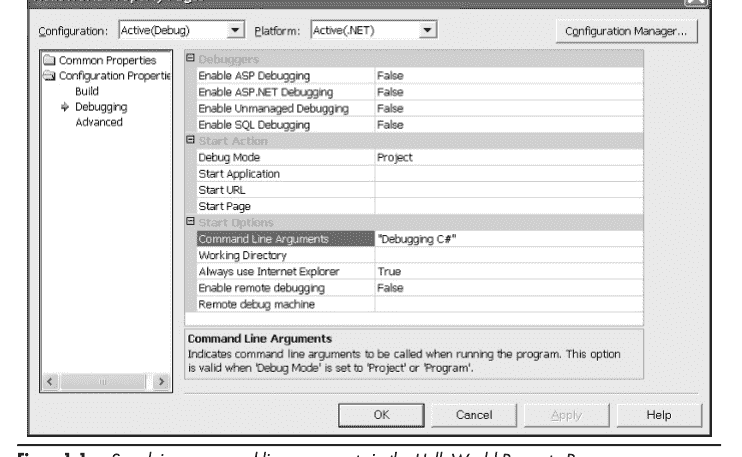

### 实现字段和属性

字段是类中的数据。按照惯例，字段是私有的；如果你需要提供对使用者的访问，鼓励你通过属性方法来实现。属性方法，或称属性，从使用者的角度来看就像数据，但从生产者的角度来看就像方法。

> **注意**
> 使用者是使用类的程序员，生产者是创建类的程序员。同一个程序员可以是同一类的生产者和使用者。

数据的好处当然在于它提供了一种维护对象状态的方式。属性的好处在于它们允许你用代码约束数据的访问方式，就像访问仅限于通过方法一样，但从使用者的角度来看，属性像数据一样被使用。

**定义字段** 字段可以是任何类型的数据。按照惯例，字段使用私有访问修饰符，只允许生产者直接操作字段。使用者必须使用属性方法来操作字段。

> **注意**
> 按照惯例，你应该使用驼峰命名法来命名字段。在驼峰命名法中，第一个单词的第一个字母小写，后续单词的第一个字母大写。不要使用匈牙利命名法。

如果字段是复杂的数据类型，那么你可以在构造函数中（参见“实现方法”部分）或按需创建这些类型的实例。以下清单演示了一个简单的字段类型，它将 *args[0]* 的值存储为字符串类型。

```
using System;
namespace HelloWorld
{
    /// <summary>
    /// Class1 的摘要说明。
    /// </summary>
    class Class1
    {
        private static string arg0 = null;
        /// <summary>
        /// 应用程序的主入口点。
        /// </summary>
        [STAThread]
        static void Main(string[] args)
        {
            arg0 = args[0];
        }
    }
}
```


### 10 高级 C# 编程

```csharp
Console.WriteLine(arg0);
Console.ReadLine();
}
}
}
```

粗体语句定义了一个静态字段。因为我们正在将 `args[0]` 的值赋给私有字段 `arg0`，并且没有 `Class1` 的实例。

`Main` 方法是控制台应用程序的起点。我们只能将其用于此目的，并相应地修改类以在同时使用类实例的情况下执行相同的任务。修改后的代码如下：

```csharp
using System;
namespace HelloWorld
{
    /// <summary>
    /// Class1 的摘要描述。
    /// </summary>
    class Class1
    {
        private string arg0 = null;

        public void WriteCommandLine( string arg )
        {
            Console.WriteLine(arg);
            Console.ReadLine();
        }
        /// <summary>
        /// 应用程序的主入口点。
        /// </summary>
        [STAThread]
        static void Main(string[] args)
        {
            Class1 class1 = new Class1();
            class1.arg0 = args[0];
            class1.WriteCommandLine(class1.arg0);
        }
    }
}
```

在前面的示例中，`Main` 方法仅扮演启动方法的角色，类的实例用于执行工作。`Main` 方法创建一个 `Class1` 的实例。将 `args[0]` 的值赋给私有字段 `arg0`；我们可以这样做，因为 `Main` 也是 `Class1` 的成员。语句

```csharp
class1.WriteCommandLine(class1.arg0)
```

将命令行的内容写入控制台。

### 定义属性

如果你对控制台应用程序、静态成员和创建对象相当熟悉，那么这段代码就非常简单了。让我们稍微深入一点。我们将离开示例，探讨使用属性的机制。*属性*实际上是方法。属性可以有一个获取器和一个设置器。*获取器*是当属性用作右侧值时调用的属性方法。*设置器*在属性用作左侧值时调用。

> **提示**
> 你不必为属性关联一个底层字段。属性的值可以是派生的，而不是存储在字段中。

属性与任何成员一样，可以有访问修饰符，通常属性的访问修饰符是 `public`。一个可读写属性的基本语法如下。

```csharp
访问修饰符 类型 属性名称
{
    get
    {
        return 字段;
    }
    set
    {
        字段 = value;
    }
}
```

*访问修饰符*通常是 `public`，但可以是任何允许的访问修饰符（参见“使用修饰符”一节）。*类型*是属性所代表的字段的类型。*属性名称*是任何有效的名称。通常，属性与其底层字段之间存在关系。一种约定是以下划线前缀命名字段，属性则不带下划线。例如，字段 `myValue` 将与属性 `MyValue` 关联。使用此约定是为了便于将属性与其字段值关联起来。你不想花时间去寻找字段。获取器由属性的 `get{}` 部分定义。这是一个代码块，你可以根据需要在此代码块中放入任意多或任意少的代码。最终，你需要返回代表属性值的值。

设置器由属性的 `set{}` 部分定义。这也是一个代码块，你可以在设置器中放入任意多的代码。不直观的部分是，传递给设置器的值由参数 `value` 表示。该参数是隐式的；你只需知道它存在即可。

### 属性命名约定

微软提供了一些命名指南。为了保持一致性，我们温和地鼓励你采用这些指南，而不是自己发明。不同开发者之间的一致性是拥有指南的原因。项目符号列表反映了微软提出的命名约定。

- 使用描述性名词为属性命名。
- 使用帕斯卡命名法。如前所述，帕斯卡命名法名称中的每个单词首字母大写。例如，`MyProperty` 显示 "My" 中的 `M` 和 "Property" 中的 `P` 是大写的。
- 不要使用匈牙利表示法（令人惊讶吧！）。
- 属性名称与其底层字段名称相同。字段使用驼峰命名法，属性使用帕斯卡命名法。（驼峰命名法将第一个单词的第一个字母小写，后续单词的第一个字母大写。例如，“camelCased” 展示了驼峰命名法。）

### 只读属性

只读属性是那些只有获取器的属性语句。当消费者无法更改属性值时，使用只读属性。假设我们有一个温度类。温度类有两种模式——摄氏和华氏。基于温度模式，我们将返回温度值的两种可能值之一。清单演示了只读温度属性 `Value`。

```csharp
public enum TemperatureMode
{
    fahrenheit, celsius
}

class Temperature
{
    private TemperatureMode mode = TemperatureMode.fahrenheit;
    private double celsius = 0;
    private double fahrenheit = 0;

    public Temperature( double aTemperature, TemperatureMode aMode )
    {
        mode = aMode;
        SetTemperature(aTemperature, aMode);
    }

    private void SetTemperature(double aTemperature, TemperatureMode aMode)
    {
        if (aMode == TemperatureMode.fahrenheit)
        {
            fahrenheit = aTemperature;
            celsius = FahrenheitToCelsius(aTemperature);
        }
        else
        {
            celsius = aTemperature;
            fahrenheit = CelsiusToFahrenheit(aTemperature);
        }
    }

    public static double CelsiusToFahrenheit(double celsius)
    {
        return celsius * (9.0/5) + 32;
    }

    public static double FahrenheitToCelsius(double fahrenheit)
    {
        return (fahrenheit - 32) * 5.0/9;
    }

    public TemperatureMode Mode
    {
        get
        {
            return mode;
        }
        set
        {
            mode = value;
        }
    }

    public double Value
    {
        get
        {
            return mode == TemperatureMode.fahrenheit ?
                fahrenheit : celsius;
        }
    }

    public bool Test()
    {
        return fahrenheit == CelsiusToFahrenheit(celsius)
            && celsius == FahrenheitToCelsius(fahrenheit);
    }
}
```

代码清单定义了一个枚举，用于表示当通过只读属性 `Value` 请求时，温度将以何种模式显示。（`Value` 属性以粗体字体显示。）

在前面的清单中，还有其他几个有趣的亮点。`Value` 属性演示了 C、C++ 和 C# 中的三元运算符 (`?:`)。测试在问号 (`?`) 之前。真值跟在问号 (`?`) 后面，假值跟在冒号 (`:`) 后面。温度属性中的测试是

```csharp
mode == TemperatureMode.fahrenheit
```

真结果将是 `fahrenheit` 字段。假结果将产生 `celsius` 字段值。`Mode` 属性演示了一个可读写属性语句。`CelsiusToFahrenheit` 和 `FahrenheitToCelsius` 被实现为静态方法，因为可以合理地假设这两个方法在没有 `Temperature` 对象的情况下对其他代码元素也有用。

### 只写属性

只写属性语句将只有设置器。只写属性比只读属性更少见，因为通过读取属性比通过写入属性造成危害的可能性更小。

你可能想要使用可写属性的一个实例是在查询密码时。你可能不想让消费者在密码被提供后询问提供了什么密码。据推测，一些恶作剧的程序员可能会窥探包含密码的对象。

Visual Studio .NET 中的帮助文档声明不要使用只写属性。从语义上讲，只写属性是修改对象的方法，而没有读取修改后的值的方法。你可能会设计一个有用的只写属性习语。技术上没有禁止只写属性的规定。

### 索引属性

索引属性用于表示类中包含的项目列表。索引属性支持 `object[index]` 表示法，其中对象对消费者来说看起来像数组。索引属性有特殊的表示法和一些使用指南。

- 每个类使用一个索引属性，使其成为默认索引属性。
- 避免使用非默认索引属性。
- 一般规则是将索引属性命名为 “Item”。


#### 索引器属性

-   > 对于包含元素数组的类，应使用索引器属性。
> 不要使用语义上等效的索引器属性和方法。应选择使用其中之一。

以下代码演示了一个名为 `IndexedProperty` 的类。`IndexedProperty` 包含命令行参数（或任何字符串数组）的缓存副本，并允许使用者索引底层数组中的任何元素。就所有实际目的而言，`IndexedProperty` 类的实例可以像数组一样使用。

```csharp
class IndexedProperty
{
    private string[] args = null;

    public IndexedProperty(string[] args)
    {
        this.args = new string[args.Length];
        args.CopyTo(this.args, 0);
    }

    [System.Runtime.CompilerServices.IndexerName("Command")]
    public string this [int index]
    {
        get
        {
            return args[index];
        }
        set
        {
            args[index] = value;
        }
    }
}
```

索引器属性始于包含 `this[int index]` 的那一行。除了属性方法头之外，get 和 set 访问器的实现方式与其他任何属性相同。在 C# 中，索引器不通过名称引用；它是隐式的，你只需在对象名后添加 `[]` 索引运算符即可。例如，如果我们创建了 `IndexedProperty` 类的一个实例，那么我们就可以索引索引器所代表的字段。

在前面的示例中，索引器代表 *args* 字段。以下代码片段演示了创建 `IndexedProperty` 对象的实例并索引 *args* 字段。

```csharp
IndexedProperty obj = new IndexedProperty(args);
Console.WriteLine( obj[0] );
Console.ReadLine();
```

第一行语句创建了 `IndexedProperty` 类的一个实例，第二行则演示了如何像 `obj` 是数组一样使用索引器。

> **提示**
在 Visual Studio .NET 的代码编辑器中编程时，你可以使用 `this.` 让 Intellisense 显示对象内部成员的列表。

`IndexedProperty` 中还有其他几个值得注意的点。构造函数演示了当字段和参数同名时如何进行区分。注意，在构造函数中，参数 `args` 和字段 `args` 是相同的。（如果发生这种情况，你可能需要重命名字段或参数。）当发生名称冲突时，你可以使用隐式的 `this` 引用来区分你是指对象的字段还是同名的参数。

> **提示**
你可以通过在类视图窗口中右键单击该类，然后从类的上下文菜单中单击“添加 | 添加索引器”来插入索引器属性。完成向导（如图 1-2 所示）以插入索引器。

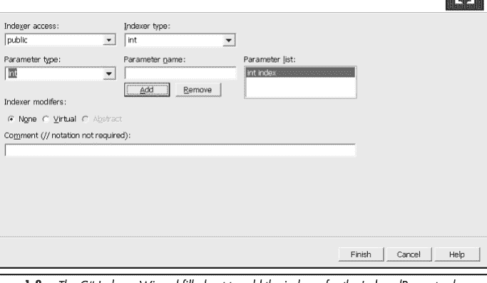

应用于索引器属性的 `IndexerNameAttribute` 用于为不支持索引器的语言提供一个友好名称。

```csharp
[System.Runtime.CompilerServices.IndexerName("Command")]
```

（有关属性的更多信息，请参阅“属性”部分。）

如果我们在 Visual Basic .NET 程序中使用 C# 中定义的 `IndexedProperty` 类，那么我们可以创建该类的实例，并通过名称 `Command` 访问索引器属性。假设我们将实例命名为 `obj`，如前面的示例所示，那么 **obj.Command(0)** 将调用索引器属性并返回 *args* 的第 0 个元素。

### 实现方法

C# 中的方法始终具有相同的方法头选项。以下语法示例演示了在将方法添加到类时可以提供的所有可能信息。

```
[Attribute][Modifiers]Return-Type Name( [parameters] )
```

`[]` 中的所有语法特性都是可选的。在实现方法（或其他成员）时，你不必使用属性；当你理解它们时，你就会知道何时以及为何使用属性。修饰符（如 `public`）描述可访问性。修饰符与信息隐藏有关。所有方法都需要一个返回类型。相当于过程的是返回 `void` 的方法，而函数则返回非 void 的数据类型。方法的 *名称* 应该是动词或动词短语。你可以提供零个或多个参数。参数的签名是 *类型 名称*，如果使用多个参数，则用逗号分隔。项目符号列表阐释了微软建议的方法命名指南。

-   使用以动词开头的动词或短语作为方法名。
-   使用帕斯卡命名法。
-   不要使用匈牙利表示法。（我加入这一点是为了保持一致性。）
-   提供一个描述性名称，说明方法执行的行为（例如，`CalculateBalance`）。

> **注意**
如果现在还不清楚，让我说明一下，微软正在逐步淘汰使用匈牙利表示法。匈牙利表示法最初是为弱类型 C 语言采用的，并传播到 VB 语言。像 C# 这样的强类型语言不需要前缀表示法。编译器会确保你不会不当地混合类型。

本章已经演示了几个方法示例，你将在本书中看到更多。让我们继续下一个主题。

## 构造函数

有两种特殊的方法：构造函数和析构函数。构造函数与类同名。除了构造函数外，没有其他成员可以与类同名——这里“同名”也包括大小写。构造函数可以有零个或多个参数，没有返回类型。（我们将在下一节讨论析构函数。）

构造函数的重载只需通过添加具有不同参数的其他构造函数即可实现。以下项目符号列表提供了构造函数指南的概述。

-   如果一个类的所有成员都是静态的，那么请实现一个私有构造函数以防止创建实例。
-   保持构造函数简短，在构造函数中只执行简单的任务，如将参数赋值给字段。这种方法允许对象非常快速地创建。
-   提供一个受保护的构造函数以供子类使用。
-   作为建议，不要为结构体实现空构造函数。如果你不为结构体提供空参数构造函数，编译器会添加一个默认构造函数，将所有成员初始化为其等效的 null 值。
-   使用构造函数参数来设置属性。使用参数构造类或使用默认构造函数创建对象然后为属性赋值，应该产生相同的结果。
-   在命名参数时保持一致。一种常见的技术是为每个重载构造函数添加递增的参数数量。

### 析构函数

析构函数与构造函数同名，只是名称前附加了补码运算符 (`~`)。

> **注意**
`~` 字符在 C++ 中用作二进制补码运算符。有人聪明地想到将补码运算符用于析构函数，暗示了构造函数和析构函数之间的关系。也就是说，析构函数是构造函数的补码。

当你的类中需要清理的资源时（例如关闭文件），请实现析构函数。在实现构造函数时，请记住构造函数的名称受类名的约束。析构函数不能被重载或继承。析构函数是自动调用的，永远不会直接调用。CLR 垃圾回收器调用析构函数。当调用析构函数时，它会隐式调用 `Object.Finalize` 方法。最后，析构函数没有修饰符或参数。

### 非确定性析构和垃圾回收

C# 使用非确定性析构。CLR 实现了一个垃圾回收器，当对象不再使用时清理内存。这意味着你不必像在 C++ 或 Delphi 中那样过多地担心 C# 中的析构函数。

垃圾回收器将在对象不再需要时调用析构函数。析构函数将调用任何 `Finalize` 方法。你可以通过

调用 `GC.Collect`，但这并非推荐的做法。垃圾回收器会暂停所有正在运行的线程，这可能导致性能问题。此外，垃圾回收器本身就能很好地决定何时运行。

### 实现 Dispose 方法

如果你的类中包含非托管资源，那么可以实现一个 Dispose 方法以支持确定性清理。通过允许使用者调用 Dispose 方法，你可以让使用者自行决定何时释放文件或网络连接等资源。

请使用类似于以下示例的技术来实现 Dispose 方法。

```csharp
private bool disposed = false;
public void Dispose()
{
    if (disposed) return;
    // cleanup code here
    GC.SuppressFinalize(this);
    disposed = true;
}
```

首先，你声明一个私有字段 *disposed*，用于跟踪 Dispose 方法是否已被调用，并将 *disposed* 初始化为 False。在 Dispose 方法中，检查 Dispose 是否已被调用，如果是则直接返回。执行清理操作，然后调用 `GC.SurpressFinalize()` 方法，并将需要抑制其 Finalize 方法的对象引用作为参数传入。最后，将 disposed 字段设置为 True。

大多数情况下，你并不需要实现析构函数或 Dispose 方法。CLR 中的托管对象会被自动垃圾回收。只有当你确定需要时，才实现析构函数和 Dispose 方法。

### 实现事件

事件是 Windows 面向对象体系的顶点，属性和方法则构成了其基础。事件被设计用来响应代码中的事件。与属性和方法一样，事件也可以从两个视角来看待：使用者视角和生产者视角。

当你编写类时，你需要预判哪些内部事件希望让使用者能够响应。对于这些事件，你会希望引入一个事件，并在事件发生时引发该事件。当你使用类时，你会希望编写事件处理程序，将它们与对象的事件关联起来，并编写在事件引发时实际执行响应的代码。（*关联* 事件仅仅是将一个方法与一个事件相关联。）

在 C++ 中我们使用函数指针惯例，在 Delphi 中我们使用过程类型惯例来实现事件和事件处理程序。C# 演进出了本质上为原始函数指针的机制。C# 实现了 *委托* 惯例。委托是存储函数指针的特殊类。原始函数指针和委托之间的区别在于，委托可以维护多个函数指针。包含多个函数指针的委托被称为 *多播委托*。

## 20 高级 C# 编程

从技术上讲，委托语句将过程的签名描述为一种类型。任何签名与委托签名匹配的方法都可以添加到委托对象的调用列表中。描述委托签名与在 C++ 中描述函数指针或在 Delphi 中描述过程类型是一致的。以下三条语句展示了它们的相似性。

```cpp
typedef void (*func)();          // Visual C++ 6.0 函数指针定义
type TProc = procedure;          // Delphi (Object Pascal) 过程类型
delegate void Delegate();        // C# 委托
```

每条语句大致展示了各自语言中的函数指针声明。区别在于，只有 C# 委托（或任何 .NET 语言的委托）可以存储多个地址。C++ 中的函数指针和 Delphi 中的过程类型只能引用一个函数地址。你需要在 C++ 和 Delphi 中创建指针类型的数组来引用多个函数地址。C# 有效地将数组包含在类型中，允许一个委托存储多个地址。这就是最大的区别。

当然，如果你是 VB6 程序员，那么你必须先学习什么是函数指针，然后再学习委托有何不同。对于 C++ 和 Delphi 专业人员，可以把它想象成具有单一签名的函数指针数组。不幸的是，如果你不学习什么是函数指针以及如何使用委托，那么你编写的代码将等同于两条腿的凳子（不稳）。

#### 使用现有委托声明事件

事件声明很直接。在大多数情况下，事件注定由类的使用者使用，因此通常声明为公共成员。接下来是一个语法示例。

```
Access-Modifier event Delegate-Type event-name
```

*Access-Modifier* 通常是 public。*event* 关键字是一个字面量，表明此成员是一个事件。*Delegate-Type* 是一个由方法签名描述的类，并使用关键字 *delegate*。现有委托的一个例子是 *EventHandler* 委托。*Event-name* 是事件的成员名称；这是使用者在代码中引用事件时将使用的名称。以下语句演示了一个使用 *EventHandler* 委托的事件。

```csharp
public event EventHandler Changed;
```

*EventHandler* 的签名是一个返回 void 并具有两个参数 *object* 和 *System.EventArgs* 的过程。*EventHandler* 委托的声明在 CLR 中已存在，如下所示

```csharp
public delegate void EventHandler(object sender, System.EventArgs e);
```

（此委托已经存在；因此，你不必自己定义它。）*EventHandler* 是许多 Windows 窗体控件使用的委托，例如 Button 控件的 *Click* 事件。

#### 声明新的委托类型

如果你想定义自定义委托，可以参照上一节演示 *EventHandler* 委托的基本示例。委托定义与过程头部完全相同，只是在访问修饰符和返回类型之间添加了关键字 delegate。以下示例定义了一个新的委托，它对应一个返回 void 且不带参数的过程。

```csharp
public delegate void Delegate();
```

回顾一下，C# 区分大小写，请注意前面的示例引入了一个名为“Delegate”的委托。任何返回 void 且不带参数的过程都可以分配给声明为 Delegate 类型的事件或字段。

#### 作为生产者引发事件

生产者引发事件。在 C# 中引发事件是通过使用事件名称调用一个过程来执行的。按照惯例，事件由受保护的成员引发，该成员与事件同名，但以“On”作为前缀。回到我们最初定义为 EventHandler 类型的 Changed 事件示例，我们可以将该事件与一个引发事件的受保护方法配对。

```csharp
public event EventHandler Changed;
protected void OnChanged()
{
    if (Changed == null) return;
    Changed(this, System.EventArgs.Empty);
}
```

该事件名为“Changed”。使用者可以将任意数量与 EventHandler 委托签名匹配的方法分配给这一个事件成员。在包含代码的类内部，你可以在希望引发 Changed 事件的任何地方调用 OnChanged。OnChanged 会检查 Changed 是否已被分配给至少一个委托；如果没有，则 OnChanged 返回。否则，生产者将 Changed 视为一个方法来调用，并传递必要的参数。当生产者引发一个带有 sender 参数的事件时，该值总是由对自身的内部引用满足：this。在我们简单的示例中，我们传递一个 null System.EventArgs 参数，因为我们并未使用该值。如果你需要将特定值传递给使用者的事件处理程序，那么你可以创建一个 System.EventArgs 实例，或者创建一个接受 EventArgs 特定子类的委托。

#### 作为使用者处理事件

使用者通过将事件处理程序关联到对象的事件成员来处理事件。示例程序 EventsDemo.ln 包含 EventChanged 和 Form1 两个类。对于我们的场景，我们假设 Form1 包含一个 EventChanged 对象，并希望处理 EventChanged.Changed 事件。为此，Form1 需要创建一个 EventChanged 实例，并将一个方法分配给 EventChanged.Changed。以下示例演示了 Form1 中将事件处理程序关联到 EventChanged.Changed 的代码。

```csharp
private void button1_Click(object sender, System.EventArgs e)
{
    MessageBox.Show(sender.ToString());
}
```


### 创建类的实例

通过使用 new 运算符调用构造函数来实例化对象。你可以创建对象的实例，并将它们赋值给类型与实例化对象相同或属于该对象继承链中的类型的变量。也就是说，子类型的实例可以被赋值给声明为对象父类类型的变量。反之则不行。（更多相关信息请参阅即将介绍的“继承”章节。）

请记住，构造函数与类同名，可以具有公共或非公共访问修饰符，并且可以有零个或多个参数。构造函数可以重载。因此，可能有一个以上的构造函数适合你调用。以下是几个演示对象实例化的示例。

```csharp
// simple object creation
FileStream fs = new FileStream("c:\\temp\\killme.txt", FileMode.CreateNew);
fs.Write(new Byte[] {65, 66, 67, 68, 69}, 0, 5);
fs.Close();

// array examples
string[] strings = new string[10];
strings[0] = "Some Text!";
int[] integers = new int[] {0,1,2,3,4,5};
```

第一条语句创建了一个 `FileStream` 类的实例。（你需要使用 `using` 语句将 `System.IO` 命名空间添加到你的应用程序中才能使用 `FileStream` 类。）`FileStream` 对象有多个构造函数。示例中使用的构造函数接受一个文件路径和一个 `FileMode`。请记住，C# 字符串使用反斜杠（\）作为转义字符；当你需要在字符串中表示反斜杠时，需要使用 `\\` 反斜杠对。第二条语句演示了使用初始化列表内联构造一个字节数组。

第一个数组示例演示了构造一个可以容纳 10 个字符串的字符串数组。C# 中数组的有效索引是从 0 到 *n* – 1，其中 *n* 代表数组中的元素数量。第二个示例使用初始化列表构造了一个整数数组。初始化列表提供了数组的值和大小。`integers` 的大小为 6，有效索引是 0 到 5。在 C# 中，你可以为数组同时指定元素数量和初始化列表，但两者并非必须同时提供。

### 定义接口

接口允许你为类定义一个适配器。在面向对象的世界中，我们有继承、聚合和关联。继承描述了一种新事物是现有事物的泛化的关系。例如，吉普车是汽车的泛化，可以用继承来描述。吉普车有变速器，这体现了聚合关系。吉普车还可能有一个司机，这是关联关系的一个例子。变速器属于吉普车，但司机不属于。

接口描述的关系有时可以用其他方式定义，如继承、聚合或关联，但最好描述为*支持的能力*。例如，汽车中的立体声音响设备可能有旋钮，允许你调谐电台或选择 CD 上的曲目。但是，如果同一套立体声音响设备允许你无需直接触碰设备上的旋钮就能调谐 FM 电台呢？我们可以说，支持调谐功能的立体声音响设备具有一个调谐接口。因此，我们可以附加其他利用该音响接口的控件。也许一个红外设备或方向盘上的控件可以使用该接口来执行与音响设备上物理控件相同的功能。

音响上的旋钮是音响上的一个*物理*控件。音量是一个*属性*。改变音量的能力可以实现为一个方法或属性方法，这两种方式反过来都可以用于支持改变音量的接口。其他设备可以实现相同的接口，我们称之为 Audio 接口。其他不相关的设备也可以支持 Audio 接口：电视、CB 无线电、手机、电话、立体声音响，或飞机上的通信设备。假设我们创建一个通用遥控器，它可以与任何实现了 Audio 接口的设备通信。任何支持该音频接口的设备都可以使用同一个遥控器进行调节——调大或调小音量。现在，你的环绕立体声、大屏幕电视和调谐器都可以由同一个设备控制。

定义接口的基本语法与定义类相似。下一个代码片段通过实现 Audio 接口来演示基本语法。（按照惯例，我们将用 I 前缀命名接口。）

```csharp
public interface IAudio
{
    void AdjustVolume( int value );
}
```

接口定义有一个访问修饰符；在示例中，访问修饰符是 `public`。关键字 `interface` 紧随访问修饰符之后，接口的名称完成了接口头。接口的成员不使用访问修饰符，但每个成员都有一个过程头。每个实现接口的类都必须实现接口定义的所有方法。

### 实现接口

假设你已经定义了一个接口或想要实现一个现有的接口。你需要在类中表明它将实现该接口。以下代码清单演示了一个接口以及一个部分完成的实现了该接口的类。

```csharp
public interface IAudio
{
    void AdjustVolume(int value );
}

public class Radio : IAudio
{
    private int volume = 0;

    void IAudio.AdjustVolume(int value)
    {
        volume += value;
    }
}
```

`Radio` 类在类头中使用继承语法表明它正在实现 `IAudio` 接口。（继承和实现接口的语法是相同的：在类头中添加一个冒号和接口的名称。）当你表明你正在实现一个接口时，你就进入了一个契约，该契约声明你将添加接口定义的方法。实现接口的方法与普通方法之间的一个显著区别是，对于所有接口方法，你必须在过程头中包含接口名称和成员运算符。过程头 `void IAudio.AdjustVolume(int value)` 表明 `AdjustVolume` 的此实现满足 `IAudio` 接口和 `Radio` 类之间的契约。

如果你要实现多个接口，请在类头中添加额外的接口，并用逗号分隔每个额外的接口。

重要的是要记住，当你实现一个接口时，你并没有从该接口获得任何方法或数据。另外，请记住，接口中只能描述方法；不能在接口中描述字段或属性。

### 继承

当你定义一个继承关系时，至少涉及两个类。一个是父类，第二个是子类。（父类和子类之间的关系也称为*超类*和*子类*，其中超类等同于父类，子类等同于子类。）这种父子关系被称为 *IsA*（是一个）关系。例如，我是我父亲（和母亲）的后代，因此我是一个 Kimmel（和 Symons），继承了来自 Kimmel（和 Symons）的 DNA 物质。

当你在 C# 中定义继承关系时，子类会获得父类中定义的所有成员。当你继承时，你会得到父类中定义的所有字段、属性和方法。与染色体遗传不同，面向对象的继承意味着你会得到一切。

我认为你们大多数人理解继承，但我想再引入一个描述，因为继承是一个重要的概念。如果类 B 继承自类 A，那么逻辑上，A 与 B 的交集就是类 A。

继承的表示法与接口继承的表示法相同。要表明类 B 继承自类 A，你可以将类头写为如下形式：

```csharp
public class B : A
```

与接口继承不同，当你从一个类继承时，你不需要实现父类的任何方法，因为它们已经在父类中实现了。

#### 继承术语

与继承关系相关的术语有很多。既然你会在本书中遇到它们，我将在这里简要回顾其中几个。

- 如果类 B 继承自 A，那么 A 是*父类*，B 是*子类*。
- 如果类 B 继承自 A，那么 A 也被称为*超类*，B 被称为*子类*。
- 继承关系满足 *IsA* 测试。在我们的示例中，我们会说 B IsA A（尽管这在语法上很糟糕）。


### 继承的一般准则

在继承方面，你就是老板。根据经验，我提供了一些使用继承关系的准则，但最终你必须根据具体情况做出决定。

如果你定义了一个类，后来决定需要修改它，那么请考虑从原始类继承来添加新的代码。

尽量保持你的继承关系浅而宽。兄弟类与子类的数量之间没有完美的比例，但在成熟的框架中，兄弟类的数量通常多于子类。

研究*重构*。重构是迄今为止发明的最好的方法，用于指导程序员简化现有代码。本质上，重构是一种有组织的提取公共代码的方法。（不幸的是，我们无法在这里详细阐述重构，但本书中的代码示例将使用重构技术来生成。）

不要害怕尝试和改变主意。

探索现有的框架以获得比例感。（值得探索的优秀框架包括 Delphi 的 VCL 和 .Net Framework。）

### 继承示例

你将在本书中找到数十个继承示例，并且可以在 CLR 中找到更多示例。为了彻底起见，我们将继续使用我们的收音机示例来演示继承的基本技术方面。下一个代码清单演示了几个具有相同根类（我们的 Radio 类）的类。

```
public interface IAudio
{
    void AdjustVolume(int value);
}

public class Radio : IAudio
{
    private int volume = 0;

    void IAudio.AdjustVolume(int value)
    {
        volume += value;
    }

    public int Volume
    {
        get
        {
            return volume;
        }
        set
        {
            volume = value;
        }
    }

    private double station = 94.1;

    public double Station
    {
        get
        {
            return station;
        }
        set
        {
            station = value;
        }
    }

    public void Receive()
    {
    }
}

public enum RadioBand
{
    AM, FM
}

public class AMFMRadio : Radio
{
    private RadioBand band = RadioBand.AM;

    public RadioBand Band
    {
        get
        {
            return band;
        }
        set
        {
            band = value;
        }
    }
}

public class CommunicationsRadio : Radio
{
    public void Transmit()
    {
    }
}
```

该代码清单提供了几个继承示例。CommunicationsRadio 和 AMFMRadio 继承自 Radio。AMFMRadio 引入了 AM 和 FM 波段的概念，而 CommunicationsRadio 引入了发射能力以及继承的接收能力。

### 封装与聚合

封装和聚合指的是类包含成员的能力。更具体地说，*聚合*指的是类（和结构）包含其类型也是类（或结构）的成员的能力。

我最喜欢的封装例子是人体和膀胱之间的关系。谢天谢地，膀胱被封装在人体内部。你能想象一个人们可以通过挤压你的膀胱来表达对你的不满的世界吗？“哎呀，那是我的脚！”挤压。

真是一团糟。

显然，膀胱是一个类。它执行功能并拥有状态。我们知道这个功能是什么，而且我们经常在最不恰当的时候感受到它的状态。谢天谢地，膀胱被封装在皮肤和骨骼以及与生俱来的个人空间感之后。

这就是你应该如何看待封装和聚合。封装允许你将数据安全地放在类内部，限制访问并避免尴尬的情况。聚合允许你将复杂类型安全地放在类内部，同样限制访问并避免尴尬的情况。

通过数据元素的语义含义来确定它应该放在哪里，并将该数据放在适当的类中。思考数据放置位置的一个好方法是思考谁应该负责拥有和保护该数据。（别让你的邻居拥有你的膀胱。）将聚合视为将复杂类型——也就是类——添加到新类型中。膀胱是一个复杂类型，而人体有一个成员就是膀胱。

在一个专家医疗系统中，实现一个表示人体和膀胱的类可能是合适的。然而，为了方便起见，我们将扩展我们的收音机示例来演示聚合和封装。该清单演示了一个新的 BoomBox 类，它包含一个 AMFMRadio。AMFMRadio 演示了封装和聚合。

```
public class BoomBox
{
    private AMFMRadio radio;

    public AMFMRadio Radio
    {
        get
        {
            return radio;
        }
    }

    BoomBox()
    {
        radio = new AMFMRadio();
    }
}
```

### 多态

多态已被多种方式描述过。有好几次我看到有人提到它的希腊语词根，意思是“多种形式”，有时描述又长又复杂。我将尝试一些不同的东西。我将使用一个类比，希望它对你有意义。

假设你有一项适合孩子做的家务。我有四个孩子。我们从他们十八个月大时就开始让他们做家务。是的，一个学步儿童在十八个月大时就可以清空垃圾桶。也许有点残忍，但很实用。以下是类比。

你正在看超级碗。现在是第四节，还剩两分钟，你的球队有球但落后8分。他们不仅需要达阵得分，你的球队还需要拿到两分转换。更添紧张的是，你和庄家打赌你的球队赢，赌注是500美元。现在，你的啤酒喝完了。你需要啤酒，但你不能离开比赛，因为等你回来时比赛就结束了。你需要一个孩子去买啤酒，哪个孩子都行。

这就是多态。
当你有一个可以通过一组提供者中的任何一个来解决的普遍问题时，你就需要多态。

如果啤酒和足球的类比对你来说没有意义，别担心；对我来说也没多大意义。让我们尝试一种更技术性的方法（给那些看 TLC 而不是周一夜间橄榄球赛的人）。

记住我说过继承也被称为泛化？嗯，如果你将某些东西声明为通用（或父）类型，并实例化——创建具体类型的实例——那么你在创建具体类型时就有更多选择。EventHandler 委托就是一个很好的例子。EventHandler 委托被定义为接受一个 object 作为第一个参数。object 类是所有类的根。实际上，这意味着任何对象都可以被传递以满足 EventHandler 方法的 sender 参数。这就是多态：声明通用类型，但实际使用具体类型。

### 使用修饰符

修饰符涉及*信息隐藏*。信息隐藏体现了陈词滥调“眼不见，心不烦”。也就是说，作为生产者，如果你能向消费者隐藏某些东西，那么他们就不必担心它。因此，眼不见心不烦。

访问修饰符允许你在编程时将东西置于“心不烦”的状态。在创建类时，只公开那些消费者为了使用类而需要与之交互的东西。通过限制你在公共接口中暴露的内容，你使得消费你的类变得更容易。即使你是你自己创建的类的第一个消费者，这一点也成立。

有几种访问修饰符可供选择。C# 支持 public、protected、internal、protected internal、private，以及字段的 readonly。项目符号列表简要描述了每个访问修饰符的用途。

-   *public* 访问修饰符提供对类型和成员的无限制访问。
-   *protected* 访问修饰符在内部和子类中提供无限制访问，对消费者则提供有限访问。protected 访问修饰符可以应用于嵌套类型。
-   *private* 访问修饰符提供最严格的访问。只有类的生产者可以使用其私有成员。消费者和子类无法访问私有成员。private 访问修饰符可以应用于嵌套类型。
-   *internal* 访问修饰符意味着类型和成员仅在同一程序集内可访问。internal 修饰符用于允许代码在类边界内部协作，而不将这些元素暴露给程序集外部的消费者。
-   *protected internal* 修饰符将对嵌套类型的访问限制在同一程序集内。

当你声明顶级类型时，必须使用 public 或 internal 访问修饰符。只有当类型是嵌套类型时，你才可以对类型使用 private 和 protected 访问。*嵌套类型*是包含类型定义的类型定义。

你不能组合访问修饰符，除了 protected internal 修饰符。你不能在命名空间上使用访问修饰符。如果你没有指定访问修饰符，那么


### 使用类修饰符

当你定义类且外层元素是命名空间时，该类可以被定义为具有公共（public）或内部（internal）访问权限。如果未为顶层类指定修饰符，则该类将具有公共访问权限。

嵌套类可以使用任何访问修饰符定义，但你只能在嵌套类上使用受保护（protected）、受保护内部（protected internal）和私有（private）访问修饰符。

类访问修饰符规则同样适用于任何结构体（struct）和枚举（enum）类型。

### 使用成员修饰符

你也可以在类型的成员上使用任何访问修饰符。如果定义成员时未指定访问修饰符，则成员默认为私有。

### 运算符重载

运算符是执行数据操作的符号。当数据是操作的对象时，它们被称为*操作数*。常见运算符（如加法运算符 `+`）存在于值类型中。值类型的一个例子是整数，比如 5。对整数类型执行 `5 + 4` 这样的操作是直观的。

不幸的是，所有可能存在的类型无法预见；但当新类型出现时，对这些类型执行简单操作也可能很直观。一个例子是字符串连接运算符。当你遇到这样的代码时：

```
string s = "overloaded operators " + "are cool"
```
人们直观地理解该语句正在执行字符串连接。

重载的运算符是方法。具体来说，它们是具有特殊语法的方法。你可以通过将重载的运算符视为两个部分来理解它。第一部分实现一个执行该运算符本应执行的任务的常规命名方法。第二部分使用特殊语法定义运算符方法，并在运算符内部调用命名方法。（当然，你总是可以跳过运算符重载，但那样会很无趣。）

### 编写运算符方法

运算符方法的过程头与常规方法非常相似。指定返回类型和参数类型及名称；但是，不是使用方法名，而是使用关键字 *operator* 和运算符符号，即原本应使用方法名的地方。

借鉴帮助文件中的示例，我们可以实现一个复数类。（复数有实部和虚部。）我们可以实现一个重载的加法运算符，它将两个复数的实部和虚部相加，生成一个新的复数，该复数是两个复数相加的和。

```
public static Complex operator +(Complex c1, Complex c2)
{
    return new Complex(c1.real + c2.real, c1.imaginary + c2.imaginary);
}
```
代码清单提取自一个结构体，该结构体定义了复数，即一个用实数和虚数的标量部分初始化的数。例如，如果你用实参2和虚部3构造一个复数，那么你得到复数 2 + 3i。前面示例中的重载运算符为 Complex 类型定义了 `+` 运算符，它是一个静态类型，接受两个 Complex 对象并返回一个新的 Complex 对象，该对象是两个参数的和。在示例中，你将通过编写一个将两个复数相加的语句来调用此 `operator+` 方法。

```
Complex c = new Complex(4, 3);
Complex d = new Complex(1, 2);
Complex e = c + d;
```
前两条语句创建了两个复数的实例。最后一条语句调用了 `operator+` 方法，将一个新对象返回给变量 `e`。掌握重载运算符的最佳方法是编写一些简单的示例，并在调用运算符的语句和运算符方法中设置断点。你将很快看到该操作导致了一次方法调用。

### 运算符重载准则和限制

定义重载运算符时要谨慎。最需要避免的事情是创建违反直觉的运算符。例如，将加法运算符重载为执行减法。不要这样做。遵循这些重载运算符的基本准则将使你免于麻烦：

-   定义使用 `op_` 前缀后跟运算符名称执行操作的方法，以支持像 Visual Basic .NET 这样不支持运算符重载的语言。
-   通过调用命名方法来实现重载的运算符。（为什么要将运算符行为编码两次？）
-   仅在运算符适用的类中重载运算符。
-   当操作直观且结果合乎逻辑时使用运算符重载。
-   对称地重载运算符。如果你实现了加法，那么也要实现减法。

表 1-1 列出了运算符并指明它们是否可以重载。并非所有运算符都可以重载。

| 运算符 | 可重载性 |
| :--- | :--- |
| `+`, `-`, `!`, `~`, `++`, `--`, `True`, `False` | 可重载的一元运算符。 |
| `+`, `-`, `*`, `/`, `%`, `&`, `\|`, `^`, `<<`, `>>` | 可重载的二元运算符。 |
| `==`, `!=`, `<`, `>`, `<=`, `>=` | 可重载但必须成对重载的比较运算符。（你会得到编译器指示配对运算符是什么，并提醒你需要重载该配对。） |
| `&&`, `\|\|` | 这些条件逻辑运算符无法重载。 |
| `[]` | 数组运算符无法重载，但你可以定义索引器。（有关更多信息，请参阅“索引属性”部分。） |
| `+=`, `-=`, `*=`, `/=`, `%=`, `&=`, `\|=`, `^=`, `<<=`, `>>=` | 赋值运算符无法重载。 |
| `=`, `.`, `?:`, `new`, `is`, `sizeof`, `typeof` | 这些运算符无法重载。 |

表 1-1 运算符的可重载性

重载的运算符允许你定义特殊方法，使代码更易于编写且更直观。你不需要经常编写重载运算符，但作为 CLR 代码的使用者，你会经常使用它们。

### 特性

诸如接口（interface）和特性（attribute）这样的术语和惯用法会让程序员陷入麻烦。原因在于这些术语身兼多职。多年来，“接口”仅仅指类中声明的成员。当 COM 被引入时，“接口”又有了另一层含义；接口变成了一种构造——非常像一个类。（对于 VB 程序员来说，接口和类在很大程度上是模糊的。）

同样的问题存在于“attribute”这个词和 Attribute 惯用法中。在一般意义上，“attribute”与“property”（属性）是同义的。特性是类型的一种属性。.NET 中的 Attribute 本身实际上是一个类。（围绕特性的混淆讨论可能和围绕父与子、超类与子类、对象与类的讨论一样多。）

在 C# 中，大写 A 开头的 `Attribute` 是一个向你的程序集添加元数据的类。添加元数据（或附加数据）是为了帮助根除“DLL 地狱”。历史上，应用程序所需的外部数据存储在注册表或 INI 文件中。特性允许这些辅助数据与程序集一起携带。特性类允许你将元数据添加到你的程序集中，而反射（Reflection）允许你在需要时提取该元数据。这类似于从注册表中读写数据。由于元数据巧妙地折叠到了程序集中，部署 .NET 应用程序比部署基于 COM 的应用程序更简单。

特性的示例可以在 `AssemblyInfo.cs` 模块中找到。一个例子是 `AssemblyTitleAttribute` 类。

```
[assembly: AssemblyTitle("")]
```
通过在 `AssemblyTitleAttribute` 的括号内添加文本，你可以为你的程序集添加一个标题，该标题将显示在属性对话框中。按照惯例，特性类有一个 `Attribute` 后缀，但当使用特性时，该后缀会被省略。`assembly:` 标签表明这是一个程序集级别的特性。

因为特性是作为类实现的，所以你可以泛化现有的 `Attribute` 类来为新的用途创建新的特性。特性用于许多事情，从为组件属性提供提示到请求安全权限。许多新的特性将被创建，但使用特性的节奏与构造对象相似。将特性类的名称紧接在特性所描述的实体之前，并传递特性构造函数定义的参数。构造函数参数被称为*位置参数*。你也可以通过传递命名参数来初始化特性对象中的属性。

### 反射

反射是 .NET 中实现的一种功能，允许你动态发现信息，例如程序集中的命名空间、接口、类、方法、属性和字段。除了提供请求由特性描述的元数据值的方法外，反射还允许你了解程序集中定义的类型和成员，并且反射允许你在运行时发出中间语言（IL）代码。IL 在意图上类似于 Java 字节码。IL 是被编译成机器可读代码之前的代码。

反射是强大的魔力。我们将在本书中详细探讨它。第 2 章演示了如何使用反射发现有关程序集的信息，第 10 章演示了如何创建可以使用反射读取的自定义特性。

### 总结

本章概述了核心语言基础知识，这些知识在你创建的几乎每个应用程序中都会需要。将有 16 章及其附属应用程序在上下文中演示这些概念。虽然本章中的示例很简短，但这些主题是所有 C# 编程的核心，你将在后续章节中找到许多示例。


# 第2章

## 程序集查看器

本章内容：
主要讲解主题
程序集管理器的代码清单
次要讲解主题
摘要


本章演示如何动态加载程序集并使用反射来探索这些程序集。在第二章就学习使用程序集和反射颇具挑战性，但程序集查看器将帮助你掌握这些知识，并学习如何使用Windows Forms命名空间中的控件和GDI+构建Windows应用程序。

### 主要讲解主题

本章的主要主题是使用动态发现功能通过反射探索程序集。如果你能够动态加载和使用程序集，就可以利用HTTP连接加载程序集来实现瘦客户端编程，这支持基于Windows Forms的应用程序的自动部署和更新。此外，还将提供大量关于以下主题的示例：

- 使用值类型
- 使用StringBuilder类
- 定义静态方法
- 定义类和继承
- 定义和实现接口
- 使用IEnumerator接口
- 在Windows Forms中安全地进行多线程编程
- 使用Graphics对象编程
- 使用System.Diagnostics进行调试
- 从资源加载信息（便于国际化）
- 使用PrintDocument进行基本打印

### 程序集管理器的代码清单

本章将详细讨论AssemblyViewer.sln的代码，该代码可在McGraw-Hill/Osborne网站**www.osborne.com**上找到。完整代码长达43页，为避免书籍内容冗余，我们在此仅列出清单2-1中的关键部分。幸运的是，你可以轻松复制列出的类和方法，或者从**www.osborne.com**上的源代码中剪切粘贴。

AssemblyManager.cs模块包含AssemblyManager类。此类演示了如何使用反射加载和探索程序集。

第2章：程序集查看器 37

清单2-1 AssemblyManager.cs 管理程序集的加载和读取。

```csharp
using System;
using System.Reflection;
using System.Diagnostics;
using Diag = System.Diagnostics;
using System.IO;
using System.Collections;
using System.Text;
using System.Windows.Forms;

namespace AssemblyViewer
{
    /// <summary>
    /// Summary description for AssemblyManager.
    /// </summary>
    public class AssemblyManager
    {
        private string name = "";
        private Assembly assembly;

        public AssemblyManager(string assemblyName)
        {
            Debug.Assert(File.Exists(assemblyName));
            Name = assemblyName;
        }

        public Assembly Assembly
        {
            get
            {
                return assembly;
            }
        }

        public string Name
        {
            get
            {
                return name;
            }
            set
            {
                if(name.Equals(value)) return;
                name = value;
                Changed();
            }
        }

        private void Changed()
        {
            Debug.Assert(File.Exists(name));
            assembly = null;
            assembly = Assembly.LoadFrom(name);
        }

        private string Formatted(Type type)
        {
            const string mask = "{0} \r\n";
            string result = string.Format(mask, type.Name);
            Broadcaster.Broadcast(result);
            return result;
        }

        private string Formatted(MemberInfo info)
        {
            const string mask = "\t{0} {1}\r\n";
            string result = string.Format( mask,
                info.MemberType.ToString(), info.Name );
            Broadcaster.Broadcast(result);
            return result;
        }

        private string Load()
        {
            StringBuilder str = new StringBuilder();
            IEnumerator outer = assembly.GetTypes().GetEnumerator();

            while(outer.MoveNext())
            {
                Type type = (Type)outer.Current;
                str.Append(Formatted(type));

                IEnumerator inner = type.GetMembers().GetEnumerator();

                while(inner.MoveNext())
                {
                    str.Append(Formatted((MemberInfo)inner.Current));
                    Application.DoEvents();
                }
            }

            return str.ToString();
        }

        public string Text
        {
            get
            {
                return GetText();
            }
        }

        public string GetText()
        {
            return Load();
        }
    }
}
```

### using语句

你会在两个地方看到*using*关键字。*using*语句用于导入命名空间，也可作为管理对象的代码块语句。

清单2-1展示了如何使用命名空间。可以将*using*语句理解为向DLL添加引用。框架中的程序集实际上包含在DLL文件中；因此

```csharp
using System.Reflection;
```

引用的是一个以system开头的DLL。

程序集可以包含多个命名空间。例如，System.Reflection包含在System.dll程序集中。而System.Windows.Forms实际上是包含Windows Forms控件的程序集的名称。你可以通过导航到C:\WINNT\Microsoft.NET\Framework\v1.0.3705\来探索.NET框架中的程序集。

### 使用using指令创建别名

你可以使用*using*指令为命名空间创建别名。将

```csharp
using System.Diagnostics;
```

改为

```csharp
using Diag = System.Diagnostics;
```

就为System.Diagnostics命名空间创建了一个别名Diag。在任何使用完整限定System.Diagnostics命名空间的地方，你都可以用别名Diag替换它。

### 定义using作用域

*using*的第二种用法类似于VB.NET中的with语句。当你在代码中对一个对象使用*using*语句时，你定义了一个作用域，该作用域将在*using*块结束时自动释放对象。只要*using*块中创建的对象实现了IDisposable接口，即使在*using*块结束前抛出异常，对象也会被释放。

IDisposable是一个包含单一方法Dispose的接口。如果你需要确定性的清理操作，就实现IDisposable。例如，当你打开一个文件时，希望在完成后尽快关闭它。以下代码片段演示了如何使用*using*块来定义一个在块结束时释放对象的代码块。

```csharp
using (FormAbout form = new FormAbout())
{
    form.ShowDialog();
}
```

*using*语句声明并创建对象的实例。在*using*语句中引用的实例名称在块中使用，当块退出时，会调用表单的Dispose方法。（要验证这一点，可以重载继承的Dispose方法并在其中设置断点。如果你不确定如何重载方法，请参考本章后面“定义接口”部分。）

### 定义你的命名空间名称

几年前，类是最高的抽象层次。命名空间提供了一种以更高层次关系组织类并创建唯一名称的方式。命名空间是组织管理的工具。

> **注意**
> ProgIds用于与命名空间类似的目的。然而，ProgIds限制为39个字符，且不能保证唯一性。ProgIds（可以包含除句点外的标点）仍然支持用于COM互操作。

当你创建一个应用程序时，你给出的名称将被用作默认命名空间名称。你添加到该项目中的每个模块都将被赋予与项目定义相同的命名空间。如果你向解决方案添加一个新项目，新项目将获得与项目名称相同的命名空间名称。

命名空间是公共的，你不能为命名空间添加访问修饰符。你可以在命名空间内部声明类、接口、结构体、枚举、委托和其他命名空间类型。清单2-1的第11行表明AssemblyManager定义在AssemblyViewer命名空间中。如果你不指定命名空间，则使用默认命名空间。你可以在AssemblyViewer项目的通用属性页中修改默认命名空间（参见图2-1）。

### 定义类

清单2-1的第15行包含AssemblyManager类的类头。AssemblyManager被定义为公共类，是清单中唯一的类。通常情况下，你定义的类将具有公共访问权限。第108行定义了AssemblyManager的结束块。（关于类的一般信息，请参阅第1章。）

```csharp
15:     public class AssemblyManager
108: }
```

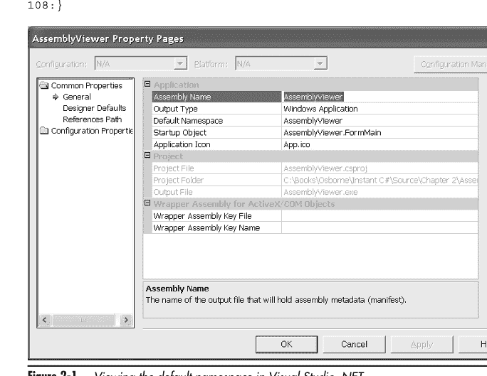


#### 实现构造函数

构造函数是类中唯一与类同名且大小写一致的成员。构造函数使用访问修饰符，可以接受参数来初始化实例，但不定义返回类型。通常情况下，应保持构造函数简短且直奔主题。

清单 2-1 的第 19 到 23 行实现了 `AssemblyManager` 的构造函数。第 21 行确保程序集文件存在，第 22 行将 `assemblyName` 参数赋值给 `Name` 属性。接下来的小节将讨论两种策略，可以像我们在 `AssemblyManager` 构造函数中所做的那样，使你的构造函数行为可靠。

##### 使用 Assert 保护代码

第 21 行调用了静态方法 `File.Exists`，返回一个布尔值，表示 `assemblyName` 所代表的文件是否存在。静态方法 `Debug.Assert` 定义在 `System.Diagnostics` 命名空间中。`Assert` 是一个开发工具，你可以用作哨兵（sentinel）。在使用条件编译常量 `DEBUG` 时，`Assert` 方法会被启用。这意味着你可以保留调试代码，并使用条件编译来切换调试代码。

当 `Assert` 方法中评估的条件失败时，调用堆栈将显示在对话框中，使你可以选择继续运行应用程序或中止。`Assert` 方法的目的是为开发人员提供一个早期警告，表明关于系统状态的某个假设失败了。（编写一个简单的程序调用 `System.Diagnostics.Debug.Assert(false)` 即可看到调用堆栈跟踪对话框。）

##### 初始化对象属性

构造函数的目的是初始化对象的状态。清单 2-1 第 19 到 23 行的构造函数初始化了 `AssemblyManager`。第 22 行所做的不仅仅是表面看起来那样。如果你仔细观察，会注意到 `Name` 是 `AssemblyManager` 类的一个属性。如果遵循约定，我们知道大写的属性是一个属性。

`Name = assemblyName` 调用了第 33 到 44 行定义的 `Name` 属性的设置器（setter）。如果你查看设置器方法，会看到如果底层字段等于 *value* 参数，则我们退出设置器。参数 *value* 是隐式的；你只需要知道 *value* 是传递给设置器的参数名称，并且具有该属性的数据类型。因为设置器不仅仅是更改字段值，所以我们使用 `if` 条件作为哨兵来防止不必要的工作。

如果 *value* 不同——即 *value* 代表不同的程序集——那么我们调用 `Changed` 方法。我们不在设置器中实际执行工作，而是使用一个方法。当提供新的程序集名称时，`Changed` 方法会加载该程序集。

`Changed` 方法定义在清单 2-1 的第 47 到 52 行。我们再次检查程序集是否存在。我们可能在创建 `AssemblyManager` 后更改名称。（如果我们选择，可以去掉构造函数中的原始检查。）旧的程序集被赋值为 `null`，并使用新名称加载程序集。`Assembly.LoadFrom` 是一个静态方法，返回一个已初始化的程序集实例。

### 使用反射遍历程序集

`AssemblyManager` 类的核心工作是 `Load` 函数。`Load` 使用枚举器来遍历程序集中定义的所有类型，并对每个类型使用一个枚举器来遍历该类型的成员。使用嵌套循环，我们获取所有类型及其所有成员。这些信息被格式化并作为字符串返回，这允许我们为该类创建一个简化的接口（参见清单 2-1 中的 `Text` 属性和 `GetText` 方法）。

`Load` 定义在清单 2-1 的第 69 到 90 行。第 70 行实例化了一个 `StringBuilder` 对象。（`StringBuilder` 定义在 `System.Text` 命名空间中。）`StringBuilder` 用于方便地将大量格式化字符串信息添加到单个字符串缓冲区中。你可以使用 `string` 值类型，但一些简单的比较测试表明，对于许多字符串操作，`StringBuffer` 运行更快。

`StringBuilder` 对于许多字符串连接操作比 `String` 更快的原因在于 `StringBuilder` 是可变的，而 `String` 是不可变的。也就是说，`StringBuilder` 是为连接而设计的，但当你连接一个字符串时，每次操作都会创建一个新的字符串对象。因此，以下代码

```
string str += "Hello, World!";
```

执行一个 `String.Concat`（静态）操作，返回一个新的字符串实例，而 `StringBuilder` 只是将额外的字符串信息打包到 `StringBuilder` 缓冲区中。不会创建新的 `StringBuilder` 对象。

### 什么是反射？

反射是 .NET 发现类的运行时类型信息的能力。然而，其意义远不止于此。通过反射，你可以发现程序集中定义的类型和成员的所有信息，以及动态加载和运行这些程序集。最重要的是，你可以使用 `System.Reflection.Emit` 命名空间发出中间语言（IL）在运行时构建类型。

反射是一种其灵活性和强大功能尚未被 IT 社区完全吸收的能力。当其被完全理解时，很可能会有许多基于此技术构建的工具。目前，我们将反射的定义留到前一段和第 1 章的描述中。反射也将在第 5 章和第 10 章中讨论。

### 使用反射

当你拥有一个程序集对象的实例时，通过向程序集请求包含其定义成员的集合来使用反射。当你拥有一个类型的实例时，通过向类型请求表示方法、字段、事件、属性、构造函数和参数信息的集合。这些类型中的每一个——比如 `FieldInfo`——描述了所引用的类型的元素。

### 高级 C# 编程

有两种直接的方法来获取程序集对象的实例。第一种是调用 `Assembly.LoadFrom`，传递程序集的名称；第二种是调用静态方法 `Reflection.Assembly.GetCallingAssembly`。第一种方法的示例可以在清单 2-1 的 `Changed` 方法中找到，而第二种方法返回包含调用 `GetCallingAssembly` 的程序集。

在获得要探索的程序集的引用后，你需要调用包含所需信息的方法。例如，如果我想获取一个程序集定义的所有类型，那么我声明一个 `Type` 数组并调用 `assembly.GetTypes()`，其中 `assembly` 指向任何程序集的实例。`AssemblyViewer` 应用程序使用一个枚举器来遍历这些类型。

#### 什么是枚举器？

理解枚举器是什么以及为什么可能使用它们是很重要的。当你编写遍历集合、列表或数组中数据的代码时，通常可能使用 `for` 或 `while` 循环。然而，`for` 或 `while` 结构都不是对象；它们是语句。语句不能作为参数传递给方法，而枚举器，作为对象，可以作为参数传递给方法。啊！

为可迭代事物（如字符串中的字符、`DataSet` 中的行或数组中的成员）实现枚举器，为你提供了一种单一的通用迭代方式。使用枚举器还意味着你可以将枚举器传递给方法。你可能会问，什么时候想将枚举器传递给方法？一个非常有洞察力的问题，小家伙。当你编写一个无论数据类型如何都相同的算法时。

无论数据类型如何都相同的算法示例，比如排序算法。如果我传递一个允许我遍历数据的枚举器，而不是特定类型的数组，那么我只需编写一次算法并传递枚举器的各种实例。使用枚举器不仅对排序算法有用。当方法的实现与数据无关时，你可以并且应该定义任何方法来接受枚举器。

.NET 框架定义了 `IEnumerator` 接口。任何支持枚举其元素的类都可以实现 `IEnumerator` 接口。`IEnumerator` 要求使用者实现 `MoveNext`、`Reset` 和 `Current`。`MoveNext` 可以用作循环控制方法，返回一个布尔值，而 `Current` 属性返回当前引用的对象。`Reset` 将内部引用索引移动到第一个元素。

#### 使用枚举器遍历程序集信息

实现 `IEnumerator` 接口的类型通常有一个 `GetEnumerator` 方法。例如，`Assembly.GetTypes` 返回一个 `Type` 数组。`System.Array` 实现了 `IEnumerator`，而 `System.Array.GetEnumerator` 返回一个 `IEnumerator`。

要枚举程序集中的每个类型，你需要编写类似以下的代码：

```
IEnumerator enumerator = assembly.GetEnumerator();
While (enumerator.MoveNext())
{
    // do something with enumerator.Current;
}
```


清单2-1中的Load方法演示了如何通过Type.GetMembers返回Types和MemberInfo数组的枚举器。

GetMembers返回一个MemberInfo数组。MemberInfo数组中的元素包括属性、字段、方法和事件。如果你想获取仅包含方法的数组，则可以调用Type.GetMethods。对于其他成员类型，情况也类似。

### 执行通过反射发现的代码

反射提供的功能不仅仅局限于发现程序集的内容。实际上，你可以调用程序集中定义并通过反射发现的类型和成员。下面的清单是一个动态加载程序集并通过反射调用静态方法的示例。

```csharp
const string s = 
    "c:\\winnt\\Microsoft.NET\\Framework" +
    "\\v1.0.3705\\System.Windows.Forms.dll";
Assembly assembly = Assembly.LoadFrom(s);
Type type = assembly.GetType(
    "System.Windows.Forms.MessageBox", true);
type.InvokeMember("Show", BindingFlags.Public |
    BindingFlags.InvokeMethod |
    BindingFlags.Static, null, null,
    new object[] {"Invoked by Reflection"});
```

第一条语句定义了指向框架定义的System.Windows.Forms.dll程序集的常量路径。第二条语句使用Assembly.LoadFrom方法加载程序集——清单2-1提供了另一个示例。第三条语句检索MessageBox类的元类型，最后一条语句调用MessageBox类中的一个成员。第一个参数是要引用的成员的名称。第三个成员*Ors*（或运算）三个枚举值，表明Show是一个我们希望调用的Public（公共）Static（静态）方法。第一个null参数可以替换为描述如何绑定方法的子类，第二个null参数是要在其上调用方法的类型实例。例如，如果Show是非静态方法，那么我们需要创建一个MessageBox类的实例并将其传递给这个参数值。最后一个参数是要传递给被调用方法的参数数组。

### 广播操作

清单2-1包含一个Broadcaster.Broadcast语句。这是我推导出的一种技术，用于将内部信息发送到单一位置，允许希望了解情况的监听器调谐到广播器。例如，我们可以将主窗体指定为监听器，并在主窗体上显示操作状态。AssemblyViewer正是这样做的；主窗体有一个状态栏，用于在加载操作期间显示AssemblyManager的进度。

> 注意

现有的工具可以使用调试和跟踪监听器写入事件日志。但是，当应用程序中未定义条件编译指令DEBUG和TRACE时，这些工具不会随应用程序一起发布。通常，你不会发布包含这些常量定义的应用程序。（你可以在已发布的应用程序中将关键信息写入EventLog；只是不会使用跟踪监听器来做到这一点。请使用EventLog类进行部署后的事件日志记录。）

清单2-2展示了Broadcaster类和IListener接口。

```
清单2-2  Broadcaster类和IListener接口的实现。

1:  using System;
2:  using System.Collections;
3:  
4:  namespace AssemblyViewer
5:  {
6:      /// <summary>
7:      /// Broadcaster的摘要描述。
8:      /// </summary>
9:      public class Broadcaster
10:     {
11:         private static Broadcaster instance = null;
12:         private ArrayList listeners = null;
13:         protected Broadcaster()
14:         {
15:             listeners = new ArrayList();
16:         }
17:         
18:         static private Broadcaster Instance
19:         {
20:             get
21:             {
22:                 if( instance == null )
23:                     instance = new Broadcaster();
24:                 return instance;
25:             }
26:         }
27:         
28:         public static void Add(IListener listener)
29:         {
30:             Instance.listeners.Add(listener);
31:         }
32:         
33:         public static void Remove(IListener listener)
34:         {
35:             Instance.listeners.Remove(listener);
36:         }
37:         
38:         public static void Broadcast(string message)
39:         {
40:             foreach( IListener listener in Instance.listeners )
41:             {
42:                 listener.Receive(message);
43:             }
44:         }
45:     }
46: }
```

清单2-2中所示的Broadcaster类和IListener接口用于集中处理对象与图形用户界面之间的信息共享。根据Broadcaster的实现，任何实现了IListener接口并向Broadcaster注册的类都能够接收发送给Broadcaster的字符串数据。该类和接口展示了一些突出的技术，我们将逐一探讨。

### 实现Broadcaster

Broadcaster演示了单例模式。*单例*（Singleton）是一种你希望确保只有一个实例的类。通常，该模式用于反映单一资源的存在，例如单个打印机。单例类通过将构造函数设为protected或private，并仅通过静态成员提供访问来创建。Broadcaster通过其内部的、私有的Instance属性来实现这一点。

Broadcaster中的每个公共方法都是静态的。当你调用Broadcaster（或任何单例）中的公共成员时，该方法引用只读的Instance属性。Instance检查Broadcaster的单一实例是否已创建。如果单例不存在，则创建一个实例并分配给私有字段*instance*。然后返回该单例对象。结果就是Broadcaster包含一个指向其自身实例的引用。

如果你将IListener添加到监听器的ArrayList中，那么每次调用静态方法Broadcast时，所有正在监听的监听器都会接收到字符串内容。这种策略可用于显示内部状态信息、写入日志文件、跟踪已部署的应用程序，或执行这些任务的某种组合。（建议你将Debug和Trace监听器与Broadcaster模式结合使用。）另外，请注意使用IEnumerator来遍历监听器的ArrayList。

### 定义接口

IListener接口定义了两个方法：Listening和Listen。Listening是一个返回布尔值的函数，表示实现IListener接口的对象是否希望接收消息。这允许对象形象地“塞住耳朵”，而无需从Broadcaster注销。Listen方法是在监听时将接收字符串内容的方法。

你可以通过实现IListener接口来使用Broadcaster。FormMain类实现了IListener，以在状态栏中显示广播的消息。在主窗体的示例中，你可以在窗体的Load事件中将窗体添加到监听器列表中。另一个将控件添加到监听器列表的好地方是类的构造函数中。考虑实现IDisposable和Dispose方法，以便在对象被释放时将其从Broadcaster的监听器列表中移除。

以下代码片段演示了你可能在实现了IListener接口并从Broadcaster接收消息的类中遇到的部分。

```csharp
public class FormMain : System.Windows.Forms.Form, IListener
{

    private void FormMain_Load(object sender, System.EventArgs e)
    {
        Broadcaster.Add(this);
    }

    protected override void Dispose( bool disposing )
    {
        if( disposing )
        {
            if(components != null)
            {
                components.Dispose();
            }
        }
        Broadcaster.Remove(this);
        base.Dispose( disposing );
    }

    void IListener.Listen(string message)
    {
        ChangeStatus(message.Trim());
    }
}
```


`bool IListener.Listening()`
{
    return true;
}

在示例中，我们已经在 .NET Visual Studio 中将表单添加到项目时提供的受保护 `Dispose` 方法中插入了代码，用于从 Broadcaster 的侦听器列表中移除该表单。

### 次要主题

`AssemblyManager` 包含加载和遍历程序集中类型及成员的代码。`AssemblyManager` 类中有很多附加代码，正如任何应用程序中都会存在的那样，这些代码也已被描述。现在我们将进入本章的次要主题。

在本节中，让我们看看在基于 Windows Forms 的应用程序中通常会发现哪些内容。

### 值类型与引用类型

无论你使用字符串类型还是 `StringBuilder` 类，你都在使用对象。在 .NET 中，包括那些看起来像原生类型在内的一切都是类，并且每个类都有相同的根：`Object`。

为了轻松证明像字符串类型这样的类型在 .NET 中是类，你可以声明一个字符串变量，并开始使用该字符串变量和 `.` 运算符编写一行代码。智能感知将显示你可以调用的字符串类型成员列表（参见图 2-2）。只有类型才能拥有成员；因此，成员列表清楚地表明那些看起来像原生类型的东西实际上是聚合类型。

看起来像原生类型（如 `int` 和 `string`）的类型与显然是类的类型（如 `StringBuilder` 和 `AssemblyManager`）之间存在差异。你像使用原生类型一样使用的类型是从 `ValueType` 类派生的。不是值类型的类称为*引用类型*。

值类型和引用类型之间有一些显著差异。像 `string` 和 `int` 这样继承自 `ValueType` 的类型在栈上分配，而引用类型在堆上分配。在栈上分配值类型比在堆上创建它们更快。值类型不进行垃圾回收，减少了垃圾收集器的工作量。当你需要调用值类型的成员时，会在后台创建一个堆分配的对象，并将值类型的内部值复制到该堆分配的对象。当你完成对值类型的成员调用后，堆分配对象中的值会被复制回值类型，并且堆分配的对象被销毁。这些内部的复制和复制回来的操作分别称为*装箱*和*拆箱*。

## 50 高级 C# 编程

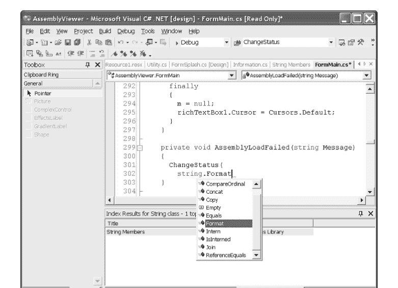

> **注意**

> *可以将栈内存视为分配给方法的内存，而将堆内存视为全局内存池。栈内存实际上是由 CPU 的栈寄存器引用的一块内存，堆内存则由 CPU 的数据寄存器引用。*

`BoxingDemo.sln` 是一个控制台应用程序，用于演示发生装箱的场景。如果你查看中间语言（IL）代码，很容易找出何时发生了装箱。会调用一个名为 "box" 的 IL 指令。你可以在图 2-3 中看到下面列出的控制台应用程序的 IL 代码。

```csharp
using System;
namespace BoxingDemo
{
    /// <summary>
    /// Summary description for Class1.
    /// </summary>
    class Class1
    {
        /// <summary>
        /// The main entry point for the application.
        /// </summary>
        [STAThread]
        static void Main(string[] args)
        {
            int I = 5;
            string s = I.GetType().Name;
            Console.WriteLine(s);
        }
    }
}
```

像 `int` 类型这样的 `ValueType` 对象不会随身携带其类型信息。这是它们相对于引用类型而言轻量级的原因之一。当调用 `I.GetType` 方法时，会发生装箱，类型信息即可按需提供。注意不需要特殊代码；装箱作为 CLR 的功能在后台自动发生。

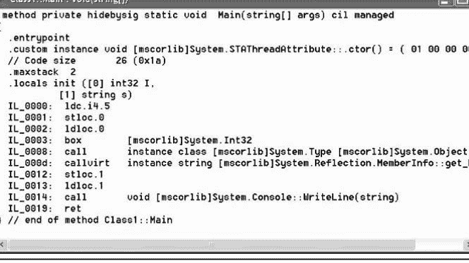

**图 2-3** BoxingDemo.exe 的中间语言代码。

### Windows Forms 控件

AssemblyViewer 演示了几个 Windows Forms 控件。（需要注意的是，由于 `AssemblyManager` 的存在，我们可以在其周围包装另一个表示层，并创建控制台应用程序或 Web 应用程序。）

主窗体演示了 Form、StatusBar、MainMenu、OpenFileDialog 和 RichTextBox 控件。接下来我们将看看 FormMain 模块。

FormMain.cs 包含 400 行代码。为防止章节过于臃肿，我们将引用代码清单的摘录，而不是在此提供完整的 FormMain.cs 清单。

**使用 Form 控件**

当向项目添加窗体时，默认命名空间会包裹定义该窗体的类。包含窗体定义的文件中，类标题位于命名空间之后。Windows Form 的类标题将演示继承的语法，因为你创建的每个窗体都将继承自 `System.Windows.Forms.Form`。类标题如下所示。

```csharp
public class FormMain : System.Windows.Forms.Form, IListener
```

该语句理解为 FormMain 继承自 `System.Windows.Forms.Form`，并且由于 `IListener` 是接口，它还实现了 IListener 接口。

当你处理窗体时，你已经拥有了从基 `Form` 类继承的所有成员，而 Visual Studio .NET IDE 为窗体提供了两个视图。一个是*代码设计器视图*，用于编写和编辑代码；另一个是*窗体设计器视图*，用于直观地设计图形用户界面。这种图形设计器和代码视图的双重组合，使得 C# 和 Visual Studio .NET 成为快速应用程序开发环境。

**向窗体添加控件** 你可以通过从工具箱拖放控件到窗体设计器视图来向窗体添加控件。将控件拖放到窗体上称为“绘制界面”。或者，你也可以通过编程方式添加控件，即声明对控件的引用并创建一个实例。

当你在窗体上绘制一个控件时，会向窗体的类添加一个字段。构造函数会调用 `InitializeComponent` 方法。`InitializeComponent` 会创建控件的实例。所有这些代码都是由窗体设计器为你添加的，对于演示动态添加控件所需的步骤非常有用。（我们将在本书后面部分重新讨论动态控件创建。）

所有这些的 RAD（快速应用程序开发）部分在于，窗体设计器是基于你与 IDE 的交互来生成代码的。

**代码大纲** 当你打开一个窗体时，可能很难找到 `InitializeComponent` 方法，即使这个方法通常相当长。寻找包含文本“Windows Form Designer Generated Code”的框。IDE 使用代码大纲来允许你折叠和展开代码区域。由于窗体设计器代码由设计器管理，此代码块默认被折叠。

窗体设计器代码的折叠状态表明你应该不要动这些代码。当然，你可以展开代码并检查控件是如何创建和管理的。

**Region 指令** 代码大纲引入了新的 region 指令。region 指令允许你手动创建逻辑代码块，这些块可以被展开和折叠以方便代码整理。region 指令使用 pragma 操作符 `#`，是一个块语句。

```csharp
#region some text
#endregion
```

在 `#region` 和 `#endregion` 之间的代码可以被折叠和展开，以组织你的代码。例如，你可以将所有私有方法放在一个 region 指令内，并折叠包含私有成员的代码行。`some text` 的值是一个表明 region 内容的语句，当 region 折叠时为读者提供提示。

使用代码视图中的 + 和 – 符号，或“编辑 | 大纲”菜单项来展开和折叠代码区域。

**在窗体中实现事件处理程序** 为 Windows Form 实现事件处理程序的最简单方法是在窗体设计器视图中选择感兴趣的控件。按 F4 以聚焦属性窗口，然后单击属性窗口中的闪电按钮。单击闪电按钮可切换属性窗口视图，使其显示所选对象的事件。要选择另一个对象，可单击窗体设计器上的控件，或从属性窗口顶部的对象列表中选择其他控件。

要让窗体设计器为你生成事件处理程序，请双击你想为其生成代码的事件名称旁边的可编辑区域。

当你双击属性窗口的可编辑部分时，会为你生成具有正确签名的事件处理程序。此外，将事件连接到委托属性的代码会插入到窗体代码的设计器管理区域中，即 `InitializeComponent` 方法中。

FormMain 实现了 Load 事件。Load 事件的代码——包括连接代码和事件处理程序——如下所示。

```csharp
private void InitializeComponent()
{
    // an excerpt from InitializeComponent
    this.Load += new System.EventHandler(this.FormMain_Load);
}
private void FormMain_Load(object sender, System.EventArgs e)
{
    Initialize();
}
```


### 使用状态栏

StatusBar控件用于显示应用程序的状态，通常位于窗体的底部。在AssemblyViewer应用程序中，我们将StatusBar作为广播消息的显示控件。（请记住，FormMain实现了IListener接口。）

```
private void Initialize()
{
    openFileDialog1.InitialDirectory = GetInitialDirectory();
    Broadcaster.Add(this);
}
private void ChangeStatus(string status)
{
    statusBar1.Text = status;
    statusBar1.Refresh();
}
void IListener.Listen(string message)
{
    ChangeStatus(message.Trim());
}
```

在AssemblyViewer中，我们将MainForm注册为Broadcaster的监听器，如Initialize方法所示。`IListener.Listen`方法实现了IListener接口的Listen方法。当Broadcaster为已注册的监听器调用Listen时，FormMain通过调用`ChangeStatus`方法在状态栏上显示信息。

当然，你也可以将主窗体直接连接到AssemblyManager，但我更倾向于让类不直接与GUI耦合。通过不在AssemblyManager中引用FormMain，使得在新上下文（如控制台应用程序）中更容易使用AssemblyManager。你也可以使用事件达到类似效果。这两种技术都阐释了**松耦合**的概念。

### 使用MainMenu

菜单由MainMenu和MenuItem对象组成。当你将主菜单绘制到窗体上时，MainMenu控件会被添加到组件托盘中（位于灰色窗体画布下方）。主菜单的呈现则绘制在窗体本身上。

当你想向主菜单添加MenuItem对象时，可以通过直接在希望菜单项显示的位置输入菜单项名称来实现。可用的MenuItem位置由带有“在此输入”文本的虚线轮廓标示。当你输入菜单标题时，窗体设计器会生成连接该菜单所需的字段和代码。

菜单项最常见的事件是Click事件。要生成Click事件处理程序，可以双击菜单项，或使用前面描述的属性窗口方法。

请记住，MainMenu和MenuItem对象都是控件。它们会接收焦点，并与其他任何控件一样进行交互。

### 使用OpenFileDialog

OpenFileDialog控件显示类似Windows资源管理器的对话框，允许用户根据程序员描述的文件掩码选择文件。OpenFileDialog支持程序员可配置的`InitialDirectory`和`Title`。以下取自FormMain模块的方法演示了如何显示对话框并获取选定的`FileName`。

```
public void OpenAssembly()
{
    if( openFileDialog1.ShowDialog() == DialogResult.OK)
        OpenAssembly(openFileDialog1.FileName);
}
```

对`OpenAssembly`的调用会将选定的程序集加载到AssemblyViewer中。

如果你想指定一个适合选择程序集的筛选器掩码，那么你可以使用属性窗口或使用以下语句来指定该掩码：

```
openFileDialog1.Filter = "Class Library(*.dll)|*.dll|Executables (*.exe)|*.exe";
```

筛选器掩码以成对的方式指定。前半部分是从“文件类型”组合框中可选择的显示掩码，后半部分是实际的掩码。例如，“Class Library (*.dll)|*.dll”将在“文件类型”组合框中显示“Class Library (*.dll)”，并且当你选择此筛选器时，对话框中将只显示匹配`*.dll`的文件。

### 使用RichTextBox

富文本是一种标记语言。称为富文本格式，或RTF，富文本支持描述文本格式的嵌入式标签。RichTextBox类似于TextBox，但支持嵌入式RTF格式。RichTextBox的主要目的是显示格式化文本，但它也可以显示纯文本，并具有内置功能，支持将文本属性的内容加载和保存到文件。

**向RichTextBox中放置文本** 文本可以是纯文本或富文本。要以编程方式将字符串数据分配给RichTextBox控件，请将字符串变量赋值给Text属性。

```
richTextBox1.Text = "C# Developer's Guide";
```

**加载文本文件** 通过调用`LoadFile`方法从外部文本文件加载文本。`LoadFile`有三种形式，最简单的一种是指定包含RTF格式文件的文件名：

```
richTextBox1.LoadFile("file.rtf");
```

RichTextBox的第二种形式具有`RichTextBoxStreamType`枚举，允许你表示文件包含的格式类型。例如，要加载纯文本，你可以重写`LoadFile`语句：

```
richTextBox1.LoadFile("file.rtf", RichTextBoxStreamType.PlainText );
```

`RichTextBoxStreamType`是在`System.Windows.Forms`命名空间中定义的枚举。你需要使用完全限定名称，或确保有一个引用`System.Windows.Forms`命名空间的`using`语句。

**保存文本文件** `RichTextBox.SaveFile`执行与`LoadFile`对称的操作。通过调用`SaveFile`并传递文件名，`SaveFile`将RichTextBox控件的内容写入RTF或TXT文件。

**使用ZoomFactor** `RichTextBox.ZoomFactor`是一个有趣的属性。通过`ZoomFactor`，你可以表示文本大小增加的百分比。将`ZoomFactor`设置为2将使文本大小加倍，而设置为.64将使文本大小大约减半。可接受的值范围是从.64到64，后者是正常大小的64倍。此属性是支持残疾人的应用程序以及演示文稿的绝佳功能。例如，假设你正在高架投影仪上显示RichTextBox的内容。设置`ZoomFactor`以增大文本大小将使你的观众更容易看清RichTextBox控件中的内容。

### 使用LinkLabel

LinkLabel控件代表Windows窗体超链接，进一步模糊了Windows应用程序和Web应用程序之间的界限。在`LinkLabel.Text`属性中输入URL，当用户单击LinkLabel控件时，可以使用Text属性的值来打开IE，例如。

以下代码清单取自AssemblyViewer中的“关于”窗体。应用程序作者的URL在LinkLabel中表示。当用户单击链接标签时，IE启动并打开**www.softconcepts.com**的默认页面。

```
private void linkLabel1_LinkClicked(object sender,
    LinkLabelLinkClickedEventArgs e)
{
    (sender as LinkLabel).LinkVisited = true;
    Process.Start( (sender as LinkLabel).Text );
}
```

`Process`类在`System.Diagnostics`命名空间中定义，`Start`是一个静态方法。`Process`类对于启动、停止、控制和监控应用程序很有用。在此示例中，`http://`命名隐式地指示`Process.Start`启动一个新的IE实例，因为URL与Internet Explorer之间存在关联。

### 基本打印

Crystal Reports是Seagate Software的一个流行工具，现已成为Crystal Decisions。对于高级打印和报告，你可以将基于Crystal Decisions的控件集成到你的应用程序中，但基本打印由`PrintDocument`控件支持。

要实现基本打印，请向你的应用程序添加一个`PrintDocument`控件并调用`Print`方法。当你调用`PrintDocument.Print`时，会触发`PrintPage`事件。`PrintPage`事件会传递一个`PrintPageEventArgs`对象，该对象包含一个表示打印机设备上下文（DC）的`Graphics`对象。通过这个`Graphics`对象，你可以使用`Graphics`类支持的方法，如`DrawString`。以下代码取自FormMain模块，并将RichTextBox的内容写入打印机。

```
public void printDocument1_PrintPage(
    object sender, PrintPageEventArgs e)
{
    e.Graphics.DrawString(richTextBox1.Text,
        richTextBox1.Font, Brushes.Black, 0, 0);
}
```

你可以使用完全相同的代码将RichTextBox控件的文本内容写入其他设备上下文，例如窗体本身。

如果你想支持打印机设置，请使用`PageSetupDialog`。`PageSetupDialog`允许用户修改给定文档的`PageSettings`和`PrinterSettings`。要使用`PageSetupDialog`控件，请将`PageSetupDialog`控件拖放到应用程序上，并将`PageSetupDialog.Document`属性设置为`PrintDocument`控件，在AssemblyViewer中是`printDocument1`。

要显示`PageSetupDialog`，请调用`ShowDialog`方法。你所做的更改将应用于与`PageSetupDialog`关联的`PrintDocument`。（有关演示这两个控件的示例，请参阅AssemblyViewer中的MainForm.cs模块。）

### 嵌入式资源文件管理

资源文件用于将内容（如字符串数据）外部化。通过将字符串数据放在资源文件中，你可以提供资源文件的不同语言版本，从而更容易实现文本的国际化。


要向应用程序添加资源文件，请在解决方案资源管理器中右键单击项目。从项目上下文菜单中，选择“添加 | 添加新项”。在“添加新项”对话框中，选择“程序集资源文件”模板，如图 2-4 所示。

当你在解决方案资源管理器中选择该资源文件时，会显示一个资源编辑器，如图 2-5 所示。你可以使用编辑器向资源文件添加资源内容。如图所示，字符串资源条目以包含名称、值、注释、类型和 MIME 类型信息的表格形式呈现。这与资源文件类似。最大的区别在于 .NET 中的资源文件存储为 XML 文件，而非纯文本。你可以通过单击 XML 选项卡（如图 2-5 所示）来查看 XML 内容。

Utility.cs 模块演示了如何使用 ResourceManager 从资源（.resx）文件中读取数据。要从资源文件中读取字符串信息，需要创建 System.Resources 命名空间中定义的 ResourceManager 类的一个实例，并调用 GetString 方法。下一个代码清单展示了在 Utility.cs 模块中实现的 ResourceManager 用法。

```csharp
public class Utility
{
    public static string GetResourceString(string resourceName)
    {
        ResourceManager manager = new
            ResourceManager("AssemblyViewer.Resource1",
            Assembly.GetExecutingAssembly());
        return manager.GetString(resourceName);
    }
}
```

ResourceManager 需要知道你想要加载的资源文件以及包含该资源文件的程序集。在示例中，我们获取的是正在执行的程序集中具有默认名称的资源文件。

### 多线程

最后，我们来讨论多线程。多线程是一个复杂的主题。多线程有多个方面，因此在本章中，我们将讨论范围限制在它被用于帮助实现 AssemblyViewer 的方式上。

AssemblyViewer 使用一个单独的线程在应用程序加载时显示启动画面。这无疑是一种奢侈，但如果启动画面是以线性方式执行的，那么它的意义何在？也就是说，当启动画面在加载时，并不会发生真正的初始化，而且我从来不喜欢让启动画面包含初始化代码。（然而，你很可能会发现许多启动画面实际上确实包含初始化代码。）

在我们的示例应用程序中，启动画面是在其自己的线程上显示的。在 .NET 中，有四种方法可以设计看似异步的行为。Timer 控件和 Application.Idle 事件提供事件驱动的同步行为。控件支持异步的 BeginInvoke 和 EndInvoke。ThreadPool 类提供了一个可用线程池，而 Thread 类则允许你自行启动和管理线程。

AssemblyViewer 使用了 ThreadPool 类中的一个线程；因此，这就是本节要介绍的多线程的一个方面。

### ThreadPool 线程

ThreadPool 是一个为你管理线程池的类。使用 ThreadPool 中的线程进行多线程处理与创建 Thread 对象并无不同。不过，你的工作负担会减轻一些，并且从池中获取线程通常比创建 Thread 类的实例要快一些，因为池中很可能有一个线程正等着你给它分配工作。
要使用 ThreadPool 中的线程，你所要做的就是以委托（Delegate）的形式给 ThreadPool 一些工作去做。在这个实例中，委托将充当一个代表线程要执行的工作的程序。多线程的其他所有方面都与你自行启动 Thread 对象完全相同。最重要的是要记住，ThreadPool 线程需要和 Thread 实例一样多的关照，尤其是在处理 Windows 窗体控件时。Windows 窗体控件不是线程安全的；因此，从线程与 Windows 窗体控件交互时必须格外小心。
清单 2-3 中的以下摘录来自 FormSplash.cs，实现了 AssemblyViewer 中的淡入启动画面。该窗体本身就是一个带有 PictureBox 控件的窗体。PictureBox 控件包含一张从 www.digitalblasphemy.com 下载的很酷的图片。

> 清单 2-3 FormSplash.cs（摘录）展示了实现淡入启动画面的多线程代码。

```csharp
1:  bool done = false;
2:  private void Increment()
3:  {
4:    Opacity += .05;
5:    lock(this)
6:    {
7:      done = Opacity >= 1;
8:    }
9:  }
10:
11: private void Show(Object state)
12: {
13:   try
14:   {
15:     while(!done)
16:     {
17:       this.Invoke(new MethodInvoker(Increment));
18:       Thread.Sleep(100);
19:     }
20:     Thread.Sleep(1500);
21:     }
22: finally
23: {
24:     Close();
25: }
26: }
27:
28: public static void Splash()
29: {
30: #if !DEBUG
31:     FormSplash form = new FormSplash();
32:     form.Opacity = 0;
33:     form.Show();
34:     ThreadPool.QueueUserWorkItem(
35:         new WaitCallback(form.Show));
36: #endif
37: }
```

本章和本节的其余部分将引用清单 2-3 中的代码。

### 在 ThreadPool 中排队工作项

委托如此重要，以至于没有它们事件处理器就无法工作，而且除非你理解委托，否则你无法在任何 .NET 语言中使用多线程。回顾一下，委托包含一个或多个方法的地址。多线程的工作原理是向线程提供一个包含代表线程要执行的工作的程序的委托。

在清单 2-3 中，静态方法 Splash 创建了一个 Opacity 为 0 的 Splash 窗体。当窗体的 Opacity 为 0 时，窗体是透明的；1 代表不透明的窗体。在 0 到 1 之间的 Opacity 百分比值下，你将得到一个半透明的窗体。Splash 窗体以透明方式显示，线程将缓慢增加 Opacity 值，直到窗体变为不透明，此时线程执行完毕。

清单 2-3 中的第 34 行和第 35 行演示了如何使用 ThreadPool 类进行多线程处理。ThreadPool 定义在 System.Threading 命名空间中，QueueUserWorkItem 是一个静态方法。

QueueUserWorkItem 接受一个 WaitCallback 委托。WaitCallback 委托的签名是一个具有单个 object 类型参数的方法。（在这个示例中我们不会使用 state 对象，但仍然必须提供该参数。state 参数有助于向工作方法传递信息。）

QueueUserWorkItem 将方法 Show 添加到 ThreadPool 中的一个队列，该队列将进而使用或创建一个线程来执行工作。你可以通过从“调试 | 窗口 | 线程”菜单项打开“线程”窗口来确认多线程正在发生。当一个线程被分配时，它将在该线程上调用 Show 方法——即 WaitCallback 委托。

### Windows 窗体同步方法调用

Show 方法定义在清单 2-3 的第 11 至 26 行。这个 Show 方法通过调整 Opacity 来缓慢淡入窗体。不幸的是，由于 Windows 窗体控件不是线程安全的，Opacity 必须在控件所在的同一线程上更改。Show 方法并不在该线程上。

我们实际更新 Opacity 值的方法是调用窗体的 Invoke 方法。Invoke 是线程安全的；Invoke 将委托参数编组到与调用对象相同的线程上。（再次强调，没有委托，安全的多线程就不可能实现。）

Invoke 需要一个 MethodInvoker 委托，并执行用于初始化该委托的方法内部的代码。Increment 方法更新 Opacity 值。*done* 字段用于指示窗体是否已不透明。我们在更新 Done 字段时对其加锁，阻止运行 Show 的线程在字段更新完成前检查 Done 的值。

最后，Show 使用 *try finally* 结构来捕获异常并关闭窗体。例如，如果在 Splash 窗体完全不透明之前用户关闭了应用程序，Show 将引用一个已释放的窗体（这在清单 2-3 的第 17 行）并引发异常。异常处理器将处理应用程序立即关闭的情况。

### 总结

也许许多书籍不展示完整应用程序的原因在于，即使创建基本应用程序也需要掌握数十种技能。正如本章所示，简单的应用程序可以借鉴广泛的编程技能。

本章演示了 Windows 窗体编程、多线程、反射、枚举、委托和资源文件管理。第 3 章将实现一个视频自助终端，并更深入地探讨 GDI+ 编程。


# 第3章

# 视频信息亭

**本章内容：**

- 演示主题
- 什么是GDI+？
- 探讨PlayControl
- 辅助主题
- 总结


幸运的是，Windows中的图形编程能力已被封装在一个面向对象的框架中。虽然Windows早已提供了大量图形编程支持，但访问起来一直颇具挑战性。
本章的视频信息亭示例程序展示了如何使用这个被称为"GDI+"的新框架。许多巧妙且引人入胜的应用程序都采用非标准用户界面来传递信息或吸引用户互动。本章将演示使用GDI+所需的一些基本技能。本章展示的技巧将帮助您创建专业的应用程序，既能以传统方式使用图形，或许还能探索巧妙的新方式。

### 演示主题

通过本章的示例，您将能掌握GDI+的复杂性，并找到演示以下主题的代码：

- 创建自定义控件（入门）
- 创建控件库
- 使用ControlPaint类绘制标准控件
- 使用虚方法
- 重写事件
- 异常处理，包括捕获特定异常
- 使用COM互操作（通过使用ActiveX Media Player演示）
- 实现接口
- 通过TODO注释将项目添加到您的TODO列表中
- 使用MessageBox和TimeSpan类

### 什么是GDI+？

秉承.NET的精神，也许GDI+应该重新命名为GDI.NET。不过这个名字与技术本身无关。（这种不对称性确实让我感到困扰。）
Windows一直支持相当先进的图形编程。这项基本技术被称为*GDI（图形设备接口）*。GDI的问题在于它不够友好。
可以将Windows可视化编程比喻为画布上作画。仔细想想，只要手稳、再加点耐心，您完全可以在像画图这样的程序中绘制出一个Windows应用程序窗体。画布作画的比喻与此非常相似，只不过现在有标准化的代码块为您完成绘图工作。

在Windows中，画布被称为*设备上下文*（DC）。如果您使用过GDI（.NET之前的Windows编程），那么您肯定用过需要设备上下文句柄的API方法，通常缩写为hDC。GDI之所以难以接近，是因为它由一堆杂乱无章、未经分类的结构和API方法组成；也就是说，GDI是过程式的。

GDI+是GDI的组织化、分类化的面向对象版本。通过将画布概念和其他绘图功能封装到面向对象框架中，我们获得了与其他任何面向对象框架相同的优势。我们得到了更易理解和更易用的可重用类和组件。简而言之，GDI+将GDI封装到了面向对象框架中。现在，我们不再需要四处搜寻，只需在特定区域——组成GDI+的命名空间——查找，并了解这些命名空间中类型和类的组织结构。

> **注意**

值得注意的是，微软开发者在设计新的图形功能时，是首批从基本、分散的API图形方法分类中获益的开发者。GDI+中的新功能包括渐变画笔、基数样条、独立路径对象、可缩放区域以及Alpha混合，还支持多种图像格式。本章您将有机会直接使用渐变画笔、路径对象和可缩放区域。

### GDI+命名空间

GDI+由System.Drawing.dll中的类组成，包括System.Drawing、System.Drawing.Design、System.Drawing.Drawing2D、System.Drawing.Imaging、System.Drawing.Printing和System.Drawing.Text命名空间。这些命名空间包含支持三大类图形管理的类和类型：2D矢量图形、成像和排版。

*矢量图形*包括由点定义的基本线条、形状和曲线绘制功能。*成像*支持显示难以用矢量图形渲染的图形，如数字照片、位图和图标。*排版*则支持使用各种字体、大小和样式的文本绘制。这种广泛的支持为您提供绘制图形图像、矢量图形和文本时的巨大灵活性。

### 理解GDI+编程模型

互联网是一个无状态环境。在互联网时代，许多事情似乎都在向无状态化发展。*无状态*简单来说就是每次代码交互时，都必须被告知它需要知道的信息。（有点像在会议上大家都佩戴姓名牌，虽然一起工作但彼此陌生。无状态环境意味着您的代码对其他代码来说永远是陌生人。）

《高级C#编程》第66页

无状态对于互联网来说是必要的，因为它使得为数百万连接用户跟踪状态信息变得异常困难。我认为，对于可能大规模使用的互联网有效的技术，同样也能满足图形编程的需求。

从实际角度来说，无状态意味着每次您想在画布上显示文本时，都必须提醒GDI+使用什么字体和画笔。就像一位健忘的老祖父，GDI+似乎总是记不住。（我们稍后会再讨论字体和画笔。）这意味着您必须替GDI+记住这些信息。也就是说，每次绘制文本时，您都必须告诉GDI+使用什么字体和画笔来绘制文本。GDI+不仅会忘记您刚刚使用的字体和画笔，它甚至不会记住您上次绘制文本的位置，甚至会忘记屏幕尺寸。没错。如果您在上次获取Graphics对象（可以理解为DC）和下次使用该Graphics对象之间调整了画布大小，GDI+不会更新有关画布大小的信息。

无状态意味着程序员必须在每次与设备上下文交互时，明确指定字体、画笔、钢笔、颜色和位置等信息。在.NET中您也不能缓存DC。以下代码是错误的：

```
public class CacheGraphics : System.Windows.Forms.Form
{
    Graphics graphics;
    public CacheGraphics()
    {
        graphics = new Graphics();
    }
}
```

前面的代码定义了一个继承自Form的CacheGraphics类。构造函数创建一个新的Graphics对象并将其存储在graphics字段中。

虽然Graphics类是包含DC的类的名称，但示例中展示的两件事——直接创建Graphics对象和缓存该Graphics对象——都是错误的。由于GDI+是无状态的，对DC的更改不会传播到您缓存的Graphics对象。例如，如果您调整窗体大小，那么您的Graphics对象代表的区域就不能准确反映您的DC。此外，您必须调用工厂方法CreateGraphics来获取Graphics对象的实例。

> **提示**

您可以通过将类的构造函数设为protected或private，并在同一类中的公共静态方法中调用该方法，来强制代码使用者使用工厂方法。

需要工厂方法CreateGraphics，因为在后台实例化Graphics对象需要完成大量工作。使用工厂方法可确保每次都能正确完成所有必需的初始化。这种技术还允许Graphics类的执行者在后台进行一些优化。（如果能访问公共语言运行时源代码，我们就能知道具体是什么优化了。）


正如您将在本章中看到的，您不应该缓存一个 Graphics 对象；每次需要时都应通过 CreateGraphics 来请求它。每次执行图形操作时，您都必须使用工厂方法 CreateGraphics（或从事件处理程序获取 Graphics 对象参数），并且必须每次都传入状态信息，如字体和画笔。

#### 检查 PlayControl

图 3-1 所示的 PlayControl 展示了自定义图形用户界面。从图中您或许能辨识出，该控件是一个边缘略微圆润且没有标题栏的窗体。更引人注目的是那些椭圆形的按钮。黑白图像中可能不太明显，但除了按钮是圆形或椭圆形外，它们还使用了渐变画笔来增强 3D 效果。

您可能还会注意到，一些控件显示基本图像，例如三角形的播放按钮，而其他控件则显示更复杂的图像，例如显示文件夹的打开按钮。

其他效果包括背景外观、VK（Video Kiosk 的浮雕商标标志）以及 PlayControl 顶部的自定义滑块。我将描述创建这些效果的代码，并提供源代码，以便您进一步实验或解决可能遇到的任何问题。

#### 实现 PlayControl

PlayControl 由按钮组成。与标准按钮一样，这些按钮响应 Click 事件。从这个角度看，该控件非常简单：点击一个按钮，就会调用一个 Click 事件处理程序，并运行一些代码。

有两个问题使得播放器控件能够实现通用意义上的可重用性，而不仅仅是用于单个应用程序的单一窗体。按钮被实现为独立的控件，而 PlayControl 本身不执行任何操作。每个 Button Click 事件只是调用另一个实现了 IPlayer 接口的类上的等效操作。（我们还没有讨论 IPlayer 接口；我们马上就会讲到。）例如，如果您点击播放按钮，那么只要与 PlayControl 关联的播放器实现了 IPlayer 接口，就会调用它的 Play 方法。因此，类使我们能够重用单个控件，而接口使我们能够重用整个组件。也许收音机、录像机或磁带播放器的等效物都可以使用这个通用组件。IPlayer 接口如清单 3-1 所示。


##### 清单 3-1 IPlayer 接口允许我们将 PlayControl 的图形用户界面与任何特定实现分离开来，创建一个真正的瘦客户端。

```
using System;

namespace VideoKiosk
{
    public interface IPlayer
    {
        void Close();
        void Play();
        void Pause();
        void Stop();
        void FastForward();
        void FastReverse();
        void VolumeUp();
        void VolumeDown();
        bool Open();
        double Duration();
        bool Mute();
        void Mute(bool state);
        double Elapsed();
    }
}
```

从清单中我们可以确定，IPlayer 接口相当通用，可能适用于我们可能选择在计算机上模拟的许多现代设备。
在 Video Kiosk 中，主窗体 Form1.cs 实现了 IPlayer 接口。这意味着 IPlayer 和 Form1 之间的契约是 Form1 必须实现接口定义的所有方法。随后，基于我们的实现，Form1 可以作为播放器与 PlayControl 关联。这可以通过在 PlayControl 的构造函数中向窗体传递一个 PlayControl 实例的引用来实现。以下是 Form1 的 Load 事件中创建 PlayControl 并将其与 Form1 关联的调用。

```
private PlayControl control = null;
private void Form1_Load(object sender, System.EventArgs e)
{
    control = new PlayControl(this);
    control.Show();
}
```

以下是 PlayControl 的构造函数。PlayControl 实例跟踪与其关联的播放器。

```
private IPlayer player;
public PlayControl()
{
    InitializeComponent();
}

public PlayControl(IPlayer player) : this()
{
    this.player = player;
}
```

由于 Form1 拥有 PlayControl，我们知道当 Form1 关闭时，PlayControl 也会关闭。PlayControl 构造函数演示了如何调用默认构造函数。默认构造函数是不接受任何参数的 PlayControl 方法。调用默认构造函数至关重要，因为默认构造函数包含对 InitializeComponent 的调用。没有 InitializeComponent 语句，任何控件都不会被创建，窗体也无法正确显示或工作。

> **注意**
> *如果您在理解代码方面有困难，可以运行示例 VideoKiosk.sln 来单步调试代码。从这两个代码片段来看，Form1_Load 首先被调用。包含 new PlayControl(this) 的语句调用接受 IPlayer 接口的 PlayControl 构造函数。默认构造函数由于构造函数中存在 : this() 子句而被调用。在默认构造函数中调用了 InitializeComponent，当默认构造函数返回后，执行 this.player = player。（理解构造函数调用的工作原理很重要。）*

正是 : this() 子句调用了默认构造函数。默认构造函数返回后，player 参数被缓存到 *player* 字段中。我们的 PlayControl 现在有了一个可以控制的播放器。

> **注意**
> *一个理性的人可能会合理地提出“为什么不使用 ActiveX Media Player 提供的默认控件？”或“为什么不直接在包含 Media Player 的窗体中实现播放控件？”简单的答案是“那我们还有什么可讨论的？”更好的答案是我们当然可以这样做。但是，只需多一点工作，我们就得到了一个新组件 PlayControl，它是一个独立的组件，以后可以用于其他用途（而且我们也有东西可讨论了）。*

现在，当用户点击播放按钮（我们都知道是哪个）时，PlayControl 中的代码非常简单。

```
player.Play();
```

这条语句在 Form1 中运行代码。在我们的示例程序中，Form1 中的代码包含以下内容。

```
void IPlayer.Play()
{
    axMediaPlayer1.Play();
}
```

当然，如果我们使用的不是 ActiveX Media Player，IPlayer.Play 中的代码会有所不同。（我在第 1 章介绍了接口。如果需要复习实现接口的知识，可以回顾那部分内容。）在实际应用中，我们需要的不仅仅是调用 Play 方法的简单语句。一个应用程序会包括事件调用和一些健全性检查。VideoKiosk 实现了 Play，如清单 3-2 所示。

##### 清单 3-2 实现 PlayControl.Play 方法。

```
private void Play()
{
    if(player==null) return;
    try
    {
        player.Play();
        PlayerState = PlayerState.playing;
    }
    catch
    {
        PlayError();
        PlayerState = PlayerState.stopped;
    }
}

private void playButton1_Click(
    object sender, System.EventArgs e)
{
    Play();
}
```

一般来说，直接将代码写入事件处理程序是不良做法。相反，我们使用一个命名良好的方法 Play，结合 PlayControl 的上下文，准确地表明正在发生什么。Play 方法使用一个哨兵来检查确保内部播放器引用不为 null。（有些人喜欢正向的 if 条件检查和块语句。我更喜欢哨兵。如果条件失败，则拒绝访问。）在异常处理块中，调用播放器的 Play 方法。使用接口确保有 Play 方法，使用异常处理块确保如果播放器出现问题，我们的程序不会崩溃。（想想你的红外遥控器。即使电视没插电，你也可以按下遥控器上的按钮，而不会发生任何坏事。这里的概念相同。）如果我们成功调用了 player.Play，那么我们就更改播放器的状态。（这用于更新启用的按钮。）


**注意**
你能想象如果硬件设备像某些软件那样运行会怎样吗？按下遥控器上的开机按钮，如果你没有支付有线电视费，遥控器就会电击你。考虑合理的故障状态是我们编写异常处理程序的方式。不要出现BSOD！（即，不要出现蓝屏死机！）

如果确实发生错误，例如没有媒体文件，那么`catch`块将接管。`PlayError`方法被调用，`PlayControl`状态返回到停止状态。
你可以查阅`PlayError`。`PlayError`使用你在第1章学过的`MessageBox`类来显示一条消息，指出媒体文件无法播放。使用单独的`PlayError`方法，如果将来需要，我们有机会添加更有用的内容，同时现在先制定一个解决方案。也许我们可以编写更精确地诊断问题并提供合理解决方法的代码。

**提示**
注意我没有在`Play`方法中处理实际更改按钮状态。那样做就有点过头了。实际上，更改`PlayerState`属性为我们提供了一个方便的执行位置。因为`PlayerState`设置器是一个方法，我们可以在设置器中运行一些代码。例如，我们可以更新按钮状态以反映`PlayerState`的新值。

### 为PlayControl创建图形用户界面

创建技术先进的图形用户界面具有挑战性。创建既吸引人又专业的图形用户界面不仅技术上具有挑战性，而且需要艺术家比计算机科学家更可能拥有的艺术技能。当然，优秀的程序员也可能是有才华的艺术家，而创建像图3-2所示的Windows Media Player的Headspace皮肤这样的界面，需要的就是这种组合。

创建高级界面有几种方法，包括使用数码摄影、粘土动画、矢量图形和绘画。实现艺术吸引力界面的一个绝佳策略是聘请艺术家来完成艺术部分。聘请专业艺术家来绘制、绘制或拍摄图形用户界面，然后让你的程序员负责将图像转化为应用程序。

为了创建`PlayControl`，我借用了我的戴尔笔记本电脑附带的Intervideo WinDVD控件的背景。按钮、跟踪器和已用时间文本被添加到基本背景图像中。

### 将背景图像添加到PlayControl

窗体类有一个`BackgroundImage`属性。如果你的Windows应用程序需要基本灰色背景以外的东西，那么你可以创建一个自定义图像或使用现有图形，并将该图像分配给窗体的`BackgroundImage`属性。这样做将消除仅使用控件创建高级外观的需要。


**图3-2** *Windows Media Player的Headspace皮肤展示了卓越的艺术性。*

在Windows应用程序中，一切都是有颜色的像素。鼓励你使用背景图像来加速开发。一旦你有了图像，使用图像创建高级自定义效果比使用控件创建这些效果要容易得多；此外，你的应用程序将更轻量、更快速，因为控件更少。对于任何不响应用户反馈的视觉效果，请考虑使用背景图像。图3-3显示了没有背景图像优势的PlayControl。

显然，我们可以使用Windows窗体控件为跟踪器、按钮和进度时间指示器创建各种区域，但Windows窗体控件是线性的。结果将不会特别吸引人。只需添加背景图像，我们就为PlayControl获得了一个视觉上吸引人的背景（参见图3-4）。

现在我们有了一个漂亮的应用程序背景，我们可以将提供动态反馈并接受用户输入的控件分层，以完成PlayControl。

### 向PlayControl添加自定义控件

矩形按钮在我们符合人体工程学的PlayControl上会显得格格不入。为了创建在PlayControl中看起来和谐的按钮，我们必须深入研究我们的GDI+工具箱。


**图3-3** *没有背景图像的PlayControl*


**图3-4** 背景图像无需代码或自定义控件即可为我们的应用程序提供视觉上吸引人的背景。

PlayControl中的圆形形状表明，边缘较柔和的椭圆形按钮会显得更和谐。不幸的是，这些控件不是标准工具箱的一部分；因此，我们将不得不创建自定义按钮。
快速创建新控件的一个绝佳方法是在你的项目中添加一个自定义控件。自定义控件提供了一个类，其中包含创建各种控件所需的所有方法和属性。清单3-3演示了一个基于自定义控件的圆形按钮，它构成了图3-1中PlayControl上所有按钮的基础。

**清单3-3** 构成PlayControl上圆形按钮基础的源代码

```
public class RoundButton :
    System.Windows.Forms.Control
{
    private bool hasOutline = false;

    protected bool down = false;

    protected virtual Color GetColor()
    {
        Color[] colors = {Color.Silver, Color.Gray};
        return colors[Convert.ToInt32(down)];
    }

    protected virtual Brush GetBrush(bool buttonState)
    {
        return new LinearGradientBrush(
            new Point(2,2), new Point(Width -1 , Height - 1),
            Color.White, GetColor());
    }

    private int GetPenWidth()
    {
        // use button state to adjust pen width
        return 1 + Convert.ToInt32(down);
    }

    private Pen GetPen()
    {
        return new Pen(Brushes.Black, GetPenWidth());
    }

    public bool HasOutline
    {
        get
        {
            return hasOutline;
        }
        set
        {
            hasOutline = value;
            Invalidate();
        }
    }

    private void DrawButtonOutline(Graphics graphics)
    {
        graphics.DrawEllipse(GetPen(), 1, 1,
            Bounds.Width - 2, Bounds.Height - 2);
    }

    private void DrawButton(Graphics graphics)
    {
        graphics.FillEllipse(GetBrush(down), 0, 0,
            Width, Height);
        if(hasOutline)DrawButtonOutline(graphics);
    }

    protected override void OnPaint(
        System.Windows.Forms.PaintEventArgs e)
    {
        base.OnPaint(e);
        DrawButton(e.Graphics);
        DrawGraphic(e.Graphics);
    }

    protected override void OnResize(System.EventArgs e)
    {
        GraphicsPath path = new GraphicsPath();
        path.AddEllipse(0, 0, Bounds.Width, Bounds.Height);
        Region = new Region(path);
        Invalidate();
        base.OnResize(e);
    }

    protected override void OnMouseDown(
        System.Windows.Forms.MouseEventArgs e)
    {
        base.OnMouseDown(e);
        down = true;
        Invalidate();
    }

    protected override void OnMouseUp(
        System.Windows.Forms.MouseEventArgs e)
    {
        base.OnMouseUp(e);
        down = false;
        Invalidate();
    }

    protected virtual void DrawDownGraphic(
        Graphics graphics)
    {
        Matrix m = new Matrix();
        m.Scale(1.03F,1.03F);
        graphics.Transform = m;

    }

    protected virtual void DrawGraphic(
        Graphics graphics)
    {
        if(down) DrawDownGraphic(graphics);
    }

    protected virtual Brush GraphicBrush()
    {
        return Enabled ? Brushes.Black : Brushes.Silver;
    }
}
```

这段代码展示了GDI+的几个方面。我们将在单独的章节中分解从RoundButton.cs模块中提取的代码，描述所展示的技术。


### 构造函数、析构函数和 Dispose 方法

因为控件本质上是一个类，所以你可能会在控件中遇到任何类都可能出现的常见结构。其中包含三种方法：构造函数、析构函数和 Dispose 方法——这些在包括控件在内的任何类中都很常见。

RoundButton 并未实现构造函数、析构函数或 Dispose 方法。在本例中我们并不需要它们，因为我们没有执行任何需要这些方法的操作。VideoKiosk.sln 解决方案中 Controls.dll 里的其他类，则展示了构造函数和 Dispose 方法的示例。

### 控件构造函数

构造函数的用途是初始化类中定义的对象。对于控件类来说同样如此。如果你的控件不包含需要使用 `new` 运算符创建的成员，或者你的类不需要执行任何特殊初始化，那么你就不需要构造函数。

构造函数通常是公共的，不定义返回类型，并且与包含它的类同名。在我们的 RoundButton 类中，我们没有使用构造函数，因为我们不需要执行任何特殊初始化。

构造函数可以通过定义与类同名的附加方法进行重载，但你无需使用修饰符来特别指示构造函数已被重载。两个与类同名的方法——包括构造函数和析构函数——将自动被视为重载，对构造函数的调用将根据唯一的参数类型进行解析。

Form 类展示了一个良好的策略：从构造函数中调用初始化方法，而不是在构造函数中堆砌代码。Form1 调用了 InitializeComponent 方法。这样做的原因是 Form 上绘制了需要初始化的控件。

### 控件 Dispose 方法

C# 是一种 .NET 语言。我陈述这个显而易见的事实，是为了引出一个可能不太明显的主题。像 Object Pascal 或 C++ 这样的语言使用确定性构造和析构。这意味着程序员负责对象的创建和销毁。

.NET 采用非确定性析构。这意味着程序员不负责销毁对象。垃圾回收器会为你清理对象。因此，你编写的代码会调用 `new` 运算符，但没有等效的 `free` 运算符。不便的是，有时你会编写使用需要确定性清理的资源的代码。这就是 Dispose 方法的用武之地。

> 注意
你可以通过调用 `GC.Collect` 来显式调用垃圾回收器，但这不推荐使用。

所有这些的结果是，你很可能会看到更多实现了 Dispose 方法而不是析构函数的类。因为 Dispose 是一个公共方法，使用者可以显式调用它，但你无法依赖 .NET 中析构函数何时被调用。如果你需要确定性清理，那么请实现一个 Dispose 方法。

### **析构函数在哪里？**

控件中的析构函数在哪里？这是一个合理的问题。如前一节所述，C# 使用非确定性清理，因此你会比在使用确定性清理的语言中更少地遇到析构函数。但是，你应该了解析构函数的外观以及适用于析构函数的规则。

```
~RoundButton()
{
}
```

析构函数还适用其他规则。类只能有一个析构函数，并且该析构函数不能定义接受任何参数。析构函数不能被重载或继承，也不能被调用。析构函数由垃圾回收器自动调用。用户无法控制析构函数何时被调用。

### **使用数组进行条件逻辑**

我即将描述的技巧是从 Danny Thorpe 那里学到的，他是另一位帮助构建 Borland Delphi 的天才开发者。在 Object Pascal 中，使用数组而不是条件逻辑会产生明显更优化的代码。如果你在 C# 中比较条件逻辑和数组索引，你可能会惊讶地发现，使用条件逻辑产生的 IL 代码比数组索引更短。以下片段展示了两种变体，它们根据 *down* 字段的值返回一种颜色。

```
protected virtual Color GetColor()
{
    Color[] colors = {Color.Silver, Color.Gray};
    return colors[Convert.ToInt32(down)];
}
protected virtual Color GetColor()
{
    if( down )
        return Color.Gray;
    else
        return Color.Silver;
}
```

第一个示例使用数组，生成简洁的代码清单。第二个示例使用 *if 条件*逻辑，更容易理解。如我所提到的，第二个示例生成的 IL 代码更短。原因是 C# 不允许类型化数组；因此，我们必须将布尔值 *down* 转换为整数来索引数组。

对于非常简单的评估，我们可以使用三元运算符（?:）。下一个示例展示了使用三元运算符评估 *down* 状态。

```
protected virtual Color GetColor()
{
    return down ? Color.Gray : Color.Silver;
}
```

三元运算符的理解如下：在 *return* 关键字之后，立即评估一个产生布尔值的表达式。如果评估结果——在示例中是 *down*——为真，则返回问号符号 (?) 之后的表达式。如果评估结果为假，则评估并返回冒号 (:) 之后的表达式。在示例中，如果 *down* 为真，则返回颜色 Gray。

第三种实现产生的 IL 代码最少。不幸的是，使用三元运算符进行多选评估变得困难，如果你必须评估超过两种可能的选择，你可能需要使用 case 语句。然而，RoundButton 实际使用的 GetColor 实现中展示的布尔评估产生了简洁的代码，这是我的最爱之一。最后，由于数组索引包含在一个命名良好的函数 GetColor 中，使用比平时更晦涩的代码也是可以接受的。

无论你使用哪种技术，都应该意识到其一般含义：

-   索引选择数组会产生简洁、晦涩的代码。
-   使用 *if 条件*代码相当直接且易于理解，但如果你有太多选择或嵌套 *if* 条件，则变得难以管理。
-   Case 语句有助于组织多个选择。
-   三元运算符非常适合简单的布尔评估。

选择适合你需求的任何技术，但尽量避免复杂的 *if 条件*逻辑或复杂的 case 语句。

**Color 结构** Color 结构包含一个很长的预定义颜色列表。当你需要颜色时，可以使用其中一个预定义颜色，也可以通过指定颜色名称来表达颜色。GetColor 方法展示了如何使用现有颜色。

你还可以通过指定 alpha 混合值（从 0 到 255）、红色、绿色和蓝色值来指定自定义颜色。颜色的 alpha 分量代表透明度；值为 127 代表颜色大约为 50% 透明。语句 `Color.FromArgb(255, 0, 0, 255)` 创建了一种漂亮的蓝色。

**Convert 类函数** GetColor 中使用的 Convert 类包含静态方法，这些方法将值从一种类型转换为特定类型。`Convert.ToInt32` 会将参数值转换为 32 位整数。`Convert.ToInt32(down)` 将布尔字段 *down* 转换为整数表示。

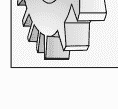

> **提示**

Convert 类展示了一个只有方法的类的例子。因为 Convert 不需要维护状态，所以所有方法都可以是静态的，这意味着你无需创建 Convert 类的实例就可以使用它。


### 使用图形对象

Graphics 类的实例表示 GDI+ 中的画布。每次执行自定义绘制时，您都需要请求一个 Graphics 对象。获取 Graphics 对象有几种方式：可以在具有画布的控件（如窗体）上调用 `CreateGraphics` 方法，也可以从传递给 `Paint` 事件处理程序的 `PaintEventArgs` 参数的属性中获取 Graphics 对象。

无论通过何种方式获得 Graphics 对象，一旦拥有它，您就可以调用 Graphics 类定义的任何方法。由于 GDI+ 是无状态的，因此不应缓存 Graphics 对象，也不应在方法调用间重复使用同一个 Graphics 对象。

清单 3-3 的第 58 至 64 行演示了如何使用通过 `PaintEventArgs` 参数传递给 `Paint` 事件处理程序的 Graphics 对象。清单 3-4 则演示了如何在每次执行绘制操作时请求一个 Graphics 对象。

#### 实现绘制事件处理程序

`Paint` 事件处理程序接收两个参数：第一个参数是对象，第二个参数是 `PaintEventArgs` 类的实例。

当需要执行自定义绘制时，您可以实现一个 `Paint` 事件处理程序。就我们的讨论而言，有两个自定义效果直接应用于 `PlayControl`。以下是 `PlayControl` 的 `Paint` 事件处理程序：

```csharp
private void PlayControl_Paint(
    object sender, System.Windows.Forms.PaintEventArgs e)
{
    OutlineControl(e.Graphics);
    DrawTrademark(e.Graphics);
}
```

重构后的方法描述了各自执行的任务。第一条语句勾勒出 `PlayControl` 的轮廓，使其呈现清晰干净的边缘。这是必要的，因为我们没有使用标准的窗体形状。第二条语句绘制了具有浮雕效果的 "VK" 商标。

清单 3-4 包含了支持 `OutlineControl` 和 `DrawTrademark` 的代码。

清单 3-4   支持在 `PlayControl` 上进行自定义绘制的 `Paint` 事件处理程序的代码

```csharp
private Point[] GetPoints(int shift)
{
    return new Point[]
    {
        new Point(3 + shift, 0 + shift),
        new Point(Bounds.Width - 3 + shift, 0 + shift),
        new Point(Bounds.Width + shift, 3),
        new Point(Bounds.Width + shift, Bounds.Height - 3 + shift),
        new Point(Bounds.Width - 3 + shift, Bounds.Height + shift),
        new Point(3 + shift, Bounds.Height + shift),
        new Point(0 + shift, Bounds.Height - 3 + shift),
        new Point(0 + shift, 3 + shift),
        new Point(3 + shift, 0 + shift)
    };
}

private void OutlineControl(Graphics graphics)
{
    graphics.SmoothingMode = SmoothingMode.AntiAlias;
    graphics.DrawPolygon(new Pen(Brushes.Black, 2),
        GetPoints(-1));
    graphics.DrawPolygon(new Pen(Brushes.White, 2),
        GetPoints(1));
}

private void DrawShadowText(Graphics graphics,
    string s, Font font, Brush foreBrush, Brush backBrush, int x, int y)
{
    graphics.DrawString(s, font, backBrush, new Point(x, y));
    graphics.DrawString(s, font, foreBrush, new Point(x-1, y-1));
}

private void DrawTrademark(Graphics graphics)
{
    Font font = new Font("Haettenschweiler", 24,
        FontStyle.Bold);
    DrawShadowText(graphics, "VK", font,
        Brushes.DarkSlateBlue, Brushes.White, 5, 5);
}
```

第 17 至 24 行的 `OutlineControl` 方法使用了传递给 `PlayControl` 的 `Paint` 事件处理程序的 Graphics 对象，并将 `SmoothingMode` 设置为 `AntiAlias`。抗锯齿通过重叠多边形中的一些像素进行混合，有助于创建更平滑的线条，从而获得更平滑的外观。使用与定义窗体形状相同的点（由 `GetPoints` 返回）来绘制多边形，能为窗体创建干净、清晰的轮廓边缘。

`DrawTrademark` 方法调用了第二个我命名为 `DrawShadowText` 的方法。`DrawShadowText` 使用两个画笔绘制文本两次。通过将文本稍微向不同方向偏移，您可以创建不同的阴影效果。通过将文本偏移 -1 个像素并使用较亮的颜色绘制文本，可以创建内嵌效果（浮雕）。通过改变第 30 行的偏移值，您可以创建各种文本效果。

### 重写 OnPaint 方法

如果您在窗体上创建了自定义效果，那么每次重绘窗体时都需要重新创建这些效果。但是，如果您创建了自定义控件，并且这些控件具有自定义效果，那么您需要重写自定义控件的 `OnPaint` 方法。通过重写 `OnPaint` 方法，您可以确保每次控件被绘制时，都会重新创建控件外观的自定义部分。这正是 `RoundButton` 类所采用的策略，该类显示在清单 3-3 的第 58 至 64 行。

现在参考清单 3-3，重写的 `OnPaint` 方法不是事件处理程序。该方法是执行自定义绘制的类内部的方法，因此不需要 `sender` 参数。`OnPaint` 方法确实接收一个 `PaintEventArgs` 对象，其中包含用于执行自定义绘制的 Graphics 对象。如果您希望执行默认绘制，则应调用继承的 `OnPaint` 方法，如第 92 行所示；通过调用基类中的继承 `OnPaint` 方法，您将确保事件处理程序也会被触发。

在执行完继承的绘制后，您可以添加执行自定义绘制的代码。在清单 3-3 中，调用了 `DrawButton` 和 `DrawGraphic`。这两个额外的方法共同创建了圆形按钮。稍后我们将研究一些支持创建圆形按钮的 GDI+ 方法。

### 使控件无效

当您希望控件重绘时，请调用 `Invalidate` 方法。`Invalidate` 将强制控件通过调用 `OnPaint` 方法进行绘制，而 `OnPaint` 方法反过来会触发 `Paint` 事件。使控件无效的操作在 `HasOutline` 属性中得到演示。当 `HasOutline` 发生更改时，`hasOutline` 字段被更新，并且控件在第 72 行被无效化，以便用轮廓重绘控件。

### 绘制和填充形状

Graphics 类定义了几个用于绘制和填充形状的方法。`DrawEllipse` 和 `FillEllipse` 方法用于创建自定义按钮。例如，`FillEllipse` 绘制并填充基本按钮，而当 `HasOutline` 为 `True` 时，`DrawEllipse` 绘制按钮的轮廓。

绘制方法使用 `Pen` 对象绘制表示形状的线条。形状表示为由边界矩形限定的区域。`FillEllipse` 的工作方式与 `DrawEllipse` 几乎相同；但是，它需要传递一个 `Brush` 给 `FillEllipse`，因为填充方法绘制的是区域的内部。

有两种类型的填充和绘制方法。一种接受整数参数来定义矩形区域，第二种接受浮点数来表示矩形区域。拥有形状绘制方法的浮点版本的好处在于，您可以执行返回浮点数的算术运算，而无需将这些数字截断为整数。

调用的特定绘制或填充方法取决于参数的类型。多态性在这里有所帮助。每种绘制和填充方法都有多个重载版本，编译器根据参数类型确定要调用哪个特定方法。

除了通过表达四个点来定义矩形区域外，您还可以将矩形区域表示为一对 `Point` 结构或一个 `Rectangle` 结构。如果使用点或矩形，并且初始值是整数，那么您将需要使用 `Point` 或 `Rectangle`。

`Convert` 类中的方法被重载并定义为接受多种数据类型。如果 `Convert` 方法无法将您传递的值转换为请求的类型，将抛出一个 `InvalidCastException`。

以及 PointF 和 RectangleF（如果初始值是浮点值）。可以在 `RoundButton.cs` 模块中找到一些演示如何使用 Point 和 Rectangle 结构的示例。

### 对图形对象应用变换

GDI+ 使用世界坐标、页面坐标和设备坐标。当你调用 Graphics 方法时，你所表达的位置处于世界坐标空间中。GDI+ 通过两次变换——从世界坐标到页面坐标，再到设备坐标——来转换世界坐标参数。

GDI+ 在幕后处理这些变换。作为程序员，我们从中受益的是：我们可以更改原点，将 `PageUnit` 从默认的像素更改为其他度量单位，并执行诸如缩放图像之类的操作。

这些功能被用来实现当用户点击 RoundButton 对象时按钮位置改变的视觉效果。然而，如果用户点击按钮时，按钮的外观没有丝毫变化，那么这种错觉就会消失。以下摘自 RoundButton 类的代码，在绘制按钮图形之前，对 Graphics 对象应用了缩放的 Matrix 变换，从而产生当用户点击按钮时按钮似乎轻微移动的错觉。

```
protected virtual void DrawDownGraphic(Graphics graphics)
{
    Matrix m = new Matrix();
    m.Scale(1.03F, 1.03F);
    graphics.Transform = m;
}

protected virtual void DrawGraphic(Graphics graphics)
{
    if(down) DrawDownGraphic(graphics);
}

protected override void DrawGraphic(Graphics graphics)
{
    base.DrawGraphic(graphics);
    graphics.FillPolygon(GraphicBrush(), GetPoints());
}
protected override void OnPaint(System.Windows.Forms.PaintEventArgs e)
{
    base.OnPaint(e);
    DrawButton(e.Graphics);
    DrawGraphic(e.Graphics);
}

protected override void OnMouseDown(System.Windows.Forms.MouseEventArgs e)
{
    base.OnMouseDown(e);
    down = true;
    Invalidate();
}
```

当用户点击 RoundButton 控件的实例时，`OnMouseDown` 方法被触发。从代码中我们可以确定基类的 `OnMouseDown` 方法被调用了。这允许用户拦截该事件；也就是说，我们没有破坏默认行为。然后，*down* 字段被设置为 True，并且控件被无效化。调用 `Invalidate` 方法会强制进行重绘。此时，重载的 `OnPaint` 方法被调用。同样，我们执行 `base.OnPaint` 的行为，然后执行自定义行为。

自定义的 Paint 行为绘制按钮，然后绘制图形。如果 *down* 为 True——在我们的场景中确实如此——则 `DrawDownGraphic` 方法被调用。（这就是变换发挥作用的地方。）`DrawDownGraphic` 创建一个 Matrix 对象。调用 `Matrix.Scale` 来缩放 Matrix 对象，然后该 Matrix 对象被应用到 `graphics.Transform` 属性。最终结果是一个图形，看起来就像在按钮被按下时轻微移动了。

当你理解了机制，你会发现它们相当直接。真正的技艺在于找到合适的画笔、颜色和阴影组合，使错觉尽可能逼真。你需要通过运行 `VideoKiosk.sln` 示例应用程序来自己判断按钮的逼真程度。技艺越高超，应用程序的质量就越高。

### 使用 GraphicsPath 对象创建异形窗体

`GraphicsPath` 类定义在 `System.Drawing.Drawing2D` 命名空间中。`GraphicsPath` 对象用于表示一系列相连的直线和曲线。你听说过异形 Windows 窗体。嗯，`GraphicsPath` 对象就是你创建异形 Windows 窗体的方法。

`GraphicsPath` 对象允许你通过向 `GraphicsPath` 对象添加直线和曲线来创建异形窗体，然后使用该对象来定义窗体的裁剪区域。PlayControl 具有圆角边缘，展示了一种精妙的异形窗体效果。以下摘自 PlayControl 的代码片段，演示了如何通过圆角来微妙地塑造 PlayControl 的形状。（第二个演示 `GraphicsPath` 对象的示例定义在清单 3-3 的第 66 到 73 行的 `OnResize` 方法中。）

```
private void ShapeForm()
{
    GraphicsPath path = new GraphicsPath();
    path.AddPolygon(GetPoints(0));
    Region = new Region(path);
}
```

创建了一个 `GraphicsPath` 对象。将 `GetPoints` 定义的多边形添加到 `GraphicsPath`，然后使用该 `GraphicsPath` 对象来定义 PlayControl 窗体的裁剪区域。`Region = new Region(path)` 演示了修改窗体裁剪区域的代码。

该代码片段演示了创建异形 Windows 窗体的基本示例。该示例对 PlayControl 来说是合适的，但作为一个独立示例，它并不十分引人注目。下一节将演示一个更高级的异形窗体。

#### 定义裁剪区域

`System.Windows.Forms` 控件有一个 `Region` 属性。`Region` 属性是一个表示控件裁剪区域的类。Region 是可缩放的，因为它们是用世界坐标表示的。当你定义一个裁剪区域时，你不仅仅是在绘制一个形状——被裁剪的区域就是窗体本身。

清单 3-5 摘自 `ShapedForm.sln`。该代码重新定义了窗体的裁剪区域，使其呈现如图 3-5 所示的外观。窗体被裁剪为包含窗体的边框。你可以点击图 3-5 中所示裁剪窗体的顶部部分并拖动窗体，该窗体会像正常形状的矩形窗体一样响应用户的输入。

**清单 3-5** *基于添加到 GraphicsPath 对象的字符串的异形窗体*

```
private void Form1_Load(object sender, System.EventArgs e)
{
    BackColor = Color.Red;
    GraphicsPath path = new GraphicsPath();
    path.AddString("C#", Font.FontFamily, 1, 75,
        new Point(0, 0), new StringFormat());
    Region = new Region(path);
}

private void Form1_Click(object sender, System.EventArgs e)
{
    MessageBox.Show("Clicked!");
}
```

> **提示**
> 记得添加 `using` 语句以包含 `System.Drawing.Drawing2D` 命名空间。

该代码在窗体加载事件中更改背景颜色。创建了一个 `GraphicsPath` 对象，并使用窗体的字体以及一些基本的位置和大小信息，将一个字符串添加到该路径。然后构造一个新的裁剪 `Region` 并将其分配给窗体的 `Region` 属性。结果如图 3-1 所示。如果你仔细观察，可以看到 Form.Text 属性，运行应用程序时，你将能够区分窗体的标题栏和客户区域。（标题栏是蓝色的，客户区域是红色的。）点击客户区域，将调用 `Form1_Click` 方法。

**图 3-5** 通过添加到 GraphicsPath 对象的字符串 "C#" 创建的异形窗体

### 线性渐变画笔

画笔用于填充形状的内部。有几种画笔类型，包括 `HatchBrush`、`LinearGradientBrush`、`PathGradientBrush`、`SolidBrush` 和 `TextureBrush`。当你使用这些画笔类型填充图形形状时，它们会产生特定的效果。当你需要画笔时，可以创建这些画笔类型的实例，或者使用包含预定义纯色画笔的 `Brushes` 类。

如果本书是彩色印刷的，从图 3-1 中你将能分辨出自定义的圆形按钮使用了 `LinearGradientBrush` 来增强 3D 效果。`LinearGradientBrush` 是一种画笔，其颜色在画笔绘制的空间内从起始颜色过渡到结束颜色。你可能最常在启动画面或旧式安装程序中看到这种技术的应用。

`LinearGradientBrush` 有几个重载的构造函数。清单 3-3 第 45 到 50 行使用的版本接受两个点和两种颜色。这些点描述渐变的起点和终点，颜色描述渐变的起始和结束颜色。在示例中，通过使用白色起始颜色和较深的结束颜色，我们得到了光线在按钮上反射的外观，这增强了 3D 效果。

你可以指定多种属性来优化渐变效果。`Blend` 属性是一个类，它描述在渐变沿线的位置上使用起始颜色和结束颜色的百分比。`GammaCorrection` 属性是一个布尔值，指示是否对渐变应用伽马校正。`InterpolationColors` 属性允许你指定一个支持显示多色线性渐变的 `ColorBlend`。`LinearGradientColors` 属性是一个颜色数组，包含渐变的起始和结束颜色。`Transform` 属性定义了一个 `Matrix`，允许你平移、缩放、旋转或倾斜渐变。最后，`Rectangle` 属性定义了渐变画笔的起始和结束点。

`LinearGradientBrush` 用于绘制 RoundButton 的内部。用于产生渐变的颜色基于 `down` 字段的值。向上的按钮是浅色的，向下的按钮是深色的。

清单 3-6 演示了 `LinearGradientBrush` 的 `RotateTransform` 和 `SetTriangularShape` 方法。你必须运行代码才能看到这个奇妙的视觉效果。无法用黑白方式重现它。


### 86 高级 C# 编程

**清单 3-6** *GradientBrush.sln 示例程序演示了 `LinearGradientBrush` 类的一些高级功能。*

```csharp
1: using System;
2: using System.Drawing;
3: using System.Drawing.Drawing2D;
4: using System.Collections;
5: using System.ComponentModel;
6: using System.Windows.Forms;
7: using System.Data;
8: 
9: namespace GradientBrushDemo
10: {
11:     public class Form1 : System.Windows.Forms.Form
12:     {
13: 
14:         [ 删减了窗体设计器生成的代码 ]
15:         private System.Windows.Forms.Timer timer1;
16: 
17:         private float angle = 0;
18: 
19:         private LinearGradientBrush GetBrush()
20:         {
21:             return new LinearGradientBrush(
22:                 new Rectangle( 20, 20, 200, 100),
23:                 Color.Orange,
24:                 Color.Yellow,
25:                 0.0F,
26:                 true);
27:         }
28: 
29:         private void Rotate( Graphics graphics,
30:             LinearGradientBrush brush )
31:         {
32:             brush.RotateTransform(angle);
33:             brush.SetBlendTriangularShape(.5F);
34:             graphics.FillEllipse(brush, brush.Rectangle);
35:         }
36: 
37:         private void Rotate(Graphics graphics)
38:         {
39:             angle += 5 % 360;
40:             Rotate(graphics, GetBrush());
41:         }
42: 
43:     }
44: }
```

```csharp
43:     private void timer1_Tick(object sender, System.EventArgs e)
44:     {
45:         Rotate(CreateGraphics());
46:     }
47: 
48:     private void Form1_Paint(object sender,
49:         System.Windows.Forms.PaintEventArgs e)
50:     {
51:         Rotate(e.Graphics);
52:     }
53: }
54: }
```

该示例使用 `Timer` 控件定期绘制一个椭圆。渐变画笔使用黄色和橙色。每次调用 `Rotate` 方法时，一个浮点值会递增 5。使用取模运算使角度保持在 0 到 360 之间。该角度代表度数。`RotateTransform` 方法旋转第 32 行的渐变画笔。`SetBlendTriangularShape` 使用结束颜色作为中心焦点，而 `FillEllipse` 则使用渐变画笔绘制填充的椭圆形。

### 画笔

当绘制填充区域时，需要使用 `Brush`。当绘制线条时，则需要使用 `Pen`。可以从 `Pens` 对象获取一个基本的画笔，也可以从头创建一个 `Pen` 实例并指定 `PenAlignment`、`Width`、`Color` 和 `DashStyle`。

以下示例创建一个用 `LinearGradientBrush` 初始化的 `Pen` 对象，并使用该画笔绘制一个椭圆。

```csharp
LinearGradientBrush brush = 
    new LinearGradientBrush(new Rectangle(0, 0, 2, 2),
    Color.White, Color.Green, LinearGradientMode.ForwardDiagonal);

Pen p = new Pen(brush, 10F);
e.Graphics.DrawEllipse( p, 5, 5, 100, 200);
```

（为方便起见，该代码包含在 `ShapedForm.sln` 示例中。）

### 实现跟踪器控件

`RoundButton` 派生自 `Control` 类。创建自定义控件时，一个更简单的技巧是找到一个与你想创建的新控件相近的控件，并从中继承。对于 `RoundButton`，我们或许可以通过继承自 `ButtonBase` 类来改进或简化其构建。

另一个需要记住的策略是，如果你想在自己的应用程序中使用某个控件，那么在应用程序中创建该控件是合理的。如果你想重新分发控件，则需要创建一个控件类库，将你的控件打包成一个整洁、可重新分发的包。（有关创建自定义控件的更多信息，请参阅第 9 章。）

有时你会发现没有合适的控件可以继承。这意味着你必须从控件食物链的更高层派生你的控件，并继承自 `System.Windows.Forms.Control` 类。

> **注意**

就本章目的而言，我们将继续使用 `Control` 作为本章控件的基类——你可以阅读第 8 章和第 9 章以获取有关创建控件的更多信息。通常，你需要知道如何创建控件类库，如何实现和测试控件类与自定义控件，以及如何将这些控件放入工具箱。在后续章节中，你还将学习如何将自定义图标与工具箱中的控件关联。

### 定义跟踪器控件

就本章目的而言，将 `Tracker` 实现为自定义控件是合理的。`Tracker` 如图 3-1 中 `PlayControl` 顶部的小滑块所示。`Tracker` 的行为就像你可能已经熟悉的 `ProgressBar` 控件一样。

与 `ProgressBar` 类似，`Tracker` 使用图形来指示相对进度。`Tracker` 允许用户指定最小值、最大值和位置值。如果位置更接近最小值，则图形进度指示器更接近控件的左侧；如果位置更接近最大值，则进度指示器接近控件的右侧。

实现 `Tracker` 控件将使你能够更深入地探索 GDI+。`Tracker` 的完整源代码清单定义在 `VideoKiosk.sln` 的 `Controls.dll` 项目中的 `Tracker.cs` 文件中。`Minimum` 定义了 `Tracker` 的相对左侧，`Maximum` 定义了相对右侧。进度指示器根据 `Position` 属性的值沿着水平凹槽绘制。对于有经验的程序员来说，弄清楚进度指示器绘制的位置很简单，只需将位置的百分比乘以最小值和最大值的差值即可。

假设值的范围在 0 到 1,000 之间。为了避免使控件失效并可能重绘 1,000 次，定义了任意数量的细分区间，以便在变化显著时定期绘制进度指示器。

### 使用 SetStyle 方法

`PlayControl` 模拟了一个我们投入大量精力创建界面的场合。背景图像代表了这种投入。用控件遮盖背景图像会很遗憾。通过允许背景图像在控件后面显示，我们能够保持视觉上吸引人的背景。

不幸的是，控件默认不支持透明背景。因此，我们不得不让像 `Tracker` 这样的控件看起来像我们的背景图像，或者让背景图像显示出来。第二种选择很可能产生最无缝的结果，并且实际上实现成本更低。

为了允许背景图像显示，控件需要你设置 `ControlStyles.SupportsTransparentBackColor` 属性。这可以通过在控件的构造函数中调用 `Control.SetStyle` 方法来实现。

```csharp
public Tracker()
{
    this.SetStyle(ControlStyles.SupportsTransparentBackColor, true);
}
```

当将 `Tracker` 控件绘制到 `PlayControl` 上时，你可以将 `BackColor` 设置为 `Transparent`，这将允许窗体上的背景图像显示出来。实际效果是 `Tracker` 控件融入了 `PlayControl` 中。

### 使用 ControlPaint 类

使用 GDI 时，如果你想绘制具有 3D 外观的斜面控件，可以使用 API 过程 `DrawEdge`。GDI+ 实现了一个 `ControlPaint` 类，该类有几个静态方法，支持绘制具有 3D 边框的形状和看起来像标准控件的形状，例如按钮。

`ControlPaint` 类定义在 `Systems.Windows.Forms` 命名空间中。`ControlPaint` 有用于绘制按钮、复选框、组合按钮、网格、菜单字形、单选按钮和大小调整手柄等的静态方法。我没有试图弄清楚如何绘制看起来像进度指示器凹槽的形状，而是使用 `ControlPaint` 类来创建 `Tracker` 的视觉外观。

### 绘制 3D 边框

`Tracker` 类有一个 `DrawBar` 方法，用于绘制进度指示器似乎沿其跟踪的凹槽。`DrawBar` 接受一个图形对象参数并调用 `DrawBorder3D` 方法。

```csharp
protected virtual void DrawBar(Graphics graphics)
{
    ControlPaint.DrawBorder3D(graphics, GetX(), GetY(),
        GetWidth(), GetHeight(), Border3DStyle.Etched, Border3DSide.All);
}
```

`DrawBorder3D` 是一个静态方法，因此我们不需要创建 `ControlPaint` 对象来调用此方法。与许多绘图方法一样，我们将区域表示为矩形的边界。`GetX()`、`GetY()`、`GetWidth()` 和 `GetHeight()` 是我实现的方法，用于根据 `Tracker` 的大小返回凹槽的计算偏移量。最后两个参数是从可用枚举值中根据期望结果选择的。我希望进度指示器看起来像是沿着凹槽跟踪，而 `Etched` 边框样式和 `All` 边框侧边创建了这种效果。

### 绘制按钮控件

有几种方法可以创建跟踪器按钮。你可以加载一个图形图像，然后根据 `Tracker` 的大小缩放图像。为方便起见，


### 调用 Graphics.DrawImage 方法

我实现了 TrackPosition 方法来确定进度指示器沿水平轴的位置。垂直偏移量由 `(Height-8)/2` 的计算决定，除非 Tracker 太小而无法正常工作，否则此计算都能取得相当好的效果。`ButtonState.Normal` 枚举值以按钮的正常弹起状态外观绘制按钮。

PlayButton 实现了多个按钮。所有按钮之间最大的区别在于按钮上显示的图像。在分发控件之前，我们应该利用这一知识。

如果主要区别在于绘制的图形，那么我们应该能够提取绘制图形的能力，并将所有按钮合并为一个按钮。`RoundButton.cs` 模块包含多个按钮类。虽然我实现了一个名为 `ImageButton` 的控件，但并未合并所有按钮类。如果你为其他按钮创建图像，那么你可以相当容易地合并按钮类并摆脱其他按钮。

下面的代码清单源自 `DarkButton` 控件，而 `DarkButton` 又派生自 `RoundButton` 控件。`DarkButton` 演示了如何重载一些方法来更改渐变画笔。同样，这段代码可以通过将创建渐变所使用的两种画笔颜色作为 `RoundButton` 类的属性来概括。清单 3-7 进行了下一步飞跃，将按钮的图形方面外部化。

```
清单 3-7  此代码实现了一个 ImageButton，它派生自清单 3-3 中的 RoundButton。
1:  public class ImageButton : DarkButton
2:  {
3:      // TODO: 确保图像可以被删除！
4:      private Image graphic = null;
5:
6:      public ImageButton()
7:      {
8:
9:      }
10:
11:     protected override Color GetColor()
12:     {
13:         Color[] colors = {Color.MidnightBlue, Color.Black};
14:         return colors[Convert.ToInt32(down)];
15:     }
16: 
17:     private int GetX()
18:     {
19:         return (Width - graphic.Size.Width) / 2;
20:     }
21: 
22:     private int GetY()
23:     {
24:         return (Height - graphic.Size.Height) / 2;
25:     }
26: 
27:     private ImageAttributes GetImageAttribute()
28:     {
29:         ImageAttributes attribute = new ImageAttributes();
30:         attribute.SetColorKey(Color.White, Color.White,
31:             ColorAdjustType.Default);
32:         return attribute;
33:     }
34: 
35:     private Rectangle GetRectangle()
36:     {
37:         return new Rectangle(GetX() + 1, GetY() + 1,
38:             graphic.Size.Width, graphic.Size.Height);
39:     }
40: 
41:     protected override void DrawGraphic(Graphics graphics)
42:     {
43:         base.DrawGraphic(graphics);
44:         if( graphic == null ) return;
45: 
46:         graphics.DrawImage(graphic,
47:             GetRectangle(), 0, 0,
48:             graphic.Size.Width, graphic.Size.Height,
49:             GraphicsUnit.Pixel,
50:             GetImageAttribute());
51:     }
52: 
53:     public Image Graphic
54:     {
55:         get
56:         {
57:             return graphic;
58:         }
59:         set
60:         {
61:             graphic = value;
62:             Invalidate();
63:         }
64:     }
65: }
```

在按钮上绘制图像的关键是允许图像的周围部分从显示中被屏蔽。例如，如果你有一个 16×16 像素的图像，但图像并未占用所有像素，那么就会有一部分你不想显示的图像。要定义你不希望显示的像素——你希望筛选掉的像素——你需要创建一个 `ImageAttributes` 对象，该对象定义了你想要筛选的像素颜色。

如第 46 行所示，`DrawImage` 有许多重载版本，以适应各种参数，旨在精确管理图形图像的合并。所使用的版本接受一个 `Image` 参数、一个指定图像边界区域的 `Rectangle`、要绘制的图像部分的四个坐标（允许你细分图像）、坐标所描述的 `GraphicsUnit` 以及前面描述的 `ImageAttributes` 对象。

> **提示**
> 你可以编写代码来读取特定像素。例如，你可以读取左上角的像素，并使用该像素的颜色作为要筛选的颜色。

`ImageButton` 使用一个颜色键为白色的 `ImageAttributes` 对象。结果是从显示的图像中筛选掉了白色。如果你想隐藏图像的某部分，那么在这种情况下，将你想要隐藏的部分设为白色。图 3-6 显示了在未使用 `ImageAttributes` 对象筛选额外像素时尝试显示图像的结果。

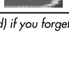

图 3-6 如果忘记筛选掉额外像素会发生什么（放大图）。

### 次要主题

我们在本章涵盖了很多内容。`VideoKiosk.sln` 的完整清单，包括 `Controls.dll` 类库，包含数百行代码。正如我们所讨论的，其中一些代码可以合并。稍加努力，你可以将按钮数量减少到单个圆形图像按钮。如果我替你这样做，你可能会错过各种展示 GDI+ 强大功能的代码片段和技术，例如形状绘制。

我们还利用了 .NET 的其他几个方面来完成 `VideoKiosk.sln` 示例程序。虽然这些主题对于使用 GDI+ 编程来说是次要的，但你会发现它们很有帮助。让我们再花几页来探讨 .NET 的这些方面。

### 实现经过时间时钟

经过时间时钟在计时器滴答时更新。使用 `Timer` 控件是执行轻量级后台处理的便捷方式。显然，使用 `Timer` 并不是多线程，但对于更新时钟这样简单的任务，`Timer` 是合理且足够的。

`Timer` 控件通过在以毫秒表示的时间间隔过去时引发事件来工作。当 `Timer.Interval` 过去时，`SetPosition` 方法使用 `Player.Elapsed` 值来更新 Tracker 的位置。更新 Tracker 进度指示器的一个副作用是更新包含以数字时钟形式显示的经过时间的显示标签。

位置值以秒为单位表示；因此，位置值可用于创建时钟显示的时间值。这是通过创建一个 `TimeSpan` 结构的实例来完成的，该实例用经过的秒数初始化。创建时钟的代码如下所示。

```
private TimeSpan GetSpan(int position)
{
    return new TimeSpan(0,0,0,position, 0);
}

private string GetMask()
{
    return "{0}:{1,2:0#}:{2,2:0#}";
}

private string GetFormatted(TimeSpan span)
{
    return string.Format(GetMask(), span.Hours,
        span.Minutes, span.Seconds);
}

private void ChangePosition()
{
    labelElapsed.Text = GetFormatted(GetSpan(Position));
}
```

`TimeSpan` 结构知道如何将位置表示的经过秒数转换为小时、分钟和秒。每 60 秒将自动转换为另一分钟，60 分钟转换为一小时。`GetMask` 方法返回一个格式字符串，用于控制 `TimeSpan` 的外观，该格式字符串用于更新数字时钟。

### 使用 TimeSpan 评估时间差

`TimeSpan` 结构用于测量短至 100 纳秒的时间段，在 `TimeSpan` 中表示为一个刻度。`TimeSpan` 值可以表示为正或负的时间段，以天、小时、分钟、秒和秒的小数部分来度量。字符串格式 `d.hh:mm:ss.ff` 将显示单个 `TimeSpan` 表示的天、小时、分钟、秒和秒的小数部分。`TimeSpan` 表示的最大时间单位是天。

如果 `TimeSpan` 的默认字符串值是可接受的，那么我们可以使用 `TimeSpan.ToString()` 方法，该方法默认以 `hh:mm:ss` 格式返回 `TimeSpan`。

如果你对 `DateTime` 值执行算术运算，例如从一个时间减去另一个时间，该运算将返回一个 `TimeSpan` 对象。

### 格式化字符串

出于我们的目的，我们选择不使用默认的 `TimeSpan.ToString` 方法。这是一个任意决定，允许我们更仔细地研究 `string.Format` 方法和格式化掩码。（在生产系统中，使用 `TimeSpan.ToString` 方法会更便宜。）

`GetMask` 返回一个格式化掩码。掩码是 `"{0}:{1,2:0#}:{2,2:0#}"`。括号 `{ }` 中的字符代表可替换的格式字符，其他所有内容代表字面值。检查 `{1,2:0#}`，我们理解这个可替换参数是可替换参数 1，它填充零，最多可以有两个数字字符的长度。

通常，括号中的第一个值代表要格式化的从零开始的参数。第二个参数——如果存在，用逗号分隔——代表格式化值的宽度。如果你添加负号，则该值左对齐，加号将使该值右对齐。默认情况下，宽度将用空格填充格式化值。可选的格式化字符串跟在冒号后面。我们的 `0#` 格式化字符串意味着格式化输出将用一个 0 和一个数字填充。如果数字占用两个空格，则 0 将不显示。

### 使用 ToolTip 控件

Windows 窗体提供了一个 `ToolTip` 组件。当你将 `ToolTip` 组件添加到你的应用程序时，它被添加到组件托盘中，而不是直接添加到窗体上。组件托盘中的组件是非可见组件；也就是说，它们在运行时不会显示出来。


当您将工具提示添加到特定窗体的组件托盘时，该窗体上的控件将把ToolTip属性添加到其属性列表中。如果您为ToolTip属性提供了文本，那么当用户将鼠标悬停在控件上时，该提示将显示出来。

注意
组件是通过拖放到窗体上添加到组件托盘的。但是，不可见的组件是放置在窗体上方的，但实际显示在组件托盘中。采用这种策略可能是为了帮助消除窗体杂乱。

工具提示控件与其他控件的关系并非一目了然。如果您最初查看Windows窗体控件，可能会怀疑.NET不支持工具提示。您只需将工具提示组件拖放到组件托盘中，即可将其添加到窗体。

### 将控件添加到工具箱

通常，您创建一个用户控件是为了将多个控件添加到一个公共容器中。当您将控件添加到项目中时，该控件会自动添加到工具箱的“Windows窗体”选项卡中。

如果您想将控件类库中的控件添加到工具箱，则需要创建一个控件类库，从工具箱上下文菜单中选择“自定义工具箱”，并使用“自定义工具箱”对话框将控件类库添加到您希望在工具箱中显示的列表中。第8章和第9章将更详细地阐述这一主题。

### 捕获和处理特定异常

第2章通过演示使用*try finally*结构实现的资源保护块，介绍了异常处理的主题。VideoKiosk演示了*try catch*结构以及如何捕获异常的特定实例。

要在方法中捕获任何异常，请使用*try catch*结构，将要尝试的代码放在*try*关键字后面的括号中，将错误处理代码放在*catch*关键字后面的括号中。以下代码片段演示了*try catch*异常处理块的基本语法。

```
try
{
    // 要尝试的代码
}
catch
{
    // 如果发生错误则运行的代码
}
```

此示例演示了一个捕获所有异常的处理程序。如果在前面的代码中的try块中发生任何异常，那么catch块中的代码将运行。并非每个过程都应该有一个异常处理块。如果您知道如何解决错误，那么您可能需要实现一个异常处理程序。如果代码可能导致程序崩溃，那么您可能需要实现一个异常处理程序来以有序的方式关闭并记录错误。但是，应避免使用全面的、不执行任何操作的异常处理。后者是.NET应用程序的默认行为。

如果您想处理特定的异常而忽略所有其他异常，那么您可以通过实现一个或多个catch块来指定要处理的异常类别。以下SetMaximum方法演示了如何捕获当持续时间大于32位整数时可能发生的OverflowException。

```
private void SetMaximum(double duration)
{
    try
    {
        tracker1.Minimum = 0;
        tracker1.Maximum = Convert.ToInt32(duration);
    }
    catch(OverflowException e)
    {
        MessageBox.Show(e.Message, "媒体错误!",
            MessageBoxButtons.OK, MessageBoxIcon.Exclamation);
    }
}
```

如果duration大于32位整数的最大值，Convert.ToInt32方法将引发异常。如果发生这种情况，catch块将捕获对象e中的OverflowException，然后可以用来帮助解决错误。此示例只是向用户显示错误，考虑到他们可能选择另一个文件。

如果发生OverflowException以外的异常，那么SetMaximum中实现的catch块将不会收到有关该异常的通知。

### 将TODO项添加到任务列表

Visual Studio .NET支持注释标记。注释标记是特殊关键字，包括TODO以及您定义的那些。当这些关键字紧跟在双斜杠（//）注释标记之后出现时，这些注释将作为任务添加到任务列表中。

您可以通过在Visual Studio中选择“视图”|“显示任务”|“所有”或“视图”|“显示任务”|“注释”来在任务列表中查看注释标记。如果您有需要提醒自己做的事情，请在代码中需要执行任务的位置添加TODO注释。包含提醒您问题是什么的文本。要添加自定义注释标记，请在“选项”对话框的“环境”|“任务列表”页面（见图3-7）中定义这些自定义注释。

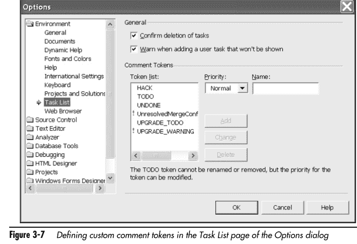

#### 图3-7 在“选项”对话框的“任务列表”页面中定义自定义注释标记

清单3-7演示了ImageButton类第3行上的一个TODO项。TODO注释提醒我必须确保可以删除Image属性。如果您有一个Image属性，那么自动与Image属性关联的Image编辑器将允许您使用“打开”对话框选择图像。不幸的是，您无法通过将Image设置回(无)来自行删除图像。您必须向Image属性添加DefaultValueAttribute以支持删除图像。DefaultValueAttribute提供一个初始值，以及当您在“属性”窗口中移除提供的值时的替代值。清单3-8演示了对ImageButton类的修改，该修改允许我删除Image属性。

#### 清单3-8 修改ImageButton类并解决清单3-7中的TODO提醒

```
1: public class ImageButton : DarkButton
2: {
3:     private Image graphic = null;
4: 
5:     public ImageButton()
6:     {
7: 
8:     }
9:
10:    protected override Color GetColor()
11:    {
12:        Color[] colors = {Color.MidnightBlue, Color.Black};
13:        return colors[Convert.ToInt32(down)];
14:    }
15:
16:    private int GetX()
17:    {
18:        return (Width - graphic.Size.Width) / 2;
19:    }
20:
21:    private int GetY()
22:    {
23:        return (Height - graphic.Size.Height) / 2;
24:    }
25:
26:    private ImageAttributes GetImageAttribute()
27:    {
28:        ImageAttributes attribute = new ImageAttributes();
29:        attribute.SetColorKey(Color.White, Color.White,
30:            ColorAdjustType.Default);
31:        return attribute;
32:    }
33:
34:    private Rectangle GetRectangle()
35:    {
36:        return new Rectangle(GetX() + 1, GetY() + 1,
37:            graphic.Size.Width, graphic.Size.Height);
38:    }
39:
40:    protected override void DrawGraphic(Graphics graphics)
41:    {
42:        base.DrawGraphic(graphics);
43:        if( graphic == null ) return;
44:
45:        graphics.DrawImage(graphic,
46:            GetRectangle(), 0, 0,
47:            graphic.Size.Width, graphic.Size.Height,
48:            GraphicsUnit.Pixel,
49:            GetImageAttribute());
50:    }
51:
52:    [DefaultValue(null)]
53:    public Image Graphic
54:     {
55:       get
56:       {
57:         return graphic;
58:       }
59:       set
60:       {
61:         graphic = value;
62:         Invalidate();
63:       }
64:     }
65:
66: }
```

清单3-8第52行的DefaultValueAttribute解决了TODO问题。当您修复TODO问题时，请移除TODO注释，这样它就会从任务列表中移除。

一个好的策略是定义注释标记，这些标记将帮助您组织和跟踪未解决的问题。您可以简单地使用TODO注释标记，或者为您或您的团队定义具有特殊意义的自定义标记。

### 使用Process类

第2章介绍了Process类。Process.Start静态方法与PlayControl上最左边ImageButton的Click事件处理程序相关联。单击此按钮并编写以下代码

```
Process.Start("http://www.softconcepts.com");
```

### COM互操作

.NET中有一个概念称为“COM互操作”（互操作性）。COM使用类型库来描述接口，而.NET通过引入反射并将元数据嵌入到.NET程序集中，从而消除了类型库。第2章解释了反射、程序集和元数据。

VideoKiosk中使用的ActiveX MediaPlayer就是一个完美的例子。ActiveX MediaPlayer是一个基于COM的控件。当您想在.NET中使用COM（也称为ActiveX）控件时，可以通过从工具箱上下文菜单中选择“自定义工具箱”来导入这些控件。Visual Studio .NET将导入该COM控件的类型库，从而允许您在.NET应用程序中使用基于COM的控件。

不幸的是，当您在.NET程序集中使用COM控件时，您正回归到“DLL地狱”区域。您将需要创建一个安装程序来分发和注册这些COM控件，就像您在开发和部署.NET之前开发的应用程序时一样。


### 总结

GDI+ 是 GDI 的演进阶段。在 .NET 出现之前，你能用 GDI 完成的所有出色图形编程，现在有了 .NET 之后变得容易多了。之所以更容易，是因为我们现在有了出色的方法和功能，它们被组织成类，使这些功能更容易被找到和使用。

请记住，GDI+ 是无状态的。每次调用 GDI+ 方法时，你都必须传递诸如颜色、画笔和字体之类的信息。还要记住，你不应该缓存 `Graphics` 对象。应通过工厂方法 `CreateGraphics` 请求 `Graphics` 对象，或使用传递给 `Paint` 事件处理程序的 `Graphics` 对象。

最后，GDI+ 支持矢量图形、图像处理和排版。矢量图形支持绘制线条和曲线。图像处理支持管理复杂的图像，如位图、GIF 或 JPEG 文件，而排版则支持高级排版和字体。与 GDI 一样，GDI+ 是一条大鱼——只是组织得更好，也更易于上手。

## 第4章 Terrarium

**本章内容：**

**核心主题**

- 下载、安装和配置 Terrarium
- 玩转 Terrarium
- 探索 Terrarium 框架
- 创建植物和生物
- 将植物和生物引入 Terrarium

**次要主题**

- 对象序列化

**总结**

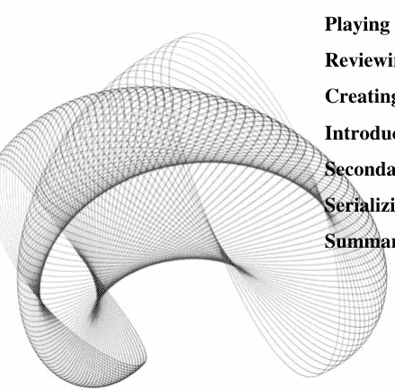

### 高级 C# 编程

乐趣是孩子们的动力。我们领域的许多成年人同样由乐趣驱动。也许一些成熟、年长的程序员已经与他们内心的彼得·潘失去了联系，但最近在俄勒冈州一个开发团队的经历表明，有创造力的成年人同样由乐趣驱动。

在俄勒冈州参与一个项目时，我和几位合同开发者不幸承担起帮助大型机程序员学习 C# 的重任。这些程序员没有 Windows 编程经验，仅有基本的 PC 技能，并且之前也没有 C 或 C++ 的经验。问题是，我们如何让学习一门新语言、新范式和复杂主题变得有趣？我们在 Terrarium 中找到了答案。

2001 年，我在微软拜访时，Tom Kaiser 提到了这款使用 .NET 开发的点对点游戏。他对这项技术和 Terrarium 游戏非常兴奋。第二年，当我面临培训困境时，幸运地想起了那次讨论。通过搜索网络，我欣喜地发现 Terrarium 在 www.gotdotnet.com 网站上可以下载。我从该网站下载了 Terrarium，几分钟后就让一个 Terrarium 运行起来，里面有了一些生物和植物。我在几分钟内就创建了一个小型生态系统。老古董和管理者可能会嘲笑这个想法，但有创造力的人确实*被乐趣所驱动*。

### 什么是 Terrarium？

Terrarium 是一款使用 .NET 开发的游戏。Terrarium 是一个包含植物、食草动物和食肉动物的虚拟生态系统。植物生长繁殖。食草动物吃植物、生长、繁殖，食肉动物吃食草动物、生长、繁殖。所有这些都直观地在你的 PC 上发生。有规则描述生长、消耗和繁殖的模式。关键在于，你和其他程序员可以通过编写 .NET 代码来定义这些规则。真正的挑战在于要么在生态系统中创造平衡，要么接管一切，消耗掉所有可见的东西。

Terrarium 很有趣。你的代码与其他程序员的代码进行交互，这种交互提供了一种强大的方式来学习如何使用 .NET 进行编程。

### 核心主题

除了好玩，我们学习也很重要。（除非你财务自由，没有老板盯着你。）创建植物和动物可以教你很多关于编程的知识，尤其是关于 C# 编程的知识。

Terrarium 使用点对点模型。与客户端-服务器模型（也称为轮辐模型）不同，Terrarium 展示了一个由对等方相互通信以协同工作的应用程序。在 Terrarium 中，客户端（PC）相互交互以创建一个生态系统。你的 PC 和其他 PC（对等方）都是一个更大生态系统的一部分。植物和动物在你的生态系统切片中的你的 PC 和其他 PC 之间移动。更准确地说，你编写的代码被传输到构成你生态系统的其他对等方，并安全地在其他对等方上运行。

在 Terrarium 游戏的术语中，植物和动物是被“传送”的。Terrarium 服务器存储一个对等方 IP 地址列表。当传送门（由一个蓝球表示）遇到一个生物体时，会从你的对等方列表中随机选择一个对等方，并将该生物体发送到那个对等方的 IP 地址。传输生物体的过程在 PC 上完成，通过序列化生物体的状态并发送该生物体程序集的副本来实现。发送的程序集会经过检查，看是否存在安全违规和违反游戏礼仪的行为——例如，不允许使用反射和文件 IO。如果生物体是安全的，并且没有能有效允许作弊的代码，那么就会创建一个该生物体的实例，并反序列化其状态。

通过参与 Terrarium 生态系统能学到什么？这就是本章的主题。通过阅读本章并完成其中的示例，你将有机会（在玩得开心的同时）学习：

- Windows 窗体应用程序的智能客户端更新
- 使用 DirectX 和 COM 互操作的图形应用程序
- 正则表达式
- 反射
- XML Web 服务
- 点对点网络应用程序
- 代码访问安全
- 继承
- 应用特性定义行为
- 实现事件处理程序

### 下载、安装和配置 Terrarium

你需要做的第一件事是从 **www.gotdotnet.com** 下载 Terrarium 客户端应用程序（如图 4-1 所示）。如果你想托管自己的 Terrarium，也可以从同一网站下载 Terrarium 服务器。（你不必下载 Terrarium 服务器；客户端应用程序就足够了。）在你同意在线客户协议后，Terrarium 是免费的。

> **提示**
>
> *每个想参与你的生态系统的人，都需要下载一份 Terrarium 客户端。*

下载 Terrarium 客户端（以及可选的服务器）后，你需要执行一些基本的配置步骤来实现你想要运行 Terrarium 的方式。有几种运行 Terrarium 的方式；接下来将讨论每种方式以及你需要进行的配置设置。

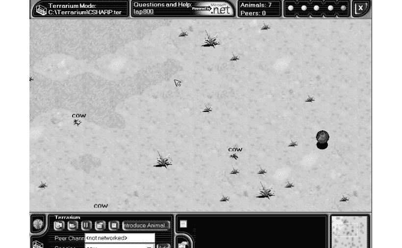

图 4-1 在我的笔记本电脑上运行的一个 Terrarium 生态系统，其中包含了本章定义的植物和动物

### 配置 Terrarium 客户端

你可以配置 Terrarium 客户端应用程序，以便与广阔世界中的其他对等方进行交互。此选项会将你的 PC 注册到 Terrarium 服务器，这样其他对等方就知道在哪里可以找到你。Terrarium 服务器会将你的 PC 放置在全球生态系统的某个切片中；你的 PC 可能与几十个甚至几百个其他 PC 交互。

你也可以创建自己的 Terrarium 用于测试和调试，创建一个无服务器的点对点生态系统（如果你的网络管理员不允许你的 PC 在防火墙外交互，这是一个很好的选择），或者安装 Terrarium 服务器以获得更健壮的内部生态系统。就我们的目的而言，你至少需要一台运行一个 Terrarium 客户端实例的 PC 来运行自己的生态系统，即一个 `.ter` 文件。

如果你选择在公司防火墙后面运行 Terrarium 服务器，那么你需要在安装了 MS SQL Server 的机器上安装 Terrarium 服务器。（我发现 MSDE——桌面版 SQL Server——可以可靠地运行 Terrarium 服务器，尽管微软不推荐这样做。）

让我们来研究一下为屏幕保护程序模式、有或无对等方的 Terrarium 模式以及生态系统模式配置 Terrarium 客户端的步骤。随后我们将快速回顾一下，描述如何安装和配置 Terrarium 服务器。

### 运行 Terrarium 客户端

Terrarium 可以作为一个有趣的屏幕保护程序。你可以配置 Terrarium 作为你的屏幕保护程序运行，此外还有其他几个配置选项。让我们快速回顾一下，这样我们就可以进入编程部分了。

### 配置屏幕保护程序模式

安装 Terrarium 客户端时，你可以指定希望 Terrarium 作为你的屏幕保护程序运行。如果你选择不将 Terrarium 作为屏幕保护程序运行，你随时可以更改主意，从“显示”小程序的“屏幕保护程序”选项卡中选择 .NET Terrarium。

> 如果你的同事从未见过 Terrarium，当植物和虫子在你的屏幕上被积极追逐和消耗时，可以预期会吸引一些注意力。

### 配置 Terrarium 模式

Terrarium 模式可用于调试和测试你的虫子，然后再将它们放入生态系统。你需要创建一个 Terrarium 来在 Terrarium 模式下运行。按照以下步骤创建一个 Terrarium：

1. 要运行 Terrarium 模式，请单击“显示 Terrarium 模式控件”按钮，如图 4-2 所示。（按钮图标是左下角的鱼缸图标，当鼠标悬停时，文本作为提示可见。）
2. 单击“创建新 Terrarium”，并在“新 Terrarium”对话框中提供文件名。单击“保存”后，Terrarium 将以 Terrarium 模式重启。
3. 如果你希望其他玩家也能参与这个 Terrarium，请为“对等方通道”提供一个名称（同样如图 4-2 所示）。

你已准备好将植物和动物引入 Terrarium。Terrarium 客户端的右上角是状态指示器、你客户端实例中的动物数量，以及你生态系统切片中的对等方数量。绿色状态指示器表示一切正常，红色状态指示器表示 Terrarium 的某个特定方面不

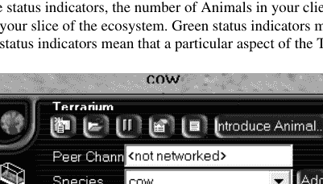


正常运行。你可以将鼠标悬停在状态指示器上查看信息，或者点击客户端顶部中央的“帮助”链接获取更多信息（参见图4-3）。

### 配置生态系统模式

生态系统模式是指你与更大生态系统中的其他玩家一起游戏。（你可以从 www.gotdotnet.com 安装你自己的 Terrarium 服务器实例。）要在生态系统模式下游戏，你需要修改一些游戏设置。右键点击 Terrarium 客户端来配置你的 Terrarium 客户端。你需要进行一些更改才能参与生态系统：

- 1. 在 Terrarium 游戏设置对话框中，点击“注册”按钮并输入一个电子邮件地址。此信息用于向你发送状态信息。
- 2. 点击“社区”按钮并选择你的国家/地区和州/省（你可以将这些信息留空）。
- 3. 你可以点击“性能”按钮并调整 CPU 使用率滑块来测试性能。
- 4. 最后，点击“服务器”按钮并输入你参与的 Terrarium 服务器的 URL。例如，默认路径是 http://www.terrariumgame.net/terrarium/。如果你在你所在地的计算机上安装了 Terrarium 服务器，那么你需要输入该 URL。例如，在我自己的笔记本电脑上运行服务器，我将服务器 URL 更改为 http://lap800/terrarium/ —— 也就是我安装 Terrarium 服务器的位置。
- 5. 点击“接受更改”以更新游戏设置。（你需要停止并重启客户端，服务器 URL 游戏设置才能生效。）

你需要访问 www.gotdotnet.com 网站以查看可用的服务器位置。

### 配置 Terrarium 服务器

运行本章中定义的示例，你不需要安装和配置 Terrarium 服务器。因此，我不会详细说明如何配置 Terrarium 服务器。我只会告诉你，在我撰写本文的地方，有一个服务器正在防火墙后面运行，并且没有遇到任何困难。

请按照 Terrarium 服务器的配置说明进行操作，包括安装 SQL Server。我们一直在使用 Microsoft SQL Server 桌面引擎（称为 MSDE）成功运行 Terrarium 服务器，没有遇到任何问题。


图 4-3 状态指示器、动物和同类

### 玩 Terrarium

要玩 Terrarium，你需要参与一个生态系统或以 Terrarium 模式运行，并添加植物、食草动物和食肉动物。除了各种生物带来更生动的互动之外，生态系统必须保持一定的平衡。没有植物，食草动物就会饿死。没有食肉动物，食草动物会消耗掉所有可用的植物并最终死光。食肉动物太多，食草动物会被迅速吞噬，然后食肉动物也会饿死。

以 Terrarium 模式成功运行会鼓励你找到一种平衡。通常情况下，大量的植物会让你的食草动物茁壮成长。生态系统似乎寻求大约每十只食草动物对应一只食肉动物的平衡。但有一个问题：引入过多的食肉动物种类，你的食肉动物会同时捕食其他食肉动物和食草动物。创建一个和谐的生态系统或制造“杀手虫”都很有趣；这取决于你的视角。（我们团队中的一些人喜欢创造最具攻击性的食草动物，并通过创建最大的种群来“获胜”。）

### 每六分钟的环境报告

当你运行 Terrarium 时，它大约每六分钟收集一次统计数据。你可以查看此信息来确定哪些生物占据主导地位，以及你 Terrarium 中植物和动物的相对健康状况。点击“显示跟踪窗口”会显示一个跟踪窗口和一个种群统计窗口。要查看关于你生态系统中生物的跟踪信息以及你 Terrarium 中生物的相对种群数量，请选择一个特定的生物实例并打开跟踪窗口（图 4-4 显示了一个鹿的跟踪信息）。

如果你在生态系统模式下运行并运行自己的服务器，那么你可以直接通过 Web 服务从服务器获取广泛的服务器统计数据。通过将浏览器导航到与 Terrarium 服务器一起安装的 Web 应用程序，即可访问这些统计数据。服务器统计数据不言自明。

### 理解 Terrarium 中的 XML Web 服务

Terrarium 是一个点对点应用程序。服务器用于收集生态系统统计数据等信息。XML Web 服务被用于允许参与者访问这些统计数据并了解他们所创造生物的状况。

### 编程 XML Web 服务

让我们花点时间来了解一下 XML Web 服务。

计算机软件需要一种简单可靠的方式来交换数据。微软提供了基于专有实现的分布式 COM（DCOM）。由于各种原因——部分源于其专有性质——DCOM 并不能满足客户的真正需求。XML Web 服务是一种思考现有问题的新方式：我们如何让在不同计算机和语言上实现的软件进行互操作？

微软认为答案是 XML Web 服务。XML，即可扩展标记语言，是一种标准化的标记语言，就像 WML 和 HTML 一样。XML 是由具有推断含义并支持用户定义扩展的标签组成的简单文本。因为 XML 是文本，所以它可以轻松地通过 TCP/IP 网络（如互联网）传递。纵观全局，我们有了一种用户可定义的、基于文本的语言，可以描述事物并轻松地通过互联网传递。数据可以用 XML 表示，更重要的是，对象也可以表示为 XML 文本。结果是，复杂的对象可以作为简单的 XML 文本通过互联网传输。XML Web 服务是 .NET 框架中实现这些功能的部分的名称。

要实现一个 Web 服务，请从“新建项目”对话框中选择 ASP.NET Web 服务模板。该模板将创建一个面向 DLL 的解决方案，其中包含一个继承自 System.Web.Services.WebService 的类。Web 服务包含像任何其他程序集一样的代码。区别在于，标记了 WebMethodAttribute 的方法可以被消费者直接调用。（Web 服务可以与其他服务通信，但让我们暂时忽略这一点。）

Web 服务是一种基于 XML 的技术，支持使用开放标准而非专有标准在互联网——任何 TCP/IP 连接——上传输信息。Web 服务提供者和消费者不是由同一实体实现的。由同一生产者实现并存在于同一基础设施内的代码对该生产者是可访问的。Web 服务解决了诸如操作系统互操作性以及为外部消费者提供数据访问等问题。

假设你为一家工具供应商工作，你的公司决定提供一个执行复杂字符串搜索功能的正则表达式库。你可以将这些正则表达式公开为 XML Web 服务，并允许消费者付费使用你的正则表达式。正则表达式被实现为一种简洁的语言，可以执行一些非常强大的字符串搜索和替换操作。例如，^[0-9a-zA-Z]+$ 可用于确定字符串是否包含至少一个或多个字母或数字字符。我们可以将我们的正则表达式作为命名 XML Web 服务公开，作为工具库的一部分。（正则表达式在 .NET 框架的 System.Text.RegularExpressions 命名空间中实现。）清单 4-1 实现了一个具有字母数字字符串测试 WebMethod 的 Web 服务。

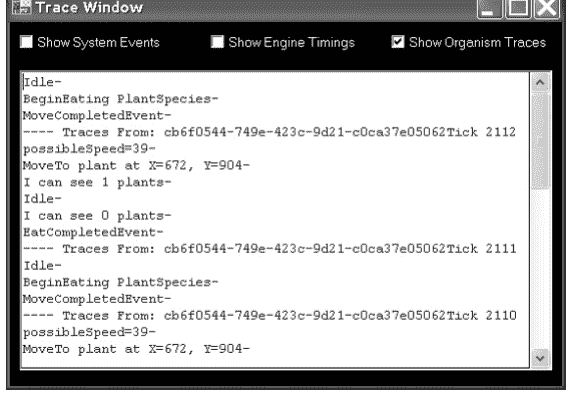

图 4-4 *来自 WriteTrace 命令的输出，显示了鹿跟踪的内部操作（代码可在线获取）*

#### 清单 4-1 代表工具供应商发布正则表达式的 Web 服务

```csharp
using System;
using System.Collections;
using System.ComponentModel;
using System.Data;
using System.Diagnostics;
using System.Web;
using System.Web.Services;
using System.Text.RegularExpressions;

namespace Expressions
{
    /// <summary>
    /// Expressions 的摘要说明。
    /// </summary>
    public class Expressions : System.Web.Services.WebService
    {
        public Service1()
        {
            //CODEGEN: 此调用是 ASP.NET
            //Web 服务设计器所必需的
            InitializeComponent();
        }

        #region Component Designer generated code

        //Web 服务设计器所需
        private IContainer components = null;

        /// <summary>
        /// 设计器支持所需的方法 - 请勿使用
        /// 代码编辑器修改此方法的内容。
        /// </summary>
        private void InitializeComponent()
        {
        }
```


### 110 高级 C# 编程

```csharp
/// <summary>
/// 清理正在使用的所有资源。
/// </summary>
protected override void Dispose( bool disposing )
{
    if(disposing && components != null)
    {
        components.Dispose();
    }
    base.Dispose(disposing);
}

#endregion

[WebMethod()]
public bool IsAlphaNumeric(string input)
{
    return Regex.IsMatch(input, "^[0-9a-zA-Z]+$");
}
}
}
```

由 ASP.NET Web 服务模板生成的代码只有第 51 到 55 行定义的 WebMethod。请注意，该方法看起来就像任何其他方法，只是第 51 行有一个 WebMethod 特性。.NET 框架为我们承担了许多工作。解决方案 Expressions.sln 包含清单 4-1 所示的 Web 服务，而 TestExpressions.sln 包含一个调用该 Web 服务的 Windows 窗体应用程序。要实现清单 4-1 中代码所代表的 Web 服务，请按照以下编号步骤操作。

1.  创建一个新的 ASP.NET Web 服务项目。将项目命名为 **Expressions**。
2.  将第 51 到 55 行的方法添加到你在步骤 1 中创建的 WebService 类。
3.  在包含步骤 2 中代码的 .cs 模块顶部添加 `using System.Text.RegularExpressions;` 语句。
4.  通过选择“调试”->“开始”来编译并运行 Web 服务应用程序。（此步骤将打开 Internet Explorer 和由模板创建的 .asmx 页面（参见图 4-5）。你可以使用此页面来测试 Web 服务。）

你可以通过创建第二个项目来编写测试应用程序。一个 Windows 窗体应用程序就足够了。在解决方案资源管理器中为测试应用程序添加 Web 引用。你可以创建一个在 Web 服务中定义的对象的实例。例如，假设你将 Web 服务命名为 "Expressions" 并将其安装在你的 PC 上。在第二个项目中添加对 Web 服务的 Web 引用后，你可以创建服务的实例，如下所示。

```csharp
localhost.Expressions expressions = new localhost.Expressions();
expressions.IsAlphaNumeric("test123");
```

第一条语句创建了 Web 服务的一个实例。在我们拥有 Web 服务对象的实例后，我们可以像使用同一项目中定义的对象一样使用它。本节中的示例非常基础。有关 Web 服务的更多示例，请阅读第 12 章。

### 生物计时

当 Terrarium 运行时，Terrarium 中的每个生物都会被分配一小片 CPU 时间，大约 2 到 5 毫秒。每个生物都有这段有限的时间来执行诸如休息、觅食、防御和繁殖等动作。当你创建动物时，你需要在实施策略时牢记可用的时间量。不幸的是，我们可以学习编程生物的机制，但好的策略具有高度的主观性，并且依赖于生态系统。你需要自己去试验策略。

### 传送器

当你在玩游戏时，一个蓝球在生态系统中四处漂浮。这个蓝球就是传送器（如图 4-6 所示），它负责在生态系统中传送植物和动物。传送器负责将来自系统中其他对等节点的生物与本节点的生物进行交叉授粉。最终的结果是，你永远不知道你的生物圈中会出现什么。（在生态系统模式下玩游戏时，一些食肉动物可能是毁灭性的。）

传送器使 Terrarium 变得有趣。请访问 **www.gotodotnet.com** 网站获取高级策略，其中包括跟踪传送器的位置。传送器可以用作逃生路线、汇聚点，或者将你的生物传播到最多对等节点的手段。

### 智能客户端更新

Terrarium 附带的另一个示例应用程序是应用程序更新程序（AppUpdater.dll）。应用程序更新程序安装在 \Program Files\Terrarium\bin 目录中。

当你启动 Terrarium 以及在其运行期间定期，Terrarium 客户端会联系主服务器应用程序并请求应用程序的更新。客户端联系主服务器上的一个 XML Web 服务。比较客户端版本和最新版本。如果服务器包含客户端的更新版本，则更新将被加载到一个新目录中。下次启动 Terrarium 时，将运行新版本。至少保留一个旧版本以防出现问题。

.NET 支持修订后的 *瘦客户端编程* 概念。应用程序更新程序演示了这种模型。这个概念很简单：一个应用程序无缝且自动地从网络上获取更新的组件——可以下载或部署一个小型应用程序启动器，而该应用程序的整个 *存在理由* 就是下载应用程序的其余部分并持续从网络获取更新的程序集。该网络可以是互联网。

图 4-6 *蓝球是传送器，负责在生态系统中的对等节点之间移动生物。*

### 动态更新程序集

Assembly 类有一个名为 LoadFrom 的方法。Assembly.LoadFrom 接受一个程序集名称参数。该参数程序集可以位于本地文件系统，也可以位于世界另一端的某个 Web 服务器上。当你拥有一个 Assembly 时，你可以比较清单信息，例如版本号，有条件地决定是否更新程序集。好处在于，这可以在无需用户干预的情况下发生。

让我们回到我们的正则表达式订阅服务。假设我们不选择动态调用测试有限正则表达式集合的 Web 方法，而是选择允许我们的客户通过互联网动态加载正则表达式。我们可以通过从 Web 加载程序集、从该程序集中读取所有表达式并继续处理来实现这一点。当可用的表达式变得越来越好时，用户会感到惊喜。清单 4-2 实现了为订阅者提供正则表达式的程序集。

清单 4-2 一个可以通过 Web 动态加载的类库程序集

```csharp
using System;
using System.Collections;

namespace Expressions
{
    public class Expressions
    {
        public Hashtable GetExpressions()
        {
            Hashtable hashtable = new Hashtable();
            hashtable.Add("Numeric", @"^\d+$");
            hashtable.Add("Social Security Number",
                @"^(\d\d\d)-(\d\d)-(\d\d\d\d)$" );
            return hashtable;
        }
    }
}
```

> 提示
> “@”符号可防止反斜杠被当作转义字符处理。

按照我们最初的概念，我们不想直接将表达式提供给用户。如果他们拥有了表达式，而这些表达式与源代码相同，那他们为什么还需要我们的服务呢？示例程序用键和值填充了一个哈希表。我们可以向消费者展示键并应用对应的值。用户选择的只是“Social Security Number”，而在内部我们应用正则表达式 `@"^(\d\d\d)-(\d\d)-(\d\d\d\d)$"`。（该正则表达式被理解为匹配包含三个数字、一个连字符、另外两个数字、一个连字符和四个数字的字符串。表达式通过 ^ 和 $ 分别限制字符串的开头和结尾有多余字符。）

消费者应用程序支持复杂的字符串匹配。要获取更新的正则表达式，我们的消费者应用程序将包含表达式的程序集加载到我们的消费者应用程序中。清单 4-3 演示了如何从程序集中请求、加载和获取信息。

清单 4-3 从 Web 服务器加载程序集

```csharp
private void UpdateExpressions()
{
    try
    {
        Assembly assembly =
            Assembly.LoadFrom("http://localhost/regex/expressions.dll");

        Type type = assembly.GetType("Expressions.Expressions");
        Object instance = Activator.CreateInstance(type);

        Hashtable newtable = (Hashtable) type.InvokeMember("GetExpressions",
            BindingFlags.Instance | BindingFlags.InvokeMethod |
            BindingFlags.Public, null, instance, new object[]{});

        foreach(object key in newtable.Keys)
        {
            comboBox1.Items.Add(key.ToString());
        }

        hashtable = newtable;
    }
    catch(Exception e)
    {
        MessageBox.Show(e.Message, "Update Error",
            MessageBoxButtons.OK, MessageBoxIcon.Error);
    }
}
```

该代码使用 http:// 协议加载程序集。将命名空间和类名——"Expressions.Expressions"——作为字符串传递，以从程序集中加载类型。使用 Activator 类创建对象的一个实例；并调用返回 Hashtable 的 GetExpressions 方法。我们将所有代表表达式的键读入一个组合框。如果上述所有代码都成功，那么名为 hashtable 的字段将被赋值给本地 Hashtable 变量 newtable。用户看到我们命名良好的表达式，但永远看不到表达式本身，这些表达式代表了我们的知识产权，也是我们获得报酬的原因。

在 Client.sln 中展示了一个完整的工作示例。你需要编译两个项目——client.csproj 和 expressions.csproj——来测试这个示例。expressions.dll 程序集需要被复制到 Web 服务器上。只要你的电脑运行着 Internet Information Services，它就可以正常工作。我们的示例演示了将 PC 用作测试平台，但使用任何其他 Web 服务器也同样有效。

### 对等计算

每个 Terrarium 客户端都是 Terrarium 游戏中的一个对等体。当你在生态系统模式下运行时，服务器会将几个逻辑上相近的对等体关联到你的对等体列表中。（这是服务器在 Terrarium 中的角色：跟踪对等体。）所有的对等体组之间都有一些重叠，因此 Terrarium 中的每个对等体最终都属于一个庞大的生态系统。

当蓝色球传送器遇到一个生物时，会从你的对等体列表中随机选择一个对等体。Terrarium 使用 System.IO 将生物的状态流式传输到一个文件中。包含传送器所选生物的程序集以及该生物的状态流信息，将通过 System.Net.Sockets 命名空间中的 NetworkStream 类发送到选定的对等体。

接收对等体会检查生物程序集是否引用了在 Terrarium 上下文中可能代表作弊的程序集，例如 Reflection。如果生物程序集通过了评估，该生物就会被加载到接收的 Terrarium 客户端中，并使用 System.Runtime.Serialization 来读取生物的状态。结果，一个复制的生物在接收方被重新创建，并从发送方移除。（*传送*——也许这就是我们让《星际迷航》传送器工作的方式。扫描你的大脑。在新位置创建一个克隆体。通过电子邮件发送传送器的大脑扫描数据，将扫描数据加载到克隆体中，然后杀死原始体。）

### 多编程语言支持

Terrarium 是程序员实验多语言编程支持的一个绝佳场所。（我们在此不深入探讨多语言编程。）然而，可以预见的是，在不久的将来，编程团队将由掌握不止一种 .NET 编程语言的程序员组成，这是切合实际的。

## 代码访问安全性

在生态系统 Terrarium 中运行意味着通过网络不断地发送和接收程序集，编译后的代码在其中随机来回移动。这可能会让经理、网络管理员甚至开发者感到有些不安。

Terrarium 的一个引人入胜之处在于，它证明了如果采用安全模型，编译后的代码可以在计算机之间安全地移动。有关代码访问安全的简要示例，请参阅后面的“介绍代码访问安全性”部分，有关安全的更全面讨论，请参阅第 16 章。

### 回顾 Terrarium 框架

任何合理的应用程序都可能通过其架构来描述。Terrarium 是一个对等应用程序，你可以通过创建植物和动物生物来与之交互。你不能随意创建任何生物。你需要通过继承 OrganismBase.dll 程序集中定义的现有类型——Plant 或 Animal——来创建生物。你的生物表现如何，取决于你在 Terrarium 架构上下文中编程你的策略有多好。

Terrarium 的架构过于庞大，无法在此详细涵盖。（可能很快会有人写一本关于 Terrarium 的书。）你可以在 www.gotodotnet.com 网站上找到交叉引用的架构概述。虽然你无需探索这些信息就能创建新的生物，但这些生物会处于劣势。Terrarium 中的顶级类包括 Action、AnimalState、DefendAction、EngineSettings、MoveToAction、OrganismState、PlantState、Vector、Animal、AttackAction、EatAction、MovementVector、Organism、Plant 和 ReproduceAction。从这些顶级类型，你可能推断出 Terrarium 中的交互可能相当复杂。你是对的。

Terrarium 中还有几个事件、事件参数、属性、异常和接口。Terrarium 框架中的所有这些成员都用于描述你的生物的行为。基本思想是，你通过继承 Plant 或 Animal 来创建一个生物。你应用属性来描述你的生物的特征，并实现事件处理器来编码生物的上下文响应。要想成功，植物必须生长和播种。更重要的是，动物必须捕猎、进食、繁殖，并且可能需要攻击、防御和躲避。

我将提供一个植物、一个食草动物和一个食肉动物的基本示例。但是，如果你打算在更大的生态系统中竞争，那么请注意，那里存在一些严重的错误。

### 创建植物和小动物

Terrarium 中的图形很有趣，但它们远不如编码植物和动物的概念和竞争方面那么精彩。植物通过散布种子来生长和繁殖。如果你的植物播种和生长的数量多于被吃掉的数量，它们就会茁壮成长。不幸的是，就植物而言，一旦你释放了一个植物，你就只能任由食草动物直接摆布，任由食肉动物间接摆布。总的来说，植物易于实现，而且表现相当不错。相反，观察植物并不是很有趣。

动物则不同。动物会移动并积极参与生态系统。一个动物的表现如何，更取决于程序员实现的巧妙策略。（如果你的动物被吃掉了，不要难过。成为一个好的程序员和一个好的策略家不是一回事。好的代码在 Terrarium 中可能实际上适得其反，因为面向对象的代码可能比 hack 代码运行得更慢。）在下一节中，我们将看看一些基本的植物和动物。

第 4 章：Terrarium 117

### 创建植物

植物很无聊，但却是生态系统的重要组成部分。植物为我们提供了一种方便且简单的方法将生物引入生态系统。创建生物的基本步骤如下：

1.  创建一个类库项目。
2.  添加对 organismbase.dll 的引用，该程序集随 Terrarium 客户端一起安装。
3.  添加对 system.drawing.dll 的引用，这是 .NET 框架附带的 GDI+ 程序集。
4.  定义一个继承自 Plant 类（或 Animal 类以创建动物）的类。
5.  定义一些必需的属性。
6.  编写你的生物代码（参见清单 4-4）。

```
清单 4-4  Plant 的一个实现

1:  using System;
2:  using System.Collections;
3:  using System.Drawing;
4:  using System.Reflection;
5:  using System.IO;
6:
7:  [assembly: OrganismClass("AloeVera")]
8:  [assembly: AuthorInformation("Paul Kimmel", "pkimmel@softconcepts.com")]
9:
10:  [MaximumEnergyPoints(10)]
11:  [MatureSize(26)]
12:  [SeedSpreadDistance(50)]
13:
14:  public class AloeVera : Plant
15:  {
16:    public override void SerializePlant(MemoryStream m)
17:    {}
18:
19:    public override void DeserializePlant(MemoryStream m)
20:    {}
21:
22:  }
```

程序集属性 `OrganismClass` 为我们将要引入生态系统的类命名。你需要定义一个与用于初始化 `OrganismClass` 属性的名称相同的类。（第 14 行到第 22 行实现了 AloeVera 植物。）程序集级属性 `AuthorInformation` 是必需的；此信息用于表明所有权，并在生态系统中出现异常时提供联系信息。

`MaximumEnergyPoints`、`MatureSize` 和 `SeedSpreadDistance` 是像植物 DNA 一样工作的值，用于描述植物。你可以尝试使用这些属性值来创建茁壮成长、生长和发芽的植物。

第 16 行和第 19 行实现了空的序列化和反序列化方法。这些是必须实现的抽象方法；它们对动物更有意义。你可以在生物被传送时存储关于该生物生态系统的信息。你可能想为动物实现这些方法。（有关在 Terrarium 中实现序列化的更多信息，请参阅后面的“序列化对象”部分。）

### 创建小动物

动物比植物的实现要困难得多。无论是编程食草动物还是食肉动物，编程动物的某些方面是相同的。在实现食草动物和食肉动物之前，我们将先考察实现动物的共同方面。

要实现一个动物，无论是食草还是食肉，你需要执行以下步骤：

1.  创建一个类库项目。
2.  添加对 organismbase.dll 和 system.drawing.dll 的引用。
3.  创建一个继承自 Animal 的类，其名称应与你将提供给 `OrganismClass` 程序集级属性的名称相同。
4.  实现一组属性，大致描述你的生物的概念性 DNA。这些属性包括 `MatureSize`、`Carnivore`、`AnimalSkin`、`MarkingColor`、`MaximumEnergyPoints`、`EatingSpeedPoints`、`AttackDamagePoints`、`DefendDamagePoints`、`MaximumSpeedPoints`、`CamouflagePoints` 和 `EyesightPoints`。
5.  提供代码来描述你的生物的行为。（这是棘手的部分。）

### 动物的共同规则

你有 100 点可以分配到 `MaximumEnergyPoints`、`EatingSpeedPoints`、`AttackDamagePoints`、`DefendDamagePoints`、`MaximumSpeedPoints`、`CamouflagePoints` 和 `EyesightPoints` 中。对于食草动物，你可能希望强调诸如 `MaximumSpeedPoints` 和 `EatingSpeedPoints` 之类的东西。你可能还想强调 `DefendDamagePoints`——想想犀牛和水牛。`CamouflagePoints`（隐藏）可能是小型快速动物的一个好属性，而 `DefendDamagePoints` 可能是大型缓慢动物的一个好属性。如果你创建的是食肉动物，那么你可能希望拥有巨大的 `AttackDamagePoints`、`EyesightPoints` 和 `MaximumSpeedPoints`，但要淡化诸如伪装之类的东西。我不是动物学家，但我能想到对于各种属性来说合理的组合。狮子相当成功，因为它们有一定的速度，

利用伪装，并造成最大伤害。另一方面，鬣狗成群结队地狩猎和食腐。（我将肉食动物和草食动物视为特定类型的动物，并强调这些动物所具有的特征。）

如果你在“生态缸”模式下测试你的生物——而不是在“生态系统”模式下——你可能会收到基于属性设置的警告。看起来似乎是任意设定的，但防御伤害点数（DefendDamagePoints）应以4为增量，视野点数（EyesightPoints）应以10为增量（参见图4-7）。

动物有其属性特征，这些特征会增强或削弱一个物种的成功。更重要的是你为这些动物编写的代码。一个聪明的策略师可能会编写代码来创造协作狩猎行为或积极的捕食者躲避反应。

某些事情会加速你生物的灭亡。如果你的生物抛出了一个未处理的异常，那么该生物实例将被销毁并从生态系统中移除。“生态缸”模式提倡编写能主动处理异常的代码。如果你的生物花了太长时间来做它的事情，那么它也会被销毁。你每回合大约有2毫秒的时间来安排你的生物需要发起或完成的活动。复杂的代码可能会导致你的生物死亡，仅仅是因为代码执行“堵塞”了。

你可以使用WriteTrace在“生态缸”模式下向跟踪窗口发送消息。在将你的生物引入生态系统之前，使用WriteTrace来调试它们。

创建好你的生物体后，你可以将你的生物添加到一个本地“生态缸”中。这将为你提供最大的调试机会……嗯，调试你的“bug”。你可以查看跟踪消息……


### 迭代对象集合

清单 4-5 的第 49 至 56 行展示了 *foreach* 构造。在第 2 章中，我演示了 IEnumerator 接口。你可以从一个实现了 IEnumerable 的类（如 ArrayList）请求一个枚举器，用于迭代对象集合。一种更简单的迭代对象的方法是使用 *foreach* 构造。

*Foreach* 支持声明一个变量并迭代包含集合所定义对象的集合，如清单 4-5 所示。这比使用枚举器更简单，尽管它依赖于 IEnumerable 接口。通过实现 IEnumerable，你可以创建可使用 *foreach* 进行迭代的强类型集合。有一种简单的方法可以实现强类型集合，接下来你将看到。

### 继承自 CollectionBase 和 ReadOnlyCollectionBase

强类型集合是指特定类型的集合，例如生物体集合或联系人集合。创建强类型集合最直接的方法是继承自 ReadOnlyCollectionBase 或 CollectionBase。ReadOnlyCollectionBase 将有助于创建一个可读的强类型对象集合，而 CollectionBase 将有助于创建一个可读且可写的强类型对象集合。清单 4-6 演示了如何创建一个客户对象的强类型集合。

#### 清单 4-6
此代码演示了一个客户对象的强类型集合，通过继承自 ReadOnlyCollectionBase 创建。

```csharp
public class Customers : ReadOnlyCollectionBase
{
    public Customers()
    {
        ReadCustomers();
    }

    public Customer this[int index]
    {
        get
        {
            return (Customer)InnerList[index];
        }
    }

    public Customer this[string name]
    {
        get
        {
            return (Customer)this[Find(name)];
        }
    }

    private int Find(string name)
    {
        for (int i = 0; i < Count - 1; i++)
        {
            if (this[i].Name.Equals(name)) return i;
        }
        return -1;
    }

    private void ReadCustomers()
    {
        InnerList.Add(
          new Customer("Robert Golieb", "(617) 555-1212"));
        InnerList.Add(
          new Customer("Mark Davis", "(503) 555-1212"));
    }
}

public class Customer
{
    private string name;
    private string phone;

    public Customer(string name, string phone)
    {
        this.name = name;
        this.phone = phone;
    }

    public string Name
    {
        get
        {
            return name;
        }
        set
        {
            name = value;
        }
    }

    public string Phone
    {
        get
        {
            return phone;
        }
        set
        {
            phone = value;
        }
    }
}
```

ReadOnlyCollectionBase 类实现了 ICollection 和 IEnumerable。ICollection 旨在提供 Count、将元素复制到数组以及同步访问底层元素的功能。IEnumerable 有一个方法：GetEnumerator。IEnumerable 是 foreach 所要求的接口，用于迭代集合或数组中的元素。

清单 4-6 中的代码实现了一个 Customer 类和一个名为 Customers 的客户对象集合。通过继承自 ReadOnlyCollectionBase，我们获得了用于存储元素的基础结构以及实现了 ICollection 和 IEnumerable 的代码。通过实现索引器 *this*，我们可以像对待类型化数组一样对待 Customers 的实例。例如，customers[0]（其中 customers 是 Customers 类的实例）将返回索引位置为 0<sup>th</sup> 的 Customer 对象。索引器在第 8 至 14 行实现。我们还可以实现一个接受字符串的索引器（参见第 17 至 23 行）。字符串索引器和 Find 方法协同工作，接受一个字符串并找到包含 Name 字段（该字段包含索引值）的对象。例如，Customers["Robert Golieb"] 将返回 Name 初始化为 Robert Golieb 的对象。

只有生产者可以初始化 ReadOnlyCollectionBase 的元素。第 34 至 40 行的 ReadCustomers 方法演示了初始化集合的一种方式。你同样可以通过从 XML 文件或数据库读取来轻松初始化集合。要创建可读写、强类型的集合，请继承自 CollectionBase 类。

### 改进奶牛

我们可以通过添加一些智能行为来改进奶牛这种食草动物。我们可以添加事件处理器来响应攻击并展现防御行为，而且我已经演示了如何寻找食物。Deer.sln 提供了对奶牛的改进。鹿使用一个 ReadOnlyCollectionBase 来跟踪食物，并寻找最近的食物来吃。你可以通过打开 www.osborne.com 网站上提供的 Deer.sln 来查看鹿的代码。清单 4-7 演示了一个用于跟踪鹿所需植物的集合。

#### 清单 4-7
为食草动物实现一个食物跟踪集合

```csharp
public class Plants : ReadOnlyCollectionBase
{
    private Animal animal;

    public PlantState ClosestPlant()
    {
        PlantState closest = null;
        foreach (PlantState plant in this)
        {
            if ((closest == null) ||
               (animal.DistanceTo(plant) < animal.DistanceTo(closest)))
                closest = plant;
        }

        InnerList.Remove(closest);
        return closest;
    }

    public Plants(Animal animal)
    {
        this.animal = animal;

        ArrayList organisms = animal.Scan();
        foreach (OrganismState organism in organisms)
        {
            if (organism is PlantState)
                InnerList.Add(organism);
        }
    }

    public PlantState this[int index]
    {
        get
        {
            return (PlantState)InnerList[index];
        }
    }
}
```

> **注意**
> 你可以通过设置 AttackDamagePoints 属性并对食草动物调用 BeginAttacking 方法来创建凶猛的食草动物。也许你可以杀死所有食草的竞争对手或消灭较弱的肉食动物。

当鹿饥饿时，它会请求范围内的植物集合。Plants 集合会从扫描结果中移除动物。Plants.ClosestPlant 方法返回距离单只鹿位置最近的植物，并将该植物从集合中移除。返回最近的植物，鹿就能以最小的能量消耗进食。清单 4-5 中提供的奶牛因缺乏主动性而饿死。鹿（解决方案可下载）使用植物跟踪策略，比奶牛高效得多，并且摧毁了如此多的植物以至于最终使自己饿死了。

### 创建肉食动物

创建肉食动物要复杂一些。它们的食物来源会移动，甚至可能反击。肉食动物也可能被吃掉。对一些生态系统中某些肉食动物的观察表明，似乎存在每 10 只食草动物对应 1 只肉食动物的比例。这可能是 Terrarium 游戏本身中规范化的行为。没有肉食动物，Terrarium 中可能难以实现平衡。

一个稍作修改的肉食动物的代码需要十页。为了避免用大量的代码清单来填充本书，我没有在这里重现代码，但我鼓励你下载 Lion.sln 示例代码并查看完整的清单。我将介绍 Lion.sln 中的一些要点，这些要点将帮助你构建肉食动物。

### 设置肉食动物属性

肉食动物和食草动物使用相同的属性。你可能需要为肉食动物设置不同的平衡。要创建食肉动物，你必须将 Carnivore 属性初始化为 True，否则你的小动物将无法捕食动物。（没有杂食动物。）你可以增加像 AttackDamagePoints 这样的属性来对猎物造成巨大伤害，或者增加像 MaximumSpeedPoints 这样的属性来创建相当于狮子或猎豹的速度。

某些属性必须是某个值的偶数倍，这是任意的。EatingSpeedPoints 属性需要是 4 的倍数。（饥饿的肉食动物，如狮子，可以悠闲地进食，除非有鬣狗在附近游荡。）在 Terrarium 模式下测试你的生物体将为你提供关于浪费的 DNA 点数的提示。

MoveCompletedEvent 可能因多种原因被调用。回想一下 BeginMoving 是异步的。我们的 bug 可能因为到达食物源或撞到其他东西而停止移动。我们的 bug（第 73 至 85 行）简单地假设我们已经到达了食物目的地。如果我们处于 WithinEatingRange 并且饥饿（由第 80 行的 State.EnergyState 值表示），那么我们就开始进食。一个成功的 bug 可能会检测到捕食者或障碍物的存在，然后做其他事情，比如逃跑。

最后，我们必须实现重写的 SerializeAnimal 和 DeserializeAnimal 方法。对于奶牛，这些是空方法。（有关更多信息，请参见本章后面的“序列化对象”。）

PossibleSpeed 是我借鉴自 **www.gotdotnet** 网站上一些代码示例的一个流行算法。通过反复试验，我发现让 bug 以最高速度运行是自杀的好方法。PossibleSpeed（第 59 至 71 行）评估由 MaximumSpeedPoints 定义的小动物的最大速度。PossibleSpeed 的值用于确定小动物基于储存的能量和移动特定距离于特定速度所需能量可以行驶的速度和距离。以最大速度奔跑很可能会让你的小动物以惊人的速度狂奔，然后似乎死于心脏病发作。


### 编程狩猎行为

`Scan` 方法会返回一个包含你的生物（critter）可见生物的 `ArrayList`。`Scan` 返回植物和动物。你可以过滤该列表以只保留动物或只保留植物，如代码清单 4-6 所示。例如，肉食动物可能只关心动物；你也可以编程实现更高级的行为，比如朝向植物移动，希望饥饿的食草动物可能会出现。

### 将植物和生物引入生态瓶

当你完成了你的植物或动物，就可以将其引入生态系统。如果你的代码存在缺陷，比如未处理的异常，那么你将无法修改它并重新引入同一个生物体。因此，最好在将其提交到更大的生态系统之前，先在生态瓶（Terrarium）模式下测试该生物体。

过度激进的异常处理方法将防止你的生物体被生态瓶应用程序销毁。以下代码片段演示了为狮子（Lion）编写的 `AttackCompletedEvent` 处理程序。

```csharp
private void AttackCompletedEvent(object sender, AttackCompletedEventArgs e)
{
    try
    {
        if(e.Killed)
        {
            if (CanEat)
            {
                BeginEating(e.AttackAction.TargetAnimal);
            }
        }
    }
    catch(Exception x)
    {
        WriteTrace(x.Message);
    }
}
```

当 `AttackCompletedEvent` 被触发时，我们可以检查 `AttackCompletedEventArgs`，它会指示被攻击者是否已死亡。如果死亡，我们可以检查我们是否可以进食——`State.EnergyState < EnergyState.Full`——如果是，则调用异步的 `BeginEating` 方法开始进食猎物。

当一个新的程序集被引入到每个客户端时，该程序集会被检查是否存在可能在游戏环境中被视为作弊的代码。如果你的生物体通过审查，那么当你首次引入该生物体时，十个该生物体的副本会被添加到生态瓶中。

如果你的生物体灭绝了，那么你可以从灭绝物种列表中添加原始的生物。你不能修改该物种并重新引入修改后的代码。因此，一个已经灭绝的物种很可能因相同的原因再次灭绝。

### 介绍代码访问安全

生态瓶典型地展示了来自各种目的地的代码。在生态系统模式下，代码可能来自世界任何地方——请记住，生态系统没有孤立的切片。生态瓶是微软用来介绍新的代码访问安全（Code Access Security）模型的良好方式。

任何使用公共语言运行时（Common Language Runtime）的代码都必须与安全模型交互。基本前提是，使用 CLR 的代码必须生成可验证的类型安全代码，你不能假定代码会被授予任何权限。例如，如果你为公共消费创建一个 Web 服务，你不应该假定你的代码会被授予特定权限，你必须处理因权限被拒绝而导致的错误。（有关代码访问安全以及命令式（Imperative）和声明式（Declarative）安全的更多信息，请参考第 16 章。）

### 次要主题

生态瓶支持序列化对象状态的概念。序列化对象状态仅仅意味着将对象的状态信息写入另一种形式——例如，二进制文件。将对象的状态写入文件有助于通过网络传输该状态信息。对称的反序列化方法确切知道从序列化文件中读取数据的顺序和类型。

生态瓶为你提供了实验序列化的合适机会。当传送装置（Teleporter）碰到你的生物体实例时，会从你的对等方列表中选择一个对等方。该生物体将从你的生态瓶中移除，其 DLL 的副本将被发送到从列表中选择的对等方。状态信息也会被发送。如果你为 `SerializePlant` 或 `SerializeAnimal`，以及 `DeserializePlant` 或 `DeserializeAnimal`（视情况而定）提供了实现，那么该附加状态信息也会被发送。本章的剩余部分将通过为肉食动物狮子（Lion）实现 `Serialize` 和 `Deserialize` 方法来演示序列化。

### 序列化对象

在本章前面，我提到了生态瓶如何使用 `System.IO` 命名空间。生物体中的 `Serialize` 和 `Deserialize` 方法使用 `MemoryStream` 类。*流*（*stream*） simply 是一个连续的字节集合。仅仅将数据表示为连续字节是计算机看待数据的方式，并且连续的字节块可以通过多种方式轻松移植，包括通过互联网。`MemoryStream` 是一个存储在内存中的流——与代表文件作为流的 `FileStream` 相对。

编程的一个概念级别是类。通过将数据表示为具有公共接口的各种流，就使得以一致和多态的方式处理各种形式的数据成为可能。实现一个接受流的方法，无论你处理的是 `MemoryStream` 还是 `FileStream`，你执行的具体操作都是相同的。流类型之间存在细微差别。例如，你不需要用 `MemoryStream` 表示文件名，但 `FileStream` 将文件表示为连续的字节块，并且直观上你需要一个文件来实现此目的。

你可以通过实现 `Serialize` 和 `Deserialize` 方法来跟踪生态瓶中生物体的附加状态信息。你只需要提供这些方法的桩代码（stub），但代码清单 4-8 中的代码演示了如何在生物体被传送时序列化状态信息，以及在生物体被传送后反序列化状态信息。

#### 使用 MemoryStream 对象序列化生物体

标记有 `abstract` 修饰符的方法必须在子类中被重写和实现，即使该实现只是一个空的方法调用。这就是我们迄今为止对生物体的实现所做的。我们没有实现序列化方法，因为没有实际的理由这样做。然而，你可以设想一个理由。也许你的生物体跟踪成功击杀的次数以及经常攻击它的物种类型。你可能选择流式传输最具攻击性的生物体和最容易捕获的猎物，并选择避开前者，寻找后者，以帮助你的生物体更成功。这是一个策略问题。代码清单 4-8 通过流式传输狮子在被传送之前参与的活动来演示序列化和反序列化。

**代码清单 4-8** 使用 `MemoryStream` 序列化和反序列化状态信息

```csharp
public override void SerializeAnimal(MemoryStream m)
{
    try
    {
        byte[] buffer = new Byte[]{
            Convert.ToByte(IsDefending), Convert.ToByte(IsAttacking),
            Convert.ToByte(IsEating), Convert.ToByte(IsMoving)};
        m.Write(buffer, 0, buffer.Length);
        WriteTrace("SerializeAnimal");
    }
    catch(Exception e)
    {
        WriteTrace(e.Message);
    }
}

public override void DeserializeAnimal(MemoryStream m)
{
    try
    {
        byte[] buffer = new Byte[4];
        m.Read(buffer, 0, buffer.Length);
        WriteTrace("WasDefending: " + Convert.ToBoolean(buffer[0]));
        WriteTrace("WasAttacking: " + Convert.ToBoolean(buffer[1]));
        WriteTrace("WasEating: " + Convert.ToBoolean(buffer[2]));
        WriteTrace("WasMoving: " + Convert.ToBoolean(buffer[3]));
        WriteTrace("DeserializeAnimal");
    }
    catch(Exception e)
    {
        WriteTrace(e.Message);
    }
}
```

**提示**
*在异常处理程序的 catch 谓词中指示你要捕获的 Exception 类型，以获取异常对象的实例，如代码清单 4-8 所示。*

`SerializeAnimal` 方法写入包含代码清单 4-8 中代码的动物的 `IsDefending`、`IsAttacking`、`IsEating` 和 `IsMoving` 属性。为了证明我们可以检索状态信息，`DeserializeAnimal` 方法读取与 `SerializeAnimal` 方法中写入的完全相同数量的数据。

#### 写入 FileStream

`FileStream` 代表你无法添加到生物体中的代码类型。当生物体被加载到生态瓶中时，生态瓶要查找的一件事就是尝试执行文件 IO 的代码。生态瓶中不允许文件 IO，因为这可能允许恶意代码在对等方之间传输。这种禁止是 .NET 中安全模型运作的一个例子。如果你尝试代码清单 4-9 中的代码，你将收到一个错误，并且你的生物体将失败，但该代码将演示如何获取临时文件名并将信息写入文件。

**代码清单 4-9** 此代码演示了如何使用 `FileStream` 类进行文件 IO。

```csharp
string filename = Path.GetTempFileName();
FileStream file = new FileStream(filename, FileMode.CreateNew);
m.WriteTo(file);
file.Close();
```

代码清单 4-9 中的第一条语句演示了如何在 .NET 中请求临时文件名。（你可能记得 `GetTempFileName` 曾经是一个 Windows API 方法。现在 `GetTempFileName` 是 `System.IO` 命名空间中定义的 `Path` 类的一个静态方法。）第二条语句演示了如何创建一个新的 `FileStream` 和文件，传递第一条语句中创建的 `.tmp` 文件名。`m.WriteTo` 语句演示了如何写入。

信息从一个流传递到另一个流。对象 *m* 是传递给 `SerializeAnimal` 的 `MemoryStream` 的代表。任何 `MemoryStream` 实例都可以。最后，我们关闭 `FileStream`，将文件句柄返回给操作系统。

### 总结

Terrarium 提供了一个绝佳的机会，让你能深入了解 C# 编程的方方面面。如果你有点想象力，Terrarium 还会让你有点上瘾。对学习上瘾是件好事。希望你有机会安装 Terrarium 客户端——甚至服务器端——并创建几个生物体添加到生态系统中。在使用 Terrarium 进行实验的过程中，你将接受关于继承、实现事件处理器和使用属性、异常处理器、正则表达式、反射、实现强类型集合，以及 .NET 中流和序列化如何工作的速成课程。这些主题都在本章以及可从 **www.osborne.com** 和 **www.softconcepts.com** 网站获取的代码中进行了详细阐述。

本章还介绍了代码访问安全性。安全性将在第 16 章中详细阐述。

# 第 5 章

## 使用 ADO.NET 构建数据库应用程序

本章内容包括：

- 演示主题
- ADO.NET 命名空间快速回顾
- 连接到数据源
- 理解适配器的作用
- 使用 DataSet
- 使用 DataTable
- 使用 DataView
- 使用 DataReader 进行只读数据访问
- 在 DataGrid 中显示信息
- 使用 Command 对象
- 使用 CommandBuilder 生成 SQL
- 总结

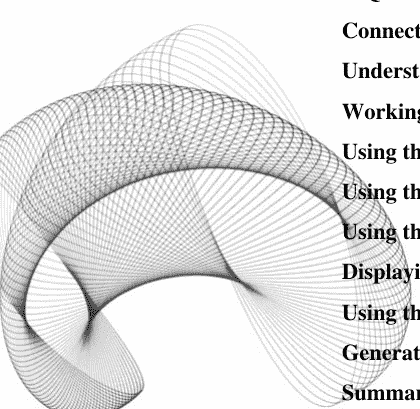

当前版本的 ADO 包含了旨在适应我们当今世界的修订。在 21 世纪，信息就是大生意。成千上万甚至数百万的并发用户能够快速访问海量数据是现实情况。ADO.NET 进行了修订以反映这一现实。

以前版本的 ADO 主要基于 *连接* 模型。每个用户在与数据交互时都保持着与数据源的连接。结果导致了由大量可能的物理连接引起的瓶颈。假设客户端是连接到互联网的 PC，服务器是 Web 服务器，那么数据库问题可能会因距离和带宽而加剧。

通常，单位时间内的事务数量可用于确定总吞吐量。每分钟完成一个事务，应用程序每天可以支持 1,440 个事务。每秒一个事务，应用程序每天可以支持 86,400 个事务。显然，这些数字远未达到数百万。ADO.NET 进行了修订，以解决对数据源物理连接有限的问题，提高可靠性，并在当今存在的、互联的世界中工作。

当前的 ADO.NET 基于断开连接的模型，并以 DataSet 和 XML 为中心。简而言之，ADO.NET 模型遵循连接到数据源、执行短事务、然后从数据源断开连接的模式。ADO.NET 引入了一些新的功能和类。本章将演示如何使用 ADO.NET 编写数据库应用程序。

### 演示主题

第 2 章通过演示如何探索 CLR 介绍了反射这一主题。工具提供商可以使用这样的工具来完整地记录 CLR，并提供一个将 CLR 的特定方面与示例代码关联起来的参考应用程序。为了使这个概念可行，我们需要将通过反射发现的信息写入数据库，然后向该数据库添加代码示例。

根据我与一位微软项目经理的讨论，微软内部有一个应用程序，它为内部使用 .NET 的开发者充当资源工具。幸运的是，微软发布了 Rotor，这是公共语言基础结构 (CLI) 的共享源代码，也是 .NET 基类库的重要组成部分。Rotor 可以从微软网站下载。

我们可以创建自己的参考应用程序，作为演示 ADO.NET 的合理手段。本章的演示主题以 CLR 参考应用程序为背景，将向您展示如何

- 使用连接
- 使用适配器
- 使用新的 DataSet 类进行编程
- 填充和操作 DataTable
- 使用 DataView 类

1. 使用 DataReader 加快数据库访问
2. 使用 Command 对象执行 SQL 命令
3. 使用 CommandBuilder 自动生成 SQL 语句
4. 使用 DataGrid 创建数据绑定图形用户界面

次要主题部分将借鉴演示主题，描述如何将 DataSet 作为 XML Web 服务的返回类型使用，将数据绑定到网页上的控件，以及继承 TraceListener 以方便调试和测试。

### ADO.NET 命名空间快速回顾

ADO.NET 由程序集、命名空间和类组成，这些是更大的 .NET Framework 的一部分。ADO.NET 的主要命名空间是 `System.Data` 命名空间。`System.Data` 包含像 `DataSet` 和 `DataTable` 这样的类。在 `System.Data` 命名空间内是 `System.Data.Common`、`System.Data.OleDb`、`System.Data.SqlClient` 和 `System.Data.SQLTypes`。此外，`System.XML` 对 ADO.NET 以及整个 .NET 都至关重要。

`System.Data.Common` 命名空间包含 ADO.NET 提供程序共享的类。例如，`System.Data.OleDb` 和 `System.Data.SQLClient` 命名空间都包含从 `System.Data.Common` 命名空间中的通用适配器继承而来的适配器。

`System.Data.OleDb` 和 `System.Data.SQLClient` 是包含对称功能的命名空间。`SQLClient` 命名空间包含用于处理 MS SQL Server 7.0 或更高版本数据库的类，而 `OleDb` 命名空间包含用于处理所有其他兼容 OleDb 的数据库（包括 MS Access）的类。

`System.Data.SQLTypes` 包含表示本机 SQL 数据类型的类。

最后但同样重要的是 `System.XML`。XML 用于描述数据。例如，如果您将 `DataSet` 指定为 Web 服务的返回类型，那么 `DataSet` 将被序列化为 XML，以便于传输。XML 用于定义数据架构 (XSD 架构)。

随着本章示例的进行，我将指明特定类来自何处，您可以将这一小节作为资源来探索有关 ADO.NET 的更多信息。

让我们系统地介绍 ADO.NET，从我们必须做的第一件事开始：创建到数据源的连接。

### 连接到数据源

有 ADO 早期版本经验的程序员知道 ADO 支持断开连接的数据库模型。然而，.NET 之前的 ADO 本质上是一个连接模型，并且不基于 XML。断开连接的 ADO.NET 不会保持连接——我们称之为断开连接——并使用 XML，这使得数据可以轻松地在网络间传输，因为 XML 只是超文本。

但是，您需要创建并使用连接来访问数据。您可以为 MS SQL Server 7.0 或更高版本的数据源创建 `SqlConnection`，或为任何其他支持 OLE DB 的数据源创建 `OleDbConnection`。

为了优化连接使用，您需要利用连接池。连接池是应用程序可以共享的连接集合或池。`OleDbConnection` 自动使用连接池。`SqlConnection` 隐式管理连接池。使用相同连接字符串的 `SqlConnection` 可以被池化。您必须关闭连接才能利用连接池。

#### 连接到 OLE DB 数据存储

ADO.NET 创建了一个环境，从您编写的代码角度来看，使用各种数据源的情况是相似的。要学习如何使用 ADO.NET 编程，您可以使用任何可用的数据源。一种支持 OLE DB 的数据源是 Microsoft Access Jet 引擎。（MS Access 随 Microsoft Office Professional 一起提供。）我们将使用 Access 作为 OLE DB 示例。

要连接到 OLE DB 提供程序，您需要提供特定的连接字符串。您可以采用几种不错的策略来获取一个可用的连接字符串。如果在表示层添加连接，则可以将 `OleDbConnection` 从服务器资源管理器直接拖放到 Windows 窗体或 Web 窗体上（见图 5-1）。另一个创建连接字符串的好策略与创建 Microsoft 数据链接文件有关。

如果您创建一个扩展名为 `.UDL` 的文本文件（例如，在 Windows 资源管理器中），然后双击该文件，那么您可以使用“数据链接属性”小应用程序（见图 5-2）来配置连接。“数据链接属性”小应用程序为您提供了创建连接的可视化界面。填写每个选项卡上的信息，`.UDL` 文件将包含一个有效的连接字符串。要创建到 Microsoft Access 2000 或 2002 数据库的连接，请按照以下步骤操作：

1. 创建一个带有 `.UDL` 扩展名的空白文本文件。双击该文件，使用“数据链接属性”小应用程序打开它。
2. 在“提供程序”选项卡上，选择“Microsoft Jet 4.0 OLE DB 提供程序”。单击“下一步”按钮，如图 5-2 所示。
3. 在“连接”选项卡上，使用浏览按钮——一个带有省略号标题的按钮——浏览到您的数据库文件。Access 数据库具有 `.MDB` 扩展名。（您可以使用 Windows 资源管理器搜索 Access 数据库。）您可以忽略第 2 项，将默认用户名 “Admin” 保留在用户名字段中，除非您知道这对于所选数据库无效。
4. 您可以使用“测试连接”按钮来确定是否有有效的连接。
5. 如果测试成功，那么您可以单击“确定”以保存配置更改。


### 第5章：使用 ADO.NET 构建数据库应用程序

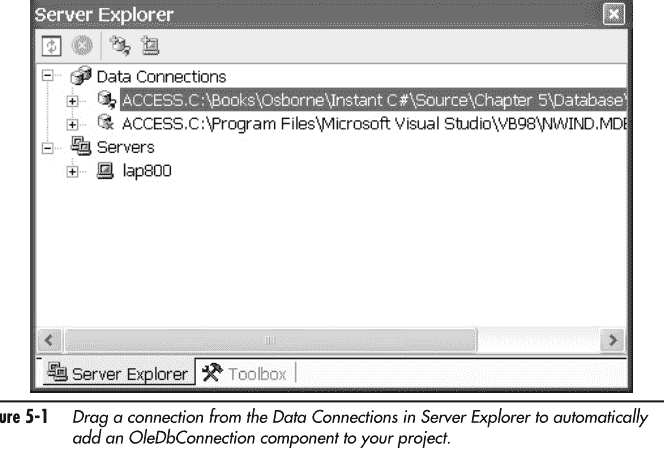

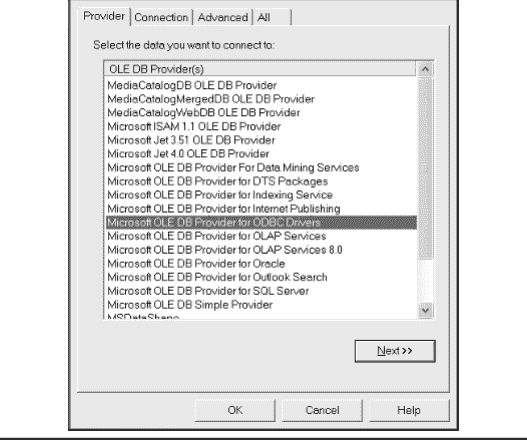

“数据链接属性”小程序的“高级”选项卡允许您指定访问权限。默认设置是通过此连接对数据库进行共享、可读写的访问。“所有”选项卡包含名称和值对，允许您修改每一个连接值。通常情况下，使用默认值即可，除非您有特定理由修改初始化值，例如 `Jet OLEDB: Encrypt Database`。

关闭“数据链接属性”小程序后，用记事本打开 `.UDL` 文件，并复制小程序创建的连接字符串。以下是 UDL 小程序为本书源代码中提供的示例数据库 Reference.mdb 创建的连接字符串值示例。

```
Provider=Microsoft.Jet.OLEDB.4.0;DataSource=C:\Temp\Reference.mdb;
Persist Security Info=False
```

将上述语句用引号括起来，您就可以用它来初始化一个 OleDbConnection 对象，而无需记住提供程序名称 `Microsoft.Jet.OLEDB.4.0`。清单 5-1 演示了如何编写代码来打开我们示例连接字符串所描述的数据库。

```
public static void TestConnection()
{
    OleDbConnection connection = new OleDbConnection();
    connection.ConnectionString =
        @"Provider=Microsoft.Jet.OLEDB.4.0;" +
        @"Data Source=C:\Temp\Reference.mdb;" +
        @"Persist Security Info=False";

    connection.Open();
    try
    {
        Console.WriteLine(connection.State.ToString());
        Console.ReadLine();
    }
    finally
    {
        connection.Close();
    }
}
```

**提示**

C# 中的字符串可以使用 `@` 引号或普通引号。普通引号字符串会将单个反斜杠视为转义字符，将双反斜杠视为反斜杠。`@` 引号字符串会阻止转义字符被处理。

在清单 5-1 中使用 OleDb 提供程序，需要添加 `using` 语句来引用 `System.Data.OleDb` 命名空间。您可以创建 OleDbConnection 对象，在构造函数中传递连接字符串，或者在对象创建后将连接字符串赋值给 `ConnectionString` 属性。调用 `Open` 方法打开连接。`try finally` 处理程序（也称为资源保护块）的 `try` 部分中的代码代表了实际的工作。在清单 5-1 中，我们只是将连接对象的状态写入控制台。`finally` 块总是会被调用，这正是我们想要的。我们总是希望关闭连接，而 `finally` 块将确保即使发生异常，连接也会被关闭。

### 连接到 MS SQL Server 数据存储

从连接 SQL 数据库所需代码的角度来看，代码与清单 5-1 几乎完全相同。最大的区别在于连接字符串。连接字符串需要包含与 MS SQL Server 数据库相关的信息。您可以使用上一节描述的两种相同技术——从服务器资源管理器拖动连接或创建 `.UDL` 文件并使用“数据链接属性”小程序——来定义连接到 SQL Server 数据库的字符串。

我们可以使用与清单 5-1 几乎相同的代码来打开与 SQL Server 数据库的连接。（Microsoft 桌面引擎 [MSDE] 是在开发环境中使用的优秀 SQL Server 数据库，因为您可以在未联网的 PC 上进行初步的软件编写。当您在海滩或吊床上编程时，这尤其有用。）连接到 SQL Server 数据库时，您需要包含 `System.Data.SqlClient` 命名空间并创建 `SqlConnection` 对象的实例。

```
SqlConnection connection = new SqlConnection();
connection.ConnectionString =
    @"data source=LAP800\VSDOTNET;initial catalog=master;" +
    @"integrated security=SSPI;persist security info=False;" +
    @"workstation id=LAP800;packet size=4096";
```

使用设计良好的框架可以带来巨大的好处。让我们花点时间看看 ADO.NET 提供的这样一个好处。

### 使用 ADO.NET 接口声明类型

一个合理的需求是轻松地在数据提供程序之间切换。有几种可能的情况，我接下来将描述其中一种。

在俄勒冈州波特兰市的一个项目中，我们正在用 C# 构建一个连接到 IBM 通用数据库的企业解决方案。住在密歇根州的我，偶尔能回家远程办公感觉很好。（这有助于我完成庭院工作。）我想在家里的办公室工作——为了多处理器工作站、大屏幕、丰富的藏书、巨大的办公椅，最重要的是为了家人——但我不想安装客户可能使用的每一种数据库。相反，我将编写应用程序，使我能够快速简单地切换到备用数据提供程序。将 ADO.NET 与数据库的 CASE 工具结合使用，您可以轻松地在非生产环境中复制生产数据库。当然，如果您的雇主不接受我的论点，那么您可以将备用数据库场景作为一个灵活性问题来呈现。

基本思想是定义返回 ADO.NET 接口（而不是特定的提供程序类）的方法，然后构造一个特定的提供程序类。您可以将 CASE 工具与 ADO.NET 接口（而不是类）结合使用来复制生产数据库，并使用由外部 XML 文件管理的布尔开关，这样您就拥有了一个通用的应用程序开发环境和异构数据库支持。

### 使用 IDbConnection 在数据库之间切换

清单 5-2 演示了如何将变量声明为 ADO.NET 提供程序实现的接口，并基于动态标准创建特定提供程序的实例。清单 5-2 使用条件编译指令在数据库之间切换。此解决方案需要重新编译。稍后，我将演示如何在不重新编译的情况下实现相同的结果。

清单 5-2 使用 IDbConnection 接口声明您的类型，然后您可以分配任何实现该接口的 ADO.NET 连接。

```
public class MultiConnection
{
    private static string GetConnectionString()
    {
        #if DEBUG
        return @"Provider=Microsoft.Jet.OLEDB.4.0;" +
                @"Data Source=C:\Temp\Reference.mdb;" +
                @"Persist Security Info=False";
        #else
        return @"data source=LAP800\VSDOTNET;initial catalog=master;" +
               @"integrated security=SSPI;persist security info=False;" +
               @"workstation id=LAP800;packet size=4096";
        #endif
    }
    private static IDbConnection GetConnection()
    {
        #if DEBUG
        return new OleDbConnection(GetConnectionString());
        #else
        return new SqlConnection(GetConnectionString());
        #endif
    }

    public static void Test()
    {
        IDbConnection connection = GetConnection();
        connection.Open();
        try
        {
            Console.WriteLine(connection.State.ToString());
            Console.ReadLine();
        }
        finally
        {
            connection.Close();
        }
    }
}
```

对代码所做的唯一真正更改是将连接声明为 `IDbConnection`，而不是 `SqlConnection` 或 `OleDbConnection`。其余代码与前面清单 5-1 中的示例一致。您可以切换清单 5-2 第 5 行和第 17 行的条件编译语句，在 SQL 和 OLE 数据库之间切换。

通用框架使得编写一次代码成为可能，并且可以在像数据库这样重要的组件之间切换，而无需为每种数据库编写多个版本的代码。优秀的框架将这种灵活性置于您的掌控之中。.NET 框架是一个卓越的框架。我们可以使用 `BooleanSwitch` 来外部化数据库切换，而无需重新编译。

### 使用 BooleanSwitch 在数据提供程序之间切换

允许用户在数据库之间切换的第二个可能有益的场景是，当您编写消费类产品时，您不想强迫客户使用特定的数据库提供程序。假设您编写一个消费类应用程序，并希望允许客户在数据库之间进行选择。等到客户拿到应用程序时，重新编译就太晚了。您可以内部使用 `BooleanSwitch`，外部使用 XML 文件来支持在数据提供程序之间切换（以及支持任何类型的外部化动态切换）。

清单 5-3 是清单 5-2 的修订版。该修订演示了添加 `BooleanSwitch`，清单 5-4 提供了定义开关的 XML 文件的清单。

清单 5-3 此代码（清单 5-2 的修订版）演示了如何使用 BooleanSwitch。

```
public class SwitchedMultiConnection
{
    private static BooleanSwitch Switch =
        new BooleanSwitch("Provider",
        "Supports switching between data providers");

    private static string GetConnectionString()
    {
        if( Switch.Enabled )
```


### 142 高级 C# 编程

```csharp
10: {
11:     return @"Provider=Microsoft.Jet.OLEDB.4.0;" +
12:         @"Data Source=C:\Books\Osborne\Instant C#" +
13:         @"\Source\Chapter 5\Database\Reference.mdb;" +
14:         @"Persist Security Info=False";
15: }
16: else
17: {
18:     return @"data source=LAP800\VSDOTNET;initial catalog=master;" +
19:         @"integrated security=SSPI;persist security info=False;" +
20:         @"workstation id=LAP800;packet size=4096";
21: }
22: }
23: 
24: private static IDbConnection GetConnection()
25: {
26:     if (Switch.Enabled)
27:     {
28:         return new OleDbConnection(GetConnectionString());
29:     }
30:     else
31:     {
32:         return new SqlConnection(GetConnectionString());
33:     }
34: }
35: 
36: public static void Test()
37: {
39:     IDbConnection connection = GetConnection();
40:     connection.Open();
41:     try
42:     {
43:         Console.WriteLine(connection.State.ToString());
44:         Console.ReadLine();
45:     }
46:     finally
47:     {
48:         connection.Close();
49:     }
50: }
51: }
```

清单 5-3 的第 3 到 5 行声明并初始化了一个 BooleanSwitch 作为静态成员。将开关设为静态意味着我们只会实例化一个 BooleanSwitch，并在所有使用该开关的类实例之间共享它。第 9 行和第 26 行使用 BooleanSwitch 代替条件编译指令来确定我们应该使用 OleDb 还是 SqlClient 连接。

BooleanSwitch 和条件编译指令之间有一些区别。条件编译指令必须更改并重新编译。评估失败的代码会被排除在编译后的程序集之外。BooleanSwitch 代码块两个部分中的代码都会写入编译后的程序集，要切换不同版本的代码，我们只需更改 XML 文件中开关的外部定义，而无需重新编译。包含开关定义的 .config 文件在清单 5-4 中提供。

**清单 5-4** 此代码定义了包含 BooleanSwitch 的 .config 文件。

```xml
<configuration>
  <system.diagnostics>
    <switches>
      <add name="Provider" value="1" />
    </switches>
  </system.diagnostics>
</configuration>
```

将配置文件命名为将要使用它的程序集的相同名称，但添加 .config 扩展名。例如，如果你的程序集命名为 myapp.exe，那么你的配置文件将是 myapp.exe.config。在包含程序集的同一目录中创建配置文件。在配置文件中定义的 BooleanSwitch 的完整内容描述在第 7 章的“使用开关”一节中提供。

将提供者接口与 BooleanSwitch 对象结合使用，为我们提供了一种无需重新编译代码即可在不同提供者之间切换的便捷方式。ADO.NET 拼图的下一块是适配器。

### 理解适配器的作用

ADO.NET 将数据访问与数据操作分离。适配器是 ADO.NET 数据访问层的一部分。适配器用于在连接和存储用于操作的缓存数据的类（包括 DataSet 和 DataTable）之间移动数据。要从数据源连接读取数据，可以使用 Fill 方法。要只读取模式，可以调用 FillSchema 方法，而 Update 将接受对 DataTable 或 DataSet 中数据的修改后的修订，并用这些修订更新数据源。

有一个用于 OLE DB 提供者的 OleDbDataAdapter，一个用于 MS SQL Server 提供者的 SqlDataAdapter，以及一个允许你编写提供者无关代码的 IDbAdapter 接口，就像我们在上一节中使用 IDbConnection 所做的那样。

适配器使用 SQL 和连接对象进行初始化。适配器提供了从连接到数据操作对象的桥梁。在本节中，我将演示适配器的 Fill、FillSchema 和 Update 方法。

### 初始化适配器

适配器使用一个 SQL SELECT 命令和一个相同提供者类型的连接对象进行初始化。将 OleDbDataAdapter 与 OleDbConnection 配合使用，将 SqlDataAdapter 与 SqlConnection 配合使用。（我不会重复此信息。假设如果 OleDb 提供者或 SqlClient 提供者中的一个有特定类，那么另一个提供者类型也有一个对称的类。）

要初始化适配器，请使用一个 SQL SELECT 命令和一个类似的连接创建一个适配器实例。这是一个适配器对象被创建的示例，它使用一个引用本书附带的 Reference.mdb MS Access 数据库的 OleDbConnection。

```csharp
OleDbConnection connection = new OleDbConnection();
connection.ConnectionString =
    @"Provider=Microsoft.Jet.OLEDB.4.0;" +
    @"Data Source=C:\Temp\Reference.mdb;" +
    @"Persist Security Info=False";

OleDbDataAdapter adapter = new OleDbDataAdapter(
    "SELECT * FROM METHOD", connection);
```

最后一条语句演示了初始化适配器对象的四种可能方式之一。适配器的其他三个重载构造函数是所示方式的变体；你可以使用 Visual Studio 帮助文档获取其他变体的示例。

### 连接池策略

如果还记得，我们之前讨论过连接池。连接池隐式地基于连接字符串。为了通过连接池更优化地使用连接，你可以使用一种简单的技术来确保你的代码不会充斥着字面连接字符串。清单 5-5 提供了一个分解类的示例，该类支持仅维护一个连接字符串实例。

**清单 5-5** *此代码演示如何使用一个类来确保你只有一个连接字符串实例。*

```csharp
1: public class FactoredConnection
2: {
3:     private static BooleanSwitch booleanSwitch =
4:         new BooleanSwitch("PKimmel",
5:             "Used to switch between connection strings");
6: 
7:     public static string GetOleDbConnectionString()
8:     {
9:         if(booleanSwitch.Enabled)
10:        {
11:            return @"Provider=Microsoft.Jet.OLEDB.4.0;" +
12:            @"Data Source=C:\Books\Osborne\Instant C#" +
13:            @"\Source\Chapter 5\Database\Reference.mdb;" +
14:            @"Persist Security Info=False";
15:    }
16:    else
17:    {
18:        return @"Provider=Microsoft.Jet.OLEDB.4.0;" +
19:            @"Data Source=C:\Temp\Reference.mdb;" +
20:            @"Persist Security Info=False";
21:    }
22: }
23: 
24: public static string GetSqlConnectionString()
25: {
26:    if(booleanSwitch.Enabled)
27:    {
28:        return @"data source=LAP800\VSDOTNET;initial catalog=master;" +
29:            @"integrated security=SSPI;persist security info=False;" +
30:            @"workstation id=LAP800;packet size=4096";
31:    }
32:    else
33:    {
34:        throw new Exception(
35:            "Make sure you have a MS SQL Server instance available.");
36:    }
37: }
38: 
39: public static OleDbConnection GetOleDbConnection()
40: {
41:    return new OleDbConnection(GetOleDbConnectionString());
42: }
43: 
44: public static SqlConnection GetSqlConnection()
45: {
46:    return new SqlConnection(GetSqlConnectionString());
47: }
48: }
```

同样，在清单 5-5 中，我们使用了一个 BooleanSwitch——在第 9 行和第 26 行——来支持在不同版本的连接字符串之间轻松切换。这与我们可能在连接式与断开式开发环境中采用的方法是一致的。请注意，GetSqlConnectionString 的 else 条件会抛出一个异常。你需要确保你可以访问安装在桌面上的 MS SQL Server 或 MSDE，并且有一个你的应用程序可以访问的实例。

使用清单 5-5 中演示的方法，我们可以确保通过使用相同的连接字符串来促进连接池。这种方法并不禁止你在不使用 FactoredConnection 类的情况下创建一个新的连接实例。

### 通用编程策略

上一节演示了一个 FactoredConnection 类，它通过创建一个包含连接字符串的独立类来促进连接池。编写像演示的那样的代码还有另一个战略原因。我称之为 *Kimmel 收敛代码理论*。

> 注意：Kimmel 收敛代码理论：*收敛到算法或类单一实例的代码是好的，因为它促进了重用、一致性以及高度重组的动态行为。*

收敛与发散代码背后的基本思想是，可以重用而无需复制代码的最小代码单元是 *方法*。低于方法的任何东西都必须被复制才能重用。也就是说，代码行必须被复制和粘贴才能重用。复制和粘贴的代码是发散代码，原因很简单：算法存在多个实例。发散代码的负面结果是，对于发散代码的每个实例，程序员必须分别复制、单独测试并单独维护那些独立的代码行。结果是发散代码往往会根据代码被复制和粘贴的次数而随时间衰减。结果是发散代码趋向于语义相似的操作在行为上发散，导致感知上不可靠的性能。

总结一下：相对于我们的 FactoredConnection 类，我们只有一个连接字符串实例需要维护。如果连接发生变化，我们只需在一个地方传播更改。如果我们希望 FactoredConnection 的行为发生变化，那么我们同样只需要更改该处的代码。考虑我们想从外部资源（如注册表）读取连接字符串的情况。同样，我们只需要在一个地方更改代码。

收敛代码（以方法的形式）产生了以下好的经验法则：相比于代码行（代表复数的、整体的、不可重用的方法），应优先选择单一的、简短的、命名良好的、高度可重用的方法。William Opdyke 1990 年的博士论文是 *重构* 这一主题的推动力，它支持我的收敛理论。你可以在 Martin Fowler 的卓越著作《重构：改善既有代码的设计》(Addison-Wesley) 中阅读关于重构的内容。

### 调用适配器 Fill 方法

Fill 方法用于在连接和 DataSet 之间移动数据。要填充 DataSet，你需要创建一个连接和一个适配器，并调用适配器的 Fill 方法。一个 DataSet 对象作为参数传递给 Fill 方法。你不需要专门创建连接实例来使用适配器。你可以传递一个连接字符串而不是连接对象给适配器，适配器将在内部创建一个实例


### 第5章：使用 ADO.NET 构建数据库应用程序

一个连接，然后自动打开和关闭连接。以下是两个示例，演示了如何使用 Fill 命令。

```csharp
public static void TestFill()
{
    OleDbConnection connection = FactoredConnection.GetOleDbConnection();
    OleDbDataAdapter adapter = new OleDbDataAdapter(
        "SELECT * FROM METHOD", connection);

    DataSet dataSet = new DataSet();
    connection.Open();
    try
    {
        adapter.Fill( dataSet );
    }
    finally
    {
        connection.Close();
    }

    WalkDataSet( dataSet );
}
```

前面的示例详细演示了如何创建 `OleDbConnection`、`OleDbDataAdapter` 和 `DataSet`，打开连接，然后填充 `DataSet`。`WalkDataSet` 代表一个执行有用工作的方法。（你可以在 www.osborne.com 在线提供的 ADOSampleCode.sln 中找到 `WalkDataSet` 的代码。）

第二个示例如下所示，演示了一个简洁的版本，它向 `OleDbDataAdapter` 构造函数传递一个连接字符串，适配器将负责打开和关闭连接。

```csharp
private static void TestFill2()
{
    OleDbDataAdapter adapter = new OleDbDataAdapter(
        "SELECT * FROM METHOD",
        FactoredConnection.GetOleDbConnectionString());

    DataSet dataSet = new DataSet();
    adapter.Fill( dataSet );
    WalkDataSet( dataSet );
}
```

（`FactoredConnection` 类在前面的“连接池策略”一节中已介绍。）前面的示例演示了填充 `DataSet` 的一种简洁方式。更重要的是，请注意在这两种情况下，我们都是在连接关闭后操作 `DataSet` 的。（第一个示例显式关闭连接，第二个示例在 `Fill` 操作后关闭连接。）这演示了 ADO.NET 的无连接操作模式。数据已缓存在 `DataSet` 中，完全独立于连接和适配器。

#### 调用适配器的 FillSchema 方法

如果你正在执行大量插入语句，并且对现有数据行不感兴趣，那么你可以只请求模式。要仅将模式（表的描述）读入 `DataSet`，请使用 `FillSchema` 方法。

与 `Fill` 方法一样，你实际上可以填充单个 `DataTable`，或者向 `DataSet` 添加一个表。`DataSet` 是一个表的集合以及这些表之间可选关系的集合。（有关更多信息，请参阅后面的“使用 DataSet”和“使用 DataTable”部分。）`FillSchema` 接受一个 `DataSet` 或 `DataTable` 参数，以及一个 `SchemaType` 枚举值，可以是 `Mapped` 或 `Source`。下面是一个方法的示例，该方法仅将表的描述读入 `DataSet`。

```csharp
public static void TestFillSchema()
{
    OleDbDataAdapter adapter = new OleDbDataAdapter(
        "SELECT * FROM METHOD",
        FactoredConnection.GetOleDbConnectionString());

    DataSet dataSet = new DataSet();
    adapter.FillSchema(dataSet, SchemaType.Source);
}
```

前面代码片段中的 `DataSet` 将包含一个仅有列的表；这些列代表模式信息。枚举值 `SchemaType.Source`（两个可能值中的一个，另一个是 `SchemaType.Mapped`）指示适配器使用源表描述的模式。另一种选择是使用列映射转换后的模式。（有关列映射的更多信息，请参阅本章后面的“使用 DataSet”部分。）

#### 更新数据更改

适配器在连接和 `DataSet` 之间扮演桥梁的角色。正如我们使用适配器通过连接从数据源读取数据到 `DataSet` 中一样，我们也使用适配器来更新对数据的更改。更新包括 SQL `UPDATE`、SQL `INSERT` 和 SQL `DELETE` 操作。

我们指示适配器更新数据的方法是为我们希望执行的操作提供 SQL 命令。例如，如果我们添加了新行，那么我们需要在调用 `Update` 方法之前为适配器提供一个 `INSERT` 命令。更新数据的基本步骤是：打开连接、创建一个提供 SQL `SELECT` 语句和连接作为初始值的适配器、用数据填充 `DataSet`、修改数据、创建描述如何执行更新的 SQL 命令，然后调用适配器的 `Update` 方法。清单 5-6 演示了这些步骤的一个版本。

**清单 5-6** 此代码演示了如何使用适配器更新 `DataSet`。

```csharp
public static void TestUpdate()
{
    OleDbConnection connection =
        FactoredConnection.GetOleDbConnection();

    OleDbDataAdapter adapter = new OleDbDataAdapter(
        "SELECT * FROM METHOD", connection);

    DataSet dataSet = new DataSet();
    connection.Open();
    adapter.Fill(dataSet);
    connection.Close();

    DataRow row = dataSet.Tables[0].NewRow();
    row["Name"] = "TestUpdate";
    dataSet.Tables[0].Rows.Add(row);

    OleDbCommandBuilder commandBuilder =
        new OleDbCommandBuilder(adapter);

    connection.Open();
    adapter.Update(dataSet);
    connection.Close();
}
```

清单 5-6 的第 3 和第 4 行创建了一个连接对象。第 6 和第 7 行使用连接对象创建了适配器。第 9 行创建了 `DataSet` 的一个实例。第 10 行打开连接，第 11 行填充 `DataSet`，第 12 行关闭连接。我们不需要一个打开的连接来管理 `DataSet`，并且最好立即关闭连接。在实际应用中，实际添加数据的代码不太可能如此简单。

清单 5-6 的第 14 至 16 行演示了如何向 `DataSet` 中的表添加新行。第 14 行创建行。第 15 行更新行中的一个字段，第 16 行使用 `Rows.Add` 命令将行添加到表的 `Rows` 集合中。

清单 5-6 的第 18 行使用适配器构造了一个 `OleDbCommandBuilder`。命令构建器自动使用表的模式信息来生成 `INSERT`、`DELETE` 和 `UPDATE` SQL 命令。有关 `OleDbCommandBuilder` 的更多信息，请参阅本章后面的“使用 CommandBuilder 生成 SQL”部分。

清单 5-6 的第 21 至 23 行打开连接，更新数据库，然后关闭连接。`DataSet` 知道我们插入了一个新行；因此，适配器知道要使用适配器的 `InsertCommand` 属性来写入我们在第 14 至 16 行添加的数据行。

#### 使用 DataSet

`DataSet` 是 ADO `RecordSet` 的演进。`DataSet` 是 ADO.NET 的一个无连接存储库，你可以在不连接到数据源的情况下使用 `DataSet` 对象。我们只是简要介绍了 `DataColumn`、`DataRow` 和 `DataTable`，但这些对象可以存在，并且你可以在不连接到数据源的情况下以编程方式与它们交互。

通常，`DataSet` 模型与我们思考关系数据库的方式一致。`DataSet` 包含一个 `DataRelationCollection` 和一个 `DataTableCollection`。`DataTableCollection` 包含一个 `DataRowCollection`、`DataColumnCollection`、`ChildRelations`、`ParentRelations` 和 `ExtendedProperties`。`DataRowCollection` 包含 `DataRow` 对象的实例，`DataColumnCollection` 包含 `DataColumn` 对象。还有一个由 `DataView` 类表示的数据视图。

你可以通过连接到数据提供程序（如本章前面所示）以传统方式使用 `DataSet` 和包含的对象，或者你可以将 `DataSet` 用作内存存储库，以有组织的方式存储数据。下一节演示了如何使用 `DataSet` 的各个方面。

#### 向 DataSet 添加 DataTable 对象

当你创建一个 `DataSet` 对象并基于单个 SQL `SELECT` 语句从 `DataAdapter` 填充它时，实际发生的是创建了一个 `DataTable`，并将其添加到 `DataSet` 的 `DataTableCollection` 中。其前提是，为了使 ADO.NET 支持数据库管理的无连接模型，它必须支持存储和管理可能存在的关系数据。

最常见的关系是简单的主-详细信息关系。一个表扮演主表的角色，另一个表扮演详细信息表的角色。在典型的主-详细信息关系中，你将需要一个主表、一个详细信息表和一个 `DataRelation`。本章可下载的 AssemblyViewer.sln 演示了包含 CLR `TypeInfo` 对象和 `ConstructorInfo` 对象的表之间的一种这样的关系。清单 5-7 演示了如何填充 `DataTable` 对象并将这些对象添加到 `DataSet`。

**清单 5-7** 此代码演示了如何向 `DataSet` 添加 `DataTable` 对象。

```csharp
OleDbConnection connection = new OleDbConnection(connectionString);
OleDbDataAdapter adapter = new OleDbDataAdapter(
    "SELECT * FROM TYPE", connection);
DataSet dataSet = new DataSet();

DataTable typeTable = new DataTable("TYPE");
adapter.Fill( typeTable );
dataSet.Tables.Add(typeTable);

DataTable constructorTable = new DataTable("CONSTRUCTOR");
```


### 创建主表-明细表关系

在前面的章节中，我们已经向 DataSet 添加了两个表。为了将这些表进行逻辑连接，我们需要创建一个 DataRelation 对象并将其添加到表中。清单 5-8 演示了与清单 5-7 中的代码结合使用时，如何在 DataSet 内定义主表-明细表关系的代码。

```csharp
DataColumn parent =
    dataSet.Tables["TYPE"].Columns["UnderlyingSystemType"];
DataColumn child =
    dataSet.Tables["CONSTRUCTOR"].Columns["DeclaringType"];
DataRelation relation = new DataRelation(
    "TypesAndConstructors", parent, child);
dataSet.Relations.Add(relation);
```

**注意**
通常，我倾向于将相关列的名称设置为相同，以便于识别同一数据库中表之间的关系。但是，Reference.mdb 数据库表示 CLR 中定义的类型，这些列是根据 CLR 中实际属性的名称创建的。例如，UnderlyingSystemType 是 CLR 中定义的 TypeInfo 类型的一个属性。

与 SQL 中的 JOIN 语句类似，DataRelation 依赖于列。在清单 5-8 中，我们通过从每个 DataTable 中选择一个列（该列代表两个不同表之间的逻辑关系）来初始化两个 DataColumn 对象。在公共语言运行时中，TypeInfo 对象有一个 UnderlyingSystemType 属性，该属性与 ConstructorInfo 的 DeclaringType 属性存在逻辑关联。我们使用 TYPE 表的 UnderlyingSystemType 列和 CONSTRUCTOR 表的 DeclaringType 列来初始化一个新的 DataRelation，并向 DataRelation 构造函数提供一个名称和两个逻辑相关的列作为参数。

当清单 5-8 中的最后一条语句 `dataSet.Relations.Add(relation)` 执行时，你就拥有了一个在 DataSet 中的逻辑主表-明细表关系。此关系如图 5-3 所示。
图 5-3 是由 MS Access 2002 中的“关系”对话框创建的，但它准确地描绘了清单 5-7 和清单 5-8 中的代码运行后的 DataSet。每个显示的表代表一个 DataTable，表之间的连线代表 DataRelation 对象。

你可以将 DataSet 绑定到 Windows Forms 或 Web Forms DataGrid，DataGrid 将通过以层次关系呈现数据来准确地管理主表-明细表方面。你可以在 AssemblyViewer.sln 中找到示例。将 DataSet 绑定到 DataGrid 的代码只需一条语句：

```csharp
dataGrid1.DataSource = dataSet;
```

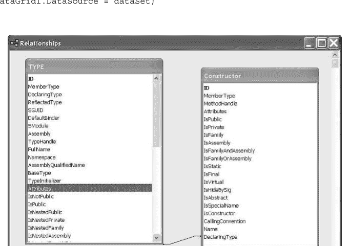

图 5-3 MS Access 中的“关系”对话框准确地描绘了由单个 DataRelation 关联的两个 DataTable。

### 创建数据列映射

你可能想做的另一件常见事情是清理那些不太美观的列名。我遇到过大量具有晦涩列名的数据库，比如 NAME_SEQ_TS。通常，在原始数据库管理员离开项目后，要弄清楚这些列的作用非常困难。不幸的是，你可能并不总是处于能够重新设计数据库的位置。

> **注意**
>
> *记录和管理数据库是使用 CASE 工具的好理由。Erwin、DataArchitect 和 Select 都是优秀的 CASE 工具，它们使设计、记录和维护数据库变得轻松。*

我们选择不重新设计数据库的一个实例是：客户重新实现系统的动机并非对现有实现不满意。客户只是不想再受制于收取高昂租金的硬件供应商。我们的任务说明是提供一个行为与现有系统行为完全相同的新系统。本不应该有任何新功能。现有系统是用 Natural 和 Adabas 实现的，我们正在将其移植到 C#、ASP.NET 和 UDB。本质上，我们是将一个作为终端应用程序实现的非面向对象系统移植到一个瘦客户端 Web 应用程序。我们的章程实际上不允许对数据库进行重新工程化，因此我们做了次优选择。我们使用列映射来更清晰地命名那些具有晦涩名称的旧遗留列。清单 5-9 展示了我们如何协同使用 DataTableMapping 和 DataColumnMapping 对象来支持为列提供替代名称。

**清单 5-9** *使用 DataTableMapping 和 DataColumnMapping 对象*

```csharp
OleDbConnection connection = new OleDbConnection(connectionString);
OleDbDataAdapter adapter = new OleDbDataAdapter(
    "SELECT * FROM PARAMETER_TABLE", connection);
DataSet dataSet = new DataSet();

DataTableMapping tableMapping =
    adapter.TableMappings.Add("Parameter", "PARAMETER_TABLE");

tableMapping.ColumnMappings.Add("ParameterType", "Parameter Type");
adapter.Fill(dataSet, "Parameter");

dataGrid1.DataSource = dataSet.Tables[0];
```

清单 5-9 创建了一个名为 `Parameter` 的表映射，该映射对应于 Reference.mdb 的 `PARAMETER_TABLE` 表。当我们调用 `DataTableMapping.ColumnMappings.Add` 方法时，DataColumnMapping 被隐式创建。源表列 `ParameterType` 被映射到易于阅读的 `Parameter Type` 列。通过使用 DataTableMapping 名称调用 adapter 上的 `Fill` 方法，将使用映射后的列名填充来自源表 `PARAMETER_TABLE` 的列的数据表。
当然，你可以使用描述列别名的 SQL 语句来完成此操作——通常是在 `SELECT` 语句中使用 `As` 子句。DataTableMapping 和 DataColumnMappings 也可用于更新操作。清单 5-10 演示了如何使用映射后的表和列来执行使用映射值的更新操作。

> **清单 5-10**  清单 5-9 的修订版本，演示了如何对映射后的表和列执行更新操作。

```csharp
OleDbConnection connection = new OleDbConnection(connectionString);
OleDbDataAdapter adapter = new OleDbDataAdapter(
    "SELECT * FROM PARAMETER_TABLE", connection);
DataSet dataSet = new DataSet();

DataTableMapping tableMapping =
    adapter.TableMappings.Add("Parameter", "PARAMETER_TABLE");

tableMapping.ColumnMappings.Add("ParameterType", "Parameter Type");
adapter.Fill(dataSet, "Parameter");

// 演示使用映射对象进行更新
DataRow dataRow = dataSet.Tables[0].NewRow();
dataRow["Parameter Type"] = "Test";
dataSet.Tables[0].Rows.Add(dataRow);
adapter.InsertCommand = (new
    OleDbCommandBuilder(adapter)).GetInsertCommand();
adapter.Update(dataSet, "Parameter");

dataGrid1.DataSource = dataSet.Tables[0];
```


> **提示**
>
> 创建内联对象是完全可以接受的，这样可以避免代码中充斥着临时变量，如清单 5-10 中创建的内联 `OleDbCommandBuilder` 所示。如果你不需要在同一代码的后续部分引用该对象，请使用内联对象。

以单词“Demonstrates”开头的注释处是插入新代码以修改清单 5-9 的位置。此代码与执行没有映射的更新非常相似。我们请求一个新的 `DataRow`。我们使用 `DataRow` 的索引器通过引用映射后的列名来修改单个字段。我们将修改后的行添加到 `Rows` 集合中，并通过创建一个 `OleDbCommandBuilder` 来为我们编写 SQL 以及调用 `OleDbDataAdapter.Update` 命令来完成操作。请记住，就像我们在 `Fill` 操作中所做的那样，更新时也要使用映射后的表名。

### 附录

11: adapter = new OleDbDataAdapter(
12:     "SELECT * FROM CONSTRUCTOR", connection);
13: adapter.Fill( constructorTable );
14:
15: dataSet.Tables.Add(constructorTable);

清单 5-7 的第 1 行创建了一个连接对象。因为我们没有显式打开连接，所以 adapter 将负责为我们打开和关闭连接。（你已经看到了几个连接到 Reference.mdb 数据库的连接字符串示例。变量 `connectionString` 用于表示实际的连接字符串。）第二条语句创建了一个 `OleDbDataAdapter`，用于在连接和 DataTable 之间架起桥梁。
清单 5-7 的第 4 行创建了一个 `DataSet`。当我们想要表示一组表时，我们使用 `DataSet`，尽管如果只需要一个表，使用单个 `DataTable` 是可接受且可能的。第 6 行创建一个新的 `DataTable` 对象，第 7 行演示了不使用 `DataSet` 直接填充 `DataTable` 是多么容易。第 8 行将 `DataTable` 添加到我们的 `DataSet` 对象中。第 10 到 15 行对 `CONSTRUCTOR` 表重复此过程。
当清单 5-7 中第 15 行的最后一条语句执行完毕时，`DataSet` 包含两个表。表之间还没有关系。我们需要将关系定义为一个单独的对象，并将其添加到 `DataSet` 中。


### 使用 DataTable

DataTable 映射数据库中的一个表。你也可以将 DataTable 作为内存数据存储来使用，用于那些永远不需要存储到数据库中的数据。正如我那位聪明且友善的朋友 Eric Cotter 所说，"把 DataTable 看作是一种便捷的数据存储方式。"

虽然你不必将 DataTable 的使用限制在数据库应用中，但它主要是为此目的而设计的。DataTable 对象主要由 DataRowCollection 和 DataColumnCollection 对象组成。逻辑上，DataTable 看起来像一个单独的电子表格，其中列和行的交叉点代表一个字段。你可能希望在 DataTable 上执行的操作包括：从数据源填充一个表，以及在修改表中的数据后更新该数据源。我们已经看过了几个展示这种 DataTable 用法的示例，本章的 AssemblyViewer.sln 中还有更多。另一个你可能想要执行的任务是通过编程方式创建和定义 DataTable，包括创建带键和自增的列。

AssemblyViewer.sln 定义了几个继承自 DataTable 的类型。这些类型中的每一个都能够创建一个内存中的 DataTable 或一个 Access 数据库中的表，该表代表一个类型对象。例如，在 Database.cs 中定义的 PropertyTable 能够从 PropertyInfo 对象中读取所有属性，定义一个 DataTable，并将所有 PropertyInfo 详细信息添加到 DataTable 中。（关于反射的讨论，请参见第 2 章和第 11 章。）

基本思路是：将一个类型传递给 PropertyTable 的 CreateNew 方法。使用反射获取该类型的所有 PropertyInfo——属性描述——对象。然后使用 PropertyInfo 对象的属性名和类型动态创建一个表，接着遍历传递给 CreateNew 的类型的每个属性所对应的 PropertyInfo 对象，并将每个 PropertyInfo 对象的值添加到动态表中。（我想在这里列出 AssemblyViewer.sln 的完整代码，但仅重构后的 Database 模块就有 728 行代码。你将不得不下载示例解决方案并逐步执行应用程序来探索所有代码。）为了便于理解，以下项目符号列表描述了用于类型的所有成员的反射算法。

-   确定你想要探索的类型元素。在此例中，我们将只探索类型的属性。
-   属性由 System.Reflection.PropertyInfo 类描述。
-   遍历 PropertyInfo 类的所有属性，为 PropertyInfo 类定义的每个属性向 DataTable 添加一列。每个属性本身也将由相同的属性描述。
-   遍历你想要探索的类型的属性，写下与每个属性的 PropertyInfo 关联的值。

### 高级 C# 编程

一个属性由 PropertyInfo 对象描述。PropertyInfo 对象有几个描述属性的属性。（有点绕口。）一个属性由 MemberType、PropertyType、Attributes、IsSpecialName、CanRead、CanWrite、Name、DeclaringType 和 ReflectedType 描述。类型中的每个属性都根据其类型记录中的这些元素进行初始化，如果你愿意这样理解的话。要创建一个相对于其属性描述类的表，我们可以存储 PropertyInfo 对象的每个属性的值。当将这些数据添加到表中时，添加一个键列和每个 PropertyInfo 属性对应的列会很有帮助。这正是 AssemblyViewer.sln 所做的。我们将在接下来的部分中，通过跟踪在 Reference.mdb 数据库中创建 Property 表的代码，来检查此过程的每个部分。

### 创建 DataTable 对象

创建 DataTable 很容易。确保你引用了 System.Data.dll 程序集，它在新项目中默认是引用的。在你要声明 DataTable 的模块中添加一个引用 System.Data 命名空间的 *using* 语句。构造一个新的 DataTable 实例，并为 DataTable 提供一个名称。

```
DataTable table = new DataTable("PROPERTY");
```

回想一下我说过的，你可以独立于提供程序和 DataSet 使用 DataTable。前面的代码就是你创建一个新 DataTable 所需的全部内容。

### 创建主键、自增列

就我们的目的而言，我们可以使用一个简单的自增列作为属性表的主键。我们向在上一节中创建的表添加一个 DataColumn，并为该数据列提供一些具体信息。更新后的代码如下清单 5-11 所示。

清单 5-11 *此代码演示如何在 DataTable 中创建自增主键列。*

```
DataTable table = new DataTable("PROPERTY");
DataColumn column = table.Columns.Add();
column.ColumnName = columnName;
column.AutoIncrement = true;
column.AutoIncrementSeed = 1;
column.AutoIncrementStep = 1;
column.Unique = true;
table.PrimaryKey = new DataColumn[]{column};
```

在创建 DataTable 后，我们通过调用 DataTable.Columns.Add 方法创建一个新列。如示例所示提供 ColumnName，通过将 DataColumn.AutoIncrement 属性设置为 True 来指明此列是自增的。你可以选择性地设置 DataColumn.AutoIncrementSeed 和 DataColumn.AutoIncrementStep 属性，或者对两者都使用默认值 1。AutoIncrementSeed 值是自增列的起始数字，而 AutoIncrementStep 值定义了每次递增加的值。如前面的代码片段所示，指明该列必须是唯一的。

最后，DataTable 的主键可以由多个列组成。因此，我们必须用 DataColumn 对象的数组来初始化 DataTable.PrimaryKey 属性。在我们的示例中——在清单 5-11 代码的最后一行——组成键的列数组由我们的单个列构成。

### 遍历 PropertyInfo 类的属性

添加你基本的普通列比添加带键和自增的列容易得多。我们需要做的就是通过请求 DataTable 来创建一个 DataColumn 对象，并为该列提供名称和数据类型。遵循这个逻辑，我们可以使用清单 5-12 中的代码创建一个映射 PropertyInfo 记录的 DataTable。

> **清单 5-12** *此代码演示如何创建一个反映 PropertyInfo 类的表。*

```
DataTable table = new DataTable("PROPERTY");
DataColumn column = table.Columns.Add();
column.ColumnName = columnName;
column.AutoIncrement = true;
column.AutoIncrementSeed = 1;
column.AutoIncrementStep = 1;
column.Unique = true;
table.PrimaryKey = new DataColumn[]{column};

PropertyInfo[] infos = typeof(PropertyInfo).GetProperties(
    BindingFlags.Public | BindingFlags.NonPublic |
    BindingFlags.Instance | BindingFlags.Static);

foreach(PropertyInfo info in infos)
{
    column = table.Columns.Add();
    column.ColumnName = info.Name;
    column.DataType = typeof(string);
    column.ReadOnly = true;
}
```

新代码检索 PropertyInfo 类本身的 PropertyInfo 对象数组。BindingFlags 表示我们应该获取类型的公共和非公共成员，以及实例和静态成员。foreach 语句通过从类型请求 Enumerator 来工作。这意味着该类型必须实现 IEnumerable 接口。System.Array 类型——任何使用 [] 数组运算符声明的类型——都隐式实现了 IEnumerable 接口。对于每个 PropertyInfo，从 DataTable 请求一个 DataColumn；并设置 ColumnName、DataType 和 ReadOnly 属性。（设置 ReadOnly 属性是因为我们实际上无法通过修改数据库来改变类型的实现；因此，允许用户修改 PropertyInfo 值是没有意义的。）

当我们全部完成时，我们就得到了一个其模式与 PropertyInfo 类的属性相对应的表。可以使用类似的方法向 DataTable 添加数据行。有关向 DataTable 添加数据行的示例，请参考清单 5-6 和清单 5-10。你也可以参考 AssemblyViewer.sln 以获取多个向 DataTable 添加数据的示例。

### 使用 DataView

DataView 默认是 DataTable 中数据的只读视图。你可以通过将 DataView 的 AllowNew、AllowEdit 和 AllowDelete 属性更改为 True 来启用对 DataView 的修改。DataView 用 DataTable 初始化，可用于排序、筛选和修改数据。

我们可以通过筛选属性表的 CanWrite 字段来创建一个显示只读属性的 DataView。清单 5-13 演示了如何创建 DataView 并使用大致等同于 Where 子句中谓词的语法应用行筛选器。

```
OleDbConnection connection = new OleDbConnection(connectionString);
OleDbDataAdapter adapter = 
    new OleDbDataAdapter("SELECT * FROM PROPERTY", connection);
DataTable table = new DataTable();
adapter.Fill(table);
DataView dataView = new DataView(table);
dataView.RowFilter = "CanWrite = 'False'";

dataGrid1.DataSource = dataView;
```

清单 5-13 与前面的清单之间的主要区别在于 DataView 的创建。如前所述，我们用 DataTable 初始化 DataView。或者，我们可以在不重新查询数据源的情况下筛选和排序 DataView。该示例演示了一个 DataView.RowFilter，它通过 CanWrite 的字符串值 'False' 来筛选 PROPERTY 表中的行。


### 使用 DataReader 获取只读数据

DataReader 可用于获取数据的只进、只读视图，且无需 DataSet 的开销。DataReader 需要一个连接和一个命令，并通过调用命令对象的 ExecuteReader 方法进行初始化。清单 5-14 提供了一个使用 OleDbDataReader 的简要示例。

清单 5-14 使用 OleDbDataReader 读取 SQL 命令返回的所有行

```
OleDbConnection connection = new OleDbConnection(connectionString);
OleDbCommand command = 
    new OleDbCommand("SELECT * FROM FIELD", connection);
connection.Open();
OleDbDataReader reader = command.ExecuteReader();
while( reader.Read())
{
    Debug.WriteLine(reader.GetValue(0));
}
reader.Close();
connection.Close();
```

我们无法将 DataReader 绑定到网格，因为 DataReader 没有实现 IList 或 IListSource 接口。这是技术原因。逻辑原因是网格可以前后滚动，而 DataReader 是只进的。

在 DataReader 处于活动状态时，必须保持连接打开，如代码所示。完成后必须调用 reader 的 Close 方法，因为直到 reader 关闭后连接才能被重用。使用 DataReader 的好处在于其执行读取操作非常快。

最后一步演示了如何将 DataView 绑定到 Windows Forms DataGrid。完整的代码清单请参阅 AssemblyViewer.sln。有关在 ADO.NET 中使用控件的更多信息，请参阅本章后面的“将 DataSet 绑定到 DataGrid”部分。

### 在 DataGrid 中显示信息

面向对象框架之所以非常灵活，是因为框架中存在某种程度的共性。Windows Forms DataGrid 控件就是一个例子。DataGrid 控件具有 DataSource 属性。可以将各种对象赋值给 DataSource，因为 DataSource 的实现旨在与任何实现了 IList 或 IListSource 接口的对象协同工作。（IListSource 有两个成员，其中之一返回实现了 IList 的对象。）因此，在绑定到 DataSource 属性时具有极大的灵活性。

通常，DataSource 属性可以赋值给 DataTable、DataSet、DataView、DataViewManager 以及任何实现 IList 或 IListSource 的对象。DataSource 泛型实现的净效果是，你不仅可以绑定到 ADO.NET 中定义的对象，还可以绑定到任何类型对象的列表。

回想一下，在清单 5-12 中我们调用了 GetProperties 方法。GetProperties 返回一个 PropertyInfo 对象数组，在代码中表示为 PropertyInfo[]。数组的底层类型是 System.Array。有趣的是，System.Array 实现了 IList 接口。那么，这意味着我们应该能够将 DataGrid.DataSource 属性直接绑定到 GetProperties 返回的 PropertyInfo[]。事实上，如果你编写以下代码，你将获得与将清单 5-12 中的 DataTable 赋值给 DataGrid 的 DataSource 属性几乎相同的结果。

```
dataGrid1.DataSource = this.GetType().GetProperties();
```

上述单条语句产生的视图如图 5-4 中的 DataGrid 所示。尝试绑定到调用 GetMembers、GetFields 和 GetMethods 返回的数组。

**图 5-4** *直接绑定到 PropertyInfo 对象数组的 DataGrid*

### 160 高级 C# 编程

### 使用命令对象

命令对象用于将 SQL 命令封装在一个对象中。对于 MS SQL Server 提供程序使用 SqlCommand，对于 OLE DB 提供程序使用 OleDbCommand。命令对象存储表示 SELECT、UPDATE、INSERT 和 DELETE 语句的 SQL 文本，并为你提供用于特定提供程序的其他 SQL 命令的对象。其他命令的示例包括 CREATE TABLE、ALTER TABLE 和 DROP TABLE。

要创建 OleDbCommand 对象，可以通过传递 SQL 文本和 OleDbConnection 对象的实例来构造该对象的实例。OleDbCommand 对象可用作 OleDbDataAdapter 的指令，或直接用于执行不返回结果集的 SQL 命令。清单 5-14 提供了一个创建用于请求 DataReader 的 OleDbCommand 的示例。你可以查看该示例以及 AssemblyViewer.sln 中创建的 OleDbCommand 对象以获取更多示例。

我们尚未研究的一种命令是用于在数据库中创建实体的命令。我们可以使用 OleDbCommand 和 SQL CREATE TABLE 语句向数据库添加新表。清单 5-15 中的代码演示了如何在 Access 数据库中创建表。（你需要稍微修改 SQL 以匹配你所使用提供程序的语法；提供程序的用户指南是获取特定 SQL 语法的最佳资源。）

清单 5-15 此代码演示了如何在 OLE DB 提供程序中创建表。

```
const string connectionString =
    @"Provider=Microsoft.Jet.OLEDB.4.0;Password=";" +
    @"User ID=;Data Source=C:\Temp\Reference.mdb;";
OleDbConnection connection = new OleDbConnection();
const string SQL =
    @"CREATE TABLE Constructor ([ID] COUNTER (1,1), " +
    @"[MemberType] string, [MethodHandle] string, " +
    @"[Attributes] string, [IsPublic] string, " +
    @"[IsPrivate] string, [IsFamily] string, " +
    @"[IsAssembly] string, [IsFamilyAndAssembly] string, " +
    @"[IsFamilyOrAssembly] string, [IsStatic] string, " +
    @"[IsFinal] string, [IsVirtual] string, [IsHideBySig] string, " +
    @"[IsAbstract] string, [IsSpecialName] string, " +
    @"[IsConstructor] string, [CallingConvention] string, " +
    @"[Name] string, [DeclaringType] string, " +
    @"CONSTRAINT [Index1] PRIMARY KEY ([ID]))";
OleDbCommand command = new OleDbCommand(SQL, connection);
command.ExecuteNonQuery();
```

清单 5-15 中的大部分代码是 SQL 文本。（我们稍后将看到一种更好的管理 SQL 语句的方法。）第一条语句是 Jet OLE DB 提供程序的字面量连接字符串，包括 Provider、Password、User ID 和 Data Source 子句。第二条语句创建 OleDbConnection 的一个实例。第三条语句是适用于 Jet OLE DB 提供程序的字面量 CREATE TABLE SQL 语句。（Jet 是 MS Access 数据库引擎的名称。）OleDbCommand 对象通过使用 SQL 文本和连接对象初始化实例来创建。最后，我们通过命令对象将查询发送到数据库引擎。

CREATE TABLE 语句特定于我们发送 SQL 文本的数据库。基本语法是 CREATE TABLE (_tablename fielddefinitions [fielddefinition1, ... fielddefinition(n)] constraints_)，其中表名是有效名称，字段定义指定了字段名、数据类型和任何约束（如主键）。

CREATE TABLE 语句演示了如何创建自增列。描述为 [ID] COUNTER (1,1) 的 ID 列定义了一个自增列，使用种子值 1 和增量值 1。CONSTRAINT [Index1] PRIMARY KEY ([ID]) 定义了一个名为 Index1 的索引作为基于 ID 列的主键。

### 使用 CommandBuilder 生成 SQL

编写 SQL 语句可能有点乏味。ADO.NET 提供了一种更简单的方法来生成 SQL。构造一个 OleDbCommandBuilder 的实例，并使用通过 SELECT 语句初始化的适配器来初始化命令构建器。SELECT 语句返回的架构可用于生成 SQL INSERT、DELETE 和 UPDATE 语句。

清单 5-6 的第 18 和 19 行使用 OleDbDataAdapter 实例构造了一个 OleDbCommandBuilder。用于初始化 OleDbDataAdapter 的命令文本是 "SELECT * FROM METHOD"。根据可以从 METHOD 表读取的架构，可以生成详细的 SQL 命令实例。当你调用 OleDbDataAdapter.Update 命令时，OleDbCommandBuilder 创建的 SQL 是根据对 DataSet 中表所做的更改更新数据源所必需的。

### 次要主题

你知道如何创建连接并使用适配器将通过连接读取的数据桥接到 DataTable 或 DataSet 中。这些对象很少单独使用。在典型的应用程序中，你将把 ADO.NET 对象与可视化控件、应用程序以及可能还有 Web 服务结合使用。

本章的这一部分介绍了你将使用 ADO.NET 的情境方式，包括从 Web 服务返回 DataSet。你可以将本章这一部分中的示例作为这些主题的简要介绍，并查阅本书的其余部分以获取更多示例。探索随 Visual Studio .NET 一起提供的示例应用程序以及 **www.gotdotnet.com** 和 **www.codeguru.com** 网站作为更多代码示例的额外资源。


### 将 DataSet 绑定到 DataGrid

你可以将数据直接绑定到 `System.Web.UI.WebControls.DataGrid`。要求是数据必须实现 IEnumerable 接口。如果数据对象实现了 IList 或 IListSource 接口，则可以将数据绑定到 `System.Windows.Forms.DataGrid` 控件。DataSet 类实现了 IEnumerable、IList 和 IListSource，这意味着你可以快速创建用户界面，将 DataSet 绑定到 Windows 窗体或 Web 窗体中的 DataGrid。

以下两个代码片段演示了如何将 DataSet 绑定到 Windows 窗体和 Web 窗体的 DataGrid。

```csharp
DataGrid.DataSource = DataSet;
```

上述语句是你将 DataSet 绑定到 Windows 窗体 DataGrid 所需的全部内容。

```csharp
DataGrid.DataSource = DataSet;
DataGrid.DataBind();
```

上述是将 DataSet 绑定到 Web 窗体 DataGrid 所需的两个基本语句。

DataGrid 代表 DataGrid 的一个特定实例，DataSet 代表 DataSet 对象的一个特定实例。此外，你还可以绑定 DataTable 或任何其他实现了必要接口之一的集合。例如，`System.Array`（当你声明任何类型的数组时，它是底层类型）实现了 IList 接口。因此，如前面“在 DataGrid 中显示信息”部分所演示的，任何类型的数组都可以在 DataGrid 中显示。数组中对象类型的公共属性将用于在 DataGrid 中创建列。

### 从 Web 服务返回 DataSet

XML 是 .NET Framework 的核心部分。ADO.NET 使用 XML 来管理数据。DataSet 是用 SerializableAttribute 定义的。正是 SerializableAttribute 和 XML 支持从 Web 服务返回 DataSet。清单 5-16 包含一个完整的 Web 方法（定义在可从 www.osborne.com 下载的 Reference.sln 中），该方法动态地探究传递给 Web 方法的类型的方法。

```csharp
// 清单 5-16 此代码演示返回 DataSet 的 Web 方法。

[WebMethod, ReflectionPermission(SecurityAction.Demand)]
public DataSet GetMethods(string type)
{
    DataTable table = new DataTable("METHOD");
    MethodInfo[] methods = Type.GetType(type).GetMethods();
    DataColumn column;
    foreach(PropertyInfo propertyInfo
        in typeof(MethodInfo).GetProperties())
    {
        column = table.Columns.Add();
        column.ColumnName = propertyInfo.Name;
        column.DataType = typeof(string);
    }

    DataRow dataRow;
    foreach(MethodInfo methodInfo in methods)
    {
        dataRow = table.NewRow();
        foreach(PropertyInfo propertyInfo
            in methodInfo.GetType().GetProperties())
        {
            dataRow[propertyInfo.Name] =
                propertyInfo.GetValue(methodInfo, null);
        }
        table.Rows.Add(dataRow);
    }
    DataSet dataSet = new DataSet();
    dataSet.Tables.Add(table);
    return dataSet;
}
```

传入一个类型的完整命名空间，GetMethods Web 方法将基于 MethodInfo 类型的属性创建一个表。这些属性成为 DataTable 的列。每个方法的属性成为 DataTable 的行。将 DataTable 添加到 DataSet 中，我们就可以返回动态反射类型的方法。

如果要从 Web 服务使用反射，则必须请求 ReflectionPermission。任何从网络下载的代码都不能保证被授予反射权限。

### 实现 TraceListener

AssemblyViewer.sln 定义了一个继承自 TraceListener 的嵌套类。通过继承 TraceListener，我们可以将自定义 TraceListener 监听器的实例注册到 `System.Diagnostics.Trace` 类的 Listeners 集合中。结果是我们的自定义监听器可以捕获 Trace 消息并将它们显示为表示层的一部分。（这与 Terrarium 提供的 Trace 窗口一致。有关 Terrarium 的信息，请参阅第 4 章。）

清单 15-17 演示了一个添加到 AssemblyViewer.sln 主窗体的私有嵌套 TraceListener 类，我们可以在测试应用程序时使用主窗体作为 TraceListener 窗口来显示 Trace 信息。

```csharp
// 清单 15-17  自定义 TraceListener 的实现

private class Listener : TraceListener
{
    private StatusBar statusBar;
    public Listener(StatusBar statusBar) : base()
    {
        this.statusBar = statusBar;
    }

    public override void Write(string text)
    {
        statusBar.Text = text;
        Application.DoEvents();
    }

    public override void WriteLine(string text)
    {
        statusBar.Text = text;
        Application.DoEvents();
    }
}
```

要实现自定义的 TraceListener，你需要重写 Write 和 WriteLine 方法。当我们把 TraceListener 的实例 Listener 添加到 `System.Diagnostics.Trace.Listeners` 集合时，使用 Trace 对象写入的消息也会发送到我们的监听器。根据我们监听器的实现，我们存储一个对 StatusBar 的引用，并在 StatusBar 控件上显示跟踪信息。实际上，拥有窗体的 StatusBar 控件就变成了一个可视化的 Trace 窗口。

与其发明新的类，我们可以找到使用现有类的新方法。.NET Framework 结构清晰但内容广泛。在编写大量新代码之前，请尽可能利用现有的框架。

### 总结

与本书的整体方法一致，本章演示了你可能会在一个应用程序中找到的几个主题。大量应用程序都是数据库应用程序。ADO.NET 在数据库编程方面提供了进步，旨在提高可伸缩性。你可以使用旧版本的 ADO 与 COM 互操作——但是一旦你习惯了 ADO.NET，你就不会想回到过去了。

本章提供了一个 AssemblyViewer.sln，它建立在你对反射的理解之上，演示了如何创建动态数据库。反射属性是实现此目的的一种便捷机制。

完成本章后，你应该对 ADO.NET 有了良好的理解，并提高了对反射的认识；你还应该知道如何将数据绑定到 Windows 窗体和 Web 窗体的 DataGrid 控件，以及如何实现自定义的 TraceListener。本章还进一步介绍了 Web 服务。你会发现这些技能在简单的 Windows 应用程序以及复杂的企业解决方案中都非常有益。

# 第二部分

## 工具和组件

**学习目标**

- 了解 Visual Studio .NET 可扩展性模型，包括通用对象模型
- 创建 Visual Studio .NET 项目模板
- 学习如何使用 `System.Diagnostics` 命名空间编写健壮的应用程序
- 使用 PerformanceCounters 跟踪应用程序的行为
- 创建用户控件和自定义控件，包括表面组成部分控件
- 学习使用 ThreadPool 以获得最佳的控件行为
- 创建 TypeConverter、TypeDescriptor 和 TypeEditor，并实现扩展器提供程序和 IConvertible
- 使用特性向应用程序添加元数据并创建自定义特性
- 学习如何向工具箱添加控件，包括如何将自定义图像与控件关联
- 使用反射探索 .NET 框架

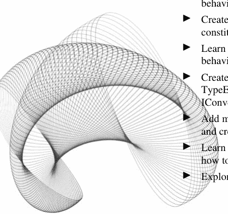

版权所有 © 2002 The McGraw-Hill Companies, Inc. 点击此处查看使用条款。

此页有意留白。

# 第 6 章

## 自定义 Visual Studio .NET

**本章内容：**

- **演示主题**
    - 创建自定义向导
    - 为 Visual Studio .NET 向导创建项目模板
    - 使用向导扩展 Visual Studio .NET
- **次要主题**
    - 回顾 Jscript .NET
    - 使用 regasm 实用程序
    - 总结

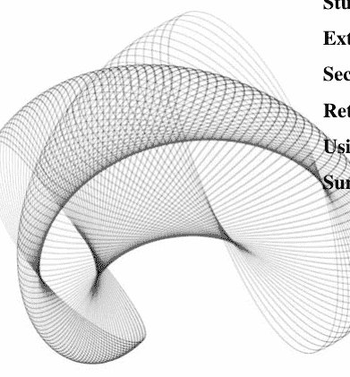

微软在为 Visual Studio .NET 提供自动化和可扩展性模型方面付出了相当大的努力。自动化和扩展 Visual Studio .NET 以支持常见任务是促进快速应用程序开发的最佳方式。繁琐、高度重复或单调的任务可以通过创建向导、加载项、宏或项目模板来自动化，从而加快开发速度。

宏基于 Visual Basic 语言，并受到一个大型可扩展性模型的支持，该模型让你可以控制 Visual Studio .NET 的方方面面。我不会试图提供可扩展性接口的参考手册（这需要专门的书籍），而是将演示如何创建向导、创建自定义项目模板以及编写宏。因此，你将获得一个实用的工具来创建你自己的向导——Visual Studio .NET 的扩展——并对 .NET 的可扩展性模型有一个很好的介绍。

### 演示主题

如果你发现自己在重复执行相同的任务，那么你就准备好阅读本章了。你和我经常执行的一个明显任务是创建一个新项目。无论我们正在实现 Web 服务、ASP.NET、Windows 还是控制台应用程序，我们都使用“文件 | 新建项目”小应用程序来基于现有的项目模板创建项目。你可以用 Visual Studio .NET 做的一件事就是创建你自己的自定义项目模板。创建项目模板的步骤有点复杂，但在本章中，我将为你提供一些示例，演示如何

- 通过实现 IDTWizard 接口来创建自定义向导
- 创建自定义项目模板
- 注册和测试向导
- 在宏 IDE 中编写宏

本章第二部分的次要主题演示了辅助主题。我将介绍 JScript.NET，以及它如何被随 Visual Studio .NET 附带的向导引擎所使用，以及如何使用 regasm 实用程序，这对于在全局程序集缓存中注册程序集是必要的。

### 创建自定义向导

微软使向导变得无处不在。几乎每个使用过计算机的人都使用过向导。术语 *wizard* 通常指一系列线性对话框，需要反馈来创建所需的结果。向导本质上是线性子程序。在 1990 年代初之前，许多程序都是线性的。当 Windows 操作系统和用于 Windows 的编程语言变得普遍时，开发者开始编写行为具有空间性的应用程序。有趣的是，我们又回到了线性子程

程序——向导——因为在某些情况下，将用户交互限制为一系列线性步骤会更容易。尤其是在执行基于结果、新颖或复杂的任务时。

对于专业程序员来说，*向导*是指编写一个应用程序或子程序，以支持完成特定目标的一系列线性步骤。具体来说，我们通过实现IDTWizard接口来完成此操作。对于用户来说，操作向导的机制很简单，而且在大多数情况下只需单击“下一步”。对于开发人员来说，创建向导涉及一些特定机制，并且需要付出相当大的努力来将选择综合为简单的输入，以便让向导用户尽快到达“下一步”按钮。幸运的是，微软开发人员使实现向导的机制变得简单，但一如既往，创造性的部分仍需开发人员自行努力。清单6-1提供了一个基本的Hello World风格的向导作为介绍。有关实际向导的示例，请参阅本章后面的部分“使用向导扩展Visual Studio .NET”。

**清单6-1** *继承IDTWizard接口为Visual Studio .NET创建向导*

```csharp
using System;
using EnvDTE;
using System.Windows.Forms;

namespace HelloWizard
{
    public class HelloWizard : IDTWizard
    {
        public void Execute(object Application,
            int hwndOwner, ref object[] ContextParams,
            ref object[] CustomParams, ref wizardResult retval)
        {
            MessageBox.Show("Hello Wizard");
            retval = EnvDTE.wizardResult.wizardResultSuccess;
        }
    }
}
```

表面上看，向导是一个实现了EnvDTE中定义的IDTWizard接口的类。向导只有一个方法，即Execute方法。Execute启动向导。从那时起，你的代码做什么取决于你引导用户完成的任务。我们的向导显示一个消息框，并返回表示成功的枚举值。要测试向导，我们还需要执行一些步骤，接下来我们将讨论这些步骤。

### 创建向导项目

向导是作为类库项目创建的。使用“新建项目”对话框（如图6-1所示）并选择“类库”项目模板。为向导提供一个名称，然后单击“确定”。创建向导项目不需要采取任何特殊步骤。

### 实现IDTWizard接口

要实现IDTWizard接口，你需要在项目的引用部分添加对envdte.dll程序集的引用。EnvDTE代表设计时环境，即Visual Studio .NET的扩展模型。添加一个*using*语句以引用EnvDTE命名空间，并表明你的类实现了IDTWizard接口。（实现接口和继承使用相同的表示法，如清单6-1的类头所示。）

> **提示**
输入*using*，然后按CTRL -空格键以获取可用命名空间的下拉列表。

IDTWizard有一个你必须实现的单个方法。向导将使用所有者的句柄、一个上下文数组、一个自定义参数数组和一个返回值进行初始化。返回值使用ref参数修饰符。

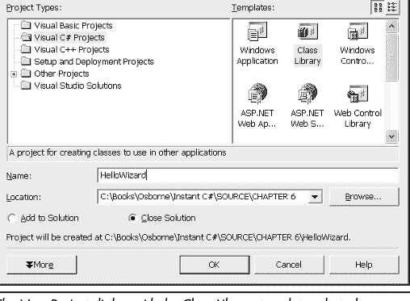

### 按引用传递参数

如果你想从方法返回单个值，那么定义并实现一个被称为函数的方法。函数是具有void以外返回类型的方法。你还可以对参数使用ref修饰符以返回多个值。使用ref修饰符定义的参数反映调用方对这些参数所做的更改。ref修饰符等同于C++中传递指针、Visual Basic .NET中的ByRef参数或Delphi中的var参数。有关ref修饰符的正确放置位置，请参见清单6-1。

### 测试向导

测试向导的一种简单方法是创建一个宏来调用向导。单例对象DTE包含一个方法LaunchWizard，它将加载并运行向导。有关宏和向导启动文件的解释，请参阅本章后面的“编写宏”和“使用宏测试向导”。清单6-2包含了测试HelloWizard的宏代码，清单6-3包含了你可以放在向导启动文件中的文本。（这些清单仅供参考。本章的其余部分将描述使用这些文件所需的关系和步骤。）

```vbnet
Imports System
Imports EnvDTE
Imports System.Diagnostics

Public Module Module1

    Public Sub Test()

        Const Path As String = _
            "C:\Temp\HelloWizard.vsz"

        Debug.WriteLine("This is running!")
        Dim ContextParams(1) As Object
        ContextParams(0) = Nothing
        DTE.LaunchWizard(Path, ContextParams)

    End Sub

End Module
```

可以通过打开宏IDE来创建宏。选择“工具” | “宏” | “宏IDE”以打开“宏IDE”（如图6-2所示，代码如清单6-2所示）。

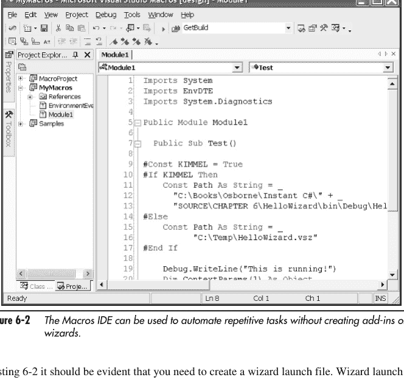

从清单6-2应该可以明显看出，你需要创建一个向导启动文件。向导启动文件具有.vsz扩展名，并且与包含该启动文件关联的向导的类库同名。清单6-3包含了HelloWizard.dll的向导启动文件。

```
VSWIZARD 7.0
Wizard=HelloWizard.HelloWizard
Param=<Nothing>
```

清单6-3中显示的文本应放置在名为HelloWizard.vsz的文件中，该文件放置在与包含HelloWorld.dll的目录相同的目录中，HelloWorld.dll已使用regasm.exe注册。Regasm是Visual Studio .NET附带的实用程序。有关更多信息，请参阅本章后面的“注册向导”。

### 为Visual Studio .NET向导创建项目模板

Visual Studio .NET附带了几个项目模板，允许你创建类似于类库项目、Windows和Web应用程序、Web服务、控件和加载项的项目。没有专门用于创建向导的项目模板。作为项目模板的介绍，我们将逐步创建一个将出现在“新建项目”对话框中的项目模板。

有一个向导——VsWizard.dll，位于C:\Program Files\Microsoft Visual Studio .NET\Common7\IDE\VsWizard.dll——为项目模板提供了一个基本引擎。这个通用引擎使用特定的示例文件、脚本和其他输入文件从项目模板创建新项目。因此，我们不必编写自定义引擎来创建项目模板，但我们必须创建引擎用作输入的一些特定文件，以及用作模板来创建新向导项目的一些示例文件。我们的目标，尽可能简单地表述，就是*为Visual Studio .NET向导创建一个新的项目模板*。以下是创建向导项目模板需要完成的步骤，我将在下文中称之为向导库：

- 复制一个与我们要创建的新模板接近的现有模板。我们将使用现有的类库模板，因为向导项目是类库或DLL。
- 根据我们要创建的模板类型，向我们的模板项目添加新的模板文件。要创建向导，我们需要一个包含实现IDTWizard的类的.cs文件。我们可以使用清单6-1（不包含MessageBox）作为模板。
- 修改templates.inf文件，该文件包含我们的模板项目中包含的文件列表。
- 修改包含由vsWizard引擎调用的通用方法的common.js（Jscript .NET）源代码。我们需要添加代码来创建一个特定的类库项目，该项目包含对envdte.dll程序集的引用。
- 修改default.js脚本文件，该文件包含对我们的模板项目通用的方法。
- 向我们的项目模板添加一个图标文件。
- 修改向导启动文件，以确保vsWizard引擎向导与我们的模板关联。
- 修改VSDir文件，将我们的项目模板添加到“新建项目”对话框中。

这些步骤不需要按任何特定顺序完成，但我们将按照定义的方式来处理它们。如你所见，这是一个复杂的过程（我希望它能变得更容易）。然而，这是一个可扩展的解决方案，也是一个支持任何项目模板的通用解决方案。接下来的每个小节将依次描述整个过程的每个部分，如所列，并提供解释性细节。


### 复制现有项目模板

项目模板由你在“新建项目”对话框中看到的图标表示（参见图6-2）。与从头开始使用文本编辑器创建项目相比，它们使用起来要容易得多，尽管你也可以使用任何文本编辑器从头开始创建项目。

> **注意**
> 不同版本的 Visual Studio 将提供不同的项目模板。请查阅你的帮助文档，了解你的 Visual Studio .NET 版本所提供的功能。专业开发人员应使用企业版架构师版。

创建新项目模板最简单的方法是复制一个与你想要创建的新模板最接近的现有模板。最接近的可用模板是类库模板。默认情况下，这些文件安装在 `C:\Program Files\Microsoft Visual Studio .NET\VC#\VC#Wizards` 中。类库模板由 `CSharpDLLWiz` 表示。要创建新的派生项目模板，请按照以下编号步骤操作：

1.  复制 `C:\Program Files\Microsoft Visual Studio .NET\VC#\VC#Wizards\CSharpDLLWiz` 文件夹，并将副本粘贴到同一目录中。（如果你没有使用默认安装目录，则需要进行必要的调整。）
2.  副本将默认命名为 "Copy of CSharpDLLWiz"。使用 Windows 资源管理器将此文件夹重命名为 `CSharpDLLWizWiz`，以相对保持与所示约定的一致性。

这些向导文件夹包含一个 Scripts 和一个 Templates 子目录，每个子目录包含一个语言标识符。在我拥有的版本中，语言标识符是 1033。（我相信语言标识符是表示英语的标识符；非英语用户将有不同的标识符。）

Scripts\1033 文件夹包含包含我们项目特定脚本的 `default.js` Jscript 文件。请参阅本节后面的“修改 default.js 脚本”。Templates\1033 文件夹包含包含向导引擎将复制以创建我们新项目的代码的实际文件。有关此过程的更多信息，请参阅下一节“为向导库模板添加文件”。

如果你有一个看起来像下面示例的新文件夹，那么我们就可以继续了。

```
C:\Program Files\Microsoft Visual Studio .NET\VC#\VC#Wizards
CSharpDLLWizWiz\Scripts\1033
  default.js
CSharpDLLWizWiz\Templates\1033
  assemblyinfo.cs
  file1.cs
  Templates.inf
```

### 为向导库模板添加文件

Templates\1033 文件夹需要更新以包含我们希望在向导库模板中包含的文件。我们不需要更改正在使用的文件名；因此，我们不需要更改 `Templates.inf` 的内容。但是，我们确实需要更改 `file1.cs` 文件以包含描述向导模板的代码。代码清单6-4提供了修改后的 `file1.cs` 文件的代码。

> **提示**
> 确保你使用相同的文件名。这些文件名由 JScript 函数使用，如果你更改文件名而不更新脚本以符合新文件名，你的项目模板将无法工作。

**代码清单 6-4** 修改模板源文件 `file1.cs`，以描述一个包含 IDTWizard 实现的类

```
using System;
using EnvDTE;

namespace [!output SAFE_NAMESPACE_NAME]
{
    /// <summary>
    /// [!output SAFE_CLASS_NAME] 的概要说明。
    /// </summary>
    public class [!output SAFE_CLASS_NAME] : IDTWizard
    {
        public [!output SAFE_CLASS_NAME]()
        {
            //
            // TODO: 在此添加构造函数逻辑
            //
        }

        public void Execute(object Application, int hwndOwner,
          ref object[] ContextParams,
          ref object[] CustomParams,  ref wizardResult retval)
        {
            //
            // TODO: 在此添加自定义代码
            //
        }
    }
}
```

这段代码看起来与我们代码清单6-1中的示例几乎完全相同，除了增加了由 SAFE_CLASS_NAME 表示的可替换令牌。再次强调，除非你准备好更改引用这些值的脚本文件，否则不要更改它们。我不会演示这个过程，但你通过仔细检查支持的 Jscript 代码可能可以自己弄清楚。

### 修改 default.js 脚本

`default.js` 脚本文件定义在 `Scripts\1033` 中。我们只需要做一个小改动，但这是一个重要的改动。你知道，向导项目需要引用 `envdte.dll` 程序集。我们将在新的向导库项目中加载对此程序集的引用，因此我们必须相应地修改我们的脚本以确保实现这一点。这是一个必须与 `common.js` 脚本文件中的更改协调才能正常工作的更改——这也是我认为项目模板需要改进的原因之一。（有关协调更改的信息，请参阅下一节“修改 common.js 脚本”。）代码清单6-5提供了修改后的 `default.js` 脚本文件。

**代码清单 6-5** 修改复制的 `default.js` 文件，进行以粗体字体标示的小改动

```
1:  // (c) 2001 Microsoft Corporation
2:
3:  function OnFinish(selProj, selObj)
4:  {
5:      var oldSuppressUIValue = true;
6:      try
7:      {
8:          oldSuppressUIValue = dte.SuppressUI;
9:          var strProjectPath = wizard.FindSymbol("PROJECT_PATH");
10:         var strProjectName = wizard.FindSymbol("PROJECT_NAME");
11:         var strSafeProjectName = CreateSafeName(strProjectName);
12:         wizard.AddSymbol("SAFE_PROJECT_NAME", strSafeProjectName);
13:
14:         var bEmptyProject = 0; //wizard.FindSymbol("EMPTY_PROJECT");
15:
16:         var proj = CreateCSharpProject(strProjectName,
17:             strProjectPath, "defaultDll.csproj");
18:     var InfFile = CreateInfFile();
19:     if (!bEmptyProject)
20:     {
21:         AddReferencesForWizard(proj);
22:         AddFilesToCSharpProject(proj,
23:             strProjectName, strProjectPath, InfFile, false);
24:     }
25:     proj.Save();
26: }
27: catch(e)
28: {
29:     if( e.description.length > 0 )
30:         SetErrorInfo(e);
31:     return e.number;
32: }
33: finally
34: {
35:     dte.SuppressUI = oldSuppressUIValue;
36:     if( InfFile )
37:         InfFile.Delete();
38: }
39: }
40:
41: function GetCSharpTargetName(strName, strProjectName)
42: {
43:     var strTarget = strName;
44:
45:     switch (strName)
46:     {
47:         case "readme.txt":
48:             strTarget = "ReadMe.txt";
49:             break;
50:         case "File1.cs":
51:             strTarget = "Class1.cs";
52:             break;
53:         case "assemblyinfo.cs":
54:             strTarget = "AssemblyInfo.cs";
55:             break;
56:     }
57:     return strTarget;
58: }
59:
60: function DoOpenFile(strName)
61: {
62:     var bOpen = false;
63:
64:     switch (strName)
65:     {
66:         case "Class1.cs":
67:             bOpen = true;
68:             break;
69:     }
70:     return bOpen;
71: }
72:
73: function SetFileProperties(oFileItem, strFileName)
74: {
75:     if(strFileName == "File1.cs" || strFileName == "assemblyinfo.cs")
76:     {
77:         oFileItem.Properties("SubType").Value = "Code";
78:     }
79: }
```

向导引擎被设计为使用外部 Jscript 函数，这当然是创新者的酌情选择。如果你了解 Jscript，那么代码是自明的。共有四个函数：`OnFinish`、`GetCSharpTargetName`、`DoOpenFile` 和 `SetFileProperties`。当请求向导库项目模板时，会特别调用这些方法。`SetFileProperties` 设置一个属性，以指示两个 .cs 文件包含代码。`DoOpenFile` 用于在 Visual Studio .NET 中打开类模块，这是你将感兴趣的要修改的文件，因为它包含自定义向导的实现。`GetCSharpTargetName` 执行简单的文件名替换。我们模板中唯一相关的更改是将 `file1.cs` 创建为 `class1.cs`。`OnFinish` 执行 `file1.cs` 中可替换参数的替换，并组装项目，包括添加引用。我们需要做的唯一更改是在第22行替换对 `AddReferencesForWizard` 的调用。原始脚本文件包含对 `AddReferencesForClass(proj)` 的调用，该函数定义在 `common.js` 中。我们需要实现 `AddReferencesForWizard`；我们将在下一节中完成这一步。

### 修改 common.js 脚本

项目模板基于共享的向导引擎、预定义的文件夹结构、一些预先存在的模板文件以及两个相互作用以创建新项目模板的 Jscript 文件，被分成不同的部分。我发现这种文件夹和脚本的复杂组合有点难以接近，而且一点也不直观。作为一名程序员，我更喜欢一种统一的方法。


### 创建向导启动文件

我们在前面的“创建自定义向导”部分已经讨论过向导启动文件。在此例中，向导已经存在，因此我们将指导“新建项目”对话框使用哪个向导。项目模板的向导启动文件位于默认安装下的 `C:\Program Files\Microsoft Visual Studio .NET\VC#\CSharpProjects` 文件夹中。

类库项目模板的向导启动文件包含在 `CSharpDLL.vsz` 中。根据所示扩展名，我们将我们的向导启动文件命名为 `CSharpDLLWiz.vsz`。你可以从复制 `CSharpDLL.vsz` 文件并将其粘贴到同一目录开始。将文件重命名为 `CSharpDLLWiz.vsz` 并修改它以指向我们的模板目录，如清单 6-7 所示。

**清单 6-7** 我们的向导库项目模板的向导启动文件

```
VSWIZARD 7.0
Wizard=VsWizard.VsWizardEngine
Param="WIZARD_NAME = CSharpDLLWizWiz"
Param="WIZARD_UI = FALSE"
Param="PROJECT_TYPE = CSPROJ"
```

所做的唯一更改是将第一个参数改为引用我们的向导库文件夹。第一个参数是相对路径，其他参数为向导引擎提供条件值。

我们快要完成了。最后一步是创建 VSDir 文件，并通过创建一个新的向导项目来测试项目模板。

### 创建 VSDir 文件

VSDir 文件用于向“添加新项”和“新建项目”对话框提供信息，以描述各项的显示方式。通过直观观察，你可以对这些文件的内容有一个合理的了解。通常，你需要指定一个图标和一个名称，并指定“添加新项”和“新建项目”对话框中的小程序与调用哪个操作之间的关联。清单 6-8 提供了 VSDir 文件。清单之后提供了对这些看似神秘条目的解释。

**清单 6-8** 我们的项目模板向导的 VSDir 文件

```
CSharpDLLWiz.vsz|{FAE04EC1-301F-11d3-BF4B-00C04F79EFBC}|Wizard Library|20|#2323|{FAE04EC1-301F-11d3-BF4B-00C04F79EFBC}|4547| |WizardLibrary
```

该条目作为一行文本输入在包含现有项目模板项的 VSDir 文件中。默认情况下，此文件为 `C:\Program Files\Microsoft Visual Studio .NET\VC#\CShaprProjects\CSharpEx.vsdir`。这与包含你的向导启动文件的文件夹相同。

条目通过管道符 (`|`) 分隔为字段。每个管道符分隔一个字段。表 6-1 描述了 VSDir 文件中每个字段的名称和条目。

| 字段名称 | 字段条目 | 描述 |
| :--- | :--- | :--- |
| 相对路径名 | CSharpDLLWiz.vsz | 使用相对路径指定向导启动文件。将 .vsz 文件存储在与 .vsdir 文件相同的目录中。 |
| CLSID 包 | {FAE04EC1-301F-11d3-BF4B-00C04F79EFBC} | 表示资源 DLL 的 GUID。此特定 GUID 指向名为“C Sharp Editor Factory”的内容。 |
| 本地化名称 | Wizard Library | 这是模板的本地化名称，也是在对话框中显示的名称（参见图 6-3）。 |
| 排序优先级 | 20 | 确定元素列出的顺序。排序优先级 1 为最高。 |
| 描述 | #2323 | 包含模板本地化文本描述的字符串或资源标识符。（描述出现在“新建项目”对话框中——再次参见图 6-3。） |
| DLLPath 或 CLSID 包 | {FAE04EC1-301F-11d3-BF4B-00C04F79EFBC} | 包含指向包含模板图标的 EXE 或 DLL 资源的 GUID。 |
| 图标资源 ID | 4547 | 与前面的条目组合使用，指示从资源文件中使用哪个图标。（我们将使用与类库相同的图标。） |
| 标志 | （空白） | 位标志，我们的模板未使用。你可以参考 Visual Studio .NET 的 VSDir 文件帮助获取各个标志值。 |
| 建议基名称 | WizardLibrary | 指定模板的默认名称。我们的条目代表一个项目；因此，向导库项目的根名称将是 WizardLibrary。第一个新项目将是 WizardLibrary1，依此类推。 |

**表 6-1** *用于描述“添加新项”或“新建项目”对话框中条目的字段*

表 6-1 中显示的示例用于描述我们的向导库项目模板，如图 6-3 所示。

要测试向导库项目模板，请选择“文件” | “新建” | “项目”，然后选择“向导库”模板，如图 6-3 所示。单击“确定”后，你应该会有一个新的类库项目，其中包含一个 `assemblyinfo.cs` 文件和一个名为 `Class1.cs` 的文件，后者提供了 `IDTWizard` 的基本实现。请确保也添加了对 `envdte.dll` 程序集的引用。现在你只需要专注于执行自动化任务的代码。

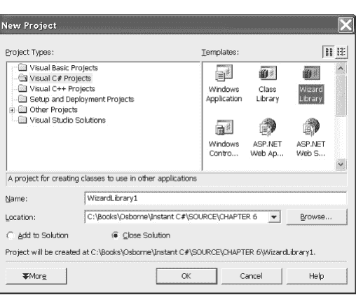

图 6-3 由我们在清单 6-8 中的 VSDir 条目描述的向导库项目模板

你可能想知道项目模板来自哪里。我还没有提到它。与整个过程一致，有几个文件是共享的。其中之一是 `DefaultDLL.csproj` 文件。此文件由 DLL 项目模板共享，位于 `C:\Program Files\Microsoft Visual Studio .NET\VC#\VC#Wizards` 文件夹中，名为 `DefaultDLL.csproj`。

创建项目模板更像是复制粘贴和文件管理过程，而不是编程过程。但是，如果你想自动化重复性任务或简化困难任务，那么就创建一个项目模板。

### 使用向导扩展 Visual Studio .NET

向导的好处在于，你可以提供一种简单的方法来做对初级到中级开发者可能很困难的事情，并且你可以自动化某些任务。通过创建向导，你可以使 .NET 编程的高级方面对你的团队中的每个人都可用。

在本节中，我将演示一个实用的向导，它自动创建一个强类型集合。强类型集合继承自抽象类 `ReadOnlyCollectionBase` 或 `CollectionBase`。这些类实现了 `IList`、`IListSource` 和 `IEnumerable`。其结果是你可以创建一个行为类似于数组的集合，可以绑定到 DataGrid 等控件，并且可以将集合序列化为 ADO.NET DataSet。

---

涉及更多编程而更少与外部目录结构交互；这是我为你描述它的原因之一。我想你可能需要一点帮助。在 `C:\Program Files\Microsoft Visual Studio .NET\VC#\VC#Wizards\1033` 文件夹中，有一个 `common.js` Jscript 文件，其中包含所有项目模板通用的脚本。我们需要修改此文件以确保我们的项目具有正确的引用。清单 6-6 显示了修改后的 `common.js` 文件包含 `AddReferencesForWizard`。（我没有提供完整的清单，因为它非常长。只需将清单 6-6 中的代码添加到 `common.js` 中即可。）

> **提示** 你正在修改由 Visual Studio .NET 安装的文件。最好在继续之前备份这些文件。

**清单 6-6** 包含 *AddReferenceFor Wizard* 的修改后的 `common.js` 文件

```
/************************************************************
Description:
    oProj: Project object
*************************************************************/
function AddReferencesForWizard(oProj)
{
    var refmanager = GetCSharpReferenceManager(oProj);
    var bExpanded = IsReferencesNodeExpanded(oProj)
    refmanager.Add("System");
    refmanager.Add("System.Data");
    refmanager.Add("System.XML");
    **refmanager.Add("envdte");**

    if(!bExpanded)
        CollapseReferencesNode(oProj);
}
```

关键是传统的重用：复制粘贴。复制粘贴 `AddReferencesForClass` 并添加一条将包含对 `envdte` 的引用的语句，如粗体所示。我们的向导库与类库模板非常接近，这为我们提供了复制粘贴重用的机会。当然，如果你正在制作一个前所未有的模板，那么你可能已经猜到你的工作量很大了。最后两个步骤是创建我们的向导启动文件和一个 VSDir 文件。


TypedCollectionWizard 可自动创建基于 `System.Collections.CollectionBase` 类的强类型集合；生成一个新模块（即一个继承自 `CollectionBase` 的类）；并添加索引器和 `Add` 方法，以支持 Web 服务的序列化。我将带你了解 TypedCollectionWizard 的创建过程，它展示了 Visual Studio .NET 的可扩展性。你将学习如何编写宏，以及如何针对通用环境对象模型进行编程。

### 编写宏

创建、注册和测试向导的步骤与“创建自定义向导”中描述的步骤相同。其中有助于此任务的技能包括：编写和运行宏、使用 C# 进行通用编程、创建 Windows 窗体用户界面、使用 `regasm.exe` 注册程序集，以及编写向导启动文件。没有特别的原因，我们将从编写宏开始。

自动化和可扩展性模型的一部分是提供对宏的支持。宏 IDE 是一个独立的基于项目的开发环境。宏使用 Visual Basic .NET 编写。你可以录制与 Visual Studio .NET 的交互过程，也可以从头开始编写宏。从 Visual Studio .NET 的“工具”菜单中选择“宏” -> “宏 IDE”即可启动宏 IDE。你已经知道如何使用 Visual Studio .NET，而宏 IDE 与其非常相似。

打开宏 IDE。从“视图”菜单中选择“项目资源管理器”。宏 IDE 以项目为中心，宏项目存储在扩展名为 `.vsmacro` 的文件中。但是，你可以导入和导出包含 Visual Basic .NET 代码的模块。要创建宏，请选择一个现有模块或创建一个新模块（即源代码文件），然后打开它。添加一个简单的子例程（*Subroutine* 是 VB 中对方法的俗称）。将光标置于文本编辑器中的子例程上，然后从宏 IDE 菜单中选择“调试” -> “开始执行”。清单 6-9 演示了一个 HelloWorld 宏。

```
Sub HelloWorld()
    MsgBox("Hello World!")
End Sub
```

正如你可能猜到的那样，此宏会显示一个消息框，等效于静态 C# 方法调用 `MessageBox.Show("Hello World!")`。本章所有宏均可从名为 `Module1.vb` 的文件下载。

此类宏仅适用于入门介绍。一个更实用的宏可能是向现有项目添加一个新类。这在本质上与我们将使用 TypedCollectionWizard 所做的事情类似。

清单 6-10 中的宏向 Visual Studio .NET 中的活动项目添加了一个新类。参数 `"Local Project Items\Class"` 是字面上的路径，如果你将命令（AddNewItem）与文件夹 `Local Project Items` 和项目 `Class` 连接起来，它就是“添加新项”对话框中的一个路径。从图 6-4 中可能可以明显看出这一点。

```
清单 6-10  向现有项目添加新类的宏

Sub TestNewFile()
    DTE.ItemOperations.AddItem( _
        "Local Project Items\Class", "")
End Sub
```

`AddNewItem` 的第二个参数是要添加的文件的名称。如果将此选项留空或传递一个空字符串，则将创建一个具有唯一且合适名称的文件。如果你用 C# 编写等效于清单 6-10 的代码，则需要传递一个空字符串。*很好*。最大的问题是 DTE 是什么？我稍后将花一点时间回答这个问题。

### 通用环境对象模型简介

我认为 DTE 是一个代表设计时环境的对象。在帮助文档中，设计时环境被称为*通用环境对象模型*、自动化模型或可扩展性模型。一个单一的好名字会很有帮助。在指代 Visual Studio .NET 可扩展性时，我们将只使用 DTE。

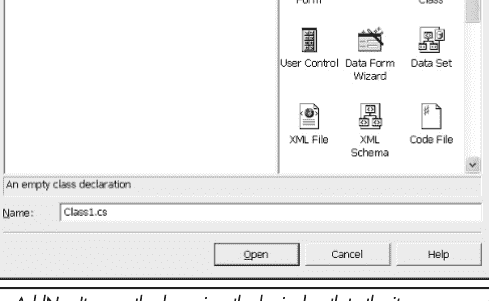

DTE 是一个根对象，它代表一个公开 Visual Studio .NET 功能的对象模型。（Visual SourceSafe 也有类似的东西，许多其他 Microsoft 应用程序也是如此。）DTE 通过接口提供对 Visual Studio .NET 的面向对象的访问。这通常被称为*自动化*。你可以通过查看 Visual Studio .Net 帮助链接 `ms-help://MS.VSCC/MS.MSDNVS/vsintro7/html/vxgrfautomationobjectmodelchart.htm` 中的可视化参考来了解通用环境对象模型（即 DTE）的广泛程度。它非常广泛。
不幸的是，DTE 非常庞大，如果不另写一整本书，我们将很难触及皮毛。（如果我的出版商收到足够多的信件，那么这样一本书可能会出版。）相反，我们将采用目标方法来解决我们特定的问题，同时为你提供一个入门介绍。接下来的几节演示如何从宏和 C# 代码中使用 DTE，这将为你提供一个合理的起点。对 DTE 的一个好的概念性理解是将其视为充当外观（façade）的接口，允许你与 Visual Studio .NET 交互，包括菜单、文档、项目、宏等。

### 使用宏编写代码

在本章前面，我演示了如何使用项目模板来有效生成代码。向导引擎本质上使用现有代码作为模板，并填充会更改的部分，例如类名。但是，你可以使用 DTE 动态地即时生成新代码。在宏中即时编写代码是测试我为 TypedCollectionWizard 创建 C# 代码生成器方法的好方法。清单 6-11 演示了我用于测试 DTE 代码生成能力的宏。

```
清单 6-11     使用宏生成代码
1:   Public Sub TestWriteCode()
2:       Try
3:           Dim item As ProjectItem = _
4:               DTE.ItemOperations.AddNewItem( _
5:               "Local Project Items\Code File")
6: 
7:           Dim defaultNamespace = _
8:               item.ContainingProject.Properties. _
9:               Item("DefaultNamespace").Value
10: 
11:           Dim code As CodeNamespace = _
12:               item.FileCodeModel.AddNamespace(defaultNamespace)
13: 
14:           Dim editPoint As EditPoint = _
15:               code.StartPoint.CreateEditPoint
16: 
17:           editPoint.LineDown(2)
18: 
19:           editPoint.Insert(DateTime.Now.ToString() + vbCrLf)
20: 
21:       Catch e As Exception
22:           MsgBox(e.Message, MsgBoxStyle.OKOnly, "Error")
23:       End Try
24:   End Sub
```

总之，清单 6-11 中的代码创建了一个新的 C# 代码文件，向其中添加了一个命名空间，并向该命名空间插入了一些文本。清单 6-12 提供了运行清单 6-11 中宏的输出示例。

清单 6-11 的第 3 到 5 行创建了一个新的 C# 源代码文件（该文件不包含任何代码），并获得了一个代表该文件的 `ProjectItem` 的引用。（这与清单 6-10 中的宏类似。）此源代码文件将被添加到 Visual Studio .NET 中具有焦点的任何项目中，但不会创建一个项目。第 7 到 10 行确定包含我们新文件的项目的默认命名空间是什么，第 11 和 12 行创建了一个格式化的命名空间元素（参见清单 6-12）。注意我们保留了 `CodeNamespace` 对象的引用。就像我们手动编写代码一样，一切都取决于上下文。返回的对象代表了上下文。

清单 6-11 的第 14 和 15 行在命名空间的开头创建了一个编辑点。编辑点可用于手动插入代码，或者我们可以使用其他 Add 方法（探索 `FileCodeModel` 以获取可用方法）。第 17 行将编辑点向下移动两行，第 19 行插入一些代表我们代码的文本。结果如清单 6-12 所示。

**清单 6-12** *由清单 6-11 中的宏生成的代码*

```
namespace TestWizardOuput
{
5/9/2002 5:12:23 PM
}
```

显然，如果我们能创建一个文件、添加命名空间和其他元素，并直接编写文本，那么就有可能以这种方式编写代码。TypedCollectionWizard 使用部分模板和 DTE 来生成完整的强类型集合类。

### 创建代码生成器

可以通过将永远不会改变的代码元素提取出来，并为将要改变的元素使用可替换的字符串参数来创建代码生成器。这是向导引擎从模板创建代码所使用的方法，也是为 TypedCollectionWizard 生成代码所使用的方法。清单 6-13 包含代表模板的类。


### 清单 6-13 向导类代表了向导创建的强类型集合的模板代码。

```csharp
using System;

namespace TypedCollectionWizard
{
    /// <summary>
    /// 向导的摘要描述。
    /// </summary>
    public class Wizard
    {
        /// <summary>
        /// 参数 0 是类名；参数 1 是类型名；
        /// 参数 2 是可选的 setter；参数 3 是注释。
        /// </summary>
        private const string template =
            " // 由 pkimmel@softconcepts.com 生成的代码\r\n" +
            " {3}\r\n" +
            " public class {0} : System.Collections.CollectionBase\r\n" +
            " {\r\n" +
            "     public {1} this[int index]\r\n" +
            "     {\r\n" +
            "         get{ return ({1})InnerList[index]; }}\r\n" +
            "     {2}" +
            "     }}\r\n\r\n" +
            "     public int Add({1} value)\r\n" +
            "     {\r\n" +
            "         return InnerList.Add(value);\r\n" +
            "     }}\r\n" +
            "     }}\r\n";

        private const string setter =
            "set{ InnerList[index] = value; }}\r\n";

        private string name;
        private string typeName;
        private bool hasGetter = true;
        private bool hasSetter = true;
        private string comment;

        public Wizard(string name, string typeName, bool hasGetter,
            bool hasSetter, string comment)
        {
            this.name = name;
            this.typeName = typeName;
            this.hasGetter = hasGetter;
            this.hasSetter = hasSetter;
            this.comment = comment;
        }

        private string GetSetter()
        {
            return hasSetter ? setter : "\r\n";
        }

        private string GetCode()
        {
            return
                string.Format(template, name, typeName,
                GetSetter(), comment );
        }

        public string GetTemplate
        { get{ return template; } }

        public string Code
        { get{ return GetCode(); }}

    }
}
```

向导的代码易于理解。我来总结一下。清单 6-13 的第 14 到 28 行使用参数化的值表示模板代码，这些值会因类的不同而变化。代码的其余部分接受参数作为参数，并在请求时（即当调用 GetCode 时）将这些值替换到参数中。
更重要的是策略。通过为向导使用一个类，我可以在不完成向导的情况下测试生成器，以确保生成的代码是准确的。可下载的 TestWizardCode.csproj 项目正是这样做的。假设强类型集合的名称为 Customers，并且它表示一个 Customer 对象的集合，向导会生成如清单 6-14 所示的类。

```
清单 6-14 向导生成的代码

public class Customers : System.Collections.CollectionBase
{
    public Customer this[int index]
    {
        get { return (Customer)InnerList[index]; }
        set { InnerList[index] = value; }
    }

    public int Add(Customer value)
    {
        return InnerList.Add(value);
    }
}
```

事实上，清单 6-14 是语法准确的代码。假设你已经实现了一个描述 Customer 的类，那么这段代码将可以编译并正确工作。从集合类继承的代码允许我们将强类型集合绑定到控件，使用 `foreach` 构造枚举元素，将 Customers 序列化到 DataSet，以及从 Web 服务返回 Customers。这是一个非常强大的组合，也是读者应该熟悉的常用设计模式。

下一步是创建一个用户界面，允许使用者输入表示集合和收集对象类型的值。

### 实现向导用户界面

我毫不客气地从 Visual Studio .NET 复制了“添加索引器向导”。（实际上，我希望 TypedCollectionWizard 看起来像是与类似向导属于一起的。）图形用户界面如图 6-5 所示。

用户界面的代码可以在名为 FormWizard.cs 的文件中下载。我将告诉你一些我用来简化对话框表单操作的策略。

### 用户界面策略

通常，我使用属性方法来访问控件的值。因此，我引用的是数据而不是控件；如果我更改了控件，那么我只需要在更改引用控件的地方进行更改。例如，以下是在 TextBox 中输入的强类型集合名称的代码。

```csharp
private string ClassName
{ get { return textBoxClassName.Text; } }
```

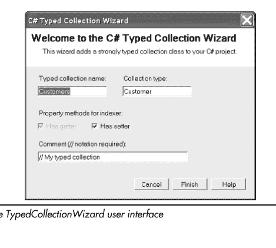

**图 6-5** *TypedCollectionWizard 用户界面*

如果我将底层控件从 TextBox 更改为其他内容，那么我只需要在此处更改引用 TextBox 值的 GUI 代码。我采用的另一个策略是在用户界面和类中都验证字段输入。这基于 **G.I.G.O.**（或 **garbage in, garbage out**）的概念，这是我最早在计算机科学中学到的首字母缩写词之一。我使用正则表达式来验证输入。类名必须是以字母字符开头的字母数字连续字符串。以下代码确认了这一点：

```csharp
private void DoValidateField(Control control, string value,
    string expression, string errorText)
{
    if( !Regex.IsMatch(value, expression))
    {
        control.Focus();
        throw new Exception(errorText);
    }
}
private void ValidateClassName()
{
    DoValidateField(textBoxClassName,
        ClassName, @"^\w$|^\w[A-Za-z0-9]+$",
        "需要有效的类名");
}
```

> **提示**
>
> **重构是改进现有代码设计的系统化方法，由 William Opdyke 命名，并在 XP（极限编程）引入时流行起来。**

方法 ValidateClassName 调用了一个重构后的方法，该方法接受一个控件和三个字符串参数。第三个参数是正则表达式。如果控件的 Text 内容与正则表达式不匹配，则会将焦点给予该控件并抛出异常。（有关正则表达式的更多信息，请参阅第 4 章。）

### 对话框表单策略

FormWizard 被用作对话框表单。我使用的一个策略是创建一个名为 Execute 的静态方法。静态方法接受表单的输入并返回输出。表单使用者不需要担心创建和销毁表单，只关心输入和输出。以下简短的代码清单展示了 FormWizard 如何向使用者提供此服务。

```csharp
public static bool Execute(ref string generatedCode)
{
    using(Form1 form = new Form1())
    {
        if( form.ShowDialog() == DialogResult.OK)
        {
            generatedCode = form.Code;
            return true;
        }
        else
            return false;
    }
}
```

最终使用者将是 TypedCollectionWizard。实现 IDTWizard 的类只需要调用此静态方法，评估布尔返回值，并处理生成的代码。

如果你正在编写基于 Windows 窗体的应用程序，你可以使用与前面片段中所示相同的方法。另一种方法是对话框表单的使用者必须构造表单，评估 DialogResult，并关注表单的特定属性。本质上，你将不得不在每次与表单交互时重复前面的代码，这将使代码量至少是所需长度的两倍。以下是如何基于静态 Execute 方法显示表单。

```csharp
string generatedCode = string.Empty;
if(FormWizard.Execute(ref generatedCode))
  // 执行一些操作
```

前面是表单与表单使用者之间非常简单的交互。

### 实现向导

因为我们已经将生成器实现为一个类，并且表单通过简单的 Execute 方法交互，所以实现向导是轻而易举的事。
如果你回忆一下前面“创建自定义向导”一节的内容，我们只需要实现 IDTWizard.Execute 方法。此外，我们的向导必须获取表单返回的代码并将其写入代码文件。清单 6-15 展示了一种实现向导的方法。

```
清单 6-15   实现 ITDWizard 接口并完成向导

using System;
using System.IO;
using EnvDTE;
using System.Windows.Forms;

namespace TypedCollectionWizard
{
    /// <summary>
    /// Class1 的摘要描述。
    /// </summary>
    public class CollectionWizard : IDTWizard
    {
        // 实现 IDTWizard.Execute
        public void Execute(object Application,
          int hwndOwner, ref object[] ContextParams,
          ref object[] CustomParams, ref wizardResult retval)
        {
            string generatedCode = string.Empty;
            if( FormWizard.Execute(ref generatedCode))
            {
                WriteCode((DTE)Application, generatedCode);
                retval = EnvDTE.wizardResult.wizardResultSuccess;
            }
        }
```


### 第六章：自定义 Visual Studio .NET 195

```csharp
    private void WriteCode(DTE dte, string generatedCode)
    {
        try
        {
            DoWriteCode(dte, generatedCode);
        }
        catch(Exception e)
        {
            MessageBox.Show(e.Message, "Error Writing Code",
                MessageBoxButtons.OK, MessageBoxIcon.Error);
        }
    }

    private void DoWriteCode(DTE dte, string generatedCode)
    {
        ProjectItem item = dte.ItemOperations.AddNewItem(
            @"Local Project Items\Code File", "" );

        string defaultNamespace =
            (string)item.ContainingProject.Properties.Item(
            "DefaultNamespace").Value;

        CodeNamespace code =
            item.FileCodeModel.AddNamespace(defaultNamespace, 0);

        EditPoint editPoint = code.StartPoint.CreateEditPoint();
        editPoint.LineDown(2);
        editPoint.Insert(generatedCode);
    }
}
```

现在，这段代码的大部分内容应该看起来很熟悉了。代码清单 6-15 的第 14 到 29 行满足了 `IDTWizard` 合约。这里没有显示“Hello Wizard”，而是在 `Execute` 返回 `True` 时显示表单并写入代码。`WriteCode` 使用 *try catch* 异常处理程序来管理错误处理，而 `DoWriteCode` 则生成代码文件。

可能不太明显的是，`DTE` 对象作为第一个参数传递给了 `Execute` 方法；我们在代码清单 6-15 的第 22 行将 *Application* 对象参数强制转换为 `DTE` 对象，并使用该 `DTE` 实例来创建源代码文件。第 45 到 60 行的 `DoWriteCode` 与代码清单 6-11 中的宏代码及其后的说明几乎完全相同。这里不是写入日期和时间，而是在第 59 行写入向导类返回的已生成代码。

Visual Studio .NET 中的自动化模型功能强大且庞大。它是使 .NET 对软件开发者和软件开发成为有吸引力的选择的 Visual Studio .NET 方面之一。接下来，我们需要测试该向导。我们将从创建一个向导启动文件开始。

### 完成示例向导启动文件

向导启动文件具有 .vsz 扩展名，并在向导加载和运行时被读取。TypedCollectionWizard 的启动文件很简单。我们只需要提供一个向导名称并指示不需要参数。以下文本将添加到名为 TypedCollectionWizard.vsz 的文件中，并复制到包含 TypedCollectionWizard.dll 的同一文件夹。

```
VSWIZARD 7.0
Wizard=TypedCollectionWizard.CollectionWizard
Param=<Nothing>
```

向导引擎并不要求你将 .vsz 文件放在与向导 DLL 相同的文件夹中。然而，将向导和启动文件放在同一目录下可以轻松实现。

第一条语句是必需的，必须原样添加。第二条语句描述了包含 `IDTWizard` 实现的程序集及其类。后续语句用于描述传递给向导的参数。我们的向导不接受任何参数，这正是启动文件中的 `Param` 语句所指示的。下一个代码清单是 C# 索引器向导启动文件，它与向导引擎一起使用。该文件显示了两个参数参数。

```
VSWIZARD 7.0
Wizard=VsWizard.VsWizardEngine
Param="WIZARD_NAME = CSharpIndexerWiz"
Param="PROJECT_TYPE = CSPROJ"
```

你可以传递你的向导所需的任何参数。这里演示的风格是为名为 `WIZARD_NAME` 和 `PROJECT_TYPE` 的参数描述值。

### 注册向导

未添加到全局程序集缓存（GAC，发音为 *gak*）但需要注册表信息的程序集可以使用 .NET 附带的 `regasm` 工具进行注册。要注册 TypedCollectionWizard，请输入以下命令：

```
c:\winnt\Microsoft.NET\v1.0.3705\regasm c:\temp\TypedCollectionWizard.dll /codebase
```

描述的路径是 .NET 框架的默认路径，特别是版本 1.0.3705。目录 `c:\temp` 假设你从 `c:\temp` 目录注册向导。如果你使用的是其他目录，请在命令中用该目录替换 `c:\temp`。`/codebase` 开关使用 `file://` 标记在注册表中存储完整路径。向导本身不是 COM 组件；是 Visual Studio .NET 应用程序使用注册表信息来加载该程序集。（有关 `regasm` 的更多信息，请参阅本章末尾的“使用 regasm 工具”。）

我在本节开头提到了全局程序集缓存。GAC 是一个机器范围内的缓存，用于存放被许多应用程序共享的程序集。向导仅由 Visual Studio .NET 使用；因此，我们不需要将向导添加到 GAC 中。GAC 实际上是一个类似文件夹的存储库，它使用程序集元数据来确定程序集之间的差异，从而有助于避免 COM 中常见的冲突。你可以从 Visual Studio .NET 帮助文档中了解更多关于 GAC 的信息。.NET 附带了 GACutil.exe，这是一个用于将程序集添加到 GAC 的工具。

### 使用宏测试向导

我们已经为向导用户界面和向导类创建了测试应用程序，创建了向导，并创建了启动文件，现在可以使用代码清单 6-2 中的宏来测试向导。将 *const Path* 变量替换为 TypedCollectionWizard.vsz 向导启动文件的路径信息后，就可以使用宏来运行向导了。

Visual Studio .NET 支持向 Visual Studio .NET 添加菜单项或其他一些界面元素。你可以创建一个实现了 `IDTExtensibility2` 接口的 Add-In（外接程序），并结合 `IDTWizard` 接口在 Visual Studio .NET 中创建一个菜单项。有关 Add-In 和 `IDTExtensibility2` 的更多信息，请参阅 Visual Studio .NET 中的“创建 Add-In”帮助主题。`IDTCommandTarget` 接口将让你能够从命令窗口运行向导，作为替代选项。

### 从命令窗口运行向导

现在我们已经有一个可以启动我们向导的宏，就可以从命令窗口运行 TypedCollectionWizard 了。选择“视图 | 其他窗口 | 命令窗口”以打开命令窗口。如果你创建了测试宏——借用了代码清单 6-2 的代码——那么一旦你输入 **M**，你应该会立即在命令窗口中看到一个宏列表。我在 MyMacros 项目中创建了我的测试宏，放在一个名为 Module1 的模块中，并将子例程命名为 TestCollectionWizard。引用 Macros 对象，完整的命令变成：

```
Macros.MyMacros.Module1.TestCollectionWizard
```

Intellisense（智能感知）将提供一个可用命令列表，如图 6-6 所示，当我开始输入单词 **Macros** 时。

### 次要主题

正如你现在可能已经确定的，专业程序员需要熟悉多种语言和工具才能充分利用 .NET。本章介绍了 `gacutil.exe`、`regasm.exe`、Jscript.NET、宏和 Visual Basic .NET。我们无法在这里全部学习它们。我是通过十多年的阅读和实践学会了如何使用它们。然而，我可以介绍这些主题，并为你指出正确的方向，以帮助你进一步追求兴趣（并为我的出版商多卖些书）。为了结束本章，我想简要回到 Jscript .NET 和 `regasm.exe` 工具。

### 回到 Jscript .NET

我在本章开头简要提到了 Jscript。Jscript 在模板项目的实现中扮演次要角色。有一个外部编译器可用于编译 Jscript .NET 代码。然而，Jscript 是一种完整的语言，就像 C# 和 Visual Basic .NET 一样。Visual Studio .NET 中有大量关于 Jscript 的信息，你可以使用命令行编译器 `jsc.exe` 来编译 Jscript 代码。如果你感兴趣，请参考 **www.osborne.com** 和 **www.amazon.com** 网站上关于 Jscript 的书籍。

你可能遇到脚本的地方（除了创建模板项目时）是 Web 页面的客户端代码和 ACT。ACT，即 Microsoft Application Center Test，是 Visual Studio .NET 企业版附带的一个应用程序。ACT 用于自动化测试 Web 客户端应用程序。你可以在 ACT 中编写自定义脚本或修改录制的脚本来测试你的网页。

请按照以下编号步骤编写和编译 Jscript .NET 应用程序。（Jscript .NET 应用程序必须从命令提示符编译。）


### 第六章 总结

因此，我们拥有这么多优秀的技术，而时间却如此之短。就在短短十年前，我记得自己曾为硬盘错误中断 0x24 编写中断处理程序。当用户在软盘驱动器读写过程中取出软盘时，就会发生这种系统错误。异常处理已经取代了编写中断处理程序，成为捕获严重错误的一种方式。

技术发展如此之快，专业程序员最终将不得不专业化。就像管道工、电工、屋顶工、木匠、建筑师、总承包商、石膏板安装工、屋顶工（以及建筑行业的所有其他工种）一样，程序员也将不得不专业化。在本章中，我们接触了三种编程语言——Visual Basic .NET、Jscript 和 C#——以及一些实用程序——GACutil.exe 和 regasm.exe。就像其他存在已久的行业一样，我们的行业也将走向专业化。我们仍然以程序员为中心，但专业领域已经被识别出来，软件工具的复杂性和客户的需求最终将要求我们的行业培养专业人才。我专攻使用 UML 和 OOP 语言的面向对象架构。

有趣的是，对专业人员的需求在亚当·斯密的《国富论》中早有详细记载。斯密简单地描述了通过专业化分工来制造别针——裁缝使用的尖头小铁丝——使得别针制造商能够每天生产数千个别针，而不是数百个。斯密的描述可能是现代装配线的主要推动力。软件工具的复杂性最终将迫使专业化，并可能形成一种流水线式的软件开发形式。专业化早已过时，但幸运的是，流水线式软件开发还有很长的路要走。

## 第七章 事件日志

**本章内容：**

- 演示的主题
- 探索 System.Diagnostics 命名空间
- 使用 EventLog 组件
- 将跟踪作为调试策略
- 转储堆栈
- 自动管理调试代码
- 实现日志记录器
- 次要主题
- 创建对话框
- FileVersion 信息
- 使用 Debug 类
- 衡量性能
- 总结

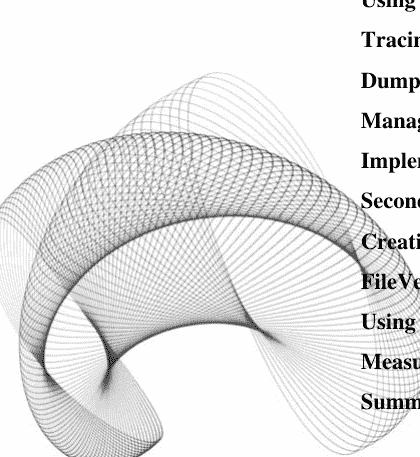

规划如何测试和调试代码几乎与编写代码本身同样重要。一个良好的 UML 模型和设计，如果没有同样优秀的测试与调试策略，就像蝙蝠侠没有罗宾一样。“动态独行侠”听起来远不如“动态二人组”响亮。

构建应用程序时，你需要进行单元测试、白盒和黑盒测试、少量自动化测试以及良好的质量保证流程。第一步是采用一些基本策略，确保你的代码在离开工作站之前就是优秀的。当程序员测试自己的代码时，这被称为*单元测试*。通过将测试代码集成到生产代码中，你可以减少实际花费在测试上的时间，因为你的代码会自动告诉你何时出了问题。包含能够通过编译器开关打开和关闭测试代码的能力是专业精神的标志。使你和他人都能轻松地集成自诊断或跟踪功能，是诞生编程传奇的方式。

我读过的第一本关于 C 语言调试和测试策略的优秀书籍是戴夫·蒂埃伦的《No Bugs!》（Addison-Wesley，1992 年）。蒂埃伦的策略对微软发布 MS-DOS 5.0 起到了关键作用。（DOS 5.0 现在已是古老的历史了。）蒂埃伦和杰拉尔德·温伯格等人引入的许多技术至今仍然盛行。仅仅几年前，程序员还必须构思多种良好的技术，因为合适的方案并不容易获得。我们不再需要从头开始构建调试和测试代码。公共语言运行时在 System.Diagnostics 命名空间中引入了大量的验证功能。适度运用这些功能，你可以消灭 bug。如果你勤奋且持续地运用一些基本策略，bug 就没有多少机会了。

本章将演示 .NET Framework 直接支持的几种功能，这些功能将帮助你最大限度地减少离开工作站的 bug 数量。

### 演示的主题

.NET Framework 有许多方面。.NET 代表了微软对其所有开发工具构建一个连贯且强大的框架的非凡承诺。如果你探索 .NET 的任何部分，你很快就会发现你可以探索数天之久。System.Diagnostics 命名空间就是这样一个领域，我鼓励你在其中投入大量时间。

本章将从你可能在概念上熟悉，但在实现上可能对你来说是新的基本功能开始。我们将逐步介绍 .NET 中全新的功能。通过本章的示例，你将能够构建更好的应用程序，掌握以下内容：

- 使用 EventLog 组件
- 记录到远程计算机
- 将跟踪作为调试策略
- 转储和查看堆栈帧

- 使用 BooleanSwitch 和 ConditionalAttribute 自动管理调试代码
- 使用自定义对话框获取和响应用户输入
- 访问 FileVersion 信息
- 将调试信息写入“输出”窗口并断言程序不变量
- 以及，使用 PerformanceCounter 跟踪应用程序的资源使用情况

### 探索 System.Diagnostics 命名空间

你可以轻松找到 System.Diagnostics 命名空间的所有类、命名空间和成员，因此我不会在此列出它们。（如果我们开始走那条路，我们需要另外 500 页。）我要告诉你的是，Diagnostics 命名空间包含的类远比 Debug 类多。System.Diagnostics 命名空间包含一系列类，允许你广泛地处理应用程序有效性风险。与 Debug 类一样，Diagnostics 命名空间包含用于在后台跟踪代码和写入事件日志的类；调试属性；从外部配置文件读取的开关，允许你在不重新构建应用程序的情况下打开和关闭代码；以及大量的性能计数器。（仅性能计数器的数量和种类就可以写满一本书。查看服务器资源管理器中的性能计数器作为证明。）我将使用 Diagnostics 命名空间的特定功能，为你提供 Windows 和 Web 应用程序的安全网。我将演示 Debug 类如何编写关于程序在后台操作的信息，以及它如何确保程序状态的基本假设不可侵犯。我们将使用 BooleanSwitch 类读取外部配置信息，以便在不重新构建应用程序的情况下打开和关闭调试代码。我们将使用 ConditionalAttribute 让编译器在编译时通过在发出中间语言之前自动剥离功能来打开和关闭代码。我们将回顾 PerfMon.sln，它演示了如何使用 PerformanceCounters 跟踪任何应用程序的资源使用情况。并且，我们将使用 EventLog 在构建以及部署应用程序后，在自定义事件日志中提供一个便捷的位置来存储关于我们的应用程序的信息。

### 使用 EventLog 组件

工具箱的“组件”选项卡包含几个有用的组件。一个特别有用的组件是 EventLog 组件。EventLog 组件可以从工具箱拖到组件托盘中。通过修改 EventLog 组件的属性，你可以快速指定要写入的日志名称、日志条目将输入的源以及包含要写入的日志的计算机。默认的日志名称是应用程序、系统和安全。通常你会将日志条目写入自定义日志或应用程序日志。如果你在 EventLog.Log 属性中输入一个唯一的名称，你可以创建一个自定义日志文件。（你可以通过搜索文件在计算机上找到物理日志文件）


### 写入事件日志

在构建和测试应用程序时，创建一个自定义日志并尽可能多地写入信息，以确保您能够诊断以后可能出现的问题。在部署应用程序时，您需要更加有选择性，只记录关键信息。请记住，事件日志存储在硬盘上的文件中，磁盘和文件都有容量限制。

> **注意**
> 日志和源在注册表中列于键 `HKEY_LOCAL_MACHINE\SYSTEM\ControlSet001\Services\Eventlog` 下。您可以直接修改键，但如果 EventLog 键被错误修改，某些应用程序（可能是重要的应用程序）可能会停止工作。如果您要修改注册表，最好在修改前导出注册表的完整副本。

源是标识日志条目来源的唯一名称。指定源名称时，它必须在所有日志中唯一。这意味着如果您在应用程序日志中指定了名为 "Demo" 的源，则不能在任何其他日志中定义 Demo 源。如果您想在新的日志中使用某个源，您需要从现有日志中删除该源。

> **提示**
> EventLog 类有几个静态 `WriteEntry` 方法。您可以通过将源和消息传递给其中一个静态 `EventLog.WriteEntry` 方法来将文本写入日志，而无需 EventLog 组件的实例。

无论您是在开发期间写入自定义日志，还是在部署后写入应用程序日志，写入日志的过程都是相同的。设置 `Log`、`Source` 和 `MachineName`，然后调用重载的 `WriteEntry` 方法之一。至少，您可以简单地传递一个包含要记录文本的字符串消息。假设我们有一个名为 `eventLog1` 的 EventLog 组件，我们可以用以下语句向事件日志写入一个条目：

```
eventLog1.WriteEntry("test");
```

假设组件 `eventLog1.Source` 设置为 Application 源，前面的语句将创建一个与图 7-1 所示非常相似的事件日志条目。（结果会根据操作系统、日期和时间、计算机名称以及写入事件日志条目的计算机的其他特定因素而略有不同。）

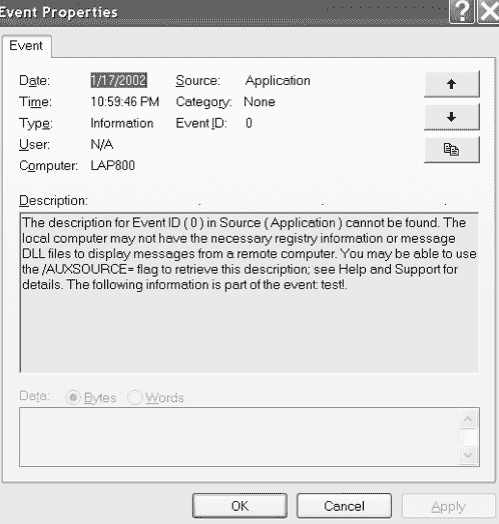

图 7-1   一个仅指定消息 "test" 的 EventLog EntryWritten。

### 处理 EntryWritten 事件

EventLog 组件定义了一个事件 `EntryWritten`。`EntryWritten` 事件处理程序允许您的程序响应由您的应用程序或其他应用程序写入的事件，只要事件日志条目写入在本地主机上。写入远程计算机的事件不会被 `EntryWritten` 事件接收。EventLog 组件的这一特性支持编写一个实用程序应用程序来监控其他应用程序的行为。

`EntryWritten` 事件是一个委托，接收两个参数：一个 `object` 和一个 `System.Diagnostics.EntryWrittenEventArgs`。`EntryWrittenEventArgs` 参数包含一个 `Entry` 属性。`EntryWrittenEventArgs.Entry` 属性是一个 `EventLogEntry` 对象，包含描述事件的信息。`EventLogEntry` 类包含有关事件生成和写入的时间、事件消息、事件源和计算机名称的信息。您可以使用这些信息来监控应用程序的运行状况。

### 响应事件条目

要响应 `EntryWritten` 事件，请将 `EventLog.EnableRaisingEvents` 属性设置为 `True`，并实现一个 `EntryWritten` 事件处理程序。这两项任务中的任一项或两项都可以通过编程方式或使用属性窗口来完成。

McGraw-Hill/Osborne 网站 **www.osborne.com** 上提供的 DebugDemo.sln 示例应用程序演示了 `EntryWritten` 事件处理程序。如果您运行 DebugDemo.exe 应用程序的第二个实例，您将看到应用程序的两个实例都在响应事件日志条目，即使您可能只与单个实例进行交互。以下事件处理程序演示了将发送到事件日志的信息写入 RichTextBox 控件的示例。

```
private void eventLog1_EntryWritten(object sender,
System.Diagnostics.EntryWrittenEventArgs e)
{
    richTextBox1.AppendText(e.Entry.Message + "\n");
}
```

字符串 `Message` 内容和换行符被追加到 RichTextBox 文本值。

### EntryWritten 事件的频率

`EntryWritten` 事件接收至少五秒前发生的事件。这意味着您每五秒只会收到一个 `EntryWritten` 事件。如果您调用 `WriteEntry` 的频率高于每五秒一次，您可能不会收到最近写入的事件通知。

根据我的经验，您可能会收到几个写入时间间隔非常接近的条目，但不是全部。例如，假设您编写一个 `for` 循环，连续写入 100 个条目。在第一次执行循环时，您可能只能得到十几个左右的条目，并在下一次写入日志时得到第一次循环中写入的其余事件。

> **提示**
> 要在 Windows XP 机器上运行 EventViewer，请打开控制面板，单击打开管理工具小程序，然后双击事件查看器快捷方式。您也可以运行 Microsoft 管理控制台 (mmc.exe) 的实例，并添加事件查看器管理单元。

当然，您可以使用 `EntryWritten` 处理程序来提前通知系统问题，并查询事件日志以获取详细信息。您可以使用 EventViewer 来了解有关应用程序行为的更多信息，或使用 EventLog 组件编写自定义查询工具。

### 将事件记录到远程计算机

将事件记录到远程计算机的能力是密切关注关键任务应用程序的好方法。

假设您在一个秘密项目中工作——就像我最近在俄勒冈州参与的项目一样。您开发应用程序，并在认真进行单元测试后将其交给测试组。测试组在测试实验室中部署应用程序，并开始使用自动化测试运行应用程序，同时也让用户偶尔尝试测试产品。通过使用 EventLog 组件和远程计算机日志记录来实现应用程序，您可以不时地查看您的应用程序，而无需前往测试实验室。如果确实出了问题，当测试人员打电话来时，您会显得很有先见之明。更重要的是，您将拥有准确的描述，因为这张图将由写入您机器上日志的条目来说明。

默认情况下，当您调用 `EventLog.WriteEntry` 时，条目会写入本地计算机。本地计算机是默认值，在 `EventLog.MachineName` 属性中由句点 (.) 表示。要写入特定计算机，请将 `EventLog.MachineName` 属性修改为日志设备的名称；例如，FORD-4PBWU 将指示事件日志控件将条目写入名为 FORD-4PBWU 的计算机。

### 跟踪作为调试策略

据我所知，程序员一直使用像 `printf`（在 C 中）这样的函数将调试信息写入控制台，以跟踪应用程序内部发生的情况。这种策略仍然是跟踪应用程序内部操作的绝佳技术（有点像在牛的胃上开一个口子，窥视其消化过程）。

随着 GUI 界面和 Web 应用程序的广泛采用，将输出写入控制台通常不再方便。跟踪应用程序内部消化过程的一般策略仍然有效。幸运的是，支持跟踪应用程序内部操作的工具已经改进，以跟上我们正在构建的应用程序类型。

为此，.NET 在 `System.Diagnostics` 命名空间中实现了一个 `Trace` 类。`Trace` 类将输出写入 `TraceListener`，默认情况下是 Visual Studio .NET 中的输出窗口。您还可以创建继承自抽象 `TraceListener` 类的其他类的实例，并指示 `Trace` 类将跟踪消息发送给这些侦听器。（这是面向对象技术的一个极好的例子：跟踪能力与 `TraceListener` 的接收者分离。）

> **提示**
> 在编写生产代码时编写跟踪信息。这是您将最了解您感兴趣的行为的时候。

您可以将跟踪信息发送到的一个方便位置是 EventLog。`EventLogTraceListener` 继承自 `TraceListener`，便于将跟踪信息发送到事件日志。您可以将事件日志与跟踪功能结合使用，以跟踪应用程序的执行路径，直至最细微的细节，而无需设计编写跟踪细节的机制。


### 跟踪至事件日志

跟踪等效于在程序运行时编写一条 `print` 语句，该语句会告诉你关于应用程序内部的某些信息。如果你想保留跟踪信息的记录，可以使用自定义事件日志。

要使用自定义事件日志来捕获跟踪信息的记录，你需要一个 `EventLog` 对象、一个用 `EventLog` 对象初始化的 `EventLogTraceListener`，以及调用 `Trace.WriteLine` 方法等语句。

#### 创建 EventLogTraceListener

`EventLogTraceListener` 与 `EventLog` 对象交互，将跟踪信息发送到事件日志。要创建 `EventLogTraceListener` 的实例，你可以编写如下语句：

```csharp
System.Diagnostics.EventLogTraceListener listener = new System.Diagnostics.EventLogTraceListener(eventLog1);
```

前面的示例假设存在一个名为 `eventLog1` 的 `EventLog` 组件，并且至少设置了 `EventLog.Source` 属性。假设你在 `*using*` 语句中包含了 `Systems.Diagnostics` 命名空间，你可以将前面的代码简化为仅包含类名，如下所示。

```csharp
using System.Diagnostics;
...
EventLogTraceListener listener = new EventLogTraceListener(eventLog1);
```

#### 注册跟踪监听器

`EventLogTraceListener` 定义在 `Systems.Diagnostics` 命名空间中。如果你想跟踪到 `EventLog`，以下代码示例演示了如何设置这种关系。（你可以在本书附带的 `DebugDemo.sln` 示例应用程序中找到示例代码。）

```csharp
private void MenuForm_Load(object sender, System.EventArgs e)
{
    eventLog1.Source = "Trace";
    Trace.Listeners.Add( new EventLogTraceListener(eventLog1));
    Trace.WriteLine("Test!");
}
```

前面的代码假设存在一个名为 `eventLog1` 的 `EventLog` 组件。当你从工具箱的“组件”选项卡拖动该组件时，它只定义了默认信息——即没有 `Source` 或日志名称，并且日志记录将写入本地计算机。你必须设置 `Source` 的名称。如果 `Source` 不存在，该组件会为你创建它。`Trace` 类有一个名为 `Listeners` 的静态属性。`Listeners` 是一个只读静态属性，其类型定义为 `TraceListenerCollection`。要使 `eventLog1` 成为 `Trace` 类的监听器，我们可以传递一个用 `eventLog1` 初始化的 `EventLogTraceListener` 新实例，如前面的代码清单所示。最后一条语句演示了一条 `Trace` 语句，它将文本“Test!”写入输出窗口和应用程序事件日志。

### 转储堆栈

`System.Diagnostics` 命名空间中定义的另外两个类是 `StackFrame` 和 `StackTrace` 类。这些类用于多种目的，包括诊断你的应用程序。例如，`StackTrace` 的实例是 `Exception` 的一部分。

#### 使用 StackTrace 作为诊断工具

你可能想要跟踪并将意外的异常写入自定义事件日志。为了进一步诊断，如果出了什么问题，找出实际发生的处理顺序可能会有所帮助。`Exception.StackTrace` 对象可以帮助你完成这项任务。

回顾一下：当你的程序运行时，每个调用方法的地址都被压入堆栈内存。当方法返回时，信息从堆栈内存中弹出。以这种方式，当你的应用程序运行时，堆栈可能数百万次地压入和弹出。在任何时间点，堆栈上都有一些帧，表明方法调用的顺序。你可以使用这些信息来诊断你的应用程序。

`DebugDemo.sln` 包含一个菜单项“工具 | 堆栈跟踪”，它通过强制无限递归故意压入堆栈——虽然我们知道它在那里，所以我们会在它溢出堆栈帧之前捕获递归——并通过显示堆栈跟踪来捕获递归（参见清单 7-1）。

> 清单 7-1 此代码模拟无限循环场景，并在异常时转储堆栈跟踪。

```csharp
private int i = 0;
private void StackWinder()
{
    i += 1;
    if( i > 50 ) throw(new Exception("StackWinder"));

    StackWinder(); // intentionally wind up the stack!
}

private void menuItem16_Click(object sender, System.EventArgs e)
{
    try
    {
        StackWinder();
    }
    catch(Exception x)
    {
        richTextBox1.Clear();
        richTextBox1.AppendText(x.StackTrace.ToString());
    }
}
```

当在 `DebugDemo.sln` 中单击“工具 | 堆栈跟踪”菜单项时，清单 7-1 中的事件处理程序被调用。处理程序调用 `StackWinder`，该方法通过调用自身 50 次故意压入堆栈。在第五十次调用 `StackWinder` 之后，抛出一个异常，如图 7-2 所示。菜单项单击处理程序中的 `catch` 块将异常捕获到对象“x”中，并将堆栈跟踪写入 `RichTextBox`。（这最后一步模拟了跟踪堆栈跟踪。）

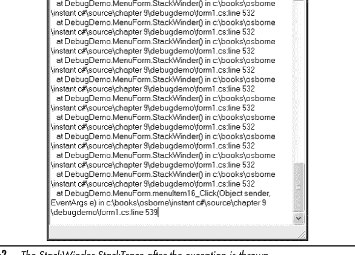

图 7-2 异常抛出后的 StackWinder StackTrace

#### 使用 StackFrame 作为诊断工具

以下代码片段演示了如何为当前文件创建 `StackFrame` 对象的实例，并显示文件、行和列信息。（此输出与 `StackTrace` 中找到的每一行信息一致。）

```csharp
StackFrame f = new StackFrame(true);
richTextBox1.AppendText(f.ToString () + "\n");
```

你可以查看 `StackFrame` 对象的文本内容，以查看代码执行的确切顺序。

### 自动管理调试代码

如果你必须编写诊断代码、在部署应用程序之前删除它，然后在应用程序进入维护模式时重写它，那么跟踪和诊断功能将是令人头疼的。多年来，大多数程序员都熟悉条件预处理器指令。

例如，将条件指令包裹在代码周围。如果指令的计算结果为 `false`，则代码将被编译器移除。C# 实现了预处理器指令；因此，如果定义了预处理器条件常量，下面的指令将只允许上一节中的 `StackFrame` 示例。

```csharp
#if DEBUG
    StackFrame f = new StackFrame(true);
    richTextBox1.AppendText(f.ToString () + "\n");
#endif
```

如果定义了常量 `DEBUG`，预处理器会包含该代码。如果没有，则代码被排除。Visual Studio .NET 为你提供了一个提示。如果代码将被包含，那么代码将显示为彩色。如果编译器指令的计算结果为 `False`，则代码显示为灰色。（这种着色发生在你编码时的事实表明，预处理器在你编码时正在运行。当然，事实是 VS.NET IDE 在你编码时格式化代码并提供 Intellisense 信息。）

Visual Studio .NET IDE 相对于条件编译指令提供了改进。编译器指令的缺点是你必须在你想要有条件地剪切代码的任何地方放置它们，并且每次更改条件常量的值时，你都必须重新编译。.NET 支持一种改进形式的条件编译和开关，它们维护在外部 XML 文件中。在 XML 文件中使用开关类意味着你能够在不重新编译源代码的情况下打开或关闭调试代码。我们将在本节中探讨条件编译和 XML 开关。

### 条件编译

条件编译由编译器指令管理。编译器指令是一个后跟一个作为布尔值计算的值的 pragma。例如，`#if` 是预处理器条件 `if` 语句。如果 `#if` pragma 后的令牌计算结果为 `true`，则编译器包含 `#if` 和 `#endif` 之间的代码。如果条件编译变量的计算结果为 `false`，则代码不包含在输出程序集中。以下代码演示了分散的条件代码。

```csharp
#if DEBUG
    EventLog.WriteEntry("conditionally written debug information");
#endif
// ... Some more code
#if DEBUG
    EventLog.WriteEntry("some more conditionally written debug information");
#endif
```

> **提示**
C# 中的条件编译指令区分大小写。例如，*DEBUG* 和 *debug* 代表两个独立的常量。

通过将 `EventLog.WriteEntry` 语句包装在一个方法中，你可以将预处理器指令的出现次数减少到每个条件编译代码块一个。以下是修订版本。

```csharp
private void DebugWrite(string message)
{
#if DEBUG
    EventLog.WriteEntry(message);
#endif
}
DebugWrite("conditionally written debug information");
// ... Some more code
DebugWrite("some more conditionally written debug information");
```

现在你看到条件代码只存在于一个地方：包装函数。虽然这是一个更好的解决方案，但仍然存在问题。你能推断出缺陷吗？

即使你在部署应用程序并取消定义 `DEBUG` 编译器常量后，所有对 `DebugWrite` 的调用仍然会发生。`DebugWrite` 现在是一个空过程，但它仍然存在于应用程序中。微软发明了一种使用属性管理条件代码的更好方法。

`ConditionalAttribute` 类将计算一个常量。如果该常量存在，则该过程保留。如果该常量未定义，则该过程从 IL 中剥离，并且对该过程的每次调用都自动从 IL 中剥离。

`ConditionalAttribute` 适用于方法。你应该在每个方法之前加上 `ConditionalAttribute`，该属性应有条件地发出到 IL，并构建该属性

使用一个区分大小写的字符串进行求值。如果该字符串已定义，那么条件方法的所有调用都会被发送到 IL 中。取消用于初始化 `ConditionalAttribute` 的字符串定义，调用和条件方法就会自动从程序集中移除。清单 7-2 包含一个演示 `ConditionalAttribute` 的示例。图 7-3 和 7-4 显示了条件指令被取消定义前后生成的 IL。

```csharp
using System;

namespace ConditionalDemo
{
    class Class1
    {
        [STAThread]
        static void Main(string[] args)
        {
            HelloWorld();
        }

        [System.Diagnostics.Conditional("DEBUG")]
        static void HelloWorld()
        {
            Console.WriteLine("Hello World");
            Console.ReadLine();
        }
    }
}
```

在 IL 反汇编中，你可以清楚地看到 `HelloWorld` 方法及其在 `Main` 方法中的调用。当你部署应用程序时，你需要更改配置管理器以反映你正在发布代码。这可以通过在配置管理器中将活动解决方案配置从“调试”更改为“发布”来实现。更改活动解决方案配置的一个影响是，编译器条件 `DEBUG` 在发布配置中未定义。图 7-4 显示了当 `DEBUG` 不再定义时生成的 IL。

符合 CLS 的语言可以忽略 `ConditionalAttribute`。

这里重要的是，你可以编写所有想要的测试代码，而不用担心你的程序集会因膨胀或方法疲劳而受损。对条件方法的调用会被编译器移除。

214 高级 C# 编程

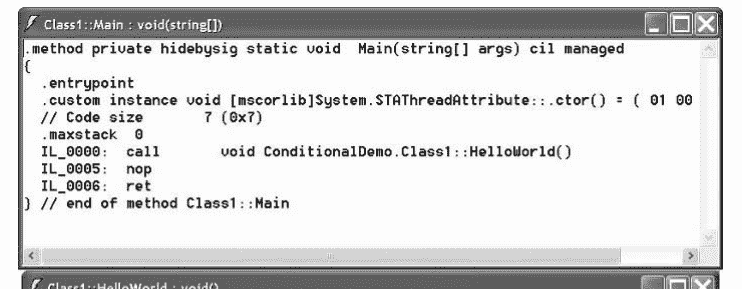

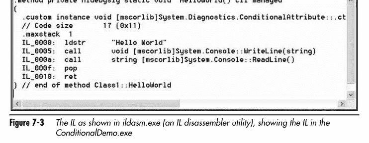

图 7-3 在 ildasm.exe（一个 IL 反汇编实用程序）中显示的 IL，展示了 ConditionalDemo.exe 中的 IL

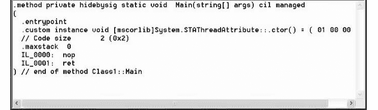

图 7-4 当 DEBUG 未定义时，在 ildasme.exe 中显示的 ConditionalDemo.exe 的 IL

### 使用开关

`ConditionalAttribute` 是对普通预处理器指令的改进，但你仍然必须重新编译应用程序以包含或排除条件方法。还有第三种选择，即 `BooleanSwitch`。

#### BooleanSwitch 示例

DebugDemo.exe 示例应用程序演示了如何使用 `BooleanSwitch` 来确定是否创建 `EventLogTraceListener`。以下是代码。

```csharp
static BooleanSwitch booleanSwitch =
    new BooleanSwitch("MySwitch", "Test Switch");

private void MenuForm_Load(object sender, System.EventArgs e)
{
    if( booleanSwitch.Enabled)
    {
        eventLog1.Source = "Trace";
        Trace.Listeners.Add( new EventLogTraceListener(eventLog1));
        Trace.WriteLine("Test!");
    }
}
```

第一条语句定义了一个静态 `BooleanSwitch` 对象，并用开关 `MySwitch` 对其进行初始化。示例中的 `BooleanSwitch` 将查找在此程序集关联的 .config 文件中定义的名为 `MySwitch` 的开关。
Load 事件处理程序评估 `BooleanSwitch`。如果 XML .config 文件为该开关定义了一个非零值，则 `BooleanSwitch.Enabled` 为 `True`，示例中的代码将运行。开关的名称不区分大小写。开关的任何非零值都将被视为 `True` 值。

#### 在 .config 文件中定义 BooleanSwitch

你可以为每个程序集定义一个 .config 文件。配置文件与程序集同名，只是在文件名末尾添加了 .config 后缀。例如，我们的 DebugDemo.exe 应用程序将评估与程序集在同一文件夹中的 DebugDemo.exe.config 文件。清单 7-3 显示了描述 `BooleanSwitch` `MySwitch` 的 .config 文件。

**清单 7-3** 在 XML .config 文件中描述 BooleanSwitch

```xml
<configuration>
    <system.diagnostics>
        <switches>
            <add name="MySwitch" value="0" />
        </switches>
    </system.diagnostics>
</configuration>
```

与 HTML 类似，XML 使用标签对。开始标签定义在大于和小于 (<>) 标记对内，结束标签包含一个反斜杠 </>。<configuration></configuration> 标签定义了配置文件的内容。配置文件只能包含一对配置标签。

#### 实现日志记录器

当然，你可以在需要事件记录时随时创建 `EventLog` 对象的实例或使用静态方法。然而，通过构建集体更易用且更有用的代码块，可以实现速度和健壮性。例如，我们可以包装 `EventLog` 类，并创建一个比创建实例和定义源更易于使用的实用程序。我们将创建 `TestLog` 类库，它具有易于使用的接口，并自动创建和管理事件源。我们可以将此类库插入任何我们希望在测试期间创建自定义日志的应用程序中。

> **注意**
>
> 包装属于特定框架的类和组件还有另一个动机。通过为现有组件添加包装器或外观，你可以使其更易于使用，或在不影响客户端的情况下交换实现外观的代码。外观（Facade）是支持简化类接口概念的模式的名称。

清单 7-4 提供了 `TestLog` 类库中定义的 Logger 类的完整清单。该代码为 `EventLog` 对象添加了一个外观。由于 Logger 类没有完全隐藏底层的 `EventLog` 对象，因此可能难以交换底层实现——即 `EventLog`。尽管如此，`EventLog` 更易于使用。

**清单 7-4** 所示的 Logger 类使用外观使使用 EventLog 更容易。

```csharp
using System;
using System.Diagnostics;

namespace TestLog
{
    public class Logger
    {
        #region Private Members
        private static EventLog log = null;
        private static EventLogTraceListener listener = null;
        private static string source = "";
        private static string logName = "";
        private static string machineName = "";

        private Logger(string source, string logName, string machineName)
        {
            Logger.source = source;
            Logger.logName = logName;
            Logger.machineName = machineName;
            Initialize();
        }

        private void Initialize()
        {
            Check();
            CheckListener();
            log = new EventLog(logName, machineName, source);
            listener = new EventLogTraceListener(log);
            Trace.Listeners.Add(listener);
        }

        private void Check()
        {
            if(SourceExists() && !LogNamesEqual())
            {
                string name =
                    EventLog.LogNameFromSourceName(source, machineName);
                CheckLog(name);
                EventLog.DeleteEventSource(source, machineName);
                EventLog.Delete(name, machineName);
            }
        }

        private void CheckLog(string log)
        {
            const string Mask = "Do not delete default log {0}";
            if( log.ToUpper() == "APPLICATION"
                || log.ToUpper() == "SYSTEM"
                || log.ToUpper() == "SECURITY" )
                throw(new Exception(string.Format(Mask, source)));
        }

        private void CheckListener()
        {
            Trace.Listeners.Remove(listener);
        }

        private bool SourceExists()
        {
            return EventLog.SourceExists(source, machineName);
        }

        private bool LogNamesEqual()
        {
            return EventLog.LogNameFromSourceName(
                source, machineName).ToUpper() == logName.ToUpper();
        }

        private static EventLog CreateDefault()
        {
            CreateNew("Logger", "Test", ".");
            return log;
        }
        #endregion

        public static void CreateNew(string source,
            string logName, string machineName)
        {
            Logger drop = new Logger(source, logName, machineName);
        }

        public static EventLog Log
        {
            get
            {
                return log != null ? log : CreateDefault();
            }
        }

        [Conditional("DEBUG")]
        public static void WriteEntry(string message)
        {
            Log.WriteEntry(message);
        }

        [Conditional("DEBUG")]
        public static void WriterEntry(string message,
            EventLogEntryType type)
```


98:     {
99:         Log.WriteEntry(message, type);
100:     }
101:
102:     public static EventLogEntryCollection Entries
103:     {
104:         get
105:         {
106:             return Log.Entries;
107:         }
108:     }
109:
110:     }
111: }

`Logger` 类使 `EventLog` 更易于使用，其背后的逻辑相当简单。在构建应用程序时，鼓励你记录尽可能多的应用程序相关信息，以帮助你消除缺陷。当发布应用程序时，你会希望将关键信息写入应用程序日志。否则，你可能会填满事件日志，这本身就会带来问题。

一个好的策略是在测试期间创建一个自定义日志，并记录所有有助于你追踪缺陷的信息。`TestLog.Logger` 类的实现考虑了构建和测试的需求。当我在构建应用程序时，我只希望记录跟踪信息，而无需担心创建唯一的源名称或指定自定义日志。通过编写 `Logger`，我可以自动化创建和管理自定义日志的过程，并确保源在所有日志中都是唯一的。每次使用 `Logger` 时，它都会为我处理这个过程。

以下部分定义了管理自定义事件日志所需的步骤，并解释了由 `Logger` 自动管理的事项。

### 创建事件源

当你创建 `EventLog` 的实例时，需要指定事件源。源在单台计算机的所有日志中必须是唯一的。如果你想手动创建事件源，可以调用静态方法 `CreateEventSource`，传递源和日志名称，或者源、日志和计算机名称。下面是一个演示该方法调用的示例。

```
EventLog.CreateEventSource("MyApp", "Application");
```

前面的示例在应用程序日志中创建了源 `MyApp`。

如果你查看 `Logger`，你会发现我们没有显式创建事件源。（不过，我们确实显式删除了事件源。）我们不创建事件源的原因是，`WriteEntry` 方法会自动创建一个不存在的源。如果该源已经存在于另一个日志中，则会引发异常。如果存在冲突的源，我们确实会将其消除。

### 确定源是否存在

`SourceExists` 是 `EventLog` 中定义的一个静态方法。向该方法传递源的名称，你会得到一个布尔值响应，指示该源是否存在。此方法检查计算机上的所有事件日志。`EventLog.SourceExists` 在清单 7-4 的第 50 行进行了演示。

> 注意
> 不要删除默认的应用程序、系统或安全日志。删除这些日志可能导致你的计算机停止运行。将 `EventLog` 封装到 `Logger` 类中的另一个好处是，我可以将检查代码化，以确保不会意外删除默认日志之一。`CheckLog` 方法就扮演了这个角色。

如果源存在，我们使用 `EventLog.LogNameFromSourceName` 方法来确定哪个日志包含我们想要使用的源名称，然后从该日志中删除该源。清单 7-4 中第 32 到 42 行的 `Check` 方法实现了源名称冲突解决代码。如果源存在，并且我想要使用的日志名称与源所在的日志名称不相同，则会删除该源和日志。

### 删除事件源

当使用完毕后，你可以通过调用静态方法 `EventLog.DeleteEventSource` 来删除事件源或移除冲突的源。传递 `Source` 和 `MachineName`，该源将从包含它的日志中被移除。清单 7-4 的第 39 行演示了如何删除事件源。

### 删除自定义日志

当使用完自定义事件日志后，你可能希望删除它。不要删除任何默认日志，包括应用程序、系统或安全日志。你可能很难在注册表中重新创建这些日志条目，并且由于它们的删除，你的计算机可能无法正常工作。

> 注意
> 如果我记得没错，我曾对应用程序日志调用 delete，想看看 `EventLog` 是否会允许我这样做。`EventLog.Delete` 删除了应用程序日志。幸运的是，我导出了这个注册表分支并能够恢复它。除非你愿意放弃机器配置并从头开始，否则我不建议这样做。但微软可能从那时起就在 `EventLog` 中实现了安全措施。

`Logger` 在清单 7-4 的第 40 行删除了包含我们源的日志，只要该日志不是那三大默认日志之一。

### 添加跟踪监听器

`Logger` 类也自动将我的自定义事件日志设置为跟踪监听器。这发生在清单 7-4 的第 28 和 29 行。

`Logger` 类的最终效果是，通过简单地调用两个静态 `Logger.WriteEntry` 方法之一，就能建立一个自定义日志和跟踪监听器。如果你再次仔细查看清单 7-4，你还会发现，消费者使用 `Logger` 类所需的方法数量被限制在几个。

`Logger` 类使得在构建应用程序时创建和使用自定义日志并向其写入跟踪信息变得容易。

### 次要主题

探索 `DebugDemo.sln` 示例程序，你会发现 `Diagnostics` 命名空间中展示了其他几个特性。`DebugDemo.sln` 演示了如何

-   实现自定义对话框
-   实现私有构造函数及其适用场景
-   按引用传递参数
-   使用 `FileVersion` 类（而非反射）创建“关于”对话框对话框
-   使用 `Debug` 类（并回顾 `Assert` 方法）

最后，我们将看看 `PerformanceCounter` 对象。`PerformanceCounter` 有助于衡量系统的性能和资源使用情况。这可以成为你工具库中的宝贵工具。

## 创建对话框

对话框是以模式方式显示的窗体，用于提示用户输入信息。Visual Basic .NET 提供了 `InputBox` 方法，它本质上是一个围绕窗体包装的函数。模拟这种“围绕窗体的函数”行为的好处是使消费者能够轻松执行基本操作。

`DebugDemo.sln` 实现了一个 `InputBox` 类，该类显示一个单独的输入文本框。此窗体（如图 7-5 所示）用于向用户查询信息。`InputBox` 接受一个标题、说明文字和默认值来描述显示的内容。（`InputBox` 的模型基于 VB.NET 的 `InputBox` 函数。）

如果用户单击“确定”，窗体返回 `DialogResult.OK`。如果用户单击“取消”，窗体返回 `DialogResult.Cancel`。

222 高级 C# 编程

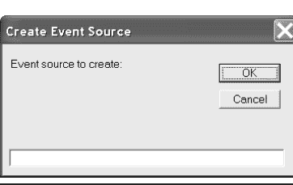

图 7-5 一个基于 VB.NET InputBox 函数的自定义对话框

### 对话框返回 DialogResult

对话框返回 `DialogResult` 枚举值之一。创建自定义对话框时，应强制执行此约定。`Form.ShowDialog` 函数返回一个 `DialogResult` 值。你只需确保调用了 `ShowDialog` 方法，并使用一个返回 `DialogResult` 值的控件。
`System.Windows.Forms.Button` 控件有一个 `DialogResult` 属性。要创建一个“确定”按钮，请在按钮的 `Text` 属性中输入 **确定**，并将 `DialogResult` 值设置为 `OK`。当用户单击“确定”按钮时，它将关闭窗体，并将 `ShowDialog` 方法的返回值设置为 `DialogResult.OK`。同样的过程也适用于“取消”按钮。

### 对话框的私有构造函数

为了使对话框更易于使用，你需要确保消费者通过 `InputBox.Show` 静态方法以受约束的方式调用该对话框。在这个例子中，`Show` 是一个工厂方法。要使其成为构造窗体的唯一方式，请将访问修饰符 *private* 应用于窗体的构造函数。因此，只有成员方法可以构造该窗体的实例。以下代码片段演示了这种技术。

```
private InputBox()
{
    InitializeComponent();
}

private InputBox( string title, string caption,
    string defaultValue) : this()
{
    Text = title;
    label1.Text = caption;
    textBox1.Text = defaultValue;
}

public static DialogResult Show( string title, string caption,
```

```markdown
ref string defaultValue)
{
    using(InputBox form = new InputBox(title, caption, defaultValue))
    {
        DialogResult result = form.ShowDialog();
        if( result == DialogResult.OK )
            defaultValue = form.textBox1.Text;

        return result;
    }
}
```

> **提示**
> *示例中演示的 `using` 语句将确保窗体的 `Dispose` 方法被调用。在 `using` 语句中构造的对象将在 `using` 块结束时自动释放。*

从示例中我们可以确定有两个构造函数，它们与类同名。默认构造函数调用 `InitializeComponent`。如果没有这个构造函数，我们窗体上的控件就不会被创建。第二个构造函数也是私有的，它接受我们的 `title`、`caption` 和 `defaultValue` 参数。`: this()` 子句指示编译器也调用默认构造函数。

由于两个构造函数都是私有的，我们创建窗体实例的唯一方式是通过公共工厂方法 `Show`。这正是我们想要的。因为我们要测试 `Show` 方法的 `DialogResult` 值，所以我们需要另一种方式从该方法获取输入值。我们可以通过引用传递 `defaultValue` 来实现这一目标。

### 在 C# 中通过引用传递参数

如果你需要在 C# 中从方法获取多个返回值，你可以将参数定义为引用参数。结果是对引用参数的更改将反映回调用者。（通过引用传递参数类似于在 C++ 中传递指针、在 VB 中使用 ByRef 以及在 Pascal 中使用 var。）

> **提示**
> *仅因 `ref` 关键字而不同的两个参数列表的方法将被重载。请注意，你不能通过引用传递属性。*

上一节示例中显示的 `Show` 方法将 `defaultValue` 定义为将被更改的参数，方法是在 `Show` 方法中参数类型 (`string`) 前添加 `ref` 关键字。在调用方法时，你也必须指定 `ref` 关键字。从 `DebugDemo.sln` 的 `MenuForm` 中，我们可以看到如何调用 `InputBox.Show` 方法。

```
if( InputBox.Show(title, caption, ref log) == DialogResult.OK)
```

注意变量 `log` 前使用了 *ref* 关键字。方法可以通过存在或不存在 *ref* 关键字进行重载。

对不使用 *ref* 或 *out* 关键字传递的参数所做的更改不会反映给调用者。使用 *ref* 关键字所做的更改将反映给调用者，并且 *ref* 参数必须被赋予某个值。使用 *out* 关键字所做的更改将反映给调用者，但 *out* 参数不保证已初始化。如果你通过 *ref* 或 *out* 传递 `Array`，则表明数组本身将被更改，而不是数组中的值。如果你只想更改数组中的值，则无需使用 *ref* 或 *out* 关键字。

### FileVersion 信息

第 2 章中的“关于”窗体演示了如何通过反射从 `Assembly` 类获取文件版本信息。使用反射获取版本信息为我们提供了介绍 `Assembly` 类和反射的便捷机会。幸运的是，有一种更简单的方法来检索版本信息。

`System.Diagnostics` 命名空间包含一个 `FileVersion` 类，该类具有代表我们可能在“关于”窗体中使用的所有值的属性。在 `DebugDemo.sln` 中定义的 `FormAbout` 演示了检索应用程序信息是多么容易。（当然，你仍然需要在项目中的 `AssemblyInfo.cs` 模块的程序集属性中指定此信息。）

```
FileVersionInfo info =
    FileVersionInfo.GetVersionInfo(Application.ExecutablePath);
label1.Text = info.ProductName;
label2.Text = "Version: " + info.ProductVersion;
label3.Text = info.FileDescription;
label4.Text = info.LegalCopyright;
label5.Text = info.Comments;
```

`FileVersionInfo.GetVersionInfo` 静态方法从传递给该方法的文件名中检索 `FileVersionInfo` 对象。如前面的代码片段所示，如果你想获取正在执行的应用程序的文件信息，可以传递 `Application.ExecutablePath` 属性。当你拥有 `FileVersionInfo` 对象时，只需查询属性即可获取所需信息。

`FileVersionInfo` 类的一个缺点是必须将程序集属性与 `FileVersionInfo` 属性匹配。`FileVersionInfo` 名称与程序集属性名称不完全相同。表 7-1 演示了你在创建“关于”窗体时可能会觉得有用的配对关系。

`AssemblyCopyright` 属性将 © 符号嵌入到属性文本中。你可以通过使用字面值将特殊符号嵌入到字符串中。版权符号的字面值是 `\xA9`，即十六进制值 A9。

如果你在 `minor`、`build` 和 `revision` 值中使用星号，则会自动生成 `AssemblyVersion` 信息。例如，`[assembly: AssemblyVersion("1.0.0.*")]` 将生成版本号 1.0.0，其中最后一个值（修订号）由编译器生成。

| 程序集属性 | FileVersionInfo 属性 |
| :--- | :--- |
| AssemblyProduct | FileVersionInfo.ProductName |
| AssemblyVersion | FileVersionInfo.ProductVersion |
| AssemblyTitle | FileVersionInfo.FileDescription |
| AssemblyCopyright | FileVersionInfo.LegalCopyright |

**表 7-1** *程序集属性与 FileVersionInfo 属性之间的对应关系*

### 使用 Debug 类

`Debug` 类在 `System.Diagnostics` 命名空间中定义。`Debug` 包含所有静态方法，有助于在应用程序中查找和解决缺陷。`WriteLine` 方法用于向“输出”窗口写入有关应用程序内部操作的文本，`Assert` 方法用于强制执行应用程序不变式。

编写显示应用程序内部状态的信息，结合断言预先确定的假设保持不变，对于构建无错误的应用程序非常宝贵。

### 将调试信息写入“输出”窗口

默认情况下，`Debug.WriteLine` 用于向“输出”窗口写入文本。你可以结合使用 `Debug.Indent` 和 `Debug.Unindent` 向“输出”窗口写入格式化的分层信息。`Debug.WriteLineIf` 的工作方式类似于 `WriteLine`，但仅在布尔表达式为 True 时写入信息。以下演示了 `WriteLine` 和 `WriteLineIf` 方法：

```
Debug.WriteLine("source deleted");
Debug.WriteLinIf( EventLog.SourceExists("MySource"), "Deleting MySource");
```

如果你调用 `Debug.Indent` 方法，则每次调用 `Indent` 时，调试信息将写入一个制表符。每次调用 `Unindent` 将减少一个制表符的缩进。

### 断言一切

`Debug.Assert` 类用于在构建程序时强制执行对程序状态的假设。`Assert` 通过暂停应用程序并在假设被违反时提醒你来强制执行假设。它通过评估布尔表达式来实现这一点。例如，如果你编写一个条件测试来确定事件日志名称是否不是“APPLICATION”，那么你可以对断言使用相同的测试。`if` 条件检查是为了确保你的代码正确运行，而断言则结合在一起，在你进行单元测试时，如果测试失败，就告诉你（开发者）。

```
Debug.Assert( log.ToUpper() != "APPLICATION" );
```

该技术是将断言与条件逻辑结合使用。条件逻辑用于部署，匹配的断言用于调试。例如，如果你作为程序员想在每次 Logger 尝试删除默认日志之一时得到通知，那么你可以编写一个断言来确保你得到通知。修改 `Logger.CheckLog` 方法，我们可以添加一个断言，如果日志是应用程序日志，则告诉我们。

```
private void CheckLog(string log)
{
    const string Mask = "Do not delete default log {0}";

    Debug.Assert(log.ToUpper() != "APPLICATION");
    if( log.ToUpper() == "APPLICATION"
        || log.ToUpper() == "SYSTEM"
        || log.ToUpper() == "SECURITY" )
        throw(new Exception(string.Format(Mask, source)));
}
```

### 调试工具简史

`Assert` 功能是最古老和最好的程序员技巧之一。像断言这样的功能内置在操作系统中。操作系统 BIOS 加载提供基本系统功能的功能。这些功能——例如打印到屏幕、写入视频缓冲区或管理鼠标行为——被称为*中断*。

编号最低的中断之一——大概是最早的之一——是中断 3，调试或“软冰”中断。中断 3 暂停应用程序的执行，将应用程序置于调试模式。最早的程序员——例如 MS-DOS 的 Tim Paterson、Bill Gates 和 Paul Allen——需要调试工具。

你仍然可以使用汇编语言和调试中断以及支持汇编语言编程的工具。以下脚本是“Hello World!”应用程序的汇编语言版本。可以使用命令行上的 `debug.exe` 程序编写该程序，并在命令窗口中遵循以下每条指令。

```
debug
a100
jmp 110
db "Hello, World$"
mov dx,102
mov ah,9
int 3
```


## 第8章 创建用户控件

**本章内容：**

- 演示主题
- 理解用户控件
- 创建 ButtonCluster 控件
- 创建 PickList 控件
- 实现 AboutBox 控件
- 定义数据绑定用户控件
- 用户控件中的自定义绘制
- 透明用户控件背景
- 通过继承扩展用户控件
- 次要主题
- 加载 ListBox
- 动态定位和调整控件大小
- 总结


通过创建新类和自定义控件来扩展 .NET 框架，是程序员可以参与的最有效且最有趣的活动之一。

UserControl 类是一种包含绘图表面的控件，类似于窗体，允许你在 Windows 窗体和 ASP.NET 的窗体设计器中设计复合控件。你无需使用代码来设计基于图形用户界面的控件，而是可以使用 Visual Basic 多年来一直存在的相同 RAD（快速应用程序开发）方法，以可视化方式设计可重用控件。

在设计用户控件时，你执行与设计窗体相同的活动。将控件拖放到窗体上，生成事件处理程序，修改属性并实现新方法。设计窗体和用户控件之间唯一值得注意的区别是，窗体通常是为最终用户设计的，而用户控件是为最终用户和其他开发人员设计的——也就是说，你的用户控件将出现在窗体中和工具箱中。最后一点信息表明，如果我们想构建可重用的用户控件，那么我们需要使它们足够通用，使其不过度依赖于特定应用程序。

本章将演示如何使用窗体设计器为 Windows 窗体应用程序设计用户控件，以及如何使这些控件可重用。

### 演示主题

构建可用的用户控件，你需要了解几个方面。如前所述，用户控件在设计和使用上与窗体非常相似。这意味着你的用户控件将包含构成控件，并且这些构成控件将具有你可能想要公开给用户控件消费者的属性和事件。此外，你可能希望执行自定义绘制并将数据绑定到用户控件。通过本章的示例，你将能够执行以下操作：

- 实现用户控件
- 公开构成控件的属性和事件
- 在用户控件中执行自定义绘制
- 使用 ADO.NET 和实现 IList 接口的对象将数据绑定到用户控件

### 理解用户控件

在 C# 中实现自定义控件有三种基本策略。你可以继承 Control 类以获得最大的灵活性，但工作量最大。你可以从一个更接近你想要创建的新控件的控件进行实现，从而减少灵活性和工作量。例如，如果你想制作一个具有特殊效果的标签控件，你可以继承 System.Windows.Forms.Label。最后，如果你想制作一个与现有控件差异很大的控件，你可能需要从 Control 类开始。


### 什么是 UserControl？

在 .NET Framework 中，UserControl 定义在 System.Windows.Forms 和 System.Web.UI 命名空间中。就我们而言，我们指的是 System.Windows.Forms.UserControl。UserControl 继承自 ContainerControl，ContainerControl 又继承自 ScrollableControl，而 ScrollableControl 本身继承自 Control 类。如果你查看 .NET Framework，会注意到这与 Windows Form 的继承链完全相同。

当你设计 UserControl 时，执行的操作与设计 Form 时相同。和 Form 一样，UserControl 包含其他被称为*组成部分控件*的控件。UserControl 和 Form 一样拥有图形用户界面，并且通常包含许多组成部分控件，以构成整体解决方案的一部分。例如，你可以实现一个包含基本联系信息的 UserControl，并将该控件集成到一个联系人管理表单中。（请参考本章后面的“定义数据绑定 UserControl”部分。）

### 图形界面为王

我这么说绝对是出于好意：我越是看到程序员实现的 Windows 应用程序图形界面，就越是确信应该让图形设计师先进行设计，然后再由程序员解决技术挑战。（Alan Cooper 在《*The Inmates are Running the Asylum*》（囚犯正在管理疯人院）一书中提到了由左脑型程序员为右脑型世界设计软件所带来的问题。我们程序员就是他所指的囚犯。）

在设计 UserControl 的视觉方面时，你可以采用几种策略：

- 你可以获取出色的背景图形，并使你的控件半透明。
- 你可以让一位右脑型人士或图形设计师为你设计一些基本的视觉元素，然后你可以创建一套标准的 UserControl，供你反复使用。
- 你可以层叠控件以创建深度和丰富性的效果，以此模仿一些现有外观更好的软件。（有一些好看的应用程序可以借鉴，作为你的起点。）

不幸的是，我并没能在说服客户雇佣设计师来设计界面方面取得很大成功，因此不得不更多地依赖最后一种方法，这并不如我所愿。（我寄希望于，通过在此写道图形界面可以由真正的艺术家很好地呈现出来，会有人采纳这种方法。）

假设你必须依赖*三色视觉*——三种颜色——和对称性来创建图形用户界面，那么至少你可以依赖 UserControl 来促进一致性。三色、对称且一致虽然算不上艺术，但也不会显得俗气。现在你需要一个构建 UserControl 的起点。

### 创建控件库

“新建项目”对话框中的 Windows 控件库模板是开始构建 UserControl 的一个好方法。Windows 控件库将生成一个具有 DLL 扩展名的程序集，并且项目将创建一个单独的 UserControl。（你可以从类库开始并手动添加 UserControl，但如果合理的捷径可用，没有理由不利用它们。）

当你创建 Windows 控件库时，输出类型将是类库（即 DLL），模板将添加 System、System.Data、System.Drawing、System.Windows.Forms 和 System.XML 命名空间引用。模板还会添加 AssemblyInfo.cs 和 UserControl1.cs 模块。AssemblyInfo 文件用于添加元数据，而 UserControl 模块包含一个继承自 UserControl 的类，你可以用它来开始实现你的第一个 UserControl。

你可以根据需要向控件库添加任意数量的 UserControl。你不受每个模块一个类的限制，但你确实希望将每个模块限制为单个 UserControl，因为一个 .resx 文件将通过文件名与该 UserControl 关联。

此时构建 UserControl 的一个推荐方法是：以通用解决方案为出发点构建控件，并使用一个通用应用程序来测试该 UserControl。当控件拥有了你确定需要的通用属性、方法、事件和组成部分控件后，你就可以将新的 UserControl 集成到你的应用程序中。我们将使用这种方法来构建 UserControl。第一个控件是四个按钮的堆叠，它们会根据 UserControl 的大小自动调整尺寸。第二个控件整合了这些按钮，制作了一个包含两个列表框的 UserControl，按钮作为在两个列表框之间移动元素的视觉隐喻。（在我们构建完这两个控件之后，我们将探索一些其他类型的控件。）

### 创建 ButtonCluster 控件

ButtonCluster 在 UserControl 容器上使用了四个标准的 Button 控件。ButtonCluster 控件显示在图 8-1 表单的中心。按钮上的文字表明，点击某个特定按钮将按照箭头指示的方向移动元素（见图 8-1）。


#### 注意

值得注意的是，这些按钮的行为对于熟悉 Windows 应用程序的人来说可能很直观，但对于非 Windows 用户来说可能完全不直观。这是每一个新软件应用程序都会带来的难题。

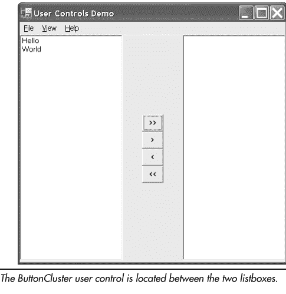

图 8-1 ButtonCluster 用户控件位于两个列表框之间。

现状是，软件开发者必须对其受众有所了解，如果 Windows 应用程序偏离 Windows 的外观和感觉太多，那么即使是经验丰富的计算机用户也会感到困惑。目前的方法是，在需要时为新应用程序的用户提供定制化培训。

从图 8-1 我们可以确定，该 UserControl 由四个按钮组成。为了保持按钮对齐，我们需要响应发送给 UserControl 的 Resize 事件，需要修改按钮的 Text 属性，并且需要公开各个 Button 的 Click 事件，以便允许用户响应 Click 事件。

> UserControl（或 Form）上的控件被称为组成部分控件。你会遇到“公开组成部分控件的属性”这样的表述。其他文本将其称为接口提升。当你在包含控件中暴露聚合体的成员时，“公开成员”和“接口提升”都是可以接受的。为了与你可能遇到的 .NET 帮助保持一致，我们将使用“公开”。

### 设计 UserControl 视觉界面

我们的第一个用户控件的外观由四个大小相同、垂直堆叠排列的按钮组成。为了使控件尽可能通用，我们可能希望允许按钮水平对齐。我们可能还希望允许使用其他类型的按钮（例如第 2 章的 VideoKiosk 按钮）来渲染实际按钮，但我们会保持按钮簇的简单性。

要创建按钮簇类，请创建一个新的 Windows 控件库项目。在 UserControl 容器上放置四个按钮。使用 Visual Studio .NET 的“格式”|“使大小相同”|“两者”菜单使按钮大小完全相同。（使按钮大致呈正方形。）使用“格式”|“对齐”|“居中”菜单项使按钮沿中心垂直轴对齐。调整 UserControl 的大小，使其宽度大致与单个按钮相同，高度则与所有四个按钮的总高度相同（示例可参见图 8-1）。不必担心精确的视觉尺寸，因为我们稍后会编写代码使控件在视觉上完美。我们需要做的下一件事是编写代码，使每个按钮的大小与包含控件的大小成比例地调整。

### 实现 UserControl 的 Resize 事件处理程序

当 UserControl 调整大小时，我们希望我们的按钮占据并完全消耗正好四分之一的可用空间。幸运的是，UserControl 可以像表单一样设计。要生成 Resize 事件处理程序，我们可以使用属性窗口的“事件”视图。

```
private void UserControlButtons_Resize(object sender,
System.EventArgs e)
{
    ResizeButtons();
}
```

按照一个良好的惯例，我们只需通过调用一个命名良好的方法来实现事件处理程序。这个命名良好的方法减少了注释的需要，并且名称精确地指明了代码将要做什么。作为替代方案，我们可以重写 OnResize 方法。如果你选择重写 OnResize，请确保调用基类方法。按照惯例，.NET 对事件方法使用 On 前缀；因此，Resize 事件将有一个调用它的 OnResize 方法。（你可以查阅此信息，或者简单地依赖惯例。）

如果你选择重写 OnResize 方法，那么重写后的方法可能实现如下：

```
protected override void OnResize(System.EventArgs e)
{
    base.OnResize(e);
    ResizeButtons();
}
```

我们可以使用重写的 OnResize 方法来实现组成部分的调整大小行为。我们不需要同时有事件处理程序和重写的事件处理程序；虽然两种方法都有效，但我通常更倾向于重写方法。

理解为什么可能需要重写 OnResize 方法而不是实现事件处理程序很重要，如果我们在 .NET 之外的环境中工作。

其他语言实现了过程类型和函数指针——两者本质上是相同的。然而，你的基本函数指针一次只能指向一个函数。


因此，如果你使用函数指针来实现调整大小的行为，并且使用者实现了此事件，那么你的事件处理程序将会丢失。这是因为函数指针事件处理程序一次只能指向一个函数。委托则不同。委托维护一个内部调用列表。这个内部调用列表允许委托——即.NET中的事件——指向多个事件处理程序，并在每次事件触发时通知每个处理程序。这被称为*多播*。由于委托可以进行多播，我们可以使用事件处理程序来实现调整大小的行为，而不用担心其他开发者会破坏我们的调整大小事件处理行为。多播委托允许我们使用事件处理程序或重写方法来扩展用户控件的行为。

### 确定按钮的均等细分

现在我们有了一个事件处理程序，我们的用户控件在调整大小时会收到通知。接下来，我们可以实现代码来均等地调整每个按钮的大小。

在编码时，判断一个解决方案是否足够通用，以便在其他上下文中也有意义，这通常很有用。确定矩形的分数部分通常很有用，经验表明我可以重用这个行为。当代码可能具有通用性时，创建一个新类并在新类中实现该行为是一个好主意。清单8-1实现了一个`Rectangle`类，该类可以计算一个矩形在边界矩形中按分数细分后的新顶部和新底部。

```
using System;
using System.Drawing;

namespace UserControlsExamples
{
    public class Rectangles
    {
        private Rectangles(){}

        public static Rectangle GetVerticalRectangle(
            Rectangle rectangle, int index, int segments )
        {
            Rectangle r = rectangle;
            r.Size = new Size( r.Width,
                NewBottom(rectangle, index, segments));

            r.Location = new Point(0,
                NewTop(rectangle, index, segments));
            return r;
        }
    }
}
```

```
public static int NewTop( Rectangle rectangle, int index, int segments )
{
    return (int)((float)index / segments * rectangle.Height);
}

public static int NewBottom( Rectangle rectangle, int index, int segments)
{
    return rectangle.Height / segments;
}
}
```

这个类非常直接：根据细分的数量和你想要的确切划分计算新的顶部，并通过将高度进行等分来计算底部。更重要的是，我们如何判断何时需要一个新的类。简单地说，我们为一个方法提供一个好名字，然后问自己这个方法听起来是否像是这个特定事物（这个类）的行为。我将这个方法命名为`GetVerticalRectangle`。那么问题就变成了“`ButtonCluster.GetVerticalRectangle`——即`GetVerticalRectangle`——听起来像是按钮集群的好方法吗？”线索就在方法名`GetVerticalRectangle`中。名词`Rectangle`提供了一个合理的线索，表明这个方法可能应该属于哪种类型。这并非完美的科学，但经验和实验会有所帮助。

> **提示**
> 我们如何确定`Rectangles`类不需要被实例化？答案是：没有状态信息。也就是说，没有字段。如果一个类只有方法，那么这些方法可以是静态的，我们也不需要该类的实例。

现在我们有了一些用于确定矩形细分的通用方法，我们可以非常容易地调整集群中按钮的大小。

```
private void Initialize()
{
    buttons = new Button[]{buttonAllRight, buttonRight,
        buttonLeft, buttonAllLeft};
}

private void ResizeButtons()
{
    if( buttons == null ) return;
    for( int i=0; i<buttons.Length; i++)
    {
        buttons[i].Bounds = Rectangles.GetVerticalRectangle(
            this.Bounds, i, buttons.Length);
    }
}
```

`ButtonCluster`类被实现为将每个按钮的引用存储在一个数组中（参见前面的清单）。将按钮存储在数组字段中，便于遍历每个按钮并对每个矩形调用`Rectangles.GetVerticalRectangle`方法。参数`this.Bounds`是用户控件的矩形。索引`i`用作矩形细分，数组的`Length`表示细分的数量。这种方法实际上使代码具有相当好的可扩展性，因为我们不依赖于字面量值来确定索引或按钮的数量。

最后，关于策略再说一点。当然，你可以使用用户控件的`Controls`数组来访问按钮；然而，如果你选择这条路，你将更倾向于编写检查`Controls`数组中每个控件的`Type`信息的代码。两种方法都能合理地工作。如果你使用`Controls`数组，那么如果用户控件包含相似类型的控件，但你不想对所有相同类型的控件执行统一操作，你可能会遇到困难。

### 暴露组成部分事件

当我们处理按钮集群的视觉方面时，我们只需修改`Text`属性即可完成。为了更精致的外观，可以使用`Button.Image`属性并提供图形箭头。
然而，在程序层面上，我们还没有完全完成。按钮的目的是响应`Click`事件。就目前实现的事件处理程序而言，使用者将无法获取此控件上包含的按钮的`Click`事件。这提出了一个略显棘手的问题。一个解决方案——不是最好的——是我们必须暴露组成部分控件的事件。暴露组成部分控件事件并不像看起来那么困难。
但我们为什么必须这样做？

我将先回答“如何做”，然后我们再来看“为什么”。理解我们为什么必须暴露组成部分控件成员，以及替代方案是什么，将有助于我们预见在不久的将来可能发生的情况。（你正在学习什么是当前的，以及什么是可能的。）

### 在组成部分控件中提升事件

当你将控件添加到用户控件时，新控件将作为字段添加到用户控件中。用户控件上控件的属性被封装了两层。假设你有一个用户控件的实例`userControl1`。进一步假设`userControl1`包含一个`Button`控件。要获取按钮的`Text`属性，使用者必须编写类似`userControl1.Button.Text`的代码。计算成员访问运算符的数量——有两个——我们知道`Text`属性是两层深的。因此，按钮的`Text`属性不会出现在属性窗口中。
假设`Button`是`public`的，使用者可以通过编程方式修改用户控件中包含的按钮的属性。但是，如果你想在属性窗口中修改这些属性和事件，那么你必须暴露组成部分控件的属性和事件。我们希望使使用者能够编写响应单个按钮点击的代码，因此我们需要暴露`Button`的`Click`事件。

为了暴露组成部分控件事件，我们需要为这些控件编写事件处理程序。然后我们需要在用户控件中实现新的事件。当组成部分控件事件被引发时，我们将引发的事件传递给新的用户控件事件。实际上，我们将事件从包含的控件冒泡到用户控件的接口层。清单8-2演示了必要的步骤。

```
清单8-2  暴露组成部分控件事件
1:  private void Initialize()
2:  {
3:    buttons = new Button[]{buttonAllRight, buttonRight,
4:        buttonLeft, buttonAllLeft};
5:
6:    buttonAllRight.Click += new EventHandler(OnAllRightClick);
7:    buttonRight.Click += new EventHandler(OnRightClick);
8:    buttonAllLeft.Click += new EventHandler(OnAllLeftClick);
9:    buttonLeft.Click += new EventHandler(OnLeftClick);
10: }
11:
12: private bool IsValidIndex(int index)
13: {
14:    return (index >= buttons.GetLowerBound(0) &&
15:      index <= buttons.GetUpperBound(0));
16: }
17:
18: public Button this[int index]
19: {
20:    get
21:    {
22:      Debug.Assert(IsValidIndex(index));
23:      return buttons[index];
24:    }
25: }
26:
27: public event EventHandler AllRightClick;
28: public event EventHandler RightClick;
29: public event EventHandler AllLeftClick;
30: public event EventHandler LeftClick;
31:
32: private void OnAllRightClick(object sender, System.EventArgs e)
33: {
34:    if(AllRightClick != null)
```


### 242 高级C#编程

代码片段：
```csharp
35:     AllRightClick(sender, e);
36: }
37:
38: private void OnRightClick(object sender, System.EventArgs e)
39: {
40:     if(RightClick != null)
41:         RightClick(sender, e);
42: }
43:
44: private void OnAllLeftClick(object sender, System.EventArgs e)
45: {
46:     if(AllLeftClick != null)
47:         AllLeftClick(sender, e);
48: }
49:
50: private void OnLeftClick(object sender, System.EventArgs e)
51: {
52:     if(LeftClick != null)
53:         LeftClick(sender, e);
54: }
```

第27至30行（清单8-2中）声明了四个公共事件。这些事件将作为AllRightClick、RightClick、AllLeftClick和LeftClick出现在属性窗口的“事件”视图中。使用者可以为这些事件属性添加事件处理程序。按照惯例，清单8-2中第6至9行为我们的组成按钮控件的Click事件添加了私有事件处理程序。当Button Click事件被触发时，我们的内部事件会检查使用者是否将事件处理程序与我们的公共事件相关联。如果UserControl的公共事件已为其分配了处理程序，则这些事件将被冒泡到UserControl的表面。图8-2显示了按事件被调用的顺序排列事件的调用堆栈视图。

> **提示**
事件的操作符是 `+=`（和 `-=`），如清单8-2所示。委托甚至不支持赋值运算符 `=`。赋值意味着单个值，即单个委托。然而，所有的委托都是多播委托。你可以从调用列表中添加或移除委托，但不能将单个事件处理程序仅赋值给一个事件属性。

我们本可以使用Forms Designer为清单8-2中的组成按钮控件生成事件处理程序，但无论我们编写事件处理程序还是Forms Designer生成它们，结果都是一样的。真正的问题是，我们为什么要将组成控件的属性和事件完全暴露出来。

### 替代成员提升的可行方法

你可能假设，你可以将一个组成控件（如ButtonCluster中的按钮）声明为公共的。一旦组成控件是公共的，使用者就可以直接访问其属性和事件。事实上，Visual Studio .NET IDE允许你这样做（参见图8-3）。

图8-3显示了AllRightButton作为一个嵌套的引用属性。你可以修改属性值，但不能修改嵌套引用类型属性的事件；它们甚至不会出现在属性窗口中。当然，当你修改嵌套引用类型的属性时，这些属性不会正确地持久化到资源文件中。结果就是，嵌套属性在关闭IDE后不会被维护，在编译和运行应用程序时也不会被维护。从技术上讲，这是一个缺陷。

> **注意**
将组成对象字段设置为公共类型在属性窗口中也无法正常工作。只有属性和事件会出现在属性窗口中；公共字段不会。

如果你对C#的历史有所了解，你可以得出一些结论。首先，我们试图做的事情，如图8-2所示，似乎是直观的。如果你可以编程方式修改嵌套属性，那么你也应该能在设计时修改它们。其次，C#部分是由构建了Borland Delphi的同一个人的智慧结晶，Anders Hejlsberg。Delphi基于Object Pascal语言构建，其最近的版本支持设计时嵌套对象。我的直觉告诉我，你不必再暴露组成控件的属性和事件太久。预计嵌套对象将在不久的将来在IDE中正常工作。目前，公共嵌套对象属性在设计时无法正确保持状态。

你可能尝试做的第二件事是直接暴露组成事件。考虑以下代码：
```csharp
public EventHandler AllRightClick
{
    get
    {
        return buttonAllRight.Click;
    }
}
```
要直接暴露组成事件，你可能假设你可以像上面那样返回事件属性。这个声明将允许事件属性作为赋值语句的右侧值，但赋值（`=`）未为事件定义。（加法赋值（`+=`）和减法赋值（`-=`）运算符已为事件定义，但普通的赋值没有。）

图8-3  嵌套在属性窗口中的引用类型——按钮

此外，你可能尝试继承一个委托类并重载赋值（`=`）运算符。然而，委托类使用 `sealed` 修饰符声明，这意味着你不能继承委托。你只能根据方法签名声明新的委托。

### 创建PickList控件

我们已经有了ButtonCluster。我们可以通过引用包含ButtonCluster的DLL程序集在任何应用程序中使用它。我们也可以在另一个UserControl中使用ButtonCluster作为一个控件。通过分层复杂性，而不是构建一个单一的、整体式的控件，我们最终得到了更多的独立控件和更易于管理的控件。

我们将构建的下一个控件是一个包含两个ListBox控件和一个ButtonCluster的UserControl。由于ButtonCluster是一个独立的UserControl，当我们构建PickList控件时，我们充当的是ButtonCluster的使用者，只需要专注于新的行为。这显然比构建一个在一个类中定义Button和ListBox行为的整体式控件更简单。图8-1显示了PickList UserControl。

通过创建一个新的UserControl来实现PickList。在UserControl上绘制两个ListBox控件，在它们之间放置一个面板，并将ButtonCluster添加到面板中。为了维持ListBox和包含ButtonCluster的面板之间的相对位置，将左侧ListBox的Dock属性更改为Left，右侧ListBox的Dock属性更改为Center，将中心面板的Dock属性更改为Fill。当UserControl调整大小时，ListBox和ButtonCluster将保持图8-1所示的外观。ButtonCluster的位置可以用以下语句维持：
```csharp
buttonCluster1.Location = new Point(
    panel1.Left + (panel1.Width - buttonCluster1.Width) / 2,
    panel1.Top + (panel1.Height - buttonCluster1.Height) / 2);
```
ButtonCluster的水平位置从面板的左边缘偏移了包含面板和ButtonCluster之间宽度差的一半。ButtonCluster的垂直位置从面板的顶部偏移了面板高度与ButtonCluster高度差的一半。

视觉效果已经完成。现在我们需要实现将元素在两个ListBox之间移动的行为。我们可以通过使用属性窗口为每个按钮生成事件处理程序来初步实现这个行为。

### 从ListBox中添加和移除元素

有四个按钮，我们可以用少数几种方式实现每个按钮的单独行为。点击>>（全部向右）按钮，所有元素将从左侧列表移动到右侧列表。<<（全部向左）按钮执行相反的操作。点击>（向右）按钮，只有选中的项目从左侧列表移动到右侧列表，而<（向左）按钮将选中的项目从右侧列表移动到左侧列表。

ListBox中的项目被定义为一个嵌套类型ObjectCollection。清单8-3演示了处理在ListBox控件之间移动元素的方法。

### 清单8-3 在ListBox控件之间移动项目

```csharp
1:  private void SourceToTarget(ListBox.ObjectCollection source,
2:    ListBox.ObjectCollection target)
3:  {
4:    target.AddRange(source);
5:    source.Clear();
6:  }
7:
8:  private void MoveAllLeft()
9:  {
10:   SourceToTarget(listBoxRight.Items, listBoxLeft.Items);
11: }
12:
13: private void MoveAllRight()
14: {
15:   SourceToTarget(listBoxLeft.Items, listBoxRight.Items);
16: }
17:
18: private void SourceToTarget(ListBox.SelectedObjectCollection
19:   source, ListBox.ObjectCollection target)
20: {
21:   IEnumerator e = source.GetEnumerator();
22:   while(e.MoveNext())
23:   {
24:     target.Add(e.Current);
25:   }
26: }
27:
28: private void RemoveSelected(ListBox listBox)
29: {
30:   for( int i=listBox.Items.Count - 1; i>=0; i--)
31:     if(listBox.GetSelected(i))
32:       listBox.Items.RemoveAt(i);
33: }
34:
35: private void MoveLeft()
36: {
37:   SourceToTarget(listBoxRight.SelectedItems,
38:     listBoxLeft.Items);
39:   RemoveSelected(listBoxRight);
40: }
```


### BeginUpdate 和 EndUpdate

MoveAllRight 和 MoveAllLeft 调用 SourceToTarget 方法，该方法接受两个 ListBox.ObjectCollection 对象。列表会根据我们移动项目的具体方向进行转置。ListBox.ObjectCollection 表示列表中的所有项目。在清单 8-3 的第 4 行调用 AddRange 后，我们在第 5 行清空了源列表中的所有元素。为了仅移动选中的项目，我们调用 SourceToTarget 方法，该方法第一个参数是 ListBox.SelectedObjectCollection，第二个参数是 ListBox.ObjectCollection。我们根据移动元素的方向对参数进行转置。我们仅通过使用枚举器来复制选中的项目；有趣的是，ListBox.SelectedObjectCollection 没有定义 AddRange 方法。在第 18 到 26 行枚举所有选中的项目并将选中的项目复制到目标后，我们调用 RemoveSelected。RemoveSelected 使用一个整数参数，因为 GetSelected 和 RemoveAt（第 31 和 32 行）都定义为接受整数参数。

有点遗憾的是，ListBox 使用一个特殊的集合来存储列表中的对象。这可能有助于内存优化，但这使得编写管理列表间项目移动的通用实用程序变得更加困难。

有时你需要将大量项目移入 ListBox。如果你允许 ListBox 在每次添加元素时都更新列表视图，那么 ListBox 的加载时间会变长。要加载大量项目，请在开始加载列表之前调用 ListBox.BeginUpdate，并在完成加载列表后调用 ListBox.EndUpdate。BeginUpdate 将阻止列表绘制新项目，直到你调用 EndUpdate。以下代码片段演示了该技术：

```
listBox1.BeginUpdate();
// 加载列表。例如，添加清单 3 中第 21 到 25 行的代码
listBox1.EndUpdate();
```

### 实现 AboutBox 控件

AboutBox 是一个你在大多数 Windows 应用程序中都能找到的窗体。这是一个非常适合构建一次并多次使用的组件。本节演示如何实现一个 AboutBox UserControl。About 属性是使用我们在第 7 章学习的 System.Diagnostics.FileVersionInfo 类从程序集元数据中读取的。我不会在此重复这些信息（请参阅第 7 章的“FileVersion Information”部分）。在本节中，我们将专注于公开组合属性，例如 About Image 属性。

#### 绘制和编码 AboutBox

你可以将第 7 章提到的 AboutBox 中的控件复制并粘贴到一个 UserControl 上。（你需要从 www.osborne.com 网站下载源代码。）你也可以将 FormAbout.cs 窗体中的 FormAbout_Load 代码从第 7 章的 DebugDemo 复制到 UserControl 的 Load 事件中。（我不会在此重复该代码。）

FileVersionInfo 动态读取程序集元数据以填充 AboutBox 窗体上显示的值；因此，将代码从窗体移动到 UserControl 使其具有可重用性，只要控件相同即可。当然，你也可以选择将 AboutBox 代码保留在窗体中，并在每次需要 About 信息时导入该窗体的副本，但 UserControl 版本为你提供了额外的灵活性。

#### 公开组合属性

公开组合属性比公开组合事件更容易。要公开你的 UserControl 中包含的控件的属性，请声明一个与你想要公开的控件属性类型相同的公共属性。在新定义的 UserControl 属性中返回并设置组合控件属性的值。

例如，我们已经定义了 AboutBoxInfo UserControl。为了允许用户更改 PictureBox.Image 属性，我们需要公开 Image 属性。假设我们的 PictureBox 控件使用默认名称，那么将下一个属性语句添加到我们的用户控件中将适当地公开组合的 image 属性。

```
public Image Image
{
    get
    {
        return pictureBox1.Image;
    }
    set
    {
        pictureBox1.Image = value;
    }
}
```

从外部来看，UserControl 现在具有一个 Image 属性。

我想在这里提及一下风格问题。注意我使用了 PictureBox 的默认名称 “pictureBox1”。之前我提到过，你应该为方法、属性、事件和字段提供良好、具有描述性的名称。了解何时需要担心这些事情也很重要。在 UserControl AboutBoxInfo 的情况下，只有一个 PictureBox，并且它是 UserControl 的私有成员。由于使用者无法直接与 PictureBox 交互，并且只有一个，所以 pictureBox1 是一个不错的名称。当然，这是主观判断，但软件开发既要知道该做什么，也要知道不该做什么或无需担心什么。

如果我们能简单地使组合控件公开并直接操作它们，那将是很棒的。你可以使组合控件公开，但它们在属性窗口中将无法正常工作。你可以在设计时在属性窗口中修改公共组合属性的值，但当你关闭 Visual Studio .NET 或编译应用程序时，这些值将不会保留。我猜想这个功能将在下一两个版本中得到支持，届时你将无需公开组合属性和事件。（如前所述，我之所以敢于做出这个假设，是因为公共组合控件看起来很直观，并且 Anders Hejlsberg 参与了 .NET 的开发。）

### 定义数据绑定 UserControl

Control 类引入了一个 DataBindings 属性，它是一个 ControlBindingsCollection。你可以将控件绑定到任何实现了 IBindingList、ITypedList 或 IList 接口的类。明显的类包括 ArrayList、Hashtable 以及 ADO.NET 的 DataSet、DataTable、DataView 和 DataViewManager 类。此外，你可以绑定到相同类型的强类型对象的列表。这意味着你可以将控件绑定到用户定义对象的数组。

第 5 章重点介绍 ADO.NET，因此我们将研究将自定义类型的数组绑定到我们的 UserControl。我们需要做的第一件事是构造一个包含我们想要绑定的组合控件的 UserControl。我们将定义一个显示联系信息的 UserControl。接下来，我们需要定义一个能够包含我们想要管理的信息的类，然后将该类的一些实例添加到一个数组中。最后，我们将自定义对象绑定到 UserControl，并提供一种遍历数组中元素的方法。

#### 实现 UserControl

创建一个名为 ContactInformation 的 UserControl。向 ContactInformation 添加三个 Label 和三个 TextBox 控件。将 Label 的 Text 属性更改为 “First Name:”、“Last Name:” 和 “Phone Number:”。定义三个名为 FirstName、LastName 和 PhoneNumber 的公共属性。将这些属性定义为字符串类型。完成的示例如图 8-4 所示。请以该图作为视觉参考。

为 ContactInformation 控件编写的唯一代码是公开三个组合 TextBox 控件的 Text 属性的代码：

```
public string FirstName
{
    get
    {
        return textBox1.Text;
    }
    set
    {
        textBox1.Text = value;
    }
}

public string LastName
{
    get
    {
        return textBox2.Text;
    }
    set
    {
        textBox2.Text = value;
    }
}

public string PhoneNumber
{
    get
    {
        return textBox3.Text;
    }
    set
    {
        textBox3.Text = value;
    }
}
```

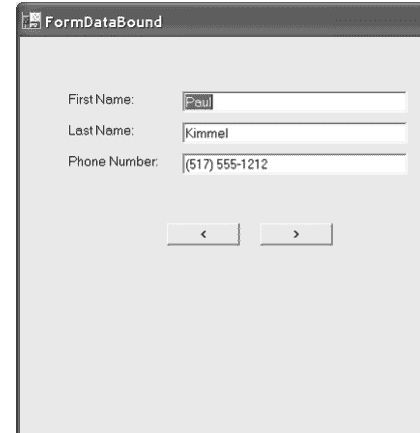

**图 8-4** 包含数据绑定 ContactInformation UserControl 的窗体


用户永远看不到 TextBox 控件本身，因此无需重命名 TextBox 控件。从用户的角度看，您拥有一个名为 `ContactInformation` 的 UserControl，其属性为 `ContactInformation.FirstName`、`ContactInformation.LastName` 和 `ContactInformation.PhoneNumber`。

### 实现 ContactInformation 类

定义一个与 `ContactInformation` UserControl 属性相匹配的类既方便又简单。定义一个复数形式的类来包含我们自定义类的集合会很有帮助。（这些类通常被称为*业务对象*。）清单 8-4 定义了 `Contact` 类及其容器 `Contacts`。

```
清单 8-4  Contact 和 Contacts 类
1:  public class Contacts
2:  {
3:      private ArrayList items;
4:
5:      public Contacts()
6:      {
7:          items = new ArrayList();
8:      }
9:
10:     public ArrayList Items
11:     {
12:         get
13:         {
14:             return items;
15:         }
16:     }
17: }
18:
19: public class Contact
20: {
21:     private string firstName;
22:     private string lastName;
23:     private string phoneNumber;
24:
25:     public Contact( string firstName, string lastName, string phoneNumber)
26:     {
27:         this.firstName = firstName;
28:         this.lastName = lastName;
29:         this.phoneNumber = phoneNumber;
30:     }
31:
32:     public string FirstName
33:     {
34:         get
35:         {
36:             return firstName;
37:         }
38:         set
39:         {
40:             firstName = value;
41:         }
42:     }
43:
44:     public string LastName
45:     {
46:         get
47:         {
48:             return lastName;
49:         }
50:         set
51:         {
52:             lastName = value;
53:         }
54:     }
55:
56:     public string PhoneNumber
57:     {
58:         get
59:         {
60:             return phoneNumber;
61:         }
62:         set
63:         {
64:             phoneNumber = value;
65:         }
66:     }
67: }
```

清单 8-4 实现了一个包含三个字段和三个匹配属性的类。构造函数定义用于初始化这三个字段：`firstName`、`lastName` 和 `phoneNumber`。第 1 至 17 行的 `Contacts` 类包含一个 `ArrayList` 类型的字段 `items`。`Items` 属性被定义为只读属性（因为我们只实现了 getter 方法）。我们希望用户能够更改 `ArrayList` 的元素，但不能更改 `ArrayList` 本身。将 `ArrayList` 属性设为只读就是实现这一点的方法。如果我们查阅 Visual Studio .NET 帮助，可以确定 `ArrayList` 实现了 `IList`，是适合绑定到我们 UserControl 属性的。

### 绑定和导航

我们需要创建一些测试数据来测试我们的 UserControl。清单 8-5 创建了几个 `Contact` 实例和一个用于存储它们的 `Contacts` 对象。每个控件，包括 UserControl，都有一个 `DataBindings` 属性。我们将使用 `ContactInformation` 的 `DataBindings` 属性来表达 `Contact` 对象与 UserControl 之间的绑定。我们将通过使用 UserControl 的 `BindingContext` 属性来支持对 `Contacts` 的导航，以此结束这个示例。

**清单 8-5** *一个包含 `ContactInformation` UserControl 的窗体，以及将 ArrayList 中同构对象绑定到该 UserControl 的代码*

```
1: Contacts c = new Contacts();
2:
3: private void FormDataBound_Load(object sender, System.EventArgs e)
4: {
5:     c.Items.Add( new Contact("Paul", "Kimmel", "(517) 555-1212"));
6:     c.Items.Add( new Contact("Trevor", "MacDonald", "(517) 555-1212"));
7:
8:     contactInformation1.DataBindings.Add(
9:         new Binding("FirstName", c.Items, "FirstName"));
10:
11:    contactInformation1.DataBindings.Add(
12:        new Binding("LastName", c.Items, "LastName"));
13:
14:    contactInformation1.DataBindings.Add(
15:        new Binding("PhoneNumber", c.Items, "PhoneNumber"));
16: }
17:
18: private void buttonNext_Click(object sender, System.EventArgs e)
19: {
20:     ((CurrencyManager)contactInformation1.
21:         BindingContext[c.Items]).Position += 1;
22: }
23:
24: private void buttonPrevious_Click(object sender, System.EventArgs e)
25: {
26:     ((CurrencyManager)contactInformation1.
27:         BindingContext[c.Items]).Position -= 1;
28: }
```

> **提示**
> *为了可读性，您可以在成员运算符处添加换行符，而无需添加任何特殊的换行字符。*

清单 8-5 中的代码可以在 TestControls.sln 示例程序中找到，位于 FormDataBound.cs 窗体模块中。`Form_Load` 事件创建两个 `Contact` 对象和一个 `Contacts` 对象。`DataBindings.Add` 接受一个 `Binding` 对象。`Binding` 对象通过要绑定到的属性、要绑定的数据源以及该源中要绑定的数据成员进行初始化。第一个参数是我们在 UserControl 中的属性。数据源由 `ArrayList` 类型的 `Items` 表示，数据成员是 `ArrayList` 中某个对象的命名属性，具体是 `Contact.FirstName`、`Contact.LastName` 和 `Contact.PhoneNumber`。由于我是 UserControl 和业务类的作者，我将两者中的属性命名完全相同。这样做完全是为了易于使用和方便。要导航 `Contacts` 对象中的元素，我们必须将数据源 `Contacts.Items` 与 UserControl `contactInformation1` 同步。`BindingContext` 属性返回 `BindingManagerBase` 的一个特定子类。如果数据源返回单个属性，则 `BindingContext` 返回一个 `PropertyManager`；而我们的示例返回一个集合，因此，`BindingContext` 返回一个 `CurrencyManager`。`CurrencyManager` 允许我们通过增加或减少 `Position` 属性来遍历元素。`CurrencyManager` 自动处理集合的开始和结束。因此，当 `position` 属性被修改时，不需要特殊的异常处理代码。将控件绑定到对象数组后，您无需编写任何特殊代码来修改数据。更改 TextBox 中的数据，绑定字段就会被修改；这与绑定到 ADO 对象时的行为完全相同。

### 在 UserControls 中进行自定义绘制

当您将组合控件添加到自定义 UserControl 时，必须为每个特定控件的 `Paint` 事件处理程序中的组合控件提供自定义绘制。假设我们希望 `ContactInformation` UserControl 的标签看起来具有浮雕效果。（浮雕是一种使文本看起来具有深度感的效果。）使用绘制在 UserControl 上的 `System.Windows.Forms.Label` 控件，我们需要实现一个事件处理程序来处理 Label 的 `Paint` 事件，如下所示：

```
this.label1.Paint += new
    System.Windows.Forms.PaintEventHandler(this.label1_Paint);
private void label1_Paint(object sender,
    System.Windows.Forms.PaintEventArgs e)
{
    // 演示文本自定义
    Label l = (sender as Label);
    e.Graphics.DrawString(l.Text, l.Font, Brushes.White, new PointF(2,0));
}
```

第一条语句为 `label1` 的 `Paint` 事件添加事件处理程序。您可以使用属性窗口生成此语句和事件处理程序方法体。这两行代码通过将 sender 参数类型转换为 Label 并使用 Graphics 对象绘制文本来创建一个临时变量。恰好标签中的文本打印在偏移量 2, 2 处。通过偏移文本的第二次绘制并使用更亮的颜色，我们可以创建浮雕效果。

这种简单方法存在几个问题。如果文本换行或对齐方式改变，则此代码将不起作用。我们可以通过编写更多代码来检查标签的属性，并对换行文本或替代文本对齐进行补偿来解决这个问题。假设您已经解决了关于文本布局的任何问题，您应该避免部署包含以事件处理程序形式实现自定义绘制行为（或任何自定义行为）的 UserControl 的应用程序。如果您想要标签的自定义文本效果，那么应该继承 Label 类型并在 UserControl 中使用新类。编写代码时，请考虑哪个类负责此行为。确定答案后，将行为放入该类中。有关创建自定义控件以及继承和自定义现有控件的示例，请阅读第 9 章。

### 透明的 UserControl 背景

第 2 章提出，您可以创建高质量的图形背景并将控件绘制在此背景之上。将透明控件混合到图形背景中将允许您创建丰富的用户界面。为了允许您的自定义 UserControl 透明，您需要将控件样式设置为支持透明背景。这可以通过在 UserControl 的构造函数中调用 `SetStyle` 方法轻松实现，如下所示：

```
SetStyle(ControlStyles.SupportsTransparentBackColor, true);
```

由于 UserControl 不支持 `Color.Transparent` 的 `BackColor` 值，您可以在调用 `SetStyle` 之后或将 UserControl 放到窗体上时，将 `BackColor` 设置为 `Transparent`。TestControls 示例项目中的 `TransparentForm` 窗体演示了一个透明的 UserControl，其中包含一个图片框中的气球，在水面背景上无缝浮动。

### 通过继承扩展 UserControls

您可以通过继承扩展现有的 UserControl。从“项目”菜单中，选择“添加继承的控件”。“添加新项”对话框将打开，并选中“继承的用户控件”模板。单击“确定”后，“继承选择器”对话框（见图 8-5）将


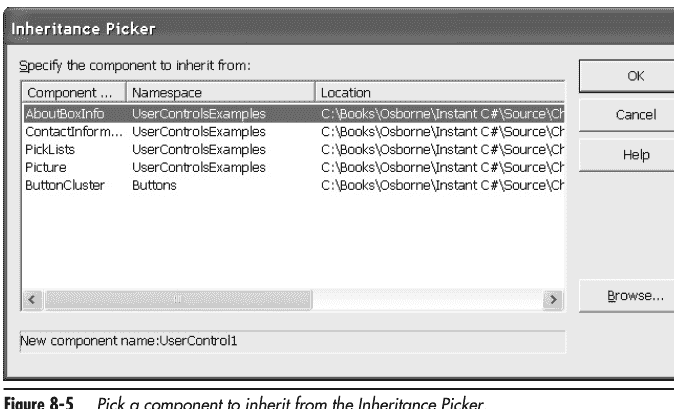

图 8-5 *从继承选择器中选择要继承的组件。*

已显示。从当前解决方案中选择一个控件，或浏览其他 DLL 程序集。添加新的行为和状态信息，然后编译并测试你的自定义控件。

你可以从零开始实现一个类，并表达 UserControl 的继承关系。Visual Studio .NET 会自动生成资源文件，但使用上述的继承选择器会更简单。

### 次要主题

我们依赖一些额外的功能来构建本章中的一些用户控件。我们将在本节中介绍这些内容。你会发现这些主题对于通用编程或创建自定义控件很有用。我们将介绍的两个主要主题是：

-   在加载列表控件时使用 BeginUpdate 和 EndUpdate
-   动态定位和调整控件大小

### 加载列表框

对于大型任务选择的策略可能会对应用程序的性能产生影响。如果你在 ListBox 中加载数千个项目，那么在应用程序更新时，用户可能不得不等待。如果你一次加载一个项目，结果可能会更糟。

在加载 ListBox 时，你可以使用一些策略，让你的应用程序看起来响应更及时。你可以使用 BeginUpdate 和 EndUpdate 来防止 ListBox 在每次添加项目时重绘，或者你可以使用后台线程来加载项目。我将在这里演示这两种技术。

#### 使用 BeginUpdate 和 EndUpdate

之前，我介绍了 ListBox.BeginUpdate 和 ListBox.EndUpdate 方法。如果你编写代码向 ListBox 添加大量元素，每个添加的项目都会强制 ListBox 更新，导致每次添加元素时都要重绘列表的开销。对于大型列表，这可能导致性能非常差。

相反，当你向 ListBox（或 ComboBox）一次加载一个元素时，可以在加载项目前调用 BeginUpdate，并在加载过程后调用 EndUpdate。你可以包含一个 *try finally* 块来确保 EndUpdate 方法被调用。下面的代码演示了将 100,000 个整数对象加载到 ListBox 中。

```csharp
private void LoadListBox()
{
    listBox1.BeginUpdate();
    try
    {
        for(int i=0; i<100000; i++)
            listBox1.Items.Add(i);
    }
    finally
    {
        listBox1.EndUpdate();
    }
}
```

如果这段代码在窗体加载时运行，用户将不得不等待项目加载完成。另一种选择是使用单独的线程来加载项目。如果用户在允许与包含 ListBox 的窗体交互之前不需要所有项目，那么我们可以在后台进程中加载 ListBox。

#### 使用 ThreadPool 加载 ListBox

在 .NET 中有几种使用线程的方法。最简单的方法之一是使用 ThreadPool 中可用的线程。ThreadPool 类包含一个线程池，你可以以委托的形式向其发送工作。定义执行加载 ListBox 工作的委托，并将委托发送到 ThreadPool.QueueUserWorkItem。此外，Windows 窗体不是直接线程安全的。你必须调用控件的 Invoke 方法才能在与控件创建线程相同的线程上与 Windows 窗体控件交互。清单 8-6 稍微复杂一些，因此添加了行号以供参考。

##### 清单 8-6 使用 ThreadPool 执行后台任务

```csharp
1:  private delegate void Add(int i);
2:
3:  private void AddItem(int i)
4:  {
5:      listBox1.Items.Add(i);
6:      Application.DoEvents();
7:  }
8:
9:  private void LoadListBox(object state)
10: {
11:     for( int i=0; i<100000; i++)
12:         listBox1.Invoke(new Add(AddItem), new object[]{i});
13: }
14:
15: private void Form1_Load(object sender, System.EventArgs e)
16: {
17:     System.Threading.ThreadPool.QueueUserWorkItem(
18:         new System.Threading.WaitCallback(LoadListBox));
19: }
```

要使用 ThreadPool 类加载 ListBox，我们需要完成几个步骤。第一步是定义一个委托类型，该类型反映我们将用于与窗体线程交互的过程。第 1 行定义了一个新的委托 Add，使用一个接受整数并返回 void 的方法签名。在清单 8-6 中，第 3 到第 7 行定义了一个将直接与 ListBox 交互的方法。AddItem 一次插入一个项目，并调用 DoEvents 以帮助刷新窗体线程的消息队列。第 9 到第 13 行表示将在其自己的线程上运行的方法。LoadListBox 接受一个参数，一个对象。一个返回 void 并接受一个对象的方法具有与 WaitCallback 委托相同的签名。LoadListBox 遍历一个循环并调用 AddItem 方法。我们使用 listBox1.Invoke—Invoke 是线程安全的—以确保项目实际上被添加到 ListBox 所在线程上的列表中。

第 15 到第 19 行要求 ThreadPool 执行一些工作。ThreadPool.QueueUserWorkItem 以 WaitCallback 委托的形式将工作放入 ThreadPool 队列中。ThreadPool 使用可用的 Thread 调用委托方法，或者创建一个新的线程。无论哪种方式，我们只关心 ThreadPool 完成其工作。

在第 12 行设置一个断点并启动应用程序。你可以打开线程窗口—在 IDE 中单击调试 | 窗口 | 线程—并看到 LoadListBox 与窗体运行在不同的线程上（见图 8-6）。如果你逐步执行应用程序，可以确定 listBox1.Invoke 导致应用程序跳转到窗体和 ListBox 所在的线程来添加项目。最重要的是，窗体加载和显示得非常快，列表在后台完成初始化，使你的应用程序看起来响应非常及时。

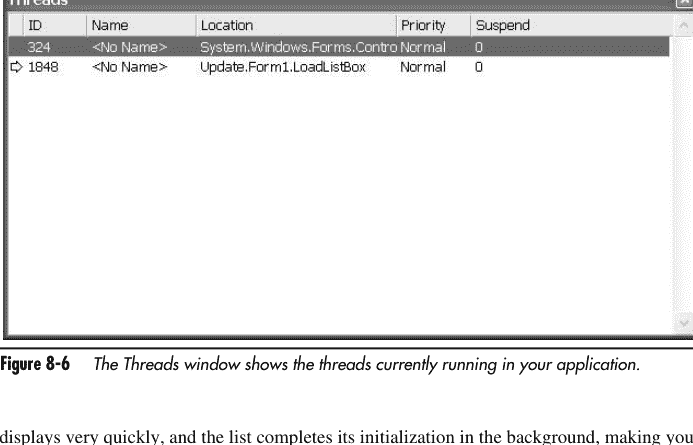

图 8-6 线程窗口显示当前在应用程序中运行的线程。

### 动态定位和调整控件大小

控件范围以两种方式定义。控件具有 Top、Left、Width 和 Height 属性，以及 Location 和 Size 属性。你可以通过直接更改 Top、Left、Width 或 Height 属性来修改控件的范围，但你可能无法修改 Location.X 和 Location.Y 以及 Size.Width 和 Size.Height 属性。Location 和 Size 是不可变的。

如果你想一次更改 Location.X 和 Location.Y（左上角），或 Size.Width 和 Size.Height（与左上角一起描述右下角），那么你将必须创建一个 Location 或 Size 结构的新实例。

控件的 Location 属性是一个 Point 结构，Size 属性实际上是一个名为“Size”的结构。你使用 new 运算符并传递 X 和 Y 值来构造 Location 的实例。你使用 new 运算符并为 Width 和 Height 值表达一个新值来构造 Size 结构的实例。UserControlsExamples.sln 中的 Rectangles 类演示了如何构造 Size 和 Location 的实例。

要更改 ListBox 的左上角位置，你可以编写以下代码：

```csharp
listBox1.Location = new Point(5,5);
```

如果你一次修改 Left、Top、Width 或 Height 值，那么控件将在每次调整时重绘。通过同时修改 Top 和 Left 值，你将减少控件重绘的次数。

### 总结

实现自定义 UserControl 是构建由许多现有控件组合而成的新控件的好方法。UserControl 非常适合构建通常称为业务控件的控件。本章演示了一个业务控件 ContactInformation UserControl 的示例。

在本章中，你学习了如何实现自定义 UserControl，如何公开组成属性和事件，如何执行自定义绘制，以及如何将业务对象绑定到自定义 UserControl。你还看到任何实现 IList 接口的类都可以绑定到控件，并学会了使用 BindingContext 来导航这些对象的数组。

结合自定义绘制、透明度、聚合和继承将允许你分层效果，从而产生多样化的 UserControl 工具集。为了提高性能，你可以引入一个额外的工作线程，就像我们为了在 ListBox 中加载大量项目所做的那样。正是这些技术的结合，产生了灵活而强大的 UserControl，可以多次使用。


## 第9章

## 特效文本

**本章内容：**

-   演示主题
-   快速控制原型设计
-   创建类库
-   测试您的组件
-   将组件添加到工具箱
-   创建合并模块
-   次要主题
-   创建类型转换器
-   实现类型编辑器
-   使用 `EditorAttribute` 应用自定义编辑器
-   定义 Windows 窗体设计器
-   总结

C# 在构建自定义控件方面提供了大量支持。本章将继续讨论在 C# 中构建控件的内容。在第8章中，我们探讨了 `UserControl`。现在，我们将详细探讨构建、测试和注册自定义控件所需的各个方面。

我们将首先讨论构建一个用于 Windows 窗体的特效 `Label` 控件，因为这将涉及构建控件的大部分方面。此外，我们还将探索 C# 对组件序列化、创建设计器、类型转换器和类型编辑器的支持。这些技能将使您能够充分利用 C# 中构建专业控件的全部支持，并与 Windows 窗体应用程序良好交互。（如果您对构建 ASP.NET 控件感兴趣，请查看第14章。）

### 演示主题

本章的主要目的是演示构建、测试和部署程序集中专业自定义控件所需的大部分知识。通过本章的示例，您将能够执行以下操作：

-   设计组件原型
-   为您的控件创建类库项目
-   使用 `ComponentModel` 命名空间中的特性
-   测试您的控件
-   将您的控件添加到工具箱
-   创建合并模块项目以共享您的控件

所有这些技能都将通过构建一个渲染各种阴影效果的 `EffectsLabel` 控件来演示。（如果您要查找的内容未在这些主题中列出，请务必查看本章后面的“次要主题”部分。该部分演示了几种高级功能；只是我在实现 `EffectsLabel` 时没有用到它们。）

### 快速控制原型设计

开始构建控件的一种便捷方式是在 Windows 窗体应用程序中对其进行原型设计。选择一个与您想要自定义的控件相似的控件。将该控件拖放到窗体上，并利用窗体和控件的事件来快速设计自定义控件的原型。（快速应用程序设计（RAD）也适用于控件。控件定义在 DLL 程序集中，即一个应用程序中。RAD 技术对控件同样有效。）

在第3章中，我们实现了一个 `DrawShadowText` 方法来为 `PlayControl` 创建浮雕效果。我们将来可能希望使用特殊的文本效果。因此，我们将设计一个更持久的解决方案的原型，当问题解决后，我们将把我们的解决方案封装在一个自定义控件中，这样控件完成后就可以重复使用，无需再进行任何编码。

第一步是选择一个与我们最终想要创建的控件相似的控件。选择一个接近的基类进行继承意味着我们只需编写少量的额外代码。如果我们选择了一个过于通用的基类，那么我们将需要做更多的工作。`Label` 控件非常适合显示文本，因此我们将使用 `System.Windows.Forms.Label` 控件作为我们自定义控件的基础。在 Windows 应用程序的窗体上绘制一个 `Label` 控件。（请记住，我们正在这里进行原型设计。有关原型解决方案的完整示例，请参考 `TestLabel.sln`。）

### 为自定义绘制实现 PaintEventHandler

该标签已经包含了大部分解决方案。如果我们第二次绘制标签的文本，并在第二次绘制时稍微偏移文本，我们就可以创建各种效果。我们可以在标签的 `PaintEventHandler` 中执行自定义绘制。

> **提示**

要为标签创建 `PaintEventHandler`，请选择该标签，然后在“属性”窗口中单击“事件”按钮（小闪电图标）切换到事件视图。双击 `Paint` 事件以生成处理程序。

标签的 `Paint` 处理程序有一个 `PaintEventArgs` 参数，该参数使用表示标签设备上下文的 `Graphics` 对象初始化。我们可以使用由 `Graphics` 对象表示的 GDI+ 在偏移位置第二次绘制字符串以创建效果。（您已经知道如何在有限程度上执行此操作，因为在第3章中已经演示过。对于健壮的解决方案，还有一些额外的考虑因素，我们稍后将讨论。）

### 将控件的实例传递给方法

在原型设计时，将您将继承的控件的实例传递给我们可能需要定义的任何方法。在新控件实际创建之前，我们需要用于原型设计的控件实例。通过传递控件实例，而不是依赖它在包含窗体中的存在，我们可以逐字复制原型中的代码，并且只需相对较小的更改即可工作。

到目前为止，我们有一个带有标签的 Windows 应用程序来设计我们的解决方案原型。您可以使用 `Graphics.DrawString` 第二次绘制 `Text` 属性以创建初步效果。很快您就会意识到，这不仅仅是绘制文本那么简单。让我们通过检查创建健壮解决方案所涉及的考虑因素来继续。

### 检查问题

我们的问题是创建一个具有特殊文本效果的 `Label` 控件。以下是为创建健壮的解决方案需要解决的问题的完整分解：

-   如果文本长度超过控件边界的宽度，标签中的文本可能会换行。
-   `&` 符号是表示热键前缀的助记符。如果我们使用助记符，那么我们必须显示助记符而不是字面的 `&` 符号。
-   文本可以以几种不同的方式对齐。我们的文本必须考虑到 `TextAlign` 属性进行显示。
-   我们需要适应特殊的显示和布局信息。
-   我们将需要第二种颜色以及 X 和 Y 偏移量来创建视觉效果。

应该就这些了。可以看出，在标签中显示文本涉及相当多的工作。只要我们只需要为这些努力支付一次成本，最终的结果就是值得的。后面的子部分将解决前面列表中描述的每个问题。

### 绘制文本

要绘制字符串，我们可以使用传递给标签的 `PaintEventHandler`（名为 `Paint`）的 `Graphics` 对象。我们必须使用标签的 `Text` 和 `Font`，并且我们需要确定 `Brush`、`Rectangle` 和 `StringFormat` 对象。以下是 `TestLabel.csproj` 中实现的标签 `PaintEventHandler` 和支持的 `Draw` 方法。

```csharp
private void Draw(Label label, Graphics g)
{
    Rectangle r = label.ClientRectangle;
    r.X -= 1;
    r.Y -= 1;
    g.DrawString(label.Text, label.Font, Brushes.Black, r, GetFormat(label));
}
private void label1_Paint(object sender,
    System.Windows.Forms.PaintEventArgs e)
{
    Draw((Label)sender, e.Graphics);
}
```

（请记住避免在事件处理程序中直接实现行为。编写命名良好的方法有助于重用并支持自文档化代码。）从清单中我们无法确定的是如何创建 `Brush`、`Rectangle` 和 `StringFormat` 对象。到目前为止，代码看起来很简单。当代码看起来简单时，意味着我们的解决方案具有适当数量的细节。本节的其余部分将描述如何实现未知元素：`Brush`、`Rectangle` 和 `StringFormat`。

### 创建 Brush

对于原型设计，我们可以使用 `Brushes` 类中的 `Brush`。`Brushes` 包含数十个属性，定义了一系列画笔和颜色。对于原型设计，我们可以使用这些标准画笔之一。当实现实际控件时，我们可以让用户指定颜色。然后我们可以从颜色构建画笔，如下所示：

```csharp
Brush brush = new SolidBrush(color);
```


### 第9章：特效文本

`SolidBrush` 类定义在 `System.Drawing` 命名空间中。你需要添加对 `System.Drawing.dll` 程序集的引用，并在包含画笔引用的模块中添加一条 `using` 语句。`using` 语句如下所示：

```
using System.Drawing;
```

### 创建矩形

为确保第二次绘制文本时，它与原始文本处于相同的矩形区域内，我们可以使用标签本身的 `ClientRectangle` 属性。要创建特定的文本效果，我们需要在第二次绘制文本时对其进行轻微偏移。通过第二次绘制时将文本偏移 X–1 和 Y–1（其中 X 和 Y 代表 `ClientRectangle` 的左上角位置），可以创建一种浅浅的阴影效果。

通过更改文本偏移值可以创建其他效果。实现一个真正灵活的解决方案意味着我们最终让消费者来指定偏移值。在原型设计阶段，使用字面值就足够了。

### 创建 StringFormat 对象

`StringFormat` 对象是我们必须推导出的最具挑战性的值。在前面“绘制文本”一节的代码片段中调用的 `GetFormat` 函数，掩盖了我们推导 `StringFormat` 对象时必须经历的复杂步骤。

根据本节开头的要点列表，我们必须解决助记符（或快捷键）问题、文本对齐问题和布局问题。当我们得出这些问题的解决方案时，我们就可以测试原型了。假设一切正常，我们就可以创建该控件了。

我相信那句格言 *divide et impera*，即分而治之。`GetFormat` 方法的实现包含命名方法，这些方法描述了创建 `StringFormat` 对象所需完成的所有步骤。这对于确保第二次绘制文本时，除了画笔颜色和偏移外观外，其外观与第一次完全相同至关重要。

```
private StringFormat GetFormat( Label label )
{
    StringFormat format = new StringFormat();
    SetLineAlignment(label.TextAlign, format);
    SetAlignment(label.TextAlign, format);
    SetFlags(label.RightToLeft, format);
    SetMnemonic(label.UseMnemonic, format);
    return format;
}
```

从代码中我们可以确定需要创建一个 `StringFormat` 对象。为确保文本正确对齐，我们需要设置 `StringFormat.LineAlignment` 和 `StringFormat.Alignment` 属性。这可以通过将 `Label.TextAlign`（一个 `ContentAlignment` 枚举值）转换为 `StringAlignment` 枚举值来完成。不幸的是，`StringFormat` 需要 `StringAlignment` 值，但 `Label` 使用的是 `ContentAlignment` 属性。因此，`TextAlign` 属性需要进行转换。接下来，我们需要设置 `StringFormat.FormatFlags` 属性，并确定我们是否使用和号（&）作为助记符（快捷键指示符）。清单 9-1 包含了前面代码清单中 `GetFormat` 方法描述的四个格式化方法。

> **清单 9-1** 用于 `SetLineAlignment`、`SetAlignment`、`SetFlags` 和 `SetMnemonic` 的编号清单

```
private StringFormat GetFormat( Label label )
{
    StringFormat format = new StringFormat();
    SetLineAlignment(label.TextAlign, format);
    SetAlignment(label, format);
    SetFlags(label.RightToLeft, format);
    SetMnemonic(label.UseMnemonic, format);
    return format;
}

private void SetLineAlignment(ContentAlignment TextAlign,
    StringFormat format)
{
    switch(TextAlign)
    {
        case ContentAlignment.BottomLeft:
            format.LineAlignment = StringAlignment.Far;
            break;
        case ContentAlignment.MiddleLeft:
            format.LineAlignment = StringAlignment.Center;
            break;
        case ContentAlignment.TopLeft:
            format.LineAlignment = StringAlignment.Near;
            break;
        case ContentAlignment.BottomCenter:
            format.LineAlignment = StringAlignment.Far;
            break;
        case ContentAlignment.MiddleCenter:
            format.LineAlignment = StringAlignment.Center;
            break;
        case ContentAlignment.TopCenter:
            format.LineAlignment = StringAlignment.Near;
            break;
        case ContentAlignment.BottomRight:
            format.LineAlignment = StringAlignment.Far;
            break;
        case ContentAlignment.MiddleRight:
            format.LineAlignment = StringAlignment.Center;
            break;
        case ContentAlignment.TopRight:
            format.LineAlignment = StringAlignment.Near;
            break;
    }
}

private void SetAlignment(Label label, StringFormat format)
{
    switch(label.TextAlign)
    {
        case ContentAlignment.BottomLeft:
            format.Alignment = StringAlignment.Near;
            break;
        case ContentAlignment.MiddleLeft:
            format.Alignment = StringAlignment.Near;
            break;
        case ContentAlignment.TopLeft:
            format.Alignment = StringAlignment.Near;
            break;
        case ContentAlignment.BottomCenter:
            format.Alignment = StringAlignment.Center;
            break;
        case ContentAlignment.MiddleCenter:
            format.Alignment = StringAlignment.Center;
            break;
        case ContentAlignment.TopCenter:
            format.Alignment = StringAlignment.Center;
            break;
        case ContentAlignment.BottomRight:
            format.Alignment = StringAlignment.Far;
            break;
        case ContentAlignment.MiddleRight:
            format.Alignment = StringAlignment.Far;
            break;
        case ContentAlignment.TopRight:
            format.Alignment = StringAlignment.Far;
            break;
    }
}

private void SetFlags(RightToLeft rightToLeft, StringFormat format)
{
    if(rightToLeft == RightToLeft.Yes)
        format.FormatFlags |= StringFormatFlags.DirectionRightToLeft;
}

private void SetMnemonic(bool UseMnemonic, StringFormat format)
{
    if(UseMnemonic)
        format.HotkeyPrefix = HotkeyPrefix.Show;
}
```

清单 9-1 中的代码包含两个比我通常更喜欢的方法要长的 `SetAlignment` 和 `SetLineAlignment`。它们使用冗长的 `switch` 语句将 `ContentAlignment` 映射到 `StringAlignment` 值。`StringFormat.Alignment` 依赖于 `StringAlignment` 枚举值，而不是 `ContentAlignment` 值。我们可以尝试通过操作底层位来在 `ContentAlignment` 和 `StringAlignment` 之间进行算法转换，但结果是脆弱的代码。例如，如果 CLR 被修改以更改底层位，那么我们的代码就会中断。通过引用枚举名称，生成的代码虽然不够优雅，但更健壮。

`SetFlags` 和 `SetMnemonic` 是直接了当的方法——尽管 `SetMnemonic` 这个名字有点拗口——它们展示了自描述代码。我们可以使用一个命名良好的方法来执行操作并描述它，而不是编写注释来描述我们正在做什么。作为一个通用规则，优先使用命名良好的方法而不是注释。

### 创建类库

既然已经完成了控件的原型设计，我们就可以创建类库，并将我们的原型代码转换为自定义控件了。我们需要完成几个步骤来完善控件并从我们的代码中获得最大效益。

为了从我们的代码中获得额外的好处，我们可以将通用行为抽象出来，只保留对控件有用的行为。这个过程高度主观，但值得付出努力去寻找可能可重用的代码，并将其与自定义控件分离。抽象出的代码需要传入控件的实例，而成为自定义控件一部分的代码则不需要引用控件。对于添加到控件本身的方法，我们可以移除任何 `Label` 参数。

### 抽象通用行为

你很容易想象到需要换行打印和使用助记符的场景。为了避免再次编写那些 `switch` 语句，将 `SetAlignment` 和 `SetLineAlignment` 放在一个单独的工具类中是值得的。我还选择将 `SetFlags`、`SetMnemonic`、`GetFormat` 工厂方法和 `DrawText` 放在它们自己的类中。所有这些代码都可以在其他上下文中重用。

因为我只描述了方法而没有描述字段，所以所有这些方法都可以实现为静态方法。当一个类不需要维护状态时，你可以使用静态方法——如我们为工具类描述的那样——你就不必创建类的实例来使用这些方法。

由于在 Windows 应用程序中原型化的方法将被放置在一个与自定义控件本身分离的类中，我们将需要传入一个 `Label` 控件的实例。我提供了 `TextEffects` 工具类的部分代码清单，展示了对 `SetMnemonic` 的更改。（其余的代码可以在 www.osborne.com 上的 EffectsLabel.cs 模块中找到。）

```
public class TextEffects
{
    public static void SetMnemonic(Label label, StringFormat format)
    {
        if(label.UseMnemonic)
            format.HotkeyPrefix = HotkeyPrefix.Show;
    }
}
```

我们说将成为前面工具类一部分的其余方法需要进行相同的更改。传入方法运行所需的任何数据，并将方法设为静态。

### 定义新控件

定义一个自定义控件非常简单。当你创建一个类库项目时，类库模板会添加一个类模块。默认情况下，模块中会有一个类；将该类重命名为我们将用于控件的名称，并在类头中表达继承关系。

如果你想创建一个全新的控件，可以从 `Control` 类继承。在我们的示例中，我们正在构建一个基于 `System.Windows.Forms.Label` 控件的自定义效果标签，因此我们将从 `Label` 控件继承。我们可以使用命名空间来表明我们是从 `Label` 继承，或者我们可以在模块中添加一条 `using` 语句，并在类头中缩短类名。

类的头部。以下是两种形式。第一个示例在类头部使用了命名空间名称，第二个示例演示了 *using* 语句和简化的类头部。

```csharp
public class EffectsLabel : System.Windows.Forms.Label
或
using System.Windows.Forms;
public class EffectsLabel : Label
```

> **注意**

如果我们引用一个命名空间，那么我们需要添加对包含该命名空间的程序集的引用。类库默认不引用 System.Windows.Forms.Dll；因此，为了我们的自定义控件，需要添加对它的引用。

两种形式都可以使用——命名空间用于组织，但如果需要多次编写，它们在代码中会变得笨拙。如果你有两个相同的名称，那么可以使用命名空间来澄清这些名称所属的类别。

在定义了继承关系之后，我们需要向自定义控件添加字段、属性、事件、方法和任何其他必要的成员。完整的代码在清单 9-2 中提供。现在我们将探讨各个元素。

### 调用基类构造函数

如果我们为控件提供构造函数，那么我们需要调用继承的基类构造函数。EffectsLabel 有几个我们将要定义的样式；因此，我们将使用构造函数来设置默认的标签样式并调用基类构造函数。

```csharp
public EffectsLabel() : base()
{
    Style = DrawStyle.Shadowed;
}
```

构造函数没有返回类型，并且与类同名。基类构造函数通过在构造函数头部添加一个冒号后跟关键字 *base* 来调用。然后，我们可以添加任何额外的代码来初始化我们的类。Style 属性作为自定义行为的一部分被引入，所以我将接着演示支持更改样式的代码。

### 添加属性和方法

控件就是类。它们恰好是继承了一些基本功能的类，这些功能允许它们在 Windows 窗体或 Web 窗体中显示并响应用户输入。这种基本能力是从 Control 类继承的。在大多数情况下，我们所做的就是添加成员，用字段、属性、方法和事件来描述类的行为和外观。

为了支持 EffectsLabel 的 Style 概念，我们可以实现一个枚举，用文本（而不是整数）来描述样式；枚举更具表现力。而且，我们需要实现一个字段来存储 Style，以及一个属性，以便在设计时属性窗口可以显示 Style。以下是附加代码：

```csharp
public class EffectsLabel : Label
{
    public enum DrawStyle{Custom, Shadowed, Engraved, Embossed};
    private DrawStyle style;
    private Point offset;

    public EffectsLabel() : base()
    {
        Style = DrawStyle.Shadowed;
    }

    public DrawStyle Style
    {
        get
        {
            return style;
        }
        set
        {
            style = value;
            DrawStyleChanged();
            Invalidate();
        }
    }
    protected virtual void DrawStyleChanged()
    {
        switch(style)
        {
            case DrawStyle.Shadowed:
                offset = new Point(-1, -1);
                break;
            case DrawStyle.Embossed:
                offset = new Point(-1, -2);
                break;
            case DrawStyle.Engraved:
                offset = new Point(1, 2);
                break;
            case DrawStyle.Custom:
                offset = new Point(0, 0);
                break;
        }
    }
}
```

### 高级 C# 编程

枚举 DrawStyle 将让用户从命名的样式中进行选择。存储样式的底层字段列在枚举之后。构造函数遵循枚举和字段。公共属性 Style（注意使用了字段采用驼峰命名法、属性采用帕斯卡命名法的约定）将允许用户在设计时更改样式。getter 只是返回底层字段值，而 setter 执行更新控件所需的步骤。

setter 更改字段值并调用 DrawStyleChanged。DrawStyleChanged 使用一个 case 语句根据选定的 DrawStyle 定义偏移值。最后，控件被失效（invalidated），导致 OnPaint 方法被调用。使用 Invalidate 而不是直接调用 OnPaint 来重绘控件。使用 Invalidate 将通过向控件发送一条消息来重绘更改的区域，从而帮助避免闪烁，并且消息队列可以管理控件实际重绘的次数。

#### 添加点睛之笔

有几个特性可以用来为我们的自定义控件增添点睛之笔。本节提供了 EffectsLabel 控件的完整清单，我们将描述代码中包含的特性，以及其他产生最终控件的细节。

清单 9-2 EffectsLabel 控件的完整清单

```csharp
1: /// <summary>
2: /// Windows 窗体的自定义文本效果
3: /// </summary>
4: [ToolboxBitmap(
5:     @"EffectsLabel2.bmp")]
6: //[ToolboxBitmap(typeof(Label))]
7: public class EffectsLabel : Label
8: {
9:     public enum DrawStyle{Custom, Shadowed, Engraved, Embossed};
10:    private DrawStyle style;
11:    private Point offset;
12:    private Color overlayColor = Color.Black;
13:
14:    public EffectsLabel() : base()
15:    {
16:        Style = DrawStyle.Shadowed;
17:    }
18:
19:    [Description("描述标签文本的外观。"),
20:    Category("外观")]
21:    public DrawStyle Style
22:    {
23:        get
24:        {
25:            return style;
26:        }
27:        set
28:        {
29:            style = value;
30:            DrawStyleChanged();
31:            Invalidate();
32:        }
33:    }
34:
35:    [Description(
36:    "用于创建阴影效果的前景色。"),
37:    Category("外观")]
38:    public Color OverlayColor
39:    {
40:        get
41:        {
42:            return overlayColor;
43:        }
44:        set
45:        {
46:            overlayColor = value;
47:            Invalidate();
48:        }
49:    }
50:
51:    [Description("直接更改此值以创建自定义效果。"),
52:    Category("外观")]
53:    public Point Offset
54:    {
55:        get
56:        {
57:            return offset;
58:        }
59:        set
60:        {
61:            Style = DrawStyle.Custom;
62:            offset = value;
63:            Invalidate();
64:        }
65:    }
66:
67:    protected virtual void DrawStyleChanged()
68:    {
69:        switch(style)
70:        {
71:            case DrawStyle.Shadowed:
72:                offset = new Point(-1, -1);
73:                break;
74:            case DrawStyle.Embossed:
75:                offset = new Point(-1, -2);
76:                break;
77:            case DrawStyle.Engraved:
78:                offset = new Point(1, 2);
79:                break;
80:            case DrawStyle.Custom:
81:                offset = new Point(0, 0);
82:                break;
83:        }
84:    }
85:
86:    protected override void OnPaint(PaintEventArgs e)
87:    {
88:        base.OnPaint(e);
89:        Draw(e.Graphics);
90:    }
91:
92:    private void Draw(Graphics g)
93:    {
94:        TextEffects.DrawText(this, g, new SolidBrush(overlayColor),
95:            offset.X, offset.Y);
96:    }
97: 
98:}
```

### 自动文档功能

清单 9-2 的第 1 到 3 行演示了可用于为代码生成文档的三个井号（///）注释。工具 | 生成注释网页菜单选项将把标记为三个井号的注释合并到 HTML 帮助文档中。图 9-1 显示了清单 9-2 中第 2 行的注释被合并到 EffectsLabel 的帮助文档中。

除了使用三个井号为代码编写文档外，你还可以使用特殊的 XML 标签来创建其他文档功能。表 9-1 列出了用于生成文档的注释标签。

### 定义类别

属性窗口按字母顺序或按类别组织属性。这是为了帮助使用者在设计时找到属性。CategoryAttribute 在清单 9-2 中多处演示。第 20 行演示了 CategoryAttribute。我们表明 DrawStyle 被归类为外观属性。如果你在属性窗口中单击“按分类排序”按钮，那么选定控件的属性将按类别显示，如图 9-2 所示。

如果用于初始化 CategoryAttribute 的字符串是唯一的，那么将在属性窗口中创建一个新的类别。

### 提供描述

在属性窗口的底部是所选属性的描述。这个值并非偶然出现。DescriptionAttribute 接受一个字符串参数。所使用的文本


### 为控件添加自定义位图

若要为控件设置自定义位图，可以将 `ToolboxBitmapAttribute` 应用于该类。此属性既可以引用外部位图文件，也可以使用类型信息来请求现有控件的现有图标。

```
[ToolboxBitmap(@"c:\temp\EffectsLabel2.bmp")]
//[ToolboxBitmap(typeof(Label))]
```

第一条语句演示了如何将外部位图与我们的控件关联起来（参见图 9-3），而第二条（注释掉的）语句则演示了如何请求 `Label` 控件的类型信息。如果我们使用第二种属性声明，那么我们的 `EffectsLabel` 将会拥有与 `Label` 控件相同的图标。

> **注意**
请注意 `ToolboxBitmapAttribute` 语句中 `@` 符号的使用。`\`（斜杠字符）用于转义文本序列。（回想一下，我们曾用它为“关于”对话框创建 © 符号。）若要在字符串中实际得到反斜杠，您需要使用两个反斜杠 `\\`，或者使用单个反斜杠和 `@` 字符来表明该字符串应按字面值解释，而非作为转义序列处理。

要为 `EffectsLabel` 创建一个自定义的 16×16 像素位图，您可以使用“项目”|“添加新项”菜单，并向解决方案中添加一个位图。此步骤将自动打开图像编辑器，您可以在其中绘制自定义位图。该图像编辑器的工作方式类似于 Windows 提供的“画图”程序。

**图 9-3** 工具箱中放大的自定义 EffectLabel2.bmp

### 测试组件

宏处理过程中的下一个重要步骤是测试您的自定义控件。您需要设计一些单元测试，以覆盖自定义控件的所有代码路径。在系统中，需要对其中的每个类和该类的每个方法进行单元测试。对于一个控件，一个类（或少数几个类）代表了整个程序集；您仍然需要测试每个类，但由于测试内容较少，过程会更短。

测试自定义控件的一个简单方法是向包含该控件的解决方案中添加一个应用程序。如果控件是 Windows 窗体控件，则向解决方案中添加一个 Windows 应用程序。在 Windows 应用程序中添加对该控件的项目引用，然后以编程方式创建并调用方法来测试自定义控件的行为。下面的代码清单创建了图 9-4 所示的文本。

```
private void TestLabel_Load(object sender, System.EventArgs e)
{
    CustomControl.EffectsLabel effectsLabel = new
        CustomControl.EffectsLabel();
    effectsLabel.Text = "Dynamically Created!";
    effectsLabel.AutoSize = true;
    effectsLabel.Style = CustomControl.EffectsLabel.DrawStyle.Embossed;
    effectsLabel.ForeColor = Color.White;
    effectsLabel.OverlayColor = Color.Black;
    effectsLabel.Font = new Font("Times new Roman", 24);
    Controls.Add(effectsLabel);
}
```

用于测试 Windows 窗体控件的代码可以放在窗体的 `Load` 事件处理程序中。前面的代码测试了许多代码路径，但要测试所有路径，您需要一个良好的策略。您可以对 `EffectsLabel` 类进行一些修改，以简化此过程。

### 实现测试功能

第一个修改是将测试方法作为 `EffectsLabel` 类的一部分。实现一个名为 `Test` 的静态方法并调用它。由于我们正在测试的是 Windows 窗体控件，我们需要传入我们希望将控件添加到的 `Controls` 集合，或者我们可以返回自定义控件的实例，并在外部将其添加到 `Controls` 集合中。

以下对 `EffectsLabel` 类的添加使我们的自定义控件具备了自包含性，包括可测试性。

```
public static void Test(ControlCollection Controls)
{
    EffectsLabel effectsLabel = new EffectsLabel();
    effectsLabel.Text = "Dynamically Created!";
    effectsLabel.AutoSize = true;
    effectsLabel.Style = DrawStyle.Embossed;
    effectsLabel.ForeColor = Color.White;
    effectsLabel.OverlayColor = Color.Black;
    effectsLabel.Font = new Font("Times new Roman", 24);
    Controls.Add(effectsLabel);
}
```

要测试我们的控件，我们只需调用 `EffectsLabel.Test`，并传入所属 `ContainerControl` 的 `Controls` 集合。这通常是窗体的 `Controls` 属性，但您也可以传入任何 `ContainerControl` 派生类（如 `Panel` 控件）的 `Controls` 属性。

### 实现捕获行为

里根总统在冷战末期谈及俄罗斯人时，常说“信任但需验证”。这条明智的建议对软件开发同样适用。相信你的代码能工作，因为你很聪明——但也要验证。验证代码能工作将有助于避免尴尬的局面。

通过简单地执行这些路径，您可以在一定程度上验证所有代码路径是否有效。执行一条路径仅仅意味着您编译并测试代码，提供测试数据以遍历代码中所有可能的分支。这不会测试代码的所有可能状态，但它将帮助您确保没有明显且尴尬的缺陷。确保已执行所有状态的一个好方法是实现一个陷阱。

*陷阱* 是一个被调用的方法，当某条代码路径被执行时，它会中止处理。您可以通过以参数 `False` 调用 `Debug.Assert` 方法来简单地实现一个陷阱。如果您在每个代码分支处放置一个陷阱，并在每次触发一个陷阱时将其注释掉，您就拥有了一份验证所有分支都已测试过的记录。如果组件更新后需要重新运行测试，请移除所有注释以重置陷阱。下面是一条演示该技术的语句。（此语句假定您在包含陷阱的模块中包含了 `System.Diagnostics` 命名空间的 `using` 语句。）

```
Debug.Assert(false);
```

例如，如果我们想确保所有 `DrawStyle` 都能产生正确的视觉效果，我们可以在 `DrawStyleChanged` 方法中为每种情况放置一个陷阱。通过目视检查每种 `DrawStyle` 的最终效果，并在

---

**图 9-1** *生成的文档，部分通过读取带有三个井号标记的注释创建*

| 注释标签 | 描述 |
| :--- | :--- |
| `<c>` | 指示描述中的文本指的是代码。 |
| `<code>` | 使用此标签指示多行注释指的是代码。 |
| `<example>` | 与 `<code>` 标签结合使用，表示注释是示例代码。 |
| `<exception>` | 用于指定类可以抛出的异常。 |
| `<include>` | 使用 `<include>` 来引用外部文件中的注释。 |
| `<list>` | 此标签允许您为表格或列表指定标题。使用 `<listheader>` 和 `<item>` 来构建列表或表格的元素。 |
| `<para>` | 通过将行文本分隔成段落来为注释提供结构。 |
| `<param>` | 为命名参数提供引用。 |
| `<paramref>` | 使用 `<paramref>` 指示某个词是一个参数。 |
| `<permission>` | 支持记录成员的权限级别。 |
| `<remarks>` | 使用 `<remarks>` 提供类型的概述。 |
| `<returns>` | 支持提供方法返回类型的描述。 |
| `<see>` | 为文档项创建交叉引用。 |
| `<seealso>` | 在文档的“另请参阅”部分添加一个项目。 |
| `<summary>` | `<remarks>` 用于提供有关类型的信息，而 `<summary>` 用于提供有关该类型成员的信息。 |
| `<value>` | 支持为属性提供描述。 |

**表 9-1** *用于为您的代码生成 HTML 文档的注释 XML 文档标签*


外观符合预期后，我们就能确保所有样式都能正确绘制。以下是如上所述对`DrawStyleChanged`方法的修改。

```csharp
protected virtual void DrawStyleChanged()
{
  switch(style)
  {
    case DrawStyle.Shadowed:
      Debug.Assert(false);
      offset = new Point(-1, -1);
      break;
    case DrawStyle.Embossed:
      Debug.Assert(false);
      offset = new Point(-1, -2);
      break;
    case DrawStyle.Engraved:
      Debug.Assert(false);
      offset = new Point(1, 2);
      break;
    case DrawStyle.Custom:
      Debug.Assert(false);
      offset = new Point(0, 0);
      break;
  }
}
```

每当一个断言被触发且你对结果满意时，只需在源代码中注释掉该断言，然后在`Assert`对话框中点击忽略按钮即可。因为我们使用的是`Debug.Assert`方法，当我们以发布模式编译控件程序集时，断言代码会自动关闭。

在将控件安装到工具箱之前测试这类代码更为容易。通过以编程方式测试控件，你将节省时间和精力。（当然，如果你愿意，也可以在测试前将代码添加到工具箱中。）最终，当你对控件满意时，你会希望将其添加到工具箱。我们将在下一节中完成此操作。

### 将组件添加到工具箱

创建自定义控件后，你会希望将控件整合到工具箱中。此步骤通过选择“工具”|“自定义工具箱”并浏览到包含自定义控件的程序集来完成。

你可以通过工具箱上下文菜单向工具箱添加额外的选项卡，并将你的控件拖放到自己的选项卡中。

将控件添加到工具箱后，你可以将控件的实例拖放到窗体上。当你从工具箱将控件添加到应用程序时，会将控件的一个实例添加到窗体，并将对程序集的引用添加到解决方案的引用列表中。

如果你修改了控件，那么你可能需要重置工具箱并将修改后的程序集重新添加到工具箱。（如果控件的更改似乎没有在你的应用程序中体现，请移除对控件程序集的引用，重置工具箱，并添加工具箱引用的最新程序集列表。）

### 创建合并模块

到目前为止，我们已经构建并测试了一个自定义控件，并将其安装在工具箱中。假设你想将控件分发给其他开发者。为了将控件与应用程序可靠地分发，你需要创建一个合并模块项目。

合并模块项目在 Visual Studio .NET 中定义为模板项目。推荐的过程是为每个自定义控件定义一个合并模块项目，并包含安装自定义控件所需的所有文件、资源、注册表项和安装逻辑。合并模块包含组件的版本信息，确保当其他应用程序程序集依赖于这些组件时，这些组件不会被移除。因此，在将合并模块添加到安装程序文件后，应为组件的每个版本创建新的合并模块。合并模块不能直接安装；合并模块必须作为 Windows Installer (.msi) 文件的一部分进行安装。

请按照以下编号步骤操作，将合并模块项目添加到包含自定义控件的解决方案中，将自定义控件项目的输出添加到合并模块，并创建 Windows Installer。

1.  选择“文件”|“添加项目”|“新建项目”，并从“添加新项目”对话框中选择合并模块项目模板。（合并模块项目是“安装和部署项目”文件夹中的一个模板。）
2.  为合并模块提供一个有意义的名称，然后单击“确定”。（我使用了 `CustomControls.msm` 作为 EffectsLabel 程序集的名称。）
3.  在解决方案资源管理器中选择合并模块项目，然后单击“项目”|“添加”|“项目输出”以打开“添加项目输出组”对话框（如图 9-5 所示）。
4.  重复步骤 1。这次，选择安装项目模板。
5.  在解决方案资源管理器中选择安装项目，然后选择“项目”|“添加”|“合并模块”。将显示合并模块资源管理器对话框。导航到 `CustomControls.msm` 合并模块，然后单击“确定”。
6.  当安装项目被编译时，Windows Installer、安装程序和 .ini 文件将被复制或创建在安装项目文件夹中。

安装项目的主要输出是 `setup.msi` 文件。此文件包含应用程序文件、注册表设置、依赖文件（如我们的 `CustomControl.dll`）以及安装这些文件的说明。

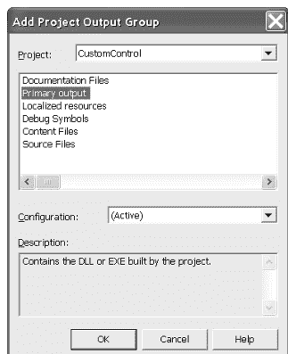

*图 9-5：“添加项目输出组”用于将控件程序集的输出添加到合并模块项目。*

### 次要主题

有几个高级主题有助于创建高级自定义控件。对于 EffectsLabel，我们不一定需要这些能力，但你会发现它们对于创建专业级的外观和体验很有用。为了演示本章此部分的内容，我包含了几个额外的组件，以展示如何：

- 实现 `IConvertible` 接口以进行运行时类型转换，并演示运算符重载
- 创建类型转换器并通过 `TypeConverterAttribute` 应用转换
- 创建自定义类型编辑器
- 实现 `IDesigner` 接口

这些技能将用于创建形状控件、渐变文本标签和一个表示复数的控件。最后一个控件是为了演示自定义类型转换器而创建的，但作为控件本身并不特别有用。

### 创建类型转换器

类型转换器允许数据以多种逻辑方式表示。例如，将整数同时表示为数值和字符串值是有意义的。当你想要执行算术运算时，你需要整数；当你想要显示值时，你需要字符串。

公共语言运行时提供了两种转换类型的方式。`IConvertible` 接口要求你实现转换简单数据类型的方法，例如在整数和字符串之间转换。`IConvertible` 接口仅在运行时有用，如果两个类型之间的转换没有意义，它会抛出异常。（记住，你必须实现接口定义的每个方法。）一个例子是尝试将字符串“Hello World！”转换为 `DateTime` 值。

第二种类型转换方式是派生一个 `TypeConverter` 类。`TypeConverter` 实现起来有点复杂，但支持在更复杂的类型之间进行转换。例如，我们可以使用 `TypeConverter` 来为 `Image` 提供一个合适的字符串表示。这就是 `System.ComponentModel` 命名空间中定义的 `ImageConverter` 的作用。

通常，`IConvertible` 接口更快，因为你是直接调用方法，但它灵活性和功能较弱，并且仅在运行时支持。`TypeConverter` 较慢，因为它依赖于反射（由于依赖动态绑定和方法调用，反射很慢），但支持设计时和运行时转换，并且比 `IConvertible` 接口灵活得多。实现 `IConvertible` 以在现有的 .NET 类型之间进行转换。实现 `TypeConverter` 以在新类型和代表性类型之间进行转换。

以下两个小节演示如何实现 `IConvertible` 接口和 `TypeConverter`。

### 实现 IConvertible

实现 `IConvertible` 的类将允许使用者在类表示的类型和 `IConvertible` 接口命名的类型之间进行转换。`IConvertible` 不支持转换回原始类型，因为无法预先知道可能从哪些类型转换过来。如果你定义一个实现 `IConvertible` 的类，那么你必须实现 `GetTypeCode`、`ToBoolean`、`ToByte`、`ToChar`、`ToDateTime`、`ToDecimal`、`ToDouble`、`ToInt16`、`ToInt32`、`ToInt64`、`ToByte`、`ToSingle`、`ToString`、`ToType`、`ToUInt16`、`ToUInt32` 和 `ToUInt64`。

> `System.Convert` 类实现了静态方法，支持在参数类型和方法命名的类型之间进行转换。在运行时使用 `Convert` 类进行通用类型转换。

为了演示 `IConvertible` 接口，我们实现一个表示复数的类。复数是由实部和虚部组成的数字。当两个复数相加时，实部相加，虚部相加，得到新的数字。

实现复数将合理地需要支持在表示复数的值和字符串之间进行转换。我们还必须实现一些...

运算符来支持算术运算，我们可能选择将复数转换为整数，只需截断虚部即可。我们可以从一个实现复数结构体开始。我们将使用清单 9-3 中所示的结构体来演示如何实现 IConvertible 接口，以及选择性地演示 TypeConverter。

**清单 9-3** *定义一个实现了 IConvertible 接口的复数结构体。*

```csharp
public struct Complex : IConvertible
{
    private int r;
    private int i;

    public Complex( int r, int i )
    {
        this.r = r;
        this.i = i;
    }

    public override string ToString()
    {
        return i>=0 ? string.Format("{0} + {1}i", r, i) :
            string.Format("{0} - {1}i", r, i * -1);
    }

    private static Complex op_Add(Complex lhs, Complex rhs)
    {
        return new Complex(lhs.r + rhs.r, lhs.i + rhs.i);
    }

    public static Complex operator+(Complex lhs, Complex rhs)
    {
        return op_Add(lhs, rhs);
    }

    private static Complex op_Subtract(Complex lhs, Complex rhs)
    {
        return new Complex(lhs.r - rhs.r, lhs.i - rhs.i);
    }

    public static Complex operator-(Complex lhs, Complex rhs)
    {
        return op_Subtract(lhs, rhs);
    }

    TypeCode IConvertible.GetTypeCode()
    {
        return TypeCode.Object;
    }

    private void ThrowException(string message)
    {
        throw new InvalidCastException(message);
    }

    bool IConvertible.ToBoolean(IFormatProvider provider)
    {
        ThrowException("conversion to Boolean not supported");
        return false;
    }

    byte IConvertible.ToByte(IFormatProvider provider)
    {
        ThrowException("conversion to byte not supported");
        return 0;
    }

    char IConvertible.ToChar(IFormatProvider provider)
    {
        ThrowException("conversion to char not supported");
        return ' ';
    }

    DateTime IConvertible.ToDateTime(IFormatProvider provider)
    {
        ThrowException("conversion to DateTime not supported");
        return DateTime.Now;
    }

    decimal IConvertible.ToDecimal(IFormatProvider provider)
    {
        return (decimal)r;
    }

    double IConvertible.ToDouble(IFormatProvider provider)
    {
        return (double)r;
    }

    short IConvertible.ToInt16(IFormatProvider provider)
    {
        return (short)r;
    }

    int IConvertible.ToInt32(IFormatProvider provider)
    {
        return (int)r;
    }

    long IConvertible.ToInt64(IFormatProvider provider)
    {
        return (long)r;
    }

    sbyte IConvertible.ToSByte(IFormatProvider provider)
    {
        ThrowException("conversion to sbyte not supported");
        return (sbyte)0;
    }

    float IConvertible.ToSingle(IFormatProvider provider)
    {
        return (float)r;
    }

    string IConvertible.ToString(IFormatProvider provider)
    {
        return ToString();
    }

    object IConvertible.ToType(Type type, IFormatProvider provider)
    {
        return this.GetType();
    }

    ushort IConvertible.ToUInt16(IFormatProvider provider)
    {
        return (ushort)r;
    }

    uint IConvertible.ToUInt32(IFormatProvider provider)
    {
        return (uint)r;
    }

    ulong IConvertible.ToUInt64(IFormatProvider provider)
    {
        return (ulong)r;
    }

    [Conditional("DEBUG")]
    public static void Test()
    {
        IConvertible c = new Complex(1,1);
        Debug.WriteLine(c.GetTypeCode().ToString());
        try{Debug.WriteLine(c.ToBoolean(null));}
        catch(InvalidCastException e){Debug.WriteLine(e.Message);}
        // test each method in a try catch block
    }
}
```

IConvertible 接口定义了本节第一段描述的方法。你必须为接口的每个成员提供实现，但一个合适的实现可能是对我们不想转换到的类型抛出异常。清单 9-3 的第 97 到 101 行演示了当用户尝试将我们的复数结构体转换为有符号字节时抛出异常。

IConvertible 方法由 System.Convert 类调用。Convert 的所有成员都是静态的。例如，要将 Complex 转换为整数，你可以编写

```csharp
Complex c = new Complex(1, 3);
Convert.ToInt32(c);
```

Convert 类将调用 Complex 中实现 IConvertible.ToInt32 的方法。

如前所述，IConvertible 接口中的方法仅在运行时可用。像 Visual Studio .NET 这样的 RAD 工具也具有设计时方面。为了支持在设计时转换类型，我们可以实现一个 TypeConverter。下一节将使用复数结构体来演示设计时类型转换。

### 实现 TypeConverter

TypeConverter 类用于支持类型之间的转换。一种常见的转换是对象与其字符串表示形式之间的转换。本章前面遇到的一个例子是在没有图像的情况下为 Image 属性显示文本的 ImageConverter。

本节演示一个自定义的 TypeConverter，如何使用 TypeConverterAttribute 将 TypeConverter 与类型关联，以及如何使用 TypeDescriptor 类在 TypeConverter 支持的两种类型之间进行转换。

#### 定义 ComplexConverter 类

TypeConverter 基类引入了几种可以重写的方法，具体取决于你要支持的转换行为类型。与 IConvertible 接口不同，TypeConverter 在设计时和运行时都受支持，并且 TypeConverter 支持在类型之间来回转换。例如，我们的转换器支持将字符串转换为 Complex，以及将 Complex 转换回字符串。
清单 9-4 演示了复数结构体的 TypeConverter。在清单 9-4 之后，我将描述 ComplexConverter 类，并演示如何使用 TypeConverterAttribute 将 TypeConverter 与类关联。

**清单 9-4** *为复数结构体实现 TypeConverter*

```csharp
public class ComplexConverter : TypeConverter
{
    public override bool CanConvertFrom(ITypeDescriptorContext context,
        Type sourceType)
    {
        return sourceType == typeof(string) ? true :
            base.CanConvertFrom(context, sourceType);
    }

    public override object ConvertFrom(ITypeDescriptorContext context,
        CultureInfo culture, object value)
    {
        if (value is string)
        {
            string[] v = ((string)value).Split(new char[] {'+', '-', 'i'});
            return ((string)value).IndexOf('-') > 0 ?
                new Complex(int.Parse(v[0]), int.Parse(v[1]) * -1) :
                new Complex(int.Parse(v[0]), int.Parse(v[1]));
        }
        return base.ConvertFrom(context, culture, value);
    }

    public override object ConvertTo(ITypeDescriptorContext context,
        CultureInfo culture, object value, Type destinationType)
    {
        if (destinationType == typeof(string))
        {
            return value.ToString();
        }
        return base.ConvertTo(context, culture, value, destinationType);
    }

    public override bool CanConvertTo(ITypeDescriptorContext context,
        Type destinationType)
    {
        return destinationType == typeof(string) ? true :
            base.CanConvertTo(context, destinationType);
    }
}
```

ComplexConverter 实现了字符串和 Complex 值之间的转换。（回想一下，你也可以在更复杂的类型之间进行转换，如 CLR 中实现的 ImageConverter 所示。）ComplexConverter 实现了 CanConvertFrom、ConvertFrom、ConvertTo 和 CanConvertTo。以 *Can* 为前缀的方法回答关于是否支持特定类型转换的问题。没有 *Can* 前缀的方法则实际执行转换。

> **提示**
>
> *清单 9-4 的第 7 行演示了如何使用 base 关键字调用方法或引用基类成员。*

清单 9-4 第 3 到 6 行的 CanConvertFrom 执行动态类型评估。如果第 4 行的 sourceType 参数是字符串，则方法返回 True；否则，代码将责任传递给父 TypeConverter 类。

清单 9-4 第 10 到 21 行实现了重写的 ConvertFrom 方法。第 15 行使用 string.Split 方法来确定字符串是否格式正确。复数类型格式正确的字符串采用以下格式：*number ± imaginaryi*。*number* 表示的部分是实数部分，*imaginary* 表示的部分附带 *i* 后缀。第 17 和 18 行演示了用于清理 Split 返回的字符串数组并构造新 Complex 对象的 int.Parse 方法。

清单 9-4 第 23 到 31 行实现了 ConvertTo 方法。我们实现了一个重写的 Complex.ToString 方法，我们可以使用它（参见第 28 行）将 Complex 转换为字符串）。最后，第 33 到 38 行实现的 CanConvertTo 方法在我们尝试转换为复数类型的字符串表示形式时返回 True。

在自定义 TypeConverter 中还可以重写其他功能。请参阅 System.ComponentModel 命名空间中定义的 TypeConverter 类的 Visual Studio .NET 帮助文档。


### Complex 结构体

要在第 9-3 节定义的结构体中添加一个属性。以下代码演示了紧接在第 9-3 节结构体头之前的属性。

```
[TypeConverter(typeof(ComplexConverter))]
public struct Complex : IConvertible
```

你需要添加一个引用 `System.ComponentModel` 命名空间的 `using` 语句，并且 `ComplexConverter` 类需要对 `Complex` 结构体可见。`Complex` 结构体和 `ComplexConverter` 都在可从 **www.osborne.com** 网站下载的 `ComplexControl.csproj` 项目中的 `imaginary.cs` 模块里实现。

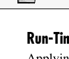

**提示**
本章的所有代码都可以在 http://www.softconcept.com/books/source 和 http://www.osborne.com 在线获取。

### 使用 TypeDescriptor 类进行运行时转换

将 `TypeConverterAttribute` 应用于类可确保在设计时进行类型转换。例如，删除图像会将图像属性设置回文本 "(None)"，因为 `ImageConverter` 是 CLR 的一部分。

在我们为 `Complex` 结构体关联了 `ComplexConverter` 之后，`Complex` 属性也将在设计时获得支持。如果你想使用 `TypeConverter` 在运行时执行类型转换，你需要使用 `TypeDescriptor` 类来请求 `TypeConverter`，而不是直接创建通用的 `TypeConverter`。

以下代码片段演示了如何为 `Complex` 结构体动态请求 `TypeConverter` 并执行与字符串之间的转换。

```
CustomControl.Complex c = new CustomControl.Complex(2, 3);
string s = "1+1i";

if( TypeDescriptor.GetConverter(c).CanConvertTo(typeof(string)) )
    s = TypeDescriptor.GetConverter(c).ConvertToString(c);
CustomControl.Complex d =
    (CustomControl.Complex)TypeDescriptor.GetConverter(c).ConvertFrom(s);
```

第一条语句创建一个 `Complex` 类型的实例。第二条语句定义一个与复数格式一致的字符串。`TypeDescriptor.GetConverter` 为传递给 `GetConverter` 的类型返回正确种类的转换器。`CanConvertTo` 返回一个布尔值，指示是否支持该转换。我们知道在本例中是支持的，因此执行了转换。最后一条语句将字符串转换回 `Complex` 结构体。

`TypeConverter` 使用反射执行类型转换，因此比由 `IConvertible` 接口执行的转换要慢。回顾一下，`IConvertible` 接口允许你将类型转换为新类型，但不能反向转换。此外，`TypeConverter` 支持设计时转换支持，这对于在 Visual Studio .NET 中实现直观行为的组件至关重要，如 `Point`、`Rectangle` 和 `Image` 类型所示。

### 实现类型编辑器

上一节演示了类型转换器。如果你一直跟着示例代码操作，那么你会知道可以通过在表示 `Point` 的任何属性中输入逗号分隔的字符串来定义 `Point` 属性的值。`TypeConverter` 是实现专业、自定义控件的一个方面。

你是否曾好奇过属性窗口中属性旁边那些小图标是如何绘制的？或者下拉列表框、颜色下拉列表或基于对话框的属性编辑器是如何实现的？答案就是 `UITypeEditor`。`UITypeEditor`（用户界面类型编辑器）是在 .NET 中实现编辑器的基类。

如果你定义了一个具有无法通过简单字符串值管理的属性的自定义控件——即使你有一个 `TypeConverter`——那么你需要一个 `UITypeEditor`。如果你只想提供一种酷炫的方式来在设计时编辑属性，那么你也需要一个 `UITypeEditor`。

本节将演示如何实现一个基于对话框的 `UITypeEditor`、一个基于 `NumericUpDown` 控件的下拉编辑器，以及一个在属性窗口中展示自定义绘制的 `UITypeEditor`。我们将通过实现一个 `GradientLabel` 来完成我们的目标。（我们的 `GradientLabel` 将是一个使用渐变画笔绘制标签的自定义控件。）我们将通过实现一个 `GradientEditor` 在 `Text` 属性中显示我们标签的输出示例。并且，我们将使用两个版本的 `AngleEditor` 来演示下拉 `NumericUpDown` 编辑器和基于对话框的编辑器。`AngleEditor` 将允许我们表示用于描述 `GradientBrush` 的角度。

### 创建 GradientEditor

通常，提供一个视觉线索来演示属性在自定义控件中的作用是有用的。例如，如果你有一个 `Shape` 控件，那么描述一个提供视觉线索来说明形状外观的编辑器可能会很有用。这种特性增加了 IDE 的丰富性，并使你的控件看起来更专业。

一个 `GradientLabel` 控件在 `CustomControl.csproj` 类库中实现。该控件演示了 `UITypeEditor` 的绘图能力。（`GradientEditor` 在图 9-6 中很难看到，但它由带有 "T" 字母的绿白渐变画笔的方框区域表示。在这种情况下，你可能需要相信我的话。）

确定了 `UITypeEditor` 的目标——在属性窗口中显示 `LinearGradientBrush` 的效果后，我将演示第 9-5 节的代码。

```
清单 9-5 实现 GradientEditor 的源代码，在属性窗口中显示基于 LinearGradientBrush 的文本

1: public class GradientEditor : UITypeEditor
2: {
3:   public override bool GetPaintValueSupported(
4:     ITypeDescriptorContext context)
5:   {
6:     return true;
7: }
8:
9: public override void PaintValue(PaintValueEventArgs e)
10: {
11:    GradientLabel label = (GradientLabel) e.Context.Instance;
12:      e.Graphics.DrawString(label.Text, label.Font,
13:      new LinearGradientBrush(e.Bounds,
14:      label.ForeColor, label.BlendColor, label.Angle),
15:      e.Bounds);
16: }
17: }
```

你需要添加对 `System.Design.dll` 程序集的引用，以泛化 `UITypeEditor`（如清单 9-5 第 1 行所示）。`UITypeEditor` 类定义在 `System.Drawing.Design` 命名空间中。在包含清单 9-5 代码的模块顶部添加一个 `using` 语句。

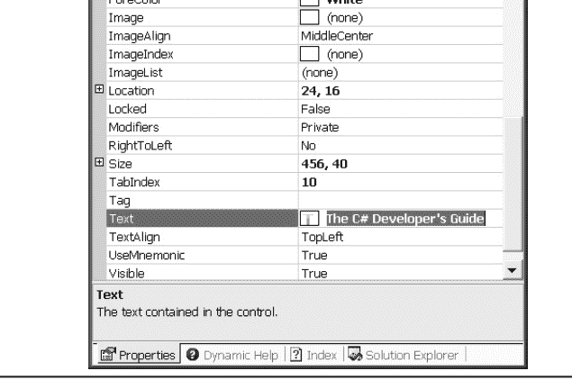

**图 9-6** *GradientEditor 在选中属性中的显示*


**提示**

当你在方框区域绘制内容时，请使用 `PaintValueEventArgs` 参数的 `Bounds` 属性来约束显示区域。

我们的目标是创建一个显示渐变文本的自定义编辑器；因此，我们只需重写从 `UITypeEditor` 继承的 `GetPaintValueSupported` 和 `PaintValue` 方法。`GetPaintValueSupported` 默认返回 `False`。通过在清单 9-5 第 6 行返回 `True`，我们表示将在属性窗口中执行自定义绘制。`PaintValue` 方法（第 9 行）的 `PaintValueEventArgs` 参数表示画布——也称为 hDC、DC 或设备上下文——即属性窗口中的小方框区域（见图 9-6）。`PaintValue` 中的代码（第 10 到 16 行）使用 GDI+、`DrawString` 和 `LinearGradientBrush` 来显示 `GradientLabel` 视觉效果的示例。

### 实现 AngleEditor

`GradientEditor` 演示了 `UITypeEditor` 的自定义绘制方面。`AngleEditor` 演示了如何实现支持编辑值的方法。为了实现 `AngleEditor`，我们将重写 `UITypeEditor.EditValue` 和 `UITypeEditor.GetEditStyle`。`GetEditStyle` 返回一个 `UITypeEditorEditStyle` 枚举值；返回的枚举值描述了要显示的编辑器类型。

清单 9-6 演示了 `AngleEditor`。使用编译器指令来分隔支持编辑器对话框和下拉版本的代码。如果 `GetEditStyle` 返回 `UITypeEditorEditStyle.DropDown`，则定义编译器指令 `DROPDOWN`。要使用 `AngleEditor` 的模态对话框版本，请取消定义 `DROPDOWN` 编译器指令。

清单 9-6 一个自定义的 UITypeEditor，演示了自定义编辑器的 GetEditStyle 和 EditValue 方法

```
1:  public class AngleEditor : UITypeEditor
2:  {
3:    private IWindowsFormsEditorService editorService = null;
4:    private bool IsValidContext(ITypeDescriptorContext context)
5:    {
6:      return context != null && context.Instance != null;
7:    }
8:
9:    private bool IsValidProvider(IServiceProvider provider)
10:   {
11:     return provider != null;
12:   }
13:
14:   private IWindowsFormsEditorService GetService(
```


## 高级C#编程

```csharp
IServiceProvider provider)
{
    return (IWindowsFormsEditorService)provider.GetService(
        typeof(IWindowsFormsEditorService));
}

public override object EditValue(ITypeDescriptorContext context,
    IServiceProvider provider, object value)
{
    if( !IsValidContext(context) || !IsValidProvider(provider))
        return value;

    editorService = GetService(provider);
    if( editorService == null ) return value;

#if DROPDOWN

    NumericUpDown control = new NumericUpDown();
    control.Maximum = 360;
    control.Minimum = 0;

    if(value is float)
    {
        control.Value = Convert.ToDecimal(value);
        editorService.DropDownControl(control);
    }
    return (float)control.Value;
#else
    if(value is float)
    {
        using( FormAngle form = new FormAngle())
        {
            form.Angle = (float)value;
            if(editorService.ShowDialog(form) == DialogResult.OK)
                return form.Angle;
        }
    }

    return value;
#endif
}

public override UITypeEditorEditStyle GetEditStyle(ITypeDescriptorContext
context)
{
    return IsValidContext(context) ?
#if DROPDOWN
        UITypeEditorEditStyle.DropDown : base.GetEditStyle(context);
#else
        UITypeEditorEditStyle.Modal : base.GetEditStyle(context);
#endif
}
}
```

> **提示**
>
> 条件指令必须首先在模块顶部定义。

在此特定示例中显示的编辑器类型取决于清单9-6第1行定义的条件指令。如果定义了DROPDOWN，那么我们尝试在第61行返回`UITypeEditorEditStyle.DropDown`枚举值；否则，我们尝试在第63行返回`UITypeEditorEditStyle.Modal`值。（图9-7显示了属性窗口中的DropDown AngleEditor。）

清单9-6第59行调用的`IsValidContext`方法用于测试上下文是否有效。`IsValidContext`在第4到7行实现。`IsValidContext`测试`PropertyDescriptor`及其容器是否不为null。

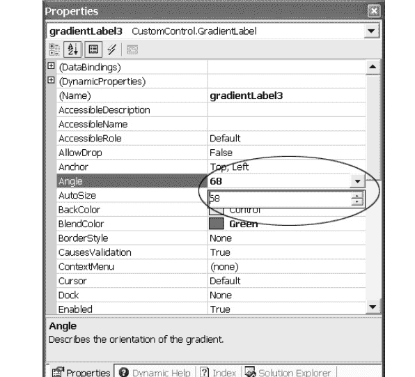

**图9-7** 使用UITypeEditorEditStyle.DropDown样式的自定义UITypeEditor

`GetEditStyle`是第一个关键方法。第二个关键方法是`EditValue`，在清单9-6的第21到55行定义。第24行实现了一个哨兵：如果我们没有有效的上下文或提供程序，则该方法返回参数`Value`。`ITypeDescriptorContext`引用一个`PropertyDescriptor`（最常用于执行数据的类型转换）和一个`IServiceProvider`。`IServiceProvider`实现一个方法`GetService`。我们需要的`ServiceProvider`是`IWindowsFormsEditorService`。`IWindowsFormsEditorService`定义了用于显示下拉控件或显示为模态对话框的方法。

清单9-6第31到41行定义的DropDown版本创建了一个`NumericUpDown`控件实例，设置最小和最大值，并使用`IWindowsFormsEditorService`显示该控件。第43到53行实现了模态对话框行为。第45行使用*using*块来创建窗体，并使用`IWindowsFormsEditorService`在Visual Studio .NET环境中显示该窗体。剩下的就是将自定义UITypeEditor与属性关联起来。

### 使用EditorAttribute应用自定义编辑器

就像本章中的许多内容一样，我们使用属性将自定义UITypeEditor与控件关联。`EditorAttribute`定义在`System.ComponentModel`命名空间中。

我们将使用的`EditorAttribute`版本接受自定义类型和基类型的类型信息。自定义类型是上一节定义的`AngleEditor`类，以及我们从中派生的类型`UITypeEditor`。我们希望将编辑器与`GradientLabel`的`Angle`属性关联。结合`GradientLabel`的`Angle`属性的所有属性，该属性及其属性在下面的代码清单中提供：

```csharp
[Description("Describes the orientation of the gradient."),
 Category("Appearance"),
 Editor(typeof(AngleEditor), typeof(UITypeEditor)),
 DefaultValue(45)]
public float Angle
{
    get
    {
        return angle;
    }
    set
    {
        angle = value;
        Invalidate();
    }
}
```

`Angle`属性的四个属性提供了描述、类别、默认值和自定义UITypeEditor。这些代表了对属性本身的重大增强，从而带来了更丰富的用户体验。

### 定义Windows窗体设计器

使用C#编程是一种有回报且有趣的体验。（为了获得一些乐趣，请尝试第4章的Terrarium示例。）然而，不幸的是，我们不得不结束本章。这意味着我必须留一些东西让你去发现；否则，当我完成这本书时，就该写第二版了。我想以对`IDesigner`接口和`ControlDesigner`类的快速讨论来结束本章。

`IDesigner`接口定义在`System.ComponentModel.Design`命名空间中。该接口定义了`Component`和`Verbs`属性以及`DoDefaultAction`和`Initialize`方法。`IDesigner`接口的一个有趣应用是定义`ControlDesigner`类。

`ControlDesigner`定义在`System.Windows.Forms.Design`（`System.Web.UI.Design`中也有一个）命名空间中。通过继承和扩展`ControlDesigner`类，你可以在设计时为自定义控件提供扩展行为。基本方法非常简单：从`ControlDesigner`继承；定义一个只读的`Verbs`属性，该属性将成为Visual Studio .NET中控件的上下文菜单；并使用`Component`属性的初始化引用来在设计时更新引用的控件。最后，使用`System.ComponentModel`命名空间中定义的`DesignerAttribute`将`ControlDesigner`与控件关联。

`CustomControl.csproj`项目中的`shape.cs`模块演示了一个绘制形状的控件。设计器显示一个额外的菜单项，基于清单9-7中的实现——一个“关于”菜单项。你可以参考在线提供的Shape控件代码。`ShapeDesigner`在清单9-7中提供。

**清单9-7** 实现ControlDesigner以扩展自定义控件的设计时支持

```csharp
public class ShapeDesigner : ControlDesigner
{
    public override DesignerVerbCollection Verbs
    {
        get
        {
            return new DesignerVerbCollection(
                new DesignerVerb[]{new DesignerVerb("About",
                new EventHandler(OnAbout))});
        }
    }

    private void OnAbout(object sender, System.EventArgs e)
    {
        const string About =
            "The C# Developer's Guide\n" +
            "Copyright \xa9 2002. All Rights Reserved.\n" +
            "Written by Paul Kimmel. pkimmel@softconcepts.com\n";
        MessageBox.Show(About, "About", MessageBoxButtons.OK,
            MessageBoxIcon.Information);
    }
}
```

清单9-7第13到22行的`OnAbout`实现了我们的设计器的行为。`OnAbout`处理程序显示一个简单的“关于”对话框，告诉使用我控件的开发者作者信息。（这是ControlDesigner的一个完全有效的用途，特别是如果你从事开发者工具业务的话。）第3到11行实现了重写的只读`Verbs`集合。本质上，一个动词对应一个菜单项，而对于菜单，你通常需要一个处理点击事件的程序。第7、8和9行构造了`DesignerVerbCollection`（一个`DesignerVerb`数组），并使用菜单标题和一个事件处理程序（用于响应通过单击菜单项调用动词时）初始化`DesignerVerb`数组。

> **提示**
>
> 本章中的几个属性是使用类型信息初始化的。这样做的原因是，通过获取任何类型的类型信息，可以使用反射来动态访问该类型的成员，而无需事先了解该类型。有关反射的信息，请参阅第2章。

你可以通过使用自定义`ControlDesigner`的类型信息初始化`DesignerAttribute`，将`ShapeDesigner`与控件关联。属性的应用在下面的代码片段中演示：

```csharp
[ToolboxBitmap(@"C:\temp\Shape.bmp"),
    Designer(typeof(ShapeDesigner))]
public class Shape : Control
{ // 在此处实现类
}
```

### 总结

本章是那些写起来很有趣的章节之一。我天生是个工具匠。工具匠是喜欢构建解决方案组成部分（如组件）的人。构建自定义控件既有趣又有回报，因为它通常很快就能完成，并且结果高度可见和可重用，没有太多与开发系统相关的其他事情，比如收集需求和会议。

本章包含的内容远不止一个`EffectsLabel`。我向你介绍了许多你可以反复使用的方面，用于构建坚实、专业且丰富的自定义控件。你学会了如何创建控件、`ControlDesigner`和`TypeEditor`。


## 第十章

## 创建自定义特性

**本章内容：**

-   核心主题
    -   定义自定义特性类
    -   实现特性构造函数
    -   为自定义特性添加其他成员
    -   应用 AttributeUsageAttribute
    -   读取特性
-   辅助主题
    -   为特性添加注释
    -   实现扩展程序提供程序
    -   回顾 EditorBrowsableAttribute
    -   回顾 DesignerSerializationVisibilityAttribute
-   小结

到目前为止，你已经对特性有了很多了解。特性提供了微软缓解“DLL地狱”影响的途径之一。“DLL地狱”是由与注册和复制应用程序的COM组件相关的版本问题引起的。过去，描述COM组件的信息被写入注册表，并与组件分离存储。特性所做的部分工作，就是通过将过去需要写入注册表的信息与程序集本身结合，来帮助解决这个问题。（程序集是应用程序与其元数据——即由特性添加的信息——的组合。）

> **注意：** 任何用户定义的类型都可以用作特性。通常，大多数特性会继承自 `System.Attribute`。

特性通常派生自 `System.Attribute` 类，因为 `Attribute` 类就是为此特定目的而设计的。特性支持向代码添加各种各样的信息。特性通过反射（Reflection）进行检查，并被广泛应用于各种目的，包括声明性安全。第9章演示了如何使用特性来增强Windows窗体的设计时功能，并为控件提供描述和分类。

> **注意：** 声明性安全通过使用特性关联安全权限来实现。命令式安全则通过声明安全类的实例并在运行时调用这些类的方法来实现。

你已经有多次机会探索反射（请参考第2章的AssemblyViewer.sln）并使用各种特性（请参考第9章的控件示例）。在本章中，我将演示如何通过创建自定义特性来结合和扩展这些技能。

### 核心主题

本章演示的基本技能与实现自定义特性有关。有关本章涵盖的其他相关主题，请参阅本章后面的“辅助主题”部分。本章的主要内容演示了如何

-   实现一个自定义特性
-   应用 `AttributeUsageAttribute`
-   为你的自定义特性定义构造函数
-   描述自定义特性的位置参数和命名参数
-   应用自定义特性

我们将通过构建一个 `HelpAttribute` 类来实现这些目标。`HelpAttribute` 类将支持将URL、HTML目标和描述与应用该特性的代码相关联。任何代码都可以使用反射来解析该URL。

### 定义自定义特性类

假设你正在构建工具。通过使用 `HelpProvider` 和帮助文件，可以很容易地为用户界面关联上下文帮助。如果你想将帮助信息与你的代码关联起来呢？这正是开发者想要的。你可能选择使用 `HelpAttribute` 将帮助信息与代码关联。根据你的工具中客户正在使用的具体类，你可以基于代码上下文显示帮助信息。

创建自定义特性需要你继承自 `System.Attribute`。你知道如何在C#中指定继承关系，因此我将在不进一步阐述的情况下在此演示类头。

```csharp
class HelpAttribute : System.Attribute
```

如果存在一个现有的特性提供了我们需要的部分行为，那么我们可以从那个特性继承。

### 实现特性构造函数

如果你需要运行任何初始化代码，那么你将需要实现一个构造函数。此外，就特性而言，如果你需要初始值（回想第9章的 `DescriptionAttribute`），你将需要定义一个构造函数。

必须提供的参数，因为它们是提供给构造函数的参数，被称为位置参数。特性支持位置参数和命名参数。我选择要求用户提供一个URL和一个描述，以及一个可选的目标标签。基于这些决定，我们需要实现一个具有两个位置参数和一个命名参数的构造函数。

#### 位置参数

位置参数就是构造函数的参数。如果我想实现一个具有两个位置参数——URL和描述——的 `HelpAttribute`，那么我需要相应地定义构造函数。到目前为止，我们描述的类已经演变成如下形式：

```csharp
class HelpAttribute : System.Attribute
{
    private string url;
    private string description;

    public HelpAttribute( string url, string description )
    {
        this.url = url;
        this.description = description;
    }
```

如前所述，应用该特性时，必须为每个构造函数参数提供一个字符串参数。下面是一个示例：

`[Help("http://www.softconcepts.com", "SoftConcepts Home")]`

#### 命名参数

可以提供给特性的可选参数被称为 *命名参数*。命名参数在自定义特性中实现为具有 *getter* 和 *setter* 的公共属性。这与位置参数形成对比，位置参数通常仅通过具有getter的公共属性来公开。

对于我们的项目，我们需要实现一个名为“target”的命名参数，并且需要为URL和Description字段实现公共的只读属性。如果我们实现了这些属性，那么我们特性的使用者将能够读取我们自定义特性的状态。如这里所见，`HelpAttribute` 添加了以下细节后，已经成熟到“青少年期”了：

```csharp
class HelpAttribute : System.Attribute
{
    private string url;
    private string description;
    private string target;

    public HelpAttribute( string url, string description )
    {
        this.url = url;
        this.description = description;
    }

    public string Target
    {
        get
        {
            return target;
        }
        set
        {
            target = value;
        }
    }

    public string URL
    {
        get
        {
            return url;
        }
    }

    public string Description
    {
        get
        {
            return description;
        }
    }
}
```

该类现在有两个位置参数和一个命名参数。随着属性方法的添加，使用者将能够读取特性的值。此外，`URL` 和 `Description` 在特性创建后是不可修改的。受我们的实现限制，该特性现在可以用两个或三个参数来应用。

```csharp
[Help("http://www.amazon.com", "Books Online")]
[Help("http://www.yahoo.com", "Search Engine", Target="Maps")]
```

第一个示例使用了必需的位置参数，这些参数将传递给构造函数。第二个示例演示了必须在前面的位置参数和命名参数。注意属性名称 `Target` 的使用。正如 *命名参数* 这个名称所暗示的，在为特性的命名参数提供值时，请使用其 *名称*。

> **注意**
> 通过检查特性语句，你可能会对.NET如何管理特性做出一些推断。特性语句是只读的。特性名称用于请求构造函数信息。反射、特性名称和参数可以用于动态调用构造函数。命名参数的属性名称可以与反射结合使用来初始化特性的属性。（如果能有框架源代码来探索这个假设就好了。）

### 为自定义特性添加其他成员

自定义特性只是以特定方式使用的类。如果需要，你可以向自定义特性添加其他成员。基本思想是添加支持你的特性将扮演的角色的成员。


### 应用 AttributeUsageAttribute

在将自定义特性编译到类库之前，我们需要做的最后一件事是为我们的自定义特性应用 AttributeUsageAttribute。AttributeUsageAttribute 用于指定特性可以应用于哪些类型的实体、该特性是否可以多次应用，以及该特性是否可被继承。

AttributeUsageAttribute 有一个位置参数（一个 AttributeTargets 枚举值）和两个命名参数：Inherited 和 AllowMultiple。在展示 HelpAttribute 的应用示例之后，我们将回顾 AttributeUsageAttribute 的每个参数。以下是应用示例，位于类头之前。

```csharp
[AttributeUsage(AttributeTargets.All)]
public class HelpAttribute : Attribute
```

### 指定特性目标

AttributeTargets 枚举用作 AttributeUsageAttribute 的位置参数。如果你的特性适用于所有成员，那么就像我们为 HelpAttribute 所做的那样，用 AttributeTargets 来初始化 AttributeUsageAttribute。

如果你想将特性限制在特定类型的代码元素上，那么请选择描述你的自定义特性可以应用于的元素的枚举成员。你可以使用按位或（ | ）运算符组合特性。例如，如果你定义一个可以应用于属性和方法的特性，那么你应该按如下所示应用 AttributeUsageAttribute。

```csharp
[AttributeUsage(AttributeTargets.Method | AttributeTargets.Property)]
```

### 指定你的特性是否可被继承

AttributeUsageAttribute 接受两个命名参数。Inherited 属性是一个布尔属性，你可以在应用 AttributeUsageAttribute 时对其进行初始化。如果你用 `Inherited = true` 来初始化 AttributeUsageAttribute，那么派生自应用了你的特性的类的类，也会继承你的特性。

默认情况下，Inherited 属性为 True。以下是演示 Inherited 命名参数的 AttributeUsageAttribute 示例。

```csharp
[AttributeUsage(AttributeTargets.Struct, Inherited=false)]
```

前面的语句表明该特性可以应用于结构体，并且该特性不会被继承。

### 指定你的特性是否可以多次应用

AllowMultiple 命名参数是一个布尔值，默认为 False。如果 AllowMultiple 为 True，那么该特性可以多次应用于同一个成员。AllowMultiple 为 True 的特性被称为多重使用特性。当 AllowMultiple 为 False 时，这些特性被称为单一使用特性。

```csharp
[AttributeUsage(AttributeTargets.All, AllowMultiple=true)]
```

AllowMultiple 默认为 False。只有当多次应用特性没有潜在冲突时，你才会希望允许多次应用。例如，你不会希望允许多次应用安全特性，然后不得不担心安全权限冲突。（有关 .NET 中安全性的更多信息，请参阅第 16 章。）下一节的代码清单 10-1 提供了一个可以合理允许多次使用的自定义特性示例。

### 读取特性

第 2 章演示了可以使用反射读取有关类的信息。反射的一个方面是能够检索已应用于类型的自定义特性。给定特定类型的 System.Type 记录，我们可以请求应用于该类型的特性。要探索应用于类型成员的特性，我们可以请求该类型的成员，然后请求应用于每个成员的特性。

思考一下类型和成员之间的关系。特性既可以应用于类，也可以应用于类的成员。此外，类的成员本身也可能是复杂的类型（类）。代码清单 10-1 是一个方法，它遍历类的所有成员并请求该类及其成员的自定义特性信息。

**代码清单 10-1** 使用反射探索类型的所有特性

```csharp
1:  ArrayList topics;
2:  [Help(@"C:\Temp\CWP13.HTM", "Constructor")]
3:  public HelpAttributeDemo()
4:  {
5:      topics = new ArrayList();
6:      topics.AddRange( GetType().GetCustomAttributes(
7:        typeof(HelpAttribute), false));
8:
9:      MemberInfo[] memberInfo = GetType().GetMembers();
10:      IEnumerator enumerator = memberInfo.GetEnumerator();
11:  }
12:
13:      while( enumerator.MoveNext())
14:      {
15:          topics.AddRange( ((MemberInfo)
16:          enumerator.Current).GetCustomAttributes(
17:            typeof(HelpAttribute), false));
18:      }
19:  }
```

代码清单 10-1 中第 1 行的 ArrayList 用于存储反射到的特性。（此过程定义在可在线获取的 HelpAttribute.sln 中的 HelpAttributeDemo 类中。.HTM 帮助文档（如图 10-1 所示）是使用 Visual Studio .NET 中的“工具”->“生成注释网页”创建的。）第 2 行应用了一个 HelpAttribute，使用从 Visual Studio .NET 生成的 Web 页面。特性的描述解释了该方法是构造函数。ArrayList 在第 5 行构造。

代码清单 10-1 中的第 6 行调用 GetType 以获取 HelpAttributeDemo 类的 Type 信息。该 Type 对象用于请求自定义特性数组。通过指定 `typeof(HelpAttribute)` 作为 GetCustomAttributes 的参数，GetCustomAttributes 将只返回应用于该类的 HelpAttribute 特性。

代码清单 10-1 中的第 9 到 16 行请求 HelpAttributeDemo 类型的所有 MemberInfo 对象。memberInfo 数组（第 10 行）用于请求一个枚举器，第 13 到 16 行（构成一个语句）将所有应用于 HelpAttributeDemo 所有成员的 HelpAttribute 特性添加到 topics ArrayList 中。

回到我们的场景，一旦我们动态发现了所有特性，我们就可以显示描述列表。当用户选择一个特定的描述时，将有一个与拥有该描述的 HelpAttribute 关联的 URL。通过该 URL，我们可以显示帮助页面。HelpAttributeDemo 类和 AttribueDemo.exe 应用程序准确地演示了这种行为。

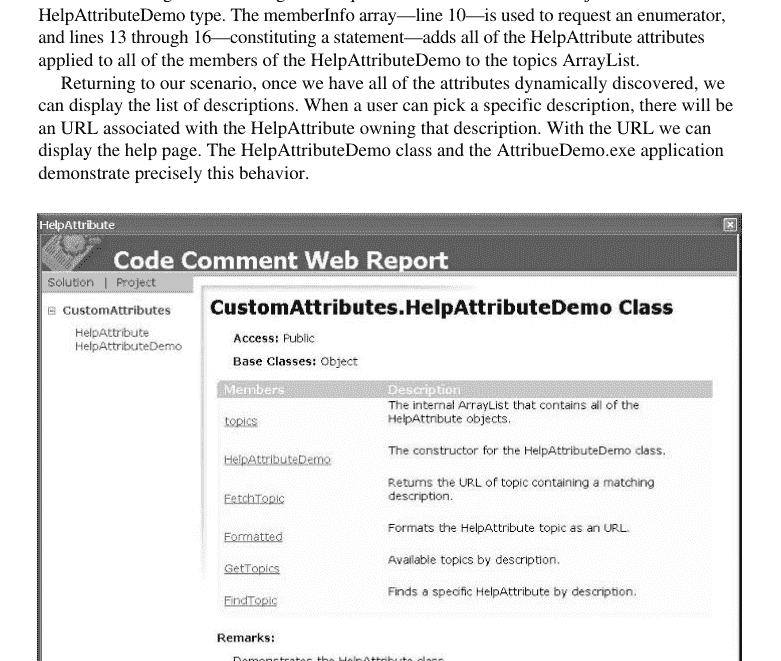

**提示**
从 Visual Studio .NET 的“工具”菜单生成注释网页。

使用反射的关键是请求 Type 信息。有了 Type 信息，你就可以使用反射来探索类型的所有成员，包括读取特性实例及其属性。

### 次要主题

上一节演示了一个使用反射显示动态 HTML 帮助的 HelpAttribute。一个有需要的人可能想要使用此特性，但同时也希望有一个简单的方法来生成专业的网页。你可以使用文档标签和 Visual Studio .NET 来自动生成 HTML 注释页面。

本节将介绍几个主题。除了为代码生成 HTML 文档而设计的标签外，本节还将探讨：

- ToolTip 组件以及如何实现扩展器提供程序（Extender Provider）
- EditorBrowsableAttribute
- DesignerSerializationAttribute

### 注释特性

Visual Studio .NET 将为你的源代码生成高质量的 HTML 文档。你提供注释，Visual Studio .NET 会处理其余部分。

第 9 章的表 9-1 介绍了用于注释源代码的注释 XML 标签。你可以将 Visual Studio .NET 帮助文档作为通用参考。在这里，我将演示几个用于创建图 10-1 所示 HTML 文档的注释标签。

图 10-1 中显示的描述列是通过使用 `<summary>` 标签创建的。图 10-1 底部显示的“备注”部分是使用 `<remarks>` 标签创建的，而 `<param>` 和 `<returns>` 注释如图 10-2 所示。图 10-2 中显示的方法的类型、名称和描述信息是由 `<param>` 标签创建的，返回信息由 `<returns>` 标签添加。

图 10-1 中所示 topics 元素的描述是通过向 topics 字段添加以下注释创建的。

```xml
/// <summary>
/// 包含所有 HelpAttribute 对象的内部 ArrayList。
/// </summary>
ArrayList topics;
```


### 310 高级 C# 编程

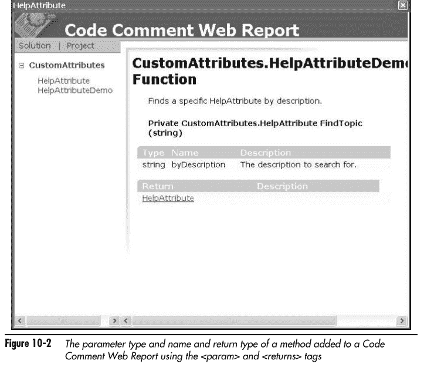

图 10-2 使用 `<param>` 和 `<returns>` 标签为代码注释 Web 报告添加的方法的参数类型、名称和返回类型

图 10-1 中的备注是使用以下应用于 `HelpAttributeDemo` 类的注释创建的。

```
/// <remarks>
/// Demonstrates the HelpAttribute class.
/// </remarks>
[Help(@"C:\Temp\CWP11.HTM", "Class")]
public class HelpAttributeDemo
{
```

参数和返回信息是通过应用 `<param>` 和 `<returns>` 标签创建的，如以下示例所示。

通过提供文本和文档标签，可以为源代码创建丰富的帮助文档。

### 实现扩展器提供程序

扩展器提供程序为其他组件提供属性。扩展器提供程序可以动态地向控件提供 Hint（或 ToolTip）属性，而不是让每个控件都拥有自己的 Hint 属性。已有几个扩展器提供程序，包括 ComponentTray、ErrorProvider、HelpProvider、LocalizationExtenderProvider、PropertyTab 和 ToolTip。

例如，ToolTip 提供程序可以添加到组件托盘，并动态地为控件提供 ToolTip 控件。使用者可以通过调用 IExtenderProvider 类必须实现的唯一方法 CanExtend 来查询扩展器提供程序。CanExtend 返回一个布尔值，指示特定提供程序是否可以扩展该使用者。要创建自定义扩展器提供程序，请定义一个继承自 Component 并实现 IExtenderProvider 接口的类。

为了演示 IExtenderProvider 接口，我们将创建一个 HelpProvider，通过向控件添加 HelpLink 属性来扩展控件。我们需要利用 .NET Framework 的一些基本功能来实现 HelpProvider。我们需要继承自 System.ComponentModel.Component，实现 System.ComponentModel.IExtenderProvider 接口，并应用 System.ComponentModel.ProviderPropertyAttribute。我们将在接下来的小节中探讨每个部分，并在本章末尾提供提供程序的完整代码清单。

### 为 HelpProvider 指定类头

HelpProvider 将提供指向帮助信息的链接。我们需要一个集合来存储这些链接。IExtenderProvider 接口和 ProviderPropertyAttribute 定义在 System.ComponentModel 命名空间中，我们将把 HelpProvider 与 Windows 窗体控件关联起来。因此，在实现 HelpProvider 的模块中包含这些功能的命名空间将很有帮助。

> NOTE
> “概括化”一词指的是继承自一个类，“实现”一词指的是实现一个接口。这两个术语是同义词。在 C# 等编程语言的上下文中，最常使用的是“继承”和“实现”；在统一建模语言（UML）等建模语言的上下文中，最常使用的是“概括化”和“实现”。

要将 HelpProvider 放置在组件托盘中，我们需要概括化 System.Windows.Forms.Component 类并实现 System.ComponentModel.IExtenderProvider。using 语句和类头如下：

```
using System;
using System.Collections;
using System.ComponentModel;
using System.Windows.Forms;
```

```
public class HelpProvider : Component, IExtenderProvider
```

最后一条语句表明 HelpProvider 继承自 Component 并实现了 IExtenderProvider。

### 应用 ProviderPropertyAttribute

ProviderPropertyAttribute 用于为特定扩展器提供程序将要提供的属性提供一个名称。您可以使用提供的属性名称以及此提供程序可以扩展的对象的名称或类型来初始化 ProviderPropertyAttribute。我们希望我们的提供程序通过 HelpLink 属性扩展 System.Windows.Forms.Controls，这指导了 ProviderPropertyAttribute 语句（如接下来相对于类头所示）：

```
[ProvideProperty("HelpLink", typeof(Control))]
public class HelpExtender : Component, IExtenderProvider
{
```

ProviderPropertyAttribute 表明我们的提供程序将提供一个名为 HelpLink 的属性，并且可以扩展 Control 对象。（请记住，每个 Windows 窗体控件都继承自 Control。）ProviderPropertyAttribute 的另一种形式是使用提供的属性名称和属性类型进行初始化。

当 HelpProvider 被添加到 ComponentTray 时，每个 Control 都将拥有一个 HelpLink 属性，除非该 Control 被 CanExtend 方法明确排除。

### 实现 IExtenderProvider 接口

IExtenderProvider 定义了 CanExtend 方法。当一个类实现一个接口时，该类必须实现接口定义的所有成员。您可以显式实现接口成员，方法是通过以接口名称为前缀来满足接口契约的成员，或者通过声明一个与接口定义的成员签名相同的公共成员。以下两种方法签名中的任何一种都将满足 IExtenderProvider 接口：

```
public bool CanExtend(object extendee)
```

或

```
bool IExtenderProvider.CanExtend(object extendee)
```

公共方法 CanExtend 隐式地满足了 IExtenderProvider 接口，而第二个示例显式地满足了该契约。

假设您有一个实现两个接口的类，这两个接口包含一个或多个相同的成员。您可以使用第二种显式的接口实现形式来指示哪些成员正在实现特定的接口。

我们的控件将扮演任何 Control 的提供者的角色；因此，如果被扩展对象的类型是 Control，那么 HelpProvider.CanExtend 方法将返回 True。以下是 CanExtend 方法的实现。

```
bool IExtenderProvider.CanExtend(object extendee)
{
    return extendee is Control;
}
```

### 实现 HelpProvider

HelpProvider 将为它扩展的每个控件提供 HelpLink 属性。因此，剩下的工作就是实现获取和设置 HelpLink 的方法，并提供一个存储所有 HelpLink 的位置。清单 10-2 提供了 HelpProvider 的完整实现。

清单 10-2 一个 IExtenderProvider 组件的实现，该组件通过提供 HelpLink 来扩展控件

```
using System;
using System.Collections;
using System.ComponentModel;
using System.Windows.Forms;

namespace HelpExtender
{
    [ProvideProperty("HelpLink", typeof(Control))]
    public class HelpExtender : Component, IExtenderProvider
    {
        private Hashtable links;

        public HelpExtender()
        {
            links = new Hashtable();
        }

        public string GetHelpLink(Control control)
        {
            return links[control] == null ? string.Empty
                : (string)links[control];
        }

        public void SetHelpLink(Control control, string text)
        {
            if(text == null)
                links[control] = string.Empty;
            else
                links[control] = text;
        }

        bool IExtenderProvider.CanExtend(object extendee)
        {
            return extendee is Control;
        }
    }
}
```

清单 10-2 第 14 到 17 行定义的构造函数创建了一个 HashTable 实例。我们将依赖每个类从 Object 类继承的 GetHashCode 方法，以此作为存储唯一 HelpLink 值的方式。GetHelpLink 和 SetHelpLink 为 HelpLink 属性提供了读写行为。

清单 10-2 第 25 到 31 行的 SetHelpLink 使用控件来索引 HashTable，将特定控件的 HelpLink 字符串值存储在控件本身创建的哈希索引处。GetHelpLink 执行相反的操作。如果特定索引处的 HashTable 条目返回 null，则返回值 string.Empty；否则，哈希函数返回一个对象（我们知道它是一个字符串），我们可以如第 22 行所示返回该字符串值。

### 使用 HelpProvider

将包含 HelpProvider 的模块包含在类库中。构建类库项目并将 HelpProvider 库添加到工具箱。（有关在 Visual Studio .NET 中自定义工具箱的信息，请参阅第 9 章中的“将组件添加到工具箱”。）

要使用 HelpProvider，请将 HelpProvider 从工具箱拖动到窗体。HelpProvider 将被添加到组件托盘，窗体及其上的控件将被扩展一个 HelpLink 属性（如图 10-3 所示）。

扩展器添加的属性的值存在于扩展器中，而不是在它扩展的控件中。通常，您可以通过从对象的特定实例请求属性来读取属性值。例如，button1.Text 提供对名为 button1 的对象的 Text 属性的访问。要访问扩展器添加的属性的值，请从扩展器的 Get 方法请求值。以下语句演示了如何请求与名为 button1 的对象关联的 HelpLink 值。

`helpExtender1.GetHelpLink(button1)`

在我们的示例中，HelpLink 是一个 URL，指向使用注释网页创建的 HTML 文档。要显示网页，我们可以将 HelpLink 的值传递给 Process.Start 方法。HTTP:// 协议标识符与 Internet Explorer 关联。


**第10章：创建自定义属性 315**

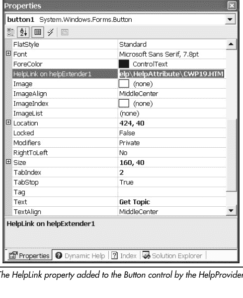

图10-3 *通过HelpProvider添加到Button控件的HelpLink属性*

（在我的机器上）；因此，使用HTTP://地址调用Process.Start将打开该URL所指向的文档。

### 审阅EditorBrowsableAttribute

`EditorBrowsableAttribute`定义在`System.ComponentModel`命名空间中。它使用`EditorBrowsableState`枚举值初始化，将决定属性或方法在编辑器中是否可见。例如，`[EditorBrowsable(EditorBrowsableState.Never)]`将隐藏它所应用的元素，使其不在Visual Studio .NET的智能感知功能中显示。

`EditorBrowsableState`的值有`Never`、`Always`和`Advanced`。如果在“选项”对话框（见图10-4）中选择了“隐藏高级成员”，那么使用`EditorBrowsableState.Advanced`初始化的成员将不会被智能感知显示。

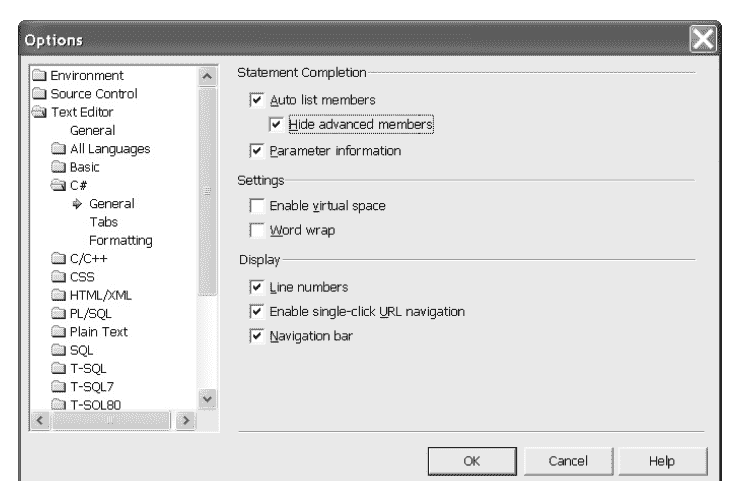

图10-4 使用“语句完成选项”来隐藏或显示`EditorBrowsableState.Advanced`成员。

### 审阅DesignerSerializationVisibilityAttribute

`DesignerSerializationVisibilityAttribute`（这个名字很长）用于描述设计器如何保存一个属性。有三个枚举值：`Visible`、`Content`和`Hidden`，定义在`DesignerSerializationVisible`枚举中，你可以用它们来初始化此属性。`Visible`值表示设计器可以使用默认行为来序列化属性。使用`Hidden`表示属性不被序列化，使用`Content`表示属性的值被序列化。例如，使用`Content`来序列化集合的元素。

我们可以结合`EditorBrowsableAttribute`、`BrowsableAttribute`和`DesignerSerializationAttribute`来弥补第9章中的一个语义缺陷。第9章介绍了一个`EffectsLabel`。`EffectsLabel`继承自`Label`，并通过重写`OnPaint`行为创建了阴影效果。这个缺陷很微妙。为了创建阴影效果，一个覆盖颜色与现有的、继承的`ForeColor`相结合。缺陷在于，`ForeColor`实际上创建了背景阴影效果，而`OverlayColor`属性实际上变成了`ForeColor`。一个思维正常的人可能会被这种微妙却恼人的不一致性搞糊涂。

为了解决这个问题，我们可以引入一个名为`ShadowColor`的新属性，并隐藏名为`ForeColor`的旧属性。结果，`EffectsLabel`拥有了名为`ShadowColor`和`OverlayColor`的属性，并且在`EffectsLabel`的上下文中，每个属性的作用要清晰得多。要完成这个修订，我们只需要将清单10-3中显示的两个属性添加到第9章定义的`EffectsLabel`控件类中即可。

**清单10-3** *将清单中的代码添加到第9章的`EffectsLabel`自定义控件中，以隐藏`ForeColor`属性并引入一个更有意义的`ShadowColor`属性。*

```
1:  [Browsable(false),
2:  EditorBrowsable(EditorBrowsableState.Never),
3:  DesignerSerializationVisibility(DesignerSerializationVisibility.Hidden)]
4:  public override Color ForeColor
5:  {
6:      get
7:      {
8:          return base.ForeColor;
9:      }
10:     set
11:     {
12:         base.ForeColor = value;
13:     }
14: }
15:
16:
17: [Category("Appearance"),
18: Description("The color that is used to create the shadow.")]
19: public Color ShadowColor
20: {
21:     get
22:     {
23:         return ForeColor;
24:     }
25:     set
26:     {
27:         ForeColor = value;
28:     }
29: }
```

清单10-3第1行的`BrowsableAttribute`将阻止`ForeColor`在“属性”窗口中显示。第2行应用的`EditorBrowsableAttribute`将阻止智能感知在代码设计器中显示`ForeColor`属性，而应用的`DesignerSerializationVisibilityAttribute`将阻止`ForeColor`被代码编辑器序列化。

出于所有实际目的，使用清单10-3中的代码修订后的`EffectsLabel`将不再具有`ForeColor`属性。从使用者的角度来看，`EffectsLabel`将拥有`ShadowColor`和`OverlayColor`，这在阴影标签的上下文中意义更明确。当然，你我都知道（从清单10-3来看），`ShadowColor`是根据继承的`ForeColor`实现的。我们运用了一点技巧，使`EffectsLabel`更易于使用。

### 总结

代码的意图应该通过你编写代码的方式来传达。在大多数情况下，控件的提供者和使用者将通过你提供给他们的成员来接触你的代码。使用者可能永远不会看到你的内部注释，并且很可能在探索代码之后才会接触你的外部文档。

本章演示了如何通过创建自定义属性和扩展提供程序，将帮助文档与你的代码关联起来。本章的最后一部分演示了如何组合属性，通过一点编程技巧来隐藏现有属性，并暴露能传达更多含义的新属性。

你可以创建自定义属性来为代码添加元数据。使用扩展提供程序通过添加新属性来扩展现有控件，并且你可以使用现有属性来传达关于代码的额外信息。

# 第11章

## 实用反射

**本章内容：**

- 主要主题
    - 动态发现和使用类型
    - 使用反射探索.NET框架
    - 发出动态程序集
- 次要主题
    - 反射与Web服务
    - 实现元类模式
    - 序列化对象
    - 发出正则表达式程序集
- 总结


反射是一种促进动态管理程序集的能力。它是运行时类型信息的演进增强。通过反射，你可以加载和发出程序集，你可以使用编译和运行的代码动态发现和创建类型，并且你可以使用运行的代码调用操作或发出成员。

运行时类型信息（RTTI）支持动态类型发现。查询COM接口支持动态接口发现。反射为这两种操作以及更多操作提供了支持。除了发现关于类型或接口的信息外，反射还允许你发现关于字段、事件、属性、方法、构造函数和属性的信息。对发现程序集和类型信息的一个增强是编写发出器——即，定义编写面向对象中间语言（IL）的代码生成器。本章将演示如何完成所有这些事情。

### 主要主题

本章演示了使用反射的实际应用。有几个示例程序，以及对第5章中的Assembly Viewer 2示例应用程序的讨论。在本章中，你将有机会学习如何：

- 使用反射动态发现关于类型的信息
- 在运行时加载程序集
- 以编程方式探索.NET框架
- 发出程序集、模块、类和成员

次要主题通过演示反射的一些额外用途来补充核心反射主题。在次要主题中，我将演示如何实现元类（类的类）模式、使用XML序列化对象、将对象序列化到ADO.NET DataSet以及发出编译的正则表达式。

### 动态发现和使用类型

你可能会遇到几种情况，你定义了一个泛型类型，并在运行时而不是编译时将该泛型对象初始化为特定类型。本章中的几个示例在实际应用中将非常有用，例如本章后面“实现元类模式”中描述的元类模式。本节将演示发现类型信息的基本概念，这些概念将用于日常编程和从类的Type对象创建对象。


### 使用类型对象

当您调用 `typeof(object)` 操作时，会返回一个类的 `Type` 记录的实例。与其他任何类一样，`Type` 类也有成员。唯一的区别是，`Type` 类包含描述 `Type` 的属性、字段和方法。例如，如果您使用默认名称 `Class1` 声明一个新类，并请求 `typeof(Class1)`，那么您将得到一个 `System.Type` 实例作为返回值。使用这个 `Type` 对象，您可以通过 `Type.InvokeMember` 在 `Type` 对象上调用操作。下面是一个简要示例：

```csharp
using System;

namespace TypeofDemo
{
    class Class1
    {
        [STAThread]
        static void Main(string[] args)
        {
            Type type = typeof(Class1);
            Console.WriteLine(type.FullName);
            Console.ReadLine();
        }
    }
}
```

`typeof` 语句返回一个 `Class1` 的 `Type` 对象的实例。`FullName` 成员返回 `Type` 对象所表示类型的命名空间和名称。该示例将 `TypeofDemo.Class1` 写入控制台。

`Type` 对象包含关于其所属程序集以及类型定义的成员的方法。这些方法可用于请求属性、构造函数、事件、字段、属性、接口、方法、方法参数、嵌套类型、所属程序集和命名空间，以及应用于类型的访问修饰符。

请求类型的第二种方式是将全名传递给 `Type.GetType` 共享方法。`Type.GetType("TypeofDemo.Class1")` 将返回表示 `Class1` 的 `Type` 对象，这与 `typeof(Class1)` 语句完全一样。您需要做的就是获取其 `Type` 对象的实例，然后就可以探索类型或在其上调用操作。

元类是类的类。`Type` 类类似于元类，但 `Type` 类不那么具体。`Type` 类描述所有类型，而元类描述单个类型。因为 `Type` 类对所有类型都是通用的，所以您将在 `Type` 对象上执行的操作也是通用的，需要比元类更多的信息。例如，在元类上调用构造函数，您会得到正确的对象。在 `Type` 对象上调用构造函数，您必须间接调用构造函数，将参数作为对象数组传递。如果您熟悉元类，这些差异将是显而易见的。一般来说，将元类视为描述特定类的类，而 `System.Type` 类视为描述所有可能的类。

### 使用反射实例化对象

除非您只对类型调用静态成员，否则您需要构造反射类型的实例。使用类型的 `Type` 对象有三种方式创建实例。您可以使用 `Activator.CreateInstance` 方法。您可以请求一个 `ConstructorInfo` 并使用该类型实例化一个实例，或者您可以调用 `Type.InvokeMember` 并传递描述构造函数的参数。这三种方式都相当有效；使用静态 `Activator.CreateInstance` 方法似乎是最简单的。

以下三个简短片段演示了如何从名称获取 `Type` 对象并创建该类型的实例。

```csharp
// Using an activator
Type type = Type.GetType("TypeofDemo.Class1");
object o = Activator.CreateInstance(type);
type.InvokeMember("Test", BindingFlags.InvokeMethod,
    null, o, new object[]{});
```

此示例使用共享方法 `Activator.CreateInstance` 创建 `Class1` 的实例。传递 `Type` 对象，`CreateInstance` 将调用默认构造函数。`CreateInstance` 有几种重载形式；例如，如果您传递一个表示构造函数参数的参数数组，那么 `CreateInstance` 将使用与参数最匹配的构造函数创建类型的实例。

```csharp
// Using a ConstructorInfo
Type type = Type.GetType("TypeofDemo.Class1");
ConstructorInfo constructorInfo = type.GetConstructor(new Type[]{});
object o = constructorInfo.Invoke(new object[]{});
type.InvokeMember("Test", BindingFlags.InvokeMethod,
    null, o, new object[]{});
```

第二个示例获取一个 `ConstructorInfo` 对象，它表示单个构造函数。`ConstructorInfo` 对象通过传递对象值数组来创建类型的实例。`ConstructorInfo` 对象将匹配参数最接近的构造函数。传递空对象数组将调用默认构造函数。

```csharp
// Type.InvokeMember
Type type = Type.GetType("TypeofDemo.Class1");
object o = type.InvokeMember("Class1",
    BindingFlags.CreateInstance, null, null, new object[]{});
type.InvokeMember("Test", BindingFlags.InvokeMethod,
    null, o, new object[]{});
```

最后一个示例将构造函数视为方法，并调用 `Class1` 方法。回想一下，C# 中的构造函数与类同名，并且无论是否定义，每个类都有一个默认构造函数。回想一下本节开头的 `Class1` 代码，我们没有显式定义构造函数；但是，如果您检查图 11-1 中的 IL，很明显已经定义了一个默认构造函数。

### 动态成员调用

您可能听说过这样的说法：“.NET 允许开发人员与语言无关”以及“您选择的 .NET 语言是一种生活方式的选择。”这些陈述是真实的，原因有几个。第一个原因是 C# 和 Visual Basic .NET 对公共语言运行时具有同等的访问权限。第二个原因是 C# 和 Visual Basic .NET 之间只有少数几个显著差异（大部分差异是语法上的）。一个明显的区别是 Visual Basic .NET 支持隐式后期绑定，而 C# 不支持。

> **注意**
>
> 当然，有几种 .NET 语言。基本思想是 .NET 语言位于 CLR 之上。因此，为 .NET 实现的许多语言在语法上的差异最为显著。

隐式后期绑定是指您将类型定义为通用类型（如 `Object`），并将其赋值给特定类型的实例。Visual Basic .NET 中的后期绑定意味着您基于实例化类型的成员假设来调用操作。我将通过一个例子来演示这意味着什么。以下是使用 `Activator` 创建 `Class` 实例并调用名为 `Test` 的成员的代码。

```csharp
// Using an activator
Type type = Type.GetType("TypeofDemo.Class1");
object o = Activator.CreateInstance(type);
type.InvokeMember("Test", BindingFlags.InvokeMethod,
    null, o, new object[]{});
```

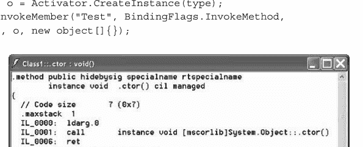

图 11-1 类被提供了默认构造函数，如这里的 IL 所示。

以下是 Visual Basic .NET 中的相同代码清单。

```vb
Dim type As Type = type.GetType("VBTypeofDemo.Class1")
Dim o As Object = Activator.CreateInstance(type)
o.Test()
```

请注意，我们不需要使用 `InvokeMember` 来调用 `Test` 方法，即使我们将 `o` 声明为 `Object` 实例而不是 `Class1` 实例。这就是 Visual Basic .NET 中的后期绑定。

### 定义要调用的成员

与面向对象框架一样，您可能会发现任何方法都有多个重载版本。涵盖每个方法的所有变体是集成帮助或参考手册的功能。`InvokeMember` 有三个版本。我将演示的版本接受五个参数，并具有以下方法签名：

```csharp
public object InvokeMember(string, BindingFlags, Binder, object, object[]);
```

第一个参数是要调用的成员的名称。您可以使用同一个 `InvokeMember` 方法与字段、属性、事件或方法进行交互。当您调用 `InvokeMember` 时，返回类型定义为 `object`。当然，当您编写代码时，您会知道期望什么类型，并可以将返回类型转换为实际返回的类型。例如，如果您在事件上调用 `InvokeMember`，那么您可以将返回类型转换为事件定义的委托类型。（有关演示调用名为 `Test` 的成员方法的示例，请参阅前面的部分。）

### 指定 BindingFlags

我们正在查看的 `InvokeMember` 版本中的第二个参数是一个包含 `BindingFlags` 枚举值的 OR 参数。`BindingFlags` 描述了成员的类型，包括访问修饰符等内容。`BindingFlags` 值在表 11-1 中定义。`BindingFlags` 以特定组合进行 OR 运算。三个常见的组合包括一个指示成员类型的标志、一个指示访问级别的标志和一个指示成员是实例成员、静态成员还是两者的标志。以下是一些有意义的 `BindingFlags` 组合示例：

```csharp
BindingFlags.GetField | BindingFlags.NonPublic |
    BindingFlags.Instance
BindingFlags.InvokeMember | BindingFlags.Public | BindingFlags.Static
BindingFlags.SetProperty | BindingFlags.Public |
    BindingFlags.Instance
```

一般来说，字段是私有的；因此，在调用字段操作时，指定我们想要非公共实例是有意义的。通常，公共方法构成公共接口，因此我们可能希望调用公共静态或实例方法。


| 成员名称 | 描述 |
| :--- | :--- |
| CreateInstance | 指示应创建被调用类型的一个实例。 |
| DeclaredOnly | 表示在反映成员时跳过继承的成员。 |
| Default | 无绑定标志。 |
| ExactBinding | 参数类型必须与参数类型精确匹配。 |
| FlattenHierarchy | 返回静态成员。（不包括嵌套类型。） |
| GetField | 用于指示引用 Field 成员。 |
| GetProperty | 用于指示引用 Property 成员。 |
| IgnoreCase | 反映成员时忽略大小写。 |
| IgnoreReturn | 对于 COM 互操作，可以忽略返回值。 |
| Instance | 包括实例成员。 |
| InvokeMethod | 在调用方法时使用。 |
| NonPublic | 用于非公共成员。需要 ReflectionPermission。 |
| OptionalParamBinding | 用于具有默认参数和可变参数的方法。 |
| Public | 搜索中包括公共成员。不需要 ReflectionPermission。 |
| PutDispProperty | 应调用 COM 对象上的 PROPPUT。 |
| PutRefDispProperty | 应调用 COM 对象上的 PROPPUTREF 成员。 |
| SetField | 将被调用的成员视为左侧值。 |
| SetProperty | 调用属性 setter。 |
| Static | 在调用中包含静态成员。 |
| SuppressChangeType | (帮助指示此功能未实现。) |

**表 11-1** 组合 BindingFlags 值以描述要调用的成员类型

语句演示了如何调用公共静态方法。最后一个示例调用公共属性 setter 方法。

清单 11-1 中的代码被添加到了示例类 Class1 中。额外的代码实现了一个私有字段和一个表示基础字段值的公共属性。

```
1: private string field;
2:
3: public string Property
4: {
5:   get{ return field; }
6:   set{ field = value; }
7: }
```

**清单 11-1** 用于获取和设置字段及属性的 BindingFlags 组合示例

### 326 高级 C# 编程

```
7: }
8:
9: private static void DemoBindingFlags()
10: {
11: Type type = Type.GetType("TypeofDemo.Class1");
12: object o = Activator.CreateInstance(type);
13:
14: type.InvokeMember("field",
15: BindingFlags.SetField | BindingFlags.NonPublic |
16: BindingFlags.Instance, null, o,
17: new object[]{
18: "Welcome to Valhalla Tower Material Defender!"});
19:
20:
21: string s = (string)type.InvokeMember("Property",
22: BindingFlags.GetProperty | BindingFlags.Public |
23: BindingFlags.Instance, null, o,
24: new object[]{});
25:
26: Console.WriteLine(s);
27: Console.ReadLine();
28:
29: }
```

清单 11-1 的第 1 行到第 7 行表示我们将要反映的字段和属性。注意字段是私有的，属性是公共的。（使用名称 *field* 表示字段成员和 *property* 表示属性成员与我们的讨论无关。）DemoBindingFlags 在第 11 行通过将完整名称传递给 Type.GetType 方法来请求类型，并且第 12 行使用 Activator 创建该类型的一个实例。

清单 11-1 的第 14 行到第 24 行演示了一种 BindingFlags 的组合，它允许我们设置私有字段的值，并且 object 参数数组接受一个与我们正在反映的字段类型相同的单个参数。*field* 字段是一个字符串；因此，我们传递一个包含单个字符串元素的数组。由于 *field* 是一个实例成员，我们需要传递一个对象来对其执行反映的操作——也就是说，我们需要内存来存储字段值。

> **注意**

如果你是一名初级程序员，属性、公共访问修饰符和实例可能看起来很陌生。我尊重你作为一名初学者挑战这个主题的雄心，因此这里快速回顾一下你需要学习的内容，以便 *BindingFlags* 有意义。属性是行为像数据的方法，并且与封装的概念有关。公共访问修饰符与信息隐藏的主题相关，而实例化与类与对象的概念相关。这些是你必须学习的 OOP 基本概念。

清单 11-1 的第 21 行到第 24 行演示了如何获取公共属性值并将该值分配给一个临时变量。BindingFlags.GetProperty、BindingFlags.Public 和 BindingFlags.Instance 在此上下文中不言自明。如果你理解属性、公共访问和实例方法的概念，那么这些标志就有意义了。这次我们使用 InvokeMember 的结果作为右侧值；InvokeMember 被定义为返回一个对象，但该类型实际上是一个字符串，因此我们在第 21 行执行了类型转换。剩余的代码只是显示文本“Welcome to Valhalla Tower Material Defender!”。

### 定义绑定器

无论你是否将 Binder 传递给 InvokeMember，你都在使用一个 Binder——DefaultBinder。Binder 用于将你传递给 InvokeMember 的参数转换为成员期望的正式参数类型。最简单的做法是传递你正在调用的成员期望的参数类型。然而，你很可能会遇到这样的情况：你希望类型之间的合理转换能够生效。例如，IBM 的 *通用数据库* 对 Timestamp 数据类型有特定的格式。如果你在 SQL 语句中将一个有效的 .NET 日期/时间值传递给 Timestamp 函数，UDB 将不会接受它。这是我编写的一个方法，用于将 .NET DateTime 值转换为适合 UDB Timestamp 数据类型的字符串。

```
public static string ToTimeStamp(DateTime Value)
{
    return string.Format("{0}-{1:0#}-{2:0#}-{3:0#}.{4:0#}.{5:0#}.{6:000000}",
        Value.Year, Value.Month, Value.Day,
        Value.Hour, Value.Minute, Value.Second,
        Value.Millisecond);
}
```

> **注意**

IBM 的某个人可能知道解决方法；但是，我测试了几种变体，似乎需要为 DateTime 值描述精确的字符串格式来设置 Timestamp 列。

遵循 string.Format 方法，UDB Timestamp 的基本语法是 d-m-yy-hh:mm:ss.mils。用简单英语来说，格式是日、月、年值，用短横线分隔，后跟一个短横线，然后是小时、分钟、秒和六位毫秒值。如果这些高度专业的值接受合理的日期和时间值并为我执行转换，那将是更可取的。这就是 Binder 的角色。

Binder 类是一个抽象类。如果你想描述自定义绑定，那么你可以继承 Binder 类并实现 BindToMethod、BindToField、SelectMethod、SelectProperty、ChangeType 和 ReorderArgumentArray，所有这些都继承自默认的 Binder 类。（Binder 类在 System.Reflection 命名空间中定义。）清单 11-2 演示了一个绑定器，它在解析 DateTime 属性时将在字符串和 DateTime 值之间执行转换。

328 高级 C# 编程

#### 清单 11-2 这包含一个简单的 Binder，它将字符串转换为 DateTime。

```
1: public class DateTimeBinder : Binder
2: {
3:
4:    public override MethodBase BindToMethod(
5:      BindingFlags bindingAttr,
6:      MethodBase[] match,
7:      ref object[] args,
8:      ParameterModifier[] modifiers,
9:      CultureInfo culture,
10:     string[] names,
11:     out object state)
12: {
13:     state = null;
14:     return match.Length == 1 ? match[0] : null;
15: }
16:
17: public override FieldInfo BindToField(
18:     BindingFlags bindingAttr,
19:     FieldInfo[] match,
20:     object value,
21:     CultureInfo culture)
22: {
23:     return null;
24: }
25:
26: public override MethodBase SelectMethod(
27:     BindingFlags bindingAttr,
28:     MethodBase[] match,
29:     Type[] types,
30:     ParameterModifier[] modifiers)
31: {
32:     return null;
33: }
34:
35: public override PropertyInfo SelectProperty(
36:     BindingFlags bindingAttr,
37:     PropertyInfo[] match,
38:     Type returnType,
39:     Type[] indexes,
40:     ParameterModifier[] modifiers)
41: {
```


### 第 11 章：实用反射

```csharp
42:    return null;
43: }
44:
45: public override object ChangeType(
46:    object value,
47:    Type type,
48:    CultureInfo culture)
49: {
50:    if ( value.GetType() != typeof(string)) return value;
51:
52:    try
53:    {
54:       return Convert.ToDateTime(value);
55:    }
56:    catch
57:    {
58:       return value;
59:    }
60: }
61:
62: public override void ReorderArgumentArray(
63:    ref object[] args,
64:    object state)
65: {}
66: }
```

快速浏览清单 11-2 可以看出，大多数继承的方法只是桩方法。我只希望这个转换器做的事情是将日期/时间的字符串表示转换为 `DateTime` 值。

`BindToMethod` 设置 *out* 参数（*out* 参数不被调用者初始化，但被期望在被调用者返回时具有一个值）以及我们想要绑定到的 `MethodBase` 对象。我的实现只在找到一个匹配时返回一个 `MethodBase` 对象。

`MethodBase` 类是 `MethodInfo` 的基类。在我们的示例中，我将一个 `DateTimeBinder` 传递给一个反射属性请求。当属性被发出到 IL 时，名为 `get_property` 和 `set_property` 的隐藏方法（其中 *property* 是与这些方法关联的属性名）会被发出到 IL。当属性被反射时，值是从这些隐藏方法中检索的。因此，即使在反射属性时，也会为 `Binder` 调用 `BindToMethod`。（图 11-2 显示了为 `Class1.DateOfBirth` 生成的 setter（高亮显示）和 getter 方法。）

为了演示清单 11-2 中的 `DateTimeBinder`，向 `Class1` 示例类添加了一个 `DateOfBirth` 属性和一个 `dateOfBirth` 字段。清单 11-3 中的代码演示了隐式调用自定义 `Binder` 的 `BindToMethod` 和 `ChangeType` 方法的代码。

```
// Class1::DateOfBirth : instance valuetype [mscorlib]System.DateTime()
.property instance valuetype [mscorlib]System.DateTime DateOfBirth()
(
	.get instance valuetype [mscorlib]System.DateTime TypeOfDemo.Class1::get_DateOfBirth()
	.set instance void TypeOfDemo.Class1::set_DateOfBirth(valuetype [mscorlib]System.DateTime)
) // end of property Class1::DateOfBirth
```

图 11-2 属性通过 MSIL 中的 getter 和 setter 方法进行修改，这些方法代表了 C# 中的 get 和 set 块。

```
清单 11-3 调用清单 11-2 中 DateTimeBinder 方法的代码
Type type = typeof(Class1);
object o = Activator.CreateInstance(type);
type.InvokeMember( "DateOfBirth",
	BindingFlags.Instance | BindingFlags.SetProperty |
	BindingFlags.Public, new DateTimeBinder(),
	o, new object[]{@"02/12/1966"});
```

与我们目前看到的示例相比，唯一的区别是清单 11-3 中使用了自定义绑定器 `DateTimeBinder`。清单 11-3 中的 `InvokeMember` 方法将使用 `DateTimeBinder` 来绑定反射的 `DateOfBirth` 调用。如果没有自定义绑定器，对 `InvokeMember` 的调用将会失败，因为 `DateOfBirth` 被定义为 `DateTime` 成员而不是 `string` 成员。

### 向 InvokeMember 传递参数

如果需要向反射成员传递值，请将参数作为异构对象参数数组传递（参见清单 11-3）。你可以内联声明这个值，如清单 11-3 所示，或者声明一个临时变量。（尽量避免临时变量。在关于重构的书中论述了避免临时变量的必要性。）

`DefaultBinder` 将使用对象数组中参数的顺序和类型来解析反射成员。如果你实现了自定义绑定器，那么你可以使用 `ReorderArgumentArray` 方法来帮助解析调用者打算调用哪个成员。

如果你正在调用方法、属性 setter 或字段，那么对象参数数组将用作方法的参数，或者用作字段和属性设置方法的右侧值。清单 11-4 演示了如何调用索引属性并向反射成员传递多个参数。除非你理解索引器及其表示方式，否则这完全不直观。

```
清单 11-4 反射索引属性设置方法

1:  DateTime[] dateTimes = new DateTime[10];
2:  public DateTime this[int index]
3:  {
4:    get{ return dateTimes[index]; }
5:    set{ dateTimes[index] = value;}
6:  }
7:
8:  private static void InvokeIndexedPropertyDemo()
9:  {
10:   Type type = typeof(Class1);
11:   object o = Activator.CreateInstance(type);
12:   type.InvokeMember( "Item",
13:     BindingFlags.Instance |
14:     BindingFlags.SetProperty | BindingFlags.Public,
15:     null, o, new object[]{0, new DateTime(1966, 2, 12)});
16:
17:   Console.WriteLine(((Class1)o)[0].ToString());
18: }
```

清单 11-4 的第 1 行将一个字段声明为 `DateTime` 值的数组。（如果你打算声明一个固定大小的数组，那么属性方法应该包含一些错误处理，但这与我们的讨论无关。）第 2 到 6 行定义了一个索引器，它支持将包含对象视为数组进行处理。索引器的名称为 *this*。第 8 到 18 行实现了一个调用该索引器的测试方法。

特别需要注意的是：我们通过名称“Item”引用索引器。这并不是特别直观：你只需要知道索引器可以通过名为 `Item` 的隐含属性来引用。为索引器使用默认名称使得在那些不直接支持索引器的语言中引用索引器变得方便。例如，Visual Basic .NET 不直接支持索引器；但是，Visual Basic .NET 消费者可以引用隐含的 `Item` 属性来调用 C# 类的索引器。最后，请注意我们可以向参数数组传递不同的类型。在清单 11-4 的第 15 行，我们传递了一个整数和一个 `DateTime` 值。整数表示索引值，而 `DateTime` 值将被赋给通过属性 set 方法访问的底层字段。

### 使用反射加载程序集

程序集包含应用程序的元数据和 IL 表示。要动态使用程序集，你可以在 `Assembly` 类上调用 `Load` 或 `LoadFrom` 静态方法。（在第 4 章中，你有机会学习了如何使用 `Assembly.LoadFrom`，它从路径和程序集文件名加载程序集。我不会在这里重复这些信息；请参阅第 4 章了解 `LoadFrom` 的示例。）我将在这里演示如何使用 `Assembly.Load` 方法加载程序集。

> **注意**

你可以使用 `Assembly.LoadFromPartialName` 加载在 GAC（全局程序集缓存）中注册的程序集，但这不是推荐的做法。

`Assembly.LoadFrom` 方法是在运行时加载程序集的最简单方式。`Assembly.Load` 有七种变体。你可以参考帮助文档了解 `Assembly.Load` 各种变体的信息。`Assembly.Load` 的一个版本接受一个 `AssemblyName` 对象，该对象显式描述了程序集，包括程序集的全名、版本、区域信息和公钥令牌。清单 11-5 演示了 `Assembly.LoadFrom` 方法的示例（供快速参考），清单 11-6 演示了使用 `AssemblyName` 对象的 `Assembly.Load`，展示了如何构造和初始化一个 `AssemblyName` 对象。

```csharp
Assembly assembly = Assembly.LoadFrom(
    "C:\\WINNT\\Microsoft.NET\\Framework\\" +
    "V1.0.3705\\System.Windows.Forms.dll");
    foreach( Type type in assembly.GetTypes())
    {
        Console.WriteLine(type.FullName);
    }
```

清单 11-5 通过提供 System.Windows.Forms.dll 程序集的完整文件路径来加载一个程序集。（有关更多反射示例，请查看第 4 章。）这是动态加载程序集的最简单方式。*foreach* 语句遍历 `System.Windows.Forms` 定义的所有类型。

```csharp
AssemblyName assemblyName = new AssemblyName();
assemblyName.CodeBase =
    "file:///C:\\WINNT\\Microsoft.NET\\Framework\\" +
    "V1.0.3705\\System.Windows.Forms.dll";

assemblyName.Version = new Version("1.0.3300.0");
assemblyName.CultureInfo = new CultureInfo("en-US");
```


### 11.6 程序集加载

```csharp
Assembly assembly = Assembly.Load(assemblyName);

foreach( Type type in assembly.GetTypes())
{
    Console.WriteLine(type.FullName);
}
```

代码清单 11-6 中的代码与代码清单 11-5 中的代码是等价的。我们使用了更详细的 `Assembly.Load` 方法，传递了一个 `AssemblyName` 对象实例。我们也可以只初始化 `AssemblyName` 的 `CodeBase` 参数，如使用 `file://` 标识符和路径所示。代码清单 11-6 还演示了如何指定 `Version` 和 `CultureInfo`；`Version` 和 `CultureInfo` 都是对象属性。在该示例中，我们加载了由用于初始化 `CultureInfo` 对象的字符串 "en-US" 表示的英语（美国）版本。我们可能会使用这种更详细的 `Load` 方法版本来在特定于区域性的程序集之间进行切换。

### 使用反射对象生成用户界面

能够反射类型信息意味着你可以动态地确定对象属性的类型和值。将特定种类的数据与特定控件对应起来，就可以动态地创建用户界面。例如，假设你有一个带字符串属性的对象。将属性的名称与 `Label` 的 `Text` 属性对应，将字符串数据类型与 `TextBox` 控件对应，将属性的值与 `TextBox` 的值对应，你就可以向窗体添加一个 `Label` 和一个 `TextBox`。对其他对象属性重复此过程，你就拥有了一个动态用户界面。使用 `DataBinding`，控件中的更改会自动反映在对象中。

代码清单 11-7 结合了强类型集合、集合所包含类型的反射属性以及 `DataBinding` 来生成用户界面。请注意，该窗体对用于创建用户界面的对象类型一无所知；一切都是使用 `Reflection` 完成的。

```csharp
using System;
using System.Drawing;
using System.Collections;
using System.ComponentModel;
using System.Windows.Forms;
using System.Data;
using System.Reflection;

namespace DynamicUserInterface
{
```

```csharp
    public class Form1 : System.Windows.Forms.Form
    {
    
    [Used outlining to hide auto-generated code]
    [Windows Form Designer generated code]
    
    [STAThread]
    static void Main()
    {
        Application.Run(new Form1());
    }
    
    private void menuItem7_Click(object sender, System.EventArgs e)
    {
        const string about =
        "Dynamic User Interface Demo\r\n" +
        "Written by Paul Kimmel. pkimmel@softconcepts.com\r\n" +
        "Copyright \xA9 2002. All Rights Reserved.\r\n" +
        "Published in Advanced C# Programming\r\n";
    
        MessageBox.Show(about, "About",
        MessageBoxButtons.OK, MessageBoxIcon.Information);
    }
    
    private void menuItem2_Click(object sender, System.EventArgs e)
    {
        Application.Exit();
    }
    
    private void menuItem4_Click(object sender, System.EventArgs e)
    {
        CompactDiscs compactDiscs = CompactDiscs.Create();
        CreateUserInterface(compactDiscs, typeof(CompactDisc));
    }
    
    private void menuItem5_Click(object sender, System.EventArgs e)
    {
        Customers customers = Customers.Create();
        CreateUserInterface(customers, typeof(Customer));
    }
    
    private void ClearControls()
    {
        panel1.Controls.Clear();
    }
    
    private object dataSource;
    private void CreateUserInterface(IList list, Type type)
    {
        dataSource = list;
        ClearControls();
    
        PropertyInfo[] properties = type.GetProperties();
        for( int i=0; i < properties.Length; i++)
        {
            AddControl( properties[i], i, list );
        }
    }
    
    private void AddControl(PropertyInfo propertyInfo, int i, IList list)
    {
        Label label = new Label();
        label.AutoSize = true;
        label.Text = propertyInfo.Name;
        label.Location = new Point(10, (i + 1) * 25);
        panel1.Controls.Add(label);
    
        TextBox textBox = new TextBox();
        textBox.Location = new Point(250, (i + 1) * 25);
        textBox.Width = 250;
        panel1.Controls.Add(textBox);
        textBox.DataBindings.Add("Text", list, propertyInfo.Name);
    }
    
    private void menuItem8_Popup(object sender, System.EventArgs e)
    {
        menuItemNext.Enabled = panel1.Controls.Count > 0;
        menuItemPrevious.Enabled = panel1.Controls.Count > 0;
    }
    
    private void menuItemNext_Click(object sender, System.EventArgs e)
    {
        try
        {
            panel1.BindingContext[dataSource].Position += 1;
        }
        catch{ }
    }
    
    private void menuItemPrevious_Click(object sender, System.EventArgs e)
    {
        try
        {
            panel1.BindingContext[dataSource].Position -= 1;
        }
        catch{}
    }
}
}
```

在我们回顾代码之前，我需要做几点说明。代码清单 11-7 的第 14 和 15 行表示折叠的代码。这段代码本身不会运行。请下载并运行 `UserInterfaceDemo.sln` 来测试代码。折叠的代码代表了由视图设计器生成的控件、构造函数和 `Dispose` 方法。

执行实际工作的代码定义在 `CreateUserInterface` 和 `AddControl` 中。将 `IList` 和 `Type` 传递给代码清单 11-7 第 58 至 68 行的 `CreateUserInterface`。`CreateUserInterface` 遍历由 `Type` 定义的所有属性并调用 `AddControl`。第 70 至 83 行的 `AddControl` 创建一个 `Label` 控件并将 `Text` 属性设置为 `PropertyInfo.Name` 的值。然后，创建一个 `TextBox`，并使用 `IList` 和 `PropertyInfo.Name` 值在第 82 行为 `TextBox` 的 `Text` 属性创建一个 `Binder`。`menuItemNext_Click` 和 `menuItemPreviousClick` 事件处理程序使用 `panel1` 的 `BindingContext` 在 `IList` 中的对象之间前后移动。修改 `TextBox` 中的值，绑定对象的属性就会更新。

`Types.cs` 实现了两个强类型集合，包含 `Customer` 和 `CompactDisc` 对象，以演示用户界面生成器。

要创建一个健壮的解决方案，还缺少什么？嗯，如果我要实现这个软件，我会考虑进行以下更改：

- 在 `PropertyInfo.Name` 值中插入空格，使 `Label.Text` 属性更易于用户理解。
- 也许右对齐 `Label` 控件，并将所有 `Label` 的宽度设置为最宽文本值的宽度，从而减少 `Label` 和 `TextBox`（或其他控件）之间的空白。
- 使用 `PropertyInfo.PropertyType` 来确定最佳的呈现控件，而不是默认使用 `TextBox`。
- 动态分配事件处理程序以支持验证。
- 实现布局管理器以支持动态更改界面样式。
- 将代码生成代码分离到一个单独的类中。
- 将代码生成代码实现为一个接口，并为 Windows 窗体和 Web 窗体实现一个版本。

> 注意
我打开潘多拉魔盒的时间早了几年。使用 `Reflection` 生成巧妙的用户界面是可能的。你也可以使用 `Reflection` 发射动态类型。我担心的是，有些经理会读到这本书，认为程序员过时就在眼前。没有什么比这更远离真相了。用户的需求比以往任何时候都更大。我们也许能够自动化一些枯燥的任务，比如创建常见类型的输入屏幕，但这只会为更具挑战性的问题留出时间。这是所有创新似乎都会经历的进化模式。随着面向对象语言的当前进化，我确实认为我们正处于一些巧妙应用的风口浪尖。

前面的项目符号列表描述了为实际应用程序能想到的更改；可能还有其他一些好的修改。稍加想象力，就可以创建一些相当高级的用户界面。

### 使用反射探索 .NET 框架

第 2 章的 `AssemblyViewer.sln` 演示了允许你探索 .NET 框架的代码。如果你从头开始阅读这本书，你就已经充分准备好构思一些算法来使用 `Reflection` 发现关于类型的信息。使用 `Reflection` 处理类型的关键是获得一个 `Assembly` 对象，获取该程序集中定义的类型，并对这些类型中定义的成员调用操作。

`Assembly.GetTypes` 将返回一个 `System.Type` 对象数组，表示程序集定义的所有类型。从 `Type` 对象，你可以通过请求 `kindInfo` 对象来获取有关任何成员的信息。例如，要获取单个类型的所有成员，调用 `Type.GetMembers`。`GetMembers` 返回一个混合的 `MemberInfo` 对象数组，将构造函数、属性、事件、字段和方法组合到一个数组中。`ConstructorInfo`、`PropertyInfo`、`EventInfo`、`FieldInfo` 和 `MethodInfo` 类都继承自 `MemberInfo` 类。所有这些类都定义在 `System.Reflection` 命名空间中。

你可以通过调用该类型的 `get` 方法来请求特定类型的数组。例如，`Type.GetMethods` 将返回一个 `MethodInfo` 对象数组。`Type.GetMethod` 将返回单个 `MethodInfo`，具体取决于你传递给 `GetMethod` 的参数。当你有一个特定的 `Info` 对象时，对成员调用操作更容易；但是，你从“动态成员调用”部分知道，你可以直接使用 `Type` 对象对成员调用操作。

在下一节中，我将演示一些你可能希望在依赖于动态类型交互的实际应用程序中执行的操作。我们将回顾来自第 5 章 `AssemblyViewer.sln` 的 `Reflection` 示例、动态调用的方法和参数的示例，以及使用 `Reflection` 绑定到事件的示例。


### 返回 CLR 参考应用程序：Assembly Viewer 2

AssemblyViewer.sln 包含多个示例，展示了如何使用反射来操作字段、属性、方法、事件、构造函数和类型。正如你可能记得的，第 5 章的示例应用程序允许你在运行时加载一个程序集，并将所有类型及其现有成员添加到数据库中。有关反射的一般示例，请参考该应用程序。在本节中，我将不时引用 AssemblyViewer.sln，并提供一些额外的新示例程序。

### 请求类型信息

理解反射的一种简单方式是将其视为一种分层的实体排列，其中程序集位于层次结构的顶端。程序集内部是类型，每个类型内部是成员，包括嵌套类型。成员可能包括枚举、结构、类、属性、方法、事件、字段和构造函数。因此，一旦加载了程序集，接下来需要做的就是请求一个 Type 对象。

有几种方法可以请求类型对象。你可以使用 `typeof` 运算符，这是获取 Type 对象最简单、最方便的方式，也可以使用静态方法 `Type.GetType`。以下是几个语法示例，演示如何获取类型信息。

```csharp
typeof(type)
Type.GetType(typename)
```

例如，`typeof(Form1)` 将返回一个名为 Form1 的类的 Type 对象。第二个例子可能有点误导性。从 `Type.GetType` 的帮助文档来看，你可能认为 `typename` 参数可以简单地表示为一个简单名称。棘手的是，对于某些类型似乎确实可以这样做。例如，`Type.GetType("System.Int32")` 会返回一个 Int32 的 Type 对量，但 `Type.GetType("System.Windows.Forms.Form")` 将返回 null。然而，如果你向 `Type.GetType` 传递程序集限定名，那么 `Type.GetType` 将能正确工作。这里有一个示例，展示了 `System.Windows.Forms.Form` 类的程序集限定名，以及为什么你会欣赏 `typeof`。

```csharp
Type.GetType("System.Windows.Forms.Form, System.Windows.Forms, 
    Version=1.0.3300.0, Culture=neutral, 
    PublicKeyToken=b77a5c561934e089");
```

要可靠地使用 `Type.GetType` 反射类型，你需要提供一个程序集限定名。下面是一个示例，通过程序集限定名按名称加载 `System.Windows.Forms.Form` 类。代码清单 11-8 提供了一个程序集限定名的例子。该片段摘自可供下载的 TypeDemo.sln。（你可能从片段中看出，用户界面由窗体上的两个 Button 控件和一个 TextBox 组成。）

```
代码清单 11-8
反射 Type 和 MemberInfo 对象，包括一个程序集限定名的示例

1: private void ReflectMembers(Type type)
2: {
3:     textBox1.Clear();
4:     foreach(MemberInfo memberInfo in type.GetMembers())
5:     {
6:         textBox1.AppendText(memberInfo.Name + "\r\n");
7:     }
8: }
9: 
10: private void button1_Click(object sender, System.EventArgs e)
11: {
12:     ReflectMembers(typeof(System.Windows.Forms.Form));
13: }
14: 
15: private void button2_Click(object sender, System.EventArgs e)
16: {
17:     const string assemblyQualifiedName =
18:         "System.Windows.Forms.Form, System.Windows.Forms, " +
19:         "Version=1.0.3300.0, Culture=neutral, " +
20:         "PublicKeyToken=b77a5c561934e089";
21:     ReflectMembers(Type.GetType(assemblyQualifiedName));
22: }
```

从代码清单 11-8 的第 1 行开始的 `ReflectMembers` 方法，展示了如何将所有成员作为同构组进行迭代。这是一种快速参考的好策略。第 10 到 13 行的事件处理程序演示了如何使用 `typeof` 运算符获取类型信息。如果你没有对该程序集的引用，`typeof` 运算符将无法工作。例如，如果 System.Windows.Forms.dll 不是该程序集的一部分，你将无法获取其类型信息。

代码清单 11-8 中第 15 到 23 行的事件处理程序，演示了如何使用程序集限定名获取与 button1 的事件处理程序相同类型——`System.Windows.Forms.Form`——的类型信息。字符串中的字段包括要获取 Type 对量的类型、声明类型、版本和区域性信息以及公钥。

一个合理的人可能会问，如何获得完全限定的程序集名称。答案是：我使用 `typeof` 运算符反射了 `System.Windows.Forms.Form`，并读取了 `Type.AssemblyQualifiedName` 属性。这并不是很方便。这里有一个由程序集限定名要求带来的实际问题示例。

Geoff Caylor 是俄勒冈州一个 C# 项目团队中的一名程序员，他想到了使用反射生成 ASP.NET 用户界面的主意。Geoff 想创建一个 CustomAttribute（参见第 10 章）来为我们的业务对象中的属性添加标记，该标记描述了特定字段应呈现何种 Web 控件。当 GUI 生成器读取该属性时，就可以读取自定义属性并呈现一个合适的控件。解决这个问题有几种方法：可以创建一个布局管理器并动态解析要呈现的控件类型；可以将要呈现的控件的 Type 对象与该属性关联；或者可以关联要呈现的控件的字符串名称——例如，对于 Boolean 属性关联“CheckBox”。Geoff 最初在原型设计时选择了后者，因为它看起来很轻量级；也就是说，他选择使用一个字符串。然而，没有程序集限定名，你无法获取 `System.UI.Web.WebControls.CheckBox` 的类型信息，而且将属性绑定到特定的程序集版本在 .NET 框架更新后很快就会失效。（回忆一下，程序集限定名包含版本信息。）这个问题有一个实际的解决方案，可能包括一个布局管理器、控件提示的方面以及动态的控件类型解析。

> 我在上面提到的俄勒冈州的项目中的角色是架构师。项目经理向我咨询了一个实际问题。在我们的项目中，承包商们精通 OOP 原则，而大型机程序员正在向 OOP 和 .NET 过渡。项目经理对深奥的代码（如用户界面生成器）以及经验不足的正式员工维护这类代码的能力表示担忧。我创造了一个术语“esoterrorism”，它适用于有意或恶意深奥难懂的代码。（我们希望避免不必要的深奥代码。）

我们务实的方法是高效完成项目，利用 .NET 最好和最强大的方面，而不使代码变得难以维护。解决方案是，我们提供了与良好文档化的模式和重构相关的模型和书面架构概览，并为可能对“初级”程序员显得深奥的代码标记了模式名称或“重构”。例如，当我们使用工厂方法时，我们提供了团队图书馆中一本描述工厂方法的书的参考。显然，正式和新员工有责任使用这些信息，但除此之外没有其他切实可行的替代方案。

所有这些都与“初级”程序员的概念相关。*初级程序员* 指的是新手，也是对薪酬较低的程序员的委婉说法。这样的人可能知道什么或者有动力去学习什么，都是不确定的。我们无法证明忽略 Web 服务、接口、委托、反射、继承或任何初级程序员可能尚未理解的东西是合理的，因为这样做会危及首要目标，即交付应用程序。次要而实际的目标是承认客户的长期预算限制。技术和人为因素的这种结合表明了为什么软件开发可能很困难，以及为什么有一位经验丰富的架构师和项目经理指导应用程序开发很重要。


### 反射方法与方法参数

要使用反射获取方法信息，你可以使用 `MemberInfo.Name` 和 `MemberInfo.MemberType`，或者直接从类型请求 `MethodInfo` 对象。对于方法而言，仅仅知道方法名称是不够的。你必须获取方法的完整签名，才能确定如何调用该方法。因此，在获取 `MethodInfo` 对象后，你需要获取描述调用该方法必须提供的参数的 `ParameterInfo` 对象。清单 11-9 提供了一个示例，显示一个类型方法的近似签名。

```
清单 11-9  反射一个类型的方法签名

1:  using System;
2:  using System.Reflection;
3:  using System.Text;
4:
5:  namespace InvokeMethod
6:  {
7:    class Class1
8:    {
9:      [STAThread]
10:     static void Main(string[] args)
11:     {
12:       Type type = typeof(System.Windows.Forms.MessageBox);
13:       MethodInfo[] methods = type.GetMethods();
14:
15:       foreach( MethodInfo methodInfo in methods )
16:       {
17:         ApproximateSignature( methodInfo );
18:       }
19:
20:       Console.ReadLine();
21:
22:     }
23:
24:     private static void ApproximateSignature( MethodInfo methodInfo )
25:     {
26:       // access return_type name( paramtype1 param1
27:       // [, paramtypen paramn]);
28:       const string mask = "{0} {1} {2}({3})";
29:
30:       Console.WriteLine( string.Format(mask,
31:         GetAccessModifier(methodInfo),  methodInfo.ReturnType,
32:         methodInfo.Name, GetParameterList( methodInfo )));
33:     }
34:
35:     private static string GetAccessModifier(MethodInfo methodInfo)
36:     {
37:         return methodInfo.IsPublic ? "public" : "private";
38:     }
39:
40:     private static string GetParameterModifier(
41:         ParameterInfo parameterInfo )
42:     {
43:         if( parameterInfo.IsIn ) return "[in]";
44:         if( parameterInfo.IsOut) return "[out]";
45:         return string.Empty;
46:     }
47:
48:     private static string GetParameterList(MethodInfo methodInfo)
49:     {
50:         // modifier type name
51:         const string mask = "{0} {1}";
52:         StringBuilder s = new StringBuilder();
53:         ParameterInfo[] parameters = methodInfo.GetParameters();
54:
55:         for( int i = 0; i < parameters.Length; i++ )
56:         {
57:             if( GetParameterModifier(parameters[i]) != string.Empty )
58:                 s.Append( GetParameterModifier(parameters[i]) );
59:             s.Append( string.Format(mask,
60:                 parameters[i].ParameterType, parameters[i].Name ));
61:             if( i < parameters.Length-1 ) s.Append( ", " );
62:         }
63:         return s.ToString();
64:     }
65: }
66: }
```

清单 11-9 中的代码将打印出近似的方法签名。使用这个程序，你可以对一个方法有一个良好的可视化概览，但使用这些信息以纯动态方式调用方法可能很困难，因为参数可能代表任何类型，包括尚未发明的类型。

清单 11-9 中的代码在 `Main` 方法中开始，第 12 行请求了 `System.Windows.Forms.MessageBox` 类的方法签名。（此代码的示例应用程序是 `InvokeMethod.sln`。）`ApproximateSignature` 显示一个访问修饰符、一个返回类型、名称和参数列表。反射区分公共和非公共方法；因此，`GetAccessModifier` 只返回 `public` 或 `private`，但实际上可能是 `public`、`protected`、`private`、`internal` 或 `protected internal`。你可以基于 `ReflectionPermission` 设置动态调用公共和非公共方法。`GetParameterList` 提供参数列表，包括任何修饰符、类型和名称，如第 48 到 64 行所示。

> **注意**
> 像反射这样的技术，包括发出动态代码的能力（参见本章后面的“发出动态程序集”），最终可能会产生能够编写自身代码的智能程序，但是，正如你可能从本节中体会到的那样，编写完全动态的代码可能具有挑战性。从本节可以看出，如果不事先了解方法的签名，调用任何方法都可能很困难。

清单 11-9 中第 40 到 46 行的 `GetParameterModifier` 只返回 `[in]` 和 `[out]` 修饰符。你可能还记得，参数也有 *ref* 修饰符。这在类型签名中被反映为一个和号（`&`）。因此，如果一个字符串参数使用了 *ref* 修饰符，那么 `ParameterInfo.ParameterType` 将返回 `System.String&`。和号实际上在 C++ 中用于表示按引用传递的对象。（*ref* 参数中出现的和号暗示了用于创建 C# 的底层语言。）

运用一些创新，你可能能够创建一个完全动态的方法调用应用程序。反射特定方法的 `MethodInfo` 和 `ParameterInfo` 对象。使用 `ParameterInfo` 动态生成用于输入字段的用户界面，从用户获取参数，并通过将这些参数传递给方法来调用该方法。这是对 .asmx 页面中 Web 服务所做工作的合理近似。（有关 Web 服务的动态输入测试页面示例，请参阅第 4 章的 `Expressions.sln` Web 服务。）

创建动态用户界面并使用动态用户输入调用该方法将留作练习。如果你结合前面章节“使用反射对象生成用户界面”中演示的用户界面窗体代码以及本章提供的动态调用方法的示例，你可以推导出一个解决方案。如果你遇到困难，可以从 [www.osborne.com](http://www.osborne.com) 或 [www.softconcepts.com](http://www.softconcepts.com) 网站下载 `InvokeMethod.sln` 以获取示例实现。动态窗体在 `input.cs` 中演示，调用在 `Main.cs` 中提供。

> **提示**
> 如果你喜欢挑战，尝试在下载代码之前完成动态窗体、方法和参数反射以及方法调用的示例。这里有一个提示可以帮助你入门：从 Web 服务的 .asmx 页面寻找灵感。一个解决方案在 `InvokeMethod.sln` 中提供，可供下载。

### 动态访问属性和字段

使用反射访问属性和字段的关键是通过 `InvokeMember`、`PropertyInfo` 或 `FieldInfo`（视情况而定）获取属性和字段；将引用转换为适当的数据类型；然后就像对待属性或字段一样处理该值。

我暗示了访问属性和字段有两种方式：`InvokeMember`，或者获取属性的 `PropertyInfo` 或字段的 `FieldInfo`。我将演示如何使用 `InvokeMember` 和 Info 对象将属性和字段用作左值和右值。本节使用的类在清单 11-10 中提供。

```
清单 11-10  用于演示反射字段和属性的类

public class Target
{
    private string text;

    public string Text
    {
        get{ return text; }
        set{ text = value; }
    }
}
```

类 `Target` 代表了任何具有字段和匹配属性的类。（显然，如果我们修改字段或属性，相关的值也会被修改。）`Target` 将用于在接下来的章节中演示反射。

### 使用 InvokeMember 设置和获取字段

`InvokeMember` 可用于与任何成员类型交互。`InvokeMember` 的一般应用是命名成员，提供 `BindingFlags`，指定 `Binder` 或传递 `null` 以使用 `DefaultBinder`，为非静态成员传递一个对象，以及传递一个代表成员参数的对象数组。清单 11-11 提供了一个在私有实例字段上使用 `InvokeMember` 的示例：清单 11-10 中的 `Target.text`。

```
清单 11-11  在私有实例字段上使用 InvokeMember

Type type = typeof(Target);
object o = Activator.CreateInstance(type);

// set private field using InvokeMember
type.InvokeMember("text",
    BindingFlags.SetField | BindingFlags.NonPublic |
    BindingFlags.Instance, null, o,
    new object[]{"Advanced C# Programming"});

// get private field using InvokeMember
string text = (string)type.InvokeMember("text",
    BindingFlags.GetField | BindingFlags.NonPublic |
```


### 使用 FieldInfo 设置和获取字段

使用 FieldInfo 对象比使用 InvokeMember 执行相同操作要简单得多。原因是当我们获取 FieldInfo 对象时，我们已经将上下文设置为字段，因此需要提供的信息更少（参见清单 11-12）。

```
清单 11-12 使用 FieldInfo 对象反射字段

Type type = typeof(Target);
object o = Activator.CreateInstance(type);
//使用 FieldInfo 设置和获取字段
FieldInfo field = type.GetField("text",
    BindingFlags.NonPublic | BindingFlags.Instance);
field.SetValue(o, "www.codeguru.com");
text = (string)field.GetValue(o);

MessageBox.Show(text);
```

清单 11-12 中的前两条语句创建了 Target 对象的一个实例。第三条语句获取 Target.text 字段的 FieldInfo。因为该字段是私有的，我们需要使用 BindingFlags 来精确定位该字段。请注意，我们不需要使用 BindingFlags.GetField 或 BindingFlags.SetField；只需指定访问类型以及我们需要实例成员还是静态成员就足够了。最后两条语句设置并获取字段的值。

前两条语句获取 Type 对象并创建 Target 类型的一个实例。第一次使用 InvokeMember 时，指定了字段名称 *text*，并指定了帮助精确定位字段的 BindingFlags。我们希望设置字段值，因此传递 BindingFlags.SetField。该字段是私有的，因此我们将 BindingFlags.NonPublic（由 | 运算符表示）与 BindingFlags.SetField 进行 OR 运算；Target.text 是私有的，这通过将 BindingFlags.Instance 与我们的 BindingFlags 参数进行 OR 运算来表示。我们可以使用 Type.DefaultBinder 处理 text 字段；因此，传递 null 将隐式指示 InvokeMember 使用 DefaultBinder。参数 *o* 代表 Activator.CreateInstance 方法返回的 Target 实例，最后，我们设置一个字段，这只需要一个值。字段 Target.text 被赋值为字符串 "Advanced C# Programming"。

第二次调用 InvokeMember 用于获取 Target.text 字段的值。要调用 text 的 set 方法，我们需要对传递给 InvokeMember 的参数进行一些更改。我们不使用 BindingFlags.SetField，而是将 BindingFlags.GetField OR 到 BindingFlags 参数中。因为我们调用的实际上是一个函数，所以可以向 InvokeMember 传递一个空数组。最后，将 InvokeMember 的返回值转换为我们正在获取的类型。当最后一条语句执行时，MessageBox.Show 方法将显示 "Advanced C# Programming"。

### 使用 InvokeMember 设置和获取属性

使用 InvokeMember 获取和设置属性与获取和设置字段非常相似。在字段和属性上使用 InvokeMember 之间唯一显著的区别是 BindingFlags 的使用。我们需要使用 BindingFlags.SetProperty 和 BindingFlags.GetProperty，如清单 11-13 所示。

```
清单 11-13 对属性执行操作

Type type = typeof(Target);
object o = Activator.CreateInstance(type);

// 使用 InvokeMember 设置和获取属性
type.InvokeMember("Text",
    BindingFlags.SetProperty | BindingFlags.Instance |
    BindingFlags.Public, null, o,
    new object[]{"Windows Developer Magazine"});

// 使用 InvokeMember 获取属性
text = (string)type.InvokeMember("Text",
    BindingFlags.GetProperty | BindingFlags.Instance |
    BindingFlags.Public, null, o, new object[]{});

MessageBox.Show(text);
```

如果你反射的是索引属性，你需要在传递给 InvokeMember 的对象数组中传递索引。（有关在索引属性上调用 InvokeMember 的示例，请参阅前面的“向 InvokeMember 传递参数”部分。）

### 使用 PropertyInfo 设置和获取属性

使用 PropertyInfo 对象设置和获取属性与使用 Reflection 处理 FieldInfo 对象类似，如清单 11-14 所示。

```
清单 11-14 使用 PropertyInfo 对象

Type type = typeof(Target);
object o = Activator.CreateInstance(type);
//使用 PropertyInfo 获取和设置属性
PropertyInfo property = type.GetProperty("Text");
property.SetValue(o, "www.softconcepts.com", null);
text = (string)property.GetValue(o, null);

MessageBox.Show(text);
```

清单 11-14 中的 PropertyInfo 对象通过在 SetValue 上接受第三个参数和在 GetValue 上接受第二个参数，考虑了可能的索引属性。如清单 11-14 所示，PropertyInfo.GetValue 向 GetValue 传递 null，因为 Target.Text 不是索引属性。对于索引属性，请传递一个参数来指定你要修改的值的索引。

### 动态绑定事件

你可以将事件处理程序绑定到动态反射的 EventInfo。从 Type 对象按名称获取 EventInfo 对象，并调用 EventInfo.AddEventHandler 将事件处理程序与反射对象的实例关联起来。我向 Target 类添加了一个 Changed 事件来演示这一点。清单 11-15 包含了修订后的 Target 类以及演示如何将事件处理程序关联到 Changed 事件的代码片段。

```
清单 11-15 绑定到反射的事件成员

1: public class Target
2: {
3:     private string text;
4:
5:     public string Text
6:     {
7:         get{ return text; }
8:         set
9:         {
10:            text = value;
11:            OnChanged();
12:        }
13:    }
14:
15:    private void OnChanged()
16:    {
17:        if( Changed != null )
18:            Changed(this, System.EventArgs.Empty);
19:    }
20:
21:    public event EventHandler Changed;
22: }
23:
24: public class Class1
25: {
26:     [STAThread]
27:     static void Main( string[] args )
28:     {
29:         Type type = typeof(Target);
30:         object o = Activator.CreateInstance(type);
31:         EventInfo eventInfo = type.GetEvent("Changed");
32:         eventInfo.AddEventHandler(o, new EventHandler(Class1.OnChanged));
33: 
34:         ((Target)o).Text = "New Value";
35:     }
36: 
37: 
38:     private static void OnChanged(object sender , System.EventArgs e)
39:     {
40:         MessageBox.Show(((Target)sender).Text);
41:     }
42: }
```

### 348 Advanced C# Programming

类 Target 在清单 11-15 的第 1 到 22 行进行了修订，现在包含一个 OnChanged 方法，如果 Changed 不为 null，则引发 Changed 事件。当 Text 属性的值在第 11 行被更改时，会调用 OnChanged。

静态方法 Class1.Main 在清单 11-15 的第 29 和 30 行获取 Target 的 Type 对象并创建 Target 的一个实例。Target 的 Type 对象在第 31 行用于获取代表 Target.Changed 的 EventInfo 对象。调用 EventInfo.AddEventHandler 方法将 Class1.OnChanged 与 Target.OnChanged 关联起来。（我们不需要 Class1 的实例，因为我们使用的是静态事件处理程序。）我们在第 34 行采取了一个捷径来更改 Target.Text，这将引发 Changed 事件。第 38 到 41 行的 OnChanged 处理程序将显示由变量 o 代表的 Target 对象的 Text 属性。

直接使用对象和使用反射对象的基本操作是相同的。唯一的区别是你必须编写冗长的代码来指定要交互的类型和成员。

### 发射动态程序集

.NET 编程的一个强大方面是，具有大量未开发的潜力，能够使用 Reflection.Emit 命名空间来生成代码。

Microsoft .NET 将代码编译为 MSIL（Microsoft 中间语言）。MSIL 近似于汇编语言，但不与特定的操作系统绑定。MSIL 的净效应是，我们很可能会看到 .NET 应用程序在基于 Windows 和 Intel 的计算机之外的其他平台上运行。IL 代码在执行前被即时编译（JITted）为机器语言。我猜想已经有人在为 Apple Macintosh 或 Unix 平台开发 .NET，但我们今天拥有的一个好处是能够从正在运行的应用程序向内存和磁盘发射 IL 代码。System.Reflection.Emit 命名空间支持此功能。在本节中，我将回顾 Emit 命名空间的突出方面，并演示如何发射程序集、类和代码，以及动态加载和执行程序集。

发射包含代码的程序集和类型所需的基本步骤类似于从头编写代码。你必须定义相同的元素；区别在于你必须编写代码来完成这项工作，而不是通过键盘和编辑器创建实体。创建动态程序集和动态类型的基本步骤包括：

-   向内存和磁盘发射程序集
-   发射模块
-   发射动态类型（类）
-   发射成员，包括构造函数、方法、属性和字段
-   保存、加载和执行动态程序集

演示本节主题的所有代码均可在 Emitter.sln 中下载。该代码演示了发射一个继承自 System.Collections.CollectionBase 的强类型集合和一个 Test 集合对象。在两个发射 IL 的示例类之间，有发射字段、属性、方法、构造函数、类、模块和程序集的示例。还有 Reflection.Emit 示例，演示了声明局部变量、执行类型转换、应用 DefaultMemberAttribute 和创建类索引器。探讨了其中几个主题，但鼓励你下载 Emitter.sln 以获取完整的示例应用程序。

有几个重要且易于遵循的策略可以帮助你编写发射 MSIL 的代码。如果你记住，你必须使用发射器代码执行与你交互 IDE 时相同类型的事情，你就不大可能遗漏步骤。如果你记住阅读大量代码将帮助你编写代码，并将此概念应用于发射 MSIL，你会发现编写发射器更加愉快。最后，请记住，因为你可以在 C# 中编写代码、编译代码，并使用 ildasm.exe 工具查看 MSIL，你将拥有一个优秀的资源来从你自己的代码创建、查看和学习 MSIL。

#### 在内存中发射程序集

发射 MSIL 时你需要执行的步骤之一是创建一个程序集。程序集有由 AssemblyName 类表示的名称和由 AssemblyBuilder 类表示的 Assembly 对象。


### 第11章：实践反思

> **注意**
在MSIL中发出的实体都有专门为其设计的类似类。这些类以“Builder”作为后缀。因此，要发出一个程序集，你需要一个AssemblyBuilder；要发出一个类或结构，你需要一个TypeBuilder，以此类推。所有Builder类都可以在`System.Reflection.Emit`命名空间中找到。

如前所述，本节的代码示例包含在Emitter.sln中。Emitter.sln包含一个模块Emitter.cs，它提供了一个发射器的实现，该发射器可写入一个从CollectionBase类派生的强类型集合，同时还包含一个可用作集合类的示例类。（关于强类型集合的更多信息，请参阅第6章。）EmitTypedCollection创建一个派生类，该类将System.Collections.CollectionBase泛化为你用于初始化发射器的任何类型。例如，如果你有一个Music类来表示你最喜欢的艺术家和曲目，你可以在运行时发出一个类型化的集合，而无需编写任何额外的代码。

创建发射器的第一步是创建一个动态程序集来包含类型化集合。EmitTypedCollection.GetClass是一个静态工厂方法，是发射器的起点。GetClass返回一个Type，实际上就是动态创建的类型。GetClass需要一个字符串参数和一个Type参数。字符串参数代表类型化集合类、模块和程序集的名称，而Type参数将是动态类存储的强类型。

GetClass有两种形式。第一种形式接受字符串和Type参数，第二种版本接受一个字符串、Type、AppDomain和AssemblyBuilderAccess枚举值。所有这些信息都是创建AssemblyName和Assembly对象所必需的，这是我们首先需要创建的对象。代码清单11-16展示了将生成动态程序集的代码实现（尽管目前它还是空的）。

> **提示**
记住，代码的编排方式取决于个人。你当然可以将发射器代码合并到更少的方法中，但最终可能会产生一些非常长的方法。

#### 代码清单11-16 发出动态程序集的基本要素

```csharp
public class EmitTypedCollection
{
    private string name;
    private Type collectedType;
    private AssemblyName assemblyName;
    private AssemblyBuilder assemblyBuilder;
    private ModuleBuilder moduleBuilder;
    private TypeBuilder typeBuilder;
    private MethodBuilder addMethod;
    private PropertyBuilder indexerProperty;

    public EmitTypedCollection(string name, Type collectedType)
    {
        this.name = name;
        this.collectedType = collectedType;
    }

    public static Type GetClass(string name, Type collectedType)
    {
        return GetClass(name, collectedType,
            Thread.GetDomain(), AssemblyBuilderAccess.Run);
    }

    public static Type GetClass(string name,
        Type collectedType, AppDomain domain,
        AssemblyBuilderAccess access)
    {
        EmitTypedCollection o = new EmitTypedCollection(name,
            collectedType);

        return o.CreateClass(domain, access);
    }

    private Type CreateClass(AppDomain domain,
        AssemblyBuilderAccess access)
    {
        assemblyName = CreateAssemblyName();
        assemblyBuilder = CreateAssemblyBuilder(domain, assemblyName, access);
        moduleBuilder = CreateModuleBuilder(assemblyBuilder, access);
        typeBuilder = CreateTypeBuilder(moduleBuilder);
        EmitCode(typeBuilder);

        return typeBuilder.CreateType();
    }

    private AssemblyName CreateAssemblyName()
    {
        AssemblyName aName = new AssemblyName();
        aName.Name = name;
        return aName;
    }

    private AssemblyBuilder CreateAssemblyBuilder(AppDomain domain,
        AssemblyName assemblyName, AssemblyBuilderAccess access)
    {
        return domain.DefineDynamicAssembly(assemblyName, access);
    }
    // more code needs to be added here
}
```

如代码清单11-16所示分解后，代码应该更容易理解了。调用GetClass(name, collectedType)来开始。重载的GetClass被调用，向其中添加了AppDomain和AssemblyBuilderAccess枚举值。AppDomain的存在是为了提供应用程序隔离。我们将要发出一个程序集，而程序集是通过AppDomain进行隔离的。在代码清单中，我们使用了运行此代码的应用程序Emitter.exe的AppDomain。AssemblyBuilderAccess有三个枚举值：Run、RunAndSave和Save。对于不会写入磁盘的动态程序集使用Run，使用RunAndSave在内存中运行并保存，使用Save将程序集写入磁盘但不在内存中运行。（你可以通过通常的方式在应用程序中引用已保存的程序集来运行它。）

第二个GetClass创建了我们的EmitTypedCollection类的一个实例并调用CreateClass。CreateClass是发射器的控制枢纽。正如承诺的那样，CreateClass创建了一个AssemblyName、一个AssemblyBuilder、一个ModuleBuilder和一个TypeBuilder，最后发出了该类型中包含的代码。（模块、Type和构建代码的代码尚未显示，这是有意为之的。）

你知道如何构造AssemblyName；因此，代码清单11-16第47到52行的代码应该不足为奇。最后，AssemblyBuilder的代码非常直接。对domain.DefineDynamicAssembly(assemblyName, access)的调用被分离到CreateAssemblyBuilder方法中（第54到59行），以提供一个描述正在发生什么的、命名良好的方法。更重要的是，这里引入了反复出现的模式。

当你编写代码时，你所做的一切都取决于上下文。发射代码也是如此。要最终获得一个程序集，你需要创建一个新项目。在Visual Studio .NET中将模块添加到项目中。当你发射代码时，你直接发出程序集，但仍然需要将模块添加到程序集。当我们使用第57行的AppDomain.DefineDynamicAssembly时，这种上下文依赖的行为是显而易见的。这段代码被理解为动态程序集属于AppDomain。你将在各处看到这种反复出现的模式。AppDomain包含程序集，程序集包含模块，模块包含类型，类型包含成员，成员包含代码。

代码清单11-16中加粗的代码将在下一节“使用Builder对象创建IL”中描述。

### 将发出的程序集保存到文件

Assembly类包含一个Save方法。如果你使用AssemblyBuilderAccess.Save或AssemblyBuilderAccess.RunAndSave值调用AppDomain.DefineDynamicAssembly（例如代码清单11-16第22行的AssemblyBuilderAccess.Run），你可以将动态程序集写入磁盘。

静态工厂方法EmitTypedCollection.SaveAssembly和私有实例方法EmitTypedCollection.SaveAssembly演示了如何将Test类和包含Test对象的强类型集合类发出到磁盘。你可以像加载和实验一个在Visual Studio .NET IDE中手工制作的程序集一样，加载和实验Test.dll应用程序。创建类型化集合所使用的代码与EmitTypeCollection中定义的代码相同，而EmitType提供了一个包含字段、属性和构造函数的简单类示例。

要实验Test.dll程序集，请按照编号步骤操作：

- 1. 下载并运行Emitter.sln。
- 2. 单击图11-3中所示的“Write Assembly”按钮。
- 3. 关闭应用程序并打开Emitter.sln项目。
- 4. 在Emitter.csproj中添加对Test.dll程序集的引用。（Test.dll应位于编译后的Emitter.sln所在的同一目录中。）
- 5. 找到button3_Click事件处理程序。这是图11-3中所示的“Test Written”按钮的事件处理程序。将编译器的#if条件更改为True，以启用测试Test.dll的代码。
- 6. 再次运行Emitter.sln并单击“Test Written”按钮。

按照编号步骤操作将允许你尝试Test.dll中发出的代码。测试代码将创建Test集合的实例，将一个TestData对象添加到集合中，演示foreach构造，并将强类型集合绑定到DataGrid（如图11-3所示）。

如果你想修改发出Test.dll的代码，请移除对Test.dll的引用，禁用条件代码，修改EmitTypedCollection或EmitType代码，并重复编号步骤以测试你的更改。当然，你可以单步调试代码以探索一切是如何工作的。

### 使用Builder对象创建IL

Builder对象对于发出实体非常有益，包括动态程序集。代码清单11-16的第40、41、42和44行展示了Builder的重要性。在第40行，我们创建了一个ModuleBuilder，在第41行创建了一个TypeBuilder。最终，我们希望得到代表我们要发出的类的TypeBuilder。代码清单11-17展示了我实现的CreateModuleBuilder和CreateTypeBuilder方法。（这些是来自代码清单11-16的EmitTypedCollection类的一部分。）


354 高级 C# 编程

![img/0a8a937cfa813ec10c711eaf504ee963_379_0.png]

**图 11-3** 点击*写入程序集*，将包含一个已发出的类型和类型化集合的 *Test.dll* 程序集写入磁盘。

**代码清单 11-17** *EmitTypedCollection* 方法创建 *ModuleBuilder* 和 *TypeBuilder*，分别代表一个动态模块和类。

```csharp
private ModuleBuilder CreateModuleBuilder(AssemblyBuilder assemblyBuilder,
    AssemblyBuilderAccess access)
{
    if( access == AssemblyBuilderAccess.Run)
        return assemblyBuilder.DefineDynamicModule(name);
    else
        return assemblyBuilder.DefineDynamicModule(name + ".mod",
            NameToFileName);
}

private TypeBuilder CreateTypeBuilder(ModuleBuilder moduleBuilder)
{
    TypeBuilder t = moduleBuilder.DefineType(name,
        TypeAttributes.Public | TypeAttributes.BeforeFieldInit,
        typeof(System.Collections.CollectionBase));

    Type type = typeof(DefaultMemberAttribute);
    ConstructorInfo constructorInfo =
        type.GetConstructor(new Type[]{typeof(string)});

    CustomAttributeBuilder customAttributeBuilder =
        new CustomAttributeBuilder(constructorInfo, new Object[]{"Item"});
    t.SetCustomAttribute(customAttributeBuilder);
    return t;
}
```

代码清单 11-17 中的代码看起来比实际更令人望而生畏，但它确实表明，当我们开始编写用于发出代码的发射器代码时，代码会趋向复杂。如果我们打算在内存中运行程序集，`CreateModuleBuilder` 会发出一个动态模块名；而如果我们打算将程序集和模块保存到磁盘，它则发出一个有效的程序集名和模块名。".mod" 扩展名表示一个包含编译后可执行代码的模块，类似于 .lib 文件。.mod 文件是编译和链接过程中的一个中间文件。`NameToFileName` 方法由我实现；它只是简单地为传递给发射器的名称添加一个 ".dll" 扩展名。

`CreateTypeBuilder` 为我们定义并发出这个类。`ModuleBuilder.DefineType` 创建一个 `TypeBuilder` 对象并发出类型代码。传递给 `DefineType` 的参数表明我们想要一个从 `CollectionBase` 类派生的公共类，这演示了如何发出一个子类。`TypeAttributes.BeforeFieldInit` 会在访问任何静态成员之前初始化类。默认发出的类型是类，但我们可以通过在 `TypeAttributes` 参数中按位或 `TypeAttributes.Class` 来明确指定这一点。

在我们定义了类型之后，剩下的语句演示了如何为我们的类发出一个属性。由于我们正在发出一个类型化集合，我们需要一个索引器。通过发出 `DefaultMemberAttribute`，我们表明 `Item` 将是我们的默认成员。使用 `DefaultMemberAttribute` 发出 `Item` 等同于定义一个 `this` 索引器属性。第一条语句获取我们想要发出的属性的 `Type` 对象。第二条语句获取 `DefaultMemberAttribute` 的构造函数信息（`ConstructorInfo`），该构造函数接受一个名为 "argument" 的字符串参数。然后，我们通过使用 `ConstructorInfo` 构造对象来请求一个 `CustomAttributeBuilder`——另一个用于方便发出实体的构建器，在本例中是一个属性。最后，我们调用 `TypeBuilder.SetCustomAttribute` 来发出我们的属性并返回 `TypeBuilder`。

> 注意
手写代码行数与发出 IL 的代码行数之间大约存在一个数量级的差异。例如，我大约花15分钟和10行代码就能在 C# 中实现一个强类型集合。而我在 Emitter.sln 中编写发射器示例大约花了30小时和400行代码。（不过，我写得越来越快了。）

至此，我们已到达代码清单 11-16 的第42行 `EmitCode` 方法。我们已拥有一个包含模块和类型的程序集。我们准备好发出成员和代码行了。此时，代码清单可能会相当长。

### 编写操作码（OpCodes）行

编写代码行需要我们拥有需要代码行的构建器。事件和字段比方法更容易发出，因为属性、字段和事件由简单的语句表示。方法（包括属性方法）可能非常长且复杂，因为你需要编写的 C# 代码，其发出的 IL 几乎与汇编语言代码一样细粒度。因此，如果你习惯于在方法中编写两三行 C# 代码，那么为了发出等效于三行 C# 的 IL，你可能需要编写大约25行 C# 代码。相反，如果你习惯于编写25行或更长的方法，你的发射方法可能会有数百行之长。

我们可以通过查看一个典型的类型化集合，来弄清楚为了动态创建类型化集合，我们需要向 IL 发出哪些成员。代码清单 11-18 包含一个原型类型化集合，我们可以将其作为路线图。

#### 代码清单 11-18  一个包含名为 Prototype 的类的实例的类型化集合

```csharp
public class PrototypeCollection : CollectionBase
{
    public PrototypeCollection(){}

    public Prototype this[int index]
    { get{ return (Prototype)List[index]; }
      set{ List[index] = value; }
    }

    public int Add(Prototype value)
    {
        return List.Add(value);
    }
}
```

这14行发出的代码等效于大约266行发射器代码。通过一些重构，我肯定可以大幅减少这个数量，但即使减半，我们谈论的仍然是多出一个数量级的发射器代码。问题在于我是否能得到至少十倍的回报。简单来说，就是我或另一个开发者是否会创建超过10个类型化集合。答案是肯定的，因此可以说，编写一次发射器是值得的。

显然，从代码清单中我们可以确定，我们需要发出一个继承自 `CollectionBase` 的类型。（我们在代码清单 11-17 中已经这样做了。）我们可能还想发出一个构造函数。尽管我们的构造函数什么也不做，但我将演示这个过程。我们需要发出一个带有 `set` 和 `get` 方法的索引器属性。`get` 方法出乎意料地复杂，因为我们必须发出一个动态类型转换。而且，如果我们希望我们的类型化集合能正确序列化，我们就需要发出一个 `Add` 方法。以下列表描述了我们仍需完成的步骤。

-   发出一个调用基类的构造函数。
-   发出一个索引属性，它将作为我们的默认属性。
-   发出索引器的 `get` 和 `set` 方法。
-   发出 `Add` 方法。

总结一下，我们需要发出一个构造函数、三个方法和一个属性。代码清单 11-19 中的 `EmitCode` 方法展示了我如何组织剩余的步骤。

**代码清单 11-19** *EmitCode 方法组织发出类型化集合发射器的剩余部分。*

```csharp
private void EmitCode(TypeBuilder typeBuilder)
{
    EmitMethod(typeBuilder);
    EmitProperty(typeBuilder);
    EmitConstructor(typeBuilder);
}
```

`EmitMethod` 发出 `Add` 方法。`EmitProperty` 发出索引属性以及支持它的 `set` 和 `get` 方法，而 `EmitConstructor` 则发出我们那个无实际功能的构造函数。

### 发出 Add 方法

与前面的示例一致，我们需要获取一个构建器。方法存在于类型中；因此，我们需要向代表包含该方法的类型的 `TypeBuilder` 请求一个 `MethodBuilder`。代码清单 11-20 包含了发出 `Add` 方法的 `EmitMethod` 代码。这段代码展示了发出 IL 的几个重要方面。

**代码清单 11-20** *发出一个方法*

```csharp
private void EmitMethod(TypeBuilder typeBuilder)
{
    addMethod = typeBuilder.DefineMethod(
        "Add", MethodAttributes.Public |
        MethodAttributes.HideBySig, CallingConventions.HasThis,
        typeof(int),
        new Type[]{ collectedType });
 
    ILGenerator generator = addMethod.GetILGenerator();
    generator.DeclareLocal(typeof(int));
 
    generator.Emit(OpCodes.Ldarg_0);
    Type type = typeof(System.Collections.CollectionBase);
 
    MethodInfo methodInfo = type.GetMethod("get_List",
        BindingFlags.InvokeMethod | BindingFlags.NonPublic |
        BindingFlags.Instance,
        null, Type.EmptyTypes, null);
```


### 发射索引器属性与属性方法

清单 11-21 演示了向类型发射属性的代码。PropertyBuilder 使用起来很直接，但它依赖于实际实现该属性的 get 和 set 方法。get 和 set 方法只是与属性相关联的方法。你可以参考清单 11-20 作为实现方法的示例，但我这里包含了属性的 get 方法，因为它展示了通过发射代码进行动态类型转换。（set 方法请参考 Emitter.cs。）

清单 11-21  发射属性与属性 get 方法

```csharp
private void EmitProperty(TypeBuilder typeBuilder)
{
    indexerProperty = typeBuilder.DefineProperty("Item",
        PropertyAttributes.None, collectedType,
        new Type[]{typeof(int)});

    indexerProperty.SetSetMethod(EmitSetter(typeBuilder));
    indexerProperty.SetGetMethod(EmitGetter(typeBuilder));
}

private MethodBuilder EmitGetter(TypeBuilder typeBuilder)
{
    MethodBuilder getBuilder = typeBuilder.DefineMethod(
        "get_Item",
        MethodAttributes.Public | MethodAttributes.HideBySig |
        MethodAttributes.SpecialName, collectedType,
        new Type[] {typeof(int)});

    ILGenerator generator = getBuilder.GetILGenerator();
    generator.DeclareLocal(collectedType);
    generator.Emit(OpCodes.Ldarg_0);

    Type type = typeof(System.Collections.CollectionBase);
    MethodInfo methodInfo = type.GetMethod("get_List",
        BindingFlags.InvokeMethod | BindingFlags.NonPublic |
        BindingFlags.Instance,
        null, Type.EmptyTypes, null);

    generator.Emit(OpCodes.Call, methodInfo);
    generator.Emit(OpCodes.Ldarg_1);

    type = typeof(System.Collections.IList);
    methodInfo = type.GetMethod("get_Item",
        BindingFlags.Instance | BindingFlags.Public |
        BindingFlags.InvokeMethod,
        null, new Type[] {typeof(int)}, null);

    generator.Emit(OpCodes.Callvirt, methodInfo);
    generator.Emit(OpCodes.Castclass, collectedType);
    generator.Emit(OpCodes.Stloc_0);
    Label label = generator.DefineLabel();
    generator.Emit(OpCodes.Br_S, label);
    generator.MarkLabel( label );
    generator.Emit(OpCodes.Ldloc_0);
    generator.Emit(OpCodes.Ret);
    return getBuilder;
}
```

清单 11-21 中的 EmitProperty 方法很简单。从 TypeBuilder 请求一个 PropertyBuilder；如果你只指定 get 方法，那么该属性就是只读属性。如果包含 set 方法，它就是读写属性。因为我们正在实现一个索引属性，所以需要指定一个返回类型和一个参数类型。返回类型是我们正在收集的对象的类型，而参数类型是索引器，即一个整数。

如我所提，get 方法仅仅是方法。EmitGetter 方法在机制上与其他每个方法类似：你正在编写代码来发射算法。我不会重复与 Add 方法类似的部分，但我想指出几个要点。按照惯例，我们分别对属性的 getter 和 setter 使用 `get_` 和 `set_` 前缀后跟属性名，如清单 11-21 第 15 行所示。通常，我们不会让消费者直接访问这些方法，因为 getter 和 setter 代表了属性的实现细节。然而，我将 getter 设为 public，以便你能在发射出的对象中看到它。`SpecialName` 方法属性表明我们正在处理一个特殊用途的方法。

最后一个新信息是清单 11-21 第 40 行发射的类型转换。请记住，强类型集合的好处之一是，我们从索引器获得强类型对象，而不是在代码中到处进行类型转换；我们只在一个地方做这件事，即在索引器中。第 40 行演示了如何发射一个类型转换。第 40 行发射的代码等同于 `(type)List[index]` 中的转换部分，其中 `type` 表示存储在我们集合中的类型。

所有的 OpCodes 都可以在 Visual Studio .NET 的帮助文档中查到。

### 发射一个调用基类构造函数的构造函数

最后，我们通过简要探讨构造函数来收尾。大多数构造函数的存在是为了初始化字段。你知道如何根据参数初始化字段，因为这和初始化传递给方法的字段是一样的。（如果需要示例，请下载 Emitter.cs 类并查看 EmitType 类的构造函数发射器。）清单 11-22 演示了如何调用基类构造函数；在我们的示例中，我们显式调用了 CollectionBase 构造函数。

清单 11-22  发射一个调用基类构造函数的构造函数

```csharp
private void EmitConstructor(TypeBuilder typeBuilder)
{
    ConstructorBuilder constructor =
        CreateConstructorBuilder(typeBuilder, new Type[]{});

    ILGenerator generator = constructor.GetILGenerator();
    EmitConstructorCode(generator);
}

private void EmitConstructorCode(ILGenerator generator)
{
    generator.Emit(OpCodes.Ldarg_0);
    Type type = typeof(System.Collections.CollectionBase);
    ConstructorInfo parent =
        type.GetConstructor(BindingFlags.NonPublic | BindingFlags.Instance,
        null, Type.EmptyTypes, null);

    generator.Emit(OpCodes.Call, parent);
    generator.Emit(OpCodes.Ret);
}
```

清单 11-20 中的代码是 EmitTypedCollection 类的一部分，行号仅为参考而添加。清单 11-20 第 3 至 7 行通过 `TypeBuilder.DefineMethod` 方法定义了一个新方法。第一个参数是方法名，第二个参数是方法属性。第三个参数表示我们传递了拥有对象（即始终存在的 *this* 对象）的引用；第四个参数表示返回类型是整数；第五个参数表示单个参数将是我们将存储在此集合中的任何类型。所使用的 `MethodAttributes` 表明该方法将是公共方法，并且该方法按名称和签名隐藏，描述了信息隐藏是如何实现的。

`ILGenerator` 类在清单 11-20 第 9 行引入。当我们想编写单独的代码行时，我们会获得一个上下文相关的 `ILGenerator`。第 10 行声明了一个局部变量，用作临时变量来保存添加到集合中的项目的索引。Test.dll 中 Add 方法的 MSIL 如图 11-4 所示。第 10 行发射了图 11-4 中所示的 `.locals` 语句。

清单 11-20 第 12 行将第一个参数加载到求值栈上，发射 `Ldarg.0`。这是隐式的 *this* 引用。第 13 行获取了 `CollectionBase` 的 `Type` 对象；我们需要它来获取从 CollectionBase 继承的 `List` 属性的 get 方法——`Get_List`。（你需要理解属性及其与 get 和 set 方法的关系才能走到这一步。）使用 `MethodInfo` 对象，我们可以发射调用 `List` 属性 get 方法的代码，返回 `List` 对象。对 `List` 的引用在第 21 行被放置到求值栈上。拥有了从 CollectionBase 继承的 `List` 对象后，我们可以在第 23 和 24 行获取继承的 `IList.Add` 方法的 `MethodInfo`。因为我们正在处理一个接口，所以我们必须使用多态调用来获取 CollectionBase 实际实现的 Add 方法，这发生在第 25 行。

最后，我们将 Add 返回的整数存储到我们的局部变量中（第 26 行），定义一个标签（在低级代码中仍然存在的著名的 *goto*，在第 27 行），并发射一个分支语句（在第 28 和 29 行分支到我们的标签——`Br_S` 就是 *goto* 语句）。我们将继承的调用添加返回的整数加载到栈上，以便在方法返回时由调用者获取——分别是第 30 和 31 行。

在这个级别上发射代码的很大一部分都非常相似：获取一个 `ILGenerator` 并编写实现你算法的各个 OpCodes 行。

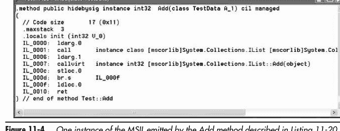

图 11-4  清单 11-20 中描述的 Add 方法发射的 MSIL 的一个实例


### 加载和执行动态程序集

我提供了几种类型的示例来演示如何加载程序集并创建这些程序集中定义的类型的实例。这里我不再重复那些信息。磁盘上的程序集与你的代码已发射到内存中的程序集之间最大的区别在于，已发射的程序集已经被加载。这正是我们的 GetClass 方法所指示的。

当 GetClass 返回时，我们内存中已经有一个程序集和类型。你只需要创建它的一个实例。Emitter.sln 示例应用程序包含一个窗体（如图 11-3 所示）。点击"Test In-Memory"按钮，将基于一个简单的 Music 类型创建一个强类型集合。这个动态集合将被绑定到 DataGrid（同样如图 11-3 所示）。

```
清单 11-23  创建和使用包含强类型 Music 集合的内存中程序集的实例

Type type = EmitTypedCollection.GetClass(
    "MusicCollection", typeof(Music));

// 测试构造
IList list = (IList)Activator.CreateInstance(type);

// 测试 Add 方法
list.Add(new Music("Charlie Pride", "16 Biggest Hits"));
list.Add(new Music("Ted Nugent", "Great Gonzo's"));

// 测试索引器
for( int i =0; i < list.Count; i++)
{
    Music m = (Music)list[i];
    Debug.WriteLine(m.Artist + ", " + m.Title);
}

// 通用测试
dataGrid1.DataSource = list;
```

清单 11-23 发射了该类型，并使用 Activator 创建了 MusicCollection 类型的一个实例。因为该类型是动态创建的，我们必须为实例使用兼容的类型 IL；但是，如果该类型被发射到磁盘，我们可以将其声明为 MusicCollection 对象。

几个 Music 对象被添加到集合中。我们使用 for 循环测试了索引器，最后，我们将列表绑定到 DataGrid 以证明它确实是一个强类型集合。（回想第 6 章的内容，强类型集合实现了 IList、IListSource 和 IEnumerable，使得类型化集合非常易于使用。）

发射动态 IL 涉及的内容很多。如果你能将其想象为 C# 代码，那么你可能就能编写一个发射器来生成该代码。对于你在 Visual Studio .NET 中输入 C# 代码时编写的构造，都提供了支持。这包括我未展示的内容，比如异常处理程序。发射是一个庞大的主题，很容易就能单独成书。在一本全面的 .NET 发射书籍出版之前，我希望我已为你提供了一个合适的入门方式。

### 次要主题

我将通过向你展示一些你可以使用反射和 IL 实现的巧妙功能来结束本章。我将保持简短，因为你已经从之前的讨论（尤其是在第 6 章）中了解了其机制。

### 反射与 Web 服务

反射被用于 Web 服务中。Web 服务序列化对象以支持从 Web 方法返回对象。返回的对象是被请求对象的扁平化版本。例如，如果你请求从 Web 方法返回一个强类型集合——比如 MusicCollection——你实际得到的是一个 Music 数组而不是实际的 MusicCollection 对象。这仍然有用，但不如获得完全重构的 MusicCollection 对象强大。（有关此主题的更多信息，请参阅第 12 章。）

.NET 如何从 Web 服务返回对象？答案是 XML 序列化和反射。这两种技术的结合支持通过像互联网这样的网络从应用程序获取聚合数据。

Web 服务、XML 序列化和反射是转向 .NET 的三个令人信服的理由。

### 实现元类惯用法

元类是类的类。或者换种说法，元类是被当作对象对待的类。.NET 不直接支持元类惯用法。（例如，Borland 的 Delphi 就支持。）但是，你可以使用反射来实现元类惯用法。

要将类用作元类，你可以将类的 Type 对象作为参数传递给方法。通过类型对象，你可以请求 Info 对象，比如 MethodInfo 对象。使用 Activator 创建类的实例，并使用 Type.InvokeMember 方法动态调用操作——瞧！——你就有了一个元类。清单 11-24 包含了一个来自 Metaclass.sln 示例程序的例子。

```
清单 11-24  将类当作对象对待，一个元类

private void CreateControl(Type type)
{
    Control control = (Control)Activator.CreateInstance(type);
    control.Text = "Dynamic";
    control.Location = new Point(10, 35 * (Controls.Count - 2));
    Controls.Add(control);
}

private void button1_Click(object sender, System.EventArgs e)
{
    CreateControl(typeof(CheckBox));
}

private void button2_Click(object sender, System.EventArgs e)
{
    CreateControl(typeof(TextBox));
}
```

在清单 11-24 中，我们将 Type 对象传递给 CreateControl。显然，一个细心的人会看到，通过传递控件的实例给 CreateControl 也可以达到相同的结果。我们正在纠正两个不足。第一个是，我们消除了 CreateControl 的使用者必须创建实例的需求，而如果我们传递 Control 类型，这正是我们必须做的。第二个不足出现在使用者不知道要创建哪种类型的时候。

在不知道类型的情况下，这在实现工厂模式时尤其有用。例如，我们可以实现一个代码生成器，它拥有一个工厂方法，能够按需创建动态控件。调用者不必知道要创建什么控件；调用者可能只知道数据。工厂模式可以检查数据的类型，并根据数据返回一个控件实例。调用者只需接受它得到的东西。

进一步完善该方法，我们可以询问所有可能的子类型，数据是否代表该子类型感兴趣的那种数据。通过使用元类惯用法，我们可以在不创建类型实例的情况下询问子类型。如何实现？通过在静态成员上使用 InvokeMember。我们可以简单地在静态方法上使用 InvokeMember，传递数据，而不是创建每个可能的子类型。如果子类型对数据感兴趣，我们就可以创建一个子类型的实例。这对于当前存在的 .NET 控件来说行不通，因为它们不是这样实现的。但是，你可以编写新代码来扮演元类的角色。

### 序列化对象

对象可以被序列化为 XML。反射在 XML 序列化中起着重要作用，因为 XML 序列化器使用反射来确定需要序列化的属性。你可以编写自定义序列化来序列化任何你想要的数据，但默认行为也表现得很好。

在清单 11-23 的最后一行，我们将一个强类型集合绑定到 DataGrid.DataSource。如果你想将一个类型化集合转换为 DataSet 并将该数据持久化到数据库中呢？XML 序列化与反射结合支持这种行为。清单 11-25 演示了如何将清单 11-23 中的 MusicCollection 直接序列化为 DataSet 中的 DataTable。

```
private void SerializeToDataSet()
{
    PrototypeCollection c = new PrototypeCollection();
    c.Add(new Prototype("Item 1"));
    c.Add(new Prototype("Item 2"));
    c.Add(new Prototype("Item 3"));

    XmlSerializer serializer =
        new XmlSerializer(typeof(PrototypeCollection));
    MemoryStream stream = new MemoryStream();
    serializer.Serialize(stream, c);
    stream.Position = 0;
    DataSet dataSet = new DataSet("Data");
    dataSet.ReadXml(stream);
    dataGrid1.DataSource = dataSet.Tables[0];
}
```

> **注意**
你可以像清单 11-25 所示的那样序列化动态程序集。将程序集写入磁盘，然后你就可以序列化程序集中的对象。

在清单 11-22 中，EmitConstructor 通过调用其构造函数直接创建了一个 ConstructorBuilder。请求了一个 ILGenerator 为发射到我们构造函数的代码创建上下文，EmitConstructorCode 编写了代码行。（这一切发生在清单 11-22 的第 1 行到第 8 行。）

与方法代码一样，我们需要发射代表我们算法的单独代码行。我们唯一明确声明的目的就是显式调用基类的构造函数。清单 11-20 的第 12 行加载了 this 指针。第 13 行获取了 CollectionBase 类的 Type 对象，它可以用来获取 Collection 类的 ConstructorInfo 对象。我们在第 18 行生成了对父构造函数的调用，并在第 19 行返回。

构造函数应该简单。构造函数的一个通用经验法则是：调用父构造函数，将参数存储到字段中，如果需要则调用 Initialize 方法。长而复杂的构造函数可能会显著减慢创建大量特定类型对象的应用程序的速度。


清单 11-25 创建了一个 `PrototypeCollection` 的实例，并向其中添加了三个元素。创建集合后，我们根据 `PrototypeCollection` 的类型创建了一个 `XmlSerializer` 的实例。要序列化一个对象，该类必须实现 `ISerializable` 或应用 `Serializable` 属性。`CollectionBase` 已应用 `Serializable` 属性，因此我们派生的集合是可序列化的。

在根据 `PrototypeCollection` 创建 `XmlSerializer` 之后，我们创建了一个 `MemoryStream` 作为接收序列化对象的载体。我们调用 `XmlSerializer.Serialize`，将集合的序列化形式写入 `MemoryStream`。最后，我们重新定位流，创建一个 `DataSet`，并从流中读取 XML 数据到 `DataSet` 中。

当清单 11-25 的最后一行完成时，`DataSet` 对象包含了 `PrototypeCollection` 的序列化形式。你可以在 `Emitter.sln` 示例应用程序中观察结果。

要使代码正常工作，有几点需要注意。你需要包含 `System.IO` 命名空间以使用 `MemoryStream`。（其他流，如 `FileStream`，也可以使用。）你需要包含 `System.Xml.Serialization` 命名空间，因为它包含 `XmlSerializer` 类。最后，你的集合对象需要有一个不接受任何参数的默认构造函数。这最后一个要求的原因是，反序列化通过调用默认构造函数来构造对象，然后使用反射和属性重新分配底层字段值。没有默认构造函数，序列化器就无法创建对象的序列化副本。（`Prototype` 和 `PrototypeCollection` 类的代码可在 `Emitter.sln` 程序集中下载获取。）

### 发射正则表达式程序集

一个已经存在并可使用的发射器是 `Regex.CompileToAssembly` 方法所代表的发射器。`CompileToAssembly` 发射一个 DLL 程序集，其中包含一个泛化 `Regex` 类的类。发射的正则表达式类包含表示你的正则表达式的初始化字符串。

我稍后将演示如何发射该程序集。正则表达式有其自己的语法，代表一种语言，尽管是一种简洁的语言（正则表达式示例见第 4 章和第 6 章）。正则表达式由构成正则表达式语言的字面量字符和元字符组成。.NET 正则表达式使用一种类似 Perl、Python、Emacs 和 Tcl 所使用的非确定性有限自动机引擎，并与 Perl 5 兼容。你也可以将正则表达式编译到程序集中，这会导致加载时间变慢但执行更快；加载程序集需要更长时间，但当编译到程序集中时，正则表达式被转换为 .NET 代码，其执行速度比由正则表达式引擎执行要快。在有限的测试案例中，我注意到编译后的正则表达式有显著的速度提升，Visual Studio .NET 帮助文档也指出情况确实如此。

你可以使用 `CompileToAssembly` 方法动态编译并将编译后的正则表达式发射到程序集中。幸运的是，有人已经编写了这个发射器，使其使用起来相对容易。清单 11-26 包含了 `EmitExpressionDemo.sln` 的部分内容，它将一个编译后的正则表达式发射到程序集。（整个示例应用程序支持在将正则表达式发射到程序集之前对其进行输入和测试。）

#### 清单 11-26 演示将编译后的正则表达式发射到程序集的代码

```csharp
private string InputString
{ get{ return textBox2.Text; }}

private string Expression
{ get{ return textBox1.Text; }}

private void Compile()
{
    RegexCompilationInfo[] CompilationInfo =
        new RegexCompilationInfo[]{
            new RegexCompilationInfo(Expression,
            RegexOptions.Compiled,
            "Regex", "CompiledExpressions", true)};

    AssemblyName assemblyName = new AssemblyName();
    assemblyName.Name = "Regex";
    Regex.CompileToAssembly(CompilationInfo, assemblyName);
}
```

要创建一个泛化 `System.Text.RegularExpressions.Regex` 类（表示不可变的正则表达式）的类，请创建一个 `RegexCompilationInfo` 对象数组和一个 `AssemblyName`，然后调用 `Regex.CompileToAssembly` 方法。将 `RegexCompilationInfo` 对象数组传递给 `CompileToAssembly`。要将正则表达式转换为 .NET 代码，请将 `RegexOptions.Compiled` 选项传递给 `RegexCompilationInfo` 构造函数。

### 总结

如果反射是汽车上的一个选项，你可能会仅仅因为反射引入的丰富功能而考虑购买一辆汽车。反射是运行时类型信息的演进，是 XML 序列化、发现类型信息、类型和成员的动态绑定以及在运行时发射代码的核心。与本章相关的有几个示例演示了这些主题。

反射的副产品之一是 `Regex` 类能够将正则表达式发射到程序集中。除了支持 Web 服务和 ADO.NET 的发射器之外，我预计将会出现一个新的小众产业，类似于 20 世纪 90 年代的组件产业，专门致力于创建和销售 .NET 发射器。

# 第三部分

# Web 应用程序 — IBUYSPY 门户

### 目标

- 学习在 C# 中实现同步和异步 Web 服务
- 学习如何实现 IBuySpy 门户的各个方面
- 学习如何创建自定义服务器和用户控件
- 探索和磨练你的 ADO.NET 技能，包括存储过程
- 了解表单和 Windows 身份验证
- 阅读代码库安全简介

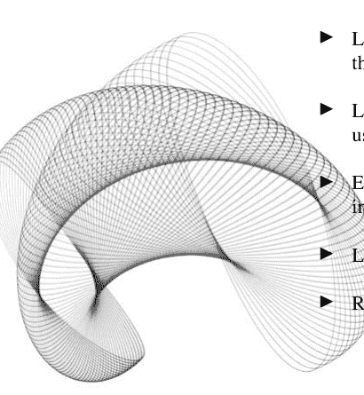

# 第 12 章

## 实现 Web 服务

**本章内容：**

### 演示主题

- Web 服务：发现与描述
- 测试 Web 服务
- 创建简单的 Web 服务
- 从 Web 服务返回复杂数据
- 从 Web 服务返回 DataSet

### 次要主题

- 总结

### 高级 C# 编程

有几种技术支持 XML Web 服务。我将在本章介绍这些技术。然而，如果你从所有这些支持实用工具和技术的角度来思考 Web 服务，你可能会认为使用 XML Web 服务很困难。没有什么比这更离谱的了。由于这些技术的存在，创建和使用 Web 服务变得更加容易。

你可能在关于 XML Web 服务的对话中听说过 XML、UDDI、WSDL、DISCO、HTTP 和 SOAP 这些缩写词。这大量的工具可能使 Web 服务看起来很复杂。我将讨论这些技术和工具在 Web 服务中的作用，但重要的是要知道这些技术和工具可以无缝地、并且在很大程度上在后台工作。如果我和你必须在能够创建 Web 服务之前掌握 XML、UDDI、WSDL 或 SOAP，那么 Web 服务将具有挑战性。幸运的是，我们不需要这样做。C# 和 Visual Studio .NET 让我们能够专注于设计解决方案和编写代码。

### 演示主题

使用 C# 和 Visual Studio .NET 编程 XML Web 服务，让你可以专注于 C# 代码。有几种技术在后台工作，因此我们也将介绍它们。在本章中，你将学习以下内容：

- WSDL、DISCO、UDDI、XML、HTTP 和 SOAP 的支持作用
- 创建、测试和使用 Web 服务
- 从 Web 服务返回复杂数据类型
- 对象序列化

对象被序列化为 XML 并通过网络传输。在很大程度上，XML 和序列化是自动进行的，无需你干预；但是，在某些情况下，你可能希望控制这些工具和序列化过程。次要部分将演示如何实现 `ISerializable` 接口并自己管理 XML 序列化。

### Web 服务：发现与描述

对 UDDI 最好的描述是我从微软国家技术团队的 Harry Pierson 那里听到的。UDDI 是 Web 服务的“黄页”。一个更长的解释源于首字母缩写 UDDI。UDDI 代表通用描述、发现与集成。有几家公司托管 UDDI 服务器。我知道的两个 UDDI 目录托管方是微软和 IBM。你可以浏览 http://uddi.microsoft.com 获取微软托管的 Web 服务列表。


### 第12章：实现Web服务

用于浏览Web服务的便捷工具是“添加Web引用”对话框，如图12-1所示。（请注意图12-1中显示的UDDI目录链接。）如果您想查找位于特定位置的Web服务，请在地址栏中输入该Web服务的URL。Web服务由 `.asmx` 文件表示。例如，如果您创建了一个名为WebService1的Web服务，取消注释为HelloWorld Web方法提供的示例代码，并编译该Web服务，您就可以在 `http://localhost/WebService1/` 浏览到它，并选择 `Service1.asmx` 文件。

`.asmx` 页面将显示在“添加Web引用”对话框中，就像我们用Internet Explorer浏览它一样。（我们可以在“添加Web引用”对话框中测试Web方法。）选择 `.asmx` 文件后，“添加引用”按钮将被启用。单击“添加引用”按钮（如图12-1所示）将Web服务集成到项目中。

UDDI使查找和使用Web服务变得容易。您真正需要的技能就是那些您用来浏览您最喜爱网站的技能。（我的一个最爱肯定是Amazon.com。）

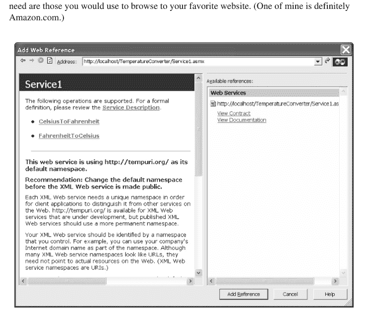

### DISCO的回归

技术人员*确实*有幽默感。Disco.exe是“添加Web引用”对话框用来创建 `.MAP` 文件、`.disco` 文件和 `.wsdl` 文件的实用程序的名称。（您也可以从Visual Studio .NET命令提示符运行disco.exe实用程序。）

> **提示**
> 选择“开始” | “程序文件” | “Microsoft Visual Studio .NET” | “Visual Studio .NET工具” | “Visual Studio .NET命令提示符”以打开一个命令窗口，该窗口已配置为方便您访问.NET框架工具。

`Reference.map` 包含对DISCO和WSDL文件的URL引用。`.disco` 文件是发现文件，`.wsdl` 文件描述了Web服务类的架构。（我们稍后将更详细地讨论WSDL文件。）清单12-1提供了一个 `Reference.map` 文件的示例。清单12-2提供了同一Web服务的DISCO文件的示例。

```
清单12-1  包含对Web服务的DISCO和WSDL文件引用的MAP文件

<?xml version="1.0" encoding="utf-8"?>
<DiscoveryClientResultsFile xmlns:xsd="http://www.w3.org/2001/XMLSchema"
    xmlns:xsi="http://www.w3.org/2001/XMLSchema-instance">
    <Results>
        <DiscoveryClientResult
            referenceType="System.Web.Services.Discovery.ContractReference"
            url="http://localhost/TemperatureConverter/Service1.asmx?wsdl"
            filename="Service1.wsdl" />
        <DiscoveryClientResult
            referenceType="System.Web.Services.Discovery.DiscoveryDocumentReference"
            url="http://localhost/TemperatureConverter/Service1.asmx?disco"
            filename="Service1.disco" />
    </Results>
</DiscoveryClientResultsFile>
```

```
清单12-2  包含对Web服务契约文件（WSDL文件）引用的DISCO文件

<?xml version="1.0" encoding="utf-8"?>
<discovery xmlns:xsd="http://www.w3.org/2001/XMLSchema"
    xmlns:xsi="http://www.w3.org/2001/XMLSchema-instance"
    xmlns="http://schemas.xmlsoap.org/disco/">
    <contractRef ref="http://localhost/TemperatureConverter/Service1.asmx?wsdl"
        docRef="http://localhost/TemperatureConverter/Service1.asmx"
        xmlns="http://schemas.xmlsoap.org/disco/scl/" />
    <soap address="http://localhost/TemperatureConverter/Service1.asmx"
        xmlns:q1="http://tempuri.org/" binding="q1:Service1Soap"
        xmlns="http://schemas.xmlsoap.org/disco/soap/" />
</discovery>
```

`.MAP` 和 `.disco` 文件都是用XML实现的，这展示了XML在.NET中使用的另一个方面。幸运的是，这些文件是由DISCO工具生成的。如果您在脑海中过滤掉XML标签，您会注意到 `.MAP` 文件包含指向生成WSDL和DISCO文件的命令的URL，以及DISCO和WSDL文件的名称。例如，您可以通过在Internet Explorer中输入Web服务的名称后跟 `?wsdl` 查询来请求WSDL。例如，要返回温度转换器的WSDL，我们可以输入 `http://localhost/TemperatureConverter/Service1.asmx?wsdl`。

> **注意**
> TemperatureConverter Web服务最初是为我在 www.codeguru.com 的VB技术笔记部分写的一篇文章实现的。您可以在那里找到代码。我在下一节中用C#重新实现了它，但并没有要求Web服务必须与您开发所用的语言相同。XML是Web服务生产者和消费者之间共享的通用语言。

### WSDL

如果您编写一个Web服务，您将知道该Web服务定义了哪些方法和类。但是，如果您使用的是外部供应商的Web服务，则必须有某种信息源来告诉您Web服务中包含什么。这包括服务提供的Web方法的签名以及这些Web方法返回的类型。

WSDL（Web服务描述语言），发音为“whiz-dul”，描述了Web服务中包含的内容，并为您提供了使用这些Web方法所需的信息。清单12-3提供了用C#实现的温度转换器的一部分，清单12-4提供了描述该Web方法的WSDL的一部分。

**清单12-3** 将温度从华氏度转换为摄氏度的Web方法

```
[WebMethod]
public double FahrenheitToCelsius(double temperature)
{
    return (temperature - 32) * 5 / 9;
}
```

我们稍后将讨论创建Web服务的步骤。从清单12-3中，您或许可以推断出，普通方法和Web方法之间一个明显的区别在于应用了 `WebMethodAttribute`。

**清单12-4** FahrenheitToCelsius Web方法WSDL文件的摘录

```
- <types>
- <s:schema elementFormDefault="qualified"
targetNamespace="http://tempuri.org/">
```

```
- <s:element name="FahrenheitToCelsius">
- <s:complexType>
- <s:sequence>
    <s:element minOccurs="1" maxOccurs="1" name="temperature" type="s:double" />
    </s:sequence>
    </s:complexType>
    </s:element>
- <s:element name="FahrenheitToCelsiusResponse">
- <s:complexType>
- <s:sequence>
    <s:element minOccurs="1" maxOccurs="1" name="FahrenheitToCelsiusResult"
    type="s:double" />
    </s:sequence>
    </s:complexType>
    </s:element>
    <s:element name="double" type="s:double" />
    </s:schema>
    </types>
```

XML表明有一个名为 `FahrenheitToCelsius` 的元素，它接受一个名为 *temperature* 的参数（一个 `double`）。第二个元素名称标签描述了方法响应，名为 `FahrenheitToCelsiusResponse`。`FahrenheitToCelsiusResponse` 有一个名为 `FahrenheitToCelsiusResult` 的返回值，它也是一个 `double`。

当我们在应用程序中使用Web方法时，我们像清单12-3所示那样调用它。所有用于描述Web服务的XML对消费者来说都是隐藏的。当您添加对Web服务的引用时，会创建一个代理类。您可以创建Web服务类的实例并调用Web方法，就像Web服务类包含在使用应用程序中一样。

### 使用Web服务

要使用Web服务，请从“项目”菜单或“解决方案资源管理器”的上下文菜单中选择“添加Web引用”。使用“添加Web引用”对话框浏览到UDDI目录服务或包含您要链接的服务的网站。

图12-2显示了添加到TestConvertTemperature.csproj的ConvertTemperature Web服务（Web服务和测试应用程序均可供下载）。主机名被添加到Web引用文件夹中，并充当命名空间的角色。例如，要引用Web服务类，我们可以在包含Web服务的模块中添加一个 *using* 语句，或者我们可以使用Web服务类的完全限定路径。清单12-5包含一个控制台应用程序的代码，演示如何创建ConvertTemperature Web服务的实例。

**清单12-5** 使用ConvertTemperature Web服务

```
using System;
using Service = TestConvertTemperature.localhost;
```

namespace TestConvertTemperature
{
    class Class1
    {
        [STAThread]
        static void Main(string[] args)
        {
            Service.Convert convert = new Service.Convert();
            Console.WriteLine(convert.FahrenheitToCelsius(32));
            Console.ReadLine();
        }
    }
}

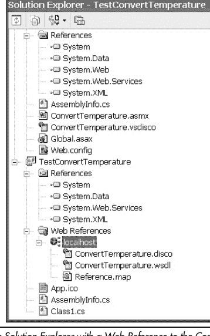

图 12-2 解决方案资源管理器，其中显示了对 ConvertTemperature Web 服务的 Web 引用

#### 提示

我使用了 `using 语句的别名 = 命名空间` 形式，将代理类的命名空间缩短为一个别名 `Service`。

清单 12-5 展示了如何引用由主机派生的命名空间 `TestConvertTemperature.localhost`。然而，`System` 命名空间也包含 `Convert` 类，因此我们可以通过使用完全限定名来声明 `Convert` 类以解决此歧义。请注意，在我们的代码中，`Convert` 类看起来就像定义在本地程序集中一样。

对于程序员来说，这是 XML Web 服务强大功能和简便性的一个例子。所有的技术和工具都在后台默默工作，使 Web 服务看起来就像任何程序集中的任何类一样。在后台，HTTP 或 SOAP 以及 XML 正被静默地用于跨网络编组调用。（当然，在我们的示例中，网络就是我的笔记本电脑。）

当你引入一个 Web 服务时，会创建一个代理类。使用 Visual Studio .NET 时，你不必为此担心，但你可以使用 `wsdl.exe` 工具生成代理源代码以查看其外观。运行 `wsdl.exe` 工具，并将 Web 服务的 URL 传递给 WSDL 工具。例如，在我的笔记本电脑上——PC 和笔记本电脑是测试 Web 服务的绝佳场所——我可以使用以下命令行为 ConvertTemperature Web 服务生成代理文件：

```
wsdl http://localhost/ConvertTemperature/ConvertTemperature.asmx
```

生成的 `Convert.cs` 模块——`Convert` 是包含清单 12-3 中 Web 方法的 Web 服务类的名称——包含一个名为 `Convert` 的类，该类继承自 `System.Web.Services.Protocols.SoapHttpClientProtocol`，一个构造函数和三个方法。代理方法 `FahrenheitToCelsius` 使用同步调用 `SoapHttpClientProtocol.Invoke` 方法来调用 Web 服务。另外两个方法支持异步 Web 方法调用。

同样，重要的是要知道代理类是使用 WSDL 创建的，但这些事情是自动发生的。对于一般情况，你可以简单地添加一个 Web 引用并创建一个 Web 服务的实例，就好像它是项目所引用程序集中的一个类一样。

### 回顾 Web 服务线路格式

Web 服务有三种线路格式：HTTP GET、HTTP POST 和 SOAP。HTTP GET 使用名称/值对编码 URL。例如，我们可以使用一个 HTTP GET URL 编码地址来调用 Web 服务：

```
http://localhost/converttemperature/ConvertTemperature.asmx/
FahrenheitToCelsius?temperature=32
```

HTTP POST 使用名称/值对编码，但参数被编码在消息的头部。SOAP 消息被编码为 XML。如果你好奇，可以导航到命令页面查看 SOAP、HTTP GET 和 HTTP POST 消息及响应的示例。

```
http://localhost/converttemperature/ConvertTemperature.asmx?op=FahrenheitToCelsius
```

如果你发送一条 HTTP GET 消息（如本节第一个示例所示），并将结果与 HTTP GET 响应编码进行比较，你将看到响应编码描述了 Web 服务响应的格式。清单 12-6 显示了 HTTP GET 响应的格式以及来自 `FahrenheitToCelsius` Web 服务的实际响应。

清单 12-6 *HTTP GET 请求和响应格式，摘自 .asmx 页面*

```
GET
/converttemperature/ConvertTemperature.asmx/FahrenheitToCelsius?temperature=string

<?xml version="1.0" encoding="utf-8"?>
<double xmlns="http://tempuri.org/">double</double>
```

第一条语句演示了 HTTP GET 消息的语法，其余语句演示了响应文本。实际的响应将用具体的数值替换单词 "double"。再次强调，这是 Web 服务技术的支撑信息。当我们将 Web 服务作为应用程序的一部分来使用时，消息请求和响应格式对我们是隐藏的。

### 测试 Web 服务

测试 Web 服务有几种方法。你可以使用 Visual Studio .NET 中的集成调试器来测试 Web 服务。你可以使用“生成并浏览”方法，运行 Web 服务应用程序，并在浏览到 Web 服务 `.asmx` 页面生成的测试页中输入数据。或者，你可以在 IDE 外部浏览到 Web 服务，并使用 HTTP GET 编码的 URL 来调用 Web 方法。（作为替代方案，你也可以在 HTML 文档中使用 HTTP POST 消息来调用 Web 服务。）

在 Visual Studio .NET 中进行集成调试是测试 Web 服务最方便的方法。在 `.asmx.cs` 源文件中包含你想要测试的代码处设置断点，然后生成并运行 Web 服务应用程序。当 Web 服务被调用并触发你的断点时，调试器将把代码视图切换到 Visual Studio .NET，你就可以像调试任何其他程序集一样单步执行你的代码并进行调试。（归根结底，Web 服务是一个 DLL 程序集，可以像对待 DLL 程序集一样进行测试。）

### 创建简单的 Web 服务

要在你的 PC 上创建 Web 服务，你需要连接到可以访问 IIS 服务器的网络，或者你的 PC 上安装了 IIS。可以通过在“新建项目”对话框中选择“ASP.NET Web 服务”小应用程序来完成项目的创建。向导引擎将从 `CSharpAddWebServiceWiz` 向导模板创建一个 Web 服务项目。表 12-1 描述了将添加到你的 Web 服务中的文件，以及这些文件在 Web 服务中扮演的角色。

所有这些文件可能看起来有点令人生畏，但你可以通过向 `.asmx.cs` 文件添加公共方法并用 `WebMethodAttribute` 标记这些方法来实现一个 Web 服务。你在第 2 章已经学习了如何向 `AssemblyInfo.cs` 文件添加元数据。`Web.config` 可以被修改以启用跟踪或 Cookie 支持，`Global.asax` 文件可以被修改以响应应用程序级别的事件。

应用程序级别包含一个继承自 `System.Web.HttpApplication` 的 `Global` 类。`HttpApplication` 的事件和方法可以在 Visual Studio .NET 帮助文档中深入了解。

### 返回简单数据

最容易创建的 Web 服务是返回简单数据（如 double）的类型，如 ConvertTemperature Web 服务所示。我们将查看创建简单 Web 服务的过程，包括指定命名空间、添加描述以及处理 Web 服务异常。幸运的是，我们可以从 Web 服务返回复杂类型，我们将在下一节中看到。

要创建 Web 服务，请在“新建项目”对话框中创建一个新的 ASP.NET Web 服务项目。Web 服务项目将创建在 `c:\inetpub\wwwroot\webservicename` 中。如果你使用 `localhost` 主机名创建项目，此目录将位于你的 PC 上。`.asmx.cs` 后置代码文件将包含一个名为 `Service1`（默认）或某些变体的类。该类将继承自 `System.Web.Services.WebService`。正是这种继承使得解决方案成为一个 Web 服务。为了提供一些行为，你需要定义一个应用了 `WebMethodAttribute` 的公共方法。

你可以根据需要拥有任意数量的 Web 方法和支持方法。Web 服务的一个良好模型是：实现一个解决方案，然后实现一个 Web 服务和 Web 方法，以公开解决方案中消费者可能想要的方面。与面向对象编程的普遍原则一样，如果你保持公共 Web 方法的数量和种类较少，你的 Web 服务将更容易使用。提供的 Web 方法太少，你的 Web 服务可能不够吸引人。值得高兴的是，.NET 的 Web 服务技术使我们能够专注于解决方案，而不必处理技术细节。

清单 12-7 中的代码将使用埃拉托斯特尼筛法的近似值来确定一个数字是否是质数。清单如下，后面是代码摘要。

```
1:  using System;
2:  using System.Collections;
3:  using System.ComponentModel;
4:  using System.Data;
5:  using System.Diagnostics;
6:  using System.Web;
7:  using System.Web.Services;
8: 
9:  namespace Primes
10: {
11:    [WebService(Namespace="http://www.softconcepts.com",
12:    Description="Calculate primes using the Sieve of Eratosthenes")]
13:    public class Primes : System.Web.Services.WebService
14:    {
15:      public Primes()
16:      {
17:        //CODEGEN: This call is required by the
18:        //ASP.NET Web Services Designer
19:        InitializeComponent();
20:      }
21: 
22:      [region Component Designer generated code]
```

| 文件名/扩展名 | 描述 |
|---|---|
| .dll | 编译为 DLL 的 Web 服务程序集 |
| .pdb | 包含符号调试信息 |
| .sln | Web 服务解决方案文件 |
| .csproj | Web 服务项目文件 |
| .csproj.webinfo | 包含服务器或 PC 上的项目路径 |
| AssemblyInfo.cs | 包含项目的程序集元数据 |
| .asmx | 包含 Web 服务处理指令；用作 Web 服务的入口点 |
| .asmx.cs | Web 服务的后置代码文件。你的 Web 方法在此处编码，并与 .asmx 和 .asmx.resx 文件配对 |
| .asmx.resx | 资源文件 |
| .vsdisco | 发现文件，描述 Web 服务的可搜索路径 |
| Global.asax | 包含应用程序级别的事件处理程序 |
| Global.asax.cs | 应用程序级别事件的后置代码页面 |
| Web.config | ASP.NET 应用程序的配置信息 |

表 12-1 ASP.NET Web 服务的项目文件


## 高级C#编程

```csharp
[WebMethod]
public long[] PrimesTo(long max)
{
    return (new PrimeEngine(max)).Primes;
}

[WebMethod]
public bool IsPrime(long number)
{
    return (new PrimeEngine(number)).IsPrime(number);
}
}

class PrimeEngine
{
    private ArrayList primes;

    /// <summary>
    /// 使用'埃拉托斯特尼筛法'的近似方法
    /// 计算到max为止的质数
    /// </summary>
    public PrimeEngine(long max)
    {
        primes = new ArrayList();
        primes.Add(2L);
        BuildPrimes(max);
    }

    private bool TestPrime(long number)
    {
        foreach (long l in Primes)
        {
            if (number % l == 0) return false;
            if (l >= Math.Sqrt(number)) return true;
        }

        return true;
    }

    public void BuildPrimes(long max)
    {
        if (max < 3) return;

        for (long i = 3; i <= max; i++)
        {
            if (TestPrime(i)) primes.Add((long)i);
        }
    }

    public bool IsPrime(long number)
    {
        return primes.IndexOf(number) > -1;
    }

    public long[] Primes
    {
        get { return (long[])primes.ToArray(typeof(long)); }
    }
}
```

> **注意**
> 计算大质数非常耗时。对于非常大的质数，埃拉托斯特尼筛法会极其缓慢。由于大质数的计算需要时间，它们非常适合用于加密。基本思路是，等到信息窃贼解出一个大质数时，利用该数据的时机早已过去。

Web服务类 `Primes` 暴露了 `PrimeEngine` 的功能。Web服务允许消费者查询一个数是否为质数，并会返回一个从长整数到指定最大值的数组。基于清单12-7中的实现，计算非常大的质数将会很慢。

所有整数都是质数的乘积。质数是只能被自身和1整除的数。埃拉托斯特尼是大约二千二百年前亚历山大城一位受尊敬的学者和图书馆管理员。埃拉托斯特尼确定，可以通过检查一个数是否能被所有小于该候选数平方根的质数来计算质数。（我们只需要检查到平方根，因为如果一个大于平方根的数是除数，那么一个小于平方根的数也必然是除数。）

如果我们用第一个质数2来初始化质数数组，那么我们就可以用2来计算2和候选数之间的所有质数。`PrimeEngine` 构造函数用已知的最小质数2初始化数组，并计算出到最大值 `max` 的所有质数。（我们不会计算比所需更多的质数，因为对于巨大的质数，使用埃拉托斯特尼算法计算大质数会很慢。）`BuildPrimes` 在第65到73行检查3和最大值之间的所有整数。`TestPrime`——在清单12-7的第54到63行——遍历所有已计算出的小于该数的质数。如果这个数能被其中一个质数整除，那么这个候选数就不是质数，我们在第58行返回false。如果我们遇到一个大于或等于候选数平方根的数，那么我们就找到了一个质数，可以停止测试了。

我倾向于将解决方案实现为类。这样，如果我想将解决方案暴露给特定类型的消费者，我就可以基于现有类来实现解决方案。例如，与其在Web方法中实现解决方案，我更倾向于基于一个解决通用问题的类来实现。因此，该解决方案可以暴露给多种消费者。值得注意的是，你可以添加对Web服务DLL的引用，创建 `WebService` 派生类的实例，并直接调用方法。从根本上说，`WebService` 就是一个类，可以像使用任何其他类一样使用和对待它，前提是你能访问到物理DLL。

### 提供命名空间和描述

Web服务类必须是唯一的。命名空间用于唯一地描述Web服务。当你在测试你的Web服务时，可以使用默认的 `tempuri.org`。在部署Web服务之前，你可以将 `WebServiceAttribute` 应用到Web服务类上，提供命名参数值用于命名空间，以及一个描述，让消费者知道Web服务的功能。清单12-7中的第11和12行演示了如何使用 `WebServiceAttribute`。（有关命名参数和自定义属性的更多信息，请参阅第10章。）

### 处理Web服务异常

你可以处理或抛出Web服务的异常。消费者实际上会收到一个 `SoapException`。`SoapException` 类会包含指示底层异常的内容，但异常的类将是 `SoapException`。要处理从Web服务抛出的异常，请使用 `catch` 块或指定 `SoapException` 的 `catch` 块。这是一个处理 `SoapException` 的 `try` `catch` 块的语法示例。

```csharp
try
{
    // 调用Web方法
}
catch (SoapException x)
{
    // 处理异常
}
```

如果你想在Web服务代码中抛出一个异常，你可以抛出一个特定类别的异常，它将被转换为 `SoapException`。例如，如果消费者向 `Primes` Web服务传递一个小于2的数，我们可以抛出一个 `ArgumentException`。以下两个方法可以添加到清单12-7的Web服务中，为无效参数抛出异常。

```csharp
private void ThrowException(long number)
{
    const string error = "Number ({0}) must be an integer greater than 2";
    throw new ArgumentException(string.Format(error, number));
}

private void Validate(long number)
{
    if (number < 2) ThrowException(number);
}
```

当消费者收到Web服务异常时，你可以尝试根据 `SoapException` 的内容将其转换为特定的异常，但这似乎是一项不必要的操作。使用异常内容来提供错误处理程序或通知Web服务的提供者有关错误的信息。

### 异步调用Web服务

有两种方式可以调用Web方法。第一种是同步调用Web方法：调用Web方法并等待响应返回。第二种方式是调用Web方法，执行一些其他处理，并在稍后处理来自Web方法的响应。这第二种方式被称为 *异步处理*。.NET支持框架的大部分异步处理，包括Windows窗体、ASP.NET Web窗体以及ASP.NET Web服务等方面。

当你添加对Web服务的引用时，`wsdl.exe` 工具会生成一个代理类。在代理类内部，对于你的Web服务中的每个Web方法，都有两个方法，`BeginXXX` 和 `EndXXX`。例如，我们的 `IsPrime` 方法将由一个同步方法 `IsPrime` 和一对异步方法 `BeginIsPrime` 和 `EndIsPrime` 表示。后两个方法是对 `SoapHttpClientProtocol.BeginInvoke` 和 `SoapHttpClientProtocol.EndInvoke` 异步方法的封装。通过使用异步方法，你可以调用Web方法上的操作，执行一些额外的处理，并在数据准备好时异步处理结果。清单12-8演示了一个异步调用 `IsPrime` Web方法的控制台应用程序客户端。通过这种方式，同一个客户端可以向 `IsPrime` 发送多个请求，并在结果可用时显示它们。

```csharp
// 清单12-8：异步调用Web服务
using System;
using TestPrimes.localhost;

namespace TestPrimes
{
    class Class1
    {
        [STAThread]
        static void Main(string[] args)
        {
            TestAsynch();

            Console.WriteLine("Press any key...");
        }
    }
}
```


### 386 高级 C# 编程

```csharp
15:       Console.ReadLine();
16:     }
17:
18:
19:     private static void TestAsynch()
20:     {
21:       while(true)
22:       {
23:         Console.WriteLine("Enter a number (Q=Quit):");
24:         string value = Console.ReadLine();
25:         if( value.ToUpper() == "Q" ) return;
26:         try
27:         {
28:           TestPrime(Convert.ToInt64(value));
29:         }
30:         catch
31:         {
32:           Console.WriteLine(value.ToString() + " is not a number");
33:         }
34:       }
35:     }
36:
37:
38:     private class Data
39:     {
40:       public long number;
41:       public DateTime dateTime;
42:
43:       public Data(long number)
44:       {
45:         this.number = number;
46:         dateTime = DateTime.Now;
47:       }
48:
49:       public TimeSpan Elapsed()
50:       {
51:         return DateTime.Now.Subtract(dateTime);
52:       }
53:     }
54:
55:     private static void TestPrime(long prime)
56:     {
57:       IAsyncResult result =
58:       p.BeginIsPrime(prime, new AsyncCallback(Class1.Callback),
59:       new Data(prime));
60:    }
61:
62:    static Primes p = new Primes();
63:    private static void Callback(IAsyncResult result)
64:    {
65:        if( result.IsCompleted )
66:            WriteResult(result);
67:    }
68:
69:    private static void WriteResult(IAsyncResult result)
70:    {
71:        WriteResult((Data)result.AsyncState, p.EndIsPrime(result));
72:    }
73:
74:    private static void WriteResult( Data data, bool isPrime)
75:    {
76:        const string mask = "{0} {1} prime";
77:        Console.WriteLine(string.Format(mask, data.number,
78:            new string[]{"is not", "is"}[Convert.ToInt16(isPrime)]));
79:        Console.WriteLine("Calculated in " + data.Elapsed());
80:    }
81: }
82: }
```

> 使用 `static` 修饰符与解决方案本身无关。使用静态方法是为了方便。唯一的区别是，如果不使用静态方法，我就必须创建 `Class1` 的实例。使用实例方法既不会增加也不会削弱示例的效果。

代码清单 12-8 的第 19 至 35 行实现了一个代表简单用户界面的 `while` 循环。输入一个数字来测试其是否为素数，或者输入 Q 退出。`TestPrime` 在第 55 至 60 行实现。因为 `TestPrime` 通过调用 `BeginIsPrime` 来异步调用 Web 方法 `IsPrime`，所以它会立即返回。

调用异步方法时需要传递一个 `AsyncCallback` 委托。包装器 `BeginIsPrime` 接受要测试的数字、`AsyncCallback` 委托，以及一个可选的第三个参数，用于向 `AsyncCallback` 委托传递数据。在我们的示例中，我们传递了一个内部类 `Data` 的实例。`Data` 存储了被测试的数字和一个初始时间戳。（我们可以使用初始时间戳来计算已用时间。）`Data` 类演示了嵌套类的习惯用法以及如何向异步委托传递复杂数据。

回调方法被命名为 `Callback` 是为了便于查找。（我们之所以必须使用类名 `Class1`，仅仅是因为回调是静态的。）`TestPrime` 会立即返回。当委托 `Callback` 被调用时，我们就知道异步数据已经准备就绪。`Callback` 在代码清单 12-8 的第 64 行测试 `IAsyncResult` 参数，以确保方法已完成。如果异步调用完成，我们就用重载的 `WriteResult` 方法将 `IsPrime` 方法的结果写入控制台。

我们本可以为这个异步示例创建任何用户界面。关键点在于，我们使用了 `BeginInvoke` 和 `EndInvoke` 的包装器方法，并且当异步数据通过委托准备就绪时，我们使用 `EndInvoke` 方法来获取数据。无论是使用 Windows 窗体、Web 窗体，还是通过其他用户界面实现异步 Web 方法，异步方法的基本用法都是一致的。

你可以使用从 `BeginInvoke`（在我们的例子中是 `BeginIsPrime`，即 `BeginInvoke` 的包装器）返回的 `IAsyncResult` 对象，并通过 `AsyncWaitHandle` 属性获取一个 `WaitHandle`。`WaitHandle` 可以通过调用 `WaitHandle.WaitOne`、`WaitHandle.WaitAll` 或 `WaitHandle.WaitAny` 来进行阻塞。如果你调用 `EndInvoke`，你的代码也会阻塞。

结合目前讨论的技术，你可以在循环中测试 `IAsyncResult.IsCompleted`，使用 `WaitHandle`，或者使用 `EndInvoke`（在我们的例子中是 `EndIsPrime`）来阻塞，直到异步方法调用返回。例如，你可以调用 `BeginInvoke`，执行一些其他操作，然后调用 `EndInvoke` 来阻塞，直到异步调用返回。

### 从 Web 服务返回复杂数据

你可以从 Web 服务返回简单数据，更重要的是，你也可以从 Web 服务返回复杂数据。Web 服务会为在 Web 服务中定义的类创建一个代理类型。该代理类型会“扁平化”原始类型，将属性转换为公共字段，并为你提供一个等效的、仅包含数据的记录，其中包含原始对象的值。

> **提示**

*SOAP 协议支持从 Web 服务返回复杂数据类型。如果你使用 HTTP GET 或 HTTP POST 协议，你就只能使用简单的名称-值对数据。*

例如，假设你有一个 Web 服务，它返回一个职业运动队的基本统计数据。你可能会将队名、所在城市、所在州以及比赛统计数据存储在 Web 服务中，并提供一些基本操作。我们可以将这个类命名为“Team”。包含在 Web 服务中的类将是一个完整构成的 `Team` 对象，但是，当你从 Web 服务返回 `Team` 对象时，它看起来会是扁平的。代码清单 12-9 包含一个 Web 服务以及 `Team` 类。代码清单 12-10 展示了在 `wsdl.exe` 工具为 `Team` 类生成代理类之后，`Team` 类会是什么样子。（我使用了 `sproxy.exe` 来手动生成当你添加 Web 引用时会自动生成的 Team 代理。）

```csharp
代码清单 12-9  一个 Web 服务以及 Web 服务中定义的代表运动队信息的类

1:  using System;
2:  using System.Collections;
3:  using System.ComponentModel;
4:  using System.Data;
5:  using System.Diagnostics;
6:  using System.Web;
7:  using System.Web.Services;
8:
9:  namespace ComplexDataDemo
10: {
11:   public class Service1 : System.Web.Services.WebService
12:   {
13:     public Service1()
14:     {
15:       //CODEGEN: Required by the ASP.NET Web Services Designer
16:       InitializeComponent();
17:     }
18:
19:     [Component Designer generated code]
20:
21:
22:     [WebMethod]
23:     public Team CreateTeam(string name)
24:     {
25:       return new Team(name);
26:     }
27:
28:   }
29:
30:   public class Team
31:   {
32:     private string name;
33:     private string city;
34:     private string state;
35:     private bool isProfessional;
36:     private string sport;
37:     private int season;
38:     private int wins;
39:     private int losses;
40:     private int ties;
41:
42:     public Team(){}
43:     public Team(string name)
44:     {
45:       this.name = name;
46:     }
47:
48:     public string Name
49:     {
50:         get{ return name; }
51:         set{ name = value; }
52:     }
53:
54:     public string City
55:     {
56:         get{ return city; }
57:         set{ city = value; }
58:     }
59:
60:     public string State
61:     {
62:         get{ return state; }
63:         set{ state = value; }
64:     }
65:
66:     public bool IsProfessional
67:     {
68:         get{ return isProfessional; }
69:         set{ isProfessional = value; }
70:     }
71:
72:     public string Sport
73:     {
74:         get{ return sport; }
75:         set{ sport = value; }
76:     }
77:
78:     public int Season
79:     {
80:         get{ return season; }
81:         set{ season = value; }
82:     }
83:
84:     public int Wins
85:     {
86:         get{ return wins; }
87:         set{ wins = value; }
88:     }
89:     // ... (其余属性将继续在此处)
```

### 从 Web 服务返回 DataSet

从 Web 服务返回数据的一个极佳方式是返回 DataSet。在 Web 服务的两侧——服务端和客户端——DataSet 都是一个完整的对象。这意味着你可以返回一个包含多个表、表间关系和映射关系的 DataSet。第 5 章讨论了 ADO.NET 和 DataSet；第 5 章的“从 Web 服务返回 DataSet”一节演示了如何从 Web 服务返回 DataSet。第 11 章的“序列化对象”一节演示了如何将对象序列化为 DataSet。这两节都提供了额外的 Web 服务示例。

DataSet 由 Microsoft 编码设计，旨在无需程序员干预即可被 Web 服务使用。DataSet 使用 DiffGram 来序列化 DataSet 中行的原始值和当前值。Web 服务消费者无需担心 DataSet 的序列化和反序列化；DataSet 可以在 Web 服务边界上被完全重构。

Web 服务可以使用 DataSet。简单来说，这意味着如果你将一个 DataSet 传递给 Web 服务或从 Web 服务返回一个 DataSet，那么你将得到一个 `System.Data.DataSet` 对象。如果你在 Web 服务中使用自定义类，那么你将得到一个扁平化的类（参见清单 12-9 和清单 12-10）。例如，清单 12-9 中的 Team 类在从 Web 服务返回时，被扁平化成了清单 12-10 中的 Team 类。

有趣的是，如果我在清单 12-9 的 Web 服务中添加一个引用，我可以修改 Reference.cs 代理文件。通过移除清单 12-10 中扁平化的 Team 类版本，并添加一个 *using* 语句引用包含真实 Team 的程序集，Web 服务将返回一个完全初始化的 Team 版本，包括其方法。

我不知道答案，但 DataSets 之所以能作为对象被使用，似乎仅仅是因为在 Reference.cs wsdl 生成文件中引用了 `System.Data`。不幸的是，手动更改 Reference.cs 文件（在示例中，移除生成的 Team 类并添加 *using* 语句和对 Teams.dll 程序集的引用）不太具有可扩展性，因为任何时候更新 Web 引用时，Reference.cs 文件都会被重新生成。

### 次要主题

对象可以序列化为 XML 文档，或二进制或 SOAP 格式。你可以使用 `XmlSerializer` 类将对象转换为 XML 文档，也可以使用 `Serializable` 属性来支持序列化为二进制或 SOAP 格式。你也可以实现 `System.Runtime.Serialization.ISerializable` 接口，以便在使用 SOAP 或二进制格式化程序时控制序列化过程。

第 11 章的“序列化对象”一节演示了如何使用 `XmlSerializer`。在本节中，我将演示如何使用 `SoapFormatter` 序列化对象，以及如何实现 `ISerializable` 接口以允许你手动控制 `BinaryFormatter` 和 `SoapFormatter` 如何序列化对象。

### 使用 SoapFormatter

`SoapFormatter` 会将对象格式化为 SOAP 文档。`SoapFormatter` 类实现了 `System.Runtime.Remoting.Messaging.IRemotingFormatter` 接口。我们可以将 `SoapFormatter` 声明为 `IRemotingFormatter`，并像在第 11 章中使用 `XmlSerializer` 那样序列化一个对象。清单 12-11 演示了如何将 Team 类序列化为 SOAP 文档。

```
// include these additional namespaces
using System.Runtime.Remoting.Messaging;
using System.Runtime.Serialization.Formatters.Soap;
using System.IO;

public void SerializeToSoap()
{
    Teams.Team team = new Teams.Team("Red Wings");
    team.IsProfessional = true;
    team.City = "Detroit";
    team.State = "Michigan";
    team.Sport = "Hockey";

    IRemotingFormatter formatter = new SoapFormatter();
    MemoryStream stream = new MemoryStream();
    formatter.Serialize(stream, team);
    stream.Position = 0;
    textBox1.Text =
        System.Text.ASCIIEncoding.ASCII.GetString(stream.ToArray());
}
```

（清单 12-11 中的示例可以在 ComplexDataDemo.csproj 示例程序中找到。）在这里，我们直接创建了一个 Team 类的实例（该类位于 Teams.csproj 项目中）。我们创建了 `SoapFormatter` 和一个 `MemoryStream` 的实例。（`MemoryStream` 定义在 `System.IO` 中。）我们指示格式化程序将对象序列化到流中，重新定位流，并使用 `System.Text.ASCIIEncoding.ASCII.GetString` 方法将流转换为字符串。

我们可以调用 `stream.ToArray` 返回一个字节数组（`byte[ ]`），而 `ASCII.GetString` 方法可以将字节转换为 ASCII 字符串。当最后一条语句运行时，该对象将显示为一条 SOAP 消息，如图 12-3 所示。

应用于 Team 类的 `System.SerializableAttribute` 允许 `SoapFormatter` 和 `BinaryFormatter` 序列化 Team 类。（这是原始的 Team 类，而不是 Web 服务返回的 Team 类。）如果你想手动控制序列化过程，可以结合 `Serializable` 属性实现 `ISerializable` 接口。

### 实现 ISerializable 接口

`System.Runtime.Serialization.ISerializable` 要求你实现一个 `GetObjectData` 方法以支持使用 `BinaryFormatter` 或 `SoapFormatter` 序列化对象，并实现一个受保护的构造函数（该构造函数接受与 `GetObjectData` 相同的参数），以支持使用 `BinaryFormatter` 和 `SoapFormatter` 反序列化对象。

清单 12-12 中展示的修改演示了如何为 Teams.csproj 中定义的 Team 类实现 `ISerializable`。Team 代码的其余部分如清单 12-9 所示。

清单 12-12 实现 ISerializable 以支持 SOAP 和二进制序列化

```
using System;
using System.Runtime.Serialization;
using System.Diagnostics;

namespace Teams
{
    [Serializable]
    public class Team : ISerializable
    {
        // Original code from listing 12-9 goes here.
        protected Team(SerializationInfo info,
            StreamingContext context)
```

#### 394 高级 C# 编程

```


### 396 高级 C# 编程

```csharp
{
    name = (string)info.GetValue("name", typeof(string));
    city = (string)info.GetValue("city", typeof(string));
    state = (string)info.GetValue("state", typeof(string));
    isProfessional = (bool)info.GetValue("isProfessional", typeof(bool));
    sport = (string)info.GetValue("sport", typeof(string));
    season = (int)info.GetValue("season", typeof(int));
    wins = (int)info.GetValue("wins", typeof(int));
    losses = (int)info.GetValue("losses", typeof(int));
    ties = (int)info.GetValue("ties", typeof(int));

    DateTime dateTime = (DateTime)info.GetValue("DateTime",
        typeof(DateTime));
    Debug.WriteLine("Serialized at: " + dateTime.ToString());
    Debug.WriteLine("Deserialized at: " + DateTime.Now.ToString());
}
```

```csharp
public void GetObjectData(SerializationInfo info,
    StreamingContext context)
{
    info.AddValue("name", name);
    info.AddValue("city", city);
    info.AddValue("state", state);
    info.AddValue("isProfessional", isProfessional);
    info.AddValue("sport", sport);
    info.AddValue("season", season);
    info.AddValue("wins", wins);
    info.AddValue("losses", losses);
    info.AddValue("ties", ties);
    info.AddValue("DateTime", DateTime.Now);
    Debug.WriteLine("Serialized at: " + DateTime.Now.ToString());
}
}
}
```

`ISerializable` 的基本实现在你调用 `SoapFormatter.Serialize` 或 `BinaryFormatter.Serialize` 时会调用 `GetObjectData`。`GetObjectData` 会将你想要序列化的字段值写入 `SerializationInfo` 对象。该构造函数允许调用者通过一个 `SerializationInfo` 对象来初始化对象实例——在本例中是 `Team`。

如果你只需要写入由公共属性表示的成员，则无需实现 `ISerializable`。为了演示，我们的 `ISerializable` 实现添加了一个 `DateTime` 值，用于指示对象的序列化和反序列化时间。`ISerializable` 的实际用途是序列化构成对象状态的数据，这些数据可能存储在没有关联公共属性的私有字段中。

`StreamingContext` 对象包含有关传输数据的来源或目的地的信息。例如，你可以检查 `context.State == StreamingContextStates.CrossMachine` 以确定上下文是否在不同的计算机上。

有关使用 `SoapFormatter` 或 `BinaryFormatter` 的更多信息，请查阅 Visual Studio .NET 帮助文档中关于 .NET Remoting 的信息。Remoting 是 .NET 支持不同操作系统进程之间通信的另一种方式，可在相同或不同的计算机上运行，是 Microsoft DCOM 技术的非专有替代品。

### 总结

我至少读过一篇文章和一本书，其中提到 Microsoft 的 Web 服务“尚未准备好用于生产环境”，或者围绕 Web 服务存在许多炒作而缺乏实质内容。没有什么比这更偏离事实的了。

在本章中，我演示了如何从 Web 服务返回简单和复杂的数据。显然，XML 和 SOAP 的开放标准意味着这不是仅限 Microsoft 的技术，而且同样清楚的是，我们可以发出 Web 服务能够满足的请求，并获取高级数据类型。这些操作可以同步和异步执行。

到目前为止，我发现唯一的困难是返回我所说的“完全重构的对象”。当返回自定义对象时，默认行为是将对象扁平化为仅包含字段的浅层图像，该图像代表了驻留在 Web 服务中的实际对象。（在本章前面的一个注释中，我描述了一种绕过这个看似有限的限制的方法——尽管这种行为是代表限制还是必要性尚存疑问。当从 Web 服务返回类型时，显然无法保证该类型或其任何子类型存在于客户端机器上。）我的猜测是，感知的限制和过度炒作的印象可能是由于对支持 Web 服务的一些核心技术的理解不足造成的。.NET 包含的内容很多，可能还需要一段时间才能让广大开发者既有广度又有深度地理解它。

我确实相信开放标准（XML 和 SOAP）优于专有标准（DCOM），并且 XML Web 服务是系统和跨网络之间共享数据的一种强大且引人注目的手段。

本页有意留白。

# 第 13 章

## IBuySpy 与 ASP.NET 中的动态用户界面


**本章内容：**

* 演示主题
* 创建层叠样式表
* 实现门户横幅
* 次要主题
* 管理门户
* 调试 IBUYSPY 门户
* 介绍移动模块
* 总结

本书的这一部分意义重大，因为接下来的四章包含了 Microsoft 特别许可的 IBuySpy 门户示例应用程序中的示例。IBuySpy.com（参见下方徽标）是一个在线 Web 商店应用程序，销售幽默的虚构间谍用品。更重要的是，它是一个完整的工作 Web 应用程序，采用 Microsoft 的 ASP.NET 并演示了 Visual Basic .NET、C#、安全性和 Microsoft 的移动互联网工具包，从而为开发者开辟了道路。你可以下载、视觉自定义（使用管理工具）或以编程方式自定义门户应用程序，借鉴生产质量代码中展示的实际示例和最佳实践。


整个 IBuySpy 门户可以从 **www.ibuyspy.com** 下载。这包括应用程序、数据库、文档和源代码。你可以安装和配置 IBuySpy 门户以在你的 PC 或 Intranet 上运行，并且 Microsoft 授予你使用任何代码和许多图示作为构建自己的门户应用程序的辅助工具的许可。本章及接下来的三章，由 Microsoft 提供支持，将帮助你处理 IBuySpy 门户代码以及构建自己的 ASP.NET 应用程序。

要在你的 PC 上下载和运行 IBuySpy 门户，你需要

- Windows 2000 或 Windows XP Server 或 Professional
- SQL Server 或 MSDE 2000 或更高版本
- .NET Framework SDK 或 Visual Studio .NET
- Microsoft Internet Explorer 5.5 或更高版本

要安装门户，你需要从 **www.ibuyspy.com** 下载 IBuySpy 门户（PortalCS_VS_0204.exe）并运行自解压档案。确保你的目标环境具有必要的配置，并按照门户设置和配置的说明操作。

### 演示主题

IBuySpy 门户演示了构建 Web 门户应用程序所需了解的所有内容。IBuySpy 包括动态网页、SQL Server 数据库、安全性、移动设备页面、代码后台、存储过程、动态内容、管理等等。

本章重点介绍了如何将 ASP.NET、自定义 UserControl 和代码结合起来，实现具有动态用户界面的环境。在本章的第一节，我们将探讨

- 如何创建层叠样式表
- 如何实现 IBuySpy 门户横幅
- 门户模块和门户的动态特性
- 用于支持动态界面设计的存储过程
- 门户的基于角色的安全性

与本书其余部分一致，“次要主题”部分将提供与“演示主题”和 IBuySpy 门户相关的补充材料，包括讨论如何管理门户和调试 IBuySpy 门户应用程序，以及介绍 Microsoft 的移动互联网工具包。

### 创建层叠样式表

层叠样式表（CSS 文件）已经存在一段时间了。层叠样式表允许你使用命名样式在单个位置描述 HTML 和 ASP.NET 网页的外观，并将这些样式应用于你的内容。其结果是，可以更容易地将内容的*外观*与*实际*内容分开管理。IBuySpy 门户具有独特的外观（参见图 13-1），主要由 portal.css 层叠样式表控制。

> **注意**
> *图 13-1 中的视图显示了用户认证之前的 IBuySpy 门户应用程序。最终用户将可以访问功能，而管理员用户将拥有一个额外的 Admin 选项卡和允许门户动态内容管理的链接。*

图 13-1 中你看到的几乎所有内容都是由 UserControls 或门户样式表表示的动态内容。你可以通过选择 File | New | File 并从 New File 对话框中选择 Style Sheet 小程序来创建样式表（参见图 13-2）。portal.css 样式表已经存在，我们可以通过解决方案资源管理器选择 portal.css 文件来探索和自定义它。

### 导览样式表

与 Visual Studio .NET 的许多方面一样，你看到的视图与你工作的上下文相关。当你打开一个 .css 文件进行修改时，你将看到样式表的文本和 CSS Outline——描述样式表内容的文档大纲（参见图 13-3）。


### 第13章：IBuySpy与ASP.NET中的动态用户界面

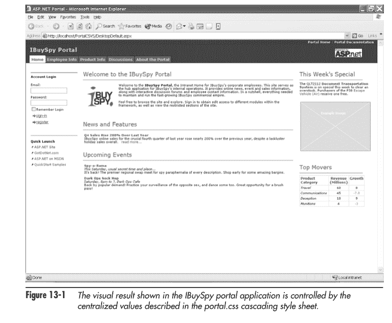

图13-1 IBuySpy门户应用程序中显示的视觉效果，由portal.css层叠样式表中描述的集中值控制。

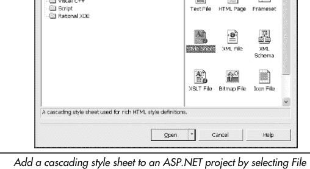

图13-2 通过选择“文件 | 新建 | 文件”并从“新建文件”对话框中选择“样式表”小程序，向ASP.NET项目添加层叠样式表。

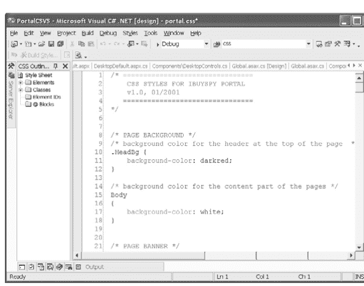

图13-3 编辑样式表内容时的Visual Studio .NET视图


#### 提示

你也可以通过选择.aspx文件并选择“视图 | 其他窗口 | 文档大纲”来打开ASP.NET页面内容的文档大纲。

CSS大纲以及任何大纲视图都可以帮助你快速导航样式表文档，而无需逐行滚动文本。要导航到特定元素，请展开包含该元素的文件夹，然后在CSS大纲中单击该元素名称。“元素”文件夹中的项目包括水平线<HR>、链接和列表<LI>等样式。“类”文件夹中的项目包括你创建的命名类的样式。

你可以通过使用CSS大纲视图中的上下文菜单或手动编辑实际样式表文档中的文本来添加、编辑或构建样式。样式生成器（见图13-4）提供了一种分类管理样式的方法，而.css文档本身则采用Intellisense，使添加属性到样式元素变得更加容易（见图13-5）。


#### 提示

你可以按CTRL+SPACEBAR来显示元素可用属性的列表，或者开始输入属性名称。


图13-4 从CSS大纲上下文菜单项“生成样式”打开的“样式生成器”对话框，其中SiteTitle样式处于焦点状态

```
21 /* 页眉 */
22 /* 注意：站点标题、站点链接和选项卡由MobilePortalBanner.ascx呈现
23 /* 站点标题文本的样式 */
24 .SiteTitle {
25     font-family: Verdana Bold, Helvetica, sans-serif;
26     font-size: 20px;
27     font-weight: bold;
28     color: #cccc99;
29 }  
30 background-attachment
31 /* background-color */    colors for the selected tab */
32 .Tab    background-image
33         background-position   white;
34         background-repeat    e;
35 }  behavior
36         border
37 /*       border-bottom    colors for the unselected tabs */
38 .OtherPassive {
```

图13-5 Intellisense显示SiteTitle样式的可用样式项列表

### 定义元素

像水平线标签这样的元素具有默认外观。你可以通过为<HR>元素添加样式规则来修改默认外观。以下步骤描述了为水平线元素添加元素样式规则的可视化过程。

- 1. 在CSS大纲中，右键单击“元素”文件夹，然后从上下文菜单中选择“添加样式规则”。（将显示“添加样式规则”对话框，如图13-6所示。）
- 2. 选择“元素”单选按钮，然后选择HR元素。
- 3. 单击“确定”将样式规则添加到.css文档。

如果你选择了HR元素，你将在样式表文档中看到以下文本：

```
HR
{
}
```

该示例被称为*样式块*。通过向样式块添加声明，你可以控制该样式在包含该样式块的样式表的所有页面中的外观。

添加样式块后，你可以手动在样式块中输入声明，或使用前面提到的样式生成器来定义样式。IBuySpy门户的水平线定义如下：

```
HR {
    color: dimgrey;
    height:1pt;
    text-align:left
}
```


图13-6 你可以使用“添加样式规则”对话框来定义新样式。

该样式表明水平线将是暗灰色，高度为1点，文本左对齐。可以在图13-2中看到水平线的示例，该图显示了IBuySpy门户的主页面。将颜色声明更改为color: red，然后生成并运行门户，你将看到所有水平线实例现在都将是红色的。这比在每个.aspx和.ascx页面中执行全局搜索和替换要方便得多。

### 定义类

类的添加和定义与元素类似。类定义了一个新的样式规则，你将将其与网页中的控件相关联。要添加新类，请在CSS大纲视图中右键单击“类”文件夹，然后选择“添加样式规则”。这次，选择“类名”单选按钮并输入类的名称。例如，如果你想为门户站点创建样式规则，你可以将类命名为SiteTitle。单击“确定”，SiteTitle样式块将被添加到.css文档中。

你可以使用“生成样式”对话框来可视化描述样式，或者手动输入声明，并使用Intellisense来指导你。当你选择颜色等项目时，“生成样式”对话框尤其有用。如果你选择RGB颜色，在样式生成器中可视化地选择颜色（见图13-7）可能比猜测更容易。这是SiteTitle的样式块。

```
.SiteTitle {
    font-family: Verdana Bold, Helvetica, sans-serif;
    font-size: 20px;
    font-weight: bold;
    color:#cccc99;
}
```

> **提示**
我为最后一个—颜色—声明添加了分号，但样式规则中的最后一个声明不需要分号。

尝试portal.css样式表中的元素和类，以查看这些更改对门户页面的影响。

### 使用元素和类

当你为水平线等元素添加样式规则时，只要使用该元素，这些规则就会被应用。如果你想将类描述的样式规则与控件相关联，你必须将该类与控件的CssClass属性相关联，或者通过手动编辑描述控件的HTML；在属性窗口中修改属性比直接修改HTML更容易。

SiteTitle实际上只在门户应用程序中应用了一次。SiteTitle应用于DesktopPortalBanner.ascx（用户控件）。横幅控件包含一个带有“IBuySpy Portal”文本的标签。下面显示了为标题标签设置CssClass属性的ASP。图13-8显示了包含标签已修改CssClass属性的属性窗口。


**图13-7** 使用“生成样式”对话框可视化地选择一些声明值要容易得多，如此处所示的“颜色拾取器”对话框。


**图13-8** Label控件的CssClass属性展示了从portal.css样式表应用样式规则的一个实例。

```
<asp:label id="siteName" CssClass="SiteTitle" EnableViewState="false"
runat="server" />
```

无论何时你想将样式表中的类应用于控件，你都需要定义样式规则，找到该对象的CssClass属性，然后在属性窗口（或直接在HTML文本中）输入样式规则的名称。一些控件，如DataList，具有嵌套属性，这些属性也包含CssClass属性。也就是说，你可以为控件的不同元素应用不同的样式。例如，DataList控件具有CssClass属性，以及嵌套属性EditItemStyle.CssClass、FooterStyle.CssClass、HeaderStyle.CssClass、ItemStyle.CssClass、SelectedItemStyle.CssClass和SeparatorStyle.CssClass属性。每个都可以有自己的样式规则，或者将继承应用于控件本身的规则。

### 实现门户横幅

ASP.NET用户控件在IBuySpy门户中被大量使用。用户控件的好处显然是可重用性。描述通用布局并插入用户控件比硬连线用户界面的每个方面要容易得多。例如，创建一个横幅意味着每个页面只需*引用*该横幅即可显示它。即使你只使用页面的一部分一次，创建用户控件仍然是有益的，因为用户控件可以轻松重用。图13-9显示了DesktopPortalBanner.ascx用户控件在呈现之前的状态，图13-1（在顶部）显示了控件在网页中呈现后的显著差异。

IBuySpy门户遵循的基本方法是，页面和控件定义门户页面的基本布局，而样式表和代码决定显示哪些元素。结果是一个完整而精细的Web应用程序，具有相对较少的.aspx网页和同等数量的可重用用户控件。

### 设计用户控件

为网页创建用户控件的基本步骤与第8章中概述的步骤类似，该章介绍了创建用户控件的主题。当你创建Web用户控件时，你将继承自System.Web.UI.UserControl而不是System.Windows.Forms.UserControl。你可以通过从“添加新项”对话框中选择“Web用户控件”小程序将Web用户控件添加到项目中。DesktopPortalBanner已经存在，因此我们将从描述其实现开始（如图13-9所示）。

> **提示**
你可以通过从页面中删除`<html>`、`<body>`和`<form>`元素，并将任何`@Page`指令更改为`@Control`指令，将Web窗体页转换为用户控件。确保删除不适用于`@Control`指令的`@Page`属性。


### 使用设计视图

将 Web 用户控件添加到项目后，我们可以使用设计器或 HTML 编辑器来创建控件布局。为便于参考，清单 13-1 展示了实现 DesktopPortalBanner 的 ASP 和 HTML 代码。（在本文本和 HTML 设计器中同时格式化 HTML 是困难的，这也是使用文档大纲导航文本的好处之一。）

清单 13-1 实现 DesktopPortalBanner.ascx 用户控件的 HTML

```
<%@ Control CodeBehind="DesktopPortalBanner.ascx.cs"
Language="c#" AutoEventWireup="false"
Inherits="ASNetPortal.DesktopPortalBanner" %>
<%@ Import Namespace="ASNetPortal" %>
<%--

DesktopPortalBanner 用户控件负责在每个 .aspx 页面的顶部显示标准的门户横幅。

DesktopPortalBanner 使用门户配置系统获取门户站点名称和选项卡设置的列表。然后将此内容渲染到页面中。

--%>
<table width="100%" cellspacing="0" class="HeadBg" border="0">
  <tr valign="top">
    <td colspan="3" class="SiteLink"
        background="<%= Request.ApplicationPath %>/images/bars.gif"
        align="right">
      <asp:label id="WelcomeMessage" forecolor="#eeeeee" runat="server" />
      <a href="<%= Request.ApplicationPath %>"
         class="SiteLink">Portal Home</a>
      <span class="Accent">
        |</span>
      <a href="<%= Request.ApplicationPath %>/Docs/Docs.htm"
         target="_blank" class="SiteLink">
        Portal Documentation</a>
      <%= LogoffLink %>
      &nbsp;&nbsp;
    </td>
  </tr>
  <tr>
    <td width="10" rowspan="2">
      &nbsp;
    </td>
    <td height="40">
      <asp:label id="siteName" CssClass="SiteTitle"
        EnableViewState="false" runat="server" />
    </td>
    <td align="middle" rowspan="2">
      <a href="http://www.asp.net">/images/poweredby_simple.gif"
        border="0"></a>
    </td>
  </tr>
  <tr>
    <td>
      <asp:datalist id="tabs" cssclass="OtherTabsBg"
      repeatdirection="horizontal" ItemStyle-Height="25"
      SelectedItemStyle-CssClass="TabBg"
      ItemStyle-BorderWidth="1" EnableViewState="false" runat="server">
        <ItemTemplate>
          &nbsp;<a href='<%= Request.ApplicationPath
%>/DesktopDefault.aspx?tabindex=<%# Container.ItemIndex %>&tabid=<%#
((TabStripDetails) Container.DataItem).TabId %>' class="OtherTabs"><%#
((TabStripDetails) Container.DataItem).TabName %></a>&nbsp;
        </ItemTemplate>
        <SelectedItemTemplate>
          &nbsp;<span class="SelectedTab"><%# ((TabStripDetails)
Container.DataItem).TabName %></span>&nbsp;
        </SelectedItemTemplate>
      </asp:datalist>
    </td>
  </tr>
</table>
```

用户控件包含许多与网页相同的 HTML 元素。从上一节我们了解到，用户控件没有 `<form>`、`<html>` 和 `<body>` 元素，并且其后台代码通过 `@Control` 指令而非 `@Page` 指令与控件关联。

### 使用 HTML 表格管理布局

管理用户控件（及页面）布局的一种极佳且轻量的方法是在控件中添加一个 HTML 表格，以便使用行和数据单元格细分控件的区域。清单 13-1 中的 `<table>` 从第 16 行延伸到第 62 行，与添加到该表格的控件交织在一起。文档大纲视图是导航表格中各个元素（如三个行元素 `<tr>`）的最佳方式，您可以使用上下文菜单向表格中添加行和单元格。要创建非常精细的布局，您还可以嵌套 HTML `<table>` 元素。

要创建一个与 DesktopPortalBanner 布局类似的 `<table>` 元素，请按照以下步骤操作：

1.  创建一个新的 Web 用户控件。
2.  在工具箱中选择 HTML 选项卡，并将 Table 控件拖到用户控件设计器上。（默认情况下，HTML 表格会呈现三列三行；我们将修改默认数量。）
3.  右键单击右上角的单元格，然后从上下文菜单中选择“删除 | 单元格”。再次重复此步骤，删除中间的数据单元格。
4.  按 F4 显示属性窗口，并将 `<TD>`（数据单元格）元素的 colspan 属性更改为 3。此步骤将创建一个顶行，类似于图 13-1 中显示的用于显示“门户主页”和“门户文档”链接的顶行。
5.  要创建 DesktopPortalBanner 的底部两行，请再次使用上下文菜单从底行删除两个单元格。
6.  选择中间左侧的数据单元格，并将 rowspan 属性更改为 2。
7.  对中间右侧单元格重复步骤 6。
8.  将鼠标移到任一中心数据单元格的垂直边上，拖动鼠标，直到第二行和第三行的中间单元格占据控件的大部分水平空间。
9.  最后，选择两行跨度的最右侧数据单元格，按 F4 打开属性窗口。将单元格宽度更改为大约 50。

前述九个步骤的结果创建了如图 13-10 所示的表格布局和清单 13-2 所示的代码。

图 13-10  一个近似 DesktopPortalBanner 用户控件布局的表格布局

### 清单 13-2  一个与 DesktopPortalBanner 布局类似的 HTML 表格控件

```
<%@ Control Language="c#" AutoEventWireup="false"
Codebehind="WebUserControl1.ascx.cs"
Inherits="ASPNetPortal.WebUserControl1"
TargetSchema="http://schemas.microsoft.com/intellisense/ie3-2nav3-0"%>
<TABLE id="Table1" height="96"
cellSpacing="1" cellPadding="1" width="784" border="1">
    <TR>
        <TD colSpan="3"></TD>
    </TR>
    <TR>
        <TD rowSpan="2"></TD>
        <TD width="739"></TD>
        <TD width="50" rowSpan="2"></TD>
    </TR>
    <TR>
        <TD width="739"></TD>
    </TR>
</TABLE>
```

我在使用表格管理布局时采用的一个策略是将边框值保持大于 0，这样在向布局添加控件时，我可以看到单元格的边界。要完成 DesktopPortalBanner，我们需要添加一些控件作为数据的占位符。

### 向表格添加控件

现在我们有了数据单元格，可以通过将控件拖放到用户控件单元格上来添加控件，以创建用户控件设计。例如，垂直条是通过向 `<TD>` 元素添加背景图像创建的。清单 13-1 的第 19 行演示了这一点；注意使用了函数调用 `Request.ApplicationPath` 并附加了相对路径 `/images/bars.gif`。

使用服务器端脚本块允许您内联插入脚本。`Request.ApplicationPath` 调用将被替换为实际的应用程序路径。（使用服务器端脚本使得轻松地将门户应用程序移动到您的 PC 或进行部署成为可能。）横幅的顶行包含一个标签，该标签将在您登录时替换为欢迎消息。有两个超链接允许用户导航到门户主页或门户文档，以及服务器端脚本用于显示 `LogoffLink` 字段。同样，当您登录时，如果用户已通过身份验证，`LogoffLink` 字段将在页面加载事件中返回呈现注销链接的 HTML。以下是初始化 `LogoffLink` 字段的 `DesktopPortalBanner.ascx.cs` 后台代码文件。

```
if (Context.User.Identity.AuthenticationType == "Forms")
{
    LogoffLink =
```


### 添加 DataList 实现导航选项卡

DataList 控件从工具箱的“Web 窗体”选项卡添加，它可以绑定到与 DataGrid 相同类型的对象，例如 ArrayList 或 DataSet。DataList 是一个数据绑定的模板派生控件，支持查看、更新和删除列表中的数据。巧妙的是，这里使用数据列表将选项卡名称绑定，以便根据门户的认证状态显示 IBuySpy 门户的可用选项卡；管理用户会看到更多项目，而最终用户看到的选项卡项目则较少。

DataList 可以从“编辑模板”上下文菜单项进行编辑。有多个模板可以修改以创建 DataList 所需的结果，包括：页眉和页脚模板、项目模板以及分隔符模板。项目模板包括 ItemTemplate、AlternatingItemTemplate、SelectedItemTemplate 和 EditItemTemplate。页眉和页脚模板描述页眉和页脚的外观，分隔符模板描述 DataList 项目之间的内容。项目模板描述 DataList 数据绑定内容的外观。ItemTemplate 描述 DataList 中的所有项目。AlternatingItemTemplate 描述 DataList 中每隔一个项目的外观。SelectedItemTemplate 描述被选中的 DataList 项目的外观，而 EditItemTemplate 描述列表中正在被编辑的元素。如果你想在任何特定状态下自定义 DataList 的外观，就需要定义这些模板项目中的每一个。

如果你为 DesktopPortalBanner 打开 DataList 的“项目模板”编辑器，可能很难分辨使用了哪些模板以及它们是如何定义的，因此我们将转向代码。（当然，你也可以通过直接转向 HTML 编辑器或属性窗口来修改 DataList 和其他 ASP.NET 控件。）清单 13-3 包含描述横幅 DataList 的 ASP.NET 代码。

**清单 13-3** 描述用于为 IBuySpy 门户创建导航选项卡的 DataList 的 ASP.NET 代码

```xml
<asp:datalist id="tabs" runat="server"
    EnableViewState="false" ItemStyle-BorderWidth="1"
    SelectedItemStyle-CssClass="TabBg"
    ItemStyle-Height="25" repeatdirection="horizontal"
    repeatlayout="Table" CellPadding="0" CellSpacing="0">
    <ItemTemplate>
        <asp:LinkButton id="tab" runat="server"
            CommandArgument='<%# DataBinder.Eval(Container.DataItem, "ModuleTitle") %>'
            CommandName="Tab">
            <%# DataBinder.Eval(Container.DataItem, "ModuleTitle") %>
        </asp:LinkButton>
    </ItemTemplate>
    <ItemStyle CssClass="OtherTabsBg"></ItemStyle>
    <ItemTemplate>
        &nbsp; <a href='<%= Request.ApplicationPath %>/DesktopDefault.aspx?tabindex=<%# Container.ItemIndex %>&tabid=<%# ((TabStripDetails) Container.DataItem).TabId %>'
            class="OtherTabs">
            <%# ((TabStripDetails) Container.DataItem).TabName %>
        </a>&nbsp;
    </ItemTemplate>
    <SelectedItemTemplate>
        &nbsp;<span class="SelectedTab"><%# ((TabStripDetails) Container.DataItem).TabName %>
        </span>&nbsp;
    </SelectedItemTemplate>
</asp:datalist>
```

（ASP.NET 包含一些非常长的文本。我选择大致按照它在 HTML 编辑器中出现的方式显示描述 DataList 的代码，而不是随意地将语句分割成可格式化的块，行号是为了参考而添加的。）

DataList 本身由 `<asp:datalist>` 和 `</asp:datalist>` 标签定义。基本上，ASP.NET 控件呈现为文本，这支持在任何文本编辑器中构建 ASP.NET 页面。（我现在不会这么做，但 ASP.NET 是在 Visual Studio .NET 之前发布的，这正是早期 beta 版开发者可能演示构建网页的方式。）第 1 到 5 行描述了 DataList。runat 属性表示 DataList 代码将在服务器上处理。EnableViewState="false" 属性表示 DataList 的视图状态信息将不会存储在页面上。（视图状态信息看起来像乱码文本，但实际上是明文存储的加密状态信息。）SelectedItemStyle-CssClass 代表 DataList.SelectedItemStyle.CssClass 属性，并被赋予在 portal.css 层叠样式表中定义的规则 TabBg。ItemStyle-Height 为 25；项目将水平显示；DataList 的通用样式规则是 OtherTabsBg 样式。（你可以查看 portal.css 来看这些规则定义的样式。你会发现样式定义了背景颜色，这由样式名称中使用的 Bg 后缀所暗示。）

`&nbsp;`（不间断空格）用于强制 DataList 中数据绑定元素之间保留空格。此标签在 ItemTemplate 和 SelectedItemTemplate 中的数据绑定元素的左右两侧使用，以在元素之间产生均匀的间距。

同样，DataList 使用服务器端脚本标签。DataList 选项卡项目在代码隐藏页中以编程方式获取，我们稍后将讨论这一点。DesktopPortalBanner 中的 DataList 演示了如何在运行时以编程方式绑定数据，从而生成如图 13-1 所示的选项卡。

### 在代码隐藏模块中编程

演示代码隐藏模块的一种便捷方式是描述门户应用程序中如何生成选项卡——DesktopPortalBanner 中的 DataList。

ASP.NET 比 Windows 窗体在创建图形用户界面方面更具挑战性，因为创建界面的方式更多。在 Windows 窗体中，我们有窗体设计器和代码隐藏。在 ASP.NET 中，我们有页设计器、HTML 编辑器和代码。幸运的是，代码隐藏页确实使得将代码与 ASP.NET 网页关联更加容易，其方式比我们自从 Alan Cooper 发明 Visual Basic 以来一直实现非 Web 应用程序的方式更一致。

你可以按 F7 从页设计器视图切换到代码隐藏视图，按 SHIFT+F7 切换回页设计器视图。按照惯例，ASP.NET 页具有 .aspx 扩展名，而代码隐藏文件具有 .aspx.cs 扩展名，但关联是在 @Page 和 @Control 语句的 Codebehind 属性中发生的（参见清单 13-2 的示例。）

你可能认为代码隐藏代码先运行，但情况不一定如此。Global.asax 页中的代码首先执行。我将从 Global.asax 页开始，到数据绑定到名为 tabs 的 DataList 控件结束，描述执行顺序。

### 在 Global.asax 模块中实现事件处理程序

Global.asax 模块继承自 HttpApplication，为你提供了一个方便的位置来添加响应应用程序级别事件的事件处理程序。Global.asax 文件不能被用户直接请求，但当请求应用程序级别事件时，其中的代码会运行。在 IBuySpy 门户应用程序中，Global.asax 文件实现了两个事件处理程序：BeginRequest 和 AuthenticateRequest。（你可以实现大约十几个事件处理程序；在应用程序文件中编写任何代码都是可选的。）

在门户中，BeginRequest 使用 URL 编码的消息字符串中的 TabIndex 和 TabId，在每次请求时构建 PortalSettings 对象。实现了 AuthenticateRequest 事件处理程序来确定用户是否已通过身份验证以及该人被分配了哪些角色。清单 13-4 包含 Application_BeginRequest 事件处理程序的代码（有关基于角色的安全性的更多信息，请参阅第 16 章。）

**清单 13-4** BeginRequest 事件处理程序用于根据 URL 编码的请求初始化 PortalSettings。

```csharp
protected void Application_BeginRequest(Object sender, EventArgs e)
{
    int tabIndex = 0;
    int tabId = 0;

    // 从查询字符串获取 TabIndex

    if (Request.Params["tabindex"] != null) {
        tabIndex = Int32.Parse(Request.Params["tabindex"]);
    }
```


### 从数据库读取门户设置

PortalSettings 类定义在 configuration.cs 模块中。PortalSettings 的数据使用 *tabindex* 和 *tabid* 参数作为 GetPortalSettings 存储过程的参数，从门户数据库中读取。在本节中，我们将研究 PortalSettings 类的构造函数，包括如何使用 ADO.NET 创建、调用存储过程以及从中获取信息。

**实现存储过程** PortalSettings 类通过清单 13-5 中所示的存储过程进行初始化。当您创建门户时，会运行脚本 PortalDB.sql 来创建门户数据库。该脚本的步骤之一是生成 GetPortalSettings 存储过程，而清单 13-5 中所示的存储过程对其进行了轻微修改，然后在 PortalSettings 构造函数中从数据库检索特定的门户设置值。

| 清单 13-5 | *一个根据门户上下文进行轻微修改的存储过程，用于检索门户设置* |
|---|---|

```
1: ALTER PROCEDURE dbo.GetPortalSettings
2: (
3:     @PortalAlias  nvarchar(50),
4:     @TabID        int,
5:     @PortalID       int OUTPUT,
6:     @PortalName     nvarchar(128) OUTPUT,
7:     @AlwaysShowEditButton bit OUTPUT,
8:     @TabName        nvarchar (50)  OUTPUT,
9:     @TabOrder       int OUTPUT,
10:    @MobileTabName  nvarchar (50)  OUTPUT,
11:    @AuthRoles      nvarchar (256) OUTPUT,
12:    @ShowMobile     bit OUTPUT
13: )
14: AS
15:
16: /* First, get Out Params */
17: IF @TabID = 0
18:     SELECT TOP 1
19:         @PortalID           = Portals.PortalID,
20:         @PortalName         = Portals.PortalName,
21:         @AlwaysShowEditButton = Portals.AlwaysShowEditButton,
22:         @TabID              = Tabs.TabID,
23:         @TabOrder           = Tabs.TabOrder,
24:         @TabName            = Tabs.TabName,
25:         @MobileTabName      = Tabs.MobileTabName,
26:         @AuthRoles          = Tabs.AuthorizedRoles,
27:         @ShowMobile         = Tabs.ShowMobile
28:
29:     FROM
30:         Tabs
31:     INNER JOIN
32:         Portals ON Tabs.PortalID = Portals.PortalID
33:
34:     WHERE
35:         PortalAlias=@PortalAlias
36:
37:     ORDER BY
38:         TabOrder
39:
40: ELSE
41:     SELECT
42:         @PortalID           = Portals.PortalID,
43:         @PortalName         = Portals.PortalName,
44:         @AlwaysShowEditButton = Portals.AlwaysShowEditButton,
45:         @TabName            = Tabs.TabName,
46:         @TabOrder           = Tabs.TabOrder,
47:         @MobileTabName      = Tabs.MobileTabName,
48:         @AuthRoles          = Tabs.AuthorizedRoles,
49:         @ShowMobile         = Tabs.ShowMobile
50:
51: FROM
52: Tabs
53: INNER JOIN
54: Portals ON Tabs.PortalID = Portals.PortalID
55:
56: WHERE
57: TabID=@TabID
58:
59: /* Get Tabs list */
60: SELECT
61: TabName,
62: AuthorizedRoles,
63: TabID,
64: TabOrder
65:
66: FROM
67: Tabs
68:
69: WHERE
70: PortalID = @PortalID
71:
72: ORDER BY
73: TabOrder
74:
75: /* Get Mobile Tabs list */
76: SELECT
77: MobileTabName,
78: AuthorizedRoles,
79: TabID,
80: ShowMobile
81:
82: FROM
83: Tabs
84:
85: WHERE
86: PortalID = @PortalID
87: AND
88: ShowMobile = 1
89:
90: ORDER BY
91: TabOrder
92:
93: /* Then, get the DataTable of module info */
94: SELECT
95:     *
96:
97: FROM
98:     Modules
99:     INNER JOIN
100:     ModuleDefinitions ON Modules.ModuleDefID =
ModuleDefinitions.ModuleDefID
101:
102: WHERE
103:     TabID = @TabID
104:
105: ORDER BY
106:     ModuleOrder
```

我们无法在有限的空间内容纳存储过程教程。一本优秀的 SQL Server 程序员指南，例如 Michael Otey 和 Paul Conty 合著的 *《SQL Server 2000 开发者指南》*（McGraw-Hill/Osborne 出版），是每位数据库开发者工具包中不可或缺的一部分。此外，IBuySpy 门户中有几十个存储过程可供您借鉴或学习。我将为您简要概述这些存储过程的工作原理以及它们在门户中的使用方式。

存储过程最多可接受 2,100 个参数，并且可以返回参数。Microsoft SQL Server 的存储过程可以包含任意数量的 T-SQL 语句。这样，您就可以将对许多相关数据位的大型请求打包到一个存储过程中，而这些存储过程又在服务器上作为一组执行，并有选择地以您感兴趣的输出参数形式返回数据。`ALTER PROCEDURE dbo.GetPortalSettings` 定义了两个输入参数和八个输出参数——也就是说，我们通过这一个存储过程从数据库获取了八条数据。

清单 13-5 中的存储过程根据我之前在“在 Global.asax 模块中实现事件处理程序”部分提到的、通过 URL 编码请求传递的 *TabId* 对 `GetPortalSettings` 进行了修改。基于第 17 至 58 行的 T-SQL If Else 测试，向存储过程中添加了一个 `SELECT` 语句。第 59 至 73 行获取选项卡列表。第 75 至 91 行获取移动设备页面的选项卡列表，而第 93 至 106 行获取模块信息。

**为存储过程定义输入和输出参数** GetPortalSettings 和其他存储过程代表了一种作为增强性能通用策略的封装。该存储过程将多个 `SELECT` 语句封装成一个更简单的包，所有这些 `SELECT` 查询作为门户应用程序的一个单一请求在数据库服务器上运行。这减少了门户应用程序和数据库服务器之间的请求频率，从而实现了性能的优化。

既然我们知道门户使用存储过程来简化编程并提高性能，我们需要了解如何使用 ADO.NET 调用存储过程。（有关 ADO.NET 的介绍，请参见第 5 章。）清单 13-6 展示了 PortalSettings 类的构造函数，它通过调用清单 13-5 中的 `GetPortalSettings` 存储过程进行初始化。

### 清单 13-6 PortalSettings 构造函数演示了 IBuySpy 门户中存储过程的使用。

```
1: //***********************************************************
2: //
3: // PortalSettings 构造函数
4: //
5: // PortalSettings 构造函数封装了为给定请求呈现门户选项卡视图
6: // 所需的所有逻辑。
7: //
8: // 这些门户设置存储在 SQL 数据库中，并在下面通过调用
9: // "GetPortalSettings" 存储过程获取。
10: // 该存储过程通过 SPROC 输出参数和三个结果集返回值。
11: //
12: //***********************************************************
13: //
14: public PortalSettings(int tabIndex, int tabId) {
15: //
16: // 创建连接和命令对象的实例
17: SqlConnection myConnection = new SqlConnection(
18: ConfigurationSettings.AppSettings["connectionString"]);
19: SqlCommand myCommand = new SqlCommand("GetPortalSettings", myConnection);
20: //
21: // 将命令标记为 SPROC
22: myCommand.CommandType = CommandType.StoredProcedure;
23: //
24: // 向 SPROC 添加参数
25: SqlParameter parameterPortalAlias =
26: new SqlParameter("@PortalAlias", SqlDbType.NVarChar, 50);
27: parameterPortalAlias.Value = "p_default";
28: myCommand.Parameters.Add(parameterPortalAlias);
29: //
30: SqlParameter parameterTabId =
31: new SqlParameter("@TabId", SqlDbType.Int, 4);
32: parameterTabId.Value = tabId;
33: myCommand.Parameters.Add(parameterTabId);
```


### 422 高级 C# 编程

```
// 为存储过程添加 out 参数
SqlParameter parameterPortalID =
    new SqlParameter("@PortalID", SqlDbType.Int, 4);
parameterPortalID.Direction = ParameterDirection.Output;
myCommand.Parameters.Add(parameterPortalID);

SqlParameter parameterPortalName =
    new SqlParameter("@PortalName", SqlDbType.NVarChar, 128);
parameterPortalName.Direction = ParameterDirection.Output;
myCommand.Parameters.Add(parameterPortalName);

SqlParameter parameterEditButton =
    new SqlParameter("@AlwaysShowEditButton", SqlDbType.Bit, 1);
parameterEditButton.Direction = ParameterDirection.Output;
myCommand.Parameters.Add(parameterEditButton);

SqlParameter parameterTabName =
    new SqlParameter("@TabName", SqlDbType.NVarChar, 50);
parameterTabName.Direction = ParameterDirection.Output;
myCommand.Parameters.Add(parameterTabName);

SqlParameter parameterTabOrder =
    new SqlParameter("@TabOrder", SqlDbType.Int, 4);
parameterTabOrder.Direction = ParameterDirection.Output;
myCommand.Parameters.Add(parameterTabOrder);

SqlParameter parameterMobileTabName =
    new SqlParameter("@MobileTabName", SqlDbType.NVarChar, 50);
parameterMobileTabName.Direction = ParameterDirection.Output;
myCommand.Parameters.Add(parameterMobileTabName);

SqlParameter parameterAuthRoles =
    new SqlParameter("@AuthRoles", SqlDbType.NVarChar, 256);
parameterAuthRoles.Direction = ParameterDirection.Output;
myCommand.Parameters.Add(parameterAuthRoles);

SqlParameter parameterShowMobile =
    new SqlParameter("@ShowMobile", SqlDbType.Bit, 1);
parameterShowMobile.Direction = ParameterDirection.Output;
myCommand.Parameters.Add(parameterShowMobile);

// 打开数据库连接并执行命令
myConnection.Open();
SqlDataReader result = myCommand.ExecuteReader();

// 读取第一个结果集 -- 桌面选项卡信息
while(result.Read()) {

    TabStripDetails tabDetails = new TabStripDetails();
    tabDetails.TabId = (int) result["TabId"];
    tabDetails.TabName = (String) result["TabName"];
    tabDetails.TabOrder = (int) result["TabOrder"];
    tabDetails.AuthorizedRoles =
        (String) result["AuthorizedRoles"];

    this.DesktopTabs.Add(tabDetails);
}

if (this.ActiveTab.TabId == 0) {
    this.ActiveTab.TabId =
        ((TabStripDetails) this.DesktopTabs[0]).TabId;
}

// 读取第二个结果 -- 移动选项卡信息
result.NextResult();

while(result.Read()) {

    TabStripDetails tabDetails = new TabStripDetails();
    tabDetails.TabId = (int) result["TabId"];
    tabDetails.TabName = (String) result["MobileTabName"];
    tabDetails.AuthorizedRoles =
        (String) result["AuthorizedRoles"];

    this.MobileTabs.Add(tabDetails);
}

// 读取第三个结果 -- 模块选项卡信息
result.NextResult();

while(result.Read()) {

    ModuleSettings m = new ModuleSettings();
    m.ModuleId = (int) result["ModuleID"];
    m.ModuleDefId = (int) result["ModuleDefID"];
    m.TabId = (int) result["TabID"];
    m.PaneName = (String) result["PaneName"];
    m.ModuleTitle = (String) result["ModuleTitle"];
    m.AuthorizedEditRoles = (String) result["AuthorizedEditRoles"];
    m.CacheTime = (int) result["CacheTime"];
    m.ModuleOrder = (int) result["ModuleOrder"];
    m.ShowMobile = (bool) result["ShowMobile"];
    m.DesktopSrc = (String) result["DesktopSrc"];
    m.MobileSrc = (String) result["MobileSrc"];

    this.ActiveTab.Modules.Add(m);
}

// 现在读取 Portal out 参数
result.NextResult();

this.PortalId = (int) parameterPortalID.Value;
this.PortalName = (String) parameterPortalName.Value;
this.AlwaysShowEditButton = (bool) parameterEditButton.Value;
this.ActiveTab.TabIndex = tabIndex;
this.ActiveTab.TabId = tabId;
this.ActiveTab.TabOrder = (int) parameterTabOrder.Value;
this.ActiveTab.MobileTabName = (String) parameterMobileTabName.Value;
this.ActiveTab.AuthorizedRoles = (String) parameterAuthRoles.Value;
this.ActiveTab.TabName = (String) parameterTabName.Value;
this.ActiveTab.ShowMobile = (bool) parameterShowMobile.Value;

myConnection.Close();
}
```

> 注意
> 第 13、14、15 和 16 章中的代码由微软公司授权提供，并按照其在 IBuySpy 门户中的实际出现方式列出，仅为了分页目的做了极小的修改。其风格反映了门户代码作者的风格，格式和内容均保持原样，以防止无意中的修改。我将在本节和下一节中引用清单 13-6 中的 PortalSettings 构造函数。

在第 5 章中，你学习了如何创建连接对象。PortalSettings 构造函数在清单 13-6 的第 19 和 20 行创建了一个 SQL 提供程序连接对象。与第 5 章的一个不同之处在于门户存储应用程序信息的方式。连接字符串存储在 web.config 文件中（参见清单 13-7）。ConfigurationSettings 类的共享属性 AppSettings 允许你从 web.config 文件的 <appSettings> 元素中存储和检索应用程序设置。

#### 清单 13-7：IBuySpy 门户的 web.config 文件中的 appSettings 部分，可通过 ConfigurationSettings 类访问

```
<!-- application specific settings -->
<appSettings>
    <add key="ConnectionString"
         value="server=localhost;Trusted_Connection=true;database=Portal" />
</appSettings>
```

接下来，构造函数创建一个 SqlCommand 对象，用于表示存储过程（参见清单 13-6 的第 21 行）。在第 24 行，我们指出命令类型将是存储过程——CommandType.StoredProcedure。这些最初的几个步骤与执行存储过程的一般循环行为一致。下一个一般步骤是表达存储过程的输入和输出参数，然后执行存储过程并检索任何输出值。（我们将在下一节中查看运行存储过程和检索输出参数。）

存储过程的参数，与 .NET 框架中的其他一切一样，被表示为类的实例。要创建一个参数并将其发送到存储过程，我们需要创建 SqlParameter 类（对于 OLEDB 提供程序是 OleDbParameter 类）的实例，并将参数对象添加到 SqlCommand 对象的 Parameters 集合中。清单 13-6 的第 26 到 30 行演示了一个输入参数 PortalAlias，第 38 到 40 行演示了一个输出参数。（清单 13-6 中有这两种参数的几个示例。）

清单 13-6 第 28 行所示的 SqlParameter 构造函数使用参数名称、数据类型和大小进行初始化。（SqlParameter 类有六个重载构造函数。）第 29 行为 PortalAlias 输入参数提供了一个输入值，第 30 行将该参数添加到 SqlCommand.Parameters 集合中。

输出参数的初始化方式类似。对于输出参数，我们不是提供一个表示输入参数的 SqlCommand.Value，而是修改 SqlParameter.Direction 值为 ParameterDirection.Output。输入参数和输出参数之间区别的一个示例如清单 13-6 第 40 行所示。当我们表达了所有输入和输出参数后，就可以调用存储过程了。

#### 调用 GetPortalSettings 存储过程

创建连接、命令和参数对象后，我们就可以连接到 Portal（IBuySpy 数据库的默认名称）并检索结果了。清单 13-6 的第 79 行打开连接，我们使用 SqlCommand 对象来执行存储过程。由于我们只是读取数据，我们可以使用 SqlDataReader 来检索输出参数。SqlDataReader 由 SqlCommand.ExecuteReader 方法返回（第 80 行）；然后，SqlDataReader 是一个单向、只读的游标，并且比 DataSet 提供更好的性能。


### 高级 C# 编程

按照 SELECT 语句的顺序，我们通过执行 Read 来检索所有桌面选项卡信息，从而获取结果数据。当所有 TabDetail 对象都从结果集中初始化完毕（第 83 至 93 行）后，我们通过调用 `SqlDataReader.NextResult` 移至下一个结果集，如第 101 行所示。此事件序列会重复进行，直到我们读取完所有结果集，最后通过关闭连接来完成构造函数的收尾工作（参见第 150 行）。

请注意，在单个结果集中可能返回多行数据的地方，我们使用了 *while* 循环和 `SqlDataReader.Read` 来检索所有行，而输出参数则使用第 138、139、140、143、144、145、146 和 147 行的参数对象来读取。（`tabIndex` 和 `tabId` 的值——第 141 和 142 行——是传入我们的构造函数的；我们只是将它们存储在 `PortalSettings.ActiveTab` 对象中。）

#### 调试、创建和修改存储过程
使用存储过程和 ADO.NET 代表了一种你将在 IBuySpy 门户中始终如一、反复使用的策略。存储过程是管理数据的一种优化方式，而断开的 ADO.NET 模型则支持巨大的可扩展性。理解一个对象如何使用存储过程进行实例化，将使你能够处理门户中的所有对象，以及任何采用此策略的其他应用程序。有关门户中使用此策略的更多类示例，请参阅门户 `Components` 文件夹中的 `.cs` 源代码文件。

你需要了解的最后一件事是如何编写、修改和调试存储过程。Visual Studio .NET IDE 通过“服务器资源管理器”窗口支持创建、修改和调试存储过程（参见图 13-11）。

要创建新的存储过程，请右键单击“存储过程”节点（参见图 13-11）或任何单个存储过程，然后从上下文菜单中选择“新建存储过程”。如果你安装了 SQL Server 企业版管理器，此步骤将创建一个模板存储过程。（如果你的工作站上未安装企业版管理器，该菜单项将不会显示。）

要编辑现有的存储过程，请选择要编辑的存储过程，然后从右键单击上下文菜单中选择“编辑存储过程”。你也可以从同一菜单运行或单步执行特定的存储过程。如果你尝试调试存储过程但没有足够的权限，可能会看到一个错误（参见图 13-12）。请联系你的管理员或单击图 13-12 所示的“帮助”按钮，以获取有关解决此问题的说明。当你单步执行存储过程时，可以像调试 C# 代码一样使用断点和监视值。

### 实现页面加载 Init 处理程序

在处理了 `BeginRequest` 事件后，会引发 `Page_Init` 事件（随后是 `Page_Load` 事件）。门户使用 `Page_Init` 事件处理程序来初始化从存储过程中读取并存储在 `BeginRequest` 事件结束时的 `HttpContext` 对象中的门户设置。DesktopDefault.aspx 网页的 `Page_Init` 事件处理程序如清单 13-8 所示。


**图 13-11** *展开的服务器资源管理器，显示了按字母顺序排列的 IBuySpy 门户存储过程*


**图 13-12** *尝试在没有足够权限的情况下从服务器资源管理器调试存储过程*

428 高级 C# 编程

```
清单 13-8  DesktopDefault.aspx 网页的 Page_Init 事件处理程序使用
PortalSettings 对象来动态初始化页面。

1:  private void Page_Init(object sender, EventArgs e) {
2:    //
3:    // 代码生成：此调用是 ASP.NET Web
4:    // 窗体设计器所必需的。
5:    //
6:    InitializeComponent();
7:
8:    //*******************************************************
9:    //
10:    // Page_Init 事件处理程序
11:    //
12:    // Page_Init 事件处理程序在每次页面请求的最开始
13:    // 执行（紧接在 Page_Load 之前）。
14:    //
15:    // 下面的 Page_Init 事件处理程序确定当前
16:    // 请求的门户视图的选项卡索引，
17:    // 然后调用 PopulatePortalSection 实用工具
18:    // 方法来动态填充门户选项卡的
19:    // 左侧、中间和右侧部分。
20:    //
21:    //*******************************************************
22:
23:    // 从当前上下文获取 PortalSettings
24:    PortalSettings portalSettings =
25:      (PortalSettings) HttpContext.Current.Items["PortalSettings"];
26:
27:    // 确保访问用户有权访问当前页面
28:    if (PortalSecurity.IsInRoles(
29:      portalSettings.ActiveTab.AuthorizedRoles) == false) {
30:      Response.Redirect("~/Admin/AccessDenied.aspx");
31:    }
32:
33:    // 如果客户端尚未验证身份，则在主页的
34:    // 左上角动态注入登录模块
35:    if ((Request.IsAuthenticated == false)
36:      && (portalSettings.ActiveTab.TabIndex == 0)) {
37:      LeftPane.Controls.Add(
38:        Page.LoadControl("~/DesktopModules/SignIn.ascx"));
39:      LeftPane.Visible = true;
40:    }
41:
42: // 动态填充门户页面的左、中和右
43: // 窗格部分
44: if (portalSettings.ActiveTab.Modules.Count > 0) {
45:
46: // 遍历此选项卡配置系统中的每个条目
47: foreach (ModuleSettings _moduleSettings in
48: portalSettings.ActiveTab.Modules) {
49:
50: Control parent = Page.FindControl(_moduleSettings.PaneName);
51:
52: // 如果未指定缓存，则创建用户控件
53: // 实例并动态将其注入页面。
54: // 否则，创建一个缓存的模块实例，
55: // 该实例可以选择性地将模块注入
56: // 控件树中，也可能不注入。
57:
58: if ((_moduleSettings.CacheTime) == 0) {
59:
60: PortalModuleControl portalModule =
61: (PortalModuleControl) Page.LoadControl(
62: _moduleSettings.DesktopSrc);
63:
64: portalModule.PortalId = portalSettings.PortalId;
65: portalModule.ModuleConfiguration = _moduleSettings;
66:
67: parent.Controls.Add(portalModule);
68: }
69: else {
70:
71: CachedPortalModuleControl portalModule =
72: new CachedPortalModuleControl();
73:
74: portalModule.PortalId = portalSettings.PortalId;
75: portalModule.ModuleConfiguration = _moduleSettings;
76:
77: parent.Controls.Add(portalModule);
78: }
79:
80: // 在门户模块之间动态注入分隔符换行
81: parent.Controls.Add(new LiteralControl("<" + "br" + ">"));
82: parent.Visible = true;
83: }
84: }
85: }
```

默认网页 DesktopDefault.aspx 具有非常简单的视觉设计，如图 13-13 所示。本质上，DesktopDefault.aspx 网页由一个 DesktopPortalBanner.ascx 用户控件实例和一个 HTML 表格组成。你在门户中看到的其余内容（参见图 13-1）是在 `Page_Init` 事件处理程序中动态合并的。（实际上，清单 13-8 也包含了 DesktopDefault.aspx 页面的所有用户定义代码。）设计简单和动态使用用户控件的灵活性是使用 ASP.NET 编程的好处。

用户定义的代码从清单 13-8 的第 25 和 26 行开始。第 25 和 26 行获取了我们在 `global.asax` 文件的 `BeginRequest` 事件处理程序中创建的 `PortalSettings` 对象的本地副本。第 29 至 32 行采用基于角色的安全性来确定我们是否有权查看指定为 `ActiveTab` 的页面。如果没有，我们将在第 31 行被重定向到 `AccessDenied.aspx` 页面。（波浪号（~）表示 URL 相对于应用程序的根目录。如果你查看项目中的 admin 文件夹，你可以查看 AccessDenied 页面的设计。）


### 审视门户设计

如果用户尚未通过身份验证，SignIn.ascx 控件将被添加到 HTML 表格的左上窗格（LeftPane）中，如图 13-1 所示。由于门户的设计方式，只要显示 DesktopDefault.aspx 页面且我们尚未登录，SignIn 控件每次都会出现。

最后，清单 13-8 中第 46 至 86 行的其余代码遍历所有模块——这些是关联到每个选项卡的动态控件，从数据库中读取——并将这些模块放置在各种数据单元格中（在应用程序中称为 *窗格*）。窗格名称存储在 `PortalSettings.ActiveTab.Modules` 集合中——参见第 49 行，`ModuleSettings` 对象具有 `PaneName` 属性。`Page.FindControl(ModuleSettings.PaneName)` 用于定位页面上某个 HTML 数据单元格上的特定用户控件（参见第 52 行）。

> **提示**
>
> 请记住，“模块”是 IBuySpy 门户中的一个本地术语。门户在指代构成其动态界面的用户控件（UserControls）时使用“模块”一词。

窗格名称在清单 13-8 的第 52 行解析。如果模块尚未缓存——第 60 行——那么我们将使用 `Page.LoadControl` 动态加载该模块，设置 `PortalId` 和 `ModuleSettings`，最后将模块添加到页面的 `Controls` 集合中。（这些步骤发生在第 62 至 69 行。）

如果模块已被缓存，则创建一个门户定义的 `CachedPortalModuleControl` 实例，对其进行初始化，并将其添加到页面的 `Controls` 集合中。有关缓存的更多信息，请参阅第 15 章。

每个模块添加后，会动态插入一行分隔符——`<BR>` 标签。清单 13-8 的第 82 行演示了如何将 `LiteralControl` 动态插入网页。（有关创建自定义服务器控件的更多信息，请参阅第 14 章。）循环继续，直到所有模块都已添加到动态页面中。首页选项卡的动态页面创建结果如图 13-1 所示。

显然，门户中发生的事情远不止 DesktopDefault.aspx 页面的简单设计和清单 13-8 中的代码。了解这一点对于理解门户设计的优雅之处至关重要。

IBuySpy 的页面数量相对较少，但用户体验却非常丰富。关键在于网页相当通用，而被称为模块的用户控件构成了 IBuySpy 门户丰富而动态的特性。这正是其应有的样子。本质上，门户的开发者展示了符合良好面向对象编程实践的最佳实践；也就是说，通过类惯用法使各个元素对自己负责。例如，登录模块是一个独立的类，它知道如何接受用户名和密码以及进行身份验证。因此，模块可以在需要的任何地方插入——实际上，实现了重用。

你在门户中看到的很大一部分是用户控件和层叠样式的结合。有关创建构成丰富动态客户端体验的用户控件的更多信息，请参阅第 14 章。

### 次要主题

IBuySpy 是一个探索 .NET 技术的多元化试验场。我们已经展示了用于创建这个丰富 Web 门户应用程序的 .NET 的许多方面，我想借此机会展示一些配角功能，你可以将它们整合到自己的项目中，或者它们将使你与门户的交互成为一次成功的体验。

### 管理门户

IBuySpy 门户支持动态管理。如图 13-1 所示，门户支持用户身份验证。示例中的安全类型是由门户本身管理的基于角色的安全性。你可以使用登录模块添加新用户，或者使用用户名 guest 和密码 guest 登录。（有关门户和 .NET 安全性的更多信息，请参阅第 16 章。）

如果你使用默认管理密码“guest”或任何其他管理密码登录，门户将显示一个管理选项卡和额外的管理链接。管理选项卡和管理链接允许非程序员自定义门户（参见图 13-14）。更重要的是，这些功能提供了一条清晰的路径（需要一些探索），展示了如何实现一个支持远程用户（甚至非程序员）进行管理和扩展的 Web 应用程序。


**提示**

请记住，IBuySpy 门户代表一个面向公司员工的内部网应用程序。

例如，注意图 13-14 中显示的门户包含一个示例图片：本周特价，文档传输系统。得知夜视镜有大量剩余库存，一位门户管理员用户选择将剩余的夜视镜作为本周特价。通过以管理员身份登录并点击“本周特价”旁边的编辑链接（参见图 13-14），管理员用户可以直接从门户快速更新每周特价提醒。

要修改门户，请点击前述的编辑链接。修改文本和 `` 标签以引用代表夜视镜新促销活动的内容。（有关 IBuySpy 中演示的行政管理设施示例，请参见图 13-15。）完成后点击“更新”链接，修订内容将会生效。如果你查看图 13-15 中的初始页面内容和修订后的内容，你会注意到我更新了一些文本内容和图片链接。（作为一个尽责的经理，我当然也会去查找 productID。）


**图 13-15** 使用内置管理功能动态更新门户。

**注意**

请注意，点击产品信息超链接会将我们带到 IBuySpy 商店。该商店代表一个单独的应用程序。我询问过 Susan Warren，她说对于开发者来说，门户是两个应用程序中更有趣的一个。你可以在线查看 IBuySpy 商店：**www.ibuyspy.com**。

### 调试 IBuySpy 门户

当你下载门户时，你无法立即单步调试应用程序。在线提供的门户代码经过了微小修改以支持产品就绪状态。门户的安装和设置非常顺利，但你需要进行一项额外更改才能调试门户。

要在 Visual Studio .NET 中调试 IBuySpy 门户代码，你需要打开 web.config 文件，找到 `<compilation debug=false>` 标签，并将值更改为 True。（新值将是 `<compilation debug=true>`。）更改后，你将能够轻松地浏览和调试所有门户代码。

### 介绍移动模块

IBuySpy 门户演示了如何使用 Microsoft 的 Mobile Internet Toolkit (MMIT) 来利用相同的代码库支持 Web 移动设备，如 WAP 手机和 PDA。如果你从 **www.microsoft.com** 下载并安装了 Microsoft Mobile Internet Toolkit，你将能够尝试使用门户代码附带的移动设备页面。

MMIT 超出了本书的范围，但值得重申的是，一个架构良好的应用程序将允许你利用相同的基于对象的代码库支持移动设备上的 .NET。将业务对象与界面分离，移动工具包将允许你在移动应用程序开发中重用相同的代码。（我今年晚些时候出版的书 *.NET Mobile Application Development* (Wiley) 将深入探讨 Microsoft Mobile Internet Toolkit 和 .NET。）

### 总结

IBuySpy 门户对于那些希望尽早充分利用 ASP.NET 和 C# 的开发者来说是一个极好的资源。Microsoft 提供了这个门户应用程序，并开放了代码供开发者学习或直接使用。

除了通过探索 IBuySpy 门户理解 .NET 的各个方面外，在本章中你还学习了更多关于 ADO.NET、T-SQL、存储过程、创建动态用户界面、层叠样式表、DataList 控件以及在 global.asax 模块中管理应用程序事件的知识。

第 14、15 和 16 章将探讨 IBuySpy 门户中使用的 Web 用户控件、缓存和安全性。借鉴 Microsoft 和 Susan Warren 提供的最佳实践，你将能够立即开始构建可扩展的、动态的企业级 ASP.NET 和 C# 应用程序。

# 第14章

# 创建自定义 Web 控件

本章内容：

-   演示主题
-   动态呈现控件
-   审视 PortalModuleControl 基础控件
-   绑定选项卡数据
-   可视化设计登录模块
-   创建图像模块
-   创建链接模块
-   实现 XML/XSL 转换模块
-   创建自定义门户模块
-   次要主题
-   使用 HttpServerUtility
-   使用 Repeater 控件
-   总结

控件本质上就是具有可视化外观的类。从这个角度看，控件至少与类一样强大，而其可视化表示使得控件比普通的类功能更强大。尽管可视化类如此强大，但在设计业务对象以及图形用户界面时，以面向对象的方式设计应用程序同样重要。这正是 IBuySpy 门户所采用的方法。

在 IBuySpy 门户中，控件是门户实现的核心。IBuySpy 门户实现了一个通用的 `UserControl`，它是门户应用程序中许多模块的基类。本章将探讨 IBuySpy 门户中的用户控件（称为“模块”），并演示如何遵循构建 IBuySpy 门户时所用的架构策略来扩展门户应用程序。

### 演示主题

本章将深入探讨 IBuySpy 门户控件以及用于实现这些控件的 .NET 类。Portal 示例附带了七个基本模块，提供了各种动态生成的网页。本章将描述如何从自定义 `UserControl` 继承和实现它，并将演示如何：

-   使用 `HtmlWriter` 动态呈现控件
-   泛化 `PortalModuleControl`
-   将数据绑定到 `DataList` 控件
-   创建链接模块
-   使用 XSL 转换来格式化 XML 数据，将数据与其外观分离

“次要主题”部分探讨了 `HttpServerUtility` 类，并介绍了 `Repeater` 控件。`Repeater` 控件有助于我们在网页上呈现只读数据。

### 动态呈现控件

`Render` 方法大致相当于 Windows 窗体的 `Paint` 方法。它不是接收一个 GDI+ `Graphics` 对象，而是接收一个 `HtmlTextWriter`。`HtmlTextWriter` 代表服务器控件在呈现到网页时的输出流。你可以重写自定义服务器控件中的 `Render` 方法，以增强服务器控件的外观或在控件呈现时添加内容。

门户在几个不同的地方使用了 `Render` 方法。在探索如何创建自定义服务器控件之后，我们将看看门户如何使用 `Render` 方法。

### 创建自定义服务器控件

你可以通过创建一个新的类库并定义一个继承自 `System.Web.UI.Control` 的新类来创建自定义服务器控件。重写从 `Control` 继承的 `Render` 方法，你就有了一个自定义服务器控件。

> 注意：从 `Control` 类创建自定义服务器控件是你最后的选择。原因很简单。你希望尽可能重用代码，并尽可能高效地完成控件的创建工作。因此，你会希望从一个已经提供了尽可能多功能的控件开始。如果需要创建组合控件，那么最好的起点是用户控件。Microsoft 的 Susan Warren 曾说，从用户控件派生的控件几乎总是最佳选择。这种观点在 IBuySpy 门户中得到了体现。

清单 14-1 实现了一个自定义用户控件，它有一个 `Text` 属性，并简单地显示 `Text` 属性的值。`HelloWorld` 控件是一个服务器控件，因为它继承自 `System.Web.UI.Control`，是 `Label` 的一个简单近似。

```
清单 14-1 一个基本的自定义服务器控件，继承自 System.Web.UI.Control 并重写 Render 方法。

1:  using System;
2:  using System.Web;
3:  using System.Web.UI;
4: 
5:  namespace ServerControl
6:  {
7:      public class HelloWorld : Control
8:      {
9:          private string text;
10:         public string Text
11:         {
12:             get{ return text; }
13:             set{ text=value; }
14:         }
15: 
16:         protected override void Render(HtmlTextWriter writer)
17:         {
18:             writer.RenderBeginTag("i");
19:             writer.Write(Text);
20:             writer.RenderEndTag();
21:         }
22:     }
23: }
```

清单 14-1 的第 2 行和第 3 行添加了 *using* 语句，用于包含我们可能在任何服务器控件中需要的代码的命名空间。第 5 行为控件提供了一个命名空间，我们稍后将需要它来注册我们的用户控件。第 7 行演示了从 `System.Web.UI.Control` 的继承，使这个简单的类成为一个服务器控件。第 9 到 14 行引入了唯一的附加字段及其相关属性，第 16 到 21 行实现了重写的 `Render` 方法。

`Render` 接收一个 `HtmlTextWriter`，代表我们的 HTML 内容 IO 流。当页面呈现时，各种控件会被处理。这是我们用 HTML 描述控件的机会。`HtmlTextWriter.RenderBeginTag` 为我们编写标签尖括号。例如，**writer.RenderBeginTag(“i”)** 会将斜体标签 `<i>` 添加到流中。清单 14-1 第 19 行上的 `Write` 方法将字面文本发送到 HTML 流，第 20 行关闭之前打开的标签。如果将 `HelloWorld.Text` 属性赋值为字面量 "Hello, World!"，则呈现的 HTML 是 `<i>Hello, World!</i>`，呈现的输出是 *Hello, World!*

你可以采用 `Render` 方法的变体。例如，你可以像下面这样将整个字面内容写入流：

```
writer.Write(“<i>Hello, World!</i>”);
```

对于非常简单的输出，这种方法效果很好，但随着标签数量和属性种类的增加，作为字面文本管理它们会变得困难。

`HtmlTextWriter` 定义了几十种用于呈现 HTML 的方法。你可以通过定义自定义服务器控件来呈现简单或复杂的组合控件。你会发现使用用户控件创建组合控件要容易得多，并且与从头开始相比，从现有控件更容易构想出新控件。

### 将自定义服务器控件合并到网页中

在上一节中，我们将自定义控件定义为 DLL 程序集中定义的一个类。要将该控件合并到 ASP.NET 应用程序中，我们需要引用 DLL、注册程序集，并将该控件包含在我们的 ASP.NET 网页的 `<body>` 中。

我在 ServerControl.csproj 中创建了 HelloWorld 控件，该控件可从 **www.osborne.com**（或 **www.softconcepts.com**）下载。我还创建了 ConsumeServerControl.csproj。ConsumeServerControl 是一个 Web 应用程序，包含一个页面，演示了如何注册控件并将服务器控件的实例添加到页面中。清单 14-2 提供了一个完整的示例网页，展示了使用自定义控件所需的额外步骤的 HTML 示例。

```
清单 14-2 注册自定义控件并将其单个实例添加到原本空白的网页中
1: <%@ Page language="c#" Codebehind="WebForm1.aspx.cs" AutoEventWireup="false" Inherits="ConsumerServerControl.WebForm1" %>
2: <%@ Register TagPrefix="ACSP" Namespace="ServerControl" Assembly="ServerControl"%>
3: <!DOCTYPE HTML PUBLIC "-//W3C//DTD HTML 4.0 Transitional//EN" >
4: <HTML>
5:    <HEAD>
6:       <title>WebForm1</title>
7:       <meta content="Microsoft Visual Studio 7.0" name="GENERATOR">
8:       <meta content="C#" name="CODE_LANGUAGE">
9:       <meta content="JavaScript" name="vs_defaultClientScript">
10:      <meta content="http://schemas.microsoft.com/intellisense/ie5"
name="vs_targetSchema">
11:   </HEAD>
12:   <body MS_POSITIONING="GridLayout">
13:      <ACSP:HelloWorld runat="server" id="HelloWorld1" Text="Hello, World!" />
14:   </body>
15: </HTML>
```

加粗的语句表示我添加的代码部分。清单 14-2 的第 2 行实现了 `@Register` 语句。`@Register` 语句将别名与实际的命名空间关联起来。在示例中，别名 ACSP（高级 C# 编程）与命名空间 ServerControl 关联。`TagPrefix` 定义别名。`Namespace` 提供完整的实际命名空间名称，`Assembly` 提供包含该命名空间的程序集的名称。（回想一下，当我们创建类库时，默认情况下程序集和命名空间名称是相同的。）

清单 14-2 的第 13 行演示了如何将控件的实例添加到页面。`runat` 属性表示此控件应在服务器上处理。`id` 属性为控件提供一个唯一的名称。如果我们想在代码隐藏页面中引用此控件，则需要在代码隐藏页面中添加一个与 `id` 属性中指定的名称相同的字段。`Text` 属性设置 `Text` 属性的值。清单 14-3 展示了一个代码隐藏页面的示例，该页面定义了 `HelloWorld1` 字段，允许我们以编程方式修改 `HelloWorld` 控件。

```
清单 14-3 在代码隐藏页面中添加匹配的字段允许我们以编程方式与自定义控件交互。
1: using System;
2: using System.Collections;
3: using System.ComponentModel;
```


### 高级 C# 编程

```csharp
using System.Data;
using System.Drawing;
using System.Web;
using System.Web.SessionState;
using System.Web.UI;
using System.Web.UI.WebControls;
using System.Web.UI.HtmlControls;

namespace ConsumerServerControl
{
    /// <summary>
    /// WebForm1 的摘要说明。
    /// </summary>
    public class WebForm1 : System.Web.UI.Page
    {
        protected ServerControl.HelloWorld HelloWorld1;

        private void Page_Load(object sender, System.EventArgs e)
        {
            // 在此处放置用户代码以初始化页面
        }

        [Web 窗体设计器生成的代码]

        private void WebForm1_Init(object sender, System.EventArgs e)
        {
            HelloWorld1.Text = "Hello, World!";
        }
    }
}
```

清单 14-3 第 20 行加粗的 case 语句包含我添加的 field 语句，以便通过程序化方式引用 HelloWorld1 控件。例如，第 30 行在每次页面初始化时都会初始化 HelloWorld1.Text 属性。按照定义，我们的控件将始终被初始化为具有“Hello, World!”文本。这种行为与静态文本 Label 控件一致。如果我们想创建一个由用户修改并在将控件回发到服务器时保留其值的控件呢？我们就必须编写行为代码，以允许自定义服务器控件在回发之间保存状态信息。

### 保存控件状态

为了让自定义控件在页面回发之间保持状态，我们需要在自定义控件类中实现 `IPostBackDataHandler` 接口。`IPostBackDataHandler` 要求我们实现 `LoadPostData` 和 `RaisePostDataChangedEvent` 方法。`LoadPostData` 让我们能够从 ViewState 中读取值，而 `RaisePostDataChangedEvent` 则为我们提供了一个引发更改事件的机会。

### 在表单回发之间保留控件值

有时你希望在表单回发之间保留状态信息，而有时则不希望。例如，你很可能希望为登录控件的用户名部分保存状态信息，但不会为密码信息保存。也就是说，你不希望在回发时填充密码字段，从而可能允许他人借用其他用户的密码。

为了支持这种动态关系，我们可以实现一个自定义服务器控件，它显示并支持用户名的回发，但不支持密码的回发。通过将静态文本与基础控件中的 `<input>` 标签组合，我们可以实现显示提示和输入框的基本行为。清单 14-4 提供了一个自定义控件的实现，以及实现密码行为的自定义控件的通用版本。（请记住，密码不支持回发行为。）

#### 清单 14-4：一个呈现提示和输入控件的基类，以及实现密码控件的子类

```csharp
using System;
using System.Web;
using System.Web.UI;
using System.Web.UI.WebControls;
using System.Collections.Specialized;

namespace ServerControl
{
    public class InputBox : Control
    {
        private string fieldValue;
        private string prompt;
        private string type;

        public string FieldValue
        {
            get { return fieldValue; }
            set { fieldValue = value; }
        }

        public string Prompt
        {
            get { return prompt; }
            set { prompt = value; }
        }

        public string Type
        {
            get { return type; }
            set { type = value; }
        }

        protected override void Render(HtmlTextWriter writer)
        {
            writer.AddStyleAttribute("width", "125");
            writer.RenderBeginTag("b");
            writer.Write(prompt);
            writer.RenderEndTag();
            writer.AddAttribute("type", type);
            writer.AddAttribute("value", fieldValue);
            writer.AddAttribute("Name", UniqueID);
            writer.AddStyleAttribute("width", "125");
            writer.RenderBeginTag("input");
            writer.RenderEndTag();
        }
    }

    public class PasswordText : InputBox
    {
        public PasswordText() : base()
        {
            Prompt = "Password: ";
            Type = "password";
        }
    }
}
```

清单 14-4 的第 9 行至第 46 行实现了基类 `InputBox`。`InputBox` 允许用户指定提示的文本值以及输入标签的类型。`Prompt` 属性的值将显示在标签中，`type` 将用作 `<input>` 标签的 Type 属性。（用 "text" 初始化 Type，我们得到一个基本的 HTML 文本框；用 "password" 初始化 Type，我们得到一个基本的密码文本框，它会屏蔽输入的字符。）

清单 14-4 的第 48 行至第 54 行实现了 `PasswordText` 自定义控件。`PasswordText` 提供了一个简单的构造函数，将控件初始化为具有提示和类型为 "password" 的 `<input>` 标签——所有这些都适用于用于输入密码的控件。对于 `PasswordText` 控件，我们不希望将 `PasswordText` 控件的值回发到表单。另一方面，回发非密码值（如用户名）则是合适的。

### 回发表单数据

清单 14-5 演示了如何实现 `IPostBackEventHandler`。`IPostBackEventHandler` 接口用于实现 `UserNameText` 控件。`UserNameText` 扩展了 `InputBox` 并实现了 `IPostBackDataHandler` 接口。

```csharp
public class UserNameText : InputBox, IPostBackDataHandler
{
    public UserNameText() : base()
    {
        Prompt = "User Name: ";
        Type = "text";
    }

    public virtual bool LoadPostData(string key,
        NameValueCollection values)
    {
        if (FieldValue == null || !FieldValue.Equals(values[key]))
        {
            FieldValue = values[key];
            return true;
        }
        return false;
    }

    public virtual void RaisePostDataChangedEvent() {}
}
```

清单 14-5 实现了 `IPostBackDataHandler.LoadPostData` 方法。`NameValueCollection` 类定义在 `System.Collections.Specialized` 命名空间中。`NameValueCollection` 代表页面回发时所有传入的名称及其关联值。第 9 行至第 18 行的代码获取此值，并在表单的值与对象的值不同时将其分配给 `FieldValue` 属性。

`RaisePostDataChangedEvent` 可用于调用一个方法，该方法引发一个指示值已更改的事件。如果需要使用 `IPostBackDataHandler` 的这个功能，请向类中添加一个事件语句，并实现一个带有 On 前缀的方法来引发该事件，例如 `OnDataChanged`。然后，在 `RaisePostDataChangedEvent` 方法中调用 `OnDataChanged`，通过添加到控件类中的事件来调用事件处理程序。

### 创建复合自定义控件

复合控件是由多个子控件组成的自定义控件。构建复合控件的一个绝佳方法是继承 `UserControl` 类并向其添加控件。但是，你也可以通过继承 `System.Web.UI.Control` 类、实现 `INamingContainer` 接口并重写 `CreateChildControls` 方法，以编程方式创建复合控件。

`INamingContainer` 接口不要求你实现任何成员。它为你做的是确保子控件在页面上具有唯一的名称，即使你在同一页面上使用多个复合控件实例也是如此。

`CreateChildControls` 方法将组成复合控件的所有子控件添加到自定义控件的 Controls 集合中。为了演示复合控件，我们可以用 `UserNameText` 和 `PasswordText` 自定义控件创建一个新的自定义控件。由于这两个控件已经知道如何呈现自身，我们的复合控件不需要实现 Render 方法。清单 14-6 实现了我命名为 `SignIn` 的自定义服务器控件。

#### 清单 14-6：创建一个由两个嵌套子控件组成的复合自定义服务器控件 SignIn

```csharp
public class SignIn : Control, INamingContainer
{
    private UserNameText GetUserNameTextBox()
    {
        return (UserNameText)Controls[1];
    }

    private PasswordText GetPasswordText()
    {
        return (PasswordText)Controls[3];
    }

    public string UserName
    {
        get { return GetUserNameTextBox().FieldValue; }
        set { GetUserNameTextBox().FieldValue = value; }
    }

    public string Password
    {
        get { return GetPasswordText().FieldValue; }
        set { GetPasswordText().FieldValue = value; }
    }
}
```


**第14章：创建自定义Web控件**

```csharp
protected override void CreateChildControls()
{
    Controls.Add(new LiteralControl("<hr>"));
    Controls.Add(new UserNameText());
    Controls.Add(new LiteralControl("<br>"));
    Controls.Add(new PasswordText());
}
```

就类而言，SignIn并非非常复杂。它继承自`System.Web.UI.Control`并重写了`CreateChildControl`，使其成为一个自定义服务器控件，而添加多个子控件则使其成为一个复合控件。通过实现`INamingContainer`接口，可以为子控件管理唯一的名称。图14-1展示了SignIn控件在网页上的呈现效果。

该复合控件与其他所有自定义控件一样，通过相同的方式集成到网页中。在页面顶部添加一个`Register`指令，并包含指向该复合控件的标签引用。（语法示例请参阅清单14-2，该示例演示了如何添加自定义控件。）

这个复合自定义服务器控件SignIn体现了重要的编程策略。通过逐步构建控件——从InputBox开始——复合控件的创建变得非常容易。相同的策略可用于为家具打造精美饰面或创作复杂的交响乐。多次轻柔的涂刷能在家具上形成富有深度的观感。复杂的交响乐始于几个简单的音符，随着乐曲的进行，层层叠加复杂性和乐器。软件开发也是如此。通过增量方式逐步增加复杂性和变更，比试图管理那些以巨大跨越方式创建的代码要简单得多。


图14-1：呈现后的自定义服务器控件SignIn

### 使用WebControl库项目模板

`System.Web.UI.WebControls.WebControl`类是创建自定义服务器控件的良好起点。WebControl类包含了用于管理服务器控件外观的属性、用于响应控件交互的公共事件，以及你期望在服务器控件中找到的方法。例如，WebControl引入了`DataBind`方法，可调用它将服务器控件绑定到数据源。你会发现许多Web控件都派生自WebControl类，该类提取了大多数Web控件共有的行为。如果你想自定义派生自WebControl的控件的呈现行为，请重写`RenderContent`方法。当你要创建自定义服务器控件时，请创建一个新的类库，其中包含一个继承自WebControl类的类。通过“新建项目”对话框选择Web Control Library模板，你可以轻松完成此操作。通常，在创建新的Web控件时，请考虑以下准则：

- 通过继承UserControl来实现新的Web控件。（这种方法在大多数情况下都适用。）
- 如果你需要更精细的控制级别，请考虑使用WebControl。
- 如果你想从头开始，请继承Control类。

### 审查门户中的自定义控件

门户中唯一直接派生自`System.Web.UI.Control`的控件是`CachedPortalModuleControl`。这与在许多情况下可以继承自一个通用性稍弱的控件的理念是一致的。`CachedPortalModuleControl`被定义为支持IBuySpy门户中的模块缓存。由于该控件侧重于缓存，我们将推迟对`CachedPortalModuleControl`的探讨，直到第15章详细讨论缓存时再进行。

### 审查PortalModuleControl基础控件

术语“模块”在IBuySpy上下文中特指那些派生自`PortalModuleControl`的UserControls，该控件在IBuySpy门户中定义。`PortalModuleControl`是一个UserControl，在`Components\DesktopControls.cs`文件中定义，它定义了用于管理模块呈现的特定于门户的属性。

### 探索基础控件属性

`PortalModuleControl`引入了五个公共属性，每个模块都将继承这些属性。这些属性是`ModuleId`、`PortalId`、`IsEditable`、`ModuleConfiguration`和`Settings`。`ModuleId`是一个关键值，是导航门户数据库中数据的核心。`PortalId`用于标识门户的特定实例。`IsEditable`属性用于确定模块是否可以被修改。`ModuleConfiguration`属性返回一个`ModuleSettings`对象，该对象定义了特定选项卡的详细信息。`Settings`属性返回一个`Hashtable`，其中包含基于`ModuleId`的特定模块设置。模块设置通过`PortalSettings.GetModuleSettings`检索，该方法调用`GetModuleSettings`存储过程。`GetModuleSettings`存储过程从`ModuleSettings`表中返回信息。例如，`ModuleSettings`表包含指向外部信息的设置名称和值，比如在`ImageModule.ascx`控件中找到的“本周特惠”图片。

在基础类中共享这些属性的好处在于，它们充当了公共主线，为在门户应用程序中添加到网页上的现有模块和新模块提供编排基础。我们将在接下来的“创建自定义门户模块”部分中再次讨论这些属性。

### 使用控件属性

`PortalModuleControl`为自定义UserControl定义的每个属性应用了两个特性：`BrowsableAttribute`和`DesignerSerializationVisibilityAttribute`。`BrowsableAttribute`阻止属性在属性窗口中显示。`DesignerSerializationVisibilityAttribute`用于描述属性的序列化方式。你可以在第10章中阅读更多关于这些特性的内容。

> **注意**
>
> 在口语中，我们支持人们专攻语言学的概念。我认为自己是一名面向对象的语言学家。通过探索各种语言中的常见惯用语，我发现通过在其他语言中找到相关的惯用语来理解语言的某些方面是如何运作的，这是很有帮助的。Borland有一门优秀的语言，Delphi。Delphi语言引入了`published`访问修饰符的概念。在Delphi中标记为`published`的属性会显示在Delphi的属性窗口中。C#不支持`published`访问修饰符；相反，C#使用特性来完成同样的事情。除非`Browsable`特性被初始化为`False`，否则公共属性将显示在Visual Studio .NET的属性窗口中。

### 绑定选项卡数据

`DesktopPortalBanner`模块使用一个`DataList`来显示门户的选项卡。`DataList.DataSource`属性可以绑定到任何实现了`System.Collections.IEnumerable`接口的对象。

`DesktopPortalBanner`遍历`PortalSettings.DesktopTabs`并确定特定选项卡是否得到用户角色的支持。如果该选项卡具有用户角色支持的功能，则将代表选项卡详细信息的对象添加到`ArrayList`中。包含选项卡详细信息的`ArrayList`被赋值给`DataList.DataSource`属性，并调用`DataList.DataBind`方法。IBuySpy门户的这一方面可以在`DesktopPortalBanner`模块的`Page_Load`事件中进行探索（参见清单14-7）。

**清单14-7**：一个将ArrayList绑定到DataList控件的示例，动态创建DesktopPortalBanner选项卡

```csharp
private void Page_Load(object sender, System.EventArgs e)
{
    // Obtain PortalSettings from Current Context
    PortalSettings portalSettings = (PortalSettings)
    HttpContext.Current.Items["PortalSettings"];

    // Dynamically Populate the Portal Site Name
    siteName.Text = portalSettings.PortalName;

    // If user logged in, customize welcome message
    if (Request.IsAuthenticated == true) {
        WelcomeMessage.Text = "Welcome " +
        Context.User.Identity.Name + "! <" +
        "span class=Accent" + ">|</" + "/span" + ">";

        // if authentication mode is Cookie, provide a logoff link
        if (Context.User.Identity.AuthenticationType == "Forms") {
            LogoffLink = "<" + "span class=\"Accent\">|</span>\n" +
            "<" + "a href=" + Request.ApplicationPath
            + "/Admin/Logoff.aspx class=SiteLink> Logoff" + "<" + "/a>";
        }
    }

    // Dynamically render portal tab strip
    if (ShowTabs == true) {
        tabIndex = portalSettings.ActiveTab.TabIndex;

        // Build list of tabs to be shown to user
        ArrayList authorizedTabs = new ArrayList();
        int addedTabs = 0;

        for (int i=0; i < portalSettings.DesktopTabs.Count; i++) {
            TabStripDetails tab =
            (TabStripDetails)portalSettings.DesktopTabs[i];
```


### 代码清单 14-7 （续）

```csharp
33: 
34:     if (PortalSecurity.IsInRoles(tab.AuthorizedRoles)) {
35:       authorizedTabs.Add(tab);
36:     }
37: 
38:     if (addedTabs == tabIndex) {
39:       tabs.SelectedIndex = addedTabs;
40:     }
41: 
42:     addedTabs++;
43:   }
44: 
45:   // 在页面顶部用授权标签页填充标签页列表
46:   tabs.DataSource = authorizedTabs;
47:   tabs.DataBind();
48: }
49: }
```

代码清单 14-7 的第 4 和第 5 行从 HttpContext 中检索 PortalSettings。如果用户已通过身份验证——第 11 至 23 行——则会显示欢迎消息和注销链接。第 23 至 43 行遍历所有可能的标签页，检查与该标签页关联的角色以及当前用户的角色；如果标签页角色与用户角色匹配，则将该标签页添加到 ArrayList `authorizedTabs` 中。最后，将 `authorizedTabs` 赋值给 DataList 的 DataSource 属性，并调用 DataBind 方法。

DesktopPortalBanner 展示了如何使用控件和控件绑定来绑定到并非 ADO.NET 一部分的对象集合。这意味着你可以利用 ADO.NET 的易用性，而无需强迫所有对象都看起来像数据库对象。（我们将在第 16 章讨论代码清单 14-7 和门户中采用的基于角色的安全策略。）

### 可视化设计 SignIn 模块

IBuySpy 门户中的所有模块都使用一种基本的设计方法。控件和布局都相当简单（参见图 14-2）。其适用性和完整性是通过应用 `portal.css` 级联样式表并添加编程定制来实现的。

SignIn 控件由三个 span、两个 TextBox 控件、一个 CheckBox 控件、一个 HTML 表格和两个图像组成。帐户登录、电子邮件和密码使用 `<span>` 标签定义。`<span>` 标签允许你选择 HTML 文档中的一个区域并将其包裹在标签中。然后你可以对该 span 内包含的控件或文本应用属性或样式表类。例如，帐户登录文本被包裹在以下 `<span>` 标签中。

```html
<span class="SubSubHead" style="HEIGHT: 20px">Account Login</span>
```

级联样式表类是 `SubSubHead`，该 span 的高度为 20 像素。你可以在 `portal.css` 中查找 `SubSubHead` 类的样式规则。

> 如果在属性窗口中将文档的 targetSchema 设置为 Internet Explorer 3.02/Navigator 3.0，则“插入 | Span”菜单项将不可用。但是，你可以手动将 `<span>` 标签输入到 HTML 文本中。你会收到一个警告，表明当前架构不支持该标签。

TextBox 和 CheckBox 控件是 ASP.NET Web 控件，登录和注册链接实际上是与超链接关联的图像。呈现后的 SignIn.ascx 控件如图 14-3 所示。SignIn.ascx 模块的代码相对较短，演示了窗体身份验证和使用 cookies。我们将把这些主题的讨论推迟到第 16 章。

#### 图 14-2 SignIn.ascx 模块的设计时视图

*(图片参考：img/0a8a937cfa813ec10c711eaf504ee963_475_0.png)*

#### 图 14-3 呈现后的 SignIn.ascx 模块

*(渲染模块的文本表示：)*

帐户登录

电子邮件：

密码：

□ 记住登录状态

➔ 登录
➔ 注册

### 创建 Image 模块

自定义控件不必复杂才能有用。保持自定义控件简洁明了实际上可以提高重用性并减少缺陷。ImageModule.ascx 模块体现了这一理念。这个非常简单的模块由 DesktopModuleTitle.ascx 控件添加到另一个带有 ASP.NET Image 控件的用户控件组成。（该 Image 控件在 `System.Web.UI.WebControls` 命名空间中定义。）

回想一下，在管理模式下，你可以动态更改此模块引用的图像。这个不起眼的模块将消除多次实现图像及相关文本布局的需要。图 14-4 显示了呈现后的 ImageModule，它显示标题 "Night Vision" 和相关图像。代码清单 14-8 显示了负责管理图像宽度和高度的 Page_Load 事件处理程序。

#### 图 14-4 ImageModule 管理一个简单的图像和标题，并在管理模式下（未显示）提供编辑链接。

*(图片参考：img/0a8a937cfa813ec10c711eaf504ee963_476_0.png)*

#### 代码清单 14-8 管理 ImageModule 图像高度和宽度的代码

```csharp
private void Page_Load(object sender, System.EventArgs e) {

    String imageSrc = (String) Settings["src"];
    String imageHeight = (String) Settings["height"];
    String imageWidth = (String) Settings["width"];

    // 设置 Image Source, Width and Height 属性
    if ((imageSrc != null) && (imageSrc != "")) {
        Image1.ImageUrl = imageSrc;
    }

    if ((imageWidth != null) && (imageWidth != "")) {
        Image1.Width = Int32.Parse(imageWidth);
    }

    if ((imageHeight != null) && (imageHeight != "")) {
        Image1.Height = Int32.Parse(imageHeight);
    }
}
```

动态图像路径、高度和宽度是从继承的 Settings 属性中读取的。（我们在前面的“探索基本控件属性”部分讨论了 Settings 属性。）Settings 属性通过调用 `PortalSettings.GetModuleSettings` 方法初始化。`PortalSettings.GetModuleSettings` 方法调用名为 `GetModuleSettings` 的存储过程，该过程读取模块设置，包括从 ModuleSettings 表中读取的图像源。在默认安装中，height 和 width 属性没有值。

### 创建 Links 模块

Links.ascx 模块是另一个使用 DataList 控件的控件示例。Links 模块提供超链接，类似于用于创建门户主页上显示的快速启动部分的超链接。（快速启动部分实际上由名为 QuickLinks.ascx 的更简单控件支持。）Links 模块为我们提供了另一个使用 DataList 的模块。这次，我们将从 DataBinder 和 HTML 源代码中的脚本块的角度，探讨如何描述 DataList 数据的呈现方式。

> **注意**
> 本节描述 Links.ascx 控件和代码。IBuySpy 门户中实际使用的默认控件是 QuickLinks.ascx 控件。这两个控件使用略有不同的设计和编码技术产生类似的结果。你可以通过修改 Modules 表将 QuickLinks.ascx 控件与 Links.ascx 控件互换。将 Modules.ModuleID 为 1 的记录的 ModuleDefID 从 8 改为 7。我选择 Links.ascx 模块是因为它比修改后的 QuickLinks.ascx 模块演示了更多代码。

### 在 HTML 代码中编写脚本块

DataList 控件与 Repeater 和 DataGrid 一样，是一个模板控件。控件的呈现由模板描述。单个控件元素的外观由模板标签指示，所有显示的项目都将由模板在视觉上定义。你可以通过在 HTML 编辑器中手写脚本来定义这些模板，也可以使用设计器中的模板编辑器。在本节中，我将描述为 Links.ascx 模块定义模板的 ASP，下一节将演示如何使用模板编辑器。Links.ascx 模块 DataList 的 ASP 代码如代码清单 14-9 所示。

#### 代码清单 14-9 DataList 通过提供描述元素显示方式的 ASP.NET 代码来定义，如 Links.ascx 模块的代码所示。

```aspx
1:  <asp:DataList id="myDataList" CellPadding="4" Width="100%"
    runat="server">
2:      <ItemTemplate>
3:          <SPAN class="Normal">
4:              <asp:HyperLink id=editLink runat="server"
5:              NavigateUrl='<%# "~/DesktopModules/EditLinks.aspx?ItemID=" +
    DataBinder.Eval(Container.DataItem,"ItemID") + "&amp;mid=" + ModuleId
    %>'
6:              ImageUrl="<%# linkImage %>">
7:              </asp:HyperLink>
8:              <asp:HyperLink id=HyperLink1 runat="server" NavigateUrl='<%#
    DataBinder.Eval(Container.DataItem,"Url") %>'
9:              Target="_new" ToolTip='<%#
    DataBinder.Eval(Container.DataItem,"Description") %>'
10:             Text='<%# DataBinder.Eval(Container.DataItem,"Title") %>'>
11:             </asp:HyperLink>
12:        </SPAN>
13:    </ItemTemplate>
14:</asp:DataList>
```

当你从工具箱的 Web Forms 选项卡中将 DataList 控件绘制到 Web 窗体的用户控件上时，你会得到代码清单 14-9 中第 1 至 14 行所示的代码。`<asp:DataList>` 标签描述了 DataList。模板的描述在第 2 至 13 行之间定义。Links.ascx 模块只定义了一个 ItemTemplate。你可以以类似于定义 ItemTemplate 的方式定义分隔符、页眉和页脚模板。（我们稍后会回到这个话题。）

ItemTemplate 中发生的第一件事是包含了一个 `<span>`。回想一下，span 可以用作应用级联样式表的便捷方式。`portal.css` 文件中的 Normal 类应用于第 3 和第 12 行之间的 span 内的元素。第 4 至 11 行的其余代码定义了 DataList 中的一个元素。


用于描述DataList元素外观的控件包含两个超链接。第一个HyperLink控件由第4至7行定义，第二个则由第8至11行定义。第一个链接代表用于编辑链接本身的链接，而第二个链接实际会将用户导航至所描述的位置。

### 使用NavigateUrl

清单14-9的第5行引入了HyperLink控件的NavigateUrl属性。第5行的所有代码创建了一个URL编码的路径。回想一下，第一个超链接指向一个位置，该位置将允许具有管理员角色的用户编辑链接本身。第5行的所有代码只是动态地描述了这个路径。

```
NavigateUrl='<%# "~/DesktopModules/EditLinks.aspx?ItemID=" +
DataBinder.Eval(Container.DataItem,"ItemID") + "&amp;mid=" + ModuleId
%>'
```

NavigateUrl将是 ~/DesktopModules/EditLinks.aspx?ItemID=value&mid=value。波浪号（~）是根相对指示符，表示DesktopModules是相对于网站根目录的文件夹。EditLinks.aspx是一个ASP.NET网页，ItemID和mid是URL编码字符串中的名称。实际的ItemID是从与DataList关联的DataSource动态读取的，而ModuleId则继承自PortalModuleControl类。

第二个HyperLink控件使用类似的技术将URL动态关联到HyperLink.NavigateUrl属性。第一个链接导航到一个动态URL，该URL代表此控件的编辑页面（如果登录用户是管理员），或者一个错误页面（如果用户未通过身份验证）。第二个链接导航到动态关联的Web地址。

### 使用脚本块

动态代码定义在由<%和%>表示的脚本块中。例如，第一个HyperLink控件在视觉上由为HyperLink.ImageUrl属性定义的脚本块中的值linkImage表示。从清单14-9的第6行，

```
ImageUrl="<%# linkImage %>"
```

我们将第一个HyperLink的ImageUrl设置为~/images/edit.gif或~/images/navlink.gif之一，具体取决于继承属性PortalModuleControl.IsEditable是True还是False。此逻辑发生在Links.ascx模块的Page_Load事件中，该事件修改了linkImage字段。

第二个HyperLink控件为链接显示一个工具提示和一个文本值。（第一个链接名为editLink，第二个链接名为HyperLink1——分别对应清单14-9的第4行和第8行。）第二个HyperLink控件导航到DataSource的Url字段的值。在第二个HyperLink的脚本块之外，我们在第9行找到Target属性_new，表示将打开一个新页面。第二个HyperLink的第二个脚本块从第9行开始。此脚本块从DataSource读取Description，并将此值分配给HyperLink.ToolTip属性；而最后一个脚本块（从第10行开始）将DataSource的Title值分配给HyperLink.Text属性。最后一个脚本块代表HyperLink的显示值。

当组合在一起时，两个HyperLink将创建一个蓝色箭头图像，对于未通过身份验证的用户，该图像导航到错误消息屏幕；或者创建一个铅笔图像，对于已通过身份验证的管理员，该图像导航到编辑屏幕。链接的第二部分将显示链接的标题和实际的目标URL。例如，当您未登录时，您将看到一个蓝色箭头图形和文本“ASP.NET Site”。单击“ASP.NET Site”文本，您的浏览器将尝试导航到www.asp.net网站。

### 使用DataBinder

DataBinder类用于计算和解析数据绑定表达式。静态方法DataBinder.Eval（如清单14-9所示）用于动态绑定到DataList.DataSource属性中的字段。静态Eval方法有两个版本。第一个版本的Eval允许您表达数据源和数据的字段名。例如，Container.DataItem代表DataList中的DataList.DataListItem，而ItemID表示ItemID字段。

DataBinder.Eval的第二种形式是一个表示格式化表达式的字符串。例如，如果我们显示代表美元金额的值，我们可能会写

```
DataBinder(Container.DataItem, "Amount", "{0:c}")
```

其中“Amount”是DataSource中字段的名称，而“{0:c}”是将值显示为货币的实际格式字符串。您可以在控制台应用程序中尝试以下语句来试验格式字符串：

```
Console.WriteLine("{0:c}", 13567);
```

前面的语句将把$13,567.00写入控制台。您可以在DataBinder.Eval语句中使用与Windows或控制台应用程序相同的格式表达式。

如果在脚本中遇到DataBinder语句，那么您可以期望在代码隐藏模块中找到相关的DataSource和字段。您可以在代码隐藏模块的Page_Load事件处理程序中找到Links.ascx模块的DataSource代码。下一个代码片段展示了为Links.ascx模块的DataList提供动态DataSource的代码。

```
ASPNetPortal.LinkDB links = new ASPNetPortal.LinkDB();
myDataList.DataSource = links.GetLinks(ModuleId);
myDataList.DataBind();
```

LinksDB类被称为门面模式。门面模式为执行构成应用程序业务规则一部分的操作提供了简化的接口。您可以在LinksDB.cs中找到Links.ascx模块的代码。LinkDB.GetLinks返回一个SQLDataReader，该对象可以直接绑定到DataList，如示例所示。

### 使用模板编辑器创建脚本块

修改DataList模板的另一种方法是使用设计器中的模板编辑器。模板编辑器允许您将控件直接拖放到设计器中，如图14-5所示，并通过修改属性窗口中的值来可视化地修改构成模板的控件的外观。

要可视化地修改模板，请右键单击控件，选择“编辑模板”以及您希望修改的特定模板区域。完成后，再次显示上下文菜单并选择“结束模板编辑”。例如，您可以通过编辑SeparatorTemplate并在表示SeparatorTemplate模板的字段中拖入水平线控件，在DataList元素之间添加水平线。SeparatorTemplate的可视外观由SeparatorTemplateStyle标签控制。（您可以在HTML编辑器或属性窗口中修改此值。）


**图14-5** 模板编辑器可用于可视化地设计控件模板。

### 实现XML/XSL转换模块

XML包含自描述数据。您可以应用XSL/T转换样式表，将数据与格式分离。通过更改XSL/T表，您可以更改数据的外观，而无需更改XML文档中的数据。XSL/T（或XSLT）是使用级联样式表的一种实用替代方案。

IBuySpy门户在XmlModule控件中演示了XML和XSLT。一个演示XmlModule的示例默认位于主页右下角，标题为“Top Movers”。XmlModule模块使用DesktopModuleTitle.ascx控件和工具箱Web Forms选项卡上的Xml控件创建。

Xml控件使得指定XML文档和XSLT文档变得容易。指定Xml.DocumentSource属性，Xml控件将显示XML文档的内容。为Xml.TransformSource属性包含一个XSL/T文件，XML文档将按照.xsl文件中描述的转换以格式化的样式显示。清单14-10包含“Top Movers”数据的示例XML文件，清单14-11包含应用于创建图14-6所示布局的XSL转换文件。

### 查看XML文档

清单14-10包含表示IBuySpy.com商店收入趋势的XML文档。我将在清单14-10之后回顾XML文件的格式，这非常直接。


### 审阅 XSL 文档

XSL/T 文档支持将文档数据与数据呈现分离。XML 文档包含数据，而 XSL/T 文档包含描述数据应如何被选择和呈现的转换。清单 14-11 包含了用于 XmlModule.ascx 控件的 sales.xsl 文档，随后是简要概述。

清单 14-11 sales.xsl XSL/T 文档描述了 sales.xml 数据的呈现，将内容与呈现分离。

```
1:  <xsl:stylesheet version='1.0'
2:  xmlns:xsl='http://www.w3.org/1999/XSL/Transform'>
3:  <xsl:template match="/">
4:  <table width="210" border="1pt" cellspacing="0" cellpadding="3"
5:    bordercolor="#dddddd" style="border-collapse:collapse;">
6:    <tr>
7:      <th align="left">Product <br/>Category</th>
8:      <th>Revenue (Millions)</th>
9:      <th>Growth</th>
10:   </tr>
11:   <xsl:for-each select='sales/product'>
12:     <tr>
13:       <td class="Normal" width="100">
14:         <i><xsl:value-of select='@id'/></i>
15:       </td>
16:       <td class="Normal">
17:         <CENTER>
18:           <xsl:value-of select='revenue'/>
19:         </CENTER>
20:       </td>
21:       <td class="Normal">
22:         <xsl:if test='growth &lt; 0'>
23:           <xsl:attribute name='style'>
24:             <xsl:text>color:red</xsl:text>
25:           </xsl:attribute>
26:         </xsl:if>
27:         <CENTER>
28:           <xsl:value-of select='growth'/>
29:         </CENTER>
30:       </td>
31:     </tr>
32:   </xsl:for-each>
33: </table>
34: </xsl:template>
35: </xsl:stylesheet>
```

> **注意**
> XML 和 XSL 是完整的技术，包含在 .NET 中，但独立于 .NET。如果您将广泛创建自定义文档，建议至少获取一本关于 XML 和 XSL 的完整书籍。Visual Studio .NET 中的 *XSLT 开发者指南*（位于 *ms-help://MS.VSCC/MS.MSDNVS/xmlsdk30/htm/xmlconxslddevelopersguide.htm*）是 Microsoft XML 3.0 的一个很好的入门资源。

XSL/T 文档创建了一个独立于 XML 数据的新 XML 树。我们文档中使用的许多标签都是熟悉的 HTML 标签，例如 `<table>`、`<th>` 和 `<td>`。其他元素是 XSL/T 文档独有的。例如，清单 14-11 中第 11 行开始、第 32 行结束的 *for-each select* 表示应返回 XML 文档中表示产品对象的所有行——其中 sales/product 代表命名空间 sales，product 代表产品项——应被返回。选择的值分别是第 18 行和第 28 行指示的 revenue（收入）和 growth（增长）值。并且，如果增长数为负数——由第 22 行的 *if* 测试表示——则文本将以红色字体显示。

与任何语言一样，XSL/T 的简单元素如 *for-each select* 和 *if test* 语句有助于提供巨大的功能和灵活性。因此，建议获取一本作为 XML 参考资料的书籍。McGraw-Hill/Osborne 出版了一本好书，Heather Williamson 所著的 *XML: The Complete Reference*。我们可以对 XML 文档执行一些额外的转换，我将在下文简要描述。

### 对 XML 进行排序

我们可以应用排序转换来对我们的 XML 数据进行排序。在清单 14-11 所示的 sales.xsl 的第 11 行之后添加以下 XSL/T 将基于增长值进行排序。

```
<xsl:sort select='growth' data-type='number' order='descending' />
```

默认情况下，该值被视为字符串。通过添加 `data-type='number'` 属性，增长值将被视为数字类型，从而产生正确的结果。`select='growth'` 属性指示我们要排序的列，order 属性指示顺序。将 'descending' 替换为 'ascending' 可以反转排序顺序。

### 有条件地选择数据

我们可能感兴趣的另一个选项是仅选择特定数量的元素或那些通过一组最低标准的元素。例如，在向投资者展示时，我们可能只对正增长感兴趣，但销售人员仍应了解哪些需要改进。我们可以修改 sales.xsl 文件，在清单 14-11 的第 11 行之后插入 `<xsl:if test='growth &gt; 0'>`，并在第 32 行之前插入 `</xsl:if>`。最终结果是，我们将只显示正向的顶级推动者，而无需更改 sales.xml 文件。

### 使用 Xml 控件加载 XML 和 XSL 文档

XmlModule.ascx 控件在 Page_Load 处理程序中初始化。.xml 和 .xsl 文件的值都是从继承的 PortalModuleControl.Settings 属性读取的。PortalModuleControl.Settings 属性返回一个 Hashtable。Settings Hashtable 由 PortalSettings.GetModuleSettings 方法初始化。实际的 XML 和 XSL 文档通过调用 GetModuleSettings 存储过程来读取，该存储过程从 ModuleSettings 表中读取值。

SettingName 列在两行单独的行中包含 xmlsrc 和 xlssrc，SettingValue 列包含指向两个数据文件的相对路径。例如，XmlModule.Page_Load 处理程序中的第一条语句将索引器“xmlsrc”传递给 Settings 属性，该属性用作 ModuleSettings 表中的查找值。以下是该语句：

```
String xmlsrc = (String) Settings["xmlsrc"];
```

此语句最初运行 GetModuleSettings 存储过程，从数据库返回值 ~/data/sales.xml。UserControl 类继承的 HttpServerUtility 对象包含一个 MapPath 方法，该方法接受相对路径并将其映射到物理路径。如果文档存在，则加载它。相同的技巧用于加载 XSL 文件。清单 14-12 显示了用于安全加载 XML 文档的代码。（加载 XSL 文档使用了相同的技术。）

清单 14-12 安全地加载相对路径文档

```
1:  String xmlsrc = (String) Settings["xmlsrc"];
2:  if ((xmlsrc != null) && (xmlsrc != "")) {
3:     if (File.Exists(Server.MapPath(xmlsrc))) {
4:         xml1.DocumentSource = xmlsrc;
5:     }
6:     else {
7:         Controls.Add(new LiteralControl("<" + "br" + "><" + "span
8:              class=NormalRed" + ">" + "File " + xmlsrc +
9:              " not found.<" + "br" + ">"));
10:    }
11: }
```

第一条语句展示了字符串索引器的使用。Settings 属性的使用者不需要知道此 Hashtable 最初是从存储过程初始化的。隐藏这些细节是一种良好的做法，正如门户中演示的那样。清单 14-12 中第 3 行的代码使用 Server 对象表示的 HttpServerUtility 将相对路径映射到物理路径。其结果是，门户可以在不破坏代码的情况下进行物理重新定位，同时允许进行合理的验证，例如文件存在性检查。如果文件存在，则将相对路径值分配给 Xml.DocumentSource 属性。（File.Exists 不适用于 URL 相对路径字符串。）如果找不到文件，则会创建一个动态创建的 Literal 控件。如果您检查 Page_Load 事件，您将找到几乎相同的 XSL 文件代码。


### 创建自定义门户模块

对于大多数软件而言，最大的成本将出现在你试图扩展软件时。员工和承包商更有可能被要求维护现有程序，而不是从头开始编写一个新程序。事实上，我曾在许多公司工作过，在这些公司中，应用程序是“被提供使用”而不是“被发布”。开发人员不是继续开发下一个重大项目，而是立即开始维护周期，这个周期涉及将那些在软件提供时就已知存在的缺陷移来移去。（通常，这些工作环境并不是很有趣。）

> **注意**
> 除了最简单的应用程序外，所有应用程序都应该有UML模型、编写的架构概述、记录在案的约定，并且最好有一个演进计划，描述扩展软件的最佳方式。否则，软件的衰变速度将与修改它的人员数量成正比。基本思想是，你的员工流动率越高，公司软件衰变成意大利面代码并变得不可维护的速度就越快——除非你有第一句中描述的那些工件。

无论维护现有软件的原因是什么，首先要做的事情之一是弄清楚它是如何实现的以及如何扩展软件。在软件最初被拼凑在一起之后，通常会有更多的拼凑，导致软件从未真正完成。拥有一个架构，使用UML模型和编写的架构概述，并遵循一套既定的最佳实践，是减缓软件质量衰变的最佳方式。例如，IBuySpy门户提供了易于理解的书面说明——这与从代码中推断不同——描述了如何修改和维护门户，并且它遵循了微软在.NET架构方面推广的最佳实践。因此，我们可以遵循门户演示的风格，并遵循已发布的文档，从而实现我们自定义内容的无缝集成。

所有程序员都听说过或使用过“可扩展”这个词。可扩展的系统是鼓励并促进一致增强的系统。如果你必须使用撬棍将修订内容强行插入，那么软件就是不可扩展的。

IBuySpy是非常可扩展的。你可以通过以下步骤创建一个自定义门户模块并将自定义内容集成到门户中。

1.  在Visual Studio .NET中打开门户解决方案，在解决方案资源管理器中找到DesktopModules文件夹。
2.  右键单击DesktopModules文件夹，然后从上下文菜单中选择“添加” | “添加Web用户控件”。
3.  在“添加新项”对话框的“名称”字段中，为你的自定义模块输入一个文件名。（我将示例模块命名为CustomModule.ascx。）
4.  单击“打开”。这将关闭对话框，并将CustomModule.ascx添加到你的IBuySpy门户副本中。
5.  双击新模块并切换到代码设计器视图。更改类头以继承自ASPNetportal.PortalModuleControl，并保存文件。
6.  使用SHIFT+F7切换回窗体设计器视图。单击底部的HTML选项卡以切换到HTML编辑器。定义一个`<span>`并为span添加class属性，指明你希望为控件使用Normal样式类。span语句如下：
    ```html
    <span class="Normal"></span>
    ```
7.  单击“设计”选项卡以切换回设计器视图。将DesktopModuleTitle.ascx控件从服务器资源管理器拖到新控件的设计器视图中。（这将允许管理员在将模块添加为页面时为其命名。）
8.  最后，添加一些控件、文本或HTML来定义自定义控件的外观。

我计划使用新控件来宣布图书发布。为了使控件真正灵活，我们可以使用DataList并从数据库中读取图书发布信息。（你可以使用其他控件，如Links.ascx或QuickLinks.ascx控件，使控件使用来自门户数据库的数据。）为了完成，我只是添加了一些宣布本书发布的纯文本。

最后一步是将自定义控件整合到门户中。我们可以创建一个新选项卡和页面，或者将CustomModule.ascx控件整合到现有选项卡中。我选择了后者。下一节将引导你将CustomModule.ascx控件整合到IBuySpy门户的主页中。

### 将自定义模块集成到IBuySpy门户

要将控件整合到IBuySpy门户，请使用管理员密码登录。默认的管理员电子邮件和密码都是“guest”。以guest登录后，门户的“Admin”选项卡将显示。导航到“Admin”选项卡，你无需编写任何额外代码即可整合新控件。请按照以下步骤完成此过程，并参考图片作为图形指南。

1.  确保你以管理员角色登录。（默认管理员登录中，电子邮件等于*guest*，密码等于*guest*。）同时，确保你位于“Admin”选项卡上（如图14-7所示）。
2.  单击Admin页面右下角的“Add New Module Type”（也如图14-7所示）。模块类型定义视图将打开。
3.  为新模块指定一个友好名称和桌面源。（你可以使用图14-8作为视觉指南。模块名称是包含新用户控件的文件的相对路径和文件名。）
4.  单击“Update”以保存更改。
5.  再次，在“Admin”选项卡的“Tabs”部分，选择“Home”选项卡，然后单击铅笔图标图形来编辑“Home”选项卡的选项卡定义。
6.  修改选项卡名称和布局视图，使用图14-9作为视觉指南。选择“Custom Portal Module”（或你在步骤3中使用的任何友好名称）。对于模块类型，提供一个模块名称，该名称将显示在DesktopTitleModule.ascx控件中，然后单击“Add to 'Organize Modules' Below”链接。
7.  默认情况下，该模块将被添加到内容窗格。你可以使用蓝色方向箭头将模块移动到其他窗格。（我坚持使用内容窗格。）
8.  当你满意时，单击“Apply Changes”链接，然后导航到“Home”选项卡以查看新模块。


**Figure 14-8** 提供模块类型定义，其中友好名称是你在管理门户时引用的名称，桌面源是用户控件文件的相对路径。

通过八个相当简单的步骤，我们以一种非常非技术性的方式自定义了IBuySpy门户。我们当然可以打开数据库表并尝试弄清楚要更改哪些列和行，但管理工具比那有了显著的改进。使用即插即用控件和管理前端来管理网站的方法非常易于维护和扩展。

### 次要主题

关于C#和.NET框架的章节可以无限地写下去，正如已经出版的那一百来本书所证明的那样。我对每一章都有复杂的感情。我有更多想分享的内容，但为了让这本书最终能出版，在每一章都必须收尾。

在结束本章之前，我想再探讨一下IBuySpy门户中的几项内容。具体来说，我想进一步探讨HttpServerUtility类，并提供一个演示Repeater控件的示例。


### 使用 HttpServerUtility

HttpServerUtility 提供支持服务。此类由 `Server` 对象表示，该对象是 `System.Web.UI.Page` 控件的一个属性。`Server` 对象可用于完成诸如请求服务器的机器名、将控制权转移到新页面或将页面的相对路径映射到物理文件路径等任务。（清单 14-12 演示了如何通过调用 `HttpServerUtility.MapPath` 方法将相对路径映射到物理路径，以确保文件存在。）你可以通过访问 `HttpServerUtility.MachineName` 属性获取机器名，而 `HttpServerUtility.Transfer` 方法会停止当前页面的执行，并将执行转移到传递给 `Transfer` 方法的页面。

**提示**
`HttpServerUtility.Transfer` 方法可用作 `Response.Redirect` 方法的替代方案。`Response.Redirect` 在客户端发生，而 `HttpServerUtility.Transfer` 方法在服务器端发生。

### 使用 Repeater 控件

Repeater 控件是一个数据绑定的模板控件，它不提供默认布局或样式信息，但允许你将标签跨模板分割。例如，一个 `<table>` 标签可以在 `<ItemTemplate>` 中开始，在 `<FooterTemplate>` 中结束，中间跨越 `<AlternatingItem>` 和 `<SeparatorTemplate>` 标签。但是，你必须至少指定一个 `ItemTemplate` 才能显示 `DataSource` 中的数据。清单 14-13 展示了跨越 `<ItemTemplate>` 和 `<AlternatingItemTemplate>` 的 `<table>` 标签，以及跨越两个模板的 `<TR>` 标签，结果形成红黑相间的棋盘格图案。

**清单 14-13** *Repeater 控件中跨越模板的标签*

```html
<asp:Repeater id="Repeater1">
<table>
<ItemTemplate>
<tr>
  <td bgcolor=black>
    &nbsp;
  </td>
</tr>
</ItemTemplate>
<AlternatingItemTemplate>
  <td bgcolor=red>
    &nbsp;
  </td>
</tr>
</AlternatingItemTemplate>
</table>
</asp:Repeater>
```

`<table>` 标签包裹着 `<ItemTemplate>` 和 `<AlternatingItemTemplate>`。请注意，`<tr>`（行）标签跨越了 `<ItemTemplate>` 和 `<AlternatingItemTemplate>`。清单 14-13 生成了一个棋盘格图案，其中交替的 `DataSource` 项目实际上显示在同一行中。

不幸的是，你可能会在任务列表中收到一些零散的错误，表明活动架构不支持特定元素，例如 `<AlternatingItemTemplate>`。错误报告可能不准确或仅部分正确。通过一些实验，你可以使用 Repeater 控件创建出一些有创意的呈现。

### 总结

IBuySpy 门户通过管理页面进行维护，并可以通过创建模块（UserControls）来扩展，这些模块可以使用管理页面轻松插入到门户中。

本章扩展了你在第 8 章已经学到的内容，演示了如何为 Web 构建 UserControl。这是一份开发者指南，因此我向你展示了如何创建适合特定应用程序（IBuySpy 门户）的 UserControl。显然，除了 IBuySpy 门户之外，你不需要在任何其他应用程序中继承 `PortalModuleControl`。相反，门户应用程序为你提供了一种隐含的最佳实践：定义你的应用程序的基本架构，并“泛化”该方面，让所有开发参与者能够无缝地集成他们的代码。

IBuySpy 门户由 Microsoft 实现，为开发者开辟了道路。ADO.NET 和存储过程可用于高效地组织和检索数据，而 UserControl 是创建动态表示层的绝佳方式。作为组合策略，存储过程和 UserControl 让你能够专注于业务规则，即中间层。

# 第 15 章

## 输出缓存和持久化状态信息

**本章内容：**

- 演示主题
- 输出缓存页面
- 缓存部分页面
- 缓存数据
- 使用会话缓存
- 使用应用程序缓存
- 辅助主题
- 配置会话状态服务器
- 配置 SQL Server 进行会话管理
- 总结

如果你将 Web 应用程序与 Windows 应用程序进行比较，你可能会发现 Web 应用程序相对于 Windows 应用程序存在明显的迟缓。Web 应用程序托管在浏览器中，必须在客户端和服务器之间进行往返传输，而大部分代码都驻留在服务器上。你可以采取任何措施来增强性能和响应能力，都应该予以考虑。

在策略方面，你能做的最好的事情之一就是在开始开发应用程序之前进行一些流程再造。从用户将如何完成任务的角度考虑应用程序的流程，并尽量减少到 Web 服务器的往返次数。在你解决了简化任务完成的方法之后，你可以最小化页面必须渲染和必须从数据库检索数据的次数。（就我们的目的而言，我们假设会有数据库，尽管数据存储库也可能是其他东西。）

本章关于通过依赖策略来增强 Web 应用程序的性能，这些策略减少了代码必须运行以渲染页面的频率以及必须访问数据库的频率。这些信息以 IBuySpy 门户为背景进行介绍。然而，并非每个应用程序都会使用所有技术；因此，我将向你展示不仅门户使用而且其他人也使用的有用技术。

### 演示主题

我们可以利用几种缓存来优化 Web 应用程序的性能。这些不是我们在谈论优化代码时所指的那种优化；那种优化也必须进行。提醒一下，在你的应用程序正确运行后调整代码。而且，你可以将本章介绍的内容视为调优和优化策略，也可以在最初编写代码时实施这些策略。在本章中，我将演示：

- 如何缓存整个页面以减少页面渲染的次数，包括如何使用声明式和编程式缓存
- 如何使用 UserControl 缓存部分页面
- 你可以缓存数据的各种方式，作为缓存页面的替代方案
- 如何管理过期策略

你可以缓存数据的一种方式是使用会话缓存。数据缓存通常有两种方式。有默认的进程内内存缓存和进程外缓存。进程内缓存速度快，但在服务器重启时不维护状态，而有两种进程外缓存可以在服务器重启之间保持缓存数据，因此它们更健壮。如果你计划部署 Web 场，则需要使用进程外缓存服务器。“辅助主题”部分将演示如何配置和使用进程外缓存。

### 输出缓存页面

当你请求一个页面时，页面在服务器上进行即时编译，并执行代码隐藏以渲染页面。所有这些都需要时间。如果页面的内容不经常更改，你可以缓存该页面。后续对页面的请求将从缓存中读取，避免了每次请求都进行即时编译和渲染页面的开销。

你可以以声明式或编程式缓存页面。使用 `@ OutputCache` 指令的声明式缓存在大多数情况下都有效，但你可以使用编程式页面缓存获得更精细的控制。让我们看看 IBuySpy 门户中使用的声明式页面缓存，我们将探索导致相同行为的编程式缓存。

#### 使用声明式缓存

当你在定义 Web 页面时，`@ OutputCache` 指令直接添加到 HTML 文本中。你至少需要指定一个 `Duration` 属性和一个 `VaryByParam` 属性的值。我们稍后会讨论这些属性的变体。基本的声明式输出缓存语句将出现在 HTML 文本中，如下所示：

```html
<%@ OutputCache Duration="60" VaryByParam="None" %>
```

该指令是 `OutputCache`。`Duration` 以秒为单位表示保留缓存页面的时间量。`Duration="60"` 意味着该页面应保留 60 秒。即使值为“None”，`VaryByParam` 参数也是必需的。基本指令将导致整个页面被缓存。

考虑图 15-1 中显示的页面，它基于 `Xml` 控件和 IBuySpy 门户的 `sales.xml` 和 `sales.xsl` 文件。如果没有缓存，每次用户请求页面时都会编译并运行该页面。（“提交”按钮代表页面请求。）单击“提交”按钮，页面将被发送到服务器。日期和时间戳会发生变化，反映页面代码已被运行的事实。

**注意**
> 一个快速测试方法是在代码隐藏页面中添加断点，或在单击“提交”按钮时观察页面底部的日期和时间戳。你会看到几乎每次单击“提交”按钮时都会命中断点（并且日期和时间戳值会改变）。

如果我们检查 `sales.xml` 和 `sales.xsl`，我们很快就会意识到这是静态数据。那么，为每次查询重新生成页面有什么好处呢？答案是没有好处。第一次请求之后，每个页面都将包含相同的数据，而我们的用户将为不必要的 CPU 周期付出代价。这是通过缓存呈现的销售数据来增强网站相对于此页面性能的绝佳机会。将 `OutputCache` 指令添加到 HTML 文本中——以声明式方式使用页面缓存——将阻止页面为每个请求者渲染。


### 检查性能启发式方法

Microsoft Visual Studio .NET Enterprise 和 Enterprise Architect 附带了 Microsoft Application Center Test (ACT)。ACT 是一个出色的工具，用于模拟多个同时的客户端连接。

ACT 允许你录制或编写自定义 VBScript 与 ASP.NET 应用程序交互。在定义了一个或多个测试后，你可以配置测试，包括用户数量，ACT 将启动相应数量的 HTTP 连接到 Web 服务器。

ACT 完全可配置，并在测试运行期间和完成后提供可视和文本反馈。为了演示 ACT，我将向你展示如何录制、配置和运行一个测试，该测试可用于比较 DeclarativeCaching.sln 在有和无 `@ OutputCache` 指令时的差异。

### 录制测试

要录制测试，请选择“开始” | “程序文件” | “Microsoft Visual Studio .NET” | “Visual Studio .NET Enterprise 功能” | “Microsoft Application Center Test”来启动 ACT。按照编号步骤为 DeclarativeCaching.sln 录制测试脚本。

1.  在 ACT 中，选择“文件” | “新建项目”以创建新的测试项目。示例测试项目名为 test.act，可下载。
2.  创建测试项目后，你可以通过选择“操作” | “新建测试”将一个或多个测试添加到项目中。将启动“新建测试向导”，我们将使用它来录制脚本。
3.  在介绍屏幕之后，选择“录制新测试”。
4.  选择脚本语言 (VBScript) 并单击“下一步”；向导中的“浏览器录制”步骤将让你开始录制。单击“开始录制”按钮。
5.  开始录制后，浏览器将打开一个空白页。从此时起直到你单击“停止录制”，你在浏览器中的所有操作都将被录制为 VBScript。
6.  将浏览器导航到 **http://localhost/declarativecaching/webform1.aspx** 并单击“提交”按钮几次。（此步骤假设你正在 PC 上或正在运行 ACT 的同一台计算机上运行示例 Web 应用程序。）如果你已将 `@ OutputCache` 指令添加到页面，第一次单击“提交”按钮时，你应该会看到日期和时间戳发生变化。
7.  单击“提交”按钮几次后，关闭浏览器。
8.  单击向导中的“停止录制”按钮，并完成 ACT 向导中的剩余步骤。（其中一个步骤是为测试提供名称。我将我创建的测试命名为 Submit。）

完成测试录制后，你可以在 ACT 的导航器窗口中选择它，如图 15-2 所示。你可以以类似方式创建任意数量的测试。

### 配置测试

录制测试后，我们可以配置测试运行。要配置测试，我们可以从导航器窗口中选择特定测试，然后选择“操作” | “提交属性”（参见图 15-3）。在“提交属性”窗口中，你可以指定同时连接数、预热时间和运行时间。你还可以指定如何生成用户，并添加要测量的性能计数器。（你可以在第 7 章中阅读更多关于性能计数器的内容。）

对于我创建的测试，我选择了 10 个同时浏览器连接、20 秒的预热期和 5 分钟的测试持续时间。（这些设置显示在图 15-3 的属性窗口的“常规”选项卡上。）我让 ACT 自动生成用户，并选择了“中断时间”和“磁盘读取时间”性能计数器（参见图 15-4）。“中断时间”计数器跟踪处理器用于服务硬件中断的时间，“磁盘读取时间”是驱动器执行读取所花费的时间。

**提示**
在“浏览性能计数器”对话框中单击“解释”按钮，可以查看每个性能计数器的描述。

### 运行测试

配置测试后，我们就可以运行了。选择测试并单击“操作” | “开始测试”以开始运行测试。ACT 将在测试运行时显示测试状态（参见图 15-5）。你可以在执行期间观察测试性能，并在测试完成后查看所有结果。

测试完成后，你可以单击导航器中的“结果”文件夹并查看各种测试结果。我们测试中的摘要结果（如图 15-6 所示）显示了检索 portal.css 样式表和 Web 页面所花费的时间。你可以比较使用和不使用页面缓存运行测试之间的结果，并调整 Web 应用程序以增强你感兴趣性能特性。

### 按参数缓存

经过简短的插曲后，我们回到缓存。缓存页面的最简单方法是指定持续时间和 `VaryByParam="None"` 属性。你也可以为 `VaryByParam` 名称指定字面参数名称。如果页面请求包含参数，你可以使用此属性来指示如果参数值发生变化（即使请求的页面未更改）也需要呈现新页面。


### 第15章：输出缓存与持久化状态信息


图15-5 显示详细信息的正在进行的提交测试


图15-6 提交测试的请求摘要报告

用于查看的 XML 文件。例如，我们本可以使用参数文件，并列出用户可选择的所有可用文件。经过URL编码的请求可能是 http://localhost/DeclarativeCaching/webform1.aspx?file=sales.xml。在初始请求时，页面将根据 *file* 参数的值进行缓存，对于 *file* 的每个不同值，都会缓存页面的不同版本。表示我们需要根据 *file* 参数的值进行变化的 @ OutputCache 指令将被添加到 HTML 中，如下所示：

```
<%@ OutputCache Duration="60" VaryByParam="file" %>
```

如果我们想根据第二个参数进行变化，可以在单词 "file" 后插入分号，并插入其他参数名称。

### 根据自定义字符串和头部进行缓存

以声明方式，还有另外两种方法可以指明缓存的页面需要重新生成。我们可以根据自定义字符串和页面头部进行缓存；这两个属性分别是 VaryByCustom 和 VaryByHeader。即使将 VaryByParam 的值设置为 None，您仍然必须包含该属性。

**根据自定义字符串进行缓存** 假设您实现了一个包含特定于浏览器功能的网页。您可以根据自定义字符串（VaryByCustom）进行缓存，如果该字符串的值发生变化，将呈现新的页面。也就是说，字符串值成为缓存决定器。

VaryByCustom 与必需的 Duration 和 VaryByParam 属性结合使用，即使 VaryByParam 属性的值为 None。要以声明方式根据自定义字符串进行缓存，请添加 VaryByParam 属性和一个唯一字符串。此字符串可以与传递给 HttpApplication.GetVaryByCustomString 方法的参数进行比较，您必须重写该方法以配合 VaryByCustom 属性工作。清单 15-2 显示了带有 VaryByCustom 属性的 @ OutputCache 指令，清单 15-3 显示了在 global.asax 文件中实现的 GetVaryByCustomString 方法。

> **清单 15-2** 在 aspx 页面的前几行中显示的带有 VaryByCustom 属性的 @ OutputCache 指令

```
<%@ Page language="c#" Codebehind="WebForm1.aspx.cs" AutoEventWireup="false"
    Inherits="DeclarativeCaching.WebForm1" %>
<%@ OutputCache Duration="360" VaryByParam="None" VaryByCustom="cookies"%>
<!DOCTYPE HTML PUBLIC "-//W3C//DTD HTML 4.0 Transitional//EN" >
<HTML>
	<HEAD>
		<title>WebForm1</title>
		<meta name="GENERATOR" Content="Microsoft Visual Studio 7.0">
		<meta name="CODE_LANGUAGE" Content="C#">
```

我们将在 Global.asax 文件中进行比较的字符串是 VaryByCustom 属性 "cookies" 的值。清单 15-3 显示了一个完整的 Global.asax 文件，其中包含了重写的 GetVaryByCustomString 方法。

```
清单 15-3 实现 GetVaryByCustomString 方法以通过字符串值管理页面缓存。

1:  using System;
2:  using System.Collections;
3:  using System.ComponentModel;
4:  using System.Web;
5:  using System.Web.SessionState;
6:  
7:  namespace DeclarativeCaching
8:  {
9:      /// <summary>
10:     /// Global 的摘要说明。
11:     /// </summary>
12:     public class Global : System.Web.HttpApplication
13:     {
14:         public Global()
15:         {
16:             InitializeComponent();
17:         }
18: 
19:         protected void Application_Start(Object sender, EventArgs e)
20:         {
21: 
22:         }
23: 
24:         protected void Session_Start(Object sender, EventArgs e)
25:         {
26: 
27:         }
28: 
29:         protected void Application_BeginRequest(Object sender, EventArgs e)
30:         {
31: 
32:         }
33: 
34:     protected void Application_EndRequest(Object sender, EventArgs e)
35:     {
36:     
37:     }
38:     
39:     protected void Application_AuthenticateRequest(Object sender,
40:         EventArgs e)
41:     {
42:     }
43:     
44:     protected void Application_Error(Object sender, EventArgs e)
45:     {
46:     
47:     }
48:     
49:     protected void Session_End(Object sender, EventArgs e)
50:     {
51:     
52:     }
53:     
54:     protected void Application_End(Object sender, EventArgs e)
55:     {
56:     
57:     }
58:     
59:     public override string GetVaryByCustomString(HttpContext context,
60:         string arg)
61:     {
62:         return arg == "cookies" ?
63:             context.Request.Browser.Cookies.ToString() : string.Empty;
64:     }
65:     
66:     #region Web Form Designer generated code
67:     /// <summary>
68:     /// 设计器支持所需的方法 - 请勿修改
69:     /// 此方法的内容。
70:     /// </summary>
71:     private void InitializeComponent()
72:     {
73:     }
74:     #endregion
75:     }
76: }
```

Global.asax 文件包含您可以实现的应用程序级和会话级事件处理程序。（有关更多信息，请参阅第 13 章中的“在 Global.asax 模块中实现事件处理程序”部分。）我们在清单 15-3 的第 59 到 64 行提供了 HttpApplication.GetVaryByCustomString 方法的重写实现。该代码使用三元运算符来评估字符串参数 arg。通过阅读三元运算符，我们理解第 62 和 63 行的含义是：如果 arg 等于字面字符串 “cookies”，则返回 HttpBrowserCapabilities.Cookies 属性的字符串值。如果当前浏览器支持 Cookie，则字符串文本 “true” 将用作决定页面是否被缓存的自定义字符串。使用 “true” 进行缓存以及随后返回 “false” 的测试将导致呈现新页面。这是除了清单 15-2 中 @ OutputCache Duration 属性所表示的超时之外的。

与 VaryByParam 属性不同，VaryByCustom 只使用一个字符串值。例如，VaryByCustom=“cookies;frames” 不会将 cookies 视为一个字符串，而将 frames 视为另一个字符串。

**根据头部进行缓存** HTTP 请求发送描述客户端浏览器、支持的语言、主机信息以及大量其他关于 HTTP 请求的详细信息的头部信息。您可以基于 HTTP 头部中的任何单个键、键的组合或所有键进行缓存。

要基于 HTTP 头部信息进行缓存，请添加 VaryByHeader 属性，并传递头部键的名称。如果您想基于多个键进行缓存，可以用分号分隔头部键，或者使用星号基于所有头部键进行缓存。以下是三个声明性 @ OutputCache 指令，演示了根据头部中的单个值、多个值和所有值进行缓存。

```
<%@ OutputCache Duration="10" VaryByParam="None" VaryByCustom="cookies"
  VaryByHeader="user-agent"%>
<%@ OutputCache Duration="10" VaryByParam="None" VaryByCustom="cookies"
  VaryByHeader="user-agent;host"%>
<%@ OutputCache Duration="10" VaryByParam="None" VaryByCustom="cookies"
  VaryByHeader="*"%>
```

第一条语句将页面缓存 10 秒，忽略 URL 编码的参数，并且如果请求来自在支持 Cookie 和不支持 Cookie 之间切换的客户端，或者如果用户代理发生变化，则将呈现请求。第二个 @ OutputCache 指令仅通过 VaryByHeader 属性有所不同——它考虑了主机。最后一个指令将在任何头部值不同时发生变化。根据所有头部进行变化——或任何大量的缓存配置——将导致您的 Web 服务器基于每个变化属性缓存页面的一个版本，直到页面过期。

### IBuySpy 门户中的缓存示例

IBuySpy 门户在请求之间不会发生显著变化的页面中使用了声明式缓存。具体来说，门户缓存向用户传达错误信息的页面。

#### 提示
Rotor 附带了一个 grep 版本。要搜索门户中的所有文件，请切换到 PortalCSVS 目录，并在命令提示符处输入以下文本：**grep -i -d OutputCache *.aspx**。-i 开关表示不区分大小写的搜索，-d 表示应搜索子文件夹。

如果您对门户中的源文件执行 grep（源文件文本搜索），您将看到 AccessDenied.aspx、EditAccessDenied.aspx 和 NotImplemented.aspx 页面使用了声明式缓存。以下是 AccessDenied.aspx 页面的 OutputCache 指令。

```
<%@ OutputCache Duration="36000" VaryByParam="none" %>
```

根据 Duration 属性，此页面在十小时内不会过期。您可以在可供下载的 DurationDemo.sln 中试验 Duration 设置。EditAccessDenied.aspx 使用与 AccessDenied.aspx 相同的 OutputCache 设置。NotImplemented.aspx 演示了更短的持续时间以及 VaryByParam 的参数。

#### 注意
ASP.NET 的 beta 版本有五分钟的缓存限制。部署版本不再有此限制。将持续时间设置为超过 5 分钟，页面将被缓存更长的时间。您可以下载并试用 **www.osborne.com** 上的 DurationDemo.sln 进行试验。

当您选择一个尚未完成的选项时，将显示 NotImplemented.aspx 页面。（对于 Windows 和 Web 应用程序来说，这是一个极好的策略。）NotImplemented.aspx 页面的 OutputCache 指令实现如下：

```
<%@ OutputCache Duration="600" VaryByParam="title" %>
```

NotImplemented.aspx 页面将在十分钟的持续时间到期时以及针对每个 title 参数进行编译和运行。也就是说，每次 “title” 的 URL 编码值发生变化时，都将缓存一个新页面。NotImplemented.aspx 页面用于不属于门户示例数据的链接。

### 使用编程缓存

编程页面缓存提供的功能与声明式缓存相同。对于日常使用，声明式缓存应该可以正常工作。如果您想要更精细的控制或需要在运行时更改缓存策略，那么您可以通过 HttpCachePolicy 以编程方式管理页面缓存。

可以通过 HttpResponse.Cache 属性访问 HttpCachePolicy 对象；而 HttpResponse 对象本身可以通过 Page.Response 属性访问。Page.Response.Cache 将为您提供对页面 HttpCachePolicy 的访问。门户没有

使用编程方式输出页面缓存，因此我们将稍微偏离主题，探讨与门户所用的声明式缓存类似的编程式缓存。

### 指定缓存过期时间

`OutputCache` 的 `Duration` 属性指定了页面将被缓存的时间。等效的编程命令是 `HttpCachePolicy.SetExpires`。传入缓存页面将过期的时间。例如，你可以调用 `DateTime.Now` 属性并向当前时间添加若干秒、分钟或小时。以下是取自 `ProgrammaticCacheDemo.sln` 的一个示例。

```
Page.Response.Cache.SetExpires(DateTime.Now.AddSeconds(30));
```

（`Page` 对象不是必需的，因为执行此代码时你就在页面中。）`DateTime.Now` 返回当前日期和时间，`AddSeconds(30)` 在当前时间上增加30秒。也就是说，页面将在此代码执行后的30秒过期。要使用编程式输出缓存，你需要的不仅仅是 `SetExpires` 方法。从在线资源和书籍中，你可能会认为只需要 `SetExpires` 和 `SetCacheability`。不幸的是，这信息似乎不完整。要以编程方式缓存页面，你需要提供多个信息；清单15-4为你提供了一个以编程方式缓存页面的示例。

```
清单15-4 以编程方式缓存页面
Page.Response.Cache.SetExpires(DateTime.Now.AddSeconds(30));
Page.Response.Cache.VaryByParams["None"] = true;
Page.Response.Cache.SetCacheability(HttpCacheability.Public);
Page.Response.Cache.SetValidUntilExpires(true);
```

前面的示例指出了缓存页面何时过期。在示例中，页面将在该语句执行后30秒过期。使用 `@ OutputCache` 指令时，我们需要指定 `VaryByParams["None"] = true`。我在帮助文档中没有找到任何关于此的说明，但你可以尝试一下。没有 `VaryByParams` 语句，页面将不会被缓存。`SetCacheability` 语句设置 `Cache-Control` 头（参见表15-1），

| 值 | 描述 |
|---|---|
| NoCache | 将 `Cache-Control` 头设置为 *no cache*。页面将不会被缓存。 |
| Private | 默认值，将 `Cache-Control` 头设置为 *private*，表示页面在客户端缓存。 |
| Public | 将 `Cache-Control` 头设置为 *public*，表示页面被客户端和代理缓存缓存。 |
| Server | 页面在服务器上缓存。 |

表15-1 编程式缓存的 HttpCacheability 枚举值

`SetValidUntilExpires(true)` 指示 ASP.NET 忽略会使缓存无效的 HTTP `Cache-Control` 头。使用 `@ OutputCache` 指令时，`SetValidUntilExpires` 隐式设置为 `true`。如果你不使用 `SetValidUntilExpires(true)`，则浏览器可能发送导致缓存无效的头信息。这四条语句结合起来似乎最可靠且一致地工作，与表达 `Duration` 和 `VaryByParam` 等于 `"None"` 的 `@ OutputCache` 指令一样。

### 按参数缓存

使用 `VaryByParams` 属性来表达控制页面缓存的 URL 编码参数。在下标运算符中表达参数的名称，在等号运算符的右侧赋值。例如，要以编程方式按 `title` 参数变化——这是门户以声明式完成的——在下标运算符中将单词 "title" 放在引号中，并将其赋值为 `true`。

```
Page.Response.Cache.VaryByParams["title"] = true;
```

如果你想忽略参数，则运行此代码：

```
Page.Response.Cache.VaryByParams.IgnoreParams = true;
```

正如你可以确定的，以编程方式缓存页面需要额外的一点努力，但这样做将允许你在代码编译和部署后动态更改页面缓存行为。通常，你可以使用声明式缓存，并在缓存行为是动态的情况下改用编程式缓存。

- Response.Cache.SetExpires(DateTime.Now.AddSeconds(60))
- Response.Cache.SetCacheability(HttpCacheability.Public)
- Response.Cache.SetValidUntilExpires(True)

### 缓存部分页面

部分页面缓存——也称为片段缓存——通过用户控件管理。你可以通过将 `@ OutputCache` 指令添加到用户控件来缓存页面的一部分，就像缓存整个页面一样，或者你可以在代码隐藏页中将 `PartialCachingAttribute` 应用于该类。你已经在前面的章节中看到了如何使用 `@ OutputCache` 指令；让我们关注一下刚刚引入的 `PartialCachingAttribute`。

> **注意**
如果你在用户控件上启用了输出缓存，你将无法在代码中引用该用户控件。

`System.Web.UI` 包含 `PartialCachingAttribute` 的定义。部分缓存用户控件的概念与缓存页面的概念类似。最大的区别在于语法上，你可以基于用户控件上定义的组成部分控件的属性来变化缓存。

`PartialCachingAttribute` 有两种形式。第一种接受一个持续时间，表示控件在内存中缓存多久。第二种构造函数版本接受四个参数。第一个是持续时间，后跟以分号分隔的要变化的参数列表，然后是后跟以分号分隔的组成部分控件属性列表和一个等效于声明式 `VaryByCustom` 属性的值。（如果你使用 `VaryByCustom` 参数，你将需要重写 `GetVaryByCustomString`，如前面章节“按自定义字符串和按头信息缓存”中所演示的。）

`PartialPageCachingDemo.sln` 提供了一个演示使用 `PartialCachingAttribute` 的示例（参见清单15-5）。该解决方案实现了一个应用了 `PartialCachingAttribute` 的 `UserControl`。当你创建使用 `PartialCachingAttribute` 的 `UserControl` 实例时，创建的实际对象的类型将是 `PartialCachingControl`，而不是你定义的特定用户控件。`PartialCachingControl` 没有公共的 `Controls` 集合。因此，你无法引用 `UserControl` 上的组成部分控件。这是有道理的，因为你可能在客户端看到的是缓存的 `UserControl`，而不是实际的对象。

```
清单15-5 使用 PartialCachingAttribute 的 UserControl

1:  namespace PartialPageCachingDemo
2:  {
3:      using System;
4:      using System.Data;
5:      using System.Drawing;
6:      using System.Web;
7:      using System.Web.Caching;
8:      using System.Web.UI;
9:      using System.Web.UI.WebControls;
10:     using System.Web.UI.HtmlControls;
11:
12:     [PartialCaching(36000)]
13:     public abstract class CachedControl : System.Web.UI.UserControl
14:     {
15:         protected System.Web.UI.WebControls.Label Label1;
16:         protected System.Web.UI.WebControls.Button Button1;
17:         protected System.Web.UI.HtmlControls.HtmlGenericControl P1;
18:         protected System.Web.UI.WebControls.Xml Xml1;
19:
20:         private void Page_Load(object sender, System.EventArgs e)
21:         {
22:             Label1.Text = "Control updated: " + DateTime.Now.ToString();
23:             if( !IsPostBack )
24:                 Initialize();
25:         }
```

```
26:
27:    private void Initialize()
28:    {
29:        SetData("sales.xml", "sales.xsl");
30:    }
31:
32:    public void SetData( string document, string transform)
33:    {
34:        Xml1.DocumentSource = document;
35:        Xml1.TransformSource = transform;
36:    }
37:
38:    [Web Form Designer generated code]
39:
40:}
41:}
```

> **注意**
我们不能简单地将 *PartialCachingAttribute* 添加到 IBuySpy 门户中的 *XmlModule.ascx* 控件。这个特定的修改在门户中不起作用的原因是，*XmlModule.ascx* 继承自 *PortalModuleControl*，而 *PortalModuleControl* 是一个 *UserControl*。*PartialCachingAttribute* 的一个奇怪副作用是，*UserControl* 被包装在 *PartialCachingControl* 类中，而 *PartialCachingControl* 类不继承自 *UserControl* 或 *PortalModuleControl*。当门户动态加载控件时，它在 *DesktopDefault.aspx* 页面的第72行尝试将其转换为 *PortalModuleControl*。此转换无效，因为加载的控件实际上是 *PartialCachingControl*。

清单15-5第12行的 *PartialCachingAttribute* 表明页面将被缓存36,000秒，即10小时。其余代码是普通的 *UserControl* 代码。这段代码类似于 IBuySpy 门户中的 *XmlModule.ascx*，使用 *sales.xsl* XSL 转换文档来格式化显示 *sales.xml* XML 文档的内容。

### 缓存数据

到目前为止，我已经演示了如何缓存整个页面和页面片段。有时你想缓存的是数据而不是页面。例如，从数据库读取并跨多个页面使用的数据可以缓存在页面的 *Cache* 属性中。（*Cache* 类定义在 *System.Web.Caching* 中，如果你有兴趣探索帮助文档的话。）

使用缓存存储数据的经典示例是将用户的购物车存储起来，以便用户在网站上浏览时使用。IBuySpy 门户使用 *Cache* 是出于不同的目的。该门户缓存构成门户应用程序中各种页面的用户控件。

IBuySpy 定义了一个自定义控件 *CachedPortalModuleControl*。*CachedPortalModuleControl* 表示门户模块由哪些数据组成。如果你设置


模块表、CacheTime列——可以直接在数据库中，或在门户网站的模块设置管理页面中（参见图15-7）——然后门户将使用缓存。页面将被缓存，后续对同一页面的请求将从缓存中创建。

### 门户缓存

在IBuySpy门户中，是加载新控件还是从缓存中创建，这个决定发生在`Page_Init`方法中，如清单15-6所示。

```
清单15-6 门户将根据门户数据库中的Modules.CacheTime列加载新页面或使用缓存页面。

1: private void Page_Init(object sender, EventArgs e) {
2: //
3: // CODEGEN: 此调用是ASP.NET Web窗体设计器所必需的。
4: //
5: InitializeComponent():
6:
7: //******************************************************
8: //
9: // Page_Init 事件处理程序
10: //
11: // Page_Init 事件处理程序在每个页面请求的最开始执行
12: // （就在Page_Load之前）。
13: //
14: // 下面的Page_Init事件处理程序确定当前请求的门户视图的选项卡索引，
15: // 然后调用PopulatePortalSection工具方法来
16: // 动态填充门户选项卡的左、中、右部分。
17: //*******************************************
20:
21:     // 从当前上下文获取PortalSettings
22:     PortalSettings portalSettings = (PortalSettings)
23:         HttpContext.Current.Items["PortalSettings"];
24:     // 确保访问用户有权访问当前页面
25:     if (PortalSecurity.IsInRoles(portalSettings.ActiveTab.AuthorizedRoles)
26:         == false) {
27:         Response.Redirect("~/Admin/AccessDenied.aspx");
28:     }
29:     // 如果客户端尚未认证，则在主页的左上角
30:     // 动态注入一个登录模块
31:     if ((Request.IsAuthenticated == false) && (portalSettings.ActiveTab.TabIndex == 0)) {
32:         LeftPane.Controls.Add(
33:             Page.LoadControl("~/DesktopModules/SignIn.ascx"));
34:         LeftPane.Visible = true;
35:     }
36:     // 动态填充左侧、中央和右侧窗格部分
37:     if (portalSettings.ActiveTab.Modules.Count > 0) {
38:
39:         // 遍历此选项卡配置系统中的每个条目
40:         foreach (ModuleSettings _moduleSettings in
41:             portalSettings.ActiveTab.Modules) {
42:             Control parent = Page.FindControl(_moduleSettings.PaneName);
43:
44:             // 如果未指定缓存，则创建用户控件实例
45: // 并将其动态注入页面。否则，创建一个
46: // 缓存模块实例，该实例可以选择性地
47: // 注入模块
48:             if ((_moduleSettings.CacheTime) == 0) {
49:                 PortalModuleControl portalModule =
50:                     (PortalModuleControl)
51:                         Page.LoadControl(_moduleSettings.DesktopSrc);
52:                 portalModule.PortalId = portalSettings.PortalId;
53:                 portalModule.ModuleConfiguration = _moduleSettings;
54: 
55:                 parent.Controls.Add(portalModule);
56:             }
57:             else {
58:                 CachedPortalModuleControl portalModule = new
59:                     CachedPortalModuleControl();
60: 
61:                 portalModule.PortalId = portalSettings.PortalId;
62:                 portalModule.ModuleConfiguration = _moduleSettings;
63: 
64:                 parent.Controls.Add(portalModule);
65:             }
66: 
67:             // 在门户模块之间动态注入分隔符换行
68:             parent.Controls.Add(new LiteralControl("<" + "br" + ">"));
69:             parent.Visible = true;
70:         }
71:     }
72: }
```

如果`Modules.CacheTime`为0，那么我们将通过加载一个继承自该UserControl的页面来创建`PortalModuleControl`的新实例。这发生在清单15-6中跨越第49、50和51行的单个语句中。然而，如果`CacheTime`大于0，则执行else条件——**在第57到65行加粗显示**。也就是说，如果控件被缓存，我们将通过构造一个`CachedPortalModuleControl`包装器实例来创建控件。`CachedPortalModuleControl`确定所请求的控件是否实际已被缓存。如果尚未缓存，则`CachedPortalModuleControl`以与清单15-6中第49、50和51行所示相同的方式加载页面。但是，如果控件已缓存，则从缓存中创建该控件。`CachedPortalModuleControl`在清单15-7中提供。（`PortalModuleControl`和`CachedPortalModuleControl`都在`DesktopControls.cs`中定义。）

清单15-7 CachedPortalModuleControl充当已缓存门户模块的包装器，如果尚未缓存，则加载控件。

```
1: public class CachedPortalModuleControl : Control {
2: 
3:    // 私有字段变量
4: 
5:    private ModuleSettings _moduleConfiguration;
6:    private String         _cachedOutput = "";
7:    private int            _portalId = 0;
8: 
9: 
10:    // 公共属性访问器
11: 
12:    public ModuleSettings ModuleConfiguration {
13: 
14:        get {
15:            return _moduleConfiguration;
16:        }
17:        set {
18:            _moduleConfiguration = value;
19:        }
20:    }
21: 
22:    public int ModuleId {
23: 
24:        get {
25:            return _moduleConfiguration.ModuleId;
26:        }
27:    }
28: 
29:    public int PortalId {
30: 
31:        get {
32:            return _portalId;
33:        }
34:        set {
35:            _portalId = value;
36:        }
37:    }
38: 
39:    //**************************************************************************
40:    //
41:    // CacheKey 属性
42:    //
43:    // CacheKey属性用于计算一个“唯一”的缓存键
44:    // 条目，用于从ASP.NET缓存中存储/检索门户模块的内容。
45:    //
46:    //**************************************************************************
47: 
48:    public String CacheKey {
49: 
50:        get {
51:            return "Key:" + this.GetType().ToString() +
52:                this.ModuleId + PortalSecurity.IsInRoles(
53:                _moduleConfiguration.AuthorizedEditRoles);
54:        }
55:    }
56: 
57:    //****************************************************
58:    //
59:    // CreateChildControls 方法
60:    //
61:    // 当ASP.NET页面框架确定是时候实例化一个
62:    // 服务器控件时，会调用CreateChildControls方法。
63:    // CachedPortalModuleControl控件重写此方法，
64:    // 并尝试从ASP.NET缓存中解析门户模块的任何先前缓存输出。
65:    //
66:    // 如果未找到先前请求的缓存输出，那么
67:    // CachedPortalModuleControl将实例化并将门户模块的User Control实例添加到页面树中。
68:    //
69:    //****************************************************
70: 
71:    protected override void CreateChildControls() {
72: 
73:        // 尝试从ASP.NET缓存中解析先前缓存的内容
74:        if (_moduleConfiguration.CacheTime > 0) {
75:            _cachedOutput = (String) Context.Cache[CacheKey];
76:        }
77: 
78:        // 如果未找到缓存内容，则实例化并将
79: // 门户模块用户控件添加到门户的
80: // 页面服务器控件树中
81:        if (_cachedOutput == null) {
82: 
83:            base.CreateChildControls();
84: 
85:            PortalModuleControl module = (PortalModuleControl)
86:                Page.LoadControl(_moduleConfiguration.DesktopSrc);
87: 
88:            module.ModuleConfiguration = this.ModuleConfiguration;
89:            module.PortalId = this.PortalId;
90: 
91:            this.Controls.Add(module);
92:        }
93:    }
94: 
95:    //*********************************************************
96:    //
97:    // Render 方法
98:    //
99:    // 当ASP.NET页面框架确定是时候将内容渲染到页面输出流时，
100:    // 会调用Render方法。
101:    // CachedPortalModuleControl控件重写此方法，
102:    // 并捕获门户模块用户控件生成的输出。然后，它将此内容添加到
103:    // ASP.NET缓存中，以供后续请求使用。
104:    //*********************************************************
105: 
106:    protected override void Render(HtmlTextWriter output) {
107: 
108:        // 如果未指定缓存，则渲染子树并返回
109: 
110:        if (_moduleConfiguration.CacheTime == 0) {
111:            base.Render(output);
112:            return;
113:        }
114: 
115:        // 如果未找到先前请求的缓存输出，则将子控件渲染到
116: // TextWriter中，然后将结果缓存到
117: // ASP.NET缓存中，以供后续请求使用。
118: 
119:        if (_cachedOutput == null) {
120: 
121:            TextWriter tempWriter = new StringWriter();
122:            base.Render(new HtmlTextWriter(tempWriter));
123:            _cachedOutput = tempWriter.ToString();
124: 
125:            Context.Cache.Insert(CacheKey, _cachedOutput,
126:                null, DateTime.Now.AddSeconds(_moduleConfiguration.CacheTime),
127:                TimeSpan.Zero);
128:        }
129:        // 输出用户控件的内容
130: 
131:        output.Write(_cachedOutput);
132:    }
133: }
```


### 第15章：输出缓存与状态信息持久化

在代码清单15-7中，实现 `CachedControlPortalModuleControl` 的两个方法是重写的 `CreateChildControls` 和 `Render` 方法。`CreateChildControls`（代码清单15-7的第75至98行）负责读取缓存，并在模块尚未被缓存时加载控制模块。后续请求将直接从缓存中获取，因为该控件的 `Render` 方法已被作为文本流添加到缓存中（在第128行使用 `StringWriter` 类）。第132行实际上将代表 `UserControl` 的HTML内容存入了 `Cache`。如果你查看 `Cache` 的值，你会发现存入的是构成页面的实际HTML文本。

代表我们控件的HTML文本正是我们希望缓存的数据。这些数据也可以轻松地是ADO.NET `DataSet` 或其他数据。我们表达其在 `Cache` 中存储方式的方法是相同的。

### 将数据添加到缓存

代码清单15-7第132行对 `Context` 对象的引用代表一个 `HttpContext` 对象（或对单个HTTP请求的对象化）。`Context.Cache` 返回 `Cache` 对象的一个实例。第132行展示了将对象插入 `Cache` 的基本步骤。`Cache.Insert` 有四个重载版本，你可以在Visual Studio .NET的帮助文档中查阅。门户中使用的示例是其中一个较为复杂的版本，包含了除优先级和用于缓存项被移除时通知的回调委托之外的所有参数。

如代码清单15-7所示，第一个参数是用于标识对象的键名。第二个参数是要缓存的对象。此参数的类型为 `object`。第三个参数（示例中为 `null`）是缓存依赖项，我们稍后会讨论。第四个参数是绝对过期时间，最后一个参数是滑动过期时间间隔。在示例中，滑动过期时间为 `TimeSpan.Zero`。这意味着项不是基于滑动过期时间进行缓存的；因此，缓存项将在绝对过期时间过后被清除。如果我们设置了一个非零的 `TimeSpan`，那么缓存项将在等于最后访问时间加上 `TimeSpan` 的时间间隔后被移除。例如，如果 `TimeSpan` 等于10分钟，那么对象将在过期时间加上滑动过期时间间隔过后从缓存中移除。

### 创建文件依赖项

你可以为缓存项创建 `CacheDependency`。例如，你可以缓存从外部文件读取的数据，并创建对该文件的依赖。如果文件被修改，`Cache` 将会更新。该门户没有使用 `CacheDependency` 对象，因此我们将回到 `PartialPageCachingDemo.sln` 来演示。

`DependentControl.ascx` `UserControl` 实现了基于文件的依赖缓存。如果用于创建依赖关系的任何外部文件发生更改，则与该依赖关系关联的缓存项将被丢弃。根据代码清单15-8中的代码编写方式，如果XSL/T或XML文档发生更改，缓存将被刷新。

### 代码清单15-8 基于外部文件的缓存依赖

```csharp
1: private void Page_Load(object sender, System.EventArgs e)
2: {
3:   Label1.Text = "CacheDependency: " + DateTime.Now.ToString();
4:
5:
6:   if( Context.Cache["transform"] == null )
7:   {
8:     XslTransform transform = new XslTransform();
9:     transform.Load(Server.MapPath("sales.xsl"));
10:     Xml1.Transform = transform;
11:     Context.Cache.Insert("transform", Xml1.Transform,
12:       new CacheDependency(Server.MapPath("sales.xsl")));
13:   }
14:   else
15:     Xml1.Transform = (XslTransform)Cache["transform"];
16:
17:   if(Context.Cache["document"] == null)
18:   {
19:     Xml1.DocumentSource= "sales.xml";
20:     Context.Cache.Insert("document", Xml1.Document,
21:       new CacheDependency(Server.MapPath("sales.xml")));
22:
23:   }
24:   else
25:     Xml1.Document = (XmlDocument)Cache["document"];
26: }
```

在代码清单15-8中，有两个缓存项与 `CacheDependency` 关联。第一个是 `XslTransform` 对象，第二个是 `XmlDocument`。第一次运行此代码时，会创建一个 `XslTransform`（代码清单15-8第8行）和一个 `XmlDocument`（第19行）。`XslTransform` 在第8和9行显式创建，并在第11行缓存。`XmlDocument` 是在第19行提供 `Xml.DocumentSource` 时隐式创建的。（需要将文件名映射到物理服务器路径，如第12和21行所示。）这两个对象都通过使用基于相应文件存在的 `CacheDependency` 被添加到 `Cache` 中。只要文件保持不变，缓存对象就有效。如果我们编辑 `sales.xml` 或 `sales.xsl`，缓存对象将被丢弃，条件语句的 `if` 部分将运行。

尝试 `PartialPageCachingDemo.sln`。你会看到，如果你更改 `sales.xml` 文件，使用 `PartialCachingAttribute` 的 `UserControl` 将会过时，但 `DependentControl` `UserControl` 在页面提交时会自动更新数据。

每种缓存方法都有其用途。根据你的需求选择输出缓存、部分缓存或数据缓存。缓存的页面、部分页面和数据并不专门绑定到单个用户或页面。此数据在所有请求之间共享。如果你想缓存与用户相对应的数据，可以使用会话缓存。

### 使用会话缓存

每个用户连接都由一个会话表示。你可以通过将会话数据存储在会话缓存中来缓存与单个用户会话关联的数据。会话缓存以两种模式工作。一个包含唯一会话标识符的cookie存储在客户端的计算机上。该会话标识符在客户机与服务器之间多次往返时唯一标识客户端。这是默认模式。在某些情况下，cookie可能会被禁用，而像不支持cookie的手机这样的设备将不得不依赖无cookie会话。无cookie会话通过将会话标识符嵌入URL来工作；当提交URL时，会话标识符会从URL中解析出来。

> 注意
我将演示依赖cookie的会话缓存。你可以通过在 `web.config` 文件中将 `<sessionState>` 标签的 `cookieless` 属性设置为 `true` 来转换为无cookie会话状态。尝试使用此模式，看看会话标识符是如何与URL混合在一起的。（有关无cookie会话URL的示例，请参考图15-8。该网页来自 `SessionDemo.sln`。）


默认情况下，会话中缓存的项与单个会话关联，并在内存中缓存。当会话结束或服务器重新启动时，会话信息会丢失。进程内会话管理速度很快，因为它在内存中运行，但不可扩展，因为会话信息无法在服务器重启后保留，也不能在Web场中使用。幸运的是，还有另外两种存储会话信息的方法：使用外部会话服务器和SQL Server数据库。这些其他方法可以在IIS服务器重启后存活，并且由于它们在Web场中工作良好，因此具有非常好的可扩展性。我将在“配置会话状态服务器”和“配置用于会话管理的SQL Server”部分讨论如何配置进程外状态管理。现在，我将演示如何一般性地使用会话缓存，无论信息是在进程内还是进程外缓存。

### 在会话中缓存数据

将会话数据缓存在会话缓存中，只需使用数据的唯一名称索引 `Session` 参数，并将数据分配给 `Session` 对象即可。可以通过将按名称索引的 `Session` 对象放在赋值的右侧，并将返回值转换为已知类型，从会话缓存中检索数据。

例如，我们可以将 `TextBox` 控件的 `Text` 属性存储在 `Session` 对象中，并在同一会话的某个其他点检索该数据。可以使用赋值文字字符串来完成在 `Session` 对象中存储一些文本，如下所示：

`Session["text"] = "If you've got the grits, serve 'em.";`

相同的数据可以被检索并分配给名为 `TextBox1` 的控件的 `Text` 属性。以下是从会话缓存中读取数据的示例。

`TextBox1.Text = (string)Session["text"];`

使用会话将信息存储在控件中没有意义，因为你可以通过启用 *view* 状态更轻松地完成同样的事情。例如，`TextBox1.EnableViewState = true` 将指示页面将 `TextBox1` 的值存储在页面内的一个隐藏字段中。代码清单15-9以粗体显示了 `SessionDemo.sln` 中网页的 *view* 状态信息。

**代码清单15-9** 存储在页面隐藏字段中的ViewState信息

```html
<!DOCTYPE HTML PUBLIC "-//W3C//DTD HTML 4.0 Transitional//EN" >
<HTML>
<HEAD>
<title>WebForm1</title>
	<meta name="GENERATOR" Content="Microsoft Visual Studio 7.0">
	<meta name="CODE_LANGUAGE" Content="C#">
	<meta name="vs_defaultClientScript" content="JavaScript">
	<meta name="vs_targetSchema"
```


### 第15章：输出缓存与状态信息持久化

```html
<html>
<head>
    <title>WebForm1</title>
</head>
<body MS_POSITIONING="GridLayout">
    <form name="Form1" method="post" action="WebForm1.aspx" id="Form1">
        <input type="hidden" name="__VIEWSTATE"
            value="dDwtNDM5MzI1ODM2Ozs+kB/ejZfdsDgE9O70iAWcI8CLro=" />

        <input type="submit" name="Button1" value="Store" id="Button1"
            style="width:86px;Z-INDEX: 101; LEFT: 458px; POSITION: absolute; TOP: 43px" />

        <input name="TextBox1" type="text" value="If you've got the grits, serve 'em!" id="TextBox1"
            style="width:397px;Z-INDEX: 102; LEFT: 36px; POSITION: absolute; TOP: 41px" />

        <input type="submit" name="Button2" value="Retrieve" id="Button2"
            style="Z-INDEX: 103; LEFT: 458px; POSITION: absolute; TOP: 84px" />
    </form>
</body>
</html>
```

但是，如果你想在页面之间传递信息，那么视图状态就帮不了你了。把信息塞进 `Session` 里吧。

你选择使用 `Session` 缓存的一个例子，可以在像联邦快递这样的网站上看到。运送一个包裹需要跨几个页面。你选择你的运送信息来创建一个发货单。创建发货单后，你可以选择安排一个快递员。快递员信息在单独的页面上，但在安排快递员时，FedEx 需要知道是谁在运送什么。你可以使用 `Session` 状态来跟踪一个代表用户发货单的对象，当用户从创建发货单导航到安排取件时，该信息将可用。

当然，这里的含义是你可以将复杂对象放入 `Session` 缓存——事实上，你可以。你可以将自定义对象或像 ADO.NET `DataSet` 这样的对象放入 `Session`，从而更容易在服务器往返之间甚至在无状态的 Web 世界中维护复杂信息。

#### 在 Session 缓存中缓存对象

当你的应用程序在一个页面上时，你可能正在收集有关用户的信息，例如描述服务请求的信息。当页面提交到服务器时，你可以将信息发送到数据库，并通过用户工作站上的 Cookie 跟踪用户。进入下一步，你可以从数据库中检索回信息——记住，面向对象的代码在服务器上运行以呈现页面，然后消失——并使用该信息继续处理用户的请求。使用 FedEx 示例的场景是创建一个发货单并安排一个发货单取件。结果是 IIS 服务器和数据库之间有大量的来回交互。

作为一种替代方案，你可以将用户的信息存储在 `Session` 缓存中，这样你就不必进行所有那些昂贵的额外数据库服务器往返。当用户完成时，你可以一次性更新数据库。最终结果是，代表用户正在做什么的对象在内存中，而不是在数据库中。

一个理智的人可能会推测，代表用户交互的对象听起来不够健壮。然而，请记住，我们可以使用默认的进程内 `Session` 服务器，或者一个更健壮的、能够承受 IIS 重启的进程外服务器。因此，我们可以使用多个 Web 服务器，并且 `Session` 信息可以承受 IIS 重启，而不需要代码不断地向应用程序的数据库写入信息。（有关更多信息，请参阅“辅助主题”部分。）

你可以以与从 `Session` 缓存中添加和删除简单数据完全相同的方式，添加和删除 `Session` 缓存中的对象。引用 `Session` 缓存属性，用一个唯一的字符串标识符索引它，并使用对象赋值。清单 15-10 演示了将字符串的 `ArrayList` 存储到 `Session` 缓存中的代码。这个 `ArrayList` 也可以很容易地是一个 `DataSet`。

```csharp
// 清单 15-10：在 Session 缓存中存储复杂对象
using System;
using System.Collections;
using System.ComponentModel;
using System.Data;
using System.Drawing;
using System.Web;
using System.Web.SessionState;
using System.Web.UI;
using System.Web.UI.WebControls;
using System.Web.UI.HtmlControls;

namespace SessionDemo
{
    /// <summary>
    /// WebForm1 的摘要说明。
    /// </summary>
    public class WebForm1 : System.Web.UI.Page
    {
        protected System.Web.UI.WebControls.Button Button1;
        protected System.Web.UI.WebControls.TextBox TextBox1;
        protected System.Web.UI.WebControls.TextBox TextBox2;
        protected System.Web.UI.WebControls.Label Label1;
        protected System.Web.UI.WebControls.Button Button2;
        
        const string name = "text";

        // [ Web 窗体设计器生成的代码 ]

        private ArrayList Text
        {
          get
          {
            if( Session[name] == null )
              Session[name] = new ArrayList();
            return (ArrayList)Session[name];
          }
        }

        private void Button1_Click(object sender, System.EventArgs e)
        {
          Text.Add(TextBox1.Text);
        }

        private void Button2_Click(object sender, System.EventArgs e)
        {
          try
          {
            TextBox1.Text = (string)Text[Int32.Parse(TextBox2.Text)];
          }
          catch
          {
            TextBox1.Text = "Not found, enter a valid number less than " +
              Text.Count.ToString();
          }
        }
    }
}
```

如果你检查清单 15-10 中的代码，你可能需要看两眼才能明显看出这是 ASP.NET 网页的代码隐藏。确实如此。这是 .NET 的优点之一。构建 Web 应用程序的代码隐藏与 Windows 或控制台应用程序中的代码相当相似。我偏好的一种风格是将 `Session` 索引代码隐藏在一个地方，将 `Session` 初始化和引用本地化，以防我想修改与 `Session` 对象相关的内容。此外，引用名为 `Text` 的属性使代码比到处使用 `Session[name]` 和检查 null 的条件代码更具可读性。清单 15-10 的第 29 到 37 行使用延迟实例化按需创建 `ArrayList`，并将所有对 `Session` 缓存的引用本地化到页面中的单个位置。其余的代码非常易于管理。

#### 管理 Session 缓存

`Session` 对象是 `HttpSessionState` 类的一个实例。有多种方法可以管理 `Session` 状态。你可以通过 `Count` 属性确定 `Session` 缓存中的项目数。你可以请求 `SessionID`，获取所有 `Keys` 的列表，`Abandon` 当前会话，或 `Clear` 缓存中的所有项目。有关完整参考，请参阅 `HttpSessionState` 类的帮助文档。

#### 使用 Application 缓存

`Application` 缓存在语法上与 `Session` 缓存一样。你可以将简单数据或复杂对象存储在 `Application` 缓存中。问题是：你什么时候会把东西放入 `Application` 缓存？答案：当你想缓存一些在应用程序级别共享的数据时，也就是所有用户共享的数据。

我参与过的一个企业应用程序具有一个“小卖部”功能。每个消费者都可以从一个对所有人开放的小卖部购买商品。我们不是为每个用户读取小卖部商品，而是在应用程序启动时的 `Global.asax` `Application_Start` 事件中读取小卖部商品。这些商品始终可用，无需进一步查询数据库。

另一个选择可能是呈现页面并使用输出缓存来存储呈现的页面，同样避免额外的数据库命中。然而，我们实际上是从小卖部列表中选择商品，并使用这些商品创建订单。因此，我们需要的是动态对象，而不是静态数据，我们决定使用 `Application` 缓存。要演示使用 `Application` 缓存，请将清单 15-10 的第 33、34 和 35 行中的 `Application` 替换为 `Session`。打开两个或多个网页，你会看到所有页面——代表会话——都可以看到 `ArrayList` 中的所有字符串。切换回 `Session`，每个页面将只能看到为该会话输入的字符串。

当数据与单个会话代表的单个用户相关时，使用 `Session` 缓存；当数据与所有用户相关时，使用 `Application` 缓存。

#### 辅助主题

并非每个应用程序都需要使用 .NET 的所有功能。尽可能多地了解 .NET 中可用的内容并有选择地使用这些功能是很有价值的。

IBuySpy 门户演示了如何使用 Cookie、输出页面缓存和 `Cache` 对象。然而，该门户没有使用 `Session` 或 `Application` 缓存：不过，通过一点实验，你可以很快确定该门户是一个功能强大、可维护且可扩展的 Web 应用程序。（请记住，门户代码可作为 Web 应用程序的起点。）

尽管 `Session` 和 `Application` 缓存不在门户中，但我们还是讨论了它们。我想通过演示如何配置进程外状态服务器来结束本章。


### 第15章：输出缓存与持久化状态信息 501

服务器。这两种状态服务器比进程内状态管理运行速度较慢，但更健壮，并支持最优的 Web 可扩展性。也就是说，你可以在一个 Web 场中使用其中一个进程外状态服务器，并且它们能够在 IIS 重启后维持状态。

所有三种状态服务器都共用 Web.config 文件。你可以修改 `<sessionState>` 标签来指明将使用哪个会话状态服务器，然后据此配置服务器。清单 15-11 包含一个从 SessionDemo.sln 的 Web.config 文件中提取的默认 `<sessionState>` 标签。

清单 15-11 一个 Web.config 文件的 `<sessionState>` 标签示例

```xml
<sessionState mode="InProc"
    stateConnectionString="tcpip=127.0.0.1:42424"
    sqlConnectionString="data source=127.0.0.1;user id=sa;password="
    cookieless="false"
    timeout="20"
/>
```

在清单 15-11 中，mode 属性指明了将要使用的会话状态服务器。四个可能的值是 InProc、Off、SQLServer 和 StateServer。InProc 是默认使用的进程内服务器。Off 表示禁用会话状态。SQLServer 表示你将使用 SQL Server 进程外管理状态，而 StateServer 是由 aspnet_state.exe Windows 服务应用程序代表的 ASP.NET 状态服务器。

如果你将 mode 指定为 SQLServer，那么 sqlConnectionString 将用于连接到该状态服务器。如果你将 mode 指定为 StateServer，那么 stateConnectionString 将用于通过回环 IP 127.0.0.1 的 42424 端口与 aspnet_state.exe 服务通信。cookieless 属性为 false，表示会话标识符存储为 Cookie；将其更改为 true 可在 URL 中传递会话标识符。最后一个值 timeout 表示会话在空闲多少分钟后将被放弃。

InProc 和 Off 模式的状态配置不需要额外步骤。请阅读剩余两节，了解如何配置这两个进程外状态服务器。

### 配置会话状态服务器

ASP.NET 状态服务器随 .NET 框架一同提供，并在安装 .NET 框架时自动安装。你可以配置任何服务器使用 ASP.NET 状态服务器来管理会话状态。请按照以下编号步骤使用进程外状态服务器。

### 502 高级 C# 编程

1.  修改将使用 aspnet_state.exe Windows 服务的应用程序的 Web.config 文件。
2.  将 mode 更改为 StateServer，并将 stateConnectionString 的 tcpip 值更改为运行 ASP.NET 状态服务的服务器的 IP 地址。如果 Web 应用程序和 aspnet_state.exe 服务在同一台机器上运行，你可以保留默认值。（该服务监听端口 42424，因此请务必保留此值。）
3.  打开命令窗口（或“服务”控制台）并启动 aspnet_state.exe 服务。要从命令提示符启动服务，请输入 **net start aspnet_state**。


> **提示**
>
> *如果你知道服务应用程序的名称，可以使用 **net stop 服务名** 和 **net start 服务名** 分别停止和启动任何 Windows 服务。*

你可以从如图 15-9 所示的“服务”控制台启动和停止服务，或使用 net start 和 net stop 命令。要从命令提示符停止服务，请键入 **net stop aspnet_state**。


**图 15-9** “服务”控制台，用于启动和停止 Windows 服务，此处聚焦于 ASP.NET 状态服务应用程序

### 配置 SQL Server 以进行会话管理

使用 SQL Server 管理状态是最健壮的状态管理形式。SQL Server 运行在进程外，为 Web 场提供支持；你还可以将多个 SQL Server 实例群集在一起。如果一个 SQL Server 实例宕机，其他服务器会接管工作。请按照以下编号步骤设置单个 SQL Server 实例来管理会话状态。

1.  将 Web.config 文件的 mode 属性修改为 SQLServer，其他保持不变。
2.  运行 Microsoft 的 SQL Server 查询分析器并执行 InstallSqlState.sql 脚本（如图 15-10 所示）。此脚本将创建 SQL Server 会话状态数据库。（InstallSqlState.sql 脚本默认随 .NET 框架安装在 Winnt\Microsoft.Net\Framework\version\ 目录中，其中 version 是框架的最新版本。）


图 15-10 SQL 查询分析器可用于运行 InstallSqlState.sql 脚本，该脚本将构建 ASPState 数据库。

3.  使用 SQL Server 身份验证和同一账户登录并运行 InstallSqlState.sql 脚本。该脚本将在你登录并对其运行该脚本的机器上创建一个名为 ASPState 的 SQL Server 实例。

就这些了。

### 总结

在 ASP.NET 中有几种管理状态信息的方式。其中一些在 IBuySpy 门户应用程序中使用，并且所有这些方式都可用于 C# 和 ASP.NET 开发人员。让我们通过回顾在 ASP.NET 中存储状态信息的基本方式来结束本章。

你可以将 Cookie 用于最多 4K 的小块信息。如果你使用 Session 缓存，Cookie 用于会话标识符，并且通常用于存储诸如已验证用户标识符之类的信息。Web 窗体控件支持 *视图* 状态。如果你将重新创建页面，可以启用 *视图* 状态信息，否则可以禁用它。如果你启用了 *视图* 状态，那么控件将在往返于服务器之间保持其各自的值，你就无需缓存此信息。*视图* 状态保存在发送到服务器的加密隐藏字段中。如果你每次都会呈现特定页面，那么请禁用 *视图* 状态，以避免恢复那些将被新数据覆盖的信息的额外工作。你还可以选择在 URL 编码的请求中以参数形式传递状态信息。可以使用输出页面缓存和部分页面输出缓存来保存整个页面或页面上的各个 UserControl。缓存可用于缓存所有人都可访问的数据。输出页面和数据缓存是优化应用程序的好方法，因为它消除了对跨会话冗余页面或数据进行 JIT 编译和呈现的需要。

最后，应用程序和会话缓存可用于在应用程序或单个会话级别缓存数据。如果你想让任何运行你应用程序的用户都能访问共享数据，那么你可以将对象放入应用程序缓存，而将会话缓存保留用于单个会话相关的数据。缓存信息可以存储在进程内以获得最佳响应性的单服务器 ASP.NET 应用程序，也可以配置为进程外缓存以获得最大的可扩展性和健壮性。

Web 应用程序本质上是无状态的，但很明显我们确实需要跟踪关于用户和应用程序状态的信息——而在 ASP.NET 中有很多可能性可供选择。

# 第16章

## 安全与身份验证

### 本章内容：
- 讲解主题
  - 使用 Windows NTLM 身份验证
  - 使用 Cookie 实现窗体身份验证
  - 实现登录模块
  - 管理用户
- 扩展主题
  - 实现代码访问安全性
- 总结


本章我们将讨论两种通用安全。一种是与用户和角色相关的安全，另一种是与代码相关的安全。第一种安全形式在 IBuySpy 门户中使用，表现为基于角色的安全（或 Windows 安全）。另一种安全被称为代码访问安全性，是 .NET 中的新特性。该门户使用前一种安全；因此，我们将在“讲解主题”部分讨论基于角色的安全，在“扩展主题”部分讨论代码访问安全性。

基于角色的安全可能是你最熟悉的安全类型。定义角色，为用户分配用户名和密码，并允许他们根据其验证过的角色执行某些操作。对于运行在防火墙后面（内联网）的 Web 应用程序，我们可以使用 Windows 身份验证。对于外联网和互联网，我们可以采用基于角色的 Cookie 身份验证。IBuySpy 门户能够让你在将门户作为内联网应用程序运行时使用 Windows 身份验证，否则使用窗体身份验证。

第二种安全，代码访问安全性，是 .NET 中的新特性。代码访问安全性并非设计用来替代基于角色或 Windows 安全的。代码访问安全性旨在补充传统的安全模型。基于角色或 Windows 安全验证用户，而代码访问安全性可以说验证的是代码。

关键不是选择其一而放弃另一个。也没有必要一直同时使用两者。相反，你可以对许多类型的应用程序使用基于角色和 Windows 身份验证，并依赖于默认为托管代码（.NET 应用程序）提供的代码访问安全性所带来的额外安全。默认配置相当不错。代码访问安全性需要额外审查的地方是在万维网上。如果你运行的应用程序正在通过网络交换数据，那么你将需要更仔细地审查代码访问安全性模型，并结合传统的安全步骤。

### 讲解主题

IBuySpy 门户支持 Windows 和窗体身份验证，使用 Cookie 存储已验证的用户名和密码。本章将演示如何使用 Cookie、为 Windows 和窗体身份验证修改 Web.config 文件、实现登录模块以及管理 IBuySpy 门户。

所有这些技能对于内联网、外联网和互联网 ASP.NET 应用程序开发都是有效的。本节将向你展示如何

- 实现登录模块并验证门户用户身份
- 为 Windows 和窗体身份验证修改 Web.config 文件
- 使用 Cookie 编程
- 管理 IBuySpy 门户用户

“扩展主题”部分将介绍 .NET 中的新特性——代码访问安全性模型。这些主题包括使用命令式和声明式代码访问安全进行编程


### 安全性以及如何管理代码访问安全策略。当你将传统的基于角色或Windows的安全机制与互补的代码访问安全结合起来时，你可以降低来自最具风险的攻击途径——Web——的安全威胁。

### 使用Windows NTLM身份验证

你可以使用简单的Windows NT Lan Manager (NTLM)身份验证来构建ASP.NET应用程序。对于ASP.NET内部网应用程序来说，依赖于内部网络的Windows用户账户是一个相当合理的模型。

需要提醒的是，内部网应用程序是通过浏览器在TCP/IP网络上运行的内部网络应用程序。然而，它们位于你的防火墙后面，因此只有经过身份验证的用户和连接到你网络的PC才能访问这些站点。门户支持这种操作模式。

> **注意**
> *Web.config文件不是由IIS提供的。因此，用户无法请求Web.config文件并修改其中包含的应用程序设置。*

你可以修改IBuySpy门户的Web.config文件（或任何ASP.NET应用程序的文件），通过更改`<authentication>`标签的属性来设置用户安全身份验证模型。IBuySpy门户是一个教学工具，方便地将此元数据注释在Web.config文件中。我们要做的只是修改Web.config文件。

### 为Windows身份验证修改Web.config文件

默认情况下，IBuySpy门户使用表单身份验证。我们必须注释掉将身份验证模式设置为Forms的标签，并取消注释切换到Windows身份验证的代码。清单16-1显示了门户的默认身份验证设置。（我们稍后会回到表单身份验证。）

> **清单16-1** 定义IBuySpy门户身份验证模式的Web.config文件摘录

```
<!--IBuySpy Portal supports either Forms authentication (Internet) 
    or Windows authentication (for intranets).  Forms Authentication is
    the default.  To change to Windows authentication, comment the
    <authentication mode="Forms"> section below, and uncomment the
    <authentication mode="Windows"> section. -->

<authentication mode="Forms">
<forms name=".ASPXAUTH" protection="All" timeout="60" />
</authentication>
```

```
<!--<authentication mode="Windows" />
<authorization>
<deny users="?" />
</authorization>-->
```

> **提示**
> <!-- 在HTML和XML中开始一个注释块，而 --> 结束注释块。

取消注释粗体显示的`<authentication>`和`<authorization>`标签，并注释掉将默认模式设置为Forms的`<authentication>`标签。当你使用Windows身份验证运行门户应用程序时，你将不会看到SignIn模块。

带有属性`mode="Windows"`的身份验证标签指示应用程序使用Windows用户名和密码对用户进行身份验证。如果你登录了你的计算机，那么你就登录了应用程序。门户仍将根据门户数据库中的用户和角色配置数据对你的用户名进行身份验证，但这会自动发生，而无需你专门登录门户。（无论Web.config文件中的身份验证模式如何，门户在内部以相同的方式对用户进行身份验证。我们将在下一节“使用Cookie实现表单身份验证”中探讨身份验证代码。）

`<authorization>`标签支持两个子标签：`<deny>`和`<allow>`，每个标签有两个属性。接下来让我们看看`<deny>`和`<allow>`的用途。

### 拒绝和允许授权

门户中的Windows身份验证模式使用`<deny>`标签。`<deny>`标签有两个属性：Users和Roles。我们可以通过提供以逗号分隔的用户或角色列表来拒绝特定用户或角色，或者使用两个通配符值之一：`*`或`?`。
星号（`*`）指的是所有用户，问号（`?`）指的是匿名用户。例如，如果你使用

```
<deny users="?" />
```

那么匿名用户将不被允许访问该网站。以逗号分隔的角色列表或`?`或`*`通配符也可以用于`<allow>`标签。
当Web应用程序运行时，`<deny>`和`<allow>`标签从上到下读取，直到找到与用户相关的第一个访问规则。例如，如果你有

```
<authorization>
<allow Roles="Admins" />
<deny Users="*" />
</authorization>
```

那么属于管理员角色的用户将被允许访问，而所有其他用户将被拒绝访问Web应用程序。（请参阅可从www.osborne.com下载的AuthenticationDemo.sln。）

> Machine.config文件默认安装在`C:\WINNT\Microsoft.NET\Framework\[版本]\CONFIG\machine.config`文件夹中。

顶级的.config文件是Machine.config文件。默认情况下，Machine.config使用`<Allow Users="**" />`标签，允许机器上的所有用户访问。这是默认配置。你可以为Web应用程序中的每个目录实现一个或多个Web.config文件。在允许访问该目录中的文件之前，将检查Web.config文件，并在允许用户访问之前检查授权规则。因此，你可以通过文件夹细分你的Web应用程序，为Web应用程序的不同区域提供不同级别的访问。

### 使用Cookie实现表单身份验证

无论你使用何种身份验证形式，IBuySpy门户都会对用户进行身份验证。在本节中，我们将首先查看表单身份验证的配置设置，然后逐步介绍用于对Windows和表单身份验证用户进行身份验证的代码。

### 为表单身份验证修改Web.config文件

IBuySpy门户默认使用表单身份验证。门户的默认Web.config设置在清单16-2中提供。

```
<authentication mode="Forms">
    <forms name=".ASPXAUTH" protection="All" timeout="60" />
</authentication>
```

`<authentication>`标签的`mode`属性的四个可能值是Windows、Forms、Passport和None。Windows模式根据登录Windows时提供的身份验证信息对用户进行身份验证。表单身份验证意味着你将提供一个登录表单来对用户进行身份验证，而Passport模式意味着将使用Passport身份验证服务器对用户进行身份验证。（None仅表示不进行任何身份验证。）门户默认为表单身份验证，因此我们将在该上下文中探讨Web.config文件和IBuySpy身份验证代码。

`<forms>`子标签允许你提供Name、loginUrl、Protection、Timeout和Path属性。IBuySpy使用Name、Protection和Timeout。（我们将在下一节“定义表单属性”中查看其他属性。）

表明该cookie受到加密和数据验证的保护。Timeout属性指示cookie过期前的分钟数。默认情况下，门户登录在60分钟后过期。

### 定义表单属性

门户身份验证元素中未使用的两个属性是loginUrl和Path属性。Path属性指示应用程序使用的cookie的路径。Path属性默认为根路径——等同于斜杠（/）——因此，除非我们想使用根路径以外的路径，否则不需要提供该Path属性。

loginUrl允许你提供登录页面的URL。如果未经过身份验证的用户尝试浏览到需要身份验证的页面，则用户将被重定向到loginUrl中指示的页面。门户在主页上将登录表单显示为UserControl，如果尝试导航到需要身份验证的页面，则将用户重定向到AccessDenied.aspx管理页面。因此，未提供loginUrl。但是，如果进行此类尝试，门户可以将用户重定向到主页。

> **提示**
> 如果未提供loginUrl属性，则默认值为default.aspx。

AuthenticationDemo.sln提供了一个简单的登录屏幕和设计用于使用表单身份验证的Web.config文件。两个网页是Main.aspx和BrowseToMe.aspx。如果你尝试直接浏览到BrowseToMe.aspx，你将被重定向到loginUrl属性中指示的页面。重定向的URL大约是`http://localhost/AuthenticationDemo/Main.aspx?ReturnUrl=%2fauthenticationDemo%2fBrowseToMe.aspx`。用户经过身份验证后，*ReturnUrl*参数可用于将用户重定向回最初请求的页面。

> **注意**
> 用户在经过身份验证后登出，他们可能仍能浏览到需要身份验证的页面。他们需要关闭浏览器才能完全退出。例如，你可以以IBuySpy管理员身份登录，退出，然后仍然可以返回到管理页面，直到浏览器关闭为止。

### 提供用户凭据

`<forms>`标签接受`<credentials>`标签。`<credentials>`标签允许你在Web.config文件中提供用户名和密码凭据。你可以使用加密方案或以明文形式提供这些值。清单16-3将`<authentication>`标签组合在一起，为你提供了`<forms>`和`<credentials>`标签的示例。（该清单取自AuthenticationDemo.sln示例应用程序。）


### 512 高级C#编程

代码清单 16-3 来自 AuthenticationDemo.sln 的 Web.config 文件的完整身份验证示例

```xml
<authentication mode="Forms">
    <forms name=".ASPXAUTH"
        protection="Encryption"
        loginUrl="Main.aspx"
        path="/">
        <credentials passwordFormat="Clear">
            <user name="DThoreau" password="Walden" />
        </credentials>
    </forms>
</authentication>
```

代码清单 16-3 演示了如何使用默认的 cookie 名称 .ASPXAUTH 来表达窗体身份验证。身份验证 cookie 将被加密。loginUrl 为 Main.aspx，这意味着在用户通过身份验证之前，将被重定向到 Main.aspx，并且使用了默认的 cookie 路径。这里以明文（由 passwordFormat 属性 "Clear" 指定）提供了一组凭据。

当用户请求一个网页时，会触发 HttpApplication.AuthenticateRequest 事件。（此事件的处理程序在 Global.asax 文件中定义。）此时，你有机会提供自定义的身份验证行为，这正是 IBuySpy 门户所做的。

### 对用户进行身份验证

无论门户是使用 Windows 还是窗体身份验证，它都会在 Global.asax 的 HttpApplication.AuthenticateRequest 事件处理程序中接管，以提供自定义身份验证。

如果任何用户的请求通过了身份验证，门户会将内置的 User 角色替换为一个 IPrincipal 安全对象，该对象允许门户将用户与应用程序相关的角色进行比较。代码清单 16-4 提供了 AuthenticateRequest 事件处理程序，随后是其概要说明。

代码清单 16-4 HttpApplication.AuthenticateRequest 事件允许你提供自定义的 IPrincipal 安全角色。

```csharp
1: protected void Application_AuthenticateRequest(Object sender,
2:     EventArgs e)
3: {
4:   if (Request.IsAuthenticated == true) {
5:     String[] roles;
6:
7:     // 如果当前会话的角色 cookie 不存在，则创建它。
8:     if ((Request.Cookies["portalroles"] == null) ||
9:       (Request.Cookies["portalroles"].Value == "")) {
10:      // 从 UserRoles 表中获取角色，并添加到 cookie
11:      UsersDB user = new UsersDB();
12:      roles = user.GetRoles(User.Identity.Name);
13:
14:      // 创建一个字符串来持久化角色
15:      String roleStr = "";
16:      foreach (String role in roles) {
17:        roleStr += role;
18:        roleStr += ";";
19:      }
20:
21:      // 创建一个 cookie 认证票。
22:      FormsAuthenticationTicket ticket = new FormsAuthenticationTicket(
23:        1,                              // 版本
24:        Context.User.Identity.Name,     // 用户名
25:        DateTime.Now,                   // 签发时间
26:        DateTime.Now.AddHours(1),       // 每小时过期
27:        false,                          // 不持久化 cookie
28:        roleStr                         // 角色
29:      );
30:
31:      // 加密该票证
32:      String cookieStr = FormsAuthentication.Encrypt(ticket);
33:
34:      // 将 cookie 发送到客户端
35:      Response.Cookies["portalroles"].Value = cookieStr;
36:      Response.Cookies["portalroles"].Path = "/";
37:      Response.Cookies["portalroles"].Expires =
38:        DateTime.Now.AddMinutes(1);
39:    } else {
40:
41:      // 从角色 cookie 中获取角色
42:      FormsAuthenticationTicket ticket =
43:        FormsAuthentication.Decrypt(
44:          Context.Request.Cookies["portalroles"].Value);
45:      // 将角色转换为字符串数组
46:     ArrayList userRoles = new ArrayList();
47:     foreach(String role in ticket.UserData.Split( new char[] {';' }) )
48:     {
49:         userRoles.Add(role);
50:     }
51:     roles = (String[]) userRoles.ToArray(typeof(String));
52: }
53:
54: // 向包含角色的请求添加我们自己的自定义主体
55: Context.User = new GenericPrincipal(Context.User.Identity, roles);
56: }
57: }
```

代码清单 16-4 包含了在门户的 Global.asax 文件中定义的 AuthenticateRequest 事件处理程序。该事件处理程序包含一个哨兵条件：`if (Request.IsAuthenticated == true)`。如果用户未通过身份验证，事件处理程序将简单地退出。

> **注意**
>
> *哨兵（Sentinel）是一个对条件检查的巧妙称呼，如果检查失败，它会简单地阻止进入代码。正向哨兵是：如果条件为真，则执行某些操作。我更喜欢写负向哨兵：如果条件为假，我们就直接离开。修改代码清单 16-4 以使用负向哨兵，第 4 行可以重写为 `if (!Request.IsAuthenticated) return;`。这样读者就能立即明白，如果条件不满足，该方法无需进一步评估。这在阅读代码或调试时尤其有用。通过使用正向哨兵——`if (Request.IsAuthenticated == true)`——我们必须阅读方法的其余部分，以确保稍后没有其他代码在运行。当负向条件为真时，哨兵允许我们走捷径。*

从代码清单 16-4 中我们可以确定两点。第一，除非用户通过身份验证，否则什么都不会发生；第二，无论用户如何通过身份验证，代码都会运行。用户可以通过两种方式进行身份验证：可以使用 Windows 身份验证（用户在登录 Windows 时即通过身份验证），或者用户提供一个电子邮件地址（作为门户中的用户名）和密码，可以针对门户数据库中的 Users 表进行验证。如果用户通过以上任一方式通过了身份验证，`Request.IsAuthenticated` 的值将为 `True`。

> **注意**
>
> *当使用 Windows 身份验证时，Windows 将提供身份验证。当我们使用窗体身份验证时，用户在登录门户或注册时被验证（或未被验证）。通过调用 FormsAuthentication.SetAuthCookie 来使用户被视为已通过身份验证。此步骤存储一个身份验证 cookie，代表该用户已被验证。有关具体细节，请参阅本章后面的“实现登录模块”。*

如果用户的请求通过了身份验证，AuthenticateRequest 事件处理程序会将通用身份验证转换为与 IBuySpy 门户相关的用户角色。这发生在代码清单 16-4 的第 5 行到第 55 行。

身份验证和门户角色之间的转换以两种方式之一发生。如果 “portalroles” cookie 尚未保存——参见代码清单 16-4 的第 8 行和第 9 行——那么我们使用 UsersDB 类从数据库中读取角色，将角色存储在名为 “roles” 的字符串数组中。每个角色被读取并添加到一个以分号分隔的字符串中（第 16 行到第 19 行）。角色字符串存储在 FormsAuthentication 票证对象中，加密为字符串，并放入 “portalroles” cookie 中。（下次发出请求时，假设 cookie 未过期，将运行 *else* 分支的代码。）

如果 “portalroles” cookie 已经保存，那么 FormsAuthenticationTicket 将通过解密存储的 cookie 来重建（参见代码清单 16-4 的第 43 行和第 44 行）。以分号分隔的角色列表在第 46 行到第 50 行被分割开，并在第 51 行分配给 `String[] roles`。无论哪种方式，当我们到达第 55 行时，最终都会得到一个 String 类的数组。

代码清单 16-4 的第 55 行使用字符串-角色数组来构造一个 GenericPrincipal 对象。GenericPrincipal 使用用户的身份和角色进行初始化。GenericPrincipal 还实现了 IPrincipal 接口，这允许门户使用角色信息来执行检查，以确定用户是否属于某个角色。

在我们创建了实现 IPrincipal 接口的 GenericPrincipal 对象，并将该对象与 `Context.User` 属性关联之后，我们就可以执行简单的测试来确定用户是否属于某个角色，例如 Admins 角色。对用户角色的检查集中在 Security.cs 模块中。

Security.cs 实现了静态方法 `PortalSecurity.IsInRole` 和 `PortalSecurity.IsInRoles`，它们接受一个字符串参数。该字符串用作 `HttpContext.Current.User.IsInRole` 方法的参数，返回一个布尔值，指示用户是否属于由参数字符串表示的特定角色。如果你执行 grep 或等效搜索，你会看到 `PortalSecurity.IsInRoles` 被用于快速确定门户应如何针对请求进行配置。例如，DesktopPortalBanner.ascx 控件使用 `PortalSecurity.IsInRoles` 来确定显示哪些选项卡。

### 使用 FormsAuthentication 类进行编程

FormsAuthentication 类提供了管理*票证*的函数。票证代表存储在 cookie 中的身份验证信息。通过探索代码清单 16-4，我们可以研究 FormsAuthentication 类在门户中的使用方式。

代码清单 16-4 的第 22 行创建了一个身份验证票证实例，该实例在第 24 行指示用户身份，在第 25 行指示票证的签发时间，在第 26 行指示票证的过期时间，在第 27 行指示 cookie 是否持久化，以及在第 28 行指示一个表示用户角色的字符串。创建票证后，调用静态方法 `FormsAuthentication.Encrypt` 将 cookie 加密为字符串，并将 cookie 写入客户端。第 35 行到第 38 行存储了 cookie。（cookie 以字符串形式存储。有关更多信息，请参阅即将介绍的“使用 Cookie 进行编程”部分。）

无论门户是第一次缓存角色信息——当 `Request.IsAuthenticated == true` 时——还是 cookie 已经存在——从 *else* 分支开始……


### 使用 IPrincipal 接口进行编程

IPrincipal 接口定义了一个属性（Identity）和一个方法（IsInRole）。实现 IPrincipal 的类可以被检查以确定用户的身份和角色。Identity 属性实现了 IIdentity 接口。实现 Identity 的类包括 FormsIdentity、GenericIdentity、PassportIdentity 和 WindowsIdentity。除了特定于某种身份验证类型所必需的成员外，这些类都包含实现 IIdentity 接口的成员。

IIdentity 类必须定义 AuthenticationType、IsAuthenticated 和 Name 属性。AuthenticationType 是一个字符串，指示所使用的身份验证类型。IsAuthenticated 是一个布尔值，指示用户是否已通过身份验证；Name 是用户的字符串名称。Identity 类让我们知道用户是否以及如何通过身份验证，以及该用户是谁。

一旦我们知道用户被允许做某事，IPrincipal 类就告诉我们用户具体被允许做什么。IsInRoles 方法被定义为接受一个字符串并返回一个布尔值。该门户使用 GenericPrincipal，它实现了 IPrincipal 并为我们实现了 Identity 属性和 IsInRoles 方法。因此，我们可以将任何字符串数据传递给 IsInRoles，以评估该特定字符串是否代表应用程序中的有效角色，并获得一个布尔结果。IBuySpy 门户将 IPrincipal 交互封装在 Security.cs 模块的 PortalSecurity 类中。PortalSecurity 类的一个摘录如清单 16-5 所示。

```
清单 16-5  *PortalSecurity 类使用 Context.User 属性实现的 IPrincipal 接口来测试用户是否属于特定角色。*

1:  public static bool IsInRole(String role) {
2:      return HttpContext.Current.User.IsInRole(role);
3:  }
4:
5:  public static bool IsInRoles(String roles) {
6:
7:      HttpContext context = HttpContext.Current;
8:
9:      foreach (String role in roles.Split( new char[] {';'} )) {
10:
11:          if (role != "" && role != null && ((role == "All Users") ||
12:          (context.User.IsInRole(role)))) {
13:       return true;
14:     }
15:   }
16:     return false;
17: }
```

在清单 16-5 中，PortalSecurity 根据 IPrincipal.IsInRole 方法实现了 IsInRole。HttpContext.User 属性代表实现 IPrincipal 的对象。（此赋值在清单 16-4 的第 55 行完成。）在第 2 行以及清单 16-5 第 12 行的 *Or* 谓词中，会查询 GenericPrincipal 以确定用户是否被定义为特定角色的成员。

该门户的基本设计依赖于这样一个前提：当用户通过身份验证，并且随着用户在门户中导航时，分配给 HttpContext.User 属性的用户 IPrincipal 信息可以被检查以确定用户被允许做什么。

### 使用 Cookie

我多次提到了 Cookie，假设您听说过它们，并且这个概念对您来说并不完全陌生。让我们花点时间探讨一下 Cookie 是什么，它们是如何使用的，更重要的是，Cookie 的合适用途是什么。

Cookie 是在浏览器打开时存储在内存中，或存储在客户端工作站文本文件中的小段信息。Cookie 便于在客户端计算机上存储少量信息。正如您稍后将看到的，Cookie 易于使用，但它们也存在一些您应该注意的小障碍。

Cookie 最多只能存储 4KB 的信息，因此不能用于存储像 DataSet 这样的对象。虽然大多数浏览器支持 Cookie，但最终用户可以删除 Cookie 文件（参见图 16-1）或禁用 Cookie（参见图 16-2）。鉴于当前的安全问题，Internet 用户很可能已在浏览器中禁用了 Cookie。

那么，Cookie 实际上还有什么用呢？嗯，您可以使用 Cookie 来存储一些小段信息，这些信息将使用户与您的 Web 应用程序的交互更加轻松，而不会使 Cookie 的启用成为关键。例如，您可以存储用户身份验证信息，这样当用户返回到您的网站时，您可以确认用户的回访。您不应该做的是存储像信用卡信息、社会安全号码或其他私有信息等关键信息，这些会增加人们对使用 Cookie 的普遍担忧。Cookie 是相当安全的，因为它们只发送到原始计算机，并且信息不是以明文形式存储在 Cookie 文件中的。

IBuySpy 门户使用 Cookie 来存储验证用户身份的信息。如果您在门户中创建了一个账户，您可以告诉门户记住您的账户信息。账户信息作为 Cookie 存储在 PC 上，直到您明确注销。（关闭浏览器不会删除 Cookie。）每次您返回到门户时，都会使用 Cookie 信息进行身份验证（如果 Cookie 存在）。如果您单击门户中的“注销”链接，Cookie 将被删除（参见图 16-3）。

**图 16-1** Internet Explorer 6.0 允许您通过浏览器的“Internet 选项”对话框删除 Cookie。

**图 16-2** Internet Explorer 6.0 允许您通过“高级隐私设置”对话框禁用 Cookie。

**图 16-3** *“注销”链接将使您退出门户应用程序，并删除用于验证您的 Cookie。*

### 管理 Cookie

在 .NET 中，Cookie 由 System.Net.Cookie 类表示。您可以通过 HttpResponse.Cookies 属性管理 Cookie。HttpResponse.Cookies 属性是只读的，是一个从 NameObjectCollectionBase 派生的 HttpCookieCollection。Cookies 属性支持向集合中添加和删除 Cookie，以及使用表示 Cookie 键的字符串或整数值来索引 Cookie。

要存储或检索 Cookie，请使用括号中的 Cookie 名称作为 Response.Cookies 属性的参数。例如，Response.Cookies[“portalroles”] 如果用作左值（l-value），将创建或访问一个现有的 Cookie；而 Request.Cookies[“portalroles”] 如果用作右值（r-value），将返回在发送到服务器时会被发送的 “portalroles” HttpCookie。当您索引了 Cookie 后，您可以执行 System.Net.Cookie 类提供的操作。这些操作包括提供注释、设置过期日期和时间，以及名称、端口、路径和值。

### 在门户中使用 Cookie

该门户使用 Cookie 来存储经过门户加密的角色信息。此信息被存储和检索以实现 IPrincipal 对象。从清单 16-4 的第 35 到 38 行，我们可以看到 Cookie 集合的一个典型用法（参见清单 16-6）。

```
清单 16-6  *清单 16-4 的一个摘录，重点展示了门户中 Cookie 的使用*

32: String cookieStr = FormsAuthentication.Encrypt(ticket);
33:
34: // 将 Cookie 发送到客户端
35: Response.Cookies["portalroles"].Value = cookieStr;
36: Response.Cookies["portalroles"].Path = "/";
37: Response.Cookies["portalroles"].Expires = DateTime.Now.AddMinutes(1);
```

清单 16-4 的第 39 行——字符串角色数组被填充，指示用户角色。角色信息用于创建 IPrincipal 对象，该对象允许我们进行测试以确定用户是否有权限参与门户的特定方面。

基本思路是，如果用户通过 Windows 或 Forms 身份验证进行了身份验证，用户的角色将存储在 Cookie 中。当需要评估用户的角色时，会检索该 Cookie。角色存储在 IPrincipal 对象中，该对象的存在是为了提供一种便捷的方式来检查这些角色。

清单16-6的第32行使用静态方法将代表票据的cookie加密为字符串。第35行将该cookie添加到Cookies集合中。此cookie将被称为"portalroles"。第35行将cookie的加密值赋给Cookie.Value属性；Cookie路径设置为根目录，表示此cookie适用的服务器URI；cookie被设置为在添加到集合后一分钟过期。


> **提示**
> 如果cookie路径（参见清单16-6第36行）设置为特定路径，则该cookie仅对请求该路径的请求可用。


> **注意**
> 如果您没有为cookie指定过期时间，则它不会写入磁盘，并在浏览器关闭时消失。没有过期日期和时间的cookie被称为会话cookie。具有过期日期和时间的cookie被称为持久性cookie（它们被"持久化"到磁盘）。

Logoff.aspx页面包含响应用户注销的代码，并演示了如何将用户登出并清除cookie。清单16-7包含来自Logoff.aspx的Page_Load事件处理程序。（用户通过单击图16-3所示的注销链接进行注销。）

```
清单16-7 用户注销时运行的Logoff.aspx代码

1: private void Page_Load(object sender, System.EventArgs e)
2: {
3: 
4:   // 从Cookie身份验证系统中注销用户
5:   FormsAuthentication.SignOut();
6: 
7: 使角色令牌无效
8:   Response.Cookies["portalroles"].Value = null;
9:   Response.Cookies["portalroles"].Expires =
10:     new System.DateTime(1999, 10, 12);
11:   Response.Cookies["portalroles"].Path = "/";
12: 
13:   // 将用户重定向回门户主页
14:   Response.Redirect(Request.ApplicationPath);
15: }
```

清单16-7第5行的静态方法FormsAuthentication.SignOut将用户从cookie身份验证系统中登出。第8行将"portalroles"cookie值设置为null，并将过期时间设置为过去某个时间以确保cookie已过期。注销后，用户将被重定向到默认主页（第14行）。（您可以从www.osborne.com下载CookieDemo.sln进行试验，以练习读取和写入cookie。）

### 实现登录模块

门户的注销由Logoff.aspx页面管理。登录由SignIn.ascx模块处理。我们已经讨论过SignIn.ascx控件的可视化设计；现在，让我们花几分钟时间探索SignIn.ascx代码，它演示了如何创建身份验证cookie。清单16-8包含SignIn.ascx控件的代码。

```
清单16-8 此代码实现SignIn.ascx控件，该控件对用户进行身份验证并创建身份验证票据。

1:  using System;
2:  using System.Collections;
3:  using System.ComponentModel;
4:  using System.Data;
5:  using System.Drawing;
6:  using System.Web;
7:  using System.Web.UI;
8:  using System.Web.UI.WebControls;
9:  using System.Web.UI.HtmlControls;
10: using System.Web.Security;
11: 
12: namespace ASPNetPortal {
13: 
14:   public abstract class Signin : ASPNetPortal.PortalModuleControl {
15:     protected System.Web.UI.WebControls.TextBox email;
16:     protected System.Web.UI.WebControls.TextBox password;
17:     protected System.Web.UI.WebControls.CheckBox RememberCheckbox;
18:     protected System.Web.UI.WebControls.ImageButton SigninBtn;
19:     protected System.Web.UI.WebControls.Label Message;
20: 
21: 
22:     private void LoginBtn_Click(Object sender, ImageClickEventArgs e) {
23: 
24:       // 尝试使用UsersDB验证用户凭据
25:       UsersDB accountSystem = new UsersDB();
26:       String userId = accountSystem.Login(email.Text, password.Text);
27: 
28:       if ((userId != null) && (userId != "")) {
29:         // 使用安全系统在客户端Cookie中设置UserID
30:         FormsAuthentication.SetAuthCookie(email.Text,
31:             RememberCheckbox.Checked);
32:         // 将浏览器重定向回原始页面
33:         Response.Redirect(Request.ApplicationPath);
34:     }
35:     else {
36:         Message.Text =
37:             "<" + "br" + ">登录失败！" + "<" + "br" + ">";
38:     }
39: }
40: public Signin() {
41:     this.Init += new System.EventHandler(Page_Init);
42: }
43: 
44: private void Page_Init(object sender, EventArgs e) {
45:     //
46:     // 代码生成：此调用是ASP.NET Web窗体设计器所必需的。
47:     //
48:     InitializeComponent();
49: }
50: 
51: [Web窗体设计器生成的代码]
52: }
53: }
```

门户基于角色的安全机制通过从门户数据库的User表中对用户进行身份验证来工作。User表封装在清单16-8第25行创建的UserDB类中。用户名（由名为email的TextBox控件表示）和密码在第26行发送到UserDB.Login方法。如果用户通过门户和User表验证，则返回UserID。这构成了基于角色的身份验证。

为了表示用户已通过身份验证（在这种情况下，是针对User表），调用FormsAuthentication.SetAuthCookie方法创建一个cookie，表示此特定用户已经过身份验证。Global.asax页面在调用Request.IsAuthenticated时使用此数据；当调用SetAuthCookie时，IsAuthenticated为True。最后，经过身份验证的用户被重定向到主页。

如果用户在门户中不存在，else条件将在SignIn.ascx模块底部显示文本"登录失败！"。

### 管理用户

门户从管理角度来看非常用户友好。新用户可以通过单击SignIn模块中的注册链接进行注册。注册链接将用户重定向到Admin/Register.aspx页面，并在门户数据库的User表中创建一个新行。

### 次要主题

管理员用户（默认情况下，使用email=guest和password=guest登录）可以创建新角色、将用户添加到角色、修改页面和模块视图、编辑权限、创建选项卡以及管理选项卡权限。

要管理门户，请以具有Admin角色的用户身份登录并导航到Admin选项卡。门户提供了相当好的管理说明，并且代表了一个具有轻量级扩展模型的Web应用程序的良好模型。

到目前为止，还没有提到代码访问安全。原因是门户没有使用代码访问安全。我不想贬低代码访问安全的重要性，原因很明显，它在.NET中很重要，特别是因为Microsoft认为它很重要。我想做的是提供一些视角。

显然，我们多年来一直在构建没有代码访问安全的Web应用程序，而IBuySpy门户是一个没有使用代码访问安全的优秀Web应用程序——那么它是什么，为什么它很重要？

传统上，应用程序在用户级别提供安全性。如果用户通过身份验证，则该用户可以执行分配给用户角色的函数。代码访问安全是互补的。代码访问安全旨在对代码进行身份验证。但将其置于正确的视角中，您不必在每个应用程序中使用代码访问安全来进行.NET编程；非托管代码（非.NET应用程序）不使用代码访问安全，并且默认配置的代码访问安全策略相当好。应用程序相对于恶意用户访问风险最高的点是Internet，另一个风险可能性是内部用户意外执行操作对系统造成破坏。结果是，您可以将注意力集中在如果被滥用或未经授权用户访问可能引起问题的代码上。如果您编写的代码是其他开发人员可以使用或可以使用的——特别是为其他开发人员提供服务的类库，那么这些就是大问题。

如果您不是编写供一般使用的库或可以从Internet访问的代码，那么您可以减少在代码访问安全上的精力。代码访问安全如此重要的原因是，许多非常大的企业正在编写关键任务库和可以从Web访问的应用程序。例如，在我们位于俄勒冈州的企业应用程序中，如果我们允许用户不加区别地删除记录，那么囚犯——非常高兴地——将提前出狱。几乎同样糟糕的是，如果我们释放他们太晚，那么财务责任可能是巨大的。为了适应这些风险可能性，我们使用代码访问安全来加强对操作的访问。

让我们看看代码访问安全在.NET中是如何使用的。我鼓励您拿起一本由Brian A. LaMacchia等人撰写的综合性书籍《.NET Framework Security》（Addison-Wesley出版）。


### 实现代码访问安全

代码访问安全通过以属性或安全代码形式直接向应用程序添加元数据来实现。无论你使用被称为“声明式安全”的属性，还是被称为“命令式安全”的代码，你实际上都在使用 .NET 框架中定义的相同类。

安全权限被添加到代码中，它们规定了代码能够做什么，或者希望能够被授予执行某些操作的权限。安全涵盖了几乎所有能想象到的内容。

代码是否真的能被授予执行特定操作的权限，取决于管理员建立的安全策略。（例如，如果你是自己电脑的管理员，你可以设置安全策略。）安全策略可以通过命令行工具 `caspol.exe` 或“管理工具”文件夹中的 Microsoft .NET Framework 配置小程序来设置。请参考图 16-4 查看 Microsoft .NET Framework 配置小程序的位置，参考图 16-5 查看 .NET Framework 配置视图中的“运行时安全策略”文件夹。


*图 16-4 Microsoft .NET Framework 配置小程序提供了对 .NET 安全策略管理功能的访问。*


**图 16-5** *“运行时安全策略”文件夹允许管理员设置企业、计算机和用户安全权限。*

请记住，默认的安全权限已经相当不错。在修改安全权限之前，制定一个基于结果的计划是个好主意。我会以修改注册表时的同等谨慎态度来对待更改安全策略。更改错误的权限，你的应用程序，甚至 Visual Studio .NET，都可能无法正常工作。幸运的是，任务列表中的最后一项（如图 16-5 所示）使你能够重置所有安全策略级别。

“运行时安全策略”中的每个节点都对应不同的安全级别。正如其名称所示，“企业”节点指的是企业安全策略，是最高级别，而“用户”是最低级别。每个节点包含代码组、权限集和策略程序集。

代码组指的是属于特定策略的代码。默认的代码组是 `All_Code`。权限集基于特定程序集所属的集合，提供对资源的特定级别的访问。权限集包含以下集合：`FullTrust`、`SkipVerification`、`Execution`、`Nothing`、`LocalIntranet`、`Internet` 和 `Everything`。如果你检查每个集合的权限，你会看到 `Internet` 集合的权限最受限制。也就是说，受 `Internet` 权限集控制的代码具有最受限制的权限。（单击“企业 | 权限集 | Internet”并选择“查看权限”，以查看授予来自互联网的代码的权限。）“策略程序集”节点指的是用于评估安全策略的程序集。如果你创建自定义权限，你会将实现自定义权限的程序集与策略程序集列表关联起来。

作为开发人员，我们可以通过向程序集添加属性来声明式地使用 .NET 框架安全，或者通过编写代码来命令式地使用。接下来的两节将提供每种方式的几个示例。由于安全是作为框架的一部分实现的，你可以通过继承来扩展和自定义 .NET 中的安全性。然而，在自定义安全之前，你应该彻底研究现有的全面安全功能。

### 声明式安全

在 .NET 中，声明式安全通过向代码元素添加属性来实现。该属性将是特定安全属性类构造函数的名称，以及构造安全对象所需的位置参数或命名参数。

假设你的代码需要文件 IO 权限才能正常工作。你可以使用程序集级属性来请求文件 IO 权限，以表明该程序集必须具有文件 IO 权限才能正常工作。这并不意味着你的程序集将被授予文件 IO 权限，但当它无法正常工作时，管理员可以诊断问题并确定是否应该授予文件 IO 权限（见清单 16-9）。

```
清单 16-9 在程序集级别声明式地请求文件 IO 权限

[assembly: System.Security.Permissions.FileIOPermission(
    System.Security.Permissions.SecurityAction.RequestMinimum,
    Unrestricted=true)]
```

枚举值 `SecurityAction.RequestMinimum` 是属性 `FileIOPermissionAttribute` 的位置参数，而 `Unrestricted` 是命名参数。此属性表明该程序集至少需要不受限制的文件 IO 权限才能正常工作。

当属性以声明方式应用时——如清单 16-9 所示——可以对程序集进行评估。如果它不会被授予所请求的最低权限，程序集将不会运行。你还可以请求 `SecurityAction.RequestOptional` 和 `SecurityAction.RequestRefuse`。`RequestOptional` 将允许代码运行，即使它不会被授予该权限；而 `RequestRefuse` 表示不应授予代码该权限——在这种情况下是文件 IO——即使安全策略通常会授予它。

在 `System.Security` 命名空间中有几个安全类可以探索。

### 命令式安全

声明式安全可以在允许程序集执行之前由 .NET 框架检查。命令式安全的工作原理是在代码中创建安全类的实例，并对这些安全对象调用操作。程序集将加载并运行，但如果未被授予该权限，代码的特定部分可能无法运行。例如，清单 16-10 演示了如何在运行时以命令方式要求文件 IO 权限。

#### 清单 16-10 文件 IO 的命令式安全要求

```
1:  using System;
2:  using System.IO;
3:  using System.Security.Permissions;
4:  using System.Diagnostics;
5:
6:  namespace FileServices
7:  {
8:      public class MyFile
9:      {
10:         public MyFile(){}
11:
12:         public static void Delete(string FileName)
13:         {
14:             if( !File.Exists(FileName)) return;
15:
16:             (new FileIOPermission(
17:                 FileIOPermissionAccess.NoAccess, @"C:\WINNT\")).Demand();
18:             // 模拟删除文件
19:             Debug.WriteLine(string.Format("正在删除文件 {0}", FileName));
20:             //File.Delete(FileName);
21:         }
22:
23:     }
24: }
```

`FileServices.MyFile` 类包含在一个类库中，该类库提供单一服务：删除文件。（此类代表系统文件 IO 服务的一部分。）清单 16-10 的第 16 和 17 行创建了一个 `FileIOPermission` 类的实例（不是属性），其 `FileIOPermissionAccess.NoAccess` 和指向 `C:\WINNT` 目录的路径一致。创建了 `FileIOPermission` 对象，并调用了 `Demand` 方法。这段代码被理解为调用堆栈中的所有调用者都必须具有 `FileIOPermission` 才能访问 WINNT 目录中的文件。如果堆栈遍历发现调用者没有权限，就会引发 `SecurityException`，如图 16-6 所示。

消费者 `ImperativeFileSecurityDemo.csproj` 和 `FileServices.csproj` 实际上位于同一台机器上，因此我不得不为 `ImperativeFileSecurityDemo.csproj` 应用程序（消费者）操作安全权限。清单 16-11 演示了用于为消费者应用程序禁用对 `C:\WINNT` 目录的 `FileIOPermissions` 的程序集级属性。


**图 16-6** *由于调用 `MyFile.Delete` 的消费者应用程序没有执行所请求操作的 `FileIOPermission`，因此引发 `System.Security.SecurityException`*

### 清单 16-11 为包含此属性的程序集拒绝授予对 C:\WINNT 目录的 FileIOPermission

```
[assembly: FileIOPermission(SecurityAction.RequestRefuse, All=@"C:\WINNT")]
```

在 .NET 中，你拥有大量的控制权。安全策略管理器和代码访问安全权限，结合更传统的方法，将使你能够对 .NET 中的用户和代码保持严格的访问控制。

### 总结

本章演示了如何在 IBuySpy 门户中使用基于角色的安全性。你学习了如何使用 `FormsAuthentication` 类、创建主体来管理用户，以及将信息存储在 cookie 中。

基于角色的安全性只是 .NET 中的一种可能性。在“次要主题”部分，你还了解了声明式和命令式代码访问安全。从管理的角度来看，这可能是最会引起关注的主题。

你现在知道的是，.NET 中的基本安全功能比以往任何其他平台都要好。然而，要对你的网络实现最大化的控制，需要一个整体性的方法。


## A

AboutBox 控件实现，246–248
-   AboutBox 编码，247
-   绘制 AboutBox，247
-   公开组成部分属性，247–248

访问修饰符，11

ACT（应用程序中心测试），473

ActiveX 媒体播放器，69

适配器 Fill 方法，调用，146–147

适配器 FillSchema 方法，调用，148

适配器，初始化，144–146

适配器，理解其作用，143–149
-   初始化适配器，144–146
-   调用适配器 Fill 方法，146–147
-   调用适配器 FillSchema 方法，148
-   更新数据的更改，148–149

Add 方法，发出，357–359

添加
-   背景图像到 PlayControl，71–72
-   组件到工具箱，280–281
-   控件到表格，413–414
-   控件到工具箱，95
-   自定义控件到 PlayControl，72–75
-   数据到缓存，493
-   DataList 以实现导航选项卡，414–415
-   DataTable 对象到 DataSet，150–151
-   元素从 ListBox，244–246
-   文件用于向导库模板，177–178
-   其他成员到自定义属性，305
-   TODO 项到任务列表，96–99
-   Trace 监听器，221

ADO.NET，使用构建数据库应用程序，133–166
-   将 DataSet 绑定到 DataGrid，163
-   连接到数据源，135–143
-   演示的主题，134–135
-   在 DataGrid 中显示信息，159–160
-   使用 CommandBuilder 生成 SQL，162
-   实现 TraceListener，164–165
-   ADO.NET 命名空间快速回顾，135
-   从 Web 服务返回 DataSet，163–164
-   次要主题，162
-   理解适配器的作用，143–149
-   使用命令对象，161–162
-   使用 DataReader 获取只读数据，159
-   使用 DataTable，155–157
-   使用 DataView，158–159
-   使用 DataSet 工作，150–154

ADO.NET 接口，用于声明类型，139–143

ADO.NET 命名空间，快速回顾，135

聚合，28–29

别名，使用 using 指令创建，40

AngleEditor，实现，293–296

动物，通用规则，118–119

应用程序缓存，500

应用程序中心测试（ACT），473

应用程序，在控制台应用程序中实现类，5–8

应用 AttributeUsageAttribute，306–307

参数，PaintValueEventArgs，293

参数
-   命名参数，304–305
-   传递参数，223–224
-   按引用传递，173
-   位置参数，303–304

数组，用于条件逻辑，77–79

ASP.NET，IBuySpy 和动态用户界面，399–434
-   管理门户，432–434
-   创建 CSS（层叠样式表），401–408
-   调试 IBuySpy 门户，434
-   演示的主题，400–401
-   实现门户横幅，408–431
-   介绍移动模块，434
-   次要主题，432

程序集
-   动态更新，113–115
-   执行动态程序集，362–363
-   加载动态程序集，362–363
-   使用反射加载，331–333
-   保存发出的程序集，352–353

程序集，发出动态程序集，348–363
-   在内存中发出程序集，349–352
-   执行动态程序集，362–363
-   加载动态程序集，362–363
-   保存发出的程序集到文件，352–353
-   使用构建器对象创建 IL，353–355
-   编写 OpCode 行，355–362

程序集，发出正则表达式程序集，366–367

程序集管理器，代码清单，36–49
-   广播操作，45–49
-   定义类，41–42
-   定义自己的命名空间名称，40–41
-   using 语句，39–40
-   使用反射遍历程序集，43–45

程序集查看器，35–62
-   程序集管理器的代码清单，36–49
-   演示的主题，36
-   次要主题，49–62

程序集，使用反射遍历，43–45

Assembly.LoadFromPartialName，332

异步处理定义，385

Attribute 类，定义自定义，303

Attribute 构造函数，实现，303–305
-   命名参数，304–305
-   位置参数，303–304

属性，33–34，403
-   添加其他成员到自定义属性，305
-   注释属性，309–311
-   控件属性，447
-   定义表单，510
-   loginUrl，510
-   读取属性，307–309
-   设置 carnivore 属性，127

属性，创建自定义属性，301–318
-   添加其他成员到自定义属性，305
-   应用 AttributeUsageAttribute，306–307
-   注释属性，309–311
-   定义自定义属性类，303
-   演示的主题，302–303
-   实现属性构造函数，303–305
-   实现扩展程序提供程序，311–315
-   读取属性，307–309
-   回顾 DesignerSerializationVisibilityAttribute，316–318
-   回顾 EditorBrowsableAttribute，315–316
-   次要主题，309

AttributeUsageAttribute，应用，306–307
-   属性多次应用，306–307
-   指定属性目标，306
-   指定你的属性是否继承，306

身份验证用户，511–516

身份验证，为 Windows 修改 Web.config 文件，507–508

身份验证，为表单修改 Web.config 文件，509–511
-   定义表单属性，510
-   提供用户凭据，510–511

身份验证，安全与，505–528
-   管理用户，521–522
-   演示的主题，506–507
-   实现代码访问安全性，523–527
-   实现使用 Cookie 的表单身份验证，509–520
-   实现 SignIn 模块，520–521
-   次要主题，522
-   使用 Windows NTLM 身份验证，507–509

身份验证，Windows，513

身份验证，Windows NTLM，507–509
-   允许授权，508–509
-   拒绝授权，508–509
-   为 Windows 身份验证修改 Web.config 文件，507–508

授权，允许，508–509

授权，拒绝，508–509

## B

背景图像，添加到 PlayControl，71–72

背景，透明 UserControl，254

横幅，实现门户横幅，408–431

基类构造函数，发出调用基类构造函数的构造函数，361–362

基础控件属性，探索，447

基础控件，回顾 PortalModuleControl，446–447
-   探索基础控件属性，447
-   使用控件属性，447

BeginUpdate，246，256

行为
-   实现陷阱行为，279–280
-   编程狩猎行为，128

绑定器，定义，327–330

绑定和导航，252–253

BindingFlags，指定，324–327

BindingFlags 值，组合，325

块脚本，454–455

块
-   编码脚本块，453–455
-   创建脚本块，456
-   finally 块，139
-   资源保护块，139

BooleanSwitch，用于在数据提供程序之间切换，141–143

Bounds 属性，293

广播器，实现，47–48

广播操作，45–49
-   定义接口，48–49
-   实现广播器，47–48

画笔，线性渐变，85–87

构建器对象，用于创建 IL，353–355

ButtonCluster 控件，创建，234–244
-   设计 UserControl 可视化界面，235–239
-   公开组成部分事件，239–244

按钮，确定等分，237–239

## C

缓存过期，指定，483–484

缓存限制，五分钟，482

缓存
-   应用程序缓存，500
-   在 Session 中缓存对象，497–499
-   管理 Session 缓存，500

缓存，Session，495–500
-   在 Session 中缓存数据，496–497
-   在 Session 缓存中缓存对象，497–499
-   管理 Session 缓存，500

缓存
-   按自定义字符串和标头缓存，478–481
-   启用输出缓存，484
-   IBuySpy 门户中的示例，482
-   在 Session 缓存中缓存对象，497–499
-   输出缓存，469–504
-   按参数缓存，476–478，484
-   部分页面缓存，484–486
-   门户缓存，487–493

缓存数据，486–495
-   添加数据到缓存，493
-   创建文件依赖项，493–495
-   门户缓存，487–493

在 Session 中缓存数据，496–497

缓存，声明式，471–481
-   按自定义字符串和标头缓存，478–481
-   按参数缓存，476–478
-   检查性能启发式，473–476

缓存页面，输出缓存，471–484
-   IBuySpy 门户中的缓存示例，482
-   使用声明式缓存，471–481
-   使用编程式缓存，482–484

缓存，编程式，482–484
-   按参数缓存，484
-   指定缓存过期，483–484

调用 Graphics.DrawImage 方法，90–92

carnivore 属性，设置，127

carnivore，创建，127–128
-   编程狩猎行为，128
-   设置 carnivore 属性，127

区分大小写，Register 语句是，438

类头，为 HelpProvider 指定，311–312

类库，创建，268–277
-   抽象泛型行为，269
-   添加收尾工作，272–277
-   定义新控件，269–272

类修饰符，31

C#
-   在 C# 中按引用传递参数，223–224
-   C# 中的字符串，138


## 高级C#编程

## 类
Control, 437
ControlPaint, 89–90
创建实例, 22–23
调试, 225–228
定义ComplexConverter, 288–289
定义自定义属性, 303
禁用调试, 227–228
元素与类, 406–408
启用调试, 227–228
实现ContactInformation, 250–252
在控制台应用程序中实现类, 5–8
Process, 99
使用FormsAuthentication编程, 514–515
使用TypeDescriptor进行运行时转换, 290
System.Convert, 283
使用PropertyInfo的工作属性, 157–158

## 类，定义
5–22, 41–42, 406
垃圾回收, 18–19
在控制台应用程序中实现类, 5–8
实现Dispose方法, 19
实现事件, 19–22
实现字段, 9–12
实现方法, 17–18
实现属性, 9–12
索引属性, 14–17
非确定性析构, 18–19
属性命名约定, 12
只读属性, 12–14
只写属性, 14

客户端，配置Terrarium, 104–105
客户端，运行Terrarium, 105–106
配置生态系统模式, 106
配置屏幕保护程序模式, 105
配置Terrarium模式, 105–106
客户端更新，智能, 112–115
裁剪区域，定义, 84
时钟，实现已用时间, 93–94
CLR参考应用程序，Assembly Viewer 2，返回, 338

## 代码
收敛型与发散型, 146
散乱的代码, 154
使用宏编写, 187–188

## 代码访问安全性
115

## 代码访问安全性，实现
523–527
声明性安全, 525
命令式安全, 525–527

代码访问安全性，介绍, 129
代码隐藏模块，编程, 415–431
在Global.asax模块中实现事件处理程序, 416–417
实现页面加载Init处理程序, 426–431
从数据库读取门户设置, 417–426
回顾门户设计, 431

代码，在HTML中编码脚本块, 453–455
使用DataBinder, 455
使用块脚本, 454–455
使用NavigateUrl, 454

代码生成器，创建, 188–191
程序集管理器的代码清单, 36–49
广播操作, 45–49
定义类, 41–42
定义自己的命名空间名称, 40–41
using语句, 39–40
使用反射遍历程序集, 43–45

代码，管理调试, 211–216

## 代码，自动管理调试
条件编译, 212–214
使用开关, 215–216

## 编码
AboutBox, 247
运算符方法, 31–32
HTML代码中的脚本块, 453–455

集合，垃圾回收, 18–19
CollectionBase，继承, 123–126

## 列
创建主键，自增, 156–157
时间戳, 327

COM互操作, 99
Command对象, 161–162
命令提示符，读取, 7–8
命令窗口，从运行向导, 197–198
CommandBuilder，生成SQL, 162
注释属性, 309–311
通用环境对象模型，介绍, 186–187
Common.js脚本，修改, 180–181

编译，条件编译, 212–214
复杂数据，从Web服务返回, 388–392
ComplexConverter类，定义, 288–289

## 组件
- 添加到工具箱, 280–281
- EventLog, 203–207

组件，测试你的组件, 278–280
- 实现测试函数, 278–279
- 实现陷阱行为, 279–280

复合自定义控件，创建, 444–446
计算，点对点, 115
条件编译, 212–214
条件逻辑，使用数组, 77–79

## 配置
- 生态系统模式, 106
- 屏幕保护程序模式, 105
- 会话状态服务器, 501–502
- 用于会话管理的SQL Server, 503–504
- Terrarium, 103–106
- Terrarium客户端, 104–105
- Terrarium模式, 105–106
- Terrarium服务器, 106

连接池策略, 144–146
控制台应用程序，实现类, 5–8
构成控件，提升事件, 239–241
构成事件，公开, 239–244
构成属性，公开, 247–248

## 构造函数
18, 76–77
- 控件, 76
- 发出调用基类构造函数的构造函数, 361–362
- 实现, 42
- 实现属性, 303–305
- 私有, 222–223

ContactInformation类，实现, 250–252
控件属性, 447
Control类, 437
控件构造函数, 76
控件Dispose方法, 76
控件库，创建, 234
控件属性，探索基类, 447

## 控件状态，保存
440–443
- 发送表单数据, 443
- 在表单提交之间保留控件值, 441–443

控件值，在表单提交之间保留, 441–443
ControlPaint类, 89–90

## 控件
- 添加自定义控件, 72–75
- 添加到表格, 413–414
- 添加到工具箱, 95
- 创建ButtonCluster, 234–244
- 创建复合自定义控件, 444–446
- 创建自定义服务器控件, 437–438
- 创建自定义Web控件, 435–468
- 创建PickList, 244–246
- 定义Tracker, 88
- 设计用户控件, 408–409
- 实现跟踪器, 87–92
- 使无效, 81
- 使用XML控件加载XML文档, 460–462
- 使用XML控件加载XSL文档, 460–462
- 定位, 258
- 在构成控件中提升事件, 239–241
- Repeater, 467
- SignIn.ascx, 520
- 调整大小, 258
- ToolTip, 94–95
- Windows窗体控件, 52–57

## 控件，创建用户控件
231–259
- 创建ButtonCluster控件, 234–244
- 创建PickList控件, 244–246
- 在用户控件中自定义绘制, 253–254
- 定义数据绑定用户控件, 248–253
- 演示主题, 232
- 动态定位和调整控件大小, 258
- 通过继承扩展用户控件, 254–255
- 实现AboutBox控件, 246–248
- 加载列表框, 255–258
- 次要主题, 255
- 透明的用户控件背景, 254
- 理解用户控件, 232–234

## 控件，动态呈现
436–446
- 创建复合自定义控件, 444–446
- 创建自定义服务器控件, 437–438
- 将自定义服务器控件合并到网页中, 438–440
- 回顾门户中的自定义控件, 446
- 保存控件状态, 440–443
- 使用WebControl库项目模板, 446

## 控件，回顾PortalModuleControl基类
446–447
探索基类控件属性, 447
使用控件属性, 447

约定，属性命名, 12
收敛型与发散型代码, 146
转换，运行时转换, 290
转换器，创建类型转换器, 282–290
Cookie路径, 519
无Cookie的会话状态，转换为, 495

## Cookie
管理, 518
在门户中使用, 518–520

Cookie，过期时间, 519

## Cookie，实现基于表单的身份验证
509–520
验证用户身份, 511–516
修改用于表单身份验证的Web.config文件, 509–511
使用Cookie编程, 516–520

## Cookie，使用Cookie编程
516–520
管理Cookie, 518
在门户中使用Cookie, 518–520

复制现有项目模板, 176–177
牛，改进, 126–127
创建IL，使用构建器对象, 353–355
CreateChildControls方法, 444

## 创建
使用using指令创建别名, 40
ButtonCluster控件, 234–244
肉食动物, 127–128
类库, 268–277
代码生成器, 188–191
复合自定义控件, 444–446
控件库, 234
生物, 116, 118–128
CSS（层叠样式表）, 401–408
自定义属性, 301–318
自定义门户模块, 462–465
自定义服务器控件, 437–438
自定义Web控件, 435–468
自定义向导, 170–174
数据列映射, 153–154
DataTable对象, 156
事件源, 219
文件依赖项, 493–495
GradientEditor, 291–293
PlayerControl的图形用户界面, 71–87
草食动物, 119–126
图像模块, 451–452
内联对象, 154
类的实例, 22–23
链接模块, 452–456
主从关系, 151–152
合并模块, 281–282
PickList控件, 244–246
植物, 116, 117–118
Visual Studio .NET向导的项目模板, 175–184
使用模板编辑器创建脚本块, 456
简单Web服务, 380–388
存储过程, 426
类型转换器, 282–290
用户控件, 231–259
VSDir文件, 182–184
向导启动文件, 181–182
向导项目, 172

## 创建对话框
221–224
在C#中通过引用传递参数, 223–224
对话框的私有构造函数, 222–223

凭据，提供用户凭据, 510–511
生物计时, 111

## 生物，创建
116, 118–128
创建肉食动物, 127–128
创建草食动物, 119–126
改进牛, 126–127
动物的共同规则, 118–119

生物，引入到Terrarium, 128–129

## CSS（层叠样式表），创建
401–408
定义类, 406
定义元素, 405–406
浏览样式表, 401–404
使用元素和类, 406–408

自定义属性类，定义, 303
自定义属性，向其添加其他成员, 305

## 自定义属性，创建
301–318
向自定义属性添加其他成员, 305
应用AttributeUsageAttribute, 306–307
注释属性, 309–311
定义自定义属性类, 303
演示主题, 302–303


## 索引 535

- 实现属性构造函数，303–305
- 实现扩展程序提供程序，311–315
- 读取属性，307–309
- 查看 DesignerSerializationVisibilityAttribute，316–318
- 查看 EditorBrowsableAttribute，315–316
- 次要主题，309

### 自定义控件
- 添加到 PlayControl，72–75
- 创建复合控件，444–446
- 在门户中查看，446

### 自定义编辑器，使用 EditorAttribute 应用，296
### 自定义日志，删除，220
### 自定义模块，集成到 IBuySpy 门户，463–465

### 自定义绘制
- 实现 PaintEventHandler，263
- 在 UserControls 中，253–254

### 自定义门户模块，创建，462–465

### 自定义服务器控件
- 创建，437–438
- 整合到 Web 页面，438–440

### 自定义字符串，基于其进行缓存，478–481
### 自定义 Web 控件，创建，435–468
### 自定义向导，创建，170–174
### 自定义 Visual Studio .NET，169–200

### 数据提供程序，在它们之间切换，141–143

### 数据存储
- 连接到 MS SQL Server，139
- 连接到 OLE DB，136–139

### 使用 ADO.NET 构建数据库应用程序，133–166
- 将 DataSet 绑定到 DataGrid，163
- 连接到 DataSources，135–143
- 演示的主题，134–135
- 在 DataGrid 中显示信息，159–160
- 使用 CommandBuilder 生成 SQL，162
- 实现 TraceListener，164–165
- ADO.NET 命名空间快速回顾，135
- 从 Web Service 返回 DataSet，163–164
- 次要主题，162
- 理解适配器的作用，143–149
- 使用命令对象，161–162
- 使用 DataReader 获取只读数据，159
- 使用 DataTable，155–157
- 使用 DataView，158–159
- 使用 DataSet，150–154

# D

### 数据
- 添加到缓存，493
- 绑定选项卡，447–449
- 表单数据提交，443
- 返回复杂数据，388–392
- 返回简单数据，380–384
- 将更改更新到数据，148–149
- 使用 DataReader 获取只读数据，159

### 数据绑定 UserControl，定义，248–253

### 数据，缓存，486–495
- 将数据添加到缓存，493
- 创建文件依赖项，493–495
- 门户缓存，487–493

### 数据，在 Session 中缓存，496–497
### 数据列映射，创建，153–154
### 数据库，文档和管理，153

### 数据库，从中读取门户设置，417–426
- 创建存储过程，426
- 调试存储过程，426
- 定义存储过程的输入参数，420–425
- 定义存储过程的输出参数，420–425
- 实现存储过程，417–420
- 调用 GetPortalSettings 存储过程，425–426
- 修改存储过程，426

### 数据库，在它们之间切换，140–141
### DataBinder，应用，455

### DataGrid
- 将 DataSet 绑定到 DataGrid，163
- 在 DataGrid 中显示信息，159–160

### DataList，添加以实现导航选项卡，414–415
### DataReader，用于只读数据，159

### DataSet
- 将 DataTable 对象添加到 DataSet，150–151
- 绑定到 DataGrid，163
- 从 Web Services 返回，163–164，392–393
- 使用 DataSet，150–154
- 将 DataTable 对象添加到 DataSet，150–151
- 创建数据列映射，153–154
- 创建主从关系，151–152

### DataSources，连接到，135–143
- 连接到 MS SQL Server 数据存储，139
- 连接到 OLE DB 数据存储，136–139
- 使用 ADO.NET 接口声明类型，139–143

### DataTable，155–157
- 创建 DataTable 对象，156
- 创建主键、自增列，156–157
- PropertyInfo 类的 working 属性，157–158

### DataTable 对象
- 添加到 DataSet，150–151
- 创建，156

### DataView，158–159
### DateTime 值，327
### DC（设备上下文），57，65

### Debug 类，225–228
- 断言一切，225–227
- 禁用，227–228
- 启用，227–228
- 将调试信息写入输出窗口，225

### 调试代码，自动管理，211–216
- 条件编译，212–214
- 使用开关，215–216

### 调试信息，写入输出窗口，225
### 调试存储过程，426

### 调试策略，跟踪作为调试策略，207–209
- 跟踪到事件日志，208–209

### 调试工具，历史，226–227

### 声明式缓存，471–481
- 基于自定义字符串和头部进行缓存，478–481
- 基于参数进行缓存，476–478
- 检查性能启发式，473–476

### 声明式安全性，302，525
### Default.js 脚本，修改，178–180

### 定义
- 自定义属性类，303
- 字段，9
- 属性，11

### 删除
- 自定义日志，220
- 事件源，220

### Delphi 语言，447
### 依赖项，创建文件依赖项，493–495
### 说明，提供命名空间和说明，384
### 设计，查看门户设计，431

### 设计视图，使用设计视图，409–415
- 向表格添加控件，413–414
- 添加 DataList 以实现导航选项卡，414–415
- 使用 HTML 表格管理布局，411–413

### 设计器，定义 Windows 窗体，297–298
### DesignerSerializationVisibilityAttribute，查看，316–318
### 设计 UserControl 可视化界面，235–239
### 销毁，非确定性，18–19

### 析构函数，18，76–77
- 位置，77

### 细节关系，创建主从关系，151–152
### 设备上下文（DC），57，65

### 诊断工具
- 使用 StackFrame 作为诊断工具，211
- 使用 StackTrace 作为诊断工具，209–210

### 对话框，创建，221–224
- 对话框返回 DialogResult，222

### 对话框窗体策略，193–194
### DialogResult，对话框返回，222

### 对话框
- 私有构造函数，222–223
- 返回 DialogResult，222

### 指令，使用 using 创建别名，40
### 禁用 Debug 类，227–228
### DISCO 回归，374–375
### Disco.exe，374

### Dispose 方法，76–77
- 控制，76
- 实现，19

### 发散代码与收敛代码，146
### 文档，为 XML 添加燃料，457–458

### 文档，查看 XSL 文档，459–460
- 条件选择数据，460
- 对 XML 排序，460

### 下载 Terrarium，103–106

### 绘制
- AboutBox，247
- 形状，81–82

# 索引 537

### 动态程序集
- 执行，362-363
- 加载，362-363

### 动态程序集，生成，348-363
- 在内存中生成程序集，349-352
- 执行动态程序集，362-363
- 加载动态程序集，362-363
- 将生成的程序集保存到文件，352-353
- 使用构建器对象创建 IL，353-355
- 编写 OpCodes 行，355-362

### 探索 System.Diagnostics 命名空间
- FileVersion 信息，224-225
- 实现日志记录器，216-221
- 自动管理调试代码，211-216
- 测量性能，228-230
- 次要主题，221
- 作为调试策略的跟踪，207-209
- 使用 Debug 类，225-228
- 使用 EventLog 组件，203-207

# E

### 生态系统模式，配置，106

### 编辑器
- 使用 Template 创建脚本块，456
- 自定义，296
- 实现类型编辑器，291-296

### EditorAttribute，应用自定义编辑器，296
### EditorBrowsableAttribute，查看，315-316
### 经过时间时钟，实现，93-94

### 元素
- 和类，406-408
- 定义，405-406

### 嵌入式资源文件管理，57-58
### 生成的程序集，保存到文件，352-353
### 启用 Debug 类，227-228
### 封装，28-29
### EndUpdate，246，256

### EntryWritten 事件
- 频率，206
- 处理，205-206

### 环境对象模型，通用环境对象模型介绍，186-187

### 事件条目，响应，206

### 事件处理程序
- 在 Global.asax 模块中实现，416-417
- 实现 Paint 事件处理程序，79-80
- 实现 UserControl Resize 事件处理程序，236-237

### 事件日志，跟踪到事件日志，208-209

### 事件日志记录器，201-230
- 创建对话框，221-224
- 演示的主题，202-203
- 转储堆栈，209-211

### 事件源
- 创建，219
- 删除，220

### EventLog 组件，203-207
- 处理 EntryWritten 事件，205-206
- 将事件记录到远程计算机，206-207
- 写入 EventLog，204-205

### EventLog，写入，204-205

### 事件
- 动态绑定到事件，347-348
- EntryWritten 事件的频率，206
- 处理 EntryWritten 事件，205-206
- 实现事件，19-22
- 将事件记录到远程计算机，206-207
- 在构成控件中提升事件，239-241

### 事件，公开构成事件，239-244
- 在构成控件中提升事件，239-241
- 成员提升的可行替代方案，241-244

### 异常
- 捕获特定异常，95-96
- 处理特定异常，95-96
- 处理 Web Service 异常，384-385

### 表达式，程序集，生成正则表达式程序集，366-367

### 扩展程序提供程序，实现，311-315
- 应用 ProviderPropertyAttribute，312
- 实现 HelpProvider，313-314
- 实现 IExtenderProvider 接口，312-313
- 指定 HelpProvider 的类头，311-312
- 使用 HelpProvider，314-315


## F

字段
- 定义，9
- 实现，9–12

字段、访问属性与，343–347
- 使用 FieldInfo 设置和获取字段，345–346
- 使用 InvokeMember 设置和获取字段，344–345

文件依赖，创建，493–495

文件管理，嵌入式资源，57–58

文件
- 为向导库模板添加文件，177–178
- 完成示例向导启动，196
- 创建 VSDir，182–184
- 创建向导启动文件，181–182
- Machine.config，509
- 将生成的程序集保存到文件，352–353
- Web.config，507，507–508

FileStream，写入，131–132

FileVersion 信息，224–225

Fill 方法，调用适配器，146–147

填充形状，81–82

FillSchema 方法，调用适配器，148

Finally 块，139

Finally 处理程序，try，139

窗体数据，发送，443

窗体发布，在窗体发布之间保留控件值，441–443

窗体策略，对话框，193–194

格式，检查 Web Services 线格式，378–379

Forms 属性，定义，510

Forms 身份验证，使用 Cookie 实现，509–520
- 对用户进行身份验证，511–516
- 修改用于 Forms 身份验证的 Web.config 文件，509–511
- 使用 Cookie 进行编程，516–520

Forms 身份验证，修改用于 Forms 身份验证的 Web.config 文件，509–511
- 定义 Forms 属性，510
- 提供用户凭据，510–511

Windows 窗体控件，52–57
- 使用 LinkLabel，56–57
- 使用 MainMenu，55
- 使用 OpenFileDialog，55
- 使用 RichTextBox，55–56
- 使用 StatusBar，54
- 使用窗体控件，52–54

Windows 窗体设计器，定义，297–298

窗体，使用 GraphicsPath 对象创建异形窗体，83–85

FormsAuthentication 类，使用其进行编程，514–515

基础知识，语言，3–34

框架，检查 Terrarium，116

函数，实现测试函数，278–279

## G

垃圾回收，18–19

垃圾进，垃圾出 (G.I.G.O.)，192

GDI+ 定义，64–67
- GDI+ 命名空间，65
- 理解 GDI+ 编程模型，65–67

GDI+ 命名空间，65

GDI+ 编程模型，理解，65–67

GDIs（图形设备接口），64

通用编程策略，146

GetPortalSettings 存储过程，调用，425–426

G.I.G.O.（垃圾进，垃圾出），192

Global.asax 模块，实现事件处理程序，416–417

渐变画笔，线性，85–87

GradientEditor，创建，291–293

图形用户界面 (GUIs)，71–87

图形设备接口 (GDIs)，64

Graphics 对象，79–82
- 应用变换，82–83
- 绘制形状，81–82
- 填充形状，81–82
- 实现 PaintEventHandler，79–80
- 使控件无效，81
- 重载 OnPaint 方法，81

Graphics.DrawImage 方法，调用，90–92

GraphicsPath 对象，用于创建异形窗体，83–85

GUI 至上，233–234

准则，运算符重载，32–33

GUIs（图形用户界面），71–87

## H

处理程序，实现页面加载 Init 处理程序，426–431

处理程序，try finally，139

页眉
- 按页眉缓存，478–481
- 类，311–312

Hello World，6–7

HelpProvider，314–315
- 实现，313–314
- 指定其类页眉，311–312

食草动物，创建，119–126
- 继承自 CollectionBase，123–126
- 继承自 ReadOnlyCollectionBase，123–126
- 迭代对象集合，123

启发式，检查性能启发式，473–476

HTML 代码，在 HTML 代码中编写脚本块，453–455
- 使用 DataBinder，455
- 使用代码块脚本，454–455
- 使用 NavigateUrl，454

HTML 表格，用于管理布局，411–413

HTTPServerUtility，466

狩猎行为，编程，128

## I

IBuySpy 和 ASP.NET 中的动态用户界面，399–434
- 管理门户，432–434
- 创建 CSS（层叠样式表），401–408
- 调试 IBuySpy 门户，434
- 演示主题，400–401
- 实现门户横幅，408–431
- 介绍移动模块，434
- 次要主题，432

IBuySpy 门户
- 缓存示例，482
- 调试，434
- 将自定义模块集成到其中，463–465

IConvertible，实现，283–287

IDbConnection，使用其在数据库之间切换，140–141

习语，实现元类习语，364–365

IDTWizard 接口，实现，172

IExtenderProvider 接口，实现，312–313

IIS，Web.config 文件不通过 IIS 提供，507

IL（中间语言），34，43，320

IL，使用生成器对象创建，353–355

图像模块，创建，451–452

图像，添加背景图像，71–72

命令性安全，302，525–527

实现
- AboutBox 控件，246–248
- AngleEditor，293–296
- 特性构造函数，303–305
- Broadcaster，47–48
- 构造函数，42
- Dispose 方法，19
- 已用时间计时器，93–94
- 事件，19–22
- 扩展程序提供程序，311–315
- 字段，9–12
- HelpProvider，313–314
- IConvertible，283–287
- IExtenderProvider 接口，312–313
- 接口，24–25
- 日志记录器，216–221
- 方法，17–18
- PaintEventHandler，79–80
- 用于自定义绘制的 PaintEventHandler，263
- PlayerControl，67–71
- 属性，9–12
- 测试函数，278–279
- Tracker 控件，87–92
- 陷阱行为，279–280
- 类型编辑器，291–296
- TypeConverter，287–290
- UserControl，248–250
- Web Services，371–397

索引属性，14–17

信息
- 在 DataGrid 中显示信息，159–160
- 请求类型信息，338–340
- 写入调试信息，225

信息，输出缓存与持久化状态，469–504
- 缓存数据，486–495
- 缓存部分页面，484–486
- 配置会话状态服务器，501–502
- 配置 SQL Server 进行会话管理，503–504
- 演示主题，470
- 输出缓存页面，471–484
- 次要主题，500–501
- 使用 Application 缓存，500
- 使用 Session 缓存，495–500

继承，25–28
- 示例，26–28
- 通过继承扩展 UserControl，254–255
- 通用继承准则，26
- 术语，25–26

Init 处理程序，实现页面加载处理程序，426–431

初始化适配器，144–146

内联对象，创建，154

输入参数，为存储过程定义，420–425

安装 Terrarium，103–106

类实例，创建，22–23

界面策略，用户，191–193

接口
- 定义，23–24，48–49
- 设计 UserControl 可视接口，235–239
- 生成用户接口，333–337
- 实现，24–25
- 实现 IDTWizard，172
- 实现 IExtenderProvider，312–313
- 实现 ISerializable，394–397
- 实现向导用户接口，191–194
- 使用 IPrincipal 进行编程，515–516
- 使用 ADO.NET 接口，139–143

中间语言 (IL)，34，43，320

互操作，COM，99

调用，动态成员调用，323–331
- 定义 Binder，327–330
- 定义要调用的成员，324
- 向 InvokeMember 传递参数，330–331
- 指定 BindingFlags，324–327

调用，Windows 窗体同步方法调用，62

InvokeMember
- 向其传递参数，330–331
- 使用其设置和获取字段，344–345
- 使用其设置和获取属性，346

## J

Jscript .NET，回到 Jscript .NET，198–199

## K

Kiosk，Video，63–100
- 演示主题，64
- 检查 PlayerControl，67–92
- GDI+ 定义，64–67
- 次要主题，93–99

## L

语言基础，3–34
- 特性，33–34
- 面向对象基础，4–31
- 运算符重载，31–33
- 反射，34

语言
- Delphi，447
- .NET，323
- 口头语言，447

语言，对多种编程语言的支持，115

布局，使用 HTML 表格管理，411–413

库
- 创建类库，268–277
- 创建控件库，234

库项目模板，使用 WebControl，446

限制，运算符重载，32–33

线性渐变画笔，85–87

行，编写 OpCodes，355–362

LinkLabel，56–57

链接模块，创建，452–456
- 使用模板编辑器创建脚本块，456

链接模块，创建，在 HTML 代码中编写脚本块，453–455

列表框，从列表框中移除元素，244–246

侦听器，添加 Trace 侦听器，221

列表，代码，36–49

日志记录器，事件，201–230
- 创建对话框，221–224
- 演示主题，202–203
- 转储堆栈，209–211
- 探索 System.Diagnostics 命名空间，203
- FileVersion 信息，224–225
- 实现日志记录器，216–221
- 自动管理调试代码，211–216
- 测量性能，228–230
- 次要主题，221
- 作为调试策略的跟踪，207–209
- 使用调试类，225–228
- 使用 EventLog 组件，203–207

日志记录器，实现，216–221
- 添加 Trace 侦听器，221
- 创建事件源，219
- 删除自定义日志，220
- 删除事件源，220
- 确定源是否存在，220

将事件记录到远程计算机，206–207

逻辑，使用数组进行条件逻辑，77–79

LoginUrl 属性，510

日志
- 删除自定义日志，220
- 跟踪到事件日志，208–209

Machine.config 文件，509

计算机，将事件记录到远程计算机，206–207

宏
- 使用宏测试向导，197
- 编写宏，185–186
- 使用宏编写代码，187–188

MainMenu，55

管理布局，使用 HTML 表格管理，411–413

管理
- 配置 SQL Server 进行会话管理，503–504
- 嵌入式资源文件管理，57–58

管理器，程序集管理器的代码列表，36–49

映射，创建数据列映射，153–154

主-详细关系，创建，151–152

媒体播放器，ActiveX，69

成员调用，动态成员调用，323–331
- 定义 Binder，327–330
- 定义要调用的成员，324
- 向 InvokeMember 传递参数，330–331
- 指定 BindingFlags，324–327

成员修饰符，31

成员提升，可行的替代方案，241–244

内存，在内存中生成程序集，349–352

MemoryStream 对象，使用其序列化生物体，130–131

合并模块，创建，281–282

元类习语，实现，364–365

方法参数，341–343

方法
- 调用 Graphics.DrawImage，90–92
- 编码运算符方法，31–32
- 控件 Dispose，76
- CreateChildControls，444
- 已定义，146
- Dispose，76–77
- 生成 Add 方法，357–359
- 实现，17–18
- 实现 Dispose，19
- 调用适配器 Fill 方法，146–147
- 调用适配器 FillSchema 方法，148
- Object.Finalize，18
- 重载 OnPaint，81
- 将控件实例传递给方法，263
- 反射方法，341–343
- SetStyle，88–89

Microsoft 桌面引擎 (MSDE)，139

Microsoft 移动互联网工具包 (MMIT)，434

MMIT (Microsoft 移动互联网工具包)，434

移动模块，介绍，434

模型
- 公共环境对象模型简介，186–187
- 理解 GDI+ 编程模型，65–67

模式
- 配置生态系统模式，106
- 配置屏幕保护程序模式，105
- 配置 Terrarium 模式，105–106

修饰符
- 类，31
- 成员，31
- using，30–31


## 修改

- `common.js` 脚本，180–181
- `default.js` 脚本，178–180
- 存储过程，426

## 模块，创建合并

- 281–282

## 模块

- 创建自定义门户，462–465
- 创建图像，451–452
- 创建链接，452–456
- 在 `Global.asax` 中实现事件处理程序，416–417
- 实现登录，520–521
- 实现 XML/XSL 转换，457–462
- 引入移动设备，434
- 在代码隐藏中编程，415–431
- 可视化设计登录，449–451

## MS SQL Server 数据存储，连接至，139

## MSDE (Microsoft Desktop Engine)，139

## 多播，工作原理，22

## 多种编程语言，支持，115

## 多线程，58–62

- 在 `ThreadPool` 中排队工作项，61
- `ThreadPool` 线程，60–61
- Windows 窗体同步方法调用，62

## 请求类型信息，338–340

## 返回 CLR 参考应用程序，Assembly Viewer 2，338

## .NET 语言，323

## Net start servicename，502

## Net stop servicename，502

## 无蓝屏死机（No Blue Screen of Death），71

## 非确定性析构，18–19

## NT Lan Manager (NTLM)，507

## NTLM 身份验证，Windows，507–509

- 允许授权，508–509
- 拒绝授权，508–509
- 修改 `Web.config` 文件以进行 Windows 身份验证，507–508

## NTLM (NT Lan Manager)，507

# N

## 命名，定义自己的命名空间，40–41

## 命名参数，304–305

## 命名空间和说明，提供，384

## 命名空间名称，定义自己的，40–41

## 命名空间

- 探索 `System.Diagnostics`，203
- GDI+，65
- ADO.NET 快速回顾，135

## 命名约定，属性，12

## NavigateUrl，454

## 导航，绑定和，252–253

## 导航选项卡，添加 `DataList` 以实现，414–415

## .NET 框架，使用反射探索，337–348

- 动态访问属性和字段，343–347
- 动态绑定到事件，347–348
- 反射方法参数，341–343
- 反射方法，341–343

# O

## Obj.Command(0)，17

## 对象模型，Common Environment 简介，186–187

## 面向对象基础，4–31

- 聚合，28–29
- 创建类的实例，22–23
- 定义类，5–22
- 定义接口，23–24
- 封装，28–29
- 实现接口，24–25
- 继承，25–28
- 多态性，29–30
- 使用修饰符，30–31

## 面向对象编程语言 (OOPL)，4

## Object.Finalize 方法，18

## 对象

- 添加 `DataTable`，150–151
- 应用转换到图形，82–83
- 在 `Session` 缓存中缓存，497–499
- 命令，161–162
- 创建 `DataTable`，156
- 创建内联，154
- 使用反射生成用户界面，333–337
- 图形，79–82
- 使用反射实例化，322–323
- 迭代集合，123
- 类型，321–322
- 使用 `GraphicsPath`，83–85

542 高级 C# 编程

## 对象，序列化，129–132, 365–366

- 使用 `MemoryStream` 对象序列化生物体，130–131
- 写入 `FileStream`，131–132

## 对象，使用 MemoryStream 序列化生物体，130–131

## OLE DB 数据存储，连接至，136–139

## OnPaint 方法，重载，81

## OOPL (面向对象编程语言)，4

## OpCodes，编写操作码行，355–362

- 发出 `Add` 方法，357–359
- 发出调用基类构造函数的构造函数，361–362
- 发出索引器属性和属性方法，359–361

## OpenFileDialog，55

## 操作，广播，45–49

## 运算符准则，重载，32–33

## 运算符限制，重载，32–33

## 运算符方法，编码，31–32

## 运算符重载，31–33

- 编码运算符方法，31–32
- 重载运算符准则，32–33
- 重载运算符限制，32–33

## 生物体，使用 MemoryStream 对象序列化，130–131

## 输出缓存和持久化状态信息，469–504

- 缓存数据，486–495
- 缓存部分页面，484–486
- 配置会话状态服务器，501–502
- 配置 SQL Server 以进行会话管理，503–504
- 演示主题，470
- 输出缓存页面，471–484
- 次要主题，500–501
- 使用 `Application` 缓存，500
- 使用 `Session` 缓存，495–500

## 输出缓存，启用，484

## 输出缓存页面，471–484

- IBuySpy 门户中的缓存示例，482
- 使用声明性缓存，471–481
- 使用编程缓存，482–484

## 输出参数，为存储过程定义，420–425

## 输出窗口，将调试信息写入，225

## 重载运算符，31–33

- 准则，32–33
- 限制，32–33

# P

## 页面加载 `Init` 处理程序，实现，426–431

## 页面

- 缓存部分，484–486
- 将自定义服务器控件合并到 Web 中，438–440

## 页面，输出缓存，471–484

- IBuySpy 门户中的缓存示例，482
- 使用声明性缓存，471–481
- 使用编程缓存，482–484

## 画笔事件处理程序，实现，79–80

## PaintEventHandler，为自定义绘图实现，263

## 绘图

- 自定义，253–254
- 为自定义绘图实现 `PaintEventHandler`，263

## PaintValueEventArgs 参数，293

## 参数

- 按参数缓存，476–478, 484
- 方法，341–343
- 传递给 `InvokeMember`，330–331
- `tabid`，417
- `tabindex`，417

## 部分页面，缓存，484–486

## 路径，Cookie，519

## 对等计算，115

## 画笔，87

## 性能启发式方法，检查，473–476

## 性能，测量，228–230

## 持久化状态信息，输出缓存和，469–504

## PickList 控件，创建，244–246

- 从 `ListBox` 添加元素，244–246
- `BeginUpdate`，246
- `EndUpdate`，246
- 从 `ListBox` 移除元素，244–246

## 植物

- 创建，116, 117–118
- 引入到 Terrarium，128–129

## PlayControl，69

- 为其添加背景图像，71–72
- 为其添加自定义控件，72–75

## 播放器，ActiveX Media，69

## PlayerControl，为创建 GUI (图形用户界面)，71–87

# 544 高级 C# 编程

## PlayerControl，检查，67–92

- 为 PlayerControl 创建 GUI (图形用户界面)，71–87
- 实现 PlayerControl，67–71

## PlayerControl，实现，67–71

## 多态性，29–30

## 门户横幅，实现，408–431

- 设计用户控件，408–409
- 在代码隐藏模块中编程，415–431
- 使用设计视图，409–415

## 门户缓存，487–493

## 门户，IBuySpy 中的缓存示例，482

## 门户设计，回顾，431

## 门户设置，从数据库读取，417–426

- 创建存储过程，426
- 调试存储过程，426
- 为存储过程定义输入参数，420–425
- 为存储过程定义输出参数，420–425
- 实现存储过程，417–420
- 调用 `GetPortalSettings` 存储过程，425–426
- 修改存储过程，426

## 门户，使用 Cookie，518–520

## PortalModuleControl 基控件，回顾，446–447

- 探索基控件属性，447
- 使用控件属性，447

## 门户

- 管理，432–434
- 调试 IBuySpy，434
- 将自定义模块集成到 IBuySpy 中，463–465
- 回顾自定义控件，446

## 位置参数，303–304

## 定位控件，258

## 帖子，保留表单之间的控件值，441–443

## 实用反射，319–367

- 演示主题，320
- 动态发现和使用类型，320–337
- 发出动态程序集，348–363
- 发出正则表达式程序集，366–367
- 使用反射探索 .NET 框架，337–348
- 实现元类惯用法，364–365
- 反射与 Web 服务，363
- 次要主题，363
- 序列化对象，365–366

## 打印，基础，57

## 对话框的私有构造函数，222–223

## 过程

- 创建存储，426
- 调试存储，426
- 为存储定义输入参数，420–425
- 为存储定义输出参数，420–425
- 实现存储，417–420
- 调用 `GetPortalSettings` 存储，425–426
- 修改存储，426

## Process 类，99

## 处理，异步，385

## 编程缓存，482–484

- 按参数缓存，484
- 指定缓存过期，483–484

## 编程

- 在代码隐藏模块中，415–431
- 使用 Cookie，516–520
- 使用 `FormsAuthentication` 类，514–515
- 捕猎行为，128
- 使用 `IPrincipal` 接口，515–516
- 语言，支持多种，115
- 模型，理解 GDI+，65–67
- 策略，通用，146
- XML Web 服务，107–111

## 项目模板，复制现有，176–177

## 项目，创建向导，172

## 提升，成员提升的可行替代方案，241–244

## 提示，从命令读取，7–8

## 属性

- `Bounds`，293
- 定义，11
- 探索基控件，447
- 实现，9–12
- 索引，14–17
- 只读，12–14
- 公开组成，247–248
- 只写，14

## 属性和字段，动态访问，343–347

- 使用 `InvokeMember` 设置和获取属性，346
- 使用 `PropertyInfo` 设置和获取属性，346–347


# 索引 545

属性命名约定，12
PropertyInfo 类，工作属性，157–158
PropertyInfo，使用其设置和获取属性，346–347
保护块，资源，139
原型设计，快速控件，262–268
    - 创建画笔，264–265
    - 创建矩形，265
    - 创建 StringFormat 对象，265–268
    - 绘制文本，264
    - 审查问题，263–268
    - 为自定义绘制实现 PaintEventHandler，263
    - 将控件实例传递给方法，263
提供程序，实现 Extender，311–315
ProviderPropertyAttribute，应用，312
提供程序，在数据提供程序之间切换，141–143
    - 使用其加载程序集，331–333
    - 使用，43–45
    - 使用其遍历程序集，43–45
    - 和 Web 服务，363
反射，使用反射探索 .NET 框架，337–348
    - 动态访问属性和字段，343–347
    - 动态绑定到事件，347–348
    - 反射方法参数，341–343
    - 反射方法，341–343
    - 请求类型信息，338–340
    - 返回到 CLR 引用应用程序 Assembly Viewer 2，338
反射，实践应用，319–367
    - 演示的主题，320
    - 发射动态程序集，348–363
    - 发射正则表达式程序集，366–367
    - 使用反射探索 .NET 框架，337–348
    - 实现元类惯用法，364–365
    - 反射和 Web 服务，363
    - 次要主题，363
    - 序列化对象，365–366

Q

@ 引用的字符串，138
引用的字符串，138

R

RAD（快速应用程序设计），262
RaisePostDataChangedEvent，443
快速应用程序设计（RAD），262
只读数据，使用 DataReader 访问，159
只读属性，12–14
读取
    - 属性，307–309
    - 从命令提示符，7–8
ReadOnlyCollectionBase，继承自，123–126
重构定义，146
引用，按引用传递参数，173
引用类型，值类型对比，49–51
反射对象，使用反射对象生成用户界面，333–337
反射方法，341–343
反射，34
    - 定义，43
    - 使用反射实例化对象，322–323
Regasm 工具，199
Register 语句区分大小写，438
关系，创建主从关系，151–152
远程机器，将事件记录到，206–207
从 ListBox 中移除元素，244–246
Repeater 控件，467
Resize 事件处理程序，实现 UserControl，236–237
资源文件管理，嵌入式，57–58
资源保护块，139
审查
    - DesignerSerializationVisibilityAttribute，316–318
    - EditorBrowsableAttribute，315–316
RichTextBox，55–56
RTTI（运行时类型信息），320
动物的共同规则，118–119
使用 TypeDescriptor 类进行运行时转换，290
运行时类型信息（RTTI），320
运行 Terrarium 客户端，105–106

## 546 高级 C# 编程

# S

作用域，使用 using 定义，40
屏幕保护程序模式，配置，105
脚本块，在 HTML 代码中编码，453–455
    - 使用 DataBinder，455
    - 使用块脚本，454–455
    - 使用 NavigateUrl，454
脚本
    - 块，454–455
    - 修改 common.js，180–181
    - 修改 default.js，178–180
次要主题
    - 将控件添加到工具箱，95
    - 将 TODO 项添加到任务列表，96–99
    - 捕获特定异常，95–96
    - COM 互操作，99
    - 处理特定异常，95–96
    - 实现经过时间时钟，93–94
    - 实现 ISerializable 接口，394–397
    - SoapFormatter，393–394
    - 使用 Process 类，99
    - 使用 ToolTip 控件，94–95
安全性
    - 代码访问，115
    - 声明性，302, 525
    - 命令性，302, 525–527
安全性和身份验证，505–528
    - 管理用户，521–522
    - 演示的主题，506–507
    - 实现代码访问安全性，523–527
    - 使用 cookie 实现窗体身份验证，509–520
    - 实现 SignIn 模块，520–521
    - 次要主题，522
    - 使用 Windows NTLM 身份验证，507–509
安全性，实现代码访问，523–527
    - 声明性安全性，525
    - 命令性安全性，525–527
安全性，代码访问简介，129
哨兵，513
序列化对象，129–132
服务器控件，创建自定义，437–438
服务器数据存储，连接到 MS SQL，139
服务器
    - 配置会话状态，501–502
    - 配置 SQL，503–504
    - 配置 Terrarium，106
服务
    - 实现 Web 服务，371–397
    - 停止和启动 Windows 服务，502
Servicename，net start，502
Servicename，net stop，502
会话缓存，495–500
    - 在其中缓存对象，497–499
    - 管理，500
会话，缓存数据，496–497
会话管理，为会话管理配置 SQL Server，503–504
会话状态服务器，配置，501–502
会话状态，转换为无 Cookie 的，495
SetStyle 方法，88–89
形状化窗体，使用 GraphicsPath 对象创建，83–85
形状
    - 绘制，81–82
    - 填充，81–82
SignIn 模块，可视化设计，449–451
SignIn 模块，实现，520–521
SignIn.aspx 控件，520
单例定义，47
调整控件大小，258
SoapFormatter，393–394
源，删除事件，220
源，确定其是否存在，220
特殊效果文本，261–299
特定异常
    - 捕获，95–96
    - 处理，95–96
口语语言，447
SQL，使用 CommandBuilder 生成，162
SQL Server，为会话管理配置，503–504
堆栈，转储，209–211
    - 使用 StackFrame 作为诊断工具，211
    - 使用 StackTrace 作为诊断工具，209–210

# 索引 547

缓存数据，486–495
缓存部分页面，484–486
配置会话状态服务器，501–502
为会话管理配置 SQL Server，503–504
演示的主题，470
输出缓存页面，471–484
次要主题，500–501
使用 Application 缓存，500
使用 Session 缓存，495–500
语句，39–40
    - 使用 using 指令创建别名，40
    - 使用 using 定义作用域，40
    - 使用，139
状态
    - 转换为无 Cookie 会话，495
    - 保存控件状态，440–443
状态栏，54
存储过程
    - 创建，426
    - 调试，426
    - 定义输入参数，420–425
    - 定义输出参数，420–425
    - 实现，417–420
    - 调用 GetPortalSettings，425–426
    - 修改，426
策略
    - 连接池，144–146
    - 对话框窗体，193–194
    - 通用编程，146
    - 用户界面，191–193
字符串
    - 在 C# 中，138
    - 自定义，478–481
    - @ 引用的，138
    - 引用的，138
样式表，导航，401–404
子程序定义，185
开关，215–216
同步方法调用，Windows 窗体，62
System.Convert 类，283
System.Diagnostics 命名空间，探索，203

# T

Tabid 参数，417
Tabindex 参数，417
表格
    - 向其中添加控件，413–414
    - HTML 表格，411–413
选项卡，添加 DataList 以实现导航，414–415
选项卡数据，绑定，447–449
任务列表，将 TODO 项添加到，96–99
传送器，112
模板编辑器，使用其创建脚本块，456
模板
    - 为向导库添加文件，177–178
    - 复制现有项目，176–177
    - 使用 WebControl 库项目，446
临时变量，154
Terrarium，101–132
    - 配置，103–106
    - 创建生物，116
    - 创建植物，116
    - 演示的主题，102–103
    - 下载，103–106
    - 安装，103–106
    - 代码访问安全简介，129
    - 向 Terrarium 介绍植物和生物，128–129
    - 玩 Terrarium，107–115
    - 复查 Terrarium 框架，116
    - 次要主题，129
    - 序列化对象，129–132
    - 理解其中的 XML Web 服务，107
Terrarium 客户端
    - 配置，104–105
    - 运行，105–106
Terrarium 框架，复查，116
Terrarium 模式，配置，105–106
Terrarium，玩，107–115
    - 代码访问安全性，115
    - 生物计时，111
    - 环境每六分钟报告一次，107–111
    - 对等计算，115
    - 智能客户端更新，112–115
    - 支持多种编程语言，115
    - 传送器，112
Terrarium 服务器，配置，106
测试函数，实现，278–279
测试，定义，202
测试，向导，173–174

## 548 高级 C# 编程

文本，特殊效果，261–299
    - 将组件添加到工具箱，280–281
    - 使用 EditorAttribute 应用自定义编辑器，296
    - 创建类库，268–277
    - 创建合并模块，281–282
    - 创建类型转换器，282–290
    - 定义 Windows 窗体设计器，297–298
    - 演示的主题，262
    - 实现类型编辑器，291–296
    - 快速控件原型设计，262–268
    - 次要主题，282
    - 测试你的组件，278–280
线程，ThreadPool，60–61
ThreadPool
    - 在其中排队工作项，61
    - 线程，60–61
    - 使用其加载 ListBox，256–258
时间时钟，实现经过时间，93–94
时间戳列，327
计时，生物，111
TODO 项，添加到任务列表，96–99
工具箱
    - 将组件添加到，280–281
    - 将控件添加到，95
工具
    - 调试历史，226–227
    - 使用 StackFrame 作为诊断工具，211
    - 使用 StackTrace 作为诊断工具，209–210
ToolTip 控件，94–95
跟踪侦听器，添加，221
TraceListener，实现，164–165
跟踪
    - 作为调试策略，207–209
    - 跟踪到事件日志，208–209
跟踪控件
    - 定义，88
    - 实现，87–92
转换模块，实现 XML/XSL，457–462
转换，应用于图形对象，82–83
陷阱行为，实现，279–280
Try finally 处理程序，139
类型转换器，创建，282–290
    - 实现 IConvertible，283–287
    - 实现 TypeConverter，287–290
类型编辑器，实现，291–296
    - 创建 GradientEditor，291–293
    - 实现 AngleEditor，293–296
类型信息，请求，338–340
类型对象，321–322
TypeConverter，实现，287–290
    - 定义 ComplexConverter 类，288–289
    - 使用 TypeDescriptor 类进行运行时转换，290
    - 使用 TypeConverterAttribute，289–290
TypeConverterAttribute，289–290
TypeDescriptor 类，使用其进行运行时转换，290
类型
    - 引用，49–51
    - 使用 ADO.NET 接口声明，139–143
    - 值，49–51
类型，动态发现和使用，320–337
    - 动态成员调用，323–331
    - 使用反射对象生成用户界面，333–337
    - 使用 Reflection 实例化对象，322–323
    - 使用 Reflection 加载程序集，331–333
    - 使用类型对象，321–322

# U

单元测试，定义，202
更新，智能客户端，112–115
更新程序集，动态，113–115
用户控件；另请参阅 UserControl
用户控件，创建，231–259
    - 创建 ButtonCluster 控件，234–244
    - 创建 PickList 控件，244–246
    - UserControl 中的自定义绘制，253–254
    - 定义数据绑定的 UserControl，248–253
    - 演示的主题，232
    - 动态定位和调整控件大小，258
    - 通过继承扩展 UserControl，254–255
    - 实现 AboutBox 控件，246–248
    - 加载 ListBox，255–258
    - 次要主题，255
    - 透明的 UserControl 背景，254
    - 理解 UserControl，232–234
用户控件，设计，408–409
用户凭据，提供，510–511
用户界面


# 索引

使用反射对象生成，333–337
策略，191–193

用户界面，实现向导，191–194

用户界面，实现向导对话框表单策略，193–194

用户界面策略，191–193

ASP.NET中的用户界面，IBuySpy 与动态，399–434
管理门户，432–434
创建CSS（层叠样式表），401–408
调试IBuySpy门户，434
演示主题，400–401
实现门户横幅，408–431
介绍移动模块，434
次要主题，432

UserControl
自定义绘制，253–254
定义，233
通过继承扩展，254–255
实现，248–250

UserControl背景，透明，254

UserControl，定义数据绑定，248–253
绑定与导航，252–253
实现ContactInformation类，250–252
实现UserControl，248–250

UserControl调整大小事件处理程序，实现，236–237

UserControl，理解，232–234
创建控件库，234
GUI为王，233–234
UserControl定义，233

## V

值类型与引用类型，49–51

值
组合BindingFlags，325
DateTime，327

变量，临时，154

视频信息亭，63–100
演示主题，64
检查PlayerControl，67–92
GDI+定义，64–67
次要主题，93–99

视频信息亭（VK），67

VideoKiosk.sln，69

视图，处理设计，409–415

查看器，程序集，35–62
程序集管理器的代码清单，36–49
演示主题，36
次要主题，49–62

视觉界面，设计UserControl，235–239

Visual Studio .NET，自定义，169–200
创建自定义向导，170–174
为Visual Studio .NET向导创建项目模板，175–184
演示主题，170
使用向导扩展Visual Studio .NET，184–198
回到Jscript .NET，198–199
次要主题，198
使用regasm工具，199

Visual Studio .NET，使用向导扩展，184–198
复制现有项目模板，166–167
创建VSDir文件，182–184
创建向导启动文件，181–182
修改common.js脚本，180–181
修改default.js脚本，178–180

VK（视频信息亭），67

VSDir文件，创建，182–184

DISCO回归，374–375
回顾Web服务线路格式，378–379

## W

Web控件，创建自定义，435–468
绑定选项卡数据，447–449
创建自定义门户模块，462–465
创建图像模块，451–452
创建链接模块，452–456
演示主题，436
实现XML/XSL转换模块，457–462
动态呈现控件，436–446
回顾PortalModuleControl基础控件，446–447
次要主题，465–466
使用HttpServerUtility，466
使用Repeater控件，467
可视化设计SignIn模块，449–451

网页，在其中加入自定义服务器控件，438–440

Web服务异常，处理，384–385

Web服务
使用，376–378
异步调用，385–388
XML编程，107–111
反射与，363
返回复杂数据，388–392
返回DataSet，163–164, 392–393
测试，379
理解XML，107

Web服务，创建简单，380–388
处理Web服务异常，384–385
异步调用Web服务，385–388
提供命名空间和描述，384
返回简单数据，380–384

Web服务，实现，371–397
创建简单Web服务，380–388
演示主题，372
从Web服务返回复杂数据，388–392
从Web服务返回DataSets，392–393
次要主题，393–397
测试Web服务，379

Web服务，发现与描述，372–379
使用Web服务，376–378

Web服务线路格式，回顾，378–379

Web.config文件用于Windows身份验证，修改，507–508

Web.config文件，507–508
不被IIS提供服务，507
修改用于表单身份验证，509–511
定义表单属性，510
提供用户凭证，510–511

WebControl库项目模板，使用，446

Windows
从命令运行向导，197–198
将调试信息写入Output，225

Windows身份验证，513
修改Web.config文件，507–508

Windows窗体控件，52–57

Windows窗体设计器，定义，297–298

Windows窗体同步方法调用，62

Windows NTLM身份验证，507–509
允许授权，508–509
拒绝授权，508–509
修改Web.config文件用于Windows身份验证，507–508

Windows服务，停止与启动，502

线路格式，回顾Web服务，378–379

Web服务描述语言（WSDL），375–376

Web服务，发现与描述，372–379
使用Web服务，376–378

向导启动文件，完成示例，196

向导启动文件，创建，181–182

向导库模板，添加文件，177–178

向导项目，创建，172

向导用户界面，实现，191–194
对话框表单策略，193–194
用户界面策略，191–193

### 向导
定义，171
实现，194–196
注册，196–197
从命令窗口运行，197–198
测试，173–174
使用宏测试，197

向导，创建自定义，170–174
创建向导项目，172
实现IDTWizard接口，172
通过引用传递参数，173
测试向导，173–174

向导，为Visual Studio .NET创建项目模板，175–184
为向导库模板添加文件，177–178
复制现有项目模板，176–177
创建VSDir文件，182–184
创建向导启动文件，181–182
修改common.js脚本，180–181
修改default.js脚本，178–180

向导，使用向导扩展Visual Studio .NET，184–198
完成示例向导启动文件，196
创建代码生成器，188–191
实现向导用户界面，191–194
实现向导，194–196
公共环境对象模型介绍，186–187
注册向导，196–197
从命令窗口运行向导，197–198
使用宏测试向导，197
使用宏编写代码，187–188
编写宏，185–186

只写属性，14

编写
使用宏编写代码，187–188
将调试信息写入Output窗口，225
写入EventLog，204–205
写入FileStream，131–132
OpCodes指令行，355–362
编写宏，185–186

## X

XML控件
使用它加载XML文档，460–462
使用它加载XSL文档，460–462

XML文档
使用XML控件加载，460–462
回顾，457–458

XML Web服务
编程，107–111
在Terrarium中，107

XML/XSL转换模块，实现，457–462

XSL文档，使用XML控件加载，460–462

XSL文档，回顾，459–460
有条件地选择数据，460
排序XML，460

# 国际联系信息

**澳大利亚**
McGraw-Hill Book Company Australia Pty. Ltd.
电话 +61-2-9415-9899
传真 +61-2-9415-5687
http://www.mcgraw-hill.com.au
books-it_sydney@mcgraw-hill.com

**新加坡（服务亚洲）**
McGraw-Hill Book Company
电话 +65-863-1580
传真 +65-862-3354
http://www.mcgraw-hill.com.sg
mghasia@mcgraw-hill.com

**加拿大**
McGraw-Hill Ryerson Ltd.
电话 +905-430-5000
传真 +905-430-5020
http://www.mcgrawhill.ca

**南非**
McGraw-Hill South Africa
电话 +27-11-622-7512
传真 +27-11-622-9045
robyn_swanepoel@mcgraw-hill.com

**希腊、中东、北非**
McGraw-Hill Hellas
电话 +30-1-656-0990-3-4
传真 +30-1-654-5525

**英国和欧洲（南欧除外）**
McGraw-Hill Education Europe
电话 +44-1-628-502500
传真 +44-1-628-770224
http://www.mcgraw-hill.co.uk
computing_neurope@mcgraw-hill.com

**墨西哥（也服务拉丁美洲）**
McGraw-Hill Interamericana Editores S.A. de C.V.
电话 +525-117-1583
传真 +525-117-1589
http://www.mcgraw-hill.com.mx
fernando_castellanos@mcgraw-hill.com

**所有其他咨询请联系：**
Osborne/McGraw-Hill
电话 +1-510-549-6600
传真 +1-510-883-7600
http://www.osborne.com
omg_international@mcgraw-hill.com
