# Microsoft Bot Framework 入门指南：使用 Microsoft Visual Studio 和 C# 创建 Facebook 和 Skype 聊天机器人（本书涵盖了 Microsoft Bot Framework 预览版）


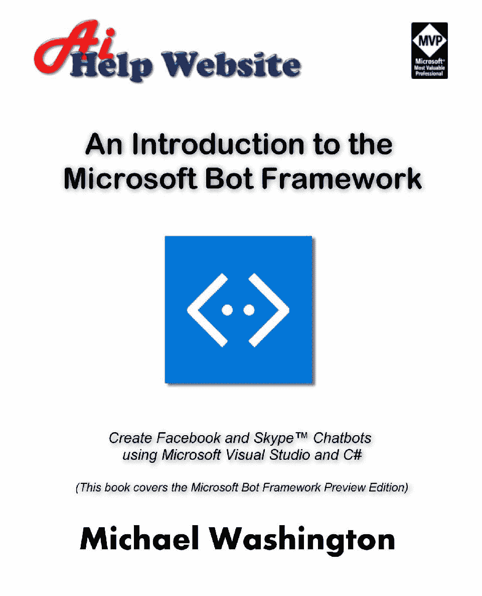

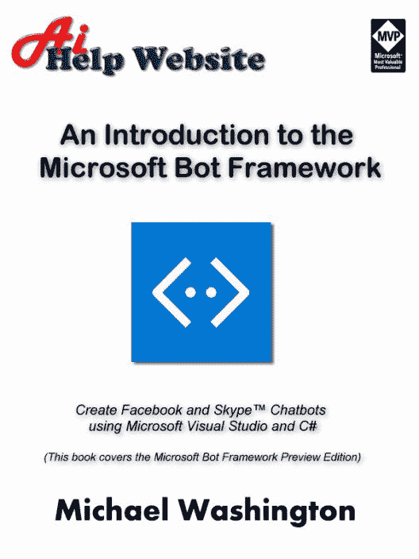


# 第 1 章：理解

Microsoft Bot Framework

本书涵盖了如何使用 Visual Studio 2015 使用 Microsoft Bot Framework 创建聊天机器人。本书的目的是演示、提供示例并解释该技术的重要概念。

## 什么是 Microsoft Bot Framework?

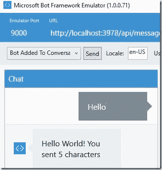

[Microsoft Bot Framework](https://dev.botframework.com/) 允许你轻松地创建机器人。


你可以在用户所在的任何地方创建与他们自然交互的机器人，包括 Facebook、短信、Skype、Office 365 电子邮件和其他流行服务。

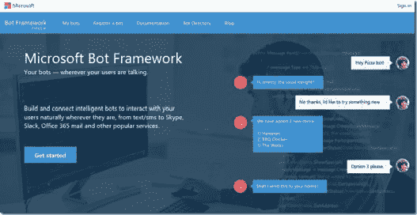

Microsoft Bot Framework 包含以下组件：

*   `Bot Framework Developer Portal`（开发者门户）– 一个将你的 `Bot` 连接到 Facebook、Skype 和电子邮件等通信通道的服务。
*   `Bot Builder SDK` – 一个 C# 和 Node.js 库，为构建可以处理自由格式和引导式交互的机器人提供了强大的框架。
*   `Bot Directory`（机器人目录）– 一个你可以连接的机器人目录。

`Bot Framework Developer Portal` 帮助你将 `Bot` 连接到通信通道。你可以编写一个 `Bot` 并在互联网上暴露与 Microsoft Bot Framework 兼容的 API。`Bot Framework Developer Portal` 将消息转发给用户，并将用户的消息发回给你的 `Bot`。

`Bot Builder SDK` 是一个托管在 GitHub (`https://github.com/Microsoft/BotBuilder-Samples`) 上的开源 SDK，它提供了构建对话所需的所有内容。微软的机器人开发者创建了此库以封装对话式机器人所需的功能。

`Bot Directory`（位于 `https://bots.botframework.com/`）提供了你可以通过 `Bot Connector` 暴露的通道与其通信的机器人。

# 第 2 章：创建一个 Hello World! 机器人

本章的示例代码可以通过 `http://AiHelpWebsite.com/Downloads` 链接“Creating a Hello World! Bot Using The Microsoft Bot Framework”获取。

本章目的是演示如何开始使用 Microsoft Bot Framework、如何创建一个简单的 `Bot` 以及如何将其发布到 Microsoft Bot Framework Developer Portal。

## 创建 Hello World! 机器人

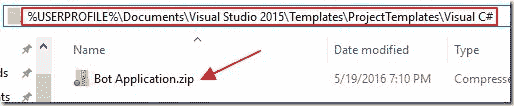

从 `http://aka.ms/bf-bc-vstemplate` 下载 `Visual Studio 2015` 模板。

将 `.zip` 文件保存到 Windows 电脑的模板目录，路径为：`%USERPROFILE%\Documents\Visual Studio 2015\Templates\ProjectTemplates\Visual C#`。

这将创建一个可以在 `Visual Studio` 中用于创建 `Bot` 项目的模板。

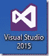

打开 `Visual Studio`。

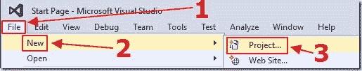

创建一个新的 `Project`。

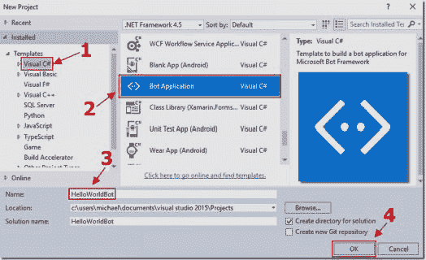

选择 `Bot Application` 模板并将项目命名为 `HelloWorldBot`。

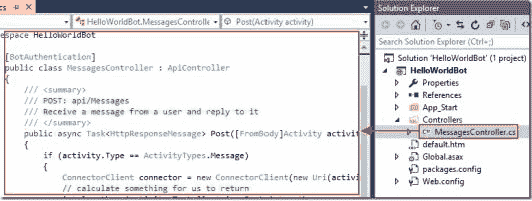

打开 `Controllers` 文件夹下的 `MessagesController.cs` 文件。

将 `Post` 方法更改为如下：

```
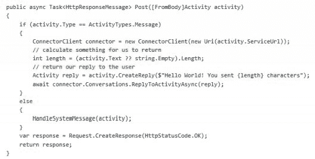
```

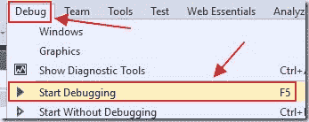

按下 `F5` 运行项目。

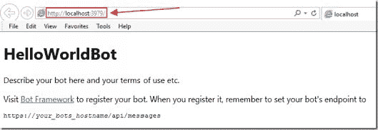

注意该 Web 地址。你将在下一步中需要它。

## 使用 Bot Emulator

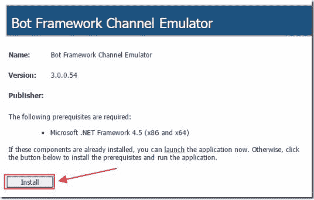

从 `https://aka.ms/bf-bc-emulator` 下载、安装并运行 `Bot Framework Emulator`。

当模拟器启动时，将地址设置为浏览器中指定的地址来连接到 `Bot`。但是，要在末尾添加 `/api/messages`。

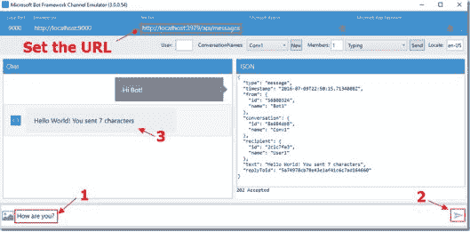

在 `Bot Emulator` 中在文本框内输入 `Hello` 并点击发送键（或按回车）。

你将在 `Chat` 窗口看到响应，并在 `JSON` 窗口看到响应的 `JSON` 内容。

## 保存用户数据

任何对话的一个重要部分是记住用户之前说过的话。

我们可以使用 `GetPrivateConversationData` 和 `SetPrivateConversationData` 来此。

为了演示如何处理这些，请在 `Controllers` 文件夹下的 `MessagesController.cs` 文件顶部添加以下内容：

```
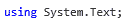
```

接下来，将 `MessagesController.cs` 文件中的 `Post` 方法更改为如下：

```
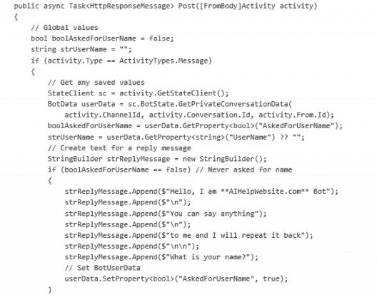
```

```
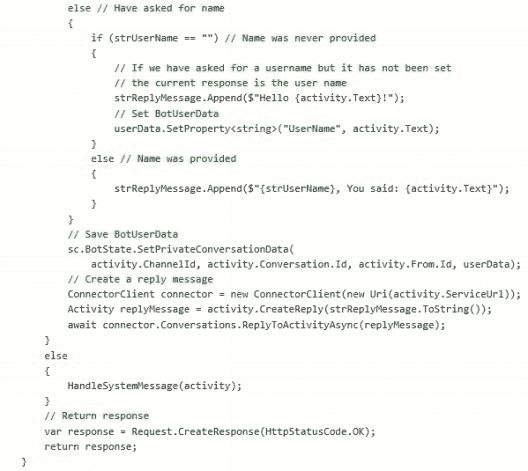
```

最后，将 `MessagesController.cs` 文件中 `HandleSystemMessethod` 中的以下部分更改为如下：

```
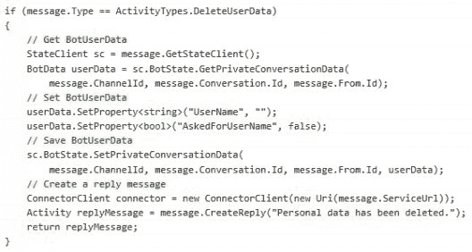
```

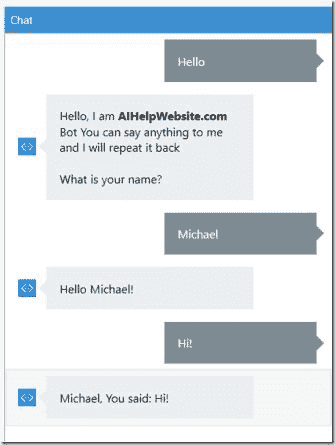

现在当我们与 `Bot` 聊天时，它可以记住我们的名字。

```
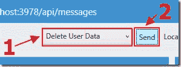
```

如果我们告诉它 `Delete User Data…`

```
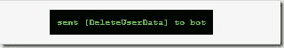
```

它将尊重我们的意愿。

## 发布机器人

要通过 Skype 和 Facebook Messenger 等通道连接你的 `Bot`，你需要在 Microsoft Bot Framework Developer Portal 上配置它。为了做到这一点，你首先需要将其发布在一个公共访问的位置。

可以是任何服务器；但建议`发布到 Azure`，因为 `Visual Studio` 内置了对其发布的支持。

首先，访问 [`azure.microsoft.com`](https://azure.microsoft.com/)，如果你还没有账户，请创建一个账户和订阅。

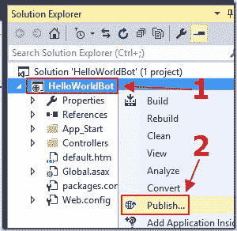

接下来，在 `Visual Studio` 中`右键点击` `Project` 节点（而不是 `Solution` 节点）并选择 `Publish`。

（此处由于原文存在大量重复和碎片化的描述，已根据指令要求提取核心逻辑进行翻译）

选择 `Azure Web Apps`。

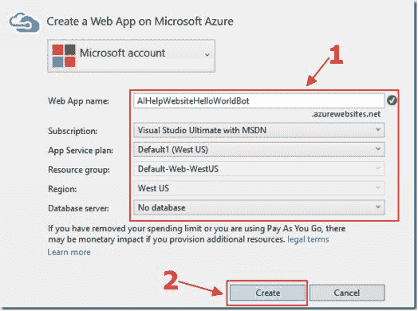

选择你的 `subscription`。

然后点击 `Create` 按钮。

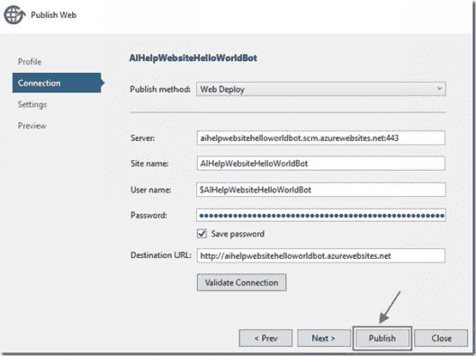

输入唯一的 `Web App name`。

选择你的 `resource group`。

选择一个 `service plan`。

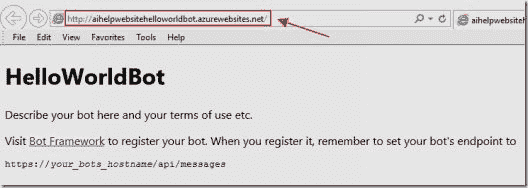

`web app` 创建后，点击 `Publish` 按钮。

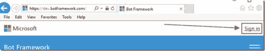

Web 应用 将在浏览器中打开。

注意 `web app address`。

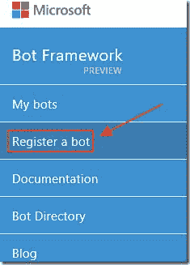

注意：端点地址是你上一步看到的。但是，记住在地址末尾添加 `/api/messages` 并使用 `https://` 而不是 `http://`。

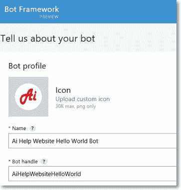

在过程中，你会被提示在 [`www.botframework.com/`](https://www.botframework.com/) `Register a bot`。

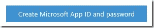

填写所有字段。

登录你的 `Microsoft Account`。

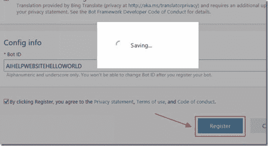

获取 `Application ID` 和 `password`。

记住它们，因为你需要在 `Visual Studio` 中更新 `web.config` 文件。

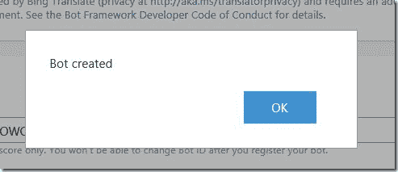

注意：如果你在上一步中忘记记录 `MicrosoftAppPassword`，可以点击 `Generate New Password` 按钮创建一个新的。

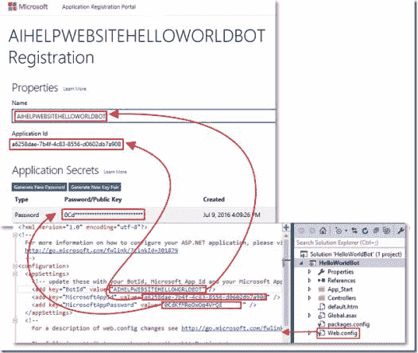

再次发布 `Bot`。

你这样做是因为 `Bot Framework` 在与其通信时会传递 `Bot ID`、`MicrosoftAppId` 和 `MicrosoftAppPassword`。

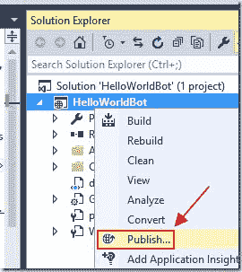

现在你可以使用 `Bot Framework Developer Portal` 网页测试你的 `Bot` 了。

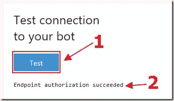

如果你愿意，可以点击 `Publish` 将你的 `Bot` 提交到 `Bot Directory`。

你也可以为你的 `Bot` [配置通道](http://docs.botframework.com/connector/getstarted/#configuring-channels)。即使你没有将 `Bot` 发布到 `Bot Directory`，你仍然可以从自己的应用程序以及你配置的任何通道调用它。

注意：第 10 章和第 11 章介绍了如何使用 Bot Framework Developer Portal 配置 Skype 和 Facebook Messenger 通道，将你的机器人部署到这些网络上。

# 第 3 章：使用 FormFlow

本章的示例代码可以通过 `http://AiHelpWebsite.com/Downloads` 链接“Introduction To FormFlow With The Microsoft Bot Framework”获取。

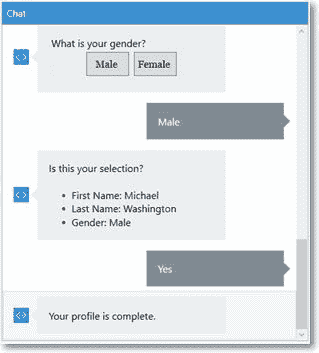


使用 [FormFlow](https://docs.botframework.com/en-us/csharp/builder/sdkreference/forms.html) 配合 [Microsoft Bot Framework](https://dev.botframework.com/) 可以让你用最少的代码快速创建一个引导式对话，从用户那里收集信息。虽然它的灵活性不如使用 Dialogs（Dialogs 将在节介绍），但它可以与 Dialogs 结合以增加其功能。

## 流程演示

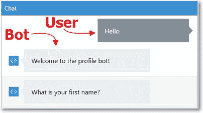

当用户与机器人开始对话时，它会介绍自己并询问用户的姓名。

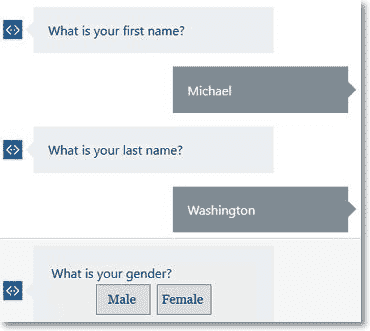

机器人将继续提问并收集回答。

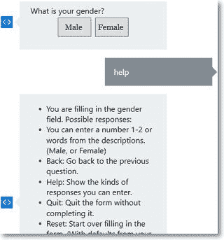

`FormFlow` 的一个特性是用户可以随时输入 `help` 来获取任何问题或 `FormFlow` 本身的帮助。

作为开发者，你无需编写任何额外代码即可获得此功能。

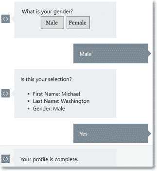

`FormFlow` 将持续运行直到表单完成。

## 创建项目

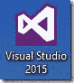

打开 Visual Studio。

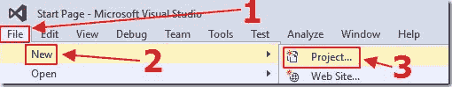

创建一个新项目。

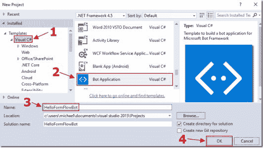

选择 Bot Application 模板并将项目命名为 `HelloFormFlowBot`。

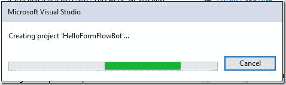

项目将被创建。

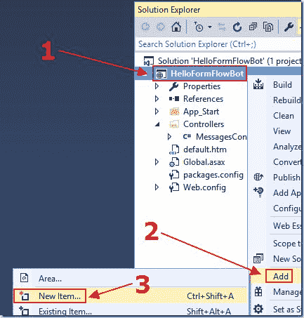

右键点击项目。选择“添加”，然后选择“新建项”。

我们现在将创建一个包含 `FormFlow` 逻辑的类。

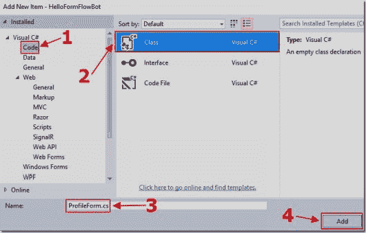

添加名为 `ProfileForm.cs` 的新 C# 类。

将所有代码替换为以下代码：

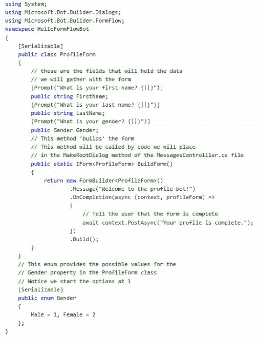

这段代码指示了我们将通过 `FormFlow` 收集的字段。

注意，该类以及它所使用的 `Gender` `enum`（枚举）都被标记为 `[Serializable]`。

Microsoft Bot Framework 要求类必须是可序列化的，这样机器人就可以保持无状态。

保存文件。

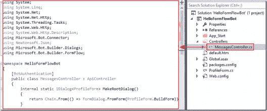

打开 `MessagesController.cs` 文件。

在文件顶部添加以下 `using` 语句（以支持 `FormFlow` 代码）：

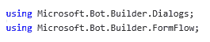 

在 `MessagesController` 类中添加以下 `MakeRootDialog` 方法，以调用之前创建的 `ProfileForm` 类中的 `BuildForm` 方法：

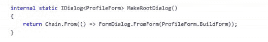

最后，将 `MessagesController` 类中的 `Post` 方法修改为如下：

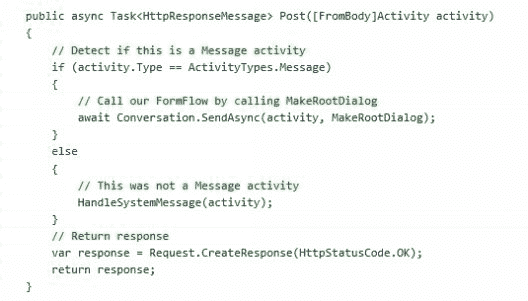

保存文件。

## 测试应用程序


按下 F5 运行应用程序。


网页浏览器将打开。

注意端口号和网页地址。


打开并运行 Microsoft Bot Framework Emulator。

当模拟器启动时，通过将地址设置为浏览器中指定的地址来连接机器人；但在末尾添加 `/api/messages`。


确保机器人 URL 连接到正确的地址。


输入消息并点击发送键（或按 Enter）。


你现在可以与机器人对话并填写 `FormFlow` 了。

## 保存数据

目前，应用程序不会保存用户的回答。事实上，在你填写完 `FormFlow` 后，它只会简单地要求你再次填写。

我们可以使用 [Bot State Service](https://docs.botframework.com/en-us/csharp/builder/sdkreference/stateapi.html) 来保存和检索值。

将 `ProfileForm.cs` 文件中的 `BuildForm` 方法修改为如下，以保存输入表单的值：


我们不仅存储用户提供的值，还设置了一个标记（`ProfileComplete`），这样我们就不会要求用户再次填写表单。

最后，将 `MessagesController` 类中的 `Post` 方法修改为如下：


现在应用程序只会要求用户填写一次表单，并使用 Bot State Service 显示接收到的值。

这些值将由 Microsoft Bot Framework 根据该用户在该对话中的键进行持久化。

在我们的示例中，我们使用了 `PrivateConversationData`，但 Bot State Service 暴露了以下方法，每个方法都有不同的范围：

| 方法 | 范围 | 说明 |
| :--- | :--- | :--- |
| `SetUserData()` | 用户 | 记住用户的上下文对象 |
| `SetConversationData()` | 对话 | 记住对话上下文对象 |
| `SetPrivateConversationData()` | 用户与对话 | 记住对话中某个人的上下文对象 |

# 第 4 节：使用 Dialogs

本节的示例代码可以通过 http://AiHelpWebsite.com/Downloads 中的“Introduction To Using Dialogs With The Microsoft Bot Framework”链接获取。


在 Microsoft Bot Framework 中使用 Dialogs 允许你对用户的对话建模。虽然它们比使用 FormFlow（在前节介绍）更灵活，但 Dialogs 需要更多的代码。

`Dialog` 是实现 `IDialog` 接口的类。Dialogs 可以与其他 dialogs 组合以最大化重用性。

`Dialog` 拥有一个上下文，其中包含一个对话中激活的 dialog 栈，并将维护对话的状态。`Dialog` 向用户发送消息，并在等待用户响应时挂起。

`Dialog` 使用存储在其上下文中的状态来恢复对话。该状态存储在 Microsoft Bot Framework 服务提供的状态服务中。

## 流程演示


当用户输入消息时对话开始。

机器人用问候语和游戏规则进行回复，规则是猜一个 1 到 10 之间的数字（随机选择）。


用户猜一个数字，机器人会告知用户是否正确。


当用户猜对数字时，他们将获得再次玩游戏的机会。

如果用户选择不再玩游戏，机器人会告诉他们再见。

## 创建应用程序


打开 Visual Studio。


创建一个新项目。


选择 Bot Application 模板并将项目命名为 `AiNumberGuesserBot`。


项目将被创建。


右键点击项目。选择“添加”，然后选择“新建项”。

我们现在将创建一个包含 Dialog 逻辑的类。


添加名为 `NumberGuesserDialog.cs` 的新 C# 类。

将所有代码替换为以下代码：

 

`Dialog` 是继承自 `IDialog` 的类。

注意，我们必须将此类标记为 `[Serializable]`。


这要求你实现 `StartAsync` 方法。

要实现它，将鼠标悬停在 `IDialog<object>` 上，等待几秒钟，接口选项窗口将会出现。


点击灯泡旁黑色箭头并选择“实现接口”（Implement interface）。

 

将创建 `StartAsync` 方法。它将在 Dialog 首次实例化时被调用。


我们希望代码异步运行，因此在方法签名中添加 `async`。

现在，更改方法内部的代码，使整个方法编码如下：


方法中的最后一行是 `context.Wait`。它会挂起当前的 `Dialog` 直到用户向机器人发送消息。

`Wait` 方法接受一个方法作为参数（在此例中为 `MessageReceivedAsync`），在收到响应时调用以恢复对话。


要实现它，将鼠标悬停在 `MessageReceivedAsync` 上，等待几秒钟，接口选项窗口将会出现。

点击灯泡旁的黑色箭头并选择生成方法 `NumberGuesserDialog.MessageReceivedAsync`。


将创建 `MessageReceivedAsync` 方法。


注意它使用了 `Dialog` 的上下文和一个参数（`result`）。


将参数的类型从 `object` 更改为 `IMessageActivity`，并将变量名从 `result` 更改为 `argument`。

同样，我们希望代码能够异步运行，因此在方法签名中添加 `async` 并将其标记为[virtual](https://msdn.microsoft.com/en-us/library/9fkccyh4.aspx)。

修改方法中的代码，使完整的方法代码如下：


注意最后一行（`context.Wait(MessageReceivedAsync)`），它只是在反复地调用该代码所包含的方法。

我们这样做是为了让这个示例尽可能简单。在下一节节中，当我们添加一个 `PromptDialog` 时，我们将探索一个更真实的示例。


接下来，打开 `..\AiNumberGuesserBot\AiNumberGuesserBot\Controllers\MessagesController.cs` 路径 `MessagesController.cs` 文件。

替换从以下开始的代码块中的默认代码：


替换为代码：


这告诉机器人将任何消息定向到 `NumberGuesserDialog` 类。

最后，在代码文件的顶部添加以下 `using` 语句：


## 测试应用程序


按 `F5` 运行应用程序。


浏览器将打开。请注意端口号和网页地址。


打开并运行 Microsoft Bot Framework Emulator。

当模拟器启动时，通过将地址设置为浏览器中指定的地址来连接机器人；但要在地址末尾添加 `/api/messages`。


确保 Bot URL 连接到正确的地址。


输入消息并点击发送键（或按 `Enter`）。


机器人将做出响应。

到此为止机器人只会做这些事情；然而，此示例展示了创建和使用 `Dialog` 类的最小代码。

## Dialog 提示 (Prompts)

`PromptDialog` 本质上是一个用于创建简单提示的 `Dialog` 工厂。它允许你询问用户响应，并指示在给出响应时运行哪些代码。`PromptDialog` 会产生一个具有自身私有状态的子对话。在等待响应时，Microsoft Bot Framework 服务会挂起该子对话。当它收到响应时，它将从被挂起时代码所在位点处继续执行。

这是在 `Dialog` 类内部控制程序流的主要手段。

`PromptDialog` 可以是以下类型之一：

* 用于附件的提示
* 用于一组选择之一的提示
* 询问是/否问题
* 用于长文本的提示
* 用于双精度浮数的提示
* 用于字符串的提示

我们将增强应用程序，以实现一个询问是/否问题的 `PromptDialog`。

首先，在 `MessageReceivedAsync` 方法中添加以下代码：


如果用户没有猜中随机数，此代码将一直循环并计数猜测尝试。

如果用户猜中了数字，则将调用 `else` 块中的代码。

现在，代码还不完整。我们需要在 `// Put PromptDialog here` 行下添加一个 `PromptDialog`。


输入 `PromptDialog` 并按点键（`.`）。自动补全选项将显示，我们将看到实现各种类型 `PromptDialog` 的选项。

选择 `Confirm` 选项。


我们可以查看官方文档 https://docs.botframework.com/en-us/csharp/builder/sdkreference/，可以看到方法签名要求我们传递当前上下文，指示在收到响应时要调用的方法（恢复处理程序），提供一个显示给用户的消息（`prompt`），并提供在响应类型不正确时显示的消息（`retry`）。其他参数是可选的。

以下显示了我们实现的完整代码：


我们现在需要实现恢复处理程序方法来处理响应（`PlayAgainAsync`）。


要实现它，将鼠标悬停在 `PlayAgainAsync` 上，等待几秒，界面选项窗口将会出现。

点击灯泡旁边的黑色箭头并选择生成方法 `NumberGuesserDialog.PlayAgainAsync`。


该方法将被创建。


在方法签名中添加 `async`。

修改方法，使完整代码如下：


按 `F5` 运行程序并使用 Bot Framework Emulator 连接到它……


当我们猜中正确的数字时，`PromptDialog` 将出现。当我们提供答案时，`PlayAgainAsync` 将处理响应。

我们可以在 `PlayAgainAsync` 方法中产生另一个 `PromptDialog`，从而创建一个卡片链。

# 第 5 章：使用图片、轮播和按钮

Microsoft Bot Framework 允许向用户发送多媒体。本节将介绍如何使用图片、轮播和按钮。

根据使用的通道不同，图片、音频、视频或文件可以显示：


然而，当你使用[卡片](https://docs.botframework.com/en-us/csharp/builder/sdkreference/attachments.html) 时，将提供强大的功能。注意：上面的图片显示了 Skype 中的机器人。

有四种卡片类型：

| 卡片类型 | 描述 |
| :--- | :--- |
| Hero Card | 大图文字 |
| Thumbnail Card | 小图文字 |
| Receipt Card | 发票或收据 |
| Sign-In Card | 用户登录表单 |

## Hero Card

| Title | 卡片标题 |
| Text | 显示在卡片上的文本 |
| Subtitle | 标题链接 |
| Images | 实际上只有一张图片 |
| Buttons | 一个或多个按钮（在 Skype 中，卡片上只会显示 5 个按钮。如果你有更多按钮，将会创建。） |
| Tap | 用户点击卡片时触发的操作（这在某些 Skype 客户端中不起，因此对于 Skype，请为 Subtitle 使用超链接。） |


在本节中，我们将介绍 Hero Card。

Hero Card 和 Thumbnail Card 的区别仅在于图片的大小。

每个由以下属性组成：


为了演示实现 Hero Card，我们将从上一节的代码开始。

注意：首先，你必须使用管理 NuGet 包将 `Microsoft.Bot.Builder` 更新到最新稳定版本后再继续。

此外，我们将进行一些小更改，例如将猜数字范围从 1 到 10 改为 1 到 5，以便在 Skype 中显示效果良好，因为 Skype 在单个卡片上只显示 5 个按钮。

在 Visual Studio 中打开项目。


创建一个新文件夹并命名为 `Images`。

将 `NumberGuesserOpeningCard.png` 文件（你可以从 AiHelpWebsite.com 的[下载页面](http://aihelpwebsite.com/Downloads) 获取代码）添加到 `Images` 文件夹中。


接下来，在 `HandleSystemMessage` 方法中找到 `else if (message.Type == ActivityTypes.ContactRelationUpdate)` 区域。

当 Bot 被添加到用户的联系列表时，会触发此方法。

将该区域中的所有代码替换为以下代码：

 


保存文件并按 `F5` 运行应用程序。


使用 Microsoft Bot Framework Emulator 打开并运行 Bot。


在模拟器中，调用 `Contact Relation Update-add` 事件。


将显示 Hero Card（英雄卡片）。

点击卡片将带您访问 `AiHelpWebsite.com` 网站。

## Carousel（轮播图）


轮播图水平显示多个卡片（`Hero Cards` 或 `Thumbnail Cards`）。

`List`（多个卡片的默认布局）垂直显示卡片。

上面的图片显示了两个 `Hero Cards` 轮播图在 Skype 客户端中的外观。


要实现此功能，首先将 `AiLogo_smallSquare.png` 文件（您可以在 `AiHelpWebsite.com` 的[下载页面](http://aihelpwebsite.com/Downloads)获取代码）添加到 `Images` 文件夹中。

接下来，将以下代码添加到 `HandleSystemMessage` 方法中（`var connector = new ConnectorClient(new Uri(message.ServiceUrl));` 行上方）：


保存文件，运行应用程序，并在模拟器中连接到它。

在模拟器中，调用 `Contact Relation Update-add` 事件。


将显示第一张卡片，但您现在会看到一个滑块。

将其向右滑动。


随后您将看到第二个 `Hero Card`。

在 Skype 中，`Subtitle` 属性将显示为超链接并可以点击。

## 对话中的富卡片附件 (Rich Card Attachments In Dialogs)

在 Dialogs 中实现富卡片附件面临着额外的挑战。

主要的最大的挑战是，在 `Dialog` 类内部，您无法访问应用程序的基 URL 来确定图像的位置。

我们可以通过使用 Bot State Service 来解决这个问题。

打开 `MessagesController.cs` 文件：

 

在 `Post` 方法顶部添加以下代码：

 

这将使用 [Bot State Service](https://docs.botframework.com/en-us/csharp/builder/sdkreference/stateapi.html) 存储 `CurrentBaseURL` 和 `Recipient`，以便稍后可以在 `Dialog` 类中检索这些值。


打开 `NumberGuesserDialog.cs` 文件。

在 `namespace` 上方添加以下代码：

 

在类顶部添加此内容：


这将提供一个全局变量，它将在调用之间自动被[序列化并持久化](https://docs.botframework.com/en-us/csharp/builder/sdkreference/dialogs.html#echoBot)以存储 `Base URL`。

在 `MessageReceivedAsync` 方法顶部添加以下代码：


这将检索存储在 `MessagesController` 类 Bot State Service 中的 `CurrentBaseURL` 值，并将其存储在全局变量 `strBaseURL` 中。

向类添加以下 `Utility` 方法。此方法将创建 5 个 `CardAction` 按钮，这些按钮将附加到 `Hero Card` 上（我们将在后续步骤中创建）：


按钮的类型被设置为 `[imBack](https://docs.botframework.com/en-us/csharp/builder/sdkreference/attachments.html#cardaction)，这将使按钮（`CardAction`）简单将值（在此情况下为按钮编号）发送回 Bot。

## 在 Dialog 类中创建 Hero Card


我们现在将在 `Dialog` 类中显示一个带有 5 个按钮的 Hero Card。

首先，将 `NumberGuesserCard.png` 文件（您可以在 `AiHelpWebsite.com` 的[下载页面](http://aihelpwebsite.com/Downloads)获取代码）添加到 `Images` 文件夹中。

接下来，在 `MessageReceivedAsync` 方法中找到以下代码：

 

将其替换为以下代码：


保存文件，按 `F5` 运行项目，并在模拟器中连接到它。


Bot 现在将显示一张图片和按钮。

我们可以点击其中一个按钮或输入一个数字来玩游戏。

下面的图片显示了它在 Skype 中的外观：


## 创建可复用的 Hero Card

如果有几个地方需要显示带按钮的 Hero Card，我们将想要创建一个可复用的 Hero Card。

此 Hero Card 将不包含图片，只有按钮。

首先，在 `Dialog` 类中添加以下实用方法：


# 选择 Entity Framework 6.x。

点击“下一步”。


展开树以显示 `UserLog` 表并点击其旁边的复选框。

接受其他默认值。

点击“完成”。


将创建一个名为 `BotData.edmx` 的实体数据模型（Entity Data Model）。

现在可以关闭 `BotData.edmx` 了。

## 将记录到数据库

现在我们将编写代码，将（大部分）发送和来自机器人的消息记录到数据库中。

首先，创建一个名为 `Utility.cs` 的文件并使用以下代码：


这创建了一个实用方法，允许我们修剪存储在数据库中的任何文本。这确保了任何消息都不会过长而无法存储在数据库中，否则会导致错误。


接下来，在 `MessagesController.cs` 中找到以下代码：


将其替换为：


此代码记录了从用户发送到机器人的消息。

## 在 Dialog 类中记录消息


[Dialog](https://docs.botframework.com/en-us/csharp/builder/sdkreference/dialogs.html) 类创建对用户的响应。

在 `NumberGuessserDialog.cs` 文件中找到（多处））向用户发送文本响应的代码，这些代码包含以下行：


在现有代码行上方添加以下代码（再次，会有多处需要此操作）：


当我们使用 `PromptDialog` 时，我们没有[回复 Activity](https://docs.botframework.com/en-us/csharp/builder/sdkreference/routing.html#replytoactivity)。在这种情况下，我们需要手动创建一个，以便我们获得需要记录到数据库的值。

在 `Dialog` 类中找到以下代码：


在现有代码行上方添加以下代码：


注意：`CongratulationsStringPrompt` 是由现有代码设置的，表示用户赢了游戏。

## 测试数据库记录代码


按 F5 运行应用程序。


浏览器将打开。

注意端口号和网页地址。


打开并运行 Microsoft Bot Framework Emulator（模拟器）。

当模拟器启动时，将地址设置为浏览器中指示的地址来连接机器人；但要在末尾添加 `/api/messages`。


确保机器人 URL 连接到正确的地址。


输入 Hello 并点击发送按钮与机器人开始对话。


与机器人玩游戏。

关闭浏览器以停止应用程序并返回 Visual Studio。

## 查看数据


现在我们将查看记录到数据库中的数据。

在 Visual Studio 的解决方案管理器（Solution Explorer）中，右键点击 `BotData.mdf` 并选择“打开”。


这将打开服务器资源管理器（Server Explorer）。

右键点击 `UserLog` 表并选择“显示表数据”。


将显示记录的数据。

## 记录高分


我们将添加代码来记录并显示高分。

我们必须先修改数据库，以存储胜利所需的次数和胜利者的名称。

在服务器资源管理器中，右键点击 `UserLog` 表并选择“打开表定义”。

注意：如果没有此选项，请从 https://msdn.microsoft.com/library/mt204009.aspx 安装最新版本的 SQL Server Data Tools (SSDT)。


添加以下字段：

* `CountOfTurnsToWin` [int]
* `WinnerUserName` [nvarchar(150)]

点击“更新”按钮。


当“预览数据库更新”框显示时，点击“更新数据库”。


数据工具操作窗口将指示更新何时完成。

## 更新 ADO.NET 实体数据模型


我们需要更新 ADO.NET 实体数据模型，以便程序化访问新添加的字段。

在解决方案管理器中，点击 `BotData.edmx` 在设计器中打开。

在设计器中，右键点击 `UserLog` 表并选择“从数据库更新模型”。


当更新向导显示时，选择“刷新”选项卡，然后选择 `UserLog` 表。点击“完成”。

## 修改代码以记录高分


我们需要修改代码以记录高分。

现在现在修改 Dialog 类以记录胜利者和胜利所需的次数。在 `NumberGuesserDialog.cs` 文件中找到以下代码：


在上述代码下方添加以下代码：


## 显示高分


现在我们将添加代码，当用户输入高分时显示高分。

打开 `MessagesController.cs` 文件并添加我们添加的 `ShowScores` 方法。


将其替换为以下代码：


最后，为了让用户知道可以查看高分，在 Dialog 类中找到以下代码：


将其更改：


## 测试代码


现在当我们输入高分时，就可以看到记录的高分。


上面的图片显示了发布后高分的情况。


测试此代码。

## 发布使用数据库的 Bot Framework 应用程序


要发布机器人，可以遵循第 2 章“创建 Hello World!”中的说明。然而，本章不涵盖使用数据库的机器人的发布。


如果没有 Azure 账户，请访问 https://azure.com 创建账户。


登录 Azure [网页门户](https://portal.azure.com/) 并选择 SQL 数据库。


填写表创建数据库。

注意：如果你还没有放置数据库的服务器，将提示你创建一个。此时你将创建一个用户名和密码。这就是你在使用 Visual Studio 中的部署向导连接到数据库时将使用的用户名和密码。


创建数据库后，可以在概述部分查看 ADO.NET(SQL 身份)连接字符串。

注意：连接字符串将没有用户名和密码。你需要使用包含数据库的 Azure 服务器的用户名和密码。


在“设置”选项卡上：

1.  从 App_Data 文件夹排除文件。
    这将防止 `BotData.mdf` 数据库文件发布到 Azure。你这样做是因为 .mdf 文件无法在 Azure 上使用。

2.  在 `BotDataEntities` 中输入运行在 Azure 上的数据库的连接字符串。
    你可以从 Azure 门户中数据库的概述部分获取 ADO.NET(SQL 身份)连接字符串。使用“...”按钮可以帮助你连接数据库并构建连接字符串。

3.  勾选“运行时使用此连接字符串”。
    这将更新发布应用程序的 `web.config`，因此发布的应用程序将连接到 Azure 上的数据库。

4.  点击“发布”按钮。


在 Visual Studio 的服务器资源管理器（Server Explorer）中，右键点击数据库并选择 `Open in SQL Server Object Explorer`（在 SQL Server 对象管理器中打开）。

注意：如果没有此选项，请从 `https://msdn.microsoft.com/library/mt204009.aspx` 安装最新的 SQL Server 数据工具 (SSDT)。


这将打开 SQL Server 对象管理器。

右键点击数据库下的 `Tables` 节点并选择 `Add New Table`（添加新表）。


使用以下脚本创建所需的表并点击 `Update`（更新）按钮：


当出现 `Preview Database Updates`框时，点击 `Update Database`（更新数据库）。

注意：你还可以使用 [Cloud Explorer for Visual Studio 2015 extension](https://visualstudiogallery.msdn.microsoft.com/84e83a7c-9606-4f9f-83dd-0f6182f13add) 在 Visual Studio 内部管理你的 Azure 数据库。

# 第 7 章：实现语言理解智能服务 (LUIS)

本章的示例代码可以通过链接“Implementing Language Understanding Intelligent Service (LUIS) In Microsoft Bot Framework”在 `http://AiHelpWebsite.com/Downloads` 获取。


在你的 Microsoft Bot Framework 应用程序中使用语言理解智能服务 (LUIS)，可以让你创建让终端用户更容易交互的聊天机器人。


在本例中，我们将从上一章创建的代码开始。

本章将介绍如何创建一个猜数字游戏并存储和显示高分。在上章中，用户被要求输入精确的单词 `High Scores`，并且他们只能看到昨天的高分。


在本章中，我们将修改代码，允许用户查看过去一周、上个月或他们指定的天数（最多 30 天）的高分。

最重要的是，我们将允许用户使用自然语言输入请求，然后检测用户的意图和重要的相关实体（例如天数）。

我们将通过使用语言理解智能服务 (LUIS) 创建一个应用程序，然后该程序与我们现有的 Bot 接口。

## 创建 LUIS 应用程序


第一步是访问 `https://www.luis.ai/` 在语言理解智能服务 (LUIS) 网站创建一个账户并登录。


创建一个新应用程序 (New Application)。


我们将其命名为 `HighScores`，在填写其他字段后，点击 `Add App`（添加应用）。


现在我们需要创建 `Entities`（实体）。这些我们需要识别和收集的元素，以便我们的 Bot 可以根据它们的值执行操作。在示例中，我们要创建两个实体：

*   `PeriodOfTime` – 检测用户是否输入描述天数（而非实际天数）的单词，例如 `week`（周）或 `month`（月）。
*   `Days` – 检测用户是否输入了实际天数，如 `3` 或 `three`。


点击 `Entities` 标签旁边的加号按钮（在编辑器左侧），打开一个框允许你添加每个实体（一次添加一个）。


完成后，实体将显示出来。


接下来，我们将添加一个 `Intent`（意图）。

注意：“None”意图会在用户的表述不匹配任何编写的意图时自动创建）

点击 `Intents` 标签旁边的加号按钮。


为意图名称输入 `HighScores`。

输入 `Show me the high scores for the past week`（显示过去一周的高分）作为触发此意图的命令示例。（这也称为示例话述。）

点击 `Save`（保存）。


该话述现在显示在 `New utterances`（新话述）选项卡中。

我们希望此话述触发 `HighScores` 意图，因此从下拉列表中选择它。


我们还想检测关联实体。

点击单词 `week`，它将被高亮并出现弹出框。

选择 `PeriodOfTime`。


最后，点击 `Submit`（提交）。


继续输入并标记额外的话述。

注意：记住将任何指示数字的实体标记为 `Days`。


继续训练服务。

你会注意到，最终它将开始自动检测实体。

然而，很多时候你仍然需要手动纠正它。

输入并纠正至少十个不同的话述。


点击界面底部的 `Train`（训练）按钮来训练模型。


接下来，点击 `Publish`（发布）按钮。


最后，点击 `Publish`（发布）按钮。


发布端点将显示。记下 `App ID` 和 `Subscription Key`。稍后将在 Bot 中它们。

## 更新 Bot 应用程序


在 Visual Studio 中打开上一章的项目。

添加一个名为 `LUISDialog.cs` 的新文件，使用以下代码：

```csharp
// Code content for LUISDialog.cs
```

此代码将输入的文本传递给 LUIS 应用程序。

我们为每个方法添加 `LuisIntent` 标记，设置意图名称（例如 `[LuisIntent("HighScores")]`）以指示触发哪个方法。

注意：此时代码尚未完成。我们将在后续步骤中完成代码。

打开 `Controllers` 文件夹下的 `MessagesController.cs` 文件。

替换以下代码：

```csharp
// Original code in MessagesController
```

为：

```csharp
// Updated code calling LUISDialog
```

现在，当用户与 Bot 通信时，我们需要调用 `LUISDialog` 类而不是之前配置的 `NumberGuessDialog`。

在某些地方，`NumberGuessDialog` 需要调用 `LUISDialog`，例如当用户输入的不是游戏部分的待猜数字时。

`NumberGuessDialog` 类需要将控制权返回给 `LUISDialog`。

替换 `NumberGuessDialog` 类中（括号内）如下所示的代码：

```csharp
// Old code block
```

替换为以下代码：

```csharp
// New code block returning control
```

`NumberGuessDialog` 类不再是根类，因此我们需要再次修改它，以便在被 `LUISDialog` 触发时正确启动游戏。

在 `StartAsync` 方法中找到以下代码：

```csharp
// Old StartAsync code
```

将其替换为：

```csharp
// New StartAsync code
```

此代码显示猜数字游戏的欢迎界面。

## 实现高分


此时，如果我们运行应用程序并在 Microsoft Bot Framework 模拟器中连接它，我们就可以玩游戏了。


然而，如果我们输入任何会触发 `HighScores LUIS Intent` 的内容，我们将收到一个错误，因为尚未实现处理此内容的代码。


打开 `LUISDialogClass.cs` 文件找到找到代码：


将其替换为：

 

此代码将设置用户请求高分时包含的天数。它首先尝试检测是否通过了某段时间（在 `PeriodOfTime` 实体中）。如果是的话，代码会将已知的时间段转换为天数。

如果通过了具体的天数（在 `Days` 实体中），代码将尝试将天数转换为数字。如果无法转换，它将假设天数是以单词（而非数字）的形式传递的。如果是如此，它会将该值传递给 `ParseEnglish` 方法，该方法会将单词转换为数字。

注意：你可以从 `http://stackoverflow.com/questions/11278081/convert-words-string-to-int` 获取 `ParseEnglish` 方法。

然后，将天数（以及当前上下文）传递给 `ShowHighScores` 方法。

最后一步，输入以下代码将 `ShowHighScores` 方法实现到 `LUISDialogClass` 中：


# 第 8 章：使用 Direct Line API 调用 Microsoft Bot Framework

本章的示例代码可以通过 `http://AiHelpWebsite.com/Downloads` 处的“使用 Direct Line API 调用 Microsoft Bot Framework”链接获取。


你可能需要从自定义应用程序、服务或网站直接调用你的 Microsoft Bot Framework Bot。Microsoft Bot Connector Direct Line REST API 允许你执行此操作。此外，它还允许你在应用程序中身份验证用户，并以该用户的身份与 Bot 进行安全通信。


Direct Line API 暴露了一个 REST API，允许你与已注册到 [Microsoft Bot Connector Service](https://docs.botframework.com/en-us/csharp/builder/sdkreference/connector.html) 的单个 Bot 进行通信。

该 API 旨在供希望从自己的客户端应用程序（如移动应用、服务，甚至是 [HoloLens](https://www.microsoft.com/microsoft-hololens/en-us)）与 Bot 通信的开发者使用。


使用该 API 的步骤是：

1. 在 Bot Framework 门户注册你的 Bot
2. 配置 Direct Line 连接器
3. 使用从 Bot Framework 门户获取的凭据进行基于 REST 的调用以与 Bot 通信

   在我们的示例中，我们将使用 `Microsoft.Bot.Connector.DirectLine` Nuget 包来帮助我们调用。


注意：输出的渲染将由调用 Direct Line API 的自定义应用程序开发人员负责。

图像、卡片和按钮等媒体需要自定义代码以适用于特定应用程序的方式进行渲染。


我们将构建的示例应用程序将创建一个自定义客户端，允许用户创建账户、登录并与上一章中创建的 Bot 进行安全通信。

## 配置 Direct Line 连接器


我们想要为 Bot 配置 Direct Line 连接器。

访问 `https://dev.botframework.com/`，登录并选择 My Bots。

打开已部署到 Microsoft Bot Framework 门户的 Bot。


第一步是记录你给 Bot 分配的句柄（handle）。创建 Web 应用程序时将需要它。


在 Add another channel（添加其他通道）下，点击 Direct Line 旁的 Add 按钮。


当配置 Direct Line 界面界面，点击 Generate Direct Line secret（生成 Direct Line 密钥）按钮。


复制 Secret 代码。创建 Web 应用程序时将需要它。

点击 I’m done configuring Direct Line（我已完成 Direct Line 配置）按钮。

屏幕将关闭。

## 创建 Web 应用程序


打开 Visual Studio。


在 Visual Studio 工具栏中，选择 File（文件）、然后 New（新建）、然后是 Project（项目）。


选择 Web，然后是 ASP.NET Web Application (.Net Framework)。

Name 输入 `DirectLineBot`。

勾选 Create directory for solution（创建解决方案目录）框。

按 OK。


当应用程序配置框出现时，选择 MVC 模板。

确保 Authentication（身份验证）选择了 Individual User Accounts（个人用户账户）。如果不是，点击 Change Authentication（更改身份验证）进行更改。

按 OK。


应用程序将被创建。

我们需要添加 `Microsoft.Bot.Connector.DirectLine` NuGet 包以便我们轻松与 DirectLine API 通信。


在 Solution Explorer（解决方案资源管理器）中，右键点击 `DirectLineBot` 项目节点。


当你在菜单栏和主页看到自己的电子邮件地址时，说明你已经登录。


你现在可以与 Bot 通信，并运行上一章节中创建的相同代码。


当我们查看 Azure 上数据库中的数据时，可以看到发送给 Bot 的消息的 `UserID` 和 `UserName` 完全由以下自定义代码控制：


# 第 9 章：使用 Application Insights 监控你的 Bot

本章的示例代码可以通过 `http://AiHelpWebsite.com/Downloads` 链接“Using Application Insights With Microsoft Bot Framework”获取。


通过 `Application Insights`，你可以在 Bot 中插入几行代码，以发现你的用户正在做什么。

当你安装 `Application Insights` 时，你实际上是在你的应用程序中安装了一个小的插桩程序包。接下来，你需要在 Microsoft Azure 门户网站中设置 `Application Insights` 资源。

你安装的插桩程序会监控你的应用并将遥测数据发送到 Microsoft Azure 门户网站。Microsoft Azure 门户网站会显示统计图表并带有强大的搜索工具，帮助你监控应用程序并诊断任何问题。


为了演示这一点，我们将从第六章中创建的 Bot 开始。


这将需要使用 Microsoft Azure。如果你没有 Microsoft Azure 账户，请访问 `https://azure.microsoft.com` 创建账户和订阅。

## 启用 Application Insights


在 Visual Studio 中打开 `AiNumberGuesserBot` 项目。

在“解决方案资源管理器”中，右键点击“项目”（不是解决方案），并选择 `Add Application Insights Telemetry`。


首先，你需要登录你的 Microsoft Azure 账户。

之后，你将看到一个创建 `Application Insights` 资源的表单（通过在 `Send telemetry to` 下拉菜单中选择 `New resource` ）或连接到现有的 `Application Insights` 资源（通过在 `Send telemetry to` 下拉菜单中选择它）。

选择配置选项后，点击 `Add` 按钮继续。


`Application Insights` 程序集将被添加到项目中。


如果你遇到错误，很可能是因为你有某些需要更新的组件。


在 Visual Studio 的“解决方案资源管理器”中，右键点击“项目”（不是解决方案），并选择 `Manage NuGet Packages`。


选择 `Updates`，选择错误消息指示需要更新的组件，并点击 `Update` 按钮。


当 `Review Changes` 框显示时，点击 `OK` 按钮。

接下来，再次右键点击项目并选择 `Add Application Insights Telemetry` 以重新启动该过程。

`Application Insights` 组件现在应该可以成功安装。

## 调试应用程序


在尝试调试之前，清除 `Web.config` 文件中可能存在的任何 `MicrosoftAppId` 和 `MicrosoftAppPassword` 设置，然后保存文件。

这是必须的，以便你可以轻松在本地进行调试。

如果你需要重新发布应用程序，请记得替换任何设置。


按下 `F5` 运行项目。


应用程序将在浏览器中打开。

记下网页地址，因为你将在下一步中需要它。

## 使用 Bot Emulator


打开并运行 Microsoft Bot Framework Emulator。

当模拟器启动时，通过将地址设置为浏览器中指示的地址来连接到 Bot；但在末尾添加 `/api/messages`。


在 Bot 器中，在文本框中输入 `Hello` 并点击发送键（或按回车）。

你将在聊天窗口看到响应，并在 JSON 窗口中看到响应的 JSON 内容。


你应该会弹出一个窗口，其中提供了遥测数据的链接。


在应用程序运行时，你还可以通过点击 Visual Studio 解决方案资源管理器中 `ApplicationInsight.config` 部分的链接来访问数据。


此外，你还可以右键点击项目并选择 `Application Insights` 显示提供所有选项的菜单。


选择 `Search Live Telemetry` 或 `Search Debug Session Telemetry` 将在 Visual Studio 中打开一个窗口，显示遥测数据。

注意：有关使用这些窗口的更多信息，请访问 `https://azure.microsoft.com/en-us/documentation/articles/app-insights-visual-studio/` 查看关于 Visual Studio 中的 Application Insights 工具。


为了实现完全的遥测就绪，请确保所有绿点都已勾选。如果有任何未勾选，请点击它们。


停止调试以添加组件。


点击按钮进行配置。


组件将被添加。


## 自定义

Application Insights 最强大的功能之一是它可以跟踪自定义的遥测数据。

我们现在演示使用它跟踪游戏启动、完成、猜测数字以及所需的次数。

在 `AiNumberGuesserBot` 项目中，打开 `GuesserDialog.cs` 并添加以下语句：


接下来，在类中添加此行：


最后，在 `StartAsync` 方法中添加以下行：


这将跟踪游戏启动和猜测数字。


此外，添加以下代码跟踪游戏完成：


## Application Insights API

我们可以使用许多 API 调用来跟踪自定义事件，如下表所示：

| 方法名 | 用途 |
| :--- | :--- |
| `TrackPageView` | 页面、屏幕、面板或表单 |
| `TrackEvent` | 用户操作和其他事件。用于跟踪用户行为或监控性能。 |
| `TrackMetric` | 性能测量，如与特定事件无关队列长度 |
| `TrackException` | 记录异常以便诊断。跟踪它们相对于其他事件的发生位置并检查堆栈跟踪 |
| `TrackRequest` | 记录服务器请求的频率和持续时间，用于性能分析。 |
| `TrackTrace` | 诊断日志。你还可以捕获第三方日志 |
| `TrackDependency` | 记录对应用依赖的外部组件调用的持续时间和频率。 |

你可以向大多数这些遥测调用[附加属性和指标](https://azure.microsoft.com/en-us/documentation/articles/app-insights-api-custom-events-metrics/#properties)。


运行应用程序并输入一些示例数据。


在 Visual Studio 中选择 `Application Insights` 菜单并选择 `Explore Telemetry Trends…`


…你就可以选择 `Inspect your custom events`。


点击 `Analyze Telemetry` 按钮处理最新数据。你将看到 `Properties` 和 `Metrics` 在何处被跟踪。

注意：你的自定义事件需要几分钟才会显示。

你可以双击某个趋势以钻取数据。


这将带你进入搜索界面，你可以在那里进行进一步的过滤并查看每个单独事件的详情。

## Application Insights 门户


你可以通过从 Visual Studio 菜单中选择来访问 Microsoft Azure 网站上的 Application Insights 门户。


你可以在那里查看并更改你的定价层级（Pricing tier）。

你还可以获取你的 `Instrumentation Key`。

## 监控已发布的应用程序


你可以监控已发布的机器人（Bot）。

发布你的机器人。（方向参见第 2 章。）当你的机器人发布在 `https://dev.botframework.com/` 网站后，选择 `My bots`。


编辑机器人配置。


输入 `Instrumentation Key`（来自 Microsoft Azure 网站）并点击 `Save changes`。

这将启用额外的属性和指标以供跟踪。


返回 Microsoft Azure 网站上的 Application Insights 资源。

你现在可以监控已发布的应用程序，并使用默认跟踪数据以及你的自定义属性和指标创建自定义图表。

# 第 10 章：创建 Skype 机器人

本章的示例代码可以通过 `http://AiHelpWebsite.com/Downloads` 处的“Creating a Skype Bot Using The Microsoft Bot Framework”链接获取。


你可以轻松创建一个 Skype 机器人并将其部署到 Skype。


为了演示这一点，我们将从第 6 章创建的机器人开始。

注意：如果你之前还没有部署机器人，请跳到标记为“Register Skype”的章节。

## 发布机器人


第一步是将 `AiNumberGuesserBot` 连接到 Microsoft Bot Framework 开发者门户。

要做到这一点，我们需要将其发布在公共可访问的位置。这可以是任何服务器；但是，建议发布到 Azure，因为 Visual Studio 对发布到 Azure 有内置的支持。


首先，访问 `https://azure.microsoft.com` 并创建一个账户和订阅（如果你你还没有的话）。


接下来，在 Visual Studio 中打开 `AiNumberGuesserBot` 项目，右键点击 `Project` 节点（不是 `Solution` 节点），并选择 `Publish`。


选择 `Microsoft Azure App Service`。


登录你的 Azure 账户，然后点击 `New` 按钮。


确保类型为 `Web App`。

输入唯一的 `Web App` 名称，选择你的订阅，选择或创建服务计划和资源组，并点击 `Create` 按钮。


在创建 Web 应用后，点击 `Publish` 按钮。


Web 应用将在浏览器中打开。

记下该地址，因为你将在后的步骤中需要它。

## 在 Bot Connector 中注册机器人 


访问 `http://dev.botframework.com`  Microsoft Bot Framework 门户并使用你的 [Microsoft Account](https://www.microsoft.com/en-us/account) 登录。


选择 `Register a bot`。


填写所有字段。


注意：端点 web 地址就是你在上一步浏览器打开时看到的地址。

然而，你必须在地址末尾添加 `/api/messages` 并使用 `https://` 而不是 `http://`。


在表单的某处，你会看到一个链接，点击它可以跳转到

`https://apps.dev.microsoft.com`

你可以在那里获取一个 `Application ID` 和一个 `password`。


记下它们，因为你以后将需要它们来更新 Visual Studio 项目中的 `web.config` 文件。


点击 `Register` 按钮。


将创建机器人注册。

当你返回 `http://dev.botframework.com` 时，你会看到机器人注册已创建。


点击 `Show` 按钮显示 App Secret（应用密钥）。请将其记录下来，你稍后的步骤中会用到。


现在 App 已经创建，你需要配置它以使用 Facebook Messenger。

点击 `Add Product`。


选择 `Messenger`。


选择 `Get Started`。


Facebook Messenger 已添加。

你现在需要配置它以与 Microsoft Bot Connector 进行通信。

## 配置回调 URL 和验证 Token


前往 [`dev.botframework.com/`](https://dev.botframework.com/) 并登录。


选择 `My bots`。


选择一个已发布的机器人。（有关如何操作的说明请参见第二章。）


点击 Facebook Messenger 通道旁边的 `Add` 按钮。


点击 `Set webhook callback url` 和 `verify token` 旁边的展开器图标。


使用 `Select` 按钮分别选择并复制 `Callback Url` 和 `Verify Token`。


返回 [`developers.facebook.com`](https://developers.facebook.com/)，选择你的应用程序，并在 Messenger 设置中点击 `Setup Webhooks` 按钮。


输入你复制的 `Callback URL` 和 `Verify Token`，勾选上方所示的 `Subscription Fields`，并点击 `Verify and Save` 按钮。


设置 Webhooks 后，点击 `Select a Page` 旁边的下拉菜单。


选择你之前创建的 Facebook 公页。


接下来，点击 `Subscribe` 按钮。

## 获取 Page Token


在 Token Generation（Token 生成）部分，选择你之前创建的公页。


将创建一个 Page Access Token。

复制该 Page Access Token。

## 配置 Microsoft Bot Connector


返回 https://dev.botframework.com/ 并再次选择你的机器人。然后点击 Facebook Messenger 通道旁边的 `Edit` 按钮。

点击 `Enter your credentials` 旁边的展开器。

输入你在前面的步骤中收集的信息并点击 `Resubmit` 按钮。


勾选 `Enable this bot on Facebook Messenger` 旁边的框框。

点击 `I’m done configuring Facebook Messenger` 按钮。

## 与机器人聊天


现在可以通过以下地址与机器人聊天：

https://www.messenger.com/t/{Your Page ID}/

这将带你进入 Facebook Messenger，在使用 Facebook ID 登录后，它将允许你与机器人对话。


在你的 App 通过审核并公开之前，只有你本人可以与机器人聊天。

要创建账户进行测试，请访问 [`developers.facebook.com/`](https://developers.facebook.com/)。

选择 `App`，选择 `Roles` 然后选择 `Test Users`。

填充显示的表单以创建测试用户。


要允许真实的 Facebook 用户测试，选择 `Roles` 然后选择 `Add Testers`。

填充显示的表单以允许用户访问。


要让机器人公开，选择 `App Review`。然后点击滑动块将其从 No 改为 Yes。


要请求所需的权限，选择 Messenger 下的 `Settings` 然后点击 `Request Permissions` 按钮。


选择 `pages_messaging` 然后点击 `Add 1 Item` 按钮。

有关 App 审核流程的更多信息，请参阅此页面：

https://developers.facebook.com/docs/messenger-platform/app-review

## 关于作者


Michael Washington 是一位 ASP.NET、C# 和 Visual Basic 程序员。他在流程改进、计费系统和学生信息系统方面拥有丰富的知识。他是微软 MVP。他有一个儿子 Zachary，与妻子 Valerie 居住在洛杉矶。

他撰写过几篇教程并发布在 [`AiHelpWebsite.com/Blog`](http://AiHelpWebsite.com/Blog) 上。

他此前是六本书的作者：

- Creating HTML 5 Websites and Cloud Business Apps Using LightSwitch In Visual Studio 2013-2015 (LightSwitchHelpWebsite.com)
- Creating Web Pages Using the LightSwitch HTML Client In Visual Studio 2012 (LightSwitchHelpWebsite.com)
- OData And Visual Studio LightSwitch (LightSwitchHelpWebsite.com)
- Creating Visual Studio LightSwitch Custom Controls (Beginner to Intermediate) (LightSwitchHelpWebsite.com)
- Building Websites with VB.NET and DotNetNuke 4 (Packt Publishing)
- Building Websites with DotNetNuke 5 (Packt Publishing)

