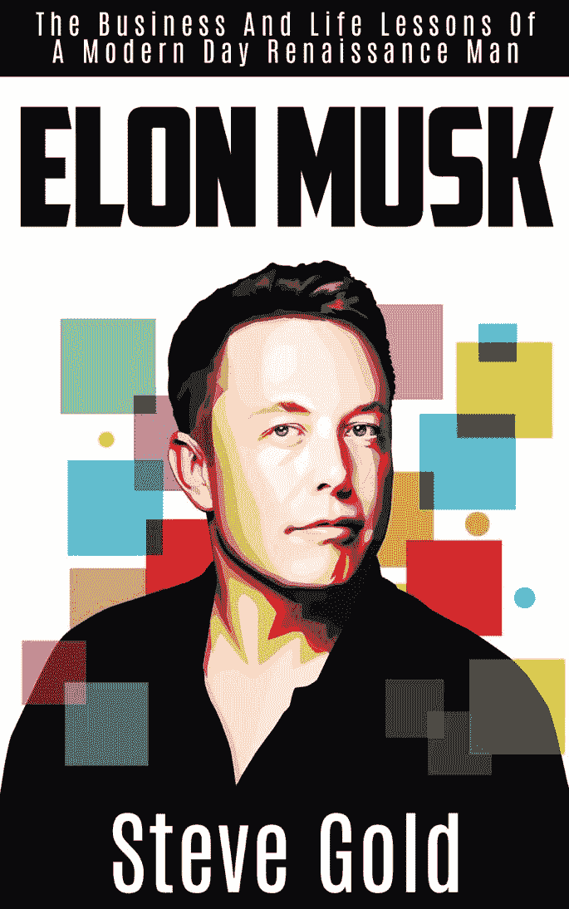
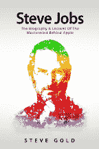
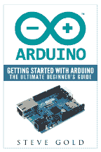

# Arduino 初学者终极指南 (Arduino 101，Arduino 示例，完全初学者指南，编程，树莓派 2，xml，c++，Ruby，html，php，机器人)


## 引言

如果你对最简单的技术深着迷，并经常对日常生活中无处不在的电子设备的内部原理感到好奇，那么你可能会在对 `Arduino` 的实验和摆弄中发现乐趣。

所有开关开关即可焕发生机的事物的核心——闪烁着多种色彩的圣诞树灯、在触摸屏设备上打开的应用程序，以及加热食物的微波炉等——都是一个微控制器，它被编程在激活时执行特定的任务。`Arduino` 是一个由微控制器和编程软件组成的开源平台。与大多数平台不同，`Arduino` 面向想要在电子领域发挥创意的非电子专业人士，同时也具有足够的活性来适应工程专家。无论你之前在电子和编程方面的知识如何，它都旨在做到易于上手、低成本且易于学习。

本指南不会让你一夜之间成为 `Arduino` 专家——事实上，没有任何东西可以做到。然而，你将从书中中学到这个惊人的多功能平台的基础知识，你还将有机会亲身体验它的功能。我们将引导你了解 `Arduino` 电路板的关键特征、开始工作的技术要求、如何启动你的第一个 `Arduino`、为了生存需要知道的重要术语，以及如何继续学习以在你所学知识的基础上不断构建。

此地的信息旨在面向电子、电路和编程的绝对初学者。如果你一直想学习如何用电子设备制作酷东西，但对如何开始完全无从下手，现在你手指尖已经拥有了所需的所有信息，以进入兴奋的 `Arduino` 世界。剩下的就取决于你了！

附记：为了表示我的谢意，我为你准备了一份免费的惊喜；没有陷阱，无需费用。只需点击此处 了解更多信息。


## 第一章
### 了解 Arduino

2005 年，意大利的伊里亚交互设计学院（Ivrea Interaction Design Institute）启动了一个创建开源平台的项目，用于构建各种电子项目，被称为 `Arduino`。它最初面向几乎没有电子或计算机编程背景的学生，但最终因其易用性和对新手友好的特性而在范围内广受欢迎。

自诞生以来，`Arduino` 吸引了来自各个经验水平的爱好者、艺术家、程序员、学生甚至黑客的关注和热情。作为一个开源平台，它在多元化用户社区的贡献下不断成长，不断推向其能力的极限。事实上，`Arduino` 是成千上万项目和应用的支柱，从日常用品到复杂的科学设备。

`Arduino` 平台由两个部分组成：

1. 硬件——一个物理可编程电路板，也称为微控制器。有不同类型的 `Arduino` 板（更多内容将在第二章中介绍）。
2. 软件——运行在计算机上的集成开发环境 (`IDE`)，用于编写和将编程代码上传到物理板。

#### 为什么选择 Arduino？

几乎任何人都可以使用 `Arduino`。专家们乐于构建项目并在在线社区中与其他用户分享想法。对于那些没有电路和微控制器编程经验的人来说，该平台是学习和进行实验的极佳工具。然而，建议在探索 `Arduino` 的奇之处之前，你至少应该牢固理解这些基本概念：

- 电电路的基础
- 电压、电流、电阻和欧姆定律
- 极性
- 集成电路 (`ICs`)
- 数字逻辑
- 模拟对比数字
- 基础计算机编程

让 `Arduino` 受业余爱好者和专家青睐的原因是，与其他平台和系统相比，它简化了处理微控制器的过程。初，将新代码加载到板上只需通过 USB 线即可完成，而以前的可编程电路板需要使用额外的硬件。另一个优点是，与其他微控制器平台相比，`Arduino` 板相对廉价，一些预组装模块的价格低于 50 美元。如果这些好处还不够，这里是选择 `Arduino` 的更多原因：

- 跨平台——`Arduino` 的 `IDE` 运行在 Windows、Mac OSX 和 Linux 操作系统上，而大多数微控制器系统仅兼容 Windows。
- 简单的编程环境——`Arduino` `IDE` 使用简化版的 `C++`，让新手更容易学习编程，同时又足够的灵活性让高级用户发挥创意并追求抱负。
- 开源且可扩展的硬件——`Arduino` 板的设计方案根据知识共享许可发布，允许电路设计师创建模块的版本，对其进行扩展和改进。
- 开源且可扩展的软件——`Arduino` `IDE` 以开源工具的形式发布，丰富的程序员可以通过 `C++` 库对其扩展。你也可以通过 `Arduino` 学习 `AVR-C` 编程语言，就像直接在 `Arduino` 程序中添加 `AVR-C` 代码一样。


-   **强大的社区支持** – 如果你是该平台完全的新手且不知道从何开始，由于 Arduino 的普及，你可以在网上找到丰富的信息。你永远不会缺少学习资源，你甚至可以找到可以立即使用的预先代码项目（Arduino 资源请参阅第 5 章）。

## Arduino 能为你做什么？

Arduino 的设计初衷是考虑到创意和创新，无论经验水平如何。艺术家、设计师、电工、工程师、程序员和科学爱好者都可以用它来创建交互式对象和环境。Arduino 可以交互的内容包括电机、扬声器、LED、GPS 单元、摄像头、电视机、智能手机甚至是互联网。

通过 Arduino，人们可以构建低成本的科学仪器、进行机器人编程、构建建筑设计的交互式原型、为乐器创建用于实验声音的装置、制作新的视频游戏硬件——这仅仅只是冰山一角！因此，无论你的项目是制作机器人、加热毯、节日灯光展示，还是一个占卜机，Arduino 都可以作为你电子项目的基础。

## 在继续之前……

为了表示感谢，我为你准备了一个很棒的惊喜，完全免费！

只需点击下方的链接即可了解更多信息。

==> 点击此处<==

我向你保证，这不是“垃圾邮件”，你通过简单的链接可以在几秒钟内回到此页面。

立即行动，避免错过！

==> 立即点击此处!<==

祝得愉快！

Steve Gold

## 第 2 章：开始使用 Arduino

随着 Arduino 平台的不断扩展，持续学习是必要的，因为总会有新事物等待被发现。你在此章中将学到为了让你“涉水”所需要的最少知识。你将接触到基本的 Arduino 组件、你需要的物品以及如何设置它们。显然，你需要两件核心要素：一块 Arduino 板板和已安装的软件（可以在 Arduino 官方网站免费下载）。

### Arduino 板板的结构

在开始四处挑选硬件之前，你需要了解一些关于 Arduino 板板及其特征的基础知识。市上有多种类型的 Arduino 板板可供购买，每种的功能都不同。虽然它们在外观和功能上可能有所不同，但你会发现大多数板子都具有大部分共同组件：

1. **USB 和圆孔插** – 每一块板子都有连接电源的方法。几乎所有的 Arduino 板板都带有 USB 连接，因为你将通过它向板上传代码。你也可以通过圆孔插连接墙壁电源。

2. **引脚 (Pins)** – 板板上的引脚是你通过连接电线构建电路的地方。Arduino 板板上有几种类型的引脚，每种都有特定的功能。以下是你通常会发现的：
   - `GND`：Ground 的缩写，这些引脚用于你的电路接地。
   - `5V` 和 `3.3V`：这些引脚分别提供 5 特和 3.3 特的电压。
   - `Analog`（模拟）：你可以在 `Analog In` 标签下找到这一行引脚。它们用于从模拟传感器读取信号，并将这些信号转换为数字值。
   - `Digital`（数字）：在模拟引脚对面，`Digital` 标签下方是用于数字输入和输出的引脚。例如，指示按钮何时被按下（输入），从而让 LED 点亮（输出）。
   - `PWM`：在许多 Arduino 板板上，`Digital` 旁边有 `PWM~` 标签。这意味着这些引脚可以作为普通的数字引脚，也可以用于一种称为脉宽调制的信号（解释请参见第 4 章的术语表）。
   - `AREF`：Analog Reference（模拟参考）的短形式，这个引脚可以用于设置外部电压作为模拟引脚的上限（0 到 5 特之间），尽管它通常被闲置。

3. **重置按钮 (Reset button)** – 这个按钮的作用不言自明；按下它会将复位引脚接地并重启加载到板板上的任何代码。这对于多次测试你编写的代码非常有用。但是，它并不具备将一切重置为初始状态并清除任何问题的功能。

4. **电源 LED 指示灯** – 这是一个微型 LED，可以通过旁边的 `ON` 字识别。当你将板板接入电源时，它会亮起；如果没有亮起，意味着你需要重新检查电路，因为出了问题。

5. **传输 (TX) 和接收 (RX) LED** – 不要与数字引脚 0 和 1 的 `TX` 和 `RX` 标记混淆，带有这些标记的 LED 在板板传输或接收数据时（例如向板板加载新程序时）为你提供视觉指示。

6. **主集成电路 (IC)** – 这是附在每块板板上的、带有金属引脚的黑色部件。它基本上是 Arduino 板板的大脑。主 IC 随板板而异，尽管大多数来自 ATMEL 公司的 `ATmega` 系列 IC。在从 Arduino IDE 加载新程序之前，了解 IC 和板板类型至关重要。你通常可以在 `IC` 的顶部找到这些信息。

7. **电压调节器 (Voltage regulator)** – 正如其名，该组件控制进入 Arduino 板板的电压量。它通过排除进入板板的额外电压来工作。但它有局限性；无法处理超过 20 特的电压。所以，警告大家：不要使用大于 20 特的电源！它会销毁你的 Arduino。大多数型号的建议电压为 6-12 特。

### 家族成员

Arduino 板板自推出以来一直在不断演变，以满足用户的各种需求和挑战。除了 8 位板板外，Arduino 还针对各种应用开发了板板，从物联网 (IoT) 到可穿戴物品。所有的它们都是开源的，这进一步赋予了用户开发衍生并根据特定需求定制的能力。以下是一些被认为最适合 Arduino 初者的选项：

- **Arduino UNO (R3)**：UNO 通常被认为是经典的 Arduino 板板。它配备了入门所需的所有设备，带有 14 个数字输入输出引脚——其中 6 个可以作为脉宽调制 (PWM) 输出——6 个模拟输入、USB 连接、电源插等。只需将其连接到任何电源（无论是带有 USB 线的电脑、交流转直流适配器还是电池），即可开始使用。无论你的 Arduino 经验如何，选择 UNO 都不会错。
- **Arduino Mega (2560)**：Mega 板板比 UNO 高出一个档次；就像它的大哥一样。它拥有惊人的 54 个数字输入输出引脚，其中 14 个可以作为 PWM 输出，16 个模拟输入，以及 UNO 上可以找到的所有功能，且功能相同。如果你的项目需要大量的数字输入输出（例如用于许多 LED 灯或按钮），Mega 可能是适合该工作的板子。
- **Arduino Leonardo**：Leonardo 提供了一种更廉价、更简单的替代方案，因为它是第一个使用内置 USB 的微控制器的 Arduino 开发板。由于其直接处理 USB 的能力，可用的代码库可以让板板模拟计算机键盘、鼠标等。
- **Arduino Mega ADK**：这块板子基本上是 Arduino Mega 板板的特殊版本。它专门为与 Android 智能手机交互而设计。


# Arduino 板板

* LilyPad Arduino – 正在考虑制作一件会发光的猫服吗？LilyPad 就是你需要的可穿戴电子织物板子。它由工程师、书籍《Sew Electric》的合著者 Leah Buechley 设计，这种创新的板子具有大型连接焊盘和平和平整的背面，允许使用导电线将其缝入衣物中。而且它还是可洗的！
* Arduino NG, Diecimila 和 duemilanove – 这些板子统称为 UNO 的旧版本（Legacy Versions），基本上是 Arduino 的祖父级。这些旧版板缺少其他新板上的一些关键功能。例如，Diecimila 和 NG 在 USB 端口旁边有一个跳线，需要手动选择 USB 或电池电源。NG 在上传程序之前，还需要按住几秒钟 Reset（重置）按钮。但需要注意的是，Arduino 爱好者仍在对这些旧版板进行研究和改进。一旦你获得了更多关于 Arduino 的知识和经验，它们是非常值得研究的。

## Genuino 是什么鬼？！

如果你在美国境外购买 Arduino 板板，你可能会发现外观完全相同的 Genuino 板板。别担心；你并没有被仿品欺骗！Genuino 是 Arduino 的姐妹品牌，由同一团队创建，用于在美国境外销售的板板和产品。

Genuino 品牌认证板板和产品的真实性符合 Arduino 的开源硬件理念。该品牌与亚洲、欧洲、南美、加拿大和非洲的市场领先制造商建立了联盟，使 Arduino 硬件在全球范围内可用。

你可以将 Genuino 板板想象成住在国外的 Arduino 板板双胞胎。所有 Genuino 板板的质量、组件和特性都与其对应的 Arduino 版本相似。因此，取决于你所在的地区，在想要购买 Arduino UNO 时可能会发现 Genuino UNO 板板。这没关系；你得到的仍然正品。

但需要注意的是，并不是所有的 Arduino 板板——尤其是那些不太熟悉的型号——都有 Genuino 双胞胎。

## 你可以使用的其他东西

Arduino 板板本身不能做什么什么，所以你需要将它连接到其他设备上。有很多硬件选项可以固定在 Arduino 板板上，但对于初学者来说学习起来会非常困难（更多阅读建议请参见第 5 章）。因此，我们只向你介绍两种易于连接到 Arduino 板板并让你的项目活跃起来的方便物品——传感器和扩展板（shields）。

传感器有很多乐趣。将它连接到你的 Arduino 板板，并添加一些简单的编程代码，你就可以让你的板子感知并测量几乎任何东西——光、温度、物理压力、距离接近、气压和放射性。你还可以构建设备来扫描指纹、检测动物或人的动作以及来自遥控器的信号。

此外，你还可以通过扩展板做更多事情，扩展板是安装在你的 Arduino 板板顶部的预制电路板。有了扩展板，你可以编写 Arduino 连接到互联网、控制 LCD 屏幕、控制电机并提供蜂窝通信以及许多其他酷炫的功能，仅限于知识和想象力！

## 安装软件

一旦你处理好了硬件，要做的第一件事就是安装 Arduino IDE。这是你为微控制器编写代码并连接电路组件以实现功能所需的软件。你可以在 Arduino 官方网站下载软件：[www.arduino.cc](http://www.arduino.cc)。

下载后，将文件夹解压到电脑硬盘上的任一位置，然后运行 `Arduino.EXE` 文件完成安装。现在，你已经准备好开始使用 Arduino 了！

# 第 3 章：迈出第一步！

你已经有了 Arduino 板板和软件；现在是时候开始工作了！在接下来的章节中，你将在引导下逐步完成几件事；你将用第一个代码测试 Arduino 软件和板板，并完成一个点亮 LED 的简单项目。对于给出的示例，将使用 Arduino UNO (R3) 板板。然而，指令经过微调后适用于你选择的任何 Arduino 板板。

以下是你开始 Arduino 之旅所需的四件设备：

* 一台运行 Windows（XP 或更高版本）、Mac 或 Linux 操作系统的电脑，并已安装 Arduino IDE
* 一个 Arduino 微控制器（也称为电路板）
* 一根 USB A 转 B 线，用于将你的 Arduino 板板连接到电脑，或适用于你选择的板板的线（注意，某些板子需要 A 转 Mini-B 线）
* 一个 LED

## 接入板板

Arduino 板板通过 USB 连接到电脑（通过 USB 接口）或外部电源（通过圆柱插接口）供电。为了使用 Arduino IDE 对其进行编程，你需要将板板连接到电脑。当你完成编程且不需要连接时——取决于你打算如何在项目中使用该板板——你可以选择使用插座电源供电。

首先，你必须使用 USB 线将你的 Arduino 板板连接到电脑。当你连接的那一刻，你可能会发现标有“ON”标签的 LED 开始疯狂闪烁；这是存储在板板芯片中的默认程序。你为了启动 Arduino 将要的操作是覆盖此默认程序，让 LED 缓慢地闪烁，间隔为 2 秒。

## 安装驱动程序

如果你是第一次在 Windows 7、Vista 或 XP 上使用 Arduino 板板，则需要此步骤。如果你使用的是其他操作系统，可以跳过本节。

1. 当你接入板板时，Windows 将开始驱动程序安装。几秒钟后，程序将失败。
2. 点击开始菜单，打开“控制面板”。
3. 在控制面板中，进入“系统和安全”并点击“系统”。
4. 系统窗口弹出，打开“设备管理器”。
5. 查看“端口 (COM 和 LPT)”。你应该看到一个名为 `Arduino UNO (COMxx)` 的端口。如果没有 COM 和 LPT 部分，查看“其他设备”下的“未知设备”。
6. 右键点击 `Arduino UNO (COMxx)` 或未知设备端口，选择“更新驱动程序”。
7. 接下来，选择“浏览我的电脑以查找驱动程序”。
8. 最后，导航并选择名为 `arduino.inf` 的驱动文件，它位于 Arduino 下载包的 文件夹中（而不是 FTDI USB Drivers 子目录）。如果你使用的是旧版 IDE（1.0.3 或更早版本），选择 `Arduino UNO.inf`。
9. Windows 从那里完成驱动程序的安装。

## 启动与 Sketch

一旦正确安装了 Arduino IDE，你现在准备好用第一个程序测试你的板板了。在在此之前，你需要了解一些关于编写 Arduino 代码的知识。代码被称为 sketch（程序），用 C++ 编写。

每个 sketch 需要两个不返回值的 void 类型函数，`setup()` 和 `loop()`。`setup()` 方法在 Arduino 板板启动后运行一次，之后 `loop()` 方法持续运行。`setup()` 是你想进行任何初始化步骤的地方，`loop()` 是你想反复运行的代码。

基础 sketch 骨架应该如下：

```
void setup(){}
void loop(){}
```

现在，让我们尝试你的第一个程序：

1. 确保你的板板已接入，并启动 Arduino 程序
2. 通过以下路径打开 Blink 示例 sketch：File > Examples > 1.Basics > Blink
3. 选择你使用的 Arduino 板板类型：Tools > Board > 你的板板类型
4. 选择 Arduino 连接的串口/COM 端口：Tools > Port > COMxx


如果你不确定哪一个串口设备是你的 Arduino，请查看可用端口，然后拔掉你的 Arduino 再次查看。它应该是那个在你拔掉 Arduino 之后立即消失的端口。

## 上传程序并让它闪烁！

在连接 Arduino 板板并打开 `Blink` 示例程序后，点击上传（Upload）按钮。等待几秒钟；当程序上传时，你应该看到板子上的 RX 和 TX LED 闪烁。如果上传成功，你将在 `Blink` 示例程序的状态栏中看到“Done Uploading（上传完成）”的消息。

如果整个过程执行正确，橙色的“ON” LED 应该缓慢闪烁。恭喜你！你已经成功编写了第一个 Arduino 程序。

## 但它不起作用！

如果你遵循了上述所有步骤，但无法将示例程序上传到 Arduino 以使其运行，可能是某个环节出了问题。请尝试运行以下故障排除措施：

1. 确保你在 `Tools`（工具） > `Board`（板）菜单下选择了正确的板。如果你选择使用 `UNO` 以外的板（如示例所示），请检查板上的 `IC`。例如，较新的 Arduino Duemilanove 板子带有 `ATmega328`，而旧的带有 `ATmega168`。因此，请确保选择了正确的选项。

2. 检查在 `Tools`（工具） > `Serial Port`（串口）菜单下选择了正确的端口。

3. 在连接板子的情况下，检查 Arduino IDE 中 `Tools` > `Serial Port` 菜单中是否正确安装了板载的驱动程序。当板子插入时，应该会出现一个在你插入时不存在的额外项目。

## 第一个任务：点亮 LED！

在成功激活 Arduino 后，让我们尝试用它做更多事情。以下是一个适合电路完全初学者的常见学习项目。对于这项任务，你需要一个 LED 和一个已经启动的 Arduino（按照之前的说明操作）。

1. 接入你的板子。
2. 打开另一个示例程序：`File`（文件） > `Examples`（示例） > `Basics`（基础） > `BareMinimum`。这将打开一个新窗口，其中有一个作为你程序框架的简单示例。
3. 将 LED 的正极（较长的引脚）连接到 Arduino 板板上的 `pin 13`，将阴极（较短的引脚）连接到相邻的 `GND` 引脚。
4. 在程序的 `setup()` 部分下添加代码：`pinMode(13, OUTPUT);`。该命令将运行一次，用于配置板子并使其准备好按照你的程序执行操作。
5. 在 `loop()` 部分下添加以下内容：`digitalWrite(13, HIGH);`。这会将 `pin 13` 设置为高电压水平（5 伏）的输出引脚。

完成后，你的示例程序看起来应该是这样的：

```cpp
void setup(){pinMode(13, OUTPUT);}void loop(){digitalWrite(13, HIGH);}
```

点击上传按钮并等待状态栏显示“Done Uploading”消息。漂亮！LED 应该已经亮起来了。

## 第 4 章

## Arduino 生存术语

当你不断丰富关于 Arduino 的一切知识库时，你不可避免会遇到一些常用术语。这个术语词汇表并不详尽，但它确实有助于初学者理解人们在谈论 Arduino 时经常提到的术语，这样你就不至于完全不知所措。

**8-bit（8 位）** – 该术语指的是将 8 位数据作为一个单元进行处理的中央处理器（`CPU`）。

**Analog（模拟）** – 描述将不断变化的值表示为连续变化物理量的设备或系统。作为人类，我们以模拟的方式感知世界，因为我们看到和听到的一切都是信息（数据）向我们感官的连续传输。模拟设备的一个例子是胶片机，因为它以连续信号的形式从黑胶片上读取凸起和凹槽。模拟数据比数字数据更准确，但更难处理和保存。在 Arduino 板板上，你可以使用模拟引脚将模拟数据转换为数字值。

**AVR** – 当你处理电子产品时，你会遇到这个缩词的几种含义。在 Arduino 术语中，它指的是基于 Atmel Atmega 微控制器的平台环境。AVR 微控制器由 Atmel 公司于 1996 年由 Alf-Egil Bogen 和 Vegard Wollan 开发。AVR 缩写源于其开发者，代表 Alf-Egil Bogen Vegard Wollan RISC 微控制器，也被称为 Advanced Virtual RISC（高级虚拟 RISC）。

**C++** – 读作“cee plus plus”，是一种通用编程语言。你使用 Arduino IDE 通过 C++ 编写程序让 Arduino 板板执行某些功能。

**CPU** – 代表中央处理器（Central Processing Unit），也常称为处理器，`CPU` 是计算机内部执行程序指令的电子电路。

**Digital（数字）** – 数字中的信息使用一系列 1 和 0 存储，被称为二进制代码。数字是模拟信号的对立面。因为数字设备只读取 1 和 0，所以它们只能模拟音频和视频信号。与模拟不同，数字数据更容易处理和存储。

**Driver（驱动程序）** – 一种允许计算机与硬件或设备连接并通信的软件。如果没有正确的驱动程序，你连接到计算机的硬件将无法正常工作。取决于你用于处理 Arduino 的什么操作系统，你可能需要为板子安装驱动程序。

**Environment（环境）** – 在计算术语中，环境指的是硬件平台及其运行的操作系统的特定配置。

**Ground（地）** – 在电气工程中，地是电路中的一个参考点，从这里测量电压，或者是公共接线点。该术语也可以指电路连接的实际大地。在 Arduino 板板上，`GND` 引脚起此作用。

**I/O（输入输出）** – 输入/输出的缩写，描述一种与计算机传输数据以与外部交互的程序、操作或设备。例如，如果按下按钮（输入），灯泡就会亮（输出）。

**LED（发光二极管）** – 发光二极管的缩写，一种双极半导体光源。LED 比其他光源具有许多优势，包括尺寸更小、寿命更长和功耗更低。在 Arduino 板板上，你会注意到一些指示板子电源和代码上传的 LED。

**Micro-controller（微控制器）** – 单个集成电路中的计算机，经过编程以执行特定任务。微控制器是自动控制设备的大脑，从手机、相机到洗衣机、微波炉以及机器人。

**Open-source（开源）** – 向公众免费提供源代码使用或修改的程序。开源是开源计划（OSI）拥有的认证标记，允许软件开发者向公众免费共享产品，以便进行改进和分发。与需要某种重新分发许可的商业软件不同，任何人都可以参与开发和分发开源项目。

**Sensor（传感器）** – 用于测量物理量并将其转换为电子信号的电子设备。有各种类型的传感器用于测量物理现象，如温度、压力、距离、噪声、运动等。传感器通常是更复杂的电子系统的组件。例如，如果你想制作一个数字温度计，你需要一个与 Arduino 板板配套的温度传感器。

**Serial port（串口）** – 一种用于向连接计算机的设备发送数据的接口，例如调制解调器、打印机和鼠标。Arduino 板必须连接到正确的串口才能正确上传代码。


## 术语表

- **Sketch（脚本）**：用于指代 Arduino 程序的术语。编写用于控制 Arduino 代码段被称为“sketch”，而不是简单的“program”（程序），因为 Arduino 平台的设计初衷不仅是吸引工程师，还为了吸引艺术家和创意人士。根据创始人的说法，使用“sketch”一词意味着一个可以被探索、完善和开发的粗略构思——就像艺术或设计草图一样。因此，它会让非技术背景的人员在使用 Arduino 时感到更有鼓舞，且不那么令人畏畏。
- **Shield（扩展板）**：这是一种可以附加在 Arduino 之上的电路板，用于实现各种目的。它们被称为这个名字是因为它们像保护罩一样覆盖在 Arduino 板的顶部。
- **IDE（集成开发环境）**：运行以向你提供 Arduino 板板编程工具的软件应用程序。它包含了源代码编辑器、构建自动化和调试器。它是一个开源软件，可以在 Arduino 官方网站（[www.arduino.cc](http://www.arduino.cc)）下载。
- **Pulse-Width Modulation (PWM，脉宽调制）**：描述用于各种应用的数字信号类型的术语。它主要用于控制供给给电子设备的电量。
- **Voltage（电压）**：电路两点之间的能量量，以标准单位伏特（V）测量。

## 第 5 章

### 核心资源与进读

你已经学习了 Arduino 的基础知识，而且如果你确实一直在按照指示操作，你已经亲身感受了该平台能做什么。然而，这只是冰山一角；想要精通 Arduino 需要时间的投入，并在你所学知识的基础上不断构建。此外，随着越来越多的人开始使用，这个开源平台不断扩展。无论是什么带你来到 Arduino 的，你与这个有趣平台的旅程刚刚开始。这里有一份由 Arduino 领域最受尊敬的权威编写的实用材料列表，帮助你不断前进。

### 针对绝对初学者

#### Arduino 入门：开源电子原型平台
作者：Massimo Banzi 和 Michael Shiloh
ISBN-10: 1449363334 / ISBN-13: 978-1449363338

还有比从创作者之一身上来更了解 Arduino 更好的方法呢？Massimo Banzi 是该平台的联合创始人。这本对初学者友好的书籍是基于他在教学、使用和构建 Arduino 方面的丰富经验编写的。

#### Arduino C 语言入门（第二版）：学习 Arduino C 语言编程 Kindle 版
作者：Jack Purdum 博士.
ISBN-10: 1484209419 / ISBN-13: 978-1484209417

本书专为那些没有微控制器或编程基础经验的人编写，非常适合那些开始编程之旅的人。你将获得对 C 编程语言的介绍，并简单演示了如何在 Arduino 系列微控制器上使用它。此书源自作者 20 多年的大学教学经验，非常适合完全编程初学者。它读起来引人入胜，且假设读者没有先前的编程或硬件设计经验，让学习变得愉快。

### 将你的技能提升到高度

#### Arduino 编程进阶：深入学习 Sketch
作者：Simon Monk
ISBN-10: 0071830251 / ISBN-13: 978-0071830256

电子大师 Simon Monk 在这本为已经牢牢掌握微控制器编程的人编写的实用指南中，揭示了 Arduino 的专业编程秘密。这本书涵盖了 Arduino Uno、Leonardo 和 Due 板。学习高级的“sketching”技巧来让你的 Arduino 提升到下一个水平，包括网络编程、最大化串口通信、内存管理、执行数字信号处理等更多内容。该书包含 75 多个示例 sketch，均可下载。

#### 从零开始电子学：通过黑客、设计和发明来学习
作者：Ronald Quan
ISBN-10: 0071837280 / ISBN-13: 978-0071837286

你对常见电子设备背后的复杂电路感到着迷吗？这本书将引导你通过分步实验来揭示电子电路是如何工作的。它还解释了组件、构造技术、基础测试设备、电路分析和故障排除。在读完这本书后，你不仅掌握了设计定制电路的知识，还具备了根据需求黑客和修改现有电路的能力。

#### 恶魔天才的 30 个 Arduino 项目
作者：Simon Monk
ISBN-10: 0071817727 / ISBN-13: 978-0071817721

曾经想过制作莫尔斯密码翻译器吗？心率监测器？催眠仪？键盘恶作剧？你可以通过这本 DIY 指南释放你的恶魔天才天赋，它向你展示如何使用 Arduino Uno 和 Leonardo 板编程并构建有趣的项目。你将通过指南进行学习，指南中包含每个项目所需零件的清单、带插图的分步说明，以及对项目背后科学原理的清晰解释。

### 趣味项目创意

#### Arduino 工作坊：65 个项目的实上手介绍
作者：John Boxall
ISBN-10: 1593274483 / ISBN-13: 860-1200651553

认为你已经掌握了 Arduino 并准备好尝试一些有趣的项目了吗？这本书将带你入门。你将学习 Arduino 广泛的输入输出、传感器、显示器、电机。每个项目都旨在巩固你所学的知识，并且复杂性逐渐增加。那么，你可以学习制作什么呢？数字温度计、电池检查器以及 GPS 记录器等。

#### 缝纫电气
作者：Leah Buechley, Kanjun Qiu 和 Sonja de Boer
ISBN-10: 09897950 / ISBN-13: 978-0989795

由 LilyPad 板创始人 Leah Buechley 共同编写，这是一本结合了手工、电子和编程创建趣味项目的实践指南。学习使用 LilyPad 板制作互动玩具、时尚配饰和其他许多酷物品，并与朋友分享。这也是老师向学生介绍实用电子学的绝佳材料。

#### 纺织信息：来自电子纺织与教育的世界
作者：Leah Buechley, Kylie Peppler, Michael Eisenberg 和 Yasmin Kafai
ISBN-10: 14331192X / ISBN-13: 978-143311200

这本书是对电子纺织品的实用介绍——一种用于将电子元件融入服装和家具的软电路板。在 Arduino 家族中，LilyPad 板是一种电子纺织品，而这本入门到中级的指南可以教你如何充分利用你的 LilyPad。你将接触一系列工具，使任何人（无论是教育工作者、爱好者还是设计师）都能通过电子纺织品进行学习和创作。

#### Make：可穿戴电子学：设计、原型并穿上自己的互动服装
作者：Kate Hartman
ISBN-10: 1449336515 / ISBN-13: 978-1449336516

对于计算感兴趣以及想要构建融合这两个学科的创意项目的时尚设计师来说，这本书是必读的。你将接触制作互动电子电路并将其嵌入服装的工具、材料和技术，并带有分步说明。虽然书中没有专门介绍 Arduino 项目，但它将为你提供适用于 Arduino 平台的知识。所以，如果你曾经想过制作随肤色变化的变化的衣服、能显示下一班车到达时间的夹克、动态调整高度的鞋子以及许多酷的可穿戴物品，现在你可以做到了！

#### Arduino 冒险
作者：Becky Stewart
ISBN-10: 1118948475 / ISBN-13: 978-1118948477


如果你认识一个在电子工程和编程方面展现出潜力的孩子，请把这本书送给他或她！这本书专为 11 到 15 岁的未来电气工程师编写，是一本优秀的 Arduino 入门资源。

# 在线资源

[`www.arduino.cc/`](https://www.arduino.cc/) - Arduino 官方网站，满足你的所有需求以及关于该平台的最新开发新闻。你可以在这里找到并加入 Arduino 论坛，与全球的用户获取帮助并分享知识。

[`www.cplusplus.com/`](http://www.cplusplus.com/) - 关于 C++ 所有内容的全面在线库。你可以学习 Arduino 运行的编程语言的历史、发展以及全方位的知识。

[`www.ladyada.net/`](http://www.ladyada.net/) - 学习电子和电路的绝佳资源，其几乎所有内容都是开源的。

# 结语

祝贺你完成了 Arduino 基础学徒并成功完成了你的第一个 Arduino 项目！在本书中，我希望已经提供了你所需的信息，让你有信心继续前进，并尝试更具挑战性的 Arduino 项目。祝你好运！

## 作者 Steve Gold 的留言

感谢你购买本书。如果你喜欢所读内容，请花些时间分享你的想法并在亚马逊上发表评论。这只需要几分钟，我对你的支持将不胜感激。

再次感谢你的支持。

Steve Gold

## 免费赠品 1！

作为一份免费赠品，我附带了我另一本畅销书目之一——《埃隆·马斯克：现代文艺复兴者的传记》的预览！翻到书末即可阅读。

## 免费赠品 2！

作为对所有读者的特别感谢，我提供了了加入我精选小组的权限。注册以获取有关即将发布的消息，包括一些深度折扣和免费书籍！

## 还有……

务必查看我的其他书籍。翻到书末可以查看我撰写的其他书籍列表以及下载链接！

### 免费赠品！《埃隆·马斯克：现代文艺复兴者的传记》的预览！


如果你喜欢这本书，我为你准备了一份小礼物：这是我的另一本书——《埃隆·马斯克：现代文艺复兴者的传记》的预览。在书中，我更深入地审视了埃隆·马斯克究竟是谁，并研究了他所取得的非凡成就。享受这个免费样本，如果你想了解更多关于这位真正伟大的人，请随时点击下面的购买链接！

## 引言

当演员罗伯特·道尼·小约翰签约饰演托尼·斯塔克（又名钢铁侠）时，他向导演约翰·法弗罗建议他们与埃隆·马斯克见面。他们的任务是赋予超级英雄生命，而马斯克是现实生活中最接近漫威式的天才、万富翁和慈善家的人。会面安排后，马斯克的的一些特征进入了道尼小约翰在屏幕上对托尼·斯塔克的刻画，从而创造了人们所知并喜爱的难忘角色。

现实中，马斯克的生活和人格远比一个虚构角色所能体现的要丰富得多。确实，他与钢铁侠有许多共同点；他是一个过人的技术天才和企业家，能够将看似不可能的想法变为现实。像托尼·斯塔克一样，他梦想、思考和生活得非常宏大，但相似性仅此于此。

与其漫画中的对应形象不同，埃隆·马斯克并非出生在奢华和安逸的生活中。尽管在青少年时期就展现出了非凡的潜力，但他的童年和青少年生活充满了敌意。直到今天，马斯克仍归功于早年的斗争帮助他培养了那广为人知的百折不屈的精神。

在 IT、金融、可持续能源、汽车、航空航天和太空探索领域留下了足迹后，说马斯克从卑微的起点已经走了很远并不过。他创立了一些最具创性的公司——`Paypal`、`Tesla Motors` 和 `SpaceX`——几乎凭一人为每家企业的成功承担了责任。无论他决定涉足哪种业务，他都会带去革命性的想法，这往往会成为行业规则的改变者。然而，他远未结束。

即使在经历了多次成功的尝试后，他卓越的大脑从未停止构思更宏大的创新。他丰富且狂野的雄心似乎是由改变我们所居住世界的宏伟愿景驱动的。他的未来计划包括让道路上布满电动汽车，用太阳能为世界提供动力，殖民邻近行星，并让人们通过未来性的高速公共交通系统跨越长距离。

大多数孩子都会想象去外太空，乘坐子弹般快速胶舱穿梭于不同的城市，直到这些幻想在成年后逐渐幻灭。很少有人敢于梦想过那些本应停留在虚构领域的幻想。埃隆·马斯克就是这极少数卓越者之一。

# 第 1 章：伟大的开端

几乎每一个成就人士的成功故事都包含这样的情节，凸显了他们非凡的钢铁意志、批判性思维、勤奋倾向，以及对“不可能并非不可及”的坚定信念。作为 `20^(th)` 世纪末信息时代黎明和技术热潮后塑造全球经济的最卓越头脑之一，埃隆·马斯克在如此幼的年纪就表现出如此鲜明的个性特征，这并不意外。

埃隆·里夫·马斯克于 1971 年 6 月 28 日出生于南非豪尔滕省的普勒托利亚。他的父亲是出生在南非的英国电气工程师 `Errol Musk`，母亲是加拿大裔英国人营养师 `Maye Musk`。埃隆是他们三个孩子中的长，随后是弟弟 `Kimbal` 和妹妹 `Tosca`。

在普勒托利亚长大，埃隆的早年生活并非如画般的童年。他在 9 岁时父母离婚，之后他大部分时间与其要求严苛且情感上虐待他的父亲在一起。在学校里，他忍受同龄人的严厉欺凌。在一次著名的事件中，他被推下楼梯导致住院。这些磨难让埃隆在能获得的最安全的陪伴中找到了慰藉；他自己的思想和想象力，这些存在于他那过人大脑的深处。

当他在 10 岁就开始自学计算机编程时，他在技术创新和创业方面的天赋便显而易见。当他才 12 岁时，就开发了一款名为 `Blastar` 的太空船射击游戏，并以 `$500` 卖给一本电脑杂志。在第一次尝试成功后，埃隆和他的弟弟 Kimbal 计划在学校附近开一家游戏厅。不幸的是，当他们的父母拒绝提供获得营业执照的法律同意时，他们进取的计划被迫流产。


1988 年，在 17 岁从普雷特利亚男男子高中毕业后，埃隆（Elon）做出了一个重大的决定：在没有父母支持的情况下离开家乡前往美国。这是他赢得之不易的成功的第一步。一年后，他通过母亲获得了加拿大国籍，离开南非前往加拿大的蒙特利尔。在那里，他从事了低薪工作，并在贫困边缘挣扎了一年。

19 岁时，他被安大略省金斯斯顿市的皇后大学录取攻读科学专业的本科。在学习期间，他结识了加拿大作家朱斯汀·马斯（Justine Musk），两人于 2000 年结婚，并育有六个儿子。他们的婚姻仅持续了八年，随后埃隆第二次结婚，与英国演员塔拉拉·莱莉（Talulah Riley）结婚。这段婚姻于 2014 年离婚。

在皇后大学学习的第二年，埃隆收到了美国宾夕法尼亚大学（Penn）的奖学金。1992 年，在转学至 `Penn` 后搬到了美国。次年，他从 `Penn` 文理学院获得物理学学士学位，并在 `Penn` 沃顿商学院留了一年，完成了经济学学士学位课程。

在整个大学期间，除了科学学习外，埃隆对哲学和宗教文学产生了浓厚兴趣。据称，他最喜欢的书是道格拉斯·亚当斯（Douglas Adams）写的*《银河系漫游指南*》。正是通过对科学和人文领域个人研究的沉浸，埃隆找到了自己的使命；他有着远大的抱负，想要为那些让世界变得更好的项目做出贡献。

因此，他的愿景和创业抱负开始成形，特别是在互联网、可再生能源和太空探索领域。

- [点击此处在亚马逊上查看“埃隆·马斯克：当代文艺复兴奇人的传》（Elon Musk - The Biography of a Modern Day Renaissance Man）](http://amzn.to/1MBnmB9)
- 或者访问：[`amzn.to/1MBnmB9`](http://amzn.to/1MBnmB9)

## 查看我的其他书籍！


[Elon Musk - The Biography Of A Modern Day Renaissance Man](http://amzn.to/1MBnmB9)



[Elon Musk - The Business & Life Lessons Of A Modern Day Renaissance Man](http://amzn.to/1jpCQl7)


[Warren Buffett - The Business And Life Lessons Of An Investment Genius, Magnate And Philanthropist](http://amzn.to/1LPu6kp)



Steve Jobs - 苹果幕后大师的传记与教训


[Management - Achieve Management Excellence & World Class Leadership Skills In 7 Simple Steps](http://amzn.to/1hFnU09)


[Sales - Easily Sell Anything To Anyone & Achieve Sales Excellence In 7 Simple Steps](http://amazon.com/dp/B018S70JLQ/ref=sr_1_1?s=digital-text&ie=UTF8&qid=6143351094&sr=1-1&keywords=sales)



Arduino - Arduino 入门：终极学者指南

（如果链接由于某种原因无法使用，您可以直接在亚马逊上搜索这些标题查找它们。所有书籍均提供电子书或纸质书版本）

以下是给我读者的免费礼物。

感谢您的支持！

Steve Gold

## 连接

建立即时好人缘、共鸣和留下绝佳第一印象的简单步骤
Steve Gold

## 目录
- 引言
- 第一章：60 秒快速建立共鸣指南
- 第二章：让你的身体说话
- 第三章：瞬间赢得喜爱
- 结
- 来自作者 Steve Gold 的信息

## 引言

这本小书是给我的读者的限时免费礼物，以表达我对你们支持的感激。它包含了关于如何与他人建立、创造良好的第一印象以及与他们建立即时共鸣的经过的步骤和策略。

在电子书中：
- 你将学习如何在见到某人的前 60 秒内建立联系和共鸣。
- 你将学习在第一次与人见面时不该做什么。
- 你将学习如何使用语言和非语言技巧来展现魅力，并最终让人们感到与你有连接感。

请注意，我在书中很大程度上使用了男性代词。我完全可以使用女性代词或两者的结合，但为了简单起见，我选择了男性代词。

再次感谢您的支持，希望您喜欢这本书！

Steve Gold

© Copyright 2015 by Eddington Publishing - 版权所有。

本文档旨在就其涵盖的主题和问题提供准确、可靠的信息。本书的出版理念是：出版者不要求提供会计、官方许可或其他合规服务。如果需要法律或专业建议，应聘请该领域经验丰富的专业人士。

- 摘自一份由美国委员会平等接受并批准的原则宣言

## 第一章：60 秒快速建立共鸣指南

### 建立绝佳的第一印象

研究表明，建立良好的印象对于有效的沟通和人际关系至关重要。我们所有人天生就会根据相互互动的前 60 秒来评估一个人。这种立即评估他人的本能倾向源于进化演化。在古代，人们必须能够判断另一个人是朋友还是敌人；给出错误的印象会导致灾难性的后果。

在今天，建立良好的印象仍然至关重要——尽管结果可能不再关乎生死。我们都希望给他人留下绝佳的第一印象。我们只有 60 秒的时间做到这一点，而且一旦形成了第一印象，就极难改变。因此，在每一次新的邂逅中尽全力是值得的。你可能没有第二次机会。


要与他人产生瞬间火花并建立关系，你必须对他真诚感兴趣——并向他或她表现这种兴趣。你必须成为一个倾听者。这意味着你需要专心地听，不仅要听对方在说什么，还要听（有时这更重要）听他们**没说什么**。

密切观察他们的非语言行为。这些行为会提示你正在交谈的人真实的感受，并帮助你决定应该如何继续对话。积极倾听能让你完全理解对方的意图，并保持高度专注。

当你全神贯注地听对方说话时，你让他们觉得自己重要且特别。他们很可能会对你产生好印象；如果对方察觉到你对他们他们感兴趣，你就能创造出瞬间火花，并迅速建立关系。你会让对方感到舒适，并乐意与你共度时光。

# 第 2 章：让你的身体说话

你的行为与你说的话同样重要。在表达感受时，你的肢体语言和语言一样有效。当你的肢体语言传递出你对他人的兴趣时，你往往更擅长建立关系。

## 肢体语言的艺术

仅仅告诉别人你想了解他们是不够的。如果你的行为没有事实支撑，语言就毫无用处。如果你想与人们建立强大的即时联系，请使用你的肢体语言来有效地展示你与他们建立的兴趣。

许多非语言信号会被他人认为很有魅力。通过仔细观察这些行为，增强你的成功之道。

当你转向另一个人时，朝他的方向交叉双腿，或让脚尖指向他，你就在通过肢体语言告诉他你想深入地了解他。当你的身体姿态是开放的时，你表示你对他持接纳态度。

尝试培养一种真诚且具有感染力的笑容。人们对那些在恰当时刻——并以一种自发、迷人、童真的方式微笑的人反应非常强烈。同样，注意不要用大声或令人不悦的方式笑。像驴一样嘶叫或用尖锐的声音笑——人们肯定会绕着你走。

让你的声音呼应你的兴奋或喜悦。富有表现力且生动的声音非常有吸引力，特别是当它产生共鸣并闪烁着积极的情感时。学会根据不断变化的情绪培养反映音量、速度和语调变化的声音。让你的声音反映出你对某个话题的兴奋。让它映射出你对结识正在交谈的人所那种温暖热诚的情感。

深不可测的脸往往令人畏惧。温暖开放的脸能吸引人们。

让你的面部展示你的感受。当你能够通过脸上露出的不同表情让对方更好地理解你在说什么时，你将能够更有效地交流。你交谈的对象看着你的脸，不仅能理解你口头表达的观点，还能通过你脸上掠过的各种生动表情理解你言语背后的情感。

利用肢体语言帮助他人视觉化你所说的内容。你不一定要表演你的叙述，但手势和其他身体动作——加上面部表情——绝对有助于通过你说的话吸引对方。他不仅可能更好地理解你的意思，也可能被你深深吸引。

## 非语言行为的禁忌

某些非语言行为会破坏你建立关系的能力。你必须研究这些行为，以便将它们扭转为自己所用。

### 谨慎对待虚假微笑。

每个人对微笑都有良好的反应——但必须是真诚的微笑，一个反映真实兴趣、温暖欢迎或积极情感的微笑。虚假的微笑会让人们对你产生警备。它不太可能让人对你产生好感；甚至可能让他们避开你。

### 小心进行眼神交流。

当你建立并保持眼神交流时，这向对方展示你对他感兴趣。当你越过正在交谈的人，或者眼睛盯着其他人或房间里发生的事情看时，这些动作在告诉他你根本不感兴趣——你宁愿待在别处或和别人聊天。注意不要瞪视，因为这会让对方感到不舒服。也不要翻白眼，因为这种非语言行为表现了挫败或恼躁。

### 不要离对方太近。

理解并尊重“个人空间”的概念。当你离离另一个个体太近时，那个人会感到不适或脆弱。他可能会认为你咄咄逼人或具有侵略性。

### 反之，不要离得太远。

你可能会显得冷漠、不友好且疏远——完全对与对方建立联系不感兴趣。

### 不要总是摸鼻子或抓头。

这些手势是非语言信号，表明你在撒谎，或者在隐藏或夸大某些事情。它们还表明你对自己所说的话不确定。

### 不要双臂交叉在胸前——将其作为“屏障”。

这种姿态信号着你处于防御状态，并且不愿意让对方更好地了解你。一直把手放在兜里也表达同样的意思。如果你经常做这些事，你可能会显得冷酷、疏远，甚至可能带有傲慢的情绪。

### 不要动得太多。

如果你不停地走动、变换位置或摇晃，这可能表明无聊或坐立不安。它向对方展示了你对对话并不真正感兴趣。

### 不要显得空洞或无表情。

要和一个面部表情变化很小的人交流是很的。他看起来心不在、冷淡且缺乏反应。与一个富有表现力、活跃且动态的人聊天更有趣。

### 不要太僵硬。

富有表情地移动你的身体。使用手势来表达观点。太僵硬会给人一种你不自在且无法放松的印象。当然，也不要过头！

### 不要玩笔、领带、首饰或头发。

这些是分心的行为。它们向你交谈的人传递出你对对话并不感兴趣，或者你很紧张。无论哪种情况，这种行为最好避免。

# 第 3 章：瞬间获得喜爱

## 闲聊等于即时连接

如果你想建立联系，学会闲聊是一项基本技能。这是一种以轻松舒适的方式开始对话的方法。你讨论的是人们通常认为有趣且容易交流的话题——音乐、电影、食物、旅行、运动以及其他人们可以轻松讨论的话题——没有任何恐惧或焦虑。


闲谈通常从琐事开始——仅仅是对某些话题进行随意的交流，这些话题起初甚至看起来有些肤浅。然而，关系正是通过这些小小的步子建立的。你必须首先通过轻松的对话让对方对你感到舒服。如果你一上来就表现得很强势、深沉且亲密，很可能会把别人推开。然而，如果你以一种轻松、不具威慑的方式从小处开始，你就能建立关系。在互动的最初几秒钟内，你就能让对方喜欢你。你能够留下良好的印象，确立你是一个好相处且有趣的人的事实。从小且轻松开始，你为培养更深层次的关系铺平了道路——只要你们都有这种意愿。

# 受人喜欢且富有魅力的人的习惯
魅力对于某些天选的人来说是与生来的。但对于大多数人来说，幸运的是，这是一种可以学习的能力。试着观察那些你认为有魅力的人。他们的人格行为中哪些特质让他觉得他们迷人且吸引人？是什么吸引了他们？是什么让别人在他们身边感到快乐、舒适和自在？

哪些受人喜欢且富有魅力的人的习惯，是你也可以培养的？

受人喜欢的人知道如何开启对话，让对方觉得很有趣。他们知道如何让别人感到足够舒适，从而回应闲谈和友好的暗示。他们不仅知道如何开始对话，还如何维持对话。他们知道如何保持对话进行，让对方很快对这种互动产生热情。

在这一方面，实践确实能造完美。如果你发现与人交流很困难，请刻意主动接触并练习你的对话技巧。你起初可能会感到不自在。坚持下去就好。你不需要表现得才华，你只需要友好，真诚地对他人产生兴趣。随着时间的推移，你会变得很自然——能够感知到对方会对什么话题感兴趣，并知道如何将对话引导向更有趣、更有收获的频道。

富有魅力的人会对对方表现出真诚的兴趣。他提问是因为他真心想了解更多对方的想法和感受。他很敏感。他意识到自己不能简单地向对方轰问私密细节，因此愿意进展得缓慢而从容。

一个人可以感知到你的兴趣，并可能感激这一点。当你能够有效地传达这种兴趣时，人们可能会认为你受人喜欢且富有魅力。正因如此，他们倾向于向你敞扉，与你相处感到舒适，并愿意将对话引向深度。

# 通过倾听和镜像赢得喜欢并被喜欢
当你与人互动时，你可能“镜像”他的某些行为——面部表情、姿态、手势甚至言语。研究表明，镜像是让别人喜欢的有效技巧。如果你能有效使用这项技术，你可能发现自己也同样地喜欢对方。

当你像他一样行动和说话时，你会发现更容易与他人建立即时联系。他会将你视为一个熟悉且相处舒服的人。他会发现更容易信任你，因为你毕竟看起来和他一模一样！当他看到你和他有很多共同点时，他可能会与你产生瞬间的纽带。他倾向于在你身上看到自己。

你可以利用这种强大的技术与他人建立即时关系。你可以利用镜像在短短 60 秒内赢得人们的喜欢并被他们喜欢。

注意并观察对方。观察他的言语和非语言行为。

他的说话声音特质是什么？他说话的方式是柔软、温柔且审慎的吗？还是他更强调，说话大大且果断？试着掌握他说话的节奏、语调和速度。

观察他的举止。注意他如何倾斜头部。他经常向前倾身吗？他倾向于驼背吗？还是他一直保持直立？

他经常微笑吗？他经常睁大眼睛或移动眉毛来强调观点吗？

人们经常用手交流——无论是故意的还是无意识的。他这样做吗？他是否使用手势来加强语气或华丽地传达情感？观察他如何运用手部手势。

观察他所有言语和非语言行为的这些方面，并尝试根据你的情况进行镜像。注意，镜像不是模仿。它更多的是一种共情——积极倾听对方所说的话——包括他的言语和行为——并通过表现出这种观点的行动来回应。它要求对对方做出智能且敏感的回应。毕竟，如果你不专心倾听，如果不给予足够的注意力，你就无法“镜像”对方。镜像对方强调了这样一个事实：你确实在关注对方。这有什么不好的呢？当你尝试以自然的方式模仿谈话对象的的能量水平和肢体动作时，他可能会给出良好的反应。你不一定认同他所说的话，仅仅在某种程度上模仿他的行为，你很可能让他对你产生积极的看法。他可能会认为你受人喜欢且富有魅力。

如果你出于正确的理由使用这项技术——以正确的方式和正确的时间使用它，你能够轻松与他人建立即时联系。

# 结论
你给他人留下的印象，特别是在见面的前 60 秒内，在很大程度上决定了你能否与他们建立联系。


这可能是一个大胆的陈述，但我相信在当今的投资界，没有人能像沃伦·巴菲特那样理解成功、财富，甚至可能是幸福。这位所谓的“奥马哈圣人”不仅知道如何创造巨额财富，对金钱的局限性和瞬时性也有深刻的理解。他可能作为投资策略家而闻名，但巴菲特经常谈论财富与生活质量之间的联系是多么松散且被高估了。他甚至强调——这带有某种矛盾色彩——人拥有的钱越多，就可能越不自由、越不快乐。

事实上，有时似乎尽管他在金融领域拥有影响力的职业，但巴菲特并不看重金钱和物质财富。他的净值可能高达数十亿，但他生活方式却最不像亿万翁。巴菲特是典型富商大亨形象的对立面，与那些拥有九位数净值的同行相比，他拥有的实物资产相当少，而且他对富豪名流的奢靡生活似乎并不感兴趣。他拥抱生活的简朴，从职业生涯之初就提醒自己，没有什么比健康更重要的资产了，同时也记得幸福的关键在于与朋友和家人建立的无价纽带。

他对财富的公正态度在他大量的慈善活动中表现得淋漓尽致，这包括多次创纪录的捐赠，其总金额已超过了他所积累财富的一半。

无论人处于人生的什么阶段，无论人的目标是什么，通过研究让沃伦·巴菲特成为世界上最成功、最有钱之一的核心价值观，都可以学到良多。

在接下来的章节中，你会发现商业和个人的成功并非仅仅战略性投资决策的结果，而是源于培养在商界行走所需的若干性格特质。此外，正如巴菲特不断证明的那样，良好的品格和对道德原则的坚持对于确保长期成功、财富和幸福有极大帮助。

沃伦·巴菲特通过长期的投资记录以及极其慷慨的慈善事业，对世界做出了巨大贡献。作为一名商业和投资巨头，巴菲特增长和管理财富的方法包含某种谦逊，而在一个以策略和数字为主的领域里，这种谦逊很少受到关注。从自己的生活经验中汲，巴菲特承认在积累和维持财富时往往会被忽视的人性因素。他的哲学和原则简单，却又如此强大，以至于超越了投资组合，适用于我们生活的几乎每一个方面。

然而，巴菲特广阔的职业成就永远无法比拟他所过的精彩人生。按照自己的信念和原则生活，他证明了通过耐心、坚持、勤奋和努力，人们可以建立一个财务稳定且充实的生活。最重要的是，他证明了高质量的生活是带着慷慨、正直和谦逊度过的。

# 第一章：规划未来

> “今天有人坐在树荫下，是因为有人在很久以前种了一棵树。” —— 沃伦·巴菲特

通财务和个人成功的道路并非黄金铺就，而是由金价值观铺就的。

在规划财务未来时，保持道路正直、不受干扰或诱惑的影响，是任何人可以采取的最佳愿景。像沃伦·巴菲特这样的投资策略家建议，从小培养自己按照具体步骤执行计划的能力，以达到你想去的地方。巴菲特从小就有一个愿景，他要通过把钱投资在自己身上来富有，而不是把辛苦挣来的钱给别人。这个愿景始于他在华盛顿特区当男孩时期，他的父亲在把家从内布拉斯加州的奥马哈搬来后，在美国众议院担任了四期。他的父亲最初是一名股票经纪人，沃伦通过接近父亲学习了投资这门交易。在华盛顿特区当青少年时，巴菲特投资在理发店里放置台球机。他从那些台球机上赚钱，并投资了更多的机器。

他从一开始就很幸运，拥有这样一位父亲，强调做出明智财务决策以改善未来的重要性。他的每一分钱对于他成为美国第二富豪（仅次于商业巨头比尔·盖斯）的发展至关重要。

巴菲特出生于 1930 年 8 月 30 日，他强调现在的年轻人要在把钱交给信用卡公司之前，先把握他们拥有的并在在此基础上发展。他警告不要挥霍过度和奢华生活。他的信息是：万物皆有价，你今天花费的钱将影响你明天的储蓄，不仅是为了你自己，还会影响你的子孙后代。

“钱不能创造人，是人创造了钱，”巴菲特在最近接受 `CNBC` 采访时这样说。

钱并没有定义巴菲特，尽管他身价数十亿。他保持了在奥马哈简朴成长过程中养成的谦逊价值观。他继续住在奥马哈的同一个房子里，那是他在 1958 年以 `$31,500` 买下的。这栋位于 Dundee-Happy Hollow 历史区的 6,000 平方英尺房屋如今估值为 `$250,000`，对于这位被誉为“奥马哈先知”的超级亿万翁来说，这仍然是一个便宜的价格。

这是巴菲特拥有的唯一房子，对于一个个人财富超过某些第三世界国家的亿万翁来说，这是另一个罕见现象。他曾拥有过加利福尼亚州拉古纳滩的房产，但在 2005 年以 545 万美元卖掉了该房产，与 1993 年购买时作为他和妻的度假点相比，赚了超过 400 万美元的利润。即使当他尝试过奢侈生活时，他也从中赚了利，尽管这是他偏离基本原则的一个孤立案例。

巴菲特从小就对未来有清晰的愿景。在高中毕业纪念册中，他将自己描述为“未来的股票经纪人”，尽管他当时已经在成功的道路上了。

“我不认为在超过某个点之后，生活水平等同于生活成本，”巴菲特在 2014 年伯克希尔哈撒韦（他拥有的的一家美国多元化控股公司）股东会议上谈他简朴的房子时说道。“良好的住房、健康的身体、优质食物、良好的交通。过了某个点，财富和生活质量之间就会出现反相关。我的生活不能更快乐了。事实上，如果我有六八栋房子，情况会更糟。所以，我拥有了我需要的一切，不需要更多了，因为过了那个点之后就没有区别了。”


## 沃伦·巴菲特的愿景与原则

巴菲特从奥马哈和华盛顿特区长大起，就对未来有了清晰的愿景，这使他变得比最贪婪的人所想象的还要富有。巴菲特年轻时制定的创造他幸福生活的无价计划包括对生活进行清点、拥抱生活的简单，并且从未偏离过核心价值观。

在内布拉斯拉斯加大学和哥伦比亚商学院度过期间对生活进行清点时，巴菲特意识到除了健康之外，他最大的资产是他与伴侣、家人以及长期朋友的联系。他的内在资产——性格、幽默感和受教育程度——在他与人的富有交往中都发挥了作用。这些资产没有价格。这些资产对他的定义远比金钱更加深刻。

巴菲特生活中简单的快乐包括独处，不受打扰地读一本书。从高中时代起，他认为愉快夜晚的理念不是出门狂欢，而是留家里看电视并享受一杯热茶。巴菲特相信，抓住每一个机会拥抱简单的快乐是你对未来所能做的最有价值的决定。

多年来，巴菲特始终忠于他的核心原则和价值观。他从不在投资中冒险。他坚持投资他认为能产生最多利润的领域。保持对实现繁荣所需价值观的清晰愿景，让巴菲特一直处于商业世界的巅峰，从未动摇。

## 相关资源

[点击此处在 Amazon 上查看《沃伦·巴菲特 - 投资天才、大亨与慈善家的商业与人生启训》剩余内容](http://amzn.to/1LPu6kp)

或访问：[`amzn.to/1LPu6kp`](http://amzn.to/1LPu6kp)

## 查看我的其他书籍


[埃隆·马斯克：现代文艺复兴人的传记](http://amzn.to/1MBnmB9)


[埃隆·马斯克：现代文艺复兴人的商业与人生启训](http://amzn.to/1jpCQl7)


[沃伦·巴菲特：投资天才、大亨与慈善家的商业与人生启训](http://amzn.to/1LPu6kp)


史蒂夫·乔斯：苹果背后主大脑的传记与启训


[管理 - 用 7 个简单步骤实现卓越管理和世界级领导力技能](http://amzn.to/1hFnU09)


[销售 - 用 7 个简单步骤向任何人轻松任何东西并实现卓越销售](http://amazon.com/dp/B018S70JLQ/ref=sr_1_1?s=digital-text&ie=UTF8&qid=6143351094&sr=1-1&keywords=sales)


Arduino - 入门 Arduino：终极新手指南

## 特别优惠

（如果出于任何原因链接无法使用，您可以直接在 Amazon 上搜索这些标题来找到它们。所有书籍均提供电子版或纸质版）

### 领取您的免费礼物

为了表示我的感谢，我附上了一份加入我邮件列表的特别邀请！只需点击下方链接即可。

此外，作为我邮件列表的成员，您将可以选择了解我以及我出版社的其他发布动态，包括免费获取高级预览副本并享受大幅折扣的价格！

为了让您放心，我向您保证，我们有严厉的反垃圾邮件政策，如果您愿意，可以随时取消订阅。

[=>现在点击此处此处注册！<=](http://eepurl.com/bMxlLr)

当您准备好后，只需点击此处 返回引言部分，或点击此处 返回第二章开头。

