# 

ASP.NET 2.0 MVP 技巧和窍门


# ASP.NET 2.0 MVP 技巧与窍门

David Yack, Joe Mayo, Scott Hanselman, Fredrik Normén, Dan Wahlin, J. Ambrose Little, Jonathan D. Goodyear


## 关于作者

**David Yack** 是 Colorado Technology Consultants 的总裁，这是一家位于科罗拉多州的微软金牌认证合作伙伴。他是微软区域总监和 ASP.NET 微软最有价值专家。作为一名拥有超过 18 年行业经验的高级实践技术和业务顾问，David 乐于为 Windows 和 Unix 平台开发应用程序，专注于大型系统架构和设计。David 在 .NET 1.0 最终测试版期间就接纳了该技术，并一直在帮助客户迁移和构建新应用程序，以及指导和培训他们的员工。David 是用户组和行业活动的常客，并参与了两本与 .NET 2.0 相关书籍的作者团队。David 还创立并担任南科罗拉多州 .NET 用户组的领导团队成员。他与妻子和两个孩子住在科罗拉多斯普林斯。你可以通过他的博客 http://blog.davidyack.com 追踪到他，他在那里记录他的 .NET 历险记。

**Joe Mayo** 经营自己的公司 Mayo Software，是一名专门研究 .NET 技术的作者、顾问和讲师。他运营 C# Station 网站 (www.csharp-station.com)，是微软最有价值专家。Joe 的著作包括 *C# Unleashed*（Sams）和 *C# Builder Kick Start*（Sams）。有关 Joe 的更多信息，请访问 mayosoftware.com。

**Scott Hanselman** 目前是 Corillian 公司（纳斯达克：CORI）的首席架构师，这是一家电子金融赋能公司。他在 C、C++、VB、COM 以及当然在 VB.NET 和 C# 方面拥有超过 13 年的软件开发经验。Scott 自豪地同时担任微软区域总监和 ASP.NET 及解决方案架构的 MVP。Scott 在全球数十个会议上发表过演讲，包括三次 TechEd 和非洲北部开发大会。他是 "newtelligence DasBlog Community Edition 1.8" 的主要贡献者，这是 SourceForge 上最受欢迎的开源 ASP.NET 博客软件。这是 Scott 为 Wrox 工作的第四本书。关于 .NET 禅、编程和 Web 服务的思考，你可以在他的博客 www.computerzen.com 上找到。欢迎通过 mailto:scott@hanselman.com 发送电子邮件。

**Fredrik Normén** 是一名在 Callista Knowledgebase AB 工作的顾问。他主要担任导师、解决方案开发人员、架构师和讲师。自 2000 年 .NET 1.0 首个版本发布以来，他一直从事 .NET 框架相关工作。他拥有超过 10 年构建 Web 应用程序的经验，始于 Perl，后转向 ASP 和 ASP.NET。你可以在 http://fredrik.nsquared2.com 找到 Fredrik 的博客。

**Dan Wahlin**（ASP.NET 和 XML Web Services 微软最有价值专家）是 Wahlin Consulting LLC 的总裁，该公司提供企业咨询服务、培训以及 ASP.NET 服务器控件。他还创立了 XML for ASP.NET Developers 网站 (www.XMLforASP.net)，该网站专注于在微软的 .NET 平台上使用 XML、ADO.NET 和 Web 服务。Dan 是不同 .NET 会议的常客，并且是 INETA 演讲者委员会的成员，这使他能够与美国各地的 .NET 用户组互动。他还撰写/合著了五本关于各种 .NET 技术的书籍，并为多本技术杂志撰稿。

**J. Ambrose Little** 是一名 ASP Insider 和微软最有价值专家，担任坦帕一家商业软件公司的高级软件工程师和 ASPAlliance.com 的内容总监。他是众多文章的作者，是 *Professional ADO.NET 2* 和 *ASP.NET 2.0 MVP Hacks and Tips* 的合著者，并在佛罗里达州的各种 .NET 用户组和活动上发表过演讲。


 **Jonathan D. Goodyear** 是 ASPSOFT, Inc 的总裁，这是一家位于佛罗里达州奥兰多的软件咨询公司。他是 *Visual Studio Magazine* 和 *asp.netPRO Magazine* 的特约编辑，并经常在 VSLive 和 ASP.NET Connections 等主要技术会议上发表演讲。Jonathan 曾在佛罗里达州奥兰多的 Visual Studio 2005 发布活动中担任特邀演讲者，并通过国际 .NET 协会 (INETA) 在多个 .NET 用户组中发表演讲。他撰写了首批关于 .NET 开发的书籍之一 *Debugging ASP.NET*（New Riders Publishing 出版），并出现在 WatchIT.com 的视频 *Visual Studio .NET: An Introduction* 中。他是在线杂志 *angryCoder.com* 的创始人和编辑，并且是 ASP.NET 的微软最有价值专家 (MVP)、ASP Insider，以及佛罗里达州的微软区域总监 (RD)。

## 致谢

- **策划编辑**
  Jim Minatel

- **项目协调员**
  Michael Kruzil

- **开发编辑**
  Sydney Jones

- **排版与制作专员**
  Lauren Goddard
  Joyce Haughey
  Barbara Moore
  Alicia B. South
  Ron Terry

- **技术编辑**
  Andrew Watt
  Cody Reichenau
  Phred Menyhert
  Alexei Gorkov

- **质量控制技术员**
  Brian Walls

- **制作编辑**
  William A. Barton

- **媒体开发专员**
  Angela Denny
  Kit Malone
  Travis Silvers

- **文字编辑**
  Luann Rouff

- **编辑经理**
  Mary Beth Wakefield

- **校对与索引**
  Techbooks

- **副总裁兼执行集团出版人**
  Richard Swadley

- **副总裁兼出版人**
  Joseph B. Wikert

献给我出色的妻子 Julie，她不仅支持我完成这项工作，还在繁忙时刻主动伸出援手，帮助我推进各项事务。献给我的两个孩子 Drew 和 Jacqueline，我相信他们当时完全没意识到自己付出了多少时间来让我完成这项工作，但他们只是一如既往地给我一个又一个拥抱，支持着我。
— David Yack

献给 Barbara 和 Richard Bickerstaff — Joe Mayo

Non nobis Domine non nobis sed nomini Tuo da gloriam. — J. Ambrose Little

献给 Joy、CJ、Rylee、Ginger 和 Cherie，因为他们每天都包容着我。献给我的母亲和父亲，因为他们始终相信我。— Jonathan D. Goodyear

  - 继承自 SqlMembershipProvider ...................................................... 51
  - 配置您的新提供程序 .................................................................. 51
  - 检查您的提供程序配置 ....................................................... 52
  - 重写 ValidateUser ................................................................................ 53
- **构建自己的成员资格提供程序** ................................................. 54
- **构建自己的角色提供程序** .............................................................. 58
- **构建角色提供程序代理** ................................................................. 60
  - 实现角色代理提供程序 ....................................................... 61
  - 角色代理提供程序的 Web.Config 更改 ........................................... 62
- **构建自定义提供程序** ....................................................................... 63
  - 自定义提供程序示例 ...................................................................... 63
  - 自定义提供程序的基础知识 ................................................................. 64
- **但我正在使用 ASP.NET 1.1** ....................................................................... 70
- **小结** .............................................................................................. 70
- **其他提供程序资源** ....................................................................... 71

## 第 4 章：更 Smarter Web 客户端

- **通往更智能 Web 客户端之路** ..................................................... 74
- **AJAX 体验** .................................................................................. 74
- **随后出现了 ASP.NET 2.0** ........................................................... 74
- **客户端回调的工作原理** ....................................................................... 75
  - 在自定义控件中实现客户端回调 ............................... 83
- **Atlas 来了** ...................................................................................... 87
  - ASP.NET 团队的黑客技巧 ................................................................. 87
  - 不仅仅是客户端脚本库 ............................................................ 87
  - 救命！我现在该怎么办？ ........................................................................... 97
- **小结** .............................................................................................. 99


索引

## 致谢

回顾一个想法是如何诞生的历史总是很有趣的。在这种情况下，我们回到2004年底，当时Jim Minatel向我提出了MVP技巧书籍的概念。我在拉斯维加斯的DevConnections发表演讲，在会议间隙，我们坐下来开始详细讨论这本书。作者们一个接一个地加入了团队，事情开始变得清晰起来。在2005年和2006年初，写作完成了。在此期间，团队设法使用了测试版，并适应了每个版本带来的细微变化。有几个主题从未印刷出来，仅仅是因为它们在最终发布的产品版本中已经被修复了！在我与Wrox合作的所有人中，Jim的专业精神和支持是无与伦比的。

早些时候，当我与Wallace McClure一起参与《Wrox Professional ADO.NET》的工作时（他是那本书的主要作者），我得以从旁观察和学习。谢谢你，Wally，感谢你在那本书上的所有工作（我当时一无所知！），也感谢你在我摸索这本书的过程中回答我所有的问题并提供反馈。

如果没有我的妻子Julie和Jim Minatel，我想我可能无法保持理智。有了他们的支持，我才能避免过早长出白发，直到我的孩子们完全进入青少年时期！他们持续的鼓励让我专注于大局，使这本书得以印刷。对于参与本书的所有MVP来说，在.NET 2.0发布期间平衡各种需求并完成这本书，需要每个人都付出大量的专注。为此，我感谢这个项目的作者团队，与他们合作非常有趣。

我知道每位作者都依赖于微软产品团队的帮助来解答那些棘手的问题。从Scott Guthrie（ASP.NET/IIS团队负责人）的午夜邮件，到其他成员如Bradley Bartz、Omar Khan、Nikhil Kothari和Bradley Millington的回答，都表示衷心的感谢！每位MVP都有一位指定的微软MVP联系人；我的联系人是Ben Miller。在过去几年里，当我不知道该在微软内部向谁求助时，Ben一直是我的答案提供者。即使Ben没有所有答案，他也认识所有能提供帮助的人。谢谢你，Ben，感谢你帮助我们联系到微软内部合适的人。

无数幕后的人以某种方式影响了这本书。有些人甚至忍受了早期章节初稿审阅的折磨。我想感谢Julie Yack、Chris Sutton、Rob Hope和David Milner在早期提供的建设性反馈。

本书的七位MVP作者是更大的MVP群体的一部分，他们共同协作以支持微软.NET社区的生态系统。当MVP计划开始时，贡献仅限于在线活动，如新闻组发帖。如今，MVP参与广泛的线上线下社区活动。他们的贡献常常也包括互相帮助。

以下是一些以某种方式影响了本书的MVP列表，包括他们的博客链接。每个人都对.NET世界提供了独特的见解。感谢他们的支持！


 # 致谢

- Paul Wilson — http://weblogs.asp.net/pwilson/
- Wallace McClure（"Wally"）— http://weblogs.asp.net/wallym/
- Christian Wenz — www.hauser-wenz.de/s9y/
- Mitch Denny — http://notgartner.com/
- Paul Glavich — http://weblogs.asp.net/pglavich

> —David Yack

感谢 Wiley/Wrox 出版社所有为本书付梓付出努力的人们。我特别感谢我们的开发编辑 Sydney Jones 对细节的关注、耐心与优雅。她做事井井有条、坚持不懈，并且提出了很好的建议。感谢技术编辑 Andrew Watt，他的见解和视角帮助我发现了许多未曾考虑到的方面。我还要感谢 Jim Minatel，他看到了本书的价值，并提供了支持与指导。

感谢本书的其他作者参与撰写。我一直欣赏他们的工作，很高兴有机会与他们合著。最重要的是，我想让 David Yack 知道我是多么感激他在本书中的角色。他是一个了不起的人，从一开始就带着这个想法前行，并构建了一个我真正相信的理念。Dave 给了我很多关于技巧（hack）的想法。有一次，关于参数化 SQL IN 表达式，他甚至直接给了我代码。非常感谢你，Dave，感谢邀请我参与本书的撰写，以及你为本书投入的所有时间和心血。—Joe Mayo

我要感谢我的妻子 Ntombenhle（"Mo"），感谢她无限的耐心和理解，当我在电脑上敲字到凌晨时分，而我本应该陪伴在她身边。把许多爱献给我的新生儿子 Zenzo，他希望有一天能长大到可以阅读这本书。感谢 Scott Guthrie 和 ASP.NET 2.0 团队，他们打造了一个超棒的开发平台。感谢 Corillian 的所有人，包括我的首席技术官 Chris Brooks，他一直在指导我，尤其要感谢 Patrick Cauldwell，多年来我们的友谊以及他在技术智慧方面对我的帮助。感谢 Jim 和 Wiley/Wrox 的每个人，感谢他们的辛勤工作，以及那些阅读我的博客、让我能够与他们交流代码和想法的人们。最后，我要感谢 David Yack 引领了这项工作。—Scott Hanselman

感谢我的妻子 Christiane 给予我充满爱的支持，感谢我的整个家庭对我的耐心和理解。—J. Ambrose Little

## 简介

无论你是从书店拿起这本书，还是从网上订购，抑或幸运地免费获得了一本，从你第一眼看到它的那一刻起，你就对书中的内容有了某种预期。我们与出版商及其他人讨论了这个概念，听到人们各种各样的看法是很有趣的。本书的实际目的并不是教你如何从安全角度"破解"ASP.NET 应用程序，也不是一本关于如何拼凑出写得糟糕的应用程序的指南。它的目的是让你深入了解可用于构建和交付真实 ASP.NET 应用程序的技术。

既然我们已经阐明了本书的简单目的，或许我们应该更多地解释它是什么，以及为什么它应该是你购买并推荐给你认识的每一个人的少数几本书之一。本书的每位作者都是经验丰富的专业人士，熟悉 .NET 平台。我们都是微软 MVP（最有价值专家），在各种线上和线下社区回答了成千上万的 ASP.NET 开发者问题。在本书中，我们分享了对于许多常见问题解决方案的见解。你可以从我们构建真实应用程序所积累的丰富经验中获益。此外，随着 ASP.NET 2.0 的发布，我们首次在书中讨论了一系列全新的问题。

这不是一本 ASP.NET 的入门书，因为市面上已经有几本优秀的书籍提供了 ASP.NET 应用程序开发的出色概述和介绍。此外，本书也不打算成为解释 ASP.NET 中每一个特性和选项的参考指南。同样，在众多专注于提供参考资料的书籍以及不断改进的 MSDN 文档之间，丰富的参考信息来源是不少的。

### 什么是技巧（Hack）？

我们用**技巧**（hacks）一词来指代少有人知的解决方案、未记录的特性以及窍门和技巧。有人称它们为技巧；有人称它们为创造性解决方案。你可能有自己的叫法，但它们本质上都是一回事。任何有重要意义的应用程序都会突破 ASP.NET 的能力边界，并在整体解决方案的某处使用某种形式的技巧。

你可能认得出的一些过往技巧包括页面模板、多表单、URL 重写和 SQL 缓存依赖。这些热门技巧已经被无数生产应用程序所采用。对于每一个这样的技巧，还有数百个其他技巧仅仅因为没有得到广泛接受，因此社区（即 ASP.NET 开发者）因缺乏机会而受苦。本书揭示了一些少为人知但有用的技巧，作为开发者的你可以在生产环境中使用。

### 为什么要使用技巧？

首先，我们应该回应这样一种观念：所有应用程序都应该是完美的，或者更确切地说，它们应该架构良好，并在开发过程中实现所选方法论和哲学的每个方面。这样做的话，它们还必须控制在预算之内，并且当然还要按时完成。然后，一旦投入生产，应用程序应该免维护。此外，你还会听到这样的论调：你永远不应该使用未记录的功能，应该避免使用非主流的技巧、窍门和技术。并非我们所有人都生活在这样的童话世界里；现实是，我们需要通过构建健壮的 ASP.NET 应用程序来交付切实的业务价值。

在理想世界中，ASP.NET 框架会满足所有应用程序的需求，开发将是一种无例外的代码生成活动。然而，MVP 们不断处理社区中出现的真实应用程序问题，并尝试用 ASP.NET 来交付解决方案。

我们坚信这样的完美并不存在，也不存在任何"完美"的应用程序。此外，你几乎可以肯定，本书中的至少一项内容被现有的大多数主要 ASP.NET 应用程序所采用。

无限期地等待某个特性在基础产品中得到支持，或者花费无限的时间研究和尝试各种方法来攻克问题，并不总是可行的。在考虑优缺点和潜在陷阱的同时找到挑战的创造性解决方案，才能及时交付真实的应用程序。

### 技巧最终改进产品

> "它们名声不好，但技巧是创建下一代开发者工具的重要组成部分。"
> —Jonathan Goodyear，Microsoft MVP，asp.netPRO，2003 年 11 月

衡量应用程序成功的真正标准是它提供的业务价值，以及其利用技术获得持续竞争优势的能力。

第 1 章"技巧回顾"讨论了一些现已纳入 ASP.NET 2.0 的过往技巧。本章将带你了解 ASP.NET 2.0 中的许多改进，这些改进曾经是技巧，现在已成为基础产品的一部分。这一章非常重要，值得通读，如果你刚入门，它将作为 ASP.NET 2.0 许多新特性的出色介绍。

随着技巧的演进并最终在产品中实现，重要的是尽可能学习并利用内置方案。

如果你想说 ASP.NET 2 听起来很棒，但我被困在 ASP.NET 1.x 上，这本书仍然可以帮助你。首先，书中的许多讨论要么直接适用于 ASP.NET 1.x 应用程序，要么只需稍作修改即可应用。此外，第 1 章是开始寻找 1.x 解决方案和规划迁移到 2.x 的绝佳起点。

大概在产品的 beta 2 阶段左右，提交的大多数产品反馈建议最终会被标记为"未来版本"。原因很简单：如果他们不断允许向产品添加内容，它就永远无法发布了。

显然，随着 ASP 和 .NET 的不断成熟，你会看到较少的主要技巧创新，但社区的创造力将继续提供创新的方式来完成工作并更快地交付应用程序。

### 技巧帮助你学习

即使你没有找到适用于你特定问题的技巧，深入了解其工作原理也可能是无价的。我们所呈现解决方案的深入讨论是

深入了解 ASP.NET 的内部工作原理。例如，Microsoft MVP 保罗·威尔逊曾发布了一些技术，允许在 ASP.NET 1.x 中的页面包含多个表单。他曾解释了页面请求的生命周期方面的许多内容。这提供了巨大的洞察力，不仅适用于他的技巧，也可以用于更深入地理解页面的生命周期。这些知识最终可以帮助您，当您将其应用于应用程序的具体问题时。

## 如何使用本书

没有一种特定的方式应该被使用来阅读这本书。虽然本书并不打算作为 ASP.NET 的介绍，但它在您学习 ASP.NET 时会有很大的帮助。本书的意图是作为一本有价值的项目生存指南，在您构建 ASP.NET 应用程序时为您提供帮助。我们相信每个团队都应该将其作为团队图书馆的一部分拥有。

## 让技巧为您所用

本书和其中的技巧旨在为您提供想法并引发深思，关于如何解决真实的应用程序问题。这绝不意味着这是规定性的建议，因为每个人的应用程序都是不同的。在使用这本书时您需要做的最重要的事情之一是确定如何将项目适应到您的应用程序和商业环境中。并非所有解决方案都适合所有应用程序。

例如，在查看代码片段时，您可能突然意识到为某些一直做的事情或特定的您的应用程序创建一个是多么好的主意。

## 本书的读者

MVP 技巧并不是针对 MVP 专家的——恰恰相反。这里的技巧是供想要学习这些提示和技巧的开发人员使用的，以便不仅构建更好的应用程序，而且构建自己的专业技巧库。

## 本书涵盖的内容

- **第 1 章** 回顾了过去版本中 ASP.NET 的技巧。它描述了它们如何影响当今的技术并改进了开发人员今天使用的技术和工具。一些技巧足以经受住时间的考验，这您将通过 ASP.NET v1.1 URL 重写技巧看到。这是一个很好的阅读地点，了解您可能正在使用的内容，以及现在它是作为 ASP.NET 框架的一部分提供的。例如，模板页面现已在产品中以母版页的形式出现。

- **第 2 章** 将帮助您开始。组织、规划以及在项目开始时奠定坚实的基础至关重要，这里将详细涵盖。本章包含许多资源，其中大部分在新项目开始时利用最合适。

- **第 3 章** 涵盖提供者。您将能够扩展内置的提供者并构建自己的提供者。您还将找到使用提供者的提示，即使您在 ASP.NET 1.1 中卡住了！

## 简介

- 第 4 章介绍了智能客户端（是的，更智能的客户端）。从客户端回调到带有 ATLAS 剂量的 AJAX，您将看到智能客户端如何真正应用于 ASP.NET 2.0。

- 第 5 章描述了一些新的和强大的方法来使调试应用程序变得更容易。它展示了查看复杂对象内容的技术，减少调试窗口混乱的方法，以及使业务对象自我验证的方法。

- 第 6 章解释了如何通过自定义控件创建技巧。在创建 RSS 控件时，您将学习如何解决一些困难的问题，仅需几个控件技巧。您还将学习如何实现一些新的 ASP.NET 2.0 控件功能，例如操作列表。

- 第 7 章涵盖动态行扩展、更新所有行和 GridView 控件的页脚模板。本章将为您提供知识来创建和定义自己的 GridView 模板。

- 第 8 章探索了扩展用于数据绑定各种控件的方法。本章重点介绍增加重用并减少所需的冗余代码的方法。提供了扩展 DataSource、Parameters 和 BoundFields 的示例。

- 第 9 章消除了普通的 ViewState 的不透明性，为您提供了解决它的工具和操纵它的技巧以满足您的心愿。

- 第 10 章涵盖一种强类型的面向对象的方式来处理应用程序缓存和 Web 表单刷新。与传统 ASP.NET 缓存的优缺点进行了讨论。此外，本章还涵盖了您可以添加到任何 ASP.NET 应用程序中的 ASP.NET 缓存查看器和管理器拖放插件。

- 第 11 章展示了您如何操作 ASP.NET 2.0 转换向导。本章构建了包含您在 ASP.NET v1.1 站点中可以看到的功能的代码示例。您将看到转换过程对代码做了什么，可能会有一些东西使您愉悦或惊讶。

- 第 12 章探索了部署所有这些新项目的各种方法，以便创建、定义和操纵它们。这包括对新 Web 部署项目的内容以及为其定制的方法。

- 第 13 章讨论了 Visual Studio 2005 IDE 及其大量新功能。实现生产力助推器，例如片段、项目模板和项目模板，与技巧和使您和其他开发人员更具生产力的作用有很大关系。

- 第 14 章描述了安全技巧来帮助加强您的站点。没有讨论安全性的 .NET 书籍将会是什么？本章讨论了 SQL 注入和避免相关攻击的技巧，同时最大限度地减少您的痛苦，例如参数化 SQL IN 子句的能力。您还将看到如何自定义登录控件以进行更好的输入验证。

- 第 15 章是学习更多关于如何创建自己的技巧的地方。您将学习几种不同的方法打包您的技巧以共享它们并为自己对社区做出贡献。谁知道呢？也许您的技巧将成为未来版本的 .NET、Visual Studio 或全球数百万开发人员每天使用的另一个工具的一部分。

- 第 16 章提供了关于 Master Pages 如何在 ASP.NET 2.0 应用程序中使用的详细信息。本章涵盖的一些主题包括动态更改 Master Pages、在 IIS 应用程序之间共享 Master Pages 以及以编程方式操纵 Master Page 控件。

- 第 17 章深入探讨了 ASP.NET HttpHandler 和 HttpModule 架构，包括您可能没有想到的处理程序和模块的样板模板和用途。

## 使用本书所需条件

大多数作者在使用本书过程中使用了 Visual Studio 2005 Standard 或更高版本。大多数示例应该在所有版本的 Visual Studio 2005 上运行。如果您遇到错误，在将头撞墙太多次之前，检查勘误表以查看是否有更新的示例可用。

## 约定

为了帮助您从文本中获得最大的效果并跟踪发生的事情，我们在本书中使用了许多约定。

> 像这样的框中包含重要且不可遗忘的，与周围文本直接相关的信息。

*提示、建议、技巧以及与当前讨论相关的旁注在此偏移并置于斜体中。*

至于文本中的样式：

- 当我们引入新术语和重要单词时，我们会 *强调* 它们。
- 我们像这样显示键盘操作：`Ctrl+A`。
- 我们在文本内像这样显示文件名、URL 和代码：`persistence.properties`。
- 我们以两种不同的方式呈现代码：

```
In code examples we highlight new and important code with a gray background.
```

灰色高亮用于当前上下文中不那么重要的代码，或之前已显示的代码。

## 源代码

在本书的示例中工作时，您可以选择手动键入所有代码或使用随书提供的源代码文件。本书中使用的所有源代码均可从 www.wrox.com 下载。一旦到达该站点，只需查找书名（通过使用搜索框或其中一个标题列表），然后单击书的详细信息页面上的 `Download Code` 链接以获取书的所有源代码。


## 简介

由于许多书籍标题相似，通过ISBN搜索可能是最便捷的方式；本书的ISBN为0-7645-9766-3（随着新行业标准13位ISBN编号系统于2007年1月逐步实施，将变更为978-0-7645-9766-4）。

下载代码后，只需使用您喜欢的解压工具解压缩即可。或者，您可以访问Wrox主要代码下载页面 www.wrox.com/dynamic/books/download.aspx，查看本书及所有其他Wrox书籍的可用代码。

## 勘误

我们已尽力确保文本和代码中没有错误。然而，人无完人，错误在所难免。如果您在我们的任何书籍中发现错误（例如拼写错误或代码片段错误），我们将非常感激您的反馈。提交勘误可以为其他读者节省数小时的困扰，同时您也将帮助我们提供更高质量的内容。

要查找本书的勘误页面，请访问 www.wrox.com，使用搜索框或标题列表定位书名。然后，在书籍详情页面，点击“书籍勘误”链接。在此页面上，您可以查看已提交给本书并由Wrox编辑发布的所有勘误。完整的书籍列表（包括每本书勘误的链接）也可在 www.wrox.com/misc-pages/booklist.shtml 获取。

如果您在“书籍勘误”页面未发现“您的”错误，请访问 www.wrox.com/contact/techsupport.shtml 并填写表单，将您发现的错误发送给我们。我们会核实信息，并在适当时在本书的勘误页面发布通知，并在后续版本中修复该问题。

## p2p.wrox.com

如需与作者及同行讨论，请加入 p2p.wrox.com 的 P2P 论坛。该论坛是一个基于网络的系统，您可以在其中发布与Wrox书籍及相关技术相关的消息，并与其他读者和技术用户互动。论坛提供订阅功能，当有新消息发布时，会将您选择的主题通过电子邮件发送给您。Wrox作者、编辑、其他行业专家以及您的读者同伴都在这些论坛上。

在 http://p2p.wrox.com，您会找到许多不同的论坛，它们不仅有助于您阅读本书，还有助于您开发自己的应用程序。要加入论坛，只需按照以下步骤操作：

-   访问 p2p.wrox.com 并点击“注册”链接。
-   阅读使用条款并点击“同意”。
-   填写加入所需的信息以及您希望提供的任何可选信息，然后点击“提交”。
-   您将收到一封电子邮件，其中包含有关如何验证您的帐户并完成加入过程的信息。

*您可以不加入P2P就阅读论坛中的消息，但要发布自己的消息，您必须加入。*

一旦加入，您就可以发布新消息并回复其他用户发布的消息。您随时可以在网上阅读消息。如果您希望将特定论坛的新消息通过电子邮件发送给您，请在论坛列表中点击论坛名称旁边的“订阅此论坛”图标。

有关如何使用Wrox P2P的更多信息，请务必阅读P2P常见问题解答，其中包含有关论坛软件工作原理的问题解答，以及许多关于P2P和Wrox书籍的常见问题。要阅读常见问题解答，请在任何P2P页面上点击“常见问题解答”链接。

# 黑客技巧再探

黑客技巧存在于一个不断变化的世界中。某一天，它们可能是开发者出于需求而创造的尖端、巧妙的发明。而在未来的某一天，它们可能成为主流代码或实践，并被集成到产品或流程中。一个成功黑客技巧的标志在于，它终将成为规范。

本章全部关于那些已取得成功的黑客技巧。我们重新审视 ASP.NET v1.1，关注一组备受关注的黑客技巧。它们变得如此有用，以至于微软觉得有必要在 ASP.NET v2.0 中为其添加支持。本章并非重提已经发明的黑客技巧，而是重点介绍那些影响微软在 ASP.NET v2.0 中添加支持的先驱者及其工作。对于那些正在转向 ASP.NET 2.0 的读者，您将了解这些黑客技巧如何被集成到 .NET Framework 和相关的 Visual Studio 2005 支持中。了解之前的黑客技巧如何积极影响当前版本的 ASP.NET，可以让您和其他人更加欣赏黑客技巧，并为那些将对 ASP.NET 未来版本产生积极影响的新黑客技巧提供动力。

## ASP.NET 2.0 取代的向导黑客技巧

向导是一种用户界面工具，用于温和地引导用户完成流程。本讨论指的是您添加到应用程序中的向导。多年来，开发者一直使用它们，从安装程序到通过一系列步骤简化复杂活动。它们传统上是客户端桌面应用程序的正常组成部分，但在 Web 应用程序中则表现为黑客技巧。

## ASP.NET 向导先驱

早期的 ASP.NET v1.1 中，John Peterson 在 ASP101.com (asp101.com/samples/wizard_aspx.asp) 发布了一个向导黑客技巧示例，标题为“ASP.NET 版本的向导（多页表单）”。这是对经典 ASP 3.0 之前实现的更新。在宣布支持 ASP.NET 2.0 向导之后，Tom Blanchard 在 123aspx.com/redir.aspx?res=32798 撰写了文章“CodeSnip: 使用 ASP.NET 1.x 模拟 ASP.NET 2.0 向导控件”。有些人使用的另一个现有解决方案是用户界面过程（UIP）应用程序块中的向导导航器，由微软模式与实践组在 http://msdn.microsoft.com/library/default.asp?url=/library/en-us/dnpag2/html/cabctp.asp 创建。

> 微软的在线链接经常失效，但您仍然可以通过搜索 MSDN 架构中心的模式与实践资源页面找到 UI 应用程序块。

## ASP.NET v2.0 中的向导

向导在 ASP.NET 2.0 中不再是黑客技巧。它们易于使用，并得到 Visual Studio 2005 的良好支持。下一节将展示如何实现向导。

## 实现 ASP.NET 2.0 向导

ASP.NET 2.0 向导作为控件实现。要使用它们，只需将新的向导控件添加到可视化设计器中并开始设置属性。本节将通过一个示例菜单选择应用程序描述如何实现 ASP.NET 2.0 向导。过程中需要做出各种选择，向导将根据输入偏好管理导航。以下步骤解释了如何创建我们的示例应用程序：

1.  创建一个新的 Web 项目。为此，选择“文件⇨新建⇨网站”，选择“ASP.NET 网站”模板，并将目录位置更改为 WizardDemo，如图 1-1 所示。

    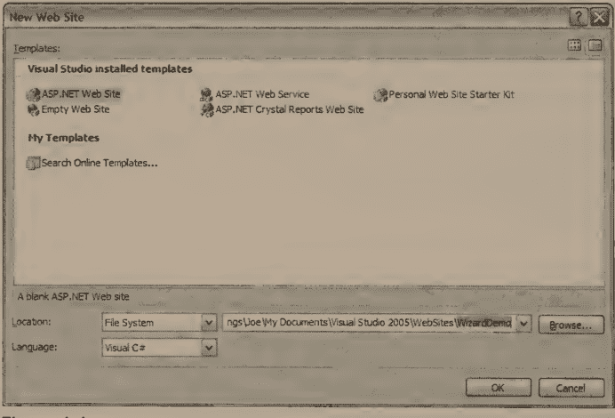

    图 1-1

2.  点击“确定”按钮，Visual Studio 2005 将创建一个新项目，如图 1-2 所示。

    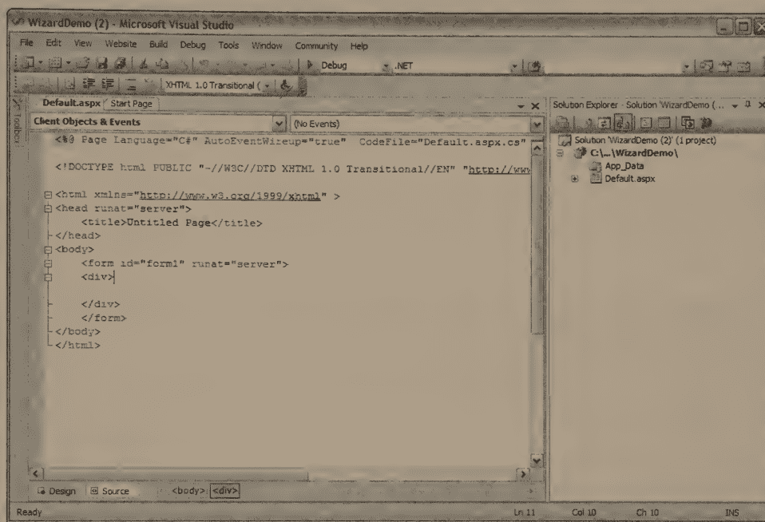

    图 1-2

3.  如果您处于 HTML 视图，如图 1-2 所示，请点击编辑器左下角的“设计”链接进入设计视图。
4.  在设计视图中，找到位于 IDE 左侧的工具箱。您可以将鼠标悬停在标有“工具箱”的选项卡上来打开它。点击工具箱的“标准”区域并选择“向导”控件。将“向导”控件拖放到窗体上，如图 1-3 所示。

    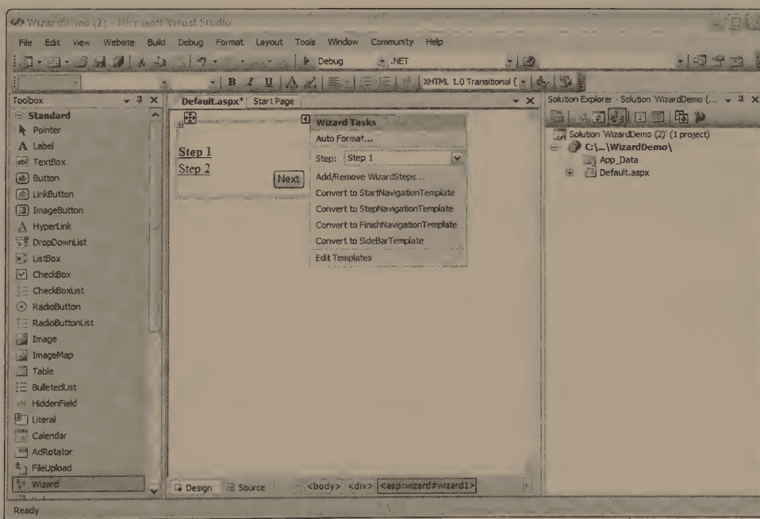

    图 1-3

5.  选择“视图⇄属性窗口”以显示属性窗口。在属性窗口中，将 HeaderText 属性设置为 **菜单选择器**。
6.  将“向导”控件调整为大约 400 × 200。
7.  首次将“向导”控件添加到 Web 窗体时，它会显示几个标记为“步骤 1”和“步骤 2”的链接。在“向导”控件中选择“步骤 1”。
8.  选择“向导”控件中的编辑区域并输入 **您的饮食偏好是什么？**
9.  从工具箱中拖放一个 RadioButtonList 控件到“向导”控件编辑区域，在操作列表中选择“编辑项”，并在 ListItemCollection 编辑器中将两个新项的 Text 属性添加为 **肉食者** 和 **素食者**。图 1-4 显示了这些说明步骤 5 到 9 的结果。

    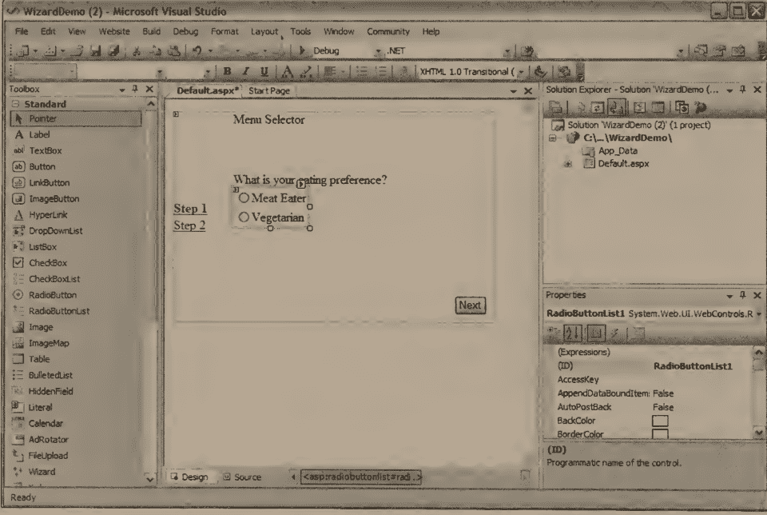

    **图 1-4**

10. 在“向导”控件中选择“步骤 2”。
11. 在编辑区域输入 **请选择主菜：**
12. 从工具箱中拖放一个 RadioButtonList 控件到“向导”控件编辑区域，在操作列表中选择“编辑项”，并在 ListItemCollection 编辑器中将三个新项的 Text 属性添加为 **鸡肉**、**鱼肉** 和 **牛排**。图 1-5 显示了这些说明步骤 10 到 12 的结果。
13. 从“向导任务”列表中点击“添加/移除向导步骤”，并将“步骤 3”添加到“向导”控件。


## 回顾技巧

- 14. 选择您刚刚添加到向导控件的新第 3 步链接。
- 15. 在编辑区域输入**请选择主菜：** 。
- 16. 从工具箱拖动 RadioButtonList 控件到向导控件编辑区域，并在操作列表中选择编辑项目，然后向 ListItemCollection 编辑器中的三个新项目文本属性添加 **面包**、**沙拉**和**蔬菜拼盘** 项目。图 1-6 展示了这些说明步骤 13 至 16 的结果。
- 17. 从向导任务列表点击“添加/删除向导步骤”，并向向导控件添加一个新的第 4 步。
- 18. 选择您刚刚添加到向导控件的第 4 步链接。
- 19. 在编辑区域输入**请选择饮品：** 。
- 20. 从工具箱拖动 RadioButtonList 控件到向导控件编辑区域，在操作列表中选择编辑项目，并向 ListItemCollection 编辑器中的三个新项目文本属性添加咖啡、水和葡萄酒项目。图 1-7 展示了这些说明步骤 17 至 20 的结果。

此操作会生成包含多个步骤的向导的 HTML。表列 1-1 展示了本节的后期部分对页面所做的修改后的 HTML。您在表列 1-1 中看到的 HTML 是在执行步骤 1 到 20 时由 Visual Studio 2005 自动生成的。在 Visual Studio 2005 编辑器底部选择“HTML”标签以从设计视图切换到 HTML 视图。当您这样做时，您将看到类似于表列 1-1 的代码。

## Listing 1-1：带有多个步骤的 ASP.NET v2.0 向导控件

```
<%@ Page Language="C#" AutoEventWireup="true" CodeFile="Default.aspx.cs"
Inherits="_Default" %>

<!DOCTYPE html PUBLIC "-//W3C//DTD XHTML 1.0 Transitional//EN"
"http://www.w3.org/TR/xhtml1/DTD/xhtml1-transitional.dtd">

<html xmlns="http://www.w3.org/1999/xhtml" >
<head runat="server">
    <title>Wizard Demo</title>
</head>
<body>
    <form id="form1" runat="server">
    <div>
        <asp:Wizard ID="Wizard1" runat="server"
            ActiveStepIndex="0" HeaderText="Menu Selector"
            Height="200px" Width="400px"
            OnFinishButtonClick="Wizard1_FinishButtonClick"
            OnNextButtonClick="Wizard1_NextButtonClick">
            <WizardSteps>
                <asp:WizardStep runat="server" Title="Step 1">
                    What is your eating preference?<br />
                    <br />
                    <asp:RadioButtonList ID="RadioButtonList1" runat="server">
                        <asp:ListItem>Meat Eater</asp:ListItem>
                        <asp:ListItem>Vegetarian</asp:ListItem>
                    </asp:RadioButtonList>
                </asp:WizardStep>
                <asp:WizardStep runat="server" Title="Step 2">
                    Please select main course:<br />
                    <br />
                    <asp:RadioButtonList ID="RadioButtonList2" runat="server">
                        <asp:ListItem>Chicken</asp:ListItem>
                        <asp:ListItem>Fish</asp:ListItem>
                        <asp:ListItem>Steak</asp:ListItem>
                    </asp:RadioButtonList>
                </asp:WizardStep>
                <asp:WizardStep runat="server" Title="Step 3">
                    Please select main course:<br />
                    <br />
                    <asp:RadioButtonList ID="RadioButtonList3" runat="server">
                        <asp:ListItem>Bread</asp:ListItem>
                        <asp:ListItem>Salad</asp:ListItem>
                        <asp:ListItem>Veggie Tray</asp:ListItem>
                    </asp:RadioButtonList>
                </asp:WizardStep>
                <asp:WizardStep runat="server" Title="Step 4">
                </asp:WizardStep>
            </WizardSteps>
        </asp:Wizard>
    </div>
    </form>
</body>
</html>
```

## Listing 1-1（续）

```
Please select beverage:<br />
<br />
<asp:RadioButtonList ID="RadioButtonList4" runat="server">
    <asp:ListItem>Coffee</asp:ListItem>
    <asp:ListItem>Water</asp:ListItem>
    <asp:ListItem>Wine</asp:ListItem>
</asp:RadioButtonList>
</asp:WizardStep>
</WizardSteps>
</asp:Wizard>
</div>
</form>
</body>
</html>
```

从表列 1-1 和图 1-8 的步骤中可以看出，用户要么是肉食者（Meat Eater）要么是素食者（Vegetarian）。他们应该只看到与其选择相对应的菜单项。

要指定不同的菜单，向导控件将必须根据第 1 步中的选择导航到不同的步骤。ASP.NET 向导控件支持事件，我们将使用它来确保根据饮食偏好显示正确的步骤。表列 1-2 展示了当用户点击“下一步”按钮时如何正确进行导航。在属性窗口中单击闪电图标并双击 NextButtonClick 事件以生成事件处理程序外壳，该外壳将具有默认名称 Wizard1_NextButtonClick。输入与表列 1-2 所示的 Wizard1_NextButtonClick 事件处理程序的算法。

## Listing 1-2：改变向导的顺序进度

```
protected void Wizard1_NextButtonClick(
    object sender, WizardNavigationEventArgs e)
{
    if (Wizard1.ActiveStepIndex == 0)
    {
        if (RadioButtonList1.SelectedValue == "Vegetarian")
        {
            Wizard1.ActiveStepIndex = 2;
        }
    }

    if (Wizard1.ActiveStepIndex == 1)
    {
        Wizard1.ActiveStepIndex = 3;
    }
}
```

通过捕获 NextButtonClick 事件（如表列 1-2 所示），您可以控制向导的导航顺序。此事件在当前页面被点击时调用“下一步”按钮。因此，首先检查 ActiveStepIndex 以确定当前页码，该页码由从零开始的整数指示。所有步骤控件都可以在回发期间访问，因此我们可以轻松获取它们的值。在这种情况下，代码如果饮食偏好为素食者，则将 ActiveStepIndex 设置为第 3 步页（索引为 2）。

当饮食偏好为肉食者时，向导将自然地导航到第 2 步（索引 1）。在这种情况下，点击“下一步”按钮应将用户带到第 4 步（索引 3），以选择饮品。导航到第 3 步的素食者在点击“下一步”按钮后自然会移动到第 4 步。

当向导到达终点时，“下一步”按钮将被“完成”按钮替换。您可以捕获来自完成按钮的事件以在点击时采取行动，如表列 1-3 所示。

## Listing 1-3：处理完成按钮事件

```
protected void Wizard1_FinishButtonClick(
    object sender, WizardNavigationEventArgs e)
{
    if (RadioButtonList1.SelectedValue == "Vegetarian")
    {
        Response.Write(
            "Your meal will be " +
            RadioButtonList3.SelectedValue +
            " and " +
            RadioButtonList4.SelectedValue);
    }
    else
    {
        Response.Write(
            "Your meal will be " +
            RadioButtonList2.SelectedValue +
            " and " +
            RadioButtonList4.SelectedValue);
    }
}
```

在表列 1-3 中，我们主要关注饮食偏好是否为肉食者或素食者，以便我们可以从正确的控件中提取值。代码通过 Response.Write 发出所选菜单项，具体取决于用户在运行向导时选择的是肉食者还是素食者。

在添加步骤、处理事件和更改属性的过程中，您可以看到 ASP.NET v2.0 向导控件是多么强大。这是一个将极有用的黑客技巧转变为完整产品功能的示例。

## 母版页：过去与现在

母版页使您能够为跨多个网站页面的通用外观和感觉开发视觉模板。在 ASP.NET v1.1 中，开发人员使用几种不同的技术来实现类似的目标，包括用户控件、继承自公共基页面类和一种使用模板形式的母版页。本节引用了显示如何在 ASP.NET v1.1 中实现母版页模板黑客的资源，然后描述了它们如何作为 ASP.NET v2.0 的主要功能进行实现。

### ASP.NET v1.1 中的母版页模板

ASP.NET v2.0 母版页在 ASP.NET v1.1 中最接近的模板管理技术之一是模板管理技术之一。Paul Wilson（wilsondotnet.com）撰写了几篇关于页面主题的文章。2003 年 10 月，他为 ASP Alliance 撰写了“页面模板：介绍”(http://authors.aspalliance.com/PaulWilson/Articles/?id=14)，描述了用户控件和页面继承技术。然而，更有趣的是他写给 ASP Alliance 的关于“母版页：介绍”的文章(http://authors.aspalliance.com/PaulWilson/Articles/?id=13)。对于许多开发人员来说，这基本上是对 ASP.NET v2.0 中母版页将要实现内容的初步了解。Paul Wilson 的文章展示了如何在 ASP.NET v1.1 中实现相同的事情。

在 ASP.NET v1.1 中还有其他可信的模板实现方式。在他的代码项目文章“重新构思母版页：ASP.NET 面向组件的模板引擎”中(codeproject.com/aspnet/sumitemplatecontrols.asp) ，Philipp Sumi 展示了在 ASP.NET v1.x 中使用母版页模板的另一种方法。虽然还有其他示例，但 Paul Wilson 和 Philipp Sumi 的文章是您可以在 ASP.NET v1.1 中使用的可信参考资料。

### ASP.NET v2.0 中的母版页

在 ASP.NET v2.0 中，母版页从伟大的黑客技巧成长为主要功能。它们内置于 ASP.NET 中，具有新的页面指令、占位符和控件，使您能够跨应用程序或网站创建通用的外观和感觉。此外，它们在 Visual Studio 2005 中得到良好支持。

### 实现母版页

在 ASP.NET v2.0 中，母版页实现为具有默认外观和感觉的 Web 页面，内容页面可以使用它。多个内容页面可以使用此母版页的通用外观和感觉，它们所需要做的就是提供内容标记，该标记将与母版页合并。本节中的示例介绍了如何使用 VS 2005 创建母版页和简单内容页面的过程。


要开始，请创建一个新的 Web 项目，并删除自动生成的 Default.aspx 页面。我们稍后将重新创建 Default.aspx 作为使用我们即将创建的母版页的内容页。

1. 要创建母版页，请在解决方案资源管理器中右键单击 Web 项目，选择“添加新项”，选择“母版页”，将其命名为 **Company.master**，然后单击“确定”按钮。这将创建一个新的母版页。

2. 如果母版页处于 HTML 视图，请通过单击编辑器左下角的“设计”按钮将其更改为设计视图。通过选择“布局” > “插入表格”向 Company.master 添加一个新表格。

3. 在“插入表格”对话框中，选择“模板”，然后从下拉列表中选择“页眉、页脚和侧边”，如图 1-9 所示。

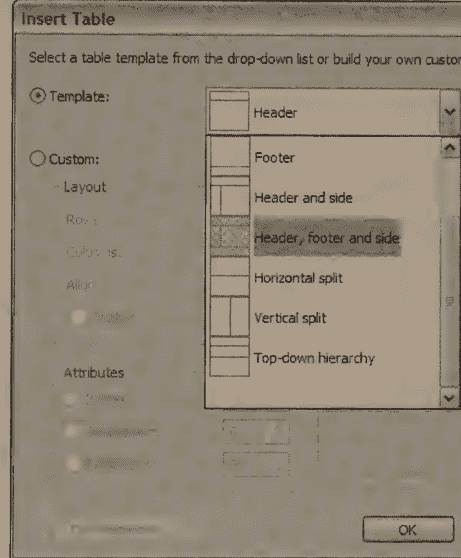

4. 将表格添加到页面后，选择顶部表格行中的单元格并键入 **My Company Header**，选择第二行的第一个单元格并键入 **Menu Goes Here**，然后选择第三行（最后一行）的单元格并键入 **Copyright (C) 2006 My Company, All Rights Reserved**。

5. 首次创建母版页时，会自动向其添加一个 ContentPlaceHolder 控件。Company.master 也有这个。将 ContentPlaceHolder 控件拖放到刚刚插入到 Company.master 母版页中的表格的第二行的第二个单元格中。结果应与图 1-10 相似。

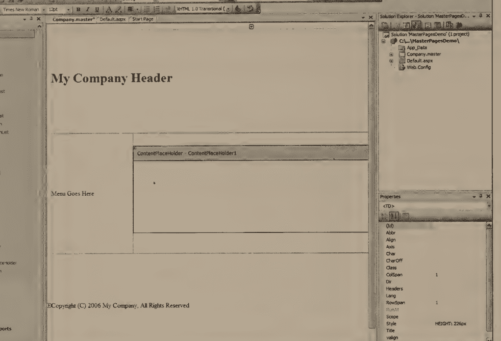

创建并修改 Company.master 母版页后，您可以通过单击编辑器左下角的“HTML”按钮来查看自动生成的 HTML 代码。清单 1-4 显示了在进行上一段所述的修改后，Company.master 母版页的 HTML 代码。

## 清单 1-4：具有自定义页面元素格式的母版页：Company.master

```aspx
<%@ Master Language="C#" AutoEventWireup="true" CodeFile="Company.master.cs" Inherits="Company" %>

<!DOCTYPE html PUBLIC "-//W3C//DTD XHTML 1.0 Transitional//EN" 
"http://www.w3.org/TR/xhtml1/DTD/xhtml1-transitional.dtd">

<html xmlns="http://www.w3.org/1999/xhtml" >
<head runat="server">
    <title>My Company</title>
</head>
<body>
<form id="form1" runat="server">
<div>
    <table border="0" cellpadding="0" cellspacing="0"
        style="width: 100%; height: 100%">
        <tr>
            <td colspan="2" style="height: 200px">
                <h1>My Company Header</h1>
            </td>
        </tr>
        <tr>
            <td style="width: 200px">
                Menu Goes Here</td>
            <td>
            <asp:contentplaceholder id="ContentPlaceHolder1" runat="server">
            </asp:contentplaceholder>
            </td>
        </tr>
        <tr>
            <td colspan="2" style="height: 200px">
                Copyright (C) 2006 My Company, All Rights Reserved
            </td>
        </tr>
    </table>
</div>
</form>
</body>
</html>
```

关于清单 1-4，您应该首先注意到它在页面顶部包含一个母版指令。正如 codefile 和 inherits 属性所暗示的，您可以为母版页添加代码文件。页面的大部分主要是 HTML 格式标记。

此页面的另一个相关部分是 contentplaceholder 元素。您可以在此处放置默认内容，但内容页将使用 id 来指定其内容出现的位置，这将覆盖任何默认内容。

您现在可以将此母版页与任何内容页一起使用。创建内容页的过程与创建任何其他 Web 窗体所需的过程非常相似。在解决方案资源管理器中右键单击 Web 项目，选择“添加新项”，选择“Web 窗体”，接受建议的名称 Default.aspx，选中“选择母版页”选项，然后单击“确定”按钮。清单 1-5 显示了修改后的新内容页。

## 清单 1-5：使用母版页的内容页：Default.aspx

```aspx
<%@ Page
    Language="C#"
    MasterPageFile="~/Company.master"
    AutoEventWireup="true"
    CodeFile="Default.aspx.cs"
    Inherits="_Default"
    Title="Content Page" %>

<asp:Content ID="Content1"
                ContentPlaceHolderID="ContentPlaceHolder1"
                Runat="Server">
            <h2>This is my content.</h2>
        </asp:Content>
```

清单 1-5 的两个有趣部分是 MasterPageFile 属性和 Content 元素。Page 指令包含一个名为 MasterPageFile 的新属性，指定要使用的母版页的文件名。

从清单 1-5 可以明显看出，内容页不像普通的 Web 窗体那样具有 HTML 标记。相反，添加一个 Content 元素，通过使用 ContentPlaceHolderID 属性指定母版页中要使用的 contentplaceholder 的 id，来标识在母版页中的何处放置内容标记。只有 Content 元素中的标记会出现在母版页中。

由于您没有正常的 HTML 标记（如 Head），请使用通常会放入 Head title 元素的内容来设置 Page 指令的 Title 属性。

这展示了在 ASP.NET v2.0 中使用母版页是多么优雅和简单。由 VS 2005 支持，这是一个比 ASP.NET v1.1 的 hack 方法简单得多的解决方案。

## URL 重写

URL 重写是接受具有有意义命名约定的 URL 并将其转换为真实查询字符串的做法。您可能想要有意义的命名约定的一些原因包括将信息组织成逻辑层次结构或隐藏查询字符串参数的能力。在本节中，我将向您展示 URL 重写如何改善用户界面，描述实现 URL 重写的新旧方法，并为您提供一些演示该概念的代码。

> 我还在本节中添加了一些额外的代码，以演示 N 层架构和数据处理中的最佳实践，而不是用更简单的数据源控件来作弊。

### 为什么需要 URL 重写？

层次结构组织的一个例子可以通过观察博客如何按时间组织来描述。从用户的角度来看，以下查询字符串可能被认为非常晦涩难懂：

```
http://www.someblogsite.com/username/?y=2005&m=01&d=31
```

前面的查询字符串返回 2005 年 1 月 1 日的博客条目，这不容易确定。您可以修改代码，使参数更有意义，如下所示：

```
http://www.someblogsite.com/username/?year=2005&month=01&day=31
```

无论查询字符串参数如何呈现，普通用户都很难理解。相反，使用良好的层次结构表示来编写查询字符串会清晰得多，如下所示：

```
http://www.someblogsite.com/username/2005/January/31
```

对于典型的网站访问者来说，前面的 URL 并不难弄清楚。例如，如果用户删除日期，他们将看到整个一月份的所有条目。

即使您没有自然的层次结构或只有一个参数，使用有意义的名称而不是查询参数的 URL 对消费者来说仍然更容易理解。

### ASP.NET v1.1 的 Hack 方法

在 ASP.NET v1.x 中执行 URL 重写的最佳资源之一是 Scott Mitchell 的 MSDN 文章，标题为“URL Rewriting in ASP.NET”，位于 msdn.microsoft.com/library/default.asp?url=/library/en-us/dnaspp/html/urlrewriting.asp。在这篇文章中，Scott 描述了如何使用 HTTP 模块和 HTTP 处理程序执行 URL 重写，并解释了何时使用每种方法最好。他还构建了一个可重用的 URL 重写引擎，该引擎通过配置文件使用正则表达式。

### ASP.NET v2.0 的替代方案

在 ASP.NET v2.0 中，urlMappings 配置元素在某种程度上支持 URL 重写。向 web.config 添加一个新条目，类似于以下用于映射 URL 的条目：

```xml
<urlMappings enabled="true">
    <add url="~/Articles/AspDotNet/UrlRewriting"
    mappedUrl="~/Articles.aspx?cat=1&id=16" />
</urlMappings>
```

url 属性是用户看到的，mappedUrl 属性描述实际请求的页面。在前面的 urlMappings 元素中，想象有一个文章页面，它根据类别和文章标识符动态返回文章。url 显示了首选的用户界面，但 mappedUrl 属性显示了实际请求的页面和参数。

### 实现 URL 映射功能

我编写了一个示例应用程序来展示如何使用此功能。它是前面显示的文章查看概念的一个变体，但基于年份和月份。例如，文章应用程序将允许您选择年份，然后选择月份。每个页面都显示可读的 URL，您可以通过简单地修改页面地址来使用它们来导航应用程序。清单 1-6 显示了文章应用程序的初始页面。

## 清单 1-6：使用可读 URL 标识年份的主页：Default.aspx

```aspx
<%@ Page Language="C#" AutoEventWireup="true" CodeFile="Default.aspx.cs"
Inherits="_Default" %>

<!DOCTYPE html PUBLIC "-//W3C//DTD XHTML 1.0 Transitional//EN"
"http://www.w3.org/TR/xhtml1/DTD/xhtml1-transitional.dtd">

<html xmlns="http://www.w3.org/1999/xhtml" >
```


```
# 第一章

## 代码清单 1-6（续）

```xml
<head runat="server">
    <title>.NET 文章归档</title>
</head>
<body>
    <form id="form1" runat="server">
        <h1>.NET 文章归档</h1>
        <p>
            选择一个年份：
        </p>
        <p>
            <asp:HyperLink ID="HyperLink1" runat="server"
                NavigateUrl="~/2006">2006</asp:HyperLink><br />
            <asp:HyperLink ID="HyperLink2" runat="server"
                NavigateUrl="~/2005">2005</asp:HyperLink>
        </p>
    </form>
</body>
</html>
```

HyperLink 元素的 `NavigateUrl` 属性包含可读的 URL，这些 URL 将被重写为查询字符串参数。类似地，当用户选择一个年份后，他们会看到如代码清单 1-7 所示的年份页面。

## 代码清单 1-7：使用可读 URL 的年份页面：YearView.aspx

```xml
<%@ Page Language="C#" AutoEventWireup="true" CodeFile="YearView.aspx.cs"
Inherits="YearView" %>

<!DOCTYPE html PUBLIC "-//W3C//DTD XHTML 1.0 Transitional//EN"
"http://www.w3.org/TR/xhtml1/DTD/xhtml1-transitional.dtd">

<html xmlns="http://www.w3.org/1999/xhtml" >
<head runat="server">
    <title>该年份的文章</title>
</head>
<body>
    <form id="form1" runat="server">
        <h1>
            <asp:Label ID="lblTitle"
                runat="server"
                Text="该年份 # 的文章">
            </asp:Label>
        </h1>
        <p>
            <asp:Panel ID="pnlMonths" runat="server" Height="50px" Width="125px">
                <asp:HyperLink ID="hypJanuary" runat="server"
                    NavigateUrl="~/YEAR/01">一月</asp:HyperLink><br />
                <asp:HyperLink ID="hypFebruary" runat="server"
                    NavigateUrl="~/YEAR/02">二月</asp:HyperLink><br />
                <asp:HyperLink ID="hypMarch" runat="server"
                    NavigateUrl="~/YEAR/03">三月</asp:HyperLink><br />
                <asp:HyperLink ID="hypApril" runat="server"
                    NavigateUrl="~/YEAR/04">四月</asp:HyperLink><br />
```

## 代码清单 1-7（续）

```xml
<asp:HyperLink ID="hypMay" runat="server"
NavigateUrl="~/YEAR/05">五月</asp:HyperLink><br />
<asp:HyperLink ID="hypJune" runat="server"
NavigateUrl="~/YEAR/06">六月</asp:HyperLink><br />
<asp:HyperLink ID="hypJuly" runat="server"
NavigateUrl="~/YEAR/07">七月</asp:HyperLink><br />
<asp:HyperLink ID="hypAugust" runat="server"
NavigateUrl="~/YEAR/08">八月</asp:HyperLink><br />
<asp:HyperLink ID="hypSeptember" runat="server"
NavigateUrl="~/YEAR/09">九月</asp:HyperLink><br />
<asp:HyperLink ID="hypOctober" runat="server"
NavigateUrl="~/YEAR/10">十月</asp:HyperLink><br />
<asp:HyperLink ID="hypNovember" runat="server"
NavigateUrl="~/YEAR/11">十一月</asp:HyperLink><br />
<asp:HyperLink ID="hypDecember" runat="server"
NavigateUrl="~/YEAR/12">十二月</asp:HyperLink>
</asp:Panel>
</p>
</form>
</body>
</html>
```

代码清单 1-7 展示了设置了可读 URL 的 HyperLink 元素。它们包含了每年每月的层级，其中的数字对应月份的顺序。为了正确处理这些 URL，需要编辑 YearView Web 窗体的代码文件，如代码清单 1-8 所示。

## 代码清单 1-8：读取带参数 URL 页面的查询字符串参数：YearView.aspx.cs

```csharp
using System;
using System.Data;
using System.Configuration;
using System.Collections;
using System.Web;
using System.Web.Security;
using System.Web.UI;
using System.Web.UI.WebControls;
using System.Web.UI.WebControls.WebParts;
using System.Web.UI.HtmlControls;

public partial class YearView : System.Web.UI.Page
{
    string year; // 通过查询字符串传入

    protected void Page_Load(object sender, EventArgs e)
    {
        // 我们将在多个方法中使用此变量
        year = Request.QueryString["year"];

        // 设置页面标题
        SetTitle();

        // 配置月份以指向正确的页面
```

## 代码清单 1-8（续）

```csharp
SetMonths();
}

/// <summary>
/// 配置月份以指向正确的页面
/// </summary>
private void SetMonths()
{
    foreach (Control ctrl in pnlMonths.Controls)
    {
        HyperLink monthLink = ctrl as HyperLink;

        if (monthLink != null)
        {
            monthLink.NavigateUrl =
                monthLink.NavigateUrl.Replace("YEAR", year);
        }
    }
}

/// <summary>
/// 设置页面标题
/// </summary>
private void SetTitle()
{
    lblTitle.Text = "该年份 " + year + " 的文章";
}
}
```

代码清单 1-8 中的 `Page_Load` 方法从查询字符串中提取年份参数，以便在后续方法中使用。`SetTitle` 方法使用此值在页面上重写标题，显示正确的年份。

此外，注意代码清单 1-8 中 HyperLink 控件的 `NavigateUrl` 属性，它们都在 URL 的年份位置包含文本“YEAR”。这使得代码更具动态性，因为根据年份的不同，这些 `NavigateUrl` 属性必须被重写。这就是代码清单 1-8 中 `SetMonths` 方法的作用。代码清单 1-8 中的代码故意将每个 HyperLink 控件放入一个 Panel 中，以便我们在代码中获取其 Controls 集合。因此，在代码文件中，`SetMonths` 方法只需遍历 Controls 集合，并通过简单的字符串替换方法调用设置年份。为了使此内置 URL 重写功能在此应用程序中生效，有一个带有 `urlMapping` 元素的 web.config 文件，如代码清单 1-9 所示。

## 代码清单 1-9：web.config 文件中的 urlMapping 元素在 ASP.NET v2.0 中启用 URL 重写

```xml
<?xml version="1.0"?>
<configuration>
  <system.web>
    <urlMappings>
      <add url="~/2006"
           mappedUrl="~/YearView.aspx?year=2006"/>
    </urlMappings>
  </system.web>
</configuration>

```

`add` 元素将 URL 模式映射到实际的查询字符串参数。每个映射都将一个可读的 URL 模式转换为发送给页面的实际地址和查询字符串：

| 可读 URL | 映射的 URL | 描述 |
|--------------|------------|-------------|
| ~/2006/01 | ~/MonthView.aspx?year=2006&amp;month=01 | 2006 年 1 月 |
| ~/2006/02 | ~/MonthView.aspx?year=2006&amp;month=02 | 2006 年 2 月 |
| ~/2005 | ~/YearView.aspx?year=2005 | 2005 年 |
| ~/2005/01 | ~/MonthView.aspx?year=2005&amp;month=01 | 2005 年 1 月 |
| ~/2005/02 | ~/MonthView.aspx?year=2005&amp;month=02 | 2005 年 2 月 |

波浪号（~）符号代表每个页面相对的应用程序目录。您必须使用 &amp; 而不是单独的 & 符号来分隔参数。为了缩短列表，我们省略了某些月份的条目。

若要查看文章列表，用户选择感兴趣的月份。代码清单 1-10 显示了 MonthView.aspx 的实现方式。我在代码清单 1-10 中使用了 GridView 控件，因为我需要以美观的格式输出多行数据，并想要将其绑定到 ObjectDataSource 控件。GridView 控件是 ASP.NET v2.0 中新增的控件，它取代了 DataGrid 控件。

## 代码清单 1-10：使用 GridView 读取查询参数：MonthView.aspx

```xml
<%@ Page Language="C#" AutoEventWireup="true" CodeFile="MonthView.aspx.cs"
Inherits="MonthView" %>

<!DOCTYPE html PUBLIC "-//W3C//DTD XHTML 1.0 Transitional//EN"
"http://www.w3.org/TR/xhtml1/DTD/xhtml1-transitional.dtd">

<html xmlns="http://www.w3.org/1999/xhtml" >
<head runat="server">
    <title>该月份的文章</title>
</head>
<body>
    <form id="form1" runat="server">
        <h1>
            请求的文章：</h1>
        <br />
        <asp:GridView ID="GridView1" runat="server"
            AutoGenerateColumns="False" DataSourceID="ArticlesODS">
            <Columns>
                <asp:BoundField DataField="Year"
                    HeaderText="年份" SortExpression="Year" />
                <asp:BoundField DataField="Month"
                    HeaderText="月份" SortExpression="Month" />
                <asp:BoundField DataField="Title"
                    HeaderText="标题" SortExpression="Title" />
                <asp:BoundField DataField="Content"
                    HeaderText="内容" SortExpression="Content" />
```


## 第1章

### 代码清单 1-10（续）

```xml
</Columns>
</asp:GridView>
<asp:ObjectDataSource ID="ArticlesODS" runat="server"
    SelectMethod="GetArticles" TypeName="Articles">
    <SelectParameters>
        <asp:QueryStringParameter DefaultValue="2006"
            Name="year" QueryStringField="year"
            Type="String" />
        <asp:QueryStringParameter DefaultValue="01"
            Name="month" QueryStringField="month"
            Type="String" />
    </SelectParameters>
</asp:ObjectDataSource>
</form>
</body>
</html>
```

作为精心设计的多层架构的拥护者，我决定使用业务对象和一个正式的数据访问层来实现文章管理。这就是为什么你会在 `MonthView.aspx` 页面中看到 `ObjectDataSource` 控件。将查询字符串参数直接映射到 `Articles` 类的 `GetArticles` 方法非常方便，如代码清单 1-11 所示。

### 代码清单 1-11：Articles 类包含一个文章对象列表：articles.cs

```csharp
using System;
using System.Collections.Generic;

/// <summary>
/// 文章列表
/// </summary>
public class Articles : List<Article>
{
    public List<Article> GetArticles(string year, string month)
    {
        ArticleData dal = new ArticleData();
        dal.GetArticles(this, year, month);
        return this;
    }
}
```

代码清单 1-11 中的 `Articles` 类利用了 C# 编程语言的新泛型特性来创建 `Article` 对象的强类型集合。通过继承 `List<Article>`，我们既获得了泛型的好处，又能将我们的类型命名为更易理解的名称。代码清单 1-12 展示了数据访问层，由 `ArticleData` 类代表。

### 代码清单 1-12：ArticleData 类从数据源填充当前列表中的新文章：ArticleData.cs

```csharp
using System;
using System.Collections;
using System.Collections.Generic;
using System.Data;
using System.Web;

/// <summary>
/// ArticleData 的摘要说明
/// </summary>
public class ArticleData
{
    public void GetArticles(List<Article> articles, string year, string month)
    {
        DataSet dsArticles = new DataSet();
        dsArticles.ReadXml(HttpContext.Current.Server.MapPath("Articles.xml"));
        DataView dvArticles = new DataView(dsArticles.Tables["article"]);
        dvArticles.RowFilter =
            "year = '" + year + "' " +
            "and month = '" + month + "'";

        Article currArticle = null;

        IEnumerator articleRows = dvArticles.GetEnumerator();

        while (articleRows.MoveNext())
        {
            DataRowView articleRow = (DataRowView)articleRows.Current;
            currArticle = new Article(
                (string)articleRow["year"],
                (string)articleRow["month"],
                (string)articleRow["title"],
                (string)articleRow["content"]);

            articles.Add(currArticle);
        }
    }
}
```

这个类将一个 XML 文件（见代码清单 1-13）加载到 `DataSet` 中。它使用 `DataView` 根据传入的 `year` 和 `month` 参数对结果进行过滤。`Article` 类是业务对象，最终将在 UI 层绑定到 `GridView`。当然，UI 层不需要知道数据来自 XML 文件或通过 ADO.NET 组件处理。这可以在以后轻松更改以满足新需求。幸运的是，`GridView` 能够显示泛型集合中的业务对象，这就是为什么我们通过 `articles` 参数以 `List<Article>` 形式返回数据。

### 代码清单 1-13：文章数据通过 XML 文件表示：Articles.xml

```xml
<?xml version="1.0" encoding="utf-8" ?>
<articles>
  <article>
    <year>2005</year>
    <month>01</month>
    <title>Title1</title>
    <content>This is the text of Title1.</content>
  </article>
  <article>
    <year>2005</year>
    <month>02</month>
    <title>Title2</title>
    <content>This is the text of Title2.</content>
  </article>
  <article>
    <year>2005</year>
    <month>02</month>
    <title>Title3</title>
    <content>This is the text of Title3.</content>
  </article>
  <article>
    <year>2006</year>
    <month>01</month>
    <title>Title4</title>
    <content>This is the text of Title4.</content>
  </article>
  <article>
    <year>2006</year>
    <month>01</month>
    <title>Title5</title>
    <content>This is the text of Title5.</content>
  </article>
  <article>
    <year>2006</year>
    <month>02</month>
    <title>Title6</title>
    <content>This is the text of Title6.</content>
  </article>
</articles>
```

代码清单 1-12 中的代码使用 XML 文件（见代码清单 1-13）作为数据源，这是一个非常简单的实现。`ArticlesData` 类使用该数据来填充 `Article` 对象，如代码清单 1-14 所示。

### 代码清单 1-14：Article 类是一个业务对象，将被绑定到 UI 层的 GridView：Article.cs

```csharp
using System;
using System.Data;
using System.Configuration;
using System.Web;
using System.Web.Security;
using System.Web.UI;
using System.Web.UI.WebControls;
using System.Web.UI.WebControls.WebParts;
using System.Web.UI.HtmlControls;

/// <summary>
/// 表示一篇 Article
/// </summary>
public class Article
{
    private string m_year;

    public string Year
    {
        get { return m_year; }
        set { m_year = value; }
    }

    private string m_month;

    public string Month
    {
        get { return m_month; }
        set { m_month = value; }
    }

    private string m_title;

    public string Title
    {
        get { return m_title; }
        set { m_title = value; }
    }

    private string m_content;

    public string Content
    {
        get { return m_content; }
        set { m_content = value; }
    }

    public Article(string year, string month, string title, string content)
    {
        Year = year;
        Month = month;
        Title = title;
        Content = content;
    }
}
```

`Articles` 类中的数据通过属性作为其公共接口暴露，提供了封装。这使你能够根据需要更改底层实现，包括添加业务规则和验证逻辑。

> 如果我在代码中使用了 `ObjectDataSource` 控件以外的其他数据源控件，添加业务规则将不是一个可选项。为了本示例中的代码简化，我选择不这样做，但我仍然有选择。通过正确使用 `ObjectDataSource` 控件，你可以设计出灵活且可维护的应用程序。

## 第 1 章

使用 ASP.NET v2.0 的 URL 映射功能似乎是一个很棒的能力，但有一个问题：你不能使用正则表达式。本节中的文章示例本可以使用正则表达式写得更好。请注意，`urlMappings` 元素包含非常相似的代码，只是年份或月份不同。这可以通过一个单独的正则表达式更好地实现，该表达式通过参数放置来映射年份和月份。如果你使用 Scott Mitchell 的 URL 重写引擎，配置将如下所示：

```xml
<RewriterConfig>
    <Rules>
        <!-- Rules for Blog Content Displayer -->
        <RewriterRule>
            <LookFor>~(\d{4})/(\d{2})/Default\.aspx</LookFor>
            <SendTo><![CDATA[~/YearView.aspx?year=$1&month=$2]]></SendTo>
        </RewriterRule>
        <RewriterRule>
            <LookFor>~/(\d{4})/Default\.aspx</LookFor>
            <SendTo>~/YearView.aspx?year=$1</SendTo>
        </RewriterRule>
    </Rules>
</RewriterConfig>
```

这是一个简单的、一次性的配置。然而，对于 Visual Studio 2005 的实现，如代码清单 1-9 中配置文件的 `urlMapping` 元素所示，你必须为每一年的每一个月持续更新文件。这不实用，因为文件会持续增长，并且需要手动干预。对于需要使用正则表达式进行严肃的 URL 重写功能，我建议你使用 Scott Mitchell 文章中的方法。仅在最简单的情况下使用 ASP.NET v2.0 的 URL 映射功能。

## 总结

本章介绍了一些由 ASP.NET v1.1 的先驱们发明的技巧（hacks）。这些人士以及其他一些人产生了如此巨大的影响，以至于微软将他们的 hack 变成了 ASP.NET v2.0 中的主要产品特性。向导 hack 变成了 `Wizard` 控件。模板、继承和用户控件 Master Page hack 变成了 ASP.NET v2.0 中的 `Master Pages`。URL 重写 hack 影响了 ASP.NET v2.0 中的 URL 映射，并且它们依然如此出色，以至于当需要正则表达式时，URL 重写 hack 将继续成为实现 URL 重写的首选方法。


## 第2章：入门指南

无论您是迁移现有的ASP.NET 1.1应用程序，还是从零开始创建全新的ASP.NET 2.0应用程序，最好都能制定一个有助于您起步的策略。本章将通过探讨启动新项目时可以采用的不同技术，帮助您制定这样的策略。您采用的策略应在项目中保持一致，并随时间推移而演进，以实现您所采纳的最佳实践。在项目中保持一致性不仅能让您更轻松地从一个项目过渡到另一个项目，还有助于培训团队中的新成员。本章提供了一些入门思路，您可以将它们采纳为自己的最佳实践。

在设置新应用程序时，您需要考虑解决方案的组织结构。例如，将所有代码放在单个网站中，而不为将来与其他项目共享做准备，可能并非最佳选择。启动新项目时，正是考虑如何与其他项目共享代码或自定义控件的最佳时机。如果您已经构建了一些在每个项目中都会使用的通用服务器控件或实用工具例程，那么您需要设置必要的引用。

本章将讨论的一个概念是在每个Web窗体上使用`BaseUIPage`类，而不是让Web窗体从`System.Web.UI.Page`继承——这是向项目添加新Web窗体时的默认设置。因为这需要对每个Web窗体进行修改，所以从一开始就采用这种方式比在项目后期采纳要合理得多。如果您对从基类继承的概念还不熟悉，请不要担心；我们将在本章后续部分探讨它们如何融入其中。母版页是另一个重要的例子，因为它会影响每个Web窗体，但这并不是必须提前考虑的问题。如果您后来决定实施母版页，则需要修改任何现有的页面以利用新的母版页模型。

本章是对第11章的补充，后者更详细地讨论了从1.x迁移到2.0的问题。您可能会决定在转换过程中实施本章讨论的一些更改。例如，作为转换的一部分，您可能会采用母版页或将一些通用代码提取到类库中以实现更广泛的复用。在阅读本章时，您可以考虑是否有任何技术希望在迁移过程中应用。

本章讨论的许多概念在启动新项目时实施效果最佳。虽然在项目生命周期后期实施此处描述的技术并非不可能，但如果不是从一开始就实施，通常需要付出更多努力。其中许多技术也可以通过利用Visual Studio 2005中的导出模板功能进行打包，并在构建站点时加以应用。使用模板将节省大量重复性工作，通过将您采纳的最佳实践进行封装，使其能在页面之间重复使用。本章将描述如何在项目启动时应用这一点，而第13章将更详细地讨论模板概念。

假设本章的所有建议和讨论在所有项目中都适用是不现实的。与本书的大多数主题一样，您不需要100%采纳所有建议——找到适合您的组织和正在开发的特定应用程序的方法即可。

## 组织项目和解决方案

启动新应用程序开发时，首先需要做出的决定之一是如何组织您的项目。对于较小的应用程序，虽然可能而且有时更简单的方式是只使用单个ASP.NET Web文件夹，但通常采用多项目结构会更好。如果您认为您的应用程序将来可能由多个共享单一数据库结构的网站组成，或者您可能提供Windows窗体、Windows服务或其他类型的非Web应用程序来共享一些通用项目项，那么情况绝对如此。

例如，项目之间最常见的共享形式之一是公司多年来开发的、不特定于单个应用程序的实用工具代码。如果您将此类代码放在Web项目中，那么您可能构建的其他Web应用程序将无法轻松引用它。结果就是代码被复制，您最终拥有多个略有不同的版本，而不是单一版本。然后，当遇到错误时，它只在其中一个副本中得到修复，当生产环境中出现问题时，您需要处理多次紧急修复，而不是一次。

当然，如果您的Web项目中已经有实用工具或通用代码，这并不意味着您不能在任何时候将其移至公共类库。然而，这最终会导致更多工作，因为您必须更改当前应用程序以引用新的库。由于ASP.NET 2.0默认不使用特定的应用程序命名空间，您可能需要为您使用的每个使用实用工具或通用代码的类添加命名空间引用。如果您从一开始就采用多项目方法，并决心在应用程序之间共享代码，就可以避免这些额外工作。

组织应用程序中的项目没有唯一正确的方法。这里提出的想法并非旨在成为一种万能解决方案，而是提供思路，以便您能从正确的道路开始。除非您构建的应用程序非常小，否则从创建空白解决方案开始可能是最佳方式。

解决方案的存在是为了让您能够加载多个项目，并通过使用解决方案资源管理器在它们之间导航。除了作为多个项目的容器外，当您在同一解决方案中从一个项目引用另一个项目时，引用信息会存储在解决方案文件内部。

所有项目都有解决方案文件，即使它不可见。使用VB.NET和Visual Web Developer项目设置时，在添加第二个项目（通过选择“文件” > “添加” > “新项目”）之前，解决方案不会出现在解决方案资源管理器中。使用Visual C#设置时，解决方案始终显示在解决方案资源管理器中。无论您将网站放在何处，Visual Studio都会在默认项目位置目录中创建一个解决方案文件。在VB.NET和Visual C#中，您可以通过选择“工具” > “选项” > “环境” > “常规”来设置此位置。Visual Web Developer不公开供您更改此目录的属性。但是，您可以转到“我的文档” > “Visual Studio 2005” > “设置”，选择CurrentSettings.vssettings，然后更改位置。在该文件中，如果您查找字符串`name="ProjectsAndSolution"`，然后在XML配置文件中查找以下元素，就可以找到需要修改的字符串。将此字符串修改为您选择的位置。

```xml
<PropertyValue
name="ProjectsLocation">%vsspv_visualstudio_dir%\Projects</PropertyValue>
```

以下是一个XPath表达式，可帮助您在文件中定位到相同位置：

```xml
/UserSettings/ToolsOptions/ToolsOptionsCategory[@name=Environment]/ToolsOptionsSubCategory[@name=ProjectsAndSolution]/PropertyValue[@name=ProjectsLocation]
```

## 创建解决方案

创建解决方案有三种基本方式：

-   如前文所述，您可以创建一个新网站，系统将在默认项目位置目录中为您创建一个解决方案。根据您的设置，在激活多个项目之前，您可能在解决方案资源管理器中看不到它。

-   当您创建一个项目（如类库）时，如果已有项目打开，您可以选择将此新项目添加到现有解决方案或创建一个新解决方案。如果选择“添加到现有项目”，则不会创建新的解决方案，项目只是被添加到当前活动的解决方案中。否则，您必须决定是否为解决方案创建一个新目录。如果未选择“创建新目录”，则解决方案将与您添加的项目同名，并放在同一目录中。对于包含多个项目的解决方案项目来说，这并不是理想的设置。

    如果选择创建新目录，系统将提示您输入目录名称——该名称也将用于命名解决方案文件。向导完成后，将在位置输入框指定的路径下创建一个解决方案目录，项目将作为该目录下的子目录创建。例如，如果项目名称为Common，路径为c:\，解决方案为MySolution，您将看到以下目录结构：

    ```
    C:\MySolution
    C:\MySolution\MySolution.sln
    c:\MySolution\Common\
    c:\MySolution\Common\Common.csproj
    ```

    使用这种方法，只要您创建了新目录，效果就不错，并且可以通过在创建整体解决方案文件的同时创建通用项目来一举两得。

-   创建解决方案的最后一种常见方式是选择“文件” > “新项目”。然后，在“新建项目”向导中，您应该展开“其他项目类型”选项。您会找到“空白解决方案”项，如图2-1所示。


## 第2章

### 创建 Web 项目

在 Visual Studio 2005 中，创建 ASP.NET 项目的方式已经改变。你不再选择"文件→新建→项目"，然后选择 ASP.NET Web 应用程序向导。取而代之的是，选择"文件→新建网站"，系统会自动运行向导。该向导提供三个选项：文件、FTP 或 HTTP。HTTP 项目需要 IIS，类似于你熟悉的 ASP.NET v1.1。在开发时使用基于文件的方法，然后在部署时使用 IIS，这是一种常见的场景。

FTP 选项使你可以在服务器上维护文件，并通过 FTP 访问它们。这是一种适用于共享环境的配置，你希望多个人能够同时在项目上工作。此外，你可以使用 FTP 设置远程编辑文件，其中远程服务器 IIS 将虚拟目录映射到你的 FTP 文件所在的位置。FTP 选项最大的缺点是你失去了使用源代码管理的能力，并且增加了团队中多人做出冲突更改的风险。

文件项目基于你正在工作的物理目录。在该目录及其所有子目录中创建或复制的任何文件或文件夹都会成为项目的一部分。

如果你使用"文件"选项并从 Visual Studio 中启动网站，你将使用 Visual Studio 内置的 Web 服务器。你会很快注意到，你不再有项目文件。你的 Web 项目由标识为 Web 项目的文件夹中的文件组成。不再需要 IIS，并且默认情况下不会创建新的 IIS 虚拟应用程序。

你可能还会注意到，系统不会为你创建 `web.config` 或 `global.asax` 文件。虽然这取决于你选择的模板，但 ASP.NET 2.0 的目标是尽可能少地创建额外文件，让你在需要时自行添加。例如，当你第一次运行调试器或执行某些其他操作（如使用 Web 管理应用程序）时，系统会为你创建 `web.config` 文件。`global.asax` 文件不会被创建，除非你显式添加它。

> **注意：** 如果你在使用 Source Safe，解决方案中包含的所有项目必须绑定到同一个 Source Safe 数据库，否则你会收到错误，并且 Visual Studio 2005 将只从其中一个数据库加载项目。如果你因为项目位于不同位置而无法实现这一点，那么你可能需要使用本章后面讨论的 bin 文件引用技术。

### 从 Web 文件夹中排除文件

ASP.NET 2.0 中没有项目文件所导致的副作用之一，就是失去了排除文件的简单功能。为了解决这个问题，ASP.NET 团队添加了使用"从项目中排除"或"包含在项目中"菜单选项（位于每个 Web 文件夹项的上下文菜单上）从 Visual Studio 中排除文件的功能。

当某项从 Web 文件夹中被排除时，Visual Studio 会重命名该项并追加 `.exclude`，如下表所示：

| 排除前 | 排除后 |
|---|---|
| Default.aspx | Default.aspx.exclude |
| Default.aspx.cs | Default.aspx.cs.exclude |

虽然该项从 Web 文件夹的构建过程中被排除，但它不会被排除在源代码管理提供程序的管理之外。当排除源代码控制的项时，系统会提示你是否应该在源代码控制仓库中反映文件的重命名。

### ASP.NET 团队的一个 Hack

本节也可以称为"最新项目消息"，因为当我们完成最终审阅时，ASP.NET 团队经过几个月的工作，推出一个将创建 Web 应用程序新项 目模型的外接程序。推出新模型的原因是为了解决在 Visual Studio 2005 发布后对无项目模型的早期反馈。对新模型最大的抱怨与构建新应用程序无关，而是迁移现有的 Visual Studio 2003 网站。许多痛点可以集中在导致多个程序集的新编译模型上。这造成了比预期更多的工作量，当迁移那些没有预料到这种程度隔离的应用程序时。

即将发布的新项目模型不会替换随 Visual Studio 2005 发布的模型；它将是一个额外的选项。新模型的行为将非常类似于人们在 Visual Studio 2003 中习惯的方式：

- 所有代码在每次编译时都将编译到 `\bin` 文件夹中的单个程序集。
- 所有文件将在项目文件中定义；如果它们只是存在于文件夹中，则不会被编译。
- 与 Visual Studio 2005 发布时引入的新 Web 项目模型不同，后者要求类文件只能放在 `app_code` 文件夹中，你将能够把独立的类文件放在任何位置。
- 将使用标准的 MSBuild 编译，并且可以使用标准的 MSBuild 扩展性进行扩展。

由于这种编译模型将更接近于 Visual Studio 2003 模型，因此转换和使用这种模型预计需要对现有应用程序进行更少的更改。对于新应用程序，你将根据工作流程和开发风格拥有选择权。

我们预计这种类型的项目会更常使用的一个领域是支持跨项目共享 Web 公共用户控件和母版页。这是因为单一程序集编译模型使其非常适合使用标准 Visual Studio 引用进行轻松引用。

在撰写本文时，此选项仅在 ASP.NET 团队负责人 Scott Guthrie 托管的预览版中存在。你可以在他的网站上阅读有关预览版的更多信息：`http://webproject.scottgu.com`。

### 创建公共类库项目

需要做出的更重要的决定之一是，将所有代码放在网站内部，还是将公共代码放在单独的类库中。没有什么能阻止你将独立类、实用程序类、自定义服务器控件和数据类全部放在网站的 `App_Code` 文件夹中。

将所有内容放在单个 Web 项目中的问题在于，当你之后有另一个项目需要引用相同的代码时。此时，你有两个选择：你可以复制它，使代码冗余；或者你可以付出努力将代码移动到公共类库，并更新现有应用程序中所有对它的引用。如果你决定复制代码，在一个项目中做出的任何修复都不会出现在另一个项目中。你可以将它移到共享库，但因为你没有建立良好的命名空间层次结构，可能必须更改大量代码才能使用新的共享副本。

更好的方法是预先决定哪些代码可能值得跨项目共享，然后创建一个尽可能包含更多代码的公共库。这个新的公共库不仅可以被当前应用程序引用，还可以被未来的应用程序引用。

要将新的类库添加到你的解决方案，请确保在解决方案资源管理器中选择解决方案级别；然后选择"文件 → 添加 → 新建项目"。如果这是你在网站之外添加到解决方案的第一个项目，解决方案资源管理器会将项目显示为解决方案下的分支。

关于创建多少个这样的类库，策略各不相同。这在很大程度上取决于你的项目规模和开发团队规模。你共享的代码类型也会影响决策。例如，如果你共享数据库代码并使用两个不同的数据库供应商，那么你可能希望将该代码放在两个不同的库中，使用提供程序模型进行引用。有关提供程序的更多信息，请参阅第3章。

在创建库时，你还应该记住依赖关系，但最重要的是要避免循环引用。例如，创建以下内容是不好的：

30


-   库 A 依赖于库 B
-   库 B 依赖于库 C
-   库 C 依赖于库 A

这不仅在构建过程中制造了复杂性，甚至可能导致错误，而且也并非一个健壮的架构。在不深入探讨架构理论的情况下，防止这种情况发生的一个更简单的方法是使用分层的概念，如图 2-2 所示。在分层概念中，所有的引用都是向下的，这意味着一个库永远不会引用其上层中的项目。

| 应用子系统 1 | 应用子系统 2 |
| --- | --- |
| 应用通用代码 | |
| 应用数据库访问 | |
| 实用程序例程 | |

# 图 2-2

用更具体的术语来说，实用程序例程中的一个类永远不会访问其上层任何其他层中的代码。然而，应用通用代码中的一个类可以访问应用数据库访问和实用程序例程库中的类。

你可以创建任意数量的类库并将其包含在你的解决方案中。例如，在本书中，我们将创建一个我们称之为 `Common` 的类库。请记住，创建过多的类库确实会增加管理成本，因此需要在过少和过多之间找到平衡。通常，在类库内部使用文件夹就足够了，从而无需创建单独的库。

> 解决方案中的所有项目不一定都必须用同一种语言编写。从 Visual Studio 2005 开始，你现在可以在同一个项目中混合使用不同的语言文件。

## 选择命名空间

你应该考虑项目将使用哪些命名空间。一种可能性是为 Web 应用程序选择类似于 `CompanyName.ApplicationName` 的命名空间，例如 `Wiley.MVPHacks`。你也可以为可重用的库指定类似的命名空间，但要确保它是通用的，而不是包含特定的应用程序名称。例如，如果我有一个用于处理会计任务的库，它可以命名为 `Wiley.Accounting`。

另一个常见的做法是扩展命名空间，以便项目内的每个文件夹都将其文件夹名附加到项目级命名空间中。这扩展了文件夹结构的直观性，便于从其他项目中引用该类。

# 第 2 章

项目文件包含默认命名空间设置。Web 项目没有项目文件，这意味着你无法设置默认命名空间。但是，如果你向解决方案添加一个类库，你将能够为该类库设置默认命名空间。你可以在解决方案资源管理器中从类库项目节点选择“属性”，然后选择“应用程序”，再设置“默认命名空间”字段。

在为类库设置命名空间时，你可能还需要考虑程序集的名称。将你的项目命名为 `Common` 可能很合理，因为它是应用程序的通用代码，但这会导致程序集名称为 `common.dll`。一个良好的实践是让你的程序集名称与项目根命名空间匹配。例如，`Wiley.MVPHacks.Common` 的程序集名称将是 `Wiley.MVPHacks.Common.dll`。这减少了你选择的名称与第三方或你所在组织中的其他项目发生冲突的可能性。

正如我们前面提到的，网站在 Visual Studio 2005 中新建时，默认不指定命名空间。如果你正在转换现有网站，所有现有页面将保留正在使用的命名空间，但新添加的页面默认不会添加命名空间。当然，没有什么可以阻止你手动将其添加到文件中。此外，如果你选择使用 `app_Code` 来存储一些类，建议你仍然考虑为这些类添加某种形式的命名空间，以防你将来可能将其移动到单独的类库中。这将使你在做出该决定时无需进行大量更改。

## 使用数据库项目

数据库项目旨在保存 SQL 脚本、查询和存储过程。数据库项目通常是 Visual Studio 的一项功能，除非其他开发者告知，否则许多开发者并不知道它的存在。请确保不要将用于 SQL 脚本的数据库项目与 SQL Server 项目（本章下一节讨论）混淆，后者用于存储在 Microsoft SQL Server 内部运行的 CLR 托管代码。

如果你目前没有使用数据库项目来存储你的脚本和存储过程，你可能只是将它们存储在文件中，然后应用到 SQL Server。如果你真的在冒险，你可能只是将原始副本存储在 SQL Server 内部。

使用数据库项目来存储存储过程和其他 SQL 脚本的一大好处是，该项目可以包含在 Visual Studio 解决方案中。这意味着你可以轻松地在主项目文件和数据库项目之间切换以访问存储过程。此外，当你执行搜索时，你的项目可以轻松地包含在搜索结果中。最后，另一个好处是能够与 Visual Studio 支持的源代码管理集成，并对你的存储过程和 SQL 脚本进行版本控制。

将数据库项目添加到你之前在本章中创建的解决方案很容易。使用“文件→新建项目”，展开“其他项目类型”部分。然后选择“数据库”类别。你将在模板列表中看到如图 2-3 所示的数据库项目模板。

如果使用默认模板，它将作为项目设置的一部分为你创建几个初始文件夹。这些文件夹非常通用，名称如“查询”、“创建脚本”等。这些只是初始名称，并不要求必须使用。事实上，使用对你的应用程序有意义的名称将使项目更易于使用和维护。


图 2-3

在使用存储过程时，一种方法是将你的存储过程划分到与数据库域对象相关的文件夹中。例如，如果你有几个与地址相关的存储过程，你可以创建一个 `Address` 文件夹并将它们存储在那里。需要注意的是，虽然项目提供了一个文件夹层次结构供你划分脚本，但一旦它们被运行并应用到数据库，你就失去了这种划分。尽管在开发过程中，这些过程处于一个清晰、有意义的文件夹层次结构中，但 SQL Server 没有文件夹的概念，因此在将某些内容添加到 SQL Server 后，你将看到一个巨大的列表。

在讨论将什么放入哪个文件夹时，另一个需要考虑的重要问题是，你是否还有非存储过程的脚本也需要存储在项目中——例如，创建/删除表的脚本或刷新表中数据的脚本。如果你决定也将这些存储在数据库项目中，并与存储过程放在同一个文件夹中，那么你有可能在并非有意的情况下运行它们。这是测试你昨晚备份的好方法！这怎么会发生呢？数据库项目的一个功能是，它允许你选择文件夹中的项目，然后单击“运行”或“运行于”，从而在目标数据库上运行该脚本。如果你在文件夹中混合了创建/删除脚本，那么不知情的团队成员可能会选择所有项目并在数据库上运行，认为他们所做的只是将存储过程添加到数据库中。惊喜——是时候找到备份了！

## 添加数据库引用

当数据库项目添加到你的解决方案时，向导将启动“添加数据库引用”对话框，如图 2-4 所示，提示你选择一个数据库引用。该引用将在你对数据库项目中的项目执行操作时使用。使用数据库项目并不一定需要引用；你可以决定取消此对话框，此时不选择引用。引用也可以在将来任何时候添加或删除。你还可以拥有多个引用，并选择哪一个作为活动引用，用于对项目中的项目执行操作。


# 第 2 章

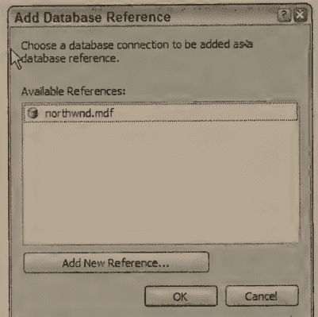

# 图 2-4

如果要添加新的引用，系统会提示您输入一些基本信息，例如服务器名称。此外，您还需要选择身份验证类型，以及是否保存用户名和密码。如果可能的话，在团队环境中工作时，**Windows 身份验证**是最不干扰的方式。如果您选择使用用户名和密码，并且不允许保存这些信息，那么每次打开项目时都会提示您输入。

### 添加现有脚本

通过右键单击文件夹并选择"添加现有项"，可以轻松地将现有脚本添加到数据库项目中。如果脚本位于不同的位置，则会在目标文件夹中放置它们的副本。

如果现有脚本不在文件中，您可以利用 SQL Server 管理工具的"生成脚本"功能。请务必选择将每个对象放在单独文件中的选项。如果所有对象都生成到单个文件中，数据库项目提供的许多优势将会大打折扣。请确保将文件生成为 Windows 文本格式，而不是 ANSI 格式；否则，您的脚本中会出现一些奇怪的字符。

### 使用 SQL Server 项目

Microsoft SQL Server 2005 中新增的一项功能是使用托管代码创建数据库对象（如存储过程、用户定义函数和用户定义类型）的功能。使用托管代码实现的数据库对象需要添加到 SQL Server 项目中。您可能会想将运行于 SQL Server 中的托管代码类作为本章前面建议的应用程序类库的一部分，但 SQL Server 项目具有特殊的引用和特性，使其成为放置此类代码的唯一合适位置。

虽然关于构建托管数据库对象的完整讨论超出了本书的范围，但在这里提及是因为这种项目可能适用于您正在构建的应用程序。虽然用托管代码编写的数据库对象可以带来巨大优势并访问更复杂的语言功能，但它们并非对所有应用程序都是必需的或适用的。在走这条路之前，应仔细考虑应用程序执行的数据访问和操作类型。

仅仅将一个运行简单查询的 Transact-SQL (T-SQL) 存储过程转换为托管数据库对象，并不能很好地利用托管数据库对象的能力。相反，如果您要对结果集中的每一行执行密集的数学函数，或者为了限定结果集而-Shirt使用它，可能更为合适。使用托管数据库对象将使您能够访问更丰富的语言语法，并且在许多情况下，与使用 T-SQL 开发等效的数据库对象相比，可以产生更易维护的代码。

与部署 Transact-SQL 数据库对象相比，部署托管代码数据库对象会增加应用程序的复杂性。如果您正在使用用户定义类型，并在应用程序的查询中将它们作为返回结果，请特别注意版本控制策略以及数据库服务器和调用应用程序安装的部署，以确保版本兼容性。

### 使用 Web 安装和部署项目

在第 12 章中，您将了解网站部署的各种选项。在安装过程中，您可能需要考虑创建 Web 安装项目或 Web 部署项目。通过尽早确定部署模型，您可以提前建立良好的实践，而不是等到部署前一周才着手。

### 创建项目引用

现在解决方案已经设置好，初始项目也已添加，是时候创建引用，以便 Web 项目能够查看和使用通用库中的类。如果添加了多个全公司范围的库或正在使用第三方库，现在也是建立这些引用的好时机。

下表描述了您可以建立的四种引用类型：

| 类型 | 说明 |
|---|---|
| 项目到项目 | 当解决方案包含多个项目，且一个项目需要引用同一解决方案中的另一个项目时使用。这种引用类型在您生成解决方案时会自动更新。当项目包含在您的解决方案中时，建议使用这种引用类型。Visual Studio 通过在解决方案文件中的 ProjectReferences 标签内添加条目来跟踪这种引用类型。这意味着，如果您要在另一个解决方案中也使用该项目，并且它具有项目到项目的引用，则需要重新建立这些引用。 |
| Bin | 这表示您正在引用位于应用程序 bin 目录之外且未在 GAC（全局程序集缓存）中注册的共享组件。这些项目在建立引用时会被复制到 bin 目录中，并且默认情况下仅在生成时更新。如果您查看该文件夹，除了程序集之外，还会创建一个 `<assemblyname>.dll.refresh` 文件。如果打开它，它会包含对用于获取新鲜副本的位置的引用。如果此文件被删除，则在生成期间不会拉取新鲜副本。 |
| GAC | 在全局程序集缓存 (GAC) 中注册的项目不会被复制到您项目的 bin 文件夹中。在 web.config 文件的 compilation 部分，会添加一个新条目来跟踪对 GAC 组件的引用。由于这不是复制的文件，它会自动更新以获取安装到 GAC 中的当前版本。 |
| Web 引用 | 这种引用类型用于跟踪 Web 服务的注册。当添加新的 Web 引用时，会创建一个新的 app_WebReferences 文件夹，其中包含生成的客户端代理文件。这种引用类型只能通过在 Visual Studio 解决方案资源管理器中 app_WebReferences 文件夹内选择"更新 Web 引用"来更新。 |

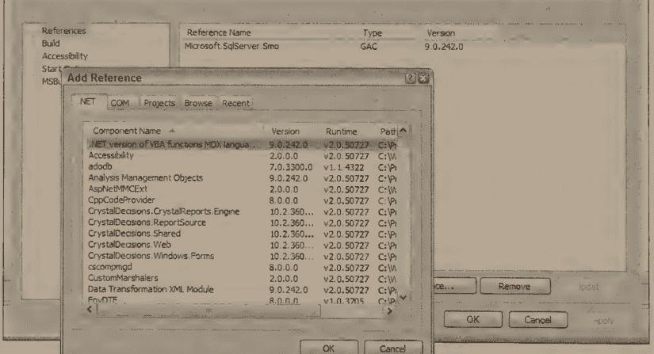

图 2-5

Visual Studio 2005 改变了在 Web 项目中查看和修改引用的方式。在早期版本中，您可以使用解决方案资源管理器中的"引用"树节点来添加和查看引用。此功能已移至 Web 项目的项目属性页。图 2-5 显示了已添加到属性页的新页面，该页面使您能够查看和修改引用。要访问属性页，请在解决方案资源管理器中右键单击网站，然后选择"属性"。

有些事情可能会让您感到困惑，即为什么某些程序集（如 System.Web）不需要手动引用，但其他 System.* 程序集却需要。默认情况下，在位于框架安装目录中的系统 web.config 文件中，以下程序集是作为默认添加的引用的一部分：

```xml
<compilation defaultLanguage="c#" debug="true">
    <assemblies>
        <add assembly="System.Data.OracleClient, Version=2.0.0.0, Culture=neutral, PublicKeyToken=B77A5C561934E089" />
        <add assembly="System.Design, Version=2.0.0.0, Culture=neutral, PublicKeyToken=B03F5F7F11D50A3A" />
    </assemblies>
</compilation>
```

考虑您的类库在部署中的使用方式。如果它们只与单个应用程序一起部署，那么通常将它们作为私有程序集使用。在共享托管环境或其他您无法控制部署机器的环境中，您必须将类库作为私有程序集部署。

如果您的类库部署到一台将由许多应用程序使用的机器上，那么您可以使用全局程序集缓存 (GAC)。此方法注册程序集和程序集的特定版本，以便应用程序可以引用通用版本。这样做的优点是所有应用程序引用同一个副本；如果您更新它（并保持相同的版本号），它们都会同时获得更新。然而，通常情况下，这种方法的缺点大于减少重复所带来的好处。例如，在生产环境中，您通常希望快速修补单个应用程序，而不是所有使用该模块的应用程序。使用 GAC 时，您不具备这种能力，除非您对控件进行版本控制并创建一个仅由您要修补的应用程序引用的新不同版本。这种版本控制可能会导致其他和未来部署中引用该程序的复杂性。如果选择 GAC 方法，程序集必须具有强名称才能注册到 GAC 中。应仔细考虑以确保 GAC 是共享程序集的合适位置。

### 使用源代码控制

虽然对项目使用某种形式的源代码控制有多个好处，但最大的好处是能够更好地作为团队工作。使用源代码控制的人可以告诉您，他们曾经无数次查看文件的历史记录，以了解何时或谁进行了导致问题的更改。它还提供了一种使用标签或类似功能来重新创建特定版本的好方法，以确保您可以在未来的任何时候获取组成特定版本的所有文件。

在刚完成新项目的设置后，通常是考虑使用源代码控制的最佳时机。在完成所有初始项目的设置后，请考虑将您的解决方案和相关项目置于源代码控制之下。

您有多个源代码控制提供程序可供选择，本书不会尝试讨论所有提供程序。过去最常见的是 Visual Source Safe，它随 Visual Studio 和之前的产品一起提供。Visual Studio 2005 的新特性是 Team System，它提供了新的源代码控制功能，适用于五人或以上的团队。您还可以找到许多第三方供应商解决方案以及开源解决方案。

源代码控制的完整讨论超出了本书的范围，但建议即使在小项目中，也要使用某种源代码控制概念，以确保项目源代码的安全。


## 第2章

### 使用基础页面类

默认情况下，ASP.NET 应用程序中的所有 Web 窗体页都继承自 `System.Web.UI.Page`。此类实现了作为 `HttpHandler` 所需的功能，并在 ASP.NET 运行时检测到对特定页面的调用请求时被调用。简而言之，`HttpHandler` 是处理请求的端点。`Page` 类是 `HttpHandler` 的一种特定实现，旨在处理和呈现 Web 窗体。第17章将展示你如何实现其他 `HttpHandler` 以完成其他任务的示例。

在建立构建应用程序的架构模式时，寻找减少冗余并内建灵活性的方法始终是一个高度优先事项。一种可以利用的模式是定义一个基础页面类的概念，让所有页面都继承自该类，而不是继承自 `System.Web.UI.Page`。这样，即使你最初不使用它，你也建立了一个管道，允许添加对你所有页面都可见的属性和功能。这个新的基础类将继承自 `System.Web.UI.Page`，因此你不必重新发明轮子，在新的基础页面中实现所有功能。通过这样做，你的新基础页面类将建立在 `System.Web.UI.Page` 类的能力之上。此外，这将允许新的基础类访问系统类的所有受保护属性、方法和事件。

以下示例展示了一个最小化的 `BaseUIPage` 类实现：

```csharp
/// <summary>
/// Base UI Page
/// </summary>
public class BaseUIPage : System.Web.UI.Page
{
    public BaseUIPage()
    {

    }
}
```

即使此时仅向该类添加了这些内容，你也已经为你的应用程序建立了一个扩展点。一旦你开始使用它，你将来可以向基础页面添加属性、方法或事件处理程序，并使其在所有使用此基础类的页面中生效。

下一步是向你的应用程序添加一个 Web 窗体，以修改 Web 窗体的代码文件，使其继承自你新的 `BaseUIPage` 类。以下示例展示了在更改为使用新的 `BaseUIPage` 类之前的代码后台：

```vbnet
'VB.Net example

Partial Class _Default
    Inherits System.Web.UI.Page

End Class
```

```csharp
//C# Example
public partial class Default2 : System.Web.UI.Page
{
    protected void Page_Load(object sender, EventArgs e)
    {

    }
}
```

以下是修改代码以使用新的 `BaseUIPage` 类后的样子：

```vbnet
'VB.Net example

Partial Class _Default
    Inherits BaseUIPage

End Class
```

```csharp
//C# Example
public partial class Default2 : BaseUIPage
{
    protected void Page_Load(object sender, EventArgs e)
    {

    }
}
```

此时你可能觉得这听起来不错，但似乎像是额外的工作。本章稍后，你将看到如何使用 Visual Studio 2005 中的导出模板功能来创建一个页面模板，你可以重复使用它以避免冗余的更改。具体来说，可以避免的冗余更改是不得不将继承关系从 `System.Web.UI.Page` 更改为 `BaseUIPage`。

根据你构建的应用程序的规模和复杂性，你可能会决定实现不止一层的基础页面。例如，最底层的基础页面可能是一个非应用程序特定的实用程序类库的一部分。从它继承的可能是一个特定于正在构建的应用程序的页面。它可以公开在应用程序上下文中更有用的属性和方法，例如公开 `ActiveProductID`。最后，如果你有一组执行相似任务的页面，例如 `DataInput` 或 `SearchResults`，那么你可以从你的特定于应用程序的基础页面继承，以创建一个与该组页面相关的页面。每一层都提供了扩展点，可以帮助你减少页面间的冗余。

### 使用母版页

母版页是 ASP.NET 2.0 中的新功能之一，是“变通方法”转变为产品功能的一个很好的例子。母版页的目标是定义一个布局模板，你的页面将使用该模板。并非应用程序中的所有页面都必须使用母版页，应用程序可以在不同的页面上使用多个母版页，这既是可能的，有时也是可取的。一个母版页可以定义一个或多个 `ContentPlaceHolder` 区域，以便内容页可以使用母版页中提供的默认内容，或者覆盖并提供自己的内容。当使用母版页功能时，Web 窗体页就变成了内容页。内容页仅提供内容来填充母版页中定义的 `ContentPlaceHolder`。图 2-6 展示了一个定义了三个内容区域的母版页示例。

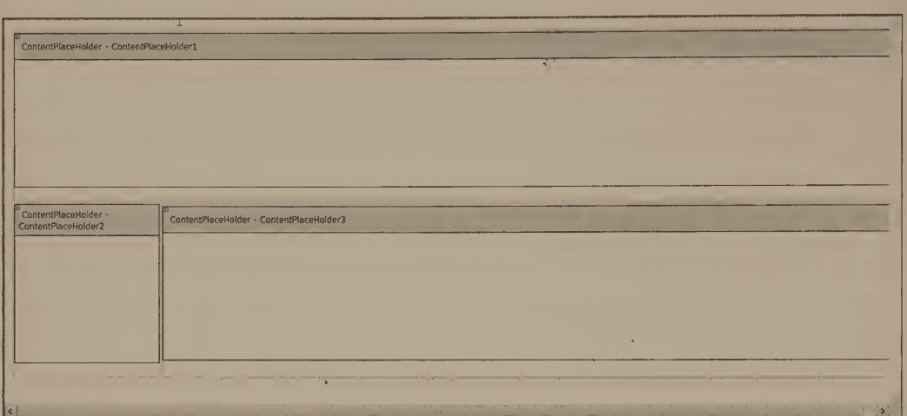

在设置新应用程序时，决定是否要使用母版页概念非常重要。如果你在开发周期后期才决定，你将不得不修改每个页面，将其更改为内容页。

创建母版页应与负责应用程序外观和感觉方面的人员共同努力。因为你将定义影响布局灵活性的 ContentPlaceHolder，所以应该充分考虑你的网站可能使用的配置。

如果你查看图 2-6 所示示例的 HTML 标记，你会注意到使用了三个 PlaceHolder 控件和标准的 HTML 表格来组织它们在页面上的位置。图 2-6 展示了前面示例的 HTML 标记。请注意，内容占位符的名称是 ContentPlaceHolder1、2 和 3。虽然仅使用默认名称本身并没有什么错，但我们建议选择更能描述内容区域用途的名称。这使得查看内容页的开发人员能更好地了解该区域预期的用途。例如，顶部区域可以命名为 ContentTopNav，以在使用时提供更清晰的含义。

```html
<form id="form1" runat="server">
  <div>
    <table width="100%">
      <tr>
        <td colspan="2">
          <asp:ContentPlaceHolder ID="ContentPlaceHolder1" runat="server" />
        </td>
      </tr>
      <tr>
        <td width="200px">
          <asp:ContentPlaceHolder ID="ContentPlaceHolder2" runat="server" />
        </td>
        <td>
          <asp:ContentPlaceHolder ID="ContentPlaceHolder3" runat="server" />
        </td>
      </tr>
    </table>
  </div>
</form>
```

也有可能允许母版页，从而允许你的网站布局在运行时被动态修改。我们将在第17章更详细地讨论这一点。

使用母版页时，你的页面并不继承自母版页；相反，它与母版页合并以产生一个组合输出页。实际上，从你的页面类中，你可以使用 `Page.Master` 属性访问活动的母版页。默认情况下，该属性的类型为 `System.Web.UI.MasterPage`。

你可以向你的母版页添加自定义属性、方法和事件。使用以下页面指令，你可以修改属性的类型。以下示例将 `Page.Master` 属性修改为 `MVPHacks.BaseClasses.BaseMasterPage`：

```aspx
<%@ MasterType TypeName="MVPHacks.BaseClasses.BaseMasterPage" %>
```

或者

```aspx
<%@ MasterType VirtualPath="~/Masters/SiteMaster.master" %>
```

如果你的母版页的实际类型不是 `MasterType` 指令上指定的类型，你将收到一个错误。例如，如果你从母版页公开了一个名为 `ActiveProductID` 的属性，那么你可以使用强类型名称来访问它，如下例所示：

```csharp
this.Master.ActiveProductID = 50;
```

### 设置你的第一个内容页

既然你已经设置了 `BasePage` 类并定义了一个母版页来定义你的内容页的布局，现在是时候使用它们了。与典型的 Web 窗体不同，内容页不会有它们自己的 form 元素或其他标记，如 `<head />` 或 `<body />`；它们将只有引用母版页中 `ContentPlaceHolder` 控件的 Content 控件。以下示例展示了使用图 2-6 中定义的母版页的页面的 HTML 标记：

```aspx
<%@ Page Language="C#" MasterPageFile="~/MasterPage.master" AutoEventWireup="true" CodeFile="Default2.aspx.cs" Inherits="Default2" Title="Untitled Page" %>
<asp:Content ID="Content1" ContentPlaceHolderID="ContentPlaceHolder1" Runat="Server" >
</asp:Content>
<asp:Content ID="Content2" ContentPlaceHolderID="ContentPlaceHolder2" Runat="Server" >
</asp:Content>
<asp:Content ID="Content3" ContentPlaceHolderID="ContentPlaceHolder3" Runat="Server" >
</asp:Content>
```


## 设置主题

应用程序的外观和感觉通常与其功能同等重要。母版页解决了页面的布局问题；而主题的存在则提供了外观和感觉方面的灵活性。简单来说，它们提供了一种方法，可以将样式方面的内容从页面以及页面上的控件定义中分离出来。

使用主题，你可以定义一切内容——从`GridView`应该如何渲染到登录控件应该呈现何种外观。主题由一个或多个样式表、皮肤文件以及任何相关的图像组成。使用一个或多个 CSS 样式表的概念在主题中仍然存在，但现在你还可以使用皮肤文件来定义控件样式属性。

皮肤文件使你能够将控件定义放入其中，但要去掉功能性/行为性属性，例如`ProductID=5`。这种控件定义就像一个模板，当你在引用该主题的页面上使用该控件时，皮肤会应用到这个控件上。

主题是项目本地的，存储在一个名为`App_Themes`的特殊 ASP.NET 文件夹中，或者也可以存储在全局主题目录中。在`App_Themes`文件夹中，你可以定义一个或多个主题文件夹。主题可以在 Page 标签上使用 Theme 属性设置，通过 Page 的`OnPreInit`事件处理程序设置，或者在`web.config`文件中设置。

你当然不必使用主题，但它们使你更容易为每个页面应用样式；而且它们肯定比在页面中内联包含样式要好。在 ASP.NET 1.1 中，通常的做法是使用一个 CSS 文件，然后你必须在每个页面中包含对该文件的引用。即使你不做其他事情，仍然使用 CSS 并通过主题基础设施来实现，该 CSS 文件的包含也会自动为你完成。

## 皮肤还是 CSS？

你可能在想什么时候应该使用 CSS，什么时候应该使用皮肤文件。这个问题没有唯一正确的答案，但皮肤文件确实带来了一些优势。当你使用 CSS 时，你只能基于控件的渲染版本来定制样式 without having to add a specific class name on it everywhere you use one. By default, unless you use SkinIDs to specify particular skins, a GridView skin specification will apply to all GridViews on pages that are theme enabled (the default). Second, if you use skins, it is clearer what properties are being set on the control, so it is easier to know what you will get on output.

## 构建你的皮肤文件

开始构建皮肤文件的一个技巧是利用 Visual Studio 2005 内置的自动格式化功能。在许多控件上，右键单击并选择自动格式化，允许你从多种样式中选择，然后将这些属性设置到控件上。然后你可以将其复制到皮肤文件中，删除任何更多与行为相关的属性，你就有了一个很好的皮肤文件起点。

## 命名皮肤文件

没有什么规定说你不能创建一个名为 myskins.skin 或任何你想要的名称的皮肤文件。一个快速定位皮肤的有用技巧是使用与被设置皮肤控件相似的名称来命名皮肤文件。例如，GridView 的皮肤文件可以是 GridView.skin。

主题提供了一种强大的方式，进一步允许自定义网站的外观和感觉。当与母版页结合使用时，如果你花点时间允许用户选择两者并实时修改，你就为用户提供了他们通常不习惯的定制级别。

> **从 1.x 转换到 2.0 的技巧**
>
> Visual Web Developer 2005 有一个自动向导，可以将你的旧版 ASP.NET 1.1 应用程序转换为 ASP.NET 2.0。对于最简单的场景，这效果很好。但是，有几件事你需要了解以避免麻烦。ASP.NET 2.0 有专门命名的目录，文件会被移动，并且在转换过程中会发生其他转换。为了保持一切有条理，请参阅第 12 章以了解有关转换过程的具体细节以及版本之间的差异。

# 第 2 章

## Web Config 与您的团队

进行团队开发时可能引起冲突的一个领域是 web.config 文件中的设置。许多项目是通用的，所有团队成员都会使用它们——例如，注册控件、正在使用的提供程序，甚至 HttpHandlers 或 HttpModules。虽然不难想象不同团队成员会有自己独立的 web.config 设置，但更常见的情况是应用程序设置或连接字符串特定于某个团队成员。

## 大锤方法

appSettings 和 connectionStrings 部分通常会在团队成员之间引起最多的争议。避免这个问题的最简化的"大锤"方法是，将检入源代码控制的 web.config 设置为适合大多数团队成员的配置。需要特定设置的团队成员然后创建该文件的本地可写副本并修改设置。这种方法最大的缺点可能是，当用户第一次从源代码控制获取最新文件集时，每次都会被提示替换文件。一次不小心的点击，他们所有的定制就会消失。

## 外部文件方法

另一个常见选项是将这些设置存储在用户保存在本地的外部文件中。这些文件通过 web.config 中的适当引用被包含进来，我们很快就会讨论到。在 Visual Studio 2005 之前，这些文件可以存储在网站文件夹中。如果你在 Visual Studio 2005 中这样做，文件会被检入源代码控制，这就违背了让团队成员拥有自己设置的目的。为了应对这一变化，文件可以存储在父目录中。通常，在项目中保留这些文件的样本作为主副本是一个好主意，团队成员可以进行复制。这在设置新团队成员或重建环境时尤其有用。

appSettings 部分与 connectionStrings 部分在文件引用包含方式上略有不同。以下示例展示了如何指定从父目录中名为 localhost.config 的文件进行包含：

```
<appSettings file="..\localhost.config">
```

如果你查看 localhost.config 文件的内容，它几乎与你期望的 appSettings 部分看起来一样，如下例所示：

```
<appSettings>
  <add key="DefaultDaysLate" value="7" />
</appSettings>
```

虽然我们选择了 localhost.config 作为文件名，但叫它什么完全由你决定。

包含 connectionStrings 部分只是略有不同。不是使用 file 属性来指定文件名，而是使用 configSource 属性，如下例所示：

```
<connectionStrings configSource="..\localhostConnectionStrings.config"/>
```


同样地，如果我们查看 `localhostConnectionStrings.config` 的内容，它看起来会像下面的示例：

```
<connectionStrings >
    <add name="MyDB"
         connectionString="server=myServer;uid=myuser;password=***;database=MyDB" />
</connectionStrings>
```

这只是几种方法中的两种，显然管理项目设置的方法还有很多。每种方法都有利有弊。例如，让所有团队成员共享相同的签入文件，这是默认做法，可以确保所有成员都能获取最新的设置。然而，同样常见的情况是，有人会对其他人修改了设置却没有告知他们感到意外。反过来，同样的问题也可能发生：当每个成员都有自己的本地副本时，他们可能不会收到另一位团队成员所做的关键设置变更的通知。就像生活中的许多事情一样，你只需要决定什么对你的项目最有效，然后采用它。

## 导出模板

Visual Studio 2005 的新增功能是可以导出模板，以便稍后在你创建新项目或现有项目中的新项时使用。使用此向导，你可以创建整个项目或项目项的模板，例如新页面或新类。

本章中的一些修改正是此类自动化可以提供帮助的绝佳示例。例如，对于 `BaseUIPage` 和 `Master Pages`，我们可以创建一个从 `BaseUIPage` 继承并同时引用我们的 `Site.Master` 文件的示例 Web 窗体。然后，使用 Visual Studio 2005 中的"文件>导出模板"菜单选项，我们可以创建一个可重复使用的模板，我们团队的所有成员都可以使用它来创建看起来就像我们示例一样的新 Web 窗体页面。使用这种技术，我们可以节省数小时，并确保我们的页面更加一致。第 13 章将更深入地探讨模板的工作原理以及如何利用它们。

## 总结

一次机会，之后就变成更多的工作！

在每个新项目开始时，你只有一次机会用坚实的基础开始。本章的目的是说明一些可以作为设置新项目最佳实践的技术。

理想情况下，当你和你的开发团队找到适合你们项目的方法时，你们将创建自己的一套最佳实践，并根据你们的环境进行修改。

# 提供程序的强大功能

*提供程序模型*是 ASP.NET 2.0 中普遍存在的新功能之一，它提供了更高水平的可扩展性。提供程序模型的概念实际上并不新鲜，但这是它首次被打包为 .NET 框架基础的一部分。

在过去，对于 ASP.NET 的各种服务，例如会话或缓存管理，当你想要自定义它时，很少存在可供你插入自己的解决方案的可扩展点。ASP.NET 团队在 2.0 版本中的一个关键重点是提供更多的可扩展点，使开发人员能够自定义 ASP.NET 核心功能和特性的实现。

例如，以会话管理功能为例（自 ASP.NET 1.0 起就已存在，并提供了在进程内、状态服务器以及 SQL Server 数据库中存储的支持，但除此之外，除非采取非常措施，否则无法提供自定义功能）。在 ASP.NET 2.0 中，会话管理功能可以完全替换，你可以在任何你想要的存储中提供你自己的自定义数据存储。

这些功能不仅限于会话存储；ASP.NET 2.0 中为 Membership、Roles、Profile 和 Personalization 等服务引入了几个新的提供程序。这些服务都使用了提供程序模型的概念，并且完全可以扩展。

此外，你可以使用提供程序模型的概念为你自己的应用程序构建即插即用服务。当你有不同的实现时——例如，一个使用 XML 文件，另一个使用 SQL Server——这是一种很好的技术。这对于独立软件供应商（ISV) 和其他构建将被其他公司使用的应用程序的人来说是一种很好的技术。通过使用提供程序概念，ISV 使他们的客户能够拥有类似的可扩展点。

在本章中，我们将探讨一些存在的基本可扩展点。我们还将讨论如何使用提供程序模型创建你自己的基于提供程序的解决方案，从而使你的应用程序的最终用户或其他开发团队能够最终插入他们自己的基于提供程序模型的服务的实现。

## 第三章

## 什么是提供程序模型？

简而言之，提供程序模型的目标是提供一种方式，允许应用程序定义一组方法，通过这个方法它可以与允许多个实现的程序进行交互。它还用于向应用程序隐藏所使用的实现的知识。应用程序不应该知道通过配置文件选项，正在使用的是 SQL Server 实现而不是简单的 XML 文件。

在这一点上，你可能想知道为什么不能只使用接口。从技术上讲，使用接口可以实现为可用方法提供契约以及多个实现。但是，使用接口会导致更刚性的结构，因为接口是将要提供的方法和属性的不可撤销的契约。提供程序模型的概念是围绕从 `ProviderBase` 继承的概念构建的，`ProviderBase` 现在是 `System.Configuration` 程序集中 `System.Configuration.Provider` 命名空间的一部分。`ProviderBase` 是一个抽象类，旨在被提供程序的实现者继承。这个类非常简单，只提供了一些在大多数提供程序中都有用的方法和属性。下表描述了 `ProviderBase` 类的关键方法和属性。

| 属性 | 描述 |
| --- | --- |
| Name | 用于返回提供程序的名称。将从提供程序的配置条目 `<add name="MyProviderName" />` 中提取 |
| Description | 提供更完整的提供程序文本描述。如果提供了一组供选择的提供程序，这将非常有用。 |

| 方法 | 描述 |
| --- | --- |
| Initialize | 调用以初始化提供程序，并传入提供程序的名称和一个 NameValueCollection，以允许访问在配置中指定的特定于提供程序的属性 |

## ASP.NET 2.0 自带的提供程序

开箱即用，ASP.NET 2.0 附带了几个实现和利用提供程序模型概念的功能。这些功能大多实现了从数据存储中检索和存储数据的能力。例如，`MembershipProvider` 类建立了用于管理用户的契约。与其他几个提供程序一样，ASP.NET 2.0 附带了设计为与应用程序中配置的 `MembershipProvider` 一起工作的控件。这些控件之所以有效，是因为它们可以依赖配置的提供程序来实现 `MembershipProvider` 上定义的一组一致的方法。

与 `ProviderBase` 一样，`MembershipProvider` 类也是抽象类，仅提供会员管理的契约或方法/属性定义。为了使其开箱即用，ASP.NET 团队提供了 `SqlMembershipProvider`，它继承自 `MembershipProvider` 并提供了 MembershipProvider 契约的具体实现。在以下示例中，ASP.NET 通过使用 web.config 或 machine.config 中的配置信息来识别和加载适当的提供程序，从而了解哪个 MembershipProvider 处于活动状态。如果你查看 machine.config 文件并搜索 membership，你会发现 MembershipProvider 的默认配置。以下示例是来自 machine.config 文件的 MemberShipProvider 的默认配置：

```
<system.web>
  <membership>
    <providers>
      <add name="AspNetSqlMembershipProvider"
           type="System.Web.Security.SqlMembershipProvider, System.Web, Version=2.0.0.0,
           Culture=neutral, PublicKeyToken=b03f5f7f11d50a3a"
           connectionStringName="LocalSqlServer" enablePasswordRetrieval="false"
           enablePasswordReset="true" requiresQuestionAndAnswer="true" applicationName="/"
           requiresUniqueEmail="false" passwordFormat="Hashed" maxInvalidPasswordAttempts="5"
           minRequiredPasswordLength="7" minRequiredNonalphanumericCharacters="1"
           passwordAttemptWindow="10" passwordStrengthRegularExpression="" />
    </providers>
  </membership>
</system.web>
```

此配置条目告诉 ASP.NET 有关 SqlMembershipProvider 类的信息，并向提供程序传递各种设置以控制提供程序的行为。此示例的目的不是剖析传递给提供程序的每个参数，而是阐明成员资格提供程序如何与默认安装一起工作。这些参数中的每一个都可以在你应用程序的本地 web.config 文件中进行修改，MSDN 文档提供了每个可能设置的详细信息。在本章后面，你将看到如果你正在构建自己的提供程序，如何访问这些设置。

你将在 machine.config 文件中找到 ASP.NET 内置支持提供程序模型的其他功能的类似配置条目。

下表描述了 ASP.NET 内置的提供程序模型功能及其实现。

| 提供程序类型 | 描述 |
| --- | --- |
| Membership | 管理用户，在 System.Web.Security 命名空间中有两个提供程序：SqlMembershipProvider 和 ActiveDirectoryMembershipProvider。 |
| Role | 管理与用户关联的角色，在 System.Web.Security 命名空间中有三个内置提供程序：AuthorizationStoreRoleProvider、SqlRoleProvider 和 WindowsTokenRoleProvider。 |
| Site Map | 用于为站点地图控件提供数据，只有一个内置提供程序：System.Web.XmlSiteMapProvider。 |

表在下页继续


## 第 3 章

| 提供程序类型 | 描述 |
| --- | --- |
| 会话状态 | 允许管理网站用户的会话状态——提供程序匹配并公开类似于 ASP.NET 1.1 中发现的功能。但是，现在用户可以扩展或替换自己的会话状态提供程序。会话状态提供程序可以在 System.Web.SessionState 命名空间中找到。InProcSessionStateStore、OutOfProcSessionStateStore 和 SqlSessionStateStore 实现了会话状态提供程序。 |
| 配置文件 | System.Web.Profile.SqlProfileProvider 提供 SQL Server 实现来存储用户配置文件条目。寻找将来可用的一个，它将允许您将普通数据库表映射到配置文件条目。 |
| Web 事件 | Web 事件提供程序允许将 Web 事件外部化或发布。位于 System.Web.Management 中。以下是内置提供程序：EventLogWebEventProvider、SimpleMailWebEventProvider、TemplateMailWebEventProvider、SqlWebEventProvider、TraceWebEventProvider 和 WmiWebEventProvider。 |
| Web 部件个性化 | 处理保存 Web 部件的位置和其他个性化选项，Web 部件位于 System.Web.UI.WebControls.WebParts 命名空间中。SqlPersonalizationProvider 是唯一的内置提供程序。 |
| 保护配置 | 提供应用程序配置文件中的配置部分保护。两个内置提供程序：DPAPIProtectedConfigurationProvider 和 RSAProtectedConfigurationProvider。 |

在我们开始讨论如何构建自己的提供程序并扩展内置提供程序之前，让我们先了解一下最常见的问题之一，即“如何使我的应用程序不使用本地的 SQLExpress 实例？”在前面的成员资格提供程序配置示例中，有一个用于连接字符串 LocalSqlServer 的条目。查看 machine.config 也会揭示其定义，如下所示：

```
<connectionStrings>
    <add name="LocalSqlServer" connectionString="data source=.\SQLEXPRESS;Integrated Security=SSPI;AttachDBFilename=|DataDirectory|aspnetdb.mdf;User Instance=true"
    providerName="System.Data.SqlClient" />
</connectionStrings>
```

请注意，这会影响随 ASP.NET 提供的所有 SQL Server 提供程序的实现，因此如果不更改其配置节以指定不同的 connectionStringName，更改它将导致更改使用 SQL Server 版本的所有提供程序。

如果您想指向不同的 SQL Server 实例，您可以简单地清除现有连接或将其移除并添加您自己的连接，如下例所示：

```
<connectionStrings>
    <clear/>
    <add name="LocalSqlServer" connectionString="Data Source=ctcdev2;Initial Catalog=MyDB;Integrated Security=True" providerName="System.Data.SqlClient" />
</connectionStrings>
```

您可能想要做的另一件事是使用内置提供程序配合您现有的数据库。.NET Framework 2.0 安装目录中有一个实用程序 aspnet_regsql.exe，它将设置支持所有内置 SQL 版本提供程序所需的数据库表和存储过程。

## 扩展内置提供程序

扩展提供程序最简单的方法之一是继承自内置实现之一，例如 SqlMembershipProvider。虽然您可能这样做的原因有很多，但我们将要演示的原因是为了限制用户登录的时间。为此，我们将继承内置提供程序，然后重写 ValidateUser 方法以实现我们的小时限制。

### 从 SqlMembershipProvider 继承

完成此操作的第一步是创建一个类并继承自现有的 SqlMembershipProvider。下面的代码示例显示了如何做到这一点：

```
namespace MVPHacks.Security
{
    /// <summary>
    /// MVPHacksSQLMembershipProvider 的说明概要
    /// </summary>
    public class MVPHacksSQLMembershipProvider :
        System.Web.Security.SqlMembershipProvider
    {
        public MVPHacksSQLMembershipProvider()
        {
        }
    }
}
```

### 配置您的新提供程序

一旦完成此操作，您可以修改您的 web.config 文件以启用您的应用程序使用新构建的提供程序。因为此时它的行为与内置提供程序完全相同，您可以继续像这样编辑 web.config 文件：

```
<membership defaultProvider="MVPHacksMembershipProvider" >
    <providers>
        <add name="MVPHacksMembershipProvider"
            connectionStringName="LocalSqlServer"
            type="MVPHacks.Security.MVPHacksSqlMembershipProvider"/>
    </providers>
</membership>
```

如果您恰好将自定义类放在 app_code 文件夹中，您可能需要在引用它时使用以下语法作为程序集名称：

```
<membership defaultProvider="MVPHacksMembershipProvider" >
    <providers>
        <add name="MVPHacksMembershipProvider"
            type="MVPHacks.Security.MVPHacksSqlMembershipProvider, app_code"/>
    </providers>
</membership>
```

注意，app_code 是在完全限定的类名称之后添加的。这允许提供程序从 app_code 程序集实例化类型，该程序集在运行网站时即时构建。如果您将类放在通用程序集中，它将添加该程序集名称，例如，namespace.classname,mycommoncode。

## 检查您的提供程序配置

现在您应该能够对应用程序运行快速测试，以确保您没有破坏任何东西。此外，如果您启动 Web 网站管理工具（通过选择 Visual Studio 2005 的 WebSite 菜单，然后选择 ASP.NET 配置选项），并转到提供程序选项卡，您会看到您的提供程序现在可以作为成员资格提供程序进行选择和（见图 3-1）。

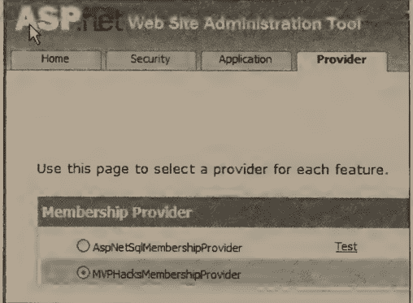

图 3-1

## 重写 ValidateUser

当用户尝试登录时，Login 控件会调用 ValidateUser 方法。您需要实施检查以确定登录是否在业务时间之间，并且仅在这种情况下允许登录：

```
public override bool ValidateUser(string username, string password)
{

    if ((DateTime.Now.Hour > 18) || (DateTime.Now.Hour < 6))
        return false;

    return base.ValidateUser(username, password);
}
```

在前面的示例中，虽然我们实现了限制用户登录时间的目标，但我们为控制小时数提供了非常少的灵活性。虽然我们可以简单地使用 appSettings，提供程序的另一个可用选项是重写 Initialize 方法。Initialize 方法被调用并作为 NameValueCollection 传递给成员资格提供程序的 add 语句中的所有属性。以下示例包括我们将在提供程序中拦截的开始和结束小时：

```
<membership defaultProvider="MVPHacksMembershipProvider">  <providers>
    <add connectionStringName="LocalSqlServer" name="MVPHacksMembershipProvider"
         NoLoginStartHour="2" NoLoginEndHour="10"
         type="MVPHacks.Security.MVPHacksSqlMembershipProvider,MVPHacksCommon"/>
  </providers>
</membership>
```

下一步是重写 Initialize 方法并查找开始和结束小时值：

```
private int m_StartHour = 24;
private int m_EndHour = 24;

public override void Initialize(string name, NameValueCollection config)
{
    if (config["NoLoginStartHour"] != null)
    {
        m_StartHour = int.Parse(config["NoLoginStartHour"].ToString());
        config.Remove("NoLoginStartHour");
    }

    if (config["NoLoginEndHour"] != null)
    {
        m_EndHour = int.Parse(config["NoLoginEndHour"].ToString());
        config.Remove("NoLoginEndHour");
    }

    base.Initialize(name, config);
}
```

需要注意的是，在前面的示例中，您在调用 base.Initialize 方法之前删除参数，因为内置提供程序如果在传入它们不熟悉的属性时将会抛出异常。在调用 base.Initialize 方法之前删除它们使您能够利用配置属性，而无需进行广泛的自定义。此外，由于您继承自现有的 SQL 提供程序，您不需要重新实现任何其他逻辑。

以下示例显示了我们修订后的方法，该方法使用了我们从配置条目中获得的值：

```
public override bool ValidateUser(string username, string password)
{
    if ((DateTime.Now.Hour >= m_StartHour) && (DateTime.Now.Hour <= m_EndHour))
        return false;

    return base.ValidateUser(username, password);
}
```

虽然这是一个相当简单的示例，但它确实展示了如何轻松利用内置提供程序来添加应用程序所需的额外业务需求，而无需重新实现所提供的所有功能。

## 构建您自己的成员资格提供程序

使用内置提供程序的一个选项是实现一个实现提供程序契约的自定义类。这样做的一个常见原因是为了控制提供程序数据的存储。例如，默认情况下，成员资格提供程序是 ASP.NET 成员资格服务的接口，该服务将数据存储在数据存储中的专有 ASP.NET 表中。许多现有应用程序已经有了成员资格表的概念，替换它们以利用一些与成员资格提供程序一起工作的内置控件将是大量工作且回报甚微。但是，通过创建一个实现 MembershipProvider 类关键方法的类，您可以让自定义类在您现有的数据存储上执行成员资格操作。这种类型的自定义不仅限于与数据库一起工作；您还可以从自定义类调用第三方供应商 API。

在我们的最后一个示例中，我们从继承 SqlMembershipProvider 并重写 ValidateUser 方法开始，以注入我们自己的一些逻辑。我们使用了存储在 SQL Server 数据库中的现有功能。在这个下一个示例中，我们将从头开始，只使用 MembershipProvider 类提供的契约。因此，我们将继承 MembershipProvider 而不是 SqlMembershipProvider：

```
namespace MVPHacks.Security
{
    /// <summary>
    /// MVPHacksCustomMembershipProvider 的说明概要
    /// </summary>
    public class MVPHacksCustomMembershipProvider :
        System.Web.Security.MembershipProvider
```


```csharp
    {
        public MVP_HacksCustomMembershipProvider()
        {

        }
    }
}
```

> **注意：如果您在通用类库中创建类，默认情况下，添加到项目时，类声明中不会指定 "public"。因此，它是一个私有类，在类库外部将无法访问。当您尝试在 Web 项目或 web.config 中引用或使用该类时，可能会遇到麻烦，因为它会声称找不到您刚刚创建的已知类！**

Visual Studio 2005 的一个优点是能够轻松地为您创建抽象类或接口的骨架实现。如图 3-2 所示，只需单击类或命名空间名称首字母下方的下划线，即可弹出一个下拉选项列表，从中选择让 Visual Studio 2005 为您创建骨架实现。

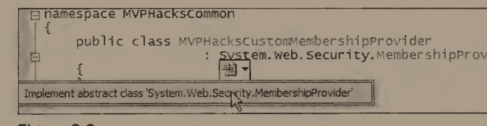

完成此操作后，类中标记为 `abstract` (C#) 或 `MustInherit` (VB.NET) 的每个属性或方法都将在文件中存根化，并包含一行抛出异常的代码，提示 "方法或操作未实现"。这非常有帮助，因为它节省了您查阅文档并试图弄清楚必须在类中实现或定义哪些方法的时间。此外，对于提供程序，不实现所有方法也是可以的；它可能只是抛出一个 `NotImplementedException` 来通知调用者当前活动的提供程序不支持该属性或方法。

以下是 Visual Studio 2005 在您选择实现选项时可能生成的部分输出：

```csharp
public class MVP_HacksCustomMembershipProvider
    : System.Web.Security.MembershipProvider
{
    public override string ApplicationName
    {
        get{throw new Exception("The method or operation is not implemented.");}
        set{throw new Exception("The method or operation is not implemented.");}
    }
    public override bool ChangePassword(string username,
                                   string oldPassword, string newPassword)
}
```

您可以在自己的示例中尝试此操作，以查看所有方法和属性——同样，这里为了清晰起见，我们进行了简化。您可能想要做的一件事是，将任何您不会实现的方法从抛出通用异常更改为抛出 `NotSupportedException`。这样，使用该实现的人就有了一个一致且清晰的运行时检测方式，以判断您是否实现了特定方法。

之前：

```csharp
public override bool ChangePassword(string username,
                                    string oldPassword, string newPassword)
{
    throw new Exception("The method or operation is not implemented.");
}
```

之后：

```csharp
public override bool ChangePassword(string username,
                                    string oldPassword, string newPassword)
{
    throw new NotSupportedException();
}
```

实现此目的最简单的方法是 **快速替换** 字符串 `Exception("The method or operation is not")` 为 `NotSupported();`。此更改使未实现的方法与提供程序的概念更一致，允许用户通过一致的异常获得不支持方法的通知。

接下来，让我们看一个非常简单的类，它将模拟您现有的身份验证管理器。请记住，这里的目的在于演示概念，而不是提供一个完整的自定义提供程序。事实上，这展示了一种很好的方法，可以为已拥有现有安全性但想使用内置登录控件的 ASP.NET 应用程序添加登录行为。在此示例中，只需几行代码和一些配置，我们就可以为站点添加一个登录功能，该功能与我们现有的安全管理器通信：

```csharp
namespace MVPHacks.CustomAuthentication
{
    public class ExistingAuthManager
    {
        public bool ValidateUser(string username, string password)
        {
            if (string.Compare(username, "mvphacks", true) != 0)
                return false;
            if (string.Compare(password, "mvphacks", true) != 0)
                return false;

            return true;
        }
    }
}
```

# 提供程序的强大功能

下一步是修改我们的自定义 MembershipProvider 类，使其在调用 ValidateUser 方法时调用该类。以下是完成此任务所需的全部代码：

```csharp
public override bool ValidateUser(string username, string password)
{
    ExistingAuthManager authMgr = new ExistingAuthManager();
    return authMgr.ValidateUser(username, password);
}
```

您可能已经注意到，我们的 ExistingAuthManager 的命名空间与我们的自定义 MembershipProvider 类不同。因此，我们需要在我们的自定义 MembershipProvider 类中添加针对该命名空间的 using (C#) 语句或 imports (VB.NET) 语句。您知道在 Visual Studio 2005 中有一种简单的方法可以做到这一点吗？如图 3-3 所示，单击类名最后一个字符下方的下划线将弹出自动化操作，为您添加 using 语句。

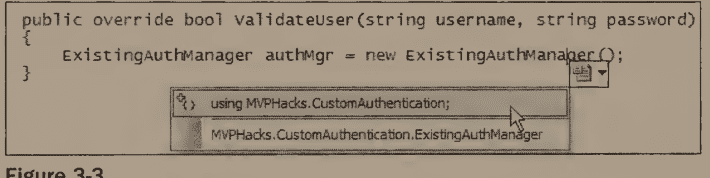

图 3-3

请留意 Visual Studio 2005 中添加的其他快速自动化功能，如图 3-3 所示——其中许多功能像这样实现非常简单，很容易被忽略。

现在我们已经在类中实现了单个方法来调用 ExistingAuthManager（它模拟应用程序中的现有安全管理器），我们接下来可以在 web.config 中配置该提供程序。如您所见，这与我们扩展 SqlMembershipProvider 时所做的非常相似：

```xml
<membership defaultProvider="MVPHacksMembershipProvider">
    <providers>
        <add connectionStringName="LocalSqlServer" name="MVPHacksMembershipProvider"
            type="MVPHacks.Security.MVPHacksCustomMembershipProvider,MVPHacksCommon"/>
    </providers>
</membership>
```

我们为使其工作所要做的另一个 web.config 更改是配置身份验证和授权部分，如下所示：

```xml
<authentication mode="Forms">
    <forms loginUrl="/user/login.aspx"></forms>
</authentication>
<authorization>
    <deny users="?"/>
</authorization>
```

前面的示例要求所有未经身份验证的用户都转移到指定的 `loginUrl` 页面。顺便提一句，`loginUrl` 对于此示例并非必需，但人们通常认为使用表单身份验证时，必须将登录页面放在站点的根目录中。

构建登录页面现在是一个简单的拖放过程。在将 `login.aspx` 窗体添加到我们的用户文件夹后，我们可以简单地将工具箱中登录部分的 Login 控件拖放到我们的页面上，如图 3-4 所示。虽然有许多属性可以配置，但它们超出了本章的范围。您可能希望将 `DestinationPage` 属性配置为指向 `default.aspx` 或登录完成后用于跳转的其他目标页面。

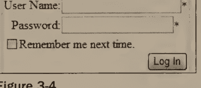

图 3-4

现在的一个优点是，您还可以利用 `LoginStatus`、`LoginName` 和 `LoginView` 控件，而无需进行任何额外的工作。

您还可以实现创建用户并执行其他成员身份操作的方法，并继续利用其他内置控件，例如"创建用户向导"。

如果您想深入了解一些基于内置 Membership、Role Manager、Profile 和 Web Part 个性化提供程序的更多提供程序示例，您应该访问 Microsoft ASP.NET 开发人员中心并下载 Sample Access Provider Start Kit (http://msdn.microsoft.com/asp.net/downloads/providers/)。这个工具包是一个 C# 类库项目，它实现了每个提供程序以使用 Microsoft Access 作为存储介质。虽然基于 Access 的提供程序可能不是您所期望的支持，但它提供了一个具体的示例，说明如何基于现有的内置模型实现更完整的提供程序替换。

还可提供详细白皮书，讨论每个内置提供程序及其各种实现细节。

# 构建您自己的角色提供程序

角色提供程序是另一个可以轻松替换以支持自定义存储的提供程序。事实上，在许多应用程序中，用户的角色是动态的，基于当前状态或属性推断，而不是持久化的。在这种使用情况下，内置角色提供程序将不够用。此外，与成员身份提供程序类似，您可能已经在应用程序中拥有自己的角色概念，而拥有一种方法将其暴露给各种控件（如 LoginView）将使您能够利用它们，而无需编写大量的自定义代码。


## 提供者的力量

在本节的示例中，我们将构建一个只读角色提供者。其唯一目的是允许我们在应用程序中使用现有的用户/角色关联。具体来说，我们希望能够使用 LoginView 控件并指定某个特定角色的视图。

正如我们之前实现自定义成员资格提供者时所做的那样，我们将继承内置的 `RoleProvider` 类来自定义角色提供者，如下所示：

```
using System;
using System.Collections.Generic;
using System.Text;
namespace MVPHacks.Security
{
    public class MVPHacksCustomRoleProvider: System.Web.Security.RoleProvider
    {


        public override string[] GetRolesForUser(string username)
        {
            string[] noRoles = { };
            string[] adminRoles = { "admin" };

            if (username == "mvphacks")
                return adminRoles;

            return noRoles;

        }

        public override string[] GetUsersInRole(string roleName)
        {
            throw new NotSupportedException();
        }
        Other non implemented methods removed to conserve space...
    }
}
```

在上面的示例中，我们之前让 Visual Studio 2005 为每个方法和属性实现了存根，如图 3-2 所示。接下来，我们将所有通用异常改为 `NotSupportedException`，最后实现了 `GetRolesForUser` 方法。这是 LoginView 用来确定应该使用哪个模板来在页面上显示内容的方法之一。您将在本章后面看到如何识别登录视图的角色。

为了使我们的新自定义角色提供者得以使用，我们必须在 `web.config` 文件中进行配置，如下所示：

```
<roleManager defaultProvider="MVPHacksRoleProvider" enabled="true">
    <providers>
        <add name="MVPHacksRoleProvider"
             type="MVPHacks.Security.MVPHacksCustomRoleProvider,MVPHacksCommon"/>
    </providers>
</roleManager>
```

> **请确保包含 enabled="true"；否则，角色提供者将无法正常工作。**

现在，配置已就位，我们可以修改页面以具有使用角色的用户的 LoginView 控件来确定显示什么。

LoginView 控件旨在使您可以拥有不同的模板来根据用户是否登录或匿名用户的身份向其显示内容。以下示例显示了 LoginView 控件标记与这两个模板的样子：

```
<asp:LoginView ID="LoginView1" runat="server">
    <LoggedInTemplate>
        Logged In Users See This Content
    </LoggedInTemplate>
    <AnonymousTemplate>
        Anonymous Users See This Content
    </AnonymousTemplate>
</asp:LoginView>
```

当与角色结合使用时，LoginView 控件变得更加强大。如果我们想根据用户的角色显示不同的内容怎么办？LoginView 允许我们通过向上述标记添加 RoleGroups 部分来做到这一点。在 RoleGroups 部分中，您可以识别一个或多个 RoleGroup 元素，这些元素标识应使用的角色和内容模板。以下是一个定义 Admin RoleGroup 的示例：

```
<asp:LoginView ID="LoginView1" runat="server">
    <LoggedInTemplate>
        Logged In Users See This Content
    </LoggedInTemplate>
    <AnonymousTemplate>
        Anonymous Users See This Content
    </AnonymousTemplate>
    <RoleGroups>
        <asp:RoleGroup Roles="Admin">
            <ContentTemplate>
                This is the admin view
            </ContentTemplate>
        </asp:RoleGroup>
    </RoleGroups>
</asp:LoginView>
```

由于 LoginView 依赖于角色提供者合约定义，因此它不关心是从内置提供者（例如 SqlRoleProvider）还是从本章中构建的自定义角色提供者获取角色信息。

## 构建角色提供者代理

扩展现有角色提供者或构建自己的角色提供者提供了很大的灵活性。您可能遇到的一种限制是当您的应用程序依赖于多个来源的角色时。

例如，也许您有一些角色希望您可以从 `SqlMembershipRoleProvider` 中拉取，但您也有自己的角色概念。您自己的角色可能是分配给用户的静态角色，并存储在现有的业务数据库中。您可以简单地继承自 `SqlMembershipRoleProvider` 并添加您自己的角色，但这会限制您只与 `SqlMembershipRoleProvider` 一起工作，当您想使用第三方角色提供者来管理您部分的角色管理时会发生什么？

我们现在讨论的概念是一个*角色代理提供者*。角色代理提供者将充当所有配置提供者的中间人。使用这个概念，您可以实现各种角色提供者并在应用程序中一起使用它们，例如 `LoginViews` 或其他利用角色的控件。

这种方法的一个预先限制是，当您在 `RoleProviderProxy` 时，您需要为 add 和 update 请求指定要使用的默认提供者，或者在代码中引用特定的提供者。否则，`RoleProviderProxy` 将不知道与哪个提供者交互。

在以下示例中，我们将利用我们在本章早期构建的简单角色提供者。事实上，由于我们需要两个角色代理提供者，我们将其克隆为 `MVPHacksCustomRoleProvider2` 以简化操作。关于代理概念的一个好处是它对用户的角色不需要代码更改，因为用户看到的是它仅仅是另一个角色提供者。

### 实现角色代理提供者

正如我们对扩展自 `RoleProvider` 并实施了某些方法的自定义角色提供者所做的那样，我们对 `MVPHacksRoleProxyProvider` 也将采取同样的行动。以下示例执行此实现：

```
namespace MVPHacks.Security
{
    /// <summary>
    /// Summary description for MVPHacksRoleProxyProvider
    /// </summary>
    public class MVPHacksRoleProxyProvider : System.Web.Security.RoleProvider
    {
        private List<string> m_ProviderList = new List<string>();

        public MVPHacksRoleProxyProvider()
        {

        }

        public override void Initialize(string name,
            System.Collections.Specialized.NameValueCollection config)
        {
            if (config["ProviderList"] != null)
            {
                char[]curlylchars = { ',' };
                string[] providers =
                    config["ProviderList"].ToString().Split(cSplicthars);
                foreach (string providerName in providers)
                    m_ProviderList.Add(providerName);
                config.Remove("ProviderList");
            }
        }
    }
}
```

```
    }

    base.Initialize(name, config);
}

public override string[] GetRolesForUser(string username)
{
    List<string> userRoles = new List<string>();

    foreach (string providerName in m_ProviderList)
    {
        RoleProvider rp = Roles.Providers[providerName];
        string[] roles = rp.GetRolesForUser(username);
        foreach (string role in roles)
        {
            if (!userRoles.Contains(role))
                userRoles.Add(role);
        }
    }

    return userRoles.ToArray();
}

// - other code removed for simplicity
}
}
```

在上面的示例中，我们实施了绝对最少的方法—Initialize 和 GetRolesForUser——这允许我们的代理运行。未显示的是当前仅返回 NotSupportedException 的其他方法。对于大多数只读方法，您将像 GetRolesForUser 方法一样实现它们，该方法调用 ProviderList 上配置的每个提供者。

我们重写 Initialize 方法是因为我们要获取控制以获取 ProviderList 属性，它将提供逗号分隔的提供者名称列表，代理将组合成用户对角色的单个视图。

在 `GetRolesForUser` 方法中获取我们的列表时，我们将查看 ProviderList 属性中的名称并调用每个提供者的 GetRolesForUser 方法。示例中未显示的是处理请求的提供者未配置或其他常见配置错误的行为。一旦从每个配置的提供者检索了列表，就像调用单个提供者一样，角色的数组返回给调用者。

### 角色代理提供者的 web.config 更改

角色代理概念的关键在于简单性；它不需要复杂的实现或复杂的配置来允许跨多个提供者的角色视图。以下示例显示配置角色代理和两个自定义角色提供者的 web.config 条目：

```
<roleManager defaultProvider="MVPHacksRoleProxyProvider" enabled="true">
    <providers>
```


## 提供者的力量

```xml
<add name="MVPHacksRoleProxyProvider"
     type="MVPHacks.Security.MVPHacksRoleProxyProvider,MVPHacksCommon"
     ProviderList="MVPHacksRoleProvider,MVPHacksRoleProvider2"/>
<add name="MVPHacksRoleProvider"
     type="MVPHacks.Security.MVPHacksCustomRoleProvider,MVPHacksCommon"/>
<add name="MVPHacksRoleProvider2"
     type="MVPHacks.Security.MVPHacksCustomRoleProvider2,MVPHacksCommon"/>
</providers>
</roleManager>
```

如上所示，已配置三个提供者：两个自定义提供者加上我们的角色代理提供者。代理提供者被设置为 `defaultProvider`，因此所有请求都会自动通过我们的代理。`ProviderList` 属性被指定用于配置应使用代理的提供者。你可能会奇怪，为什么不直接枚举所有配置的提供者。这当然是一种可行的实现方式，但我们选择使用一个显式列表。分开的列表允许通过直接指定提供者名称来配置和使用额外的提供者，同时允许将它们排除在角色的代理聚合之外。

代理介入调用者和一个或多个提供者之间的概念，可以应用于角色之外的其他领域。例如，对于 `MembershipProvider`，你可能会发现自己处于两个成员数据库之间，或者你可能希望支持多个活动的提供者进行身份验证，而无需应用程序知道这些细节。

## 构建自定义提供者

到目前为止，本章讨论的提供者都始于现有的提供者定义之一，我们只需扩展或调整它以实现我们想要的功能。虽然这是利用已完成的所有辛勤工作的绝佳方式，并且通常这将提供所需的一切，但有时从头开始构建你自己的自定义提供者是合理的。

当你开始考虑构建自定义提供者时，提前思考接口是很重要的。当你的应用程序有一部分适合多种实现或可扩展性时，你应该考虑构建自定义提供者。虽然创造性地你可以使用提供者来帮助渲染 UI 元素，但它们通常更适合基于存储的实现或拥有多种算法实现的场景。

当我们谈论不同的存储提供者时，这可能是一个例子：你可能希望一个实现将数据存储在数据库中，而另一个可能通过 Web 服务与数据存储进行通信，还有另一个可能只是将其存储在 XML 文件中。构建自定义提供者的价值在于，允许应用程序调用一个定义的接口，而无需知道其实现的细节。

## 自定义提供者示例

截至本文撰写时，我们刚刚开始在开发者社区看到一些正在构建的提供者。例如，CommerceStartKit.Org 实现了一个入门套件来帮助构建支持 PayPal 的商务站点。为了确保灵活性并使用户能够轻松下载入门套件并将其适配到他们的使用中，他们使用了提供者设计模式来构建他们的主要子系统。例如，以下是他们开箱即用支持的使用提供者设计模式的子系统：

- 目录提供者
- 订单提供者
- 支付提供者
- 运输提供者
- 购物车提供者
- 税务提供者

对于每一个，社区入门套件都提供了定义提供者契约/接口的抽象类，然后提供了一个基于 SQL Server 的具体类（抽象类的实现）。下载并使用入门套件的用户可以轻松地构建这些提供者的 Oracle 或 XML 版本，而应用程序不会受到影响。

拥有提供者不仅使你构建的概念可扩展，还建立了一种架构，鼓励他人以类似的风格和概念添加他们的自定义内容。大卫·海登（www.davidhayden.com）就是一个例子。他构建了一个 `InventoryProvider`，与商务入门套件配合工作。大卫看到了对一个功能更强大、更丰富的库存管理系统的需求，并构建了他的提供者。通过使用类似的概念，其他人可以采用他的提供者。通过将其插入他们的入门套件实现，他们已经熟悉了它如何工作的高级架构。期待看到许多其他这样的例子，你可以利用代码片段并将它们作为提供者插入。

税务提供者是一个很好的例子，说明如何将提供者模型与算法一起使用。通过抽象应用程序中的关键算法，你保留了随着时间的推移插入不同实现的灵活性。这也使得测试算法的新版本变得极其容易；只需将新版本插入应用程序配置，无需任何代码更改。另一个例子可能是插入某种评分类型的算法。

毫无疑问，为你的组件创建提供者由于需要更健壮的接口设计时间和建立必要的代码基础设施以支持组件可配置，因此在前期会花费更多时间，但如果你利用这些能力，将来你会看到节省。需要更多的设计时间，因为你应该仔细思考你的公共接口。一旦发布，理想情况下它不应该被更改，因为那会影响现有用户。

利用现成的组件可以节省数百小时，围绕它们构建提供者接口并在有人发布更好版本时提供一个简单的替换点，是一个有吸引力的选择。

## 自定义提供者的基础

构建自定义提供者时，你必须完成若干步骤。本节的其余部分将逐步构建一个非常基本的自定义提供者，仅包含最少的必要部分。

我们在这里构建的自定义提供者与 Virtual Earth Map 控件配合工作。想象一下，你编写了一个 Virtual Earth 自定义服务器控件，将其放在你的 ASP.NET 页面上。该控件将在显示的地图上显示兴趣点。你可以将如何为我们这一个应用程序获取兴趣点的知识硬编码到控件中，并让它调用我们的数据库来加载点，但这将阻碍我们未来与其他数据源合作，除非进行重大重写。

为了更好地使我们的控件可重用，我们决定构建一个 `MVPHacksMapDataProvider`，它将公开一个 `GetPoints` 方法来获取兴趣点。我们的控件将把当前的纬度/经度传递给该方法，以便数据提供者可以确定要返回的点。

在接下来的步骤中，我们将定义建立此工作所需基础设施的基本部分。

## 配置自定义提供者

第一步是处理自定义提供者的配置功能。能够通过配置文件指定提供者是提供者设计模式的关键部分。这使得它们可以轻松配置，而无需更改代码。为此，我们希望能够有一个自定义的配置节，该节被定义并与我们的提供者配对。此节将列出可用的提供者以及特定于每个提供者的选项，例如连接字符串。以下示例显示了我们的地图数据提供者配置节可能的样子：

```xml
<configuration>
  <MVPHacksMapDataProvider defaultProvider="SamplePointDataProvider">
    <providers>
      <add name="SamplePointDataProvider"
           type="MVPHacks.SamplePointDataProvider,app_code" />
    </providers>
  </MVPHacksMapDataProvider>
</configuration>
```

前面的示例显示了使用提供者设计模式识别提供者所需的最少代码。在示例中，定义了一个提供者，并且 `defaultProvider` 将其标识为首选提供者。

你会注意到前面的示例是一个自定义配置节。为了防止此操作引起错误，必须定义该节；并且必须标识支持该自定义节的自定义类。在步骤 2 中，我们将完成此操作。

## 设置自定义配置节

如上一节所述，因为使用了自定义配置节，所以必须在使用前定义它，并且必须标识提供支持的类型/类。以下代码显示了在配置文件中完成此操作所需的条目：

```xml
<configSections>
  <section name="MVPHacksMapDataProvider"
           type="MVPHacks.Common.MVPHacksMapDataProviderConfigSection,
                 mvphacks.common" />
</configSections>
```

`MVPHacksMapDataProviderConfigSection` 是当访问该节时将成为节处理程序的类。该类将实现对该配置节中条目的类型安全访问。在下一步中，我们将开始构建该类。


## 第 3 章

### 实现自定义配置部分

与 .NET 1.1 相比，.NET 2.0 使得构建**自定义配置部分（custom configuration sections）**变得更加简便，无需进行繁重的编程工作。以下示例代码展示了如何构建一个与我们在步骤 1 中所示章节相匹配的**自定义配置部分**。这将提供一个名为 **MVPHacksMapDataProvider** 的自定义配置节，它是 `<provider>` 的一个子元素，包含一个或多个提供者定义。此外，它还将支持 **defaultProvider** 属性，用于在未明确要求时标识要使用的默认提供者：

```
using System;
using System.Configuration;

namespace MVPHacksCommon.CustomData
{
    public class MVPHacksMapDataProviderConfigSection : ConfigurationSection
    {
        [ConfigurationProperty("providers")]
        public ProviderSettingsCollection Providers
        {
            get
            {
                return (ProviderSettingsCollection)base["providers"];
            }
        }
        [ConfigurationProperty("defaultProvider",
            DefaultValue="MVPHacksNullMapDataProvider")]
        [StringValidator(MinLength = 1)]
        public string DefaultProvider
        {
            get
            {
                return (string)base["defaultProvider"];
            }
            set
            {
                base["defaultProvider"] = value;
            }
        }
    }
}
```

从上述示例可以看出，实现自定义配置节所需的最小代码量。请注意以下几个关键点，然后我们将继续构建其余的简单自定义提供者部分。首先，注意该类继承自 **ConfigurationSection**。`**ConfigurationSection****`*类在 .NET 2.0 中是新的。过去这需要实施 `IConfigurationSectionHandler`界面，但该接口现已被弃用。

现在可以在程序化或声明式两种方式下实现自定义配置节处理器。上述示例采用声明式方法，允许框架——连同指定的属性——为我们完成大部分工作。例如，我们放置了 **ConfigurationProperty** 属性并设置了名为 `defaultProvider`的名称，则实现会自动将配置文件中的 *defaultProvider*数据绑定到我们类的属性上，而无需额外代码。其次，同样重要的是注意到使用属性指定验证器的功能。这也有助于减少自定义代码量，同时保留以健壮方式进行验证的能力。

66

有关自定义配置节的全部内容超出了本书范围，但有必要指出 .NET 2.0 中发生的变化。这些变化使构建自定义配置部分变得更加容易。

### 创建 MVPHacksMapDataProvider 抽象类

下一步是创建一个继承自**System.Configuration.Provider.ProviderBase****并定义自定义提供者将公开的契约的类**。

以下是一些需要认识的关键点：

-   该提供者继承自 **ProviderBase**——这在各种提供者之间提供了最低级别的统一性。
-   该类被定义为**抽象（abstract）**——这并不是提供者的实际实现，而仅仅是契约。当然，这并不意味着你不能在这个类中放置一些帮助者类型方法供继承者使用。
-   该类定义了对将要公开的接口中的任何抽象方法——这对于新提供者来说是最清晰的。随着提供者的演化发展，你可能会指定具有默认版本的方法以确保与旧版提供程序的兼容性。
-   使用**抽象类****而不是 interface（接口）来定义契约——当然可以用接口定义契约，但随着时间的推移，接口会使提供者更加僵硬。这是因为当你修改一个接口时，该接口的所有继承者或实现者都必须添加新方法或属性。抽象类可以在一定程度上屏蔽实现者。**

以下列表设置了从 **ProviderBase** 继承的类：

```
using System;
using System.Collections.Generic;
using System.Text;
using System.Configuration.Provider;

namespace MVPHacksCommon.CustomData
{
    public abstract class MVPHacksMapDataProvider : ProviderBase
    {
        public abstract List<MVPHacksMapDataLocation>
            GetDataForRegion(double lattitude,
                             double longitude,double miles2show);
    }
}
```

> `ProviderBase`**属于位于 **System.Configuration*****assembly 中的 *System.Configuration.Provider***命名空间。你需要手动添加对该程序的引用，因为类库项目不会自动创建它一个。**你可以将自己置于正确的心态来保持不包含实现细节的一种方法是查看一些内置提供者作为模式，注意它们如何避免实施问题**。如果你只是在内部应用中构建用于使用的**提供者**,可以比更有意义地将其字面地解释更。但如果你是 **ISV（独立软件供应商）** 构建将向第三方公开的接口，则更适合以更具文字的方式进行了解释。

### MVPHacksMapData静态类实现

接下来我们要实现的类是一个用作实际提供者包装器的**静态类**。简而言之，该类旨在使使用配置条目中指定的默认提供者的操作变得简单方便。**该提供服务用户只需引用此公开在该面上的static（静态）方法**。该类管理查看配置节并使用信息创建指定为“DefaultProvider”的单个实例：

```
using System;
using System.Collections.Generic;
using System.Text;
using System.Configuration;
using System.Web.Configuration;

namespace MVPHacksCommon.CustomData
{
    public static class MVPHacksMapData
    {
        static MVPHacksMapData()
        {
            SetupDefaultProvider();
        }

        private static string _initLockString = "MapDataProviderLock";
        private static MVPHacksMapDataProvider _provider = null;

        private static void SetupDefaultProvider()
        {
            lock (_initLockString)
            {
                if (_provider != null)
                    return;

                MVPHacksMapDataProviderConfigSection providerConfig =
                    ConfigurationManager.GetSection("MapDataProvider")
                    as MVPHacksMapDataProviderConfigSection;

                if (providerConfig == null)
                    return;

                ProviderSettings settings =
                    providerConfig.Providers[providerConfig.DefaultProvider];

                _provider = ProvidersHelper.InstantiateProvider(settings,
                    typeof(MVPHacksMapDataProvider)) as
                    MVPHacksMapDataProvider;
            }
        }

        public static List<MVPHacksMapDataLocation>
```

```
GetDataForRegion(double lattitude,
                            double longitude, double miles2show)
{
    return _provider.GetDataForRegion(lattitude, longitude, miles2show);
}
    }
}
```

请注意，我们使用 **`ProvidersHelper**** 来获取我们提供者的实例。这来自“System.Web.Configuration”**命名空间。**在 *InstantiateProvider方法中**,它负责创建基于配置文件中指定类型的提供者实例并调用初始化方法。[link](https://learn.microsoft.com/dotnet/api/system.web.configuration.provdvidershelper.instantiateprovider)(链接已保留)。

### 完成 MVPHacksMapDataProvider的 concretereimplementation（具体实现）

最后一步是创建一个提供者的**具体实现**。为此，我们将创建一个从`MVPHacksMapData****提供者提供的我们的地图数据点如何检索的实现。在示例中,这是一个简单的;我们只是将其硬编码到几个特定位置。**一个更现实的例子可能是拉远程Web服务版本的点位以及读取本地文件或SQL服务器：

```
using System;
using System.Collections.Generic;
using System.Text;

namespace MVPHacksCommon.CustomData
{
    public class HardCodedMapDataProvider : MVPHacksMapDataProvider
    {
        public override List<MVPHacksMapDataLocation> GetDataForRegion(double
lattitude, double longitude, double miles2show)
        {
            List<MVPHacksMapDataLocation> list = new
List<MVPHacksMapDataLocation>();

            MVPHacksMapDataLocation loc1 = new MVPHacksMapDataLocation();
            loc1.Latitude = 33.35860433839252;
            loc1.Longitude = -93.43521000572602;
            loc1.Caption = "Somewhere in Lafayette";
            list.Add(loc1);

            return list;
        }
    }
}
```

现在我们已经完成了从头构建自定义提供者的基本组件。显然，这只是一个非常简单的例子，但这是有意的。**重要的点是,构建自己的提供者并不是一个过于复杂的工程。**


## 第 3 章

考虑使用提供程序的最佳时机是在应用程序的设计阶段。然而，这并不意味着如果您已有现有应用程序，就无法将其架构中引入自定义提供程序。事实上，使用提供程序的一种创造性方法是帮助将能力过渡到新版本。例如，假设您有一个用于计算销售税的应用程序。在此示例中，该应用程序仅知道如何在您的本地县范围内计算税款。贵公司的决定是开始在全省销售，因此必须根据多种因素使用更复杂的算法来计算税款。您作为第一步可以做的是定义一个提供程序来暴露 CalculateTax 方法，并将您当前的逻辑重构为 LocalTaxCalcProvider 类。接下来，您可以使用相同的接口构建 StateWideTaxCalcProvider 类。应用程序可以轻松在这两个提供程序之间切换以支持测试。在部署时，新的税款计算将仅仅是一个配置更改，以指定 StateWideTaxCalcProvider。

## 但我使用的是 ASP.NET 1.1

从根本上说，提供程序只是一种设计模式。虽然使用提供程序模型的大多数用途都是面向 ASP.NET 2 的，但这并不意味着您不能利用它来配合您的 1.1 应用程序。话虽这么说，您将无法享受大量内置提供程序作为起点的好处，但仍可以开始使用设计模式。如果您密切关注我们描述的构建块，但在您的 1.1 应用程序中构建几个辅助类，您就可以轻松设置以构建基于提供程序的应用程序，从而可以继续前进。事实上，如果您按照 ASP.NET 2.0 会员制构建您的会员模型，那么在升级到 2.0 时，您可能只需删除一堆代码。我知道，您正在想为什么现在不升级到 ASP.NET 2.0？在理想的世界里这会发生，但我们都清楚并非每个人都会拥有这个选项，有些人将以更慢的速度迁移。通过在仍使用 1.1 的同时开始熟悉提供程序概念，您可以在无法开始使用其他酷炫功能的情况下，启动您对 2.0 的思考。

## 总结

无论如何，如果您退一步看提供程序模型在 ASP.NET 2.0 中实现的界面的可扩展性和清晰度，您会忍不住感到印象深刻。同时，就像任何事物一样，很容易说出如果用不同的方法他们本可以做些什么。归根结底，重要的是采用一种方法并一致地使用它。

如果您选择在自己的应用程序中利用提供程序设计模式，它也可以成为您可扩展性故事的关键部分。通常，在急于将产品推向市场时，供应商会忘记拥有可扩展性故事的重要性，直到产品设计阶段已经过晚。记住在您的应用程序开发生命周期的早期考虑提供程序模型和其他架构模式，以促进可扩展性和重用，确保您不会掉入那个陷阱！

内部应用程序也可以从中受益，因为这使得更容易利用其他项目或业务部门的代码来快速构建新的业务应用程序或适应不断变化的业务模式。

## 其他提供程序资源

微软 ASP.NET 开发者中心 — 提供程序工具包：http://msdn.microsoft.com/asp.net/downloads/providers/

## 更智能的 Web 客户端

不，您没有拿错书。您正在阅读*《ASP.NET 2.0 MVP 技巧和提示》*。我确信您没有购买这本书是为了阅读传统上被认为是*智能客户端*的内容。

如今，“智能客户端”已成为部署到用户桌面的一种 Windows Forms 应用程序的流行术语，通常涉及一些关于如何与后台应用程序交互的智能性，以及自动更新和与其他行动区分开来（过去被称为*胖客户端*）的能力。

与此同时，随着营销界对智能客户端的炒作，人们开始更加关注如何让用户获得更好的 Web 浏览体验。这遵循了以前尝试提供丰富客户端体验的几种方法，范围从随 HTML 发送到客户端浏览器的简单的 JavaScript 技术到诸如 Flash 或 Java 等技术。其中大多数都因浏览器大战和提供那种丰富客户端体验的复杂性而逐渐消失。在最基本层面（例如浏览器和开发工具）缺乏工具和厂商支持，也确保了这些并未兴盛。

如今，掌握了 AJAX 和 Atlas 等一系列新流行语，更智能的 Web 客户端的革命已经开始了。在本章中，您将探索这一重新聚焦的努力如何试图使用户的 Web 体验更生动，从用户那里隐藏大部分今天 Web 应用程序典型的传统 Web 请求/Web 响应模型。

尽管围绕智能客户端（Windows Forms）的炒作以及为使网站更具互动性而加倍努力，很明显两者在当今应用程序的总体架构中都有其位置。虽然通往未来的道路可能会带来适应用户需求真正的*智能客户端*，但今天应用程序架构师的任务是部署最适合用户需求且按用户工作方式进行的技术。

## 迈向更智能的 Web 客户端之路

像所有技术演变一样，通往更智能的 Web 客户端的路径并非一蹴而就。走在前列的是高端业务网站，如 MSN HotMail、Google 和 Virtual Earth。在激烈的竞争驱动下，这些网站正在推动我们其他人重新回到将部分 Web 应用程序功能推向客户端的道路上。由于这些网站的存在，用户对延迟的容忍度更低，并且拒绝仅仅因为您从下拉列表中选择州就等待屏幕刷新的笨重特性。

即使本书出版时，更智能的 Web 客户端的故事仍在讲述中。这意味着根据您的应用程序需求，您可能面临关于使用哪些利用技术的艰难决策，以适应那些不再仅仅是“酷”的功能，而是对于拥有竞争性 Web 存在变得必要的功能。

## AJAX 体验

许多人可能将 AJAX 视为商店里出售的用于清洗浴缸的产品，但如今 AJAX 指的是异步 JavaScript 和 XML。更具体地说，它使用客户端 JavaScript 在不用户干预的情况下使用 XML 向应用程序 Web 服务器进行异步调用。例如，假设用户从下拉列表中选择了一个国家。在不刷新用户浏览器屏幕的情况下，客户端脚本将回调用 Web 服务器并获取和填充州下拉列表。这个技巧给用户一种印象，即客户端足够“智能”，可以根据国家准备列表。

AJAX 概念的核心是在客户端使用 JavaScript 以及使用 XmlHTTP 向 Web 服务器发出请求。XmlHTTP 是一种协议，被大多数主要的最新浏览器支持，用于封装和发送 XML 请求给 Web 服务器。利用 XmlHTTP 交互的结果，使用 JavaScript 用结果更新浏览器的当前视图。

重要的是要注意，这是一种客户端技术，在其最纯粹的形式上与 Web 服务器应用程序的服务端能力和服务器驻留的平台无关。

利用这些功能，开发人员可以创建用户已习惯的更丰富的应用程序体验。因为这些是核心构建块，它们不提供通常与服务器端 Web 应用程序或 Windows Forms 类型应用程序相关的丰富开发体验。JavaScript 不是面向对象的编程语言；它缺乏强类型和许多我们在构建企业级应用程序时欣赏的其他特性。尽管如此，它们是我们将继续在章节其余部分探索并以此为基石朝着更智能的 Web 客户端目标构建的能力的基础支撑点。

## 随后是 ASP.NET 2.0

客户端回调是随 ASP.NET 2.0 一起发布的新技术，用于从客户端代码调用服务端方法。在过去几年中，已经有一些不同类型的技术可用于从客户端代码调用服务端代码。您可能使用过的一项技术是*远程脚本*。通过远程脚本，您能够无需提交页面即可从页面发起对位于活动服务器页面（ASP）中的服务端代码的客户端调用。远程脚本技术使用

Java小程序用于与服务器进行通信。Java小程序通过HTTP协议与服务器通信，并将数据包装在XML中。要使用远程脚本，你需要两个文件：一个处理客户端请求（rs.htm），另一个用于在服务器端触发代码（rs.asp）。通过远程脚本，你可以执行服务器端代码来查询数据库或执行其他服务器端操作，而无需重新加载页面。由于远程脚本在客户端页面仍处于活动状态时运行在服务器上，因此你的脚本被大大简化，应用程序可以向用户呈现更丰富的界面。另一种可用于调用服务器端代码而不对主页面进行回发（提交页面）的简单技术是向页面添加一个隐藏的IFRAME。客户端代码将数据发送到隐藏的IFRAME，该IFRAME将处理包含应执行的服务器端代码的页面。IFRAME内页面响应返回的值将是客户端脚本将使用的值。这种解决方案非常常见——例如，当页面上的树从数据源获取数据并动态添加节点而无需进行回发时。

在ASP.NET 2.0中，有一种新技术使得从客户端进行远程调用成为可能。这项新技术称为客户端回调，它比远程脚本更容易使用和设置。

通过客户端回调功能，你可以让客户端脚本调用服务器端代码而不会引起回发。这将是执行服务器端代码而不刷新页面、从数据源预加载数据、执行验证等情况的完美解决方案。这个新的回调技术与远程脚本非常相似，但客户端回调使用XmlHTTP与服务器通信，而不是使用Java小程序，并且ASP.NET 2.0使用名为CallBackManager的脚本库，而不是rs.htm和rs.asp文件。

> 要使用客户端回调，浏览器必须支持XmlHTTP。添加到HttpBrowserCapabilities类的新属性SupportsCallBack可用于确定浏览器是否支持客户端回调。你将在本章后面了解更多关于此的信息。

## 客户端回调的工作原理

客户端调用一个客户端方法，该方法将使用CallBackManager。CallBackManager创建对服务器上.aspx页面的请求。服务器处理该页面及其所有事件，直到Pre_Render事件，并调用服务器端方法。然后CallBackManager解析服务器响应并发出一个回调方法，该方法是一个客户端方法。图4-1说明了客户端回调。

# 第4章

CallBackManager必须知道客户端回调方法的名称，以便在服务器端方法被调用并且其响应被CallBackManager解析时，确定它应该调用客户端上的哪个方法。要指定在服务器端方法处理后应调用哪个客户端方法，你可以使用Page类的GetCallBackEventReference方法。GetCallBackEventReference方法可以在ClientSideScriptManager类中找到，并可通过Page类的ClientScript属性访问：

```
Page.ClientScript.GetCallbackEventReference(...)
```

通过GetCallBackEventReference，你还可以指定如果服务器抛出异常，CallBackManager应该调用哪个方法。你将在本章后面了解更多关于GetCallBackEventReference方法的信息。

客户端回调功能有一个限制：你无法指定服务器上的哪个方法应该执行。客户端回调将执行服务器上的RaiseCallbackEvent方法，该方法在ICallbackEventHandler接口中定义。因此，当你使用客户端回调执行服务器端方法时，你必须实现RaiseCallbackEvent方法并将你的服务器端逻辑添加到该方法中。由于你无法指定将调用哪个服务器端方法，因此只能执行一个服务器端代码并将结果返回给客户端。如果你想指定调用哪个方法，你可以，例如，传递一个参数给RaiseCallbackEvent来指定调用哪个方法，并在RaiseCallbackEvent中处理它。以下示例说明了这一点：

```
public string RaiseCallbackEvent(string eventArgs)
{
    if (eventArgs == "Method1")
        //调用方法1
    else if (eventArgs == "Method2")
        //调用方法2
    ...
```

## 更智能的Web客户端

另一种根据控件调用不同服务器端方法的解决方案是通过自定义控件实现客户端回调功能的使用。通过这样做，你可以拥有不同的RaiseCallbackEvent方法，这些方法将根据你在页面上使用的控件来执行。

让我们看看如何在Web窗体中实现和使用客户端回调。以下示例将使用客户端回调在服务器上执行验证而不进行回发。服务器端方法将验证用户在文本框中输入的数字是否在1到1,000之间。如果文本框的值不是数字，或者数字不在1到1,000之间，则会显示一个包含错误消息的消息框（当服务器端发生异常时，指定的客户端错误回调方法将在客户端执行）：

```
<%@ page language="C#" %>
<%@ implements interface="System.Web.UI.ICallbackEventHandler" %>

<script runat="server">

    private string _returnFromServer;

    public void RaiseCallbackEvent(string eventArgs)
    {
        try
        {
            int value = Int16.Parse(eventArgs);

            if( value >= 1 && value <= 1000 )
                this._returnFromServer = "You entered the number: " + eventArgs;
            else
                this._returnFromServer = "Please enter a number between 1 and 1000";
        }
        catch
        {
            throw new ApplicationException("You must enter a number.");
        }
    }

    public string GetCallbackResult()
    {
        return this._returnFromServer;
    }

    public void Page_Load(object sender, EventArgs e)
    {
        if (!Request.Browser.SupportsCallback)
        throw new ApplicationException("This browser doesn't support Client callbacks.");

        string src = Page.ClientScript.GetCallbackEventReference(
            this,
            "arg",
            "ClientCallback",
            "ctx",
            "ClientErrorCallback",
            false);

        string mainSrc = @"function ValidateNumber(arg, ctx)
                { " + src + "; }";

        Page.ClientScript.RegisterClientScriptBlock(
                this.GetType(),
                "ValidateNumber",
                mainSrc,
                true);
    }
</script>

<html>
<head runat="server">
    <title>Client Callback</title>

    <script language="javascript">

        function Validate()
        {
            var n = document.forms[0].txtNumber.value;

            //调用服务器端方法验证数字
            ValidateNumber(n, "txtNumber");
        }

        //在服务器端方法执行并解析服务器响应后，ClientCallback将被执行。
        function ClientCallback( result, context )
        {
            alert(result);
        }

        //如果服务器端方法抛出异常，ClientErrorCallback将被执行以显示异常。
        function ClientErrorCallback( error, context )
        {
            alert("The validation failed. " + error);
        }

    </script>

</head>
<body>
    <form runat="server">
    Please enter a number between 1 and 1000:<br />
    <input id="txtNumber" name="txtNumber" type="text"/>
    <button id="butValidate" OnClick="Validate()">Validate</button>
</form>
</body>
</html>
```

让我们将代码的重要部分分解成片段并逐一查看：

```
<%@ page language="C#" %>
<%@ implements interface="System.Web.UI.ICallbackEventHandler" %>
```

必须实现`System.Web.UI.ICallbackEventHandler`以确保在使用客户端回调时，回调事件将在回发期间被处理。`ICallbackEventHandler`接口也可以由控件实现，例如按钮、文本框等。你将在本章后面看到一个控件使用`ICallbackEventHandler`的示例。要指定Web窗体应实现哪个接口，你可以使用`implements`指令，该指令具有`interface`属性，使你能够指定要实现的接口的名称。

`ICallbackEventHandler`有两个必须实现的方法才能使回调工作——`RaiseCallbackEvent`和`GetCallbackResult`。`RaiseCallbackEvent`方法接受一个参数，该参数将包含来自客户端方法的数据，而`GetCallbackResult`方法返回一个字符串给客户端，该字符串代表服务器端方法的输出。返回值将作为参数传递给客户端回调方法。在前面的示例中，`RaiseCallbackEvent`将检查参数（`eventArgs`）是否是数值或在1到1,000之间。如果不是，将抛出异常并在客户端显示一个消息框，告诉用户输入一个介于1和1,000之间的值。如果参数包含允许的值，则返回该值：

```
public void RaiseCallbackEvent(string eventArgs)
public string GetCallbackResult()
```

当你想使用客户端回调时，检查用户的浏览器是否支持客户端回调功能非常重要。这可以通过使用Page类`Browser`属性的`SupportsCallback`属性来完成。以下代码将检查客户端是否支持客户端回调。如果不支持，将抛出一个异常：

```
if (!Request.Browser.SupportsCallback)
    throw new ApplicationException("This browser doesn't support Client callbacks.");
```

示例的下一个重要部分是获取回调事件引用。该引用代表一个客户端方法，该方法将被生成并用于调用服务器端代码。当你获取回调事件引用时，你需要指定一个回调方法。这是必需的，以便客户端回调知道在服务器端方法处理后应调用哪个客户端方法。要添加引用，将使用Page类的`GetCallbackEventReference`方法。`GetCallbackEventReference`有三个重载方法：

```
public string GetCallbackEventReference(
    Control control,
    string argument,
    string clientCallback,
    string context)
```


# 第4章

```csharp
public string GetCallbackEventReference(
    Control control,
    string argument,
    string clientCallback,
    string context,
    string clientErrorCallback)

public string GetCallbackEventReference(
    string target,
    string argument,
    string clientCallback,
    string context,
    string clientErrorCallback)
```

下表描述了 `GetCallbackEventReference` 的参数。

| Argument | 描述 |
| :--- | :--- |
| control | 实现 `ICallbackEventHandler` 的控件。 |
| target | 如果未指定控件，则这是实现 `ICallbackEventHandler` 的控件的 ID。 |
| argument | 将发送到 `RaiseCallbackEvent` 的值。 |
| clientCallback | 客户端回调方法的名称。 |
| context | 从客户端事件传回客户端回调方法的值。 |
| clientErrorCallback | 客户端错误回调方法的名称。如果服务器抛出异常，将执行此方法。 |

以下代码使用 `GetCallbackEventReference` 来指定客户端回调方法以及实现 `ICallbackEventHandler` 的控件：

```csharp
public void Page_Load(object sender, EventArgs e)
{
    string src = Page.GetCallbackEventReference(
        this,
        "arg",
        "ClientCallback",
        "ctx",
        "ClientErrorCallback");

    string mainSrc = @"function ValidateNumber(arg, ctx)
    { " + src + "; }";
}
```

在上述示例中，当前页面已实现 `ICallbackEventHandler`，因此当前页面对象作为值传递给 `GetCallbackEventReference` 方法的 control 参数。当服务器端方法执行完毕且 `CallBackManager` 解析了服务器端调用的服务器响应后，客户端的 `ClientCallback` 方法将被执行。服务器端方法返回的值将作为参数传递给客户端的回调方法。如果服务器抛出异常，客户端的 `ClientErrorCallback` 方法将被

执行。传递给 `GetCallbackEventReference` 的 `arg` 和 `ctx` 值是调用服务器端方法的客户端事件的参数名称。参数和回调事件引用被创建为字符串，并添加到代码片段中 `mainSrc` 变量——Validate Number 中。`mainSrc` 将包含以下字符串：

```csharp
function ValidateNumber(arg, ctx)
{ WebForm_DoCallback('__Page',arg,ClientCallback,ctx,ClientErrorCallback,false); }
```

`WebForm.DoCallback` 方法及其参数由 `GetCallbackEventReference` 方法生成。`ValidateNumberleanNumber` 事件必须作为客户端脚本添加到客户端，这样才能被客户端方法调用或通过 HTML 控件的事件（如按钮的 `OnClick` 事件等）触发。在 ASP.NET 1.x 中，可以使用 `RegisterClientScriptBlock` 和 `RegisterStartupScript` 方法将客户端脚本添加到页面中，这些方法可通过 `Page` 对象访问，并且为了在 ASP.NET 2.0 中保持向后兼容仍然有效，但本示例将使用 ASP.NET 2.0 新的 `RegisterClientScriptBlock` 方法将客户端脚本添加到客户端。新方法可通过当前 `Page` 类的新 `ClientScript` 属性（`ClientScriptManager`）访问。ASP.NET 1.x 版本的 `RegisterClientScriptBlock` 接受两个参数：用于标识脚本块的唯一键和包含客户端脚本的脚本字符串。新方法还可以接受另外两个参数 `type` 和 `addScriptTags`。新的 `RegisterClientScriptBlock` 有两个重载方法：

```csharp
public void RegisterClientScriptBlock(
    Type type,
    string key,
    string script)

public void RegisterClientScriptBlock(
    Type type,
    string key,
    string script,
    bool addScriptTags)
```

下表描述了 `RegisterClientScriptBlock` 的参数。

| Argument | 描述 |
| :--- | :--- |
| Type | 一种类型，因此相同的键可以使用两次 |
| Key | 用于标识脚本块的唯一键 |
| Script | 要添加到客户端的脚本块 |
| addScriptTags | 允许方法插入 `<script>` 标签 |

调用服务器的客户端方法通过新的 `RegisterClientScriptBlock` 方法注册：

```csharp
Page.ClientScript.RegisterClientScriptBlock(
    this.GetType(),
    "ValidateNumber",
    mainSrc,
    true);
```

上述 `RegisterClientScriptBlock` 将生成以下代码并添加到客户端：

```javascript
<script type="text/javascript">
<!--
function ValidateNumber(arg, ctx)
{ WebForm_DoCallback('__Page',arg,ClientCallback,ctx,ClientErrorCallback,false);
}// -->
</script>
```

`WebForm_DoCallback` 方法接受五个参数：当前页面、将发送到服务器端 `RaiseCallbackMethod` 的参数值、客户端回调方法、将发送到客户端回调方法的上下文值，以及服务器抛出异常时将触发的客户端方法。

`WebForm_DoCallback` 方法可以通过客户端函数直接执行，或直接从客户端控件事件触发，例如按钮的 `onClick` 事件。在本示例中，`WebForm_DoCallback` 将通过 `ValidateNumber` 方法执行。

让我们来看一下客户端回调方法。`validate` 方法将由按钮控件的 `OnClick` 事件执行。该方法将获取在 `txtNumber` TextBox 控件中输入的值，并通过之前描述的 `ValidateNumber` 方法的 `arg` 参数作为参数传递。`validate` 方法还将通过 `ValidateNumber` 方法的 `context` 参数传递 TextBox 控件的 id（`context` 参数的值将被发送到客户端回调方法）。`ClientCallback` 将接受两个参数：从 `RaiseEventCallback` 方法返回的结果和通过 `ValidateNumber` 方法传递的上下文。当服务器完成其请求时，`RaiseEventCallback` 将被执行，并在消息框中显示返回的值。如果服务器抛出异常，客户端的 `ClientErrorCallback` 方法将被执行，并从 `RaiseEventCallback` 返回的错误消息将显示在消息框中：

```javascript
function Validate()
{
    var n = document.forms[0].txtNumber.value;
    ValidateNumber(n, "txtNumber");
}

function ClientCallback( result, context )
{
    alert(result);
}

function ClientErrorCallback( error, context )
{
    alert("The validation failed. " + error);
}
```

`validate` 方法连接到按钮的 `onClick` 事件，因此当单击按钮时，`validate` 方法被触发，服务器端代码将被执行：

```html
<form runat="server">
    Please enter a number between 1 and 1000:<br />
    <input id="txtNumber" name="txtNumber" type="text"/>
    <button id="butVaidate" OnClick="Validate()">Validate</button>
</form>
```

让我们看一下实际运行中的示例。当此示例运行时，将显示一个带有文本框和按钮的页面，并提示我们输入 1 到 1,000 之间的数字。

当单击 Validate 按钮时，将执行客户端回调。服务器端代码将确定是否输入了正确的数字。服务器端方法中的非数字值将抛出异常，显示请求输入 1 到 1,000 之间数字的错误消息。如果抛出异常，将在客户端调用 `ClientErrorCallback`。客户端方法将在消息框中显示从服务器返回的错误。

如果验证成功，则执行 `ClientCallback` 方法并在消息框中显示输入到文本框中的数字。

如示例所示，您无需执行回发即可从客户端代码执行服务器端方法。这就是使用客户端回调的主要优势。客户端回调也可以实现到控件中，如下一节所述。

## 在自定义控件中实现客户端回调

不仅可以是 Web 窗体实现和使用客户端回调功能；您还可以为自定义控件实现客户端回调的使用。例如，如果您构建了一个树控件并具有大量层次结构的节点，您可能希望在展开节点时从数据源获取子节点以节省资源等，但不是通过执行回发，而是动态添加节点。一个页面上只能有一个 `RaiseCallbackEvent`，因此通过为自定义控件实现客户端回调，您可以确保在同一页面上为不同控件执行不同的服务器端方法。以下示例是一个实现客户端回调功能的简单 HtmlButton：

```csharp
using System;
using System.Web.UI;
using System.Web.UI.WebControls;

namespace CallbackTest
{
    public class CallbackButton : HtmlButton, ICallbackEventHandler
    {
        private string _value;

        public string MyCallBackArgument
        {
            get
            {
                string s = (string)ViewState["MyCallBackArgument"];

                if (s == null)
                    return String.Empty;

                return s;
            }
            set
            {
                ViewState["MyCallBackArgument"] = value;
            }
        }
    }
}
```


## 第 4 章

```
protected override void RenderAttributes(HtmlTextWriter writer)
{
    base.RenderAttributes(writer);
    writer.WriteAttribute("onClick",
        Page.ClientScript.GetCallbackEventReference(
            this,
            this.MyCallbackArgument,
            "ButtonCallback",
            base.UniqueID,
            "ButtonErrorCallback",
            false) + "; return false;");
}
```

上述代码是一个继承自 HtmlButton 控件并实现了 ICallbackEventHandler 接口的自定义控件：

```
public class CallbackButton : HtmlButton, ICallbackEventHandler
```

HtmlButton 的 RenderAttributes 方法被重写以添加 onClick 属性并赋予其客户端回调事件引用的值：

```
writer.WriteAttribute("onClick",
    Page.ClientScript.GetCallbackEventReference(
        this,
        this.MyCallbackArgument,
        "ButtonCallback",
        base.UniqueID,
        "ButtonErrorCallback",
        false) + "; return false;");
```

GetCallbackEventReference 方法接受六个参数：来自 MyCallbackArgument 属性的值、位于客户端的回调方法 ButtonCallback 的名称、控件的唯一 ID、上下文、错误回调以及是否应进行异步调用。上述代码将在客户端生成类似于以下的内容：

```
onClick="WebForm_DoCallback('CallbackButton1',TextBox1.value,ButtonCallback,
CallbackButton1,ButtonErrorCallback,false); return false;"
```

正如您看到的，生成的代码中，当控件执行 onClick 事件时，_DoCallback 方法_ 将被执行。_WebForm_DoCallback_ 方法将把 TextBox 的值作为参数传递给 RaiseCallBackEvent 方法（TextBox1.Value 是前例中自定义控件的 MyCallBackArgument 属性的值）。此示例中的 RaiseCallBackEvent 方法将 TextBox 的值存储到一个私有字段中。该值将通过 GetCallbackResult 方法返回：

```
public void RaiseCallbackEvent(string eventArgument)
{
    this._value = eventArgument;
}

public string GetCallbackResult()
{
    return this._value;
}
```

下面的示例使用两个自定义控件（因为继承了 HtmlButton 类，该控件被渲染为按钮），每个控件都将获取来自 TextBox 的值，并在单击自定义控件时将值显示在消息框中。

> 此示例仅演示如何在自定义控件内实现客户端回调。在现实生活中，可以使用此示例替代客户端回调；它使用简单的客户端脚本来显示文本框中输入的值，而无需执行回弹。

```
<%@ Page Language="C#" %>
<%@ Register tagprefix="nsquared2" namespace="CallbackTest"%>

<html>
<head>
    <title>Implementing Client callback into a custom control</title>

    <script>

        function ButtonCallback(result, context)
        {
            alert('The arguments are ' + result);
        }

        function ButtonErrorCallback(result, context)
        {
            alert('Invalid input!' + result);
        }

    </script>

</head>
```

```
<body>
<form id="form1" runat="server">
<div>
<asp:TextBox id="TextBox1" runat="server" Text="My value"></asp:TextBox>
<asp:TextBox id="TextBox2" runat="server" Text="My value2"></asp:TextBox>
<nsquared2:CallbackButton id="CallbackButton1" runat="server"
MyCallBackArgument="TextBox1.value">Run</nsquared2:CallbackButton>
<nsquared2:CallbackButton id="CallbackButton2" runat="server"
MyCallBackArgument="TextBox2.value">Run</nsquared2:CallbackButton>
</div>
</form>
</body>
```

前面的示例有两个客户端脚本：ButtonCallback，它将在客户端回调处理期间在执行完服务器端代码后执行，而 ButtonErrorCallback 如果在客户端回调期间的服务器端代码抛出异常时会被执行：

```
function ButtonCallback(result, context)
{
    alert('The arguments are ' + result);
}

function ButtonErrorCallback(result, context)
{
    alert('Invalid input!' + result);
}
```

ButtonCallback 将弹出一个消息框，显示来自服务器端代码的结果，其中结果是输入到文本框中的值。ButtonErrorCallback 将弹出一个消息框，显示有关异常的信息。

前面的代码示例在页面中使用了两个自定义控件，其中控件的 MyCallBackArgument 属性设置为 TextBox 的名称及其 Value 属性：

```
<asp:TextBox id="TextBox1" runat="server" Text="My value"></asp:TextBox>
<asp:TextBox id="TextBox2" runat="server" Text="My value2"></asp:TextBox>

<nsquared2:CallbackButton id="CallbackButton1" runat="server"
MyCallBackArgument="TextBox1.value">Run</nsquared2:CallbackButton>

<nsquared2:CallbackButton id="CallbackButton2" runat="server"
MyCallBackArgument="TextBox2.value">Run</nsquared2:CallbackButton>
```

当单击 CallbackButton 控件时，指定给 MyCallBackArgument 属性的属性值将作为参数传递给自定义控件的 RaiseCallBackEvent 方法，并且该值将通过 GetCallBackResult 方法返回到客户端的 ButtonCallback 方法中。

运行此示例后，您将看到两个文本框和两个按钮。单击左侧按钮时，左侧 TextBox 的（TextBox1）Text 属性的值将被传递到服务器并执行客户端回调。处理服务器端方法后，客户端回调将弹出一个消息框，显示来自 TextBox1 的 Text 属性的值。如果单击右侧按钮，右侧 TextBox 的（TextBox2）Text 属性的值将被传递到服务器。在自定义控件上实现客户端回调的使用，使您能够在一个页面上执行几段不同的服务器端代码。您可以通过向其他页面添加该控件来重用代码，依此类推。

使用客户端回调和 DHTML（如果您使用 IE 4.0 或更高版本），您可以创建富客户端。可以使客户端的服务器端代码执行变得非常容易。您不需要添加 Java applet 或使用 IFRAME；相反，实现 ICallBackEventHandler 并通过 GetCallBackEventReference 生成和注册客户端的 Client Callbacks 客户端方法以及 RegisterClientScript 块。使用客户端回调，您可以通过服务器端代码获取、保存、删除、插入和更新数据库中的数据，而无需重新加载页面。您还可以执行服务器端验证等。

## Atlas 登场

开发人员并非不喜欢 AJAX 的概念；只是在构建应用程序并将其及时推向市场方面非常复杂。然而在过去的一年里，在社区和各种社区项目的支持下，已经开发出了越来越多的选择，使在应用程序中使用 AJAX 变得更加容易和普遍。

微软意识到向更智能的 Web 客户端的转变，并感受到来自社区项目和其他竞争对手厂商的竞争压力，推出了 Atlas 项目。Atlas 是微软为简化构建丰富交互式 Web 应用程序而提供的解决方案。

### ASP.NET 团队的一个黑客行动

目前，Atlas 还不是官方 ASP.NET 产品的一部分，而是于 2005 年微软专业开发者会议 (PDC) 上公开发布的一项举措。它旨在与 Visual Studio 2005/ASP.NET 2.0 及后续版本一起使用。截至本书出版，Atlas 项目仍处于 Beta 测试阶段，因此此处提出的一些讨论可能会随着功能集的最终确定而发生变化。

### 不仅仅是客户端脚本库

Atlas 远不仅仅是一个用于在客户端执行的简单 JavaScript 库以执行客户端操作。Atlas 采取了更全面的方法，提供了服务器端和客户端的支持。

### 增强版 JavaScript

回想起第一次看到部分 Atlas 时，我以为我正在查看一些 Virtual Earth 的底层。在审查一些 JavaScript 代码时，您可以看到如何以接近完整应用程序中 C# 和 VB.NET 的方式组织和利用 JavaScript 的创新思路。Atlas 通过关注如何简化 JavaScript 开发来确立了这种思维方式。这部分重点得到了对命名空间、继承和接口支持的支持。

命名空间允许对通用功能进行分区或分组。实际上，通常使用这些技术打包的 JavaScript 可以类似于您在更面向对象 (OO) 能力的语言中期望看到的典型类。通常情况下，您遇到的 JavaScript 没有结构或组织性，只是随意地在页面中运行。

## 第 4 章

Atlas JavaScript 增强的核心是**ScriptManager**控件。该控件作为一个非视觉的 ASP.NET 服务器控件放置在页面上。当页面渲染时，此控件会向客户端发射必要的脚本，以启用 JavaScript 扩展。以下是 ScriptManager 标记的外观：

```
<atlas:ScriptManager ID="ScriptManager1" runat="server" />
```

命名空间是通过 Atlas 提供的*Type.registerNamespace*方法进行注册的。注册命名空间是分组和分区代码的绝佳方式，这样不仅代码更易读，而且在将来自各种来源的小组件聚合到页面上时，发生冲突的可能性也更低。以下是注册命名空间的一个示例：

```
Type.registerNamespace("MVPHacks");
```

与命名空间类似，类也可以进行注册，如下例所示：

```
MVPHacks.MapLocation = function(lattitude, longitude, caption)
{
    var _lattitude = lattitude;
    var _longitude = longitude;
    var _caption = caption;

    this.GetLatitude = function()
    {
        return _lattitude;
    }
    this.SetLatitude = function(value)
    {
        _lattitude = value;
    }

    this.GetLongitude = function()
    {
        return _longitude;
    }
    this.SetLongitude = function(value)
    {
        _longitude = value;
    }

    this.GetCaption = function()
    {
        return _caption;
    }
    this.SetCaption = function(value)
    {
        _caption = value;
    }
    this.dispose = function()
    {

    }

}
Type.registerClass('MVPHacks.MapLocation', null, Web.IDisposable);
```

这完成了类的注册，但它并不会为该类的实例创建用于使用的对象。显然，这为客户端脚本提供了比以前更多的结构。这种类型的定义可以放在一个 `MapLocation.js` 文件中，以便在多个页面或应用程序中轻松重用。

为了让你开始思考其他有趣的应用，还有 `registerAbstractClass` 和 `registerSealedClass` 方法可用。

以下展示了如何创建并使用此类的一个实例：

```
var loc1 = new MVPHacks.MapLocation( 32.70233321087224,
                                      -117.13402484219676, 'Point #1');
    alert(loc1.GetLatitude() + " , " +
                                      loc1.GetLongitude() + "  " + loc1.GetCaption() );
```

情况变得更加出色，因为你可以从先前注册的类型中继承。在以下示例中，我从我的 `MapLocation` 类继承 `DBMapLocation` 并添加了一个 `DbID` 属性：

```
MVPHacks.DBMapLocation = function(dbid,lattitude, longitude, caption) {
    MVPHacks.DBMapLocation.initializeBase(this, [lattitude, longitude, caption]);
    var _dbid = dbid;
    this.GetDbID = function()
    {
        return _dbid;
    }
    this.SetDbID = function(value)
    {
        _dbid = value;
    }
}
Type.registerClass('MVPHacks.DBMapLocation', MVPHacks.MapLocation);
```

请注意，在调用 `registerClass` 时，我传递了 `MVPHacks.MapLocation` 以表示我想从该类继承。其余部分由 Atlas 类型框架处理。在以下示例中，我创建了一个 `DBMapLocation` 的实例，并传递 `12345` 作为 `DbID`：

```
var dbloc1 = new MVPHacks.DBMapLocation(12345, 32.70233321087224,
                                          -117.13402484219676, 'Point #2');
    alert(dbloc1.GetDbID() + " - " + dbloc1.GetLatitude() + " , " +
          dbloc1.GetLongitude() + "  " + dbloc1.GetCaption() );
```

注意在上面的示例中，除了简单地调用 Atlas 类型框架的 `registerClass` 方法外，无需编写任何特殊代码即可访问继承的属性。

这些示例展示了 Atlas 类型框架的功能。很容易看出它们如何促进 JavaScript 客户端脚本中结构的增强和重用。

## 从浏览器使用 *服务*

在本章之前，我们讨论了如何使用 XmlHTTP 向服务器发出异步请求以检索数据。尽管这非常强大，但它与服务器之间的交互依然相当粗糙。Atlas 关注的另一个领域是使与服务器端 Web 服务的交互变得更容易。此外，它将服务器端的功能（如成员身份认证和个人资料 Profile）扩展到启用了 Atlas 的浏览器应用程序。随着时间的推移，预计服务器端服务的列表将得到增强，以便浏览器可以访问 ASP.NET 2.0 的其他丰富功能。

从页面公开 Web 服务可能是最简单实现的。在你的页面中，只需使用 [WebMethod] 属性装饰一个方法，就会为其生成代理，该代理可以作为 PageMethods 命名空间的一部分在客户端引用。这是我们页面中方法定义的一个示例：

```
[WebMethod]
public string FormatLocation(double lat,double lon,string cap)
{
    return cap + " Lat=" + lat + " Long=" + lon;
}
```

现在，从客户端开始，只要我们引用了 ScriptManager，就可以使用 PageMethods 命名空间来调用该方法。以下代码展示了调用页面方法的一个示例：

```
PageMethods.FormatLocation(loc1.GetLatitude(),
    loc1.GetLongitude(),loc1.GetCaption(),onComplete);
```

虽然这看起来像是魔法，但实际发生的是，作为页面渲染的一部分，以下内容被放置在页面上以注册 PageMethods：

```
<script type="text/javascript">
var PageMethods = new function() {
var cm=Web.Net.PageMethodRequest.createProxyMethod;
cm(this,"FormatLocation","lat","lon","cap");
}
</script>
```

另一种方法是从 service.asmx 文件引用它。要做到这一点，第一步是在 ServiceManager 标签中指定对 Web 服务的引用，如下例所示：

```
<atlas:ScriptManager ID="ScriptManager1" runat="server">
    <Services>
        <atlas:ServiceReference Path="MapLocFormatter.asmx" />
    </Services>
</atlas:ScriptManager>
```

在我们超前行事之前，我们应该构建我们要调用的 Web 服务。在本例中，我们将传递我们 MapLocation 对象的实例，并使其返回一个格式化后的字符串。以下列表显示了我们将创建以支持此功能的 Web 服务：

```
using System;
using System.Web;
using System.Collections;
using System.Web.Services;
using System.Web.Services.Protocols;
namespace MVPHacksHost.HostWS
{
    public class MapLocation
    {
        private double _Lattitude;
        public double Lattitude
        {
            get { return _Lattitude; }
            set { _Lattitude = value; }
        }
        private double _Longitude;
        public double Longitude
        {
            get { return _Longitude; }
            set { _Longitude = value; }
        }
        private string _Caption;
        public string Caption
        {
            get { return _Caption; }
            set { _Caption = value; }
        }
    }

    [WebService(Namespace = "http://mvphacks.com/")]
    [WebServiceBinding(ConformsTo = WsiProfiles.BasicProfile1_1)]
    public class MapLocFormatter : System.Web.Services.WebService
    {
        public MapLocFormatter()
        {
        }
        [WebMethod]
        public string FormatLocation(MapLocation loc)
        {
            return loc.Caption + " Lat=" + loc.Lattitude + " Long=" + loc.Longitude;
        }
    }
}
```

底层发生的事情是，当服务引用渲染时，它会调用 Web 服务文件名并传递一个 /js 参数以生成代理。以下内容被生成并在浏览器上注册该服务：

```
Type.registerNamespace('MVPHacksHost.HostWS');
MVPHacksHost.HostWS.MapLocFormatter = new function()
{
    this.path = "http://localhost:11164/atlasexample/MapLocFormatter.asmx";
    var cm=Web.Net.ServiceMethodRequest.createProxyMethod;
    cm(this,"FormatLocation","loc");
}
var gtc = Web.Net.MethodRequest.generateTypedConstructor;
MVPHacksHost.HostWS.MapLocation = gtc("MVPHacksHost.HostWS.MapLocation");
```

除了能够定义和调用自己的 Web 方法外，Atlas 还通过服务桥暴露了对成员身份认证和用户个人资料的访问权限。你可以通过 Web.Services 命名空间中的方法来访问这些功能。例如，认证是 Web.Services.AuthenticationService，个人资料则是 Web.Profile。


# 第四章

如你所见，访问和使用服务非常便捷。Atlas 框架能够构建必要的代理调用并管理请求的能力，使开发工作轻松许多。

现在的挑战在于确保所有这些操作都以负责任的安全方式完成，并且通过 Web 方法不会暴露过多可能泄露私有数据的信息。

## 获取数据

Atlas 的另一个功能是暴露 DataSource。DataSource 使用与常规 Web 服务非常相似的结构来暴露，但你不是继承自 WebService，而是继承自 DataService 类，该类是 Atlas 附带的 Microsoft.Web.Services 命名空间的一部分。以下示例展示了一个非常简单的 DataSource，它暴露了一个 DataTable：

```csharp
using System;
using System.ComponentModel;
using System.Data;
using System.Data.SqlClient;
using System.Web.Services;
using System.Web.Services.Protocols;
using Microsoft.Web.Services;

/// <summary>
/// Summary description for MapDS1
/// </summary>
[WebService(Namespace = "http://MVPHacks.com/")]
[WebServiceBinding(ConformsTo = WsiProfiles.BasicProfile1_1)]
public class MapDS1 : DataService 
{
    public MapDS1() 
    {
    }

    [DataObjectMethod(DataObjectMethodType.Select)]
    public DataTable GetMapPoints()
    {
        DataTable dt = new DataTable();
        dt.Columns.Add("cap");
        dt.Columns.Add("lat", typeof(double));
        dt.Columns.Add("lon", typeof(double));
        for (int i = 1; i < 100; i++)
            AddRow(dt, 1 + i, 2 + i, "test " + i.ToString());
        return dt;
    }

    private void AddRow(DataTable dt, double lat, double lon, string cap)
    {
        DataRow row = dt.NewRow();
        row["lat"] = lat;
        row["lon"] = lon;
        row["cap"] = cap;
        dt.Rows.Add(row);
    }
}
```

当这个服务被启用 Atlas 的浏览器页面调用，并且 select 方法被触发时，以下内容将返回到页面：

```text
HTTP/1.1 200 OK
Server: ASP.NET Development Server/8.0.0.0
Date: Sun, 26 Feb 2006 10:04:22 GMT
X-AspNet-Version: 2.0.50727
Cache-Control: private, max-age=0
Content-Type: text/html; charset=utf-8
Content-Length: 291
Connection: Close
new Web.Data.DataTable([{"cap":"test 1","lat":2,"lon":3},{"cap":"test
 2","lat":3,"lon":4},{"cap":"test 3","lat":4,"lon":5},{"cap":"test
 4","lat":5,"lon":6}],[new Web.Data.DataColumn("cap",String,null),new
 Web.Data.DataColumn("lat",Number,null),new
 Web.Data.DataColumn("lon",Number,null)],[])
```

此 DataService 的输出是使用 Fiddler 捕获的。请注意，我们仅返回了五行数据以便阅读。

既然你已经了解了我们将如何获取数据以及数据如何返回到浏览器，让我们看看是什么触发了此 DataService 被调用，以及我们如何使用 Atlas 框架在浏览器上显示数据。

我们要做的第一件事是定义一个模板，作为数据的占位符。以下定义了一个包含三列的表格：

```html
<div id="resultsTemplate">
    <table border="1" cellspacing="0">
        <thead>
            <tr>
                <td>Latitude</td>
                <td>Longitude</td>
                <td>Caption</td>
            </tr>
        </thead>
        <tbody id="resultsTemplateParent">
            <tr id="resultsItemTemplate">
                <td id="resultsItemLatLabel"></td>
                <td id="resultsItemLonLabel"></td>
                <td id="resultsItemCapLabel"></td>
            </tr>
        </tbody>
    </table>
</div>
```

现在，为了使其生效，我们将简要介绍 Atlas 带来的另一个创新：Atlas XML Script。Atlas XML Script 是一种声明式脚本格式，能够将用户界面与应用程序的行为分离。当解析以下脚本时，它能够定义一个数据源 `myDS`，并通过 `serviceURL` 知道其位置。项目模板将数据绑定到我们在前面示例中定义的布局。最后，在 `application/load` 标签中，我们定义要调用数据源上的 select 方法：

```xml
<script type="text/xml-script">
    <page xmlns:script="http://schemas.microsoft.com/xml-script/2005">
        <components>
            <dataSource id="myDS" serviceURL="MapDS1.asmx"
                propertyChanged="onChange"/>

            <listView targetElement="results"
                itemTemplateParentElementId="resultsTemplateParent"
                propertyChanged="onChange">
                <bindings>
                    <binding dataContext="myDS" dataPath="data"
                        property="data"/>
                </bindings>
                <layoutTemplate>
                    <template layoutElement="resultsTemplate"/>
                </layoutTemplate>
                <itemTemplate>
                    <template layoutElement="resultsItemTemplate">
                        <label targetElement="resultsItemLatLabel">
                            <bindings>
                                <binding dataPath="lat" property="text"/>
                            </bindings>
                        </label>
                        <label targetElement="resultsItemLonLabel">
                            <bindings>
                                <binding dataPath="lon" property="text"/>
                            </bindings>
                        </label>
                        <label targetElement="resultsItemCapLabel">
                            <bindings>
                                <binding dataPath="cap" property="text"/>
                            </bindings>
                        </label>
                    </template>
                </itemTemplate>
            </listView>

            <application>
                <load>
                    <invokeMethod target="myDS" method="select"/>
                </load>
            </application>
        </components>
    </page>
</script>
```

这个例子只研究了如何识别 select 方法。DataService 还可以识别 Update、Insert 和 Delete 方法。此外，除了旨在以表格形式工作的 ListView 之外，还有一个 ItemView，它被设计为提供单行视图。

## 轻松实现自动完成！

为 ASP.NET 创建的首批第三方控件之一是智能下拉菜单，它使在程序中查找内容变得更加容易。这些控件使用回调服务器页面来加载数据，为用户提供改进的查找体验。以前你必须寻求第三方，因为 ASP.NET 本身不提供这种基本功能。Atlas 改变了这一点，它包含了自动完成功能，并且与从 Web 服务拉取数据的功能集成在一起。

AutoComplete 是使用 `atlas:AutoCompleteExtender` 控件实现的。此控件是诸如 Textbox 之类的控件的插件，用于添加或扩展该控件的功能以包含自动完成。以下是将 `AutoCompleteExtender` 绑定到 Textbox 控件的标记示例：

```xml
<asp:TextBox runat="server" ID="stateTextBox" />
<atlas:AutoCompleteExtender runat="server" ID="auto1">
    <atlas:AutoCompleteProperties TargetControlID="stateTextBox"
        Enabled="true" ServicePath="StateListWS.asmx"
        ServiceMethod="GetMatchingStates" />
</atlas:AutoCompleteExtender>
```

在上面的例子中，我们通过 `TargetControlID` 属性将 `AutoCompleteExtender` 与 Textbox 关联起来。`AutoCompleteExtender` 将调用我们通过 `ServicePath` 和 `ServiceMethod` 指定的 Web 服务来检索数据。以下展示了该方法在 Web 服务上的样子：

```csharp
[WebMethod]
public string[] GetMatchingStates(string prefixText, int count)
{
    StateDataTable dt = new StateDataTable("US");
    dt.DefaultView.RowFilter = "StateProvName like '" + prefixText + "%'";
    List<string> stateList = new List<string>();
    foreach (DataRowView row in dt.DefaultView)
        if (stateList.Count < count)
            stateList.Add(row["StateProvName"].ToString());

    return stateList.ToArray();
}
```

这里需要注意的关键点是函数的原型。它接受 `prefixText` 和 `count`。在当前版本中，这些不是由调用者控制的，而是 `AutoCompleteExtender` 函数的一部分。我希望以后能提供更多控制，例如，你可以传递其他筛选类型的条件。在这个例子中，我碰巧使用了一个辅助 DataTable，它简单地为每个州都有一行，并按国家组织。内容被省略了，因为对于本例来说并不重要。重要的是，它返回一个字符串数组，将被 `AutoCompleteExtender` 用来显示选项列表。图 4-2 显示了如果用户在文本框中键入 "new"，将向用户显示的内容。


**图 4-2**

`AutoCompleteExtender` 是继承自 `ExtenderControl` 的新一组扩展控件的一部分。扩展控件背后的概念很简单：它们被设计为与其他控件协同工作


## 第 4 章

控件，添加特定的功能集。在我们的示例中，它添加了自动完成功能。有人可能会争辩说，你可以不断向继承自内置 Textbox 的自定义文本框添加更多功能，但这很快就会变成一个永远无法通用的自定义控件。另一方面，扩展器可以添加特定功能并附加到目标控件上。你还可以附加多个扩展器来简单地添加所需功能。最重要的是，你可以继承 `ExtenderControl` 来构建自己的扩展器。

## **UpdatePanel**

当你开始尝试各种与 AJAX 相关的功能时，你会发现使用单个控件进行更多交互性工作相当容易；但当你开始尝试在多个控件之间协调这种交互时，任务就变得更加具有挑战性。此外，有时由于选择或数据的更改，你需要更新页面中仅呈现在浏览器上的某个区域。在 ASP.NET 2.0 中，这是通过执行回发（postback）来实现的，浏览器页面将被重新渲染。浏览器中页面的闪烁可能会干扰用户，并将他们的注意力从正在执行的任务上转移开。

为了改善这个问题，Atlas 框架包含了一个 UpdatePanel 控件。使用这个控件，开发者可以定义页面上可更新的区域，这些区域可以进行部分渲染。Atlas 框架在客户端和服务器端都负责处理大部分幕后工作来实现这一点。

使用 UpdatePanel 控件的第一步是配置页面上的 `ScriptManager` 实例以允许部分渲染。这是通过将 `EnablePartialRendering` 属性设置为 `true` 来实现的，如下例所示：

```
<atlas:ScriptManager runat="server" ID="scm" EnablePartialRendering="true" />
```

UpdatePanel 控件与其他 Panel 类型控件类似，其内容由控件管理和渲染。UpdatePanel 在 `ContentTemplate` 元素内指定此内容，如下例所示：

```
<div>
            页面时间：<%# DateTime.Now.ToString() %>
            <atlas:UpdatePanel runat="server" ID="up1" Mode="conditional">
                <ContentTemplate>
                    更新面板时间：<%# DateTime.Now.ToString() %>
                </ContentTemplate>
                <Triggers>
                    <atlas:ControlEventTrigger ControlID="button1"
EventName="Click" />
                </Triggers>
            </atlas:UpdatePanel>
            <asp:Button runat="server" ID="button1" Text="Update Panel" />
</div>
```

在前面的非常简单的示例中，一个 `DateTime` 显示在 UpdatePanel 外部，另一个包含在 `UpdatePanel` 的 `ContentTemplate` 内。在完整的页面刷新时，两者保持同步并具有相同的值。为了使其有用，我们利用 `UpdatePanel` 的另一个关键组件，即基于页面上发生的事件触发内容刷新的能力。在这种情况下，当按下按钮时，我们将驱动区域刷新。当此触发器发生时，Atlas 框架将仅刷新 `UpdatePanel` 区域，两个时间将不再同步。这将以最小的用户指示完成——换句话说，页面不会完全刷新。

## 使用计时器刷新

Atlas 框架附带的另一个控件是 TimerControl。当你需要页面上每隔一段时间发生某些事情时，TimerControl 是一个省时利器。在以下示例中，我们将计时器概念与更新面板结合，以生成每 10 秒更新一次的面板：

```
<atlas:TimerControl runat="server" Interval="10000" ID="myTimer" />

            <atlas:UpdatePanel runat="server" ID="UpdatePanel1"
  Mode="conditional">
                <ContentTemplate>
                    自动更新面板时间：<%# DateTime.Now.ToString() %>
                </ContentTemplate>
                <Triggers>
                  <atlas:ControlEventTrigger ControlID="myTimer" EventName="Tick"
 />
                </Triggers>
            </atlas:UpdatePanel>
```

在前面这个示例的代码中，我们只需在页面加载期间调用 `DataBind()` 方法来强制其更新日期/时间信息。以下代码显示了将被调用的页面加载。

```
protected void Page_Load(object sender, EventArgs e)
{
        this.DataBind();
}
```

这种自动更新概念对于监控类型的应用程序非常有用，因为你希望以特定间隔刷新页面的某些部分。

我们刚刚快速浏览了 Atlas 框架发布后将可用的一些新功能。希望从几个示例中，你能够领略到 Atlas 框架所具备的强大功能。重要的是，它远不止是一个简单的客户端脚本辅助库。Atlas 提供了服务器和客户端请求的集成，以帮助你构建更具交互性的应用程序。

## 与 Project Atlas 建立联系

有关 Microsoft Atlas 计划的更多信息，请访问 `atlas.asp.net`。ASP.NET 团队一直在频繁发布 Atlas 框架的更新版本，以便社区提供反馈。预计在 2006 年晚些时候，将提供一个包含投产许可证的版本。

## 帮助！我现在该做什么？

你将面临的当前 AJAX 概念支持方面的挑战是确定今天使用什么来构建你的应用程序。除非你的意图是构建自己的框架来支持 AJAX 概念，否则你应该寻找来自社区、第三方控件供应商以及最终来自 Microsoft 的支持，因为他们通过 Atlas 项目提供对 AJAX 的支持。

## 社区项目

存在各种支持 AJAX 的社区项目。有些仅专注于单一控件，如下拉列表或其他可以借用的 UI 小部件。其他项目提供一整套旨在协同工作的控件，以使构建 AJAX 应用程序更加容易。

以下是一些面向 AJAX 的框架示例：

- **Engine for Web Applications** (immotion.com/projects/engine/) —— 始于 2002 年。
- **BitKraft** (tiggrbitz.com/) —— BitKraft 扩展了 ASP.NET 架构，提供使用 XmlHttp 的 JavaScript 回调。BitKraft 不是仅客户端框架；它将客户端与服务器支持相结合，使用 JSON（JavaScript Object Notation）转换 CLR 类型，以便在客户端实例化对象。
- **Prototype** (http://prototype.conio.net/) —— 旨在使构建动态 Web 应用程序更加容易的 JavaScript 框架。深受 Ruby on Rails 框架驱动，可在任何环境中使用。它的文档非常缺乏，但用作其他社区项目（如 script.aculo.us、Ruby on Rails 等）的构建模块。
- **Script.aculo.us** (http://script.aculo.us/) —— 在 Prototype 之上构建，添加拖放、自动完成等功能。
- **Rico** (http://openrico.org/) —— 源自 Sabre Airline Solutions 内部的工作。
- **AJAX.NET Professional** (schwarz-interactive.de/) —— Michael Schwarz 的作品，AJAX.NET 是 ASP.NET 社区中较为知名的框架之一。

## 第三方控件

存在各种支持 AJAX 的社区项目。与社区项目类似，一些第三方控件仅专注于单一控件，如下拉列表或其他可以借用的 UI 小部件。

以下是一些商业 AJAX 支持的示例。这不是推荐的供应商列表，而是帮助你更熟悉现有产品的示例：

- **Tibco General Interface** (http://developer.tibco.com/) —— 客户端框架，旨在帮助你使用 AJAX 构建*富互联网应用程序*（RIA）。他们的框架试图提供一个简单的界面来注册 AJAX 请求处理程序和其他相关对象，以帮助管理交互。还支持拖放、电影效果和多种其他行为。
- **Web.UI 3.0** (componentart.com) —— ComponentArt 提供的支持 AJAX 的 Web 用户界面控件套件。它包括 Grid、TreeView、Calendar 等控件。

## 试水

如果你不做其他事情，请下载本章列出的几个框架，并查看示例的工作原理。通过熟悉不同框架所使用的技术，你可能会学到可以为特定项目按需构建自定义控件的创新方法。


## 总结

真正的智能客户端请站出来……当技术创新与营销炒作大师相遇时，不亚于一场火车事故，"智能"、"胖"、"轻量级"和"丰富"等词汇被用来描述新兴的技术和能力。我们都知道这是必要的恶，但到头来你必须扪心自问，我们真的见过真正的智能客户端吗？

简而言之，使用 AJAX 概念以及社区和厂商的创新将使构建更具交互性的 Web 应用程序变得更加容易。本章讨论的一些能力，以及微软计划在 Atlas 计划下提供的能力，通过提供集成的宿主能力将 AJAX 概念向前推进了一步，在许多情况下还扩展了客户端的宿主能力。如果你构建 Web 应用程序，问题不在于是否会使用某种形式的 AJAX，而在于何时使用。

认识到需要使调试等任务更轻松的工具，是确保这一新兴技术集成功广泛应用的重要一步。社区中的伟大创意加上厂商的支持，有助于加快概念原型转化为发布支持产品的速度。

另一个在同一时期未被广泛讨论的重要领域是安全性，即 AJAX 概念或客户端活动的重新兴起。通过将更多逻辑推向客户端，应用程序必须在安全性和完整性方面跟上步伐，以确保恶意客户端无法黑客攻击或利用服务器端应用程序。例如，我们必须确保不完全依赖客户端来验证和传递经过批准的价格，因为我们知道该价格可能在恶意客户端上被篡改。在制造更智能的 Web 客户端的兴奋中，我们不能忘记安全性的需要，并且在将逻辑从服务器转移到扩展的客户端平台时要更加警惕。

总而言之，AJAX 和其他相关概念只是我们迈向未来所认知的真正智能客户端的又一步。本章描述的技术和能力无疑使迈出这一步变得更加容易。

当你坐下来思考自己的应用程序该做什么时，请将本章作为探索现有能力的起点。根据需要实施面向 AJAX 的技术和能力以支持应用程序的业务需求，但同时要平衡 AJAX 概念的演进。随着工具和支持的成熟，构建为用户提供更丰富、更交互体验的应用程序也将变得更加容易。

# 5 调试你创建的代码

如果你的代码有 bug，应用程序中所有令人眼花缭乱的功能都将毫无意义。Visual Studio 的调试能力在每个新版本的工具中都变得更强，Visual Studio 2005 也不例外。已经添加了几项关键的新功能来帮助你更快、更有效地调试代码。在本章中，你将学习如何在调试时动态查看复杂对象的内容、减少调试窗口的混乱，以及向调试窗口添加自定义消息。你不会花很长时间就能意识到这些功能的强大之处，以及它们如何让你的生活更轻松。

# 一站式可视化

当你在 Visual Studio 2005 中逐步执行代码时，能够确定代码使用的变量和参数中包含的值是很重要的。如果你正在处理简单的数据类型（如整数或字符串），你可以通过将鼠标悬停在变量上或将其添加到"监视"窗口来轻松获取其值。简单的业务对象也可以用类似的方式处理，因为你可以在"监视"窗口中展开对象以查看其成员的值。Visual Studio 2005 中的新 DataTips 功能使你能够直接从将鼠标悬停在代码中某处时出现的工具提示中深入钻取对象。

然而，有些对象并不容易以文本网格格式表示。一些例子包括复杂的业务对象、GDI 图像、流和大块文本。可视化工具可以用来解决这个问题。

# 什么是可视化工具？

可视化工具是 Visual Studio 2005 的插件，使你能够以最适合其特定数据类型的方式表示对象的内容。Visual Studio 2005 开箱即用地提供了一些可视化工具。其中一些包括用于字符串数据类型的 XML、HTML 和多行文本框可视化工具，以及用于显示 DataSet 或 DataTable 对象内容的网格可视化工具。可以有多个可视化工具与特定数据类型相关联，它们通过在"监视"窗口或 DataTips 窗口（本章后面图 5-5 所示）中对象旁边出现的放大镜来访问。

## 构建可视化工具

为了演示如何构建自己的可视化工具，想象一个场景：你将在项目中使用 GDI+ 来操作图像。正如你想象的，如果你能在应用每次更改后看到内存中图像的当前样子，检查图像编辑的进度会容易得多。标准调试窗口在这方面帮不上什么忙，所以让我们构建一个能够显示 Image 对象内容的可视化工具。通过在窗体上实际显示 Image 对象的内容，你能够立即看到 GDI+ 代码是否出了问题。

> 注意：使用第三方创建的可视化工具有安全影响。可视化工具必须在完全信任下运行，因此可视化工具可能代表在部分信任下运行的可执行文件执行恶意代码。你可以在以下网址了解更多信息：http://msdn2.microsoft.com/en-us/library/ms242209.aspx

## 创建可视化工具项目

可视化工具是作为标准类库项目实现的，因此首先你应该在 Visual Studio 2005 的空白解决方案中添加一个。删除为你创建的默认 Class1.cs（或 Class1.vb）文件。然后，在解决方案资源管理器中右键单击该项目，选择向项目添加新项的选项。从 Visual Studio 已安装模板列表中选择"调试器可视化工具"，将其命名为 ImageVisualizer，然后单击"添加"按钮（见图 5-1）。

```csharp
using System;
using System.Collections.Generic;
using System.Diagnostics;
using System.Windows.Forms;
using Microsoft.VisualStudio.DebuggerVisualizers;

namespace MVPHacks.ImageVisualizer
{
    // TODO: Add the following to SomeType's definition to see this visualizer when debugging instances of SomeType:
    //
    // [DebuggerVisualizer(typeof(ImageVisualizer))]
    // [Serializable]
    // public class SomeType
    // {
    //   ...
    // }

    /// <summary>
    /// A Visualizer for SomeType.
    /// </summary>
    public class ImageVisualizer : DialogDebuggerVisualizer
    {
        protected override void Show(IDialogVisualizerService windowService, IVisualizerObjectProvider objectProvider)
        {
            // TODO: Get the object to display a visualizer for.
            // Cast the result of objectProvider.GetObject()
            // to the type of the object being visualized.
            object data = (object)objectProvider.GetObject();

            // TODO: Display your view of the object.
            // Replace displayForm with your own custom Form or Control.
            using (Form displayForm = new Form())
            {
                displayForm.Text = data.ToString();
                windowService.ShowDialog(displayForm);
            }
        }
    }
}
```


## 第5章

```csharp
/// <param name="objectToVisualize">The object to display in the visualizer.</param>
public static void TestShowVisualizer(object objectToVisualize)
{
    VisualizerDevelopmentHost visualizerHost = new
    VisualizerDevelopmentHost(objectToVisualize, typeof(ImageVisualizer));
    visualizerHost.ShowVisualizer();
}
}
```

## 添加可视化工具实现

你添加到项目中的 `ImageVisualizer` 类有两个方法，`Show` 和 `TestShowVisualizer`。`TestShowVisualizer` 方法（顾名思义）用于测试你的可视化工具。我们稍后会处理这个。现在，请将注意力转向 `Show` 方法，它接受两个参数：`windowService` 和 `objectProvider`。`windowService` 参数是 `IDialogVisualizerService` 接口的一个实例，它使你的可视化工具能够显示窗体、对话框和控件。你将使用它来显示包含你想要可视化的图像内容的窗体。`objectProvider` 参数是 `IVisualizerObjectProvider` 接口的一个实例，它是将你要可视化的对象数据从调试进程（你正在调试的应用程序）传输到调试器（在本例中是 Visual Studio 2005 的调试器进程）的代理。

> 也可以使用 `ReplaceData`、`ReplaceObject`、`TransferData` 或 `TransferObject` 方法将数据从调试器进程中的可视化工具传回调试进程。本文不涉及此主题，因为对于我们要构建的 `Image` 可视化工具来说不需要这个功能。

因为我们将处理 GDI+ 的 `Image` 对象，所以需要添加对 `System.Drawing` 命名空间的引用。接下来，为了正确可视化你的数据，你需要使用其 `GetObject` 方法从 `objectProvider` 参数中提取数据，并将其转换为正确的类型。将模板中的通用代码更改为如下形式：

`Image data = (Image)objectProvider.GetObject();`

我们可以轻松地使用通用的 `Form displayForm = new Form()` 代码来显示图像数据，但为了使实现更清晰，请向项目添加一个 Windows 窗体，将其命名为 `ImageForm`，并将其 `Text` 属性设置为 `Image Visualizer`。之后，在 `ImageForm` 的设计界面上添加一个 `PictureBox` 控件。你可以将其默认名称保持为 `pictureBox1`。现在，`ImageForm` 应该看起来像图 5-2 所示的那样。


104

## 调试你创建的内容

PictureBox 控件对 ImageForm 是私有的，因此为了使其对 ImageVisualizer 可用，请将以下公共属性代码添加到 ImageForm 的代码中：

```csharp
public PictureBox ImageToView
{
    get { return pictureBox1; }
}
```

现在 ImageForm 已完成，回到 ImageVisualizer 类的 Show 方法。那里有一个示例可视化工具实现，它仅仅显示你传入对象的 ToString 方法作为通用窗体的标题。删除所有这些代码，并用以下代码替换：

```csharp
using (ImageForm displayForm = new ImageForm())
{
    //set image position on form
    displayForm.ImageToView.Left = 0;
    displayForm.ImageToView.Top = 0;

    //set image data on form
    displayForm.ImageToView.Image = data;

    //set image size on form
    displayForm.ImageToView.Width = data.Width;
    displayForm.ImageToView.Height = data.Height;

    //set form size in relation to image size on form
    displayForm.ClientSize = new Size(displayForm.ImageToView.Width,
        displayForm.ImageToView.Height);

    //display the form
    windowService.ShowDialog(displayForm);
}
```

实现代码首先要做的是确保 PictureBox 控件（通过 ImageForm 的 ImageToView 属性暴露）位于 ImageForm 的左上角。接下来，它将 PictureBox 控件的 Image 属性设置为传入可视化工具的图像数据。必须将 PictureBox 控件设置为正确的宽度和高度，接下来的几行代码会处理这个问题。如果 ImageForm 的大小与其将显示的图像大小一致，可视化工具看起来会更清晰，因此接下来的几行代码使用一个 Size 对象将其 ClientSize 属性设置为 PictureBox 控件的宽度和高度。最后，使用 windowService 参数的 ShowDialog 方法向用户实际显示可视化工具。

构建可视化工具时要处理的最后一项是向程序集添加 DebuggerVisualizer 属性。你可以通过在 ImageVisualizer 类文件中的命名空间声明上方添加以下代码来实现：

```csharp
[assembly: System.Diagnostics.DebuggerVisualizer(
    typeof(MVPHacks.ImageVisualizer.ImageVisualizer),
    Target = typeof(Image),
    Description = "Image Visualizer")]
```

那么这一切意味着什么？`DebuggerVisualizer` 属性让 .NET 运行时知道此程序集是一个可视化工具。传入的第一个参数是可视化工具的完全限定类名。`Target` 参数是此可视化工具旨在可视化的类的数据类型。虽然此可视化工具是为 .NET Framework 的内置类之一设计的，但它不必仅用于此目的。你也可以为自定义业务对象构建可视化工具。唯一的要求是可视化工具项目必须包含对包含业务对象类定义的项目的引用（就像你添加了对 `System.Drawing` 命名空间的引用来可视化 `Image` 类一样）。最后，`Description` 参数是将在可视化工具下拉列表（由放大镜指示）中显示的文本描述，当你在调试窗口中查看 `Target` 参数定义的类的实例时会出现。

以下是完成后的 `ImageVisualizer` 类应该的样子：

```csharp
using System;
using System.Collections.Generic;
using System.Diagnostics;
using System.Windows.Forms;
using Microsoft.VisualStudio.DebuggerVisualizers;
using System.Drawing;

[assembly: System.Diagnostics.DebuggerVisualizer(
    typeof(MVPHacks.ImageVisualizer.ImageVisualizer),
    Target = typeof(Image),
    Description = "Image Visualizer")]

namespace MVPHacks.ImageVisualizer
{
    /// <summary>
    /// A Visualizer for System.Drawing.Image
    /// </summary>
    public class ImageVisualizer : DialogDebuggerVisualizer
    {
        protected override void Show(IDialogVisualizerService windowService,
            IVisualizerObjectProvider objectProvider)
        {
            // TODO: Get the object to display a visualizer for.
            //       Cast the result of objectProvider.GetObject()
            //       to the type of the object being visualized.
            Image data = (Image)objectProvider.GetObject();

            // TODO: Display your view of the object.
            //       Replace displayForm with your own custom Form or Control.
            using (Form displayForm = new Form())
            {
                displayForm.Text = data.ToString();
                windowService.ShowDialog(displayForm);
            }
        }

        /// <summary>
        /// Tests the visualizer by hosting it outside of the debugger.
        /// </summary>
        /// <param name="objectToVisualize">The object to visualize.</param>
        public static void TestShowVisualizer(object objectToVisualize)
        {

            VisualizerDevelopmentHost visualizerHost = new
            VisualizerDevelopmentHost(objectToVisualize,
            typeof(ImageVisualizer));
            visualizerHost.ShowVisualizer();
        }
    }
}
```

## 测试可视化工具

你刚刚构建了你的第一个可视化工具！当然，在部署之前，你会想要测试它。记得前面提到的 TestShowVisualizer 方法吗？这就是该方法发挥作用的地方。最棒的是，为了使其工作，不需要修改提供的模板代码。你可以选择性地将 objectToVisualize 参数的数据类型更改为你将要可视化的类型，但这不是必需的，因为它在从调试器进程传递到调试器进程时会被强制转换回 Object。

虽然你刚刚创建的可视化工具可以从任何客户端平台（包括 ASP.NET）使用，但为了简单起见，让我们保持测试简单直接。在 Visual Studio 2005 中向你的解决方案添加一个控制台应用程序项目。将其命名为 MVP Hacks.TestImageVisualizer。因为你正在测试 MVPHacks.ImageVisualizer 项目，所以添加一个对它的项目引用。此外，你需要添加对 System.Drawing 和 Microsoft.VisualStudio.DebuggerVisualizers 程序集的引用，因为你将使用这两个库中包含的类。在 Program.cs 文件的顶部（该文件随你的控制台应用程序一起创建）添加对 System.Drawing 命名空间的 using 语句。

在控制台应用程序的 Program 类的 Main 方法中，添加以下代码：

```csharp
static void Main(string[] args)
{
    Image img = Image.FromFile(@"c:\\data\\UserGroup\\angryCoderLogo.gif");

    MVPHacks.ImageVisualizer.ImageVisualizer.TestShowVisualizer(img);

    img.RotateFlip(RotateFlipType.RotateNoneFlipY);

    MVPHacks.ImageVisualizer.ImageVisualizer.TestShowVisualizer(img);
}
```

代码首先做的是从磁盘加载一个图像到 Image 变量中。接下来，它调用你刚刚创建的 ImageVisualizer 类的静态 TestShowVisualizer 方法。这会显示可视化工具，就像你已部署它并使用调试窗口中的可视化工具放大镜执行它一样（参见图 5-3）。


### 图 5-3


> 请注意，可视化工具仅在调试模式下可能只显示在任务栏中， forcing you to click on the item to view it. 一旦编译并部署可视化工具后，通过调试窗口中的放大镜访问时，它将正常显示。

接下来，代码使用 `RotateFlip` 方法沿其 *y* 轴翻转图像。然后再次调用 `TestShowVisualizer` 方法，以便你可以看到图像更改后的结果（见图 5-4）。


**图 5-4**

## 部署可视化工具

既然你已经完成了 ImageVisualizer 可视化工具的构建和测试，接下来就需要部署它，以便在任何使用 GDI+ 的项目中直观地检查 `Image` 对象的内容。幸运的是，部署可视化工具非常简单。首先需要做的是在 Release 模式下编译 ImageVisualizer 项目（可从 Visual Studio 2005 标准工具栏的下拉列表中选择）。完成后，找到编译好的 `MVPHacks.ImageVisualizer.dll` 程序集。它位于 `MVPHacks.ImageVisualizer` 项目目录下的 `/bin/Release/` 子目录中。旁边可能会有一个 `MVPHacks.ImageVisualizer.pdb` 文件。你不需要这个文件，因为它仅包含 .dll 程序集的调试符号。

如果你希望可视化工具仅对自己可用，则将程序集复制到 `\MyDocuments\Visual Studio 2005\Visualizers` 目录。如果你希望计算机上的任何用户都能使用，则将程序集复制到 `\Program Files\Microsoft Visual Studio 8\Common7\Packages\Debugger\Visualizers\` 目录。部署过程的一个优点是，无需关闭并重新打开 Visual Studio 2005。下次启动调试会话时，新的可视化工具就可以使用了。

为了在实际项目中看到 ImageVisualizer 的工作效果，首先确保你回到了 Debug 模式。注释掉调用 `TestShowVisualizer` 方法的两行代码，并在调用 `img` 变量的 `RotateFlip` 方法的代码行上设置断点。为了真正证明你是在没有任何附加条件的情况下运行可视化工具，可以移除对 `MVPHacks.ImageVisualizer` 项目和 `Microsoft.VisualStudio.DebuggerVisualizers` 程序集的引用。不过，你需要保留对 `System.Drawing` 的引用。

继续运行 `TestImageVisualizer` 项目。当设置的断点被命中时，将鼠标悬停在 `img` 变量上。当 DataTip 出现时，它会包含一个放大镜，表明该数据类型有一个或多个关联的可视化工具。如果点击放大镜，则执行与该数据类型关联的默认可视化工具（例如，你上次使用的那个）。你也可以点击放大镜旁边的箭头，以显示可用可视化工具的下拉列表（见图 5-5）。

## 调试你创建的内容

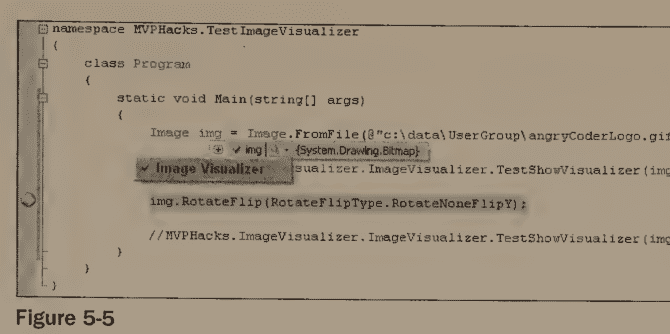

就这样。可视化工具是一个强大的工具，因为它们使你能够查看复杂对象的内容，并在调试应用程序时做出更好的决策。

### 为调试优化对象

有时，你并不需要可视化工具的全部功能，但仍希望更快、更轻松地在调试窗口中查看和解释业务对象。System.Diagnostics 命名空间实现了几个不同的属性，你可以用它们来修饰类及其成员，以优化对象以便调试。本质上，你可以减少调试窗口中的杂乱信息，并控制关于自定义业务对象的显示内容。

### 设置对象成员可见性

DebuggerBrowsable 属性使你能够用关于调试窗口中可见性的指令来修饰对象成员（如属性）。它接受 DebuggerBrowsableState 枚举作为参数，该枚举有三个值之一：Collapsed、Never 或 RootHidden。它们的定义在下表中概述。

| 成员名称 | 说明 |
|---|---|
| Collapsed | 将元素显示为折叠状态。这是默认行为。|
| Never | 不在调试窗口中显示元素。|
| RootHidden | 不显示根元素；如果元素是集合或项目数组，则显示其子元素。|

为了说明这些属性的工作原理，请考虑以下示例中实现的 Person 类：

```
class Person
{
    private string _lastName = string.Empty;
    private string _firstName = string.Empty;
    private int _age = 0;
    private List<Person> _children = new List<Person>();
    private List<string> _pets = new List<string>();
    private List<string> _cars = new List<string>();

    public string LastName
    {
        get { return _lastName; }
        set { _lastName = value; }
    }

    public string FirstName
    {
        get { return _firstName; }
        set { _firstName = value; }
    }

    public int Age
    {
        get { return _age; }
        set { _age = value; }
    }

    [DebuggerBrowsable(DebuggerBrowsableState.Collapsed)]
    public List<Person> Children
    {
        get { return _children; }
    }

    [DebuggerBrowsable(DebuggerBrowsableState.Never)]
    public List<string> Pets
    {
        get { return _pets; }
    }

    [DebuggerBrowsable(DebuggerBrowsableState.RootHidden)]
    public List<string> Cars
    {
        get { return _cars; }
    }

    public Person()
    {
    }

    public Person(string lastName, string firstName, int age)
    {
        _lastName = lastName;
        _firstName = firstName;
        _age = age;
    }
}
```

## 第 5 章

Person 类的三个属性（Children、Pets 和 Cars）用 DebuggerBrowsable 属性选项之一进行了修饰。在 Watch 窗口中查看时，它看起来类似于图 5-6。

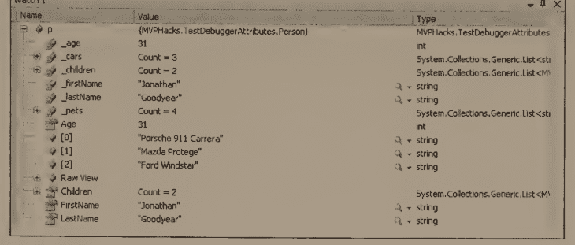

## 调试你创建的内容

如你所见，用 DebuggerBrowsableState.Collapsed 修饰的 Children 属性在 Watch 窗口中显示为折叠状态。你可以通过点击属性名称旁边的加号来展开它，以查看其中包含的 Person 对象。Pets 属性根本不出现在 Watch 窗口中，因为它用 DebuggerBrowsableState.Never 修饰了。不要将其与出现在 Watch 窗口中的 _pets 内部字段混淆。在下一节中，你将看到如何在 Watch 窗口中查看 Person 类而不显示内部字段的杂乱信息。最后，Cars 属性不会直接出现，但其内容会显示，如 Watch 窗口中 [0]、[1] 和 [2] 项所示。这是用 DebuggerBrowsableState.RootHidden 修饰后产生的行为。

### 使用类型代理简化对象视图

你有没有注意到，在分析前面描述的复杂业务对象时，调试窗口会变得多么杂乱？很大一部分混乱是因为调试窗口使用反射来显示无法通过对象接口直接访问的内部字段的值。对象经常实现一些程序可能使用的属性，但这些属性在调试时并不常用，这也没有帮助。如果能只查看对你重要的对象信息，岂不是很好？嗯，你可以做到。类型代理功能正是为此目的而创建的。

类型代理在业务对象中实现为内部类。其目的是仅定义要在调试窗口中显示的元素。根据设计，内部字段永远不会显示在调试窗口中。让我们继续为 Person 类添加一个类型代理：

```
internal class PersonProxy
{
    private Person _person;

    public PersonProxy(Person person)
    {
        _person = person;
    }

    public string Children
    {
```


```markdown
## 一种类型代理类的实现

类型代理类必须实现一个构造函数，该构造函数接受一个它将要代理的类的实例，因此前面的代理首先包含这个实例。接下来，你可以添加任意多的属性，以表示代理所代表的类中包含的数据。这些属性可以采用任何格式（虽然通常表示为字符串），它们甚至可以有与底层类中相应属性不同的名称。

```csharp
public string Children
{
    get
    {
        string[] children = new string[_person.Children.Count];

        for(int i = 0; i < _person.Children.Count; i++)
        {
            children[i] = _person.Children[i].FirstName;
        }

        return string.Join(", ", children);
    }
}

public string Pets
{
    get { return string.Join(", ", _person.Pets.ToArray()); }
}

public string Cars
{
    get { return string.Join(", ", _person.Cars.ToArray()); }
}

public string Person
{
    get
    {
        return "Name = " + _person.FirstName + " " + _person.LastName +
               ", Age = " + _person.Age;
    }
}
```

为了将 PersonProxy 类配置为充当 Person 类的类型代理，你需要用 DebuggerTypeProxy 属性装饰类声明：

```csharp
[DebuggerTypeProxy(typeof(PersonProxy))]
class Person
{
//为清晰起见，已移除实现
}
```

> DebuggerTypeProxy 属性也可以在程序集级别使用，通过 Target 参数指定类型代理将代表的类。但是，为清晰起见，最好在类本身上使用 DebuggerTypeProxy 属性。

完成此操作后，如果你在监视窗口中查看 Person 类的实例，它将看起来类似于图 5-7 中所示的内容。

PersonProxy 类将基本的姓名和年龄人口统计信息组合到单个 Person 属性中。此外，Cars、Children 和 Pets 属性表示为逗号分隔的列表，而不是通过泛型实现的项目列表。还要注意，即使底层 Person 类的 Pets 属性被装饰为 DebuggerBrowsableState.Never，代理类仍然可以访问其信息以在监视窗口中显示它。当然，如果你需要访问与 Person 类相关的所有底层数据，可以在监视窗口中展开 Raw View 节点。这将显示与你在图 5-6 中看到的相同的视图，即未使用类型代理时的视图。

> 避免在类型代理类的构造函数中放入任何处理成本高昂的逻辑，因为每次在调试窗口中显示底层类的实例时，该逻辑都会自动执行。不过，类型代理的一个很好的特性是，其属性中的逻辑只有在调试窗口中可见时才会执行。

## 向业务对象添加调试逻辑

类型代理非常适合为你的业务对象创建易于解释的视图，但你也可以通过实现 DebuggerDisplay 属性将一些业务逻辑添加到混合中。你可以在底层类的属性上或在你的类型代理类上装饰属性。请注意，由 DebuggerDisplay 属性解释的逻辑和输出会替换底层类或类型代理通常在调试窗口中显示的任何内容。

例如，你可以向 PersonProxy 类添加一些逻辑，以使用以下代码快速确定 Person 对象所代表的人是否达到饮酒年龄（在美国）：

```csharp
[DebuggerDisplay("{_person.Age >= 21 ? \"Old Enough\" : \"Too Young\"}",
Type = "Alcohol Age Check")]
public string AlcoholAgeCheck
{
    get { return string.Empty; }
}
```

在上面的代码中，DebuggerDisplay 属性附加到一个名为 AlcoholAgeCheck 的新的只读属性上。它接受的第一个参数是一个字符串，表示你希望在调试窗口的“值”字段中显示的文本。花括号内包含的任何文本都会作为实际代码执行，这就是三元运算符能够访问私有 _person 实例字段的方式。反斜杠可用作引号、花括号、反斜杠或你可能需要包含在输出中的任何其他保留字符的转义字符。Type 参数是可选的，允许你覆盖调试窗口中 Type 字段的内容。顺便说一句，属性 getter 返回一个空字符串，因为它无论如何都会被 DebuggerDisplay 属性覆盖。

当上面的代码为年龄大于或等于 21 岁的人执行时，调试窗口将看起来像图 5-8 中所示的那样。

如果使用三元运算符来解释业务规则不是你的强项，那么你可以将逻辑分离到一个返回字符串的私有函数中，然后从 DebuggerDisplay 属性中调用该函数。以下代码实现了一个通用的 BusinessRulesViolations 属性，该属性将包含当前 Person 实例违反的任何业务规则的消息：

```csharp
private string ValidateObject()
{
    List<string> violations = new List<string>();

    //确保已指定名字
    if (0 == _person.FirstName.Length)
    {
        violations.Add("FirstName is empty");
    }

    //确保已指定姓氏
    if (0 == _person.LastName.Length)
    {
        violations.Add("LastName is empty");
    }

    //确保年龄大于 0
    if (0 > _person.Age)
    {
        violations.Add("Age is less than 0");
    }

    //在此处添加其他验证

    //将结果返回给 DebuggerDisplay 属性
    return string.Join(", ", violations.ToArray());
}

[DebuggerDisplay("{ValidateObject()}")]
```

## 调试你创建的内容

```csharp
public string BusinessRulesViolations
{
    get { return string.Empty; }
}
```

如果我使用一个没有姓氏且年龄为 -1 的人来运行上面的代码，那么调试窗口将看起来像图 5-9 中所示的那样。

此示例的一个可能扩展是递归地遍历 Children 属性的 Person 对象，以确保它们都不违反任何业务规则，这样你只需查看父对象就可以知道层次结构中的任何对象是否无效。当你想快速查看调试窗口中业务对象的任何问题时，使用此处描述的方法是有意义的。然后你就会立即知道是否需要进一步调查。

## 总结

为了结束本节，以下是 Person 类代码现在的样子：

```csharp
using System;
using System.Collections.Generic;
using System.Text;
using System.Diagnostics;
using MVP Hacks.TestDebuggerAttributes;

namespace MVP Hacks.TestDebuggerAttributes
{
    [DebuggerTypeProxy(typeof(PersonProxy))]
    class Person
    {
        private string _lastName = string.Empty;
        private string _firstName = string.Empty;
        private int _age = 0;
        private List<Person> _children = new List<Person>();
        private List<string> _pets = new List<string>();
        private List<string> _cars = new List<string>();

        public string LastName
        {
            get { return _lastName; }
            set { _lastName = value; }
        }

        public string FirstName
        {
            get { return _firstName; }
            set { _firstName = value; }
        }

        public int Age
        {
            get { return _age; }
            set { _age = value; }
        }

        [DebuggerBrowsable(DebuggerBrowsableState.Collapsed)]
        public List<Person> Children
        {
            get{return _children;}
        }

        [DebuggerBrowsable(DebuggerBrowsableState.Never)]
        public List<string> Pets
        {
            get { return _pets; }
        }

        [DebuggerBrowsable(DebuggerBrowsableState.RootHidden)]
        public List<string> Cars
        {
            get { return _cars; }
        }

        public Person()
        {
        }

        public Person(string lastName, string firstName, int age)
        {
            _lastName = lastName;
            _firstName = firstName;
            _age = age;
        }
    }
}
```

## 第 5 章

//用于过滤调试窗口中显示数据的类型代理
internal class PersonProxy
{
    private Person _person;

    public PersonProxy(Person person)
    {
        _person = person;
    }

    public string Children
    {
        get
        {
```


注意：内容似乎在末尾不完整。PersonProxy 类的定义延续到了 OCR 文本中未提供的部分。


## 调试你创建的内容

```csharp
string[] children = new string[_person.Children.Count];

for(int i = 0; i < _person.Children.Count; i++)
{
    children[i] = _person.Children[i].FirstName;
}

return string.Join(", ", children);
}
}

public string Pets
{
    get { return string.Join(", ", _person.Pets.ToArray()); }
}

public string Cars
{
    get { return string.Join(", ", _person.Cars.ToArray()); }
}

[DebuggerDisplay("{_person.Age >= 21 ? \"Old Enough\" : \"Too Young\"}", Type = "Alcohol Age Check")]
public string AlcoholAgeCheck
{
    get { return string.Empty; }
}

private string ValidateObject()
{
    List<string> violations = new List<string>();

    // Make sure that a first name has been specified
    if (0 == _person.FirstName.Length)
    {
        violations.Add("FirstName is empty");
    }

    // Make sure that a last name has been specified
    if (0 == _person.LastName.Length)
    {
        violations.Add("LastName is empty");
    }

    // Make sure that age is greater than 0
    if (0 > _person.Age)
    {
        violations.Add("Age is less than 0");
    }

    // Put additional validations here

    // Return results to DebuggerDisplay attribute
    return string.Join(", ", violations.ToArray());
}
}
[DebuggerDisplay("{ValidateObject()}")]
public string BusinessRulesViolations
{
    get { return string.Empty; }
}

public string Person
{
    get
    {
        return "Name = " + _person.FirstName + " " + _person.LastName + ", Age = " + _person.Age;
    }
}
}
```

## 第 5 章

## 总结

本章展示了如何利用 Visual Studio 2005 的一些新调试特性 helpspot;features 来减少调试代码所需的时间。可视化工具使你能够创建自定义用户界面，以便轻松查看复杂对象的内容。你可以使用 `DebuggerBrowsable` 属性来控制自定义业务对象的某些属性在调试窗口中何时显示。类型代理使你能够通过创建一个对象来清除调试窗口的杂乱信息，该对象提供自定义业务对象重要方面的简洁概览，同时仍允许你在需要时深入查看完整细节。最后，你可以使用 `DebuggerDisplay` 属性根据自定义业务对象的当前状态在调试窗口中显示消息。所有这些全新且实用的调试功能将帮助你把代码调试提升到一个新的水平。

## 第 6 章：控件技巧

将技巧打包和分发的一个好方法是通过控件。技巧应尽可能可重用，而与控件结合是非常自然的选择。本章的代码示例致力于构建一个用于发布 RSS 订阅的控件。该控件得到了有关类型转换器、类型编辑器以及设计器的支持。在讨论控件的同时，我将介绍 Visual Studio 2005 中提供的一些新的设计时功能。

除了本身是一个技巧外，RSS 控件还由几个较小的迷你技巧组成。由于通过网络获取数据所需的时间对性能有显著影响，你将学习如何通过使用数据缓存来提高控件性能。你可能已经注意到在 Visual Studio 2005 中处理控件时弹出的操作列表。你还将学习如何将它们添加到自己的控件中。此外，你将学习如何通过利用 Visual Studio 2005 自动化对象模型来获取设计时的项目文件路径。

### 使用 XML 控件发布 RSS

RSS 控件技巧是一个结合了其他控件和技术的控件，使你能够在 Web 窗体上发布 RSS 订阅。它使用 ASP.NET XML 控件，该控件以 RSS 订阅作为输入，并通过 XSLT 样式表运行它。一个巨大的好处是你可以实现**零工作量**的内容管理。在学习如何构建此控件的过程中，你还将接触到几个可以在其他开发工作中复用的迷你技巧。

> > RSS 控件已在不同的订阅源上进行测试，包括 RSS v1.0 和 RSS v2.0 订阅源。版本并不重要，因为 XML 是通过 XSLT 样式表进行转换的。如果你需要支持其他 RSS 版本，可以通过修改 XSLT 样式表来实现。

### 零工作量的内容管理

除了能够发布一个或多个订阅源外，RSS 控件还能让你实现**零工作量**的内容管理。例如，你可以设置一个博客，其唯一目的是在网页上发布内容。由于博客通过 XML RSS 订阅源发布，任何人都可以从该 RSS 订阅源读取内容。通过配置 RSS 控件来发布特定的订阅源，你可以使用博客软件更新博客，更新将自动出现在 RSS 控件所在的 Web 窗体上。你的内容会立即发布，无需你付出任何额外努力。

### 定义控件

创建控件时，你需要选择要构建的控件类型：用户控件、复合自定义控件或呈现自定义控件。用户控件便于控件缓存，且构建和使用非常快捷。用户控件的问题在于它们不能跨项目复用。复制粘贴可不是我所说的复用！这就只剩下自定义控件类型之一。如果你需要从头设计整个控件，呈现自定义控件是很好的选择。也许现有的服务器控件有你不想要的臃肿部分，或者你需要详细管理 HTML 呈现。呈现自定义控件的缺点是需要做更多工作，例如手动实现自己的回发数据和回发事件代码。对于 RSS 控件，我们可以轻松地复用现有控件，并结合几个控件来达到我们需要的效果。同时，我们需要在多个项目中复用。这正是复合自定义控件的优势所在。

ASP.NET v2.0 包含一种新的复合自定义控件类型，名为 `CompositeControl`。你不再需要继承 `WebControl` 或实现 `INamingContainer` 接口。此外，`CompositeControl` 还带有默认的设计器类，可自动提供设计时呈现。代码清单 6-1 显示了 `RssControl` 类的定义。

### 代码清单 6-1：实现复合自定义控件：RssControl.cs

```csharp
[assembly: TagPrefix("Hacks.Controls", "hacks")]

namespace Hacks.Controls
{
    [DefaultProperty("URL")]
    [ToolboxData("<{0}:RssControl runat=server>< /{0}:RssControl>")]
    [Designer(typeof(RssControlDesigner))]
    public class RssControl : CompositeControl
    {
        // code removed for clarity
    }
}
```

代码清单 6-1 中的 `RssControl` 继承自 `CompositeControl`。代码清单 6-1 的其他有趣特性包括几个属性。`TagPrefix` 确保来自 `Hacks.Controls` 命名空间的控件在 Web 窗体 HTML 中具有 "hacks" 前缀。一个相关的属性 `ToolboxData` 描述了 `RssControl` 的 HTML。结合前缀，设计器上新放置的 `RssControl` 将生成以下 HTML：

```html
<hacks:RssControl runat="server"></hacks:RssControl>
```

`DefaultProperty` 属性标识了当你首次访问属性网格时哪个属性会被高亮显示。此控件使用操作列表来增强开发者的设计体验。为此，我们需要一个设计器类，这就是 `Designer` 属性的用途。本章后面标题为"构建自定义操作列表和设计器"的部分将更详细地讨论如何实现这一点。

## 拉取内容

第一项任务是弄清楚如何从 RSS 订阅源拉取内容。如果能通过一个简单的属性将 ASP.NET XML 控件指向 RSS 订阅源以获取 XML，那就太好了。但将 XML 数据传入 XML 控件的问题在于，XML 控件只有 `Document`、`DocumentSource` 和 `XPathNavigator` 属性，分别接受 `XmlDocument`、文件名字符串或 `XPathNavigator` 作为输入。

`DocumentSource` 属性不是好选择，因为你需要 XML 文件实际位于本地文件系统上。获取订阅源并将其保存到文件的额外工作由于额外的文件 I/O 而无法提供最佳性能。

使用 `Document` 属性有优点也有缺点。它比 `DocumentSource` 更好，因为它接受 `XmlDocument` 对象。需要克服的问题是，`XmlDocument` 的 `Load` 和 `LoadXml` 方法都不适合处理 RSS 订阅源的 URL。另一个替代方案是使用内置的 XML 类型之一来检索 RSS 订阅源。在这种情况下使用的一个好类型是 `XmlTextReader`。幸运的是，由于 `XmlDocument.Load` 有重载接受 `TextReader` 参数，而 `XmlTextReader` 继承自 `TextReader`，我们现在有了一种加载 `XmlDocument` 的方法，从而可以加载 XML 控件。使用 `Document` 属性的缺点是在 .NET v2.0 中已被弃用。

`XPathNavigator` 属性是所有选择中的最佳方案，因为它接受 `XPathNavigator` 对象。使用 `XPathNavigator` 的好处在于它是只读对象，比 `XmlDocument` 快得多。此外，在 ASP.NET v2.0 中，XML 控件的 `Document` 属性已过时。

你可以通过用标识 RSS 订阅源 URL 的参数实例化 `XPathDocument` 对象来获取 `XPathNavigator`。调用 `CreateNavigator` 可检索用于加载 XML 控件的 `XPathNavigator` 对象。代码清单 6-2 展示了其工作原理。

**代码清单 6-2：使用 RSS 订阅源加载 XML 控件**

```csharp
// identify RSS feed
XPathDocument doc = new XPathDocument(m_url);
XPathNavigator nav = doc.CreateNavigator();

// load the RSS feed and style sheet
// into the Xml control
Xml xmlCtrl = new Xml();
xmlCtrl.XPathNavigator = nav;
```

在代码清单 6-2 中，变量 `m_url` 是一个包含 RSS 订阅源 Web 地址的字符串。`XPathDocument` 和 `XPathNavigator` 是 `System.Xml.XPath` 命名空间的成员，此代码清单中未显示的代码具有适当的 using 声明。此代码是自定义 RSS 控件的 `CreateChildControls` 方法的一部分。


## 第六章

### 用于性能优化的数据缓存

如果此控件部署在一个访问量偶发的中小型网站上，其性能表现会非常好。然而，您应该考虑到其繁忙网站上的性能影响，以及对 RSS 源站造成的负载压力。在这种情况下，获得更好性能的方案是*数据缓存*。

在许多情况下，RSS feed 非常适合进行缓存。如果 RSS feed 源自某个博客，请考虑该博客更新的频率。在大多数情况下，更新频率并不频繁。您可以每天缓存一次（这是您的选择），从而在很长一段时间内提供最佳性能。

另一个需要考虑的因素是，长时间缓存数据并不总是您想要的做法。在设计缓存策略之前，请考虑信息的时效性。如果等到每天某个特定时间再更新没有问题，那就没有问题。但是，如果您想了解在指定时间段内的变化呢？在这种情况下，将缓存时间设置为您愿意等待更新的时间段，例如 5 分钟、30 分钟或 1 小时。即使只缓存几秒数据，其性能也比完全不缓存要好得多。清单 6-3 展示了此处应用的 RSS 控件的缓存策略。

### 清单 6-3：缓存 RSS feed 数据

```csharp
HttpContext ctx = HttpContext.Current;
XPathDocument doc = null;

// 获取 RSS feed
if (ctx.Cache[XPathDoc] == null)
{
    ctx.Cache.Insert(
        XPathDoc,                // 键
        new XPathDocument(m_url), // RSS feed
        null,                    // 无依赖
        DateTime.Now.AddHours(1), // 保留一小时
        Cache.NoSlidingExpiration, // 无滑动过期
        CacheItemPriority.Normal, // 正常驱逐
        null);                   // 无回调
}

doc = (XPathDocument)ctx.Cache[XPathDoc];
```

在使用自定义 Web 控件时，您无法直接访问像 `Cache` 这样的固有页面对象。为了克服这一限制，您可以使用 `HttpContext` 类型并读取其 `Current` 属性，如清单 6-3 所示，以获取当前上下文的一个实例，该实例包含一个可用于访问缓存的属性。

另一个我用来避免错误的技巧是使用常量字符串字段作为 `Cache` 的键。由于 `Cache` 的键是 `string` 类型，它不是强类型的，拼写错误可能会导致难以查找的 bug。在清单 6-3 中，`XPathDoc` 是常量字符串。出于同样的原因，我也对 `Session` 和 `ViewState` 等其他固有对象这样做。

### 管理 XSLT 源

与公开视觉外观的属性不同，RSS 控件使用 XSLT 将 RSS feed 渲染为 HTML。因此，用户需要一种方法来指定使用哪个 XSLT 文件。清单 6-4 展示了 `XSLT` 属性如何启用此行为。

### 清单 6-4：允许用户选择 XSLT 文件的属性

```csharp
[Bindable(true)]
[Category("RSS")]
[DefaultValue("")]
[Description("The XSLT style sheet for transforming the XML.")]
[Editor(typeof(XslTransformFileEditor), typeof(UITypeEditor))]
public string XSLT
{
    get
    {
        EnsureChildControls();
        if (m_xslt == null)
        {
            m_xslt = string.Empty;
        }
        
        return m_xslt;
    }
    set
    {
        EnsureChildControls();
        m_xslt = value;
        SetTransformSource(value);
    }
}
```

`XSLT` 属性被 `XslTransformFileEditor` 的 `Editor` 属性修饰，这为用户提供了一个舒适的界面来选择 XSLT 文件。请记住，此编辑器会在当前项目的本地目录中查找文件，因此您需要将 XSLT 文件添加到添加了该控件的项目中。此外，编辑器查找的是 `.xsl` 扩展名的文件，这意味着您必须将 XSLT 文件命名为相同的扩展名，或者选择“所有文件 (*.*)”选项才能看到 `*.xslt` 文件。Visual Studio 2005 有一个项目项模板，默认将 XSLT 文件命名为 `*.xslt`。

如果您不熟悉 XSLT，它是一种用于对 XML 数据文件执行转换的 XML 语言。在我们的案例中，我们希望将以 XML 格式存在的 RSS feed 转换为 HTML。获取关于 XML 和 XSLT 免费入门信息的一个好地方是 [w3schools.org](https://www.w3schools.com)。清单 6-5 展示了一个示例 XSLT 文件供您参考。

### 清单 6-5：示例 XSLT 文件

```xml
<?xml version="1.0" encoding="UTF-8" ?>
<xsl:stylesheet version="1.0"
    xmlns:xsl="http://www.w3.org/1999/XSL/Transform">
<xsl:template match="/">
<table width="100%" cellpadding="5">
    <xsl:for-each select="/rss/channel/item">
        <xsl:if test="not(title = 'Custom List')">
            <xsl:if test="position() < 10">
                <tr>
                    <td>
                        <xsl:attribute name="bgcolor">
```

### 清单 6-5（续）

```xml
steelblue
        </xsl:attribute>
        <font color="white">
            <b>
                <xsl:value-of select="title" />
            </b>
        </font>
    </td>
</tr>
<tr>
    <td>
        <font size="1">
            <b><xsl:value-of select="pubDate" /></b>
        </font>
    </td>
</tr>
<tr>
    <td>
        <font size="2">
            <xsl:value-of select="description"
                disable-output-escaping="yes" />
        </font>
    </td>
</tr>
</xsl:if>
</xsl:if>
</xsl:for-each>
</table>
</xsl:template>
</xsl:stylesheet>
```

清单 6-5 展示了一个您可以在自己的项目中使用的 XSLT 文件。您可能需要进行调整，以便它更好地与您的站点配合工作，例如配置它以使用为您站点定义的 CSS 类。

### 快速自定义类型转换器

Property Grid 中的默认数据表示是文本，对于没有预定义类型转换器的属性而言，这是正常的。如果您的控件公开的属性是 string 类型，这没有问题。然而，属性通常是自定义对象类型。您需要一种方法告诉 Property Grid 如何将该字符串转换为您想要的类型。这是类型转换器的职责。本节讨论如何创建自定义类型转换器。

### 创建自定义类型转换器

在字符串和其他类型之间转换属性值时，Property Grid 必须知道它是否可以将您的类型转换为字符串，以及是否可以将字符串转换为您的类型。此外，您必须提供实际进行转换的代码。

### 控件技巧

许多现有的 .NET 类型拥有自己的 TypeConverter。在 RssControl 类中，URL 属性的类型是 Uri。当向 RssControl 的 Property Grid 添加 RSS feed 的地址时，它是一个 string 类型。由于 Uri 具有 UriTypeConverter，这使得工作顺利进行，开发者无需任何额外工作。

### 定义属性及其类型

当您基于自定义类型构建属性时，您需要负责编写自己的类型转换器。在 RssControl 的案例中，我们需要一种方式为控件提供标题。一种方法是为 RssControl 添加 Name 和 Description 属性，因为它们都是 string 类型，转换起来没问题。然而，您可以通过将两者合并为单个属性来节省屏幕空间或使编辑属性更容易。RssControl 采取了后一种方法，将 Name 和 Description 合并为 `RssSiteInfo` 类型，并公开了一个名为 `SiteInfo` 的成员属性，如清单 6-6 所示。

### 清单 6-6：RSSControl 的 SiteInfo 属性

```csharp
[Bindable(true)]
[Category("RSS")]
[DefaultValue("<Enter Name Here>,<Enter Description Here>")]
[Localizable(true)]
[Description("Provide a Name and Description to describe the RSS feed.")]
[DesignerSerializationVisibility(DesignerSerializationVisibility.Content)]
[PersistenceMode(PersistenceMode.InnerProperty)]
public RssSiteInfo SiteInfo
{
    get
    {
        EnsureChildControls();
        if (m_siteInfo == null)
        {
            m_siteInfo = new RssSiteInfo();
        }

        return m_siteInfo;
    }
    set
    {
        EnsureChildControls();
        m_siteInfo = value;
        title.Text = "<p><b>" + SiteInfo.Name + " - " +
            SiteInfo.Description + "<br></b></p>";
    }
}
```

清单 6-6 中的 `SiteInfo` 属性类型为 `RssSiteInfo`。它是一个普通的控件属性，其属性与其他控件属性相似。`DesignerSerializationVisibility` 属性设置为 `DesignerSerializationVisibility.Content` 枚举，这告诉设计器将此类型添加到 HTML 页面中。`PersistenceMode` 属性设置为 `PersistenceMode.InnerProperty`，这告诉 IDE 将此属性的修改值序列化为 HTML 页面中 RssControl 元素的子元素。这两个属性的区别在于，`DesignerSerializationVisibility` 属性告诉设计器做什么，而 `PersistenceMode` 属性告诉设计器如何做。清单 6-7 展示了 `RssSiteInfo` 类的定义。


## 第 6 章

### 代码清单 6-7：RssSiteInfo 类

```csharp
[TypeConverter(typeof(RssSiteInfoTypeConverter))]
public class RssSiteInfo
{
    private string m_name = "<Enter Name Here>";

    [NotifyParentProperty(true)]
    public string Name
    {
        get { return m_name; }
        set { m_name = value; }
    }

    private string m_description = "<Enter Description Here>";

    [NotifyParentProperty(true)]
    public string Description
    {
        get { return m_description; }
        set { m_description = value; }
    }
}
```

代码清单 6-7 中的 `RssSiteInfo` 类只是一个包含两个 `string` 类型属性（`Name` 和 `Description`）的类型。请注意 `TypeConverter` 和 `NotifyParentProperty` 这两个特性。该控件需要在属性网格中将其属性表示为字符串。虽然这些属性本身已经是字符串，但 `RssSiteInfo` 是一种属性网格无法识别的类型。因此，我们必须提供一个类型转换器，以便在 `RssSiteInfo` 类型和 `string` 类型之间进行转换。下一节将解释其原理，以及为何 `NotifyParentProperty` 也是必需的。

### 定义自定义类型转换器

如果自定义类型上缺少类型转换器，在属性网格中编辑 `SiteInfo` 属性时将会出错。为了消除转换错误，你需要能够只定义一次转换逻辑，并将该逻辑与 `RssSiteInfo` 类关联起来。类型转换器可以装饰一个属性，但这不如让它装饰属性所属的类型来得可重用。

为了帮助你入门，代码清单 6-8 提供了一个骨架代码，你可以在创建自己的自定义类型编辑器时使用。其逻辑与 Visual Studio 2005 文档中的非常相似，但我将它放在这里供你参考。

### 代码清单 6-8：自定义类型编辑器的骨架代码

```csharp
class MyTypeConverter : TypeConverter
{
    public override bool CanConvertFrom(
        ITypeDescriptorContext context,
        Type sourceType)
    {
        if (sourceType == typeof(string))
        {
            return true;
        }
        return base.CanConvertFrom(context, sourceType);
    }

    public override bool CanConvertTo(
        ITypeDescriptorContext context,
        Type destinationType)
    {
        if (destinationType == typeof(string))
        {
            // TODO: 添加转换逻辑
        }
        return base.CanConvertTo(context, destinationType);
    }

    public override object ConvertFrom(
        ITypeDescriptorContext context,
        System.Globalization.CultureInfo culture,
        object value)
    {
        string strVal = value as string;
        if (strVal != null)
        {
            // TODO: 添加转换逻辑
        }
        return base.ConvertFrom(context, culture, value);
    }

    public override object ConvertTo(
        ITypeDescriptorContext context,
        System.Globalization.CultureInfo culture,
        object value, Type destinationType)
    {
        if (destinationType == typeof(string))
        {
            // TODO: 添加转换逻辑
        }
        return base.ConvertTo(
            context, culture, value, destinationType);
    }
}
```

你可以重用代码清单 6-8 中的 `TypeConverter` 模板，在你自己的程序中开始使用类型转换器。只需将 `MyTypeConverter` 改为更有意义的名称即可。事实上，这会是一个很好的代码片段。Visual Studio 2005 调用 `CanConvertFrom` 和 `CanConvertTo` 方法来确定转换是否可能。`ConvertFrom` 用于从字符串转换为你的类型，而 `ConvertTo` 用于从你的类型转换为字符串。`TypeConverter` 还有更多内容，如果你需要进一步的信息，我建议你查看文档。然而，前面的代码足以演示如何为 `RssControl` 技巧使用自定义类型转换器。

如果你要使用此代码片段，将其复制到一个类文件中，通过选择“视图” > “任务列表”或按 Ctrl+,（或 Ctrl+T）来打开任务列表。在任务列表中选择“注释”，然后双击每个 **TODO** 注释，为 `ConvertFrom` 和 `ConvertTo` 方法添加逻辑。关于 `Dimension` 类的类型转换器，代码清单 6-9 展示了如何实现 `ConvertFrom` 方法。

## 第 6 章

### 代码清单 6-9：DimensionTypeConverter 的 ConvertFrom 方法

```csharp
public override object ConvertFrom(ITypeDescriptorContext
    context, CultureInfo culture, object value)
{
    if (value == null)
    {
        return new RssSiteInfo();
    }

    if (value is string)
    {
        string s = (string)value;
        if (s.Length == 0)
        {
            return new RssSiteInfo();
        }

        string[] siteInfo = s.Split(',');

        if (siteInfo.Length < 2)
        {
            throw new ArgumentException(
                "必须包含格式为\"\<name\>,\<description\>\"的名称和描述", "value");
        }

        RssSiteInfo rsi = new RssSiteInfo();
        rsi.Name = siteInfo[0];
        rsi.Description = siteInfo[1];

        return rsi;
    }

    return base.ConvertFrom(context, culture, value);
}
```

多值属性通常表示为逗号分隔的值列表。代码清单 6-9 中的代码使用字符串的 `Split` 方法将这些值分隔成一个数组。代码清单 6-10 展示了如何进行反向转换，即从 `RssSiteInfo` 类型转换为 `string` 类型。

### 代码清单 6-10：DimensionTypeConverter 的 ConvertTo 方法

```csharp
public override object ConvertTo(
    ITypeDescriptorContext context,
    CultureInfo culture, object value, Type destinationType)
{
    if (value != null)
    {
        if (!(value is RssSiteInfo))
        {
            throw new ArgumentException(
                "无效的 RSS 站点信息", "value");
        }

        if (destinationType == typeof(string))
        {
            if (value == null)
            {
                return string.Empty;
            }

            RssSiteInfo rsi = (RssSiteInfo)value;

            return rsi.Name + "," + rsi.Description;
        }
    }
    return base.ConvertTo(context, culture, value,
        destinationType);
}
```

在代码清单 6-10 中，代码简单地返回了 `RssSiteInfo` 对象的 `Name` 和 `Description` 属性组成的字符串，中间用逗号分隔。有了继承自 `TypeConverter` 的 `RssSiteInfo` 类型转换器，属性网格会显示一个单独的属性条目，你可以在其中编辑逗号分隔的值列表。除了逗号分隔的表示法外，如果能独立编辑 `Name` 和 `Description` 的值可能会更方便。想想 `Font` 属性是如何编辑的，它使用树状表示法，你可以单击 + 符号并编辑各个部分。你也可以做到这一点。只需将自定义类型编辑器改为继承自 `ExpandableObjectConverter`，如代码清单 6-11 所示。

### 代码清单 6-11：在属性网格中将属性显示为树状结构

```csharp
class RssSiteInfoTypeConverter : ExpandableObjectConverter
{
    // 为清晰起见，内容已移除
}
```

代码清单 6-11 是代码清单 6-6 的修改版本。它只是将类型转换器的名称改为更具体的名称，并使其继承自 `ExpandableObjectConverter`。当将类型转换器改为继承自 `ExpandableObjectConverter` 时，如果在属性网格中编辑嵌套的属性值，可能会发生错误。它们不会自动用逗号分隔的列表更新父属性网格项，这也意味着设计器界面不会更新。这就是代码清单 6-6 中使用的 `NotifyParentProperty` 特性的目的。应将 `NotifyParentProperty` 特性设置为 `true` 并应用于每个属性，以确保设计器中所有其他相关实体都收到更改通知。

### 构建自定义操作列表和设计器

Visual Studio 2005 有一个名为操作列表的新功能，它是一个常见设计时任务的列表。当你将控件拖放到设计界面时，控件的右上角会显示一个箭头。单击此箭头会显示操作列表。操作列表包含关键的控件属性，内容不会太多，并提供了一种快速访问最需要属性的方式。没有操作列表，你将不得不使用属性网格来设置所有属性，但操作列表的特性可以提高工作效率。


## 第6章

开发者通过自定义设计器创建操作列表。本节中的示例创建了一个设计器，它继承自现有设计器，并仅为操作列表添加了专门支持。清单6-12展示了如何声明一个设计器。

### 清单6-12：一个自定义设计器

```csharp
class RssControlDesigner : CompositeControlDesigner
{
    public override DesignerActionListCollection ActionLists
    {
        get
        {
            DesignerActionListCollection rssActionLists
            new DesignerActionListCollection();

            // 添加一个自定义操作列表
            rssActionLists.Add(new RssControlActionList(this.Component));

            return rssActionLists;
        }
    }
}
```

清单6-12中的 `RssControlDesigner` 继承自 `CompositeControlDesigner`，因为它将要用于的控件是一个复合控件。设计器的目的是为控件提供设计时支持，以便开发者可以在可视化设计环境中使用该控件。例如，设计器有助于管理控件外观、控件状态初始化以及用户与控件交互时的行为。本章的重点是通过新的操作列表功能添加设计时支持。

`RssControlDesigner` 的唯一属性是 `ActionLists` 的一个重写。其 `get` 访问器返回一个 `DesignerActionListCollection`，其中包含一个在设计时显示的自定义操作列表。添加到 `DesignerActionListCollection` 中的 `RssControlActionList` 类型在清单6-13中定义。

### 清单6-13：一个自定义操作列表：RssControlActionList

```csharp
class RssControlActionList : DesignerActionList
{
    private RssControl rssControl = null;

    public RssControlActionList(IComponent rssControl)
        : base(rssControl)
    {
        // 获取我们正在设计的控件的引用
        this.rssControl = rssControl as RssControl;
    }

    // 使操作列表在启动时弹出
    public override bool AutoShow
    {
        get
        {
            return true;
        }
        set
        {
            base.AutoShow = true;
        }
    }
```

自定义操作列表继承自 `DesignerActionList`，如清单6-13所示。你应该通过传入操作列表将要应用到的控件的引用来初始化它。保留控件的引用，因为当属性状态发生变化时应该通知它。我实现了一个 `AutoShow` 属性的重写，以展示这个酷炫的新功能：当控件添加到设计表面时，操作列表会立即弹出。另一个在设计时被调用的操作列表方法是 `GetSortedActionItems` 方法。我们在 `RssControlActionList` 中重写了这个方法，如清单6-14所示。

### 清单6-14：重写 GetSortedActionItems 方法

```csharp
public override DesignerActionItemCollection GetSortedActionItems()
{
    DesignerActionItemCollection rssActionItems
        = new DesignerActionItemCollection();

    // 所有内容都放在 RSS 类别下

    DesignerActionHeaderItem header =
        new DesignerActionHeaderItem("RSS");
    rssActionItems.Add(header);

    // RSS 属性是开发者最感兴趣的。

    DesignerActionPropertyItem siteInfo =
        new DesignerActionPropertyItem(
            "SiteInfo", "站点信息", "RSS",
            "用作标题显示的名称和描述。" +
            "格式：<名称>,<描述>");
    rssActionItems.Add(siteInfo);

    DesignerActionPropertyItem url =
        new DesignerActionPropertyItem(
            "URL", "URL", "RSS",
            "RSS 源的 Web 地址。");
    rssActionItems.Add(url);

    DesignerActionPropertyItem xslt =
        new DesignerActionPropertyItem(
            "XSLT", "XSLT", "RSS",
            "用于格式化 RSS 源的 XSLT 文件。");
    rssActionItems.Add(xslt);

    return rssActionItems;
}
```

清单6-14中 `GetSortedActionItems` 的目的是返回一个包含 `DesignerActionItem` 派生类型的 `DesignerActionItemCollection`。这些类型允许你定义出现在操作列表中的方法、属性和文本条目。对于 `RssControlActionList`，我们只对定义一个标题和公开属性感兴趣，这分别需要实例化一个 `DesignerActionHeaderItem` 和一个 `DesignerActionPropertyItem`。

`DesignerActionHeaderItem` 只是创建一个名为“RSS”的类别，并将其传递给构造函数。`RssControlActionList` 将有三个属性：`SiteInfo`、`URL` 和 `XSLT`，它们对应于 `RssControl` 中的相同属性。`DesignerActionPropertyItem` 构造函数的参数列表设置了一个代码属性名，创建一个在操作列表中显示的标签，命名一个与标题匹配的类别，并设置当开发者的鼠标在设计器中悬停在属性项的标签上时将显示为工具提示的描述。

对于添加到 `DesignerActionItemCollection` 中的每个 `DesignerActionPropertyItem` 实例，`RssControlDesignerActionList` 类型需要实现一个同名的属性。清单6-15展示了这三个必需的属性。

### 清单6-15：操作列表属性

```csharp
public RssSiteInfo SiteInfo
{
    get
    {
        return rssControl.SiteInfo;
    }
    set
    {
        // 需要通过 PropertyDescriptor 通知设计器变更
        PropertyDescriptor propDesc =
            TypeDescriptor.GetProperties(rssControl)["SiteInfo"];

        propDesc.SetValue(rssControl, value);
    }
}

[Editor(typeof(RssTypeEditor), typeof(UITypeEditor))]
public Uri URL
{
    get
    {
        return rssControl.URL;
    }
    set
    {
        // 需要通过 PropertyDescriptor 通知设计器变更
        PropertyDescriptor propDesc =
            TypeDescriptor.GetProperties(rssControl)["URL"];

        propDesc.SetValue(rssControl, value);
    }
}

[Editor(typeof(XslTransformFileEditor), typeof(UITypeEditor))]
public string XSLT
{
    get
    {
        return rssControl.XSLT;
    }
    set
    {
        // 需要通过 PropertyDescriptor 通知设计器变更
       PropertyDescriptor propDesc =
            TypeDescriptor.GetProperties(rssControl)["XSLT"];

        propDesc.SetValue(rssControl, value);
    }
}
```

清单6-15展示了为什么 `RssControlActionList` 需要控件的引用。它在每个属性的 `set` 访问器中使用此引用来获取属性描述符。通过属性描述符设置 `RssControl` 实例中的属性，设计器中的相关实体会收到变更通知，然后才能进行适当的更新。例如，当通过操作列表修改 `SiteInfo` 属性时，设计器会收到通知，并且变更会传播，以便控件的外观在设计表面更新，你可以立即看到这些变更。

请注意属性上的 `Editor` 特性。尽管原始控件属性包含相同的编辑器，但操作列表无法知道这一点。因此，这些是启用操作列表中的编辑器所必需的。

## 管理设计时支持

控件有两个受众：应用程序用户和开发者。最容易考虑的受众是应用程序用户，因为他们看到的是控件的视觉呈现。也可以认为应用程序用户是最重要的，因为他们的接受程度可能决定整个应用程序的成败。另一个重要的受众是使用控件构建应用程序的开发者。控件有潜力显著提高开发者的生产力。因此，你必须注意确保开发者使用控件的体验是积极的。

在获取 RSS 源的情况下，`HttpCache` 在设计时不可用。因此，你需要使用一个局部变量，如清单6-16所示。

### 清单6-16：在设计时和运行时处理缓存

```csharp
private void LoadRssFeed()
{
    doc = new XPathDocument(URL.ToString());

    if (!DesignMode)
    {
```


 ```
            HttpContext ctx = HttpContext.Current;

            // get RSS feed
            if (ctx.Cache[XPathDoc] == null)
            {
                ctx.Cache.Insert(
                    XPathDoc,                 // key
                    doc,                      // RSS feed
                    null,                     // no dependency
                    DateTime.Now.AddHours(1), // keep for an hour
                    Cache.NoSlidingExpiration, // no slide
                    CacheItemPriority.Normal, // evict normally
                    null);                    // no callback

            }

            // set rss feed
            rssXml.XPathNavigator = doc.CreateNavigator();
        }
```

如果控件设置在 Visual Studio 2005 设计器中，CompositeControl 的 DesignMode 属性返回 true；如果在运行期间进行检查，则返回 false。清单 6-16 中的 LoadRssFeed 方法检查 DesignMode 属性，以决定如何缓存信息。有关此技术优点的描述，请参阅本章前面的"缓存以提高性能"一节。在设计时，使用字段来保存 XPathDocument 是可以的，但在运行时，使用 HttpCache 才是唯一真正合理的选择。

另一个应该检查 DesignMode 的示例是设置 XML 控件的 TransformSource 时。清单 6-17 描述了此方法。

```
        private void SetTransformSource(string fileName)
        {
            // in the designer
            if (DesignMode)
            {
                // no need to set TransformSource
                // if there isn't anything to set
                if (fileName != String.Empty)
                {
                    // tell XML control where to find XSLT file
                    rssXml.TransformSource = GetDesignTimeFilePath(fileName);
                }
            }
            else
            {
                // at runtime
                rssXml.TransformSource =
                    HttpContext.Current.Server.MapPath(fileName);
            }
        }
```

**清单 6-17**与**清单 6-16**相似，都检查了 `DesignMode` 属性来帮助决定如何处理操作。在这种情况下，由于 `Server.MapPath` 在设计时不可用，代码必须执行其他操作。这些操作封装在 `GetDesignTimeFilePath` 方法中，需要使用一个利用 Visual Studio 2005 IDE 的技巧。

在下一节中，我将 `GetDesignTimeFilePath` 描述为一种新的技巧。

## 利用 Visual Studio 2005 自动化对象模型

在为 RSS 控件构建设计时行为时，我原以为使用几个设计器接口之一来引用输入到 XML 控件 TransformSource 属性中的文件会是一件简单的事情。该文件是当前项目的成员，看起来应该很容易做到，但实际上远非如此。现实情况是，没有用于访问项目文件的标准接口。这是设计时 API 中的一个严重缺陷，因为在构建控件时，访问诸如 web.config 或 RSS 控件所需的 XSLT 文件等项目文件是必要的。

解决此问题的方法涉及一个技巧，即利用 Visual Studio 2005 自动化对象模型。为了方便起见，我将必要的代码包装到一个方法中，并使其尽可能通用，以便你可以复制和粘贴它。或者，你可以将此代码添加到自己的技巧库中，在项目中引用该库，然后调用该方法。清单 6-18 展示了项目文件路径发现技巧。

## **清单 6-18**：利用 Visual Studio 2005 IDE 提取项目文件路径

```
    private static string GetDesignTimeFilePath(string fileName)
    {
        // get a reference to the IDE
        EnvDTE80.DTE2 dte;
        dte = (EnvDTE80.DTE2)System.Runtime.InteropServices
            .Marshal.GetActiveObject("VisualStudio.DTE.8.0");

        // the window we're in belongs to the project
        // we will run
        Document doc = dte.ActiveDocument;

        // find the file associated with the active document
        ProjectItem activeFile = dte.Solution.FindProjectItem(doc.FullName);

        // get the location of the current project
        string directory = Path.GetDirectoryName(
            activeFile.ContainingProject.FullName);

        // prep for building a fully qualified filename
        string relativeFilename = fileName.TrimStart(new char[] { '~', '/' })
            .Replace("/", "\\");

        // build and return the new fully qualified name
        return Path.Combine(directory, relativeFilename);
    }
```

## 第 6 章

在清单 6-18 中，`DTE2` 位于 Visual Studio 2005 自动化对象模型的顶层。它是一个 COM 对象，因此需要通过其在注册表中的程序 ID 来获取引用。请记住创建对 `EnvDte80` 程序集的项目引用。

`ActiveDocument` 是添加了 RSS 控件的 Web 窗体。你需要当前 Web 窗体的引用，因为它属于包含你要引用的文件的项目。由于一个解决方案可能有多个项目，这有助于你确定要查找的正确项目。

Visual Studio 2005 自动化对象模型中的一个常见模式是，在层次结构中，子项通常具有对其父项的引用。我们利用这种关系来提取 `ProjectItem` 父项目的完全限定文件名。在从文件前缀修剪多余字符后，我们可以构建文件的完整路径。

有关使用 Visual Studio 2005 自动化对象模型的更多信息，请查看 Visual Studio 2005 的加载项文档。在这种情况下，你不会想创建加载项，因为它会是一个额外的库，而且你必须弄清楚如何与加载项交互。虽然比加载项最初更难弄清楚，但清单 6-18 中的代码实现起来要简单得多，部署起来也更方便。

## 实现自定义类型编辑器

.NET Framework 包含多个用于已知类型的类型编辑器，包括字体、颜色、文件等。在 RSS 控件中，`XSLT` 属性使用另一个内置类型编辑器——`UriTypeEditor`——来获取对 XSLT 文件的引用。只要你有机会使用内置类型编辑器，就应该使用它。

有时，对于你需要的功能没有可用的内置类型编辑器，或者现有的类型编辑器不提供必要的功能。在这些情况下，最好构建自定义类型编辑器。RSS 控件的 `URL` 属性就是这种情况。本来可以让开发人员在属性编辑器中为 URL 添加字符串。但是，可以提供更好的界面，使控件更加用户友好。

仅添加 URL 字符串的问题在于，用户不一定会知道该 URL 是否返回正确的 RSS 源。添加无效字符串会在控件 UI 中返回错误，而这可能不够直观。因此，我创建了 `RssViewerTypeEditor` 来增强用户体验。它是一个弹出的编辑器对话框，使用户能够输入 RSS 源的 URL，单击"开始！"按钮，并直观地验证 URL 是否正确。以下列表概述了实现自定义类型编辑器（如 `RssViewerTypeEditor`）所需的步骤：

- 1. 使用 Windows 窗体技术构建编辑器界面。
- 2. 构建类型编辑器。
- 3. 使用标识自定义类型编辑器的 `Editor` 属性修饰目标属性。

## 构建类型编辑器用户界面

如果你对 Windows 窗体不太熟悉，不用担心。我会提供你可以直接使用的代码，你可以在温习 Windows 窗体编程后再进行复习。如果你要构建自己的控件，了解一些 Windows 窗体编程无疑是你想要掌握的技能。阅读作为 Visual Studio 2005 安装一部分的 Windows 窗体快速入门示例，应该足以帮助你理解此示例。如果你已经熟悉 Windows 窗体，此代码汇集了一些你可能感兴趣的 v2.0 控件和概念。
```


## 使用 Visual Studio 2005 的 Windows Forms 用户界面

第一个任务是向控件项目添加一个 Windows 窗体。Windows Forms v2.0 使用了分部类型，其中可编辑代码位于 `RSSViewer.cs` 文件中，而 IDE 生成的代码位于 `RSSViewer.designer.cs` 文件中。清单 6-19 展示了 IDE 生成的代码文件。RSSViewer 提供了一个简单的界面，您可以在此输入 URL 并查看其指向的页面。RSSViewer 提供了设计时便利性，让您知道 URL 是正确的，而不是在运行时才发现 URL 中有拼写错误。

清单 6-19：Visual Studio 2005 生成的 Windows Forms 用户界面

```csharp
namespace Hacks.Controls
{
    partial class RSSViewer
    {
        /// <summary>
        /// Required designer variable.
        /// </summary>
        private System.ComponentModel.IContainer components = null;

        /// <summary>
        /// Clean up any resources being used.
        /// </summary>
        /// <param name="disposing">true if managed resources should be disposed; otherwise, false.</param>
        protected override void Dispose(bool disposing)
        {
            if (disposing && (components != null))
            {
                components.Dispose();
            }
            base.Dispose(disposing);
        }

        #region Windows Form Designer generated code

        /// <summary>
        /// Required method for Designer support - do not modify
        /// the contents of this method with the code editor.
        /// </summary>
        private void InitializeComponent()
        {
            System.ComponentModel.ComponentResourceManager resources = new System.ComponentModel.ComponentResourceManager(typeof(RSSViewer));
            this.toolStrip1 = new System.Windows.Forms.ToolStrip();
            this.tstxtAddress = new System.Windows.Forms.ToolStripTextBox();
            this.tsbGo = new System.Windows.Forms.ToolStripButton();
            this.wbRss = new System.Windows.Forms.WebBrowser();

            this.toolStrip1.SuspendLayout();
            this.SuspendLayout();

            //
            // toolStrip1
            //
            this.toolStrip1.Items.AddRange(new System.Windows.Forms.ToolStripItem[]
            {
                this.tstxtAddress,
                this.tsbGo
            });

            this.toolStrip1.Location = new System.Drawing.Point(0, 0);
            this.toolStrip1.Name = "toolStrip1";
            this.toolStrip1.Size = new System.Drawing.Size(292, 25);
            this.toolStrip1.TabIndex = 0;
            this.toolStrip1.Text = "toolStrip1";

            // tstxtAddress
            this.tstxtAddress.Name = "tstxtAddress";
            this.tstxtAddress.Size = new System.Drawing.Size(200, 25);

            // tsbGo
            this.tsbGo.DisplayStyle =
                System.Windows.Forms.ToolStripItemDisplayStyle.Image;

            ((System.Drawing.Image)(resources.GetObject("tsbGo.Image")))

            this.tsbGo.ImageTransparentColor = System.Drawing.Color.Magenta;
            this.tsbGo.Name = "tsbGo";
            this.tsbGo.Size = new System.Drawing.Size(23, 22);
            this.tsbGo.Text = "GO!";
            this.tsbGo.Click += new EventHandler(this.tsbGo_Click);

            // wbRss
            this.wbRss.Dock = System.Windows.Forms.DockStyle.Fill;
            this.wbRss.Location = new System.Drawing.Point(0, 25);
            this.wbRss.Name = "wbRss";
            this.wbRss.Size = new System.Drawing.Size(292, 241);
            this.wbRss.TabIndex = 0;

            // RSSViewer
            this.AutoScaleDimensions = new System.Drawing.SizeF(6F, 13F);
            this.AutoScaleMode = System.Windows.Forms.AutoScaleMode.Font;
            this.ClientSize = new System.Drawing.Size(292, 266);
            this.Controls.Add(this.wbRss);
            this.Controls.Add(this.toolStrip1);
            this.Name = "RSSViewer";
            this.Text = "RSSViewer";

            this.toolStrip1.ResumeLayout(false);
            this.toolStrip1.PerformLayout();
            this.ResumeLayout(false);
            this.PerformLayout();
        }
    }

    #endregion
}
```

## 第6章 RSSViewer Windows Forms 接口的开发人员代码

清单 6-20 展示了 `RSSViewer` 的实现方式。

清单 6-20：RSSViewer Windows Forms 接口的开发人员代码

```csharp
using System;
using System.Collections.Generic;
using System.ComponentModel;
using System.Data;
using System.Drawing;
using System.Text;
using System.Windows.Forms;

namespace Hacks.Controls
{
    public partial class RSSViewer : Form
    {
        public RSSViewer()
        {
            InitializeComponent();
        }

        public string Address
        {
            get { return tstxtAddress.Text; }
            set { tstxtAddress.Text = value; }
        }

        private void tsbGo_Click(object sender, EventArgs e)
        {
            wbRss.Url = new Uri(tstxtAddress.Text);
        }
    }
}
```

清单 6-19 中的 `InitializeComponent` 方法是在将控件放入可视化设计器时由 IDE 自动生成的。如注释所示，您不应修改此代码。相反，请与可视化设计器和属性网格（如图 6-1 所示）交互以构建用户界面。

如图 6-1 和清单 6-19 所示，`RSSViewer` 使用了几个新控件：ToolStrip 和 WebBrowser。在 .NET Framework v1.x 版本中，您必须使用 COM 互操作来使用 IE Web Browser ActiveX 控件，而且事情并不总是进展顺利。新的 WebBrowser 控件易于使用。ToolStrip 控件取代了 v1.x 的 ToolBar 控件，提供了大量新选项，并且可以承载许多不同类型的控件，包括图 6-1 所示的 TextBox 和 Button 控件。

请注意带有绿色箭头位图的 "GO!" 按钮。这个位图应该是一个显而易见的元素，因为它与用于 Internet Explorer "GO" 按钮的位图相同。实际上，您可以在应用程序中使用所有常见的 Windows 位图，因为 Microsoft 已将它们包含在 Visual Studio 2005 中。要找到它们，请转到 `C:\Program Files\Microsoft Visual Studio 8\Common7\VS2005ImageLibrary`。解压缩 `VS2005ImageLibrary.zip`，您将看到一个包含动画、位图和图标的目录结构，这些资源可以在您自己的程序中使用。

`RSSViewer.cs` 文件用于特定于您应用程序的代码，例如属性和事件处理程序。清单 6-20 展示了 `RSSViewer` 的实现方式。

## 构建类型编辑器类

类型编辑器类是实现属性网格和用户界面通信的粘合剂。属性网格调用类型编辑器。类型编辑器获取属性网格信息，将信息传递给用户界面，打开用户界面，当用户界面关闭时提取新信息，并将新信息传回属性网格。清单 6-21 展示了如何实现 `RSSViewerTypeEditor`。

清单 6-21：实现自定义类型编辑器：RSSViewerTypeEditor

```csharp
using System;
using System.ComponentModel;
using System.Drawing.Design;
using System.Windows.Forms.Design;

namespace Hacks.Controls
{
    public class RssViewerTypeEditor : UITypeEditor
    {
        public override UITypeEditorEditStyle GetEditStyle(ITypeDescriptorContext context)
        {
            // we're going to pop up a dialog
            return UITypeEditorEditStyle.Modal;
        }

        public override object EditValue(ITypeDescriptorContext context,
            IServiceProvider provider, object value)
        {
            Uri url = value as Uri;

            if (url == null)
            {
                return value;
            }

            // helps show dialog
            IWindowsFormsEditorService edSvc =
                (IWindowsFormsEditorService)provider.GetService(
                    typeof(IWindowsFormsEditorService));

            // display dialog and get user input
            if (edSvc != null)
            {
                RSSViewer rss = new RSSViewer();
                rss.Address = url.ToString();
                edSvc.ShowDialog(rss);
                value = new Uri(rss.Address);
            }

            return value;
        }
    }
}
```

清单 6-21 中的 `RSSViewerTypeEditor` 有两个方法：`GetEditStyle` 和 `EditValue`。`GetEditStyle` 方法指定类型编辑器的类型。`EditValue` 方法包含类型编辑器处理的主体部分，确保根据需要检索和设置属性值。

两种编辑器类型由 `UITypeEditorEditStyle` 枚举的成员指定，这些成员由 `GetEditStyle` 方法返回。我们希望 `RSSViewerTypeEditor` 将 RSSViewer 显示为一个模态对话框，因此 `GetEditStyle` 返回 `Modal` 值。这将导致设计器属性编辑器中显示一个省略号按钮。或者，类型编辑器可以将 UI 显示为下拉列表，这在设计器属性网格中显示为一个向下箭头按钮，将在属性网格中就地显示编辑器。在这种情况下，模态对话框是更好的选择，因为它允许用户根据需要移动和调整窗口大小。

您在 `EditValue` 方法中可以做的第一件事是验证从属性网格读取的数据，这些数据通过 `value` 参数传入。在这种情况下，`value` 被转换为 `Uri` 类型以确保其格式正确。


## 第 6 章

`provider` 参数使你能够获取对 `IWindowsFormsEditorService` 的引用，从而与 Windows 窗体 UI 进行交互。在此例中，我们只需调用 `ShowDialog`。如果这是一个下拉式 UI，代码则会使用 `IWindowsFormsEditorService` 来下拉并关闭 UI。

为了告知 `IWindowsFormsEditorService` 要显示哪个 UI，我们必须将 `RssViewer` 的引用传递给 `ShowDialog` 方法。在此之前，需使用从属性网格值中提取的 URI 设置 `Address`。当用户关闭 `RssViewer` 时，`ShowDialog` 返回，此时代码必须从 `RssViewer` 获取新的 `Address`。将 `string` 类型的 `Address` 转换为 URI 后，`RssTypeViewer` 将新的 URI 作为返回值传递回属性网格。

## 使用自定义类型编辑器

你使用自定义类型编辑器的方式与使用 .NET Framework 类库附带的类型编辑器相同。只需使用 `Editor` 属性装饰目标属性即可，如清单 6-22 所示。

### 清单 6-22：在属性上使用 RssViewerTypeEditor

```csharp
[Bindable(true)]
[Category("RSS")]
[DefaultValue("http://spaces.msn.com/members/jmayo/feed.rss")]
[Description("The Web URL where RSS content is located.")]
[TypeConverter(typeof(UriTypeConverter))]
[Editor(typeof(RssViewerTypeEditor), typeof(UITypeEditor))]
public Uri URL
{
    get
    {
        EnsureChildControls();
        if (m_url == null)
        {
            m_url = new Uri("http://spaces.msn.com/members/jmayo/feed.rss");
        }
        return m_url;
    }
    set
    {
        EnsureChildControls();
        m_url = value;
        LoadRssFeed();
    }
}
```

清单 6-22 展示了将自定义类型编辑器与属性关联是多么容易。请记住使用 `typeof` 运算符，因为仅仅传递类型名称是不够的。

## 设计时调试

一旦创建了控件，下一个合乎逻辑的步骤就是将其添加到 Web 窗体中以查看其外观。如果你编写过足够多的控件——很可能即使是你编写的第一个控件——你也会遇到错误。通常，当你将控件拖放到 Web 窗体上时，会出现一个错误，显示在一个带有错误消息的灰色框中。由于这种行为发生在设计时，你不会自动命中断点。

要调试设计时控件行为，请为同一项目打开第二个 Visual Studio 2005 副本。你需要通过选择“调试” ➤ “附加到进程”，然后选择 `devenv.exe` 进程，来附加到另一个正在运行的 Visual Studio 2005 副本以进行调试。附加后，在附加的 Visual Studio 2005 副本中设置断点，并在附加的 Visual Web Developer 副本中对控件执行操作。你将在附加的 Visual Studio 2005 副本中命中断点，并能够调试控件的设计时行为。

## 总结

本章展示了一些新颖、文档记载不足但能解决常见问题的控件技巧。处理数据时，你应该为了性能而缓存它；本章展示了如何使用数据缓存，并解释了如何为设计时和运行时使用处理缓存。操作列表是 Visual Studio 2005 的一项新功能，本章展示了如何通过自定义设计器来实现它们。它还展示了如何实现自定义类型转换器和自定义类型编辑器，以便在使用控件时获得更好的用户体验。本章中一个难以理解但很重要的技巧是获取项目文件完整物理路径所需的技术。另一种帮助你理解所有内容的技术是知道如何调试你的控件，这并不困难，但显然并不直观。现在，你拥有了一个功能齐全的 RSS 控件，可用于自己的应用程序。由于提供了源代码，你可以根据自己的目的对其进行扩展和自定义。

## 第 7 章

## GridView 技巧

在本章关于 GridView 技巧的内容中，你将学习如何以几种不同的方式扩展 GridView——例如，如何动态展开行以显示 DetailsView 控件，如何更新多个 GridView 行，如何为 GridView 的分页功能创建自定义分页行等。GridView 具有多种功能，可帮助开发者创建需要在灵活网格中显示数据的强大 Web 应用程序。但 GridView 控件不可能拥有开发者想要的所有功能。每种 Web 应用程序都可能以不同的方式使用 GridView。与其试图向 GridView 控件添加尽可能多的功能，不如使其非常易于开发者扩展并添加他们自己的功能。本章所有技巧的源代码都可以从 www.wrox.com 下载。本章所有技巧都可以使用 Visual Studio 2005 编写，我推荐使用它。或者，你也可以使用记事本或其他编辑器。

要理解这些技巧，你需要对 GridView 控件有很好的理解，因此在阅读本章之前，我建议你先阅读有关 GridView 的内容（如果尚未阅读）。你可以在 asp.net/Tutorials/quickstart.aspx 或随 Visual Studio 2005 附带的 MSDN 库中阅读相关信息。本章中的大多数代码示例都使用 `SqlDataSource`，因此你需要对如何使用此控件有基本的了解。你可以在以下网站获取有关该控件的信息：http://66.129.71.130/QuickStartv20/aspnet/doc/ctrlref/data/sqldatasource.aspx。这些技巧的运行并不需要 `SqlDataSource` 控件；你也可以使用其他数据源控件。我建议你同时查看第 8 章，其中包含有关 `SqlDataSource` 和其他数据源控件的技巧。

## 动态行展开

GridView 控件由按列显示的数据行组成，其中每行通常不会显示太多数据；例如，在一个显示联系人列表的 Web 应用程序中，可以使用 GridView 控件来显示客户，每行一个客户，但无法显示客户的所有信息，因为页面放不下。在某些解决方案中，使用主/详细解决方案，用户可以从 GridView 控件中选择一行，然后使用 DetailsView 控件显示所选行的更多数据。另一个常见的解决方案是，当选择一行时导航到另一个新页面，新页面显示有关所选行的更多信息。在某些情况下，通过展开所选行来显示特定行的更多详细信息可能很有用。如果你不想导航到另一个页面，并且希望详细信息靠近所选行（尤其是当 GridView 显示多行时以避免滚动页面），这种解决方案可能很有用。这个技巧是关于使用 GridView 控件动态展开行以显示有关当前所选行的更多信息。

由于此技巧在不重新加载页面的情况下动态展开行，因此必须在页面加载时检索应为各行显示的所有数据，包括详细信息。

本主题的示例将演示如何使用客户端脚本展开和折叠行。示例使用 Northwind 数据库来获取将在 GridView 控件中列出的客户。Northwind 数据库是一个示例数据库，通常在安装 Microsoft SQL Server 时默认安装。它不会随 Microsoft SQL Server 2005 一起提供。你可以从 [microsoft.com/downloads/details.aspx?FamilyID=06616212-0356-46A0-8DA2-EEBC53A68034&displaylang=en](http://microsoft.com/downloads/details.aspx?FamilyID=06616212-0356-46A0-8DA2-EEBC53A68034&displaylang=en) 下载 Northwind 数据库示例。它同样适用于 Microsoft SQL Server 2005。在示例中，将向 GridView 添加一个 `TemplateField`，以便能够自定义应为 GridView 控件的每行每列显示的内容。本例中的 GridView 将只有一列，其中使用一个表格来显示有关客户的信息。使用客户端脚本来隐藏和显示添加到 GridView 的 `TemplateField` 中的表格。将向每行添加一个图像，并用作该行的展开和折叠按钮。客户端 `OpenTable` 方法用于展开和折叠行，通过图像的 `onClick` 事件调用。所有这些都在以下位于客户端 `<script>` 块中的代码中实现：

```javascript
function OpenTable(table, img)
{
    object = document.getElementById(table);

    if (object.style.display=="")
    {
        object.style.display = "none";
        img.src = "open.gif";
    }
    else
    {
        object.style.display = "";
        img.src = "close.gif";
    }
}
```

`OpenTable` 使用 `document.getElementById` 方法获取代表要显示或隐藏的表格的对象。要隐藏和显示 HTML 元素（例如添加到 `TemplateField` 的表格），可以使用表格对象 `style` 属性的 `display` 属性。如果 `display` 属性的值为 `none`，则表格将被隐藏；如果 `display` 属性没有值，则表格将被显示。为了知道是隐藏还是显示表格，必须为行中的每个表格添加唯一标识符。这可以通过例如使用为每个表格生成唯一 ID 的服务器端方法来实现。以下服务器端方法将为每个表格生成一个唯一 ID：

```csharp
string CreateID(object value)
{
    return "Table_" + value.ToString();
}
```


`CreateID` 方法的参数值将用于为每个表格生成唯一标识符。传递给 `CreateID` 方法的值可以是，例如，一个将作为 GridView 控件中每行唯一标识符的字段。`CreateID` 将用于设置添加到 `TemplateField` 中的表格的 `Id` 属性。以下示例展示了如何在 `TemplateField` 内部使用 `CreateID` 方法将表格的 `id` 属性设置为一个唯一标识符：

```
<asp:GridView ...>
    <Columns>
        <asp:TemplateField ...>
            <ItemTemplate>
                ", this);' />
                <table id='<%# CreateID(Eval("CustomerID"))%>'>
                    ...
                </table>
            </ItemTemplate>
        </asp:TemplateField>
    </Columns>
</asp:GridView>
```

如上例所示，将要传递给 `CreateID` 方法的参数值将是绑定到 GridView 控件的 `CustomerID` 字段的值。您还可以看到，`TemplateField` 中添加了一个 `` 元素，当用户单击该图像时，将调用 `OpenTable` 方法。`OpenTable` 将传递表格生成的唯一标识符作为参数，以便获取应该显示或隐藏的表格对象。

### 清单 7-1：使用 SqlDataSource 从数据库中检索客户

```
<%@ Page Language="C#" %>

<script runat=server>
    string CreateID(object value)
    {
        return "Table_" + value.ToString();
    }
</script>

<html xmlns="http://www.w3.org/1999/xhtml" >
<head id="Head1" runat="server">
    <title>动态行展开</title>
    <script language="javascript">
        function OpenTable(table, img)
        {

```

## 第 7 章

### 清单 7-1（续）

```
object = document.getElementById(table);

if (object.style.display=="")
{
    object.style.display = "none";
    img.src = "open.gif";
}
else
{
    object.style.display = "";
    img.src = "close.gif";
}
}

</script>

</head>
<body>
    <form id="form1" runat="server">
    <div>
        <asp:GridView
            ID="GridView1"
            Runat="server"
            DataSourceID="SqlDataSource1"
            DataKeyNames="CustomerID"
            AutoGenerateColumns="False">
            <Columns>
                <asp:TemplateField
                    SortExpression="CustomerID"
                    HeaderText="CustomerID">

                    <ItemTemplate>

                        ", this);' />&nbsp;

                        <asp:Label
                            Runat="server"
                            Text='<%# Bind("CustomerID") %>'
                            ID="Label1"/>

                        <br />

                        <table
                            width=100%
                            style="display:none;"
                            id='<%# CreateID(Eval("CustomerID"))%>'>

                            <tr>
                                <td>

```

<asp:Label
    Runat="server"
    Text='<%# Bind("CompanyName") %>'
    ID="Label2"/>

</td>
<td>
    <asp:Label
        Runat="server"
        Text='<%# Bind("ContactName") %>'
        ID="Label3"/>
</td>
<td>

<asp:Label
    Runat="server"
    Text='<%# Bind("ContactTitle") %>'
    ID="Label4"/>
</td>
<td>

<asp:Label
    Runat="server"
    Text='<%# Bind("Address") %>'
    ID="Label5"/>
</td>
<td>

<asp:Label
    Runat="server"
    Text='<%# Bind("City") %>'
    ID="Label6"/>
</td>
<td>

<asp:Label
    Runat="server"
    Text='<%# Bind("Region") %>'
    ID="Label7"/>
</td>

</table>
</ItemTemplate>
</asp:TemplateField>
</Columns>
</asp:GridView>

<asp:SqlDataSource
    ID="SqlDataSource1"
    Runat="server"
    SelectCommand="SELECT [CustomerID], [CompanyName], [ContactName],
    [ContactTitle], [Address], [City], [Region] FROM [Customers]"
    ConnectionString="<%$ ConnectionStrings:NorthwindConnectionString %>">

</asp:SqlDataSource>

</div>
</form>
</body>
</html>

您可以在文件 `d_expandrow.aspx` 中找到完整的示例。如果您想了解更多关于上例中使用的 `display` 属性的信息，请查看以下链接：http://msdn.microsoft.com/library/default.asp?url=/workshop/authordhtml/reference/properties/display.asp。

本节说明了一个简单的示例，展示了如何使用客户端脚本动态展开和折叠 GridView 控件的行。

## 为 GridView 控件创建 PagerTemplate

当您从数据源检索大量数据，并通过 GridView 控件显示在页面上时，您可能不希望在一个页面上显示所有行，尤其是当您有数百行数据时。在一个页面上显示数百行数据会消耗大量资源，包括服务器和客户端。GridView 渲染的每一行都包含一组渲染的 HTML 元素；这些元素将通过网络发送到浏览器。如果有多行需要显示，则会向客户端发送更多数据，需要更多的带宽。为了最大限度地减少页面上显示的行数，您可以使用 GridView 的分页功能，它将分页显示行。您可以指定一页显示多少行，并且可以通过单击“下一页”按钮或页码来切换页面。使用分页可以最大限度地减少通过网络发送的数据量，并使用户更容易浏览数据。要启用分页，您可以将 GridView 的 `AllowPaging` 属性设置为 `true`。完成此操作后，一个称为分页行的附加行将自动显示在 GridView 控件中。分页行可以位于 GridView 控件的顶部或底部，或者同时位于顶部和底部。要指定每页应显示的行数，您可以使用 GridView 的 `PageSize` 属性；默认情况下，其值设置为 10，这意味着每页将显示 10 行。

通过使用 GridView 的 `PagerSettings` 属性，您可以指定用户如何切换到另一个页面。例如，您可以指定要使用“上一页”和“下一页”按钮、“第一页”和“最后一页”按钮，以及一个包含每个页码的数字列表。用户可以单击页码转到特定页面。GridView 控件仅支持一种指定 GridView 分页行外观的方式。例如，您可以使用一个下拉列表，其中包含用户可以切换到的页码，或者将“上一页”和“下一页”按钮与数字列表结合使用。（GridView 当前不支持此功能。）您可以创建自己的分页模板，以精确指定希望用户如何切换到另一个页面。要指定您自己的分页模板，您可以使用 GridView 控件的 `PagerTemplate`。以下示例使用 GridView 的 `PagerTemplate` 来显示当前选中的页码和总页数。它还显示了用于在页面之间移动的“下一页”和“上一页”按钮：

```
<asp:GridView
    AllowPaging="True"

    Id="GridView1" ...

    <PagerTemplate>
        选中索引 <%= GridView1.PageIndex * GridView1.PageSize %>
        总页数 <%= GridView1.PageCount %>

        <asp:button
            CommandName="Page"
            CommandArgument="Prev"
          />
```

```
Text="上一页" ...>
<asp:button
  CommandName="Page"
  CommandArgument="Next"
  Text="下一页" ..>
</PagerTemplate>
</asp:GridView>
```

使用 `PagerTemplate` 的完整代码示例可以在本章示例文件的 `pager1.aspx` 文件中找到，该文件可从 www.wrox.com 下载。

通过在模板中使用服务器端代码块，您可以创建自己的分页器。如果您想添加“第一页/最后一页”或“下一页/上一页”按钮，只需添加一个 `Button` 控件，并将其 `CommandName` 设置为 `Page`，将 `CommandArgument` 设置为 `First`、`Last`、`Next` 或 `Prev`。您不需要添加任何事件来处理分页；GridView 会获取所选按钮的 `CommandArgument` 并自动执行相应的操作。要添加数字分页，您可以添加 `Button` 控件，将它们的 `CommandName` 设置为 `Page`，将 `CommandArgument` 设置为要导航到的页的索引。

您还可以通过使用 GridView 控件的 `TopPagerRow` 或 `BottomPagerRow` 属性，以编程方式操作顶部或底部的分页行。正如您可能根据名称猜测的那样，`TopPagerRow` 访问位于顶部（如果您指定在 GridView 顶部渲染分页控件）的分页行，而 `BottomPagerRow` 是位于 GridView 底部的分页控件。`TopPagerRow` 和 `BottomPagerRow` 的类型都是 `GridViewRow`。当您决定操作 `TopPagerRow` 或 `BottomPagerRow` 时，需要记住的重要一点是，操作必须在 GridView 控件渲染之后执行。如果您在渲染之前操作，更改将被 GridView 控件覆盖。操作分页行的一个好地方是挂接到 GridView 的 `DataBound` 事件。

### 清单 7-2：将 PagerTemplate 与 DropDownList 控件结合使用

```
<%@ Page language="C#" %>
<script runat="server">
    void PageDropDownList_SelectedIndexChanged(Object sender, EventArgs e)
    {
        // 获取 BottomPager 行。
        GridViewRow bottomPagerRow = CustomersGridView.BottomPagerRow;

        // 从底部分页行中获取 PageDropDownList DropDownList。
        DropDownList pageList =
        bottomPagerRow.Cells[0].FindControl("PageDropDownList") as DropDownList;

        // 将 GridView 的 PageIndex 属性设置为用户选择的页面。
        if (pageList != null)
            CustomersGridView.PageIndex = pageList.SelectedIndex;
    }
    void CustomersGridView_DataBound(Object sender, EventArgs e)
```


## 第 7 章

### 清单 7-2（续）

```csharp
{
	// 获取分页行。
	GridViewRow pagerRow = CustomersGridView.BottomPagerRow;

	// 从该行中检索 DropDownList 和 Label 控件。
	DropDownList pageList = pagerRow.Cells[0].FindControl("PageDropDownList") as DropDownList;
	Label pageLabel = pagerRow.Cells[0].FindControl("SelectedPageLabel") as Label;

	if(pageList != null)
	{
		// 将页数添加到 ListBox
		for (int i=0; i<CustomersGridView.PageCount; i++)
		{
			int pageNumber = i + 1;

			// 创建一个表示一页的 ListItem
			ListItem item = new ListItem(pageNumber.ToString());

			// 如果已选择一页，请确保
			// ListBox 选中该页
			if (i==CustomersGridView.PageIndex)
				item.Selected = true;

			// 将 ListItem 对象添加到 DropDownList 的
			// Items 集合中。
			pageList.Items.Add(item);
		}
	}

	if(pageLabel != null)
	{
		// 获取当前页码。
		int currentPage = CustomersGridView.PageIndex + 1;

		pageLabel.Text = "第 " + currentPage.ToString() + 
                " 页，共 " + CustomersGridView.PageCount.ToString() + " 页";
	}
}
```

## GridView 技巧

```html
runat="server"
pageSize=15>

<pagerstyle backcolor="LightGray"/>

<pagertemplate>

<table width="100%">
<tr>
<td>

<asp:label
id="ViewPageLabel"
text="查看页："
runat="server"/>

<asp:dropdownlist id="PageDropDownList"
autopostback="true"
onselectedindexchanged="PageDropDownList_SelectedIndexChanged"
runat="server"/>

</td>

<td align="right">
<asp:label id="SelectedPageLabel" runat="server"/>
</td>

</tr>
</table>

</pagertemplate>

</asp:gridview>

<asp:sqldatasource
id="CustomersSqlDataSource"
connectionstring="%$ ConnectionStrings:NorthWindConnectionString%"
selectcommand="Select [CustomerID], [CompanyName], [Address], [City],[PostalCode], [Country] From [Customers]"
runat="server">
</asp:sqldatasource>

</form>
</body>
</html>
```

此示例的源代码可在文件 pager2.aspx 中找到。

> 此处的示例使用 Northwind 数据库从 Customers 表中获取客户列表。

让我们将代码分成几部分，并更详细地查看它。该示例使用 pagerTemplate 为 GridView 指定自定义分页行。pagerTemplate 包含一个有两列的表格；第一列包含一个 ID 为 PageDropDownList 的 DropDownList 控件。这是用户可以选择的页数将被添加的位置。另一列显示用户所选页面的信息。

## 第 7 章

```html
<asp:GridView ...>
<pagertemplate>

        <table width="100%">
          <tr>
            <td>

              <asp:Label
                id="ViewPageLabel"
                text="查看页："
                runat="server"/>

              <asp:DropDownList
                id="PageDropDownList"
                autopostback="true"
                onselectedindexchanged="PageDropDownList_SelectedIndexChanged"
                runat="server"/>

            </td>
            <td align="right">
              <asp:Label id="SelectedPageLabel" runat="server"/>
            </td>

          </tr>
        </table>

</pagertemplate>
</asp:GridView>
```

PageDropDownList 的 AutoPostBack 属性设置为 true，当用户选择要查看的页面时，会触发 PageDropDownList_SelectedIndexChanged 事件。

```csharp
void PageDropDownList_SelectedIndexChanged(Object sender, EventArgs e)
{
      GridViewRow bottomPagerRow = CustomersGridView.BottomPagerRow;

      DropDownList pageList =
      bottomPagerRow.Cells[0].FindControl("PageDropDownList") as DropDownList;

      if (pageList != null)
          CustomersGridView.PageIndex = pageList.SelectedIndex;
}
```

PageDropDownList_SelectedIndexChanged 使用 GridView (CustomerGridView) 控件的 BottomPagerRow 属性来获取表示 pagerTemplate 内容的 GridViewRow。为了从 pagerTemplate 中获取 PageDropDownList，使用了 FindControl 方法。如果在 GridViewRow 单元格中找到 PageDropDownList，则 GridView 的 PageIndex 属性将被设置为 PageDropDownList 的选中索引。DropDownList 中选中项的索引代表要显示的页面的索引。GridView 的 PageIndex 属性用于指定用户将看到哪一页。

因为对分页行的操作必须在 GridView 呈现之后进行，所以使用 GridView 的 DataBound 事件来操作分页行。如果操作在 GridView 呈现之前进行，GridView 将重置该操作。在数据绑定到 DataGrid 后会触发 DataBound 事件：

154

## GridView 技巧

```html
<asp:gridview
    id="CustomersGridView"
    ondatabound="CustomersGridView_DataBound"
    ...>
```

当 GridView 的 DataBound 事件被触发时，CustomersGridView_DataBound 方法被触发：

```csharp
void CustomersGridView_DataBound(Object sender, EventArgs e)
{
    // 获取分页行。
    GridViewRow pagerRow = CustomersGridView.BottomPagerRow;

    // 从该行中检索 DropDownList 和 Label 控件。
    DropDownList pageList = pagerRow.Cells[0].FindControl("PageDropDownList") as DropDownList;

    Label pageLabel = pagerRow.Cells[0].FindControl("SelectedPageLabel") as Label;
```

CustomerGridView_DataBound 方法将通过使用 GridView 的 BottomPagerRow 从 GridView 中获取表示分页行的 GridViewRow。在此方法中，用户可选择的页将被添加到 GridView 的 pagerTemplate 内的 PageDropDownList 中。使用 FindControl 从 BottomPagerRow 中获取 PageDropDownList。还有一个 Label 控件 - SelectedPageLabel - 被添加到分页行中，它代表当前选中的页面。

要获取数据源被拆分成的页数，可以使用 GridView 的 PageCount 属性：

```csharp
if(pageList != null)
{
    // 将页数添加到 ListBox
    for (int i=0; i<CustomersGridView.PageCount; i++)
    {
        int pageNumber = i + 1;

        // 创建一个表示一页的 ListItem
        ListItem item = new ListItem(pageNumber.ToString());
```

为了用用户可以导航的页面填充分页行中的 DropDownList，使用了一个 for 循环。for 循环从零开始，一直进行到数据被拆分成的页数。因为 DropDownList 中项目的文本应该从一而不是从零开始，所以将 1 加到 for 循环的当前索引，并放入一个新变量中，该变量代表 DropDownList 中 ListItem 将具有的文本。创建一个新的 ListItem，以便稍后在代码中添加到 DropDownList。

当用户从下拉列表中选择要查看的页面时，下拉列表中的当前页面项应该被选中。这可以通过使用 GridView 控件的 PageIndex 属性来获取 GridView 正在显示的当前索引来完成：

```csharp
// 如果已选择一页，请确保
// ListBox 选中该页
if (i==CustomersGridView.PageIndex)
```

## 第 7 章

```csharp
item.Selected = true;

// 将 ListItem 对象添加到 DropDownList 的
// Items 集合中。
pageList.Items.Add(item);
```

如果用于向 DropDownList 添加项目的 for 循环的当前索引等于 GridView 的 PageIndex，则当前创建的项目的 Selected 属性被设置为 true。ListItem 的 Selected 属性是一个标记，用于告诉 DropDownList 哪个项目应该被默认选中。

此主题中代码示例最后做的一件事是设置分页行内的 Label 控件，以显示用户选择的页面，以及用户可以选择的总页数：

```csharp
// 获取当前页码。
int currentPage = CustomersGridView.PageIndex + 1;

pageLabel.Text = "第 " + currentPage.ToString() +
                 " 页，共 " + CustomersGridView.PageCount.ToString() + " 页";
```

要获取从数据源返回的数据被拆分成的总页数，你可以使用 GridView 的 PageCount 属性。

在本节中，你学习了如何使用 GridView 控件的 pagerTemplate 来为 GridView 的分页功能创建和定义你自己的模板。你还学习了如何使用 BottomPagerRow 用代码动态操作分页行，以及对分页行的操作必须在 GridView 呈现之后进行。

## 删除 GridView 的选中行

GridView 支持删除行，但一次只能删除一行。有时，给用户提供同时选择并删除多行的能力可能很有用——例如，在 hotmail.com 中，你可以选择多条电子邮件并删除它们。本节将介绍如何添加对删除多行的支持。

此技巧中的代码示例使用一个 ItemTemplate，其中添加了一个 HtmlInputCheckBox。使用 ItemTemplate 和 HtmlInputCheckBox 而不是 CheckBoxField，后者表示一个带有 CheckBox 的数据绑定字段。你这样做是因为 CheckBoxField 没有 value 属性，而这是必需的，因为 Value 代表要删除的数据源行的 ID 值。要向 GridView 添加 ItemTemplate，必须首先添加一个 TemplateField。TemplateField 表示一个自定义字段，允许你指定 GridView 中一列的内容。创建 TemplateField 后，可以添加带有列内容的 ItemTemplate。你将 HtmlInputCheckBox 添加到 ItemTemplate 并将 CheckBox 的 value 属性设置为当前数据源行的主键。以下代码将使用一个添加了 InputCheckBox 的 ItemTemplate：

```html
<asp:GridView
    AutoGenerateColumns="False"
    DataKeyNames="CustomerID"
    DataSourceID="SqlDataSource1"
    ID="GridView1"
```


```html
<Columns>

    <asp:TemplateField>
        <ItemTemplate>
            <input
                id="CustomerID"
                type="checkbox"
                runat="server"
                value='<%# Eval("CustomerID") %>' />
        </ItemTemplate>
    </asp:TemplateField>

    <asp:BoundField
        DataField="CompanyName"
        HeaderText="CompanyName"
        SortExpression="CompanyName"/>

    <asp:BoundField
        DataField="ContactName"
        HeaderText="ContactName"
        SortExpression="ContactName"/>

</Columns>
</asp:GridView>
```

在前面的代码中，CheckBox 是一个简单的 `<input>` 元素，其 type 属性设置为 `checkbox`，并且该元素标记了 `runat="server"`，这是必需的，以便该控件可以作为 `HtmlInputCheckBox` 控件从服务器端代码访问。`<input>` 的 `value` 属性绑定到 `CustomerID` 字段（本示例中使用的 Northwind 数据库 Customers 表的主键）。两个 `BoundFields` 被添加到 GridView 中，仅用于显示客户的公司名称和联系人姓名的简单文本。

要从 Northwind Customers 表填充 GridView 的数据，使用了 `SqlDataSource`，如下面的代码所示。`DeleteCommand` 指定删除单行。当需要删除行时，会执行指定的删除命令，稍后您将了解更多相关信息。

> Northwind 数据库在其表之间使用大量关系关系，因此代码中的 `Delete` 命令将导致 `SqlDataSource` 抛出异常。该代码仅用于演示目的；要确保其正常工作，您必须删除 Customers 表和 Orders 表之间的关系，或者创建一个 `delete` 命令来删除所有订单以及特定客户的订单明细。我决定删除关系以便于测试代码。

```
<asp:SqlDataSource
    ID="SqlDataSource1"
    Runat="server"
    SelectCommand="SELECT [CustomerID], [CompanyName], [ContactName],
    [ContactTitle] FROM [Customers]"
    DeleteCommand="DELETE [Customers] WHERE [CustomerID] = @CustomerID"
```

## 第7章

```
ConnectionString="<%$ ConnectionStrings:NorthwindConnectionString %>"

<DeleteParameters>
    <asp:Parameter
        Type="String"
        Name="CustomerID">
    </asp:Parameter>
</DeleteParameters>
</asp:SqlDataSource>
```

要删除选中的行，您需要为此目的添加一个按钮：

```
<asp:Button
    ID="DeleteSelectedRows"
    OnClick="DeleteSelectedRows_Click"
    runat="server"
    Text="Button" />
```

以下代码是单击 Button 控件时执行的服务器端代码。该代码将遍历 GridView 的行，并从 HtmlInputCheckBox 的 Value 属性获取值，但仅从选中的 CheckBox 中获取。该值将被添加到 SqlDataSource 控件的 DeleteParameter 中。完成此操作后，执行 SqlDataSource 控件的 Delete 方法来删除选中的行：

```
protected void DeleteSelectedRows_Click(object sender, EventArgs e)
{
    //Iterate through all the GridView's Rows
    foreach (GridViewRow row in GridView1.Rows)
    {
        //Get the first column from the row where the HtmlInputCheckBox is located
        TableCell cell = row.Cells[0];

        //Get the HtmlInputCheckBox control from the cells control collection
        HtmlInputCheckBox checkBox = cell.Controls[1] as HtmlInputCheckBox;

        //If the checkbox exists and is checked, execute the Delete command where the
        //value in the HtmlInputCheckBox's Value property is set as the value of the
        //delete command's parameter.

        if (checkBox != null && checkBox.Checked)
        {
            SqlDataSource1.DeleteParameters["CustomerID"].DefaultValue =
                checkBox.Value;

            SqlDataSource1.Delete();
        }
    }
}
```

清单 7-3 展示了整个技巧。

## 清单 7-3：删除多行

```
<%@ Page Language="C#" AutoEventWireup="true" %>
<script runat="server">

  protected void DeleteSelectedRows_Click(object sender, EventArgs e)
  {
    //Iterate through all the GridView's Rows
    foreach (GridViewRow row in GridView1.Rows)
    {
      //Get the first column from the row where the HtmlInputCheckBox is located
      TableCell cell = row.Cells[0];

      //Get the HtmlInputCheckBox control from the cells control collection
      HtmlInputCheckBox checkBox = cell.Controls[1] as HtmlInputCheckBox;

      //If the checkbox exists and is checked, execute the Delete command where the
      //value in the HtmlInputCheckBox's Value property is set as the value of the
      //delete command's parameter.
      if (checkBox != null && checkBox.Checked)
      {
        SqlDataSource1.DeleteParameters["CustomerID"].DefaultValue = checkBox.Value;
        SqlDataSource1.Delete();
      }
    }
  }

</script>

<!DOCTYPE html PUBLIC "-//W3C//DTD XHTML 1.1//EN"
"http://www.w3.org/TR/xhtml11/DTD/xhtml11.dtd">

<html xmlns="http://www.w3.org/1999/xhtml" >
<head runat="server">
  <title>Deleting the Gridview's Selected Rows</title>
</head>
<body>
  <form id="form1" runat="server">
    <div>

    <asp:GridView
      AutoGenerateColumns="False"
      DataKeyNames="CustomerID"
      DataSourceID="SqlDataSource1"
      ID="GridView1"
      runat="server"
      AllowPaging="True">
    <Columns>
```

# 清单 7-3（续）

```
<asp:TemplateField>

    <ItemTemplate>
        <input
            id="CustomerID"
            type="checkbox"
            runat="server"
            value='<%# Eval("CustomerID") %>' />
    </ItemTemplate>

</asp:TemplateField>

<asp:BoundField
    DataField="CompanyName"
    HeaderText="CompanyName"
    SortExpression="CompanyName"/>

<asp:BoundField
    DataField="ContactName"
    HeaderText="ContactName"
    SortExpression="ContactName"/>

</Columns>

</asp:GridView>

<asp:SqlDataSource ID="SqlDataSource1" Runat="server"
    SelectCommand="SELECT [CustomerID], [CompanyName], [ContactName],
[ContactTitle] FROM [Customers]"
    DeleteCommand="DELETE [Customers] WHERE [CustomerID] = @CustomerID"
    ConnectionString="<%$ ConnectionStrings:NorthwindConnectionString %>"
    <DeleteParameters>

        <asp:Parameter
            Type="String"
            Name="CustomerID"/>

    </DeleteParameters>
</asp:SqlDataSource>

<asp:Button
    ID="DeleteSelectedRows"
    OnClick="DeleteSelectedRows_Click"
    runat="server"
    Text="Delete" />

</div>
</form>
</body>
</html>
```

示例代码可以在文件 delete_rows.aspx 中找到。

> 通过使用 ADO.NET 创建批处理查询来替代 SqlDataSource 控件，可以优化此代码以提高性能。您可以在下一节"更新所有 GridView 行"中找到使用批处理查询的示例。

本主题演示了如何添加 ItemTemplate 和 CheckBox 控件，以便能够选择多行并将它们全部删除。

## 更新所有 GridView 行

GridView 支持更新单行，但无法同时更新多行。在某些情况下，您不想一次只编辑一行；相反，您想一次编辑多行，就像在 Excel 工作表中一样。本节介绍如何使用 GridView 更新多行。为此主题提供了两个不同的示例，一个使用 SqlDataSource 控件对 GridView 中的每一行执行简单的 UpdateCommand，另一个使用批处理查询在一次连接中更新每一行，以最小化对数据源的访问。

> 如果您使用 SqlDataSource 更新每一行，SqlDataSource 将打开新连接并执行 UpdateCommand。这将对性能产生不利影响，因此如果您不需要控制每次更新，解决方案是使用批处理更新。使用批处理更新，您只需要保持一个连接打开，从而可以执行一个命令而不是多个命令到数据库。

## 清单 7-4：使用 SqlDataSource 更新行

```
<%@ Page Language="C#" %>

<script runat="server">

    void Button1_Click(object sender, EventArgs e)
    {
        for (int i = 0; i < GridView1.Rows.Count; i++)
        {
```


## 第7章

清单 7-4（续）

```
GridViewRow row = GridView1.Rows[i];

SqlDataSource1.UpdateParameters[0].DefaultValue =
((TextBox)row.Cells[0].FindControl("TextBox2")).Text;
SqlDataSource1.UpdateParameters[1].DefaultValue =
((TextBox)row.Cells[1].FindControl("TextBox3")).Text;
SqlDataSource1.UpdateParameters[2].DefaultValue =
GridView1.DataKeys[i].Value.ToString();

SqlDataSource1.Update();
}
}
</script>

<html xmlns="http://www.w3.org/1999/xhtml" >
<head runat="server">
    <title>Updating All GridView Rows </title>
</head>
<body>
    <form id="form1" runat="server">
    <div>
        <asp:GridView
            ID="GridView1"
            Runat="server"
            DataSourceID="SqlDataSource1"
            DataKeyNames="CustomerID"
            AutoGenerateColumns="False">
            <Columns>
                <asp:TemplateField
                    SortExpression="CustomerID"
                    HeaderText="CustomerID">
                    <ItemTemplate>
                        <asp:TextBox
                            Runat="server"
                            Text='<%# Bind("CustomerID") %>'
                            ID="TextBox1">
                        </asp:TextBox>
                    </ItemTemplate>
                </asp:TemplateField>
                <asp:TemplateField
                    SortExpression="CompanyName"
                    HeaderText="CompanyName">
                    <ItemTemplate>
                        <asp:TextBox Runat="server"
                            Text='<%# Bind("CompanyName") %>'
                            ID="TextBox2">
                        </asp:TextBox>
                    </ItemTemplate>
                </asp:TemplateField>
                <asp:TemplateField SortExpression="ContactName"
                    HeaderText="ContactTitle">
                    <ItemTemplate>
                        <asp:TextBox Runat="server"
                            Text='<%# Bind("ContactTitle") %>'
                            ID="TextBox3">
                        </asp:TextBox>
                    </ItemTemplate>
                </asp:TemplateField>
            </Columns>
        </asp:GridView>

        <asp:SqlDataSource ID="SqlDataSource1"
            Runat="server"
            SelectCommand="SELECT [CustomerID], [CompanyName], [ContactName],
            [ContactTitle] FROM [Customers]"
            UpdateCommand="UPDATE [Customers] SET [CompanyName] = @CompanyName,
            [ContactTitle] = @ContactTitle WHERE [CustomerID] = @CustomerID"
            ConnectionString="<%$ ConnectionStrings: NorthwindConnectionString%>">
            <UpdateParameters>
                <asp:Parameter Type="String"
                    Name="CompanyName">
                </asp:Parameter>
                <asp:Parameter Type="String"
                    Name="ContactTitle">
                </asp:Parameter>
                <asp:Parameter
                    Type="String"
                    Name="CustomerID">
                </asp:Parameter>
            </UpdateParameters>
        </asp:SqlDataSource>

        <asp:Button
            ID="Button1"
            Runat="server"
            Text="Update"
            OnClick="Button1_Click"/>&nbsp;

    </div>
    </form>
</body>
</html>
```

该示例可在文件 update_rows.aspx 中找到。

示例的重要部分是在用户点击按钮更新所有行时触发的方法：

```
void Button1_Click(object sender, EventArgs e)
{
    for (int i = 0; i < GridView1.Rows.Count; i++)
    {
        GridViewRow row = GridView1.Rows[i];

        SqlDataSource1.UpdateParameters[0].DefaultValue =
            ((TextBox)row.Cells[0].FindControl("TextBox2")).Text;
        SqlDataSource1.UpdateParameters[1].DefaultValue =
            ((TextBox)row.Cells[1].FindControl("TextBox3")).Text;
        SqlDataSource1.UpdateParameters[2].DefaultValue =
            GridView1.DataKeys[i].Value.ToString();

        SqlDataSource1.Update();
    }
}
```

要获取所有行的值，代码必须遍历 GridView 的所有行。要获取 GridView 的行数，可以使用 GridView 行的 **Count** 属性。SqlDataSource 的更新参数将用 GridView 单元格中的数据填充，并执行更新命令。上述示例将为每一行打开一个新的数据源连接并执行指定的更新命令。为每一行打开连接并向数据库发送命令开销很大，会影响性能。

清单 7-5 展示了优化方案，其中批处理查询一次性执行更新。使用 ADO.NET 可以节省资源，因为它只打开一个连接，而不是像前面的示例那样为每一行打开多个连接。

### 清单 7-5：执行批处理查询

```
<%@ Page Language="C#" %>

<%@ Import Namespace="System.Text" %>
<%@ Import Namespace="System.Data.SqlClient" %>

<script runat="server">

    void Button1_Click(object sender, EventArgs e)
    {
        StringBuilder query = new StringBuilder();

        for (int i = 0; i < GridView1.Rows.Count; i++)
        {
            GridViewRow row = GridView1.Rows[i];

            string value1 = 
                ((TextBox)row.Cells[0].FindControl("TextBox2")).Text.Replace("'", "");

            string value2 = 
                ((TextBox)row.Cells[1].FindControl("TextBox3")).Text.Replace("'", "");

            string value3 = GridView1.DataKeys[i].Value.ToString();

            query.Append("UPDATE [Customers] SET [CompanyName] = '"
                .Append(value1).Append("' , [ContactTitle] = '"
                .Append(value2).Append("' WHERE [CustomerID] = '"
                .Append(value3).Append("';\n");
        }

        SqlConnection con = new SqlConnection(
            ConfigurationSettings.ConnectionStrings["AppConnectionString1"].ConnectionString);

        SqlCommand command = new SqlCommand(query.ToString(), con);
        con.Open();

        command.ExecuteNonQuery();

        con.Close();
    }

    void Page_Load(object sender, EventArgs e)
    {
        if (!Page.IsPostBack)
        {
            SqlConnection con = new SqlConnection(
                ConfigurationSettings.ConnectionStrings["AppConnectionString1"].ConnectionString);

            SqlCommand command = new SqlCommand(
                "SELECT [CustomerID], [CompanyName], [ContactName], [ContactTitle] FROM [Customers]", con);

            con.Open();

            GridView1.DataSource = command.ExecuteReader();
            GridView1.DataBind();

            con.Close();
        }
    }

</script>

<html xmlns="http://www.w3.org/1999/xhtml" >
<head runat="server">
    <title>Updating All GridView Rows</title>
</head>
<body>
    <form id="form1" runat="server">
    <div>
        <asp:GridView
            ID="GridView1"
            Runat="server"
            DataKeyNames="CustomerID"
            AutoGenerateColumns="False">
            <Columns>
                <asp:TemplateField
                    SortExpression="CustomerID"
                    HeaderText="CustomerID">
                    <ItemTemplate>
                        <asp:TextBox
                            Runat="server"
                            Text='<%# Bind("CustomerID") %>'
                            ID="TextBox1">
                        </asp:TextBox>
                    </ItemTemplate>
                </asp:TemplateField>
                <asp:TemplateField
                    SortExpression="CompanyName"
                    HeaderText="CompanyName">
                    <ItemTemplate>
                        <asp:TextBox
                            Runat="server"
                            Text='<%# Bind("CompanyName") %>'
                            ID="TextBox2">
                        </asp:TextBox>
                    </ItemTemplate>
                </asp:TemplateField>
                <asp:TemplateField 
                    SortExpression="ContactName"
                    HeaderText="ContactTitle">
                    <ItemTemplate>
                        <asp:TextBox
                            Runat="server"
                            Text='<%# Bind("ContactTitle") %>'
                            ID="TextBox3">
                        </asp:TextBox>
                    </ItemTemplate>
                </asp:TemplateField>
            </Columns>
        </asp:GridView>

        <asp:Button
            ID="Button1"
            Runat="server"
            Text="Button"
            OnClick="Button1_Click" />&nbsp;
    </div>
    </form>
</body>
</html>
```

此示例与上一个示例的区别在于执行行更新的 Button 控件点击事件的实现。以下代码使用 ADO.NET 类只打开一个连接并只执行一个命令，从而进行批量更新：

```
void Button1_Click(object sender, EventArgs e)
{
    StringBuilder query = new StringBuilder();

    //Iterate through all rows in the GridView to get data from each
    //row and create an update command for each row.
    for (int i = 0; i < GridView1.Rows.Count; i++)
    {
        GridViewRow row = GridView1.Rows[i];

        //Find the TextBox control that have the updated data
        string value1 = 
            ((TextBox)row.Cells[0].FindControl("TextBox2")).Text.Replace("'", "");

        string value2 = 
            ((TextBox)row.Cells[1].FindControl("TextBox3")).Text.Replace("'", "");

        string value3 = GridView1.DataKeys[i].Value.ToString();

        query.Append("UPDATE [Customers] SET [CompanyName] = '"
            .Append(value1).Append("' , [ContactTitle] = '"
            .Append(value2).Append("' WHERE [CustomerID] = '"
            .Append(value3).Append("';\n");
    }

    SqlConnection con = new SqlConnection(
        ConfigurationSettings.ConnectionStrings["AppConnectionString1"].ConnectionString);

    SqlCommand command = new SqlCommand(query.ToString(), con);
    con.Open();

    command.ExecuteNonQuery();

    con.Close();
}
```


 ```text
//Because this example don't use parameters and to avoid
//SQL-Injection, the " becomes "'"
string value1 =
((TextBox)row.Cells[0].FindControl("TextBox2")).Text.Replace("'","''");

string value2 =
((TextBox)row.Cells[1].FindControl("TextBox3")).Text.Replace("'","''");

string value3 = GridView1.DataKeys[i].Value.ToString();

//Add an Update command for the row to the StringBuilder class.
query.Append("UPDATE [Customers] SET [CompanyName] = '")
.Append(value1).Append("' , [ContactTitle] = '")
.Append(value2).Append("' WHERE [CustomerID] = '")
.Append(value3).Append("';n");
```

```
SqlConnection con = new SqlConnection(
ConfigurationSettings.ConnectionStrings["AppConnectionString1"].ConnectionString);

SqlCommand command = new SqlCommand(query.ToString(), con);
con.Open();

command.ExecuteNonQuery();

con.Close();
```

该示例使用 StringBuilder 创建一个批处理查询。分号分隔应在 GridView 的每一行执行的更新命令。与使用 SqlDataSource 进行更新不同，这里使用了 ADO.NET 的 System.Data.SqlClient 命名空间。使用 ADO.NET 代替 SqlDataSource 使代码能更好地控制如何重用连接以及如何执行不同类型的 SQL 命令。

在本主题中，你已经学习了如何实现更新 GridView 控件的所有行。你还学习了如何使用 SqlDataSource 控件和 ADO.NET 来完成此操作。

## 添加选中行

本技巧描述了如何以编程方式向 GridView 添加新行——例如，可能需要在选中的行下方添加一个 DetailsView 控件，以显示有关该行的更多信息，或其他控件如新的 GridView 控件等。在关于动态行扩展的主题中，使用客户端脚本来展开和折叠行以显示有关行的更多信息。本技巧与动态行扩展技巧类似，但与加载行的所有数据不同，本技巧仅加载显示的信息，并在首次选中行后才加载更多数据。当你不想加载在选中行之前不应显示的数据时，本技巧可能会很有用。

## GridView 技巧

要向 GridView 控件动态添加新行，某些属性和事件无法使用——例如，GridView 的 Rows 属性受保护，无法添加新行，因此不能用于以编程方式添加新行。RowCreated 事件仅提供 GridView 控件创建的当前行；RowCreated 事件不能用于向 GridView 控件添加新行。如果内部表可从所创建行的 Parent 属性获得，则是可能的，但 GridView 在 RowCreated 事件执行之前不会将 Parent 设置为某个对象。这将在 RowCreated 事件执行之后完成。但 RowDataBound 事件将在行添加到内部表后直接触发。通过 RowDataBound 事件 Executes 事件，可以通过行的 Parent 属性访问添加行的表。以下示例将获取当前数据绑定行的表：

```
void GridView1_RowDataBound(object sender, GridViewRowEventArgs e)
{
    Table table = e.Row.Parent as Table;
    if (table != null)
        //Add new row to the table
}
```

使用 RowDataBound 事件存在一个问题：由于 RowDataBound 仅在 GridView 首次渲染时执行，因此必须关闭 GridView 控件的 ViewState，使其在每次重新加载页面时都执行 RowDataBound 事件。出于性能考虑，RowDataBound 不会在每次回发时执行，因为在回发期间几乎不需要重新绑定数据。因此，不是重新绑定数据，而是从 ViewState 中收集信息。

> 关闭 ViewState 的使用可能会移除某些功能，如分页和排序，因此请记住这一点。

通过使用 RowDataBound 事件添加新行，每个数据绑定行都会向 GridView 控件添加一个新行。不是为每一行添加新行，而是仅在选中某一行时添加。你可以通过使用 GridView 控件的 PreRender 事件和 GridView 的 SelectedRow 属性来获取行和行的父控件来实现这一点。以下代码使用 PreRender 和 SelectedRow 属性来获取 GridView 控件的当前选中行：

```
void GridView1_PreRender (object sender, EventArgs e)
{
    if (GridView1.SelectedRow != null)
    {
        Table table = GridView1.SelectedRow.Parent as Table;
        
        if (table != null)
            CreateRow(table, GridView1.SelectedIndex);
    }
}
```

上述代码调用 CreateRow 方法来创建新行。CreateRow 方法有两个参数：选中行的表和选中行的索引。将行的索引作为参数传递给 CreateRow 方法，以确保将新行添加到当前选中行之后的正确位置。以下代码展示了 CreateRow 方法可能的实现方式：

```
private void CreateRow(Table table, int index)
{
    GridViewRow row = new GridViewRow(-1, -1, DataControlRowType.DataRow,
    DataControlRowState.Normal);

    row.Cells.Add(CreateColumn());

    table.Rows.AddAt(index+2, row);
}
```

上述代码通过调用 CreateColumn 方法创建一个新的 GridViewRow 和一个新列（该方法的实现可在本节后面找到）。AddAt 方法添加新行。为了确保将添加到当前选中行的新行显示在该行下方，索引参数的值必须增加二。如果不增加索引，则行会添加到选中行的上方或同一位置，这也会使创建的行显示在选中行之前。

以下代码展示了如何将 DetailsView 控件添加到选中行：

```
private TableCell CreateColumn()
{
    TableCell cell = new TableCell();
    cell.ColumnSpan = GridView1.Columns.Count;
    cell.Width = Unit.Percentage(100);

    DataSourceControl ds = CreateDataSourceControl();

    cell.Controls.Add(ds);
    cell.Controls.Add(CreateDetailsView(ds));

    return cell;
}

private static DetailsView CreateDetailsView(DataSourceControl ds)
{
    DetailsView dv = new DetailsView();
    dv.AutoGenerateRows = true;
    dv.DataSourceID = ds.ID;

    return dv;
}

private DataSourceControl CreateDataSourceControl()
{
    SqlDataSource ds = new SqlDataSource();
    ds.ConnectionString = 
    WebConfigurationManager.ConnectionStrings["NorthwindConnectionString"].ConnectionString;
    ds.SelectCommand = "SELECT * FROM [Customers] WHERE [CustomerID] = @CustomerID";
    ds.ID = "SqlDataSource2";

    Parameter cp = new Parameter("CustomerID", TypeCode.String,
    GridView1.SelectedValue.ToString());
    ds.SelectParameters.Add(cp);
```

CreateColumn 方法现在将调用另外两个方法：一个创建 DataSourceControl，另一个创建 DetailsView 控件。CreateDataSourceControl 方法将返回 SqlDataSourceControl 的基类，这使得在 CreateDataSourceControl 内部更改代码以返回其他数据源控件（如果需要的话）变得容易。创建几个包含少量代码的方法使代码易于阅读和维护。

清单 7-6 展示了当 GridView 的一行被选中时显示 DetailsView 控件的最终代码。

## **清单 7-6：当一行被选中时显示 DetailsView 控件**

```
<%@ Page Language="C#" %>
<%@ Import Namespace="System.Web.Configuration" %>

<script runat="server">
    void GridView1_PreRender(object sender, EventArgs e)
    {
        if (GridView1.SelectedRow != null)
        {
            Table table = GridView1.SelectedRow.Parent as Table;

            if (table != null)
                CreateRow(table, GridView1.SelectedIndex);
        }
    }

    private void CreateRow(Table table, int index)
    {
        GridViewRow row = new GridViewRow(-1, -1, DataControlRowType.DataRow,
            DataControlRowState.Normal);
        row.Cells.Add(CreateColumn());
        table.Rows.AddAt(index + 2, row);
    }

    private TableCell CreateColumn()
    {
        TableCell cell = new TableCell();
        cell.ColumnSpan = GridView1.Columns.Count;
        cell.Width = Unit.Percentage(100);

        DataSourceControl ds = CreateDataSourceControl();

        cell.Controls.Add(ds);
        cell.Controls.Add(CreateDetailsView(ds));

        return cell;
    }

    private static DetailsView CreateDetailsView(DataSourceControl ds)
```


## 第7章

清单7-6（续）

```csharp
{
    DetailsView dv = new DetailsView();
    dv.AutoGenerateRows = true;
    dv.DataSourceID = ds.ID;

    return dv;
}

private DataSourceControl CreateDataSourceControl()
{
    SqlDataSource ds = new SqlDataSource();
    ds.ConnectionString =
WebConfigurationManager.ConnectionStrings["NorthwindConnectionString"].ConnectionString;
    ds.SelectCommand = "SELECT * FROM [Customers] WHERE [CustomerID] = @CustomerID";
    ds.ID = "SqlDataSource2";

    Parameter cp = new Parameter("CustomerID", TypeCode.String,
GridView1.SelectedValue.ToString());
    ds.SelectParameters.Add(cp);

    return ds;
}

</script>

<html xmlns="http://www.w3.org/1999/xhtml">
<head id="Head1" runat="server">
    <title>当选择一行时添加新行</title>
</head>
<body>
    <form id="form1" runat="server">
        <div>
            <asp:GridView
                OnPreRender="GridView1_PreRender"
                ID="GridView1"
                runat="server"
                DataSourceID="SqlDataSource1"
                DataKeyNames="CustomerID"
                AutoGenerateColumns="False"
                EnableViewState="False">
                <Columns>
                    <asp:CommandField ShowSelectButton="True"/>

                    <asp:BoundField
                        ReadOnly="True"
                        HeaderText="CustomerID"
                        DataField="CustomerID"
                        SortExpression="CustomerID">
                    </asp:BoundField>

                    <asp:BoundField
                        HeaderText="ContactName"
                        DataField="ContactName"
                        SortExpression="ContactName">
                    </asp:BoundField>
                </Columns>
            </asp:GridView>
            <asp:SqlDataSource
                ID="SqlDataSource1"
                runat="server"
                SelectCommand="SELECT [CustomerID], [ContactName] FROM [Customers]"
                ConnectionString="<%$ ConnectionStrings:NorthwindConnectionString %>">
            </asp:SqlDataSource>
        </div>
    </form>
</body>
</html>
```

代码示例可以在文件 `add_row.aspx` 中找到。

在本节中，你学习了如何轻松地为GridView控件的选中行添加新行。你还学习了如何动态创建DetailsView控件并将其绑定到动态创建的SqlDataSource控件。通过使用这种技巧，你可以创建更灵活的Grid——例如，一个分层的GridView控件。

## 在标题中使用上下箭头进行排序

这个技巧在GridView控件的标题中添加了上下箭头。GridView控件支持列排序，但GridView控件的问题在于你无法看到列是如何排序的。为了向用户指示列的排序方式——例如，升序或降序——在将列排序方式指示给用户的列中添加箭头会很有用。此技巧使用GridView的RowCreated事件来操作GridView控件的标题。一个显示排序是ASC还是DESC的图像被添加到已排序的列中。在RowCreated事件中，当前行的RowType决定了创建的行是否是GridView控件的标题行。以下代码检查当前创建的行是否为标题类型；如果是，它将遍历添加到该行的所有单元格：

```csharp
void GridView1_RowCreated(object sender, GridViewRowEventArgs e)
{
    if (e.Row != null && e.Row.RowType == DataControlRowType.Header)
    {
        foreach (TableCell cell in e.Row.Cells)
        {
            //遍历添加到标题行的所有列并进行操作
        }
    }
}
```

因为用于排序列的LinkButton的CommandArgument包含要排序的列的名称，所以很容易确定应添加图像的列。CommandArgument的值是指定BoundField列上的SortExpression的值。GridView的SortDirection属性确定排序方向是升序还是降序。根据方向，将不同的图像添加到已排序列的标题。以下代码将从添加到标题的LinkButton中获取CommandArgument，并添加一个指示排序是升序还是降序的箭头图像：

```csharp
LinkButton button = cell.Controls[0] as LinkButton;

if (button != null)
{
    Image image = new Image();
    image.ImageUrl = "default.gif";

    if (GridView1.SortExpression == button.CommandArgument)
    {
        if (GridView1.SortDirection == SortDirection.Ascending)
            image.ImageUrl = "asc.gif";
        else
            image.ImageUrl = "desc.gif";
    }

    //将图像添加到标题列
    cell.Controls.Add(image);
}
```

### 清单7-7：添加上下箭头

```aspx
<%@ Page Language="C#" %>

<!DOCTYPE html PUBLIC "-//W3C//DTD XHTML 1.1//EN"
"http://www.w3.org/TR/xhtml11/DTD/xhtml11.dtd">

<html xmlns="http://www.w3.org/1999/xhtml" >

<script runat="server">

    void GridView1_RowCreated(object sender, GridViewRowEventArgs e)
    {
        if (e.Row != null && e.Row.RowType == DataControlRowType.Header)
        {
            foreach (TableCell cell in e.Row.Cells)
            {
                if (cell.HasControls())
                {
                    LinkButton button = cell.Controls[0] as LinkButton;

                    if (button != null)
                    {
                        Image image = new Image();
                        image.ImageUrl = "default.gif";

                        if (GridView1.SortExpression == button.CommandArgument)
                        {
                            if (GridView1.SortDirection == SortDirection.Ascending)
                                image.ImageUrl = "asc.gif";
                            else
                                image.ImageUrl = "desc.gif";
                        }

                        cell.Controls.Add(image);
                    }
                }
            }
        }
    }
</script>

<head runat="server">
    <title>在标题中使用上下箭头进行排序</title>
</head>

<body>
    <form id="form1" runat="server">
    <div>
        <asp:GridView
                ID="GridView1"
                runat="server"
                DataSourceID="SqlDataSource1"
                AllowSorting="True"
                DataKeyNames="CustomerID"
                AutoGenerateColumns="False"
                OnRowCreated="GridView1_RowCreated">
            <Columns>
                <asp:BoundField
                    DataField="CustomerID"
                    HeaderText="CustomerID"
                    ReadOnly="True"
                    SortExpression="CustomerID" />

                <asp:BoundField
                    DataField="CompanyName"
                    HeaderText="CompanyName"
                    SortExpression="CompanyName" />

                <asp:BoundField
                    DataField="ContactName"
                    HeaderText="ContactName"
                    SortExpression="ContactName" />
            </Columns>
        </asp:GridView>
        <asp:SqlDataSource
                ID="SqlDataSource1"
                runat="server"
                SelectCommand="SELECT [CustomerID], [CompanyName], [ContactName]
    FROM [Customers]"
                ConnectionString="<%$ ConnectionStrings:NorthwindConnectionString
    %>"></asp:SqlDataSource>
    </div>
    </form>
</body>
</html>
```

代码示例可以在文件 `sort.aspx` 中找到。

在本节中，你学习了如何操作GridView控件的标题行，包括如何注意标题行何时被创建、如何获取有关列排序方式的信息，以及如何向标题列添加图像。

## 向GridView控件添加客户端脚本

使用GridView时，你可以为选中行指定背景色、字体等，以指示用户选择了哪一行。当用户选择一行时，页面将进行回发以标记选中的行。GridView仅支持服务器端选择；它不支持客户端选择。

这个技巧描述了如何向GridView控件添加客户端脚本——例如，动态更改选中行的背景色而不进行回发。它还向你展示了如何获取选中行的当前值。要向一行添加客户端脚本，请使用GridView的RowCreated事件。RowCreated事件参数有一个Row属性，用于获取当前创建的行。Row属性返回一个表示当前创建行的GridViewRow对象。因为GridViewRow继承自WebControl，所以可以使用返回AttributeCollection的Attributes属性。Attributes属性可用于向代表GridViewRow的HTML元素添加额外属性。要添加属性，请使用AttributeCollection的Add方法。此方法接受两个参数：属性的名称和属性的值。要向GridViewRow添加事件属性（如onClick），请将onClick作为name属性的值传递，这是AttributeCollection的Add方法的第一个参数值，而客户端脚本——例如，一个方法——将传递给该方法的第二个参数：

```csharp
myWebControl.Attributes.Add("onClick", "alert('Hello World!')");
```

以下代码中的示例展示了如何向创建的GridViewRow添加属性。三个属性被添加到当前创建的行：onMouseOver、onMouseOut和onClick。这些属性将被添加到GridView控件创建的 `<TR>` 元素。它们代表GridView中的一行：

## GridView 技巧

```
void RowCreated(object sender, GridViewRowEventArgs e)
{
    e.Row.Attributes.Add("onMouseOver", "this.style.background='#ff0000'");
    e.Row.Attributes.Add("onMouseOut", "this.style.background='#ffffff'");
    e.Row.Attributes.Add("onClick", "alert('Selected item index: " +
    e.Row.DataItemIndex.ToString() + "')");
}

```

在代码清单 7-8 中，onClick、onMouseOver 和 onMouseOut 事件被添加到每一行（该示例使用 Northwind 数据库）。当代码运行时，鼠标指针当前所在的行的背景色将被设置为红色。如果通过在某行上按下鼠标左键来选择该行，则会显示一个 MessageBox，并显示当前所选行的索引。

### 代码清单 7-8：为每一行添加 onClick、onMouseOver 和 onMouseOut 事件

```
<%@ Page Language="C#" %>

<script runat="server">
    void RowCreated(object sender, GridViewRowEventArgs e)
    {
        e.Row.Attributes.Add(
            "onMouseOver",
            "this.style.background='#ff0000'");
        
        e.Row.Attributes.Add(
            "onMouseOut",
            "this.style.background='#ffffff'");
        
        e.Row.Attributes.Add(
            "onClick",
            "alert('Selected item index: " +
            e.Row.DataItemIndex.ToString() + "')");
    }

</script>

<html xmlns="http://www.w3.org/1999/xhtml" >
<head id="Head1" runat="server">
    <title>Adding Client_Side script to the GridView</title>
</head>
<body>
    <form id="form1" runat="server">
        <div>
            <asp:GridView
                ID="GridView1"
                Runat="server"
                DataSourceID="SqlDataSource1"
                DataKeyNames="CustomerID"
                AutoGenerateColumns="False"
                OnRowCreated="RowCreated">
                <Columns>
```

```
ShowEditButton="True"/>

<asp:BoundField
    ReadOnly="True"
    HeaderText="CustomerID"
    DataField="CustomerID"
    SortExpression="CustomerID"/>

<asp:BoundField
    HeaderText="CompanyName"
    DataField="CompanyName"
    SortExpression="CompanyName"/>

<asp:BoundField
    HeaderText="ContactName"
    DataField="ContactName"
    SortExpression="ContactName"/>

    </Columns>
</asp:GridView>

<asp:SqlDataSource
    ID="SqlDataSource1"
    Runat="server"
    SelectCommand="SELECT [CustomerID], [CompanyName], [ContactName] FROM [Customers]"
    ConnectionString="<%$ ConnectionStrings:NorthwindConnectionString %>">
</asp:SqlDataSource>

    </div>
</form>
</body>
</html>
```

该代码示例可以在 Wrox.com 网站上发布的文件 c_gridview1.aspx 中找到。

你无法使用 RowCreated 事件向 GridView 控件添加客户端脚本以从所选行中位于特定列的单元格获取值，因为在触发该事件时，新创建的行的单元格尚未进行数据绑定。请改用 RowDataBound 事件。以下示例在通过按下鼠标左键选择某行时，从该行的第二个单元格获取值：

```
void GridView1_RowDataBound(object sender, GridViewRowEventArgs e)
{
    if (e.Row.Cells != null && e.Row.Cells.Count > 1)
    {
        e.Row.Attributes.Add("onClick", "alert('Selected value: " +
e.Row.Cells[1].Text + "')");
    }
}
```

在本节中，你学习了如何向 GridView 行添加客户端脚本，该脚本会改变鼠标悬停行的背景色，以及如何在选择某行时获取特定列的值。

## 使用 IPostBackEventHandler 扩展 GridView

以下技巧扩展了 GridView，使用户可以双击一行以进入所选行的编辑模式，或者选择一行并按 Enter 键来执行某些操作——例如，导航到一个新页面以显示有关所选行的更多详细信息。本节中的技巧使用 `IPostBackEventHandler` 接口来处理回发。

当实现 `IPostBackEventHandler` 接口时，也必须实现 `RaisePostBackEvent` 方法。执行回发时，`RaisePostBackEvent` 方法将被自动调用。使用 `IPostBackEventHandler` 时，可以使用 `Page` 对象的 `GetPostBackEventReference` 方法来创建将执行回发的 `__doPostBack` 方法。`RaisePostBackEvent` 方法有一个类型为 `string` 的参数。该参数将具有 `__doPostBack` 方法的 `eventArgument` 参数的值。

要为页面实现 `IPostBackEventHandler`，可以使用 `Implements` 指令：

```
<%@ Implements Interface="System.Web.UI.IPostBackEventHandler"%>
```

与其手动添加 `__doPostBack`，不如使用 `GetPostBackEventReference` 方法来生成 `__doPostBack` 方法：

```
public string GetPostBackEventReference(Control control)
public string GetPostBackEventReference(Control control, string eventArgument)
```

`GetPostBackEventReference` 方法有两个重载版本。第一个重载方法接受一个参数，即进行回发所源自的控件。另一个方法接受两个参数：控件和一个事件参数。`GetPostBackEventReference` 将返回一个生成的 `__doPostBack` 方法，其中 `__doPostBack` 的 `eventTarget` 参数将具有作为参数传递给 `GetPostBackEventReference` 的控件的 ID 值。`eventArgument` 参数将具有 `GetPostBackEventReference` 的 `eventArgument` 的值。

以下代码使用 `GetPostBackEventReference` 方法生成 `__doPostBack` 方法，并在行进行数据绑定时将其作为值添加到行的 `onDblClick` 属性中：

```
void GridView1_RowDataBound(object sender, GridViewRowEventArgs e)
{
    e.Row.Attributes.Add("onDblClick", Page.GetPostBackEventReference(this,
        e.Row.DataItemIndex.ToString()));
}
```

当实现了 `IPostBackEventHandler` 的 `RaisePostBackEvent` 方法后，执行回发时它将被调用。以下示例将获取传递给 `__DoPostBack` 方法的 `eventArgument` 并将其显示在页面上：

```
public void RaisePostBackEvent(string eventArgument)
{
    Response.Write(eventArgument);
}
```

> 页面上只能有一个 RaisePostBackEvents 方法。如果你已经为 GridView 行的其他客户端事件或页面上的其他控件使用了 GetPostBackEventReference，则必须使用 RaisePostBackEvent 方法的 eventArgument 的值来确定应根据哪个控件调用了 __doPostBack 方法来执行什么操作。

### 代码清单 7-9：使用 IsPostBackEvent 处理程序执行回发

```
<%@ Page Language="C#" %>
<%@ Implements Interface="System.Web.UI.IPostBackEventHandler"%>

<script language="javascript">
    var _oldColor;

    function SetNewColor(source)
    {
        _oldColor = source.style.backgroundColor;
        source.style.backgroundColor = '#00ff00';
    }

    function SetOldColor(source)
    {
        source.style.backgroundColor = _oldColor;
    }
</script>

<script runat="server">
    void GridView1_RowDataBound(object sender, GridViewRowEventArgs e)
    {
        e.Row.Attributes.Add(
            "onMouseOver",
            "SetNewColor(this);"  );

        e.Row.Attributes.Add(
            "onMouseOut",
            "SetOldColor(this);" );

        e.Row.Attributes.Add(
            "onDblClick",
            Page.GetPostBackEventReference(this,
            e.Row.DataItemIndex.ToString()));

        e.Row.Attributes.Add(
            "onKeyDown",
            "if( event.keyCode == 13 ) " + Page.GetPostBackEventReference(this,
            "KEYDOWN" + "$" + e.Row.DataItemIndex.ToString()));
    }
</script>
```

180

```
    }

    // IPostBackEventHandler 接口的一部分。
    // 你必须创建此方法。
    public void RaisePostBackEvent(string eventArgument)
    {
        GridViewSelectEventArgs e = null;
        int selectedRowIndex = -1;

        if (!string.IsNullOrEmpty(eventArgument))
        {
            string[] args = eventArgument.Split('$');

            if (string.Compare(args[0], "KEYDOWN", false,
                System.Globalization.CultureInfo.InvariantCulture) == 0 &&
                args.Length > 1)
            {
                Int32.TryParse(args[1], out selectedRowIndex);
                e = new GridViewSelectEventArgs(selectedRowIndex);
                OnReturnKeyDown(e);
            }
            else
            {
                Int32.TryParse(args[0], out selectedRowIndex);
                e = new GridViewSelectEventArgs(selectedRowIndex);
                OnDblClick(e);
            }
        }
    }

    protected virtual void OnDblClick(EventArgs e)
    {
        Response.Write("You double clicked on the row with index: " +
            ((GridViewSelectEventArgs)e).NewSelectedIndex.ToString());

        GridView1.EditIndex = ((GridViewSelectEventArgs)e).NewSelectedIndex;
    }

    protected virtual void OnReturnKeyDown(EventArgs e)
    {
        Response.Write("You pressed enter on the row with index: " +
            ((GridViewSelectEventArgs)e).NewSelectedIndex.ToString());
    }

</script>

<html xmlns="http://www.w3.org/1999/xhtml">
<head id="Head1" runat="server">
    <title>Extending the GridView with IPostBackEventHandler</title>
</head>
<body>
    <form id="form1" runat="server">
        <div>
            <asp:GridView
                ID="GridView1"
```


 ## 清单 7-9（续）

```

```

在上述代码中，event 参数用于判断用户是双击了某一行还是按下了 Enter 键。代码检查 RaisePostBackEvent 的 event 参数是否具有 KEYDOWN$ 前缀。如果它没有 KEYDOWN$ 前缀，则会调用 OnClick 方法。该方法会从 event 参数中获取被双击行的索引，并使用该索引将该行切换为编辑模式。当用户在选择某一行后按下 Enter 键时，会调用 OnReturnKey 方法。

## 小结

在本章中，你学习了如何使用 GridView 控件的 PagerTemplate 来创建和定义你自己的 GridView 分页功能模板，例如使用 DropDownList 替代 GridView 的标准分页、使用"下一页"和"上一页"链接，或者使用代表页码的数字链接等。你还学习了如何使用 BottomPagerRow 通过代码动态操作分页行，以及对分页行的操作必须在 GridView 渲染完成后进行。你还看到了一种技巧，即在 GridView 的选定行中添加一个新行，以及如何动态创建一个 DetailsView 并将其添加到选定行中。通过添加包含控件的新行，你可以创建更灵活的 Grid——例如，层级 GridView 控件。本章还介绍了另一种技巧，即如何操作 GridView 的标题行来添加一个显示给用户的图像，以指示该列的排序方式——例如，降序或升序。你还看到了一种技巧，即在 GridView 中添加客户端脚本，当鼠标悬停在某一行时改变其背景色，并在选择某一行时获取特定列的值。

## 8

## 极限数据绑定

在 ASP.NET 2.0 中，数据绑定功能得到了大幅增强。这些增强可以分为几个不同的领域。新引入的是使用 DataSource 控件的概念，它在数据提供者和视觉元素（即 Web 控件）之间提供了"粘合剂"。现有控件已根据需要进行了修改，以支持从 DataSource 控件获取数据。同时还引入了新控件，以满足现有控件未能充分处理的需求。例如，GridView 和 DetailsView 是几个新控件中的例子，本章将更详细地讨论如何在实际应用程序中更有效地使用数据绑定。你还可以在第 7 章中阅读更多关于 GridView 的内容。

在 ASP.NET 2.0 之前，数据绑定的"粘合剂"部分需要通过编程方式调用自定义方法来从数据存储库/提供者检索数据，并根据数据在控件上设置一个或多个属性。DataSource 控件概念不仅可以绑定使用 SqlDataSource 从数据库查询返回的数据，还扩展到通过 XmlDataSource 绑定 XML 数据，以及使用 ObjectDataSource 绑定对象。使用 DataSource 控件可以显著减少实现数据检索所需的自定义编码，因为它允许控件请求所需的数据。

有一件事几乎总是成立的，那就是添加的功能越多，你想要的功能就越多。ASP.NET 2.0 在使数据绑定不仅简单而且可用于构建"真正的"应用程序方面取得了巨大进步。当然，对于大多数产品来说，产品开发周期中永远不会有足够的时间来包含每个用户都会使用的每一个功能。此外，如果包含了每一个功能，没有人会使用这个产品，因为它会过于复杂和笨重，难以管理。

本章从产品止步的地方继续前进，提供一些创新的方法，使数据绑定更易于使用，从而提高你的生产力。我们将讨论继承你自己的 DataSource 控件，以便你可以用自己的一些自定义扩展内置控件，这些自定义可以在你的应用程序中反复重用。然后，在此基础上，我

## 继承你自己的 DataSource 控件

在使用 DataSource 控件时，无论你使用的是 SqlDataSource、ObjectDataSource 还是其他典型的示例，你都是从工具箱中将控件拖放到你的 Web 窗体上。一旦控件位于你的 Web 窗体上，下一步就是开始配置它并设置必要的选项。如果你只有一个页面要使用 DataSource 控件，这没什么问题，因为你只需要后是一些由 Visual Studio 2005 自动完成的便捷功能，我们应该讨论一下数据源配置向导。这是在你将 GridView 或其他支持数据绑定的控件拖放到页面上后启动的向导。其目的是让你选择希望使用的 DataSource 控件，并将其绑定到该控件。使用我们在前面部分创建的代码，MVPHacksObjectDataSource 控件会在列表中显示为对象数据源控件，这可能会造成混淆（参见图 8-2）。


## 第 8 章

为了提升使用我们控件的体验并消除任何混淆，我们可以向类中添加 `DisplayName` 和 `Description` 属性，以提供更有意义的信息。以下示例展示了使用这些属性修改后的类：

```csharp
using System;
using System.Collections.Generic;
using System.Text;
using System.Web.UI.WebControls;
using System.ComponentModel;

namespace MVPHacks.Common.DataBinding
{
    [DisplayName("MVPHacksODS"), Description("MVP Hacks Custom ObjectDataSource")]
    public class MVPHacksObjectDataSource : ObjectDataSource
    {

    }
}
```

如果您在添加了属性后查看向导中显示的数据源类型，将能清楚地看到您的自定义控件及其相关描述，如图 8-3 所示。

## 极致的数据绑定

图 8-3

随着您开始着手构建针对特定应用程序的数据源控件，添加属性以明确标识类变得尤为重要。想象一下，在向导中看到列表里有 20 个项目都写着"Object"！

现在，让我们在此基础上构建一个针对特定应用程序的控件。为此，我们将创建一个名为 `ProductListODS` 的类，并继承自我们的 `MVPHacksObjectDataSource`。虽然您可以直接从 `ObjectDataSource` 继承，但这会失去我们为 `MVPHacksObjectDataSource` 控件未来可能添加的功能所带来的好处。

为了保持示例简单并专注于构建针对特定应用程序的数据源控件的相关方面，我们将使用以下高度简化的类作为我们要构建的产品列表的应用特定数据源控件的目标目标。随后的代码示例展示了旨在存储属性和面向对象的类的方法的数据类，紧接着是一个简化的数据库访问类示例。请记住，重点不在于它们在做什么，而在于它们如何在概念上与 ObjectDataSource 协同工作以执行数据绑定。

以下是 `Product` 数据类：

```csharp
using System;
using System.Collections.Generic;
using System.Text;

namespace MVPHacks.Common.Products
{
    public class Product
    {
        private int m_ProductID;

        public int ProductID
        {
            get { return m_ProductID; }
            set { m_ProductID = value; }
        }

        private string m_Name;

        public string Name
        {
            get { return m_Name; }
            set { m_Name = value; }
        }

        private int m_ProductStatus;

        public int ProductStatus
        {
            get { return m_ProductStatus; }
            set { m_ProductStatus = value; }
        }

    }
}
```

以下代码展示了一个包含与数据库交互方法的类。请注意，我们尚未实现这些方法，只是为了说明此类与 DataSource 控件如何交互。在实践中，这两个类可以是分开的，也可以合并，这取决于您的架构：

```csharp
using System;
using System.Collections.Generic;
using System.Text;

namespace MVPHacks.Common.Products
{
    public class DBProduct
    {
        public int CreateProduct(Product product)
        {
            //real logic to create product goes here

            return -1;
        }

        public Product GetProductByID(int productID)
        {
            return new Product();
        }

        public List<Product> GetProductList()
        {
            return new List<Product>();
        }

        public void UpdateProduct(Product product)
        {
            //update logic goes here
        }

        public void DeleteProduct(int productID)
        {
            //delete logic goes here
        }
    }
}
```

如果您使用这些类与 MVPHacksObjectDataSource 控件，在 Visual Studio 中查看使用该控件的 Web 表单的源代码视图，会发现类似于以下的内容：

```xml
<cc1:MVPHacksObjectDataSource ID="MVPHacksObjectDataSource1" runat="server"
    DataObjectTypeName="MVPHacks.Common.Products.Product"
    DeleteMethod="DeleteProduct" InsertMethod="CreateProduct"
    SelectMethod="GetProductByID"
    TypeName="MVPHacks.Common.Products.DBProduct"
    UpdateMethod="UpdateProduct">
    <DeleteParameters>
        <asp:Parameter Name="productID" Type="Int32" />
    </DeleteParameters>
    <SelectParameters>
        <asp:QueryStringParameter DefaultValue="0" Name="productID"
            QueryStringField="ID"
            Type="Int32" />
    </SelectParameters>
</cc1:MVPHacksObjectDataSource>
```

以下标记会在使用控件的每个页面上重复。正如前面所述，如果启用了缓存，那么这些选项也会在标记中重复。

以下代码样本展示了构建我们的应用特定数据源控件的第一次尝试。该示例展示了继承自 MVPHacksObjectDataSource。该类继续设置数据源控件上每个对应属性的方法。请注意，用于在设计器中为控件提供描述和名称的属性也被设计为针对应用程序特定且具有上下文含义：

```csharp
using System;
using System.Collections.Generic;
using System.Text;
using System.ComponentModel;
using System.Web.UI.WebControls;

using MVPHacks.Common.DataBinding;

namespace MVPHacks.Common.WebControls
{
    [DisplayName("ProductEditODS"), Description("Edit Product DataSource")]
    public class ProductEditODS : MVPHacksObjectDataSource
    {
        public ProductEditODS()
        {
            SetupDefaultControlInfo();
        }

        private void SetupDefaultControlInfo()
        {
            this.DataObjectTypeName = "MVPHacks.Common.Products.Product";
            this.TypeName = "MVPHacks.Common.Products.DBProduct";
            this.InsertMethod = "CreateProduct";
            this.DeleteMethod = "DeleteProduct";
            this.SelectMethod = "GetProductByID";
            this.UpdateMethod = "UpdateProduct";
        }
    }
}
```

上述数据源控件会出现在工具箱中，使您可以将其拖放到 Web 表单上。如果运行数据源配置向导，该控件也会出现。如果您查看 HTML 标记，它将比我们之前的示例大大简化，如下例所示：

```xml
<cc2:ProductEditODS ID="ProductEditODS1" runat="server">
</cc2:ProductEditODS>
```

标记之所以显著小于我们先前的示例，主要有两个原因。首先，继承的类会按照预期处理对象的设置方法和类型名称。其次，我们尚未处理 Delete 和 Select 的参数以识别数据源控件获取这些值的位置。为了处理参数，必须设置几个选项。如果您查看数据源控件的属性，可以通过单击 Select 或 Delete 参数属性弹出参数集合编辑器。因为尚未定义任何参数，所以第一次列表将是空的。另一种选项是向继承的 DataSource 控件添加默认设置，构建基于最可能场景的一组默认属性。如果您这样做，即使它们在特定页面上使用时需要调整，属性集合编辑器中也会有一些默认值可供起步。以下方法可以在我们的继承的 DataSource 控件中设置参数：

```csharp
private void SetupDefaultControlParameters()
{
    QueryStringParameter qsProductID = new QueryStringParameter();
    qsProductID.Name = "ProductID";
    qsProductID.QueryStringField = "ID";
    qsProductID.Type = "Int32";
    qsProductID.DefaultValue = "0";
    this.SelectParameters.Add(qsProductID);

    ControlParameter cpProductID = new ControlParameter();
    cpProductID.Name = "ProductID";
    cpProductID.Type = "Int32";
    this.DeleteParameters.Add(cpProductID);
}
```

使用继承自您选择的数据源的特定应用程序控件可以减少每次在页面上使用所需的自定义量。控件具有一组一致选项的事实也有帮助，不仅有助于保持一致性，还能通过确保诸如缓存等机制共享数据的单份副本来优化资源。

## 添加控件设计器

当您查看已放置在 Web 表单上的数据源控件（包括内置于 ASP.NET 中的控件）时，它实际上除了显示一个带有名称的灰色框（参见图 8-4）外，不会渲染任何有用的内容。

您可以指定一个控件设计器类来替换控件的默认设计时渲染。为此，您必须首先将 System.Design 程序集引用到您的项目中。它包含 System.Web.UI.Design.ControlDesigner 的基础类，必须继承该类才能构建控件设计器。仔细查看 ObjectDataSource 会发现它已经有了一个设计器：System.Web.UI.Design.WebControls.ObjectDataSourceDesigner。该设计器负责与常见任务的热链接，但它没有在 Web 表单设计器视图中以非常有信息量的方式进行渲染。为了确保我们不会失去它做得很好的功能，我们将继承现有设计器，而不是 System.Web.UI.Design.ControlDesigner 类。

现在我们将添加一个新的类，继承自 ObjectDataSourceDesigner 并重写 GetDesignTimeHtml 方法。GetDesignTimeHtml 方法由 Visual Studio 设计器调用，以获取在设计时应该为控件渲染的标记。在我们的示例中，我们将输出控件类型、ID 以及对象的类型名称。这可以轻松地为您在项目中有用的内容进行定制：

```csharp
using System;
using System.Collections.Generic;
using System.Text;

namespace MVPHacks.Common.DataBinding
{
    public class MVPHacksObjectDataSourceDesigner :
    System.Web.UI.Design.WebControls.ObjectDataSourceDesigner
    {
        /// <summary>
        ///
        /// </summary>
        /// <returns></returns>
        public override string GetDesignTimeHtml()
```


## 第8章

```csharp
{
    MVPHacksObjectDataSource mvpODS = (MVPHacksObjectDataSource)this.Component;
    StringBuilder htmlSB = new StringBuilder();

    htmlSB.AppendFormat("{0} - {1}<br/>", mvpODS.GetType().Name,
                        mvpODS.ID);

    if (mvpODS.TypeName != null)
        htmlSB.AppendFormat("Type={0}<br/>", mvpODS.TypeName);

    if (mvpODS.DataObjectTypeName != null)
        htmlSB.AppendFormat("DataType={0}<br/>",
                            mvpODS.DataObjectTypeName);

    return htmlSB.ToString();
}
```

在上述使用 `this.Component` 属性的代码示例中，设计器能够访问当前正在处理的控件实例。通过将其强制转换为特定的控件类型，就可以访问该控件的各种特定属性。需要注意的是，并非所有的环境属性在设计模式下都可用，尝试访问那些不可用的属性可能会导致错误。控件可以使用 `IsDesignMode` 属性来确定当前模式。在我们的场景中，因为是设计器在使用，显然处于该模式，否则此方法不会被调用！

为了在服务器控件上使用设计器，必须添加一个属性来告知 Visual Studio 应使用哪个类来提供“设计”视图的呈现。以下显示了添加了 `designer` 属性的 `MVPHacksObjectDataSource`：

```csharp
[DisplayName("MVPHacksODS"), Description("MVP Hacks Custom ObjectDataSource")]
[Designer("MVPHacks.Common.DataBinding.MVPHacksObjectDataSourceDesigner")]
public class MVPHacksObjectDataSource : ObjectDataSource
{

}
```

图 8-4 显示了内置控件呈现的内容，而图 8-5 显示了我们修改后的控件现在呈现的内容。请注意，不仅快速任务仍然可以访问，而且只需查看 Web 窗体，无需深入挖掘控件的属性，就能看到一些关于 DataSource 的有用信息。


在构建服务器控件时，控件设计器是工具箱中的一个利器。在这个例子中，我们展示了如何使用设计器使控件更易于使用，同样的技术可以应用于许多其他控件，以提供更丰富的设计时体验。

### 生成特定于应用程序的 DataSource 控件

如今，使用某种形式的代码生成器来帮助减少开发人员所需的手工工作量并提高代码的一致性是很常见的。这与我们在本章到目前为止所讨论的内容有明显的相似之处。对构建特定于应用程序的 DataSource 控件应用某种形式的代码生成，将进一步使它们更易于使用，并消除在每个页面上配置 DataSource 控件所涉及的大量前期工作。

选择哪种代码生成技术并不重要，有很多技术可供选择。同样，选择生成控件的粒度级别，或者是否再次使用 ObjectDataSource 或 SQLDataSource，对于本次讨论也不重要。重要的是总体概念：使用所选工具，你可以生成像前面使用的那样的控件，它们会出现在工具箱中，项目团队中的开发人员可以使用它们来构建 Web 窗体。技术当然很重要，但就本次讨论而言，我们不会涉及该问题。

这个概念的一个更具体的例子是，取一个包含 37 个表（是的，37 是一个任意数字）的应用程序数据库。在使用工具实现此概念的最简单方式中，你会生成 37 个 DataSource 控件（每个表一个），这些控件继承自 MVPNumberControls 或你构建的提供类似功能的控件。这 37 个控件将设置默认值，例如方法或 SQL 查询。你甚至可能会进一步生成一个列表版本和一个详细信息版本的控件。通过拥有每个控件的两个版本，你可以再次减少在页面上使用控件时“修改”默认值的次数。

实际上，只会使用其中少数几个控件，一个更明智的方法可能是使用一个允许更精确控制指定应为其构建控件的表的工具。此时，毫无疑问，有些读者会说，“为什么不基于数据库表生成，而要基于更抽象的元数据？” 当你思考如何在应用程序中使用生成控件的概念时，这两个观点都是有效且合理的。这个概念的要点是找到一种方法来减少构建使用 DataSource 控件的页面时所做的冗余工作。

### 扩展 DataSource 控件

到目前为止，本章讨论了如何从内置控件继承自己的通用 DataSource 控件。你还探索了使其特定于应用程序的方法。我们甚至解释了一个自动化创建控件以节省时间的概念。现在掌握了这些概念，让我们讨论一些进一步扩展 DataSource 控件的方法。

本节讨论了一些关于如何通过添加在你的应用程序中广泛有用的功能来增强 ObjectDataSource 和 XmlDataSource 控件的想法。

### 在插入期间处理默认值

在使用 ObjectDataSource 控件或 SQLDataSource 控件时，早期遇到的一个问题是在对 DataSource 执行插入操作时处理默认值。

为了使这个例子更具体，假设你有一个 Product 表，其中包含你期望在 Person 表中找到的列：ProductID、ProductName 以及许多其他典型列。再假设该表上有一个 Product Status 列，指示该 Product 行的当前状态。现在假设你有一个页面，其中包含一个 DetailsView 控件，该页面的唯一目的是向 Product 表中插入新行。这个 DetailsView 控件使用 DBProduct 和 Product 对象以及类似我们在本章前面概述的 ObjectDataSource “粘合”到数据库上。在 DetailsView 控件上，我们希望允许用户输入诸如 ProductName 之类的常见字段。但是，我们不希望用户指定 Product Status 的初始值，我们希望当从这个特定页面添加时，该值默认为“待审核”。在这种情况下，DetailsView 和 ObjectDataSource 控件中的内置支持迫使你编写代码并放弃数据绑定的 100% 声明式规范。以下示例首先展示了如何通过每次需要实现提供默认值时编写代码来完成此操作，然后你将看到一个通过扩展 ObjectDataSource 控件来处理的替代解决方案。

如果你使用内置 ObjectDataSource 提供的功能，处理设置默认值问题的一种方法是在 ObjectDataSource 控件上处理 `Inserting` 事件。以下代码示例展示了 `Inserting` 事件处理程序的实现，该处理程序在返回控制权之前设置 Product Status 值。请记住，`Inserting` 事件是在请求 ObjectDataSource 插入数据之后、但在实际调用控件上指定的 `InsertMethod` 之前被调用的：

```csharp
protected void ProductEditODS1_Inserting(object sender,
    ObjectDataSourceMethodEventArgs e)
{
    Product productInfo = e.InputParameters[0] as Product;
    productInfo.ProductStatus = (int)enumProductStatus.PendingReview;
}
```

在上面的示例代码中，请注意处理程序的第二个参数是 `ObjectDataSourceMethodEventArgs`。`InputParameters` 是传递给 ObjectDataSource 上 `InsertMethod` 的参数的有序字典（`IOrderedDictionary`）。

这种方法的第一个问题是它需要自定义代码来设置值。使用内置控件，这无法以声明方式完成。此外，在任何使用 DataSource 控件执行插入并希望为某些值设置默认值的地方，都必须添加类似的自定义代码。这种方法还难以轻松使用可能实际上来自窗体其他位置的值。例如，如果你希望从位于窗体另一位置的 DropDownList 控件获取字段的默认值怎么办？为此，你可能希望使用 DataSource 参数允许你提取数据的任何方式。

既然我们已经讨论了内置支持的一些局限性，让我们探讨一种扩展本章前面开始的 `MVPHacksObjectDataSource` 以使此操作更容易的方法。你不仅要使其更容易，还要使其所有规范都可以通过声明方式完成，而无需在每个页面上编写自定义代码。此外，目标是利用参数（Parameter）


## 极致的数据绑定

诸如 `QueryStringParameter` 和 `ControlParameter` 的对象，可用于指定默认值。例如，调用页面的默认值可能是通过查询字符串传递的。岂非直接使用 `QueryStringParameter` 来传入该值最为便捷？

为实现此功能，您需要向 `MVPHacksObjectDataSource` 控件添加一个新的参数集 `DefaultValueParameters`。该集合将像其他 `Parameter` 集（如 `InsertParameters`、`SelectParameters` 等）一样，可作为属性在设计视图中使用。事实上，`DefaultValueParameters` 集合的内容与其他集合所支持的参数完全相同。得益于 `DataSource` 向导体验，`DefaultValueParameters` 集合也可用，从而无需任何自定义代码即可提供设计时体验。借助此功能，设置默认值无需编写代码，且所用值可以来自其他 `Parameter` 集合支持的任何来源。

要使此功能生效的第一步，是查看现有的 `Parameter` 集是如何实现的，以及我们如何利用这一实现来构建我们的 `DefaultValueParameter` 集。现有的集是通过从 `ObjectDataSource` 暴露 `ParameterCollection` 属性来实现的。基于这一知识，添加默认值集的第一步是添加一个基于 `ParameterCollection` 类型的 `DefaultValueParameters` 属性。效果如下：

```csharp
private ParameterCollection m_DefaultValueParameters;

public ParameterCollection DefaultValueParameters
{
    get
    {
        if (m_DefaultValueParameters == null)
            m_DefaultValueParameters = new ParameterCollection();
        return m_DefaultValueParameters;
    }
}
```

进一步探索其他参数属性的实现方式表明，为了使设计向导能够处理我们的新属性并在向导结束时正确保存，需要使用某些属性。以下示例代码展示了添加适当的属性后该属性的外观，使其行为完全符合其他 `Parameter` 集：

```csharp
[MergableProperty(false),
 PersistenceMode(PersistenceMode.InnerProperty), DefaultValue((string)null),
 Editor("System.Web.UI.Design.WebControls.ParameterCollectionEditor," +
        " System.Design, Version=2.0.0.0, Culture=neutral," +
        " PublicKeyToken=b03f5f7f11d50a3a", typeof(UITypeEditor))]

public ParameterCollection DefaultValueParameters
{
    get
    {
        if (m_DefaultValueParameters == null)
            m_DefaultValueParameters = new ParameterCollection();
        return m_DefaultValueParameters;
    }
}
```

## 第 8 章

`MergableProperty` 属性由属性窗口使用，以确定是否可以在此属性与其他对象的属性组合该属性。该属性的默认值为 `true`，因此在此处我们将其设置为 `false`，从而告知属性窗口保持我们的属性独立。

`PersistenceMode` 属性结合 `DefaultValue` 属性由 `ControlPersister` 类使用。对此更完整的讨论超出了本书范围；然而，MSDN 文档提供了更详细的信息。

`Editor` 属性用于指定用于所有其他参数集的 `UITypeEditor ParameterCollectionEditor`。正是这个设计器使得图 8-6 中显示的设计向导可供我们的属性使用，并且这是所有内置 `Parameter` 集所共有的设计体验。

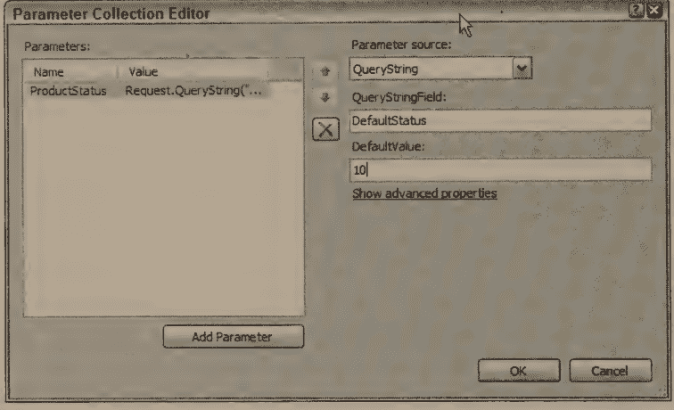

保存“参数编辑器”对话框后，标记揭示已持久化默认值参数：

```xml
<DefaultValueParameters>
    <asp:QueryStringParameter DefaultValue="10" Name="ProductStatus"
        QueryStringField="DefaultStatus" />
</DefaultValueParameters>
```

正如上面的示例所示，我们已声明式地指定了一个或多个希望使用的默认值参数。我们还利用现有的控件编辑器，为默认值参数化提供了功能完备的设计时体验。此外，我们能够指定任何已有的参数类，也可能指定制建的自定义类。

下一步是挂钩 `Inserting` 事件，以获取我们新建的默认值集合中的值，并将其设置到传递给 `Inserting` 处理器的对象上。为此，我们将再次修改并向 `MVPHacksObjectDataSource` 控件添加功能，以在构造函数期间注册该处理器。以下代码示例负责注册我们的处理器，这应插入到我们 `MVPHacksObjectDataSource` 的构造函数中：

```csharp
public MVPHacksObjectDataSource()
{
    this.Inserting +=
        new ObjectDataSourceMethodEventHandler(MVPHacksObjectDataSource_Inserting);
}
```

现在，既然已注册事件处理器，我们需要实现该处理器。该处理器将负责从 `DefaultValueParameters` 集合获取值，然后将这些值应用到即将插入的对象上。

`ParameterCollection` 类提供了 `GetValues` 方法供我们调用，它将强制集合中的子参数控件获取其值，并以 `IOrderedDictionary` 类型返回。

我们调用 `GetValues` 后返回的 `IOrderedDictionary` 将包含一个 `DictionaryEntry` 对象，对应于 `DefaultValuesParameters` 集合中的每个参数。`DictionaryEntry` 对象的 `Key` 属性代表参数的名称，将使用它来查找并设置即将插入的数据对象上的值。

由于这部分是工具代码，而且您不知道即将插入的对象类型是什么，因此将使用反射来获取对属性的引用并设置其值。利用您获取到的对 `dataObj` 的引用，您可以调用 `GetType` 方法获取标识我们正在处理的对象类型的 `Type` 对象。`Type` 对象提供了 `GetProperty` 方法的访问权限。当传入如 `ProductStatus` 这样的属性名称时，该方法将返回一个 `PropertyInfo` 对象，其中包含针对 `dataObj` 执行反射操作所获得的信息。如果您能获取到类的 `PropertyInfo` 对象引用，则可以调用 `SetValue` 方法设置默认值。当调用 `SetValue` 方法时，您传递的是 `DictionaryEntry` 的 `Value` 属性，该属性代表当方法早期调用 `GetValues` 时 `DefaultParameterCollection` 返回的值。以下代码示例实现了获取值并将其设置到即将插入的数据对象的属性上的过程：

```csharp
void MVPHacksObjectDataSource_Inserting(object sender,
                                      ObjectDataSourceMethodEventArgs e)
{
    IOrderedDictionary defaultValues =
        this.DefaultValueParameters.GetValues(HttpContext.Current, this);

    object dataObj = e.InputParameters[0];

    foreach (DictionaryEntry defaultValue in defaultValues)
    {
        PropertyInfo propInfo =
            dataObj.GetType().GetProperty(defaultValue.Key.ToString());

        if (propInfo != null)
        {
            propInfo.SetValue(dataObj, defaultValue.Value, null);
        }
    }
}
```

## 第 8 章

实现总线事件处理器后，您现已完成了实现一种通用方式来声明式处理默认值设置所需的所有内容。与内置控件可以使用的方法不同，此方法可与任何数据类型一起使用，而无需在每次使用控件时编写特定代码。

### 扩展 XMLDataSource 以调用您的对象

`XMLDataSource` 旨在检索并向数据绑定控件提供 XML 数据。与继承自 `DataSourceControl` 的 `ObjectDataSource` 和 `SQLDataSource` 不同，`XMLDataSource` 继承自 `HierarchicalDataSourceControl`，并专为处理层次化数据而设计。为了确保其也能处理表格式数据，它还实现了 `IDataSource` 接口。

通过实现 `IDataSource` 接口，`XMLDataSource` 控件提供了 `GetView` 和 `GetViewNames` 方法，使其能够运行在沙箱中，并像 `SQLDataSource` 和 `ObjectDataSource` 控件一样使用。

您可能需要注意的另一处差异是，默认情况下，由于 `XMLDataSource` 通常处理只读数据，因此默认会打开缓存。这在我们要讨论的本章增强功能中尤其成问题，因为这些功能旨在迫使 `XMLDataSource` 根据传递的特定参数获取新数据。

您可能想要做的另一件事是利用业务对象来检索 XML。内置的 `XMLDataSource` 使您可以从文件检索数据，或通过对象上的属性设置数据。它不支持调用对象来获取数据这一概念。通过扩展内置的 `XMLDataSource`，我们将添加对结合 `ObjectDataSource` 调用业务对象部分能力的支持，同时使数据绑定控件仍能与 `XMLDataSource` 交互的能力。

此增强的另一个方面是提供参数的功能，这些参数传递到选择方法并用于过滤返回的数据。在此提出的实现方案中，我们将利用此功能传递给业务对象；然而，同样的概念也可添加，用于支持基于参数值对 XML 进行 XPath 过滤。

以下示例展示了 `MVPHacksXMLObjectDataSource` 继承自 `XMLDataSource`，并实现了 `ObjectDataSource` 和 `XMLDataSource` 的组合：

```csharp
using System;
using System.Reflection;
using System.Drawing.Design;
using System.ComponentModel;
using System.Collections;
using System.Collections.Specialized;
using System.Data;
using System.Configuration;
using System.Web;
using System.Web.Security;
using System.Web.UI;
using System.Web.UI.WebControls;
using System.Web.UI.WebControls.WebParts;
using System.Web.UI.HtmlControls;

namespace MVPHacks.Common.DataBinding
```


 ```csharp
{
    /// <summary>
    /// Summary description for MVPHacksXmlObjectDataSource
    /// </summary>
    public class MVPHacksXMLObjectDataSource : XmlDataSource
    {
        public override string Data
        {
            get
            {
                return GetData();
            }
            set
            {
                base.Data = value;
            }
        }

        private string GetData()
        {
            IOrderedDictionary defaultValues =
            this.SelectParameters.GetValues(HttpContext.Current, this);

            Object[] parms = new object[defaultValues.Count];

            int parmIndex = 0;
            foreach (DictionaryEntry defaultValue in defaultValues)
            {
                parms[parmIndex] = defaultValue.Value;
                parmIndex++;
            }

            Type type = Type.GetType(m_TypeName);
            object objType = Activator.CreateInstance(type);
            MethodInfo method = type.GetMethod(m_SelectMethodName);
            object outputData = method.Invoke(objType, parms);

            return outputData.ToString();
        }

        private string m_TypeName;

        public string TypeName
        {
            get { return m_TypeName; }
            set { m_TypeName = value; }
        }

        private string m_SelectMethodName;

        public string SelectedMethodName
        {
            get { return m_SelectMethodName; }
            set { m_SelectMethodName = value; }
        }

        private ParameterCollection m_SelectParameters;

        /// <summary>
        ///
        /// </summary>
        [MergableProperty(false),
        PersistenceMode(PersistenceMode.InnerProperty), DefaultValue((string)null),
        Editor("System.Web.UI.Design.WebControls.ParameterCollectionEditor,
        System.Design, Version=2.0.0.0, Culture=neutral, PublicKeyToken=b03f5f7f11d50a3a",
        typeof(UITypeEditor))]

        public ParameterCollection SelectParameters
        {
            get
            {
                if (m_SelectParameters == null)
                    m_SelectParameters = new ParameterCollection();
                return m_SelectParameters;
            }

        }

    }

}
```

通过继承自 XMLDataSource，该控件对其他控件而言就像绑定到了一个 XMLDataSource 一样。这使其具备了诸如对 XML 数据使用 XPath 表达式、缓存等功能。为了控制从何处检索数据，Data 属性被重写，并调用 GetData 来促进从业务对象获取数据。

添加了 TypeName 和 SelectMethod 参数，以允许指定应调用哪个业务对象来获取 XML。为了一致性，这些参数是仿照 ObjectDataSource 建模的。

遵循手册中的策略，我们再次利用 ParameterCollection 和相关的设计时编辑器，为类添加一个 SelectParameters 集合。此属性允许使用所有正常的内置 DataSource 参数以及我们构建的参数来收集将传递给业务对象的参数值。

最后，一旦收集到 SelectParameters 的值，就使用反射来实例化类型并调用指定的查询方法。

通过这种方法，我们将从业务对象检索 XML 数据的能力扩展到 XMLDataSource，包括从 Web 服务或其他供应商提供的接口检索数据的能力。通过使用 select 参数扩展功能，我们还允许使用页面上的有价值信息、通过查询字符串传递的信息或通过自定义参数获取的信息，来指导调用的业务对象应该检索哪些 XML 数据。

## 使用自定义参数

在本章的这一部分，你已经看到了 DataSource 控件如何被扩展和增强，以使它们更易于使用，并提供减少数据绑定所需编程工作量的方法。

DataSource 控件提供的灵活设计提供了许多超出本章记录范围的机会。

DataSource 控件概念的一个特性是，你可以使用一个或多个内置参数来确定数据来自何处，用于 Select、Delete 或任何其他 DataSource 方法。使用参数，你能够检索信息并将其传递过去，用于 SQLDataSource 的查询中，或作为方法调用的参数（如果使用 ObjectDataSource）。

ASP.NET 内置了许多参数控件，如下表所述。

| 参数类型 | 说明 |
|---|---|
| Parameter | 通用基类，可用于提供指定的默认值，而不是从查询字符串或其他控件等其他来源检索。在构建自定义参数时也用作基类，如本章后面所示。 |
| ControlParameter | 提供了一种简单的方法，通过指定控件 ID 和要获取的控件属性，从页面上的控件获取参数。 |
| CookieParameter | 允许从客户端在请求中发送的 cookie 中提取值。 |
| SessionParameter | 提供从用户会话中检索参数值。 |
| ProfileParameter | 允许从用户配置文件中检索参数值。 |
| QueryStringParameter | 允许从与请求一起传递的 HTTP 查询字符串中检索。 |
| FormParameter | 允许从发布的表单数据或 Request 对象的其他属性中检索。例如，这可以从隐藏字段中提取值。 |

前面的列表清楚地表明了在 DataSource 控件中使用参数所能获得的能力。在本章的这部分，我们将探讨扩展这些内置参数的方法，以及开发可以像前面列表中的参数一样使用的自定义参数。请记住，所讨论的技术可以在使用参数的任何地方使用——例如，无论使用的是 SQLDataSource 还是 ObjectDataSource。

## 扩展 QueryStringParameter

开始使用自定义参数的最简单方法之一是扩展或继承 ASP.NET 中内置的参数。通过继承内置参数，你可以从所有已存在的功能开始，只需添加你的额外功能。在第一个示例中，你扩展 QueryStringParameter 以添加验证。假设页面上有一个 DataSource，它接受 ProductID 作为参数，表示结果应该按 ProductID 过滤。为了讨论，假设 ProductID 是一个数值。想象一下，如果你向页面传递了一个字符值而不是数值，可能会发生什么。

以下显示了在 SelectParameters 中使用 IssueID 并指定其为 System.Int32 类型的 SQLDataSource 控件示例：

```
<asp:SqlDataSource ID="SqlDataSource1" runat="server"
    ConnectionString="<%$ ConnectionStrings:MVPConnectionString1 %>"
    ProviderName="<%$ ConnectionStrings:MVPConnectionString1.ProviderName %>"
    SelectCommand="SELECT [IssueID], [IssueTitle] FROM [Issue] where issueID=@issueID" >
    <SelectParameters>
        <asp:QueryStringParameter DefaultValue="0" Name="issueID" QueryStringField="IssueID" />
    </SelectParameters>
</asp:SqlDataSource>
```

在示例定义下，如果以下值通过查询字符串传递给页面，则会发生错误：

```
Default.aspx? IssueID=AA
```

以下显示了由于传递了无效的字符数据而发生的错误：

```
Exception Details: System.Data.SqlClient.SqlException: Syntax error converting the nvarchar value 'AA' to a column of data type int.
```

防止这种情况发生的一种简单方法是捕获 SqlDataSource 控件上的 Selecting 事件并取消查询，如下例所示：

```
protected void SqlDataSource1_Selecting(object sender,
    SqlDataSourceSelectingEventArgs e)
{
    try
    {
        int issueID = int.Parse(e.Command.Parameters["@IssueID"].Value.ToString());
    }
    catch
    {
        e.Cancel = true;
        return;
    }
}
```


Another option would be to have specified the Type attribute on the QueryStringParameter. The following is an example that adds the Type attribute:

```xml
<asp:QueryStringParameter DefaultValue="0" Name="issueID"
    QueryStringField="IssueID" Type="int32" />
```

Doing that just allows the error to happen during the GetValue call to the Parameter, but it still bubbles up as an exception to the page. The following error occurs when this is added:

**异常详情：** System.FormatException: Input string was not in a correct format.

另一种选择可能是创建我们自己的 QueryStringParameter，在数据无效时直接返回 DefaultValue。在清单 8-1 中，该类继承自 QueryStringParameter，并添加了一个 ValidationExpression 属性。此属性指定一个正则表达式，该表达式将在 QueryStringParameter 从查询字符串收集的数据上运行，如果无效，则返回 DefaultValue。

## 清单 8-1：MVPHacksQueryStringParameter.cs

```csharp
namespace MVPHacks.Common.WebControls
{
    /// <summary>
    /// Summary description for MVPHacksQueryStringParameter
    /// </summary>
    public class MVPHacksQueryStringParameter :
        System.Web.UI.WebControls.QueryStringParameter
    {
        protected override object Evaluate(HttpContext context, Control control)
        {
            object dataValue = base.Evaluate(context, control);

            if ((dataValue != null) && (this.ValidationExpression.Length > 0))
                if (!Regex.IsMatch(dataValue.ToString(), m_ValidationExpression))
                    return DefaultValue;

            return dataValue;
        }

        private string m_ValidationExpression = "";

        public string ValidationExpression
        {
            get { return m_ValidationExpression; }
            set { m_ValidationExpression = value; }
        }
    }
}
```

## 第 8 章

要在页面上使用此功能，必须首先在页面上注册该控件。以下代码展示了如何实现：

```aspx
<%@ Register Namespace="MVPHacks.Common.WebControls" TagPrefix="cc1" %>
```

接下来，修改 SqlDataSource 以使用 MVPHacksQueryStringParameter 而非内置的 QueryStringParameter。以下示例展示了这一点，以及指定 ValidationExpression 以将其限制为从 0 到 9 的所有数字：

```xml
<asp:SqlDataSource ID="SqlDataSource1" runat="server"
    ConnectionString="<%$ ConnectionStrings:MVPHacksConnectionString1 %>"
    ProviderName="<%$ ConnectionStrings:MVPHacksConnectionString1.ProviderName %>"
    SelectCommand="SELECT [IssueID], [IssueTitle] FROM [Issue] where issueID=@issueID">
    <SelectParameters>
        <cc1:MVPHacksQueryStringParameter DefaultValue="0" Name="issueID"
            QueryStringField="IssueID" Type="int32"
            ValidationExpression="[0-9]" />
    </SelectParameters>
</asp:SqlDataSource>
```

现在，当你运行页面并传递无效数据时，它只会表明未找到任何记录，因为存档中不存在使用你的默认值的记录。我们还可以做其他几个有创意的事情，但这是一个很好的开端示例，展示了如何利用内置的参数控件进行继承并创建自己的控件以获得额外的价值。还要记住，参数控件适用于所有 DataSource 控件，例如 ObjectDataSource。在此示例中，我们选择了 SqlDataSource 来展示该示例同样适用于其他控件。在本节的其余部分，我们将继续探讨其他可以通过继承基参数控件来构建的创造性自定义参数。

## 构建用于获取日期的自定义参数

你将构建的第一个自定义参数是处理获取自定义日期的参数。此控件可能用于选择类型的查询中，例如，你需要传递一个起始日期，并希望将其配置为从查询执行日期之前三天提取数据。

构建自定义控件的第一步是创建一个继承自 System.Web.UI.WebControls.Parameter 的类。另外要做的事情是重写 Evaluate 方法并提供我们自己的实现。在此示例中，将重写 Evaluate 方法，并基于 DayOffset 中提供的日期进行偏移计算来执行日期计算。

```csharp
using System;
using System.Collections.Generic;
using System.Text;
using System.Web.UI;

namespace MVPHacks.Common.DataBinding
{
    public class MVPHacksGetDateParameter: System.Web.UI.WebControls.Parameter
    {
        /// <summary>
        /// calculate the number of days using DaysOffset and return it
        /// </summary>
        /// <param name="context"></param>
        /// <param name="control"></param>
        /// <returns></returns>
        protected override object Evaluate(System.Web.HttpContext context,
                                                Control control)
        {
            return DateTime.Now.AddDays(this.DaysOffset);
        }

        /// <summary>
        /// Number of days to offset
        /// </summary>
        public double DaysOffset
        {
            get
            {
                if (ViewState["DaysOffset"] == null)
                    return 0;

                return (double)ViewState["DaysOffset"];
            }
            set
            {
                ViewState["DaysOffset"] = value;
            }
        }
    }
}
```

如你所见，构建自定义参数不需要大量代码。要在页面上使用此控件，必须像声明任何其他构建的自定义控件一样声明它。以下是使用页面上的 Register 标签的示例：

```aspx
<%@ Register Assembly="MVPHacks.Common" Namespace="MVPHacks.Common.DataBinding"
    TagPrefix="MVPHacksDB" %>
```

ASP.NET 2.0 引入了一种可以在 web.config 文件中完成相同任务的新方法。使用 web.config 方法非常适合我们本章讨论的控件，因为它允许它们仅通过放置在 web.config 中就可以在所有页面中使用。以下示例展示了它在 web.config 文件中的样子：

```xml
<configuration>
    <system.web>
        <pages>
            <controls>
                <add tagPrefix="MVPHacksDB" namespace="MVPHacks.Common.DataBinding"
                     assembly="MVPHacks.Common" />
            </controls>
        </pages>
    </system.web>
</configuration>
```

下一个示例展示了将添加到 Web 窗体的标记，以使用具有 SQLDataSource 的自定义日期参数：

```xml
<asp:SqlDataSource ID="SqlDataSource1" runat="server"
    ConnectionString="<%$ ConnectionStrings:NorthWndConnectionString1 %>"
    ProviderName="<%$ ConnectionStrings:NorthWndConnectionString1.ProviderName %>"
    SelectCommand="SELECT [RemoteAddress], [DateAccessed] FROM [AccessHistory] 
                   where DateAccessed>@MinDate">
    <SelectParameters>
        <MVPHacksDB:MVPHacksGetDateParameter Name="MinDate" DaysOffset="-90" />
    </SelectParameters>
</asp:SqlDataSource>
```

在前面的标记中，使用了 `MVPHacksGetDateParameter`，并且 `DaysOffset` 设置为传递 -90。当此操作运行且 `DataSource` 从参数集合请求值时，最终将调用 `Evaluate` 方法，并使用 `DaysOffset` 计算并返回我们的日期。我们尽量保持此示例简单，但显然可以扩展此控件以执行诸如强制时间值或提供其他有意义的日期相关计算等操作。此外，请记住，你可以在参数集合中放置两个此类控件，并将它们用作查询的开始/结束日期。

此特定控件的另一个使用示例是填充对象上的创建日期和修改日期信息，或作为插入/更新查询的参数。具体而言，使用本章前面针对 `ObjectDataSource` 描述的增强功能（允许使用 `DefaultValuesCollection`），你可以将这些值添加到该集合中，以便在创建之前将其设置到对象上。

## 使用反射构建自定义参数

我们将构建的下一个自定义参数旨在使用反射从对象（可能是页面上的属性）获取值。页面根据它检索到的其他数据执行计算并希望将其公开为属性或方法，供参数使用并使其可用于 DataSource 控件，这是非常常见的。

以下代码实现了 `MVPHacksReflectionParameter`：

```csharp
using System;
using System.Reflection;
using System.Data;
using System.Configuration;
using System.Web;
using System.Web.Security;
using System.Web.UI;
using System.Web.UI.WebControls;
using System.Web.UI.WebControls.WebParts;
using System.Web.UI.HtmlControls;

namespace MVPHacks.Common.DataBinding
{
    /// <summary>
    /// Custom Parameter for using with DataSource Control that allows
    /// pulling value from a property on the Page via Reflection
    /// </summary>
    public class MVPHacksReflectionParameter : System.Web.UI.WebControls.Parameter
```


```csharp
    /// <summary>
    /// 求值重写
    /// </summary>
    /// <param name="context"></param>
    /// <param name="control"></param>
    /// <returns></returns>
    protected override object Evaluate(HttpContext context, Control control)
    {
        //获取页面的类型
        Type pageType = control.Page.GetType();

        if (this.UseContainer)
            pageType = control.Parent.GetType();

        //获取指定属性的属性信息
        PropertyInfo propInfo = pageType.GetProperty(this.PropertyName,
                    BindingFlags.Public | BindingFlags.NonPublic |
                    BindingFlags.Instance);

        //如果未找到，则直接返回
        if (propInfo == null)
            throw new ArgumentException("No Property Found for " +
               this.PropertyName);

        if (!this.UseContainer)
        {
            //返回属性的值
            return propInfo.GetValue(control.Page, null);
        }
        else
        {
            return propInfo.GetValue(control.Parent, null);
        }

    }

    private string m_PropertyName;

    /// <summary>
    /// 要从中获取值的属性名称
    /// </summary>
    public string PropertyName
    {
        get { return m_PropertyName; }
        set { m_PropertyName = value; }
    }

    private bool m_UseContainer;

    /// <summary>
    /// 使用容器而非页面来获取值
    /// </summary>
    public bool UseContainer
    {
        get { return m_UseContainer; }
        set { m_UseContainer = value; }
    }
```

## 第 8 章

`MVPHacksReflectionParameter` 的使用方式与您之前的自定义控件相同。`PropertyName` 指定了要公开的属性的名称。默认情况下，控件被设置为使用页面来访问属性。在某些情况下，您可能希望在不同的容器或子容器（如用户控件）中使用它。在一个常见场景中，页面控件会在一个或多个用户控件上设置并控制某些参数。例如，页面可能会在用户控件上设置 `ProductID`。在用户控件中，假设您希望使用一个详细视图来检索有关该特定产品 ID 的数据。在这种情况下，您可以手动让用户控件检索数据，也可以使用您的反射参数，并将 `UseContainer` 属性设置为 `true`，表示您希望使用用户控件而不是页面来查找该属性。

这个自定义参数也可以轻松扩展，以允许指定 `MethodName` 和 `Type` 字符串，并提供调用方法以检索参数值的支持。更进一步，它还可以检测该方法是静态的（在 VB.NET 中是 `shared`）还是需要实例化方法的实例方法。这为如何检索参数值引入了一些有趣的可能性。

## 从另一个数据源获取值

下一个自定义参数获取其值的方式更具创造性。想象一下，传入了一个 `PersonID`，并且页面上有一个 `ObjectDataSource` 控件，该控件将使用该 ID 作为参数来检索关于此人的信息，这个 `ObjectDataSource` 控件指向您的一个业务对象。在页面的其他地方，您想要显示该人的地址信息。由第一个 `ObjectDataSource` 控件返回的 `Person` 对象上有一个 `AddressID` 属性，该属性可用于检索该人的地址对象。使用内置功能存在的挑战是显而易见的：如果要使用第二个数据源控件来检索地址并可能将其绑定到页面上不同区域中的不同 `FormsView`，它如何获取 `AddressID` 来检索正确的地址？真的没有简单的声明式方法来做到这一点，因此我们将尝试利用检索 `Person` 对象的 `ObjectDataSource` 来帮助我们在单独的 `ObjectDataSource` 控件中获取地址。

解决这个问题的方法有很多，但既然我们在讨论自定义参数，让我们看看一种使用自定义参数来处理此场景的方法：

```csharp
using System;
using System.Reflection;
using System.Data;
using System.Configuration;
using System.Web;
using System.Web.Security;
using System.Web.UI;
using System.Web.UI.WebControls;
using System.Web.UI.WebControls.WebParts;
using System.Web.UI.HtmlControls;
using System.Collections;

namespace MVPHacks.Common.DataBinding
{

    /// <summary>
    ///
    /// </summary>
    public class MVPHacksDataSourceParameter : System.Web.UI.WebControls.Parameter
    {

        /// <summary>
        /// 求值并返回值
        /// </summary>
        /// <param name="context"></param>
        /// <param name="control"></param>
        /// <returns></returns>
        protected override object Evaluate(HttpContext context, Control control)
        {
            IDataSource source1 = null;
            if (this.DataSourceID.Length != 0)
            {
                Control control1 =
                    MVPHacksDataSourceControlHelper.FindControl(control, this.DataSourceID);
                if (control1 == null)
                    return null;

                source1 = control1 as IDataSource;
                if (source1 == null)
                    return null;
            }

            DataSourceView dsView = source1.GetView(this.DataMember);

            ObjectDataSourceView objDSV = dsView as ObjectDataSourceView;
            SqlDataSourceView sqlDSV = dsView as SqlDataSourceView;

            IEnumerable ienumView = null;

            if (sqlDSV != null)
                ienumView = sqlDSV.Select(DataSourceSelectArguments.Empty);

            if (objDSV != null)
                ienumView = objDSV.Select(DataSourceSelectArguments.Empty);

            IEnumerator ien = ienumView.GetEnumerator();
```

## 第 8 章

```csharp
ien.MoveNext();

return DataBinder.GetPropertyValue(ien.Current, this.DataColumn);

}

private string m_DataSourceID = "";

/// <summary>
/// 要使用的 DataSourceID
/// </summary>
[IDReferenceProperty(typeof(DataSourceControl))]
public string DataSourceID
{
    get
    {
        return m_DataSourceID;
    }
    set
    {
        m_DataSourceID = value;
    }
}

private string m_DataMember = "";

/// <summary>
/// 在目标中要使用的 DataMember
/// </summary>
public string DataMember
{
    get
    {
        return m_DataMember;
    }
    set
    {
        m_DataMember = value;
    }
}

private string m_DataColumn = "";

/// <summary>
/// 要使用的数据列
/// </summary>
public string DataColumn
{
    get
    {
        return m_DataColumn;
    }
    set
    {
        m_DataColumn = value;
    }
}
}
```

## 极致数据绑定

如果您仔细查看上一个示例中的 `Evaluate` 函数，它执行的第一件事是找到将作为值检索目标的数据源控件。目标数据源通过我们自定义参数上的 `DataSourceID` 属性指定。请注意，`[IDReferenceProperty(typeof(DataSourceControl))]` 属性被指定在 `DataSourceID` 属性上。使用此属性可以轻松确定此属性应该引用哪个控件。使用 `DataSourceID`，您现在需要找到并获取对 Web 窗体上控件的引用。

数据源控件现在使用 `IDataSource` 接口进行引用，因为您不关心正在处理的是哪种类型的数据源控件。使用该引用，您可以调用 `GetView` 属性以获取控件的 `DataSourceView` 对象以及指定的 `DataMember`。以下示例代码显示了该调用：

```csharp
DataSourceView dsView = source1.GetView(this.DataMember);
```

返回的 `DataSourceView` 是特定于所使用的数据源控件的。例如，`ObjectDataSource` 将返回一个 `ObjectDataSourceView`。以下代码片段显示了将 `dsView` 转换为 SQL 和对象视图：

```csharp
ObjectDataSourceView objDSV = dsView as ObjectDataSourceView;
SqlDataSourceView sqlDSV = dsView as SqlDataSourceView;
```

由于前面示例代码中的转换方式，如果类型不匹配，则会将其值设置为 `null`。

下一个任务是获取当前视图的 `IEnumerable` 接口。以下示例通过检查两个视图以确定哪个处于活动状态，并在相应的对象上调用 select 方法来完成此操作：

```csharp
IEnumerable ienumView = null;

if (sqlDSV != null)
    ienumView = sqlDSV.Select(DataSourceSelectArguments.Empty);

if (objDSV != null)
    ienumView = objDSV.Select(DataSourceSelectArguments.Empty);
```

如果您使用 `IEnumerable` 引用，接下来要做的是将其前进到集合中的第一项。以下示例代码处理该操作：

```csharp
IEnumerator ien = ienumView.GetEnumerator();
ien.MoveNext();
```

现在第一行已处于活动状态，就可以检索值并返回它了。以下示例代码利用 `DataBinder` 来访问属性并返回它：


## 第8章

```csharp
return DataBinder.GetPropertyValue(ien.Current, this.DataColumn);
```

显然，在处理此类操作时，可以采取更多措施来应对可能出现的错误和其他情况。此外，可能有更高效的方法可以用来完成相同的任务。本练习的重点在于演示如何与页面上的其他 `DataSource` 控件交互并利用它们的数据。

在本章的这一节中，我们探讨了构建自定义参数控件是如此简单，这些控件可与 `DataSource` 控件结合使用。这些自定义参数可以扩展 `DataSource` 控件上各种参数集合的功能，或者提供全新的能力。

## 使用自定义字段

本章大部分时间都用于介绍如何使用 `DataSource` 控件获取数据。虽然这是数据绑定的重要组成部分，但在请求者的浏览器上呈现页面时，实际显示数据的控件也同样重要。

在本章剩余部分，我们将探讨一些技术，以使某些可视化控件的使用更加便捷。具体来说，我们将重点关注 `Field` 控件，这是 `DetailsView` 和 `GridView` 控件的关键组成部分。

`DetailsView` 和 `GridView` 控件对于 ASP.NET 控件套件来说都是新增的。`GridView` 接过了 `DataGrid` 控件留下的工作，为开发人员提供了对常见任务更丰富的支持，例如排序、编辑和选择网格中的行以进行进一步操作。添加 `DetailsView` 是为了填补一个空白，即提供一种标签/值编辑体验，这对于应用程序所需的许多简单管理风格编辑表单来说非常理想。

这两个控件的一个关键共同特点是，它们都依赖于另一组控件，这些控件都是 `Field` 类。这些类定义了渲染以及操作数据的能力。通过使用控件的模式（如 Insert、Edit 或 View），它们能够将输出呈现到浏览器。例如，在 View 模式下，呈现的是一个包含数据的标签，并且不允许进行任何修改；而在 Insert 或 Edit 模式下，同一个 `BoundField` 会呈现一个文本框，允许用户修改数据。

下表描述了支持的内置字段类型。

| 字段类型 | 描述 |
| :--- | :--- |
| BoundField | 显示数据源中字段的文本 |
| ButtonField | 显示为按钮、图像或链接 |
| CheckBoxField | 用于布尔类型字段，显示一个复选框 |
| CommandField | 用于在 `GridView` 控件中提供选择、编辑和删除支持 |
| HyperLinkField | 显示为一个简单的超链接 |
| ImageField | 用于显示图像 |
| TemplateField | 使用 HTML 模板进行自定义布局 |

## 极限数据绑定

这些 `Field` 控件、`DetailsView` 和 `GridView`，与 `DataSource` 控件相结合，提供了真正的双向数据绑定能力，消除了应用程序开发人员为控件所处的不同模式实现特定视图的需要。

当你开始使用新的 UI 控件及相关的 `DataSource` 控件时，一些缺点会很快显现出来。例如，当 `DetailsView` 与处于 Insert 模式的 `DataSource` 控件结合使用时，处理必填字段需要额外的工作。默认情况下，当 `DetailsView` 被添加到页面并绑定到 `DataSource` 时，配置向导会从 `DataSource` 控件的目标推断列。例如，如果指向本章前面创建的 `Product` 对象，它将为每个公共属性创建一个绑定字段，如以下示例所示：

```html
<asp:DetailsView ID="DetailsView1" runat="server" AutoGenerateRows="False"
    DataSourceID="ProductEditODS1" Height="50px" Width="125px">
    <Fields>
        <asp:BoundField DataField="ProductID" HeaderText="ProductID"
            SortExpression="ProductID" />
        <asp:BoundField DataField="Name" HeaderText="Name"
            SortExpression="Name" />
        <asp:BoundField DataField="ProductStatus"
            HeaderText="ProductStatus"
            SortExpression="ProductStatus" />
    </Fields>
</asp:DetailsView>
```

如果我们使用前面示例中的标记，`DetailsView` 将为每个绑定字段呈现一个文本框，允许输入数据。如果每个字段都是必填的，但没有内置支持来为表单添加验证。不做任何其他更改的情况下，用户只需点击“添加”按钮，就会将空值或空字段传递给 `DataSource` 控件，并最终传递给关联的查询或业务对象。如果目标数据存储库要求必须提供这些字段，很可能会发生错误，而这种错误不会被视为典型的验证错误进行处理，更像是一种灾难性的应用程序异常。

通过使用 ASP.NET 提供的内置支持，可以使用验证控件来避免这种情况。具体来说，`RequiredFieldValidator` 控件传统上就用于此任务，它不允许在控件中未输入任何值的情况下提交或回发表单。在 `DetailsView` 或 `GridView` 字段中使用验证控件的最常见技术是将字段转换为模板字段。下一个示例展示了将 `Name` 字段转换为模板字段后的标记是什么样子。当你从“编辑字段”向导中选择一个字段时，会有一个“转换为模板”选项。使用该选项会转换以下行：

```html
<asp:BoundField DataField="Name" HeaderText="Name"
    SortExpression="Name" />
```

将其转换为模板字段后，标记将如下所示：

```html
<asp:TemplateField HeaderText="Name" SortExpression="Name">
    <EditItemTemplate>
        <asp:TextBox ID="TextBox1" runat="server" Text='<%#
        Bind("Name") %>'></asp:TextBox>
    </EditItemTemplate>
    <InsertItemTemplate>
        <asp:TextBox ID="TextBox1" runat="server" Text='<%#
        Bind("Name") %>'></asp:TextBox>
    </InsertItemTemplate>
    <ItemTemplate>
        <asp:Label ID="Label1" runat="server" Text='<%#
        Bind("Name") %>'></asp:Label>
    </ItemTemplate>
</asp:TemplateField>
```

通过将其转换为 `TemplateField` 而不是 `BoundField`，你可以完全控制在各种模式下呈现给客户端的内容。这使你可以轻松地将必填字段验证器添加到编辑和插入模板中，以确保始终提供名称。转换几个字段、几页内容并完成所有额外工作后，很明显需要一种更简洁的方法来处理这个常见问题。以下标记显示了添加 `RequiredFieldValidator` 控件后的模板：

```html
<InsertItemTemplate>
    <asp:TextBox ID="TextBox1" runat="server" Text='<%#
    Bind("Name") %>'></asp:TextBox>
    <asp:RequiredFieldValidator ID="RequiredFieldValidator1"
        runat="server" ControlToValidate="TextBox1"
        ErrorMessage="Field is Required"></asp:RequiredFieldValidator>
</InsertItemTemplate>
```

想象一下，如果你必须为每个必填字段都这样做。当你考虑更实际的应用程序验证时，情况会变得更糟，因为除了必填字段外，你很可能还需要使用范围验证器或正则表达式验证器。

如果你能直接在 `BoundField` 上点击一个属性，将该字段标记为必填，岂不是更容易？我们的下一个示例将要实现的就是这一点。通过继承自 `BoundField`，我们获得了它所具有的所有相同能力，包括在视图模式下自动呈现标签，在插入/编辑模式下自动呈现文本框。

构建 `MVPacksBoundField` 的第一步是继承自内置的 `BoundField` 类：

```csharp
public class MVPacksBoundField : System.Web.UI.WebControls.BoundField
```

接下来，你添加一个 `RequiredField` 属性；该属性将指示该字段是必填的，并且控件应将验证器注入到渲染输出中：

```csharp
/// <summary>
///   Require Validation
/// </summary>
public bool RequiredField
{
    get
    {
        if (ViewState["RequiredField"] == null)
            return false;

        return (bool)ViewState["RequiredField"];
    }
    set
    {
```

## 极致数据绑定

```
ViewState["RequiredField"] = value;
}
}
```

现在，如果`RequiredField`属性为`true`，你必须找到合适的位置将验证器注入到控件集合中。通过重写`InitializeDataCell`方法，当设置`RequiredField`属性时，可以将一个`RequiredFieldValidator`控件注入到单元格的控件集合中，如以下示例所示：

```
protected override void InitializeDataCell(DataControlFieldCell cell,
DataControlRowState rowState)
{
    base.InitializeDataCell(cell, rowState);

    if (this.RequiredField)
    {
        if (cell.Controls[0] is TextBox)
        {
            TextBox box = cell.Controls[0] as TextBox;
            box.ID = this.DataField;

        }
        RequiredFieldValidator reqField = new RequiredFieldValidator();
        reqField.ControlToValidate = this.DataField;
        reqField.Text = "*";
        reqField.ErrorMessage = this.HeaderText + " is required.";
        reqField.Display = ValidatorDisplay.Dynamic;
        cell.Controls.Add(reqField);

    }

}
```

现在，如果你回头查看使用我们新的`MVPHacksBoundField`控件的标记，所需的标记要少得多，如以下示例所示：

```
<MVPHacksDB:MVPHacksBoundField DataField="Name" HeaderText="ProductName"
RequiredField="true" SortExpression="Name" />
```

显然，要实现确保输入有效数据这一相同目标，所需的标记要少得多。虽然本例中只处理了`RequiredField`，但你可以看到，要添加一些额外的属性以支持正则表达式或其他类型的验证控件，根据字段内容适当地呈现，是多么容易。如果你不熟悉正则表达式，可以查看`RegularExpressionValidator`控件的工作原理，并像我们在本例中与`RequiredFieldValidator`集成的方式那样来集成它。

在我们研究可以对字段进行的增强功能时，让我们看看Windows窗体数据绑定中可用的一个功能。在Windows窗体应用程序中，如果你将一个对象绑定到窗体，而该对象的名称是`ProjectStatus`这样的形式，数据绑定引擎会为你提供帮助，并在页面上创建一个标签，显示"Project Status"。虽然这是一个小不便，但如果内置的`HeaderText`属性本身不包含空格，而是随后根据字段内容适当地插入空格，那就更好了。以下示例代码旨在增强我们的`MVPHacks BoundField`，以添加类似Windows窗体数据绑定所享有的支持：

```
public override string HeaderText
{
    get
    {
        if (base.HeaderText == null)
            return "";

        string newHeader = string.Empty;

        char[] headerChars = base.HeaderText.ToCharArray();

        foreach (char letter in headerChars)
        {
            if ((letter == char.ToUpper(letter)) && (newHeader.Length > 0))
                newHeader += " " + letter;
            else
                newHeader += letter;
        }

        return newHeader;
    }
    set
    {
        base.HeaderText = value;
    }
}
```

在前面的示例中，通过简单地重写`HeaderText`属性，我们获得了控制权，可以向用户返回一个更友好的名称。

使用从`BoundField`继承的类，我们演示了构建自定义字段是多么容易。`MVPHacksBoundField`减少了在`DetailsView`和`GridView`的实际使用中，为添加或编辑数据进行配置所需的标记量。

## 总结

本章介绍了几种扩展ASP.NET 2.0内置数据绑定功能的方法。ASP.NET 2.0的内置功能远超前一版本，并提供了扩展点，使开发人员能够扩展和增强内置功能，以满足实际应用的苛刻需求。

在本章中，你探索了扩展`DataSource`控件以促进一致性的方法，以及使用公共增强功能（如`ObjectDataSource`上的`DefaultValues`集合）。在本章的过程中，你构建了一些可重用的`DataSource`控件，可以在你的应用程序中使用。将它们作为起点，以寻找可以添加的额外通用功能来满足你自己的应用程序需求。通过使用特定于应用程序的数据源的概念，你可以减少页面间的冗余以及逐页配置相同选项的单调工作。使用本章描述的代码生成技术，结合其他通用技术，可以进一步减少你需要进行的自定义配置量，同时提供进一步的应用程序一致性改进。

使用能与`DataSource`控件配合工作并能将值传递给查询和方法的参数，大大减少了构建现实应用程序（而不仅仅是简单地选择表中的所有行）所需的自定义代码。本章演示了如何通过继承内置控件，构建适合正在构建的应用程序的自定义参数。以本章中的技巧为例，你可以构建超越此处描述的其他自定义参数。

使用新的UI控件（如`DetailsView`和`GridView`）及其关联的`Field`类，我们探索了如何构建健壮的应用程序，包括验证等功能，而不牺牲Visual Studio 2005提供的一些生产力提升。你不再需要将每一列都设为模板列来要求字段，这将大大简化表单的复杂性以及所需的定制工作。

最后，使用本章的所有技术，你应该清楚，你可以构建的不仅仅是那些从未打算在生产环境中运行的快速演示应用程序。ASP.NET的前一版本未能达到这一目标，将大部分繁重的工作交给了团队中的每个开发人员。在ASP.NET 2.0中，使用内置数据绑定功能所能实现的目标已经提升。通过将内置功能与本章讨论的技术以及你将通过创造性思维创建的技术相结合，现在可以构建使用数据绑定的真实应用程序。

### ViewState

 ViewState 最初旨在提供一种维护不透明状态块的方法，以便 ASP.NET 控件能够体验到真正的生命周期，并像传统的 Windows 控件一样接收事件。在页面框架的 ViewState 中存储少量状态的控件可以报告诸如"此 TextBox 已更改"之类的事件，这些事件以前很难模拟。就其功能而言，ViewState 做得很好。ViewState 是 ASP.NET 在 HTTP 上完成事件系统错觉的基础。

然而，如果你问开发人员他们最讨厌 ASP.NET 的哪个部分，他们很可能会说 ViewState。它臃肿、讨厌、令人困惑、不透明而且是个麻烦。本章不会争论这些观点，但旨在澄清一些事情。ViewState 在实现其功能方面表现良好，而且 ASP.NET 框架足够灵活，你通常可以修改 ViewState 的许多默认行为，以使其满足你的需求。

本章探讨了如何分割 ViewState、压缩它、将其压缩用于其他目的、在页面上移动它以及将其完全存储在页面之外。这些技巧中的每一个都应该提醒你，ASP.NET 是一个非常灵活的系统；如果你不喜欢某个东西，你通常有能力去改变它。让我们从深入了解 ViewState 的工作原理开始。

## ViewState：是恶魔还是像狐狸一样聪明？

ViewState 的字面意思是"维护视图的状态"。例如，考虑一个包含单个文本框和按钮的页面。TextBox 最初渲染时，文本框中预加载了值`foo`。如果最终用户输入了`bar`并提交了表单，ASP.NET 开发人员希望看到一个`TextChanged`事件被触发，通知他们这一更改。如果 ASP.NET 没有维护某种视图状态，它怎么知道 TextBox 中的文本发生了更改呢？


## 第9章

文本框和大多数其他Web控件实现了一个名为 `IPostBackDataHandler` 的接口，这表明它们有兴趣检查通过HTTP POST在表单提交期间发回的数据。在其 `IPostBackDataHandler.LoadPostData` 实现中，TextBox控件会将刚刚提交的数据与存储在 `ViewState` 中的数据进行比较，相应地更新其 `Text` 属性，并返回 true。页面会跟踪在此页面初始化阶段所有返回 true 的控件，并遍历这个已发布数据使用者的列表，引发它们的 `PostDataChangedEvent`，这反过来就以 `TextChanged` 事件的形式呈现给开发人员。

结果是，当TextBox的文本在两次提交之间发生变化时，你会收到一个事件，因为TextBox的先前状态已为你保存在一个“状态包”中，并通过一个名为 `__VIEWSTATE` 的隐藏表单字段随同传输。如果ASP.NET框架没有包含此功能，你就必须将先前的值存储在其他地方。ASP.NET使用一个不太为人所知的优化序列化器 `LosFormatter`，将 `ViewState` 状态包序列化为紧凑的二进制格式，然后进行Base64编码并渲染在隐藏表单字段中。

你需要了解ViewState在页面生命周期中的位置。请注意，还有许多不太重要的事件可用——在ASP.NET 2.0中甚至添加了更多——但这些是核心事件，最能代表页面生命周期中的主要事件。图9-1显示了页面初始加载时的生命周期，以及在PostBack过程中ViewState是如何参与的。

## LosFormatter：缺失的序列化器

对象是如何序列化成适合HTML的格式，从而可以通过隐藏表单字段输出的呢？你可能在代码中使用过 `XmlSerializer` 或 `BinaryFormatter` 来序列化对象，但这两者都不太适合。幸运的是，还有另一个较少为人所知的序列化器叫 `LosFormatter`，它负责将对象序列化成ViewState。MSDN在线帮助对这个神秘的LosFormatter有如下说明：

> “受限对象序列化 (LOS) 格式化器旨在实现高度紧凑的ASCII格式序列化。此类支持序列化任何对象图，但针对包含字符串、数组和哈希表的对象图进行了优化。它对许多.NET基本类型提供了二阶优化。”
>
> “这是一种私有格式，仅需要在Web请求的生命周期内保持一致。不允许你使用此格式化器序列化的对象持久保存任何显著的时间长度。”

LosFormatter填补了冗长的 `XmlSerializer` 和简洁的 `BinaryFormatter` 之间的空白。你可以将LosFormatter看作是针对包含非常简单类型的对象进行优化的BinaryFormatter“轻量版”。LosFormatter为你创建对象图的ASCII字符串表示形式，这也是一个很好的便利特性。

许多ASP.NET 1.x开发人员对ViewState感到沮丧，并在没有考虑后果的情况下禁用了它。许多需要某种ViewState的控件在ViewState被禁用时停止正常工作，这更让开发人员感到沮丧。ASP.NET 2.0引入了一种新的ViewState，称为ControlState。ControlState无法关闭，并为控件提供了一个放置对其操作绝对至关重要的微小状态数据的位置。然而，对于没有ControlState可用的ASP.NET 1.x开发人员，你可能希望直接使用LosFormatter，并在你自己的私有隐藏表单字段中各处存储一些状态。例如，清单9-1是一个小的辅助函数，它接受一个对象并将其序列化为字符串。

### 清单9-1：使用LosFormatter序列化对象

```
C#
string LosSerializeObject(object obj)
{
    System.Web.UI.LosFormatter los = new System.Web.UI.LosFormatter();
    StringWriter writer = new StringWriter();
    los.Serialize(writer, obj);
    return writer.ToString();
}

object RetrieveObjectFromViewState(string serializedObject)
{
    System.Web.UI.LosFormatter los = new System.Web.UI.LosFormatter();
    return los.Deserialize(serializedObject);
}
```

```
VB
Function LosSerializeObject(ByVal obj As Object) As String
    Dim los As System.Web.UI.LosFormatter = New System.Web.UI.LosFormatter
    Dim writer As StringWriter = New StringWriter
    los.Serialize(writer, obj)
    Return writer.ToString
End Function

Function RetrieveObjectFromViewState(ByVal serializedObject As String) As Object
    Dim los As System.Web.UI.LosFormatter = New System.Web.UI.LosFormatter
    Return los.Deserialize(serializedObject)
End Function
```

LosFormatter在Base64编码之前创建了一个格式有趣的字符串。例如，代码

```
aTw1Pg==
```

解码后看起来像这样：

```
i<5>
```

这表示一个值为5的整数。尽管使用了尖括号，但它不是XML——它只是一种编码模式。你可能认为Base64编码后使用更多字节很奇怪，但请记住Base64编码字符串末尾的“==”是标准后缀。此外，如果要编码的值更长，开销会更小。通常你不需要使用LosFormatter，但知道它在你的工具箱中可用是件好事。

按照以下代码将一个整数值以编程方式放入ViewState中。你将在页面加载时将此整数存储在ViewState中。ASP.NET子系统将在页面渲染时序列化ViewState中的所有内容。这意味着本例中的数字5将被序列化到 __VIEWSTATE 隐藏表单字段中。然后我们将使用一个检查工具来检查隐藏表单字段的内容，看看它包含了什么。

```
**C#**
private void Page_Load(object sender, System.EventArgs e)
{
    ViewState["example"] = 5;
}
```

```
**VB**
private void Page_Load(object sender, System.EventArgs e)
{
    ViewState["example"] = 5;
}
```

现在从 pluralsight.com/tools.aspx 下载 Fritz Onion 的 ViewState Decoder。运行你的页面，使用“查看源文件”，从隐藏的文本框中复制ViewState值，并用Fritz的工具进行解码。你也可以通过URL直接提取它。请注意图9-3中Fritz的解码器提供了一个树形显示，显示了名称“example”和值“5”。Paul Wilson也在 wilsondotnet.com/Demos/ViewState.aspx 创建了一个在线ViewState解码器。

## 操作ViewState

你已经了解了ViewState是如何序列化到单个表单字段中的。在本节中，你将学习如何将ViewState分割成多个较小的表单字段，以便你可以绕过那些不宽容的“智能”防火墙，甚至通过你最大的ViewState值。尽管ViewState存储在表单字段的公开位置，但其操作完全由ASP.NET的基础设施完成，你无需担心。然而，一些检查防火墙和代理服务器对于允许通过的内容非常挑剔。如果你的防火墙深入到请求或响应的主体内部，并对HTTP POST的最大大小或单个POST名称/值对执行严格的策略，你可能会看到问题。过去AOL就有这个问题，但在开放的互联网上越来越少见，而在严格的企业内网中更常见。通常，当这些系统看到它们认为是通过HTTP POST发送的大值时，会拒绝它。当然，如果你的应用程序没有接收到它所期望的内容，这对你的应用程序来说可不是个好兆头。

## 使用ASP.NET 1.1分割ViewState

ViewState的大小是如此大的一个问题，以至于ASP.NET 2.0中的Page类添加了 `MaxPageStateFieldLength` 属性。默认情况下，ASP.NET 2.0不会将ViewState分割成多个块，但你可以将此值设置为ViewState字段应包含的最大字节数。但是，此功能在ASP.NET 1.x中不可用，所以你需要自己动手实现！

当Cliff Harker给Paul Wilson发送了一些代码，用于在发送响应时将ViewState分割开，并在请求返回时重新组装它（全部在ASP.NET 1.1下），这个巧妙的处理ViewState过大问题的技巧在博客圈中被发现。你可以在 http://weblogs.asp.net/pwilson/archive/2003/08/21/24867.aspx 查看原始的博客文章和代码。

ASP.NET的Page类包含两个你可以重写的方法：`LoadPageStateFromPersistenceMedium` 和 `SavePageStateToPersistenceMedium`。这是你介入并决定如何处理页面ViewState的机会。

`SavePageStateToPersistenceMedium` 方法接收ViewState对象作为输入，你应该按照你喜欢的方式存储它。本例使用前面讨论过的LosFormatter序列化ViewState对象，然后将现在序列化的ASCII字符串切分成不超过1,000字节的块。`LoadPageStateFromPersistenceMedium` 方法必须从存储 ViewState 的地方加载它——当然，在这种情况下，它作为一系列表单字段存储在HTTP请求中——并返回结果对象。清单9-2可以添加到像你在第3章创建的BaseUIPage这样的基类中，这样你所有的派生页面都将具有ViewState分割功能。

清单9-2展示了如何根据任意小的块大小，将ViewState分割成你需要的任意多个字段。这个清单包括两个方法重写：一个用于 `SavePageStateToPersistenceMedium`，它创建尽可能多的隐藏表单字段；另一个用于 `LoadPageStateFromPersistenceMedium`，它将PostBack后返回服务器端的隐藏表单字段中保存的ViewState重新组装起来。

保存方法调用 `LosFormatter.Serialize` 并将结果存储在StringBuilder中。一个while循环遍历生成的字符串，将其切块，并使用页面自身的 `RegisterHiddenField` 方法存储这些段。请注意，计数变量 cnt 在每次循环执行时递增，并用于创建隐藏字段的名称，例如 `__VIEWSTATE1`，依此类推。


## 清单 9-2：在你的 BaseUIPage 中拆分 ViewState

```csharp
protected override void SavePageStateToPersistenceMedium(object viewState)
{
    LosFormatter format = new LosFormatter();
    StringWriter writer = new StringWriter();
    format.Serialize(writer, viewState);
    StringBuilder s = new StringBuilder(writer.ToString());

    int cnt = 1;
    int left = s.Length;

    while( left > 0 )
    {
        //根据需要更改为除 1000 以外的任何值
        int cut = (left > 1000) ? 1000 : left;

        RegisterHiddenField("__VIEWSTATE" + cnt.ToString(),
            s.ToString().Substring(0,cut));

        s = s.Remove(0,cut);
        left -= cut;
        cnt++;
    }
    cnt--;

    RegisterHiddenField("__VIEWSTATE0", cnt.ToString());
    RegisterHiddenField("__VIEWSTATE", "");
}

protected override object LoadPageStateFromPersistenceMedium()
{
    LosFormatter format = new LosFormatter();
    int cnt = Convert.ToInt32(Request["__VIEWSTATE0"].ToString());
    StringBuilder s = new StringBuilder();

    for (int i = 1; i <= cnt; i++)
    {
        s.Append(Request["__VIEWSTATE" + i.ToString()].ToString());
    }
    return format.Deserialize(s.ToString());
}
```

```vb
Protected Overrides Sub SavePageStateToPersistenceMedium(ByVal viewState As Object)
    Dim format As LosFormatter = New LosFormatter
    Dim writer As StringWriter = New StringWriter
    format.Serialize(writer, viewState)
    Dim s As StringBuilder = New StringBuilder(writer.ToString)
    Dim cnt As Integer = 1
    Dim left As Integer = s.Length

    While (left > 0)
        '根据需要更改为除 1000 以外的任何值
        Dim cut As Integer
        If (left > 1000) Then
            cut = 1000
        Else
            cut = left
        End If
        RegisterHiddenField(("__VIEWSTATE" + cnt.ToString), _
                s.ToString.Substring(0, cut))
        s = s.Remove(0, cut)
        left = (left - cut)
        cnt = (cnt + 1)
    End While
    cnt = (cnt - 1)
    RegisterHiddenField("__VIEWSTATE0", cnt.ToString)
    RegisterHiddenField("__VIEWSTATE", "")
End Sub

Protected Overrides Function LoadPageStateFromPersistenceMedium() As Object
    Dim format As LosFormatter = New LosFormatter
    Dim cnt As Integer = Convert.ToInt32(Request("__VIEWSTATE0").ToString)
    Dim s As StringBuilder = New StringBuilder
    Dim i As Integer = 1
    Do While (i <= cnt)
        s.Append(Request(("__VIEWSTATE" + i.ToString)).ToString)
        i = (i + 1)
    Loop
    Return format.Deserialize(s.ToString)
End Function
```

还要注意，虽然清单 9-2 使用了一个附加在 `__VIEWSTATE` 单词后面的单调递增数字，但你当然可以为这些字段选择其他名称。

## 压缩 ViewState

ViewState 因其倾向于体积庞大而常受到诟病。许多人没有意识到，ViewState 试图通过在无状态的 HTTP 协议上完成有状态事件模型的假象来帮助他们。尝试最小化 ViewState 的使用是件好事。Dino Esposito (http://weblogs.asp.net/despos/archive/2005/07/21/420082.aspx) 建议 ViewState 不应超过页面总大小的 30%。

ASP.NET 2.0 以 `ObjectStateFormatter` 的形式引入了一种新的序列化格式，Nikhil Kothan (nikhilk.net/ViewStateImprovements.aspx) 指出了许多其他改进，使 ASP.NET 2.0 的 ViewState 比 ASP.NET 1.1 的小了近 50%。然而，在 ASP.NET 1.1 中使用压缩来减小 ViewState 是一种快速简便的临时解决方法。

Vlad Ollifier 使用可以从 icsharpcode.net 下载的 SharpZipLib 库压缩了他的 ViewState。清单 9-3 将 `ICSharpCode.SharpZipLib` 库封装到两个共享方法 `Compress` 和 `Decompress` 中，我们将使用它们来压缩页面的 ViewState。然后，清单 9-4 将清单 9-3 中的辅助函数应用于 ViewState。

## 清单 9-3：压缩 ViewState

```csharp
using System.IO;
using Zip = ICSharpCode.SharpZipLib.Zip.Compression;
//从
//http://www.icsharpcode.net/OpenSource/SharpZipLib/Download.aspx
//下载 ICSharpCode.SharpZipLib

public class ViewStateZip
{
    static byte[] Compress(byte[] bytes)
    {
        MemoryStream memory = new MemoryStream();
        object stream = new Zip.Streams.DeflaterOutputStream(memory,
            new Zip.Deflater(Zip.Deflater.BEST_COMPRESSION), 131072);
        stream.Write(bytes, 0, bytes.Length);
        stream.Close();
        return memory.ToArray();
    }

    static byte[] Decompress(byte[] bytes)
    {
        object stream = new Zip.Streams.InflaterInputStream(
            new MemoryStream(bytes));
        MemoryStream memory = new MemoryStream();
        byte[,] writeData;
        int size;
        while (true)
        {
            size = stream.Read(writeData, 0, writeData.Length);
            if ((size > 0))
            {
                memory.Write(writeData, 0, size);
            }
            else {
                break;
            }
        }
        stream.Close();
        return memory.ToArray();
    }
}
```

```vb
Imports System.IO

Imports Zip = ICSharpCode.SharpZipLib.Zip.Compression
'从
'http://www.icsharpcode.net/OpenSource/SharpZipLib/Download.aspx
'下载 ICSharpCode.SharpZipLib

Public Class ViewStateZip
  Shared Function Compress(ByVal bytes() As Byte) As Byte()
    Dim memory As New MemoryStream
    Dim stream = New Zip.Streams.DeflaterOutputStream(memory, _
            New Zip.Deflater(Zip.Deflater.BEST_COMPRESSION), 131072)
    stream.Write(bytes, 0, bytes.Length)
    stream.Close()
    Return memory.ToArray()
  End Function

  Shared Function Decompress(ByVal bytes() As Byte) As Byte()
      Dim stream = New Zip.Streams.InflaterInputStream(New MemoryStream(bytes))
      Dim memory As New MemoryStream
      Dim writeData(4096) As Byte
      Dim size As Integer
      While True
          size = stream.Read(writeData, 0, writeData.Length)
          If size > 0 Then memory.Write(writeData, 0, size) Else Exit While
      End While
      stream.Close()
      Return memory.ToArray()
  End Function
End Class
```

使用开源的 `ICSharpCode.SharpZipLib` 库使得 zip 压缩变得非常容易。虽然 .NET 2.0 包含了对 zip 压缩的库支持，但 .NET 1.x 没有，所以这个免费库非常适合。压缩和解压方法非常简单。前者接受一个 `MemoryStream` 并压缩其内容，返回压缩后的字节数组。后者分块读取压缩的输入数据，并将解压缩结果写入一个 `MemoryStream`，该流也作为字节数组返回。

既然你有了一种快速的 zip 字节方法，清单 9-4 展示了如何重载 `LoadPageStateFromPersistenceMedium` 和 `SavePageStateToPersistenceMedium` 方法，并将压缩后的 ViewState 放入一个名为 `__VSTATE` 的新隐藏表单字段中。

## 清单 9-4：压缩 ViewState

**C#**

```csharp
protected override object LoadPageStateFromPersistenceMedium()
{
    string vState = this.Request.Form("__VSTATE");
    byte[] bytes = System.Convert.FromBase64String(vState);
    bytes = ViewStateZip.Decompress(bytes);
    LosFormatter format = new LosFormatter();
    return format.Deserialize(System.Convert.ToBase64String(bytes));
}

protected override void SavePageStateToPersistenceMedium(object viewState)
{
    LosFormatter format = new LosFormatter();
    StringWriter writer = new StringWriter();
    format.Serialize(writer, viewState);
    string viewStateStr = writer.ToString();
    byte[] bytes = System.Convert.FromBase64String(viewStateStr);
    bytes = ViewStateZip.Compress(bytes);
    string vStateStr = System.Convert.ToBase64String(bytes);
    RegisterHiddenField("__VSTATE", vStateStr);
}
```

**VB**

```vb
Protected Overrides Function LoadPageStateFromPersistenceMedium() As Object
    Dim vState As String = Me.Request.Form("__VSTATE")
    Dim bytes As Byte() = System.Convert.FromBase64String(vState)
    bytes = ViewStateZip.Decompress(bytes)
    Dim format As New LosFormatter
    Return format.Deserialize(System.Convert.ToBase64String(bytes))
End Function

Protected Overrides Sub SavePageStateToPersistenceMedium(ByVal viewState As Object)
    Dim format As New LosFormatter
    Dim writer As New StringWriter
    format.Serialize(writer, viewState)
    Dim viewStateStr As String = writer.ToString()
    Dim bytes As Byte() = System.Convert.FromBase64String(viewStateStr)
    bytes = ViewStateZip.Compress(bytes)
    Dim vStateStr As String = System.Convert.ToBase64String(bytes)
    RegisterHiddenField("__VSTATE", vStateStr)
End Sub
```

清单 9-4 以与清单 9-2 类似的方式重写了来自 `Page` 对象的两个 ViewState 管理方法。ViewState 的状态包被传递给保存方法，压缩后作为字符串存储在一个隐藏的表单字段中。加载过程则相反：从隐藏表单字段中检索字符串，解压缩它，然后将其反序列化回一个对象。

当所有其他方法都失败时，应该在按页面的基础上使用这种临时方法。有时当你使用 `DataGrid` 并且无法从 ViewState 中挤出更多*内容*时，你不妨挤压 ViewState 本身！

## ViewState 的替代存储

将 ViewState 存储在返回的 HTML 页面中很方便，但当 ViewState 达到 20K 或 30K 以上时，可能就需要考虑其他存储位置了。你可能希望将 ViewState 存储在 ASP.NET Session 对象中、文件系统中或数据库中，以最小化在用户浏览器之间来回传输的数据量。

我所见过的最先进的 ViewState 黑客产品是 Flesk ViewStateOptimizer (www.flesk.net)，因为它使你能够压缩 ViewState 并将其移动到文件或会话中。当将 ViewState 移动到 Session 对象时，你必须考虑 ViewState *应该如何*工作。请记住，当 ViewState 存储在页面的隐藏表单字段中时，页面的 ViewState 实际上是与页面本身一起存储的。这一点很重要，所以再读一遍。当你选择将 ViewState 存储在其他地方——与页面分开——你需要一种方法来关联两者。你的第一反应可能是认为每个用户在访问每个页面时都需要一份 ViewState 的副本。然而，事情并不像“用户 × 页面 = ViewState 实例数”这样简单，因为一个用户可以并且将会多次访问一个页面。每个页面实例都需要自己的 ViewState 副本。

有很多方法可以保存 ViewState。有些人认为在文件系统上创建唯一文件然后稍后收集它们是一种好技术。就个人而言，我宁愿添加更多


## 清单 9-5：将 ViewState 存储在 ASP.NET 会话中

```c#
private string _pageGuid = null;
public string PageGuid
{
    get
    {
        //Do we have it already? Check the Form, this could be a post back
        if (_pageGuid == null)
            _pageGuid = this.Request.Form["__VIEWSTATE_KEY"];
        //No? We'll need one soon.
        if (_pageGuid == null)
            _pageGuid = Guid.NewGuid().ToString();
        return _pageGuid;
    }
    set
    {
        _pageGuid = value;
    }
}

protected override object LoadPageStateFromPersistenceMedium()
{
    return Session[this.PageGuid];
}

protected override void SavePageStateToPersistenceMedium(object viewState)
{
    RegisterHiddenField("__VIEWSTATE_KEY", this.PageGuid);
    Session[this.PageGuid] = viewState;
}
```

```vb
Dim _pageGuid As String = Nothing
Public Property PageGuid As String
    Get
        'Do we have it already? Check the Form, this could be a post back
        If (_pageGuid = Nothing) Then
            _pageGuid = Me.Request.Form("__VIEWSTATE_KEY")
        End If
        'No? We'll need one soon.
        If (_pageGuid = Nothing) Then
            _pageGuid = Guid.NewGuid.ToString
        End If
        Return _pageGuid
    End Get
    Set
        _pageGuid = value
    End Set
End Property

Protected Overrides Function LoadPageStateFromPersistenceMedium() As Object
    Return Session(Me.PageGuid)
End Function

Protected Overrides Sub SavePageStateToPersistenceMedium(ByVal viewState As Object)
    RegisterHiddenField("__VIEWSTATE_KEY", Me.PageGuid)
    Session(Me.PageGuid) = viewState
End Sub
```

加载和保存的方法非常简单，只是将 PageGuid 存储在 Session 对象中，并将 ViewState 对象存放在 Session 内。真正的奥妙在于新的页面级属性 PageGuid。当首次请求 PageGuid 时，会检查表单中是否存在唯一键。如果不存在，则会创建一个新键，因为稍后很可能就会用到。还要记住，所有这些代码都可以像第 3 章展示的那样，存放在一个基础页面中。

## 将 ViewState 移至页面底部

如果你的网站能保持在谷歌搜索结果的前几页，人们就会说你拥有"**谷歌权重**（Google juice）"。许多开发者担心，由于 ViewState 的隐藏表单字段出现在页面非常靠前的位置，而且几乎总是在任何有意义的内容之前，像谷歌这样的网络爬虫和蜘蛛可能不会费心去查看一大堆 ViewState 之后的部分。为了解决这个问题，你可能希望将 ViewState 移到渲染页面的底部。你可能不想为了这个技巧而在每个页面上都承受性能损失，但偶尔这样做肯定是合理的。这也给了你一个很好的机会来重写 Render 方法，并对生成的 HTML 进行深度修改，加入任何你之前无法使用标准技术实现的其他技巧或 HTML 修改。

我们先来尝试这种技巧。重写页面的 Render 方法，调用基类的 Render，并要求页面完整渲染。这里的缺点当然是，通过侵入渲染过程，你绕对了响应输出的缓冲写入，转而直接处理字符串。这就好像在对页面说："渲染你自己……停！等等。好了，继续，我折腾完了。"

清单 9-6 使用标准的 `System.String.IndexOf` 方法来查找 ViewState 隐藏表单字段的第一块内容。通过一些字符串运算找到 ViewState 值的结尾，并将其保存起来供后续使用。在移除找到的 ViewState 后，查找表单标签的结尾，并将保存的 ViewState 插入到 `</form>` 之前。

### 清单 9-6：将 ViewState 移至页面底部——技巧 1

```c#
protected override void Render(System.Web.UI.HtmlTextWriter writer)
{
    System.IO.StringWriter stringWriter = new System.IO.StringWriter();
    HtmlTextWriter htmlWriter = new HtmlTextWriter(stringWriter);
    base.Render(htmlWriter);
    string html = stringWriter.ToString();
    int StartPoint = html.IndexOf("<input type=\"hidden\" name=\"__viewstate\"");
    if (StartPoint >= 0)
    {
        int EndPoint = html.IndexOf("/>", StartPoint) + 2;
        string viewstateInput = html.Substring(StartPoint, EndPoint - StartPoint);
        html = html.Remove(StartPoint, EndPoint - StartPoint);
        int FormEndStart = html.IndexOf("</form>") - 1;
        if (FormEndStart >= 0)
        {
            html = html.Insert(FormEndStart, viewstateInput);
        }
    }
    writer.Write(html);
}
```

```vb
Protected Overrides Sub Render(ByVal writer As System.Web.UI.HtmlTextWriter)
    Dim stringWriter As System.IO.StringWriter = New System.IO.StringWriter
    Dim htmlWriter As HtmlTextWriter = New HtmlTextWriter(stringWriter)
    MyBase.Render(htmlWriter)
    Dim html As String = stringWriter.ToString
    Dim StartPoint As Integer
    StartPoint = html.IndexOf("<input type=""hidden"" name=""__viewstate""")
    If (StartPoint >= 0) Then
        Dim EndPoint As Integer = (html.IndexOf("/>", StartPoint) + 2)
        Dim viewstateInput As String
        viewstateInput = html.Substring(StartPoint, (EndPoint - StartPoint))
        html = html.Remove(StartPoint, (EndPoint - StartPoint))
        Dim FormEndStart As Integer = (html.IndexOf("</form>") - 1)
        If (FormEndStart >= 0) Then
            html = html.Insert(FormEndStart, viewstateInput)
        End If
    End If
    writer.Write(html)
End Sub
```

你可能会觉得清单 9-6 有点令人担忧，因为它花费时间使用 `IndexOf` 进行搜索，而这种方法在处理较大字符串时并不以速度著称。然而，与清单 9-7 中使用编译正则表达式的类似 ViewState 移动方法相比，清单 9-6 始终表现更优。不过，和所有代码一样，包括本书中的代码，请自己运行测试，不要轻信任何人。不要相信古老的"量两次，切一次"的格言。我要说，"编码，测量，编码，测量"。你可以整天猜测某段代码会这样或那样，但为什么不花时间证明它呢？也许当渲染页面达到某个大小阈值后，清单 9-7 会变得更快。使用 ASP.NET 内置的**跟踪**（Tracing）功能亲自尝试一下吧！

### 清单 9-7：将 ViewState 移至页面底部——技巧 2

```c#
static readonly Regex viewStateRegex = new Regex(@"(<input type=""hidden""
name=""__VIEWSTATE"" value=""[a-zA-Z0-9+=\\/]+""
/>)" ,RegexOptions.Multiline|RegexOptions.Compiled);

static readonly Regex endFormRegex = new
Regex(@"</form>" ,RegexOptions.Multiline|RegexOptions.Compiled);

protected override void Render(HtmlTextWriter writer)
{
    //Defensive coding checks removed for speed and simplicity.
    // If these don't work out, you've likely got bigger problems.
    System.IO.StringWriter stringWriter = new System.IO.StringWriter();
    HtmlTextWriter htmlWriter = new HtmlTextWriter(stringWriter);
    base.Render(htmlWriter);

    string html = stringWriter.ToString();
    Match viewStateMatch = viewStateRegex.Match(html);
    string viewStateString = viewStateMatch.Captures[0].Value;
    html = html.Remove(viewStateMatch.Index,viewStateMatch.Length);

    Match endFormMatch = endFormRegex.Match(html,viewStateMatch.Index);
    html = html.Insert(endFormMatch.Index,viewStateString);
    writer.Write(html);
}
```

```vb
Dim viewStateRegex As Regex = New Regex("(<input type=""hidden""
name=""__VIEWSTATE"" value=""[a-zA-Z0-9+=\\/]+"" />)", (RegexOptions.Multiline Or
RegexOptions.Compiled))

Dim endFormRegex As Regex = New Regex("</form>", (RegexOptions.Multiline Or
RegexOptions.Compiled))

Protected Overrides Sub Render(ByVal writer As HtmlTextWriter)
    'Defensive coding checks removed for speed and simplicity.
    ' If these don't work out, you've likely got bigger problems.
    Dim stringWriter As System.IO.StringWriter = New System.IO.StringWriter
    Dim htmlWriter As HtmlTextWriter = New HtmlTextWriter(stringWriter)
    MyBase.Render(htmlWriter)

    Dim html As String = stringWriter.ToString
    Dim viewStateMatch As Match = viewStateRegex.Match(html)
    Dim viewStateString As String = viewStateMatch.Captures(0).Value
    html = html.Remove(viewStateMatch.Index, viewStateMatch.Length)

    Dim endFormMatch As Match = endFormRegex.Match(html, viewStateMatch.Index)
    html = html.Insert(endFormMatch.Index, viewStateString)
    writer.Write(html)
End Sub
```

## 第9章

注意，我在代码中加入了一条注释，说明如果出现问题，没有异常块来处理。理想情况下，你会在此部分中检查空对象引用和包含 try/catch 块。然而，通常一个好的做法是只捕获那些可以处理的异常。在本技巧中，如果移动 ViewState 失败，可能是页面及其渲染过程存在更大的问题，而你会希望了解这些问题。异常是*异常的*，它们的存在是为了向我们提供信息。在这种情况下，最好让任何异常抛出，并由页面级或应用程序级处理程序来处理。

## 总结

ViewState 通过在 HTML 和 HTTP 之上构建事件子系统，无疑发挥着有用的作用，但我们可以继续寻找方法来减小其页面占用空间，同时仍然利用它所提供的价值。你可以检查它并寻找可以删减的冗余部分，可以移动它的位置，可以将其切碎成更小的片段以期望不被注意到，可以就地压缩它并付出 CPU 代价，也可以将其保存在服务器端的内存或文件系统中。

## 第10章

# 缓存技巧

本章涵盖两个关键主题：面向对象应用程序的静态缓存和一个 ASP.NET 缓存查看器示例。几乎任何人都可以拿起一本 ASP.NET 2.0 的入门书籍，查阅 MSDN 库，甚至进行互联网搜索，了解 ASP.NET 2.0 中所有可用的内置缓存功能。与其在这里重复这些内容，我们将考虑一种替代形式的缓存，以及一种查看内置缓存甚至在一定程度上修改它的方法。

本章中的技巧将让你深入了解如何以教科书不太可能教授的方式来提高应用程序的性能。此外，你将学习如何查看和管理 ASP.NET 缓存，这让你对使用框架内置的强大功能的应用程序拥有更多控制权。更好的是，你可以以对你应用程序的极小影响来实现这种功能，即使是那些目前正在运行的应用程序。

### 静态缓存

我敢打赌大多数 Windows 开发人员都熟悉我所指的*静态缓存*，因为它最终归结起来就是通过使用静态（在 VB.NET 中为 Shared）变量来保持对象在内存中的引用。Web 开发人员可能不太熟悉它，因为他们依赖于 Web 服务器内置的便捷缓存机制，例如 `Application`、`Cache` 和 `Session`。但底层概念确实如听起来那样简单。

这些 Web 开发人员可能会问为什么要考虑另一种将对象保留在内存中的方式，这是一个完全合理的问题。答案是它可能更容易使用，而且保证在应用程序的应用程序域存活期间一直存在。与 `Cache` 对象不同，后者在认为需要时会保留清理缓存对象的权利，静态缓存会一直保留对象直到你另行指定，这对于许多应用程序级缓存来说是可取的。

事实上，由于静态成员在内存中的所有实例之间共享，它们本质上更类似于 `Cache` 和 `Application` 对象，因此当你考虑可能想要静态存储的内容时，你应该遵循两条规则：高读取和低写入。将对象保留在内存中的主要目的是大幅减少访问时间，但由于对象将在多线程服务器进程中运行，任何写入都需要排他锁来确保一致性。为了最小化锁定，我们只希望缓存那些不会经常被修改的内容。通常，这将是应用程序配置、引用对象等。此外，在 Web 应用程序中，你通常不会希望以这种方式缓存用户特定的对象，因为这会引入会话管理，而这是通过 Session 存储已经解决的问题。同样，当考虑要静态缓存的内容类型时，更多地考虑应用程序级对象，理想情况下是那些不经常改变状态的对象。这就是你用这种缓存方式能获得最大收益的地方。

## 查看示例缓存类

说得够多了——让我们看一个演示这一概念的示例。本节介绍示例 Cache 类，以提供静态缓存如何工作的概念。以下清单显示了本章中用于说明静态缓存的 Cache 类。我删减了很多细节，给你一个高层次的视图：

```
public static class Cache
{
    public static event CacheChangeHandler CacheChanged;

    #region Caches
    private static List<HumanResources.Department> _departments;
    public static List<HumanResources.Department> Departments
    {
        get
        {
            if (_departments == null)
                throw new CacheNotInitializedException(
                    "Departments cache not initialized.");
            return _departments;
        }
    }

    private static List<HumanResources.Employee> _employees;
    public static List<HumanResources.Employee> Employees
    {
        get
        {
            if (_employees == null)
                throw new CacheNotInitializedException(
                    "Employees cache not initialized.");
            return _employees;
        }
    }
    #endregion

    #region RefreshCaches
    private static object _refreshLock = new object();
    public static void RefreshCaches(CacheRefreshOptions options)
    {
    }
    #endregion

    #region OnCacheChange
    public static void OnCacheChange(CacheRefreshOptions options)
    {
    }
    #endregion

    #region LoadCacheFromDatabase
    public static void LoadCacheFromDatabase<T>(List<T> cache,
        string commandName) where T : DomainBase, new()
    {
    }
    #endregion

    #region GetCachedSubset
    public static List<T> GetCachedSubset<T>(string commandName,
        int parentId, List<T> cache) where T : DomainBase
    {
    }
    #endregion

    #region GetByIdentifier
    public static T GetByIdentifier<T>(List<T> list, int id) where T : DomainBase
    {
    }
    #endregion
}
```

从高层次来看，这个类正如我所说的，相当直接。真正关键的元素是缓存本身，在此示例中是静态构造的 `List<T>` 泛型类型，一个用于员工，一个用于部门。核心而言，这就是静态缓存的全部内容；它为你提供了对内存中对象的强类型直接引用。

*强类型*和*直接引用*这两个短语很重要，因为 ASP.NET 自带的泛型缓存既不提供这些特性。它们所有的访问器都返回 `System.Object` 类型的对象，你必须自己进行强制转换，这在值类型的情况下可能会引入额外的装箱和拆箱开销。此外，内置缓存设备使用字典，这引入了通过键查找项目才能访问它的开销。因此，静态缓存不仅提供了强类型的额外好处，而且性能也更好。

现在，我并不是说其他缓存毫无价值——绝不是。它们非常有价值，在某些情况下非常有用，但当涉及到需要在应用程序生命周期内持续存在的对象时，你应该考虑使用静态缓存来获得这些好处。此外，当然，应用程序是否需要这种级别的工程设计这个更大的问题也会发挥作用。如果你从一开始就未设计强类型模型，这种策略可能不适用。我建议在使用内置缓存时，特别是当你想要缓存页面或页面部分输出，或者想要获得开箱即用的过期特性时。这里介绍的缓存方式在你设计包含将在应用程序持续期间存在的对象的强类型领域层时更有用。


## 第 10 章

回到前面的类示例，下一个最重要的是`RefreshCaches`方法，它用于刷新（或最初加载）各个缓存。其他方法只是示例应用程序中的辅助方法，用于以通用方式获取特定对象。`CacheRefreshOptions`枚举如下所示：

```
[Flags]
public enum CacheRefreshOptions
{
    None = 0,
    Departments = 1,
    Employees = 2,
    All = CacheRefreshOptions.Departments | CacheRefreshOptions.Employees
}
```

这是一个标准的标志枚举，每个需要单独处理的缓存都有一个选项。还有事实上的`None`和`All`分组；当然，如果在你的应用程序中有意义的话，你也可以创建其他命名分组。在这一层面上，另一个特别值得注意的地方是`CacheChanged`事件和`OnCacheChange`方法。它们用于在缓存发生变化时提供通知机制。该事件的委托如下：

```
public delegate void CacheChangeHandler(CacheRefreshOptions options);
```

要接收缓存变更通知，你需要声明一个与此委托签名匹配的方法，然后将一个新的`CacheChangeHandler`添加到该方法的`CacheChanged`事件中。在本章稍后，你将看到它在 Web 场中的一个可能应用，以便保持服务器上的内存缓存同步。

# 示例解决方案详解

对于本章的示例，我使用的是 SQL Server 2005 自带的 AdventureWorks 数据库。我选择了部分数据，主要是 Departments 和 Employees 表，来说明静态缓存和分布式静态缓存失效的概念。为了访问这些数据，我编写了一些存储过程：`HumanResources.GetAllDepartments`、`HumanResources.GetAllEmployees`、`HumanResources.GetDepartmentEmployees`和`HumanResources.SaveDepartment`，这些都位于示例解决方案的 AdventureWorksDb 项目中。

本节将详细介绍示例解决方案，让你更深入地理解如何基于这里给出的示例实现自己的静态缓存。在应用程序方面，有一个简单的类层次结构，如下所示：

```
AdventureWorks.DomainBase
    AdventureWorks.HumanResources.Department
AdventureWorks.Person
    AdventureWorks.HumanResources.Employee
```

正如你可能想象的那样，领域基类为派生类提供通用行为，以实现一些多态编程。它还持有一些静态配置数据，以便与数据存储建立连接。

# 缓存技巧

为了集中管理静态缓存，我创建了你已经查看过的 AdventureWorks.Cache 类。AdventureWorks.Web 命名空间中还有几个类，它们作为分布式静态缓存失效机制和缓存查看器的一部分使用，这两者都将在本章稍后介绍。

最后，还有一个示例 Web 应用程序，它提供了部门列表、所选部门中的员工列表，以及编辑特定部门的能力，以说明与某些缓存形式不同，静态缓存并不排除对内存中数据的编辑；它还有助于说明如何触发分布式缓存失效。

# 初始化缓存

你可以通过多种方式初始化缓存。最简单，有时也是最好的方式，是在应用程序启动时直接初始化它。当然，这通常最适合那些缓存项，它们在应用程序生命周期中的某个时刻几乎肯定会被需要。如果对于必要性存在很大的不确定性，最好使用延迟加载方法，这需要做更多的工作，并会带来微小的性能开销（由于添加了空值检查）。在这个示例中，为了简单起见，我采用了第一种方法，而且因为通常情况下，这种缓存用于应用程序最可能需要的那类对象。

> 虽然我选择在此示例中使用员工，但在一个非常大的组织中，缓存那么多可能使用也可能不使用的对象可能并不可取。这是使用静态缓存时需要牢记的另一个考虑因素：由于它在应用程序的整个生命周期中都保留在内存中，你需要仔细考虑将特定类别的对象存储在内存中的影响。除非你是 Google，否则你可能不会想把整个互联网都保存在内存中。

Cache 类的结构设计使得你仍然可以选择性地初始化特定缓存，如果你想将此逻辑编程到应用程序中的话——例如，你可以使用其单独选项调用 RefreshCaches，但如果我想要这种方法，我更愿意在缓存访问器属性本身中构建实际的延迟加载。（如果你不熟悉这个术语，*延迟加载*指的是仅在首次访问对象时才加载。）

让我们看看如何在此示例中初始化缓存。在 Web 应用程序的 Global.asax 文件中，我有这个方法：

```
void InitApp()
{
    if (!initialized)
    {
        try
        {
            AdventureWorks.DomainBase.ConnectionString =
            ConfigurationManager.ConnectionStrings["AdventureWorks"].ConnectionString;
            AdventureWorks.DomainBase.DbFactoryName =
            ConfigurationManager.ConnectionStrings["AdventureWorks"].ProviderName;
```

# 读取缓存

这种缓存更常见的用途（也是使用它的主要原因）是读取时的性能提升。为了说明如何在 ASP.NET 应用程序中使用此缓存进行读取，我创建了一个简单的页面来列出部门，随后在选择部门时列出该部门中的员工。你也可以运行此示例，前提是你已安装 ASP.NET 2.0、Visual Studio 2005 和 SQL Server 2005，并且已修改 web.config 文件中 Web 应用程序的连接设置。部门列表的输出如图 10-1 所示。

# 缓存技巧

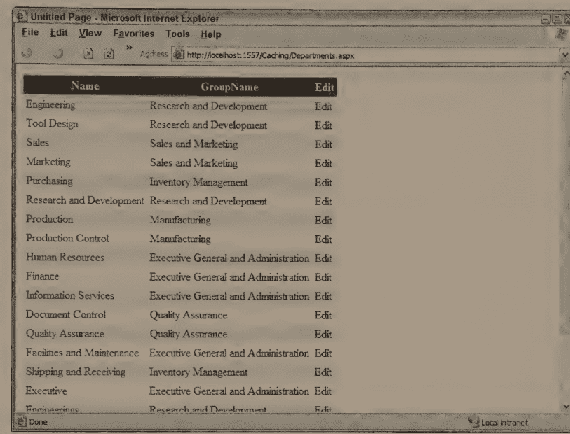

# 图 10-1

实现此视图相对简单。你只需要将一个 GridView 控件拖到窗体上，并告诉它使用 ObjectDataSource 控件来获取缓存对象。然而，有一个问题：由于你使用的是对编程友好的方法，即在 Cache 类上使用静态属性，因此必须定义一个中间机制，以 ObjectDataSource 控件期望的方式呈现缓存中的对象，这更符合你典型的数据传输对象（DTO）模式——静态方法来获取包含数据的对象（或它们的集合），以及插入、更新和删除它们。

当然，你不必使用 ObjectDataSource 控件；你可以像在 1.1 中那样简单地绑定网格，将数据源设置为 Cache.SomePropertyCache，但那不是 2.0 的方式。为了避免总是编写 shim，我建议创建一个新的 ObjectDataSource 控件，它可以更智能地与你的领域层交互，如果你不打算使用 DTO 模式的话。如果我是真的要编写这个应用程序，我会这样做，以使 ASP.NET 更容易与我的自定义对象交互，但为了保持专注和简单，我改而编写了 OdsShim 类，为 ObjectDataSource 控件提供它想要看到的接口。该类的代码如下：

```
public static class OdsShim
{
    public static List<Department> GetDepartments()
    {
        return AdventureWorks.Cache.Departments;
    }

    public static List<Employee> GetDepartmentEmployees(int departmentId)
    {
        Department dept = AdventureWorks.Cache.GetByIdentifier(
            AdventureWorks.Cache.Departments, departmentId);
        if (dept == null)
            return null;
        return dept.Employees;
    }

    public static Department GetDepartment(int departmentId)
    {
        return AdventureWorks.Cache.GetByIdentifier(
            AdventureWorks.Cache.Departments, departmentId);
    }

    public static void SaveDepartment(string name, string groupName, int original_departmentId)
    {
        Department dept = AdventureWorks.Cache.GetByIdentifier(
            AdventureWorks.Cache.Departments, original_departmentId);
        if (dept == null)
            dept = new Department();
        dept.Name = name;
        dept.GroupName = groupName;
        dept.SaveToDb();
    }
}
```

部门的 ObjectDataSource 控件的 Select 方法应该是 OdsShim.GetDepartments，它只是简单地返回 AdventureWorks.Cache.Departments 的值。而这就是该列表的全部内容了。

如果你选择一个部门名称，它将显示该部门中的员工列表，如图 10-2 所示。

设置此列表的方式与第一个基本相同，只是为 ObjectDataSource 控件添加了一个控件参数，以从部门列表中获取选中的部门标识符，并将其传递给 OdsShim.GetDepartmentEmployees 方法。此方法在部门缓存中找到匹配的部门，并返回该部门的 Employees 属性。如果你查看 Employees 属性的代码，它使用了前面提到的*延迟加载*模式。

# 修改缓存

到目前为止，你只是查看了如何从静态缓存中读取数据，但考虑到你可能想要修改缓存中的数据，我写了一个小示例来说明这样做的关键概念。这就是 OdsShim 中另外两个方法（GetDepartment 和 SaveDepartment）的用途。事实上，它们说明了从任何地方修改缓存需要做什么。相同的基本步骤将适用：

1.  从缓存中获取对象。
2.  更改某些状态。
3.  保存更改。


# 缓存技巧

`GetDepartment` 方法只是从缓存中检索匹配标识符的部门。这在下面的页面中用于获取 FormView 控件需要操作的单个实例。点击部门的编辑链接会带你到 `EditDepartment.aspx` 页面，该页面包含上述用于编辑部门数据的 FormView 控件。对于该控件的 ObjectDataSource 控件，你只需将 `Select` 方法设置为 `OdsShim.GetDepartment` 方法，并将 `Insert` 和 `Update` 方法设置为 `OdsShim.SaveDepartment` 方法。我不得不稍微调整一下项目模板，以便只显示部门名称和组，并且需要将 FormView 上的 `DataKeyNames` 属性设置为 `DepartmentId` 属性，并告诉它使用 `QueryString` 参数来获取正在编辑的部门 ID。

设置完成后，你可以运行表单并编辑选定的部门。当你点击更新时，它会调用 `SaveDepartment` 方法，正如你在前面的清单中看到的，该方法尝试使用相同的 `GetByIdentifier` 方法通过原始的 `_departmentId` 查找部门。如果找不到匹配的部门，它会创建一个新的部门，然后设置属性，并在实例上调用 `SaveToDb`，以将更改持久化到数据库中。

理想情况下，我建议（将上述自定义 ObjectDataSource 控件）写成具有自动执行 `SaveDepartment` 方法所做工作的能力，即从缓存中获取实例（用于编辑），设置该实例上的绑定属性，然后调用其实例方法（如 `SaveToDb`）。至少，标准的 ObjectDataSource 控件最好能适应使用指定的 `Select` 方法获取用于更新的特定实例。我这么说是因为 ObjectDataSource 控件有一个选项可以传入一个实例，该实例的绑定属性已从 FormView 设置，但它总是为你创建一个新实例，这至少在某种程度上违背了缓存本身的用途。

## 第10章

以上就是简单使用缓存对象的演示。如你所见，采用这种方法，围绕对象模型开发用户界面相当简单。当然，这种易用性并非没有代价；它需要在领域模型层面上多写一些代码，但这是为你的领域解决方案编写可重用库所固有的。接下来，你将了解如何在服务器场中利用这个技巧来保持服务器上的缓存同步。

## 缓存更改通知

如果你的 ASP.NET 应用程序托管在单个 Web 服务器上，到目前为止提供的信息足以让你开始使用静态缓存。但是，如果你在 Web 服务器场中的多台服务器上托管该应用程序，则需要一种方式让其他服务器知道何时有人修改了这个静态缓存，以便它们可以自行更新以保持同步。

为了解决这个问题，`Cache` 类公开了 `CacheChanged` 事件，你可能还记得你的 Web 应用程序在 `AppInit` 方法中订阅了该事件。代码库还公开了设置接收缓存更改通知的 Web 服务所需的原材料，以及一个用于发送这些通知的客户端类。它们分别是 `AdventureWorks.Web.Cache` 和 `AdventureWorks.Web.CacheClient` 类。

这两个类都没有太多内容：服务类公开了一个 Web 方法，令人惊讶的是，它看起来与 `RefreshCaches` 方法一模一样，因为它接受 `CacheRefreshOptions` 枚举来告诉它要刷新哪些缓存。正如你可能猜到的，它只是简单地调用其内存空间中的 `RefreshCaches` 方法。客户端只是 Visual Studio 在你添加 Web 服务引用时将为你生成的代码的清理版本。

要在你的 Web 应用程序实例中（即，在每台服务器上）实现这一点，你需要向你的 Web 应用程序添加一个 ASMX 文件。在我们的示例中，应用程序根目录下有一个 `Cache.asmx` 文件，其唯一内容是这行代码：

```
<%@ WebService Language="C#" Class="AdventureWorks.Web.Cache" %>
```

如你所见，它只是告诉 ASP.NET 去 `AdventureWorks.Web.Cache` 类寻找其实现。很简单，对吧？

另一方面，你需要让你的 `CacheChanged` 事件处理程序方法为服务器场中的每台服务器启动一个 `AdventureWorks.Web.CacheClient` 类的实例，并在每个实例上调用 `BeginRefreshCaches` 方法以异步更新它们的缓存。这在 `Global.asax` 文件的 `RefreshFarm` 方法中进行了说明，不过它被注释掉了，因为确定其他服务器位置的实现留给你自己。

```
internal void RefreshFarm(AdventureWorks.CacheRefreshOptions options)
{
    // 在此处循环遍历服务器场中的其他服务器，并如下调用它们
    // using (AdventureWorks.Web.CacheClient client =
    //    new AdventureWorks.Web.CacheClient("http://server2/Caching/Cache.aspx"))
    //    client.BeginRefreshCache(options, null, null);
}
```

在一种情况下，我将服务器场中的服务器列表存储在数据库中并检索该列表，循环遍历它并通知每台服务器（当然，除了执行请求的那台）缓存已更改。或者，如果你不想费心设置和访问数据库，你可能希望将该信息存储在 web.config 文件中。关键是你要在服务器场中的每台其他服务器上调用此 Web 服务，以使 CacheRefreshOptions 指定的缓存无效。

那么，RefreshFarm 是如何被调用的呢？你会记得我将它连接到了 CacheChanged 事件。此事件应由库中任何修改缓存的方法引发（通过 AdventureWorks.Cache.OnCacheChange 方法）。以下示例说明了你可能想要这样做的位置：

```
public virtual int SaveToDb()
{
    using (DbConnection conn = DomainBase.DbFactory.CreateConnection())
    {
        conn.ConnectionString = DomainBase.ConnectionString;
        using (DbCommand cmd = DomainBase.DbFactory.CreateCommand())
        {
            cmd.Connection = conn;
            cmd.CommandText = this.PersistenceProcedureName;
            cmd.CommandType = System.Data.CommandType.StoredProcedure;
            cmd.Connection.Open();
            this.AddParameterForSave(cmd);
            DbParameter parm = cmd.CreateParameter();
            parm.ParameterName = this.DatabaseIdentifierParameterName;
            parm.DbType = System.Data.DbType.Int32;
            parm.Value = this.DatabaseIdentifier ?? 0;
            parm.Direction = System.Data.ParameterDirection.InputOutput;
            cmd.Parameters.Add(parm);
            int retVal = cmd.ExecuteNonQuery();
            this.DatabaseIdentifier = (int)parm.Value;
            // 如果类型被缓存
            if (this.CacheOption != CacheRefreshOptions.None)
            {
                // 如果不在缓存中则添加
                this.EnsureInCache();
                // 通知缓存更改
                AdventureWorks.Cache.OnCacheChange(this.CacheOption);
            }
            return retVal;
        }
    }
}
```

此方法位于 AdventureWorks.DomainBase 类上。我花了不少功夫使它足够通用，以便只在基类上实现它（这是上述多态行为的一个例子）。当然，如果我正在编写一个真正的领域库，我很可能会使用对象关系映射器来简化我必须编写的代码以实现相同的行为，但我不想在这个示例中引入这种依赖。

> **你可能还注意到，所有数据访问代码都使用 System.Data.Common 工厂方法进行通用数据库编程。** 虽然显然这不是此示例所必需的，但它几乎与针对特定库（例如，SqlClient）编程一样容易，因此说明了在 ADO.NET 2.0 中你可以非常容易地实现某种程度的数据存储无关性编码。你可以在 Wallace McClure 等人所著的《Professional ADO.NET 2》（Wrox; ISBN 0-7645-8437-5）中找到更多信息。


## 第十章

我们在此关注的关键点是该方法中的 `if (this.CacheOption != CacheRefreshOptions.None)` 代码块。派生类应为 `DomainBase` 上的抽象 `CacheOption` 成员提供一个值，以指示该类相关的 `CacheRefreshOption`（如果存在的话）。如果存在，同一个类还应实现 `EnsureInCache` 方法，该方法将简单地检查特定缓存中是否存在该实例，以确保它在其中。然后我们需要做的就是调用 `OnCacheChange` 方法，并传入该实例的 `CacheOption`，以告知该特定缓存已被修改。`OnCacheChange` 方法如下所示：

```csharp
public static void OnCacheChange(CacheRefreshOptions options)
{
    if (CacheChanged != null)
        CacheChanged(options);
}
```

这只是一个标准的事件引发代码；它检查是否有任何订阅者（即它不为 null），然后引发事件。

为了将所有内容联系起来，你库中的某些代码修改了缓存，而相同的代码会引发 `CacheChanged` 事件，因为你已在你的 Web 应用程序初始化中订阅了该事件，指定你的 `RefreshFarm` 方法应被调用。框架调用你的委托，传入 `CacheRefreshOptions`，该选项指示缓存中的哪些内容被更改了。然后你的 `RefreshFarm` 方法调用农场中每个其他服务器上的 `RefreshCaches` Web 服务，传递有关哪些缓存被更改的信息。每个服务器在收到该请求时，会调用其内存中缓存的 `RefreshCaches` 方法，此时其缓存被刷新，从而与农场中的其他服务器同步。

## 刷新缓存

在结束这个关于静态缓存的部分之前，你应该考虑实际刷新缓存需要做什么。为了做到这一点，请考虑示例 `RefreshCaches` 方法的细节：

```csharp
private static object _refreshLock = new object();
public static void RefreshCaches(CacheRefreshOptions options)
{
    lock (_refreshLock)
    {
        // 部门缓存
        if ((options & CacheRefreshOptions.Departments) != 0)
        {
            if (_departments == null)
                _departments = new List<HumanResources.Department>();
            lock (_departments)
                LoadCacheFromDatabase(_departments,
                    "HumanResources.GetAllDepartments");
        }

        // 员工缓存
        if ((options & CacheRefreshOptions.Employees) != 0)
        {
            if (_employees == null)
                _employees = new List<HumanResources.Employee>();
            lock (_employees)
                LoadCacheFromDatabase(_employees,
                    "HumanResources.GetAllEmployees");
        }
    }
}
```

我在此处包含了 `_refreshLock`，因为它对方法至关重要。它用于确保一次只有一个线程刷新缓存。正如你可能想象的那样，这是非常小规模的同步，但它至少应能防止在缓存刷新周期中出现意外状态。

对于每个特定的缓存，你都需要编写一些代码。首先，你需要创建一个与该缓存相关的 `CacheRefreshOption`（并确保将其添加到 `All` 选项中）。然后，你需要为该缓存本身创建静态字段和属性（参见本章开头的示例）。最后，你需要在 `RefreshCaches` 方法中添加对该选项的检查，如果指定了该选项，则执行从数据存储刷新该缓存所需的所有操作。

在示例中的实现里，存在一个很小的可能性，即另一个线程可能在缓存字段完全初始化之前访问它，因为它先被实例化然后才被锁定。在这种情况下，最坏的情况是返回一个空缓存（而不是通常抛出的 `CacheNotInitializedException`）。此后，在刷新期间它会被锁定，并且因为在这种情况下初始化应该只在应用程序启动时发生一次，所以这不应该是一个问题。

完成这些步骤后，你应该可以开始享受设计利用此缓存及其提供的友好、强类型接口的用户界面、服务等工作的乐趣了。你可能还会注意到你的应用程序运行得更快，这得益于缓存本身以及直接引用相对于查找所带来的性能提升。

## 查看 ASP.NET 缓存

正如我在引言中提到的，我不会涵盖 ASP.NET 内置缓存的细节。这不是本书的重点。相反，本书是关于做事情的五十种方法，这些行业技巧可以帮助你更全面地完善你的知识。考虑到这一点，接下来我们将研究一个 HTTP 处理程序，你可以将其插入你的应用程序以查看 ASP.NET 缓存中的项。此外，除了系统缓存项之外，你还可以使用此工具强制将项从缓存中移除。有关 HTTP 处理程序的更多信息，请参见第 17 章。

为简单起见，示例解决方案将缓存查看器内置在 AdventureWorks 库的 `Web` 命名空间中；然而，HTTP 处理程序可能最有价值的方面是，你可以将它们插入你的应用程序，而无需将它们构建到你的应用程序代码中。你只需要将程序集放入你的 `bin` 目录，并在 `web.config` 中添加一个条目以通知 ASP.NET 你希望它插入该处理程序。虽然我选择将其内置在 AdventureWorks 库中以减少解决方案中的项目数量，但你同样可以轻松地将该类提取出来，放入自己的程序集中，以便将其插入任何你希望使用缓存查看器的应用程序。

要开始使用这个出色的小工具，你需要做什么？因为它已经构建在 Web 应用程序引用的库中，所以它的程序集已经复制到你的 Web 应用程序的 `bin` 目录；因此，你唯一需要做的就是将以下内容添加到 `web.config` 中：

```xml
<httpHandlers>
	<add verb="*"
	path="CacheViewer.aspx"
	type="AdventureWorks.Web.CacheViewer, AdventureWorks"/>
</httpHandlers>
```

就这样！现在你已经准备好了；你只需浏览到应用程序根目录下的虚构 `CacheViewer.aspx` 页面，即可开始查看你的应用程序对 ASP.NET 缓存的使用情况。我说“虚构”是因为你需要记住，你为 HTTP 处理程序指定的路径并不是文件系统上实际文件的路径。它只是 ASP.NET 用来识别你希望它通过你注册的处理程序处理此路径请求的一个名称。

在你深入了解其工作原理之前，让我们先看看这个小家伙能做什么。如果你导航到该路径——即没有查询字符串——它将显示你放置在缓存中的项。在示例应用程序中，它类似于图 10-3。

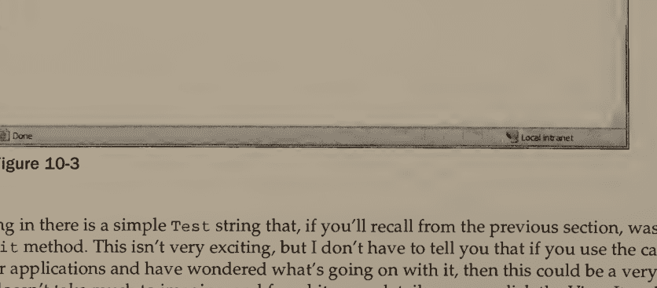

其中唯一的项是一个简单的 `Test` 字符串，如果你回忆一下上一节的内容，它是在 `AppInit` 方法中添加的。这并不十分令人兴奋，但我不必告诉你，如果你在应用程序中经常使用缓存，并想知道它发生了什么，那么这可能是一个非常有价值的工具。很容易想象，为了获得更多细节，你可以单击“查看项”链接，调出一个提供额外细节的页面，包括该项的值，如图 10-4 所示。

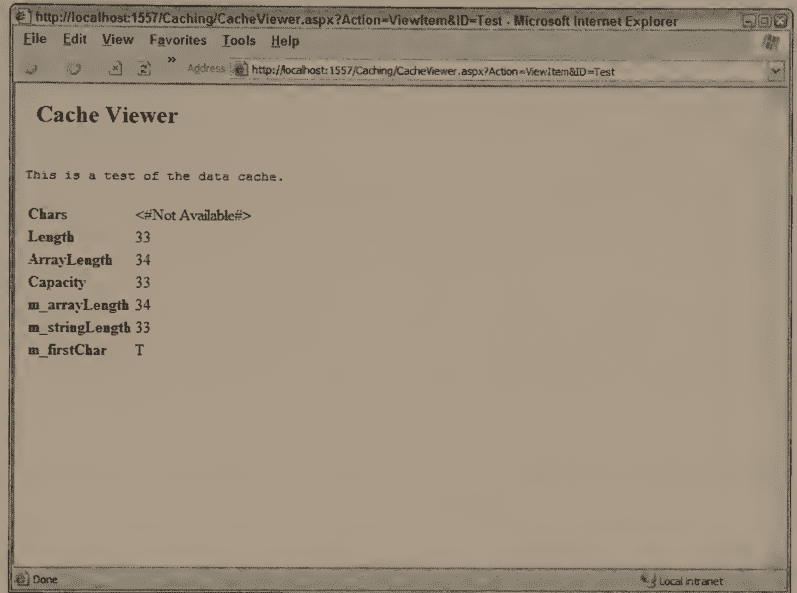

图 10-4

对于标准对象，查看器会遍历其字段和属性并尝试显示它们的值。对于数据表，它有特殊处理将其显示为 HTML 表格，并且对于其他几种类型（如 `ArrayList`、`ListDictionary` 和 `DataSet`）也有一些特殊处理。

当然，因为你拥有代码和知识，你可以为你存储在缓存中的类型编写自己的特殊处理程序。你只需在 `ProcessViewItem` 方法中检查类型（就像其他类型一样），就可以为你喜欢的任何类型添加特殊处理。

同样，对于非系统项，你有能力将它们从缓存中移除。这使用的机制基本上与查看项详情相同，因为它只是使用键从缓存中移除选定的项。这没什么高深的。

但这不是这个技巧的精髓所在。这个技巧的精髓，或者更确切地说，它带来的关键贡献在于如何获取并列出缓存中的项，因为这绝非直观。事实上，它本不应该发生，所以从更普遍的意义上说，它也是一个“技巧”。为此，你必须使用一点反射来获取 `Cache` 对象的非公共成员。这发生在下面的 `GetCache` 方法中：

```csharp
private Hashtable GetCache(HttpContext currentContext)
{
  FieldInfo fieldCacheInt =
    currentContext.Cache.GetType().GetField("_cacheInternal",
      BindingFlags.NonPublic | BindingFlags.Instance | BindingFlags.GetField);

  object cacheInt = fieldCacheInt.GetValue(currentContext.Cache);

  FieldInfo fieldEntries = cacheInt.GetType().GetField("_entries",
```


## 第 10 章

```csharp
BindingFlags.NonPublic | BindingFlags.Instance);

Hashtable hashEntries = fieldEntries.GetValue(cacheInt) as Hashtable;
Hashtable hashCopy = new Hashtable(hashEntries.Count);

lock (hashEntries)
{
    foreach (DictionaryEntry entry in hashEntries)
    {
        hashCopy.Add(entry.Key, entry.Value);
    }
}

return hashCopy;
}
```

该方法首先做的操作是在 Cache 类型上获取 `_cacheInternal` 字段，并检索该字段在当前上下文中的实例值。在该实例上，你需要 `_entries` 字段来获取一个包含缓存中所有项的哈希表，其中包括由 ASP.NET 运行时放置在此处的系统项。在返回之前的最后一步是制作该哈希表的浅拷贝，以便后续处理可以操作该表，而无需担心其他线程修改它从而引发异常。

既然我们有了这个条目列表，你可能会认为我们可以直接渲染表中的键值对，但这些条目的类型并不友好；它们实际上是 `System.Web.Caching.CacheEntry` 类型的实例，所以还需要做一些技巧性工作才能显示你真正需要的信息。这种技巧体现在 `ProcessDefaultView` 方法中，其片段如下所示：

```csharp
foreach (DictionaryEntry objItem in m_CacheCopy)
{
    object cacheEntry = objItem.Value;
    FieldInfo fieldCacheEntry = objItem.Key.GetType().GetField("_key",
        BindingFlags.NonPublic | BindingFlags.Instance | BindingFlags.GetField);

    strName = (string)fieldCacheEntry.GetValue(objItem.Key);

    FieldInfo fieldCacheEntryValue = cacheEntry.GetType().GetField("_value",
        BindingFlags.NonPublic | BindingFlags.Instance | BindingFlags.GetField);

    object itemObject = fieldCacheEntryValue.GetValue(cacheEntry);

    PropertyInfo propPublic = cacheEntry.GetType().GetProperty("IsPublic",
        BindingFlags.NonPublic | BindingFlags.Public | BindingFlags.Instance
        | BindingFlags.GetProperty);

    bool publicEntry = (bool)propPublic.GetValue(cacheEntry, null);

    if (strName != null)
    {
```

```csharp
        bAltRow = BuildCacheItem(currentContext, tbl, strName,
            bAltRow, itemObject, publicEntry);
    }
```

这个小巧的机制遍历了我们缓存副本 `_entries` 哈希表中的每个条目，并再次使用反射，获取键实例上的 `_key` 字段和值实例上的 `_value` 字段，以获得我们要查找的实际键值对。因为我们知道键将是字符串类型，所以可以直接转换。至于值，我们必须继续使用 `System.Object`，因为它可能是任何类型。

该方法的最后一件事是获取缓存项上 `IsPublic` 属性的值，以确定这是由用户代码还是系统代码添加的。该信息在渲染时很有用，因为在 `BuildCacheItem` 方法中，它首先用于确定是否应显示该项目，其次用于确定它是否可以由查看者移除。

是否显示由查询字符串选项决定，你可以指定该选项。如果在查询字符串中添加 `ShowSystem=true`，它将显示系统项，如图 10-5 所示。注意，你能移除的唯一一项是你添加在应用程序启动时的项。

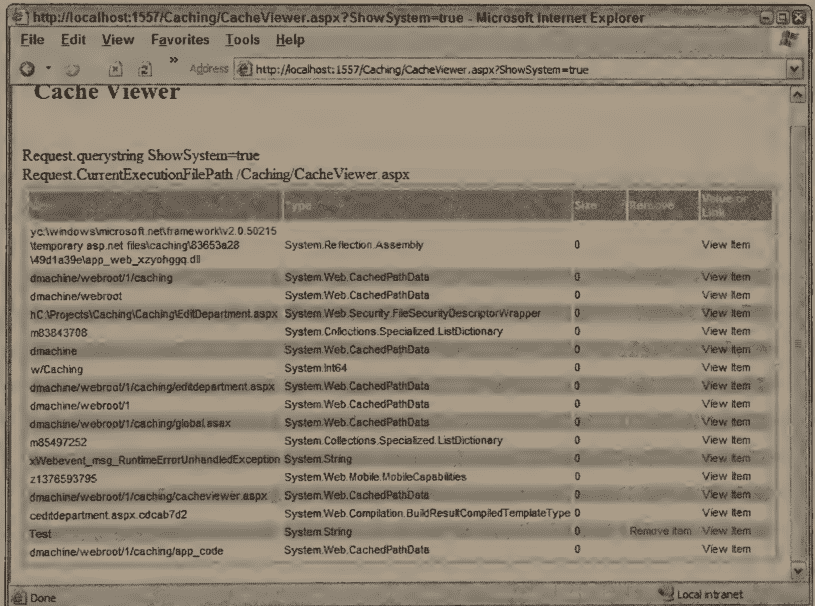

这就是此黑客程序所做的真正关键贡献。其余部分都是为了增强缓存项显示的趣味性，我鼓励你获取这些代码并自行开发，修改以适合你的需求或处理你自己的特殊类型。或者，当然，你也可以直接使用这里提供的基本工具，今天就可以将其放入你的应用程序中。无论如何，我相信它可以为你的工具箱增添价值。

## 总结

本章介绍了两种黑客技术。第一种是组合展示，说明了 ASP.NET 开发人员如何通过静态缓存其强类型领域对象，利用面向对象设计的优势，以及如何在 Web 农场场景中保持这些缓存的同步。第二种黑客技术是一个拖放实用工具，让你能够立即开始查看你的 ASP.NET 缓存项。

如果你正在构建或想要构建可重用的领域类库，并且希望使它们更易于、更快地用于构建用户界面（如 ASP.NET 应用程序），你可以使用本章第一节中概述的概念。需要记住的关键点是，你应该考虑缓存那些高频使用、高频读取且最好是低频写入的对象。它们不需要是只读的，但如果你要修改它们，就需要关注线程同步问题（因为 ASP.NET 是多线程的），这就需要引入锁机制，而锁机制可能会带来性能瓶颈，特别是如果处理不当的话。这就是为什么最好仅存储低频写入对象的原因。

此外，你需要关注这些对象的使用情况。如果是用户特定的对象，最好使用用户特定的存储，例如 ASP.NET 的 Session 存储，它在存储位置方面非常灵活。虽然你可以相对容易地将每用户对象存储在静态缓存中，但你还必须考虑如何在会话结束时清理它们。

静态缓存的最后一个注意事项是内存使用。ASP.NET Cache 对象内置了很多内存管理功能来帮助缓解潜在的内存问题。要特别注意你在服务器上静态缓存的项的大小。某些项可能是低频写入的，但也可能涉及内存中不可接受的存储空间需求，在这种情况下，最好坚持使用内置的 Cache 对象。

缓存在提高应用程序性能方面可以产生显著效果，但你需要注意潜在的问题并相应地规划。如果你对缓存特定项有疑问，请进行测试。测试是了解缓存将如何具体影响你的应用程序的最佳方式。

然而，如果你确实遇到问题，拥有可以插入应用程序中以帮助你查找和诊断潜在缓存问题的实用工具是非常好的。本章的第二个黑客技术正是这样一个工具，它还允许你手动移除由你的应用程序缓存的项，从而为某些场景提供可能的解决方案。

本章中的所有代码和概念都归你所有。球在你脚下，正如 Brian Foote 所说：“去吧，黑客吧！”

## 11

## 从 ASP.NET 1.x 迁移到 ASP.NET 2.0

ASP.NET v2.0 提供了大量新功能，使构建 Web 应用程序更加高效。其功能如此诱人，以至于你会想要尽快迁移到它。然而，在抛弃那个笨拙的旧 ASP.NET v1.1 应用程序之前，请考虑一下你为构建它投入了多少时间。你的时间对你自己、你的雇主或你为之提供服务的客户来说都是有价值的。重新开发项目可能涉及成本，而将其丢弃可能不是最经济的解决方案。保留现有代码的投资通常是明智之举。

一种保持投资价值的智能策略是将现有的 ASP.NET v1.x 应用程序迁移到 ASP.NET 2.0。为了帮助这个过程，Visual Studio 2005 提供了一个自动向导，将你的旧版 ASP.NET v1.x 应用程序转换为 ASP.NET 2.0。这让你兼具所有优势：在保留投资的同时，利用新添加功能时的新功能。

对于最简单的场景，这非常有效。然而，你需要了解一些事项以避免麻烦。ASP.NET 2.0 有特别命名的目录，文件会被移动，其他转换也会在此过程中发生，我将在本章的相关部分讨论这些内容。本章指出了迁移过程中的几个挑战，并提供了一些策略来帮助你们使过渡更加平滑。

我们采用的方法是构建一个示例 ASP.NET v1.1 应用程序。它包含一些暴露迁移过程中你将遇到的问题特性的功能。然后我们将执行迁移，识别这些问题，并展示如何绕过它们。由于每个站点都是不同的，本章无法描述每种可能的场景，但希望它能为你提供策略，从而比你自己单独经历过程时要成功地得多地执行迁移。


## 第11章

### 创建演示版 v1.x 应用程序

你需要将现有应用程序转换为新应用程序，以便通过迁移到 ASP.NET v2.0 来节省前期时间，并在时间允许时逐步开始使用新功能。升级现有代码库可以保有投资并节省成本，同时让你能够利用新功能来增强应用程序。

本节展示如何创建一个使用 ASP.NET v1.1 构建的小型应用程序。它涵盖了进行升级时需要注意的许多功能。因此，你可以亲自使用此应用程序，并练习解决在升级自己的 Web 应用程序时可能遇到的问题。此示例应用程序不代表你可以在 Web 上找到的特定网站，也不是一个完整的应用程序。它的目的仅仅是向你展示 ASP.NET v1.1 中存在的条件，并演示向 ASP.NET v2.0 的转换。本节只是描述该应用程序；紧随其后的“理解迁移”部分，将演示当通过 ASP.NET v2.0 迁移向导运行此示例应用程序时发生的转换。

## 用户控件

示例网站有两个用户控件：Header.ascx 和 Menu.ascx。

#### Header.ascx

Header 控件出现在每个页面的顶部，仅为网站提供一个标题。清单 11-1 显示了此控件的 HTML 代码。由于 Header 控件没有代码实现，因此不显示其代码隐藏。

**清单 11-1：Header 控件**

```html
<%@ Control 
    Language="C#"
    AutoEventWireup="false"
    CodeBehind="Header.ascx.cs"
    Inherits="MvpHacks.Header"
    TargetSchema="http://schemas.microsoft.com/intellisense/ie5"%>
<H1 align="center">
    <FONT style="BACKGROUND-COLOR: red" color="white">
        Professional ASP.NET 2.0 MVP Hacks
    </FONT>
</H1>
```

在“理解用户控件引用更改”部分的转换过程中，你将看到转换向导如何修改清单 11-1 中的代码。

#### Menu.ascx

Menu 控件在 MVP Hacks 站点的页面之间提供导航。清单 11-2 显示了此控件的 HTML 代码。它没有代码实现，因此不显示其代码隐藏。

**清单 11-2：Menu 控件**

```html
<%@ Control 
	Language="C#"
	AutoEventWireup="false"
	CodeBehind="Menu.ascx.cs"
	Inherits="MvpHacks.Menu"
	TargetSchema="http://schemas.microsoft.com/intellisense/ie5"%>
<TABLE id="Table1" style="WIDTH: 96px; HEIGHT: 63px" cellSpacing="0"
	cellPadding="10" width="96"
	bgColor="red" border="0">
	<TR>
		<TD>
			<P>
				<asp:HyperLink 
					id="hlnkHome" 
					runat="server" 
					ForeColor="White" 
					Font-Bold="True" 
					NavigateUrl="Default.aspx">
						Home
				</asp:HyperLink><BR>
				<asp:HyperLink 
					id="hlnkHacks" 
					runat="server" 
					ForeColor="White" 
					Font-Bold="True" 
					NavigateUrl="Hacks.aspx">
						Hacks
				</asp:HyperLink>
				<asp:HyperLink 
					id="hlnkLogin" 
					runat="server" 
					ForeColor="White" 
					Font-Bold="True" 
					NavigateUrl="Login.aspx">
						Login
				</asp:HyperLink></P>
		</TD>
	</TR>
</TABLE>
```

### 类

`Default.aspx` 页面有一个名为 `TypeViewer` 的类。清单 11-3 显示了该类的代码。需要特别注意的一点是，这个类定义在 `Default.aspx` 页面的代码隐藏文件中。这不是好的做法，但这样定义是为了展示它在转换期间会导致的问题。在下一节中，你将看到这会导致什么问题以及如何修复它们。

**清单 11-3：TypeViewer 类**

```c#
internal class TypeViewer
{
    public string GetTypeInfo(Type type)
    {
        StringBuilder typeInfo =
            new StringBuilder("<p>Type Info:</p>");

        MemberInfo[] members = type.GetMembers();

        foreach (MemberInfo member in members)
        {
            typeInfo.AppendFormat("{0} {1}<br>",
                member.MemberType,
                member.Name);
        }

        return typeInfo.ToString();
    }
}
```

清单 11-3 中的代码是 `Default.aspx` 代码隐藏页面的一部分。在转换过程中，转换向导将提取此此类并将其移动到 `App_Code` 目录。

### 页面

示例网站有三个 Web 窗体页面：`Default.aspx`、`Hacks.aspx` 和 `Login.aspx`。这些页面演示了在迁移过程中发生的转换。`Default.aspx` 和 `Hacks.aspx` 页面（未显示）只是添加到示例网站中，以证明对所有页面所做的更改是一致的。如果你对所有这些页面的内容感兴趣，可以在与本书关联的代码中查看它们。

`Login.aspx` 页面为示例网站提供基于表单的身份验证。它被包含在内是为了表明你现有的 ASP.NET v1.1 基于表单的身份验证代码在转换期间不会被更改。清单 11-4 显示了此页面的 HTML 代码。

**清单 11-4：Login.aspx 页面**

```html
<%@ Page 
    language="c#"
    Codebehind="Login.aspx.cs"
    AutoEventWireup="false"
    Inherits="MvpHacks.Login" %>
<%@ Register TagPrefix="uc1" TagName="Menu" Src="Menu.ascx" %>
<%@ Register TagPrefix="uc1" TagName="Header" Src="Header.ascx" %>
<!DOCTYPE HTML PUBLIC "-//W3C//DTD HTML 4.0 Transitional//EN" >
<HTML>
    <HEAD>
        <title>MVP Hacks</title>
    </HEAD>
    <body>
        <form id="Form1" method="post" runat="server">
```

```html
<uc1:Header id="Header1" runat="server"></uc1:Header>
<TABLE 
	id="Table1"
	cellSpacing="1"
	cellPadding="1"
	width="100%"
	border="0">
<TR>
<TD style="WIDTH: 110px" vAlign="top" align="left">
<uc1:Menu id="Menu1" runat="server"></uc1:Menu>
</TD>
<TD vAlign="top" align="left">
<P align="center"><BR>
<asp:Label 
	id="lblError"
	runat="server"
	ForeColor="Red"></asp:Label><BR><BR>
</P>
</TD>
</TR>
</TABLE>
<TABLE 
	id="Table2"
	cellSpacing="1"
	cellPadding="1"
	width="300"
	align="center"
	border="0">
<TR>
<TD>
<asp:Label 
	id="lblUserID"
	runat="server">
User ID:
</asp:Label>
</TD>
<TD>
<asp:TextBox 
	id="txtUserID"
	runat="server"
	Width="175px"></asp:TextBox>
</TD>
</TR>
<TR>
<TD>
<asp:Label 
	id="lblPassword"
	runat="server">
Password:
</asp:Label>
</TD>
<TD>
<asp:TextBox 
	id="txtPassword"
	runat="server"
	TextMode="Password"
```

**清单 11-4（续）**

```html
	Width="175px"></asp:TextBox>
</TD>
</TR>
<TR>
<TD colSpan="2">
<asp:CheckBox 
	id="chkRememberMe"
	runat="server"
	Text="Remember Me"></asp:CheckBox>
</TD>
</TR>
</TABLE>
</P>
<P align="center">
<asp:Button 
	id="btnLogin"
	runat="server"
	Text="Log In"></asp:Button>
</P>
<P>
<asp:Label 
	id="lblTypeInfo"
	runat="server"></asp:Label>
</P>
</TD>
</TR>
</TABLE>
</form>
</body>
</HTML>
```

> **你编写登录页面的日子屈指可数了。随着 ASP.NET v2.0 即将发布，你将无需完成所有这些手动工作，因为它包含一整套安全控件，包括 Login 控件，使所有这些变得如此简单。**

转换向导将毫无问题地转换清单 11-4 中所示的 `Login.aspx` 页面。这证明你将能够将基于 ASP.NET v1.1 表单身份验证的现有网站迁移到 ASP.NET v2.0。

新的 Login 控件还将使你能够避免编写任何实现基于表单身份验证的代码。当然，当前应用程序是 ASP.NET v1.1，因此你必须编写代码来对用户进行身份验证。清单 11-5 显示了 `Login.aspx.cs` 的代码隐藏。

**清单 11-5：Login.aspx.cs 的代码**

```c#
using System;
using System.Collections;
using System.ComponentModel;
using System.Data;
using System.Drawing;
using System.Web;
using System.Web.Security;
using System.Web.SessionState;
using System.Web.UI;
using System.Web.UI.WebControls;
using System.Web.UI.HtmlControls;

namespace MvpHacks
{
    public class Login : System.Web.UI.Page
    {
        protected System.Web.UI.WebControls.TextBox txtUserID;
        protected System.Web.UI.WebControls.TextBox txtPassword;
        protected System.Web.UI.WebControls.Button btnLogin;
        protected System.Web.UI.WebControls.Label lblError;
        protected System.Web.UI.WebControls.Label lblUserID;
        protected System.Web.UI.WebControls.Label lblPassword;
        protected System.Web.UI.WebControls.CheckBox chkRememberMe;
        protected System.Web.UI.WebControls.Label lblTypeInfo;

        private void Page_Load(object sender, System.EventArgs e)
        {
            TypeViewer typeView = new TypeViewer();

            // 在页面上显示类型信息
            lblTypeInfo.Text = typeView.GetTypeInfo(this);
        }

        // 为清晰起见，省略了 OnInit 和 InitializeComponent

        private void btnLogin_Click(object sender, System.EventArgs e)
        {
            // 验证登录凭据
            if (FormsAuthentication.Authenticate(
                txtUserID.Text, txtPassword.Text))
            {
                // 颁发身份验证票证（Cookie）并
                // 将他们发送到原始目标
                FormsAuthentication.RedirectFromLoginPage(
                    txtUserID.Text, chkRememberMe.Checked);
            }
            else
            {
                lblError.Text = "Invalid Credentials!";
            }
        }
    }
}
```

你不必使用新的安全控件。迁移现有网站是不使用它们的有效理由。否则，我将选择提高生产力，特别是在构建新的 ASP.NET v2.0 网站时，并使用新的安全控件。


## 理解迁移

执行迁移中简单的部分是使用转换向导。大多数情况下，迁移会无误发生。如果在转换过程中出现错误，你将能在迁移向导为你创建的报告中看到它们。迁移中更具挑战性的部分是理解文件去向、文件的内部更改，以及部署过程中可能发生的问题。以下各节将探讨每个问题，并提供可帮助你进行自己迁移工作的思路。

## 执行迁移

给定一个现有网站，启动迁移很简单。你可以执行以下操作来进行转换：

1.  打开 Visual Studio 2005，然后打开现有网站。“打开网站”对话框有众多选项，包括文件系统、本地 IIS、FTP 站点、远程站点和源代码管理，因此你可以指定要打开的网站类型。选择“本地 IIS”，在右侧的树中选择出现的站点，然后单击“打开”。该网站是我在上一节介绍的示例网站。就本讨论而言，你可以假设该网站位于名为 MvpHacks 的虚拟目录中。如果你使用本书附带的代码，请创建一个名为 MvpHacks 的 IIS 虚拟目录，该目录指向你决定放置代码的物理目录。

2.  Visual Web Developer 识别出正在打开 ASP.NET 1.1 网站，并启动 Visual Studio 转换向导。当看到“欢迎”屏幕时，单击“下一步”按钮。

3.  在“选择是否创建备份”屏幕上，选择“是”以在转换前创建备份。如果你不想要默认位置，请单击“浏览”按钮进行更改。单击“下一步”按钮。

4.  “准备转换”屏幕总结了你的选择。单击“完成”按钮，让 Visual Web Developer 执行转换。

5.  完成后，向导显示“转换完成”屏幕。保持“向导关闭时显示转换日志”复选框选中状态。单击“关闭”按钮。

向导关闭后，项目会在你的工作环境中打开，并发生了一些变化。你首先可能注意到的其中一件事是不再有项目文件。解决方案资源管理器中的项目节点指向网站的虚拟目录。结构上，有一个新的 ConversionReport.txt 文件，而 AssemblyInfo.cs、Global.asax.cs 和其他类文件已被移至新的 App\_Code 目录中：

```
C:\Documents and Settings\%user%\My Documents\Visual Studio 2005\Projects\nMvpHacks\UpgradeLog.XML
```

图 11-1 显示了转换向导运行后的项目。

日志文件不会相互覆盖。相反，会添加一个编号更高的新文件。例如，第二次转换将在同一目录中生成名为 UpgradeLog2.XML 的文件。

## 从 1.x 迁移到 ASP.NET 2.0

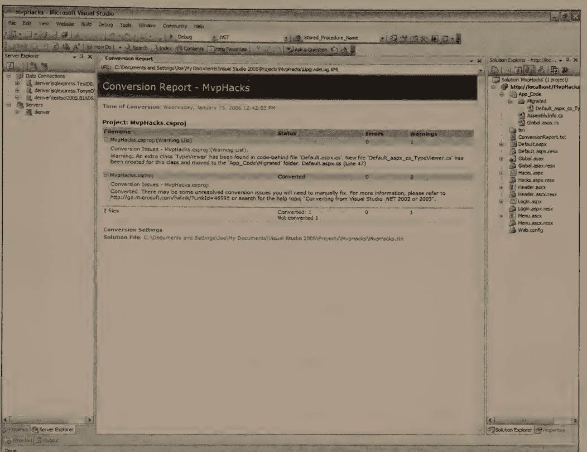

**图 11-1**

## 我的旧网站去哪了？

在运行转换向导时，如果你选择了“是”以在转换前创建备份，那么你的 ASP.NET v1.1 文件将被复制到你指定的位置。默认情况下，转换向导会将它们复制到 C:\Documents and Settings\%user%\My Documents\Visual Studio 2005\Projects\MvpHacks\Backup。

为了防止覆盖旧备份，后续备份会被复制到一个新目录中。目录名递增 1。例如，MvpHacks 网站的默认第二次备份将是 C:\Documents and Settings\%user%\My Documents\Visual Studio 2005\Projects\MvpHacks\Backup1。

进行备份是明智之举，因为转换可能会出现问题，你可能希望恢复到原始版本重新开始。如果你使用源代码管理并确保在转换前所有内容都已签入，你也会很安全。在某些情况下，你可能希望恢复到原始网站进行更正，然后重新执行转换。拥有备份以便快速复制粘贴是很方便的。

当你需要恢复时，考虑备份当前的转换副本。这样，如果你第二次尝试转换没有达到预期结果，或者你决定修改转换后的网站会更容易，你可以恢复转换。

为避免 Windows 文件锁定问题，请确保在恢复网站之前关闭 Visual Web Developer。然后将 ASP.NET v1.x 备份文件从备份目录复制到虚拟目录所引用的物理目录。你还必须通过打开 IIS、导航到并右键单击虚拟目录、选择“属性”、单击“ASP.NET”选项卡，并从下拉列表中选择正确的版本（如图 11-2 所示），将 IIS 的 ASP.NET 版本改回 1.x。

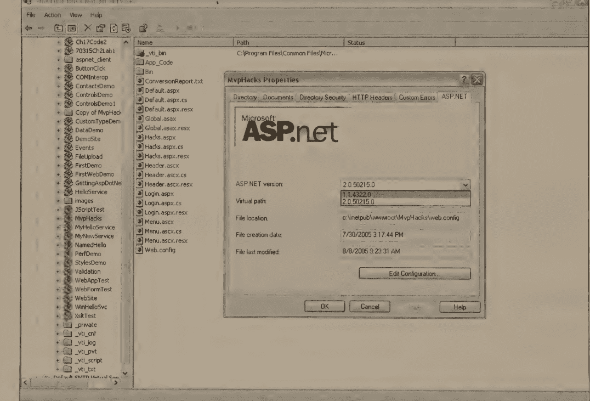

如果你不更改 ASP.NET 版本号，你将看到如图 11-3 所示的错误消息。“无法在 Web 服务器上开始调试”这条消息可能对许多人来说不太理解。它更像是真正问题的症状，而不是描述性的根本原因。

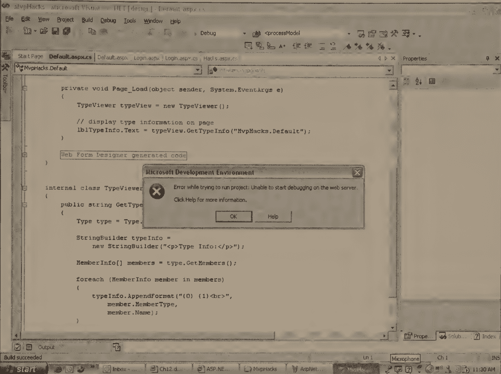

图 11-3

## 重要的文件更改

本节讨论示例网站中发生的文件更改。以下代码片段显示了转换后 `Default.aspx` 中的 `Page` 指令：

```
<%@ Page Language="c#" Inherits="MvpHacks.Default" CodeFile="Default.aspx.cs" %>
```

这与清单 11-4 不同，因为 `CodeBehind` 属性被 `CodeFile` 替换。你不再有 `AutoEventWireup`。此外，`Inherits` 属性有点误导性。因为 `CodeFile` 和 HTML 页面是同一类型的分部类型，它们都继承自 `Page` 类。如果我是设计 ASP.NET v2.0，我会将 `Inherits` 重命名为 `TypeName` 或其他更有意义的名称。

曾经称为代码隐藏文件的东西现在在 HTML 页面的 `Page` 指令中被称为 `CodeFile`。你应该注意一些重要的更改。清单 11-6 显示了这些更改。

## 清单 11-6：转换后的代码文件

```
public partial class Default : System.Web.UI.Page
{
    protected void Page_Load(object sender, System.EventArgs e)
    {
        TypeViewer typeView = new TypeViewer();

        // 在页面上显示类型信息
        lblTypeInfo.Text = typeView.GetTypeInfo(this);
    }

    // 为清晰起见，省略了 OnInit 和 InitializeComponent
}
```

清单 11-6 显示了转换后代码隐藏类发生的情况。所有控件声明都被移除了。这是因为 Default 类具有 partial 修饰符，意味着它是与 HTML 页面同一类的一部分。当为 HTML 页面生成代码时，它将包含页面上所有类型的声明。在 CodeFile 中使用的控件变量名必须与 HTML 中的控件 ID 匹配。转换向导不会更改任何 ID。

## 理解用户控件引用更改

在 ASP.NET v1.1 中，你需要在代码隐藏文件中引用所有控件。这是由于自然的层次结构发展而来的，其中 ASP.NET HTML 页面继承了代码隐藏。因为控件是 protected 的，所以 HTML 可以转换为派生类，代码可以正确引用控件。

这在 ASP.NET v2.0 中发生了变化，因为 HTML 和代码文件（以前的代码隐藏）都是同一个分部类的一部分。因此，它们被一起编译。因为它们是同一类型，所以代码文件中不需要显式声明控件，因为它已经在 HTML 文件中声明了。你所要做的就是用与对应 HTML 元素的 id 属性相同的变量名来引用该控件。

## 转换问题

虽然转换本身似乎运行良好，但之后可能有一些事情不太顺利。通过在开发环境中运行新的 ASP.NET v2.0 项目，你可能看不到它们，但它们可能会在部署期间出现。

这是一个典型的例子：参考本章的示例应用程序，TypeViewer 类（参见清单 11-3）位于 Default 类的代码隐藏文件中。在开发环境中，代码作为单个程序集运行和执行。在这种情况下，转换向导足够聪明，通过将类移至 App\_Code 下的 Migrated 文件夹（参见图 11-1）来避免问题。（我提到这种行为是因为如果你没有预料到，它可能会让你感到惊讶。）转换报告（也显示在图 11-1 中）提供了一个警告，你应该花时间查看新的类文件，以确保你的代码能正常工作。


同样地，秉承“黑客技巧”的精神，我们只对现有功能进行补充，而非重复文档内容。如需了解特定问题的更多信息，请查阅 Michael Bundschuh 撰写的文章"Common ASP.NET 2.0 Conversion Issues and Solutions"，网址为 http://msdn.microsoft.com/asp.net/default.aspx?pull=/library/en-us/dnaspp/html/upgradingaspnet.asp，该文提供了有关转换问题的额外指导。

> MSDN 以链接失效而臭名昭著， clo 所以未来某个时候你可能需要搜索 Michael Bundschuh 的文章。

## 总结

本章介绍了一个可用于试验转换过程的示例应用程序。它包含了一些功能，用于演示哪些仍然有效、哪些会失效。例如，基于表单的身份验证仍然有效，但代码隐藏文件中的类会导致应用程序崩溃。

Visual Web Developer 能够检测 ASP.NET 1.x 应用程序，并自动启动向导来帮助你逐步完成转换过程。该向导易于使用，但文件会被更改和移动，你需要了解这些变化。你还需要知道如何撤销转换，以防转换结果不理想，或者在转换前进行调整比在转换后更容易。

## 部署技巧

恭喜。如果你能读到这里，说明你已经成功构建了一个想要部署的 ASP.NET 应用程序。部署可以有多种形式，因此本章不会涵盖所有可能的选项。事实上，我在这里采取的方法是建立在他处已有的优秀资源之上，力图提供一些不太容易找到的额外信息。

时至今日，部署 ASP.NET 应用程序可以简单到只需使用 `xcopy` 命令或 Windows 资源管理器将文件复制到目标服务器，然后在 IIS 上设置虚拟目录或网站指向这些复制过来的文件，这已成为常识。但生产环境部署远不止于此，它涉及到应用程序更广泛的配置管理。它还需要在信息量、定制化程度以及它们对整体应用生命周期的影响之间做出选择和权衡。

与测试一样，如何部署应用程序是应用开发过程中需要尽早考虑的重要任务，其重要性不亚于开发本身。其中最关键的一个概念是由谁来执行应用程序的“生产构建”。理想情况下，所涉及的应用程序应存储在源代码控制系统中——例如，Visual Source Safe 或 Team System。到了部署时，拉取该版本的一个副本，进行构建和部署。

在本章中，我们将探讨 Visual Studio 2005 内置的处理 Web 应用程序部署的功能。我们还将探讨 Web 部署工具，这是 ASP.NET 团队后来作为插件发布的工具，旨在让部署变得更加轻松。

### 复制网站向导

Visual Studio 2005 新增了一项功能，可以从“网站”菜单中选择“复制网站”选项（网站 > 复制网站）。这一新选项会打开如图 12-1 所示的用户界面，左侧显示构成网站的文件。右侧用于显示目标服务器上的文件。使用此工具，你可以在以下支持的协议中进行选择（如图 12-1 所示）：文件系统、本地 IIS、FTP 站点和远程网站。到目前为止，对于使用托管公司托管网站的用户来说，最大的改进是对 FTP 的支持。

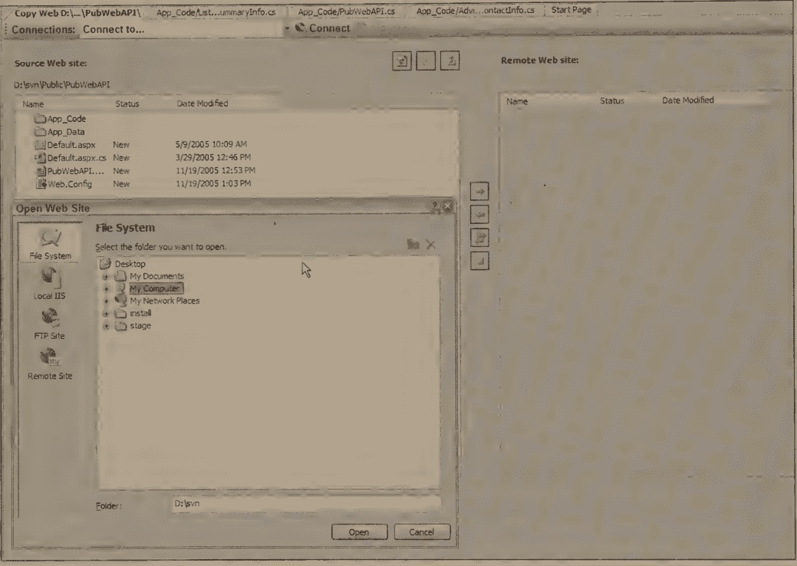

图 12-1

此工具不仅能让你移动文件，还会尝试确保你了解目标服务器上文件的状态。如果使用从主机复制文件的选项，务必小心不要覆盖你的项目文件。如果你打算从主机复制文件，备份本地文件将是一个好主意。

需要注意的是，使用此选项不会预编译你的网站，因此有必要将属于网站组成部分的源文件部署到目标站点。如果你引用了任何其他组件，它们也会被复制。将应用程序的源代码放在服务器上并不总是最佳选择，因为这会让好奇的人有机会窥探你的编码秘诀。本章后面将介绍如何使用预编译选项，这样可以将网站精简为只需部署的程序集。

在 ASP.NET 1.1 中，你可以缓解这个问题，无需将代码隐藏文件（或用 ASP.NET 2.0 的行话叫 *代码分离* 文件）复制到服务器。之所以能这样做，是因为它们已经被编译到网站程序集中。在 ASP.NET 2.0 中，除非你使用本章后面讨论的预编译选项，否则网站的程序集直到网站被使用时才会创建，而且创建的只是临时程序集。

Visual Studio 2005 的这一功能最适合不涉及多名开发人员的小型项目。由于需要用户干预才能操作该向导，因此它不适用于构建服务器。此外，如果你有多名开发人员，每次部署文件时都有可能部署不同的引用文件集。例如，假设网站引用了一个附加的组件库。开发人员 A 部署到测试或生产站点，使用的文件版本是当天的。当天晚些时候另一次部署发生，开发人员 B 执行部署。开发人员 B 不太善于获取最新的源代码，因此他电脑上引用的组件是三天前的版本。当他执行发布时，三天前的组件被引用并放到了服务器上。这会造成不一致的结果，如果走运的话可能会以明显的方式导致网站崩溃，或者只是制造一些难以追踪的问题，浪费团队的时间。构建过程中产生的版本控制问题可能是最难发现的问题之一，可能会消耗团队不可预测的时间来解决。

归根结底，复制网站是一项不错的附加功能，但最好用于你自己的项目，或在有多个开发人员的受控环境中使用。

### 发布网站向导

作为开发人员使用 Visual Studio 2005 时，另一个简单的部署选项是使用“发布网站”菜单选项（生成 > 发布网站），该选项可在 Visual Studio 2005 的“生成”菜单下找到。图 12-2 显示了出现的对话框，它会在创建用于部署的相关文件副本目录之前提示你选择选项。

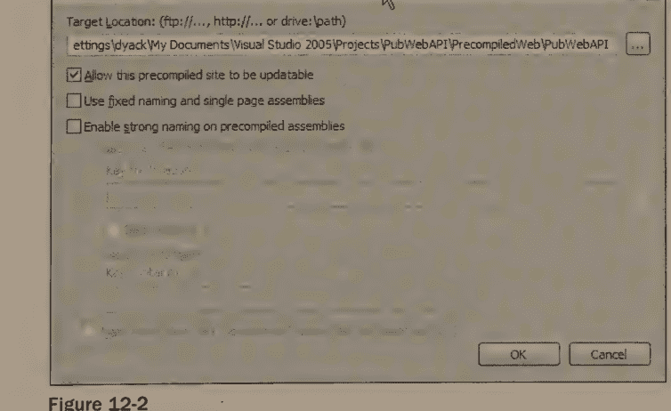

发布网站过程由用户干预启动，但它负责在站点上运行预编译并构建一个包含适当输出文件的文件夹。首先，此向导与复制网站向导最大的区别是，实际上会为网站内容构建程序集并将其放入 bin 文件夹。使用发布网站过程时，部署时不需要代码隐藏或代码分离文件，因此它们不会被复制。

在此对话框中的一项重要选择是是否勾选"允许更新此预编译网站"选项。当禁用此选项（未勾选）时，页面的标记会以文件中的以下文本部署：

> This is a marker file generated by the precompilation tool, and should not be deleted!

如果你要在运行预编译后打开输出文件夹中的 default.aspx，看到的就是这个。

一般经验法则是，关闭此选项最适合供应商应用程序或部署在你无法控制的服务器上的应用程序。在 ASP.NET 2.0 之前，你可以使用代码混淆器来隐藏程序集中的代码，但无法避免必须将页面标记提供给他人。大多数人都会同意，与同时拥有应用程序代码相比，标记不太容易被破解，但这仍然为创造性思考留下了很大空间。

如果你的应用程序仅部署到自己的服务器上，此选项的用处就不那么大了；事实上，由于这会阻止你在不部署程序集的情况下对页面文本进行任何快速调整，因此允许其可更新可能更有意义。

此发布网站选项的输出是一个包含一组文件的文件夹，你可以将其部署到目标站点。部署时需要谨慎处理两类文件。首先，如果你在目标服务器上有自定义的 web.config，你将会覆盖这些更改，因为发布网站选项也会将项目中的 web.config 副本放入文件夹中。例如，如果你已将连接字符串修改为指向测试或生产数据，而项目文件夹中的 web.config 指向开发服务器，那么复制后你将覆盖这些更改。另一个更重要且明显的问题是从 app_data 文件夹复制文件。如果你使用默认设置创建项目并启用会员、角色或其他需要数据库的 ASP.NET 服务，且已安装 SQL Express，则会为你创建一个数据库。该数据库将存储在 app_data 文件夹中。在发布网站过程中，app_data 文件夹会被放入输出文件夹。如果你只是简单地将发布文件夹中的文件通过 xcopy 或复制方式传到生产服务器，而不先删除开发版本的数据库，你就有可能覆盖生产数据库。

### 使用 Windows Installer

另一个可用的选项是使用作为 Visual Studio 模板项目包含在内的 Web 安装项目选项。Web 安装项目生成的输出是一组可以在目标服务器上运行的 Windows Installer 文件，用于设置网站。这种部署类型使用户在安装完成后可以在目标服务器的"添加/删除程序"列表中看到已安装的包。从"添加/删除程序"列表中，用户可以轻松移除该组件，从而从目标服务器卸载网站。

你可以通过从"文件"菜单选择"添加新项目"，然后在"其他项目类型"类别下查找，将此项目添加到解决方案中。在该类别中，选择"安装和部署"子类别，然后从模板列表中选择 Web 安装项目。Web 安装项目将生成通过 Windows Installer 运行的文件。此选项在需要更专业的打包应用程序的独立软件供应商（ISV）中很受欢迎。Wrox Pro ASP.NET 2.0 对这类项目进行了非常详细的介绍，因此我们不会在本文中展开讨论。


部署技巧

## 来自产品团队的实用技巧

正如我们到目前为止所讨论的，有无数种方式可以部署或准备部署网站。预编译功能的添加得到了良好的反响，但像许多新功能一样，它引发了一些需要解决的问题。例如，我们希望更多地控制预编译过程，以确定程序集的数量和名称。此外，如果你想要真正自动化部署准备过程，你需要一个工具能够在构建服务器上运行而无需人工干预告诉向导该做什么。

来自社区求助的呼声被 ASP.NET 团队听到了。不幸的是，为时已晚，无法影响 ASP.NET 2.0 和 Visual Studio 2005 的初始发布。但这并没有阻止他们；他们创建了 Web 部署项目的概念，将作为 Visual Studio 2005 的附加组件包来处理。在撰写本文时，Web 部署项目仍处于可用性的 Beta 阶段。

在最简单的形式下，Web 部署项目是一个网站的 MSBuild 项目文件。该项目的目标是帮助自动化部署准备步骤，例如预编译。因为它是项目文件，它可以利用 Team Build、Cruise Control、Draco 或其他构建控制流程集成到你的自动化构建过程中。

此外，提供了对所用选项的更多控制。例如，你现在可以控制是希望整个网站有一个程序集，每个文件夹一个程序集，所有 UI 组件一个程序集，还是仅为每个编译的文件创建一个。这对于大型站点尤为重要，因为生成的程序集数量可能导致潜在问题。

## 安装此附加组件

由于这是一个附加组件，您需要使用以下链接下载：http://msdn.microsoft.com/asp.net/reference/infrastructure/wdp/default.aspx。（如果链接不起作用，请查看本书的勘误表，因为在出版时这仍然是该工具的测试版，因此有可能它此后已经移动过位置。）

安装后，要将 Web 部署项目添加到您的解决方案，您需要查看 Build 菜单，如图 12-3 所示。您可能想知道为什么这个不直接出现在 Add Project 列表中。原因是因为这是一个附加组件，所以不作为项目模板处理。

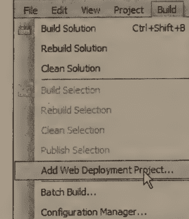

## 第 12 章

如果您使用构建服务器配合解决方案，则可以并且需要安装此附加组件到该服务器上。安装此附加组件并不需要在服务器上安装 Visual Studio。您只需运行安装程序即可。

### 添加到您的解决方案

当您从 Build 菜单中选择“添加 Web 部署项目”时，您将看到如图 12-4 所示的对话框，提示您输入项目名称和位置。通常最好将项目定位在与解决方案中其他项目相同的文件夹内。有关如何设置多个项目的解决方案的建议，请参见第 2 章，“开始使用”。在选择项目名称时需注意的一点是，每个网站可能有多个部署项目；并且您的整体解决方案内部可能包含多个 Web 项目。随着项目发展，您希望选择一个不会造成冲突的名称。简单的 web_deploy 项目名称可能会在将来给您带来麻烦。

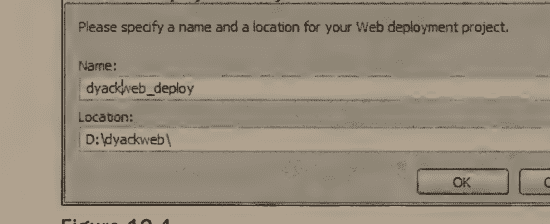

### 添加之后

添加项目后，您将在解决方案资源管理器中的解决方案树中看到它，名称为您输入的名称，但除此之外您将看不到对解决方案的任何其他视觉更改。如果您运行构建，您将看到输出窗口中类似以下内容，表明 Web 部署项目确实在执行某些操作：

```
C:\WINDOWS\Microsoft.NET\Framework\v2.0.50727\aspnet_compiler.exe -v /web -p D:\dyackweb\web -u -f -d D:\dyackweb\dyackweb_deploy\Debug\
Running aspnet_merge.exe ...
C:\Program Files\MSBuild\Microsoft\WebDeployment\v8.0\aspnet_merge.exe D:\dyackweb\dyackweb_deploy\Debug -o dyackweb_deploy -debug -copyattrs
Successfully merged 'D:\dyackweb\dyackweb_deploy\Debug'.
```

此时，假设您处于构建的调试配置，您刚刚在部署项目内部的 debug 文件夹中填充了内容。此文件夹的内容将与您之前讨论的发布网站向导使用 Publish Web Site Wizard 得到的结果非常相似。

### 更改默认选项

与其他项目不同，Web 部署项目在解决方案资源管理器中不会显示任何文件。真正与项目交互并修改设置（而不仅仅是直接编辑 MSBuild 脚本）的唯一方法是右键单击解决方案资源管理器中的项目并选择属性页菜单项。如图 12-5 所示的对话框出现，允许您自定义项目的设置。这些设置特定于该项目。我们将在本章后面更详细地探讨这些选项。

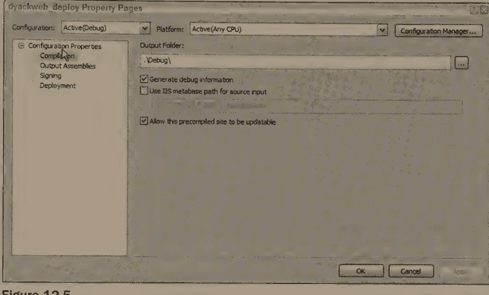

图 12-5

## 加快您的开发人员构建速度

如果您不对 Web 部署项目进行任何其他自定义，请确保在调试配置下构建解决方案时它会停止运行。默认情况下，您的解决方案将有两个配置：调试和发布。通常，大多数开发人员都将时间花费在此设置为调试上。当我们向解决方案添加 Web 部署项目时，它也同时为其启用了调试配置。这意味着每次您构建时，它都会尝试运行部署项目并花费额外周期来尝试构建您站点的预编译版本。

关闭此功能很简单，只需要快速访问配置管理器即可，在属性页上有一个按钮，使其易于访问（见图 12-5）。图 12-6 显示了将弹出的配置管理器对话框，允许您选择或取消选择应包含在构建中的内容。

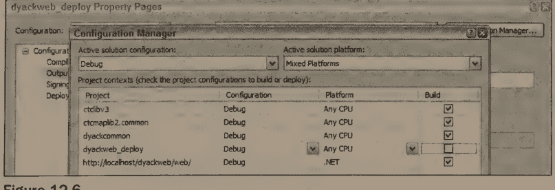

图 12-6

275

## 第 12 章

注意，在图 12-6 中我已取消选中部署项目的构建选项。现在，如果我们重新运行解决方案的构建，我们应该看到类似于以下消息，表明部署项目被跳过，因为它未包含在此配置中：

```
------ Skipped Build: Project: dyackweb_deploy, Configuration: Debug Any CPU ------
Project not selected to build for this solution configuration
```

### 构建服务器专用配置

虽然我们一直在谈论配置，但让我们谈一谈将此与构建服务器一起使用的概念。构建服务器只是一个用于构建软件的服务器或机器，因此不是在开发人员的系统上完成的。使用构建服务器可以通过确保生成的输出不会受到开发人员如果在自己的系统上构建可能会有的其他工作进行中的项目影响来促进构建环境的稳定性。

您可能需要考虑的一件事是创建一个仅由构建服务器使用的专用配置。当 MSBuild 调用解决方案进行构建时，您可以通过向 MSBuild 调用传递参数表明您想要运行特定配置。

出于我们这里的用途，我们将创建一个名为 BuildServer 的新配置。在您的应用程序中，您可以将其称为任何您喜欢的名称，并且实际上如果您构建了不同的构建服务器配置，您可以创建多个配置。例如，有时公司会在构建服务器上构建调试和发布版本，因此它们可能会创建 `BuildServerDebug` 和 `BuildServerRelease` 配置。

创建新配置很简单。在如图 12-6 所示的配置管理器对话框中，从活动解决方案配置下拉列表中选择“新建”项，如图 12-7 所示。

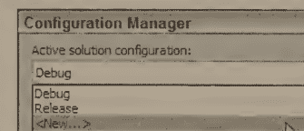

一旦选中，将出现如图 12-8 所示的新解决方案配置对话框，提示您命名配置。这里重要的是，您可能希望从发布版本复制设置。这将为您在配置上提供一个起点。

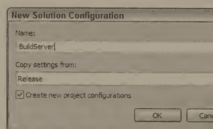


保存新配置后，你会回到 Web Deployment Project 属性页。请确保下拉列表中高亮显示的 BuildServer 项目正是你当前正在设置选项的项目。

在生成服务器上调用此配置可能会因你使用的生成服务器自动化包而有所不同。以下示例展示了使用此特殊配置通过命令行调用 MSBuild 的方式：

```
Msbuild mvphacks.sln /t:rebuild /p:configuration=BuildServerRelease
```

## 设置编译选项

如前文的图 12-5 所示，第一个属性页是"编译"页。如果你要生成用于生产的版本，需要确保取消勾选"生成调试信息"和"使用 IIS 元数据库路径作为源输入"选项。正如我们在前面"发布网站向导"部分所讨论的，"允许更新此预编译站点"选项对于内部站点来说通常是没问题的，但对于部署到组织外部的站点，关闭此选项可能会更有益。"使用 IIS 元数据库"选项在你有子网站时会发挥作用。对此更正式的讨论，请参阅随部署工具插件一起发布的白皮书。

## 输出程序集选项

此面板（如图 12-9 所示）控制程序集的输出方式以及合并的程度。如果你希望输出更接近 Visual Studio 2003 的样式，则需要启用"将所有输出合并到单个程序集"选项。与 VS 2003 一样，这将创建一个包含所有代码的程序集。这是最简单的选项，适用于大多数站点。

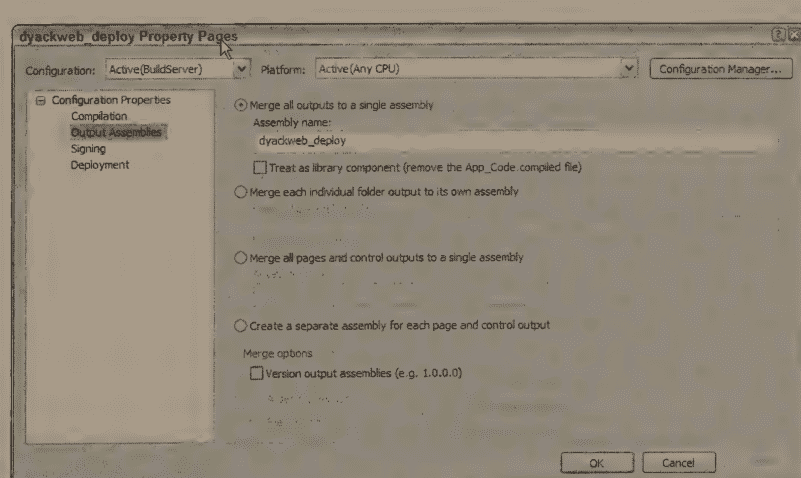

如果你认为需要进行程序集的部分部署，"将每个独立文件夹输出合并到其自己的程序集"选项会很有用。由于每个文件夹都将由一个程序集表示，因此在需要时，可以只将该文件夹部署到生产站点。选择此选项时，你可以提供程序集前缀，这是推荐的做法以避免混淆。你可以根据组织的情况，使用公司名称或产品/应用程序名称作为前缀。

如果你确实需要细粒度的控制，"为每个页面和控件输出创建单独的程序集"选项可以满足这一需求。请注意，在非常大的站点中，这可能会导致需要管理和加载到 Web 服务器内存中的程序集数量过多。

## 与其他项目共享 App_Code

此页面上还有一个尚未提及的选项："作为库组件处理"。在某些情况下，此选项会派上用场。首先，通过将输出合并并作为库组件处理，可以尝试使用它来与其他网站共享母版页、用户控件或其他通用项。

另一种有助于解决的情况是处理 1.1 站点的转换问题。在 1.1 中，可以构建另一个 Web 项目，或者就此而言，任何引用 1.1 Web 项目程序集的项目类型。当该 1.1 应用程序转换为 2.0 时，默认情况下没有单个程序集可供引用。使用"作为库组件处理"选项会导致所有项目被合并到该网站的一个程序集中，从而可以被引用。

虽然这种方法有效，但它充其量只是一个良好的短期变通方案，使你能够更快地转换为 ASP.NET 2.0，而无需将代码从 app_Code 中移出。如果共享的只是代码而非特定于 Web 的元素，那么更好的做法是创建一个供各个项目使用的类库，并将此代码移入该类库中，这是一个更长远的解决方案。

## 签名选项

关于"签名选项"面板没有太多可说的。它基本上使你能够指定一个用于对程序集进行签名的密钥。

## 部署选项

最后一个面板是"部署"（如图 12-10 所示），它允许对输出进行最终自定义，并使你能够排除某些项，例如数据目录。

此页面上的第一个选项"启用 Web.config 文件节替换"反映了你可能希望根据目标环境在 web.config 中使用不同设置的事实。例如，你可能有特定于测试环境的 URL，以及另一套特定于生产环境的 URL。在图 12-10 的示例中，appSettings 节将被 appSettings.config 文件的内容替换。请记住，这是完全替换，appSettings.config 文件应仅包含该节。

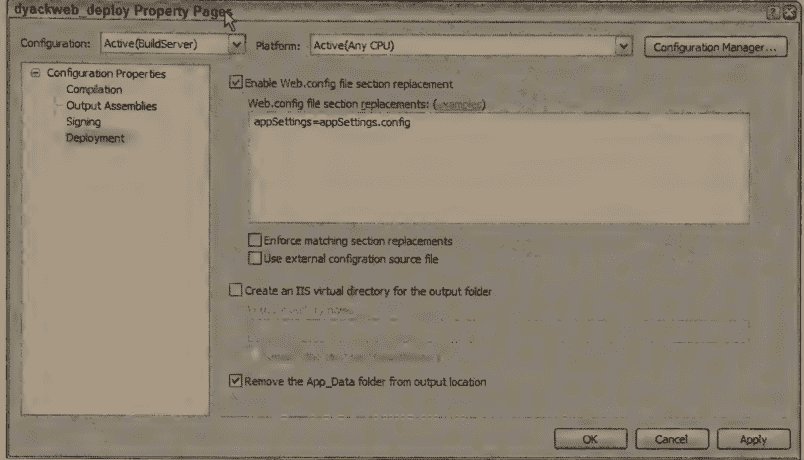

此面板上的下一个选项是能够为输出文件夹创建 IIS 虚拟目录。请记住，虽然在 ASP.NET 1.1 中通常已经存在虚拟 IIS 目录，但随着文件系统网站和开发 Web 服务器的新概念的出现，这已不再是必需的。此选项最适合在你希望本机上进行虚拟设置时使用，以便在将部署输出发送到最终服务器之前进行测试。例如，某公司可能有这样的政策：开发人员在代码签入之前使用开发 Web 服务器。此时，可能要求开发人员对发布版本使用 IIS 进行最终检查，以确保应用程序按预期工作。此选项将允许该过程作为发布生成的一部分实现自动化。替换选项几乎是强制性的，因为如果尝试创建虚拟目录时它已经存在，将会生成错误。此选项也仅适用于本地 IIS；不要误以为它能帮助你在最终的生产目标 IIS 上创建虚拟目录。

## 保护你的数据库免遭破坏！

希望这个标题引起了你的注意，让你竖起耳朵好奇我们在说什么。如本章前面所述，默认情况下，预编译和 Web Deployment Projects 会在创建的输出中放置 app_data 文件夹的副本。首次部署时这是合理的；但在此之后，除非生产环境中的数据库是只读的，否则再次部署将会破坏并替换你的生产副本。这不是你想通过惨痛教训学到的东西。此选项还设置为允许你在开发环境中用完整版 SQL Server 数据库（位于另一台服务器上）替换 SQLExpress。在这些情况下，没有理由将 app_data 文件夹部署到生产环境。

## 第 12 章

## 进一步自定义部署项目

Web Deployment Project 的一个优点是，其核心实际上只是一个 MSBuild 文件。
因此，当你通过刚才讨论的属性页进行更改时，它们会作为 MSBuild 属性或项保存到生成文件中。如果需要，你可以使用典型的 MSBuild 构造进一步自定义该过程。请记住，自定义越多，就越有可能做出与未来部署工具冲突的更改。

有关 MSBuild 的更多信息，请访问 msdn.com。你还可以在 http://msbuildtasks.tigris.org/ 上找到可与项目一起使用的其他社区任务。

## 排除 Web.config

你可能想要考虑的一个良好自定义示例是从部署文件夹中排除 web.config。在本章前面，你看到了如何修改 web.config 文件的内容，并使链接和其他环境敏感信息得以自定义。虽然这很强大，但它无法让你构建一个可以简单地复制到 QA，然后再复制到生产环境而无需修改 web.config 文件的部署文件夹。更进一步说，部署步骤的输出可以被压缩以进行归档，并允许在实际部署期间复制到各种服务器。

要实现排除 web.config，或者就此而言任何文件，你可以修改部署步骤使用的 MSBuild 文件。要访问 MSBuild 文件，请在解决方案资源管理器中右键单击 Web Deployment Project，然后选择"打开项目文件"菜单选项。这将在 Visual Studio 中打开部署项目的 MSBuild 文件以供编辑。在 `<Project>` 元素内部，添加以下内容以阻止 web.config 被包含在输出中：

```xml
<ItemGroup>
    <ExcludeFromBuild Include="$(SourceWebPhysicalPath)\web.config" />
</ItemGroup>
```

ExcludeFromBuild 元素可用于排除其他你可能不希望生成和部署的文件，只需在额外的 ExcludeFromBuild 元素中指定它们的名称即可。按照上述写法，前面的排除项将只排除站点根目录中的 web.config 文件。如果你还希望从所有子文件夹中排除它，则需要使用以下内容：

```xml
<ItemGroup>
    <ExcludeFromBuild Include="$(SourceWebPhysicalPath)\**\web.config" />
</ItemGroup>
```

在路径中插入 `**` 会使该排除项应用于子文件夹。这也同样适用于站点根目录。

使用 ExcludeFromBuild 可能并不总是适用于你所做的事情，特别是对于 web.config 文件。例如，如果你依赖于 web.config 中指定的控件引用，此方法可能无效。通过使用 ExcludeFromBuild，web.config 在页面编译期间将不可用，并会导致生成错误。

首先，如果你不熟悉在 web.config 中包含控件的新选项，我们先快速看一个示例。ASP.NET 2.0 的新功能之一是能够在 web.config 中包含对控件的引用。

## Web 部署项目的扩展点

上一节中的示例是对部署项目生成文件中指定项的修改。另一种自定义选项是使用一些 MSBuild 目标，这些目标专门用于为您提供*扩展点*。（这些扩展点是生成脚本中有意调用的特殊目标，允许您自定义生成过程。）

如果您想进一步了解 Web 部署项目的工作原理，首先要做的就是查看随安装一起提供的目标文件。您可以在安装目录中找到它，通常位于 c:\Program Files\MSBuild\Microsoft\WebDeployment\v8.0\Microsoft.WebDeployment.targets。

在那里，您会看到几个已定义的目标，这些目标可以在项目的部署文件中重新定义，以便在每个扩展点调用您自己的 MSBuild 任务。

一些现有的扩展点如下：

| 目标 | 说明 |
|---|---|
| BeforeBuild | 在生成开始前进行控制；大多数目标（_prepareBuild 除外）尚未完成 |
| AfterBuild | 在所有与生成相关的目标完成后进行控制 |
| BeforeMerge | 在调用合并目标之前进行控制 |
| AfterMerge | 在合并目标完成后进行控制 |

## 第 12 章

为了继续我们之前尝试从输出目录中移除 web.config 的练习，我们将重新定义 AfterBuild 事件，并使用 MSBuild Delete 任务来完成删除。由于 AfterBuild 在编译完成后调用，因此我们应该能够避免使用其他方法时遇到的错误。以下是我们将在项目文件中添加的额外行，以替代 ExcludeFromBuild：

```
<Target Name="AfterBuild">
    <Delete Files="$(WDTargetDir)\web.config" />
    <Message Text="delete task ran for $(WDTargetDir)\web.config" />
</Target>
```

重要的是，这需要在导入 WebDeployment.targets 文件之后添加；否则，您重新定义的目标将永远不会被调用，因为它会被 WebDeployment.targets 文件中的空白定义覆盖。

## 创建 Zip 存档

利用 AfterBuild 扩展点的另一个示例是添加一个任务，将刚刚生成的网站打包成 zip 格式。MSBuild 本身不包含 Zip 任务，但社区已经有了一些成果，创建了若干额外的任务，您可以将其作为 MSBuild Community Project 的一部分来安装，该项目可从 http://msbuildtasks.tigris.org/ 下载。

在本示例中，我们将使用社区项目中的两个 MSBuild 任务。我们将使用 Zip 来创建 Zip 存档，并使用 Version 来获取版本号以命名存档文件。为了能在 MSBuild 文件中使用这些任务，我们必须确定包含自定义任务的程序集所在的位置。为此，我们在生成文件中添加 UsingTask 语句，如下例所示：

```
<UsingTask AssemblyFile="C:\Program Files\MSBuild\MSBuildCommunityTasks\MSBuild.Community.Tasks.dll"
           TaskName="MSBuild.Community.Tasks.Version"/>
<UsingTask AssemblyFile="C:\Program Files\MSBuild\MSBuildCommunityTasks\MSBuild.Community.Tasks.dll"
           TaskName="MSBuild.Community.Tasks.Zip"/>
```

下一个示例展示了我们的 AfterBuild 目标，它创建一个目录，获取生成的版本号，然后将所有文件打包成 zip 存档：

```
<Target Name="AfterBuild">
    <MakeDir Directories="$(Configuration)Zip" />
    <Version VersionFile="build.number" RevisionType="Increment">
      <Output TaskParameter="Major" PropertyName="Major" />
      <Output TaskParameter="Minor" PropertyName="Minor" />
      <Output TaskParameter="Build" PropertyName="Build" />
      <Output TaskParameter="Revision" PropertyName="Revision" />
    </Version>
    <Message Text="Version: $(Major).$(Minor).$(Build).$(Revision)" />
    <CreateItem Include="$(Configuration)\**\*.*" >
      <Output ItemName="DeployZipFiles" TaskParameter="Include" />
    </CreateItem>
    <Zip Files="@(DeployZipFiles)" WorkingDirectory="$(Configuration)"
         ZipFileName="$(Configuration)Zip\$(MSBuildProjectName)-$(Major).$(Minor).$(Build).$(Revision).zip" />
</Target>
```

在上面的示例中，我们使用内置的 `MakeDir` 任务创建一个目录来存储我们的 zip 存档。使用预定义属性 `$Configuration`，我们将创建一个目录，名称根据运行的生成可能是 `DebugZip` 或 `ReleaseZip`。

MSBuild Community Project 有一个 Version 任务，我们用它来获取传统的版本号，格式为 `Major.Minor.Build.Revision`。此任务会将上次生成的编号存储在 `build.number` 文件中，我们在 Version 任务上使用 `VersionFile` 属性指定了该文件。

> 第一次运行时，您可能会注意到在生成输出中找不到 `build.number` 文件。该文件应该会在此时为您创建。

接下来，我们使用内置的 Message 任务将版本号输出到生成输出。如果别无他用，Message 任务对于在生成输出日志中记录事件非常方便。根据您的生成详细程度设置，您可能在生成日志中看不到该消息。有关如何更改生成详细程度的信息，请参阅本章后面标题为"打开 MSBuild 调试"的部分。

在调用 Zip 任务之前，我们使用 `CreateItem` 来帮助我们收集要包含在 zip 中的文件列表。`CreateItem` 是一个内置任务，允许您创建项集合。在 `WebDeployment.targets` 文件中，会创建一个类似的集合，名为 `PrecompiledOutput`。您可以使用它，但如果您在输出目录中添加或移除了任何项，那么这些项将不会被包含在 `PrecompiledOutput` 项集合中。

最后，使用 MSBuild Community Project 中的 Zip 任务，我们创建 zip 存档。您可能会注意到，我们在任务上指定了 `WorkingDirectory` 属性，这允许 zip 存档以站点内容作为根目录。通过这样做，我们的 zip 存档可以直接解压到主机上的部署目录中，而无需考虑父文件夹层次结构。

这个示例可能不适用于所有场景，但它提供了另一个视角，展示了使用 Web 部署项目中扩展点的强大功能。

## 打开 MSBuild 调试

在与 ASP.NET 团队合作了解如何进一步自定义部署项目时，他们向我介绍了一个可以打开以从 MSBuild 获取更多详细信息的选项。要访问此功能，请选择**工具**⇨**选项**⇨**项目和解决方案**⇨**生成并运行**。在此面板上有一个下拉菜单（MSBuild 项目生成输出详细程度），您可以从中选择希望从 MSBuild 看到的详细程度。诊断级别会在您处理 MSBuild 相关问题时检索到大量有用的信息。此选项并非特定于我们讨论过的任何部署选项，事实上，它可以用于您的典型项目，以查看后台发生的情况。


 ## 准备你的服务器

关于为生产服务器做准备所需的完整讨论超出了本书的范围。然而，由于这似乎是当你开始谈论部署时最常见的一个问题，我们想简要谈谈将 ASP.NET 2.0 应用程序部署到生产服务器所需的内容。

所需的首要关键组件是 .NET 2.0 Framework。你可以从微软下载网站下载它。你不需要在 production server 上安装 Visual Studio 2005 甚至 .NET 2.0 SDK；只需要框架即可。

另一个常见问题是关于是否具备在旧版本上运行 2.0 .NET runtime 的能力。简短的回答是完全可以；它们可以共存。事实上，在 2.0 版本中为此功能所做的工作比之前的版本多得多。如果你在 IIS 上点击托管应用程序的网站或虚拟目录的属性，在安装 2.0 Framework 后，你将看到一个新的 ASP.NET 选项卡。如图 12-11 所示，使用此选项卡你可以选择应用程序将使用的 runtime 版本。

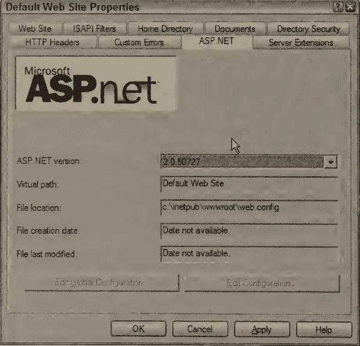

图 12-11

需要注意的是，如果你正在使用 IIS 6 并且你的 2.0 应用程序将与使用不同版本 .NET runtime 的应用程序共存，那么你必须至少在 IIS 应用程序池中为每个 .NET 版本隔离这些应用程序。简单来说，你不能在同一个 IIS 应用程序池中运行多个 .NET runtime 版本。

## 总结

Visual Studio 2005 和 ASP.NET 提供了显著改进的应用程序部署支持，无论你部署的目标是什么，也不管你的项目大小如何。在本章中，我们回顾了大多数可用的技术，并讨论了每种方法的优缺点。

具备预编译网站的功能，甚至包括标记的编译，这样你就不必让页面源代码暴露给窥探者，这是一个巨大的进步。使用新的编译模型以及将程序集颗粒度细化到每个文件或控件的能力，也赋予了你很大的力量，以至于 ASP.NET 团队也推出了自己的 hack，这对于那些希望更严格控制部署文件夹构建的人来说将是救星。

部署不必难，但应该是可重复的。如果你从本章中学到了什么，那就是所有真实的 Web 项目都应该解决部署问题。不要依赖你的开发人员，或者你自己，在不使用本章讨论的一些能力的情况下实施一致的部署流程。

Web 部署项目概念很简单；使用本章的指导，在新 Web 项目中设置它应该只需要几分钟。请记住，截至本文撰写时，它仍处于 beta 阶段，所以你应该在 www.wrox.com 上检查是否有任何更改。

### 其他部署资源

访问 www.wrox.com 获取任何勘误。

- 下载 Web 部署项目（Beta V2 预览版）：http://msdn.microsoft.com/asp.net/reference/infrastructure/wdp/default.aspx.
- MSDN 上的 MSBuild 任务列表参考：http://msdn2.microsoft.com/7z253716.aspx.
- MSBuild 社区任务项目：http://msbuildtasks.tigris.org/.

## 利用 Visual Studio

Visual Studio 2005 提供了许多功能，使你在开发过程中更加高效。事实上，它有几种新的可扩展性功能，帮助你创建自己的 hack，包括代码片段、自定义页面模板以及各种设置来定制你的开发环境。

本章介绍了 Visual Studio 2005 的代码片段功能，包括如何使用代码片段管理器、如何创建自定义片段以及如何创建使用内置函数的片段。

本章的一部分讨论了可以帮助你在 Visual Studio 2005 中提高工作效率的设置。你将学习如何让 Web 窗体以设计视图显示，而不是默认的 HTML 视图，以及你将学习如何设置 Cassini Web 服务器。如果你在团队中工作，本章展示了如何导入和导出所有 Visual Studio 2005 的设置，以便团队中的每个人都可以导入设置，使他们的开发环境以相似的方式工作。

除了获得 Visual Studio 2005 环境最大效益的额外提示，我们将查看模板，即预制的代码，用于项目项或整个项目。每次你创建新项目或将新项目项添加到项目中时，你都在使用模板。例如，Windows 应用程序、网站和控制台应用程序项目向导是随 Visual Studio 2005 提供的模板。你将学习如何创建自定义项模板以及如何创建整个项目模板。在这个过程中，我们将在讨论中注入未记录的提示，以帮助你更高效地使用如代码片段和模板之类的工具。

### ASP.NET 代码片段

*片段*（snippet）是你可以在许多不同应用程序中重用的代码片段。Visual Studio 2005 内置了对片段的支持，包括片段库、片段管理控制台和用于包含片段编辑器快捷方式。

## 使用片段

你可以在 Web 应用程序中使用片段，无论是 C# 还是 VB.NET 语言。VB.NET 大约有 500 个片段可供选择，按几个类别组织。C# 片段较少，但它们同样有用。显然，这是 C# 社区贡献并添加更多片段的良机。有一点很明确：VB.NET 中可用的众多片段证明了在片段领域存在巨大的重用潜力（以及新 hack）。Visual Studio 2005 还支持在 XML 编辑器中使用 XML 片段。

XML 编辑器也支持 XML 片段。

无论你使用哪种语言，都有几种不同的方法可以将现有片段插入代码。注意我用了“existing”这个词，意味着可以添加更多。本章后面名为“创建自定义片段”的部分将向你展示如何创建自己的自定义片段。正如你将看到的，你可以通过从上下文菜单中选择选项、输入问号（？）并按下 Tab 键（仅限 VB.NET）来添加片段，或者熟悉片段快捷名称的人可以输入快捷名称并按 Tab 键。

### 使用预制作片段

许多片段都有供你填写的参数。例如，C# 属性片段具有类型、后备存储名称和属性名称的参数。要尝试这一点，打开 C# 类文件并在类声明内的编辑器中单击。输入 `prop`（IntelliSense 将在你完成前出现），按 Tab 接受 IntelliSense 推荐，然后再次按 Tab 使片段模板出现。当你填写类型时，它也会更改属性类型。指定类型后，按 Tab 更改变量名，这也更改了与该变量一起工作的访问器代码。输入变量名后，再次按 Tab 以给属性命名。你可以继续按 Tab 循环浏览参数并更改之前的输入，然后按 Enter 停止编辑片段。

### 创建自定义片段

虽然有许多预制作的片段可供选择，但许多开发者可能希望创建自己的片段以便重用。此外，如果你创建了属于自己的 hack，发布该 hack 的一种方式可能是通过你可以与他人分享的片段。本节提供了一些关于如何创建自己片段的提示。

片段模板格式在 Visual Studio 2005 帮助系统中记录，你可以将其复制并粘贴到文件中，然后更改相关信息以创建自己的片段。然而，一种稍微快一点的技术利用了 XML 中支持片段的事实。以下是步骤：

1. 创建一个 XML 文件并将其命名为 `<snippetName>.snippet`，其中 `<snippetName>` 是你想要创建的片段的有意义的名称。
2. 在新文件中右键单击并选择插入片段。
3. 在 IntelliSense 面包屑导航中，输入 `Snippet` 并按 Enter。


 4. 填写每个字段，然后按 Tab 键跳转到下一个字段。
5. 将 Code 元素的 Language 属性更改为与要构建的代码片段相对应的适当语言。
6. 完成后按 Enter 键。

清单 13-1 展示了一个你可以在自定义控件中使用的 ViewState 属性代码片段。

## 清单 13-1：用于构建以 ViewState 作为后备存储的属性的代码片段

```
<?xml version="1.0" encoding="utf-8" ?>
<CodeSnippet Format="1.0.0"
    xmlns="http://schemas.microsoft.com/VisualStudio/2005/CodeSnippet">
    <Header>
        <Title>propViewState</Title>
        <Author>John Smith</Author>
        <Shortcut>propViewState</Shortcut>
        <Description>Property with ViewState backing store</Description>
        <SnippetTypes>
            <SnippetType>Expansion</SnippetType>
        </SnippetTypes>
    </Header>
    <Snippet>
        <Declarations>
            <Literal>
                <ID>type</ID>
                <ToolTip>Property type</ToolTip>
                <Default>int</Default>
            </Literal>
            <Literal>
                <ID>property</ID>
                <ToolTip>Property name</ToolTip>
                <Default>MyProperty</Default>
            </Literal>
            <Literal>
                <ID>comment</ID>
                <ToolTip>Property Comment</ToolTip>
                <Default></Default>
            </Literal>
            <Literal>
                <ID>defaultValue</ID>
                <ToolTip>Property default value</ToolTip>
                <Default>"Default Value"</Default>
            </Literal>
        </Declarations>
        <Code Language="csharp">
            <![CDATA[
/// <summary>
/// $comment$
/// </summary>
public $type$ $property$
{
    get
    {
        if (ViewState["$property$"] == null)
            return $defaultValue$;
    
        return ($type$) ViewState["$property$"];
    }
    set
    {
        ViewState["$property$"] = value;
    }
}
$end$
]]>
</Code>
</Snippet>
</CodeSnippet>
```

构建代码片段时，请务必为 Description 和 ToolTip 元素填写有意义的信息。这将帮助其他开发人员了解代码片段的功能，并使每个参数在使用时更易于理解。如果在添加代码片段时只显示了部分内容，请仔细检查 Code 元素中的 ID，确保每个参数都被 $ 符号包围。

## 管理代码片段

代码片段创建后，你需要将其加载到 IDE 中。Visual Studio 2005 包含一个代码片段管理器，可以通过选择“工具”->“代码片段管理器”打开。或者，你可以按 Ctrl+K，然后按 Ctrl+B。这将打开如图 13-1 所示的“代码片段管理器”对话框。

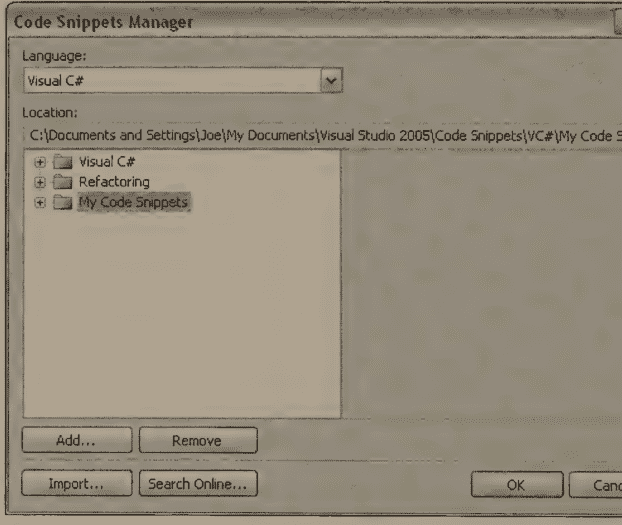

使用代码片段管理器时，请务必在“语言”下拉列表中选择正确的语言（Visual Basic、Visual C#、Visual J# 或 XML）。“添加”按钮会打开一个对话框，你可以从中选择一个文件夹，该文件夹将被添加到列表中。打开该文件夹时，其中的所有代码片段都会显示出来。它也包括子文件夹。这仅适用于文件夹，不适用于单个文件。

如果你想添加单个代码片段文件，例如清单 13-1 中的那个，请单击“导入”按钮。它将打开一个对话框，使你能够导航并选择一个代码片段文件。选择文件后，将出现如图 13-2 所示的“导入代码片段”对话框，询问你想将代码片段添加到哪个文件夹。勾选你希望添加代码片段的文件夹，然后单击“完成”按钮。你可能将一个代码片段添加到多个文件夹。例如，假设你想将属性列在语言文件夹中，并且由于编写属性的方式如此之多，将它们也保留在属性文件夹中。回到“代码片段管理器”对话框，打开每个已勾选的文件夹，都会显示新的代码片段。虽然单个代码片段可以添加到多个文件夹，但 IntelliSense 足够智能，在将代码添加到代码中时只会显示一次。

> XML 代码片段的 Language 元素的默认值是 XML。如果你忘记将其更改为正在使用的语言，“导入代码片段”对话框将只显示 XML 代码片段的文件夹。一旦你正确更改了 Code 元素的 Language 属性，正确的语言文件夹就会出现在“导入代码片段”对话框中。

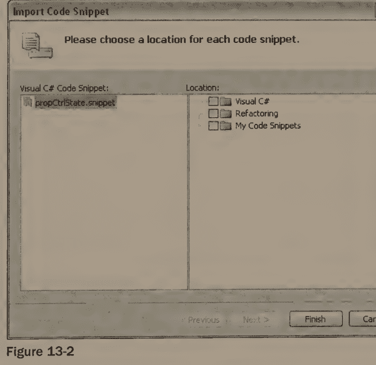

图 13-2

如果你更改了代码片段并需要替换旧副本，请再次执行导入操作。单击“完成”时，系统会通知你该代码片段已存在，并询问你是要覆盖还是重命名现有片段。按“覆盖”按钮替换旧片段，或按“重命名”按钮重命名旧片段并插入新片段。

与“添加”功能类似，“删除”按钮仅对文件夹操作。它将从列表中移除选定的文件夹。但要小心：它不会询问“确定吗？”。因此，点击此对话框查看会发生什么时要谨慎。如果执行了不确定的操作，请单击“取消”按钮，重新打开“代码片段管理器”重新开始。

虽然代码片段管理器允许你删除整个文件夹，但它不允许删除单个代码片段。你必须从它被添加到的每个文件夹中物理删除该文件。“代码片段管理器”对话框的“位置”部分显示了代码片段在文件系统上的存放位置。只需转到该位置并删除文件。如果在删除代码片段时“代码片段管理器”对话框处于打开状态，你需要关闭并重新打开它以确认该代码片段不再显示。

“在线搜索”按钮会打开帮助系统，其中包含外部参考链接，你可以在其中找到更多代码片段。

## 使用代码片段函数

函数是代码片段的另一个功能，它们在代码片段执行时动态注入上下文相关的代码。例如，`GenerateSwitchCases` 函数会将 case 语句注入到具有枚举参数的 switch 语句中，为枚举的每个值生成一个 case。要测试它，请创建一个 `enum` 类型的变量，键入 switch，按 Tab，然后在 `switch_on` 参数中使用该枚举变量。

由于 `GenerateSwitchCases` 函数非常专业化，因此不太可重用。然而，其他函数如 `ClassName`、`SimpleTypeName` 和 `CallBase`（均有文档记录）可以在其他代码片段中重用。例如，清单 13-2 展示了一个使用 `ClassName` 函数实现 `Dispose` 模式的代码片段。

## 清单 13-2：使用函数的代码片段

```
<?xml version="1.0" encoding="utf-8" ?>
<CodeSnippet Format="1.0.0"
    xmlns="http://schemas.microsoft.com/VisualStudio/2005/CodeSnippet">
    <Header>
        <Title>dispose</Title>
        <Author>John Smith</Author>
        <Shortcut>dispose</Shortcut>
        <Description>Implements the Dispose pattern</Description>
        <SnippetTypes>
            <SnippetType>SurroundsWith</SnippetType>
            <SnippetType>Expansion</SnippetType>
        </SnippetTypes>
    </Header>
    <Snippet>
        <Declarations>
            <Literal>
                <ID>type</ID>
                <ToolTip>Destructor</ToolTip>
                <Function>ClassName()</Function>
            </Literal>
        </Declarations>
        <Code Language="csharp">
            <![CDATA[
// TODO: Make type implement IDisposable

// has Dispose been called yet
private bool disposed;

/// <summary>
/// TODO: Dispose may or may not have been overridden
/// depending on whether this is a stand alone class,
/// base class or a derived class.
/// Implement virtual Dispose method for base class
/// and implement override methods for derived
/// classes, as appropriate.
/// </summary>
public override void Dispose()
{
    Dispose(true);
    GC.SuppressFinalize(this);

    // TODO: call base.Dispose() if override
}

public void Dispose(bool calledFromUser)
{
    // only the first time
    if (!disposed)
    {
        // called from Dispose() - not destructor
        if (calledFromUser)
        {
            // release managed resources
        }

        // release unmanaged resources

        disposed = true;

        // TODO: call base.Dispose(calledFromUser) if override
    }
}

~$type$()
{
    Dispose(false);
}
$end$
]]>
</Code>
</Snippet>
</CodeSnippet>
```

清单 13-2 中的代码使用了 ClassName 函数，该函数返回包含类的名称。注意 Literal 元素中的 `<Function>ClassName()</Function>` 元素。不需要 Default 元素，那将是多余的。当代码片段运行时，每个 ID 与函数匹配的参数都将被该函数的结果替换。


## 第13章

## 让你的生活更便捷的设置

Visual Studio 2005 提供了众多选项以帮助您最大限度地提高生产力。本节将介绍几个在构建 Web 应用程序时特别有用的选项。

## 源视图与设计视图

Visual Studio 2005 的默认视图是 HTML，这与 Visual Studio 2003 中默认显示设计视图的 Web 窗体有所不同。要更改此设置，请选择“工具”»“选项”»“HTML 设计器”»“常规”，然后单击“设计视图”选项。从现在起，Web 窗体将在设计视图中显示。

## 使用不同的 Web 服务器

在 Visual Studio 2005 中，您不再依赖外部 Web 服务器，因为 IDE 中已内置了一个 Web 服务器。但是，有时您可能希望使用其他 Web 服务器，因为您的部分用户可能正在使用其他服务器。特别是，一些用户可能在其系统上部署了开源的 Cassini Web 服务器。您会希望使用 Cassini 测试您的应用程序，以确保其能正常运行。

有人可能会想，既然 Visual Studio 2005 已包含内置 Web 服务器，为何还要使用 Cassini。然而，请考虑这样一个事实：Cassini 是开源的，可能有人创建了自定义实现并希望继续提供某些服务。例如，一种可能的修改是允许外部计算机连接到 Cassini，而内置的 Visual Studio 2005 Web 服务器不允许这样做。

您可以在 ASP.NET 社区网站 www.asp.net 上找到 Cassini Web 服务器。请在“下载”部分查找。按照说明编译代码，但请务必通过 .NET v2.0 命令提示符进行。如果您尝试运行使用早于 v2.0 版本的 C# 编译器编译的 Cassini 版本，它将无法与您的 Visual Studio 2005 网站一起工作。运行 Cassini 时，将物理路径设置为网站的位置，并将虚拟目录设置为 `/`。请记住设置一个与您机器上现有端口不冲突的端口号。大多数情况下，使用 8080 端口是可以的，除非有其他应用程序正在使用该端口，否则不会引起问题。

要配置 Visual Studio 2005，请在解决方案资源管理器中右键单击您的项目，选择“属性页”»“启动选项”；在“服务器”区域，单击“使用自定义服务器”；然后在“基本 URL”文本框中输入 **http://localhost:8080**，如图 13-3 所示。请记住将“基本 URL”文本框中的 8080 替换为 Cassini 启动时使用的实际端口号。

将 Cassini 配置为 Web 服务器后，在 Visual Studio 2005 中按 Ctrl+F5 即可在不调试的情况下启动应用程序。如果您希望调试应用程序，请将服务器选项改回“使用默认 Web 服务器”。

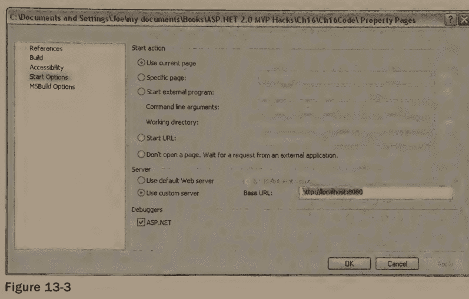

图 13-3

## 导入和导出团队设置

Visual Studio 2005 允许您导出和导入几乎所有可配置的 IDE 设置的系统设置。以下是您可能希望使用此功能的一些原因：

-   为了从系统崩溃中恢复，您可以导出最新版本的设置并将其备份。当您重建系统时，可以从备份副本导入这些设置，使您的环境恢复原样。
-   当您需要将设置传输到另一台计算机（例如笔记本电脑）时，可以导出设置。然后在另一台计算机上导入这些设置，并以相同的方式使用 Visual Studio 2005。
-   在团队环境中，开发人员经常在项目上互相帮助。通过从一台计算机导出通用设置并在所有开发人员的计算机上导入，每个环境都可以保持相似。这可以在您帮助他人解决问题时节省时间。在结对编程场景中，拥有共同的环境使得程序员更容易在对方的环境中工作，而无需每次在另一台计算机前工作时都进行调整。一致性有助于提高生产力。

要使用设置工具，请选择“工具” > “导入和导出设置”。其余步骤是简单的向导操作。如果您希望恢复到标准系统设置，请运行“导入和导出设置”工具并选择“重置所有设置”选项。

另一种导入设置的方法是选择“工具” > “选项” > “环境” > “导入和导出设置”，勾选“使用团队设置文件”，然后浏览并选择设置文件。当您单击“确定”时，Visual Studio 2005 将应用新的设置。

### 模板

模板是预制的项和项目，可帮助您快速开始某项任务。典型的项目模板包括用于新建网站或新建安装项目的模板。常见的项模板包括 Web 窗体、类文件或用户控件的模板。本节将展示如何创建自定义的项和项目模板，并描述工具限制的变通方法，以便您更轻松地完成工作。

## 自定义项模板

Visual Studio 包含许多可重用的模板，用于向项目添加项，例如“新建 Web 窗体”和“类文件”。这些是人们在日常工作中最常见的任务。但是，如果我们能创建自己的自定义项就更好了。例如，如果您想创建一个代码片段模板或一个可释放类模板怎么办？在本节中，您将学习如何创建一个新的代码片段模板，以便快速启动您自己的代码片段。

在本章前面的部分“创建自定义代码片段”中，您学习了如何通过向项目添加 XML 模板并修改它来创建代码片段。在本节中，您将学习如何更进一步，创建自己的项模板，使创建代码片段变得更加容易。首先要做的是创建一个要用作模板的文件。清单 13-3 提供了一个建议的代码片段模板。

### 清单 13-3：代码片段模板

```
<?xml version="1.0" encoding="utf-8" ?>
<!--
    To get started:
        1. Right-click below and select Insert Snippet
        2. Type Snippet
        3. Press Enter
        4. Follow template to create snippet
-->
```

将文件保存为 **SnippetFile.snippet**。可选地，您还可以创建一个图标文件，以便在“新建项”对话框中显示该代码片段时关联使用。要将此代码片段加载到 Visual Studio 2005 中，请选择“文件” > “导出模板”，选择“项模板”，选择项目和模板类型，然后单击“下一步”按钮。

在“选择要导出的项”屏幕中，选择 `SnippetFile.snippet`，或为您要创建模板的文件命名的任何名称，然后单击“下一步”按钮。“选择项引用”页面用于检查当添加此代码片段时，项目应引用哪些程序集。例如，如果您的代码片段使用了 ADO.NET 类型，您就需要勾选 `System.Data` 程序集的框。

在“选择要导出的项”窗口中，如果您创建了新的图标，请选择它。否则，您可以使用默认图标。输入 **SnippetFile.snippet** 作为名称。包含文件扩展名（.snippet）非常重要，这样当用户将项添加到项目时，它才会在向导中显示。如果您希望模板出现在 Visual Studio 2005 的“新建项”对话框中，必须勾选“自动将模板导入 Visual Studio”。单击“完成”按钮以创建新的代码片段模板。

现在，您可以通过右键单击项目名称并选择“添加新项”来使用此代码片段。代码片段模板出现在模板列表的“我的模板”部分。您可以通过更改“名称”字段并单击“确定”按钮将代码片段模板添加到项目中来重命名文件。

-   导出模板向导的一个不便之处在于它不提供单独指定名称和文件扩展名的功能。这导致代码片段模板在模板列表中显示为 Snippet.snippet。如果显示为 Snippet File 会更合理。如果您在导出模板向导中将名称设置为 Snippet，那么在“添加新项”对话框中，文件名将缺少文件扩展名。解决方法是手动更改文件。

-   代码片段模板实际位于 `C:\Documents and Settings\%user%\My Documents\Visual Studio 2005\My Exported Templates` 中的一个 zip 文件中。要修改模板的内容，请从 zip 文件中提取文件。打开名为 MyTemplate.vstemplate 的文件，并将 Name 元素更改为 **Snippet File**。然后选择每个文件并将它们添加到一个名为 SnippetFile.snippet.zip 的新 zip 文件中。用这个新的修改后的文件替换原始的 SnippetFile.Snippet.zip。为了整洁，请删除中间文件，以免文件系统中留有未使用的残留物。现在将新模板复制到 `C:\Documents and Settings\%user%\My Documents\Visual Studio 2005\Templates\ItemTemplates\Visual Studio 2005\CSharp` 并替换那里的 SnippetFile.snippet.zip 文件。此过程将替换导出模板向导添加此代码片段模板的所有位置。如果您使用的是其他语言，请务必将路径更改为该语言模板的位置。当选择“添加新项”时，您现在将在模板列表中看到 Snippet File，并且文件名仍带有 .snippet 扩展名。

## 自定义项目模板

-   除了单个项模板，您还可以创建自定义项目模板。如果您能找到一种更好的方法来设置启动项目，您可能希望创建一个自定义项目模板。就本节而言，示例项目基于第2章中的建议。在启动项目时，为了正确配置项目，您将进行许多操作，使用一个好的项目模板可以为您节省时间和精力。

-   制作项目模板时，您应该做的第一件事是创建一个新项目。添加您希望所有此类项目都具有的文件夹和文件。本章的示例代码创建了一个项目模板，该模板包含一个 `App_Code` 文件夹（其中包含用于主控页和页代码隐藏类的基类）、一个带有基本主题的 `App_Themes` 文件夹，以及一个使用主控页的默认 Web 窗体。

-   项目的用途将指导您添加什么。例如，如果您想要一个所有人都能使用的项目，您会使其更具通用性。但是，如果您需要的东西仅用于您的公司或部门，您可以对主控页进行特定的自定义，为特定数据库创建数据库项目，或执行与项目预期受众需求相关的任何其他操作。

-   要创建项目模板，请选择“文件”->“导出模板”，选择“项目模板”，然后单击“下一步”按钮。在“选择模板选项”窗口中，添加新的模板名称和模板描述，确认已勾选“自动将模板导入 Visual Studio”，并可选地取消勾选“在输出文件文件夹上显示资源管理器窗口”。与项模板不同，您不必担心在名称中包含文件扩展名，因为这是项目名称，与单个文件无关。单击“完成”按钮将创建一个新的 Web 项目。

-   要使用此 Web 项目，请选择“文件”->“新建”->“网站”，然后在“我的模板”下选择新的项目模板。请注意，这只会显示为网站项目，而不会出现在其他项目类型下。


## 第13章

另外，你也可以从现有项目创建项目模板。如果你有一个小型项目，其中已经包含了其他项目所需的一切内容，这是一个不错的选择。缺点是在创建项目模板后需要对其进行修改。你只需使用前面段落中介绍的“导出模板向导”即可。

从现有项目创建项目模板时，项目中可能包含一些你不希望保留的文件。该向导不提供选择包含内容的选项。解决此问题的方法是修改生成的模板文件。

要修改项目模板，请展开位于 `C:\Documents and Settings\%user%\My Documents\Visual Studio 2005\My Exported Templates` 的 zip 文件。打开 `*.vstemplate` 文件，可以观察到其中有多个 `ProjectItem` 元素。删除那些 `TargetFileName` 属性对应于你需要从项目中排除的文件名的 `ProjectItem` 元素。`*.vstemplate` 文件的其余格式有文档说明，因此你应该参考文档以了解文件的其余部分含义，以及是否有任何需要更改的内容。就本讨论而言，删除不需要的 `ProjectItem` 元素就已足够。

对于每个删除的 `ProjectItem` 元素，请在文件系统中删除其对应的文件。这些文件从 zip 文件中提取，并强制转换为 MS-DOS 8.3 命名格式，因此名称并不总是完全匹配。如有疑问，请打开文件并查看其内容以确认。

修改完成后，将文件重新压缩为与项目模板同名的压缩文件。然后替换 `C:\Documents and Settings\%user%\My Documents\Visual Studio 2005\My Exported Templates` 和 `C:\Documents and Settings\%user%\My Documents\Visual Studio 2005\Templates\ProjectTemplates\Visual Studio 2005\CSharp` 两个位置的 zip 文件。

## 总结

代码片段是一种方便的打包和分发你自己技巧的方式。Visual Studio 2005 支持预先生成的代码片段和自定义代码片段。你可以使用代码片段管理器来添加、组织和管理代码片段。

Visual Studio 2005 有许多功能可以改善用户体验。你可以导入和导出设置，针对设计视图或源代码视图自定义开发体验，甚至还可以设置环境以使用其他 Web 服务器（如 Cassini）运行。

另一种自定义环境并可能分发技巧的方式是通过模板。你可以创建单独的项模板或自定义项目模板。

## 第14章：安全技巧

当大多数人发布新网站时，他们都充满乐观，期待成功实现最初设想的目标。不幸的是，在当今世界，个人和公司的希望可能会瞬间被怀有恶意的人破灭。现实是，构建网站的一部分就是考虑安全性。需要问的不是网站"是否会"受到攻击，而是"何时"会受到攻击。如果希望取得成功，每个人都必须将安全性作为 Web 应用程序需求的组成部分。

本章包含一些用于更好地强化系统的技术。其中的几项技巧针对一种特别阴险的攻击——*SQL 注入攻击*——包括下一节"避免 SQL 注入"中的第一项技巧。本章还包括一项相关技巧，使你能够对 SQL IN 表达式进行参数化，这是避免 SQL 注入的另一种方法。你还会找到几项处理*规范化攻击*的技巧——这些攻击涉及试图绕过正常地址和文件名检查的 URI。对于那些拥有操作系统资源（如受 Windows 身份验证保护的系统上的文件）的人，本章包含一项可以使用的模拟技巧。最后但同样重要的是，有一项扩展 ASP.NET 登录控件以验证强密码的技巧。当然，安全领域还有更多内容需要涵盖，但希望本章的技巧能为你提供一些重要的可重用代码和技术，并激发你自己思考如何使应用程序更加安全。

## 避免 SQL 注入

将 Web 应用程序暴露在互联网上时，你会遇到的较为严重的威胁之一是 SQL 注入攻击。黑客通过在输入字段中添加额外信息来发起这种类型的攻击。你的代码随后会将这些额外输入解释为发送到数据库的 SQL 的一部分。

例如，图 14-1 显示了一个输入表单，其中一名黑客试图通过插入以下字符串来进行攻击：

```
', ''); drop table MyTable;--
```

黑客希望代码执行一些不安全的操作，例如将输入与 SQL 语句连接，动态构建 SQL 字符串。在很多情况下，代码中确实会发生这种情况，本节提供了一些关于如何避免此问题的建议。

> 通过 SQL 注入，攻击者不难快速提取数据，然后弄清你的整个数据库架构。要了解他们是如何做到的，请访问你常用的搜索引擎，以"SQL 注入"为关键词开始搜索。


在图 14-1 中，示例有两个按钮："糟糕的添加发货商"和"正确的添加发货商"。黑客希望他提交页面时执行如清单 14-1 所示的代码。"糟糕的添加发货商"按钮将运行清单 14-1 中的代码。

### 清单 14-1：构建临时 SQL 查询的错误方式

```csharp
protected void btnBadAddShipper_Click(object sender,chan EventArgs e)
{
    string connStr = "Server=(local);Database=Northwind;Integrated Security=SSPI";

    // this is *bad* because the user can
    // enter anything they want
    string cmdStr =
        "insert into Shippers (CompanyName, Phone) values ('" +
        txtCompanyName.Text + "', '" + txtPhone.Text + "')";

    using (SqlConnection conn = new SqlConnection(connStr))
    using (SqlCommand cmd = new SqlCommand(cmdStr, conn))
    {
        conn.Open();
        cmd.ExecuteNonQuery();
    }
}
```

清单 14-1 中的代码不好，因为它将输入与其余 SQL 语句连接起来。这导致生成的 SQL 命令被发送到数据库，如下所示：

```sql
insert into Shippers (CompanyName, Phone) values ('', ''); drop table MyTable;--',
'')
```

该语句的第一部分向 Shippers 表添加了一个包含空白值的新行。第二部分在第一个分号(;)之后，从数据库中移除了 MyTable 表。语句的其余部分在第二个分号之后被注释掉，以防止错误。

如你所见，攻击者可以对你的系统造成很大损害，或者查看他们不应该看到的信息。更糟糕的是，虽然这个例子可能不完全明显，但通过 SQL 注入，攻击者有可能接管你的整个系统。

要解决这个问题，你需要使用参数，如清单 14-2 所示。当用户点击图 14-1 中的"正确的添加发货商"按钮时，它会运行清单 14-2 中所示的 `btnGoodAddShipper` 方法。

### 清单 14-2：构建临时 SQL 查询的正确方式

```csharp
protected void btnGoodAddShipper_Click(object sender, EventArgs e)
{
    string connStr = "Server=(local);Database=Northwind;Integrated Security=SSPI";

    // this is good because all input becomes a
    // parameter and not part of the SQL statement
    string cmdStr =
        "insert into Shippers (CompanyName, Phone) values (" +
        "@CompanyName, @Phone)";

    using (SqlConnection conn = new SqlConnection(connStr))
    using (SqlCommand cmd = new SqlCommand(cmdStr, conn))
    {
        // add parameters
        cmd.Parameters.AddWithValue("@CompanyName", txtCompanyName.Text);
        cmd.Parameters.AddWithValue("@Phone", txtPhone.Text);

        conn.Open();
        cmd.ExecuteNonQuery();
    }
}
```

清单 14-2 中的代码更加安全，因为所有输入都被视为参数，而不是 SQL 语句的一部分。有关如何使用参数的详细信息，请参阅 SqlParameter 的文档，或你所使用的数据提供程序对应的类型。更安全的示例应该是实例化 SqlParameter 并显式设置类型、大小和其他参数，以约束输入。

ASP.NET v2.0 包含了新的数据源控件，使你可以向 Web 表单添加可绑定对象，用于填充数据控件（如 GridView）。这些数据源控件接受参数，这意味着它们也是从用户那里获取输入的安全方式。有关更多信息，请参阅第 8 章"极致数据绑定"。


## 第 14 章

> 除了提升性能之外，存储过程更为安全，因为它们要求将输入作为参数传递。

若要重现该场景，请在数据库中添加一个测试表（例如 Listing 14-3 中所示的表），并按照图 14-1 所示添加输入。点击“糟糕的添加运输商”按钮将删除该表。然而，点击“好的添加运输商”按钮则能正确处理输入。

### Listing 14-3：用于演示 SQL 注入攻击的示例表

```sql
create table MyTable
(
    TempColumn     char(5)
)
```

图 14-2 显示了在 SQL Query Analyzer 中运行若干查询后的输出结果。第 4 行展示了运行来自 Listing 14-1 的不安全代码（点击“糟糕的添加运输商”按钮）的结果。第 5 行展示了运行来自 Listing 14-2 的更安全代码（点击“好的添加运输商”按钮）的结果。正如查看第 5 行所见，通过参数处理输入可以防止将输入解释为 SQL 语句的一部分，并将该输入保存为列数据。

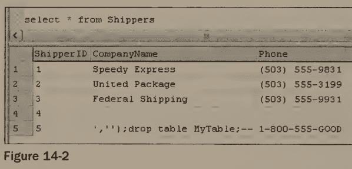

如果您正在编写临时 SQL 语句，使用参数是您能提高整个应用程序安全性的一种极佳的技巧。

### 参数化 IN 表达式

上一节讨论了使用参数来通过临时查询保护代码。当您在使用 where 子句进行比较时，这种方法效果不错。但是，如果您想向 IN 表达式传递参数，这种方法则完全不起作用。例如，以下代码无法工作：

```sql
select EmployeeID, LastName from Employees
where EmployeeID in (@list)
```

克服这一限制的一种方法是使用 SQL 函数。IN 表达式可以接受一张表。因此，您可以调用一个函数，该函数解析像逗号分隔列表这样的参数中的每一个元素，并构建一张表。函数的返回值即为该表，这与 IN 表达式非常兼容。Listing 14-4 展示了实现此功能的函数。

### Listing 14-4：一个接受参数并返回表的函数

```sql
SET QUOTED_IDENTIFIER OFF
GO
SET ANSI_NULLS OFF
GO
ALTER FUNCTION dbo.ufStringToIntTable (@list varchar(8000))
    RETURNS @tbl TABLE (val int, seqnum int) AS
    BEGIN
        DECLARE @ix  int,
                @pos int,
                @seq int,
                @str varchar(8000),
                @num int

        SET @pos = 1
        SET @ix = 1
        SET @seq = 1

        WHILE @ix > 0
        BEGIN
            -- extract next parameter
            SET @ix = charindex(',', @list, @pos)
            IF @ix > 0
                SET @str = substring(@list, @pos, @ix - @pos)
            ELSE
                SET @str = substring(@list, @pos, len(@list))
            SET @str = ltrim(rtrim(@str))

            -- ensure valid number
            IF @str LIKE '%[0-9]%' AND
               (@str NOT LIKE '%[^0-9]%' OR
                @str LIKE '[-+]%' AND
                substring(@str, 2, len(@str)) NOT LIKE '[-+]%[^0-9]%')
            BEGIN
                -- convert and add number to table
                SET @num = convert(int, @str)
                INSERT @tbl (val, seqnum) VALUES(@num, @seq)
            END

            -- prepare for next parameter
            SET @pos = @ix + 1
            SET @seq = @seq + 1
        END

        -- return table with all parameters
        RETURN
    END

GO
SET QUOTED_IDENTIFIER OFF
GO
SET ANSI_NULLS ON
GO
```

## 第 14 章

Listing 14-4 中的函数接受一个参数并返回一张表。输入参数的内容是一串用逗号分隔的数字。该函数解析这些值，将每个值转换为整数，并将每个整数作为一行添加到表中。然后动态创建的表被返回给调用者。因为 IN 表达式可以接受表，所以这种方法非常合适。Listing 14-5 展示了如何使用该函数来接受一个 IN 表达式的参数。

### Listing 14-5：使用函数处理 IN 表达式

```aspx
<%@ Page Language="C#" AutoEventWireup="true" CodeFile="InParameter.aspx.cs" Inherits="InParameter" %>

<!DOCTYPE html PUBLIC "-//W3C//DTD XHTML 1.1//EN"
    "http://www.w3.org/TR/xhtml11/DTD/xhtml11.dtd">

<html xmlns="http://www.w3.org/1999/xhtml" >
<head runat="server">
    <title>IN Parameter</title>
</head>
<body>
    <form id="form1" runat="server">
    <div>
        <h1>View Employees</h1>
        <asp:Label ID="Label1" runat="server" Text="Employee IDs (comma separated): "></asp:Label><br />
        <br />
        <asp:TextBox
            ID="txtEmployeeIDs" runat="server" Width="227px"></asp:TextBox><br />
        <br />
        <asp:Button ID="Button1" runat="server" Text="Update" /><br />
        <br />
        <asp:GridView ID="GridView1" runat="server" AutoGenerateColumns="False" DataKeyNames="EmployeeID"
            DataSourceID="SqlDataSource1">
            <Columns>
                <asp:BoundField DataField="EmployeeID" HeaderText="EmployeeID" InsertVisible="False"
                    ReadOnly="True" SortExpression="EmployeeID" />
                <asp:BoundField DataField="LastName" HeaderText="LastName" SortExpression="LastName" />
                <asp:BoundField DataField="FirstName" HeaderText="FirstName" SortExpression="FirstName" />
            </Columns>
        </asp:GridView>
        <asp:SqlDataSource ID="SqlDataSource1" runat="server"
            ConnectionString="<%$ ConnectionStrings:NorthwindConnectionString %>"
            SelectCommand="SELECT [EmployeeID], [LastName], [FirstName], [Photo] FROM [Employees] WHERE ([EmployeeID] IN (select val from ufStringToIntTable(@EmployeeID)))">
            <SelectParameters>
                <asp:ControlParameter ControlID="txtEmployeeIDs" DefaultValue="1" Name="EmployeeID"
                    PropertyName="Text" Type="string" />
            </SelectParameters>
        </asp:SqlDataSource>
    </div>
    </form>
</body>
</html>
```

Listing 14-5 使用 SqlDataSource 控件来填充 GridView 控件。注意 SelectCommand 属性中的 IN 表达式。其中包含 ...WHERE ([EmployeeID] IN (select val from ufStringToIntTable (@EmployeeID)))。ufStringToIntTable 是 Listing 14-4 中的函数。如 SelectParameters 元素所示，@EmployeeID 参数由 txtEmployeeIDs 文本框控件填充。您可以通过运行 Listing 14-5 中的 Web 表单并添加一串逗号分隔的数字来测试此功能。Northwind 员工表包含九条记录，因此您可以选择其中一部分、全部或不选。点击“更新”按钮会引发回发事件，从而重新填充 GridView 控件。

### 防御规范化攻击

规范化攻击发生在有人输入一个文件名，请求获取其无权访问的文件，或覆盖其不应覆盖的文件时。返回用户不应拥有的文件会打开安全漏洞，因为这些文件可能包含您不想暴露的敏感信息。允许用户覆盖文件会带来一些问题。也许他们会删除对站点或业务运作至关重要的重要信息。另一个问题在于，当有人用恶意文件覆盖可执行文件时，可能会 launching 病毒。

操作系统试图做到让用户友好，并能够解析文件名，无论您如何指定它。例如，以下四行是等价的：

```text
type c:\log.txt
type \log.txt
type \..\log.txt
type c:\log.txt;;;
```

很难测试每一种情况。图 14-3 显示了一个虚构的将文件重命名的输入示例。请注意，新名称字段被设置为 c:\\SomeData.xml，这绝不应被允许。确实，有可能编写出不安全到无法防止此情况的代码。Listing 14-6 展示了点击“糟糕的重命名”按钮时会发生什么。

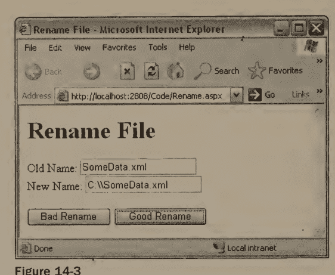

### Listing 14-6：处理文件名输入的错误方式

```csharp
protected void btnBadRename_Click(object sender, EventArgs e)
{
    // bad file handling - open to attack
    string appPath = Request.PhysicalApplicationPath;

    string oldPath = Path.Combine(appPath, txtOldName.Text);
    string newPath = Path.Combine(appPath, txtNewName.Text);

    File.Move(oldPath, newPath);
}
```

Listing 14-6 的问题在于它以完全不进行处理的方式获取输入文件名。File 类并不了解它处于 ASP.NET 环境中，因此您得不到任何保护。因此，它完全按照指示行事，您只能希望其他安全机制（如 ACL）能帮助您。

要处理文件名，大多数人使用 Request.MapPath 或 Server.MapPath 调用。除了是获取文件完整路径的便捷方式外，MapPath 方法还有助于防御规范化攻击。Listing 14-7 展示了处理文件名输入的安全方法。

### Listing 14-7：处理文件名输入的正确方式

```csharp
protected void btnGoodRename_Click(object sender, EventArgs e)
{
    // good file handling - Server.MapPath
    // keeps files in application directory
    string oldPath = Server.MapPath(txtOldName.Text);
    string newPath = Server.MapPath(txtNewName.Text);

    File.Move(oldPath, newPath);
}
```


我知道大多数人经常使用 MapPath 方法。然而，有些人就喜欢与众不同。此外，如果您调用处理文件的可重用库，它可能未考虑安全性。您应该使用恶意输入测试该库，以确定其是否安全。如果不安全，您可以编写自己的例程，或用执行输入正确验证的自定义包装调用。使用 Request.MapPath 和 Server.MapPath 可使您的 ASP.NET 应用程序更不易受到规范化攻击。

> 如果您用自定义类包装第三方库以验证输入，您将无法直接访问 Server 属性。但是，您仍然可以通过调用 HttpContext.Current.Server.MapPath() 来访问 MapPath 方法。

## 使用新的文件上传控件

ASP.NET 2.0 包含一个新的文件上传 Web 服务器控件。它的工作原理类似于 HTML 文件上传控件，但它是面向对象的，具有 Web 控件属性，您不再需要手动在表单元素中设置 enctype 属性。关于安全性，更重要的一点是：ASP.NET 文件上传控件现在具有 FileName 属性。ASP.NET 文件上传控件仍然具有 PostedFile 属性，但您不再需要使用它来获取文件名。由于 FileName 属性仅返回文件名而不是完整路径，因此处理文件的机会更少，也减少了打开安全漏洞的可能性：

```
// 从 HTML 控件获取文件名的唯一方法
string htmlFilePath = fupHtmlUpload.PostedFile.FileName;

// 在 ASP.NET Web 控件中仍然支持
string aspNetFilePath = fupAspNetUpload.PostedFile.FileName;

// ASP.NET Web 控件中的新 FileName 属性
string filePath = fupAspNetUpload.FileName;

// 用法如下
string fileName = Path.Combine(Server.MapPath("."), filePath);
fupAspNetUpload.SaveAs(fileName);
```

本讨论假设您已经权衡了允许文件上传的好处并确定这是一项要求。请记住，允许文件上传是攻击者可用于对您的网站发动拒绝服务攻击的另一个途径。您仍需小心授予 ASP.NET 用户的文件权限。例如，如果您保存到包含配置文件（web.config）的目录，该用户可能会上传一个名为 web.config 的文件并覆盖您的文件。要阻止这种情况，请将对 ASP.NET 用户（或 Windows Server 2003 上的 NETWORK SERVICE 用户）的 web.config 访问控制列表（ACL）中的写入权限设为拒绝。若要进行全面的安全审查，请检查运行该用户的身份，以确保设置安全。

## 安全地使用动态模拟

模拟是指代码以特定用户的身份运行的功能。通常，这是已登录的用户，但也可以是指定的用户（请参阅 web.config 中 identity 元素的 userName 和 Password 属性）。您使用模拟是为了让用户能够以特定权限访问 Windows 操作系统资源。这可能是文件系统中的文件。这是访问该资源的一种其他方式，否则无法访问。或者，您可以扩大资源的权限，但这可能对安全性不利。

`web.config` 中的 `identity` 元素使您能够执行模拟。当它开启时，应用程序将使用当前已登录用户的凭据运行。此设置适用于与 `web.config` 文件在同一目录中的所有文件。由于您不希望每个已登录的用户都能访问受保护的资源，因此常见的做法是将访问该资源的页面放在单独的目录中，并添加一个 `web.config` 到该目录并开启模拟。然后配置安全性，使只有特定用户或角色才能访问该目录中的任何内容。在子目录中访问启用了模拟的页面后，用户将处于模拟运行状态，并能访问该资源。

在 `web.config` 中设置 `identity` 元素时，可能存在安全隐患，即我们可以为 `web.config` 文件范围内的所有文件开启模拟。这很方便，正如 ASP.NET 中的许多其他功能一样。但是，如果您遵循最小特权安全原则，这可能不是最安全的解决方案。实际上，它可能会现在就打开安全漏洞，或者在未来添加更多页面或维护站点时打开漏洞。由于已登录的用户在访问同一目录中的任何页面的整个过程中都处于模拟状态，因此他们也拥有模拟用户访问的一切权限。最安全的解决方案是仅在必要时允许访问资源，且将访问时间限制到尽可能短的时间。

我并不建议您不使用 `web.config` 中的模拟功能，因为如果您需要它就应该使用它。相反，如果您想要限制对资源的访问，使其仅由需要该资源的人且在需要时的人访问，那么 *动态模拟* 可能是一个很好的选择。清单 14-8 展示了如何这样做。

### 清单 14-8：代码中的动态模拟

```
protected void btnViewGrades_Click(object sender, EventArgs e)
{

    Response.Write(WindowsIdentity.GetCurrent().Name + "<br>");

    // 模拟当前用户
    WindowsImpersonationContext ctx =
        ((WindowsIdentity)User.Identity).Impersonate();

    Response.Write(WindowsIdentity.GetCurrent().Name + "<br>");

    try
    {
        DataSet ds = new DataSet();

        // 当用户没有权限时将抛出异常
        ds.ReadXml(Server.MapPath("Grades.xml"));

        GridView1.DataSource = ds.Tables[0];
        GridView1.DataBind();
    }
    catch (UnauthorizedAccessException)
    {
        lblResult.Text = "未授权！";
    }
```

```
    }

    // 关闭模拟
    ctx.Undo();

    Response.Write(WindowsIdentity.GetCurrent().Name + "<br>");
}
```

调用当前用户 WindowsIdentity 的 Impersonate 方法会使程序以当前用户的权限运行。当对 Impersonate 调用返回的 WindowsImpersonationContext 对象调用 Undo 时，模拟上下文将关闭。因此，清单 14-8 中从调用 Impersonate 到调用 Undo 之间的所有代码都将以调用者的权限运行。所有这些边界之外的代码将以 NETWORK SERVICE 账户（在 Windows Server 2003 上）或 ASPNET 账户（在其他操作系统上）运行。

清单 14-8 将名为 Grades.xml 的文件访问权限限制在模拟运行的一段代码块内。为了演示如何工作，请设置 ACL，除单人外禁止所有人访问此文件。然后，使用无权访问该文件的账户登录，以演示运行程序时将引发 UnauthorizedAccessException。通过以有权访问该权限的账户登录并运行程序，您也可以证明其有效。动态模拟允许您遵循最小特权原则，通过将模拟限制在一段代码块内（仅在必要时）来实现。

## 在登录控件中验证强密码

当同时使用创建用户向导和更改密码控件时，用户可以输入任何密码。这打开了新的安全漏洞，因为太多用户输入的是常见单词密码。这些密码用户容易记住，但黑客也很容易猜出。由于登录控件不会检查弱密码漏洞，因此您的网站存在风险。

本节中的黑客技术为密码添加了验证功能。我们只需添加一个 RegularExpressionValidator 控件。开始操作如下：

- 1. 向 Web 表单添加一个创建用户向导。
- 2. 将正则表达式验证器拖放到密码文本框所在表单元格的右侧。
- 3. 将 RegularExpressionValidator 的 ErrorMessage 属性更改为“必须包含至少 1 个数字、1 个特殊字符，且长度超过 6 个字符”。
- 4. 将 RegularExpressionValidator 的 Text 属性更改为 *。
- 5. 将 RegularExpressionValidator 的 ControlToValidate 属性更改为 Password。
- 6. 将 RegularExpressionValidator 的 ValidationExpression 属性更改为 "^(?=.*\d)(?=.*[\W_]).{7,}$"。


## 第 14 章

顾名思义，RegularExpressionValidator 控件使用所谓的正则表达式来执行验证。正则表达式是一种模式匹配语言，初看起来晦涩难懂。然而，一旦你知道如何使用它们，你很可能会发现它们既快速又强大。网上一个很好的正则表达式网站是 regexlib.com。

现在，放置 Password 的单元格的 HTML 应该如下所示：

```
<td>
    <asp:TextBox ID="Password" runat="server"
        TextMode="Password"></asp:TextBox>
    <asp:RequiredFieldValidator ID="PasswordRequired" runat="server"
        ControlToValidate="Password"
        ErrorMessage="Password is required."
        ToolTip="Password is required."
        ValidationGroup="CreateUserWizard1"></asp:RequiredFieldValidator>
    <asp:RegularExpressionValidator ID="RegularExpressionValidator1" runat="server"
        ControlToValidate="Password"
        ErrorMessage="Must have at least 1 number, 1 special character, and more than 6 characters."
        ValidationExpression="(?=^.{6,}$)(?=.*\d)(?=.*\W+)(?![.\n]).*$"></asp:RegularExpressionValidator>
</td>
```

你可以从上面的 HTML 中剪切并粘贴高亮显示的 RegularExpressionValidator 元素到你自己的模板化 Create User Wizard 的 Password 单元格中。与此同时，你也可以向 Create User Wizard 的电子邮件地址添加一个 RegularExpressionValidator 控件。RegularExpressionValidator 的 ValidationExpression 属性已经有一个弹出对话框，其中可以从其他正则表达式列表中选择用于电子邮件的正则表达式。

同样的技术也适用于 Change Password 控件。将 Change Password 控件添加到你的页面后，选择 Create Template，并使用上述相同的 RegularExpressionValidator。唯一的区别是你应该将 ControlToValidate 属性设置为 NewPassword。

## 总结

保护网站免受恶意用户攻击的最佳方法之一是防护代码免受 SQL 注入攻击。该技术就是简单地参数化你的代码。使用 SQL 函数允许你向 IN 表达式传递参数。

如果你使用 Server.MapPath 或 Request.MapPath API 调用，大多数代码都能免受规范化攻击。当你使用某些文件操作命令时，才会出现潜在的安全漏洞。新的 File Upload Web 控件包含一个 FileName 属性，该属性返回不带完整路径的文件名。这可以通过降低路径以某种方式被不当处理的可能性来增强安全性，从而避免潜在地打开安全漏洞。

310

## 安全技巧

动态模拟技术展示了最小权限原则，它向你展示如何仅在代码中的特定位置且仅在需要时限制资源暴露。另一种方法是使用 `web.config` 文件的 `identity` 属性，但这会打开安全漏洞，因为允许访问目录中任何页面的每个人都拥有与被模拟用户相同的权限。新的 ASP.NET 登录控件使处理安全性变得容易，但它们可以进一步增强以获得更好的安全性。你可以向它们的模板添加 `RequiredFieldValidator` 组件，以进一步完善你需要应用的验证。例如，你可以定义一个正则表达式来确保用户在 Create User Wizard 和 Change Password 控件中输入强密码。

## 第 15 章

## 构建你自己的技巧

我们行业的进步源于不断改进的需求。许多人见证了软件开发中的这种进步，从二进制开关开始，到汇编语言，再到高级语言，继续发展到面向对象编程，并采用面向组件编程。未来，面向服务编程和模型驱动的应用程序开发将成为常态。每一步都促进了作为软件专业人士的你的条件的改善，并使你能够通过越来越强大的手段为社会做出贡献。

这种持续改进的需求正是技巧的本质。技巧就是关于摆脱当今的现状并改进现有事物。它涉及采用给定技术并以某种方式扩展它，从而创造出提供额外价值的东西。

为了更清楚地说明这一点的重要性，考虑一下 ASP.NET 在从 v1.1 到 v2.0 的当前过渡期间正在发生的事情这个显著的例子。在 ASP.NET 1.x 中，没有工具支持的视觉继承，因此开发人员想出了技巧来实现他们所需的功能。因为这些继承技巧非常普遍，它向微软发出了明确信号，表明这种类型的功能是必需的。他们在 v2.0 中 responded with 主页面。

这些技巧推动了技术发展。类似的情况存在于数据访问、安全性、UI 控件等方面。因为人们想出他们自己的技巧并分享它们，每个人都受益，因为在很多方面，工具正在你需要的特定领域变得更好。

展望未来，有一个现有技巧的好例子，有望带来巨大的好处。无论谁发明了这项技术，微软都将 XmlHttp、JScript 和动态超文本标记语言（DHTML）添加到了 Internet Explorer 中。单独来看，这些都是很酷的技术。然而，某个伟大的头脑将它们全部放入同一个锅中，一起烹制形成了异步 JavaScript 和 XML（AJAX）。由于其流行，AJAX 激励微软为我们开发类似的工具，项目代号为 Atlas。技巧帮助我们所有人。

## 第 15 章

为了说明这个概念，本章探讨一个提高安全性的技巧。安全性至关重要，如果我们能帮助他人以更有效的方式使用它，我们就为我们的行业做出了更多贡献。在第 14 章中，你看到了一个防止 SQL 注入攻击的技巧。在这里，你用相关的数据输入处理技巧来扩展该保护，以防止其他恶意行为。本章的其余部分专注于这个称为*输入过滤保护*的技巧。

### 确定你何时拥有了一个技巧

创建自己的技巧并不那么难。大多数开发人员在编写基于现有工具基本功能构建的代码时，每天都在这样做。他们创建自己的库，其中包含技巧，并与其他人分享。要知道你是否拥有自己的技巧，请考虑以下问题：

- 它有文档记录吗？
- 你是否发现了现有功能的新用途？
- 它可以重用吗？
- 你可以分享它吗？

### 你的技巧是否超出了技术文档的范围？

如果它已经属于 Visual Studio 或 .NET Framework SDK 技术文档的一部分，那么它就不是一个技巧。然而，如果你已经想出如何将已经存在的不同部分组合起来实现某些功能，那么它就是一个潜在的技巧候选。你已经超越了摆在你面前记录的内容，创造了一些新的东西。

阅读文档可以明显看出，`string.Replace` 方法是文档完备的，这意味着它甚至不符合成为技巧的条件。然而，你可以用该方法做的是翻译 SQL 语句的通配符，使它们被转义，从而防止恶意输入。这是将现有的东西（Replace）与必要的应用（安全性）相结合。这可能是一个技巧。以下是这个潜在技巧看起来的样子示例：

```
str = str.Replace("%", "[%]");
```

> 本章中的示例使用以下代码行来探讨创建技巧的不同方法。对你来说，理解创建技巧的要点比纠结代码具体做什么更为重要。尽管如此，你们中的一些人会想要了解更多，因此我将在这里提供额外信息：

```
str = str.Replace("[", "[[]");
str = str.Replace("%", "[%]");
str = str.Replace("_", "[_]");
```

如果恶意用户要在 `LIKE` 运算符的参数前加上述任何模式字符，他们可能会减慢你的系统速度，因为这无法被索引覆盖。这可能导致拒绝服务攻击。`replace` 操作确保百分号被解释为字面量，而不是通配符。


# 你是否为现有功能发现了新用途？

另一种可能的“妙招”是，将原本为某一目的编写的东西，设法应用于另一个有用的方面。例如，考虑`Request.MapPath`语句。诚然，它通常用于获取当前应用程序目录的完整路径，但有多少人会将其视为抵御规范化攻击的安全防护手段（参见后续方框说明）？如果你将某个东西用于需要跳出思维定式的场景，那你就可能找到了一个妙招。

> 当恶意用户试图通过修改文件名来访问文件时，就可能发生规范化攻击——例如，在命令行中输入`notepad Default.aspx.cs`（包括末尾的点）。这能正常工作，因为操作系统试图表现出用户友好性。但是，如果你有一个保护机制，阻止人们访问任何扩展名为`*.cs`的文件，你的安全性就可能被破坏。

如果你认同一个合理的假设，即`string.Replace`方法通常用于文本处理，那么不难相信大多数人都是这样看待和使用它的。此外，如果抱着“某个功能是用于特定目的”的心态，你就必须跳出框架，去构想它以不同的方式被使用的可能性。在这个例子中，`string.Replace`方法被用于增强安全性的场景。安全并非每位开发者首要考虑的应用方面，因此它代表了现有功能的新用途。事实上，你应该扩展这个概念，以保护SQL语句中更多的字符串，如下所示：

```
str = str.Replace("[", "[[]");
str = str.Replace("%", "[%]");
str = str.Replace("_", "[_]");
```

# 它是否相对不为人知？

.NET框架中有很多功能是许多人不了解的。你可以将其中许多东西归类为“隐藏的瑰宝”。这类妙招更难被识别，因为很难知道究竟有多少人真正了解它们。一个更好地了解情况的方法是与人讨论这个妙招。你也可以进行在线搜索，看看人们是否广泛讨论过这个话题。通过将你的隐藏瑰宝作为一种妙招来展示，你可能正在帮助许多其他人。例如，确实存在增强应用程序安全性的技术和工具，但许多开发者不知道如何使用它们来保护自己的应用程序。

安全并非每位开发者首要考虑的事情。在编写ASP.NET应用程序时，攻击面会更广。不是单个攻击者物理地坐在电脑前使用桌面应用程序，而是许多人可以通过网络访问Web应用程序。如果网络是互联网，潜在攻击者的数量会更大。尽管每天都有更多开发者接受安全方面的教育，但在少数了解风险和最佳实践与许多缺乏足够认识和技能的人之间，仍然存在知识差距。安全是一个亟待新妙招来帮助开发者加固其应用程序的领域。

## 第15章

使用`string.Replace`方法修改输入以抵御恶意用户。例如，假设一个恶意用户输入了以下信息，而你打算将其用作查询中的过滤器：

```
`%Denial of Service`
```

通过实现`string.Replace`，你的应用程序消除了恶意输入的任何有害影响。给定以下select语句：

```
`Select * from customers where ContactName like @ContactName`
```

之前的恶意输入将通过`string.Replace`语句处理，产生以下输出：

```
`Select * from customers where ContactName like [%]Denial of Service`
```

在SQL的`LIKE`子句中，给条件加上通配符前缀会阻止索引查找，从而损害查询性能。因此，此技术强制某些字符被解释为字面量，而非通配符。由于你能够利用现有功能满足一个未知领域的有用需求，这可以被归类为一个妙招。

# 它是否可重用？

有很多情况你可以组合代码来扩展.NET框架中的内容，或者找到使用现有工具的新方法，但它能用于其他地方吗？换句话说，这个代码是否只适用于你编写它时的特定情况？要成为妙招，你的代码应该能够在应用程序的其他部分或其他应用程序中重用。如果它不仅仅是一次性的解决方案，那么它可能就是一个妙招。

由于使用数据库是一项常见任务，你很可能能够在其他应用程序中使用“输入过滤保护”妙招。在这种情况下，你可以在所有接受输入（将用作过滤器）的应用程序的每个页面上使用它。

# 你能与他人分享它吗？

这个问题建立在上一个问题的基础上，即妙招应该是可以分享的。其他人对你编写的代码感兴趣吗？也许它是可重用的，但主要适用于单一领域。虽然妙招不必具有普遍适用性，但它应该引起他人的兴趣。它应该能够与其他领域工作的程序员分享。

接受输入作为数据过滤器是常见的编程任务。因此，有理由假设其他人也会有兴趣使用同样的技术来保护他们的网页。

# 你可能有一个妙招

如果你的代码或想法在前面各节提出的问题中得到了“是”的答案，那么你很可能就拥有一个妙招。如果你认为自己有一个妙招并希望分享它，请打磨它并让其他人知道，这样你就可以为社区做出自己的贡献。

# 打磨你的妙招以发布它

如果你认识到妙招的重要性，并理解构成妙招的一些要素，那么很有可能你目前正在思考你已经创建过的妙招。如果你有分享妙招的意愿，是时候打磨并发布它了。本节提供了指导原则，以帮助使你的妙招更有效。

# 给你的代码添加注释

在注释代码时，设身处地为他人着想会有所帮助。如果你曾经维护过别人的代码，你就会知道理解原程序员意图的重要性。假设另一位开发者了解该技术，并能弄清楚任何给定语句的语法。你真正需要传达的价值是某段代码的“意图”。让他们知道你试图完成什么。

这个“输入过滤保护”妙招对于初次查看代码的人来说可能并不直观。`string.Replace`方法足够易于理解，但如果代码是正则表达式，可能就没那么易懂了。你应该给它添加注释，因为在面临修改时，有人仍然需要理解重要步骤的目的。以下是“输入过滤保护”代码注释的一个示例：

```
// 防止攻击者操纵通配符。
// 即，如果他们输入"%DenialOfService"，可能导致
// 性能下降，因为过滤器被更改为
// "[[]]DenialOfService"，攻击被中和。
str = str.Replace("[", "[[]");
str = str.Replace("%", "[%]");
str = str.Replace("_", "[_]");
```

正如你所见，单条语句包含很多含义。相比于无意义的`// 将'%'字符替换为'[%]'`注释，其他人可以理解代码为何存在。此外，如果日后代码被优化或修改，修改者更有可能遵循代码的意图。

# 使代码自文档化

这延续了上一个提示，旨在让其他开发者的工作更容易。赋予标识符有意义的名称，帮助其他开发者理解其用途。通过良好的注释和易读代码的结合，你的妙招将更容易被理解。

在“输入过滤保护”妙招中，使用名为`"s"`或`"str"`的标识符实际上毫无意义。这段代码的全部目的是阻止攻击者向SQL语句输入恶意输入。考虑到这一点，你可以合理地假设这个标识符的一个有意义的名称是`filter`，并应编写如下：

```
filter = filter.Replace("[", "[[]");
filter = filter.Replace("%", "[%]");
filter = filter.Replace("_", "[_]");
```

如果其他人将阅读代码，就应该这样做。你使它越容易，就越有可能有人能够信任并重用你的妙招。


## 第 15 章
### 使用常见的编码规范

.NET Framework Software Development Kit (SDK) 为编写 .NET 代码提供了通用的编码指南。有些人使用它，而其他人则更喜欢他们自己的标准。然而，通过使用常见的规范，你可以提高其他开发人员理解代码的可能性。

例如，如果 `myFilter` 是一个局部变量，你不会像 `MyFilter` 那样使用帕斯卡命名法（Pascal case），也不会像 `My_Filter` 那样使用下划线。局部变量和参数的常见编码规范是使用驼峰命名法（camel casing），因此 `myFilter` 是正确的，并且可以让其他开发人员更容易理解。

> 很明显，常见的编码规范是一个主观问题，也是许多争论的主题。就像所有事情一样，你必须评估这是否适用于你的情况。本节中的示例只是一个编码规范的单一实例。然而，它是本着让其他开发人员尽可能轻松地阅读你的代码的精神而创建的，因此值得考虑。

### 编写通用例程

有时你会创建示例代码，并将字面量和常量硬编码在语句中。这样的代码在其他程序员尝试重用你编写的代码时往往会出错。这意味着他们必须自己手动更改硬编码的内容，并可能经历使代码更加通用的步骤。

例如，如果一段代码操作一个文件，你不想让示例硬编码文件名。相反，你会创建一个字符串参数，并将其传递给执行例程的方法。顺着这个思路，如果你的例程为了简单起见写在 `Main` 方法中，你可以考虑将其移动到一个方法中，因为其他人无论如何都会这样做。在“输入过滤器保护”黑客的情况下，如果转换为以下代码，它将更有用：

```csharp
public static void GetSecureText(string filter)
{
    filter = filter.Replace("[", "[[]]");
    filter = filter.Replace("%", "[%]");
    filter = filter.Replace("_", "[_]");

    lblSearchResult.Text = "Search Term: " + filter;
}
```

`GetSecureText` 方法可以这样调用：

```csharp
lblSearchResult.Text =
SecurityUtilities.GetSecureText(txtSearch.Text);
```

如果你的代码操作不同的类型，请考虑构建一个接口，供协同类型实现以与你的代码一起工作。另一个选项是允许 `System.Object` 参数，如果你不知道要传入的对象的类型。例如，如清单 15-1 所示，“输入过滤器保护”黑客可以作为对象实现。

**清单 15-1：用于实现黑客的对象：IProtectSqlStatements.cs 和 InputFilterProtector.cs**

```csharp
public interface IProtectSqlStatements
{
    string SecureText
    {
        get;
    }
}

public class InputFilterProtector : IProtectSqlStatements
{
    object m_inputControl;

    public InputFilterProtector(object inputControl)
    {
        m_inputControl = inputControl;
    }

    public string SecureText
    {
        get
        {
            ITextControl textControl = m_inputControl as ITextControl;

            string filter = "No Text";

            if (textControl != null)
            {
                filter = textControl.Text;

                // 阻止攻击者操纵通配符。
                // 例如，如果他们输入 "%DenialOfService"，他们可能会导致
                // 性能降级，因为过滤器被更改为
                // "[%]DenialOfService"，攻击被中和。
                filter = filter.Replace("[", "[[");
                filter = filter.Replace("%", "[%]");
                filter = filter.Replace("_", "[_]");
            }

            return filter;
        }
    }
}
```

你可以像这样调用清单 15-1 中的代码（Default.aspx.cs）：

```csharp
IProtectSqlStatements objectFilterProtector;

protected void Page_Load(object sender, EventArgs e)
{
    // 用安全对象包装文本框
    objectFilterProtector = new InputFilterProtector(txtSearch);
}

protected void btnObjectSearch_Click(object sender, EventArgs e)
{
    lblSearchResult.Text = objectFilterProtector.SecureText;
}
```

由于实现了 `IProtectSqlStatements`，用户可以选择通过接口或类访问该对象。请注意，在 `Page_Load` 中实例化 `filterProtector` 时，代码传递了 `TextBox` 控件的引用。这样，你可以在页面处理期间多次使用 `filterProtector`。正如你所见，用户只需调用 `SecureText` 属性即可完成所有操作。

C# 和 VB.NET 的 2.0 版本都支持使用*泛型*（generics），它们也被称为*参数化类型*（parameterized types）。泛型使你能够构建在许多情况下表现更好且类型安全性更高的类型。你还可以使用泛型约束来更好地指定参数的类型和语义。例如，清单 15-1 将被重写为清单 15-2 中所示的泛型类型。

**清单 15-2：作为泛型类型编写的黑客 — GenericInputFilterProtector.cs**

```csharp
public class GenericInputFilterProtector<ControlWithText> : InputFilterProtector
    where ControlWithText : Control, ITextControl
{
    ControlWithText m_inputControl;

    public GenericInputFilterProtector(ControlWithText inputControl)
    {
        m_inputControl = inputControl;
    }

    public string SecureText
    {
        get
        {
            filter = m_inputControl.Text;

            // 阻止攻击者操纵通配符。
            // 例如，如果他们输入 "%DenialOfService"，他们可能会导致
            // 性能降级，因为过滤器被更改为
            // "[%]DenialOfService"，攻击被中和。
            filter = filter.Replace("[", "[[]");
            filter = filter.Replace("%", "[%]");
            filter = filter.Replace("_", "[_]");

            return filter;
        }
    }
}
```

你可以像这样调用代码（Default.aspx.cs）：

```csharp
IProtectSqlStatements genericFilterProtector;

protected void Page_Load(object sender, EventArgs e)
{
    // 用安全对象包装文本框
    genericFilterProtector = new
    GenericInputFilterProtector<TextBox>(txtSearch);
}

protected void btnGenericSearch_Click(object sender, EventArgs e)
{
    lblSearchResult.Text = genericFilterProtector.SecureText;
}
```

在清单 15-2 中，你可以不通过泛型实现 `InputFilterProtector` 类，而只操作 `ITextControl` 类型。然而，将类作为具有 `ITextControl` 约束的泛型实现，使得添加其他约束以提高灵活性成为可能。例如，如果你需要访问传入对象的控件属性并保证它确实是控件，除了 `ITextControl` 约束外，你还需要指定 `System.Web.UI.Control` 类的基本类约束。通过将约束设置为 `ITextControl`，你为第三方实现 `ITextControl` 的类似文本框控件的使用留下了可能性。`ITextControl` 约束也保证传入的控件将具有 `Text` 属性。

> 如果你需要帮助理解泛型如何工作，请参阅 .NET Framework 文档。然而，你可以从语言规范中获得更简洁的信息，或者找到许多可用于学习语言语法的书籍。这种解释本身也是黑客精神的体现，因为黑客的描述不包括其他地方已经详细记录的内容。

### 考虑将你的黑客实现为组件或控件

如果你还没有注意到，让我指出我们在前面的章节中涵盖了几种实现组件和控件的有用技术。要了解为什么这是必要的，请考虑一个好的黑客 desirable 属性是可重用性。顺着这个思路，组件和控件的全部目的是提供重用单元。因此，如果情况合适，将黑客实现为组件或控件是非常有意义的。

你并不总是必须从头开始组件或控件。如果有一个现有控件具有大部分所需功能，而你只需要添加一点额外功能，请记住你可以使用面向对象继承原则来重用现有控件。这就是我们在清单 15-3 中所做的。

**清单 15-3：作为现有控件的派生类实现的黑客 — SecureTextBox.cs**

```csharp
[ToolboxBitmap(typeof(TextBox))]
public class SecureTextBox : TextBox
```


 ## 清单 15-3（续）

```
public string SecureText
{
    get
    {
        string filter = Text;

        filter = filter.Replace("[", "[[]");
        filter = filter.Replace("%", "[%]");
        filter = filter.Replace("_", "[_]");

        return filter;
    }
}
```

该控件只需一个 SecureText 属性即可。现在，SecureTextBox 控件可以在任何使用 TextBox 控件的地方使用。区别在于，你需要调用 SecureText 属性来获取安全的 SQL 语句字符串，如下所示（Default.aspx.cs）：

```
protected void btnSecureSearch_Click(object sender, EventArgs e)
{
    lblSecureResult.Text = "Result: " +
        txtSecureSearch.SecureText;
}
```

将你的 Hack 封装在组件或控件中可能比仅仅编写一个方法需要更多的工作。然而，正如这里所示，这样做可以极大地简化使用过程。

## 编写文档

你能做的最友好的事情之一，就是为你的 Hack 编写文档。如果 Hack 涉及代码，文档将极大地帮助其他程序员理解和使用你的 Hack。虽然本文大部分讨论的是代码 Hack，但也有一些流程性 Hack 需要加以描述。某些 Hack 必须进行文档化。

如果你不擅长写作，可以先写个草稿，然后请朋友帮你完善。关键不在于你必须是一位优秀的作家，而是在于向另一位程序员说明如何使用你的 Hack。

## 利用社区测试你的 Hack 并获取反馈

如果你有一个想要分享的 Hack，并且已经打磨完善，下一步就是将其推广到全世界，让它发挥作用。幸运的是，..reviewer 社区活跃且充满生机，提供了无数分享 Hack 的机会。可以考虑新闻组、网站、博客以及其他任何分享 Hack 的渠道。

## 构建你自己的 Hack

如今，新闻组是发布可重用代码和示例的途径，其中很多本身就是 Hack。由于 Google 保留了所有新闻组帖子的存档，人们可以随时搜索到它，并向他人提供链接。请务必在消息正文中添加一些你认为人们会搜索的关键词。

如果你有网站，可以发布上去。还有许多其他社区网站愿意托管你的 Hack。我立刻想到的有 GotDotNet.com 和 CodeProject.com。它们还提供评论页面，人们可以在上面讨论你发布的内容。

互联网上一种快速成长的传播媒介是网络日志，通常称为博客。博客使你能够与人们就任何主题进行双向交流。你可以将 Hack 发表在博客上，人们可以链接到它并与你交流，你也有机会回复和更新。

## 总结

Hack 很重要，因为它们通过在现有基础上进行构建来影响未来的技术发展，从而推动开发者职业的发展。你应该问自己以下问题来判断你手中的代码是否是一个 Hack：它是否已经有文档？你是否发现了现有功能的新用途？它是否相对不为人知？它是否可重用？你能分享它吗？

如果你认为自己有一个 Hack 并想分享它，可以采取一些措施为它发布做准备。确保它有注释且可读，使用常见的编码约定，以通用的方式重写它，并考虑将其打包为组件或控件以实现最大重用。

# 16

## 母版页

自互联网诞生以来，为整个网站提供一致的外观和感觉一直是开发者试图解决的挑战。虽然大多数网站都有页眉、页脚和菜单结构，但它们处理这些元素位置的方式各不相同。多年来，出现了几种不同的技术来应对这一挑战，例如服务器端包含、层叠样式表（CSS）、自定义模板文件、XML 和 XSLT，以及更近的 ASP.NET 用户控件。虽然这些技术各有优缺点，但没有一种单一技术能够为网站的一致性提供"唯一"解决方案。

用户控件（结合 CSS）可以说是 ASP.NET 1.1 中维护一致网站布局的最佳选择，因为它们是面向对象的，并且可以轻松地在单个或多个页面中定义公共页眉、页脚和菜单。然而，大多数开发者在每个页面中使用 `Reference` 指令以及相关的 `TagPrefix` 和 `TagName` 属性来引用用户控件，这导致了代码的重复（尽管是少量的）。为了解决这些重复问题，一些开发者尝试将一个用户控件嵌入另一个用户控件中。虽然这种技术确实有效，但它导致了嵌套对象模型，在加载或回发操作期间需要以编程方式访问控件时相当难以处理。

为了缓解这个问题，针对 ASP.NET 1.1 开发了多种不同的模板框架，以最小化 Web 开发者更改页眉、页脚、菜单和网站其他公共部分布局所需的工作量。早期的 .NET 模板框架依赖于扩展 `System.Web.UI.Page` 类的自定义类。这些自定义类通常将网站的公共 HTML 元素（例如页眉和页脚）硬编码到类中，使得维护和部署变得困难。其他解决方案扩展了 `PageBase` 类，但在外部模板文件中定义网站的公共布局组件。这种类型模板框架的一个示例可以在 `xmlforasp.net/codeSection.aspx?csID=102` 找到。虽然自定义模板框架能够完成工作，但它们在 Visual Studio.NET 中提供的运行时设计支持很少或根本没有，并且没有为全球的 .NET 开发者提供定义网站整体结构的标准方式。

## 第 16 章

随着 ASP.NET 2.0 的发布，一种强大的新方式为各级技能水平的 Web 开发者提供了具有统一布局和结构的网站。无需再借助嵌套用户控件或自定义类和模板，ASP.NET 2.0 的*母版页*可以用来以最少的时间和精力定义网站的整体布局。它们可以在一个地方定义，并在整个网站中共享，而无需将页眉、页脚和菜单用户控件硬编码到每个页面中。本章介绍母版页并演示可在 ASP.NET 2.0 网站中使用的各种技巧和窍门。前两部分概述创建和使用母版页，后续部分提供使用母版页的更深入见解。

## 母版页基础

母版页提供了一个简单高效的模板框架，允许在单个模板文件中定义网站的公共组件，如菜单、页眉和页脚。这使得更改网站的整体外观、感觉和布局变得快速而简单，因为对母版页模板所做的更改会自动应用到整个网站。虽然许多网站可能只需要一个母版页，但可以根据需要创建多个母版页——例如，一个用于主页，一个用于子页面。母版页还可以根据用户的配置文件或其他条件动态加载。这使得提供页面的可打印版本变得容易，而无需更改页面内容。

所有母版页都具有 `.master` 扩展名，该扩展名映射到名为 `System.Web.HttpForbiddenHandler` 的处理程序。此映射在 Web 服务器的默认 `web.config` 文件中定义，它阻止母版页直接在浏览器中查看，就像 `.ascx` 和 `.config` 扩展名的文件无法使用浏览器查看一样。尝试在浏览器中查看 `.master` 扩展名的文件将导致"不提供此类型的页面"错误。

母版页依赖 .NET Framework 中的现有类来实现其功能。它们直接继承自 `UserControl` 类：

```
public class MasterPage : System.Web.UI.UserControl
```

由于继承自 `UserControl`，母版页公开了一组标准属性，如 `Page`、`Session`、`Request` 和 `Response`，可以以编程方式访问。母版页不能跨 Internet 信息服务（IIS）应用程序共享（与用户控件不同），在发生共享的情况下会产生错误。在本章后面，你将学到一种解决此问题的方法，使母版页能够在服务器上的多个 IIS 应用程序之间共享。

## 创建母版页

你可以在 Visual Studio .NET 2005 中使用"添加新项"菜单创建母版页，也可以通过在你喜欢的文本编辑器中打开新文件并在文件顶部添加 `Master` 指令来手动创建。清单 16-1 展示了一个简单母版页的示例。

## 清单 16-1：一个简单的母版页

```
<%@ Master Language="C#" AutoEventWireup="true"
    CodeFile="WebsiteMasterPage.master.cs" Inherits="WebSiteMasterPage" %>
<html>
```


 ```html
<head runat="server">
    <title>母版页演示</title>
</head>
<body>
    <form id="form1" runat="server">
        <table width="100%">
            <tr>
                <td colspan="2">
                    <!-- 页眉 -->
                    
                </td>
            </tr>
            <tr>
                <td width="25%">
                    菜单
                </td>
                <td width="75%">
                    <asp:ContentPlaceHolder ID="cphMain" runat="server">
                    </asp:ContentPlaceHolder>
                </td>
            </tr>
            <tr>
                <td colspan="2">
                    页脚
                </td>
            </tr>
        </table>
    </form>
</body>
</html>
```

清单16-1中的代码定义了标准页眉、菜单和页脚在页面整体结构中的位置。它还通过使用`ContentPlaceHolder`服务器控件，定义了页面内容在母版页中的放置位置。`ContentPlaceHolder`派生自`Control`类，实际上并没有添加任何自己的属性、方法或事件。其全部目的就是标记页面内容在母版页模板中的放置位置。尽管此处展示的母版页中只有一个`ContentPlaceHolder`控件，但在页面内容需要放置在不同区域（例如左栏和右栏）的情况下，可以添加多个控件。添加多个控件时，需要确保每个控件都具有唯一的ID。

需要注意的是，在母版页中定义的图片和其他资源的路径是相对于使用该母版页渲染的实际页面的，而不是相对于母版页本身的位置。例如，如果页面位于网站的根目录下，并且存在一个`Images`子文件夹，那么在母版页中使用`Images/ImageName.gif`定义图片路径将非常有效，因为`Images`子文件夹位于页面的下一级。然而，对于不在网站根目录下的页面，该路径将无法工作，最终会在浏览器中导致图片无法显示。

你应该始终从正在工作的网站根目录开始定义母版页中图片、样式表、JavaScript文件等的路径。清单16-1中展示的母版页包含一个`img`标签，其`src`属性以`/GolfClubShack`开头，这样图片路径就是从网站根目录开始定义的。这种类型的路径可以适用于任何层级嵌套的页面。对于ASP.NET服务器控件，如`Image`控件，可以使用波浪号（~）字符从网站根目录开始定义图片路径：

```
<asp:Image id="imgHeader" runat="Server" ImageUrl="~/Images/header_image.gif" />
```

母版页可以有与之关联的代码文件，以保持HTML代码和编程代码之间的清晰分离，就像ASP.NET Web窗体和用户控件一样。前面清单中的母版页示例与一个名为`WebsiteMasterPage`的C#类相关联，该类位于名为`WebsiteMasterPage.master.cs`的文件中。可以包含标准的事件处理程序，如`Page_Load`、`Page_PreRender`等，以便在运行时动态更改母版页内容。

## 创建内容页

既然你已经了解了一些母版页的基础知识，是时候转换话题，讨论ASP.NET页面如何使用母版页了。引用母版页的页面称为内容页。内容页与常规ASP.NET页面在几个方面有所不同。首先，常规ASP.NET页面代表一个完整的页面，包括HTML和body及form标签，而内容页没有这些标签，因为它们通常在母版页中定义（内容页可能有也可能没有form标签）。其次，内容页必须包含一个名为`Content`的服务器控件，而常规ASP.NET页面不包含此控件。最后，常规ASP.NET页面不使用母版页，而内容页依赖母版页来控制页面的整体结构和布局。尽管它们差异很大，但两种类型的页面都使用`.aspx`文件扩展名。

在内容页中引用母版页可以通过使用`Page`指令的`MasterPageFile`属性来完成。`MasterPageFile`属性中定义的路径应该从Web应用程序的根目录开始，这样即使页面被移动到网站文件夹层次结构中的不同级别，它仍然具有正确的母版页路径。可以使用波浪号（~）字符来确保路径从网站根目录开始：

```
<%@ Page Language="C#" MasterPageFile="~/WebsiteMasterPage.master"
    Title="Master Demo" %>
```

除了引用母版页文件位置外，内容页还需要包含一个名为`Content`的服务器控件，该控件包含页面的实际内容。`Content`控件继承自`Control`类，并通过添加`ContentPlaceHolderID`属性来扩展它。`ContentPlaceHolderID`用于标识母版页中应放置页面内容的`ContentPlaceHolder`控件。清单16-2展示了一个使用`MasterPageFile`属性和`Content`服务器控件的简单内容页示例。

## 清单16-2：一个使用MasterPageFile属性和Content服务器控件的简单内容页

```
<%@ Page Language="C#" MasterPageFile="~/WebsiteMasterPage.master"
    AutoEventWireup="true" CodeFile="Default.aspx.cs" Inherits="Default"
    Title="Master Demo" %>
<asp:Content ID="Content1" ContentPlaceHolderID="cphMain" Runat="Server">
    页面内容
</asp:Content>
```

注意，内容页不包含任何HTML或body标签，因为这些标签在母版页文件（名为`WebsiteMasterPage.master`）中定义。在这种情况下，form标签也在母版页中定义。页面的内容被放置在一个`Content`服务器控件内，该控件的`ContentPlaceHolderID`值对应于母版页的`ContentPlaceHolder` ID值。如果`Content`控件的`ContentPlaceHolderID`值与母版页的`ContentPlaceHolder`控件的ID值不匹配，将会导致错误，因为ASP.NET运行时将不知道在母版页的控件集合中将页面内容放置在何处。

由于内容页中的所有内容都必须放置在一个或多个`Content`服务器控件内，因此通常不会看到定义了`Title`标签，因为没有`head`标签可以放置它。相反，`Page`指令包含一个`Title`属性，可用于设置内容页的标题。标题也可以通过编程方式更改，这将在下一节中看到。

```
<%@ Page Language="C#" MasterPageFile="~/WebsiteMasterPage.master" 
    Title="Master Demo" %>
```

图16-1展示了内容页在Visual Studio .NET 2005设计时中的样子。注意，内容页会自动与母版页合并，提供整体页面的良好设计时视图。内容页显示在图中间的白色区域，并且可以直接在设计视图中进行编辑。母版页显示为灰色，不可编辑。

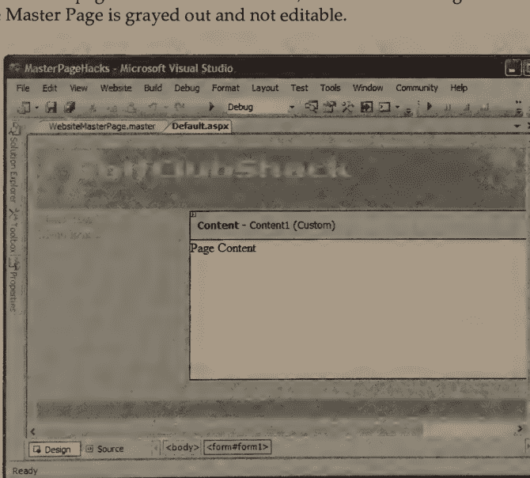

图16-1

虽然你当然可以手动创建内容页，但Visual Studio .NET允许你通过将新项添加到网站中，然后选中“选择母版页”复选框来更轻松地创建它们。图16-2展示了使用Visual Studio .NET 2005创建内容页的第一步。添加项后，你可以选择应该引用的母版页。通过这种方式，会自动创建一个带有`MasterPageFile`属性和一个或多个`Content`服务器控件（取决于母版页中定义了多少个`ContentPlaceHolder`控件）的内容页。

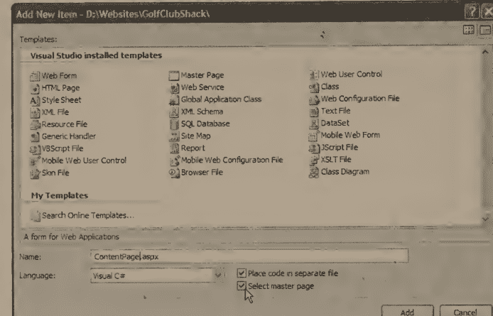

图16-2

内容页也可以通过在解决方案资源管理器中右键单击所需的母版页，然后从菜单中选择“添加内容页”来创建。内容页将放置在与母版页相同的位置，并被命名为`Default.aspx`，除非已存在同名文件。

## 以编程方式修改母版页

创建母版页和内容页非常简单直接，但你可以利用更多功能来创建动态网站。母版页可以使用ASP.NET 2.0版中`Page`类的`Master`属性从内容页中进行编程操作。`Master`属性为你提供了对内容页引用的母版页的编程访问权限，并允许你执行诸如更改标题、添加额外的元数据属性、添加样式表引用、更改控件集合等操作。

### 修改母版页的Head部分

例如，要访问母版页的`head`部分，你可以从内容页中调用`Master.Page.Header`。一旦访问了`header`，你就可以更改标题，甚至添加新的元数据内容，如下所示：

```
//内容页
protected void Page_Load(object sender, EventArgs e) {
    HtmlHead head = this.Master.Page.Header;
    head.Title = "使用母版页的head部分";
    HtmlMeta meta = new HtmlMeta();
    meta.Name = "Keywords";
    meta.Content = "母版页,ASP.NET";
    head.Controls.Add(meta);
}
```


## 在母版页中查找控件

上述代码访问了内容页的 Master 属性，并利用它来获取 Header 属性。然后修改了标题，并在 header 的 Controls 集合中添加了一个新的 HtmlMeta 控件，用于指定与内容页关联的关键字。母版页中定义的 head 标签必须添加 runat="server" 属性，这样 Header 属性才能返回一个 HtmlHead 对象实例：

```html
<head runat="server">
  <title>Master Page Demo</title>
</head>
```

如果 head 标签没有 runat="server" 属性，那么代码将返回错误，因为 HtmlHead 对象为空。

## 在母版页中查找控件

当需要显示或隐藏母版页中定义的控件，或以编程方式添加新控件时，从内容页内部调用 Master 属性也非常有用。查找控件可以使用标准的 FindControl() 方法。为了演示 FindControl() 的用法，首先查看以下母版页的代码片段：

```html
<asp:Panel ID="pnlLogin" runat="server">
  <td align="center" valign="middle" nowrap="true">
    <asp:LoginStatus ID="ctlLoginStatus" runat="server"
      OnLoggingOut="ctlLoginStatus_Logout" CssClass="whiteText" />
  </td>
  <td class="divider" style="width: 18px">
    &nbsp;|&nbsp;
  </td>
  <td align="center" valign="middle" nowrap="true">
    <a href="/GolfClubShack/OrderList.aspx" class="whiteText">My Orders</a>
  </td>
  <td class="divider">
    &nbsp;|&nbsp;
  </td>
  <td align="center" valign="middle" nowrap="true">
    <a href="/GolfClubShack/Personalize.aspx" class="whiteText">Personalize</a>
  </td>
  <td class="divider">
    &nbsp;|&nbsp;
  </td>
</asp:Panel>
```

假设"我的订单"和"个性化"链接应该对所有用户显示，让他们了解网站提供的服务。但是，如果用户点击其中一个链接，他们将被重定向到登录页面进行身份验证。在登录页面上，你希望隐藏这些链接，以免用户尝试点击它们，导致再次重定向到登录页面。这个相对简单的任务可以通过将 pnlLogin 的 Visible 属性设置为 false 来完成。关键是如何从内容页访问母版页中的控件。要访问 pnlLogin，可以使用 Master 属性以及 FindControl() 方法，如下所示：

```csharp
// 从内容页访问母版页中的 pnlLogin
protected void Page_Load(object sender, EventArgs e) {
    Panel pnl = this.Master.Page.Form.FindControl("pnlLogin") as Panel;
    if (pnl != null) {
        pnl.Visible = und;
    }
}
```

## 定义母版页属性

虽然 `FindControl()` 技术可以工作，但需要进行强制类型转换，因为它返回的是 `Control` 类型的对象。虽然可以认为这种强制转换的开销很小，但有一种更简单的方法来访问母版页中的 `pnlLogin`。与其使用 `FindControl()`，不如在母版页中定义一个公共属性，直接以 `Panel` 类型返回 `pnlLogin`：

```csharp
public partial class GolfClubShackMaster : System.Web.UI.MasterPage {

    public Panel PnlLogin {
        get {
            return this.pnlLogin;
        }
    }

    protected void Page_Load(object sender, EventArgs e) {

    }

}
```

这里显示的 `PnlLogin` 属性所做的无非是定义一个 get 块，返回对母版页中 `pnlLogin` `Panel` 控件的直接引用。但是，访问该属性仍然需要强制类型转换。尝试从内容页调用 `Master.PnlLogin` 将会失败，因为 `PnlLogin` 不是 `MasterPage` 对象（从调用 `Master` 属性返回的）的有效属性。要访问 `PnlLogin` 属性，必须将 `MasterPage` 对象强制转换为适当的母版页类型，如下所示：

```csharp
GolfClubShackMaster master = (GolfClubShackMaster)this.Master;
master.PnlLogin.Visible = false;
```

这比使用 `FindControl()` 更简洁、更高效，因为不需要遍历母版页的 `Controls` 集合来定位 `pnlLogin`，但仍然需要强制转换才能完成任务。它还假设母版页始终为 `GolfClubShackMaster` 类型，这在网站的动态程度不同的情况下可能成立也可能不成立。

## 使用 MasterType 指令

要完全不需要任何强制转换就能调用母版页的 `PnlLogin` 属性，需要在内容页中使用 `MasterType` 指令。`MasterType` 指令放置在内容页的顶部，提供对母版页的强类型访问，使得调用自定义属性或方法变得容易。它允许使用 `VirtualPath` 属性指定母版页的虚拟路径，或使用 `TypeName` 属性指定母版页类的名称。请记住，`VirtualPath` 或 `TypeName` 只能使用其中一个，不能同时使用。如果使用 `TypeName`，则母版页类必须在链接的程序集中可用，例如从位于 `App_Code` 文件夹中的代码创建的程序集。

以下展示了使用带有 VirtualPath 属性的 MasterType 指令的示例：

```aspx
<%@ Page Language="C#" MasterPageFile="~/Templates/GolfClubShack.master"
    Title="GolfClubShack" %>
<%@ MasterType VirtualPath="~/Templates/GolfClubShack.master" %>
<asp:Content id="Content1" ContentPlaceHolderID="cphMain" runat="server">
    Content goes here
</asp:Content>
```

当从使用 MasterType 指令的内容页内部调用 Master 属性时，适当的母版页类型将自动可访问，及其所有相关的属性和方法。现在可以直接访问母版页中定义的 PnlLogin 属性，无需任何强制转换：

```csharp
protected void Page_Load(object sender, EventArgs e) {
    //访问 pnlLogin 的首选方式...使用 MasterType 指令
    this.Master.PnlLogin.Visible = false;
}
```

使用 MasterType 指令提供了最佳的情况，因为不需要使用 FindControl() 遍历母版页的 Controls 集合来访问 pnlLogin，不需要强制转换到定义 PnlLogin 属性的适当母版页类型，而且需要编写的代码量最小，从而减少了 bug 并提高了生产力。

## 嵌套母版页

许多企业有多个部门在其网站上发布内容。每个部门通常可以自由创建自己的布局和内容，这在最终用户从一个部门导航到另一个部门时，如何保持公司网站的整体结构和布局一致性方面可能带来挑战。幸运的是，母 Speaking of which, 母版页可以利用嵌套母版页的功能来帮助解决这个问题。

## 创建嵌套母版页

可以创建一个默认的母版页，定义公司标准的页头、页脚和菜单，各部门站点必须使用。而每个部门站点又可以创建自己的母版页，代表其各自业务站点网页的布局。然后，这个部门母版页可以嵌套在标准网站母版页内部。这样做对最终用户有利，因为无论他们访问哪个部门站点，始终能看到标准的页头、页脚和菜单，但同时也给予了部门网站发布者一定的控制权，因为他们可以创建自己的嵌套母版页。

要理解如何嵌套母版页，首先看一下公司的标准母版页，如清单 16-3 所示。

### 清单 16-3：典型的网站母版页

```aspx
<%@ Master Language="C#" AutoEventWireup="true"
    CodeFile="WebsiteMasterPage.master.cs" Inherits="WebsiteMasterPage" %>
<html>
<head runat="server">
<title>Master Page Demo</title>
</head>
<body>
<form id="form1" runat="server">
<table width="100%">
<tr>
<td bgcolor="#006633" colspan="2">
<table border="0" cellpadding="0" cellspacing="0" width="100%">
<tr>
<td align="left">
<a href="/MasterPageHacks/Default.aspx">

</a>
</td>
<td align="right">

</td>
</tr>
</table>
</td>
</tr>
<tr>
<td width="25%">
Menu Item 1
<br />
Menu Item 2
<br />
</td>
<td width="75%">
<asp:ContentPlaceHolder ID="cphMain" runat="server">
</asp:ContentPlaceHolder>
</td>
</tr>
<tr>
<td colspan="2">&nbsp;</td>
</tr>
<tr>
<td bgcolor="#006633" colspan="2">
Footer
</td>
</tr>
</table>
</form>
</body>
</html>
```

此母版页定义了公司页头、页脚和菜单的位置。它还使用 ContentPlaceHolder 控件定义了页面内容应该放置的位置。

每个部门可以利用标准公司母版页来创建自己的母版页，该母版页专门针对该部门。但是，部门母版页有些独特，因为它需要引用标准公司母版页。这可以通过在 Master 指令中添加 MasterPageFile 属性来实现。部门母版页的示例如清单 16-4 所示。


 ## 代码清单 16-4：部门主页面（Master Page）

```
<%@ Master MasterPageFile="~/Templates/WebsiteMasterPage.master" Language="C#"
AutoEventWireup="true" CodeFile="NestedMasterPage.master.cs"
Inherits="NestedMasterPage" %>
<asp:Content ID="Content1" ContentPlaceHolderID="cphMain" runat="server">
<table width="100%">
<tr>
<td style="background-color: Navy; font-weight: bold; color: white">
Departmental Master Page Horizontal Menu
</td>
</tr>
<tr>
<td>
<asp:ContentPlaceHolder ID="cphNestedMain" runat="server" />
</td>
</tr>
</table>
</asp:Content>
```

查看部门主页面时，你会注意到它引用了一个名为 `WebsiteMasterPage.master` 的标准公司网站主页面。它还定义了一个 Content 服务器控件，该控件引用标准主页面中定义的 ContentPlaceHolder ID（本例中为 `cphMain`）。必须添加 Content 控件，因为这个主页面是嵌套在标准公司主页面内部的。除了 Content 服务器控件外，部门主页面还定义了一个 ContentPlaceHolder 控件，用于指定每个部门内容页面的内容应该放置在整体主页面层次结构中的什么位置。

现在部门主页面已正确嵌套在标准公司主页面之内，内容页面就可以引用嵌套主页面，并自动继承标准公司的页眉、页脚和菜单。这既保持了公司网站管理员希望看到的整体一致性，又给了各个部门在自己网站区域内的自由。这两个主页面协同工作的示例如图 16-3 所示。

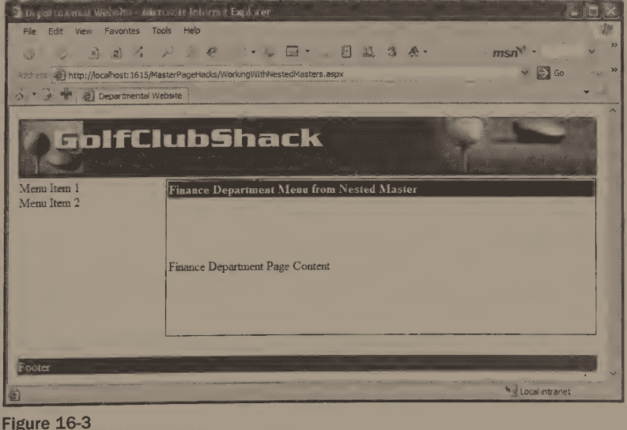

图 16-3

## 在 Visual Studio .NET 2005 中使用嵌套主页面

假设你正在管理某个部门，已经创建了嵌套主页面，并从几个内容页面引用了它，现在想要在 Visual Studio .NET 2005 的设计视图中编辑内容页面。当你切换到设计视图时，你会收到如图 16-4 所示的错误。

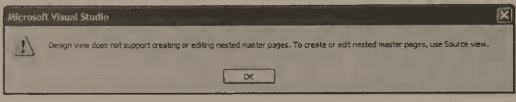

不幸的是，Visual Studio .NET 2005 不允许在设计视图中编辑引用嵌套主页面的内容页面。如果你完全喜欢用代码工作，这可能根本不会困扰你，但如果你倾向于使用智能标签功能以及设计视图中其他出色的可视化功能，你可能会非常失望。在放弃所有希望之前，有一些技巧可以让你在继续使用嵌套主页面的同时，为内容页面恢复一些设计时功能。

解决嵌套主页面设计视图问题的最简单方法，就是直接进入内容页面，将 Page 指令上的 `MasterPageFile` 属性更改为空字符串，如下面的代码所示。这样你就可以切换到设计视图，将控件拖放到设计界面，使用智能标签，以及执行更多操作。

```
<%@ Page Language="C#" MasterPageFile="" Title="Departmental Website" %>
```

在设计视图中，你将无法看到页面内容在整个嵌套主页面框架中的外观，但你将能够使用内容控件来添加和删除控件、使用智能标签以及执行其他操作。这种方法的缺点在于，当你完成内容页面的编辑并准备将页面移至生产环境时，需要记得将嵌套主页面的路径重新放回 `MasterPageFile` 属性中。

如果你不想每次将文件移至生产环境时都记得更新 `MasterPageFile` 属性路径，但又想利用 Visual Studio .NET 的设计视图功能，你可以通过一些额外的工作来实现。要欺骗 Visual Studio .NET 显示内容页面的设计视图表示，你可以创建一个从 `System.Web.UI.Page` 派生的新类。这个新类（以下代码中命名为 `BasePage`）应该定义一个名为 `RuntimeMasterPageFile` 的属性（该属性实际上可以命名为任何你喜欢的名称）。以下代码展示了如何从 Page 派生并创建 `RuntimeMasterPageFile` 属性：

```
public class BasePage : System.Web.UI.Page {
    private string _RuntimeMasterPageFile;

    public string RuntimeMasterPageFile {
        get {
            return _RuntimeMasterPageFile;
        }
        set {
            _RuntimeMasterPageFile = value;
        }

        protected override void OnPreInit(EventArgs e) {
            if (_RuntimeMasterPageFile != null) {
                this.MasterPageFile = _RuntimeMasterPageFile;
            }
            base.OnPreInit(e);
        }
    }
}
```

除了公开 RuntimeMasterPageFile 属性外，BasePage 还重写了 OnPreInit()，以便在页面加载之前动态地将 MasterPageFile 路径分配给内容页面。

既然 BasePage 类已经可用，你就可以让每个内容页面从它派生，而不是从 System.Web.UI.Page 派生：

```
public partial class WorkingWithNestedMasterAndBasePage : BasePage {
    //Page members
}
```

在 .aspx 文件中，将 MasterPageFile 值改为空字符串，将 RuntimeMasterPageFile 属性添加到 Page 指令中，并将其值设置为嵌套主页面的路径。然后在 Page 指令上将 CodeFileBaseClass 属性设置为 BasePage。所有这些步骤都在以下代码中展示：

```
<%@ Page Language="C#"
    MasterPageFile=""
    RuntimeMasterPageFile="~/Templates/NestedMasterPage.master"
    CodeFileBaseClass="BasePage"
    Inherits="WorkingWithNestedMasterAndBasePage" AutoEventWireup="true"
    CodeFile="WorkingWithNestedMasterAndBasePage.aspx.cs" Title="Untitled Page" %>

<asp:Content ID="ContentNested" runat="server" ContentPlaceHolderID="cphNestedMain">
    <p>&nbsp;</p>
    <p>&nbsp;</p>
    Finance Department Page Content
    <p>&nbsp;</p>
    <p>&nbsp;</p>
</asp:Content>
```

在运行时，BasePage 对象将被实例化，内容页面的 MasterPageFile 属性将被动态设置为 RuntimeMasterPageFile 属性所赋予的值。在设计时，Visual Studio .NET 2005 的设计视图功能将可用，因为 MasterPageFile 值为空字符串。虽然这需要少量的初始工作，但随着新内容页面的创建，实践起来非常容易。Microsoft 已声明，未来版本的 Visual Studio .NET 将使开发人员能够更轻松地处理引用嵌套主页面的内容页面。

## 在 IIS 应用程序之间共享主页面

当 ASP.NET 用户控件首次在 .NET Framework 1.0 版本中引入时，开发人员立即喜欢上了它们，因为它们提供了一种以面向对象方式在多个页面中重用内容的绝佳方法。然而，开发人员很快发现用户控件无法在 IIS 应用程序之间共享。这意味着如果在一个 IIS 应用程序中定义了整个网站使用的标准菜单用户控件，那么它就不能在另一个 IIS 应用程序中使用，例如公司网站内的某个子部门。为了解决这个问题，开发人员将用户控件转换为服务器控件，并将它们安装到全局程序集缓存（GAC）中，或者在每个 IIS 应用程序中创建指向包含需要共享的用户控件文件夹的虚拟目录。

在 ASP.NET 2 版本中，用户控件仍然无法在 IIS 应用程序之间共享，而且由于主页面派生自 UserControl，它们也无法共享。但是，通过一些工作，可以使用 Visual Studio .NET 2005 的网站发布功能以及一个新的 Web 部署工具，在 IIS 应用程序之间共享用户控件和主页面。

你可能会问，为什么需要在多个 IIS 应用程序之间共享主页面。这当然是一个合理的问题。要回答这个问题，请考虑一家公司的核心页面存储在 Web 服务器的根目录下（主页、全站搜索页面、站点地图等），但每个部门位于标记为 IIS 应用程序的子文件夹中。每个部门文件夹被标记为 IIS 应用程序，以便该部门可以拥有自己完整的 web.config 文件、指定自己的安全设置，以及执行其他需要 IIS 应用程序的任务。以财务部门为例，其在 IIS 中的可能配置如图 16-5 所示。请注意，FinanceDepartment 应用程序存在于 MasterPageHacks 应用程序之下。

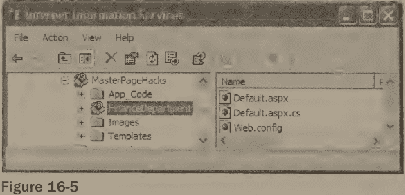

公司希望网站根目录主页面中定义的页眉、页脚和菜单能被所有部门使用（回想一下本章前面关于嵌套主页面的讨论）。由于每个部门子文件夹都被标记为 IIS 应用程序，这是不可能的。事实上，

如果部门试图使用位于其网站根目录下的公司主页面，将会出现如图16-6所示的错误。该错误明确指出，你无法映射到另一个IIS应用程序中的虚拟路径。

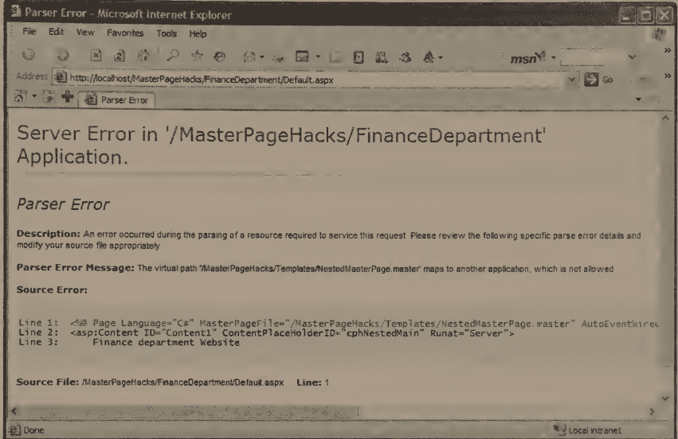

图16-6

要解决此错误，要么在每个部门的IIS应用程序中创建一个指向根主页面存储文件夹的虚拟目录，要么将页眉、页脚和菜单转换为可以存储在全局程序集缓存（GAC）中的服务器控件，而后者可能相当耗时。幸运的是，还存在另一种快速且易于实现的解决方案。

## 将主页面发布为程序集

Visual Studio .NET 2005 通过其“发布网站”菜单项（直接位于“生成”菜单下）提供了将预编译网站发布到生产服务器的功能。此发布功能可用于将主页面转换为程序集，该程序集可以赋予强名称并安装到GAC中。一旦进入GAC，主页面就可以在Web服务器上的多个IIS应用程序之间共享。你需要执行几个步骤来实现此解决方案，因此以下说明提供了分步指南：

1.  要启动此过程，请在VS.NET 2005中创建一个空网站。删除其中的所有内容，包括 `App_Data` 和 `Default.aspx`。

2.  向空网站添加一个主页面，并添加你希望跨应用程序共享的内容。以下主页面命名为 `MasterPageBase.master`：

```
<%@ Master Language="C#" %>
<html>
<head runat="server">
<title>Sharing Master Pages Across IIS Applications</title>
</head>
<body>
    <form id="form1" runat="server">
        <div>
            Header
            <br />
            <asp:contentplaceholder id="ContentPlaceHolder1" runat="server">
            </asp:contentplaceholder>
            <br />
            Footer
        </div>
    </form>
</body>
</html>
```

3.  从Visual Studio .NET 2005菜单中，选择“生成”->“发布网站”。

4.  在出现的“发布网站”对话框中，选择输出将发布到的目标网站，并选中除顶部允许动态更新之外的所有复选框（见图16-7）。请注意，这里引用了一个名为 `keyfile.snk` 的强名称密钥文件。（强名称密钥文件包含可用于对程序集进行数字签名的公钥/私钥对。）你需要一个密钥文件来签署程序集并将其安装到GAC中。要创建密钥文件，请使用随.NET提供的 `sn.exe` 命令行工具。在Visual Studio .NET 2005命令提示符下，键入以下命令以生成文件：`sn.exe -k keyfile.snk`。

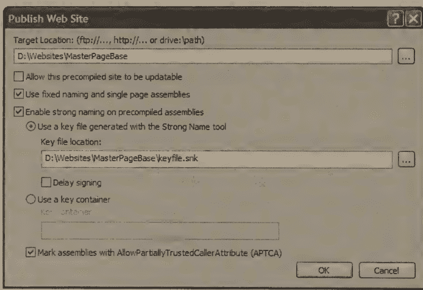

图16-7

5.  发布操作完成后，打开在VS.NET 2005中创建的新网站（在前面的示例中命名为MasterPageBase）。你应该会在Bin文件夹中看到一个名称相当奇怪的新程序集。此程序集就是你编译后的主页面形式。

6.  使用 `gacutil.exe` 将程序集安装到GAC中，或者使用Windows资源管理器将其拖放到 `c:\Windows\Assembly` 中。完成后，从MasterPageBase网站中删除原始程序集以及新创建的XML文件。

7.  在你的网站项目中添加一个 `web.config` 文件，并在 `<system.web>` 开始和结束标记内添加以下内容：

```
<compilation debug="false">
  <assemblies>
    <add assembly="App_Web_masterpagebase.master.cdcab7d2, Version=0.0.0.0,
      Culture=neutral, PublicKeyToken=cceb8435cfc68486" />
  </assemblies>
</compilation>
```

你需要将程序集的名称更改为为你项目生成的名称（即你添加到GAC中的那个），并将 `PublicKeyToken` 更改为你在GAC中看到的值。请注意，程序集属性值不应换行。尽管在发布原始主页面之前没有为其分配版本，但可以通过在主页面的代码文件中应用程序集属性来添加版本：

```
[assembly: AssemblyVersion("1.0.0.0")]
```

8.  在网站中添加一个主页面，但不要为它创建代码文件（你可以创建，但在这种情况下没有必要）。

9.  删除新主页面中的所有代码，并在顶部添加以下内容。这应该是主页面中唯一的代码。如果你命名的原始主页面（即你在步骤2中创建的那个）不同，则需要相应地更改值。使用对象浏览器查看在步骤4中生成的 `.dll` 中的类名。它应该在一个ASP命名空间内：

```
<%@ Master Language="C#" Inherits="ASP.masterpagebase_master" %>
```

10. 创建一个内容页，引用你在上一步中创建的主页面。默认的 `ContentPlaceHolderID` 是 `ContentPlaceHolder1`，因此在 `<asp:Content>` 标签中使用该ID，除非你在步骤2中为ID赋予了不同的值。

11. 测试内容页。

在测试更复杂的主页面时，运行内容页时可能会收到“无法找到字符串资源”的错误。使用像Reflector (aisto.com/roeder/dotnet/) 这样的工具来分析程序集，你会看到一个或多个对名为 `CreateResourceBasedLiteralControl()` 方法的调用，而你期望主页面的HTML嵌入的地方正是这些调用。“发布网站”选项会自动尝试将带有换行符的长字符串转换为文字资源，而不是将HTML字符串嵌入程序集中。要消除对 `CreateResourceBasedLiteralControl()` 的调用及其引起的错误，你需要调整HTML代码，将跨多行的代码合并到单行。例如，以下代码跨越多行用于HtmlOutput服务器控件：

```
<td align="left" valign="top" height="45">
  <www:HtmlOutput ID="egovHeader" runat="Server"
    XmlSource="/XML/SiteLinks.xml"
    XsltSource="/XSLT/Header.xslt"
    LanguageCookieName="EgovCookie/Language" />;
</td>
```

要消除“无法找到字符串资源”的错误，可以将内容移到单行上（由于页面限制，下面显示了一些换行）：

```
<td align="left" valign="top" height="45"><ww:HtmlOutput ID="egovHeader" runat="Server" XmlSource="/XML/SiteLinks.xml" XsltSource="/XSLT/Header.xslt" LanguageCookieName="EgovCookie/Language" /></td>
```

进行任何必要的调整后，重新发布主页面，将其安装到GAC中，并测试内容页。重复此过程，直到“无法找到字符串资源”的错误消失。

这些步骤可能看起来工作量很大，但一旦完成，多个IIS应用程序就可以共享单个主页面。然而，这种方法有几个缺点。首先，每次需要更改时，你必须重新编译基础主页面并将其放回GAC中。如果你有一个频繁更改其整体外观和感觉的站点，这可能会很麻烦。对于许多站点来说，这可能不会带来问题。其次，发布过程中创建的程序集名称不是一个很友好的名称，当多个主页面安装到GAC中时，可能会难以确定哪个程序集负责哪个主页面的输出。最后，必须在每个需要引用安装到GAC中的主页面的网站中放置一个空白主页面。虽然在每个网站中放置一个空白主页面没有太大问题，但这确实会导致Visual Studio .NET中设计时功能的丢失。本章前面提供了一些解决Visual Studio .NET中嵌套主页面相关问题的变通方法。

## 使用Web部署项目加载项

虽然对于每次更改跨IIS应用程序共享的主页面时需要重新安装程序集到GAC中，能做的不多，但程序集的名称可以被修正并使其更用户友好。微软发布了一个名为Web部署项目的Visual Studio .NET 2005加载项，可用于预编译网站并执行其他一些生成和部署任务。虽然对此工具的完整讨论超出了本章的范围，但微软对其功能进行了如下总结：

> “Visual Studio 2005 Web部署项目为构建和部署你在ASP.NET 2.0和Visual Studio 2005中创建的网站应用程序提供了额外功能。此加载项包含一个新工具，使你能够合并ASP.NET 2.0预编译过程中创建的程序集，并在Visual Studio 2005中提供了一个全面的用户界面，用于管理生成配置、合并以及使用MSBuild的预生成和后生成任务。”

除了使用Visual Studio .NET的“发布网站”功能将主页面转换为程序集外，也可以使用Web部署项目工具。这两种工具之间的一个主要区别是，Web部署项目使你能够控制生成的程序集的名称，而不是被迫使用像 `App_Web_masterpagebase.master.cdcab7d2` 这样不友好的程序集名称。


## 母版页

安装 Web 部署项目工具（可从 http://msdn.microsoft.com 或 www.asp.net 下载）后，可以右键单击前面步骤中提到的 MasterPageBase 项目，然后从菜单中选择"添加 Web 部署项目"。在出现的屏幕上，可以为部署项目命名。默认项目名称在此情况下将是 **Master Page Base_deploy**。

选择部署项目名称后，一个新的文件将显示在 Visual Studio .NET 2005 网站中，如图 16-8 所示。

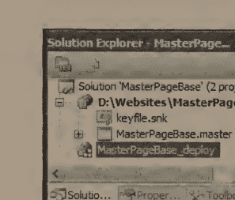

**图** _[配置管理器](file:///D:/Users/ChaoZhang/Desktop/%E8%BF%AD%E4%BB%A3/Visual%20Studio,%20Master%20Pages.pdf#page=1) - **活动**(发布) 属性页_

右键单击 MasterPageBase_deploy 文件并从菜单中选择"属性页"以访问不同的部署项目选项。有多个不同的屏幕可用，包括编译、输出程序集、签名和部署（注意，这些屏幕可能会发生变化，因为在撰写本文时该工具仍处于测试阶段）。在编译屏幕（参见图 16-9）上，将配置下拉框更改为"发布"。这将导致输出文件夹更改为 \Release\。确保"允许更新此预编译站点"复选框未选中。这将导致母版页中的 HTML 嵌入到程序集中。

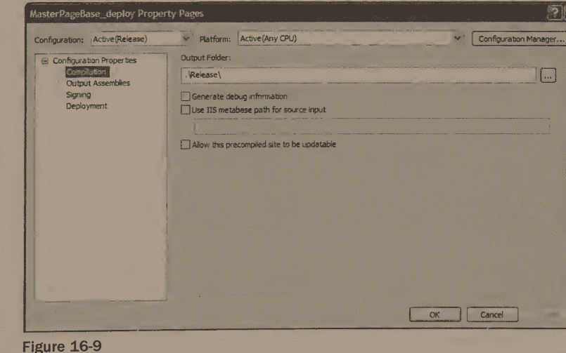

## 第 16 章

在"输出程序集"菜单上，将名称更改为 MasterPageBase，并选中"视为库组件（删除 App_Code.compiled 文件）"复选框。此外，选中"对输出程序集进行版本控制"复选框，并为程序集和文件提供版本号，例如 1.0.0.0。图 16-10 显示了此屏幕应呈现的外观。

在"签名"屏幕上，选中"启用强命名"复选框，然后选择一个强名称密钥文件（使用 sn.exe 创建的文件）。完成这些更改后，单击"应用"按钮。

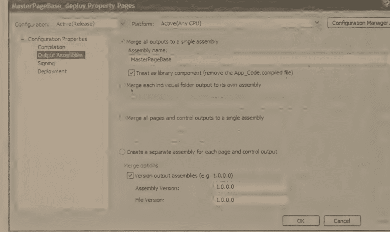

图 16-10

在生成 MasterPageBase 程序集之前，将 ASP.NET 网站切换到发布模式。右键单击部署项目文件并从菜单中选择"生成"。一个名为 MasterPageBase.dll 的新程序集将出现在 MasterPageBase_deploy 文件夹中（位于 release\bin 文件夹内）。此程序集现在可以安装到 GAC 中并添加到 web.config（确保 assembly 属性不换行）：

```xml
<compilation debug="false">
    <assemblies>
        <add assembly="MasterPageBase, Version=1.0.0.0,
            Culture=neutral, PublicKeyToken=cceb8435cfc68486" />
    </assemblies>
</compilation>
```

请参阅上一节中的步骤 6 到 11 以回顾该过程。

使用 Web 部署项目工具生成的程序集内容与"发布网站"工具相同，但它提供了对名称和版本的直接控制。如果在 Reflector（aisto.com/roeder/dotnet/）中查看这两个工具创建的程序集，您会发现它们都包含来自母版页的嵌入式 HTML（参见图 16-11）。一旦进入 GAC，母版页就可以在多个 IIS 应用程序之间共享。

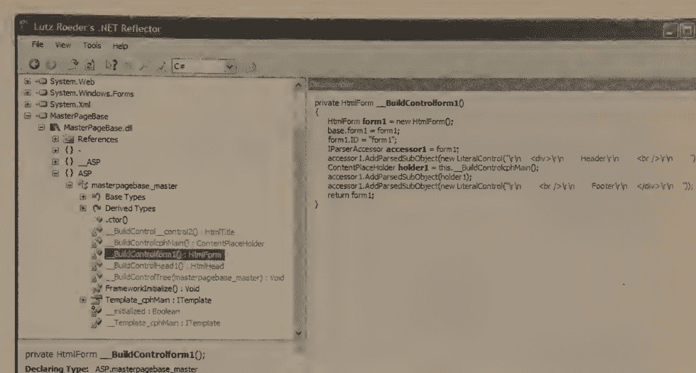

**图 16-11**

## 在内容页中动态更改母版页

内容页通常使用 `Page` 指令的 `MasterPageFile` 属性来引用母版页。对于许多网站来说，母版页的路径是固定的，不需要更改。其他网站可能允许用户个性化页面或提供页面的可打印版本，这可能需要动态更改母版页的路径。幸运的是，在 ASP.NET 2.0 中，在两个或多个母版页之间动态切换非常简单，只需少量代码即可实现。要了解动态母版页的实际应用，请考虑以下涉及一个名为 GolfClubShack 的虚构网站的情景。

GolfClubShack 销售各种高尔夫产品，包括发球木、推杆、铁杆、挖起杆以及各种高尔夫球。用户可以搜索 GolfClubShack 网站并获取所售售任何产品的更多详细信息。GolfClubShack 网站在整个站点中使用标准母版页，以便为最终用户提供一致的界面。此母版页定义了标准页眉和菜单。使用母版页的产品详情页示例如图 16-12 所示。


图 16-12

GolfClubShack 希望允许用户打印更简洁版本的产品详情页，其中不包含菜单和链接等不必要的信息。为了实现这一目标，当用户单击打印图标时（位于图 16-12 中产品标题的右侧），他们需要动态更改母版页。

GolfClubShack 开发人员可以利用内容页中可用的 `Page_PreInit` 事件处理程序来更改母版页。由于母版页最终是作为控件合并到内容页中的，因此动态更改母版页需要在页面生命周期的早期与 `Page` 对象进行交互。`PreInit` 事件使这成为可能。

为了让 GolfClubShack 制作产品详情页的可打印版本，他们需要创建一个去除不需要内容的母版页，如下所示：

```aspx
<%@ Master Language="C#" %>
<html>
<head runat="server">
    <title>GolfClubShack</title>
    <link type="text/css" rel="Stylesheet" href="/GolfClubShack/Style/Style.css" />
</head>
<body leftmargin="0" topmargin="0"
    rightmargin="0" bottommargin="0" marginheight="0" marginwidth="0">
    <form id="frmMain" runat="server">
        <table width="640" cellpadding="0" cellspacing="0">
            <tr>
                <td valign="top">
                    <table cellspacing="0" cellpadding="0" width="100%" border="0">
```

这个简单的母版页添加了基本页眉，但省略了标准母版页中的菜单、搜索功能和链接。创建可打印母版页后，GolfClubShack 需要在用户单击打印图标时从标准母版页切换到可打印母版页。前面图 16-12 中显示的打印图标使用 ASP.NET Hyperlink 控件链接回产品详情页，该控件在 URL 末尾添加了一个名为 Print 的 QueryString 参数。Print 参数在 Page_Load 中动态添加：

```aspx
<tr>
	<td align="left">
		<a href="/GolfClubShack/default.aspx">
			
		</a>
	</td>
	<td align="right">
		
	</td>
</tr>
</table>
</td>
</tr>
<tr>
	<td>
		<asp:ContentPlaceHolder ID="cphMain" runat="server">
		</asp:ContentPlaceHolder>
	</td>
</tr>
</table>
</form>
</body>
</html>
```

```csharp
public partial class ProductDetails : System.Web.UI.Page {

	bool _ShowPrintImage = true;
	protected void Page_Load(object sender, System.EventArgs e) {
		if (this._ShowPrintImage) {
			this.hlPrint.NavigateUrl = Request.Url.ToString() + "&Print=true";
		} else {
			this.hlPrint.Visible = false;
		}
	}
}
```

产品详情页的 Page_PreInit 事件处理程序检查 QueryString 中的 Print 参数，并在找到时更改母版页。这是通过调用 Page 类的 MasterPageFile 属性来实现的：

```csharp
public partial class ProductDetails : System.Web.UI.Page

bool _ShowPrintImage = true;

protected void Page_PreInit(Object sender, EventArgs e) {

if (Request.QueryString["Print"] != null) {
    this.MasterPageFile = "~/Templates/GolfClubShackPrint.master";
    this._ShowPrintImage = false;
}
}
```

图 16-13 显示了将可打印母版页动态分配给内容页后页面的外观。


图 16-13

这种相同的技术可用于需要动态加载母版页的各种情况。

## 总结

母版页是 ASP.NET 2.0 中最令人兴奋的新功能之一。它们消除了使用嵌套用户控件或自定义 ASP.NET 1.1 模板框架的需要。通过使用母版页，您可以在单个文件中定义网站的布局和结构，并以最少的时间和精力进行站点范围的更改。

在本章中，您学习了如何创建和使用母版页，以及如何修改控件和更改属性。您还了解了如何通过编译并将母版页安装到全局程序集缓存中，在 IIS 应用程序之间共享母版页。最后，您学习了如何使用 Page 类的 `MasterPageFile` 属性在内容页中动态更改母版页。


 ## 17 处理程序与模块

ASP.NET 远不止页面那么简单。事实上，页面本身就是 HttpHandler，ASP.NET 中任何通过 HTTP 处理请求的类也都是如此。如果说 HttpHandler 处理的是特定 URL 或特定文件类型的请求，那么 HttpModule 则会监听所有请求并做出相应的响应。这两种机制都非常适合用来为应用程序注入新的功能。

本章将深入页面之下，探讨 ASP.NET 中默默无闻的中流砥柱——HttpModule 和 HttpHandler。HttpModule 能够首先接触到所有路由到 ASP.NET 的 HTTP 流量，因此你将首先创建一个 HttpModule 来阻止列入黑名单的 IP 地址访问你的内容。然后，你将学习如何将一个 URL 重写 HttpModule 添加到现有应用程序中，轻松实现" vanity"（个性化）URL 。

随后，我们将从处理所有流量转向处理特定的 HTTP 请求，使用 HttpHandler 动态生成图像。最后，我们将把特定的处理程序和非特定的模块这两个概念结合起来，构建一个错误处理应用程序，用于为你的应用程序添加监测功能。

### HttpModule

`HttpModule` 极其强大，因为它能查看和控制一切。`HttpModule` 可以监听 ASP.NET 应用程序接收到的每一个请求。ASP.NET 中许多最强大的功能——如输出缓存、会话管理、身份验证和授权——都是通过 `HttpModule` 实现的。模块能够对你的应用程序工作方式做出彻底而根本性的改变。以下章节包含了一些使用模块的技巧，应该能给你一些启发。

### 一个 IP 黑名单 HttpModule

我在 ISP 处没有 IIS 管理控制台的直接访问权限，因此当我想要阻止一些正在向我的博客发送垃圾信息的烦人 IP 地址时，我需要一个能在 ASP.NET 中运行的软件解决方案。HttpModule 是最容易编写的解决方案——它易于配置，而且无需重新编译就能轻松添加到我的 ASP.NET 应用程序中。该模块将监听为已配置应用程序传入的每个 HttpRequest 所触发的 BeginRequest 事件。由于此类模块会监听每个请求，你需要特别谨慎地处理其中的工作，并尽快退出模块。

如清单 17-1 所示，该模块读取一个 IP 地址列表，并向任何被阻止的 IP 发送 HTTP 404 文件未找到消息。此外，在该模块编写期间，一种名为 PHPBB/WGET 的恶意蠕虫正在攻击许多博客。我借此机会添加了对该蠕虫的检查并将其一并阻止。

**清单 17-1：一个 IP 黑名单 HttpModule**

```
C#
using System;
using System.Text.RegularExpressions;
using System.IO;
using System.Web;
using System.Web.Caching;
using System.Collections.Specialized;
namespace MVPHacks
{
public class IPBlackList : IHttpModule
{
public IPBlackList(){}
void IHttpModule.Dispose(){}
void IHttpModule.Init(HttpApplication context)
{
context.BeginRequest += new EventHandler(this.HandleBeginRequest);
}
const string FILE = "~/blockedips.config";
const string CACHEKEY = "blockedips";
public static StringDictionary GetBlockedIPs(HttpContext context)
{
StringDictionary ips = (StringDictionary)context.Cache[CACHEKEY];
if (ips == null)
{
ips = GetBlockedIPS(GetBlockedIPsFile(context));
context.Cache.Insert(CACHEKEY, ips,
new CacheDependency(GetBlockedIPsFile(context)));
}
return ips;
}
private static string BlockedIPFileName = null;
```

```
private static object blockedIPFileNameObject = new object();
public static string GetBlockedIPsFile(HttpContext context)
{
    if (BlockedIPFileName != null) return BlockedIPFileName;
    lock(blockedIPFileNameObject)
    {
        if (BlockedIPFileName == null)
        {
            BlockedIPFileName = context.Server.MapPath(FILE);
        }
    }
    return BlockedIPFileName;
}

public static StringDictionary GetBlockedIPs(string configPath)
{
    StringDictionary retval = new StringDictionary();
    using (StreamReader sr = new StreamReader(configPath))
    {
        String line;
        while ((line = sr.ReadLine()) != null)
        {
            line = line.Trim();
            if (line.Length != 0)
            {
                if (retval.ContainsKey(line) == false)
                {
                    retval.Add(line, null);
                }
            }
        }
    }
    return retval;
}

private void HandleBeginRequest( object sender, EventArgs eargs )
{
    HttpApplication app = sender as HttpApplication;
    if ( app != null )
    {
        string IPAddr = app.Context.Request.ServerVariables["REMOTE_ADDR"];
        if (IPAddr == null || IPAddr.Length == 0)
        {
            return;
        }

        //Block the PHPBB worm and other WGET-based worms
        if (app.Context.Request.QueryString["rush"] != null
            ||
            app.Context.Request.RawUrl.IndexOf("wget") != -1)
        {
            app.Context.Response.StatusCode = 404;
            app.Context.Response.SuppressContent = true;
            app.Context.Response.End();
```

**清单 17-1（续）**

```
                        return;
                    }

                    StringDictionary badIPs = GetBlockedIPs(app.Context);
                    if (badIPs != null && badIPs.ContainsKey(IPAddr))
                    {
                        app.Context.Response.StatusCode = 404;
                        app.Context.Response.SuppressContent = true;
                        app.Context.Response.End();
                        return;
                    }
                }
            }
        }
    }
}
```

VB

```
Imports System
Imports System.Text.RegularExpressions
Imports System.IO
Imports System.Web
Imports System.Web.Caching
Imports System.Collections.Specialized

Namespace MVPHacks

    Public Class IPBlackList
        Implements IHttpModule

        Private Const FILE As String = "~/blockedips.config"
        Private Const CACHEKEY As String = "blockedips"
        Private Shared BlockedIPFileName As String = Nothing
        Private Shared blockedIPFileNameObject As Object = New Object

        Public Sub New()
            MyBase.New
        End Sub

        Sub IHttpModule_Dispose() Implements IHttpModule.Dispose
        End Sub

        Sub IHttpModule_Init(ByVal context As HttpApplication)
            Implements IHttpModule.Init
            AddHandler context.BeginRequest, AddressOf Me.HandleBeginRequest
        End Sub

        Public Overloads Shared Function GetBlockedIPs
            (ByVal context As HttpContext) As StringDictionary
            Dim ips As StringDictionary =
                CType(context.Cache(CACHEKEY),StringDictionary)
            If (ips is Nothing) Then
                ips = GetBlockedIPs(GetBlockedIPsFile(context))
```

```
context.Cache.Insert(CACHEKEY, ips, New
    CacheDependency(GetBlockedIPsFile(context)))
End If
Return ips
End Function
```

```
Public Shared Function GetBlockedIPsFile(ByVal context As HelloContext) As String
    If (Not (BlockedIPFileName) Is Nothing) Then
        Return BlockedIPFileName
    End If
    SyncLock blockedIPFileNameObject
        If (BlockedIPFileName = Nothing) Then
            BlockedIPFileName = context.Server.MapPath(FILE)
        End If
    End SyncLock
    Return BlockedIPFileName
End Function
```

```
Public Overloads Shared Function GetBlockedIPs(ByVal configPath As String) As StringDictionary
    Dim retval As StringDictionary = New StringDictionary
    Dim sr As StreamReader = New StreamReader(configPath)
    Dim line As String
    line = sr.ReadLine()
    While (line IsNot Nothing)
        line = line.Trim
        If (line.Length <> 0) Then
            If (retval.ContainsKey(line) = False) Then
                retval.Add(line, Nothing)
            End If
        End If
        line = sr.ReadLine()
    End While
    Return retval
End Function
```

```
Private Sub HandleBeginRequest(ByVal sender As Object,
    ByVal eargs As EventArgs)
    Dim app As HttpApplication = CType(sender,HttpApplication)
    If (Not (app) Is Nothing) Then
        Dim IPAddr As String = app.Context.Request.ServerVariables("REMOTE_ADDR")
        If ((IPAddr = Nothing) _
            OrElse (IPAddr.Length = 0)) Then
            Return
        End If

        'Block the PHPBB worm and other WGET-based worms
        If ((Not (app.Context.Request.QueryString("rush")) Is Nothing) _
            OrElse (app.Context.Request.RawUrl.IndexOf("wget") <> -1)) Then
            app.Context.Response.StatusCode = 404
            app.Context.Response.SuppressContent = true
            app.Context.Response.End
            Return
```


## Listing 17-1（续）

```vb
End If

Dim badIPs As StringDictionary = GetBlockedIPs(app.Context)
If ((Not (badIPs) Is Nothing) _
        AndAlso badIPs.ContainsKey(IPAddr)) Then
    app.Context.Response.StatusCode = 404
    app.Context.Response.SuppressContent = true
    app.Context.Response.End
End If
End End Sub
End Class
End Namespace
```

使用该 HttpModule，我现在可以上传一个名为 `blockedips.txt` 的文本文件到我的站点（每行包含一个 IP 地址），且更改会被立即识别。这些 IP 地址作为 StringDictionary存储在 ASP.NET 的缓存中；如果底层文件更新，则缓存对象会失效。

注意此模块在屏蔽某个 IP 地址时会返回 **404** 错误。我尽可能希望劝阻垃圾邮件发送者，因此我决定让他们误以为我的网站没有任何内容：

```xml
<system.web>
    <httpModules>
        <add type="MVPHacks.IPBlackList, MVPHacks" name="IPBlackList" />
    </httpModules>
</system.web>
```

该程序集的限定名称（Qualifed Name，QN）对于任何 HttpModule 都会添加到应用程序 `web.config`的`httpModules`部分中。一个 QN包含完整的命名空间和类名、逗号，以及不带`.dll``扩展名的实际程序集文件名。

## 使用Http模块重写或重定向 URL

Fritz Onion（(http://pluralsight.com/blogs/fritz/archive/2004/07/21/1651.aspx)拥有一个非常棒的URL重定向引擎，它与为 DasBlog编写的 URL 重写模块极为相似。人们经常对"URL **重定向**"和"**URL重写**"感到混淆。

*重定向（Redirection）**是服务器告知客户端某资源已移动的方式。**例如：浏览器请求`http://www.computerzen.com`，服务器则返回HTTP302状态码并指引浏览器访问“ http://www.hanselman.com/blog”。浏览器随后必须主动请求 `http://www.hanselman.com/blog`, 并获得 HTTP **200**状态码以表示成功。**在此重定向过程中，浏览器的地址栏中的 URL将被更新。最终成功的网址才会出现在地址栏中。

*另一方面，***重写（Rewriting）**完全在服务器端发生；浏览器只需请求一次页面，且地址栏显示的URL不会改变**。例如：如果你在浏览器中输入 `http://www.hanselman.com/blog/zenzoquincy.aspx`, 你会看到展示我幼子的网页。然而，文件`zenzoquincy.aspx``实际上根本不存在于磁盘的任何位置。**唯一存在的页面是`permalink.aspx`——即博客引擎用于显示所有帖子的页面**。真正的页面路径是 `permalink.aspx?guid=cee8aa6e-de46-43ad-8d27-e1c764df30f5`.但那个独特的帖子ID并不好记，也绝谈不上有趣。当我运行的 DasBlog 博客引擎看到对`ZenzoQuincy.aspx``的请求时,它会在数据源中查找“"ZenzoQuincy”是否与某个唯一的博客帖子 ID 相关联,**然后**直接在服务器端对该请求的 URL *进行重写* `**,并让 ASP.NET继续分发该请求**。

URL重定向和 URL重写是控制用户所见URL以及维护站点永久链接（Peralinks）的最强大的技术组合。对于绝大多数网站内容所有者而言，保持其链接永久性至关重要，因此才有了“permalink”这一术语。**网络礼仪**（Netiquette）——即互联网行为准则——规定：如果URL确实发生了改变那么你至少要提供重定向以自动告知浏览器该资源已移动。作为协议，HTTP 提供了两种提示浏览器的方法：第一种是临时重定向或 **302**,第二种则是永久重定向或**301**。

为了延伸上述示例我的站点使用临时重定向将访客从`http://www.computerzen .com``引导至” `http://www.hanselman.com/blog.它是临时的因为未来我可能会更改博客的位置从而将顶级域名指向别处。而我针对博客的 RSS（RichSiteSummary）源采用永久性重定向以此告知聚合器和内容分发商我希望他们始终使用特定URL。当聚合器接收到301或永久性重定向时便会知道它们需要更新自己的数据且不再访问原始 URL **。**

Fritz 的 HttpModule使用的配置部分如下，它包含用于将目标URL匹配到目的地址的重定向正则表达式。**请注意, Fritz（以及大多数）重写模块都使用正**则* `来表示其意图**。正则表达式提供了对意图的精炼描述。例如：`^/(fritz|aaron |keith|mike)/rss\.xml``同时匹配字符串 `/fritz/rss.xml ``和 **"/mike /rss.xml"。**在目标URL和目标地址的 URL 中都使用了正**则* ` 。目的地的 URI使用像”`/blogs/$1/rss.aspx "`这样的表达式，其中$1是括号中的第一次匹配结果在本例中即是“ ` "fritz"` **“或”** `" mike"` **。

```xml
<redirections type="Pluralsight.Website.redirections,redirectmodule">
  <add targetUrl="?/(fr itz/aoron |keith|mike)/rss\.xml”' destination URL="/blogs/$1/rss.aspx" permanent="true" />
  <add target Url="/fooaspx"`destinationUrl="/bar.aspx` permanent " true "/>
```

简单的硬编码**301重定向在 ASP.NET中看起来是这样的：

```csharp
response.Statuscode=301; response.Status =”301MovedPermanently”; respponse.RedirectLocation="http://www.hanselman.com/blog"; response .End();
```

以下是DasBlog利用 URL重写来处理文件系统上并不存在文件的HTTP请求的示例。在我的博客`web.config` 文件中有一个自定义配置部分，其中包含用于与所请求的文件进行匹配的正则表达式。**例如: **文件“ http://wvww.hanselman.com/blog/rss.ashx"并不存在**。对此没有处理器且该文件也不存在于磁盘上.**然而我希望人们将其视为我站点RSSXML内容的主URL。我想仅通过配置更改就能轻松切换处理它的内部服务。我将此例外添加到我的 web`.config` 自定义部分中：

```xml
<newtelligence.DasBlog. UrlMapper> 
    <add matchExpression ="(?<basedir>&lt;?)rss\.ashx" mapTo="{basedir}/SyndicationService.asmx/GetRss?”/> </newtelligenceDas Blog UrlMapper>  
</n ew intelligence .D asBo gUrl Mapper>
```

请注意它被映射到“ `http:// www.hanselman.com/blog / S y nc l ica t i onServi c e.a smx/G et RSS"`,此时` {basedir}`已被展开**。该 URL远不如 “rss.ashx”友好对吧？**记住 **，“rss.ashx"的名称本身并没有什么特殊之处，它只是独一无二的。我之所以选择它是因为“ .ashx”扩展名已在 ASP.NET 内进行映射了。**它可以是其他东西比如 “foo.bar”** ，只要`.bar`扩展在 IIS配置中被映射到了ASP.NET即可**。

** **列表* ***17-*** `2》是对实现重写功能的源代码的略微简化视图：
```csharp
private void HandleBeginReqest (object sender, EventArgs eargs ) { HttpApplication app = send er as HttpApp lication; string requestUrl =app.Context.Request . Url.PathAndQuery ; NameValueCo l lect ion urlMaps =(NameValueCollection)ConfigurationSettings.GetConfig("newtelligence.DasBlog.UrlMapper"); for(inti oop=0; loop<urlMa psCount; loo p++) {stringmatchEx pre ssion=urlMaps.GetKey (loop); Regex regExpression=newRe gx(matchExpression,RegexOptions.IgnoreCase | RegexOptions.Singleline
```

每个正则表达式按顺序运行，直到有一个匹配所请求的 URL。对于特定表达式若发生一次或多次匹配则将源匹配的文本复制到目的匹配中。**在示例表达式中**, *basedir* 代表`rss.ashx `之前出现的所有内容**。


## 处理程序和模块

```VB
Private Sub HandleBeginRequest(ByVal sender As Object, ByVal eargs As EventArgs)
    Dim app As HttpApplication = CType(sender, HttpApplication)
    Dim requestUrl As String = app.Context.Request.Url.PathAndQuery
    Dim urlMaps As NameValueCollection = _
        CType(ConfigurationSettings.GetConfig("newtelligence.DasBlog.UrlMapper"), _
               NameValueCollection)
    Dim loop As Integer = 0
    Do While (loop < urlMaps.Count)
        Dim matchExpression As String = urlMaps.GetKey(loop)
        Dim regExpression As Regex = New Regex(matchExpression, _
            (RegexOptions.IgnoreCase _
            Or (RegexOptions.Singleline _
            Or (RegexOptions.CultureInvariant Or _
            RegexOptions.Compiled)))))
        Dim matchUrl As Match = regExpression.Match(requestUrl)
        If ((Not (matchUrl) Is Nothing) _
            AndAlso matchUrl.Success) Then
            Dim mapTo As String = urlMaps(matchExpression)
            Dim regMap As Regex = New Regex("\\\{(?<expr>\\w+)\\\}")
            For Each matchExpr As Match In regMap.Matches(mapTo)
                Dim urlExpr As Group
                Dim expr As String = matchExpr.Groups("expr").Value
                urlExpr = matchUrl.Groups(expr)
                If (Not (urlExpr) Is Nothing) Then
                    mapTo = mapTo.Replace(("{" + (expr + "}")), urlExpr.Value)
                End If
            Next
            app.Context.RewritePath(mapTo)
        End If
        loop = (loop + 1)
    Loop
End Sub
```

清单 17-2 首先从 web.config 文件中获取 URL 的 NameValueCollection。针对每个潜在匹配的正则表达式将与从 `HttpContext.Current.Request.Url.PathAndQuery` 提取的请求 URL 进行匹配。如果找到匹配的表达式，则请求 URL 中的每个匹配项都会被映射到目标 URL 中的相应位置。例如，请注意下面的代码中 `{postid}` 是如何从请求 URL 中提取并在目标 URL 中重用的。任何优秀的 URL 重写引擎都以某种方式支持这一点，无论是通过 `{token}` 还是通过数字位置（如 `$1`）。

```xml
<!-- 转换
    从: /blog/archive/2004/07/27/194.aspx
    到: /blog/permalink.aspx?guid=194
-->
<newtelligence.DasBlog.UrlMapper>
    <add matchExpression="(&lt;basedir&gt;.*?)/archive/
        (&lt;year&gt;\d{4})/(?&lt;month&gt;\d{2})/(?&lt;day&gt;\d{2})/
        (?&lt;postid&gt;\d+)\.aspx"
         mapTo="{basedir}/permalink.aspx?guid={postid}" />
</newtelligence.DasBlog.UrlMapper>
```

请查看 DasBlog 的源代码，或者我提到的其他重定向/重写模块，以获取更多关于如何为应用程序创建更具"可hack性"URL 的详细信息和技术思路。Christopher Pietschmann 在 http://pietschsoft.com/blog/post.aspx?postid=762 上有一个适用于 ASP.NET 2.0 的不错的 VB 版本。

# 第 17 章

# HttpHandler

每个进入 ASP.NET 的 HttpRequest 都由一个 HttpHandler 处理。这听起来像是显而易见的废话，但这确实是事实。**IHttpHandler** 接口是让这一切成为可能的魔法。你编写的每个页面间接地都是一个 HttpHandler。每个被请求的文件都映射到一个 HttpHandler。因此，如果你想自己处理请求，例如生成动态文件下载或图形，那么这就是你应该开始的地方。

# 样板 HttpHandler

Phil Haack（http://haacked.com/）采用了我喜欢通过复制/粘贴复用的样板 HttpHandler，并创建了一个更简洁的抽象基类，如清单 17-3 所示。这个类是一种开始编写任何新 HttpHandler 的创造性方式。你当然可以直接自己实现 **IHttpHandler**，但你会发现自己反复编写相同的代码块。从这个类继承可以扩展你的派生 HttpHandler，使其包含你可以重写的虚方法——这些方法更准确地对应于 HttpHandler 需要关注的事项：参数是否正确？处理程序是否需要身份验证？缓存策略是什么？只需派生你的类，并适当地重写即可。

### 清单 17-3：用于创建 HttpHandler 的抽象基类

```C#
public abstract class BaseHttpHandler : IHttpHandler
{
    public BaseHttpHandler() {}

    public void ProcessRequest(HttpContext context)
    {
        SetResponseCachePolicy(context.Response.Cache);
        if(!ValidateParameters(context))
        {
            RespondInternalError(context);
            return;
        }

        if(RequiresAuthentication && !context.User.Identity.IsAuthenticated)
        {
            RespondForbidden(context);
            return;
        }

        context.Response.ContentType = ContentMimeType;
        HandleRequest(context);
    }

    public bool IsReusable { get { return true; } }

    /// <summary>
    /// Handles the request. This is where you put your business logic.
    /// </summary>
    public abstract void HandleRequest(HttpContext context);

    public abstract bool ValidateParameters(HttpContext context);

    public abstract bool RequiresAuthentication {get;}

    public abstract string ContentMimeType {get;}

    public virtual void SetResponseCachePolicy(HttpCachePolicy cache)
    {
        cache snaps.SetCacheability(HttpCacheability.NoCache);
        cache.SetNoStore();
        cache.SetExpires(DateTime.MinValue);
    }

    protected void RespondFileNotFound(HttpContext context)
    {
        context.Response.StatusCode = (int)HttpStatusCode.NotFound;
        context.Response.End();
    }

    protected void RespondInternalError(HttpContext context)
    {
        context.Response.StatusCode = (int)HttpStatusCode.InternalServerError;
        context.Response.End();
    }

    protected void RespondForbidden(HttpContext context)
    {
        context.Response.StatusCode = (int)HttpStatusCode.Forbidden;
        context.Response.End();
    }
}
```

```VB
Public MustInherit Class BaseHttpHandler
    Inherits IHttpHandler

    Public Sub New()
        MyBase.New
    End Sub

    Public ReadOnly Property IsReusable As Boolean
        Get
            Return True
        End Get
    End Property

    Public MustOverride Property RequiresAuthentication As Boolean
        Get
            ' Implementation required
        End Get
        Set
            ' Implementation required
        End Set
    End Property

    Public MustOverride Property ContentMimeType As String
        Get
            ' Implementation required
        End Get
        Set
            ' Implementation required
        End Set
    End Property

    Public Sub ProcessRequest(ByVal context As HttpContext)
        SetResponseCachePolicy(context.Response.Cache)
        If Not ValidateParameters(context) Then
            RespondInternalServerError(context)
            Return
        End If
        If (RequiresAuthentication _
            AndAlso Not context.User.Identity.IsAuthenticated) Then
            RespondForbidden(context)
            Return
        End If
        context.Response.ContentType = ContentMimeType
        HandleRequest(context)
    End Sub

    ' <summary>
    ' Handles the request.  This is where you put your business logic.
    ' </summary>
    Public MustOverride Sub HandleRequest(ByVal context As HttpContext)

    Public MustOverride Function ValidateParameters(ByVal context As HttpContext) As Boolean

    Public Overridable Sub SetResponseCachePolicy(ByVal cache As HttpCachePolicy)
        cache.SetCacheability(HttpCacheability.NoCache)
        cache.SetNoStore()
        cache.SetExpires(DateTime.MinValue)
    End Sub

    Protected Sub RespondFileNotFound(ByVal context As HttpContext)
        context.Response.StatusCode = CType(HttpStatusCode.NotFound, Integer)
        context.Response.End()
    End Sub

    Protected Sub RespondInternalServerError(ByVal context As HttpContext)
        context.Response.StatusCode = CType(HttpStatusCode.InternalServerError, Integer)
        context.Response.End()
    End Sub

    Protected Sub RespondForbidden(ByVal context As HttpContext)
        context.Response.StatusCode = CType(HttpStatusCode.Forbidden, Integer)
        context.Response.End()
    End Sub
End Class
```

Phil 对 `ProcessRequest` 方法进行了改进，创建了许多可以在基类中重写的新方法，用于处理参数验证和响应缓存策略，并提供标准的错误响应。


## 使用图像专用 HttpHandler 防盗链

带宽盗链发生在你将图片托管在自己的网站上，而另一个网站直接通过 `` 标签链接到你的图片时。页面从另一个网站加载，但图片却从你的服务器提供。浏览器通常会包含发起请求的主机名。从你的服务器被其他网站页面请求的图片，其 `referer` 头信息将与你的网站 URL 不匹配。

> 有趣的是，HTTP Referrer 头字段在规范中实际上是拼写错误的，且一直是这样，写成了只有一个 "r" 的 "referer"。详见 http://www.w3.org/Protocols/rfc2616/rfc2616-sec14.html。

代码清单 17-4 中的静态文件处理器会将当前主机与请求的 `referer` 字段进行比较。如果它们不匹配，无论最初请求的是什么文件，都将返回一个 `backoff.gif` 文件！这意味着，如果你从你的网站链接到 "scott.jpg"，实际上是盗用我的带宽，你最终会得到 `backoff.gif`，它会告诉你和你的读者，你们太懒了，没有将文件复制到本地。诚然，这是一种粗暴的技术，但在开放的互联网上，有时盗链者需要一点规则提醒。好处在于，由于它是一个处理器，可以通过编辑 `web.config` 轻松移除，而无需重新编译应用程序，因此该功能可以只在有限时间内启用。

代码很简单。一旦 ASP.NET 和 IIS 被配置为处理图像文件，该处理器就会为每个图像请求触发。首先，它会检查 HTTP Referrer，以确保请求来源的站点与请求图像的站点是同一个站点。如果不是，他们将收到警告图片。否则，`Response.WriteFile` 会将图片写入客户端，无人察觉差异。

### 代码清单 17-4：一个防止图像盗链的 HttpHandler

```c#
using System.IO;
using System.Web;
using System.Globalization;

namespace MVPHacks
{
    public class NoLeechImageHandler : IHttpHandler
    {
        public void ProcessRequest(System.Web.HttpContext ctx)
        {
            HttpRequest req = ctx.Request;
            string path = req.PhysicalPath;
            string extension = null;

            if (req.UrlReferrer != null && req.UrlReferrer.Host.Length > 0
```

## 处理器和模块

```vbnet
Public Sub ProcessRequest(ByVal ctx As System.Web.HttpContext)
    Dim req As HttpRequest = ctx.Request
    Dim path As String = req.PhysicalPath
    Dim extension As String = Nothing
    If ((Not (req.UrlReferrer Is Nothing)) _
            AndAlso (req.UrlReferrer.Host.Length > 0)) Then
        If (CultureInfo.InvariantCulture.CompareInfo.Compare(
                req.Url.Host, req.UrlReferrer.Host,
                CompareOptions.IgnoreCase) <> 0) Then
            path = ctx.Server.MapPath("~/images/backoff.gif")
        End If
    End If
    Dim contentType As String = Nothing
    extension = Path.GetExtension(path).ToLower
    Select Case (extension)
        Case ".gif"
            contentType = "image/gif"
        Case ".jpg"
            contentType = "image/jpeg"
        Case ".png"
            contentType = "image/png"
        Case Else
            Throw New NotSupportedException("Unrecognized image type.")
    End Select
    If Not File.Exists(path) Then
        ctx.Response.Status = "Image not found"
        ctx.Response.StatusCode = 404
    Else
        ctx.Response.StatusCode = 200
        ctx.Response.ContentType = contentType
        ctx.Response.WriteFile(path)
    End If
End Sub
```

将文件扩展名与特定 HttpHandler 关联是一个两步过程。首先，IIS 需要知道哪些扩展名应路由到 ASP.NET 工作进程，方法是在 IIS 管理工具中将扩展名与 `aspnet_isapi.dll` 关联。然后，在你的应用程序 `web.config` 中，将每个扩展名与程序集的限定名（QN）关联到一个特定的 HttpHandler：

```xml
<configuration>
    <system.web>
        <httpHandlers>
            <add verb="*" path="*.jpg" type="MVPHacks.NoLeechImageHandler, MVPHacks "/>
            <add verb="*" path="*.gif" type="MVPHacks.NoLeechImageHandler, MVP Hacks "/>
            <add verb="*" path="*.png" 
		type=MVP\Hacks.NoLeechImageHandler,MVP\\Hacks />
```

`web.config` 中的配置与代码中的 switch 语句相对应，因此除非你关联的扩展名在 switch 中没有处理，否则你永远不会有异常抛出。这个处理器可以扩展到处理其他类型的非法盗链，包括 PDF 或任何其他你认为正从你的网站被盗用的文件。

### 使用 Http 处理器合成图像

最近，我有一个后端黑框系统，它通过 XML 响应向我发送两张 Base64 编码的图像——即，以字符串形式编码的二进制数据。这两张图像是支票的正反面。然而，客户的要求是在用户的浏览器中显示一个合成的支票图像，通过单个 HTTP GET 请求将正面图像堆叠在背面图像之上。当然，这必须是安全的，因为这是一张支票，所以不能写入临时文件！

以下是我的解决方案，实现为一个 HttpHandler，因此 HTML 将包含类似以下的内容：

```html

```

`checkimage.ashx` 端点可以在应用程序的 `web.config` HttpHandlers 部分进行配置，或者像这样呈现为一个小文本文件：

```aspnet
<%@ WebHandler Language="C#" Class="ExampleCompositingImageHandler" %>
```

关键在于确保 ASP.NET 知道如何将请求映射到该处理器。简单的单行 ashx 文件存在的唯一目的就是作为一个端点，并通过其存在提供映射。大多数人更喜欢在 `web.config` 中进行映射，因为一切都很集中且易于更改。另一些人则觉得这很令人沮丧，因为他们的第一反应是认为浏览器地址栏中出现的每个文件都对应磁盘上的一个文件。两种方法都不比另一种更好，但我更喜欢 `web.config` 方法的灵活性。

代码清单 17-5 省略了一些特定于我对后端大型机系统请求的细节。我用简单的请求/响应模型来代替它，以暗示一个 XML Web 服务方法。支票图像位于 `res.ImageFront` 和 `res.ImageBack` 属性中，作为字节数组。

### 代码清单 17-5：一个图像合成 HttpHandler

```c#
public class ExampleCompositingImageHandler : IHttpHandler
{
    public SomeCheckImageHandler(){}

    public void ProcessRequest(HttpContext context)
    {
        context.Response.ContentType = "image/jpeg";
        //some stuff snipped
        GetCheckImageRequest req = new GetCheckImageRequest();
        //some stuff snipped, get the params from the QueryString
```


## 处理程序和模块

```csharp
GetCheckImageResponse res = banking.GetCheckImage(req);
//some stuff snipped
if (res.ImageBack != null)
{
    //merge them into one image
    using(MemoryStream m = new MemoryStream(res.BackImageBytes))
    using(Image backImage = System.Drawing.Image.FromStream(m))
    using(MemoryStream m2 = new MemoryStream(res.FrontImageBytes))
    using(Image frontImage = System.Drawing.Image.FromStream(m2))
    using Bitmap compositeImage = new 
        Bitmap(frontImage.Width,frontImage.Height+backImage.Height))
    using(Graphics compositeGraphics = Graphics.FromImage(compositeImage))
    {
        compositeGraphics.CompositingMode = CompositingMode.SourceCopy;
        compositeGraphics.DrawImageUnscaled(frontImage,0,0);
        compositeGraphics.DrawImageUnscaled(backImage,0,frontImage.Height);
        compositeImage.Save(context.Response.OutputStream, 
            ImageFormat.Jpeg);
    }
}
else //just show the front, we've got no back
{
    using(MemoryStream m = new MemoryStream(frontImageBytes))
    using(Image image = System.Drawing.Image.FromStream(m))
    {
        image.Save(context.Response.OutputStream, ImageFormat.Jpeg);
    }
}
}
```

### VB

```vb
Public Class ExampleCompositingImageHandler
    Inherits IHttpHandler

    Public Sub ProcessRequest(ByVal context As HttpContext)
        context.Response.ContentType = "image/jpeg"
        'some stuff snipped
        Dim req As GetCheckImageRequest = New GetCheckImageRequest
        'some stuff snipped, get the params from the QueryString
        Dim res As GetCheckImageResponse = banking.GetCheckImage(req)
        'some stuff snipped
        If (Not (res.ImageBack) Is Nothing) Then
            'merge them into one image
            Using m As MemoryStream = New MemoryStream(res.BackImageBytes)
                Using backImage As Image = System.Drawing.Image.FromStream(m)
                    Using m2 As MemoryStream = New MemoryStream(res.FrontImageBytes)
                        Using frontImage As Image = System.Drawing.Image.FromStream(m2)
                            Using compositeImage As Bitmap = New Bitmap(frontImage.Width,
                                (frontImage.Height + backImage.Height))
                                Using compositeGraphics As Graphics = 
                                    Graphics.FromImage(compositeImage)
                                    compositeGraphics.CompositingMode = CompositingMode.SourceCopy
                                    compositeGraphics.DrawImageUnscaled(frontImage, 0, 0)
                                    compositeGraphics.DrawImageUnscaled(backImage, 0, frontImage.Height)
                                    compositeImage.Save(context.Response.OutputStream, ImageFormat.Jpeg)
                                End Using
                            End Using
                        End Using
                    End Using
                End Using
            End Using
        Else
            Dim m As MemoryStream = New MemoryStream(frontImageBytes)
            Dim image As Image = System.Drawing.Image.FromStream(m)
            image.Save(context.Response.OutputStream, ImageFormat.Jpeg)
        End If
    End Sub
End Class
```

关于这个示例，有几点需要注意。首先，对流的操作使你可以直接将流的内容保存到响应对象中，正如这一行：

```csharp
image.Save(context.Response.OutputStream, ImageFormat.Jpeg)
```

另一点值得注意的是我对 `using` 语句的使用可能有些过度。.NET 基础类库中的许多类都是*可释放的*。也就是说，它们是物理资源的薄包装，这些资源确实应该在你使用完毕后尽快释放。GDI+（图形设备接口）中的许多类都持有非托管资源。与其等待垃圾回收器来清理，我更倾向于非常明确地直接释放这些资源。`using` 语句提供了确定性，虽然它不会释放对象引用本身，但它确实承诺清理该对象管理的资源。对象被释放后，你千万不要再使用它。有人可能会说这是风格问题并持不同意见，但我认为这是确定性的，而且是一种**最佳实践**。

最后一点值得注意的是，为了健壮性，如果背面没有返回，此处理程序会单独绘制支票的正面图像。这提供了更大的灵活性，并且让这个 hack 可以复用。

> 注意，`Using` 语句是在 .NET 2.0 的 VB 中添加的。如果你在 VB.NET 1.1 下使用此代码，需要将其移除。VB 中的 `Using` 语句等效于一个 `try`/`finally` 块，其中 `finally` 块会对引用的变量调用 `Dispose()`。

HttpHandler 在内存中生成或操作图像方面非常出色。让我们来看一个更有趣的示例。

## 使用 HttpHandler 生成迷你图

爱德华·塔夫特（Edward Tufte）在其著作 *Beautiful Evidence*（http://tinyurl.com/2mfko）的一个18页章节中，描述了*迷你图*（sparklines）的概念。迷你图是"强烈的、简单的、词大小的图形"。塔夫特认为，写一个像"我这周血糖一直在120到150之间"的句子，不如包含一个迷你图的句子有效："我这周血糖一直在120到150之间。"

乔·格雷戈里奥（Joe Gregorio，http://bitworking.org/projects/sparklines）后来用 Python 实现了迷你图，直接从 URL 获取参数并动态生成图形。埃里克·W·巴赫塔尔（Eric W. Bachtal）在乔的想法基础上进行了扩展，将其移植到了 ASP.NET HttpHandler，同时添加了条形图和大量其他功能（http://ewbi.blogs.com/develops/2005/07/sparklines.html）。

例如，生成上一段中迷你图的查询字符串如下所示：

埃里克的迷你图实现提供了非常丰富的功能，考虑到它唯一输入方式只是 URL 查询字符串。同样值得注意的是，他的整个实现不到 400 行 C# 代码。他可能在描述自己的成就时会更谦虚一些，但乔和埃里克都创建了一个功能强大的 Web 服务，并且具有便捷的 hackable API。这个迷你图 HttpHandler 支持条形图、离散折线图和流畅折线图。清单 17-6 展示了埃里克实现中的几个精选片段，以及 VB 翻译。虽然我不能同意他大括号的位置，但我无法不同意结果。

### 清单 17-6：用于生成塔夫特迷你图的 HttpHandler

### C#

```csharp
MemoryStream PlotSparklineSmooth(int[] results) {
 try {
 int step = int.Parse(GetArg("step", "2"));
 int height = int.Parse(GetArg("height", "20"));
 Color minColor = GetColor(GetArg("min-color", "#0000FF"));
 Color maxColor = GetColor(GetArg("max-color", "#00FF00"));
 Color lastColor = GetColor(GetArg("last-color", "#FF0000"));
 Color rangeColor = GetColor(GetArg("range-color", "#CCCCCC"));
 bool hasMin = bool.Parse(GetArg("min-m", "false"));
 bool hasMax = bool.Parse(GetArg("max-m", "false"));
 bool hasLast = bool.Parse(GetArg("last-m", "false"));
 int rangeLower = int.Parse(GetArg("range-lower", "0"));
 int rangeUpper = int.Parse(GetArg("range-upper", "0"));
 bool scale = bool.Parse(GetArg("scale", "false"));
 
 ResultsInfo resultsInfo = EvaluateResults(results, scale);
 
 if ((rangeLower < 0) || (rangeLower > 100)) return PlotError();
 if ((rangeUpper < 0) || (rangeUpper > 100)) return PlotError();
 
 using (Bitmap bitmap =
 new Bitmap((results.Length-1)*step+4, height, PixelFormat.Format32bppArgb)) {
 using (Graphics g = Graphics.FromImage(bitmap)) {
 using (SolidBrush br = new SolidBrush(Color.White)) {
 g.FillRectangle(br, 0, 0, bitmap.Width, height);
 }
 
 if (!((0 == rangeLower) && (0 == rangeUpper)) &&
 (rangeLower <= rangeUpper)) {
 using (SolidBrush br = new SolidBrush(rangeColor)) {
 int y = height - 3 - (int) Math.Ceiling(rangeUpper/(101F/(height-4)));
 int h = (height - 3 - (int) Math.Ceiling(rangeLower/(101F/(height-4))))
     - y + 1;
 g.FillRectangle(br, 1, y, bitmap.Width-2, h);
 }
 }
 
 Point[] coords = new Point[results.Length];
 for (int x = 0; x < results.Length; x++) {
   int r = results[x];
   int y = height - 3 - (int) Math.Ceiling(r/(101F/(height-4)));
   coords[x] = new Point(x*step+1, y);
 }
 using (Pen p = new Pen(GetColor("#999999"))) {
   g.DrawLines(p, coords);
 }
 
 if (hasMin) { DrawTick(g, minColor, coords[resultsInfo.MinIndex]); }
 if (hasMax) { DrawTick(g, maxColor, coords[resultsInfo.MaxIndex]); }
 if (hasLast) { DrawTick(g, lastColor, coords[results.Length-1]); }
 
 MemoryStream m = new MemoryStream();
 bitmap.Save(m, ImageFormat.Gif);
 return m;
    }
  } catch {
    return PlotError();
  }
}
```

### VB

```vb
Private Function PlotSparklineSmooth(ByVal results() As Integer) As MemoryStream
    Try
        Dim step As Integer = Integer.Parse(GetArg("step", "2"))
        Dim height As Integer = Integer.Parse(GetArg("height", "20"))
        Dim minColor As Color = GetColor(GetArg("min-color", "#0000FF"))
        Dim maxColor As Color = GetColor(GetArg("max-color", "#00FF00"))
        Dim lastColor As Color = GetColor(GetArg("last-color", "#FF0000"))
        Dim rangeColor As Color = GetColor(GetArg("range-color", "#CCCCCC"))
        Dim hasMin As Boolean = Boolean.Parse(GetArg("min-m", "false"))
        Dim hasMax As Boolean = Boolean.Parse(GetArg("max-m", "false"))
        Dim hasLast As Boolean = Boolean.Parse(GetArg("last-m", "false"))
        Dim rangeLower As Integer = Integer.Parse(GetArg("range-lower", "0"))
        Dim rangeUpper As Integer = Integer.Parse(GetArg("range-upper", "0"))
        Dim scale As Boolean = Boolean.Parse(GetArg("scale", "false"))
        Dim resultsInfo As ResultsInfo = EvaluateResults(results, scale)

        If ((rangeLower < 0) _
                OrElse (rangeLower > 100)) Then
            Return PlotError
        End If
```


如果 ((rangeUpper < 0) _
                OrElse (rangeUpper > 100)) Then
                Return PlotError
            End If
            Dim bitmap As Bitmap = New Bitmap((((results.Length - 1) _
                          * step) _
                          + 4), height, PixelFormat.Format32bppArgb)
            Dim g As Graphics = Graphics.FromImage(bitmap)
            Dim br As SolidBrush = New SolidBrush(Color.White)
            g.FillRectangle(br, 0, 0, bitmap.Width, height)
            If (Not ((0 = rangeLower) AndAlso (0 = rangeUpper)) _
                            AndAlso (rangeLower <= rangeUpper)) Then
                Dim br As SolidBrush = New SolidBrush(rangeColor)
                Dim y As Integer =
                        (height - (3 - CType(Math.Ceiling(((rangeUpper / (101! _
                        / (height - 4)))),Integer))))
                Dim h As Integer =
                        (((height - (3 - CType(Math.Ceiling(((rangeLower / (101! _
                        / (height - 4)))),Integer)))) _
                        - y) _
                        + 1)
                g.FillRectangle(br, 1, y, (bitmap.Width - 2), h)
            End If
            Dim coords() As Point
            results.Length
            Dim x As Integer = 0
            Do While (x < results.Length)
                Dim r As Integer = results(x)
                Dim y As Integer = (height - (3 - CType(Math.Ceiling(((r / (101! _
                        / (height - 4)))),Integer))))
                coords(x) = New Point(((x * step) _
                              + 1), y)
                x = (x + 1)
            Loop
            Dim p As Pen = New Pen(GetColor("#999999"))
            g.DrawLines(p, coords)
            If hasMin Then
                DrawTick(g, minColor, coords(resultsInfo.MinIndex))
            End If
            If hasMax Then
                DrawTick(g, maxColor, coords(resultsInfo.MaxIndex))
            End If
            If hasLast Then
                DrawTick(g, lastColor, coords((results.Length - 1)))
            End If
            Dim m As MemoryStream = New MemoryStream
            bitmap.Save(m, ImageFormat.Gif)
            Return m
        Catch As System.Exception
            Return PlotError
        End Try
    End Function
```

初次阅读这样的源代码可能会令人望而生畏。在脑海中剖析这个处理器的职责划分会很有帮助。第一个任务是检索查询字符串的所有参数，包括当参数缺失或无效时提供合理的默认值。下一步是解析以逗号分隔的待绘制点列表，并在出现任何问题时抛出错误。然后，它在内存中创建一个指定大小的位图，并遍历结果数组，根据需要绘制线条和刻度标记。最终的位图完全在内存中生成，保存为 GIF 到内存流，然后保存到响应流中，如前面的 HttpHandler 示例所示。

System.Drawing 命名空间使动态创建和操作图像变得非常简单。将这些技术与 HttpHandlers 结合使用，为您的 ASP.NET 应用程序增添了全新的动态内容创建层次。请务必访问 Eric 的网站，查看此 sparklines 实现的更新，包括对透明 GIF 的支持。我对 sparklines 的兴奋程度是


## 处理器与模块协同工作

当 HttpModule 和 HttpHandler 一起使用以创建高度组件化的代码时，真正的神奇之处就显现出来了，这些代码可以在不重新编译的情况下为 ASP.NET 应用程序添加功能。

任何 ASP.NET 网站高度强大定制化的典范是 Atif Aziz 和 Scott Mitchell 的 ELMAH——错误记录模块和处理器。这个令人惊叹的免费工具是一系列模块和处理器，提供完全可定制和可插拔的应用程序范围错误日志记录。ELMAH 代码（包括源代码）可以从其 GotDotNet.com 工作区下载：
http://tinyurl.com/b77pf。

ELMAH 使用一个 HttpModule 通过 HttpApplication 的 Error 事件来捕获所有错误。只要您的应用程序中发生未捕获的异常，就会触发此事件。此外，ELMAH 包含一系列 HttpHandlers，支持查看和转换错误日志。这些未处理错误的存储完全是可插拔的。错误可以存储在内存中直到下次应用程序回收，也可以存储在文件或 SQL Server 中。这些错误可以通过 Web 界面呈现，也可以作为 RSS（联合 XML 格式）呈现，这样管理员就可以在标准 RSS 聚合器中接收此信息。

ELMAH HttpModule 像往常一样通过 web.config 添加：

```
<httpModules>
  <add name="ErrorLog" type="GotDotNet.Elmah.ErrorLogModule,
    GotDotNet.Elmah, Version=1.0.5527.0, Culture=neutral,
    PublicKeyToken=978d5e1bd64b33e5" />
</httpModules>
<httpHandlers>
  <add
      verb="POST,GET,HEAD"
      path="elmah/default.aspx"
      type="GotDotNet.Elmah.ErrorLogPageFactory,
        GotDotNet.Elmah, Version=1.0.5527.0, Culture=neutral,
        PublicKeyToken=978d5e1bd64b33e5" />
</httpHandlers>
```

通过这种方式，可以在几分钟内为应用程序添加错误处理和报告，而无需重新编译应用程序。事实上，被监控的应用程序甚至都没有意识到自己正在被监控！请务必访问 Atif Aziz 的网站 www.raboof.com 和 Scott Mitchell 的网站 www.scottonwriting.net。

## 总结

在本章中，我们探讨了使用 HttpModules 和 HttpHandlers 的一些创造性方法。两者都可以在不需要代码更改的情况下配置到应用程序中。通常，仅这种灵活性就非常强大。然而，使用 HttpModules，您可以更进一步，在 ASP.NET 请求生命周期的特定点上窃听每个请求。黑名单示例展示了 HttpModule 如何插入、窃听请求，并使页面看起来好像根本不在服务器上。BaseHttpHandler 示例展示了通过遵循一种模式，如何使这些构建更加容易。

起初，您可能认为它们很复杂，但一旦您创建了几个，它们的复杂程度就仅与尝试实现的逻辑一样。使用本章中的示例入门，并根据需要修改它们以在您的应用程序中工作。

## 索引

# A

- **抽象类**
  - MembershipProvider，48–49
  - ProviderBase，48
- **操作列表**
  - 创建，130–131
  - 定义，129
  - GetSortedActionItems 方法，131–132
  - 属性，132–133
- **临时 SQL 语句**，300–302
- **添加数据库引用对话框**，33
- **AddAt 方法**，170
- **添加选定的 GridView 控件行**
  - AddAt 方法，170
  - 客户端脚本，168
  - CreateColumn 方法，170–171
  - CreateDataSourceControl 方法，171–173
  - CreateRow 方法，169–170
  - DetailsView 控件，170–173
  - 工作原理，168
  - Parent 属性，169
  - PreRender 事件，169
  - RowCreated 事件，169
  - RowDataBound 事件，169
  - Rows 属性，169
  - SelectedRow 属性，169
  - SqlDataSource 控件，171–173
  - ViewState，169
- **add_row.aspx 文件**，173
- **AJAX（异步 JavaScript 和 XML）**
  - Atlas 项目，97，313
  - 社区项目，98
  - JavaScript，74
  - 流行度，313
  - 富互联网应用程序（RIAs），98
  - 第三方控件，98
  - XmlHTTP，74
- **AJAX.NET Professional**，98
- **AllowPaging 属性（GridView 控件）**，150
- **ViewState 的替代存储**，231–233
- **appSettings 节（web.config 文件）**，44
- **App_Themes 文件夹**，42
- **箭头（GridView 控件）**，173–176
- **ASP.NET 1.1 应用程序**
  - 转换向导，260–263
  - 转换为 ASP.NET 2.0，43，255
  - 演示应用程序，255–256
  - Header 控件，256
  - Login.aspx 页面，258–260
  - Menu 控件，256–257
  - TypeViewer 类，257–258
- **ASP.NET 2.0 功能**
  - 客户端回调
    - 浏览器支持，79
    - 自定义控件，83–87
    - 定义，74–75
    - DHTML，87
    - 工作原理，76
    - Web 窗体，75，77–83
  - 转换向导，260–263
  - **母版页**
    - 代码，12–13
    - 内容页，13–14
    - ContentPlaceHolder 控件，11
    - 创建，10–12
    - 定义，10
    - 变通方法，10
  - **URL 重写**
    - DasBlog URL 重写模块，354–357
    - 定义，14–15，354–355
    - GridView 控件，19–20
    - 变通方法，15，24
    - ObjectDataSource 控件，20–23
    - 正则表达式，24
    - urlMappings 元素，15–19
  - **向导**
    - 代码，7–8
    - 创建，2–6
    - 事件，8–10
    - 导航顺序，9–10
- **ASP.NET BuildCacheItem 方法**，253
  - **缓存查看器**，249–251
  - **GetCache 方法**，251–252
  - **处理器**，249–251
  - **IsPublic 属性**，253
  - **ProcessDefaultview 方法**，252–253
  - **ProcessViewItem 方法**，251
- **ASP.NET 项目。** 参见项目
- **ASP.NET 版本的 Wizard（多页表单）变通方法（Peterson）**，1
- **aspnet_regsql.exe 工具**，51
- **.aspx 文件扩展名**，328
- **程序集**
  - **母版页**，339–342
  - 限定名（QN），354
  - 引用，36–37
- **异步 JavaScript 和 XML（AJAX）**
  - **Atlas 项目**，97，313
  - 社区项目，98
  - JavaScript，74
  - 富互联网应用程序（RIAs），98
  - 第三方控件，98
  - **XmlHttp**，74
- **Atlas 框架**
  - AutoCompleteExtender 控件，94–96
  - DataService 类，92–93
  - JavaScript，87–88
  - 注册类，88–89
  - 注册命名空间，88
  - ScriptManager 控件，88
  - TimerControl，97
  - UpdatePanel 控件，96
  - Web 服务，89–92
  - XML 脚本，93–94
- **Atlas 项目（Microsoft）**，87，313
- **安全攻击**
  - 规范化攻击，299，305–307
  - 拒绝服务攻击，307
  - SQL 注入攻击，299–302
  - 蠕虫，350
- **特性**
  - CodeFileBaseClass，337
  - DebuggerBrowsable，109–111
  - DebuggerDisplay，113–118
  - DebuggerTypeProxy，112
  - DefaultValue，198
  - Description，188
  - DisplayName，188


 ## 缓存

Editor，198
MasterPageFile，328–329
MergableProperty，198
PersistenceMode，198
runat="server"，331
VirtualPath，332–333

controls 的用户群体，133
AutoCompleteExtender 控件，94–96
Automation 对象模型，135–136
Azif, Atif，ELMAH—Error Logging Modules and Handlers 工具的开发人员，370

## B

Bachtal, Eric W., sparklines HttpHandler 的开发人员，367

备份旧网站，263–265
带宽窃取，361
基础页面，38–39
BaseUIPage 类，38–39
批处理查询，165–168
Beautiful Evidence (Tuft)，366
BeginRequest 事件，350

最佳实践，25
bin 引用，35
绑定数据
数据源配置向导，187–192

数据源控件
自定义，186
设计器，193–195
扩展，195
生成特定于应用的数据源控件，195
从另一个数据源获取值，210–214
处理插入期间的默认值，196–199
继承，186
ObjectDataSource 控件，20, 186–187, 196–199

参数，192–193, 203–214
SQLDataSource 控件，196–199, 204–206
XMLDataSource 控件，200–202
BitKraft，98
Blanchard, Tom, "用 ASP.NET 1.x 模拟 ASP.NET 2.0 向导控件的"CodeSnip"，1
阻止 IP 地址，350–354
博客
hacks 资源，323
PHPBB/WGET 蠕虫，350
样板 HttpHandler，358–360
BottomPagerRow 属性（GridView 控件），151, 154–155
BoundField 字段类型，214

### 浏览器
查看母版页，326
XmlHTTP 支持，75
构建服务器，276–277
构建。见创建
BuildCacheItem 方法，253
构建服务器配置（Web 部署项目），276–277
内置提供程序。见提供程序
内置类型编辑程序，136
ButtonField 字段类型，214

## C

C# 代码示例，288
Cache 类，238–240
缓存查看器，249–251
缓存
ASP.NET 缓存，249–253
RSS 控件，122, 133–134

静态缓存
缓存更改通知，246–248
Cache 类，238–240
定义，237–238
修改缓存，244–246
读取缓存，242–244
刷新缓存，248–249
解决方案，240–242

CallBackManager 方法，75
规范攻击，299, 305–307
Cassini Web 服务器，294–295
c_gridview1.aspx 文件，178
更改密码控件，309–310
更改密码，309–310
CheckBoxField 字段类型，214
检查提供程序配置，52

### 类库
循环引用，30–31
创建，30–31
依赖项，30–31
层次结构，31
命名空间，32

### 类
BaseUIPage，38–39
Cache，238–240
ClientSideScriptManager，76
ControlPersister，198
DataService 类，92–93
HttpBrowserCapabilities，75
ImageVisualizer，104–108
MembershipProvider，48–49
Page，226
ProviderBase，48
在 Atlas 框架中注册，88–89
RssControl，120–121
RssSiteInfo，125–126
SqlMembershipProvider，48–49, 51
类型代理，111–113
TypeEditor，140–141
TypeViewer，257–258
UserControl，326

### 客户端回调
浏览器支持，79
自定义控件，83–87
定义，74–75
DHTML，87
工作原理，76
Web 表单，75, 77–83

ClientCallback 方法，80, 83
ClientCallErrorCallback 方法，82
ClientErrorCallback 方法，80, 83
ClientScript 属性，76

### 客户端脚本
AJAX（异步 JavaScript 和 XML），74
GridView 控件，176–178

ClientSideScriptManager 类，76

### 代码
注释，317
约定，318
母版页，12–13, 40–41, 326–327
可重用代码，316
自文档化，317
共享，25–26
类型转换程序，126–127
工具类代码，26
向导控件，7–8

母版页中的代码文件，328
代码分离文件，270

### 代码片段
C#，288
代码片段管理器，290–292
创建，288
自定义，288
定义，287
删除，292
查找，292
函数，292–293
导入，291
覆盖，291
参数，288
预制的，288
移除，292
重命名，291
在 Visual Studio 2005 中的支持，287
模板，288–290, 296–297
VB.NET，288
ViewState 属性代码片段，289–290
XML，288

## 代码片段管理器，290–292

## 代码片段管理器对话框，290

## CodeFileBaseClass 属性，337

## "CodeSnip: 用 ASP.NET 1.x 模拟 ASP.NET 2.0 向导控件"文章 (Blanchard)，1

## CommandField 字段类型，214

## 注释代码，317

## CommerceStartKit.Org，63–64

## AJAX 的社区项目，98

## 编译选项（Web 部署项目），277

## 组件 hacks，321–322

### 复合自定义控件
定义，120
实现，120–121

## 合成图像，364–366

## 压缩 ViewState，228–231

## 配置节（自定义提供程序），65–66

## 配置提供程序
内置，51–52
自定义，65–67

## connectionStrings 节（web.config 文件），44–45

## 网站的一致性外观和感觉，325–326

## 母版页上的内容区域，39–40

## 使用 RSS 控件进行内容管理，120

## 内容页
创建，41–42, 329–330
与 ASP.NET 页面的区别，328
错误，341–342
母版页，13–14, 328–329
命名，330
Page_PreInit 事件处理程序，347
属性
Header，331
Master，331, 333
MasterPageFile，337–338

## 内容服务器控件，328–329

## ContentPlaceHolder 控件，11, 327

## 控件设计器，130, 193–195

## ControlParameter 参数，203

## ControlPersister 类，198

## 控件
AJAX 第三方控件，98
用户群体，133
AutoCompleteExtender 控件，94–96
更改密码控件，309–310

### 复合自定义控件
定义，120
实现，120–121

内容服务器控件，328–329
ContentPlaceHolder 控件，11, 327
与客户端回调配合使用的自定义控件，83–87

### 数据源控件
自定义，186
设计器，193–195
扩展，195
生成特定于应用的数据源控件，195
从另一个数据源获取值，210–214
处理插入期间的默认值，196–199
继承，186
ObjectDataSource 控件，20, 186–187, 196–199
参数，192–193, 203–214
SQLDataSource 控件，196–199, 204–206
XMLDataSource 控件，200–202

调试，142–143

### DetailsView 控件
动态创建，170–173
字段，214–216

DropDownList 控件，151–154

## 控件（续）

File Upload Web 服务器控件，307
在母版页中查找，331–332

### GridView 控件
添加选定行，168–171
AllowPaging 属性，150
批处理查询，165–168
BottomPagerRow 属性，151, 154–155
客户端脚本，176–178
Count 属性，164
DataBound 事件，154–155
删除选定行，156–161
动态行展开，145–150
功能，145
字段，214–216
IPostBackEventHandler 接口，179–182
onClick 事件，177
onMouseOut 事件，177
onMouseOver 事件，177
PageCount 属性，155–156
PageIndex 属性，154–156
分页行，150–151
PagerSettings 属性，150
PagerTemplate，150–156
PageSize 属性，150
分页功能，150
PreRender 属性，169
RowCreated 事件，173, 176
RowDataBound 事件，169
SelectedRow 属性，169
SortDirection 属性，174
TopPagerRow 属性，151
上下箭头，173–176
更新行，161–164
URL 重写，19–20
ViewState，169

### hacks
分发，119
实现，321–322
打包，119

Header 控件，256
HtmlOutput 服务器控件，341–342
登录控件，53, 309–310

## Menu 控件，256–257
迁移过程中的引用更改，266

RegularExpressionValidator 控件，217, 309–310
已渲染的自定义控件，120
RequiredFieldValidator 控件，215–218

### RSS 控件
内容管理，120
数据缓存，122, 133–134
定义，119
Document 属性，121
DocumentSource 属性，121
LoadRssFeed 方法，134
在设计时和运行时定位资源，134–135
获取内容，121
RssControl 类，120–121
RssSiteInfo 类，125–126
SiteInfo 属性，125
XPathNavigator 属性，121
XSLT 文件，122–124
XSLT 属性，122–123

ScriptManager 控件，88
测试，142–143
TextBox 控件，221–222
TimerControl，97
ToolStrip 控件，139
UpdatePanel 控件，96

## 用户控件
定义，120
嵌入，325
引用，325

验证器控件，215–218
WebBrowser 控件，139

## 向导控件
代码，7–8
创建，2–6


## D

- **DasBlog URL 重写模块**, 354–357
- **数据绑定**
  - 数据源配置向导, 187–192
  - DataSource 控件
    - 自定义, 186
    - 设计器, 193–195
    - 扩展, 195
    - 生成应用程序特定的 DataSource 控件, 195
    - 从另一个数据源获取值, 210–214
    - 处理插入时的默认值, 196–199
    - 继承, 186
    - ObjectDataSource 控件, 20, 186–187, 196–199
    - 参数, 192–193, 203–214
    - SQLDataSource 控件, 196–199, 204–206
    - XMLDataSource 控件, 200–202
- **使用 RSS 控件进行数据缓存**, **122**, **133–134**
- **数据源配置向导**, **187–192**
- **数据库项目**, 32–34
- **数据库引用**, 33–34
- **DataBound** *事件* (**GridView 控件**), **154–155**
- **DataService** *类*, 92–93
- **DataSource** 控件
  - 自定义, 186
  - 设计器, 193–195
  - 扩展, 195
  - 生成应用程序特定的 DataSource 控件, 195
  - 从另一个数据源获取值, 210–212, 214
  - 处理插入时的默认值, 196–199
  - 继承, 186
  - ObjectDataSource 控件, 自定义, 186–187
  - 处理插入时的默认值, 196–199
  - URL 重写, 20
- **参数**
  - 自定义, 207–214
  - 类型, 192–193, 203–206
- SQLDataSource 控件
  - 处理插入时的默认值, 196–199
- QueryStringParameter 参数, 204–206
- XMLDataSource 控件, 200–202
- **日期**, **获取**, **206–208**
- **Debug** *(Web 部署项目)*, **275**
- **DebuggerBrowsable** *特性*, **109–111**
- **DebuggerDisplay** *特性*, **113–118**
- **DebuggerTypeProxy** *特性*, **112**
- **调试**
  - 控件, 142–143
  - MSBuild 调试, 283
  - 对象成员可见性, 109–111
  - System.Diagnostics 命名空间, 109
  - 类型代理, 111–113
  - 可视化工具, 101–109
- **解码 ViewState**, **225**
- **DefaultValue** *特性*, **198**
- **delete_rows.aspx** *文件*, **160**
- **删除**
  - GridView 控件的选中行, 156–161
  - 代码片段, 292
- **demo** ASP.NET 1.1 应用程序
  - Header 控件, 256
  - Login.aspx 页面, 258–260
  - Menu 控件, 256–257
  - TypeViewer 类, 257–258
- **拒绝服务**攻击, **307**
- **类库中的依赖关系**, 30–31

- 部署
  - 可视化工具, 108–109
  - 网站
    - 发布网站向导, 271–272
    - Web 安装项目, 272–281
- 部署选项 (Web 部署项目), 278–279
- Description 特性, 188
- Description 属性 (ProviderBase 类), 48
- 设计视图选项 (Visual Studio 2005), 294
- 设计器, 130, 193–195
- DetailsView 控件
  - 动态创建, 170–173
  - 字段, 214–216
- 开发者社区, 63–64
- 开发最佳实践, 25
- d_expandrow.aspx 文件, 150
- DHTML (动态超文本标记语言), 87, 313
- 指令
  - Master, 326
  - MasterType, 332–333
  - MasterType 指令, 41
  - Page, 328
- DisplayName 特性, 188
- 分发技巧, 119
- _DoCallback 方法, 85
- Document 属性, 121
- 技巧文档, 322
- DocumentSource 属性, 121
- _DoPostBack 方法, 179
- DropDownList 控件, 151–154
- 动态超文本标记语言 (DHTML), 87, 313
- 动态模拟, 307–309
- 动态母版页, 345–348
- 动态行展开 (GridView 控件), 145–150

## E

- 编辑字段向导, 215
- Editor 特性, 198
- EditValue 方法, 141
- 元素
  - ExcludeFromBuild, 280–281
  - identity, 308
  - urlMappings, 15–19
- ELMAH—错误日志模块和处理程序工具, 370
- 嵌入用户控件, 325
- Web 应用程序引擎, 98
- 错误
  - 内容页, 341–342
  - "找不到字符串资源"错误, 341–342
  - 母版页, 41, 326, 341–342
  - "不服务此类页面"错误, 326
- 事件处理程序
  - Inserting, 196
  - Page_PreInit, 346–347
- 事件
  - BeginRequest, 350
  - GridView 控件
    - DataBound, 154–155
    - onClick, 177
    - onmouseout, 177
    - onmouseover, 177
    - RowCreated, 169, 173, 176
    - RowDataBound, 169
  - Inserting, 196
  - 母版页, 41
  - PreInit, 346
  - PreRender, 75, 169
  - 向导控件, 8–10
- ExcludeFromBuild 元素, 280–281
- 排除文件, 29
- 导出设置 (Visual Studio 2005), 295
- 导出设置
- 383

## 导出模板

- **导出模板**, **45**
- extendGridView.aspx 文件, 182
- 扩展内置提供程序, 51
- 扩展 DataSource 控件, 195
- 扩展点, 281–282
- 扩展名
  - .aspx, 328
  - .master, 326

## F

- **胖客户端**, **73**
- 技巧的功能, 314–316
- 字段
  - BoundField, 214
  - ButtonField, 214
  - CheckBoxField, 214
  - CommandField, 214
  - DetailsView 控件, 214–216
  - 编辑字段向导, 215
  - GridView 控件, 214–216
  - HyperLinkField, 214
  - ImageField, 214
  - RequiredField 属性, 216–217
  - RequiredFieldValidator 控件, 215–218
  - TemplateField, 214
- **迁移过程中的文件更改**, **265–266**
- **文件项目**, **28**
- 文件上传 Web 服务器控件, 307
- 文件上传, 307
- 文件扩展名
  - .aspx, 328
  - .master, 326
- **文件名输入**, **305–307**
- FileName 属性, 307
- 文件
  - add_row.aspx 文件, 173
  - c_gridview1.aspx 文件, 178
  - 代码分离文件, 270
  - delete_rows.aspx 文件, 160
  - d_expandrow.aspx 文件, 150
  - 排除, 29
  - extendGridView.aspx 文件, 182
  - global.asax 文件, 29
  - 恶意文件, 305–306
  - 混合语言文件, 31
  - 覆盖, 305–306
  - 解决方案文件, 26–27
  - sort.aspx 文件, 176
  - update_rows.aspx 文件, 164
- web.config 文件
  - appSettings 节, 44
  - connectionStrings 节, 44–45
  - System.Web.HttpForbiddenHandler 处理程序, 326
- **FindControl 方法**, **154–155**, **331–332**
- 查找
  - 母版页中的控件, 331–332
  - 代码片段, 292
- **Flesk ViewStateOptimizer**, **231**
- 文件夹
  - App_Themes 文件夹, 42
  - 排除文件, 29
  - 命名空间, 31–32
- **FormParameter 参数类型**, **203**
- 表单
  - 客户端回调, 78–83
  - 自定义类型编辑器, 137–140
  - WebForm_DoCallback 方法, 82
- 框架
  - AJAX, 98
  - Atlas
    - AutoCompleteExtender 控件, 94–96
    - DataService 类, 92–93
    - JavaScript, 87–88
    - 注册类, 88–89
    - 注册命名空间, 88
    - ScriptManager 控件, 88
    - TimerControl, 97
    - UpdatePanel 控件, 96


## GetSortedActionItems 方法

- Web 服务，89–92
- XML Script，93–94
- 自定义模板框架，325

### Fritz Onion

- URL 重定向引擎，354–355
- ViewState 解码器，225

### FTP 项目，28

### 函数

- AddAt，170
- BuildCacheItem，253
- CallBackManager，75
- ClientCallback，80，83
- ClientCallErrorCallback，82
- ClientErrorCallback，80，83
- ConvertFrom，127–128
- ConvertTo，128–129
- CreateColumn，170–171
- CreateDataSourceControl，171–173
- CreateResourceBasedLiteralControl()，341
- CreateRow，169–170
- _DoCallback，85
- _DoPostBack，179
- EditValue，141
- FindControl，154–155，331–332
- GetCache，251–252
- GetCallbackEventReference，79–81，84
- GetCallbackResult，79
- GetDesignTimeHtml，193–194
- GetEditStyle，141
- GetPostBackEventReference，179
- GetSortedActionItems，131–132
- GetView，200
- GetViewNames，200
- Impersonate，309
- Initialize，48
- InitializeComponent，139
- LoadPageStateFromPersistence，226
- LoadRssFeed，134
- MapPath，306–307
- Master Pages，41
- OnDblClick，182
- 参数化 IN 表达式，302–305
- ProcessDefaultView，252–253
- ProcessRequest，360
- ProcessViewItem，251
- RaiseCallbackEvent，76–77，79，83
- RaisePostBackEvent，179–180，182
- RefreshCaches，240
- RegisterClientScriptBlock，81–82
- RenderAttributes，84
- SavePageStateToPersistenceMedium，226
- Show，104
- 代码片段，292–293
- TestShowVisualizer，104，107–108
- Type.registerNamespace，88
- Validate，82–83
- ValidateNumber，82
- ValidateUser，53
- WebForm_DoCallback，82

## G

### GAC 引用，36–37

### 生成

- 应用程序特定的 DataSource 控件，195
- 迷你图，366–370

### 泛型，318–321

### GetCache 方法，251–252

### GetCallbackEventReference 方法，79–81，84

### GetCallbackResult 方法，79

### GetDesignTimeHtml 方法，193–194

### GetEditStyle 方法，141

### GetPostBackEventReference 方法，179

### GetSortedActionItems 方法，131–132

## 从另一个数据源获取值

- DocumentSource 属性，121
- LoadRssFeed 方法，134
- 在设计时和运行时定位资源，134–135
- 拉取内容，121
- RssControl 类，120–121
- RssSiteInfo 类，125–126
- SiteInfo 属性，125
- XPathNavigator 属性，121
- XSLT 文件，122–124
- XSLT 属性，122–123
- 安全性，314
- 测试，322–323
- URL 重写，15
- "URL Rewriting in ASP.NET"，15，24
- 向导，1–2

## 处理程序

- ASP.NET 缓存，249–251
- 样板 HttpHandler，358–360
- 与模块组合，370
- 定义，358
- ELMAH—错误日志模块和处理程序实用工具，370
- 图像合成 HttpHandler，364–366
- 图像特定 HttpHandler，361–364
- 迷你图，366–370
- System.Web.HttpForbidden Handler，326

## Hayden, David

- Inventory Provider 自定义提供程序的创建者，64

## Header 控件，256

## Master Pages 中的页眉，修改，330–331

## Header 属性（内容页），331

## 为黑客技巧托管网站，323

## HTML 代码。参见 code

## HTML 可视化工具，101

## HtmlOutput 服务器控件，341–342

## HTTP 项目，28

## HTTP Referrer，361

## HttpBrowserCapabilities 类，75

## HttpHandlers

- ASP.NET 缓存，249–251
- 样板 HttpHandler，358–360
- 与 HttpModules 组合，370
- 定义，358
- ELMAH—错误日志模块和处理程序实用工具，370
- 图像合成 HttpHandler，364–366
- 图像特定 HttpHandler，361–364
- 迷你图，366–370
- System.Web.HttpForbidden Handler，326

## HttpModules

- 与 HttpHandlers 组合，370
- DasBlog URL 重写模块，354–357
- 定义，349
- ELMAH—错误日志模块和处理程序实用工具，370
- IP 黑名单 HttpModule，350–354

## HyperLinkField 字段类型，214

## ICallbackEventHandler 接口，76，79–80，84

## IDataSource 接口，200

## identity 元素，308

## IHttpHandler 接口，358

## Master Pages 中的图像路径，327–328

## ImageField 字段类型，214

## 图像

- 带宽盗链，361
- 图像合成 HttpHandler，364–366
- 图像特定 HttpHandler，361–364
- System.Drawing 命名空间，370

## ImageVisualizer 类，104–108

## Impersonate 方法，309

## 模拟，307–309

## 实现

- 复合自定义控件，120–121
- 将黑客技巧实现为组件或控件，321–322

## 导入设置（Visual Studio 2005），295

## 导入代码片段，291

## IN 表达式，参数化，302–305

## 继承 DataSource 控件，186

## Initialize 方法（`ProviderBase` 类），48

## InitializeComponent 方法，139

## 输入过滤保护黑客技巧

- 注释，317
- 通用例程，318–321
- 参数化类型，320
- 自文档化代码，317

## Inserting 事件，196

## Inserting 事件处理程序，196

## 安装 Web 部署项目，273–274

## 接口

- `ICallbackEventHandler`，76，79–80，84
- `IDataSource`，200
- `IHttpHandler`，358
- `IPostBackEventHandler` 接口（GridView 控件），179–182

## Internet Explorer（Microsoft），313

## InventoryProvider 自定义提供程序，64

## IP 地址，阻止，350–354

## IP 黑名单 HttpModule，350–354

## `IPostBackEventHandler` 接口（GridView 控件），179–182

## IsPublic 属性，253

## K

**在内存中保留对象。** 参见 caching

## L

- 类库中的层，31
- 延迟加载，241
- 盗链，361
- 库。参见 class libraries
- 页面生命周期，222–223
- 有限对象序列化（LOS）格式化程序，223
- LoadPageStateFromPersistence 方法，226
- LoadRssFeed 方法，134
- 在设计时和运行时定位资源，134–135
- 登录过程，53
- Login 控件，53，309–310
- Login.aspx 页面（演示 ASP.NET 1.1 应用程序），258–260
- LOS（有限对象序列化）格式化程序，223
- LosFormatter 序列化程序，223–225

## M

- 恶意文件，305–306
- MapPath 方法，306–307
- 映射 URL，15–19
- 成功黑客技巧的标志，1
- Master 指令，326
- .master 扩展名（Master Pages），326
- Master Pages
  - 代码，12–13
  - 代码示例，326–327
  - 代码文件，328
  - 内容区域，39–40
  - 内容页，13–14，328–329
  - ContentPlaceHolder 控件，11，327
  - 创建
    - 代码，12–13，40–41，326–327
    - 团队协作，40
    - Visual Studio 2005，10–12，326–327
  - 定义，10，39，326
  - 动态，345–348
  - 错误，41，326，341–342
  - 事件，41
  - 查找控件，331–332
  - 黑客技巧，10
  - 图像路径，327–328
  - .master 扩展名，326
  - 方法，41
  - 修改页眉，330–331
  - 嵌套，333–337
  - 路径，327–328
  - 属性
    - MasterPageFile，337–338
    - PnlLogin，331–333
    - RuntimeMasterPageFile，336–337
  - 发布
    - 作为程序集，339–342
    - 使用 Web 部署项目，342–345
  - 引用，328–329
  - 共享，326，338–339
  - System.Web.HttpForbidden Handler 处理程序，326
  - "This type of page is not served" 错误，326
  - UserControl 类，326
  - 在浏览器中查看，326

## Master 属性（内容页），331，333

## MasterPageFile 属性，328–329

## MasterPageFile 属性，337–338

## MasterType 指令，41，332–333

## McClure, Wallace 等，Professional ADO.NET 2，247

## Membership 提供程序类型，49，54–57

## MembershipProvider 类，48–49

## 内存。参见 caching

## Menu 控件，256–257

## MergableProperty 属性，198

## 方法

- AddAt，170
- BuildCacheItem，253
- CallBackManager，75
- ClientCallback，80，83
- ClientCallErrorCallback，82
- ClientErrorCallback，80，83
- ConvertFrom，127–128
- ConvertTo，128–129
- CreateColumn，170–171
- CreateDataSourceControl，171–173
- CreateResourceBasedLiteralControl()，341
- CreateRow，169–170
- _DoCallback，85
- _DoPostBack，179
- EditValue，141
- FindControl，154–155，331–332
- GetCache，251–252
- GetCallbackEventReference，79–81，84
- GetCallbackResult，79
- GetDesignTimeHtml，193–194
- GetEditStyle，141
- GetPostBackEventReference，179
- GetSortedActionItems，131–132
- GetView，200
- GetViewNames，200
- Impersonate，309
- Initialize，48
- InitializeComponent，139
- LoadPageStateFromPersistence，226
- LoadRssFeed，134
- MapPath，306–307
- Master Pages，41
- OnDblClick，182
- 参数化 IN 表达式，302–305
- ProcessDefaultView，252–253
- ProcessRequest，360
- ProcessViewItem，251
- RaiseCallbackEvent，76–77，79，83
- RaisePostBackEvent，179–180，182
- RefreshCaches，240
- RegisterClientScriptBlock，81–82
- RenderAttributes，84
- SavePageStateToPersistenceMedium事件的，226
- Show，104
- 代码片段，292–293
- TestShowVisualizer，104，107–108
- Type.registerNamespace，88
- Validate，82–83
- ValidateNumber，82
- ValidateUser，53
- WebForm_DoCallback，82


## 方法（续）

**方法（续）**
RaiseCallbackEvent, 76-77, 79, 83
RaisePostBackEvent, 179-180, 182
RefreshCaches, 240
RegisterClientScriptBlock, 81-82
RenderAttributes, 84
SavePageStateToPersistenceMedium, 226
Show, 104
代码片段, 292-293
TestShowVisualizer, 104, 107-108
Type.registerNamespace, 88
Validate, 82-83
ValidateNumber, 82
ValidateUser, 53
WebForm_DoCallback, 82

**Microsoft**
ASP.NET 开发者中心—提供程序工具包, 71
Atlas 项目, 87, 97, 313
Internet Explorer, 313

**迁移**
备份旧网站, 263-265
控件引用更改, 266
转换向导, 43, 260-263
文件更改, 265-266
分步说明, 262-263
故障排除, 266-267

**Mitchell, Scott**
ELMAH—错误日志模块和处理程序实用工具, 370
ASP.NET 中的 URL 重写技巧, 15

**混合语言文件, 31**

**修改**
缓存, 244-246
母版页页眉, 330-331
引用, 36

**模块**
与处理程序结合, 370
DasBlog URL 重写模块, 354-357
定义, 349
ELMAH—错误日志模块和处理程序实用工具, 370
IP 黑名单 HttpModule, 350-354

**将 ViewState 移动到页面底部, 233-236**

**MSBuild 调试, 283**

**MSN HotMail, 74**

**多行文本框可视化器, 101**

## N

**Name 属性 (ProviderBase 类), 48**

**命名空间**
类库, 32
项目, 31-32
在 Atlas 框架中注册, 88
选择, 31-32
System.Diagnostics, 109
System.Drawing, 370
网站, 32

**命名**
内容页, 330
皮肤, 43

**向导控件中的导航序列, 9-10**

**嵌套母版页, 333-337**

**.NET 社区, 322-323**

**新项目模型, 29-30**

**新建项目向导, 27**

**缓存更改通知, 246-248**

## O

**对象成员可见性, 109-111**

**ObjectDataSource 控件**
自定义, 186-187
在插入期间处理默认值, 196-199
URL 重写, 20

**获取日期, 206-208**

`onClick` 事件 (GridView 控件), 177

## PageSize 属性

**OnDblClick 方法, 182**

**onMouseOut 事件 (GridView 控件), 177**

**onMouseOver 事件 (GridView 控件), 177**

**组织项目, 26**

**输出程序集选项 (Web 部署项目), 277-278**

**覆盖**
文件, 305-306
代码片段, 291

## P

**打包技巧, 119**

**Page 类**
LoadPageStateFromPersistenceMethod 方法, 226
SavePageStateToPersistenceMedium 方法, 226

**Page 指令, 328**

**页面生命周期, 222-223**

**PageCount 属性 (GridView 控件), 155-156**

**PageIndex 属性 (GridView 控件), 154-156**

**Page_PreInit 事件处理程序, 346-347**

**分页行 (GridView 控件), 150-151**

**PagerSettings 属性 (GridView 控件), 150**

**PagerTemplate**
DropDownList 控件, 151-154
GridView 控件, 150-156

**页面**
ASP.NET 页面，与内容页的区别, 328

**内容页**
创建, 41-42, 329-330
与 ASP.NET 页面的区别, 328
错误, 341-342
Header 属性, 331
母版页, 13-14, 328-329
Master 属性, 331, 333
MasterPageFile 属性, 337-338
命名, 330
Page_PreInit 事件处理程序, 347

**母版页**
代码, 12-13
代码示例, 326-327
代码文件, 328
内容区域, 39-40
内容页, 13-14, 328-329
ContentPlaceHolder 控件, 11, 327
创建, 10-12, 40-41, 326-327
定义, 10, 39, 326
动态, 345-348
错误, 41, 326, 341-342
事件, 41
查找控件, 331-332
技巧, 10
图像路径, 327-328
.master 扩展名, 326
MasterPageFile 属性, 337-338
方法, 41
修改页眉, 330-331
嵌套, 333-337
路径, 327-328
PnlLogin 属性, 331-333
发布, 339-345
引用, 328-329
RuntimeMasterPageFile 属性, 336-337
共享, 326, 338-339
System.Web.HttpForbiddenHandler 处理程序, 326
"此类型页面无法提供服务"错误, 326
UserControl 类, 326
在浏览器中查看, 326

**PageSize 属性 (GridView 控件), 150**

## 分页功能

分页功能 (GridView 控件), 150

**参数集合编辑器, 192, 198**

**Parameter 参数, 203**

**参数化类型, 320–321**

**参数化 IN 表达式, 302–305**

**参数**
DataSource 控件
自定义, 206–214
类型, 192–193, 203–206
代码片段, 288

**Parent 属性, 169**

**密码**
更改, 309–310
强密码, 309–310
验证强密码, 309–310

**母版页中的路径, 327–328**

**PersistenceMode 属性, 198**

**Peterson, John, ASP.NET 版本的向导（多页窗体）, 1**

**PHPBB/WGET 蠕虫, 350**

**PnlLogin 属性, 331–333**

**PostedFile 属性, 307**

**PreInit 事件, 346**

**预制代码片段, 288**

**PreRender 事件, 75, 169**

**PreRender 属性 (GridView 控件), 169**

**ProcessDefaultView 方法, 252–253**

**ProcessRequest 方法, 360**

**ProcessViewItem 方法, 251**

**生产服务器, 284**

**Professional ADO.NET 2 (McClure, et al.), 247**

**Profile 提供程序类型, 50**

**ProfileParameter 参数, 203**

**项目文件路径发现技巧, 135–136**

**项目间引用, 35**

**项目**
类库, 30–31
创建, 27–29
数据库项目, 32–34
排除文件, 29
文件项目, 28
FTP 项目, 28
global.asax 文件, 29
HTTP 项目, 28
混合语言文件, 31
命名空间, 31–32
新项目模型, 29–30
新建项目向导, 27
组织, 26
属性页, 36
共享代码, 25–26
解决方案文件, 26–27
源代码管理, 37
Source Safe, 28
SQL Server 项目, 34–35
模板, 297–298
实用工具代码, 26

**Web 部署项目**
添加到解决方案, 274
BuildServer 配置, 276–277
编译选项, 277
Debug 配置, 275
默认选项, 274–275
定义, 35
部署选项, 278–279
排除 web.config 文件, 280–281
扩展点, 281–282
安装, 273–274
母版页, 342–345
MSBuild 调试, 283
输出程序集选项, 277–278
Release 配置, 275
与其他项目共享 App_Code, 278–279
签名选项, 278
解决方案资源管理器, 274
zip 存档, 282–283

**Web 安装项目, 35**

**web.config 文件, 29, 44–45**

## 重定向 URL

**属性**
操作列表, 132–133
AllowPaging, 150
BottomPagerRow, 151, 154–155
ClientScript, 76
Count, 164
Description (ProviderBase 类), 48
Document, 121
DocumentSource, 121
FileName, 307
Header, 331
IsPublic, 253
Master, 331, 333
MasterPageFile, 337–338
Name (ProviderBase 类), 48
PageCount, 155–156
PageIndex, 154–156
PagerSettings, 150
PageSize, 150
Parent, 169
PnlLogin, 331–333
PostedFile, 307
PreRender, 169
RequiredField, 216–217
Rows, 169
RuntimeMasterPageFile, 336–337
SelectedRow, 169
Server, 307
SiteInfo, 125
SortDirection, 174
SupportsCallback, 75, 79
TopPagerRow, 151
XPathNavigator, 121
XSLT, 122–123

Role, 49, 58–61
角色提供程序代理, 61–63
会话状态, 50
站点地图, 49
Web 事件, 50
Web 部件个性化设置, 50

**ProviderBase 类, 48**

**提供程序**
检查提供程序配置, 52
配置, 51–52
自定义, 63–70
示例, 53–54
扩展内置提供程序, 51
Microsoft ASP.NET 开发者中心—提供程序工具包, 71

**发布网站向导, 271–272**

**发布**
技巧, 317
母版页
作为程序集, 339–342
使用 Web 部署项目, 342–345
网站, 271–272

**使用 RSS 控件获取内容, 121**

**Python 实现的迷你图, 367**

### 属性页, 36

### 受保护的配置提供程序类型, 50

### Prototype, 98

### 提供程序模型, 47–48

**提供程序类型**
成员资格, 49, 54–57
Profile, 50
受保护的配置, 50

## Q

### 限定名 (QN), 354

### QueryStringParameter 参数, 203–206

## R

### RaiseCallbackEvent 方法, 76–77, 79, 83

### RaisePostBackEvent 方法, 179–180, 182

### 读取缓存, 242–244

## 引用

**引用**
程序集, 36-37
bin 引用, 35
数据库引用, 33-34
GAC 引用, 36-37
母版页, 328-329
修改, 36
项目间引用, 35
用户控件, 325
查看, 36
Web 引用, 36

**引用树节点 (解决方案资源管理器), 36**

**反射, 208-210**

**Reflector 工具, 341**

**RefreshCaches 方法, 240**

**刷新缓存, 248-249**

**RegisterClientScriptBlock 方法, 81-82**

**注册**
在 Atlas 框架中注册类, 88-89
在 Atlas 框架中注册命名空间, 88

**正则表达式**
DasBlog URL 重写模块, 356-357
RegularExpressionValidator 控件, 309-310
URL 重写, 24

**RegularExpressionValidator 控件, 217**

**Release 配置 (Web 部署项目), 275**

**远程脚本, 74-75**

**移除**
GridView 控件的选定行, 156-161
代码片段, 292

**重命名代码片段, 291**

**RenderAttributes 方法, 84**

**呈现的自定义控件, 120**

**RequiredField 属性, 216-217**

**RequiredFieldValidator 控件, 215-218**

**资源，在设计时和运行时定位, 134-135**

**可重用代码, 316**

**重写 URL**
DasBlog URL 重写模块, 354-357
定义, 14-15, 354-355
GridView 控件, 19-20
技巧, 15, 24
ObjectDataSource 控件, 20-23
正则表达式, 24
urlMappings 元素, 15-19

**富互联网应用程序 (RIA), 98**

**Rico, 98**

**角色提供程序代理, 61-63**

**Role 提供程序类型, 49, 58-61**

**例程**
泛型, 318-321
输入过滤器保护技巧, 318-320

**RowCreated 事件 (GridView 控件), 169, 173, 176**

**RowDataBound 事件 (GridView 控件), 169**

**行 (GridView 控件)**
添加选定行, 168-173
删除选定行, 156-161
动态行展开, 145-150
分页行, 150-151
更新, 161-164

**Rows 属性, 169**

**RSS 控件**
内容管理, 120
数据缓存, 122, 133-134
定义, 119
Document 属性, 121
DocumentSource 属性, 121
LoadRssFeed 方法, 134
在设计时和运行时定位资源, 134-135
获取内容, 121
RssControl 类, 120-121
RssSiteInfo 类, 125-126
SiteInfo 属性, 125
XPathNavigator 属性, 121
XSLT 文件, 122-124


## S

SavePageStateToPersistenceMedium 方法，226
Script.aculo.us，98
ScriptManager 控件，88
scripts，32–34

### 安全

#### 攻击

- canonicalization 攻击，299, 305–307
- 拒绝服务攻击 (Denial-of-Service)，307
- SQL 注入攻击，299–302
- 蠕虫，350

- File Upload Web Server 控件，307
- 黑客攻击，314
- 用户假冒，307–309
- Login 控件，309–310
- 病毒，305–306
- visualizers，102

SelectedRow 属性 (GridView 控件)，169
selecting 命名空间，31–32
self-documenting 代码，317
serializers，223–225
Server 属性，307
Session State provider 类型，50
SessionParameter 参数，203
setting 对象成员可见性，109–111

### 共享

- 与其他项目共享 Web 部署项目中的 App_Code，278–279
- 代码，25–26
- Master Pages，326, 338–339
- Show 方法，104

signing 选项 (Web 部署项目)，278
Site Map provider 类型，49
SiteInfo 属性，125
type converters 的骨架代码，126–127

### 外观 (skins)

- 创建，43
- 与 CSS 的比较，43
- 已定义，42
- 命名，43

### 智能客户端 (smart clients)

- AJAX (Asynchronous JavaScript and XML)，74, 313
- Atlas 项目 (Microsoft)，87, 97, 313

#### 客户端回调 (Client Callbacks)

- 浏览器支持，79
- 自定义控件，83–87
- 已定义，74–75
- DHTML，87
- 工作原理，76
- Web 表单，75, 77–83
- 远程脚本技术，74–75

**Snippet File 模板**，288–290, 296–297

### 代码段 (snippets)

- C#，288
- Code Snippets Manager，290–292
- 创建，288
- 自定义，288
- 已定义，287
- 删除，292
- 查找，292
- 函数，292–293
- 导入，291
- 覆盖，291
- 参数，288
- 预置，288
- 移除，292
- 重命名，291
- Visual Studio 2005 中的支持，287
- 模板，288–290, 296–297
- VB.NET，288
- ViewState 属性代码段，289–290
- XML，288

### 解决方案资源管理器 (Solution Explorer)

- References 树节点，36
- Web 部署项目，274–275

**solution 文件**，26–27

### 解决方案 (solutions)

- 类库，30–31
- 创建，27–28
- 数据库项目，32
- Source Safe，28
- 静态缓存，240–242

**sort.aspx 文件**，176

**SortDirection 属性 (GridView 控件)**，174

**源代码控制 (source control)**，37

### 源代码控制提供者 (source control providers)

- Team System，37
- Visual Source Safe，37

**Source Safe**，28

**Source View 选项 (Visual Studio 2005)**，294

**sparklines**，366–370

**分割 ViewState**，226–228

**SQL 注入攻击**，299–302

**SQL Query Analyzer**，302

**SQL Server 项目**，34–35

### SQL 语句

- ad hoc 语句，300–302
- 使用，366

### SQLDataSource 控件

- insert 期间处理默认值，196–199
- QueryStringParameter 参数，204–206

**SqlMembershipProvider 类**，48–49, 51

### 静态缓存

- 缓存更改通知，246–248
- Cache 类，238–240
- 已定义，237–238
- 修改缓存，244–246
- 读取缓存，242–244
- 刷新缓存，248–249
- 解决方案，240–242

**存储过程 (stored procedures)**，32–33

**存储 ViewState**，231–233

**强密码**，309–310

**SupportsCallback 属性**，75, 79

**System.Diagnostics 命名空间**，109

**System.Drawing 命名空间**，370

**System.Web.HttpForbiddenHandler 处理程序**，326

## T

**Team System**，37

**TemplateField 字段类型**，214

### 模板

- 自定义项目模板，297–298
- 自定义模板框架，325
- 导出，45

#### Master Pages

- 代码，12–13
- 内容页，13–14
- ContentPlaceHolder 控件，11
- 创建，10–12
- 已定义，10
- 黑客技巧，10

#### PagerTemplate

- DropDownList 控件，151–154
- GridView 控件，150–156

- 项目，298
- Snippet File，288–290, 296–297
- TypeConverter 模板，126–127
- Visual Studio 2005，288–290, 296–298

**临时重定向**，355

### 测试

- 控件，142–143
- 黑客技巧，322–323
- visualizers，107–108

**TestShowVisualizer 方法**，104, 107–108

TextBox 控件，221–222

## 主题 (themes)

- App_Themes 文件夹，42
- 使用主题的好处，43
- 已定义，42
- 全局主题目录，42

AJAX 的第三方控件，98

"This type of page is not served" 错误，326

Tibco General Interface，98

TimerControl，97

ToolStrip 控件，139

TopPagerRow 属性 (GridView 控件)，151

排查迁移问题，266–267

Tufte, Edward，*Beautiful Evidence*，366

## 类型转换器 (type converters)

- ConvertFrom 方法，127–128
- ConvertTo 方法，128–129
- 创建，124–125
- 已定义，124
- 骨架代码，126–127

## 类型编辑器 (type editors)

- 内置类型编辑器，136
- 自定义类型编辑器，136–142

type proxies，111–113

TypeConverter 模板，126–127

TypeEditor 类，140–141

Type.registerNamespace 方法，88

TypeViewer 类，257–258

## U

上下箭头 (GridView 控件)，173–176

UpdatePanel 控件，96

update_rows.aspx 文件，164

更新 GridView 控件行，161–164

文件上传，307

## URL 重定向

- 已定义，354–355
- Fritz Onion 的 URL 重定向引擎，354–355
- 临时重定向，355

VB.NET 代码段

## URL 重写

- DasBlog URL 重写模块，354–357
- 已定义，14–15, 354–355
- GridView 控件，19–20
- 黑客技巧，15, 24
- ObjectDataSource 控件，20–23
- 正则表达式，24
- urlMappings 元素，15–19

Mitchell 的 ASP.NET URL 重写黑客技巧，15, 24

urlMappings 元素，15–19

## 用户控件

- 已定义，120
- 嵌入，325
- 引用，325

UserControl 类，326

## 用户

- 创建用户向导，309–310
- 假冒，307–309
- Login 控件，309–310
- 密码，309–310

using 语句，366

## 工具

- aspnet_regsql.exe，51
- ELMAH-Error Logging Modules and Handlers，370

工具代码，26

## V

Validate 方法，82–83

ValidateNumber 方法，82

ValidateUser 方法 (Login 控件)，53

验证强密码，309–310

validator 控件，215–218

从另一个数据源获取值，210–214

VB.NET 代码段，288

### 查看

- ASP.NET 缓存，249–253
- 在浏览器中查看 Master Pages，326
- 参考，36

### ViewState

- 替代存储，231–233
- 压缩，228–231
- ControlState，224
- 解码，225
- 已定义，221
- Flesk ViewStateOptimizer，231
- Fritz Onion 的 ViewState 解码器，225
- GridView 控件，169
- LosFormatter 序列化器，223–225
- 移至页面底部，233–236
- 页面生命周期，222–223
- 分割，226–228
- 存储，231–233
- TextBox 控件，221–222
- 打包 (zipping)，230–231

**ViewState 属性代码段**，289–290
**Virtual Earth**，74
**VirtualPath 属性**，332–333
**病毒**，305–306
**对象成员的可见性**，109–111
**Visual Source Safe**，37

### Visual Studio 2005

- Automation Object Model，135–136
- Cassini Web 服务器，294–295
- 代码段支持，287–293
- Code Snippets Manager，290–292
- Copy Web Site 向导，269–271
- Data Source Configuration 向导，187–192
- Design View 选项，294
- 导出设置，295
- 导入设置，295
- Master Pages，10–12, 326–327
- Publish Web Site 向导，271–272
- Source View 选项，294
- 模板，288–290, 296–298

- visualizers，101–109
- Windows Installer，272

### visualizers

- 创建，102–107
- 已定义，101
- 部署，108–109
- grid visualizer，102
- HTML visualizer，101
- ImageVisualizer 类，104–108
- Multi-Line textbox visualizer，101
- 测试，107–108
- XML visualizer，101

## W

### 网络浏览器

- 查看 Master Pages，326
- XmlHTTP 支持，75

### Web 部署项目

- 添加到解决方案，274
- BuildServer 配置，276–277
- 编译选项，277
- Debug 配置，275
- 默认选项，274–275
- 已定义，35
- 部署选项，278–279
- 排除 web.config 文件，280–281
- 扩展点，281–282
- 安装，273–274
- Master Pages，342–345
- MSBuild debug，283
- 输出程序集选项，277–278
- Release 配置，275
- 与其他项目共享 App_Code，278
- 签名选项，278
- 解决方案资源管理器，274
- zip 归档，282–283

**Web Event provider 类型**，50

### Web 文件夹

- App_Themes 文件夹，42
- 排除文件，29
- 命名空间，31–32


## web 表单

- 客户端回调，75，77-83
  - WebForm_DoCallback 方法，82
- Web 部件个性化**提供程序类型**，50
- **Web 项目。** 参见 项目
- **Web 引用，36**
- **Web 服务器，294-295**
- **Atlas 框架中的 Web 服务，89-92**
- **Web 安装项目，35**
- **WebBrowser 控件，139**
- web.config **文件**
  - appSettings 部分，44
  - connectionStrings 部分，44-45
  - System.Web.HttpForbiddenHandler 处理程序，326
- WebForm_DoCallback **方法，82**
- **博客，323**

## 网页

- ASP.NET 页面，与内容页的区别，328
- 内容页
  - 创建，41-42，329-330
  - 与 ASP.NET 页面的区别，328
  - 错误，341-342
  - Header 属性，331
  - 母版页，13-14，328-329
  - Master 属性，331，333
  - MasterPageFile 属性，337-338
  - 命名，330
  - Page_PreInit 事件处理程序，347
- 母版页
  - 代码，12-13
  - 代码示例，326-327
  - 代码文件，328
  - 内容区域，39-40
  - 内容页，13-14，328-329
  - ContentPlaceHolder 控件，11，327
  - 创建，10-12，40-41，326-327
  - 定义，10，39，326
  - 动态，345-348
  - 错误，41，326，341-342
  - 事件，41
  - 查找控件，331-332
  - 黑客技巧，10
  - 图像路径，327-328
  - .master 扩展名，326
  - MasterPageFile 属性，337-338
  - 方法，41
  - 修改页眉，330-331
  - 嵌套，333-337
  - 路径，327-328
  - PnlLogin 属性，331-333
  - 发布，339-345
  - 引用，328-329
  - RuntimeMasterPageFile 属性，336-337
  - 共享，326，338-339
  - System.Web.HttpForbiddenHandler 处理程序，326
  - "此类型页面未提供服务"错误，326
  - UserControl 类，326
  - 在浏览器中查看，326

## 网站

- 备份旧网站，263-265
- 整个网站统一的外观和感觉，325-326
- 复制网站向导，269-271
- 复制，269-271
- 部署
  - 发布网站向导，271-272
  - Web 安装项目，272-281
- 为黑客技巧托管网站，323
- Microsoft ASP.NET 开发人员中心 - 提供程序工具包，71
- 命名空间，32
- 发布，271-272
- Windows Installer，272
- **Web.UI 3.0, 98**
- **Windows Installer, 272**

## 向导控件

- 代码，7-8
- 创建，2-6
- 事件，8-10
- 导航序列，9-10

## 向导

- ASP.NET 2.0 向导
  - 代码，7–8
  - 创建，2–6
  - 事件，8–10
  - 导航序列，9–10
- Wizard 的 ASP.NET 版本（多页表单），1
- "代码片段：使用 ASP.NET 1.x 模拟 ASP.NET 2.0 向导控件"文章，1
- 转换向导，43，260–261，263
- 复制网站向导，269–271。
- 创建用户向导，309–310
- 数据源配置向导，187–192
- 定义，1
- 编辑字段向导，215
- 黑客技巧，1–2
- 新建项目向导，27
- 先驱，1–2
- 发布网站向导，271–272
- 向导导航器，2
- 向导，350
- 编写通用例程，318–321
- 书面文档，322

## X

- XML 脚本，93–94
- XML 代码片段，288
- XML 可视化工具，101
- XMLDataSource 控件，200–202
- XmlHTTP
  - AJAX（异步 JavaScript 和 XML），74，313
  - 浏览器支持，75
  - 客户端回调，75
- XPathNavigator 属性，121
- XSLT 文件（RSS 控件），122–124
- XSLT 属性，122–123
- 创建 Web 应用程序
- zip 归档，282–283
- 压缩 ViewState，230–231

400

## 随时随地访问您的图书馆

现在，无论您身在何处，都可以在线访问超过 70 本完整的 Wrox 书籍！只要订阅了 **Wrox 参考图书馆**，每张图表、每段描述、每个屏幕截图和代码示例都可供您使用。随时随地获取所需答案，请访问 wrox.books24x7.com 并立即订阅！

## 查找书籍主题

- ASP.NET
- C#/C++
- 数据库
- 综合类
- Java
- Mac
- Microsoft Office
- .NET
- 开源
- PHP/MySQL
- SQL Server
- Visual Basic
- Web
- XML

www.wrox.com

## ASP.NET 2.0 MVP 黑客技巧与提示

**增强您的知识**
**推进您的职业生涯**

## ASP.NET 2.0 MVP 黑客技巧与提示

0-7645-9766-3
本书汇集了关于 ASP 的权威建议，将帮助读者成为更高效的开发者，找到他们认为无法解决的难题的解决方案，并开发出更好的应用程序。

## 专业 ASP.NET 2.0 安全、成员身份和角色管理

0-7645-9698-5
本书帮助程序员构建更好的网站，控制用户访问，并与 Windows Server、Active Directory、LDAP 和 SQL Server 2005 进行安全接口。

## 使用 ASP.NET 2.0 的专业 Web 部件和自定义控件

0-7645-7860-X
任何需要设计、构建、调试和部署 Web 部件的人的终极参考。

## 专业 ASP.NET 2.0

0-7645-7610-0
本书将向您介绍 ASP.NET 2.0 提供的每一项新功能和新特性，以便您准备好将这些新技术付诸实践。

## ASP.NET 2.0 即时结果

0-471-74951-6
CD-ROM 上提供的十几个即用型项目以及本书中的讲解，使其成为使用 ASP.NET 2.0 创建动态网站的最快方式。

## ASP.NET 2.0 网站编程：问题 - 设计 - 解决方案

0-7645-8464-2
本书引导读者开发一个完整的 ASP.NET 2.0 网站，该网站具备用户在电子商务网站中可以预期的大多数功能，包括购物车和订单管理功能。

## ASP.NET 2.0 MVP 黑客技巧与提示

作为微软 MVP，作者团队亲眼目睹了即使是最有经验的开发者也经常遇到的无数问题和挑战。这份项目生存指南提供了一些鲜为人知的解决方案、未记录的功能、技巧和窍门——也就是所谓的黑客技巧——您可以利用它们来构建和交付使用 ASP.NET 的实际应用程序。

本书面向经验丰富的专业人士，探讨了如何将一些黑客技巧最终变为主流代码或实践，并将其集成到产品或流程中。您将受益于作者的丰富经验，他们将向您展示如何将各种黑客技巧调整为适用于您的特定应用程序和业务环境。此外，对解决方案的深入讨论被证明是学习 ASP.NET 2.0 内部工作原理的有益方式。

## 您将从本书中学到什么

- 各种黑客技巧，如页面模板、多表单、URL 重写和 SQL 缓存依赖
- ASP.NET 2.0 中的许多改进，这些改进最初是黑客技巧，但现在已成为基础产品的一部分
- 许多新的内置函数如何减少编写最常见应用程序所需的代码量

## 本书适合谁

本书适用于熟悉 ASP.NET 编程、希望将其技能从“平均”提升到“优秀”水平的经验丰富的开发人员。

**Wrox MVP 黑客技巧与提示**为复杂的编程挑战提供了独特且鲜为人知的解决方案。本书由微软 MVP 撰写——他们是备受推崇的独立技术专家，由同行提名并由微软精选——每本书都揭示了通过多年实践经验发现的高质量黑客技巧。

**$39.99 美元** | **$51.99 加元** | **£25.99 英镑**

Wrox WILEY 旗下品牌

p2p.wrox.com

www.wrox.com
