# ASP.NET MVC 1.0 测试驱动开发：问题、设计、解决方案


问题 - 设计 - 解决方案

Emad Ibrahim

[IMAGE]

从 WROX.com 获取更多资源

-   互动交流
通过参与我们的P2P论坛，在线发挥积极作用

-   按需获取章节
以PDF格式购买书籍的单独章节

-   Wrox在线图书馆
通过 Books24x7.com 在线阅读我们的数百本图书

-   加入社区
在 newsletter.wrox.com 注册我们的免费月度通讯

-   Wrox Blox
下载简短的信息资料和代码，助您紧跟技术发展，远离麻烦！

-   浏览更多
想了解更多Wrox资源？我们提供关于 .NET、SQL Server、Java、XML、Visual Basic、C#/C++ 等众多主题的书籍和电子书！

联系我们

我们乐于收到读者的反馈。有书籍创意？需要社区支持？请通过电子邮件 [wrox-partnerwithus@wrox.com](mailto:wrox-partnerwithus@wrox.com) 告知我们。

---

ASP.NET MVC 1.0 测试驱动开发


---

ASP.NET MVC 1.0 测试驱动开发

问题 – 设计 – 解决方案

Emad Ibrahim

[IMAGE]

Wiley 出版公司

---

## ASP.NET MVC 1.0 测试驱动开发 问题 – 设计 – 解决方案


> 本书献给我美丽的准妻子 Laura，感谢她无条件的爱与支持。我爱你。Te amo mucho. Ana Bahebyk.

---

## 关于作者

**Emad Ibrahim** 不喜欢谈论自己，因为他不知道该说什么以及如何定义自己。他是程序员、企业家、思想家、梦想家和人文主义者。他既是所有这些，又都不是。他显然内心矛盾。

他于1999年毕业于弗吉尼亚理工大学，未获荣誉，此后在大大小小的公司和团队中工作过。他在咖啡馆、图书馆、摩天大楼和地下室写过代码。他曾管理过跨越房间、跨越国家乃至跨越世界的团队。

他出生于埃及，在约旦完成幼儿园学业并第一次见到圣诞老人，在赞比亚完成高中学业，在美国完成大学学业。他在弗吉尼亚生活了超过14年，现在声称这里是他的家和最终归宿。

Emad 使用 VB、C#、Objective-C 和 Ruby 编程。他为 Windows、Web、移动设备和 iPhone 编程。据传奇故事说，喝了几杯啤酒后，他曾说过：“我希望我有我的电脑。我想写代码。”

---

## 致谢

| 职位 | 人员 |
|:---|:---|
| **组稿编辑** | Paul Reese |
| **项目编辑** | Adaobi Obi Tulton |
| **技术编辑** | Cody Reichenau |
| **文案编辑** | Catherine Caffrey |
| **编辑总监** | Robyn B. Siesky |
| **制作经理** | Tim Tate |
| **副总裁兼执行集团出版人** | Richard Swadley |
| **副总裁兼执行出版人** | Barry Pruett |
| **副出版人** | Jim Minatel |
| **高级制作编辑** | Debra Banninger |
| **项目协调、封面** | Lynsey Stanford |
| **排版** | Jeff Lytle, Happenstance Type-O-Rama |
| **校对** | Jen Larsen, Word One |
| **编辑经理** | Mary Beth Wakefield |
| **索引** | J & J Indexing |


 ## 致谢

许多人直接或间接地为这项工作做出了贡献。我由衷感谢他们的深思熟虑的见解。感谢 Adaobi Obi Tulton 和 Jim Minatel 在写作过程中表现出的非凡耐心、理解与支持。他们让写作过程变得轻松许多。

当这本书出版时，我将与 Laura 结婚——她是我两年的未婚妻，也是我生命中的挚爱。我期待与你共度余生。感谢你的爱、支持、鼓励，以及你对我的信任。

我要感谢我的父亲，他教会我敢于梦想，在我所做的一切事情中鼓励我、支持我。小时候，我常常告诉别**人我长大后想赢得诺贝尔和平奖。不用说，除了我的父母，大家都觉得很好笑，尤其是除了我的父亲。对他来说，没有任何梦想是遥不可及的。当然，我还不具备赢得诺贝尔和平奖，但我现在能写下这段致谢，就意味着我的一个梦想确实实现了——写一本书。

我也要感谢世界上最好的妈妈。她是最好的倾听者，也是最富有同情心和慈爱的母亲。感谢她无条件地倾听我所说的一切，哪怕那些话毫无道理。她还是个出色的厨师。总有一天我们会一起写一本烹饪书。

最后但同样重要的是，我要感谢我的"小"妹妹 Caroline。感谢你在我需要时总是在我身边。你是个出色的妹妹和朋友。真不敢相信再过几个月你就要成为医生了。不过，别指望我会叫你"医生"哦。

啊，差点忘了。我要感谢我的小狗 Mac，在我写作期间陪伴我，在合适的时间带我去散步，还通过咬断我的笔记本电源线强迫我休息一下。好样的，Mac。


## 前言

亲爱的读者，感谢您拿起这本书，欢迎来到测试驱动开发（TDD）和 ASP.NET MVC 的精彩世界。2008 年的某个时候，我辞去了工作，决定创办自己的公司。自然而然地，我的创业公司是基于 web 的。当时，我已经非常熟悉微软的 web 开发平台，这自然是我建站的*选择。但我有些犹豫，因为我想学点新东西，而且我想使用 TDD。当时好几个 web 创业公司都是用 Ruby on Rails（RoR）写的，我也认真考虑过这条路。我摆弄了一下 RoR，熟悉了它。我喜欢它的开发方式、测试的便捷性，以及我对 HTML 和 JavaScript 的控制力。然而，也有*些我不喜欢的地方，尤其是集成开发环境（IDE）。没有什么能接近 Visual Studio。幸运的是，大约在那段时间微软推出了 ASP.NET MVC，这让我的决定变得非常简单。

尽管 ASP.NET MVC 还处于早期 alpha 阶段，我还是大胆地用它构建了我的创业公司（真是敢冒险）。这对我来说是一段*很棒的经历，事实证明也是个好决定。我一下子就爱上了 MVC 的工作方式。我喜欢对生成的 HTML 和脚本的控制。我喜欢简洁友好的 URL。我无法想象如果没有单元测试我该怎么活——每当我做出改动时，我可以轻松运行测试来验证没有破坏任何东西。关于我为什么热爱 ASP.NET MVC 和 TDD，以及它们如何让编程变得更加愉快，我可以滔滔不绝地说个不停。

不过，别误会；并非一切都是*阳*灿烂。这里有一个学习曲线。你不能只是拖放一个控件就立即得到一个网格。你不能拖放几个控件，设置几个属性，就立即拥有表单验证。ASP.NET MVC 需要一些手动工作。好处是，不再有*魔法*，所以你会*确切地*知道你的页面上发生了什么、渲染了什么，以及它是如何实现的。最重要的是，你不会看到任何你没放在页面上的东西。不再有隐藏字段、奇怪的脚本或神奇的事件——只有*正的 HTTP 请求。

### 本书适合谁

你热爱编程吗？我指的不是"喜欢"或"享受"，我指的是*热爱*。如果你和我一样，那么你很可能热爱编程，如果是这样，那你就有责任去学习 ASP.NET MVC，并投入到测试驱动开发中。它们会让你已经热爱的事情变得更加愉快。

话虽如此，我先*声明*，这不是一本面向完全新手程序员的书，也不是面向那些从未接触过 ASP.NET 和 .NET Framework 的经验丰富的开发者的书。本书教你如何从*头*到*署*编写一个真实世界的网站，因此，它无法解释技术的每一个细节，而必须专注于设计和编写实际的Surveying and Interpolating Visual Data。

要舒适地阅读本书，你应该已经有过一些 ASP.NET 2.0 的经验，即使不是高级解决方案。你不需要了解 ASP.NET MVC，因为每一章都会介绍该章要用到的新概念和新特性，提供足够的背景信息来实现解决方案。如果你之后想深入学习某个特性的方方面面，可以参考 MSDN 官方文档，或者参考另一本参考书，如 Rob Conery、Scott Hanselman、Phil Haack 和 Scott Guthrie 合著的 *Professional ASP.NET MVC 1.0*（Wrox，2009）。

## 引言

本书并非ASP.NET MVC的速成课程，也不是一本关于ASP.NET MVC或测试驱动开发（TDD）的高级专著。我不会进行过多的手把手指导，也不会深入探讨框架的所有复杂细节或TDD的理论体系。我希望这本书能贴近实际开发，尽可能实用。我打算构建一个应用程序，展示并解释我的决策过程，犯错，然后修正它们。

请将这本书视为一部纪录片。我试图从头开始开发一个Web应用程序，并记录整个过程。我犯了错，我纠正它们。我（希望你也一样）从中学习。我有意保留了前几章中犯下的错误，并在后续章节中加以解决，因为我想展示测试驱动开发的灵活性、强大功能和实用性。你是否经历过修改代码后，只能祈祷没有破坏应用程序其他部分的情况？当你使用TDD时，这种风险会大大降低。想象一下：你修改了代码，运行测试，然后立即发现你刚刚破坏了六个不同的测试。这种即时反馈让人非常安心。它也使你能够更频繁地进行更改，轻松修复错误，并确信你的修改没有引入任何新问题。

## 本书涵盖内容

本书本质上是一部关于如何使用测试驱动开发创建Web应用程序的纪录片。它将引导读者完成一个ASP.NET MVC 1.0网站的开发过程，该网站具备现代网站用户期望的大部分功能。

本书的独特之处在于其实用性。你不会找到许多（如果有的话）跨越数页的理论阐述。本书涵盖的是实际决策和概念，例如：

-   单元测试框架与工具
-   控制反转与依赖注入
-   代码覆盖率
-   模拟对象
-   JavaScript库与AJAX

我还将使用在C# 3.0中新增的.NET 3.5特性：

-   LINQ
-   LINQ-to-SQL
-   扩展方法
-   匿名方法

此外，你将学习这些新特性和概念如何与标准的ASP.NET 2.0功能集成，例如：

-   母版页
-   成员资格与配置文件模块

本书不仅介绍了ASP.NET MVC 1.0的新特性，还展示了如何将它们整合起来，开发一个功能齐全的网站。阅读本书后，你将掌握许多使用TDD进行Web开发的最佳实践。

## 本书结构

本书从使用TDD构建Web应用程序的起点开始。它首先对我将要构建的项目进行高层次描述，然后介绍初始设置和工具选择。接着，我将逐步深入应用程序的实际开发。

每一章都包含一些通用步骤。这些步骤在第一次出现时会详细解释，此后则会简要提及。

如果你想跟着构建这个应用程序，那么按顺序阅读本书会更有用。否则，你应该能够打开任何一章并学到新东西。

每一章主要有三个部分：

-   **问题** —— 定义本章要解决的一个或多个问题：你想在这一章完成什么？你想为网站添加哪些功能，它们为何重要？需要考虑哪些限制或其他因素？
-   **设计** —— 在充分定义问题后，本节描述为了解决问题需要哪些功能。这将让你对解决方案的运作方式有一个大致的了解。
-   **解决方案** —— 在明确了我要完成什么、为什么完成（以及如何解决前面定义的问题）之后，我将生成并讨论代码及其他相关材料，以实现设计并解决本章开头提出的问题。正如本书整体专注于解决方案一样，每一章也是如此。这是你进行动手实践并创建代码的地方。

## 使用本书的条件

要跟随本书学习，你只需要Visual Studio 2008和ASP.NET MVC 1.0，以及前两章中提到的工具、框架和库。除Visual Studio外，本书使用的所有工具都是免费和/或开源的。有一两个商业工具，但它们只是建议使用，并非必需。

## 约定

为了帮助你更好地理解内容并跟踪学习进度，我们在全书中使用了几种约定。

> 像这样的方框包含重要且不可忘记的信息，与周围文本直接相关。

> 注释、提示、建议和当前讨论的旁注以这样的斜体格式突出显示。

关于文本中的样式：

-   我们在文中这样显示文件名、URL和代码：`persistence.properties`。
-   我们以两种不同方式呈现代码：

对于大多数代码示例，我们使用无高亮显示的等宽字体。

我们使用灰色高亮来强调在当前上下文中特别重要的代码。

## 源代码

在跟随本书的示例进行学习时，你可以选择手动输入所有代码，或使用随书附带的源代码文件。本书中使用的所有源代码均可在`www.wrox.com`下载。访问该网站后，只需定位本书的书名（可以使用搜索框或通过书名列表），然后点击书籍详情页上的“下载代码”链接，即可获取本书的所有源代码。

> 由于许多书名相似，你可能会发现通过ISBN搜索是最简便的方式；本书的ISBN是978-0-470-44762-8。

下载代码后，只需使用你喜欢的压缩工具解压即可。或者，你也可以访问Wrox代码下载主页`www.wrox.com/dynamic/books/download.aspx`，查看本书及其他所有Wrox书籍的可用代码。

## 勘误

我们已尽最大努力确保文本和代码中没有错误。然而，人无完人，错误难免会发生。如果你在我们的任何一本书中发现错误，例如拼写错误或有问题的代码，我们将非常感激你的反馈。提交勘误可以帮助其他读者节省大量排错时间，同时也能帮助我们提供更高质量的信息。

要查找本书的勘误页面，请访问`www.wrox.com`，使用搜索框或通过书名列表定位本书。然后，在书籍搜索结果页面，点击勘误链接。在此页面上，你可以查看已提交并由Wrox编辑发布的关于本书的所有勘误信息。

> 一个包含勘误链接的完整书单也可在`www.wrox.com/misc-pages/booklist.shtml`获取。

如果你在勘误页面上没有找到“你的”错误，请点击勘误表链接，填写表格将你发现的错误发送给我们。我们会核实信息，如果确认无误，将在本书的勘误页面发布更正，并在后续版本中修正该问题。

## p2p.wrox.com

如需与作者及同行讨论，请加入p2p.wrox.com上的P2P论坛。这些论坛是一个基于Web的系统，你可以在其中发布与Wrox书籍及相关技术相关的消息，并与其他读者和技术用户互动。论坛提供订阅功能，当有新帖子发布时，可以向你发送感兴趣的主题的电子邮件通知。Wrox的作者、编辑、其他行业专家以及你的读者同行都在这些论坛上。

在http://p2p.wrox.com，你会发现许多不同的论坛，它们不仅在你阅读本书时能提供帮助，在你开发自己的应用程序时也同样如此。要加入论坛，只需按照以下步骤操作：

1.  访问p2p.wrox.com并点击注册链接。
2.  阅读使用条款并点击同意。
3.  填写加入所需的信息以及任何你愿意提供的可选信息，然后点击提交。
4.  你将收到一封电子邮件，其中包含如何验证你的账户并完成加入过程的说明。

> 你可以在不加入P2P的情况下阅读论坛中的消息，但要发布自己的消息，你必须加入。

加入后，你可以发布新消息并回复其他用户发布的消息。你可以随时在网上阅读消息。如果你想将特定论坛的新消息通过电子邮件发送给你，请在论坛列表中，点击论坛名称旁的“订阅此论坛”图标。

要了解更多关于如何使用Wrox P2P的信息，请务必阅读P2P常见问题解答，其中包含关于论坛软件如何工作的问题答案，以及许多针对P2P和Wrox书籍的常见问题。要阅读常见问题解答，请点击任何P2P页面上的FAQ链接。


## ASP.NET MVC 1.0 测试驱动开发

# 第1章：需求

由于本书中我们将创建一个功能完整的Web应用程序，因此从定义需求和应用程序本身开始是合理的。请记住，我们希望保持简单，而不是创建一份长达百页的需求文档。

本书将记录使用测试驱动开发（TDD）与ASP.NET MVC创建Web应用程序的开发过程。我们将开发一个名为EvenContact的批量电子邮件/通讯分发Web应用程序。简而言之，该应用程序将允许用户使用电子邮件消息管理和联系人进行沟通。

我们不会深入探讨太多理论，以免在此过程中让您感到枯燥，而是将通过实际的测试和代码，带您逐步经历开发过程。我们会在这个过程中犯错并加以修正——就像在现实生活中一样。修复错误和纠正是TDD真正闪光的地方，因为它增加了一层额外的安全网，确保您为修复一个小错误而添加的那一行代码，不会无意中产生五个新的严重错误。

## 问题

我们都曾从各种发件人那里收到过大量的电子邮件通讯。发件人创建这些通讯并将其发送到邮件列表。发件人可能希望跟踪和报告其电子邮件活动的进展。他们可能还希望管理其订阅者列表，并为订阅者提供选择加入和退出的选项。我们将创建一个基于Web的电子邮件通讯分发应用程序，允许发件人执行这些任务，我们称之为EvenContact。

## 消息管理

我们的Web应用程序需要允许我们管理消息。管理包括与此任务相关的所有操作，包括创建、编辑、显示、删除和发送消息。应用程序的用户界面应直观且易于使用，屏幕流程应符合系统的用例。例如，用户可能希望在创建消息后立即发送，或者可能将其保存以备后用。

### 创建消息

用户需要能够从头开始创建消息，即转到一个允许他编写消息并为每条消息指定唯一名称的页面。他们需要能够创建简单的文本消息和富HTML消息。HTML消息可以包含图像、表格以及标准HTML格式，如粗体、斜体等。HTML消息需要在所见即所得（WYSIWYG）编辑器中创建，同时提供编辑标记的功能。HTML消息编辑器将提供上传和使用图像或链接到现有图像的功能。

### 消息模板

用户可以从预定义模板列表中选择，以快速启动消息创建。一旦选择了模板，用户将被引导到消息编写页面，消息编辑器预填充了模板中的HTML，他们可以在那里自定义消息。

### 消息列表

用户可以查看其先前创建的所有消息列表。他们应该能够对选定的消息执行操作。操作可以是编辑、删除、复制等。列表应采用网格格式，并支持分页和排序。用户可以按发送日期、创建日期或消息名称进行排序。一次只能对一条消息进行操作，即不支持多选。

### 编辑消息

用户可以打开一条消息并对其进行修改。最常见的场景是用户在消息列表中单击编辑操作以编辑消息。编辑将提供与消息创建视图类似的界面。编辑文本消息将显示简单编辑器，而编辑HTML消息将显示WYSIWYG编辑器。

### 保存消息

用户可以保存消息而不发送。如果消息已经发送过，则会创建一个副本。保存操作将从编辑和创建屏幕中获得。在编辑模式下，除非消息之前已发送过，否则保存将覆盖现有消息。在这种情况下，将创建一个副本。系统将提示用户为副本命名。

### 复制消息

用户可以复制先前创建的消息。这将创建消息的精确副本，系统将提示用户为新创建的消息命名。消息名称必须唯一。一旦创建了副本，它与原始消息将没有任何关系或关联。

### 发送消息

用户将能够发送消息。消息一旦发送，就不能再编辑或删除。用户需要在发送前为活动命名。用户可以选择立即发送或安排稍后发送。

> 活动指的是发送消息的实例。因此，当用户创建一条消息并发送它时，他们就创建了一个活动。例如，当用户创建并发送一条名为“11月通讯”的消息给一个或一组收件人时，这就是一个活动。

### 删除消息

用户不能删除已经发送的消息。如果消息尚未发送，则可以删除。删除消息会将其完全从数据库中移除。删除操作无法撤销。用户必须确认删除操作。

### 搜索消息

用户可以搜索其消息。搜索应检查消息内容和元数据。搜索结果应以支持分页的网格格式显示。由于这是简单搜索，且结果不包含权重，结果将按日期降序排列（最新消息在最上面）。

## 联系人管理

联系人是此应用程序的核心，管理这些联系人的能力是应用程序的基础。用户需要创建、修改和删除联系人，以及将其分组到列表中并在邮件活动中定位他们。

### 创建联系人

用户可以创建联系人。所有联系人都存储在用户的全局“地址簿”中。电子邮件地址是联系人唯一必需的元素，并作为联系人的逻辑唯一标识符。这意味着两个联系人不能拥有相同的电子邮件地址。

> 全局地址簿是用户拥有的所有联系人的列表。这与全局列表同义，这两个术语将互换使用。

用户可以通过几种方式创建联系人：

- 1. 一次输入一个联系人
- 2. 在多行文本字段中输入多个联系人。每行输入一个联系人。
- 3. 从文本文件导入联系人。文本文件将以逗号分隔，每行包含一个联系人。

### 编辑/查看联系人

用户可以修改联系人。电子邮件字段不能更改（因为它是联系人的唯一标识符）。所有其他字段都可以更改或清除。编辑和查看是相同的，只是查看时所有内容都是只读的，无法更改。

### 联系人列表

用户可以查看所有联系人并对选定的联系人执行操作。这将以网格格式显示联系人列表，该列表可分页和排序。操作将包括编辑、删除和查看。网格可以按电子邮件、名字或姓氏排序。用户可以选择多个联系人。选择多个联系人时，唯一可用的操作是删除操作。

### 删除联系人

用户可以删除联系人。删除一个曾用作先前发送消息收件人的联系人不应删除实际记录，而应将其标记为已归档。这是保留历史统计数据准确性并维护已发送消息状态所必需的。

### 搜索联系人

这为用户提供了一种搜索联系人的方法。搜索将浏览所有联系人元数据（电子邮件、姓名、描述等）。搜索结果将以类似联系人列表的网格格式显示，并具有相同的功能。

### 创建联系人列表

用户可以创建一个联系人列表来组织他们的联系人。列表可以包含用户的所有或部分联系人。

> 将联系人列表视为一个邮件列表。它允许用户将联系人分组在一起，以便更好地定位、细分和组织他们的联系人。用户可以为“重要客户”、“新客户”等创建联系人列表。

### 编辑/查看联系人列表

用户可以编辑联系人列表。他们可以编辑其元数据（名称、描述等），并向联系人列表中添加/移除用户。从联系人列表中删除联系人只会将该联系人从该列表中移除，但实际上并不会从“全局”联系人列表中删除该联系人。查看与编辑相同，只是无法更改任何内容。


### 将联系人添加到联系人列表

用户可以通过两种方式将联系人添加到列表中：

1.  使用前述创建联系人的相同工作流。如果联系人已存在，则将其添加到列表中；如果联系人是新的，则创建并将其添加到列表中。
2.  从列表中选取联系人。这些联系人可以来自先前创建的列表或全局列表。

### 删除联系人列表

用户可以删除联系人列表。默认情况下，删除联系人列表不会删除其中的联系人。用户还可以选择同时删除联系人。删除联系人时适用相同的规则。

### 报表和统计

用户将能够查看有关用户、活动等的报表和统计数据。

> 可以创建大量报表来分析数据并为用户提供更多客户见解，但出于简化的考虑，我们将专注于基本报表。

### 活动报表

-   收件人数量
-   查看次数（即打开电子邮件的人数）。此功能仅适用于 HTML 消息。
-   点击总数
-   点击链接和点击计数
-   退订数量

### 用户报表

-   发送给用户的电子邮件总数
-   总点击次数
-   总查看次数
-   针对该用户的活动
    -   是否查看？
    -   点击次数
    -   点击链接和点击计数

## 其他需求

以下是一些其他需求的列表：

1.  发送的电子邮件必须包含退订链接。
2.  用户需要一个 HTML 或 JavaScript 代码片段来提供订阅表单。
3.  账户创建是免费的。
4.  用户将根据发送的电子邮件数量付费。
5.  将有不同的支付方案，包括按使用付费方案。

## 解决方案

到目前为止，问题是我们需要一个网站来管理电子邮件发行，而设计是一套必须满足以解决该问题的问题。在解决方案部分，我想谈谈我们将用来构想的解决方案的技术、工具和方法论。

## 模型 - 视图 - 控制器

模型 - 视图 - 控制器（MVC）是一种常见的架构/设计模式，用于将业务逻辑与用户界面隔离。这导致两者之间松散耦合，允许我们轻松修改视觉呈现（视图）或底层业务层，而互不影响。在 MVC 中，模型代表数据，视图代表用户界面，控制器管理用户视图和操作与模型之间的通信。

## ASP.NET MVC

ASP.NET MVC 框架——顾名思义——就是 ASP.NET 的模型 - 视图 - 控制器框架。它与过去几年我们要习惯的 ASP.NET WebForms 模型不同。在 WebForms 世界中，我们有*PostBacks*、*ViewStates*、*服务器端事件处理*、*服务器控件*等。在 MVC 中，我们没有这些东西。有些人可能会想，“什么？我不能没有这些！”而其他人可能会想“是时候了”。微软煞费苦心地强调，MVC 框架不会也不会取代 WebForms。它仅仅是另一种替代方案。

你可能会问自己，“我该用哪一个？”简短的回答是，“这取决于。”如果你想使用测试驱动开发（TDD），那么 MVC 是一个更适合的候选者。这并不意味着你不能在 WebForms 中进行 TDD，但与 MVC 相比要容易得多。如果你正在创建原型或简单的数据驱动网站（例如内部网站），那么我会说 WebForms 更适合。除了使用具有 ASP.NET Dynamic Data 的 WebForms 应用中的网格视图来创建可分页、可排序和可编辑的网格外，没有更快的方法。

## MVC 的优势

-   对渲染的 HTML 拥有绝对控制
-   无 ViewState
-   无 PostBack
-   职责清晰分离（模型、视图、控制器）
-   更适合 TDD

## WebForms 的优势

-   更适合快速应用程序开发（RAD）
-   大量的第三方控件和工具
-   与 IDE（Visual Studio 2008）的集成更好
-   抽象低级技术（HTML、CSS、JavaScript）

随着 MVC 框架的成熟，WebForms 的一些优势最终将会消失。例如，第三方支持和 IDE 集成最终将在两个平台上相当。归根结底，这将是一个偏好和个人风格的问题。

在接下来的页面中，我想解释一些对 ASP.NET MVC 框架至关重要且在某些情况下是新的概念。

### 模型

模型是信息的领域特定表示。这些是代表你的实体的类；例如，User（用户）、Customer（客户）、Account（账户）等。有许多方法可以创建模型；你可以使用 DataSet、LINQ to SQL 或 ADO.NET Entity Data Model。你也可以使用首选的对象 - 关系映射（ORM）工具来生成你的模型类，或者只是创建你自己的 POCO 类。

> POCO 代表 Plain Old CLR Object（普通旧 CLR 对象），它是从 Java 世界引入的，在那里它被称为 POJO（J 代表 Java；CLR 代表公共语言运行时）。它用于表示该对象是标准对象，而不是用于特定框架或组件的复杂或特殊对象。例如，DataTable、WebForm 和 UserControl 是非 POCO，而以下类是 POCO：

```csharp
public class User
{
    public string FirstName { get; set; }
    public string LastName { get; set; }
    public DateTime DateOfBirth { get; set; }
}
```

## 视图

如果你直接使用 ASP.NET MVC，那么你的视图要么是 ViewPage，要么是 UserControl。这些是 WebForm 世界中 Page 和 UserControl 的对应物。通常 UserControl 用于局部视图。就像 WebForms 中 ViewPage 可以继承主控页一样，在 MVC 中你继承 ViewMasterPage。

### 控制器

控制器是视图和模型之间的联络员。控制器由视图调用的操作组成。一个操作执行特定任务，这最可能涉及处理模型，然后渲染下一个视图以显示结果。想象这样一个场景：用户点击表单（视图）上的提交按钮。框架会将按钮点击（或更具体地说，HTML 表单提交）路由到控制器中的特定操作，该操作接收表单数据并对其进行操作，然后通过渲染新视图返回结果。图 1-1 展示了模型、视图和控制器之间的关系，这几乎是讨论模型 - 视图 - 控制器模式时你会看到的标准图表。

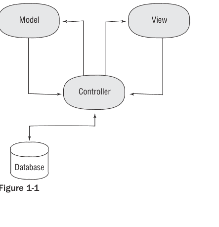

图 1-1

## 路由

ASP.NET MVC 框架包含一个灵活的 URL 路由系统，允许我们定义映射规则。路由系统将传入的 URL 映射到适当的控制器和操作。例如，如果我们使用默认的路由定义，URL `/user/edit/2` 将被路由系统映射到 User 控制器中的 Edit 操作，并传递 2 作为 ID 参数。映射系统还构建传出 URL，我们在视图中使用它以提交表单、创建链接等。

路由系统非常灵活，使我们能够更改路由而不更改代码。所以如果我们决定将 URL 从 `/user` 更改为 `/customer`，那么只需在应用程序启动逻辑中的路由定义中更改即可。

## 视图数据（ViewData）

你可能正在好奇控制器如何将数据发送到视图。例如，如果你正在编辑一条客户记录，控制器需要从我们的数据存储中获取该数据并将其发送到视图。这是通过使用控制器中的 `ViewData` 属性完成的。`ViewData` 的类型为 `ViewDataDictionary`，你可以通过使用字典（例如，`ViewData["title"] = "Edit Customer"`）或设置 `ViewData` 的 Model 属性为你想要发送到视图的模型类的实例来从中/向它设置/获取值——或者你可以两者都做。这是一个示例：

```csharp
var model = Repository.GetCustomer(2);
ViewData.Model = model;
ViewData["title"] = "Edit Customer";
```

视图将通过访问其自身的 `ViewData` 属性来获取发送给它的数据。你可以像这样获取上面设置的页面标题：

```html
<title><%= Html.Encode(ViewData["Title"]) %></title>
```


# 第1章：需求

你可以像这样访问上述模型：

```
<%= Html.TextBox("firstname", Html.Encode(ViewData.Model.FirstName))%>
```

这将生成以下HTML：

```
<input id="firstname" type="text" value='Firstname' />
```

## HTML Helper

你可能已经注意到，在前面的一些示例中，我使用了Html helper类。这个类包含几个辅助方法，允许你轻松生成HTML。有些人喜欢使用它们，而另一些人则不喜欢。我介于两者之间。以下两条语句在生成完全相同的HTML方面是等同的：

```
<input id="email" type="text" />
```

使用哪一种完全取决于你的选择，但在本书中，你可能会看到我将它们混合使用。我这样做是因为有时辅助方法可能不如纯HTML高效（或简洁），而在其他情况下，它可能显著节省时间。前面的例子过于简单，无法说明使用helper的好处。

## Action Filter

Action filter是用于装饰action、controller类甚至整个程序集的属性，它们允许我们在执行之前或之后拦截action并执行某些逻辑。框架自带了一些开箱即用的预定义action filter。其中一个action filter是Authorize，它将通过将未授权的用户重定向到登录页面来阻止他们执行action。Action filter可用于跟踪、异常处理和日志记录等。要创建action filter，你需要继承`ActionFilterAttribute`并重写你需要的方法。你的类看起来会像这样：

```
public class TraceAttribute : ActionFilterAttribute
{
    public override void OnActionExecuting(ActionExecutingContext filterContext)
    {
        //在执行action之前写入跟踪信息
    }
    public override void OnActionExecuted(ActionExecutedContext filterContext)
    {
        //在执行action之后写入跟踪信息
    }
}
```

## ModelState

`ViewData`包含一个名为`ModelState`的属性。`ModelState`是模型状态的集合。具体来说，它的类型是`ModelStateDictionary`，包含一个可通过字符串键访问的`ModelState`对象字典。这个字典用于将模型状态传回视图，这在验证场景中非常有用。例如，可以向`ModelState`添加一个项，表明登录凭据不正确，并且通过使用辅助方法，验证被大大简化了。我们稍后将详细讨论这一点，但这里有一个如何向`ModelState`添加内容的快速示例。

```
ViewData.ModelState.AddModelError("password",
            password, "Password is incorrect.");
```

## 方法论、概念与方法

在接下来的几页中，你将了解我们将用于创建应用程序的方法、方法论和常见模式。这些是相当大的主题，深入探讨其中一些超出了本书的范围。尽管如此，我仍然想简要解释它们，以便我们有一个共同的语言。最终，它应该能帮助你更好地理解本书。

## 测试驱动开发（TDD）

测试驱动开发（TDD）是一种由短迭代组成的软件开发技术，首先编写测试，然后编写代码以满足测试条件。举一个更具体的例子，如果我们想编写一个方法来验证电子邮件地址，我们将首先编写一个涵盖此用例的测试，然后编写方法使测试通过。

TDD周期由以下顺序组成：

- 1. **添加测试。** 创建一个满足需求的测试。在我们的示例中，我们将创建一个测试，使用无效的电子邮件地址调用电子邮件验证方法。
- 2. **运行测试。** 由于我们还没有编写任何代码，测试应该失败。这是一个重要的步骤，因为它验证了测试不会总是通过，否则测试就毫无价值了。最初，你甚至无法运行测试，因为你会有编译器错误，因为你还没有编写测试所调用的代码。
- 3. **编写代码。** 编写代码以满足测试条件。在这种情况下，你将创建`IsValidEmail`方法来验证电子邮件地址。
- 4. **运行测试。** 测试现在应该通过了。如果失败，则重复步骤3，直到测试通过。
- 5. **重构。** 既然需求已经满足，我们可以重构代码。在重构代码时重新运行测试，以确保你没有破坏任何东西。

前面的循环在整个开发过程中重复进行，用于需要添加的每个新功能。

如果你仔细审视前面的周期并思考它的好处，你可能会意识到它的好处。一个直接且明显的好处是我们已经编写了一个单元测试。我们都曾在这样的项目上工作过：我们同意在发布前一周创建单元测试，但大多数时候发生的事情是我们忙于赶进度，以至于没有时间创建测试。

有一个现成的测试是极其强大和令人安心的。它允许我们在未来更改代码，按下“运行测试”按钮，并立即发现我们刚刚添加的两行代码是否引入了20个新错误。

以测试开始迭代意味着我们需要非常清楚地理解需求以满足它们。清楚地理解需求、用例和用户故事将不可避免地导致更好的软件，并最终让客户满意。

我们都知道，需求会在项目进行几周（甚至几天）后发生变化。因此，通过测试来满足需求使我们能够轻松更改代码，并通过运行测试来验证更改（参见图1-2）。

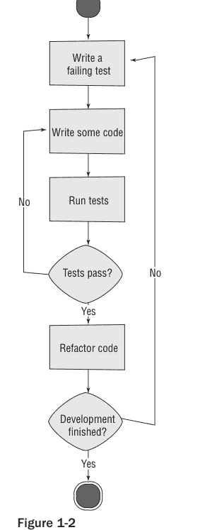

## 面向方面编程（AOP）

面向方面编程（AOP）是一种编程风格，通过允许分离横切关注点来提高代码的模块化、可读性和可重用性。横切关注点是在应用程序各层中常见的行为，使用传统的面向对象技术很难表达。

例如，一个常见的方面是日志记录。为了记录应用程序的操作，你必须在代码中到处散布日志记录代码。然而，你想要记录日志的大多数类或方法实际上并不（也不应该）关心日志记录。例如，可以编写一个像这样的方法：

```
public void AddFriend(string friendName)
{
    try
    {
        LogMessage("AddFriend Called");
        //添加好友的代码
    }
    catch (Exception ex)
    {
        LogException(ex);
        //处理异常
    }
    finally
    {
        LogMessage("AddFriend Ended");
    }
}
```

前面的方法存在几个问题：

- 日志记录代码分散各处。
- 代码难以维护或更改。
- 每个方法都必须手动编写这些代码。

更好的方法是使用方面。使用PostSharp作为我们的AOP框架，我们可以为日志记录创建一个新的方面，只需应用一个属性即可将其应用于我们上面的方法。我们的代码可能看起来像这样：

```
[Log()]
public void AddFriend(string friendName)
{
    try
    {
        //添加好友的代码
    }
    catch (Exception ex)
    {
        //处理异常
    }
}
```

Log方面（属性）将能够在方法调用期间的不同点记录适当的消息，例如在进入时、退出时、出错时等。

> **定义**
- **方面（Aspect）** —— 横切关注点的模块化——例如，日志记录、事务管理、跟踪、异常处理或授权
- **连接点（Joinpoint）** —— 主程序和方面在执行期间相遇的点——例如，方法调用或抛出异常
- **通知（Advice）** —— AOP框架在连接点采取的操作

## 模式

我想简要解释一些我们很可能在这个应用程序中使用的设计模式。这不是一本模式书，而且有些人更有资格深入探讨每个模式的细节；我只想简单地命名和描述每个模式。我的大部分模式描述都来自软件模式的经典参考——马丁·福勒的《企业应用架构模式》（PoEAA; Addison-Wesley, 2002）。

>我们已经解释了模型-视图-控制器（MVC）模式，所以我们在本节中将跳过它。

## 策略模式

此模式旨在定义一个算法族，封装每个算法，并使它们可以互换。策略模式使得算法可以独立于使用它的客户端而变化。

> **定义**
- **策略（Strategy）** —— 算法通用的接口声明
- **具体策略（Concrete Strategy）** —— 策略的实现
- **上下文（Context）** —— 配置为使用具体策略的对象

从概念上讲，策略模式如图1-3所示。

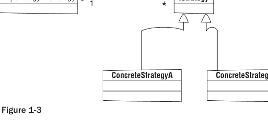

图1-3


## 第一章：需求

策略模式可以应用的一个例子是排序。类图可能看起来像图1-4。

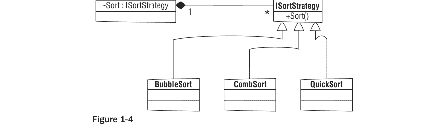

## 空对象模式

空对象模式（Null Object）是一种设计用来表示对象缺失的对象。如果你在.NET中对空对象调用任何方法，你会得到一个`NullReferenceException`。更好的做法是返回一个表示对象不存在的对象实例。例如，如果你的客户没有任何订单，而你试图获取他们的订单，使用空对象模式，你会这样做：

```
public List<Orders> GetOrders(int customerId)
{
    //get orders from database
    //if no orders exist then return an empty list
    return new List<Orders>();
}
```

这比返回`null`更好，因为方法的调用者不需要执行空值检查，并且在返回的对象上调用`Count`属性不会抛出`NullReferenceException`。

```
var orders = GetOrders(2);
//won't throw an exception
txtTotalOrders.Text = orders.Count;
```

## 懒汉式实例化（又称延迟加载）

这是一种模式，其中对象的创建、值的计算或昂贵过程的执行被延迟到首次需要时才进行。例如，下面是一个属性，它将返回用户的联系人，但它只在首次被调用时计算。因此，如果它从未被调用，我们永远不需要承担获取联系人列表的成本。

```
private List<Contact> contacts;
public List<Contact> Contacts
{
    get
    {
        if (contacts == null)
        {
            contacts = GetContactsFromDatabase(userId);
        }
        return contacts;
    }
}
```

## 仓储模式

该模式允许我们创建一个独立于数据存储的数据访问层。这使得数据访问的变更和测试驱动开发（TDD）变得更加容易。例如，我们可以通过定义以下接口来创建一个联系人仓储：

```
public interface IContactRepository
{
    IQueryable<Contact> GetContact(long id);
    IQueryable<Contact> GetContacts(long customerId);
    long Create(string email, string name, string description);
    bool Delete(long id);
    bool Update(Contact contact);
}
```

我们现在可以实现这个接口来与生产环境中的SQL数据库通信，在集成测试期间实现它来与XML文件通信，甚至实现它来与内存数据库通信用于单元测试。

## 原则

以下是我将在本书中尽可能广泛地应用的软件原则列表。这些原则是通用且抽象的，具有广泛的适用性。它们创建了一套编程指南，无论使用何种语言，都可以在软件开发过程中使用。实际上，许多原则如此通用，以至于可以应用于与软件开发无关的其他领域。

## 开闭原则

开闭原则指出，软件实体（类、模块、程序集等）应该对扩展开放，对修改关闭。这允许其他人更改实体的行为而不修改其源代码。这通常通过继承来实现。例如，如果一个类有一个发送消息的*Send*方法，我们可以通过允许派生类重写*Send*方法并实现不同的发送功能（例如通过即时通讯而非SMTP发送）来使其对扩展开放。

### YAGNI

YAGNI是"You Ain't Gonna Need It"（你不会需要它）的缩写，简单来说就是你应该只在需要时才添加代码/功能，而不是在你预见到需要它时。最近，我成为了YAGNI方法的忠实粉丝和倡导者。这主要是因为我记得所有我过去编写的、当时*以为*将来会需要的代码。我们都知道，每一行代码都会增加复杂性，每个新功能都需要测试、调试、修复、记录和维护。

因此，在添加新功能之前请仔细思考。你真的需要它吗？你现在需要它吗？如果你现在不需要，那就现在不要做。当需求出现时（可能永远不会出现），你再去添加它——到那时它可能已经和你最初设想的不同了。

### KISS

KISS（Keep It Simple, Stupid）原则指出，事情应该保持简单，避免复杂化。这个原则可以应用于其他领域，而不仅仅是软件开发。但在软件开发的背景下，我们应该努力保持事情简单，避免不必要的复杂性，这样我们才不会最终得到一个像鲁布·戈德堡机械（Rube Goldberg machine）那样复杂的系统。例如，如果你确定你只会使用SQL Server作为数据存储，那么就没有必要添加对其他数据库系统的支持或编写与数据库无关的代码，因为你不会需要它。

> 一切都应尽可能简单，但不能过于简单。
— 阿尔伯特·爱因斯坦

### DRY

DRY是"Don't Repeat Yourself"（不要重复自己）的缩写。DRY原则旨在减少重复。重复会降低可维护性，因为它增加了更改的难度。它还可能导致不一致和歧义。重构是检查你在多个地方复制粘贴的代码并将其重构为单一权威位置的好时机。DRY不仅对应用程序代码有用，对测试代码也同样有用。

### 控制反转（IoC）与依赖注入（DI）

控制反转（IoC）和依赖注入（DI）是两个原则，允许我们创建松耦合且依赖更少的系统。控制反转是对象实例化的间接化，使对象不直接创建其他对象。相反，IoC容器将通过构造函数参数或公共属性将依赖项注入到对象中。

想象一个需要使用封装了电子邮件功能的`EmailService`的类。如果我们使用构造函数注入，我们可以这样定义我们的类：

```
internal class MyClass
{
    public MyClass(IEmailService emailService)
    {
        this.EmailService = emailService;
    }
}
```

然后我们会配置我们的IoC容器，告诉它如何实例化一个`IEmailService`并将实例化的对象注入到上面的类中。如果这没有意义或者看起来太模糊和理论化，不用担心；在接下来的章节中，你会看到更好的例子。

## 单一职责原则

单一职责原则指出，一个类应该只有一个职责。一个职责被认为是改变的一个原因。如果一个类有两个改变的原因，那么它应该被拆分为两个类。看看下面的类，它表示一个`Customer`：

```
internal class Customer
{
    public long Id { get; set; }
    public string Name { get; set; }
    public Address ShippingAddress { get; set; }

    public void Save()
    {
        //code to save the customer
    }

    public void Delete()
    {
        //code to delete the customer
    }
}
```

乍一看，这个类似乎没问题。这个类的问题在于它有两个改变的原因。一个原因是如果模式发生变化，你需要添加新属性或更改现有属性。另一个原因是如果持久化方式发生变化。这可能发生在你更换数据存储，或者规范化/反规范化你的数据库，然后你想将Customer存储在多个表或一个表中时。这个类应该被拆分成两个类，一个表示模型，另一个处理持久化。

### 里氏替换原则

这个原则基本上说，任何派生类都可以用来替换其基类，而不会改变应用程序的正确性。看看下面的类；里氏替换原则指出，我们可以在任何可以使用Vehicle的地方使用Airplane、Motorcycle或Boat：

```
internal class Vehicle
{
}
internal class Airplane : Vehicle
{
}
internal class Motorcycle : Vehicle
{
}
internal class Boat : Vehicle
{
}
```

### 约定优于配置

约定优于配置（Convention Over Configuration）是一种设计范式，它通过减少开发人员需要做出的决策（配置）来强调约定优于配置。你仍然有能力配置事物并保持一定程度的灵活性，但通过使用约定，你可以获得简单性并避免任何额外的工作。ASP.NET MVC框架很好地在整个框架中应用了这种设计范式。以下是一些使用中的约定示例：

- 所有控制器都命名为[某物]Controller。
- 所有视图都在Views文件夹中。
- 控制器中的所有公共方法都被视为操作（Action）。
- 表单字段映射到同名的操作参数。


## 第 1 章：需求

这些只是其中少数几种约定；我们将在书中探讨更多此类约定，并在旁注中加以突出。

## 工具与框架

到目前为止，我们讨论了问题、设计和解决方案。现在是我们选择有助于实现解决方案的工具和框架的时候了。我希望能使工具选择具有包容性和开放性。我花了很多时间研究各种替代方案，并试图选出符合我应用需求的工具。所以不要认为这是在提倡某一种框架而非另一种。此外，这些工具中的许多是开源的，并且正在迅速变化，以至于我在研究时代所缺少的某个功能，可能在你读这本书时已经被实现。我认为概念比实际工具更重要。我必须承认，能够与尚未进入测试版的尖端框架一起工作，既令人兴奋又令人沮丧。好消息是，这些工具大多正在积极开发，并且拥有很好的社区支持。最坏的情况是，我可以访问代码，如果我不喜欢某个地方，我也可以修改它。

## 单元测试框架

如果我们打算实践测试驱动开发，我们就需要单元测试框架。Microsoft Visual Studio Team System 2008 版包含一个通常称为 MSTest 的单元测试框架。我决定不使用 MSTest，即使它在我的舒适区内。我的决定完全是基于我不希望假设你有几千元可以购买 Visual Studio 的副本这一事实。我考察了 nUnit、MbUnit 和 MSTest，最终选择了 MbUnit。理由之一是几位有影响力的开发者的压倒性和热情的支持。就个人而言，我特别喜欢的一项功能是行测试（Row Tests），它允许我们拥有一个包含多组数据的单个测试。例如，下面的测试将运行三次以测试三个不同的无效用户名：

```
[Test]
[Row("abc", Description = "Username is too short")]
[Row("luser", Description = "Username starts with non-alpha")]
[Row("user$abc", "Username contains invalid characters")]
public void Register_Should_Fail_For_Invalid_Usernames(string invalidUsername)
{
    //test registration process
}
```

MbUnit 与 ReSharper 的测试运行器配合得也非常好，后者很好地集成在 Visual Studio 中，我可以轻松点击每个测试旁边的标记来运行或调试它，如图 1-5 所示。

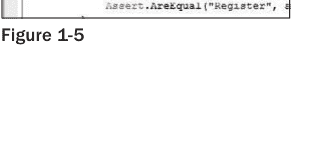

图 1-5

测试运行器拥有非常友好的用户界面，可以快速指出测试的状态，并指出失败的测试以及失败的原因，如图 1-6 所示。

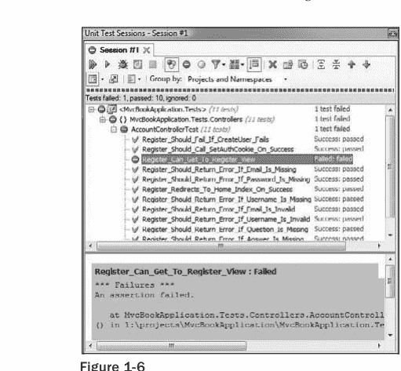

图 1-6

### 代码覆盖率

代码覆盖率是测试驱动开发中的一个关键指标。它衡量源代码的覆盖程度，即被覆盖的部分。使用代码覆盖率工具，我们可以运行测试并查看代码覆盖率报告。理想情况下，你希望达到 100% 的代码覆盖率。大多数工具可以通过用不同颜色高亮显示代码块来帮助你直观地看到哪些部分被覆盖了，哪些没有。图 1-7 显示了 Visual Studio 2008 的一部分代码覆盖率窗口。

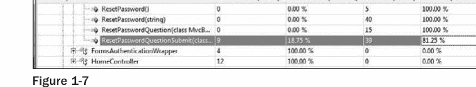

图 1-7

> 代码覆盖率仅在 Visual Studio Team System 2008 的开发者版、测试版和团队套件版中可用。

从图 1-7 可以看到，`ResetPasswordQuestionSubmit` 方法有九个块，或 18.75%，未被覆盖。双击该条目将显示该方法……代码用不同颜色高亮显示，指示未被测试覆盖的块。如图 1-8 所示，前两个 `if` 语句从未被执行，这意味着我的测试没有测试这些条件。

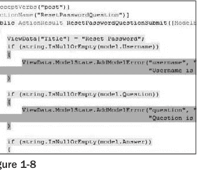

图 1-8

如果您的 Visual Studio 版本中没有代码覆盖率……那么您可以使用 NCover，这是一个极好的替代品。

### JavaScript 库

我们需要使用 JavaScript 和 AJAX 来增强网站的可用性和性能。我们必须使用一个快速、易于学习且易于编写的 JavaScript 库。在审查了几个 JavaScript 库之后，我立即爱上了 jQuery 并成为其忠实粉丝。jQuery 允许您做一些在 JavaScript 中您要么从未想过可能实现，要么做起来很难的事情。它具有非常强大且简洁的语法……允许您这样做：

```
$(document).ready(function() {
    $("h2").addClass("red");
});
```

前面的代码会将"red"类添加到任何"h2"元素。jQuery 还拥有庞大的社区、良好的文档以及大量的插件和扩展程序库。

话虽如此，我也非常喜欢 YUI（Yahoo! 用户界面库）……它有一套出色的用户界面控件/小部件。它的文档非常完善，支持良好，外观也很棒。我将从 YUI 使用两个组件：富文本编辑器（Rich Text Editor）和 YUI 测试工具包（YUI Test Utility）。YUI 测试工具包附带一个良好的测试运行器（见图 1-9），并且拥有极好的文档。

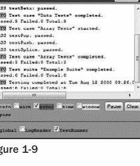

图 1-9

### IoC 容器

我想使用一个 IoC（控制反转）容器来简化控制器并减少它们对其他类的依赖。这可以使测试编写大大简化，总体设计也更佳。市面上有几种 IoC 容器，它们看起来都非常好且功能强大。但大多数容器的学习曲线非常陡峭，配置过程也错综复杂。我考察了以下内容：

- StructureMap
- Spring.Net
- Castle Windsor
- Autofac
- Ninject

最初，我选择了 Autofac，因为它具有非常流畅的接口、高度可发现的 API 和非常可读的代码。以下是 Autofac 的一个简短示例：

```
var builder = new ContainerBuilder();
builder.Register<Straight6TwinTurbo>() .As<IEngine>();
```

在使用 Autofac 一段时间后……有人建议我查看 Ninject。它看起来和 Autofac 一样好，也一样容易，但它的文档更好，似乎稍微更容易学习。Ninject 还具有非常简单的上下文绑定语法，让你可以做到如下所示：

```
Bind<IService>().To<RedImpl>()
  .Only(When.Context
           .Target.HasAttribute<RedAttribute>());
Bind<IService>()
  .To<BlueImpl>()
  .Only(When.Context
           .Target.HasAttribute<BlueAttribute>());
```

在下面的代码中，ConsumerA 将注入 IService 接口的 RedImpl 实现，而 ConsumerB 将注入 BlueImpl 实现。

```
class ConsumerA {
  public ConsumerA([Red] IService service) {
  }
}

class ConsumerB {
  public ConsumerB([Blue] IService service) {
  }
}
```

选择 IoC 容器具有挑战性且相对主观，但最终来说，我认为无论你选择这些 IoC 容器中的任何一个，你都会没有问题。

> 我喜欢 ASP.NET MVC 的一点是它具有多种选择。您不必局限于使用某个供应商/产品/框架……您基本上可以在每一层框架中插入您选择的供应商/产品/框架。您可以替换您的控制器工厂、视图引擎、视图渲染、路由处理器和其他扩展点。它非常可扩展。

### 模拟（Mocking）

模拟允许我们在单元测试中模拟复杂对象的行为。当使用真实对象很困难或不可能时，这非常有价值。如果您想要对创建用户操作进行单元测试，但不希望代码在数据库中创建记录……那么您可以模拟数据库调用。在这个测试上下文中，我们并不真正关心数据库调用的实现……相反，我们要测试创建用户操作的逻辑。

有几个非常好的模拟库，包括：

- TypeMock
- NMock
- NMock2
- Rhino Mocks

在我看来，它们没有一个像 Moq 那样既容易使用又优雅。它如此容易使用，让我很快就上手了。以下是设置模拟对象有多容易：

```
var mockMembership = new Mock<MembershipProvider>();
mockMembership.Expect(p => p.MinRequiredPasswordLength).Returns(4);
```

在前面的示例中，我们创建了一个 `MembershipProvider` 的模拟实例……并告诉它如果调用 `MinRequiredPasswordLength`，它应该返回 4。现在您可以轻松地将这个模拟对象传递给被测控制器的构造函数，而不必关心 `MembershipProvider` 的实际实现。

如 Moq 首页所解释的：“它是唯一从零开始开发的用于.NET 的模拟库……充分利用 .NET 3.5（即 LINQ 表达式树）和 C# 3.0 功能（即 lambda 表达式），使其成为最富有生产力、类型安全且支持重构的可用模拟库。并且它支持模拟接口以及类。它的 API 极其简单直观，不需要任何与模拟概念相关的先验知识或经验。”

### 为什么要使用 EvenContact？

我想创建一个相当通用的应用程序……帮助说明 ASP.NET MVC 框架和测试驱动的软件开发方法的强大功能及灵活性。此外，我也厌倦了阅读那些使用博客引擎或某种内容管理系统作为示例来教授一切的一切书、文章和博客帖子。博客引擎已成为当今编程书籍中的"Hello World"。最后，为了一举两得……我想创建一个实际上可以在线提供并可能产生收入的服务。这有两重优势。我必须确保我创建的是人们愿意付费的好东西……并且通过这样做，我可以制作一本更好的书，并希望在这个过程中帮助他人学习。


## 摘要

既然我们已经万事俱备，就可以开始编码了。我希望你把这本书看作一部纪录片。我基本上是在记录自己的开发过程，随着进度逐步展开。我相信这将带来一种更加“真实”的 ASP.NET MVC 测试驱动开发（TDD）体验。这意味着我在第 2 章做出的某些决策，可能会因为新信息或错误假设而在第 4 章发生改变。这对我们所有人来说应该都是一次有趣的体验，希望能借此凸显 TDD 和良好设计的价值。

#### 高层设计

本章将讨论应用程序的高层设计。我们会讨论一些页面流程，并查看一些粗略的页面布局。本章中的图表都是手绘的，以强调这不应是一个冗长复杂的过程。我们基本上是在尝试将应用程序可视化，帮助我们确定下一步的方向。

## 问题

既然我们已经有了需求，就需要创建一些高层设计来指导我们的开发。请记住，我们采用的是测试驱动开发/设计（TDD）方法，因此不会创建详细的设计文档。这只是高层设计，足以帮助我们可视化应用程序、澄清一些流程，并沿途发现一些潜在的陷阱。

## 设计

我们将从设计网站的一些基本功能开始，这些功能几乎适用于任何 Web 应用程序；然后再深入我们应用程序特有的更多主题。我称它们为基本功能，并非因为它们比其他功能更容易或更简单。所有这些功能都是一等公民。它们之所以是基本的，是因为它们几乎存在于每个应用程序中。再次说明，这不会是详细设计，所以我们来谈谈主要部分并勾勒一些图表。

### 会员系统

我们需要一个会员系统来管理用户，并为他们提供安全的账户访问权限。

首先，我们从用户注册（signup）流程开始。注册流程如图 2-1 所示。

# 第 2 章：高层设计

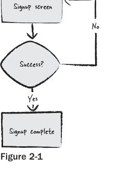

图 2-1

页面布局大致如图 2-2 所示。

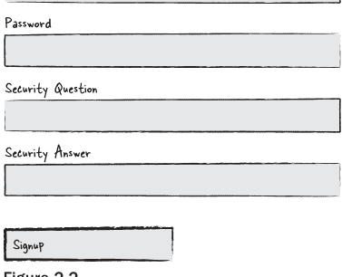

图 2-2

26

> **密码确认**

我注册了数百个网站，令我惊讶的是，几乎*所有*网站都强制你确认密码。这对我来说毫无意义。大多数网站都提供了重置密码的方式，那确认密码又有什么意义呢？如果我忘记了或输入有误（反正这种情况很少见），我直接重置密码就好了。就我个人而言，我认为密码确认是浪费时间和资源，而且不太用户友好。

我知道这看起来是件小事，但就是这个看似简单的字段，实际上需要做大量的工作。以下是实现它通常需要的一些步骤：

- 编写 JavaScript 来验证字段。
- 编写服务器代码来验证字段。
- 编写单元测试来测试服务器端验证。

接下来是登录流程，如图 2-3 所示。

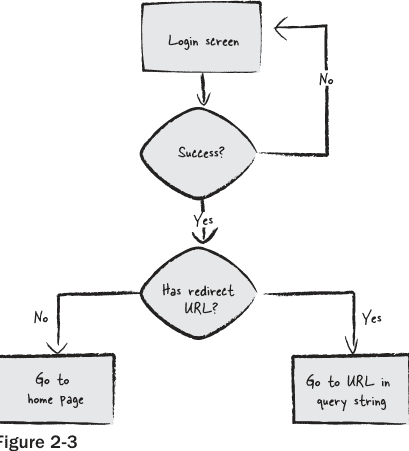

页面布局大致如图 2-4 所示。

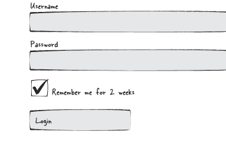

图 2-4

我们还需要让用户能够重置密码。首先，我们不希望随便什么人输入一个用户名或邮箱就能重置该账户的密码。我们需要确认是合法的账户所有者在请求重置。有几种方法可以实现这一点。一种是向账户所有者发送电子邮件，请他点击链接来启动重置流程。但既然我们为用户设置了密保问题和答案，我们可以直接询问用户问题，如果答案与我们的记录匹配，我们就重置密码并通过电子邮件将新密码发送给用户。这样，我们就省去了额外的邮件以及随之而来的麻烦。重置密码流程如图 2-5 所示。

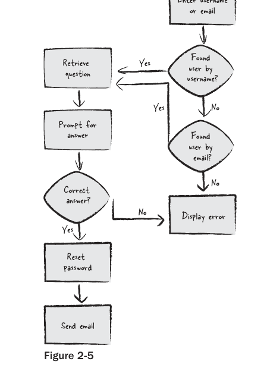

图 2-5

图 2-6 显示了重置密码页面。

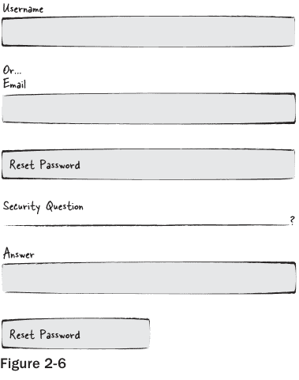

## 账户管理

每个会员都有一个关联的账户。网站的账户管理组件允许用户查看其账户并对其进行修改。账户实体可能很大，将其拆分成更小的部分是有意义的。例如，账单信息可以是独立的一块，即使它属于账户的一部分。假设一个账户由以下部分组成：

- 基本信息（姓名、地址、电子邮件等）
- 账单信息（支付方式、信用卡、账单地址等）
- 订阅信息（所选套餐）

就本应用程序而言，我们将采用一个非常简单的账户实体，收集最少的数据。我们真正需要的只是一个电子邮件地址、一个 PayPal 账户和一个订阅套餐，如图 2-7 所示。如果以后决定收集更多信息，我们可以按上述方式将账户页面拆分成更小的部分。

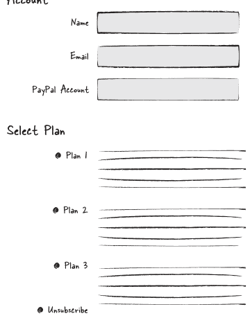

为了进一步简化账单处理，我们将使用 PayPal 作为我们的支付处理器，它支持订阅。图 2-8 显示了我们的保存账户流程。

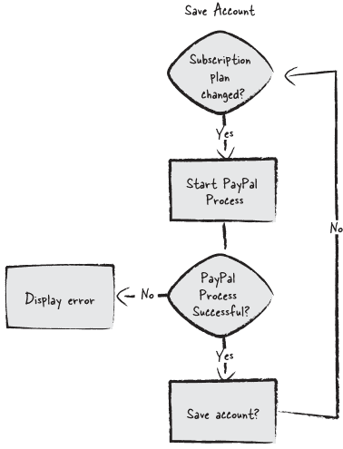

## 消息管理

这一部分处理消息。第一步是创建消息；这是一个非常基础的步骤，如果你使用过任何基于 Web 的电子邮件系统，你可能对此很熟悉。在最基本的形式中，它是一个表单，接收收件人列表和消息正文。我们来看更有趣的编辑消息流程，如图 2-9 所示。

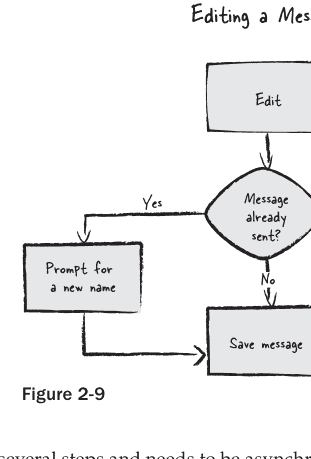

发送消息涉及多个步骤，并且需要是异步的。由于用户可能要向数千名收件人发送，我们不希望同步发送数千封电子邮件。相反，电子邮件被排入持久队列中（可能在数据库中）。然后可以由 Windows 服务监控该队列。我们不会讨论队列监控服务，因为它超出了本书的范围。我们所需要做的就是将电子邮件放入队列，并假设有一个服务负责清理队列并执行实际的邮件发送。

>_instance, please Ignition switch is in the "OFF" position._ **消息队列**

> 从我们 Web 应用程序的角度来看，数据库中会添加一条记录，表明消息 X 需要发送给收件人 Y。"队列监控"部分可以是一个在后台运行的 Windows 服务，每隔 5 分钟（或任何合理的间隔）轮询数据库中的队列表，然后将消息发送给收件人，从队列中删除该记录，然后继续处理下一个。

另一种选择是创建一个 SQL 作业，在特定间隔运行并执行相同的功能。无论你选择哪种方法，只要能查询队列表、发送电子邮件并从队列表中删除记录即可。

## 联系人管理

大多数联系人和列表管理任务都是简单的 CRUD 操作，这里我就跳过了。相反，我们来看一下创建列表并添加联系人的整体流程。图 2-10 中的流程图展示了这一过程。

> **CRUD**
>
> CRUD 是 create、read、update 和 delete 的首字母缩写，即持久存储的四种基本操作。用 SQL 术语来说：
>
> Create = INSERT
>
> Read = SELECT
>
> Update = UPDATE
>
> Delete = DELETE

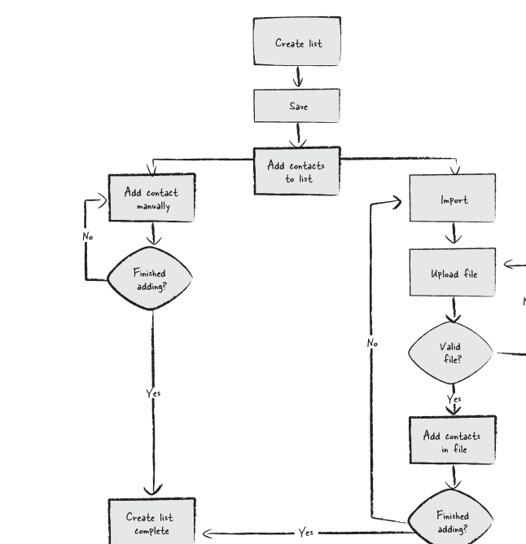

图 2-10

关于创建列表流程，有一点需要注意：将联系人添加到列表不仅仅是为新的联系人创建数据库记录。该联系人可能已经存在于用户的全局通讯簿中，不应再次添加。我们还在列表中添加了对该联系人的引用。这样，我们就可以在一个地方编辑联系人信息，并让所有列表都获得更新。电子邮件地址是联系人的唯一标识符，因此如果存在相同电子邮件的联系人，我们不应添加新联系人，而应尝试更新值。例如，如果用户已经有一个包含以下信息的联系人：

| 姓名 | Homer |
|---|---|
| 电子邮件 | hsimpson@fox.com |
| 出生日期 | (null) |

而正在导入的新记录包含以下信息：

| 姓名 | Homer Simpson |
|---|---|
| 电子邮件 | hsimpson@fox.com |
| 出生日期 | 01/01/1955 |

那么流程应该更新现有记录，添加新的出生日期，因为这里没有冲突；但应提示用户选择正确的姓名，因为有两个版本。或许图 2-11 中的流程图会有所帮助。

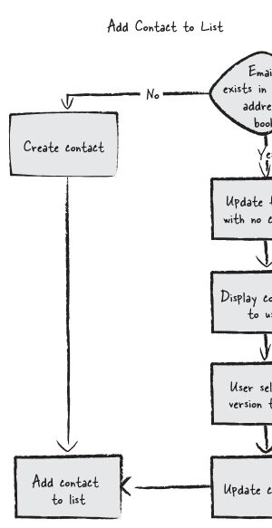


## 第二章：高层设计

## 解决方案

本章描述的解决方案其实就是本书的剩余部分，但在我们开始创建后续章节中的应用之前，必须先设置好开发环境。

需要以下工具：

- 安装最新服务包的 Visual Studio 2008
- ASP.NET MVC 框架 (http://asp.net/mvc)
- Moq (http://code.google.com/p/moq)
- Ninject (http://ninject.org)
- JQuery (http://jquery.com)
- YUI (http://developer.yahoo.com/yui)
- MbUnit (www.mbunit.com)

我还强烈推荐使用 ReSharper，这是一个必备的生产力工具。ReSharper 还包含一个非常优秀的测试运行器，可与 MbUnit 配合使用。如果你没有 ReSharper，可以使用 TestDriven.net (http://www.testdriven.net)，这是一个同样支持 MbUnit 的免费测试运行器。

我没有提及版本号，因为这些库大多开发周期很短，几乎每隔一周就会有新版本发布。我将使用撰写本书时可用的最新构建版本，这意味着某些代码可能会有所变化。不过，你应该能够理解其中的概念，并轻松修改代码以适配最新版本。

一旦你将所有工具准备就绪并运行，请创建一个新的“ASP.NET MVC Web 应用程序”及其关联的 MbUnit 测试项目。这将为你创建一个新的 Web 应用程序，其中包含基本的成员身份任务——登录和注册。为了本书的目的，我们将假设从一个空白的应用程序开始。你可以删除自动创建的文件，也可以保留它们并跳过与成员身份相关的章节。我强烈建议你删除这些文件，并按照本书的内容进行操作。我们的目标不仅仅是让成员身份功能运行起来，而是使用测试驱动开发（TDD）来实现它，并在此过程中学习。

## 总结

此时，你应该已经充满热情并准备好编写代码了。在本章中，我们讨论了一些高层设计，并通过设置开发环境开始准备实现我们的解决方案。我们现在准备好立即行动，开始编写一些测试。让乐趣开始吧。

## 第三章：成员身份

我们从哪里开始？由于这个应用程序将要求用户注册和登录才能使用其任何功能，因此从网站的成员身份组件开始是合理的。在本章中，我们将通过测试驱动开发（TDD）方法来创建注册（signup）功能。本章开始时会非常详细和具体，但随着我们的进展，我们会快速带过一些常见内容。

## 问题

我们需要满足以下成员身份要求，允许用户：

1.  创建账户（即注册、sign up）。
2.  登录。
3.  重置密码（我们使用单向密码哈希，因此无法检索密码，只能重置）。
4.  更新成员身份信息（更改电子邮件、安全问题等）。
5.  更改密码。

## 设计

既然我们使用 TDD，我们可以将测试视为我们的设计。我们首先为特定功能/需求创建测试，然后编写满足测试所需的代码。本质上，我们是在通过编写测试来设计我们的应用程序。例如，如果我们希望只接受仅包含字母且长度为三个或更多字符的用户名，那么我们将为该需求编写一个测试，然后编写满足测试的代码。

如前一章所述，注册过程涉及以下步骤：

1.  收集姓名、电子邮件、密码、安全问题和答案。
2.  确保用户名唯一。
3.  确保用户名有效：
    -   长度至少为4个字符。
    -   以字母开头。
    -   仅包含字母、数字和下划线。
4.  确保电子邮件唯一且有效。
5.  创建用户账户并让用户登录。

## 解决方案

在我们开始编写测试之前，我们需要创建一个测试类。让我们为 AccountController 添加一个新的测试类，并将其命名为 AccountControllerTest。为了使其成为一个测试类，你需要用 MbUnit 的 [TestFixture] 属性进行装饰。以下是该类：

```
[TestFixture]
class AccountControllerTest
{
}
```

> **约定**
> 测试类将按以下格式命名：[类名]Tests。例如，如果我们测试的是 PayController 类，那么测试夹具将命名为 PayControllerTests。
>
> 测试方法将使用清晰且描述性的名称进行命名，以明确标识测试及其结果。你可以使用大写字母或下划线来分隔名称。例如：CallbackShouldReturnNull 或 callback_should_return_null。
>
> 我个人更喜欢下划线方式，但在代码中两种方式都会混合使用。在本书结尾处，我决定使用小写字母和下划线。

我们需要处理两个 Register 操作。一个操作只是显示视图，对应 GET 请求；另一个操作将表单提交到服务器以执行注册，对应 POST 请求。

让我们确保用户确实可以查看 Register 页面。我们从一个简单的测试开始，该测试只需验证用户是否可以导航到 Register 视图，即 http://evencontact.com/account/register。

我知道你已经迫不及待地想编写你的第一个测试了。冷静下来，让我们思考一下需要测试什么。我们要确保：

-   可以用正确的参数调用 Register 方法。
-   页面标题设置正确。
-   返回值是一个有效的 ActionResult。

这很简单，但什么样的 ActionResult 才是有效的？我知道当我们访问 Register 页面时，我们希望渲染 Register 视图，所以让我们先尝试编写测试：

```
[Test]
public void Register_Can_Get_To_Register_View()
{
    var ac = new AccountController();
    var results = ac.Register();
    Assert.IsNotNull(results);
    Assert.IsInstanceOfType(typeof(ViewResult), results);
    Assert.IsEmpty(((ViewResult)results).ViewName);
    Assert.AreEqual("Register", ac.ViewData["Title"], "Page title is wrong");
}
```

注意我们如何用 [Test] 属性装饰方法。这告诉测试框架这是一个测试。你会注意到，如果你尝试构建这个测试，你会得到一个编译器错误，提示找不到 AccountController。这是我们的第一次测试失败（红灯）。

> **约定**
> 与操作相关的测试将按此格式命名：ActionName_[描述性测试名称]。
>
> 拥有描述性的测试名称至关重要。Register_Test 不是一个好的测试名称。现在听起来可能还可以，但当你有400个测试时，它就不会很有帮助了。

让我们创建 AccountController 类并尝试构建；现在我们得到一个错误，提示 AccountController 不包含 Register 的定义。所以，让我们创建 Register 操作，如下所示：

```
[AcceptVerbs("GET")]
public ActionResult Register()
{
    return null;
}
```

> **可接受的动词**
> [AcceptVerbs] 属性告诉框架该操作可以处理哪些 HTML 动词。这允许我们创建两个同名的操作——即相同的 URL——每个操作处理不同的 HTML 动词。例如：
> ```
> [AcceptVerbs("GET")]
> public ActionResult Login()
> ```
> 当用户导航到 http://mysite/login 时会被调用。
> 而
> ```
> [AcceptVerbs("POST")]
> public ActionResult Login(string username, string password)
> ```
> 当用户向 http://mysite/login 提交表单时会被调用。两个操作都映射到 http://mysite/login，但一个在 GET 时被调用，另一个在 POST 时被调用。

我们需要返回一些东西以使项目能够编译，所以现在我们就返回 null。解决方案现在应该可以正常编译了。让我们运行测试并确保它失败。由于我们返回了 null，测试将失败，因为 Assert.IsNotNull(results) 失败了。让我们将 Register 操作更改为：

```
[AcceptVerbs("GET")]
public ActionResult Register()
{
    return View();
}
```

这将返回 Register 视图，如果我们现在运行测试，应该会得到一个“Page title is wrong”的错误。让我们对 Register 操作再做一个更改：

```
[AcceptVerbs("GET")]
public ActionResult Register()
{
    ViewData["Title"] = "Register";
    return View();
}
```

运行测试。测试通过了（绿灯）。哇哦！！！我们的第一个测试成功了。*这是一个非常简单的操作和测试，所以目前实际上没有太多需要重构的地方。*

接下来，我们需要为第二个 Register 操作编写测试，即实际注册用户的那个操作。我们希望：

-   确保存在具有正确签名的 Register 操作。
-   确保用户被注册。
-   确保注册后我们被重定向到主页。


## 第三章：会员资格

这是我们的第一个测试用例：

```
[Test]
public void Register_Can_Successfully_Register_New_User()
{
    var ac = new AccountController();
    var results = ac.Register(username, email,
                              question, answer, password);
    Assert.IsNotNull(results);
    Assert.IsInstanceOfType(typeof(RedirectToRouteResult), results);
    var typedResults = results as RedirectToRouteResult;
    Assert.AreEqual("Index",
                    typedResults.Values["action"],
                    "Wrong action");
    Assert.AreEqual("Home",
                    typedResults.Values["controller"],
                    "Wrong controller");
}
```

在此测试中，我们检查返回值不为 null 且其类型为 RedirectToRouteResult。然后确保它重定向到正确的目的地，即 /home/index。然后检查页面标题是否正确。

> 传递给 Register 方法的变量在 AccountControllerTest 类中声明为类级别的字段，因为我们将在其他测试中使用它们。

> 您可能在想，“既然这是 POST 操作，为什么要检查页面标题？”我们进行检查的原因是，在某个时刻我们需要验证表单，如果存在验证错误（或其他任何错误），我们需要再次渲染 Register 视图以显示错误。

同样，我们无法编译项目，因为没有具有此签名的 Register 方法。让我们创建它：

```
[AcceptVerbs("POST")]
public ActionResult Register(string username, string email,
                            string question, string answer,
                            string password)
{
    return null;
}
```

运行测试。它失败，因为我们返回了 null。将操作更改为：

```
[AcceptVerbs("POST")]
public ActionResult Register(string username, string email,
                            string question, string answer,
                            string password)
{
    return RedirectToAction("Index", "Home");
}
```

## 第三章：会员资格

运行测试。它通过了。您可能认为这个测试毫无用处且无法证明任何内容。虽然该测试不能证明我们成功注册用户，但它证明了 Register 操作存在且具有正确的签名。它还证明了对 HomeController 中 Index 操作的重定向有效。

是时候重构了。现在显然这个测试不能证明我们可以成功注册用户。因此，测试名称具有误导性。我认为 `Register_Redirects_To_Home_Index_On_Success` 会是一个更好的名称。这是新测试：

```
[Test]
public void Register_Redirects_To_Home_Index_On_Success()
{
    var ac = new AccountController();
    var results = ac.Register(username, email,
                              question, answer, password);
    Assert.IsNotNull(results);
    Assert.IsInstanceOfType(typeof(RedirectToRouteResult), results);
    var typedResults = results as RedirectToRouteResult;
    Assert.AreEqual("Index",
                    typedResults.Values["action"],
                    "Wrong action");
    Assert.AreEqual("Home",
                    typedResults.Values["controller"],
                    "Wrong controller");
}
```

> 会员身份提供商

除非我能制作出更好的，否则我不喜欢重复造轮子。因此，我将使用 ASP.NET 会员身份提供商。

要使用会员身份提供商创建用户，您只需调用：

`Membership.Provider.CreateUser(username, password, email,                                    question, answer, true, null,                                    out createStatus);`

事情现在开始变得有趣了。当我们运行测试时，它会在数据库中创建用户。这是个坏主意，因为我们每次运行测试都会命中数据库，这并不理想；我们希望测试速度快。我们还必须编写清理代码以删除在数据库中创建的任意内容；否则，后续测试将失败。例如，如果我们运行测试并创建了用户 `jdoe`，下次我们运行测试它将失败，因为 `jdoe` 已经存在。我们可以当然通过编写清理代码来删除创建的记录来消除这种情况，但这工作量太大——太慢且与我们的单元测试无关。我们没有测试数据库或会员身份提供商；我们在测试 Register 操作。

如果只有某种方法可以模拟对会员身份提供商的调用！当然有的。那就是模拟（Mocking）发挥作用的地方。我们要模拟对 `CreateUser` 方法的调用，测试看起来如下：

```
[Test]
public void Register_Can_Successfully_Create_User()
{
    //create mocks and set expectations
var mockProvider = new Mock<MembershipProvider>();
mockProvider
    .Expect(p => p.CreateUser(username, password,
                                email, question, answer, true,
                                null, out createStatus))
    .Returns(new Mock<MembershipUser>().Object);

//run tests
var ac = new AccountController(mockProvider.Object);
var results = ac.Register(username, email,
                            question, answer, password);

//assert results
Assert.IsNotNull(results);
Assert.IsInstanceOfType(typeof(RedirectToRouteResult), results);
var typedResults = results as RedirectToRouteResult;
Assert.AreEqual("Index",
                typedResults.Values["action"],
                "Wrong action");
Assert.AreEqual("Home",
                typedResults.Values["controller"],
                "Wrong controller");

//verify mock expectations
mockProvider.VerifyAll();
}
```

模拟将在下一章更详细地解释。

我想指出上面测试中的几点。首先，我们需要添加对 Moq 程序集的引用。在第一行中，我们创建了 `MembershipProvider` 的模拟对象。然后我们告诉模拟对象期望调用了 `CreateUser` 方法，当进行该调用时，它需要返回模拟的 `MembershipUser` 对象。另外，请注意 `createStatus` 变量是在类级别声明的。最后一步是验证 Register 方法调用后的期望是否得到满足，你可以通过在模拟程序上调用 `VerifyAll` 来实现。

上面的测试将无法编译，因为 `AccountController` 没有接受 `MembershipProvider` 作为参数的构造函数。我们需要创建一个重载构造函数来使此工作正常。唯一的问题是 MVC 框架控制器工厂期望参数为空的默认构造函数。一个解决方案是像这样有两个构造函数：

```
public AccountController()
    : this(null){}

public AccountController(MembershipProvider provider)
{
    Provider = provider ?? Membership.Provider;
}

public MembershipProvider Provider
{
    get;
    private set;
}
```

通过这种方式，MVC 框架将调用默认构造函数，它又会调用重载构造函数并传入 null 作为 provider。重载构造函数会将 provider 属性设置为传入的 provider，如果传入了 null，它将默认为 `Membership.Provider` 实例。

运行测试。它失败，因为模拟程序没有满足期望。这意味着 CreateUser 方法没有被 Register 操作调用。让我们更改 Register 操作：

```
[AcceptVerbs("POST")]
public ActionResult Register(string username, string email,
                            string question, string answer,
                            string password)
{
    // Attempt to register the user
    MembershipCreateStatus createStatus;
    var newUser = Provider.CreateUser(username, password, email,
                                     question, answer, true,
                                     null, out createStatus);
    return RedirectToAction("Index", "Home");
}
```

运行测试。它通过了。运行所有测试。它们都通过了。

让我们添加一些更多功能。我们需要为注册方法添加一些验证。首先，我们需要确保用户名、电子邮件、密码、安全问题和安全答案不为 null；也就是说，它们是必填字段。我们首先为创建用户名创建一个测试：

```
[Test]
public void Register_Should_Return_Error_If_Username_Is_Missing()
{
    var ac = new AccountController();
    var results = ac.Register(string.Empty, email,
                             question, answer, password);
    Assert.IsNotNull(results);
    Assert.IsInstanceOfType(typeof(ViewResult), results);

    Assert.IsTrue(ac.ViewData.ModelState.ContainsKey("username"));
    Assert.AreEqual("Username is required",
                    ac.ViewData.ModelState["username"].Errors[0].ErrorMessage);
}
```

在上述测试中，我们使用空用户名调用 Register 操作。我们期望注册过程失败并显示错误消息：用户名是必填的。考虑到这一点，我们测试返回值类型是否为 ViewResult，并测试 ModelState 包含键为 username 的项目，并且与该项目的关联的错误消息是正确的。我们还检查 `IsValid` 属性是否设置为 False。我没有麻烦去模拟会员身份提供商，因为它不会被调用。现在，我们运行测试并确保它失败。让我们将 Register 方法更改为：

```
[AcceptVerbs("POST")]
public ActionResult Register(string username, string email,
                            string question, string answer,
                            string password)
{

```


## 第 3 章：Membership

```c#
//validate input
if (string.IsNullOrEmpty(username))
{
    ViewData.ModelState.AddModelError("username",
         username,
         "Username is required");
}

//if validation fails then return the view
if (!ViewData.ModelState.IsValid)
{
    return View();
}

// Attempt to register the user
MembershipCreateStatus createStatus;
var newUser = Provider.CreateUser(username, password, email,
             question, answer, true,
             null, out createStatus);
return RedirectToAction("Index", "Home");
```

我们检查用户名是否为空；如果是，向 `ModelState` 集合中添加一条错误信息。如果模型状态无效，则返回视图；否则，继续创建用户。运行测试以确保通过。

现在我们对每个字段重复相同的步骤：

- 1. 创建一个测试。
- 2. 运行它——它应该会失败。
- 3. 修改 Register 方法。
- 4. 运行测试；如果失败，返回第 3 步。

在编写完剩余的测试后，我意识到代码有很多重复，于是可以对其进行重构。测试缺少邮箱的方法与测试缺少用户名的方法看起来一模一样：

```c#
[Test]
public void Register_Should_Return_Error_If_Email_Is_Missing()
{
    var ac = new AccountController();
    var results = ac.Register(username, string.Empty,
             question, answer, password);
    Assert.IsNotNull(results);
    Assert.IsInstanceOfType(typeof(ViewResult), results);

    Assert.IsTrue(ac.ViewData.ModelState.ContainsKey("email"));
    Assert.AreEqual("Email is required",
             ac.ViewData.ModelState["email"].Errors[0].ErrorMessage);
    Assert.IsFalse(ac.ViewData.ModelState.IsValid);
}
```

## 第 3 章：Membership

我可以将模型状态断言重构为一个方法。我可能需要在其他测试中使用这个方法，因此我将创建一个扩展方法，并将其放在一个静态类中以存放我的模型状态断言。这是包含第一个方法的类：

```c#
public static class ModelStateAssertions
{
    public static void AssertErrorMessage(this ModelStateDictionary modelState,
             string key, string errormessage)
    {
        Assert.IsTrue(modelState.ContainsKey(key));
        Assert.AreEqual(errormessage,
                        modelState[key].Errors[0].ErrorMessage);
        Assert.IsFalse(modelState.IsValid);
    }
}
```

现在，我可以将测试重写为：

```c#
[Test]
public void Register_Should_Return_Error_If_Username_Is_Missing()
{
    var ac = new AccountController();
    var results = ac.Register(string.Empty, email,
              question, answer, password);
    Assert.IsNotNull(results);
    Assert.IsInstanceOfType(typeof(ViewResult), results);
    ac.ViewData.ModelState.AssertErrorMessage("username", "Username is required");
}
```

这样好多了。到目前为止，我创建了以下测试：

- Register_Should_Return_Error_If_Username_Is_Missing
- Register_Should_Return_Error_If_Email_Is_Missing
- Register_Should_Return_Error_If_Password_Is_Missing
- Register_Should_Return_Error_If_Question_Is_Missing
- Register_Should_Return_Error_If_Answer_Is_Missing

而 Register 方法现在看起来像这样：

```c#
[AcceptVerbs("POST")]
public ActionResult Register(string username, string email,
           string question, string answer,
           string password)
{
    //validate input
    if (string.IsNullOrEmpty(username))
        ViewData.ModelState.AddModelError("username",
                                        username,
                                        "Username is required");
    if(string.IsNullOrEmpty(email))
        ViewData.ModelState.AddModelError("email",
    ```

## 第 3 章：Membership

```c#
                            email,
                            "Email is required");
    if (string.IsNullOrEmpty(password))
        ViewData.ModelState.AddModelError("password",
                                        password,
                                        "Password is required");
    if (string.IsNullOrEmpty(question))
        ViewData.ModelState.AddModelError("question",
                                        question,
                                        "Question is required");
    if (string.IsNullOrEmpty(answer))
        ViewData.ModelState.AddModelError("answer",
                                        question,
                                        "Answer is required");
    //if validation fails then return the view
    if (!ViewData.ModelState.IsValid)
    {
        return View();
    }
    // Attempt to register the user
    MembershipCreateStatus createStatus;
    var newUser = Provider.CreateUser(username, password, email,
                                        question, answer, true,
                                        null, out createStatus);
    return RedirectToAction("Index", "Home");
}
```

接下来，我们需要验证邮箱地址是否有效，如果不是，则应该向用户显示错误信息并阻止注册继续进行。像往常一样，我们从测试开始：

```c#
[Test]
public void Register_Should_Return_Error_If_Email_Is_Invalid()
{
    var invalidEmail = "bad @ email .#.com";
    var ac = new AccountController();
    var results = ac.Register(username, invalidEmail,
              question, answer, password);
    Assert.IsNotNull(results);
    Assert.IsInstanceOfType(typeof(ViewResult), results);
    ac.ViewData.ModelState.AssertErrorMessage("email", "Email is invalid");
}
```

然后我们对 Register 方法进行如下更改：

```c#
if (string.IsNullOrEmpty(email))
    ViewData.ModelState.AddModelError("email",
                                    email,
                                    "Email is required");
else if (!AppHelper.IsValidEmail(email))
    ViewData.ModelState.AddModelError("email",
                                    email,
                                    "Email is invalid");
```

## 小插曲

这段代码无法编译，因为 `AppHelper` 和 `IsValidEmail` 并不存在。所以我们再次经历同样的流程：

- 1. 在测试项目中创建 `AppHelperTest` 类。
- 2. 为 `IsValidEmail` 方法创建一个测试。
- 3. 在 web 项目中创建 `AppHelper` 类。
- 4.  from the `IsValidEmail`.

不过，这个测试有一个新花样。在之前的测试中，我们通常测试一个特定的输入值，例如空字符串，但在这个测试中，我们需要测试无限多个无效邮箱。当然，我们无法真正测试每一种可能，但可以列出一组能覆盖大多数情况的无效邮箱。幸运的是，MbUnit 通过使用 `[Row]` 属性让这件事变得非常容易。这里是测试：

```c#
[Test]
[Row("test@test_test.com")]
[Row("sdfdf dsfsdf")]
[Row("sdfdf@.com")]
[Row("sdfdf@dfdfdf")]
[Row("sdfdf@dfdf. com")]
[Row("sd&#dfdf@fdfd.com")]
[Row("sd@fdf@fdfd.com")]
public void IsValidEmail_Invalid_Emails_Should_Return_False(string invalidEmail)
{
    Assert.IsFalse(AppHelper.IsValidEmail(invalidEmail),
        "Email validation failed for " + invalidEmail);
}
```

上面的测试会为每一行运行一次，并将值作为参数传递给测试方法。我们可以添加任意多行，但我认为这是一个相当全面的列表。

下一步是在 web 项目中创建 `AppHelper` 类，然后创建 `IsValidEmail` 方法：

```c#
public static bool IsValidEmail(string email)
{
    var EmailExpression =
    new Regex(
        @"^([a-zA-Z0-9_\-\.]+)@(([0-9]{1,3}\.[0-9]{1,3}\.[0-9]{1,3}\.)|" +
        @"(([a-zA-Z0-9\-]+\.)+))([a-zA-Z]{2,4}|[0-9]{1,3})(\]?)$",
        RegexOptions.Compiled | RegexOptions.Singleline);
    return EmailExpression.IsMatch(email);
}
```

这是一个非常直接的方法，只是使用正则表达式来测试字符串是否为有效的邮箱地址，并返回一个布尔值。让我们运行测试并确保通过。然后我们还应该

# 第3章：成员资格

验证字符串是否为有效电子邮件的条件，因此这里有一个另一个测试，它将检查有效的电子邮件地址：

```
[Test]
[Row("test@test.com")]
[Row("123@test.com")]
[Row("first_last@test.com")]
[Row("international@test.com.eg")]
[Row("someorg@test.org")]
[Row("somenet@test.net")]
public void IsValidEmail_Valid_Emails_Should_Return_True(string invalidEmail)
{
    Assert.IsTrue(AppHelper.IsValidEmail(invalidEmail),
        "Email validation failed for " +string invalidEmail);
}
```

## 回到正轨

让我们回到注册流程。我们现在运行之前创建的测试（`Register_Should_Return_Error_If_Email_Is_Invalid`）并确保它有效。我将添加另一个验证来检查用户名是否有效。这将与我们验证电子邮件的方式非常相似，只是我将使用不同的正则表达式来验证用户名。

如果满足以下条件，则用户名有效：

-   它至少有4个字符。
-   它以字母开头。
-   它只包含字母、数字和下划线。

以下是步骤的快速回放：

1.  为其中一个条件创建测试：

```
[Test]
[Row("")]
[Row("a")]
[Row("ab")]
[Row("abc")]
public void Short_Username_Should_Return_False(string username)
{
    Assert.IsFalse(AppHelper.IsValidUsername(username),
        string.Format("username failed validation for {0}",
        username));
}
```

2.  创建 `IsValidUsername` 以使上述测试通过：

```
public static bool IsValidUsername(string username)
{
    if (string.IsNullOrEmpty(username))
        return false;
}
```

```
if (username.Length < 4)
    return false;

return true;
}
```

3.  创建另一个测试来测试无效字符并进行更改使其通过：

```
[Test]
[Row("user!")]
[Row("user@")]
[Row("user#")]
[Row("user$")]
public void Username_With_Invalid_Characters_Should_Return_False(
    string username)
{
    Assert.IsFalse(AppHelper.IsValidUsername(username),
        string.Format("username failed validation for {0}",
        username));
}
```

4.  为以非字母开头的用户名创建测试并进行更改使其通过：

```
[Test]
[Row("1user")]
[Row(" user")]
[Row("_user")]
public void Username_Starting_With_Non_Alpha_Should_Return_False(
    string username)
{
    Assert.IsFalse(AppHelper.IsValidUsername(username),
        string.Format("username failed validation for {0}",
        username));
}
```

5.  为有效用户名创建测试并进行更改使其通过：

```
[Test]
[Row("user")]
[Row("user1")]
[Row("user_1")]
[Row("user_2_3")]
public void Valid_Usernames_Should_Return_True(string username)
{
    Assert.IsTrue(AppHelper.IsValidUsername(username),
        string.Format("Username validation failed for {0}",
        username));
}
```

`IsValidUsername` 的最终版本如下：

```
public static bool IsValidUsername(string username)
{
    if (string.IsNullOrEmpty(username))
        return false;
```

```
if (username.Length < 4)
    return false;

var UsernameExpression =
    new Regex(@"^[a-zA-Z][a-zA-Z0-9_]+$",
              RegexOptions.Compiled |
              RegexOptions.IgnoreCase |
              RegexOptions.Singleline);
var valid = UsernameExpression.IsMatch(username);

return valid;
}
```

到目前为止，我们的 `Register` 操作看起来非常不错。它有非常彻底的验证，并且所有条件都有单元测试支持。所以我感觉相当有信心，但它还没有完成。我们在尝试创建之前验证输入。我们需要做的下一件事是处理来自提供者的注册失败。当我们调用 `Provider.CreateUser` 方法时，我们将其作为 `MembershipCreateStatus` 类型的 `out` 参数（在 Visual Basic 中为 `ByRef`）传递。此参数包含方法的结果，并可以告诉我们失败的原因——例如，用户名重复、电子邮件重复等。`CreateUser` 方法在失败时返回 null；否则，它返回新创建用户的 `MembershipUser` 实例。由于我们的模拟框架的限制，我们无法模拟 `out` 参数，因此我们无法为每个可能的值创建测试。理想情况下，我希望能创建一个这样的测试：

```
[Test]
[Row(MembershipCreateStatus.DuplicateUserName, "Username already exists. " +
    "Please enter a different user name.",
    "Failed duplicate user name test")]
[Row(MembershipCreateStatus.DuplicateEmail,
    "A username for that e-mail address already exists. " +
    "Please enter a different e-mail address.",
    "Failed duplicate email test")]
[Row(MembershipCreateStatus.InvalidPassword,
    "The password provided is invalid. " +
    "Please enter a valid password value.",
    "Failed invalid password test")]
public void Register_Should_Fail_If_Provider_Create_Fails(
                            MembershipCreateStatus status, string errorMessage)
{

//create mocks and set expectations
var mockProvider = new Mock<MembershipProvider>();
MembershipCreateStatus createstatus;
mockProvider
    .Expect(p => p.CreateUser(username, password,
                              email, question, answer, true,
                              null, out createstatus))
    .Returns(null).SomehowSetOutParamaterValueTo(status);

//run tests
var ac = new AccountController(mockProvider.Object);
var results = ac.Register(username, email,
                          question, answer, password);

//assert that the error message is correct
mockProvider.VerifyAll();
}
```

不幸的是，我无法模拟 `out` 参数。我们的另一个选择是创建一个实现 `MembershipProvider` 抽象类的假成员资格提供者，并设置它来模拟 `out` 参数的不同值，以便我们可以测试所有条件。让我们看看如何做到这一点。我们从编写测试开始：

```
[Test]
[Row(MembershipCreateStatus.DuplicateUserName, "Username already exists. " +
    "Please enter a different user name.",
    "Failed duplicate user name test")]
public void Register_Should_Fail_If_CreateUser_Fails(
    MembershipCreateStatus status, string errorMessage)
{
    //create fake membership provider
    var fakeProvider = new FakeMembershipProvider();
    //tell the fake provider what status to return when CreateUser is called
    fakeProvider.SetFakeStatus(status);
    //run tests
    var ac = new AccountController(fakeProvider);
    var results = ac.Register(username, email,
                              question, answer, password);
    Assert.IsNotNull(results);
    Assert.IsInstanceOfType(typeof(ViewResult), results);
    ac.ViewData.ModelState.AssertErrorMessage("provider", errorMessage);
}
```

> 为简洁起见，我从前面的代码示例中省略了所有行。实际测试包含 `out` 参数每个可能值的行。

我现在不需要实现所有 `MembershipProvider` 方法。我只需要 `CreateUser` 和一个辅助方法——`SetFakeStatus`——来允许我模拟 `out` 参数。以下是已实现的调用部分：

```
internal class FakeMembershipProvider : MembershipProvider
{
    #region "Code to support unit testing"

    //default to success
    private MembershipCreateStatus _fakeStatus =
        MembershipCreateStatus.Success;

    public void SetFakeStatus(MembershipCreateStatus status)
    {
        _fakeStatus = status;
    }

    #endregion

    public override MembershipUser CreateUser(string username,
        string password, string email,
        string passwordQuestion, string passwordAnswer, bool isApproved,
        object providerUserKey, out MembershipCreateStatus status)
    {
        //set the out parameter
```

```
status = _fakeStatus;
//return null if a status other than success otherwise mock the call
return _fakeStatus != MembershipCreateStatus.Success
    ?
        null
    :
        new Mock<MembershipUser>().Object;
    }
}
```

上述实现除了设置 `out` 参数并根据假状态返回 null 或模拟的 `MembershipUser` 对象外，没有做任何其他事情。`SetFakeStatus` 方法用于测试支持，允许我的单元测试设置当 `CreateUser` 被调用时应返回的状态。让我们运行上述测试。它失败了，因为我们还没有编写设置错误消息的代码。所以我将 `Register` 方法的最后几行从：

```
// Attempt to register the user
MembershipCreateStatus createStatus;
var newUser = Provider.CreateUser(username, password, email,
                                    question, answer, true,
                                    null, out createStatus);
return RedirectToAction("Index", "Home");
```

更改为以下内容：

```
// Attempt to register the user
MembershipCreateStatus createStatus;
var newUser = Provider.CreateUser(username, password, email,
                                    question, answer, true,
                                    null, out createStatus);

if (newUser != null)
{
    return RedirectToAction("Index", "Home");
}

ViewData.ModelState.AddModelError("provider",
    username,
    ErrorCodeToString(createStatus));
return View();
```

上面的 `ErrorCodeToString` 是一个辅助方法，它接收 `MembershipCreateStatus` 并返回错误消息。运行测试并确保它通过。`ErrorCodeToString` 如下：

```
public static string ErrorCodeToString(MembershipCreateStatus createStatus)
{
    switch (createStatus)
    {
        case MembershipCreateStatus.DuplicateUserName:
            return "Username already exists. Please enter a different user name.";

        case MembershipCreateStatus.DuplicateEmail:
            return "A username for that e-mail address already exists. " +
                "Please enter a different e-mail address.";
```


 ## 第3章：Membership

```
            case MembershipCreateStatus.InvalidPassword:
                return "The password provided is invalid. " +
                    "Please enter a valid password value.";

            case MembershipCreateStatus.InvalidEmail:
                return "The e-mail address provided is invalid. " +
                    "Please check the value and try again.";

            case MembershipCreateStatus.InvalidAnswer:
                return "The password retrieval answer provided is invalid. " +
                    "Please check the value and try again.";

            case MembershipCreateStatus.InvalidQuestion:
                return "The password retrieval question provided is invalid. " +
                    "Please check the value and try again.";

            case MembershipCreateStatus.InvalidUserName:
                return "The user name provided is invalid. " +
                    "Please check the value and try again.";

            case MembershipCreateStatus.ProviderError:
                return
                    "The authentication provider returned an error. " +
                    "Please verify your entry and try again. " +
                    "If the problem persists, " +
                    "please contact your system administrator.";

            case MembershipCreateStatus.UserRejected:
                return
                    "The user creation request has been canceled. " +
                    "Please verify your entry and try again. " +
                    "If the problem persists, " +
                    "please contact your system administrator.";

            default:
                return
                    "An unknown error occurred. " +
                    "Please verify your entry and try again. " +
                    "If the problem persists, " +
                    "please contact your system administrator.";
        }
    }
}
```

现在如果你运行所有测试，你会注意到我们最早编写的测试之一 —— Register_Redirects_To_Home_Index_On_Success —— 失败了。如果你记得，该测试如下：

```
    [Test]
    public void Register_Redirects_To_Home_Index_On_Success()
    {
        var ac = new AccountController();
        var results = ac.Register(username, email,
                                  question, answer, password);

        Assert.IsNotNull(results);
        Assert.IsInstanceOfType(typeof(RedirectToRouteResult), results);
    }
```

```
var typedResults = results as RedirectToRouteResult;
Assert.AreEqual("Index",
                typedResults.Values["action"],
                "Wrong action");
Assert.AreEqual("Home",
                typedResults.Values["controller"],
                "Wrong controller");
}
```

它失败的原因是代码尝试创建用户，但对`CreateUser`的调用失败并返回一个null`MembershipUser`，这导致Register方法返回带有错误的视图，而不是重定向到/home/index视图。如果你逐步调试代码，你会发现`CreateUser`失败是因为用户名重复。这是因为我们的测试在第一次运行时就在数据库中创建了实际用户，而且由于我们使用相同的用户名，后续调用会因重复用户名错误而失败。幸运的是，这很容易修复：我们只需要使用模拟提供程序（mock provider）并模拟对`CreateUser`的调用。如下所示：

```
public void Register_Redirects_To_Home_Index_On_Success()
{
    //create mocks and set expectations
    var mockProvider = new Mock<MembershipProvider>();
    mockProvider
        .Expect(p => p.CreateUser(username, password,
                                 email, question, answer, true,
                                 null, out createstatus))
        .Returns(new Mock<MembershipUser>().Object);
    //run tests
    var ac = new AccountController(mockProvider.Object);
    var results = ac.Register(username, email,
                              question, answer, password);
    //assert results
    Assert.IsNotNull(results);
    Assert.IsInstanceOfType(typeof(RedirectToRouteResult), results);
    var typedResults = results as RedirectToRouteResult;
    Assert.AreEqual("Index",
                    typedResults.Values["action"],
                    "Wrong action");
    Assert.AreEqual("Home",
                    typedResults.Values["controller"],
                    "Wrong controller");
}
```

现在所有测试都应该通过，为了确保这种情况不再发生，我将更改所有测试以使用模拟提供程序。我将把以下所有实例：

```
var ac = new AccountController();
```

更改为：

```
var mockProvider = new Mock<MembershipProvider>();
var ac = new AccountController(mockProvider.Object);
```

让我们再运行一次所有测试，确保我们的重构没有破坏任何东西。

## 表单身份验证

我们的Register操作基本完成，但还有一点 —— 在成功注册后、重定向到/home/index之前，我们需要登录用户。这工作方式与Web Forms相同，我们所需要做的就是调用`FormsAuthentication.SetAuthCookie(username, false);`。但在编写代码之前，让我们先写一个测试，看看添加这一行代码有多容易。我开始编写测试，很快意识到我无法模拟`FormsAuthentication`类，因为它是密封的并包含静态方法。因此以下内容甚至无法编译：

```
var mockAuthentication = new Mock<FormsAuthentication>();
mockAuthentication
    .Expect(a => a.SetAuthCookie(username, false));
```

为了简化测试，我们将创建一个接口和包装类，以便在测试中轻松进行模拟。

> 当你创建新的ASP.NET MVC Web应用程序时，接口和包装类已经为你创建好了，但我想演示这些概念，以便你能分之一见它们如何使测试变得更容易。

让我们首先创建包含`setAuthCookie`方法的接口：

```
public interface IFormsAuthentication
{
    void SetAuthCookie(string userName, bool createPersistentCookie);
}
```

然后我们在`AccountController`类中创建一个属性，并修改构造函数以接受`IFormsAuthentication`作为参数：

```
public AccountController()
    : this(null, null)
{
}

public AccountController(IFormsAuthentication formsAuth,
                        MembershipProvider provider)
{
    FormsAuth = formsAuth ?? new FormsAuthenticationWrapper();
    Provider = provider ?? Membership.Provider;
}

public IFormsAuthentication FormsAuth
{
    get;
    private set;
}
```

现在我们必须创建`FormsAuthenticationWrapper`类，它将只是包装对`FormsAuthentication`类的调用，并实现`IFormsAuthentication`接口：

```
public class FormsAuthenticationWrapper : IFormsAuthentication
{
```

```
public void SetAuthCookie(string userName, bool createPersistentCookie)
{
    FormsAuthentication.SetAuthCookie(userName, createPersistentCookie);
}
```

现在我们可以轻松模拟对SetAuthCookie的调用，并且可以像这样编写测试：

```
[Test]
public void Register_Should_Call_SetAuthCookie_On_Success()
{
    //create mocks and set expectations
    var mockProvider = new Mock<MembershipProvider>();
    mockProvider
        .Expect(p => p.CreateUser(username, password,
                                  email, question, answer, true,
                                  null, out createstatus))
        .Returns(new Mock<MembershipUser>().Object);

    var mockAuthentication = new Mock<IFormsAuthentication>();
    mockAuthentication
        .Expect(a => a.SetAuthCookie(username, false));


    //run tests
    var ac = new AccountController(mockAuthentication.Object,
        mockProvider.Object);
    var results = ac.Register(username, email,
                                question, answer, password);

    //assert results
    Assert.IsNotNull(results);
    Assert.IsInstanceOfType(typeof(RedirectToRouteResult), results);
    //verify mocks expectations have been met
    mockProvider.VerifyAll();
    mockAuthentication.VerifyAll();
}
```

我们无法编译测试项目，因为我们更改了构造函数的签名，我们需要返回去更改所有AccountController实例化代码，使其看起来像这样：

```
var ac = new AccountController(instanceOfIFormsAuthentication,
                               instanceOfMembershipProvider);
```

现在让我们运行测试，确保它失败，因为模拟表单身份验证的期望未得到满足。然后在我们重定向到home/index之前添加这一行：

```
FormsAuth.SetAuthCookie(username, false);
```

运行所有测试并确保它们全部通过。


## 第 3 章：成员资格

## 视图

创建视图对于继续进行网站开发并不是必须的，但既然我们是人类，想要看到一些具体的东西（我们的客户也是如此），我们将继续创建注册页面。以下是我们将采取的步骤概述：

1.  在 `Views\Shared` 文件夹中创建主视图页（MVC View Master Page）。
2.  在 `Views\Account` 文件夹中创建注册 MVC 视图页。

> **约定**
> 所有视图都应位于 `Views` 文件夹下，所有共享视图都应位于 `Views\Shared` 文件夹下。特定视图应位于与控制器同名（去掉 Controller 后缀）的子文件夹中。例如，`AccountController` 的视图应放在名为 `Account` 的文件夹下（位于 `Views` 文件夹下）。视图名称应与动作名称匹配。因此，`Register` 动作的视图将是 `Register.aspx`。这大大简化了路由和配置。当然，我们可以将视图命名为 `Signup.aspx`，但那样我们就必须记得更改动作以返回正确的视图。因此，不是调用

```csharp
return View();
```

而是调用

```csharp
return View("signup");
```

现在我们来构建视图。关于这个视图，我们已知以下几点：

1.  我们需要用户名、电子邮件、密码、秘密问题和秘密答案的字段。
2.  我们需要一个按钮来提交到注册动作，即执行 POST 请求。
3.  我们需要显示验证错误消息。

创建表单的输入字段有几种方法。我们可以使用帮助器方法并生成如下文本字段：

```
<%= Html.TextBox("username") %>
```

上面这行代码将在浏览器中生成以下 HTML：

```html
<input id="username" name="username" type="text" value="" />
```

或者我们可以直接自己编写 HTML。我倾向于尽可能直接使用 HTML，但在这种情况下，我将使用帮助器方法。其中一个好处是它使验证更容易——我稍后会解释。

## 约定

使字段名称和 ID 与您动作预期的参数名称相匹配（大小写无关紧要）。所以如果您的动作如下所示：

```csharp
public ActionResult MyAction(string username, int age)
```

您的字段应命名为 *username* 和 *age*。这允许框架正确地将每个表单字段映射到相应的参数。

让我们看看我们的视图可能是这样的：

```html
<h2>Account Creation</h2>
<p>
    Use the form below to create a new account.
</p>
<%= Html.ValidationSummary()%>
<form method="post" action="<%=Html.AttributeEncode(Url.Action("Register"))%>">
    <div>
        <label for="username">Username</label>
        <br />
        <%=Html.TextBox("username") %>
        <br />
        <label for="email">Email</label>
        <br />
        <%=Html.TextBox("email") %>
        <br />
        <label for="password">Password</label>
        <br />
        <%=Html.Password("password") %>
        <br />
        <label for="question">Secret Question</label>
        <br />
        <%=Html.TextBox("question") %>
        <br />
        <label for="answer">Secret Answer</label>
        <br />
        <%=Html.TextBox("answer") %>
        <br />
        <input type="submit" value="Register" />
    </div>
</form>
```

注意，表单的 `action` 属性是使用 `Url.Action("Register")` 帮助器方法创建的。这将根据定义的路由规则为注册动作生成适当的 URL。我们还使用 `Html.AttributeEncode` 帮助器方法确保字符串作为 HTML 属性被正确编码。

这是我们视图生成的 HTML：

```html
<h2>Account Creation</h2>
<p>
Use the form below to create a new account.
</p>
<form method="post" action="/Account/Register">
    <div>
        <label for="username">Username</label>
        <br />
        <input id="username" name="username" type="text" value="" />
        <br />
        <label for="email">Email</label>
        <br />
        <input id="email" name="email" type="text" value="" />
        <br />
        <label for="password">Password</label>
        <br />
        <input id="password" name="password" type="password" value="" />
        <br />
        <label for="question">Secret Question</label>
        <br />
        <input id="question" name="question" type="text" value="" />
        <br />
        <label for="answer">Secret Answer</label>
        <br />
        <input id="answer" name="answer" type="text" value="" />
        <br />
        <input type="submit" value="Register" />
    </div>
</form>
```

难道这不是很漂亮吗？它完全按照我们的设计——没有隐藏字段，没有视图状态，没有神秘的 JavaScript。渲染后的视图如图 3-1 所示。

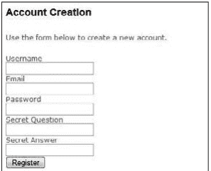

**图 3-1**

如果我们尝试提交表单，我们应该看到我们的验证错误摘要，如图 3-2 所示。

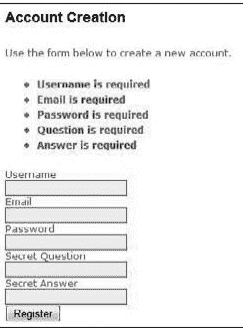

**图 3-2**

> 关于验证的快速说明：你可以使用帮助器方法 `ValidationMessage` 在每个字段旁边显示单个错误消息。你所要做的就是在希望显示消息的地方插入下面的行。这将显示在具有键 `username` 的 `ModelState` 中设置错误消息。

```
<%=Html.ValidationMessage("username") %>
```

我更喜欢这种方法而不是错误摘要，因为它告诉用户错误具体在哪里。为了简洁起见，我上面没有这样做，而且我觉得我们会再次讨论验证。此外，我这里的目的是验证动作是否按预期工作，以及所有内容是否正确连接。

请注意，具有关联错误的字段会被高亮显示；实际上，如果检查 HTML，你会发现它现在看起来像这样：

```html
<h2>Account Creation</h2>
<p>
    Use the form below to create a new account.
</p>
<ul class="validation-summary-errors"><li>Username is required</li>
<li>Email is required</li>
<li>Password is required</li>
<li>Question is required</li>
<li>Answer is required</li>
</ul>
<form method="post" action="/Account/Register">
    <div>
        <label for="username">Username</label>
        <br />
        <input class="input-validation-error" id="username" name="username"
            type="text" value="" />
        <br />
        <label for="email">Email</label>
        <br />
        <input class="input-validation-error" id="email" name="email"
            type="text" value="" />
        <br />
        <label for="password">Password</label>
        <br />
        <input class="input-validation-error" id="password" name="password"
            type="password" value="" />
        <br />
        <label for="question">Secret Question</label>
        <br />
        <input class="input-validation-error" id="question" name="question"
            type="text" value="" />
        <br />
        <label for="answer">Secret Answer</label>
        <br />
        <input class="input-validation-error" id="answer" name="answer"
            type="text" value="" />
        <br />
        <input type="submit" value="Register" />
    </div>
</form>
```

你能看出区别吗？带有错误的字段关联了 `input-validation-error` 类。该类在默认样式表中定义，从而导致高亮显示。我可以听到你在后面问：“这个类是怎么加进去的？”答案是帮助器方法 `Html.TextBox`；它足够聪明，知道某个字段有错误，并为其添加适当的样式。这是一个很好的理由，在这种情况下使用帮助器方法。

## 视图状态

休斯顿，我们有个问题。我尝试注册新用户，并遇到了两个问题。首先，我输入了密码 `1234`，这导致了错误，如图 3-3 所示：

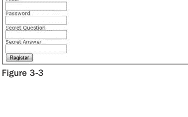

这是因为我没有在 `web.config` 文件中用正确的值配置成员资格提供者。第二个且更大的问题是，正如你在图 3-3 中看到的那样，表单现在是空的，我所有的值都消失了。当然，从可用性的角度来看，这是不可接受的。这是因为 MVC 应用程序不像 Web Forms 应用程序那样持久化视图状态。不要惊慌，解决这个问题很容易。

还记得如果有任何验证错误，我们的动作会返回视图吗？

```csharp
if (!ViewData.ModelState.IsValid)
{
    return View();
}
```

我们需要以某种方式将之前输入的值传递给视图。有几种方法可以做到这一点。一种方法是使用与字段名称匹配的字符串键传递所有值的字典；例如，我们可以这样做：

```csharp
return View(new Dictionary<string, object>
            {
                { "username", username },
                {"email",email},
                {"password",password},
                {"question",question},
                {"answer",answer}
            });
```

另一种方法是将模型对象传递回视图。例如，我们可以创建一个类来保存视图模型：

```csharp
public class RegisterModel
{
    public string Username { get; set; }
    public string Email { get; set; }
    public string Password { get; set; }
    public string Question { get; set; }
    public string Answer { get; set; }
}
```

并以如下方式返回带有该类实例的视图：

```csharp
return View(new RegisterModel
            {
                Username = username,
                Email = email,
                Password = password,
                Question = question,
                Answer = answer
            });
```

无论你选择哪种方式，视图都足够聪明，可以设置字段的值。现在，如果我们尝试提交一个无效表单，值将在请求之间保持，我们会得到如图 3-4 所示的内容。


## 第3章：Membership

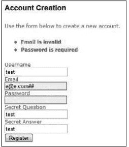

图 3-4

让我们运行所有测试，确保没有破坏任何东西。所有测试都通过了，但我们仍然需要做一些修改。我们需要确保将正确的模型返回给视图，并且其值是正确的。由于这段代码将在多个测试中使用，我决定将其创建为一个扩展方法，在模型上调用。这个扩展方法以及其他扩展方法将放在一个名为`ModelAssertions`的静态类中。该断言方法如下：

```csharp
public static void AssertRegisterModel(this RegisterModel model,
                                      string username, string email,
                                      string question, string answer,
                                      string password)
{
    Assert.AreEqual(username, model.Username);
    Assert.AreEqual(email, model.Email);
    Assert.AreEqual(password, model.Password);
    Assert.AreEqual(question, model.Question);
    Assert.AreEqual(answer, model.Answer);
}
```

现在我们可以通过调用以下代码轻松断言模型：

```csharp
(((ViewResult) results).ViewData.Model as RegisterModel)
    .AssertRegisterModel(string.Empty, email, question, answer, password);
```

是时候重构了。许多测试Register方法的单元测试执行相同的任务来断言结果，因此我将把这些任务重构到一个方法中：

```csharp
private static void AssertRegisterViewResultOnError(AccountController ac,
                                                     ActionResult results,
                                                     string errorKey,
                                                     string errorMessage,
                                                     string username,
                                                     string email,
                                                     string question,
                                                     string answer,
                                                     string password)
{
    Assert.IsNotNull(results);
    Assert.IsInstanceOfType(typeof (ViewResult), results);
    ac.ViewData.ModelState.AssertErrorMessage(errorKey, errorMessage);
    Assert.IsInstanceOfType(typeof (RegisterModel),
        ((ViewResult) results).ViewData.Model);
    var model = (((ViewResult) results).ViewData.Model as RegisterModel);
    model.AssertRegisterModel(username, email, question, answer, password);
}
```

现在我可以简单地通过调用一个方法来在我的单元测试中断言结果。例如，以下单元测试：

```csharp
[Test]
public void Register_Should_Return_Error_If_Password_Is_Missing()
{
    var mockProvider = new Mock<MembershipProvider>();
    var mockAuthentication = new Mock<IFormsAuthentication>();
    var ac = new AccountController(mockAuthentication.Object, mockProvider.Object);
    var results = ac.Register(username, email,
                              question, answer, string.Empty);
    Assert.IsNotNull(results);
    Assert.IsInstanceOfType(typeof (ViewResult), results);
    ac.ViewData.ModelState.AssertErrorMessage("password", "Password is required");
}
```

可以重构为：

```csharp
[Test]
public void Register_Should_Return_Error_If_Password_Is_Missing()
{
    var mockProvider = new Mock<MembershipProvider>();
    var mockAuthentication = new Mock<IFormsAuthentication>();
    var ac = new AccountController(mockAuthentication.Object, mockProvider.Object);
    var results = ac.Register(username, email,
                              question, answer, string.Empty);
    AssertRegisterViewResultOnError(ac, results, "password",
                                     "Password is required",
                                     username, email, question,
                                     answer, string.Empty);
}
```

运行所有测试并确保一切仍然正常工作。

## 小结

我们在本章中涵盖了很多概念，希望到现在为止，你已经对TDD过程和ASP.NET MVC框架感到熟悉了。我们仅涵盖了注册过程，但其余的membership遵循相同的模式。我们创建一个测试，编写一些代码，确保测试通过，然后重复。你现在可以尝试创建其余的membership功能，然后将其与随附的代码进行比较。你还需要实现登录和密码重置功能。

## 重构：Model Binders、Mocks和Asserts

在上一章中，我带你完成了为新用户创建注册过程。然后我继续按照相同的步骤创建了membership的其余功能：

- 登录。
- 重置密码。
- 登出。

在此过程中，我对代码和测试进行了重构，并更改了一些我们之前做过的事情。在本章中，我将讨论这些更改。

## 问题

我的测试中存在许多相似之处，这些内容被复制粘贴到各处——这是对**DRY原则**的严重违反。以下是我写更多测试时开始注意到的一些事情：

- 我的断言语句非常相似，并且在许多测试中重复出现。
- 我的控制器实例化方式相似，并且多次重复。
- 我的mock看起来也非常相似，需要集中管理。

我还为需要重构和清理的控制器动作编写了大量不必要的代码。大多数动作接受多个参数，而不是接受一个类型化的对象。编写以下内容会更清晰：

```csharp
public ActionResult Create(User user)
```

第4章：重构：Model Binders、Mocks和Asserts

比

```csharp
public ActionResult Create(string username, string email, string password,
                            string phone)
```

## 设计

让我们从测试代码开始。断言语句可以分组为几个扩展方法，它们扩展适当的对象。例如，断言重定向到不同URL的动作结果可以分组为`ActionResult`类上的一个扩展方法。

几个测试开始时都有相同的一组语句，用于创建mock并用mock对象初始化控制器。这些代码行也可以重构到一个中心位置，供所有测试重用。所有mock对象可以移动到一个静态类中，然后所有测试都可以访问它。

现在，在代码方面，我想使用一个强类型类作为我动作的参数，而不是使用只会导致不必要输入的多个参数。这可以通过使用**Model Binders**来实现，告诉框架如何将提交的表单值转换为强类型对象。例如，查看图4-1中的`LoginModel`类，它可以替代`Username`、`Password`和`RememberMe`参数。

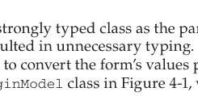

## 解决方案

让我们看看上述设计的实现，以解决当前的问题。我的目标是简化代码并使其优雅。以下是我在做任何更改之前的一个测试：

```csharp
[Test]
public void Login_Should_Return_Error_If_Username_Is_Missing()
{
    var mockProvider = new Mock<MembershipProvider>();
    var mockAuthentication = new Mock<IFormsAuthentication>();
    var ac = new AccountController(mockAuthentication.Object,
                                   mockProvider.Object);
    var results = ac.Login(string.Empty, password, true);

    var errormessage = "Username is required";
```

第4章：重构：Model Binders、Mocks和Asserts

```csharp
var errorKey = "username";

Assert.IsNotNull(results);
Assert.IsInstanceOfType(typeof(ViewResult), results);
ac.ViewData.ModelState.AssertErrorMessage(errorKey, errormessage);
Assert.IsInstanceOfType(typeof(LoginModel),
                        ((ViewResult)results).ViewData.Model);

var model = (((ViewResult)results).ViewData.Model as LoginModel);

Assert.AreEqual(string.Empty, model.Username);
Assert.AreEqual(password, model.Password);
Assert.AreEqual(true, model.RememberMe);

Assert.AreEqual("Login", ac.ViewData["Title"], "Page title is wrong");
```

就其本身而言，上述测试看起来不错，不需要太多重构。但许多上述代码行在其他测试中重复出现，这催生了重构的需要。首先，我的断言非常通用，将被其他方法调用。这些代码行可以移入一个方法中：

```csharp
Assert.IsNotNull(results);
Assert.IsInstanceOfType(typeof(ViewResult), results);
ac.ViewData.ModelState.AssertErrorMessage(errorKey, errormessage);
Assert.IsInstanceOfType(typeof(LoginModel),
                        ((ViewResult)results).ViewData.Model);
var model = (((ViewResult)results).ViewData.Model as LoginModel);
Assert.AreEqual(string.Empty, model.Username);
Assert.AreEqual(password, model.Password);
Assert.AreEqual(true, model.RememberMe);
Assert.AreEqual("Login", ac.ViewData["Title"], "Page title is wrong");
```

前三行也可以从这里移出，由于它们属于设置部分，并且在每个测试开始时调用，我们可以将它们移到setup方法中。**setup方法**只是一个用`SetUp`特性装饰的方法，在每个测试之前运行。这允许我们在一个地方添加实例化和初始化代码，并让它在每个测试之前执行。以下是setup方法的样子：

```csharp
[SetUp]
public void SetUp()
{
    var mockProvider = new Mock<MembershipProvider>();
    var mockAuthentication = new Mock<IFormsAuthentication>();
    ac = new AccountController(mockAuthentication.Object,
                               mockProvider.Object);
}
```

控制器变量ac现在被定义为类中的一个字段，所有测试都可以访问它。

为了进一步改进，我们将把mock移入一个名为`Mocks`的类中。这个类将包含所有mock对象，我们可以轻松地在方法之间传递它。我们将使用一个惰性


# 第4章：重构：模型绑定器、模拟对象与断言

对于类属性的初始化模式（参考第1章），我们需要确保只初始化必要的模拟对象；否则，可能会显著拖慢其他测试的速度。以下是该类：

```csharp
internal class Mocks
{
    private static Mock<IFormsAuthentication> formsAuthentication;
    private static Mock<MembershipProvider> membershipProvider;

    public Mock<IFormsAuthentication> FormsAuthentication
    {
        get
        {
            formsAuthentication = formsAuthentication ??
                                 new Mock<IFormsAuthentication>();
            return formsAuthentication;
        }
    }

    public Mock<MembershipProvider> MembershipProvider
    {
        get
        {
            membershipProvider = membershipProvider ??
                                new Mock<MembershipProvider>();
            return membershipProvider;
        }
    }
}
```

现在，我们可以将前面的测试初始化方法改为：

```csharp
[SetUp]
public void SetUp()
{
    mocks = new Mocks();
    ac = new AccountController(mocks.FormsAuthentication.Object,
                               mocks.MembershipProvider.Object);
}
```

由于我打算重构控制器操作，所以我决定暂缓重构上述测试中的断言语句。我的`Login`操作原本是这样的：

```csharp
public ActionResult Login(string username, string password, bool rememberMe)
```

我想要它变成这样：

```csharp
public ActionResult Login(LoginModel model)
```

因此，我创建了`LoginModel`类，如下所示：

```csharp
public class LoginModel
{
    public string Username { get; set; }
    public string Password { get; set; }
    public bool RememberMe { get; set; }
}
```

接下来，我需要确保框架知道如何将我的表单值映射到我的模型对象。这是通过模型绑定器完成的，框架自带一个名为`ComplexModelBinder`的模型绑定器，它正是做这件事的。`ComplexModelBinder`的唯一问题是，视图中的字段需要按照`类名.字段名`的格式命名，因此下面这行代码

```aspnet
<%= Html.TextBox("Username")%>
```

将必须改为

```aspnet
<%= Html.TextBox("LoginModel.Username")%>
```

这是我所不想做的，因为它会使我的HTML元素名称变得很长，并且使之后编写的任何JavaScript都过于冗长。幸运的是，框架给了我们创建自己模型绑定器的灵活性。我需要做的只是实现`IModelBinder`接口。我继续创建了一个通用的模型绑定器，它使用反射来通过相同的名称从实例获取属性值。（我还创建了另一个从查询字符串获取值的绑定器。）

```csharp
class FormBinder : IModelBinder
{
    public object GetValue(ControllerContext controllerContext,
                           string modelName, Type modelType,
                           ModelStateDictionary modelState)
    {
        var instance = Activator.CreateInstance(modelType);
        PropertyInfo[] propertyInfos;
        propertyInfos = modelType.GetProperties();

        foreach (var prop in propertyInfos)
        {
            prop.SetValue(instance,
                          controllerContext.HttpContext.Request
                              .Form[prop.Name.ToLower()],
                          null);
        }
        return instance;
    }
}
```

使用上述绑定器意味着我们必须遵守一个命名约定，即视图中的字段名称需要与模型中的属性名称匹配。这是一个合理的约定。

剩下的唯一事情就是将绑定器连接到模型，以便框架知道该怎么做。有几种方法可以做到这一点：

-   我们可以在操作上使用参数特性：

```csharp
public ActionResult Login([ModelBinder(typeof(FormBinder))]LoginModel model)
```

-   我们可以用特性装饰模型类：

```csharp
[ModelBinder(typeof(FormBinder))]
public class LoginModel
{
    public string Username { get; set; }
    public string Password { get; set; }
    public bool RememberMe { get; set; }
}
```

-   我们可以在应用程序启动时注册绑定器：

```csharp
protected void Application_Start()
{
    ModelBinders.Binders[typeof(LoginModel)] = new FormBinder();
    RegisterRoutes(RouteTable.Routes);
}
```

-   我们可以在应用程序启动时注册一个默认绑定器：

```csharp
protected void Application_Start()
{
    ModelBinders.Binders.DefaultBinder = new FormBinder();
    RegisterRoutes(RouteTable.Routes);
}
```

> 尽管上述代码可以工作，但它是最初为MVC框架的RC版本编写的。对于正式版本，没有必要编写所有这些代码，解决方案要简单得多。MVC框架1.0版本包含一个`Bind`特性，可以替代大部分代码。该操作将简单地如下所示：

```csharp
public ActionResult Login(
            [Bind(Prefix = "")] LoginModel model)
```

`Prefix`可以设置为任何值，以匹配你在HTML命名中使用的前缀。这允许你使用任何你喜欢的命名约定。例如，如果你的HTML文本框定义如下：

```aspnet
<%= Html.TextBox("Login.Username")%>
```

那么你可以将你的操作更改为以下

```csharp
public ActionResult Login(
            [Bind(Prefix = "Login")] LoginModel model)
```

然后我回到测试中，并创建了一个扩展方法来断言模型：

```csharp
public static void AssertModel(this LoginModel model,
                          LoginModel source)
{
    Assert.AreEqual(source.Username, model.Username);
    Assert.AreEqual(source.Password, model.Password);
    Assert.AreEqual(source.RememberMe, model.RememberMe);
}
```

我还创建了一个辅助方法来断言结果：

```csharp
private void AssertLoginViewResultOnError(ActionResult results,
    string errorKey,
    string errorMessage,
    LoginModel model)
{
    Assert.IsNotNull(results);
    Assert.IsInstanceOfType(typeof(ViewResult), results);
    ac.ViewData.ModelState.AssertErrorMessage(errorKey, errorMessage);
    Assert.IsInstanceOfType(typeof(LoginModel),
        ((ViewResult)results).ViewData.Model);
    var outModel = ((ViewResult)results).ViewData.Model as LoginModel;
    outModel.AssertModel(model);
    Assert.AreEqual("Login", ac.ViewData["Title"], "Page title is wrong");
}
```

现在我的测试变得精简、高效且清晰了：

```csharp
[Test]
public void Login_Should_Return_Error_If_Username_Is_Missing()
{
    var inModel = new LoginModel
    {
        Password = password,
        RememberMe = true,
        Username = string.Empty
    };
    var results = ac.Login(inModel);
    AssertLoginViewResultOnError(results, "username",
        "Username is required", inModel);
}
```

## 更多重构

用于断言一个重定向到另一个URL的操作结果的代码是：

```csharp
Assert.IsNotNull(results);
Assert.IsInstanceOfType(typeof(RedirectToRouteResult), results);
var typedResults = results as RedirectToRouteResult;
Assert.AreEqual("Index",
    typedResults.Values["action"],
    "Wrong action");
Assert.AreEqual("Home",
    typedResults.Values["controller"],
    "Wrong controller");
```

我将这段代码移到了一个扩展方法中：

```csharp
internal static class ResultsAssertions
{
    public static void AssertRedirectToRouteResult(this ActionResult result,
        string actionName,
        string controllerName)
    {
    Assert.IsNotNull(result);
    Assert.IsInstanceOfType(typeof(RedirectToRouteResult), result);
    var routeResult = (RedirectToRouteResult)result;
    Assert.AreEqual(2, routeResult.Values.Count);
    Assert.AreEqual(actionName.ToLower(),
                     routeResult.Values["action"].ToString().ToLower());
    Assert.AreEqual(controllerName.ToLower(),
                     routeResult.Values["controller"].ToString().ToLower());
    }
}
```

现在我可以简单地通过编写以下代码来断言一个操作的结果：

```csharp
results.AssertRedirectToRouteResult("Index", "home");
```

## 总结

到目前为止，我们已经创建了一些扩展方法来简化我们的测试，并实现了一个通用的模型绑定器，该绑定器可供我们所有的模型对象用于从数据中检索项目。我们还清理了测试并整合了模拟对象，这应该能显著提高我们编写测试时的生产力。

尽管我热爱编写代码，但我更热爱重构它。那就是你回到你的代码中，试图找到一个更好、更优雅的解决方案的时候。当你在重构代码时，TDD（测试驱动开发）的力量得到了充分展现。你知道有测试来验证你的变化，这给你带来了极大的安心感。我们都曾经历过这样的情境：重构了几行代码，结果几天后某些东西就坏了；但有了TDD，这种情况发生的概率大大降低了。


 ## 5

## 客户端与服务端验证

无论你对他人多么信任，在互联网上都不应该信任任何人，你应该对所有接收到的数据进行验证。话虽如此，有两个地方可以执行表单验证——客户端和服务端。为什么要两个都做？客户端验证通过避免与服务端的往返交互来提升用户体验；同时由于减少了对服务器的请求，也使应用程序更具可扩展性。服务端验证 crunch 至关重要，因为客户端验证可能被禁用或绕过。在本章中，我们将搭建一个在服务端和客户端进行验证的框架，以自动化并减少每个需要验证的页面所需的代码量。

## 问题

现在我们的会员功能已经可用，用户可以注册、登录、登出和重置密码。在我们开始深入开发应用程序的其他部分之前，需要确定验证策略，并确保其与应用程序其余部分兼容，以免走得太远后创建大量视图。

到目前为止，我们已经使用 `if` 语句和模型状态来实现服务端验证以指示错误。从功能上讲这没问题，但我们需要做得更好。理想情况下，我们希望在客户端和服务端都进行验证。客户端验证可以让我们在不产生服务端往返开销的情况下给用户即时反馈。服务端验证确保即使客户端验证失败，或者客户端不支持 JavaScript 或已禁用它，数据仍然是有效的。我们还需要一种简单的方式来定义验证规则，最好是在模型本身上定义。最后，我们需要将验证从控制器中移到服务（业务逻辑）层，这样我们的验证逻辑就不会与控制器紧密耦合。

总结来说，我们需要：

- 在客户端进行验证。
- 在服务端进行验证。
- 在模型上定义验证规则。
- 在服务（业务逻辑）层执行验证。

## 设计

与其讨论我们刚写的会员代码，不如添加一些新功能并使用新的验证设计。其中一个需求是让用户能够创建新消息，我们就从这里开始。

首先，我们需要了解消息的组成部分：

- 描述性名称，例如，*October Newsletter*
- 邮件主题，例如，"October's exclusive offers to our valued members"
- HTML 格式的消息内容
- 纯文本格式的消息内容

名称、主题和文本正文是必填的，而 HTML 正文是可选的。图 5-1 展示了该模型的类图。

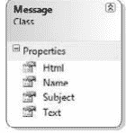

图 5-1

> 为了本章的讨论，我们只关注消息创建操作，而不关注流程本身。这样可以更清楚地讨论验证，而不会被流程细节所困扰。

## 解决方案

我们首先创建一个新的测试类——MessageControllerTest，并添加第一个测试：

```
[TestFixture]
public class MessageControllerTest
{
    private MessageController controller;
    [SetUp]
    public void SetUp()
    {
        controller = new MessageController();
```

```
[Test]
public void Create_Returns_View()
{
    ActionResult result = controller.Create();
    result.AssertViewResult(controller, "New Message");
}
```

为了让上述代码编译通过，我们必须创建 MessageController 类并添加一个 Create 方法：

```
public class MessageController : Controller
{
    [AcceptVerbs("get")]
    [Authorize]
    public ActionResult Create()
    {
        ViewData["Title"] = "New Message";
        return View();
    }
}
```

下一个测试如下：

```
[Test]
public void Create_Returns_Error_If_Name_Is_Missing()
{
    var model = new Message()
    {
        Subject = _subject,
        Name = string.Empty,
        Text = _text
    };
    var result = controller.Create(model);
    
    var errorKey = "name";
    var errorMessage = "Name is required";
    
    //assert results
    Assert.IsNotNull(result);
    Assert.IsInstanceOfType(typeof(ViewResult), result);
    controller.ViewData.ModelState.AssertErrorMessage(errorKey, errorMessage);
    Assert.IsInstanceOfType(typeof(Message),
            (ViewResult)result).ViewData.Model);
    //asser that the ViewData.Model
    var outModel = (((ViewResult)result).ViewData.Model as Message);
    Assert.AreEqual(model.Subject, outModel.Subject);
    Assert.AreEqual(model.Name, outModel.Name);
    Assert.AreEqual(model.Text, outModel.Text);
    
    Assert.AreEqual("Login", controller.ViewData["Title"], "Page title is wrong");
}
```

> *_subject 和 _text 变量在类级别定义，因为其他测试也会使用它们。*

目前没有什么新内容；这只是我们一直在做的东西。下一步是创建接收 POST 请求的 Create 方法：

```
[AcceptVerbs("post")]
[Authorize]
public ActionResult Create(Message model)
{
    ViewData["Title"] = "New Message";

    //validate input
    if (string.IsNullOrEmpty(model.Name) )
    {
        ViewData.ModelState.AddModelError("name",
                                        model.Name,
                                        "Name is required");
    }

    if (!ViewData.ModelState.IsValid)
    {
        return View(model);
    }
    return View();
}
```

这里写的代码足以通过之前的测试，目前来说已经够好了。现在我们快速创建一个视图来确保验证有效：

```
<h2>
    Create New Message</h2>
<%= Html.ValidationSummary()%>
<form action="/message/create" method="post">
<div>
    <label for="name">
        Name</label>
    <br />
    <%=Html.TextBox("name") %>
    <br />
    <label for="subject">
        Subject</label>
    <br />
    <%=Html.TextBox("subject") %>
    <br />
    <label for="html">
        Html Body (optional)</label>
    <br />
    <%=Html.TextArea("html") %>
    <br />
    <label for="text">
        Text Body</label>
    <br />
    <%=Html.TextArea("text") %>
    <br />
```

```
<input type="submit" value="Create Message" />
</div>
</form>
```

如果我们尝试在不填写名称的情况下提交，会得到如图 5-2 所示的错误。

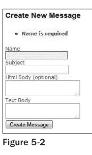

现在，我们刚好有足够的基础来开始创建更好的验证组件。正如我们已经达成一致的那样，需要将验证从控制器中移出。我们需要创建一个业务逻辑对象来处理消息的创建并执行验证。作为优秀的设计师，同时为了让测试和模拟变得简单，我们将使用接口。目前，我们只需要一个 Add 方法，所以这是我们的接口：

```
public interface IMessageService
{
    long Add(Message message);
}
```

让我们创建该接口的一个简单实现。记住我们正在使用 TDD，所以让我们先创建一些测试。我们的第一个测试将确保 Add 方法在验证失败时抛出异常。

```
[Test]
[ExpectedException(typeof(ValidationException))]
public void Add_Throws_Exception_If_Validation_Returns_Errors()
{
    var invalidMessage = new Message();

    //mock a failed validation
    var mockValidationRunner = new Mock<IValidationRunner>();
    mockValidationRunner.Expect(v => v.Run(invalidMessage))
        .Returns(new List<ValidationError>
            {
                new ValidationError("prop",
                                    "error")
            });

    IMessageService service = new MessageService(mockValidationRunner.Object);
    service.Add(invalidMessage); //should throw error
    mockValidationRunner.VerifyAll();
}
```

上面的测试包含了 `ExpectedException` 特性，它告诉测试框架，为了让这个测试成功，必须抛出类型为 `ValidationException` 的异常。这对测试来说非常方便。

由于这些类都还没有创建，我们的项目无法编译，也无法运行测试。基于上面的测试，看来我们需要：

- 一个带有 `Run` 方法的 `IValidationRunner` 接口
- 一个 `ValidationException` 异常
- 一个带有两个字符串参数构造函数的 `ValidationError` 类
- 一个接受 `IValidationRunner` 实例作为构造函数的 `IMessageService` 实现

这是我们目前的进展：

```
public interface IValidationRunner
{
    List<ValidationError> Run(object modelToValidate);
}

public class ValidationException : Exception { }

public class ValidationError
{
    public ValidationError(string propertyName, string errorMessage)
    {
    }
}

public class MessageService : IMessageService
{
    public MessageService(IValidationRunner validationRunner)
    {
    }

    public int Add(Message message)
    {
        throw new NotImplementedException();
    }
}
```

项目现在可以编译了，但测试失败了。如果我们将 `Add` 方法改为抛出异常，测试就会通过。

```
public int Add(Message message)
{
    throw new ValidationException();
}
```

然而，存在一个问​​题：测试本不应该通过，因为 `mockValidationRunner.VerifyAll();` 应该会失败；但 `mockValidationRunner.VerifyAll(); 没有执行


# 第5章：客户端与服务端验证

因为 `Add` 方法抛出了异常。这就是使用 `ExpectedException` 属性进行异常测试的问题所在。一个更好的模式是使用 `Assert.Throws`，结合委托或 lambda 表达式。

```
[Test]
public void Add_Throws_Exception_If_Validation_Returns_Errors()
{
    var invalidMessage = new Message();

    //mock a failed validation
    var mockValidationRunner = new Mock<IValidationRunner>();
    mockValidationRunner.Expect(v => v.Run(invalidMessage))
        .Returns(new List<ValidationError>
        {
            new ValidationError("prop",
                "error")
        });

    IMessageService service = new MessageService(mockValidationRunner.Object);
    Assert.Throws<ValidationException>(() => service.Add(invalidMessage));

    mockValidationRunner.VerifyAll();
}
```

这样既能测试相同的条件，又能让测试在异常发生后继续执行。现在测试失败的原因是正确的：`ValidationRunner` 上的 `Run` 方法尚未被调用。以下改动将使测试通过：

```
public class MessageService : IMessageService
{
    private IValidationRunner ValidationRunner { get; set; }
    public MessageService(IValidationRunner validationRunner)
    {
        ValidationRunner = validationRunner;
    }

    public int Add(Message message)
    {
        var errors = ValidationRunner.Run(message);
        if (errors != null && errors.Count > 0)
        {
            throw new ValidationException();
        }
        return -1;
    }
}
```

继续推进，我们需要对每个字段进行验证测试。先从 Name 开始：

```
[Test]
public void Add_Throws_Exception_If_Name_Is_Missing()
{
    message.Name = string.Empty;
    IValidationRunner vrunner = new ValidationRunner();
    IMessageService service = new MessageService(vrunner);
    var ex = Assert.Throws<ValidationException>(() => service.Add(message));
    Assert.IsNotNull(ex.ValidationErrors);
    Assert.GreaterThan(ex.ValidationErrors.Count, 0);
    //asser the correct error
    Assert.AreEqual(ex.ValidationErrors
                          .Count(e => e.PropertyName == "Name" &&
                                      e.ErrorMessage == "Name is required"), 1);
}
```

在上述测试中，我们测试了 Add 方法是否抛出了正确的异常，以及异常中是否包含表明名称必填的验证错误。为了让上述代码运行，我们需要创建 ValidationRunner 并实现 IValidationRunner 接口：

```
public class ValidationRunner : IValidationRunner
{
    public List<ValidationError> Run(object modelToValidate)
    {
        return null;
    }
}
```

并且我们需要为 ValidationException 添加一个 ValidationErrors 属性：

```
public class ValidationException : Exception
{
    public List<ValidationError> ValidationErrors { get; set; }
}
```

现在我们来编写使测试通过的代码。首先，需要修改抛出异常的代码，使其包含验证错误：

```
public int Add(Message message)
{
    var errors = ValidationRunner.Run(message);
    if (errors != null && errors.Count > 0)
    {
        throw new ValidationException(errors);
    }
    return -1;
}
```

然后修改 ValidationException 的构造函数：

```
public class ValidationException : Exception
{
    public ValidationException(List<ValidationError> errors)
    {
        ValidationErrors = errors;
    }
    public List<ValidationError> ValidationErrors { get; private set; }
}
```

接下来，我们修改 `Run` 方法以返回相应的错误。我们将使用反射来遍历对象的属性，并查找验证特性。我们可以轻松创建自己的特性，但更简单的是，我们可以使用 `System.ComponentModel.DataAnnotations` 命名空间中定义的特性。我们的 `ValidationRunner` 现在看起来像这样：

```
public class ValidationRunner : IValidationRunner
{
    public List<ValidationError> ValidationErrors { get; private set; }

    public List<ValidationError> Run(object modelToValidate)
    {
        ValidationErrors = new List<ValidationError>();
        var props = TypeDescriptor.GetProperties(
            modelToValidate.GetType());
        foreach (PropertyDescriptor prop in props)
        {
            var value = prop.GetValue(modelToValidate);
            foreach (var attrib in prop.Attributes
                .OfType<ValidationAttribute>())
            {
                if (!attrib.IsValid(value))
                {
                    ValidationErrors.Add(
                        new ValidationError(prop.Name,
                            attrib.ErrorMessage));
                }
            }
        }
        return ValidationErrors;
    }
}
```

在上述代码中，我们查找 `ValidationAttribute`。如果找到它，我们会检查属性值是否有效，如果无效，则将验证错误添加到我们的验证错误集合中。

测试仍然失败，因为我们还没有用适当的特性装饰我们的 Message。我们只需为每个属性添加适当的特性：

```
public class Message
{
    [Required(ErrorMessage = "Name is required")]
    public string Name { get; set; }
    [Required(ErrorMessage = "Subject is required")]
    public string Subject { get; set; }
    public string Html { get; set; }
    [Required(ErrorMessage = "A plain text body is required")]
    public string Text { get; set; }
}
```

测试通过了。现在我们可以添加更多测试来验证其他验证条件。

需要注意的是，上述代码测试的是 `MessageService` 类，而不是验证类。我们完全可以模拟所有的验证调用并获得相同的结果。我们需要单独测试验证组件。让我们创建一个新的测试夹具来测试所有验证场景，然后创建一个用于测试的模型：

```
internal class ModelToValidate
{
    [Required(ErrorMessage = "Name is required")]
    public string Name { get; set; }

    [Range(18, 35, ErrorMessage = "Age should be 18 to 35")]
    public int? Age { get; set; }

    [RegularExpression(@"\w+([-.']\w+)*@\w+([-.]\w+)*\.\w+([-.]\w+)*", ErrorMessage = "Email is invalid")]
    public string Email { get; set; }
}
```

与其逐一浏览每个测试，不如看看我们刚刚创建的模型的测试：

```
[TestFixture]
public class ValidationRunnerTests
{
    private ModelToValidate model;
    private ValidationRunner runner;

    [SetUp]
    public void SetUp()
    {
        runner = new ValidationRunner();
        model = new ModelToValidate()
        {
            Age = 24,
            Email = "test@test.com",
            Name = "Jessica Alba"
        };
    }

    [Test]
    public void Validate_Required_Errors_If_Value_Is_Missing()
    {
        model.Name = string.Empty;
        var errors = runner.Run(model);
        AssertValidationError(errors, "Name", "Name is required");
    }

    [Test]
    public void Validate_Required_No_Errors_If_Value_Is_Set()
    {
        var errors = runner.Run(model);
        if (errors != null)
            Assert.AreEqual(errors.Count, 0);
    }

    [Test]
    public void Validate_Range_Errors_If_Value_Less_Than_Min()
    {
        model.Age = 2;
        var errors = runner.Run(model);
        AssertValidationError(errors, "Age", "Age should be 18 to 35");
    }

    [Test]
    public void Validate_Range_Errors_If_Value_More_Than_Max()
    {
        model.Age = 36;
        var errors = runner.Run(model);
        AssertValidationError(errors, "Age", "Age should be 18 to 35");
    }

    [Test, Row(18), Row(25), Row(35)]
    public void Validate_Range_No_Errors_If_Within_Range(int? value)
    {
        model.Age = value;
        var errors = runner.Run(model);
        if (errors != null)
            Assert.AreEqual(errors.Count, 0);
    }

    [Test]
    public void Validate_RegEx_Errors_If_Value_Is_Invalid()
    {
        model.Email = "bad email#@#";
        var errors = runner.Run(model);
        AssertValidationError(errors, "Email", "Email is invalid");
    }

    [Test]
    public void Validate_RegEx_No_Errors_If_Value_Is_Valid()
    {
        var errors = runner.Run(model);
        if (errors != null)
            Assert.AreEqual(errors.Count, 0);
    }

    [Test]
    public void Validate_Only_If_Required_And_Set()
    {
        model.Age = null;
        model.Email = null;
        var errors = runner.Run(model);
        if (errors != null)
            Assert.AreEqual(errors.Count, 0);
    }

 Tallion(List<ValidationError> errors,
                                        string propertyName,
                                        string errorMessage)
    {
        Assert.IsNotNull(errors);
        Assert.GreaterThan(errors.Count, 0);
        Assert.AreEqual(errors.Count(e =>
            e.PropertyName == propertyName &&
            e.ErrorMessage == errorMessage), 1);
    }
}
```

## 第五章：客户端与服务端验证

```csharp
            e.ErrorMessage == errorMessage),
            1);
    }

    internal class ModelToValidate
    {
        [Required(ErrorMessage = "名称是必需的")]
        public string Name { get; set; }

        [Range(18, 35, ErrorMessage = "年龄应为 18 到 35 岁")]
        public int? Age { get; set; }

        [RegularExpression(@"\w+([-+.']\w+)*@\w+([-.]\w+)*\.\w+([-.]\w+)*",
            ErrorMessage = "电子邮件无效")]
        public string Email { get; set; }
    }
}
```

通过使用 `Required`、`Range` 和正则表达式（regular expression）属性，我们要能够覆盖几乎所有的验证需求。如果还不够，我们总是可以创建自己的自定义验证属性。例如，我们可以将电子邮件验证封装到其专用类中，如下所示：

```csharp
    class EmailValidationAttribute : RegularExpressionAttribute
    {
        public EmailValidationAttribute()
            : base(@"\w+([-+.']\w+)*@\w+([-.]\w+)*\.\w+([-.]\w+)*")
        {
        }
    }
```

或者，我们继承自虚拟类 `ValidationAttribute` 并编写自己的自定义验证逻辑：

```csharp
    class UsernameValidationAttribute : ValidationAttribute
    {
        public override bool IsValid(object value)
        {
            if (value.GetType() != typeof(string))
                return false;
            var str = value.ToString();
            if (str.Length < 4)
                return false;
            //test other conditions
            return true;
        }
    }
```

现在我们有了一个运行中的验证框架，看看我们是否能将其应用到控制器上。控制器将需要一个 `IMessageService` 实例，因此我们将以下代码添加到 `MessageController` 中：

```csharp
    public MessageController()
        : this(null) { }

    public MessageController(IMessageService service)
    {
        Service = service ?? new MessageService();
    }

    public IMessageService Service { get; set; }
```

现在我们更改我们的 `Create` 方法以服务：使用它。

> *我很高兴看到它能立刻工作，但我想确保一下，所以我修改了属性上名称为必需的*Name `[Required]`(必需)的错误信息仅为了确保测试会失败，而确实如此。\*\*/  

针对 ** Create**\（创建）方法的验证现在已经完毕，但我们仍然需要测试来确保所有验证都正常工作。经过一些重构后，我们的消息控制器测试 fixture 如下所示：

```csharp
[TestFixture]
public class MessageControllerTest
{
    private MessageController controller;
    private Message model;

    [SetUp]
    public void SetUp()
    {
        controller = new MessageController();
        model = new Message()
        {
            Subject = "我的通讯主题",
            Name = "十月时事通讯",
            Text = “你好，订阅者”,
            Html ="Hello<b> subscribers</b>"
        };

[SetUp]
    public void SetUp()
    {
        controller=newMessageController();
        model=newMessage()
        \{
            Subject="My newsletter subject",
            Name=”Octobernewsletter" ,Text =” Hello subscriber”,HTML = “Hello<bsubscriber">b>"
        };

[Test]
publicvoidCreate_Returns_View(）\{\var result=controller.Create();result.AssertViewResult(controller，New Message);}\}[]Test]\[\][Publicvoidcreate_returns_error_if_name_is_missing()。\[Test]{model.Name=string.Empty;}{varresolt=result.controller.create(model);\{varerrorkey="name"\;\{variagErrorMessage =”Name is required";AssertValidationError(result,errorKey,errorMessage)

[Test]
public void Create_Returns_Error_If_Subject_Is_Missing()
    {
        model.Subject = string.Empty;
        var result=controller.Create(model);
        VarError Key ="Subject",
var errorMessage="subject"isrequired" ;
}AssertValidationError(result，errorKey,errorMessage)。

privatevoidAssertValidationResult(ActionResult Result,string errorKeysstring ErrorMessage)\{\/\/assert results。
}\n\nAssert.IsNotNull(result);\ Assert.IStanceofType(typeof(Viewresult),result;\ controller.ViewData ModelState.AssertErrorMessage(errorkey,\Error message)。\n\n}Assert.IsInstanceOfltypeof (Message,(((ViewResult) result). Viewdata.Model);
// assert that the ViewData.Model.

Var outModel =((（\(\(view_result\)\resolt）.view_data.model_asmessage))； Assert.AreEqual(model.subject,outmodel.Subject);\ Assert.AreEqual(model.Name，outmodel.name)。\n}Assert。are equal\model.text, out model.Text;
\n\n}Are Equal ("new Message",controller.Viewdata("title），PageTitleiswrong")\;\}}

[TestFixture]class message_controller_test.

private message_controller controller； private-message_model；\[Test]\[\public void setup()。\{model=new message（）；name ="jessica_ 103925"; subject="test_subject”;。Settup(）、new jquery_validation_generator();}[SetUp]
} \n\n[Test]Publicvoid create_returns_error_if_text_is_missing()\{\model.name=string.Empty; varresult=controller.Create(model);var errorKey=”Text"； ErrorMessage:”A plain text body is required”，，AssertValidationError(result, errorKey,errorMessage);\}\[Test]\[\{public VoidCreate_returnseerror_If_subject_Is_Missing();\
\nnModel.text=\string_empty;\Var Result = controller.create (model)。\ varErrorMessage="Subject_is_required"\;
} AssertValidationResult(resolt,error.key.errorMessage); \
# 第5章：客户端与服务端验证

```
string script = generator.Generate("createForm", model);
Assert.IsTrue(script.Contains("name:{required:true}"));
}
```

```
internal class ModelToValidate
{
    [Required(ErrorMessage = "Name is required")]
    public string Name { get; set; }

    [Range(18, 35, ErrorMessage = "Age should be 18 to 35")]
    public int? Age { get; set; }

    [RegularExpression(@"\w+([-+.']\w+)*@\w+([-.]\w+)*\.\w+([-.]\w+)*",
        ErrorMessage = "Email is invalid")]
    public string Email { get; set; }
}
}
```

在我们创建缺失的类和方法之前，项目将无法编译。设计应当是灵活的，这样我们可以轻松地替换jQuery验证库（如果需要的话）。我们首先创建以下接口：

```
interface IValidationGenerator
{
    string Generate(string formToValidate, object modelToValidate);
}
```

然后我们为jQuery库实现它，并编写足够的代码来通过我们的第一个测试：

```
public class JQueryValidationGenerator : IValidationGenerator
{
    public string Generate(string formToValidate, object modelToValidate)
    {
        var props = TypeDescriptor.GetProperties(modelToValidate.GetType());
        var rules = string.Empty;
        var script = string.Empty;
        foreach (PropertyDescriptor prop in props)
        {
            var rule = string.Empty;
            foreach (var attrib in prop.Attributes
                .OfType<ValidationAttribute>())
            {
                var subrule = string.Empty;
                if (attrib.GetType() == typeof(RequiredAttribute))
                    subrule = "required:true";

                rule += string.Format("{0}{1}",
                    string.IsNullOrEmpty(rule) ? "" : ",",
                    subrule);
            }

            if (!string.IsNullOrEmpty(rule))
            {
                rule = string.Format("{0}:{{{1}}}",
                    prop.Name.ToLower(),
                    rule);
                rules += string.Format("{0}{1}",
                    string.IsNullOrEmpty(rules) ? "" : ",",
                    rule);
            }

        }

        if (!string.IsNullOrEmpty(rules))
        {
            script = string.Format("<script type=\"text/javascript\">\r\n" +
                "$().ready(function() {\r\n" +
                "$('#'{0}'')." +
                "validate({rules:{{{1}}},\r\n" +
                "messages:{{{2}}}}});)" +
                "\r\n</script>",
                formToValidate, rules, messages);
        }
        return script;
    }
}
```

让我们测试电子邮件验证：

```
[Test]
public void Generates_Rule_For_Email_Field()
{
    string script = generator.Generate("createForm", model);
    Assert.IsTrue(script.Contains("email:{email:true}"));
}
```

这段代码将无法工作，因为我们的模型使用正则表达式来验证电子邮件：

```
[RegularExpression(@"\w+([-+.']\w+)*@\w+([-.]\w+)*\.\w+([-.]\w+)*",
    ErrorMessage = "Email is invalid")]
public string Email { get; set; }
```

如果我们能使用电子邮件属性（如以下所示）来验证电子邮件，那将会好得多：

```
[Email(ErrorMessage = "Email is invalid")]
public string Email { get; set; }
```

不幸的是，这里有两个问题。首先，jQuery验证框架中没有正则表达式规则。其次，`DataAnnotations`命名空间中没有`Email`属性。所以，我们可以创建一个`Email`属性，或者用正则表达式规则扩展jQuery的验证框架。幸运的是，两者都很容易实现。

我们可以通过调用这个JavaScript来创建新的验证规则类型：

```
$(document).ready(function() {
    jQuery.validator.addMethod("regex", function(value, element, param) {
        return this.optional(element) || new RegExp(param).test(value);
    }, "Invalid data");
});
```

或者，我们可以像这样创建一个`Email`属性：

```
public class EmailAttribute : ValidationAttribute
{
    public override bool IsValid(object value)
    {
        var regex = new Regex(@"\w+([-+.']\w+)*@\w+([-.]\w+)*\.\w+([-.]\w+)*");
        return regex.IsMatch((string)value);
    }
}
```

由于我们目前不需要正则表达式规则，我们将直接创建`EmailAttribute`。现在，我们只需在前面代码所示的生成器中添加另一个`if`语句，就可以生成我们的规则。

```
if (attrib.GetType() == typeof(EmailAttribute))
    subrule = "email:true";
```

前面的生成器代码为了清晰起见，没有包含验证脚本的`messages`部分。我们将为`messages`创建测试，并在项目进行中以及需要更多验证类型时添加更多测试。

让我们在视图中测试这个。我们将创建一个生成脚本的辅助方法。然后，要将脚本放入视图，我们只需添加这一行代码：

```
<%= Html.JQueryGenerator("createmessage", ViewData.Model) %>
```

辅助方法如下所示：

```
public static string JQueryGenerator(this HtmlHelper htmlHelper,
                                         string formName, object model)
{
    return (new JQueryValidationGenerator()).Generate(formName, model);
}
```

如果我们尝试导航到`/message/create`，会得到一个错误：

```
Object reference not set to an instance of an object.
```

原因是模型未设置，因此`ViewData.Model`为`null`。这是一个简单的修复。我们所要做的就是将`Create`操作更改为：

```
[AcceptVerbs("get")]
[Authorize]
public ActionResult Create()
{
    ViewData["Title"] = "New Message";
    return View(new Message());
}
```

我们所做的只是传递一个空的`Message`类型模型，这使得我们的生成器代码能够探测模型并检查其属性，以生成相应的JavaScript。生成的JavaScript如下：

```
<script type="text/javascript">
$().ready(function() {
$('#createmessage').validate({
rules:{name:{required:true},subject:{required:true},text:{required:true}},
messages:{name:{required:'Name is required'},subject:{required:'Subject is required'},text:{required:'A plain text body is required'}});
});
</script>
```

如果我们尝试提交表单，脚本将在客户端进行验证，而永远不会到达服务器，如图5-4所示。

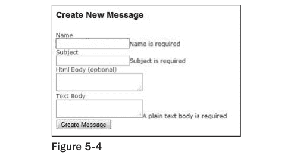

图5-4

## 总结

在本章中，我们讨论了客户端和服务端验证。验证是一个非常常见的问题，在你参与的几乎每个项目中都会需要。如果只能实现一种类型的验证，那么它应该是服务端验证。仅靠客户端验证是不安全的，可以被绕过。服务端验证是防范潜在安全漏洞的根本保障。

关键是要保持原文的完整性，即使它包含一些轻微的冗余或不完美之处。这种方法确保了关于验证重要性的核心信息得以保留，而没有经过人为的编辑。

该项目强调了一种务实的数据层设计方法，优先考虑快速开发和可测试性，而不是立即实现数据库。通过创建抽象层，团队可以在内存存储和持久化存储之间无缝切换，而不会破坏整体应用架构。

核心策略涉及将应用程序与直接数据库依赖解耦，从而实现更快的迭代和测试。这种方法允许开发人员专注于核心业务逻辑，同时将复杂的数据库配置推迟到绝对必要时。

抽象成为管理复杂性的关键机制，在不损害整体系统设计的前提下，提供存储策略的灵活性。目标是创建一个能够优雅演进的系统，以最小的摩擦适应不断变化的需求。

我们将专注于内存数据库方法，战略性地设计我们的存储机制，以实现与具体数据库实现无关的无缝测试和开发。这种策略允许快速迭代，同时保持架构灵活性，以便在未来的迭代中集成持久化存储。

`IRepository`模式作为一个关键的抽象出现，使我们能够开发和验证核心应用程序逻辑，而不受即时数据库依赖的约束。通过优先考虑可测试性和适应性，我们创建了一个支持增量复杂性的基础。

我们当前的目标集中在构建一个数据层，以促进无障碍的应用程序开发，故意将数据库集成推迟到战略必要性需要引入的时候。这种方法加速了初始进展，同时保持了长期的架构完整性。

其动机源于之前延迟数据库参与的战略决策，认识到数据库交互会在测试和维护中引入实质性的复杂性。通过抽象持久化存储，我们获得了通过轻量级的、内存中的表示来模拟数据库行为的能力。

关键在于，我们寻求建立一种机制，允许在不需要实际数据库实例化的情况下实现全面的应用程序功能，同时保留以最小摩擦过渡到持久化存储的选项。`IRepository`模式作为架构桥梁，实现了这种灵活性。


## 第六章：数据层与IRepository模式

## 设计

对于我们的问题，一个好的设计是使用IRepository模式。这是一种简单但非常强大的模式，它允许我们将数据层从代码中抽象出来。抽象数据层为我们的设计提供了极大的灵活性，并简化了测试。如果现在这些听起来都太理论化，请不要担心——接下来的几页将帮助澄清所有概念。

在上一章中，我们创建了一个`IMessageService`接口，目前它只有一个向数据库添加消息的方法。使用服务层的好处在于，应用程序代码无需了解与数据库交互的细节（做什么、如何做、在哪里做）。它只需要知道需要调用`Add`方法并处理任何验证异常。在这一层使用接口使测试更容易，因为它使我们能够模拟接口和/或实现特定于测试的实现。现在，我们将采用相同的概念并再抽象一层。我们将把一个`IMessageRepository`接口传递给`MessageService`类；`IMessageRepository`接口将严格处理与仓库/数据库/数据存储的交互。这是它的唯一职责。

让我们思考一下这里需要做什么。我们基本上想要对数据执行CRUD（创建、读取、更新、删除）操作，因此我们的`IRepository`接口至少需要包含这些操作。我们目前的类图如图6-1所示。

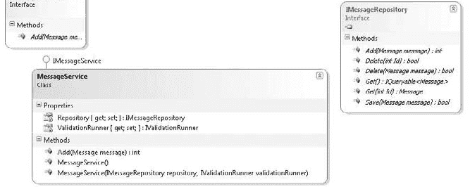

图6-1

## 解决方案

让我们实现上述设计，并重构我们的测试以确保它们正常工作。我们首先创建接口：

```
public interface IMessageRepository
{
    int Add(Message message);
    bool Delete(int Id);
    bool Save(Message message);
    IQueryable<Message> Get();
}
```

> 为了提高代码的可读性，我将把MessageService类重命名为InMemoryMessageService。稍后我们将创建一个SqlMessageService类，它将使用SqlMessageRepository。

然后我们将`InMemoryMessageService`改为使用新的仓库：

```
public class InMemoryMessageService : IMessageService
{
    private IValidationRunner ValidationRunner { get; set; }
    private IMessageRepository Repository { get; set; }

    public InMemoryMessageService()
        : this(null, null)
    {
    }

    public InMemoryMessageService(IMessageRepository repository,
                                 IValidationRunner validationRunner)
    {
        ValidationRunner = validationRunner ?? new ValidationRunner();
        Repository = repository ?? new InMemoryMessageRepository();
    }
}
```

现在我们确保可以构建项目并运行所有测试。一切正常后，我们编写一个新测试以确保我们正在使用仓库：

```
[Test]
public void Create_Adds_Message_To_Repository()
{
    //mock the repo
    var mockRepo = new Mock<IMessageRepository>();
    //set expectations
    mockRepo.Expect(r => r.Add(model)).Returns(1);
    var mockValidationRunner = new Mock<IValidationRunner>();
    var service = new InMemoryMessageService(mockRepo.Object,
                                            mockValidationRunner.Object);
    controller = new MessageController(service);
    var result = controller.Create(model);
    mockRepo.VerifyAll();
}
```

通过模拟`IMessageRepository`接口，我们将测试限制在`Add`方法被调用这一事实上。这缩小了我们的测试范围，并将我们与`IMessageRepository`的实际实现隔离开来。实现应该单独测试，你很快就会看到。

为了使前面的测试通过，我们更改InMemoryMessageService类中的Add方法以使用仓库：

```
public int Add(Message message)
{
    var errors = ValidationRunner.Run(message);
    if (errors != null && errors.Count > 0)
    {
        throw new ValidationException(errors);
    }
    return Repository.Add(message);
}
```

从前面的代码可以看出，服务层对持久化机制或目标一无所知。相反，它将该任务委托给IRepository。我们现在可以以任何想要的方式实现IMessageRepository接口。我们可以有一个用于测试目的的内存写入实现，另一个用于集成测试的XML写入实现，以及一个与SQL Server通信的生产实现。

让我们在不处理数据库的情况下实现IMessageRepository接口。我们将创建一个内存实现，但是，像我们一直做的那样，我们将从编写测试开始。让我们创建测试装置：

```
[TestFixture]
public class InMemoryRepositoryTests
{
    private Message message;

    [SetUp]
    public void SetUp()
    {
        message = new Message()
        {
            Subject = "My newsletter subject",
            Name = "October newsletter",
            Text = "Hello subscriber",
            Html = "Hello <b>subscriber</b>"
        };
    }
}
```

然后我们为添加消息创建一个测试：

```
[Test]
public void Add_Message_To_Repository()
{
    var repo = new InMemoryMessageRepository();
    repo.Add(message);
    //verify message is added correctly
    var msg = repo.Get().Where(m => m.Id == 1).Single();
    Assert.IsNotNull(msg);
    Assert.AreEqual(message.Html, msg.Html);
    Assert.AreEqual(message.Text, msg.Text);
    Assert.AreEqual(message.Subject, msg.Subject);
    Assert.AreEqual(message.Name, msg.Name);
}
```

然后我们可以通过编写以下代码使前面的测试通过：

```
public class InMemoryMessageRepository : IMessageRepository
{
    private List<Message> Messages { get; set; }

    public InMemoryMessageRepository()
    {
        Messages = new List<Message>();
    }

    public int Add(Message message)
    {
        message.Id = 1;
        Messages.Add(message);
        return message.Id;
    }

    public bool Delete(int Id)
    {
        throw new System.NotImplementedException();
    }

    public bool Save(Message message)
    {
        throw new System.NotImplementedException();
    }

    public IQueryable<Message> Get()
    {
        var q = from m in Messages select m;
        return q.AsQueryable();
    }
}
```

现在我们需要确保仓库为每条消息正确分配了唯一的ID：

```
[Test]
public void Add_Assigns_Unique_Ids()
{
    var repo = new InMemoryMessageRepository();
    repo.Add(new Message()); //1
    repo.Add(new Message()); //2
    repo.Add(new Message()); //3
    var msgs = repo.Get();
    Assert.IsNotNull(msgs);
    Assert.AreEqual(3, msgs.Count());
    Assert.AreEqual(1, msgs.Count(m => m.Id == 1));
    Assert.AreEqual(1, msgs.Count(m => m.Id == 2));
    Assert.AreEqual(1, msgs.Count(m => m.Id == 3));
}
```

我们可以修改`Add`方法以如下方式分配唯一的ID：

```
private int _autoId;
private int AutoId
{
    get
    {
        _autoId += 1;
        return _autoId;
    }
}
public int Add(Message message)
{
    message.Id = AutoId;
    Messages.Add(message);
    return message.Id;
}
```

接下来，让我们测试删除功能：

```
[Test]
public void Delete_Message_From_Repository()
{
    var repo = new InMemoryMessageRepository();
    repo.Add(message);
    //make sure message is added
    var msgs = repo.Get();
    Assert.IsNotNull(msgs);
    Assert.AreEqual(1, msgs.Count());
    var result = repo.Delete(1);
    Assert.IsTrue(result);
    msgs = repo.Get();
    Assert.IsNotNull(msgs);
    Assert.AreEqual(0, msgs.Count());
}
```

我们只是添加一条消息，验证它已被添加，将其移除，然后验证它已被移除。`Delete`方法实现如下：

```
public bool Delete(int Id)
{
    try
    {
        Messages.Remove(Messages.Single(m => m.Id == Id));
        return true;
    }
    catch (Exception ex)
    {
        return false;
    }
}
```


```
我们还应确保 Delete 方法不会抛出任何异常，而是在任何错误时返回 False。我们可以通过以下测试来确保这一点：

```
[Test]
public void Delete_Message_Returns_False_On_Exception()
{
    var repo = new InMemoryMessageRepository();
    repo.Add(message);
    //确保消息已添加
    var msgs = repo.Get();
    Assert.IsNotNull(msgs);
    Assert.AreEqual(1, msgs.Count());
    var result = repo.Delete(12); //Id 不存在
    Assert.IsFalse(result);
    msgs = repo.Get();
    Assert.IsNotNull(msgs);
    Assert.AreEqual(1, msgs.Count());
}
```

最后，让我们确保可以保存对现有消息的更改。我们将添加一条消息，获取它，对其进行修改，然后保存它。以下是测试：

```
[Test]
public void Save_Message_To_Repository()
{
    var repo = new InMemoryMessageRepository();
    repo.Add(message);
    //获取消息
    var msg = repo.Get().Where(m => m.Id == 1).Single();
    Assert.IsNotNull(msg);
    //进行修改
    var text = "new text";
    var name = "new name";
    var html = "new html";
    var subject = "new subject";
    msg.Name = name;
    msg.Html = html;
    msg.Subject = subject;
    msg.Text = text;
    //保存消息
    repo.Save(msg);
    //再次获取消息
    var msgAfterSave = repo.Get().Where(m => m.Id == 1).Single();
    //验证更改已保存
    Assert.AreEqual(html, msgAfterSave.Html);
    Assert.AreEqual(text, msgAfterSave.Text);
    Assert.AreEqual(subject, msgAfterSave.Subject);
    Assert.AreEqual(name, msgAfterSave.Name);
}
```

以下是实现：

```
public bool Save(Message message)
{
    try
    {
        var original = Messages.Single(m => m.Id == message.Id);
        var index = Messages.IndexOf(original);
        Messages[index] = message;
        return true;
    }
    catch (Exception)
    {
        return false;
    }
}
```

`InMemoryMessageRepository` 类的完整实现如下：

```
public class InMemoryMessageRepository : IMessageRepository
{
    private List<Message> Messages { get; set; }

    public InMemoryMessageRepository()
    {
        Messages = new List<Message>();
    }

    private int _autoId;
    private int AutoId
    {
        get
        {
            _autoId += 1;
            return _autoId;
        }
    }

    public int Add(Message message)
    {
        message.Id = AutoId;
        Messages.Add(message);
        return message.Id;
    }

    public bool Delete(int Id)
    {
        try
        {
            Messages.Remove(Messages.Single(m => m.Id == Id));
            return true;
        }
        catch (Exception ex)
        {
            return false;
        }
    }

    public bool Save(Message message)
    {
        try
        {
            var original = Messages.Single(m => m.Id == message.Id);
            var index = Messages.IndexOf(original);
            Messages[index] = message;
            return true;
        }
        catch (Exception)
        {
            return false;
        }
    }

    public IQueryable<Message> Get()
    {
        var q = from m in Messages select m;
        return q.AsQueryable();
    }
}
```

这个实现现在将使我们能够比必须接触数据库时更快地运行测试。我们也不需要担心清理代码，因为数据存储在内存中，测试执行后会自动消失。我们还可以向这个实现添加更多代码，以创建一些可以使用的测试数据。

然而，有几点我想澄清一下。请注意，Get 方法返回的是 IQueryable 消息列表。选择这种方式而不是 `List<Message>`，是因为它允许我们利用 LINQ 的延迟加载能力。使用这种设计，我们可以在服务类中编写多个方法，对返回的结果应用不同甚至多重筛选。例如，我们可以有一个方法按 ID 获取特定消息、获取用户的所有消息、搜索包含特定文本的消息，甚至应用分页。为了进一步说明，请看 `MessageService` 类（以及 `IMessageService` 接口）中的这个方法：

```
public Message GetById(int Id)
{
    return Repository.Get().Single(m => m.Id == Id);
}
```

在这个方法中，我们调用仓库上的 Get 方法，它返回 `IQueryable<Message>`，但在 Single 执行适当的筛选之前不会执行 SQL。所以我们不是执行 `select * from messages` 然后在代码中筛选它，而是实际执行类似 `select * from messages where Id = @id` 的操作。

为了进一步澄清，这里还有另一个例子：

```
public List<Message> Search(string searchTerm)
{
    return Repository.Get().Where(m => m.Text.Contains(searchTerm)).ToList();
}
```

在上一方法中，我们搜索消息文本中包含特定搜索词的内容。如果仓库实现使用的是 LINQ to SQL，生成的 SQL 可能看起来像这样：`select * from messages where text like searchTerm`。

有一点需要注意，前面的实现中我们没有使用任何数据上下文，因为我们使用的是内存仓库。当我们切换到使用 LINQ to SQL 的生产仓库时，我们必须考虑数据上下文并释放任何资源。我们不能在数据层释放数据上下文，因为我们正在使用 LINQ 的延迟加载，如果在释放数据上下文后尝试访问返回的 IQueryable，将会抛出异常。因此，数据上下文必须在服务层管理。有人认为这是一个糟糕的设计，因为它在两层之间创建了紧耦合，而且 IQueryable 跨越了层边界。这些都是合理的顾虑，必须在设计中加以考虑。我个人认为它们是可以接受的权衡。

## 小结

我们在抽象每一层方面做得如此出色，以至于不需要对控制器做任何更改。以下 `MessageController` 构造函数将按原样工作：

```
public MessageController()
	: this(null)
{
}

public MessageController(IMessageService service)
{
	Service = service ?? new InMemoryMessageService();
}
```

我们还能够使用 IRepository 模式，并将持久化机制从业务逻辑中抽象出来。这使我们能够创建一个相对容易在测试期间使用的内存数据库实现，但可以轻松替换为基于 SQL 的实现。在接下来的章节中，你将看到这种设计的好处，以及它如何大大简化我们的测试和维护。

## 通过依赖注入宣布你的独立性

减少代码中的依赖并尽可能抽象总是一个好主意；但这并不总是现实的。你不可避免地会在类甚至程序集之间引入依赖关系。幸运的是，有一种方法可以缓解依赖的影响并减少代码中的耦合。

使用控制反转（IoC）和依赖注入（DI）原则，我们能够创建松耦合的系统并缓解依赖的影响。控制反转是对象实例化的间接化，使对象不直接创建其他对象。相反，IoC 容器将通过构造函数参数或公共属性将依赖注入到对象中。

结合使用模拟（mocking），依赖注入可以大大简化测试。想象一下，如果我们有一个调用 Web 服务的类。使用 DI，我们可以注入该类的模拟版本，用于我们的测试。

## 问题

到目前为止，我们的控制器都有期望某些接口的参数化构造函数。例如，我们的 `AccountController` 期望 `IFormsAuthentication` 和 `MembershipProvider`，而我们的 `MessageController` 期望 `IMessageService`。目前我们的 `MessageController` 类有两个构造函数：

```
public MessageController()
    : this(null)
{
}
```


 ## 第七章：通过依赖注入实现独立

```
public MessageController(IMessageService service)
{
    Service = service ?? new InMemoryMessageService();
}
```

默认构造函数由 MVC 框架调用，该框架又会以 null 值调用带参数的构造函数。带参数的构造函数在传递值为 null 时实例化该接口的一个实现。这样做效果很好，让我们能够在不修改框架实例化过程的情况下使用带参数的构造函数。但这种模式的问题在于，我们的代码与接口的特定实现——具体来说是 `InMemoryMessageService` 实现——紧密耦合。请记住，我们使用接口是因为它们简化了测试和模拟，并且使我们能够在应用程序的整个生命周期中插入不同的实现。如果我们想使用不同的实现——比如说 `SqlMessageService`——我们就必须重新编译和重新部署应用程序。这是不可接受的代价，也违背了使用接口所带来的可插拔性。

## 设计

我们可以通过使用 IoC 容器来解决这些问题，该容器能够在运行时决定实例化哪个接口的实现——这就是我们要反转控制的地方，将实例化从依赖对象中转移出去。然后容器会将正确的实例传递给依赖对象的构造函数；也就是说，它会注入依赖。

如果没有 IoC 容器，我们的类图将如图 7-1 所示。


如果我们使用 IoC 容器，我们将消除对具体实现的依赖，并从依赖类中移除实例化逻辑。我们的类图将如图 7-2 所示。

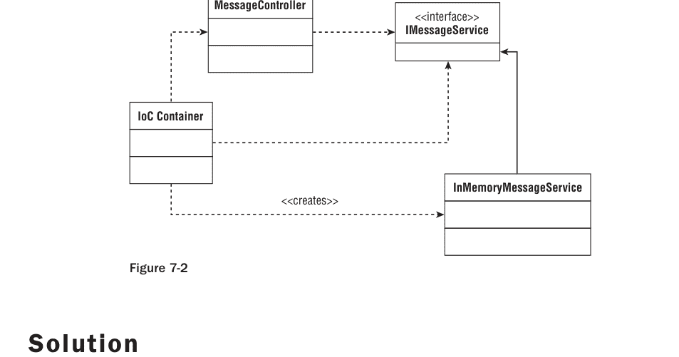

图 7-2

## 解决方案

目前有多种 IoC 容器可供我们选择。也有许多在线文章和资源比较各个容器的优缺点。大多数流行容器在功能上都非常相似，你的决定可能最终取决于风格。我个人喜欢 Ninject（www.ninject.org），因为它易于使用、具有流畅的接口、轻量，并且有良好的在线和社区支持。

首先要做的是下载 Ninject，并在 web 项目中引用 Ninject.core.dll 和 Ninject.Framework.Mvc.dll 程序集。接下来，我们修改 Global.asax 文件，使 `MvcApplication` 类继承自 `NinjectHttpApplication` 而不是 `System.Web.HttpApplication`。

`NinjectHttpApplication` 是一个抽象类，它将用支持 Ninject 的工厂替换默认的控制器工厂，该工厂将处理控制器的注入。我们需要重写两个虚方法：`RegisterRoutes` 和 `CreateKernel`。最终的类如下所示：

```csharp
public class MvcApplication : NinjectHttpApplication
{
    protected override void RegisterRoutes(RouteCollection routes)
    {
        routes.IgnoreRoute("{resource}.axd/{*pathInfo}");

        routes.MapRoute(
            "Default",
            "{controller}/{action}/{id}",
            new
            {
                controller = "Home",
                action = "Index",
                id = ""
            });
        }
    }
}
// 参数默认值
```

```
private StandardKernel _kernel;

protected override IKernel CreateKernel()
{
    IModule[] modules = new IModule[]
    {
        new AutoControllerModule(
            Assembly.GetExecutingAssembly()),
        new InMemoryModule()
    };
    _kernel = new StandardKernel(modules);
    return _kernel;
}
```

在 `CreateKernel` 方法中，我们指示 Ninject 内核管理执行程序集中的所有控制器。这是通过 `AutoControllerModule` 完成的，它是 `Ninject.Framework.Mvc` 程序集的一部分，会自动遍历程序集并为所有控制器配置注入。我们可以在 `InMemoryModule` 中配置 Ninject 并告诉它要注入什么，如下所示：

```
public class InMemoryModule : StandardModule
{
    public override void Load()
    {
        //认证与成员资格
        Bind<IFormsAuthentication>().To<FormsAuthenticationWrapper>();
        Bind<MembershipProvider>().ToConstant(Membership.Provider);

        //服务
        Bind<IMessageService>().To<InMemoryMessageService>();

        //仓库
        Bind<IMessageRepository>().To<InMemoryMessageRepository>();

        //其他
        Bind<IValidationRunner>().To<ValidationRunner>();
    }
}
```

在前面的代码中，我们告诉 Ninject 内核如何注入接口。在我们的例子中，我们使用简单的绑定，只是告诉内核每个接口使用哪个实现。现在，要将适当的接口注入到构造函数中，我们所要做的就是在构造函数上添加 `Inject` 属性。例如，这是 `AccountController` 构造函数：

```
[Inject]
public AccountController(IFormsAuthentication formsAuth,
    MembershipProvider provider)
{
    FormsAuth = formsAuth ?? new FormsAuthenticationWrapper();
    Provider = provider ?? Membership.Provider;
}
```

为了阐明注入的作用，我们在第一行添加一个断点，分别在没有注入和有注入的情况下调试项目一次。没有注入时，你会注意到 `formsAuth` 参数为 null，如图 7-3 所示。这是因为执行了默认构造函数，它以 null 值调用带参数的构造函数。

```
public AccountController()
    : this(null, null)
{
}
```

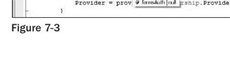

如果我们启用注入并再次调试项目，Ninject 内核将查找带有 `Inject` 属性的构造函数，并注入适当的实例。（如果多个构造函数都有 `Inject` 属性，Ninject 将应用一些逻辑来选择合适的构造器。有关更多详细信息，请参阅 Ninject 的文档。）现在，你会看到 `formsAuth` 参数已经用适当的实现实例化了，如图 7-4 所示。

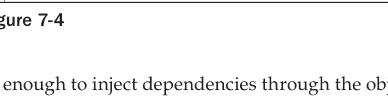

Ninject 还足够智能，能够通过对象树注入依赖。例如，`MessageController` 依赖于 `IMessageService`，而 `IMessageService` 接口的 `InMemoryMessageService` 实现依赖于 `IMessageRepository` 接口。我们需要 Ninject 注入适当的 `IMessageService` 和 `IMessageRepository` 实例。我们已经在前面所示的 `InMemoryModule` 类中告诉 Ninject 内核这些接口使用哪个实现。现在，我们所要做的就是在 `InMemoryMessageService` 构造函数上应用 `Inject` 属性：

```
[Inject]
public InMemoryMessageService(IMessageRepository repository,
    IValidationRunner validationRunner)
{
    ValidationRunner = validationRunner ?? new ValidationRunner();
    Repository = repository ?? new InMemoryMessageRepository();
}
```

如果你放置断点并调试代码，你会看到 `InMemoryMessageRepository` 的一个实例被注入到 `InMemoryMessageService` 构造函数中，如图 7-5 所示。这表明 Ninject 内核在整个对象依赖层次结构中递归地注入了依赖。

```
[Inject]
public InMemoryMessageService(IMessageRepository repository,
    IValidationRunner validationRunner)
{
    ValidationRunner = validationRunner ?? new ValidationRunner();
    Repository = repository ?? new InMemoryMessageRepository();
}
```

图 7-5

我们现在可以轻松地替换 `InMemoryModule` 类，将接口绑定到不同的实现。为了清晰和类型安全，我使用 Ninject 的流畅接口来配置其内核。我也可以很容易地使用配置文件来完成同样的事情。使用配置文件的好处是，我可以通过简单地编辑配置文件来替换注入的实现，而无需重新编译应用程序。

## 总结

通过使用 IoC 容器和依赖注入，我们减少了组件之间的耦合，并创建了一个非常敏捷的解决方案。我们能够以极少的更改轻松替换实现。我们可以将精力集中在创建出色的应用程序上，而不必立即担心所有细节-problems in the future. and can easily plug in new and better components in the future.


## 8 联系人管理

**到目前为止，我们已经建立了坚实的基础，并且对 TDD 流程很熟悉了。** 是时候在此基础上构建我们的应用程序了。由于该应用程序的一个基本功能是向用户发送消息，我认为一个好的起点是从联系人管理开始。

## 问题

**联系人是此应用程序的核心，** 管理这些联系人的能力对于应用程序来说至关重要。用户需要创建、修改和删除联系人，以及将它们分组到列表中并在邮件活动中针对它们。

## 对于联系人，我们需要以下操作：

- 手动创建一个联系人。
- 从文件导入联系人。
- 编辑现有联系人。
- 查看现有联系人。
- 浏览/列出现有联系人。
- 删除现有联系人。
- 搜索联系人。

## 第 8 章：联系人管理

对于联系人列表，我们需要以下操作：

- 创建联系人列表。
- 编辑现有联系人列表。
- 编辑联系人列表详情。
- 将联系人添加到列表中。
- 从列表中移除联系人。
- 查看现有联系人列表。
- 浏览/列出现有联系人列表。
- 删除现有联系人列表。

我们还需要实现基本的 Web 应用程序功能，如分页和排序。

## 设计

需要注意的是，联系人与登录用户相关联，用户无法访问不属于她的联系人。用户不能有具有相同电子邮件地址的多个联系人；电子邮件地址相对于用户来说是唯一的。然而，用户可以拥有多个联系人列表，并且一个联系人可以出现在多个列表中。图 8-1 中的图示澄清了用户、联系人和联系人列表之间的关系。

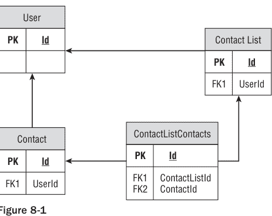

图 8-1 说明了：

- 一个用户可以拥有多个联系人列表。
- 一个用户可以拥有具有唯一电子邮件的多个联系人。
- 一个联系人列表可以拥有具有唯一电子邮件的多个联系人。

那么，到底什么是联系人？在最基本的层面上，*联系人* 只是一个电子邮件地址，但很可能我们想收集关于联系人的更多信息，而不仅仅是电子邮件地址。现在，我们将说联系人事物具有这些属性：

- 电子邮件地址
- 姓名
- 出生日期
- 性别

电子邮件地址是唯一*必需*的值。

### 创建联系人

联系人可以通过填写表单手动创建，也可以从文件导入。我们暂时关注手动创建。添加联系人时，我们要确保它不存在，如果存在，我们应该向用户显示错误。我们还将通知用户创建成功。为了提高可用性，我们还将为用户提供将新联系人添加到现有联系人列表或新创建的联系人列表的选项。

### 浏览联系人

用户需要能够浏览他的所有联系人，以便编辑、查看和删除他们。浏览联系人将以网格格式显示联系人，该格式可以进行分页和排序。我们要确保只从数据库中检索我们要查看的记录，因此我们将一次检索一页。排序也是如此，这将通过单击网格标题来完成。联系人可以按电子邮件、姓名、性别和出生日期排序。网格中的每一行都将有超链接用于编辑和删除相关的联系人。

### 编辑联系人

用户可以编辑联系人并更改其所有属性。我们需要确保只有联系人的所有者才能编辑它。如果联系人的电子邮件被更改为属于用户拥有的另一个联系人的电子邮件地址，保存更改将以错误失败。

### 删除联系人

### 创建联系人

首先，我们需要一个视图来创建联系人，所以让我们创建一个名为 ContactControllerTests 的新测试类：

```
[TestFixture]
public class ContactControllerTests
{
    private ContactController controller;
    private Contact model;

    [SetUp]
    public void SetUp()
    {
        controller = new ContactController();
        model = new Contact()
        {
            Email = "test@test.com",
            Name = "Julia Roberts",
            Dob = new DateTime(1967, 10, 28),
            Sex = Sex.Female
        };
    }

    [Test]
    public void create_returns_view ()
    {
        var result = controller.Create();
        Assert.IsInstanceOfType(typeof(Contact), controller.ViewData.Model);
        result.AssertViewResult(controller, "New Contact", "create");
    }
}
```

在代码中，我们正在测试是否存在一个返回视图的 Create 操作。为了使测试通过，我们首先创建我们的 Model：

```
public class Contact
{
    public int Id { get; set; }
    public string Email { get; set; }
    public string Name { get; set; }
    public Sex Sex { get; set; }
    public DateTime? Dob { get; set; }
}
```

然后我们需要一个性别的枚举：

```
public enum Sex
{
    Undefined = 0,
    Male = 1,
    Female = 2
}
```

接下来，我们创建 ContactController 并向其添加一个 Create 操作：

```
public class ContactController : Controller
{
    [AcceptVerbs(HttpVerbs.Get)]
    [Authorize]
    public ActionResult Create()
    {
        ViewData["Title"] = "New Contact";
        return View("create");
    }
}
```

让我们创建视图以确保一切正常：

```
<h2>
    Create New Contact</h2>
<form id="createcontact" action="/contact/create" method="post">
<div>
    <label for="email">
        Email</label>
    <br />
    <%=Html.TextBox("email")%>
    <br />
    <label for="name">
        Name</label>
    <br />
    <%=Html.TextBox("name")%>
    <br />
    <label for="sex">
        Sex</label>
    <br />
    <%=Html.DropDownList("sex" )%>
    <br />
    <label for="dob">
        Date of Birth</label>
    <br />
    <%=Html.TextBox("dob")%>
    <br />
    <input type="submit" value="Create Contact" />
</div>
</form>
```

为了使下拉菜单正常工作，我们需要在 ViewData 中添加一个类型为 SelectList 且键为“sex”的项。让我们为此创建一个测试：

```
[Test]
public void create_should_define_sex_in_viewdata()
{
    var result = controller.Create();
    var sexlist = controller.ViewData["sex"];
    Assert.IsNotNull(sexlist);
    Assert.IsInstanceOfType(typeof(SelectList), sexlist);
}
```

修改后的 Create 操作现在看起来像这样：

```
[AcceptVerbs(HttpVerbs.Get)]
[Authorize]
public ActionResult Create()
{
    ViewData["Title"] = "New Contact";
    ViewData["sex"] = new SelectList(new Dictionary<string, object>
                                       {
                                           {"-1", " "},
                                           {"1", "Male"},
                                           {"2", "Female"}
                                       }, "key", "value");
    return View("create" , new Contact());
}
```

生成的视图如图 8-2 所示。

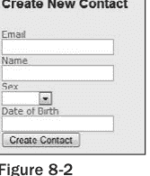

现在我们可以渲染我们的视图了，让我们确保添加了验证。我们首先定义模型类上的验证。我们要确保提供了有效的电子邮件，并且如果提供了出生日期，它应该是有效的日期。

```
public class Contact
{
    public int Id { get; set; }
    [Required(ErrorMessage = "Email is required")]
    [Email(ErrorMessage = "Invalid email")]
    public string Email { get; set; }
    public string Name { get; set; }
    public Sex Sex { get; set; }
    [Date(ErrorMessage = "Invalid date")]
    public DateTime? Dob { get; set; }
}
```

在前面的代码中，我们使用之前创建的属性定义了验证规则。Date 属性不存在，需要创建。首先，我们为验证运行程序创建一个测试：

```
[Test]
public void validate_date_errors_if_value_is_not_date()
{

```


# 第8章：联系人管理

```
model.Dob = "bad date";
var errors = runner.Run(model);
AssertValidationError(errors, "Dob", "Invalid date");
}
```

```
[Test]
public void validate_date_no_errors_if_value_is_a_date()
{
    model.Dob = "10/01/2009";
    var errors = runner.Run(model);
    if (errors != null)
        Assert.AreEqual(errors.Count, 0);
}
```

然后创建日期验证属性并确保测试通过：

```
public class DateAttribute : ValidationAttribute
{
    public override bool IsValid(object value)
    {
        if (value.GetType() == typeof(DateTime))
        {
            return true;
        }
        if (value.GetType() == typeof(string))
        {
            DateTime result;
            var svalue = value as string;
            return svalue == null || DateTime.TryParse(svalue, out result);
        }
        return false;
    }
}
```

我们还需要修改 jQuery 生成器以进行日期验证，但首先，让我们创建测试：

```
[Test]
public void generates_rule_for_date_field()
{
    string script = generator.Generate("createForm", model);
    Assert.IsTrue(script.Contains("date:{date:true}"));
}
```

要使上一个测试通过，我们只需在 `JQueryValidationGenerator` 的 `Generate` 方法中添加以下 `if` 语句：

```
if (attrib.GetType() == typeof(DateAttribute))
{
    subrule = "date:true";
    ruletype = "date";
}
```

115

让我们确保客户端验证在视图中按预期工作。向视图添加以下语句：

```
<%=Html.JQueryGenerator("createcontact", ViewData.Model)%>
```

如果我们尝试提交一个无效的视图，我们将得到如图8-3所示的客户端验证错误。

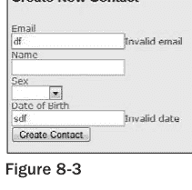

现在让我们为创建联系人编写测试。我们将从一个验证电子邮件地址是否已提供的测试开始：

```
[Test]
public void create_returns_error_if_email_is_missing()
{
    model.Email = null;
    var result = controller.Create(model);
    AssertValidationError(result, "Email", "Email is required");
}
```

`AssertValidationError` 是一个用于断言验证错误的辅助方法；这段代码被重构为一个方法，以便其他测试可以重用。

```
private void AssertValidationError(ActionResult result,
                                   string errorKey,
                                   string errorMessage)
{
    //assert results
    Assert.IsNotNull(result);
    Assert.IsInstanceOfType(typeof(ViewResult), result);
    controller.ViewData.ModelState.AssertErrorMessage(errorKey, errorMessage);
    Assert.IsInstanceOfType(typeof(Contact),
                            ((ViewResult)result).ViewData.Model);
    //asser that the ViewData.Model
    var outModel = (((ViewResult)result).ViewData.Model as Contact);
    Assert.AreEqual(model.Email, outModel.Email);
    Assert.AreEqual(model.Name, outModel.Name);
    Assert.AreEqual(model.Sex, outModel.Sex);
    Assert.AreEqual(model.Dob, outModel.Dob);

    Assert.AreEqual("New Contact", controller.ViewData["Title"],
                    "Page title is wrong");
}
```

116

我们需要进行几处更改以使项目编译并使测试通过。首先，我们需要添加 `Create` 操作：

```
[AcceptVerbs(HttpVerbs.Post)]
[Authorize]
public ActionResult Create([Bind(Prefix = "", Exclude = "Id")] Contact model)
{
    ViewData["Title"] = "New Contact";
    ViewData["sex"] = new SelectList(new Dictionary<string, object>
    {
        {"-1"," "},
        {"1", "Male"},
        {"2", "Female"}
    }, "key", "value");

    try
    {
        var id = Service.Add(model);
    }
    catch (ValidationException ex)
    {
        foreach (var error in ex.ValidationErrors)
        {
            ViewData.ModelState.AddModelError(
                error.PropertyName,
                error.ErrorMessage);
        }
    }

    if (!ViewData.ModelState.IsValid)
    {
        return View("create", model);
    }
    return RedirectToAction("create");
}
```

我们使用了与之前创建消息时相同的模式，现在我们必须更改控制器构造函数：

```
public IContactService Service { get; set; }

public ContactController()
    : this(null)
{
}

[Inject]
public ContactController(IContactService service)
{
    Service = service ?? new InMemoryContactService();
}
```

接下来，我们创建 `IContactService` 及其内存实现：

```
public interface IContactService
{
    int Add(Contact contact);
}

public class InMemoryContactService : IContactService
{
    private IValidationRunner ValidationRunner { get; set; }

    public InMemoryContactService()
        : this(null)
    {

    }
    [Inject]
    public InMemoryContactService(IValidationRunner validationRunner)
    {
        ValidationRunner = validationRunner ?? new ValidationRunner();
    }

    public int Add(Contact contact)
    {
        var errors = ValidationRunner.Run(contact);
        if (errors != null && errors.Count > 0)
        {
            throw new ValidationException(errors);
        }
        return -1;
    }
}
```

我们还需要向应用程序引导程序添加代码，以告知 Ninject 内核如何处理新的接口。我们只创建了一个接口，因此只需添加这一行代码：

```
Bind<IContactService>().To<InMemoryContactService>();
```

前面的代码告诉 Ninject，无论何时遇到 `IContactService` 接口，都注入一个 `InMemoryContactService` 实例。

需要注意的是，前面的代码并非完整实现，只是足以通过测试。随着我们添加更多测试，代码将变得完整。

接下来，我们测试无效电子邮件的验证失败情况：

```
[Test]
public void create_returns_error_if_email_is_invalid()
{
    model.Email = "bad email";
    var扣result = controller.Create(model);
    AssertValidationError(result, "Email", "Invalid email");
}
```

上一个测试应该无需任何更改就能通过，因为所有验证代码已经就位。

联系人成功创建后，我们希望重新显示视图，但使用空白表单。这可以通过简单地重定向到 `Create` 操作来实现：

```
[Test]
public void create_redirects_to_create_action_if_successful ()
{
    var result = controller.Create(model);
    result.AssertRedirectToRouteResult("create");
}
```

我们还想通知用户联系人已成功创建。我们将使用页面顶部的通知消息来通知用户。此通知消息需要仅显示一次，而且我们可能会在整个应用程序中使用它，因此我们可能应该在母版页上显示它。Ruby on Rails 称之为 flash 消息，因此为简单起见，我将称之为 flash 消息模式。幸运的是，在 MVC 中使用 `TempData` 字典可以轻松创建 flash 消息。

> **TempData**

`TempData` 是控制器上的一个属性，类型为 `TempDataDictionary`。它是一个特殊的值字典，可以像 `ViewData` 字典一样传递给视图。唯一的区别是 `TempData` 仅在一次请求的生命周期内可用——也就是说，它是临时的。

这一切很快就会变得清晰，但让我们从一个测试开始：

```
[Test]
public void create_adds_flash_message_if_contact_creation_is_successful()
{
    var result = controller.Create(model);
    Assert.IsTrue(controller.ModelState.IsValid, "model state is invalid");
    Assert.Contains(controller.TempData,
                   new KeyValuePair<string, object>
                   ("flash",
                    "Contact successfully created"),
                   "Flash message is missing");
}
```

我们在前面测试中所做的只是确保在成功创建时将 flash 消息添加到 `TempData` 字典中。为了使测试通过，我们只需在成功创建返回之前向 `Create` 方法添加这一行：

```
TempData["flash"] = "Contact successfully created";
```

在我们过于超前之前，让我们确保通知能够正常工作。我们将在 Views\Shared 文件夹中创建一个名为 FlashMessage 的用户控件，如果存在 flash 消息，它将简单地显示该消息。

```
<%
    if (ViewContext.TempData.ContainsKey("flash"))
    {
%>
```


# 第8章：联系人管理

```
<div class="flash">
    <%= Html.Encode(ViewContext.TempData["flash"])%>
</div>
<%
    }
%>
```

然后我们可以通过将此添加到样式表中来对闪光消息进行样式设计以适合我们的站点设计：

```
.flash
{
    color:Green;
    padding:5px;
    border:solid 2px black;
    background: yellow;
}
```

最后，我们将 FlashMessage 用户控件添加到主页面，以便只需添加此行即可从整个应用程序访问它：

```
<% Html.RenderPartial("flashmessage");%>
```

现在，如果我们添加新的联系人，我们应该会看到如图8-4中显示的闪光消息。

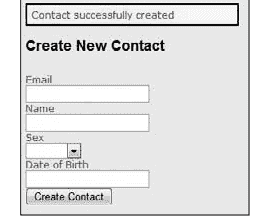

我们的下一个任务是确保在添加联系人之前，电子邮件是唯一的。我们只是不能将验证属性添加到模型，因为我们需要实际检查数据存储。有两种方法可以做到这一点。我们可以在添加之前的正前往仓库时调用 Repository 以检查联系人是否存在；或者我们可以调用 Add 并依靠 Repository 强制执行约束。我认为在执行添加之前实际进行检查并在仓库中强制执行约束是一个好的设计。这样，我们在应用程序级别应用业务规则，而仓库约束在存在错误逻辑的情况下充当安全备份。我们也不完全依赖 Repository 来执行业务规则，因为在内存或 XML 存储库的情况下，可能没有定义约束的简单方法。由于我们在服务级别执行验证，因此在一个地方执行唯一性检查是有意义的。这是测试：

```
[Test]
public void create_returns_error_if_contact_already_exists()
{
    //add it once
    var result = controller.Create(model);
    //make sure it gets added
    result.AssertRedirectToRouteResult("create");
    //add it again
    result = controller.Create(model);
    AssertValidationError(result, "Email", "Contact already exists");
}
```

为了使前面的测试工作，我们将添加 `IContactRepository` 接口，在 `InMemoryContactRepository` 中实现它，并配置 Ninject 以注入新依赖项。我将不会详细介绍所有步骤，因为它们与之前 `IMessageRepository` 接口和 `InMemoryMessageRepository` 类的 `Retrieves` 所做的类似。然后我们可以更改 `InMemoryContactService` 中的 `Add` 方法以应用适当的逻辑。

```
public int Add(Contact contact)
{
    var errors = ValidationRunner.Run(contact);
    if (errors != null && errors.Count > 0)
    {
        throw new ValidationException(errors);
    }
    //check if email is unique
    if (Repository.Get()
        .Count(c => c.Email.ToLower() == contact.Email.ToLower()) > 0)
    {
        throw new ValidationException(
            new List<ValidationError>
            {
                new ValidationError("Email", "Contact already exists")
            });
    }
    return Repository.Add(contact);
}
```

如果你一直在关注，你会注意到我们有一个逻辑错误。问题是此代码将全局防止重复电子邮件地址，因此如果用户 `John` 添加一个联系人为 `customer@gmail.com`，其他用户将无法添加相同的客户。我们需要只为已登录用户检查唯一性。这需要应用程序中的多项更改，让我们开始吧。

我们需要建立联系人和用户之间的关系，因此让我们在 `Contact` 类中添加 `User` 属性：

```
public class Contact
{
    public User User { get; set; }
    public int Id { get; set; }
    [Required(ErrorMessage = "Email is required")]
    [Email(ErrorMessage = "Invalid email")]
    public string Email { get; set; }
    public string Name { get; set; }
    public Sex Sex { get; set; }
    public DateTime? Dob { get; set; }
}
```

我不想定义用户类的所有细节。我现在感兴趣的只是几个属性，所以让我们现在保持简单，届时我们将添加内容。

```
public class User
{
    public Guid UserId { get; set; }
    public string Username { get; set; }
}
```

现在，`Add` 方法可以在已登录用户的上下文中检查电子邮件唯一性：

```
public int Add(Contact contact)
{
    var errors = ValidationRunner.Run(contact);
    if (errors != null && errors.Count > 0)
    {
        throw new ValidationException(errors);
    }

    //check if email is unique
    if (Repository.Get()
        .Count(c => c.Email.ToLower() == contact.Email.ToLower() &&
            c.User.UserId == contact.User.UserId) > 0)
    {
        throw new ValidationException(
            new List<ValidationError>
            {
                new ValidationError("Email", "Contact already exists")
            });
    }
    return Repository.Add(contact);
}
```

为了使前面的代码工作，我们必须在使用 Create 操作从 Action 调用 `Add` 方法之前设置 `User` 属性，如下面的代码所示：

```
model.User =  new User
            {
                Username = User.Identity.Name,
                UserId = (Guid)Provider.
                    GetUser(User.Identity.Name, false)
                    .ProviderUserKey
            };
var id = Service.Add(model);
```

此代码片段创建了与 `MembershipProvider` 类的依赖项。在此场景中，我们使用属性注入而不是构造函数注入，因为 `MembershipProvider` 在概念上并不真正与 `ContactController` 相关。它也更容易更改代码，因为我们不必更改构造函数。由于我们使用 IoC 容器，因此此任务很简单。我们只需添加一个属性并将其添加到 `Inject` 属性，IoC 容器将负责将其初始化为 `Implementation` 的正确实现。

```
[Inject]
public MembershipProvider Provider { get; set; }
```

这次我们没有从测试开始，因为需要进行大量更改，但这并不意味着我们不应该编写测试。我们需要测试多个用户可以添加相同的联系人。

在我们可以编写测试之前，我们需要更改设置以模拟一些类并定义依赖注入。

首先，我们在 `ContactControllerTests` 类的类级别将一些模拟对象定义为字段：

```
private static Mock<MembershipProvider> MockMembership =
    new Mock<MembershipProvider>();
private static Mock<MembershipUser> MockMembershipUser =
    new Mock<MembershipUser>();
private static Mock<IPrincipal> user =
    new Mock<IPrincipal>();
private static Mock<IIdentity> identity =
    new Mock<IIdentity>();
private static Mock<HttpContextBase> httpContext =
    new Mock<HttpContextBase>();
private static Mock<ControllerBase> controllerbase =
    new Mock<ControllerBase>();
```

然后我们需要设置模拟对象以使成员资格提供程序工作：

```
private static void SetupMocks(string username, Guid userid)
{
    identity.Expect(i => i.Name).Returns(username);
    user.Expect(u => u.Identity).Returns(identity.Object);
    httpContext.Expect(h => h.User).Returns(user.Object);
    MockMembership.Expect(m => m.GetUser(username, false))
        .Returns(MockMembershipUser.Object);
    MockMembershipUser.Expect(u => u.ProviderUserKey)
        .Returns(userid);
}
```

接下来，我们必须使用依赖注入 (DI) 实例化控制器，但首先让我们配置 IoC 容器：

```
private static StandardKernel GetIoCKernel()
{
    var modules = new IModule[]
    {
        new InlineModule(
            new Action<InlineModule>[]
            {
                m => m.Bind<MembershipProvider>()
                    .ToConstant(MockMembership.Object),
                m => m.Bind<IContactService>()
                    .To<InMemoryContactService>(),
                m => m.Bind<IContactRepository>()
                    .To<InMemoryContactRepository>()
                    .Using<SingletonBehavior>(),
                m => m.Bind<IValidationRunner>()
                    .To<ValidationRunner>()
```


 ## 第8章：联系人管理

这里需要重点注意的是 IContactRepository 绑定上的 Using<SingletonBehavior> 调用。这告诉 IoC 容器只创建一个 InMemoryContactRepository 实例。如果不这样做，将会创建多个实例，我们的测试将失败，因为每个联系人都会被添加到各自独立的仓库实例中。然后，我们使用带有上述配置的 IoC 容器的 kernel 来创建控制器：

```
private static ContactController GetController()
{
    kernel = GetIoCKernel();

    var contactController = (ContactController)kernel.GetObject(typeof(ContactController));
    contactController.ControllerContext = new ControllerContext(
        HttpContext.Object,
        RouteData(),
        controllerbase.Object);
    return contactController;
}
```

**现在我们的测试设置方法如下所示：**

```
[SetUp]
public void SetUp()
{
    SetupMocks(Username, userId);
    controller = GetController();
    model = new Contact() { Email = "test@test.com", Name = "Julia Roberts", Dob = new DateTime(1967, 10, 28), Sex = Sex.Female };
}
```

**现在我们可以编写测试：**

```
[Test]
public void create_success_for_duplicate_contacts_by_different_users()
{
    // add a contact to the repository
    var anotherUserName = username + 2;
    var anotherUserId = Guid.NewGuid();
    var repo = (IContactRepository)kernel.Get(typeof(IContactRepository));
    repo.Add(new Contact()
    {
        Email = "test@test.com",
        Name = "Julia Roberts",
        Dob = new DateTime(1967, 10, 28),
        Sex = Sex.Female,
        User = new User
        {
            UserId = anotherUserId,
            Username = anotherUsername
        }
    });

    // add the same contact for a different user
    var result = controller.Create(model);
    // make sure it gets added
    result.AssertRedirectToRouteResult("create");
    Assert.AreEqual(2, repo.Get().Count());

    // verify mocks
    MockMembership.VerifyAll();
    MockMembershipUser.VerifyAll();
}
```

我们首先为一个用户——比如 `UserA`——添加了一个联系人到仓库，然后为另一个用户——比如 `UserB`——添加了相同的联系人。接着我们确保两个联系人都进入了仓库。由于 `IContactRepository` 被定义为单例，并且在我们的测试中通过 IoC 容器进行了实例化，我们将能够访问与控制器相同的仓库实例。

> **Bug**
>
> 我不得不将 `InMemoryModule` 类改为使用单例行为，以使应用程序按预期工作。如果不这样做，那么每次实例化控制器时——也就是每个请求——未经允许地创建一个新的仓库实例。
>
> 如果每个请求都创建一个新的*假*数据实例，那么更改将不会被持久化。这意味着如果我们尝试编辑一个联系人并保存它，下一个请求将重新生成假的内存中数据，我们所做的更改将被覆盖。
>
> 通过为内存中数据类使用单例，我们可以在整个会话生命周期内持久化内存中数据。这对于测试和开发来说已经足够好了。在生产环境中，这并非必需，因为数据将被持久化到持久性数据存储中。

### 浏览联系人

用户需要能够浏览他或她的所有联系人，以便进行编辑、查看和删除。浏览联系人将以网格格式显示联系人，并支持分页和排序。我们要确保只从数据库中检索我们想要查看的记录，因此我们将一次检索一页。

我们需要编写一个测试，以确保我们只能检索一页联系人。网格每 20 个联系人进行分页。

```
[Test]
public void browse_contacts_should_retrieve_20_or_less_contacts_at_once()
{
    PopulateRepository();
    var result = controller.Browse(null);
    Assert.IsInstanceOfType(typeof(PagedList<Contact>),
                            controller.ViewData.Model,
                            "View data is the wrong type");
    Assert.LessThanOrEqualTo(((PagedList<Contact>)controller.ViewData.Model).Count,
                            20, "Page size is wrong");
    result.AssertViewResult(controller, "Browse Contacts", "browse");
}
```

`PopulateRepository` 方法，顾名思义，将用一些测试数据填充我们的仓库。测试数据将包含 50 个联系人，其中——25 个分配给一位用户，25 个分配给另一位用户。

```
private void PopulateRepository()
{
    var anotherUsername = Username + 2;
    var anotherUserId = Guid.NewGuid();
    var repo = (IContactRepository)kernel.Get(typeof(IContactRepository));
    for (var i = 0; i < 50; i++)
    {
        repo.Add(
            new Contact
            {
                Id = i,
                Email = ("user" + i + "@test.com"),
                Name = string.Format("First{0} Last{1}", i, i),
更不能()
```


## 第八章：联系人管理

还有一个静态的 `Pagination` 类，其中包含几个扩展方法，用于将 `IQueryable` 和 `IEnumerable` 集合转换为 `PagedList` 集合。

```
public static class Pagination
{
    public static PagedList<T> ToPagedList<T>(this IQueryable<T> source,
                                               int index, int pageSize)
    {
        return new PagedList<T>(source, index, pageSize);
    }

    public static PagedList<T> ToPagedList<T>(this IEnumerable<T> source,
                                               int index, int pageSize)
    {
        return new PagedList<T>(source, index, pageSize);
    }
}
```

> 前面的分页代码修改自原始来源，该来源可在 Troy Goode 的博客 SquaredRoot (www.squaredroot.com) 上找到。

另一个需要注意的重要事项是，操作中的 page 参数是一个可空整数，这允许我们在未定义页面时进行处理，并假定为第一页。我们必须在 Global.asax.cs 文件中定义一个新路由，才能使用 URL `http://localhost/contact/browse/{page}` 指向 Browse 操作，并将 `{page}` 参数传递给操作方法。

```
routes.MapRoute(
    "BrowseContacts",
    "contact/browse/{page}",
    new
    {
        controller = "Contact",
        action = "Browse",
        page = 1
    }
);
```

我们基本上是在告诉路由处理器，将任何 `contact/browse/{page}` URL 映射到 Contact 控制器的 Browse 操作，并且如果未定义 page 参数，则默认为第一页。

测试现在应该通过，所以让我们继续下一个。我们需要确保只检索已登录用户的联系人。因此，我们的总项目数应为 25。

```
[Test]
public void browse_contacts_should_retrieve_contacts_for_loggedin_user_only()
{
    PopulateRepository();
    var result = controller.Browse(null);
    Assert.AreEqual(25,
        ((PagedList<Contact>)controller.ViewData.Model).TotalItemCount,
        "Item count is wrong");
}
```

129

前面的测试将会失败，因为总项目数将是 50，因为我们没有根据登录用户过滤结果。我们需要将 Browse 服务方法更改为：

```
PagedList<Contact> GetPage(Guid userid, int? page);
```

然后将实现更改为：

```
public PagedList<Contact> GetPage(Guid userid, int? page)
{
    page = page ?? 1;
    page = page < 1 ? 1 : page;
    return Repository.Get()
        .Where(c => c.User.UserId == userid)
        .ToPagedList((int)(page - 1), 20);
}
```

接着修改控制器以将用户 ID 传递给服务调用：

```
[AcceptVerbs(HttpVerbs.Get), Authorize]
public ActionResult Browse(int? page)
{
    ViewData["Title"] = "Browse Contacts";
    page = page ?? 1;
    ViewData.Model = Service.GetPage((Guid) Provider.
        GetUser(User.Identity.Name, false)
            .ProviderUserKey,
        page);
    return View("browse");
}
```

测试现在应该通过了。是时候创建一个视图并确保一切看起来正确。我们将创建一个强类型视图：

```
public partial class Browse : ViewPage<PagedList<Data.Models.Contact>>
{
}
```

视图本身将是一个简单的表格，遍历联系人列表。目前，我们只创建一些非功能链接以了解外观。我们稍后会添加功能。

```
<h2>
    Browse Contacts</h2>
<table class="grid">
    <thead>
        <tr>
            <th>
                Email
            </th>
            <th>
                Name
            </th>
            <th>
                Actions
            </th>
        </tr>
    </thead>
    <tbody>
        <%foreach (var contact in ViewData.Model)
        {%>
        <tr>
            <td>
                <%=contact.Email %>
            </td>
            <td>
                <%=contact.Name %>
            </td>
            <td>
                <a href=''>edit</a> <a href=''>delete</a>
            </td>
        </tr>
        <%} %>
    </tbody>
</table>
```

如果我们导航到 http://localhost/contact/browse，我们应该会看到第一页，如图 8-5 所示。

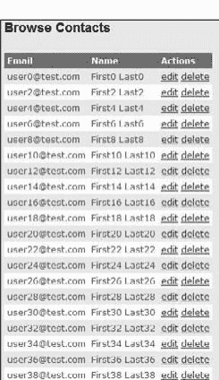

图 8-5

而如果我们尝试 http://localhost/contact/browse/2，我们应该会看到第二页，如图 8-6 所示。

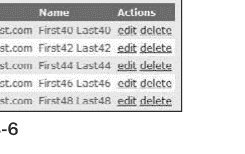

图 8-5 和 8-6 中显示的虚拟数据是在 `InMemoryModule` 类中填充的，我们在其中配置了 IOC 以确保整个应用程序可以访问一些数据。

显然，我们不期望用户通过在 URL 中输入页码来翻阅我们的网格。

我们需要在网格中添加一个分页器，并且由于我们知道会有多个网格并且它们也需要分页，我们将提前创建分页器作为一个用户控件。

> *分页用户控件代码修改自原始来源，该来源可在 Robert Muehsig 的博客 (http://code-inside.de) 上找到。*

> *分页器样式修改自原始来源，该来源可在 Antonio Lupetti 的博客 (http://work.blogspot.com) 上找到。*

Pagination.ascx 用户控件如下：

```
<div class="pagination">
<ul>
<% if (ViewData.Model.HasPreviousPage)
{
%><li class="previous">
<a href="<%=ViewData.Model.PageActionLink.Replace("{page}",
(ViewData.ModelPageIndex - 1).ToString()) %>">
 << Previous</a></li>
<% }
else
{ %>
<li class="previous-off">&laquo; Previous</li>
<% } %>
<%for (int page = 1; page <= ViewData.Model.TotalPages; page++)
{
    if (page == ViewData.Model.PageIndex)
    { %>
<li class="active">
<%=page.ToString()%></li>
<% }
else
{ %>
<li>
<a href="<%=ViewData.Model.PageActionLink.Replace("{page}",
page.ToString()) %>">
 <%=page.ToString()%></a></li>
<% }
}
if (ViewData.Model.HasNextPage)
{
    <li class="next">
        <a href="<%= ViewData.Model.PageActionLink.Replace("{page}",
                                        (ViewData.Model.PageIndex + 1).ToString())%>">
            Next »</a></li>
}
else
{
    <li class="next-off">Next »</li>
}
</ul>
</div>
```

Pagination 控件是强类型的，并且期望一个 PaginationViewData 对象作为模型。PaginationViewData 是一个简单的包装器，用于封装渲染分页器所需的数据。

```
public class PaginationViewData
{
    public int PageIndex { get; set; }
    public int TotalPages { get; set; }
    public int PageSize { get; set; }
    public int TotalCount { get; set; }
    public string PageActionLink { get; set; }
    public bool HasPreviousPage
    {
        get
        {
            return (PageIndex > 1);
        }
    }
    public bool HasNextPage
    {
        get
        {
            return (PageIndex * PageSize) <= TotalCount;
        }
    }
}
```

现在，我们可以通过渲染 Pagination 控件在视图中使用分页器：

```
<% Html.RenderPartial("pagination", new PaginationViewData
{
    PageActionLink = "/contact/browse/{page}",
    PageIndex = ViewData.Model.PageNumber,
    PageSize = ViewData.Model.PageSize,
    TotalCount = ViewData.Model.TotalItemCount,
    TotalPages = ViewData.Model.PageCount
}); %>
```

我们的视图现在将显示一个分页器，如图 8-7 所示。

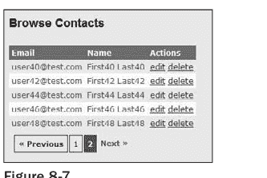

图 8-7

接下来的任务是表格排序。在我们编写任何测试之前，让我们先为处理排序打下基础。排序需要两个参数：

-   要排序的字段
-   排序的方向

我们需要做的第一件事是更改 Browse 操作以处理排序：

```
[AcceptVerbs(HttpVerbs.Get), Authorize]
public ActionResult Browse(int? page, string sortBy, string sortDir)
{
    ViewData["Title"] = "Browse Contacts";
    ViewData["sortdir"] = sortDir;
    ViewData["sortby"] = sortBy;

    page = page ?? 1;
    ViewData.Model = Service.GetPage((Guid)Provider.
                                    GetUser(User.Identity.Name, false)
                                    .ProviderUserKey,
                                    page, sortBy, sortDir);
    return View("browse");
}
```

然后我们需要将排序参数传递给服务层，因此让我们在 `IContactService` 接口中重载 `GetPage` 方法：

```
PagedList<Contact> GetPage(Guid userid, int? page,
                         string sortBy, string sortDirection);
```

在我们实现新的 `GetPage` 方法之前，重要的是要注意我们不能在 LINQ 查询中使用排序字符串。我们不能这样做：

```
return Repository.Get()
    .Where(c => c.User.UserId == userid)
    .OrderBy(sortBy + " " + sortDirection)
    .ToPagedList((int) (page - 1), 20);
```

134


## 锦鲤

LINQ 查询是强类型的，并且期望如下所示的排序表达式：

```
return Repository.Get()
    .Where(c => c.User.UserId == userid)
    .OrderBy(o => o.Email)
    .ToPagedList((int) (page - 1), 20);
```

幸运的是，可以使用 LINQ 动态查询库来执行动态 LINQ，该库可从 MSDN (www.msdn.com) 下载。此库添加了一些扩展方法，使我们能够执行动态 LINQ。

现在我们已经下载了 LINQ 动态查询库并将其包含在我们的代码中，我们可以更改 GetPage 的两个实现：

```
public PagedList<Contact> Get(){

    return GetPage(userid, page, "email", "asc");
}

public PagedList<Contact> GetPage(Guid userid, int? page,
                                string sortBy, string sortDirection)
{
    sortBy = sortBy ?? "email";
    sortDirection = sortDirection ?? "asc";
    page = page ?? 1;
    page = page < 1 ? 1 : page;
    return Repository.Get()
        .Where(c => c.User.UserId == userid)
        .OrderBy(sortBy + " " + sortDirection)
        .ToPagedList((int)(page - 1), 20);
}
```

*注意 OrderBy，它使用动态 LINQ 来对查询进行排序。*

让我们更新视图以查看排序是否有效。我们首先为网格标题添加超链接：

```
<thead>
    <tr>
        <th>
            <%=Html.ActionLink<ContactController>(
                c => c.Browse(ViewData.Model.PageNumber,
                               "email",
                               ViewData.GetSortDirection("email")),
                "Email")%>
        </th>
        <th>
            <%=Html.ActionLink<ContactController>(
                c => c.Browse(ViewData.Model.PageNumber,
                               "name",
                               ViewData.GetSortDirection("name")),
                "Name")%>
        </th>
        <th>
            Actions
        </th>
    </tr>
</thead>
```

前面的代码使用了一个 `ViewData` 扩展方法，即 `GetSortDirection`，在点击网格标题时会反转排序方向。

```
public static string GetSortDirection(this ViewDataDictionary ViewData,
                                    string field)
{
    return (string)ViewData["sortby"] != field
           ? "asc"
           : ((string)ViewData["sortdir"] == "asc"
              ? "desc"
              : "asc");
}
```

最后，我们需要确保分页控件了解排序。我们首先向 `PaginationViewData` 类添加两个新属性：

```
public string SortBy { get; set; }
public string SortDirection { get; set; }
```

然后我们更改用户控件，将排序参数添加到分页链接中。例如，这里是之前的超链接：

```
<a href='<%=ViewData.Model.PageActionLink
              .Replace("{page}",
                       (ViewData.Model.PageNumber - 1).ToString()) +
              (string.IsNullOrEmpty(ViewData.Model.SortBy)
              ? ""
              : "?sortby=" + ViewData.Model.SortBy
              + "&sortdir=" + ViewData.Model.SortDir)%>'><< Previous</a>
```

在我们继续之前，让我们添加一个测试以确保排序选项已保存到视图数据中：

```
[Test]
public void browse_contacts_should_save_sort_options_to_viewdata()
{
    var result = controller.Browse(null, "email", "asc");
    controller.ViewData.AssertItem("sortby", "email");
    controller.ViewData.AssertItem("sortdir", "asc");
    result.AssertViewResult(controller, "Browse Contacts", "browse");
}
```

### 编辑联系人

用户可以编辑联系人并更改其所有属性。我们需要确保只有联系人的所有者才能对其进行编辑。如果联系人的电子邮件被更改为属于该用户拥有的另一个联系人的电子邮件，则保存更改将因错误而失败。

首先，我们需要确保我们可以获取视图：

```
[Test]
public void edit_contact_should_return_view()
{
    PopulateRepository();
    var result = controller.Edit(1);
    result.AssertViewResult(controller, "Edit Contact", "edit");
}
```

接着我们在控制器中创建操作（Action）方法：

```
[AcceptVerbs(HttpVerbs.Get), Authorize]
public ActionResult Edit(int id)
{
    ViewData["Title"]="Edit Contact";
    return View("edit");
}
```

现在我们已经有了视图，让我们确保它能检索到正确的联系人项目：

```
[Test]
public void edit_contact_should_get_requested_contact()
{
    PopulateRepository();
    var result = controller.Edit(1);
    Assert.IsInstanceOfType(typeof(Contact), controller.ViewData.Model);
    Assert.AreEqual(1, ((Contact)controller.ViewData.Model).Id);
    result.AssertViewResult(controller, "Edit Contact", "edit");
}
```

然后我们修改 Edit 操作以使用服务类检索联系人：

```
[AcceptVerbs(HttpVerbs.Get), Authorize]
public ActionResult Edit(int id)
{
    ViewData["Title"]="Edit Contact";
    ViewData.Model = Service.Get(id);
    return View("edit");
}
```

将 Get 方法添加到 IContactService 接口中，并在 InMemoryContactService 中实现：

```
public Contact Get(int id)
{
    return Repository.Get().Where(c => c.Id == id).SingleOrDefault();
}
```

我们还需要确保如果提供的联系人 ID 不存在，则显示适当的错误消息：

```
[Test]
public void edit_should_return_error_page_if_requested_contact_is_not_found()
{
    try
    {
        PopulateRepository();
        var result = controller.Edit(45789); //non-existing contact
        Assert.Fail("Failed to throw exception");
    }
    catch (ArgumentException)
    {
        controller.TempData.AssertItem("error",
            "The contact you requested could not be found");
    }
}
```

在这个测试中，我们尝试编辑不存在的联系人，预期抛出异常且 TempData 字典中添加错误消息。这里是修改后的操作：

```
[AcceptVerbs(HttpVerbs.Get), Authorize]
public ActionResult Edit(int id)
{
    ViewData["Title"] = "Edit Contact";
    ViewData.Model = Service.Get(id);
    if (ViewData.Model == null)
    {
        TempData["error"] = "The contact you requested could not be found";
        throw new ArgumentException ();
    }
    return View("edit");
}
```

让我们先创建一个空视图来测试错误条件。如果导航到 http://localhost/contact/edit/23424（其中 23424 是不存在的联系人），我们应该能看到图 8-8 中显示的错误页面。

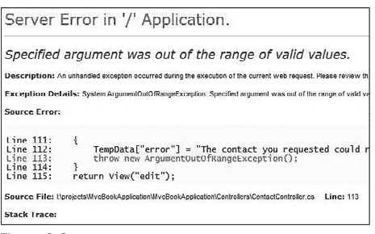

图 8-8

显然，这对于最终用户来说不是一个好的错误提示。我们需要创建一个自定义且更友好的错误页面。首先，需要在 `web.config` 文件中启用自定义错误，在 `<system.web>` 节点下添加以下行：

```
    <customErrors mode="On"></customErrors>
```

接下来是指令 MVC 框架处理错误，通过向操作（Action）添加 `HandleError` 属性：

```
    [AcceptVerbs(HttpVerbs.Get), Authorize]
    [HandleError]
    public ActionResult Edit(int id)
    {
        ViewData["Title"] = "Edit Contact";
        ViewData.Model = Service.Get(id);
        if (ViewData.Model == null)
        {
            TempData["error"] = "The contact you requested could not be found";
            throw new ArgumentException ();
        }
        return View("edit");
    }
```

`HandleError` 将处理在操作执行期间抛出的任何未处理的异常，并渲染错误视图。它通过在控制器文件夹中查找名为 *错误* 的视图来做到这一点；如果找不到，则它会查看共享文件夹。所以，让我们在共享文件夹中创建一个错误页面，以便在整个应用程序中使用：

```
    <h2>
          Sorry, an error occurred while processing your request.
    </h2>
    <%if (TempData.ContainsKey("error"))
      {%>
    <div>
         <%= TempData["error"] %></div>
    <%} %>
```

错误视图将显示通用错误消息，随后是 TempData 字典中的自定义消息（如果存在的话）。

现在，如果我们再次导航到同一页面，我们应该能看到更多信息的错误提示，如 图 8-9 所示。

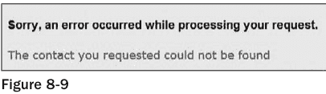

我们现在需要确保登录用户只能编辑属于他或她的联系人。有许多方法可以强制执行这一点。我们可以强制它在控制器中，或者在

## 第八章：联系人管理

服务类。我倾向于在服务层执行安全检查，以防我们需要将服务层用于其他项目——例如移动网站、Web服务或Windows客户端。我们不想为每个此类应用程序重写安全强制执行代码。该测试与之前的测试非常相似：

```
[Test]
public void edit_should_return_error_page_if_user_is_not_owner()
{
    var id = 2;
    try
    {
        PopulateRepository();
        var result = controller.Edit(id); //由另一个用户所有
        Assert.Fail("Failed to throw exception");
    }
    catch (ArgumentException)
    {
        var repo = (IContactRepository)kernel.Get(typeof(IContactRepository));
        Assert.AreEqual(1, repo.Get().Count(c => c.Id == id));
        controller.TempData.AssertItem("error",
                                       "The contact you requested could not be found");
    }
}
```

不同之处在于，我们正在寻找的联系人存在，但属于另一个用户。为了使其工作，我们必须更改`Get`方法签名如下：

```
Contact Get(Guid userd, int id);
```

实现如下所示：

```
public Contact Get(Guid userid, int id)
{
    return Repository.Get().Where(c =>
                                   c.Id == id &&
                                   c.User.UserId == userid)
                        .SingleOrDefault();
}
```

下一步是创建`Edit`操作来处理表单提交。由于这里的步骤与我们创建`Create`操作的方式非常相似，我将跳过细节，向您展示最终结果。这是处理保存（post）的操作方法，与我们之前编写的`Create`操作非常相似：

```
[AcceptVerbs(HttpVerbs.Post), Authorize]
[HandleError]
public ActionResult Edit(int id, [Bind(Prefix = "")] Contact model)
{
    ViewData["Title"] = "Edit Contact";
    try
    {
```

```
model.Id = id;
if (!Service.Save(UserId, model))
{
    ViewData.ModelState.AddModelError("save",
        "Error saving the contact");
}
}
catch (ValidationException ex)
{
    foreach (var error in ex.ValidationErrors)
    {
        ViewData.ModelState.AddModelError(
            error.PropertyName,
            error.ErrorMessage);
    }
}
if (!ViewData.ModelState.IsValid)
{
    return View("edit", model);
}
TempData["flash"] = "Contact successfully saved";
return RedirectToAction("browse");
```

正如我们之前所做的，我们验证输入，然后调用服务类的`Save`方法。

```
public bool Save(Guid userid, Contact contact)
{
    var errors = ValidationRunner.Run(contact);
    if (errors != null && errors.Count > 0)
    {
        throw new ValidationException(errors);
    }
    //检查电子邮件是否唯一
    if (Repository.Get()
        .Count(c => c.Email.ToLower() == contact.Email.ToLower() &&
            c.User.UserId == userid && c.Id != contact.Id) > 0)
    {
        throw new ValidationException(
            new List<ValidationError>
            {
                new ValidationError("Email", "Email already exists")
            });
    }
    //确保用户有权保存
    if(Repository.Get().Count(c =>
                                c.Id == contact.Id &&
                                c.User.UserId == userid) == 0)
        return false;
    return Repository.Save(contact);
}
```

视图也与创建视图相似：

```
<script type="text/javascript">
    $(document).ready(function() {
        $("#sex option[value=<%= (int) ViewData.Model.Sex %>]")
            .attr("selected", "selected");
    });
</script>

<h2>
    Edit Contact</h2>
<%=Html.ValidationSummary()%>
<%=Html.JQueryGenerator("editcontact", ViewData.Model)%>
<form id="editcontact"
      action="/contact/edit/<%=ViewData.Model.Id %>" method="post">
<div>
    <label for="email">
        Email</label>
    <br />
    <%=Html.TextBox("email")%>
    <br />
    <label for="name">
        Name</label>
    <br />
    <%=Html.TextBox("name")%>
    <br />
    <label for="sex">
        Sex</label>
    <br />
    <select id="sex" name="sex">
        <option value="0"></option>
        <option value="1">Male</option>
        <option value="2">Female</option>
    </select>
    <br />
    <label for="dob">
        Date of Birth</label>
    <br />
    <input id="dob" name="dob" type="text"
value='<%=ViewData.Model.Dob.ToShortDateString()  %>' />
    <br />
    <input type="submit" value="Save Contact" />
</div>
</form>
```

与创建视图相比，前面的视图中有一些重要的区别需要注意。我们需要从下拉列表中选择正确的值，所以我使用了JavaScript调用来完成。我只需获取`sex`的值，并用它来设置下拉列表中相应选项的`selected`属性。

```
$("#sex option[value=<%= (int) ViewData.Model.Sex %>]")
    .attr("selected", "selected");
```

`$("#sex option[value=<%= (int) ViewData.Model.Sex %>]")`部分只是选择一个`option`类型的元素，该元素具有ID为`sex`的父级，并且其`value`属性等于正在编辑的联系人的性别。`attr("selected", "selected")`部分向该元素添加一个`selected`属性并将其值设置为`selected`。生成的HTML将如下所示：

```
<select id="Select1" name="sex">
    <option value="0"></option>
    <option value="1">Male</option>
    <option value="2" selected="selected">Female</option>
</select>
```

> **$(document).ready()**
> `$(document).ready()`是一个jQuery函数，它在页面文档对象模型（DOM）加载完成后、页面内容加载前执行。

另一个需要注意的点是，我没有使用`TextBox` HTML辅助方法生成日期字段，因为我想将日期格式化为短日期字符串，即`01/01/2008`而不是`01/01/2008 12:00`。由于`Dob`的类型是`DateTime?`，我不得不编写一个扩展方法来获取短日期字符串。

```
public static string ToShortDateString(this DateTime? date)
{
    return date == null ? "" : ((DateTime) date).ToShortDateString();
}
```

> **重构**
> `Create`和`Edit`视图几乎完全相同，是重构的良好候选。我们可以将表单的HTML重构为一个用户控件，在两个页面中重用。

### 删除联系人

当用户在网格中单击"Delete"链接时，他或她将被定向到如图8-10所示的确认页面。

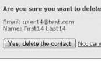

图 8-10

我遵循了与前面相同的过程——创建测试、编写代码，并创建一些视图以确认功能正常。以下是操作方法：

```
[AcceptVerbs(HttpVerbs.Get), Authorize]
[HandleError]
public ActionResult Delete(int id)
{
    ViewData["title"] = "Delete Contact";
    ViewData.Model = Service.Get(UserId, id);
    if (ViewData.Model == null)
    {
        TempData["error"] = "The contact you are trying to delete does not exist";
        throw new ArgumentException();
    }
    return View("delete");
}

[AcceptVerbs(HttpVerbs.Post), Authorize, ActionName("Delete")]
[HandleError]
public ActionResult DeleteSubmit(int id)
{
    if (!Service.Delete(UserId, id))
    {
        TempData["error"] = "Error deleting the contact";
        throw new ArgumentException();
    }
    TempData["flash"] = "Contact successfully deleted";
    return RedirectToAction("browse");
}
```

前面操作中需要注意的一点是在`DeleteSubmit`方法上使用了`ActionName`属性。`ActionName`属性允许我们定义一个与方法名不同的操作名称，在这种情况下是必要的，因为两个方法具有相同的签名，不能都称为`Delete`。这使我们可以将`Delete`表单发布到URL `/contact/delete/{id}`而不是`/contact/deletesubmit/{id}`。

以下是`InMemoryContactService`类中`Delete`方法的实现：

```
public bool Delete(Guid userid, int id)
{
    //确保用户有权删除
    if (Repository.Get().Count(c =>
        c.Id == id &&
        c.User.UserId == userid) == 0)
        return false;
    return Repository.Delete(id);
}
```

144


# 第8章：联系人管理

## 小结

我们在本章涵盖了许多主题。我们讨论了数据网格的分页和排序。我们注册了一个自定义路由。我们讨论了错误处理，并使用`HandleError`属性将用户重定向到友好的错误页面。我们看到了我们的验证框架在客户端和服务器端的实际应用。我们使用了一点 jQuery 魔法，在页面加载时选中下拉列表中的某一项。我们使用`ActionName`属性为操作指定了一个与方法名称不同的名称。我们使用 TDD 完成了所有这些工作，并编写了单元测试来覆盖我们能想到的所有条件，因此我们对到目前为止的代码感到非常舒适和自信。

# 第9章：导入联系人

要求用户一次创建一个联系人是不合理的。我们需要一种方法，让他们能够一次导入或输入多个联系人。有几种方法可以完成这项任务，我们将在本章中讨论。我们将使用户能够快速导入他们现有的 ContactNv0 联系人

## 问题

毫无疑问，此应用程序的用户拥有数百甚至数千个他们想要联系的联系人。他们需要将这些联系人导入我们的应用程序，但到目前为止，我们只允许他们一次导入一个联系人。在实际应用中，这是行不通的。我们需要让用户批量输入联系人，要么通过打字（复制和粘贴），要么通过上传包含他们联系人的文本文件。

## 设计

在本书中，我们仅关注文本文件的导入，但我们希望设计应用程序时具备灵活性，以支持其他文件格式，例如 Excel 电子表格或 Outlook 个人文件。

在本章中，我们将创建此接口的两种实现——一种用于处理上传的文本文件，另一种用于处理包含多个联系人的字符串。

多个联系人将在多行文本框中输入，每个联系人占一行，联系人详细信息以逗号分隔。例如：

```
user1@acme.com,firstname,lastname,male,12/17/1964
user2@hotmail.com,firstname
user3@gmail.com,,,female
```

## 解决方案

我们从通常的测试开始，确保存在一个视图，并设置了适当的标题：

```
[Test]
public void import_should_return_view()
{
    var result = controller.Import();
    result.AssertViewResult(controller, "Import Contacts", "import");
}
```

然后，我们通过 ContactController 中的以下操作使测试通过：

```
[AcceptVerbs(HttpVerbs.Get)]
public ActionResult Import()
{
    ViewData["Title"] = "Import Contacts";
    return View("import");
}
```

在下一个测试中，我们将确保将字符串或上传的文件发布到服务器。上传的文件是 Request 对象的一部分，位于 Files 集合中，因此我们将通过调用 Request.Files[0] 来访问该文件。我们需要为这些对象添加模拟，以使测试能够工作：

```
httpContext.Expect(h => h.Request).Returns(request.Object);
request.Expect(r => r.Files).Returns(files.Object);
```

上述对象声明如下：

```
private static Mock<HttpRequestBase> request;
private static Mock<HttpFileCollectionBase> files;
```

以下是测试：

```
[Test]
public void import_should_return_error_if_contacts_and_file_are_missing()
{
    var result = controller.Import(null);
    Assert.IsNotNull(result);
    Assert.IsInstanceOfType(typeof(ViewResult), result);
    controller.ViewData.ModelState
        .AssertErrorMessage("Import",
            "You must enter some contacts or upload a file");
    result.AssertViewResult(controller,"Import Contacts", "import");
}
```

为了使测试通过，我们创建处理 POST 请求并验证输入和上传文件的导入操作，如下所示：

```
[AcceptVerbs(HttpVerbs.Post)]
public ActionResult Import(string contacts)
{
    ViewData["Title"] = "Import Contacts";
    if (string.IsNullOrEmpty(contacts) && Request.Files.Count == 0)
    {
        ViewData.ModelState.AddModelError("Import",
            "You must enter some contacts or upload a file");
    }
    if (!ViewData.ModelState.IsValid)
    {
        return View("import");
    }
    throw new NotImplementedException();
}
```

末尾抛出的异常是故意的，直到我们实现该操作的其余部分。

现在，让我们确保 Import 操作在成功时添加一条闪存消息：

```
[Test]
public void import_should_add_flash_message_if_import_is_successful()
{
    var result = controller.Import("user1@test.com");
    Assert.IsTrue(controller.ModelState.IsValid, "model state is invalid");
    Assert.Contains(controller.TempData,
                   new KeyValuePair<string, object>
                   ("flash",
                   "Contacts successfully imported"),
                   "Flash message is missing");
}
```

我们通过在上述操作中添加以下一行代码来使测试通过：

```
TempData["flash"] = "Contacts successfully imported";
```

接下来，我们要确保如果导入成功，会被重定向到 Browse 操作：

```
[Test]
public void import_should_redirect_to_browse_action_if_successful()
{
    var result = controller.Import("user1@test.com");
    Assert.IsTrue(controller.ModelState.IsValid, "model state is invalid");
    result.AssertRedirectToRouteResult("browse");
}
```

到目前为止，我们的 Import 操作如下所示：

```
[AcceptVerbs(HttpVerbs.Post)]
public ActionResult Import(string contacts)
{
    ViewData["Title"] = "Import Contacts";
    if (string.IsNullOrEmpty(contacts) &&
        (Request.Files.Count == 0 || Request.Files[0].ContentLength == 0))
    {
        ViewData.ModelState.AddModelError("Import",
                                         "You must enter some contacts or upload a file");
    }
    if (!ViewData.ModelState.IsValid)
    {
        return View("import");
    }
    TempData["flash"] = "Contacts successfully imported";
    return RedirectToAction("browse");
}
```

到目前为止，它实际上还没有执行任何导入操作，因此我们需要确保它确实导入了输入的联系人。但在我们走得太远之前，让我们快速创建一个视图，以确保一切正常工作。该视图包含一个文本区域和一个按钮，如下所示：

```
<h2>
    Import Contacts</h2>
<%=Html.ValidationSummary()%>
<form id="importcontacts" action="/contact/import" method="post"
      enctype="multipart/form-data">
    <div>
        Enter email address below. One address per line.
        <label for="contacts">
            Email Addresses</label>
        <br />
        <textarea id="contacts" name="contacts" rows="10" cols="55"></textarea>
    </div>
    <div>
        <input type="file" id='file' name='file' /></div>
    <div>
        <input type="submit" id="import" name="import" value="Import Email" /></div>
</form>
```

如果我们点击"提交"按钮，应该会看到如图 9-1 所示的验证错误。

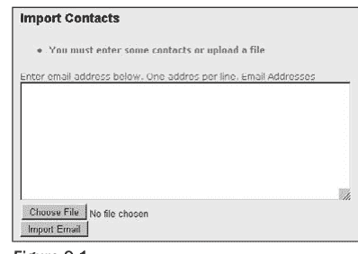

### 图 9-1

现在，我们需要实例化一个导入器实例。一种方法是编写一个`if`语句，确定实例化`IContactsImporter`接口的哪个实现，然后调用适当的`Parse`方法。问题是测试此逻辑将很困难，而且我们将无法轻松模拟`IContactsImporter`接口。为了更清楚地说明，让我们进一步研究一下。我们可以在我们的操作中编写以下代码：

```
if(!string.IsNullOrEmpty(contacts))
{
    //use text importer
    ContactsImporter = new TextImporter();
    ContactsImporter.Parse(contacts);
}else
{
    //use file importer
    ContactsImporter = new FileImporter();
    ContactsImporter.Parse(Request.Files[0]);
}
```

看看前面的代码，问问自己，如何将`IContactsImporter`的模拟实例传递给控制器？如何验证创建了正确的实例？两个问题的答案都是：你无法做到。这似乎是一个工厂方法模式的理想情况。我们可以创建一个工厂类，它将知道如何创建`IContactsImporter`的实例，并且通过使用接口，我们将能够进行模拟。

我们需要创建一个解析器工厂，该工厂将返回一个具有`Parse`方法的解析器，该方法将返回一个联系人列表。然后我们将联系人列表发送到一个`Import`方法，该方法将填充数据库。这听起来可能令人困惑，但当我们继续推进时，一切都会变得清晰明了。解析器工厂接口如下所示：

```
public interface IParserFactory
{
    IParser Create(string contacts, HttpPostedFileBase file);
}
```

解析器接口如下：

```
public interface IParser
{
    IList<Contact> Parse();
}
```

现在我们需要实现`IParserFactory`接口，使其返回适当的`IParser`实例。我们首先创建一个新的测试类来测试解析器工厂，如下所示，并添加我们的第一个测试：

```
[TestFixture]
public class ParserFactoryTests
{
    [Test]
    public void factory_should_return_string_parser_if_contacts_are_passed_in()
    {
        ParserFactory factory = new ParserFactory();
        string contacts = "bob@email.com";
```


## 第 9 章：导入联系人

```csharp
IParser parser = factory.Create(contacts, null);
Assert.IsInstanceOfType(typeof(StringParser), parser,
  "Wrong parser type returned");
}
```

此测试需要实现一个名为 StringParser 的 IParser 接口才能编译。StringParser 类如下所示：


```csharp
public class StringParser : IParser
{
  public string Contacts { get; set; }

  public StringParser(string contacts)
  {
    Contacts = contacts;
  }

  public IList<Contact> Parse()
  {
    throw new System.NotImplementedException();
  }
}
```

我们现在不打算现在实现 Parse 方法；稍后我们会处理。接下来，我们需要创建 ParserFactory 类。目前我们不需要实现完整的逻辑；相反，我们只实现足以通过测试的部分：


```csharp
public class ParserFactory : IParserFactory
{
  public IParser Create(string contacts, HttpPostedFileBase file)
  {
    if (!string.IsNullOrEmpty(contacts))
      return new StringParser(contacts);

    throw new NotImplementedException();
  }
}
```

我们的测试现在应该通过了。我们的第二个测试将检查如果用户上传文本文件时，确保我们获取了文本文件解析器。在此测试中，我们将按以下方式模拟上传的文件：


```csharp
[Test]
public void factory_should_return_text_file_parser_for_uploaded_text_files()
{
  var factory = new ParserFactory();
  var contacts = string.Empty;
  var mockUploadedTextFile = new Mock<HttpPostedFileBase>();
  mockUploadedTextFile.Expect(f => f.FileName).Returns("textfile.txt");
  var parser = factory.Create(contacts, mockUploadedTextFile.Object);
  Assert.IsInstanceOfType(typeof(TextFileParser), parser,
    "Wrong parser type returned");
}
```

## 第 9 章：导入联系人  

此测试将失败。我们需要创建 TextFileParser：


```csharp
public class TextFileParser : IParser
{
    public HttpPostedFileBase PostedFile { get; set; }

    public TextFileParser(HttpPostedFileBase postedFile)
    {
        PostedFile = postedFile;
    }

    public IList<Contact> Parse()
    {
        throw new System.NotImplementedException();
    }
}
```

现在，我们修改 Create 工厂方法如下以使测试通过：


```csharp
public class ParserFactory : IParserFactory
{
    public IParser Create(string contacts, HttpPostedFileBase file)
    {
        if (!string.IsNullOrEmpty(contacts))
            return new StringParser(contacts);

        if (file != null)
        {
            if (Path.GetExtension(file.FileName).ToLower() == ".txt")
                return new TextFileParser(file);
        }
        throw new NotImplementedException();
    }
}
```

我们需要添加几个更多测试以确保 Create 工厂方法在无法创建合适的解析器时抛出异常。如果未提供字符串或上传的文件，我们希望抛出 ArgumentNullException；如果提供了不支持的文件格式，则抛出 NotImplementedException。


```csharp
[Test]
public void factory_should_throw_exception_if_file_format_is_not_supported()
{
    var factory = new ParserFactory();
    var contacts = string.Empty;
    var mockUploadedTextFile = new Mock<HttpPostedFileBase>();
    mockUploadedTextFile.Expect(f => f.FileName).Returns("textfile.xls");
    Assert.Throws(typeof(NotImplementedException),
            () => factory.Create(contacts, mockUploadedTextFile.Object));
}

[Test]
public void factory_should_throw_exception_if_arguments_are_invalid()
```

## 第 9 章：导入联系人


```csharp
{  
var factory = new ParserFactory();
var contacts = string.Empty;
Assert.Throws(typeof(ArgumentNullException),
              () => factory.Create(contacts, null));
}
```

最后，我们对 Create 工厂方法做最后一次更改以通过之前的测试：


```csharp
public IParser Create(string contacts, HttpPostedFileBase file)
{
    if (!string.IsNullOrEmpty(contacts))
        return new StringParser(contacts);

    if (file != null)
    {
        if (Path.GetExtension(file.FileName).ToLower() == ".txt")
            return new TextFileParser(file);
        else
            throw new NotImplementedException();
    }
    throw new ArgumentNullException();
}
```


 ## 第 9 章：导入联系人

```
var mockFile = new Mock<HttpPostedFileBase>();
mockFile.Expect(f => f.ContentLength).Returns(5000);

var mockParser = new Mock<IParser>();
mockParserFactory.Expect(f => f.Create(string.Empty, mockFile.Object))
    .Returns(mockParser.Object);

mockFiles = new Mock<HttpFileCollectionBase>();
mockFiles.Expect(f => f.Count).Returns(1);
mockFiles.Expect(f => f[0]).Returns(mockFile.Object);
request.Expect(r => r.Files).Returns(mockFiles.Object);

controller.Import(string.Empty);
mockParserFactory.VerifyAll();
}
```

下一个测试，我们要确保 `Parse` 方法被调用：

```
[Test]
public void import_should_call_the_parse_method()
{
    var mockFile = new Mock<HttpPostedFileBase>();
    mockFile.Expect(f => f.ContentLength).Returns(5000);
    var mockParser = new Mock<IParser>();
    mockParserFactory.Expect(f => f.Create(string.Empty, mockFile.Object))
        .Returns(mockParser.Object);
    mockParser.Expect(p => p.Parse())
        .Returns(new List<Contact>
        {
            new Contact {Email = "user1@test.com"},
            new Contact {Email = "user2@test.com"},
            new Contact {Email = "user3@test.com"}
        });
    mockFiles = new Mock<HttpFileCollectionBase>();
    mockFiles.Expect(f => f.Count).Returns(1);
    mockFiles.Expect(f => f[0]).Returns(mockFile.Object);
    request.Expect(r => r.Files).Returns(mockFiles.Object);
    controller.Import(string.Empty);
    mockParser.VerifyAll();
}
```

这与之前的测试类似，为了让它通过，我们只需在导入操作中添加一行代码来调用 `Parse` 方法。不过，有一个问题：如果我们运行所有测试，会发现 `import_should_add_flash_message_if_import_is_successful` 和 `import_should_redirect_to_browse_action_if_successful` 这两个测试失败了。这是因为该操作试图在空的解析器工厂上调用 `Create` 方法，以及在空的解析器上调用 `Parse` 方法。这很容易修复，只需简单地模拟这些调用即可。

最后一步是确保联系人服务的 `import` 方法被调用：

```
[Test]
public void import_should_call_import_on_service()
{
    var mockFile = new Mock<HttpPostedFileBase>();
    mockFile.Expect(f => f.ContentLength).Returns(5000);

    var mockParser = new Mock<IParser>();
    mockParserFactory.Expect(f => f.Create(string.Empty, mockFile.Object))
        .Returns(mockParser.Object);
    var contacts = new List<Contact>
    {
        new Contact {Email = "user1@test.com"},
        new Contact {Email = "user2@test.com"},
        new Contact {Email = "user3@test.com"}
    };
    mockParser.Expect(p => p.Parse())
        .Returns(contacts);
    mockFiles = new Mock<HttpFileCollectionBase>();
    mockFiles.Expect(f => f.Count).Returns(1);
    mockFiles.Expect(f => f[0]).Returns(mockFile.Object);
    request.Expect(r => r.Files).Returns(mockFiles.Object);

    var mockService = new Mock<IContactService>();
    mockService.Expect(s => s.Import(UserId, contacts));
    controller.Service = mockService.Object;
    controller.Import(string.Empty);

    mockService.VerifyAll();
}
```

这与之前的测试几乎一样，只是我们在测试服务的 `Import` 方法是否被调用。这个方法尚不存在，需要在 `IContactService` 接口上创建。其签名如下所示：

```
void Import(IList<Contact> contacts);
```

以下是联系人控制器中的最终操作：

```
[AcceptVerbs(HttpVerbs.Post)]
public ActionResult Import(string contacts)
{
    ViewData["Title"] = "Import Contacts";
    if (string.IsNullOrEmpty(contacts) &&
        (Request.Files.Count == 0 || Request.Files[0].ContentLength == 0))
    {
        ViewData.ModelState.AddModelError("Import",
                                        "You must enter some contacts or upload a file");
    }
    if (!ViewData.ModelState.IsValid)
    {
        return View("import");
    }

    var file = Request.Files.Count == 0 ? null : Request.Files[0];
    var parser = ParserFactory.Create(contacts, file);
    var parsedContacts = parser.Parse();
    Service.Import(UserId, parsedContacts);

    TempData["flash"] = "Contacts successfully imported";
    return RedirectToAction("browse");
}
```

正如你所预料的，这段代码会破坏一些测试，因为 `Import` 方法尚未实现。我们可以通过模拟对 `Import` 的调用而不必担心其实现细节来修复这些损坏的测试。以下是我们这样做的方法：

```
var mockService = new Mock<IContactService>();
mockService.Expect(s => s.Import(UserId,contacts));
controller.Service = mockService.Object;
```

## 导入实现

到目前为止，我们已经实现了用于导入联系人的控制器操作。这包括使用工厂方法模式来处理适当解析器的实例化。解析器实现返回一个联系人集合。我们需要将这些联系人添加到我们的数据存储（仓库）中。

我们将从在 `ContactServiceTests` 类中添加测试开始。我们的第一个测试将确保为已存在的联系人返回错误。以下是该测试：

```
[Test]
public void import_should_return_errors_for_existing_emails()
{
    var userid = Guid.NewGuid();
    var contact1 = new Contact
    {
        Email = "user1@abc.com",
        User = new User {UserId = userid}
    };
    var contact2 = new Contact
    {
        Email = "existing@abc.com",
        User = new User {UserId = userid}
    };
    var contact3 = new Contact
    {
        Email = "user2@abc.com",
        User = new User {UserId = userid}
    };
    var contacts = new List<Contact>
    {
        contact1,
        contact2,
        contact3
    };

    var repository = new InMemoryContactRepository();
    repository.Add(contact2);

    var mockRunner = new Mock<IValidationRunner>();
    mockRunner.Expect(v => v.Run(contact1))
        .Returns(new List<ValidationError>());
    mockRunner.Expect(v => v.Run(contact2))
        .Returns(new List<ValidationError>());
    mockRunner.Expect(v => v.Run(contact3))
        .Returns(new List<ValidationError>());

    var service = new InMemoryContactService(
        repository,
        mockRunner.Object);

    var exception = (ValidationException)
        Assert.Throws(typeof(ValidationException),
                      () => service.Import(userid, contacts));
    Assert.AreEqual(1, exception.ValidationErrors.Count);
    Assert.AreEqual(string.Format("{0} already exists",
                                  contact2.Email),
                  exception.ValidationErrors[0].ErrorMessage);
    Assert.AreEqual(1, repository.Get()
                        .Count(c => c.Email == contact2.Email));

    mockRunner.VerifyAll();
}
```

我们首先创建三个联系人对象，并将其中一个添加到我们的仓库中。然后我们模拟验证以使其成功，接着调用 Import 方法。Import 方法应该抛出一个包含一个验证错误的验证异常，错误消息为 existing@abc.com already exists。我们还验证仓库中只包含一个具有该电子邮件的联系人。以下是使此测试通过的代码：

```
public void Import(Guid userid, IList<Contact> contacts)
{
    var errors = new List<ValidationError>();
    for (int i = 0; i < contacts.Count; i++)
    {
        var contact = contacts[i];
        try
        {
            var contactErrors = ValidationRunner.Run(contact);
            if (contactErrors != null && contactErrors.Count > 0)
            {
                errors.AddRange(contactErrors);
                continue;
            }
            //check if email exists
            if (Repository.Get()
                    .Count(c => c.Email.ToLower() == contact.Email.ToLower() &&
                               c.User.UserId == contact.User.UserId) > 0)
            {
                errors.Add(
                    new ValidationError("Import",
                                        string.Format("{0} already exists",
                                                      contact.Email)));
            }
```


## 第 9 章：导入联系人

```csharp
catch
{
    errors.Add(
        new ValidationError("Import",
            string.Format("Error importing {0}",
                contact.Email)));
}
}
if (errors.Count > 0)
{
    throw new ValidationException(errors);
}
}
```

你会注意到，在之前的代码中，我复用了验证逻辑来验证每个联系人。但我不想立即抛出异常，而是将验证错误添加到一个集合中，然后继续处理下一个联系人。在方法的最后，我抛出了一个包含所有验证错误的异常。然后控制器可以解析这些错误，向用户显示有关导入状态的信息性消息。

## 发现 Bug

在为 `Import` 方法编写前面的测试时，我发现了一个 Bug。原来我们忘记为每个正在导入的联系人设置 `User` 对象，这导致了空异常被抛出。作为优秀的测试驱动开发（**TDD**）实践者，我们应该编写一个测试来重现这个 Bug，然后修复它。基本上，我们的测试应该确保所有联系人都设置了 `User` 对象。

```csharp
[Test]
public void import_should_set_user_object_on_each_contact()
{
    var userid = Guid.NewGuid();
    var username = "testuser";
    var contact1 = new Contact
    {
        Email = "user1@abc.com"
    };
    var contact2 = new Contact
    {
        Email = "user2@abc.com"
    };
    var contact3 = new Contact
    {
        Email = "user3@abc.com"
    };
    var contacts = new List<Contact>
    {
        contact1,
        contact2,
        contact3
    };

    var repo = new InMemoryContactRepository();

    var mockRunner = new Mock<IValidationRunner>();
    mockRunner.Expect(v => v.Run(contact1))
        .Returns(new List<ValidationError>());
    mockRunner.Expect(v => v.Run(contact2))
        .Returns(new List<ValidationError>());
    mockRunner.Expect(v => v.Run(contact3))
        .Returns(new List<ValidationError>());

    var service = new InMemoryContactService(
        repo,
        mockRunner.Object);

    service.Import(new User
    {
        UserId = userid,
        Username = username
    }, contacts);

    Assert.AreEqual(3, repo.Get().Count());
    Assert.AreEqual(3, repo.Get().Count(
        c => c.User.UserId == userid &&
             c.User.Username == username));
    mockRunner.VerifyAll();
}
```

在前面的测试中，值得注意的是最后两个 `Assert` 调用。我们首先确保所有三个联系人都被添加到了仓库中；然后我们确保它们都设置了正确的 `User` 对象值。为了让这个测试通过，我们在 `Import` 方法中添加了一行代码：

```csharp
contact.User = user;
```

我们继续创建更多的测试并修改代码使它们通过。这里还有两个测试：

```csharp
[Test]
public void import_should_add_contacts_to_repository()
{
    var userid = Guid.NewGuid();
    var contact1 = new Contact
    {
        Email = "user1@abc.com",
        User = new User { UserId = userid }
    };
    var contact2 = new Contact
    {
        Email = "user2@abc.com",
        User = new User { UserId = userid }
    };
    var contact3 = new Contact
    {
        Email = "user3@abc.com",
        User = new User { UserId = userid }
    };

    var contacts = new List<Contact>
    {
        contact1,
        contact2,
        contact3
    };

    var mockRepo = new Mock<IContactRepository>();
    mockRepo.Expect(r => r.Add(contact1)).Returns(1);
    mockRepo.Expect(r => r.Add(contact2)).Returns(2);
    mockRepo.Expect(r => r.Add(contact3)).Returns(3);
    mockRepo.Expect(r => r.Get())
        .Returns((new List<Contact>()).AsQueryable());

    var mockRunner = new Mock<IValidationRunner>();
    mockRunner.Expect(v => v.Run(contact1))
        .Returns(new List<ValidationError>());
    mockRunner.Expect(v => v.Run(contact2))
        .Returns(new List<ValidationError>());
    mockRunner.Expect(v => v.Run(contact3))
        .Returns(new List<ValidationError>());

    var service = new InMemoryContactService(
        mockRepo.Object,
        mockRunner.Object);

    service.Import(userid, contacts);

    mockRepo.VerifyAll();
    mockRunner.VerifyAll();
}
```

```csharp
[Test]
public void import_should_return_error_for_invalid_emails_and_not_add_them()
{
    var userid = Guid.NewGuid();
    var contact1 = new Contact
    {
        Email = "user1@abc.com",
        User = new User { UserId = userid }
    };
    var contact2 = new Contact
    {
        Email = "user 2 bad email@abc.com",
        User = new User { UserId = userid }
    };
    var contact3 = new Contact
    {
        Email = "user3@abc.com",
        User = new User { UserId = userid }
    };
    var contacts = new List<Contact>
    {
        contact1,
        contact2,
        contact3
    };

    var mockRepo = new Mock<IContactRepository>();
    mockRepo.Expect(r => r.Add(contact1)).Returns(1);
    mockRepo.Expect(r => r.Add(contact3)).Returns(3);
    mockRepo.Expect(r => r.Get())
        .Returns((new List<Contact>()).AsQueryable());

    var mockRunner = new Mock<IValidationRunner>();
    mockRunner.Expect(v => v.Run(contact1))
        .Returns(new List<ValidationError>());
    mockRunner.Expect(v => v.Run(contact2))
        .Returns(new List<ValidationError>
            {
                new ValidationError("Email", "Invalid email")
            });
    mockRunner.Expect(v => v.Run(contact3))
        .Returns(new List<ValidationError>());

    var service = new InMemoryContactService(
        mockRepo.Object,
        mockRunner.Object);

    var exception = (ValidationException)
                Assert.Throws(typeof(ValidationException),
                    () => service.Import(userid, contacts));
    Assert.AreEqual(1, exception.ValidationErrors.Count);
    Assert.AreEqual(string.Format("{0}: Invalid email",
                    contact2.Email),
                exception.ValidationErrors[0].ErrorMessage);

    mockRunner.VerifyAll();
    mockRepo.VerifyAll();
}
```

最终的 Import 方法如下：

```csharp
public void Import(User user, IList<Contact> contacts)
{
    var errors = new List<ValidationError>();
    for (int i = 0; i < contacts.Count; i++)
    {
        var contact = contacts[i];
        contact.User = user;
        try
        {
            var contactErrors = ValidationRunner.Run(contact);
            if (contactErrors != null && contactErrors.Count > 0)
            {
                foreach (var contactError in contactErrors)
                {
                    contactError.ErrorMessage = string.Format("{0}: {1}",
                                                       contact.Email,
                                                       contactError.ErrorMessage);
                }
                errors.AddRange(contactErrors);
                continue;
            }
            //check if email exists
            if (Repository.Get()
                .Count(c => c.Email.ToLower() == contact.Email.ToLower() &&
                            c.User.UserId == contact.User.UserId) > 0)
            {
                errors.Add(
                    new ValidationError("Import",
                                        string.Format("{0} already exists",
                                                       contact.Email)));
            }
            else
            {
                Repository.Add(contact);
            }
        }
        catch
        {
            errors.Add(
                new ValidationError("Import",
                                    string.Format("Error importing {0}",
                                                   contact.Email)));
        }
    }
    if (errors.Count > 0)
    {
        throw new ValidationException(errors);
    }
}
```

项目可能无法编译，而且某些测试会失败，因为 Import 的签名被更改了。你需要返回去修复这些测试，使其与新签名配合工作。

## 试驾

让我们把刚刚构建的所有功能试驾一下。如果我们输入几个联系人，如图 9-2 所示，然后点击导入按钮，我们会被引导到图 9-3 中的浏览页面，在那里我们可以看到联系人被正确导入了。

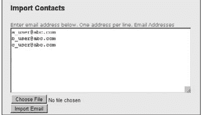

图 9-2

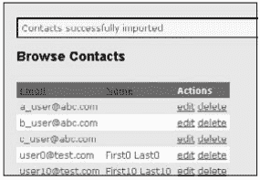

图 9-3

## 小结

在本章中，我们实现了处理联系人管理的关键功能。我们逐个创建联系人；批量导入它们；以及浏览、编辑和删除它们。我们使用 **TDD** 方法实现了每个功能，从测试开始，编写必要的代码来通过测试。我们还创建了视图以确保一切协同工作，并看到了验证的实际运行效果。

本章讨论的概念可以应用于该项目中的其他实体——例如，消息、联系人列表等。并非所有内容都完全相同，但总体概念是相同的，可以针对每个单独实体进行调整。


# 第10章：撰写消息

此应用程序的最终目的是向联系人发送电子邮件。在本章中，我们将开发允许用户创建和编辑消息的功能。

## 问题

我们的用户现在能够添加和编辑他们的通讯录，但目前他们还没有可以使用它的场景。我们需要允许用户向一个或多个联系人发送消息。此过程的第一步是创建新消息。

## 设计

一封电子邮件消息由以下部分组成：

-   名称（Name）—— 消息的名称
-   主题（Subject）—— 电子邮件/消息的主题
-   文本（Text）—— 电子邮件/消息的纯文本正文
-   HTML（HTML）—— 电子邮件/消息的 HTML 正文

名称字段用于内部标识您的消息，例如："第4期订阅者通讯"、"第4期非订阅者通讯"等。名称、主题和文本是必填字段。

在本章中，我们只讨论纯文本消息的编辑和创建；HTML 编辑将在第11章讨论。

## 解决方案

我们首先创建一个消息控制器和一个测试类。消息控制器目前是空的，在测试类中，我们将创建第一个测试：

```csharp
[TestFixture]
public class MessageControllerTests
{
    private MessageController controller;
    private Message model;

    [SetUp]
    public void SetUp()
    {
        controller = new MessageController();
    }

    [Test]
    public void create_should_return_view()
    {
        var result = controller.Create();
        result.AssertViewResult(controller, "Create New Message");
    }
}
```

除非我们在控制器中创建 `Create` 操作方法，否则前面的代码将无法编译：

```csharp
[AcceptVerbs(HttpVerbs.Get)]
[Authorize]
public ActionResult Create()
{
    return View(new Message());
}
```

请注意 `Authorize` 属性的使用；这可以防止未授权访问 `Create` 操作，因为我们只希望登录（已授权）的用户创建消息。现在代码可以编译了，但测试失败了。我们做一个小改动：

```csharp
[AcceptVerbs(HttpVerbs.Get)]
[Authorize]
public ActionResult Create()
{
    ViewData["Title"] = "Create New Message";
    return View(new Message());
}
```

现在测试通过了。接下来，我们想确保如果缺少消息的名称，会返回错误。首先，我们将修改 `SetUp` 方法，使用有效值实例化模型：

```csharp
[SetUp]
public void SetUp()
{
    controller = new MessageController();
    model = new Message()
    {
        Subject = "My newsletter subject",
        Name = "October newsletter",
        Text = "Hello subscriber",
        Html = "Hello <b>subscriber</b>"
    };
}
```

然后我们编写一个测试来验证如果缺少名称是否返回错误：

```csharp
[Test]
public void create_should_return_error_if_name_is_missing()
{
    model.Name = string.Empty;
    var result = controller.Create(model);
    var errorKey = "Name";
    var errorMessage = "Name is required";
    AssertCreateValidationError(result, errorKey, errorMessage);
}
```

`AssertCreateValidationError` 是一个辅助函数，我们将用于断言验证错误、返回的结果和页面标题。

```csharp
private void AssertCreateValidationError(ActionResult result,
                                       string errorKey,
                                       string errorMessage)
{
    //assert results
    Assert.IsNotNull(result);
    Assert.IsInstanceOfType(typeof(ViewResult), result);
    controller.ViewData.ModelState.AssertErrorMessage(errorKey, errorMessage);
    Assert.IsInstanceOfType(typeof(Message),
                            ((ViewResult)result).ViewData.Model);
    //assert that the ViewData.Model
    var outModel = (((ViewResult)result).ViewData.Model as Message);
    Assert.AreEqual(model.Subject, outModel.Subject);
    Assert.AreEqual(model.Name, outModel.Name);
    Assert.AreEqual(model.Text, outModel.Text);
    Assert.AreEqual("Create New Message", controller.ViewData["Title"],
                     "Page title is wrong");
}
```

同样，在我们编写 `Create` 操作方法之前，代码将无法编译。

```csharp
[AcceptVerbs(HttpVerbs.Post)]
public ActionResult Create(Message model)
{
    return View(model);
}
```

确保测试失败，然后进行以下更改直到通过。首先，我们需要 `IMessageService` 接口的一个实例，因此我们在 `MessageController` 类中添加以下构造函数和属性：

```csharp
public MessageController()
    : this(null)
{
}

[Inject]
public MessageController(IMessageService service)
{
    Service = service ?? new InMemoryMessageService();
}

public IMessageService Service { get; set; }
```

然后我们在服务类中实现 `Add` 方法：

```csharp
public int Add(Message message)
{
    var errors = ValidationRunner.Run(message);
    if (errors != null && errors.Count > 0)
    {
        throw new ValidationException(errors);
    }
    return 0;
}
```

前面的代码应该会抛出一个验证异常，因为缺少名称。这是因为我们的 `Message` 类定义如下：

```csharp
public class Message
{
    [Required(ErrorMessage = "Name is required")]
    public string Name { get; set; }
    [Required(ErrorMessage = "Subject is required")]
    public string Subject { get; set; }
    public string Html { get; set; }
    [Required(ErrorMessage = "A plain text body is required")]
    public string Text { get; set; }
    public int Id { get; set; }
}
```

测试现在应该通过了。我们将重复相同的步骤来测试 `Subject` 属性：

```csharp
[Test]
public void create_should_return_error_if_subject_is_missing()
{
    model.Subject = string.Empty;
    var result = controller.Create(model);
    var errorKey = "Subject";
    var errorMessage = "Subject is required";
    AssertCreateValidationError(result, errorKey, errorMessage);
}
```

以下是针对 Text 属性的另一个测试：

```csharp
[Test]
public void create_should_return_error_if_text_is_missing()
{
    model.Text = string.Empty;
    var result = controller.Create(model);
    var errorKey = "Text";
    var errorMessage = "A plain text body is required";
    AssertCreateValidationError(result, errorKey, errorMessage);
}
```

接下来，我们想确保消息已添加到仓库：

```csharp
[Test]
public void create_should_add_message_to_repository()
{
    //mock the repo
    var mockRepo = new Mock<IMessageRepository>();
    //set expectations
    mockRepo.Expect(r => r.Add(model)).Returns(1);
    var mockValidationRunner = new Mock<IValidationRunner>();
    var service = new InMemoryMessageService(mockRepo.Object,
                                            mockValidationRunner.Object);
    controller = new MessageController(service);
    var result = controller.Create(model);
    mockRepo.VerifyAll();
}
```

这会失败，因为我们没有调用仓库的 Add 方法。这很容易修复，只需对服务类中的 Add 方法进行以下更改：

```csharp
public int Add(Message message)
{
    var errors = ValidationRunner.Run(message);
    if (errors != null && errors.Count > 0)
    {
        throw new ValidationException(errors);
    }
    return Repository.Add(message);
}
```

现在完整的服务类如下所示：

```csharp
public class MessageService : IMessageService
{
    private IValidationRunner ValidationRunner { get; set; }
    private IMessageRepository Repository { get; set; }

    public MessageService()
    : this(null, null)
    {
    }

    [Inject]
    public MessageService(IMessageRepository repository,
        IValidationRunner validationRunner)
    {
        ValidationRunner = validationRunner ?? new ValidationRunner();
        Repository = repository ?? new InMemoryMessageRepository();
    }

    public int Add(Message message)
    {
        var errors = ValidationRunner.Run(message);
        if (errors != null && errors.Count > 0)
        {
            throw new ValidationException(errors);
        }
        return Repository.Add(message);
    }
}
```

Repository 类在第6章中创建。

现在我们已经设置了大部分 Create 功能，我们应该创建一个视图来确保一切按预期工作。这与我们之前为联系人和联系人列表所做的其他视图没有太大不同。视图如下：

```html
<h2>
    Create New Message</h2>
<%= Html.ValidationSummary() %>
<%= Html.JQueryGenerator("createmessage", ViewData.Model) %>
<form id="createmessage" action="/message/create" method="post">
<div>
    <label for="name">
        Name</label>
    <br />
    <%=Html.TextBox("name") %>
    <br />
    <label for="subject">
        Subject</label>
    <br />
    <%=Html.TextBox("subject") %>
    <br />
    <label for="html">
        Html Body (optional)</label>
    <br />
    <%=Html.TextArea("html") %>
    <br />
    <label for="text">
        Text Body</label>
    <br />
```


 ## 第10章：撰写消息

```
<%=Html.TextArea("text") %>
<br />
<input type="submit" value="Create Message" />
</div>
</form>
```

如果你尝试提交该表单，它将如图 10-1 所示。

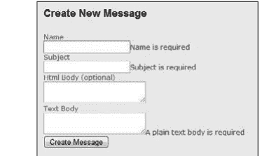

在测试了前面的视图后，你会发现我们没有添加任何通知来表明保存成功。那么让我们从军做起，先编写以下测试：

```
[Test]
public void create_should_add_flash_message_if_save_is_successful()
{
    var mockService = new Mock<IMessageService>();
    mockService.Expect(s => s.Add(model)).Returns(1);
    Monument controller = new MessageController(mockService.Object);
    var result = controller.Create(model);
    Assert.IsTrue(controller.ModelState.IsValid, "model state is invalid");
    Assert.Contains(controller.TempData,
                    new KeyValuePair<string, object>
                        ("flash",
                         "Message successfully created"),
                    "Flash message is missing");
    mockService.VerifyAll();
}
```

需要对 `Action` 方法进行以下修改，以通过上述测试：

```
[AcceptVerbs(HttpVerbs.Post)]
public ActionResult Create([Bind(Prefix = "", Exclude = "Id")]  Message model)
{
    ViewData["Title"] = "Create New Message";
    ViewData.Model = model;
    try
    {
        var id = Service.Add(model);
    }
    catch (ValidationException ex)
    {
        foreach (var error in ex.ValidationErrors)
        {
            ViewData.ModelState.AddModelError(
                error.PropertyName,
                error.ErrorMessage);
        }
    }

    if (!ViewData.ModelState.IsValid)
    {
        return View(model);
    }

    TempData["flash"] = "Message successfully created";
    return View(new Message());
}
```

现在，当保存成功时，我们会看到如图 10-2 所示的屏幕。

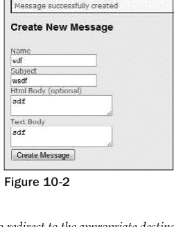

最终，我们会修改代码，使其重定向到合适的目标页面，例如发送页面或包含消息列表的页面，或者任何需要的页面。我们只需编写适当的测试即可。

下一步是编辑现有消息，但在那之前，我们先添加一个页面来列出所有现有消息。这样，我们就可以点击某条消息的编辑链接，进入编辑屏幕。首先，我们要确保创建屏幕重定向到浏览/列表视图。这可以通过一个简单的测试来实现：

```
[Test]
public void create_should_redirect_to_list_view_after_successful_save()
{
    var mockService = new Mock<IMessageService>();
    mockService.Expect(s => s.Add(model)).Returns(1);
    controller = new MessageController(mockService.Object);
    var result = controller.Create(model);
    result.AssertRedirectToRouteResult("browse");
    mockService.VerifyAll();
}
```

更新 SetUp 方法，以初始化控制器并模拟适当的对象：

```
[SetUp]
public void SetUp()
{
    MockMembership = new Mock<MembershipProvider>();
    MockMembershipUser = new Mock<MembershipUser>();
    user = new Mock<IPrincipal>();
    identity = new Mock<IIdentity>();
    httpContext = new Mock<HttpContextBase>();
    request = new Mock<HttpRequestBase>();
    controllerBase = new Mock<ControllerBase>();

    SetupMocks(Username, UserId);

    controller = GetController();

    model = new Message()
               {
                   Subject = "My newsletter subject",
                   Name = "October newsletter",
                   Text = "Hello subscriber",
                   Html = "Hello <b>subscriber</b>"
               };
}
```

添加一个辅助方法来填充测试仓库：

```
private void PopulateRepository()
{
    var anotherUsername = Username + 2;
    var anotherUserId = Guid.NewGuid();
    var repo = (IMessageRepository)kernel.Get(typeof(IMessageRepository));
    for (var i = 0; i < 50; i++)
    {
        repo.Add(
            new Message
                    {
                        Html = "random <b>html</b> " + i,
                        Id = i,
                        Name = "Message " + i,
                        Subject = "Subject " + i,
                        Text = "random text " + i,
                        User = i % 2 == 0
                                   ? new User
                                         {
                                             UserId = UserId,
                                             Username = Username
                                         }
                                   : new User
                                         {
                                             UserId = anotherUserId,
                                             Username = anotherUsername
                                         }
                    });
    }
}
```

> 你可能需要向 Message 类添加一个 User 属性。该属性指示消息的所有者，并建立两个模型之间的关系。

添加辅助方法来实例化控制器：

```
private MessageController GetController()
{
    kernel = GetIoKernel();
    var messageController = (MessageController)kernel
        .Get(typeof(MessageController));
    messageController.ControllerContext = new ControllerContext(
        httpContext.Object,
        new RouteData(),
        controllerBase.Object);
    return messageController;
}

private StandardKernel GetIoKernel()
{
    var modules = new IModule[]
    {
        new InlineModule(
            new Action<InlineModule>[]
            {
                m => m.Bind<IMessageService>()
                    .To<InMemoryMessageService>(),
                m => m.Bind<IMessageRepository>()
                    .To<InMemoryMessageRepository>()
                    .Using<SingletonBehavior>(),
                m => m.Bind<IValidationRunner>()
                    .To<ValidationRunner>()
            })
    };
    return new StandardKernel(modules);
}
```

设置模拟对象及其预期：

```
private void SetupMocks(string username, Guid userid)
{
    identity.Expect(i => i.Name).Returns(username);
    user.Expect(u => u.Identity).Returns(identity.Object);
    httpContext.Expect(h => h.User).Returns(user.Object);
    httpContext.Expect(h => h.Request).Returns(request.Object);
    MockMembership.Expect(m => m.GetUser(username, false))
        .Returns(MockMembershipUser.Object);
    MockMembershipUser.Expect(u => u.ProviderUserKey)
        .Returns(userid);
}
```

Browse 操作本身非常简单，如下所示：

```
[AcceptVerbs(HttpVerbs.Get), Authorize]
public ActionResult Browse(int? page)
{
    ViewData["Title"] = "Browse Messages";

    page = page ?? 1;
    ViewData.Model = Service.GetPage(User.Identity.Name, page);
    return View("browse");
}
```

为了使其能够编译，我们对服务接口和类进行了一些更改，添加了 `GetPage` 方法：

```
public PagedList<Message> GetPage(string username, int? page)
{
    page = page ?? 1;
    page = page < 1 ? 1 : page;
    return Repository.Get()
        .Where(c => c.User.Username.ToLower() == username.ToLower())
        .ToPagedList((int)(page - 1), 20);
}
```

> 为了清晰和简洁起见，我在这里省略了排序代码。

最后，让我们组装一个 `View`，看看这是否按预期工作：

```
<h2>
    Browse Messages</h2>
<table class="grid">
    <thead>
        <tr>
            <th>
                Name
            </th>
            <th>
                Actions
            </th>
        </tr>
    </thead>
    <tbody>
        <%
            foreach (var message in ViewData.Model)
            {%>
        <tr>
            <td>
                <%=message.Name%>
            </td>
            <td>
                <a href='/message/edit/<%=message.Id %>'>编辑</a>
            </td>
        </tr>
        <%}
        %></tbody>
</table>
<%

Html.RenderPartial("pagination", new PaginationViewData
{
    PageActionLink = "/message/browse/{page}",
    PageNumber = ViewData.Model.PageNumber,
    PageSize = ViewData.Model.PageSize,
    TotalItemCount = ViewData.Model.TotalItemCount,
    PageCount = ViewData.Model.PageCount
}); %>
```

如果我们导航到 /message/browse URL，我们将看到一个空白页面，因为仓库是空的。所以，就像我们对联系人列表所做的那样，我们将用 50 条消息填充内存仓库，其中 25 条属于已登录用户。我们在填充仓库的循环中添加以下代码：

```
messagerepo.Add(new Message
{
    Html = "random <b>html</b> " + i,
    Name = "Message " + i,
    Subject = "Subject " + i,
    Text = "random text " + i,
    User = i % 2 == 0 ? new User
        {
            UserId = (Guid)provider
                .GetUser("test", false)
                .ProviderUserKey,
            Username = provider
                .GetUser("test", false)
                .UserName
        }
        :
        new User
        {
            UserId = (Guid)provider
                .GetUser("test2", false)
                .ProviderUserKey,
            Username = provider
                .GetUser("test2", false)
                .UserName
        }
});
```

现在，当我们访问浏览视图时，应该会看到两页消息，第一页包含 20 条消息（图 10-3），第二页包含剩余的 5 条（图 10-4）。


## 第10章：编写消息

下一步是编写编辑功能。这与我们之前处理联系人列表非常相似。测试代码如下：

```
[Test]
public void edit_message_should_return_view()
{
    PopulateRepository();
    var result = controller.Edit(1);
    result.AssertViewResult(controller, "Edit Message", "edit");
}
```

Action 方法如下：

```
[AcceptVerbs(HttpVerbs.Get), Authorize]
[HandleError]
public ActionResult Edit(int id)
{
    ViewData["Title"] = "Edit Message";
    return View("edit");
}
```

接下来，我们测试是否返回了请求的消息：

```
[Test]
public void edit_message_should_get_requested_message()
{
    PopulateRepository();
    var result = controller.Edit(1);
    Assert.IsInstanceOfType(typeof(Message), controller.ViewData.Model);
    Assert.AreEqual(1, ((Message)controller.ViewData.Model).Id);
    result.AssertViewResult(controller, "Edit Message", "edit");
}
```

然后我们只需修改 `Action` 方法以检索请求的消息：

```
[AcceptVerbs(HttpVerbs.Get), Authorize]
[HandleError]
public ActionResult Edit(int id)
{
    ViewData["Title"] = "Edit Message";
    ViewData.Model = Service.Get(User.Identity.Name, id);
    return View("edit");
}
```

为了使代码能够编译，我们必须在服务接口上实现 `Get` 方法，如下所示：

```
public Message Get(string username, int id)
{
    return Repository.Get().Where(c =>
                                    c.Id == id &&
                                    c.User.Username.ToLower() == username.ToLower())
                            .SingleOrDefault();
}
```

我们还要确保在请求的消息不存在时返回适当的错误消息：

```
[Test]
public void edit_message_should_return_error_page_if_requested_message_not_found()
{
    try
    {
        PopulateRepository();
        var result = controller.Edit(45789); //不存在的消息
        Assert.Fail("Failed to throw exception");
    }
    catch (ArgumentException)
    {
        controller.TempData.AssertItem("error",
                        "The message you requested could not be found");
    }
}
```

为了让测试通过，我们将 Edit action 方法更改为：

```
[AcceptVerbs(HttpVerbs.Get), Authorize]
[HandleError]
public ActionResult Edit(int id)
{
    ViewData["Title"] = "Edit Message";
    ViewData.Model = Service.Get(User.Identity.Name, id);
    if (ViewData.Model == null)
    {
        TempData["error"] = "The message you requested could not be found";
        throw new ArgumentException();
    }
    return View("edit");
}
```

另一个我们需要测试的条件是用户只能查看自己的消息；因此，如果请求的消息属于其他用户，我们应该收到错误消息。

```
[Test]
public void edit_message_should_return_error_page_if_user_is_not_owner()
{
    var id = 2;
    try
    {
        PopulateRepository();
        var result = controller.Edit(id); //属于另一个用户
        Assert.Fail("Failed to throw exception");
    }
    catch (ArgumentException)
    {
        var repo = (IMessageRepository)kernel.Get(typeof(IMessageRepository));
        Assert.AreEqual(1, repo.Get().Count(c => c.Id == id));
        controller.TempData.AssertItem嘴上不"error",
                                       "The message you requested could not be found");
    }
}
```

这个测试会通过，因为我们的 Get 方法已经按用户名过滤了消息。虽然测试通过了，我们应该确保它确实有效；我们可以简单地修改 Get 方法如下，并确保测试失败：

```
public Message Get(string username, int id)
{
    return Repository.Get().Where(c =>
                               c.Id == id)
                        .SingleOrDefault();
}
```

最后，我们要确保能够将更改保存到存储库。为了简洁起见，我不会写全所有的测试用例，只写足够让视图工作的部分。

```
[Test]
public void edit_message_should_save_changes_to_repository()
{
    PopulateRepository();
    var repo = (IMessageRepository)kernel.Get(typeof(IMessageRepository));
    var oldMessage = repo.Get().SingleOrDefault(m => m.Id == 1);
    var oldName = oldMessage.Name;
    var newName = "New name";
    var newMessage = new Message
    {
        Name = newName,
        Html = oldMessage.Html,
        Id = oldMessage.Id,
        Subject = oldMessage.Subject,
        Text = oldMessage.Text,
        User = oldMessage.User
    };
    Assert.AreEqual(oldName, repo.Get().SingleOrDefault(m => m.Id == 1).Name);

    var result = controller.Edit(newMessage);

    Assert.AreEqual(newName, repo.Get().SingleOrDefault(m => m.Id == 1).Name);
}
```

post 的 `Edit` action 如下：

```
[AcceptVerbs(HttpVerbs.Post), Authorize, HandleError]
public ActionResult Edit(Message message)
{
    ViewData["Title"] = "Edit Message";
    ViewData.Model = Service.Save(User.Identity.Name, message);
    TempData["flash"] = "Message successfully saved";
    return View("browse");
}
```

我跳过了几个测试用例，因为它们与我们之前做的类似，没有必要重复。但是，你仍然需要编写这些测试；例如，你需要测试 `Save` 是否验证输入，只有消息的所有者才能保存更改，所有字段是否正确保存等等。

我们现在可以创建一个 `View` 并查看一切是否按预期工作：

```
<h2>Edit Message</h2>
<%= Html.ValidationSummary() %>
<%= Html.JQueryGenerator("editmessage", ViewData.Model) %>
<form id="editmessage" action="/message/edit" method="post">
    <div>
        <label for="name">Name</label>
        <br />
        <%=Html.TextBox("name") %>
        <br />
        <label for="subject">Subject</label>
        <br />
        <%=Html.TextBox("subject") %>
        <br />
        <label for="html">Html Body (optional)</label>
        <br />
        <%=Html.TextArea("html") %>
        <br />
        <label for="text">Text Body</label>
        <br />
        <%=Html.TextArea("text") %>
        <br />
        <%=Html.Hidden("id", ViewData.Model.Id) %>
        <input type="submit" value="Save Message" />
    </div>
</form>
```

如果我们转到浏览页面并点击任何消息旁边的编辑链接，应该会看到图 10-5。

到目前为止，一切顺利。点击"Save Message"按钮，你会看到图 10-6 所示的错误消息。

从图 10-6 的错误消息中可以看出，这个错误是因为我们试图提交 HTML 代码。这被称为请求验证（Request Validation），它是一个安全功能，旨在保护你的应用程序免受跨站脚本攻击。

## 脚本攻击

根据 www.asp.net/learn/whitepapers/request-validation 上关于 ASP.NET 的白皮书所述：

> 许多网站没有意识到它们容易受到简单的脚本注入攻击。无论这些攻击的目的是通过显示 HTML 来篡改网站，还是可能执行客户端脚本将用户重定向到黑客的网站，脚本注入攻击都是 Web 开发人员必须应对的问题。

> 脚本注入攻击是所有 Web 开发人员关注的问题，无论他们使用的是 ASP.NET、ASP 还是其他 Web 开发技术。

> ASP.NET 请求验证功能通过不允许未编码的 HTML 内容被服务器处理来主动防止这些攻击，除非开发人员决定允许该内容。

尽管错误消息如此说明，但解决此问题的方法不同，可以通过简单地用属性 [ValidateInput(false)] 装饰你的 post action 来完成。一旦我们做出该更改并尝试更改消息名称并保存，我们应该会被重定向到浏览视图，显示图 10-7 所示的更改。

## 总结

在本节中，我们编写了允许我们创建和修改消息的代码。与本书其余部分一样，我们先编写测试，然后只编写使测试通过所需的代码。这并不意味着我们的测试套件是完整的——还存在几个应该编写测试的边界情况。


## 第10章：消息组合

然后对代码进行必要的修改。一个例子是：如果用户使用数据库中不存在的ID执行HTTP POST请求到Edit操作会发生什么？目前该操作会失败。发现并处理此类边缘案例可能非常耗时，但从长远来看，它能显著提高应用程序的质量。

在接下来的章节中，我们将通过支持HTML和WYSIWYG（所见即所得）编辑器来增强我们已创建的编辑器屏幕的实用性。

## HTML WYSIWYG编辑

在第10章中，我们开发了基本的消息创建和编辑功能。我们将扩展目前的工作，以允许用户友好的HTML编辑器。

## 问题

尽管我们的应用程序目前允许添加和编辑消息的HTML正文，但它并不十分友好。它假设用户了解HTML，并且能够简单地使用标记语言设计HTML消息。这不仅对用户不友好，而且繁琐且容易出错。几乎所有用户都希望：

- 使用粗体、斜体等格式化文本。
- 轻松添加超链接。
- 嵌入内联图片。

我们不能期望他们使用标记语言完成所有这些操作，必须提供一种更好的方式。不幸的是，没有标准的HTML元素可以直接添加到网页中来启用HTML编辑。如果能够简单地添加一个`<html>edit</html>`标签，并在网页中嵌入一个功能齐全的编辑器，那就太好了。

## 设计

虽然我们无法向网页添加HTML元素来启用富文本编辑，但有一个简单的解决方案。幸运的是，有几个HTML编辑器可以供我们免费使用。其中一些编辑器就像在你的网页中添加一个简单的标签或一行标记一样简单。这些编辑器中的一些使用JavaScript、Flash、Java、ActiveX等技术。由于我们始终希望避免假设用户安装了某个特定插件，因此我们将只研究基于JavaScript的编辑器。

# 第11章：HTML WYSIWYG编辑

## 解决方案

网上有几种可用的编辑器，但我们将只研究其中的几种。我想客观地评估这些选择，因此，在决定时我将考虑以下因素：

- 功能/特性
- 易用性/易于实现
- 社区支持
- 文档

## TinyMCE

http://tinymce.moxiecode.com/

##### 描述

来自网站：

> TinyMCE是一个基于网络的、平台独立的Javascript HTML WYSIWYG编辑器控件，由Moxiecode Systems AB以LGPL协议作为开源软件发布。它能够将HTML TEXTAREA字段或其他HTML元素转换为编辑器实例。TinyMCE非常容易集成到其他内容管理系统中。

图11-1是TinyMCE编辑器的一个示例，其中启用了一些基本的编辑功能。

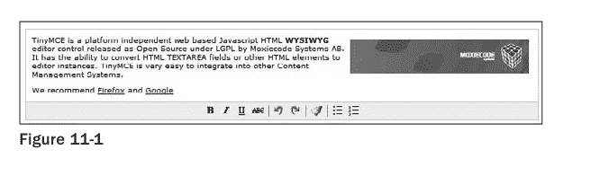

##### 使用

```
<script type="text/javascript" src="/scripts/tiny_mce/tiny_mce.js"></script>
<script type="text/javascript">
tinyMCE.init({
    mode : "exact",
    elements: "html",
    theme : "simple"
});
</script>
```

##### 评论

这是一个功能非常强大的编辑器，并且有一个简单模式。我不太喜欢它的HTML编辑器和图片库，因为它们会弹出一个浏览器窗口，而不是AJAX对话框。

#### WYMeditor

www.wymeditor.org/

##### 描述

来自网站：

WYMeditor是一个基于网络的WYSIWYM（所见即所思）XHTML编辑器。

WYMeditor的主要概念是忽略文档视觉布局的细节，专注于其结构和含义，同时尽可能给用户提供舒适性（至少与WYSIWYG编辑器一样）。

创建WYMeditor是为了生成结构完美的XHTML严格代码，符合W3C XHTML规范，并便于现代应用程序进行进一步处理。

使用WYMeditor，代码不会受到字体样式和粗细、边框、颜色等视觉信息的污染...最终用户定义内容的含义，这将通过使用样式表来决定其外观。结果是信息的维护变得简单快捷。

由于代码符合W3C XHTML规范，例如，你可以使用XSLT（在客户端或服务器端）处理它，为你提供广泛的应用程序范围。

图11-2展示了WYMeditor的一个示例，显示了编辑器如何将内容包裹在可视容器中，并在左上角显示HTML标签。有些人可能会认为这不是真正的WYSIWYG。

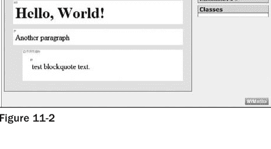

图11-2

##### 使用

```
<script type="text/javascript"
src="/scripts/wymeditor/jquery.wymeditor.pack.js"></script>
<script type="text/javascript">
$(function() {
    $('#html').wymeditor();
});
</script>
```

##### 评论

WYMeditor使用jQuery，这是一个优点，因为我们将不必依赖另一个JavaScript库。我喜欢它的可视化编辑器以及它如何显示容器类型（图11-2）。HTML源代码可以在没有弹出窗口的情况下进行编辑（图11-3），但添加图片或表格会弹出一个浏览器窗口。

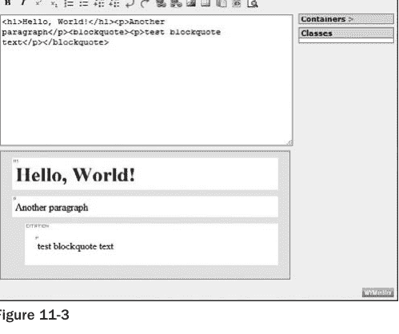

## NicEdit

www.nicedit.com/

##### 描述

来自网站：

> NicEdit是一个轻量级、跨平台的内联内容编辑器，允许在浏览器中即时轻松编辑网站内容。
NicEdit Javascript可以在几秒钟内集成到任何网站中，使任何元素/div可编辑，或将标准textarea转换为富文本编辑。

图11-4显示了NicEdit的一个示例。到现在，你可能已经注意到几乎所有这些编辑器看起来都非常相似。


##### 使用

```
<script type="text/javascript" src="http://js.nicedit.com/nicEdit-latest.js"></script>
<script type="text/javascript">
//<![CDATA[
bkLib.onDomLoaded(function() { new nicEditor().panelInstance('html');});
//]]>
</script>
```

##### 评论

NicEdit不使用任何弹出窗口，并且图片上传器功能非常完善，甚至不会引起页面回发（图11-5）。


图11-5

HTML编辑器也是内置的，不会弹出任何窗口（图11-6）。


图11-6

#### jWYSIWYG

http://projects.bundleweb.com.ar/jWYSIWYG/

##### 描述

来自网站：

> 此插件是一个内联内容编辑器，允许即时编辑富HTML内容。它是WYMeditor的一个简化版本，功能少得多。总文件大小不到26Kb，只有18Kb代码和7Kb压缩，其主要概念是保持简单，不是所有用户都需要字体着色或创建表格，只要基本功能即可。

正如你在图11-7中看到的，此编辑器可以配置得非常简单。它具有极简的外观和感觉，但满足富文本编辑器的所有要求。


图11-7

##### 使用

```
<script type="text/javascript" src="/scripts/jquery.wysiwyg.js"></script>
<script type="text/javascript">
$(function()
{
    $('#html').wysiwyg();
});
</script>
```

##### 评论

jWYSIWYG使用jQuery，所以我们将不必引入另一个JavaScript库。它非常简单且功能齐全，不会为源代码编辑弹出窗口（图11-8）。


图11-8

192

#### 其他

如前所述，WYSIWYG编辑器有多种选择，我们只研究了其中几种。一个值得注意的选择是雅虎的富文本编辑器（`http://developer.yahoo.com/yui/editor/`）。它是一个很好的文本编辑器，但依赖于雅虎的JavaScript库，也称为YUI（Yahoo! UI Library）。

#### 获胜者

实际上并没有所谓的获胜者，因为它们都非常具有可比性。话虽如此，为了本应用程序，我们将选择简单性并采用jWYSIWYG。我们已经在页面中使用了jQuery，所以我们要做的就是添加对样式表和JavaScript文件本身的引用。

```
<link href="/Scripts/jquery-wysiwyg/jquery.wysiwyg.css" rel="stylesheet"
type="text/css" />
<script src="/Scripts/jquery-wysiwyg/jquery.wysiwyg.js"
type="text/javascript"></script>
```

然后，我们只需在创建和编辑页面的底部添加以下脚本：

```
<script type="text/javascript">
    $(document).ready(function() {
        $("#html").wysiwyg();
    });
</script>
```

这就是我们添加富文本功能所需做的全部工作。需要记住的一件事是，编辑器的默认设置不包括HTML源代码编辑，但这很容易启用，可以按照以下方式进行：

```
<script type="text/javascript">
    $(document).ready(function() {
        $("#html").wysiwyg({
            controls: {
                html: { visible: true }
            }
        });
    });
</script>
```

我们实际上没有对代码进行任何更改，也没有需要添加或运行的测试。我们只需通过编辑现有消息、修改HTML正文、保存它，然后重新加载以确保一切按预期工作，就可以简单地验证我们的代码。

## 总结

在本章中，我们回顾并选择了一个HTML WYSIWYG编辑器，并使用该编辑器增强了新的文本字段。添加新的编辑器功能非常简单，不涉及任何后端代码更改。HTML编辑器为我们的用户提供了一个良好的功能基线。对于你自己的项目，尝试评估各种HTML编辑器的功能，看看哪个最适合你的需求。


##### 图片托管

在过去的几章中，我们讨论了创建和编辑消息，以及使用富文本（WYSIWYG）编辑器来编辑电子邮件内容。该编辑器的一个功能是能够将图像上传并插入到消息正文中。在本章中，我们将讨论实现此功能的细节，以便我们能够上传和存储图像，并将其提供给最终用户（消息接收者）。

## 问题

除了格式化之外，用户想要使用 HTML 消息的主要原因是为了包含图像。图像不一定是某种东西的图片（汽车、计算机或其他东西）；它可能是一个横幅、一个标志、一个促销徽章，甚至是一个“立即注册”按钮。我们需要赋予用户上传图像并在其电子邮件中使用它的能力。这涉及几个问题/步骤。首先，我们需要为用户提供一种上传图像的方法。其次，我们需要给他们一种浏览其“图片库”并选择要插入到消息中的图像的方法。第三，我们需要托管和提供这些图像，以便当最终用户阅读消息时，他们能够看到图像。

## 设计

我们需要系统地解决这些问题。我们需要做的第一件事是思考这个过程。用户将点击富文本编辑器上的一个按钮来插入图像。这将显示一个用户界面（UI），用户可以在其中上传图片、使用 URL 插入图片，或者从他们自己的图片库中选择以前上传的图片。一旦选择了图片，我们需要将该图片添加到消息编辑器中。

编辑器自带的“插入图像”按钮仅允许插入图像的 URL，如图 12-1 所示。这没有解决我们的问题。我们将不得不实现我们自己的自定义解决方案。


**图 12-1**

为了简单起见，并且因为还有其他解决方案可以使用，我将跳过一些功能齐全的图片库的功能。快速搜索“jQuery 图片库”会出现几个开源和免费的替代方案。让我们把它做简单点。

## 解决方案

如果你使用开箱即用的“插入图像”按钮，你会看到图 12-1 中所示的对话框。如果我们插入一个图片的 URL，我们会看到类似图 12-2 的内容。


**图 12-2**

我们可以使用以下代码覆盖默认按钮行为以执行自定义 JavaScript：

```
$("#html").wysiwyg({
    controls: {
        html: { visible: true },
        insertImage: {
            visible: true,
            exec: function() { alert("insert image button clicked"); }
        }
    }
});
```

这只是告诉编辑器使“插入图像”按钮可见，并让它执行我们的自定义代码。如果我们点击该按钮，我们会看到图 12-3 中所示的警告框。

现在我们有了一个进入自定义代码的入口点。我们不显示警告框，而是将显示一个模态 JavaScript 对话框。我们将使用 jQuery UI 库。


图 12-3

| **jQuery UI 库** |
| --- |
| jQuery UI 是一个建立在 jQuery JavaScript 库之上的小部件和交互库，可用于构建高度交互的 Web 应用程序。该库的一个组件是 Dialog 控件，允许我们创建基于 JavaScript 的模态对话框。 |
| 该库位于 http://jqueryui.com，并提供一个配置工具，可自定义您的下载内容，仅包含您需要的组件，并附带多个预构建的主题。 |

下载自定义的 jQuery UI 库并将其添加到我们的项目后，我们将在母版页中添加两个链接。一个链接到样式表，另一个链接到 JavaScript 文件；它们应如下所示：

```
<link href="/Content/css/smoothness/jquery-ui-1.7.1.custom.css" rel="stylesheet"
      type="text/css" />
<script src="/Scripts/ui/jquery-ui-1.7.1.custom.min.js"
        type="text/javascript"></script>
```

我们现在可以添加一个隐藏层（div 元素）以包含对话框的内容，并使用 JavaScript 来显示它。接下来是一个测试对话框 HTML：

```
<div id="dialog" title="Basic modal dialog" style="display: none">
    <p> Adding the modal overlay screen makes the dialog look more prominent
       because it dims out the page content.</p>
</div>
```

显示此对话框的 JavaScript 代码如下：

```
<script type="text/javascript">
    $(document).ready(function() {
        $("#html").wysiwyg({
            controls: {
                html: { visible: true },
                insertImage: {
                    visible: true,
                    exec: function() { showImageDialog(); }
                }
            }
        });
    });
</script>
```

```
function showImageDialog() {
    $("#dialog").dialog({
        modal: true
    });
}
</script>
```

如果我们点击“插入图像”按钮，我们会看到图 12-4 中所示的屏幕。


**图 12-4**

我们现在有了图片库界面的雏形。图片库的功能之一是上传文件。当文件上传时，它会被发送到服务器，并且可以通过 `Request.Files` 集合进行访问。执行一些验证后，我们将文件保存到存储中。

让我们从一个测试开始：

```
[Test]
public void upload_should_save_uploaded_file()
{
    //mock file
    var filename = "fish.jpg";
    var file1 = new Mock<HttpPostedFileBase>();
    file1.Expect(d => d.FileName).Returns(filename);
    var ms = new MemoryStream();
    Resources.Fish.Save(ms, ImageFormat.Jpeg);
    file1.Expect(d => d.InputStream).Returns(ms);
    MyMocks.Request.Expect(r => r.Files.Count).Returns(1);
    MyMocks.Request.Expect(r => r.Files[0]).Returns(file1.Object);

    //mock service
    var mockService = new Mock<IGalleryService>();
    mockService.Expect(s => s.Upload(username, filename, ms)).Returns(0);

    var con = new GalleryController(mockService.Object);
    con.SetFakeControllerContext();

    con.Upload();

    //verify mocks
```

MyMocks.Request.VerifyAll();
file1.VerifyAll();
mockService.VerifyAll();
}

之前的测试中有很多内容，所以让我们来看看它。首先，我们需要模拟一个文件。我将一个名为 *fish.jpg* 的图像文件复制到测试项目 Resources 中。我通过打开项目属性并点击 Resources 选项卡来完成此操作，然后在菜单中点击“添加现有文件”（见图 12-5）。


图 12-5

模拟文件很简单。我们基本上模拟了模拟 `Request` 对象上的 `Files` 集合。我们模拟它返回计数为 1，并模拟集合中的第一项返回文件名和文件流。

接下来，我们模拟调用服务接口 `Upload` 方法（我们还没有创建它）。测试的其余部分与我们在前几章所做类似——设置控制器的假上下文、调用操作并验证结果。

正如预期的那样，项目无法编译。我们首先必须创建我们的 `GalleryController` 类及其 Upload 操作：

```
public class GalleryController : Controller
{
    public IGalleryService Service { get; set; }

    [Inject]
    public GalleryController(IGalleryService service)
    {
        Service = service;
    }

    [AcceptVerbs(HttpVerbs.Post)]
    [Authorize]
    public ActionResult Upload()
    {
        if(Request.Files.Count == 0)
            return null;

        var filename = Request.Files[0].FileName;
        var stream = Request.Files[0].InputStream;
```

Service.Upload(User.Identity.Name, filename, stream);
    return null;
}
}

Upload 操作仅接受 POST（这是文件上传/发布到服务器的方式）。它还要求用户登录，因为我们需要用户名来正确地将上传的图像与用户关联起来。我暂时返回 `null`（足以让代码编译并通过测试）。

最后，我们创建图片库服务接口：

```
public interface IGalleryService
{
    int Upload(string username, string filename, Stream stream);
}
```

我们暂时不关心接口的实现。我们的测试通过了，这意味着文件被正确访问，并且正确的信息（用户名、文件名和文件流）已从服务类传递到 `Upload` 方法。

在我们继续之前，我想确保此代码在网站上运行正常。所以，让我们试一下。但在它工作之前，我们必须先做一些基础工作，从图片库服务接口实现开始。当然，以下代码之前应该有测试，但为了简洁并避免重复，我们将跳过这一点：

```
public class InMemoryGalleryService: IGalleryService
{
    private IGalleryRepository Repository { get; set; }

    public InMemoryGalleryService()
        : this(null)
    {
    }

    [Inject]
    public InMemoryGalleryService(IGalleryRepository repository)
    {
        Repository = repository ?? new InMemoryGalleryRepository();
    }

    public int Upload(string username, string filename, Stream stream)
    {
        return Repository.Upload(username, filename, stream);
    }
}
```

创建并实现 `IGalleryRepository` 接口：

```
public interface IGalleryRepository
{
```


# 第12章：图像托管

```csharp
int Upload(string username, string filename, Stream stream);
}
```

```csharp
public class InMemoryGalleryRepository : IGalleryRepository
{
    private List<GalleryFile> GalleryFiles { get; set; }

    private List<Stream> Files { get; set; }

    public InMemoryGalleryRepository()
    {
        GalleryFiles = new List<GalleryFile>();
        Files = new List<Stream>();
    }

    private int _autoId;
    private int AutoId
    {
        get
        {
            _autoId += 1;
            return _autoId;
        }
    }

    public int Upload(string username, string filename, Stream stream)
    {
        var galleryFile = new GalleryFile
        {
            Id = AutoId,
            Username = username,
            OriginalFilename = filename,
            Filename = Guid.NewGuid().ToString() +
                Path.GetExtension(filename);
        };

        Files.Add(stream);
        GalleryFiles.Add(galleryFile);
        return galleryFile.Id;
    }
}
```

这是一个简单的实现，将文件存储在内存中。真实场景中的实现可以将文件存储到数据库、文件系统或云存储中。

你还记得我们之前创建的那个用于图库界面的模态对话框吗？让我们向该对话框添加一个文件上传功能（图12-6）：

```html
<div id="dialog" title="Image Gallery" style="display: none">
    <form id="frmImageUpload" enctype="multipart/form-data"
        action="/gallery/upload" method='post'>
</div>
```

# 第12章：图像托管

```html
<input type="file" id='imageuploader' name primary Upload" />
    </form>
</div>
```


前面的代码中有几点需要注意。文件上传元素（即，一个 `input` 元素且其类型为 `file`）必须位于一个表单内部，并且该表单必须将 `enctype` 设置为 `multipart/form-data`。同样重要的是要注意，上述代码会提交表单并刷新页面，这不是我们想要的。如果页面刷新，我们将丢失表单数据，并且对话框会消失。我们希望使用 AJAX 来提交表单。幸运的是，使用 jQuery 可以很容易地实现这一点：

```javascript
$(document).ready(function() {
    $("#frmImageUpload").submit(function() {
        var f = $("#frmImageUpload");
        var action = f.attr("action");
        var serializedForm = f.serialize();
        $.post(action,
                serializedForm,
                function(result) {
                    alert(result.message);
                },
                "json");
        return false;
    });
.invalidate但仍然使用iframe插件来上传文件，这是一种使用动态创建的iframe通过提交文件来避免页面刷新的技巧。我们可以使用其中一个插件，或者创建一个简单的iframe上传器。

```html
<div id="dialog" title="Image Gallery" style="display: none">
    <iframe id='frameuploader' src="/gallery/uploader"
            style='width:100%;height:100%;' frameborder="0"></iframe>
</div>
```

Uploader 操作简单地返回一个视图：

```csharp
[AcceptVerbs(HttpVerbs.Get)]
[Authorize]
public ActionResult Uploader()
{
    return View();
}
```

该视图包含上传表单，看起来仍然如图12-6所示：

```html
<form id="frmImageUpload" enctype="multipart/form-data" action="/gallery/upload"
      method='post'>
    <input type="file" id='imageuploader' name='imageuploader' />
    <input type="submit" value="Upload" />
    <%=Html.ValidationMessage("imageuploader") %>
</form>
```

我们还应该编写新的测试来测试我们添加到 Upload 操作中的新功能。我们需要测试当没有选择文件时，是否会添加验证错误：

```csharp
[Test]
public void upload_should_return_error_if_file_is_missing()
{
    //mock file
    var file1 = new Mock<HttpPostedFileBase>();
    MyMocks.Request.Expect(r => r.Files.Count).Returns(0);

    //mock service
```

# 第12章：图像托管

```csharp
var mockService = new Mock<IGalleryService>();

var con = new GalleryController(mockService.Object);
con.SetFakeControllerContext();

var result = con.Upload();

result.AssertViewResult(con, null, "Uploader");
con.ModelState.AssertErrorMessage("imageuploader", "No files to upload");

//verify mocks
MyMocks.Request.VerifyAll();
file1.VerifyAll();
mockService.VerifyAll();
}
```

然后我们修改该操作以通过测试：

```csharp
[AcceptVerbs(HttpVerbs.Post)]
[Authorize]
public ActionResult Upload()
{
    if (Request.Files.Count == 0 || Request.Files[0].ContentLength == 0)
    {
        ModelState.AddModelError("imageuploader", "No files to upload");
        return View("Uploader");
    }

    var filename = Request.Files[0].FileName;
    var stream = Request.Files[0].InputStream;

    return View("Uploader");
}
```

你会注意到这些改动会破坏第一个测试（upload_should_save_uploaded_file）。该测试可以修改如下：

```csharp
[Test]
public void upload_should_save_uploaded_file()
{
    //mock file
    var filename = "fish.jpg";
    var file1 = new Mock<HttpPostedFileBase>();
    file1.Expect(d => d.FileName).Returns(filename);
    file1.Expect(d => d.ContentLength).Returns(1);

    var ms = new MemoryStream();
    Resources.Fish.Save(ms, ImageFormat.Jpeg);
    file1.Expect(d => d.InputStream).Returns(ms);
    MyMocks.Request.Expect(r => r.Files.Count).Returns(1);
    MyMocks.Request.Expect(r => r.Files[0]).Returns(file1.Object);

    //mock service
```


# 第12章：图像托管

```csharp
var mockService = new Mock<IGalleryService>();
mockService.Expect(s => s.Upload(username, filename,
    ms)).Returns(0);

var con = new GalleryController(mockService.Object);
con.SetFakeControllerContext();

var result = con.Upload();

result.AssertViewResult(con, null, "Uploader");

//验证模拟对象
MyMocks.Request.VerifyAll();
file1.VerifyAll();
mockService.VerifyAll();
}
```

现在两个测试都通过了，我们可以运行应用程序，确保文件上传正确，并且在文件不存在时显示验证错误，如图12-8所示。


但我们已经知道文件没有上传成功，所以我们需要测试成功的上传。我们需要在成功上传后显示图像列表。最简单的方法是在iframe刷新后使用AJAX调用来获取图像。我们可以轻松使用jQuery监听iframe的load事件，如下所示：

```csharp
$("#frameuploader").load(function() {
    //检索图像
});
```

在深入JavaScript细节之前，让我们先为检索图像的操作编写一个测试：

```csharp
[Test]
public void getallimages_gets_list_of_uploaded_images()
{
    var mockService = new Mock<IGalleryService>();
    mockService.Expect(s => s.GetAllImages(username))
        .Returns(GetFakeListOfImages());

    var con = new GalleryController(mockService.Object);
    con.SetFakeControllerContext();

    var result = con.GetAllImages();

    Assert.IsInstanceOfType(typeof(JsonResult), result);
    var jsonResult = result as JsonResult;
    Assert.IsInstanceOfType(typeof(IList), jsonResult.Data);
Assert.AreEqual(3, ((IList)jsonResult.Data).Count);
}
```

# 第12章：图像托管

前面的测试主要确保我们返回一个JsonResult，并且它包含一个图像列表。由于这将是一个AJAX调用，我们将使其非常简单，只返回图像ID。操作方法如下：

```csharp
[AcceptVerbs(HttpVerbs.Get)]
[Authorize]
public ActionResult GetAllImages()
{
    var images = Service.GetAllImages(User.Identity.Name);
    return Json((from img in images select new {id = img.Id}).ToList());
}
```

在我们向接口添加所有适当的方法并实现它们之前，项目将无法编译。这与我们一直在做的类似，因此我将不在这里详细介绍。

让我们谈谈更有趣的事情，具体来说，是在iframe加载时检索图像列表并显示图像。我们首先添加一个div元素来容纳图像：

```html
<div id='galleryImages'></div>
```

JavaScript如下：

```javascript
$("#frameuploader").load(function() {
    $.get('/gallery/getallimages',
        null,
        function(data, textStatus) {
            $("#galleryImages").empty();
            $(data).each(function() {
                $("#galleryImages")
                    .append("");
            });
        },
        'json');
});
```

前面的JavaScript在iframe加载时触发，并使用jQuery的get方法调用/gallery/getallimages操作。当请求完成时，会调用回调函数。我们在回调中添加代码来清空包含图像的div，然后遍历返回的数据。如果您回想一下，返回的数据是一个图像ID的JSON数组。然后，我们为数组中的每个项目创建一个图像元素，其图像源指向/gallery/getimage/{id}。生成的HTML将如下所示：

```html
<div id="galleryImages">
    
    
    
</div>
```

# 第12章：图像托管

我们没有获取图像的操作，所以让我们为此编写一个测试。测试应确保返回一个具有正确内容类型的`FileResult`。`FileResult`是一种特殊的`ActionResult`返回类型，可用于将任何文件流式传输回客户端，这非常适合文件下载、动态图像或检索存储在数据库或云中的图像。

```csharp
[Test]
public void getimage_returns_image_as_a_file()
{
    var ms = new MemoryStream();
    Resources.Fish.Save(ms, ImageFormat.Jpeg);
    var bytes = new byte[ms.Length];
    ms.Read(bytes, 0, (int)ms.Length);

    var mockService = new Mock<IGalleryService>();
    mockService.Expect(s => s.GetImageBytes(username,1))
        .Returns(bytes);

    var con = new GalleryController(mockService.Object);
    con.SetFakeControllerContext();

    var result = con.GetImage(1);

    Assert.IsInstanceOfType(typeof(FileResult), result);
    var fileResult = result as FileResult;
    Assert.AreEqual("image/jpeg", fileResult.ContentType);
}
```

`Action`方法如下所示：

```csharp
[AcceptVerbs(HttpVerbs.Get)]
public ActionResult GetImage(int id)
{
    var img = Service.GetImageBytes(User.Identity.Name, id);
    return File(img, "image/jpeg");
}
```

同样，我将不介绍服务和仓储的实现细节，因为它们与我们一直以来所做的非常相似。

我们现在可以测试我们的`View`，上传一些图片，并查看现有图像的列表。您会注意到，在每次上传后，对话框都会检索新列表以包含新图像。您可以在图12-9中看到一个示例。


图12-9

# 第12章：图像托管

需要注意的是，这不是一个可投入生产的完整实现，许多细节已被省略。在现实生活中，您将希望检索缩略图而不是完整图像。您还希望对图像列表进行分页。我希望专注于主要部分，而不让您被所有复杂的细节分散注意力。希望这能让您对下一步该做什么有足够的了解。

我们几乎有了一个可用的图像画廊。下一步是选择一张图像并将其插入到我们的消息正文中。这可以通过一些JavaScript实现。我们需要做两件事：处理图像的点击事件，并将图像插入到所见即所得编辑器中。我们将重写iframe加载事件处理程序，如下所示：

```javascript
$("#frameuploader").load(function() {
    $.get('/gallery/getallimages',
        null,
        function(data, textStatus) {
            $("#galleryImages").empty();
            $(data).each(function() {
                var imgid = this.id;
                var img = $("");
                img.click(function() {
                    $("#html").wysiwyg("insertImage",
                        "http://localhost:4452/gallery/getimage/" + imgid);
                    $myDialog.dialog("close");
                });
                $("#galleryImages")
                    .append(img);
            });
        },
        'json');
});
```

这里的主要区别在于，我们将图像创建为jQuery对象，然后将其点击事件绑定到将图像插入编辑器并关闭对话框。最终我们应该得到如图12-10所示的屏幕。

> 您不应该在JavaScript中硬编码基础URL。相反，您应该从Request.Url属性动态生成它。


图12-10

# 第12章：图像托管

## 总结

在本章中，我们亲手实践了一些很酷的jQuery。我们能够快速实现一个所见即所得编辑器，并使用AJAX文件上传对其进行自定义以实现图像插入。我们还能够使用AJAX动态生成内容和加载文件，而无需刷新浏览器。至此，您应该能够体会到jQuery的强大，更重要的是其简单性。

我们还使用了MVC框架的新功能，特别是其非常简单的JSON序列化和反序列化，以及其字节流功能，使我们能够通过URL动态返回图像。


## 第 13 章：消息模板化

我们已经涵盖了消息创建的各个方面，包括纯文本消息、富文本消息以及图片托管。所有这些功能都赋予了用户创建完全符合其期望样式消息的能力。然而，这些步骤都需要手动完成。我们需要为用户提供起点，以便他们能够快速上手并运行。在本章中，我们将创建一个模板系统，该系统提供了一系列预制的模板列表，使用户能够立即创建外观专业的电子邮件。

## 问题

即使使用 WYSIWYG 编辑器，从头设计消息也是耗时且重复的。我们需要一种方式为预提供制模板供用户使用。同时，我们希望赋予用户将最喜欢的样式保存为模板，以便在未来的消息中重复使用的能力。

## 设计

存在两种类型的模板。一种是任何人都可以使用预制模板，另一种是仅对特定用户可用的用户自制模板。预制模板只是 HTML 文件，可以从文件或数据库中读取，并用作消息起始正文。图 13-1 是新闻通讯模板的示例。


我不会展示该模板的 HTML 代码，因为它太长，但图 13-2 展示了折叠了样式（style）和正文（body）标签后的 HTML 屏幕截图。


你可以在网上找到大量免费模板，并用于构建你自己的模板库。

一旦创建了模板库，我们可以在创建消息时向用户显示模板列表。当用户点击某个模板时，我们将读取该模板的 HTML 并将其添加到 WYSIWYG 编辑器中。然后用户可以修改模板，并用实际内容填充正文。

## 模板图像。注意 !!!

大多数模板都会包含一些图像，无论是边框图像、分隔符图像、自定义背景图像还是其他任何内容。请确保这些图像引用的是完整 URL，而不是相对或绝对 URL，因为它们将在用户的邮箱中查看，而不是在你的网站上查看。

例如，如果你使用图像作为节与节之间的分隔符，则应这样引用：

```

```

这些将*无法*在用户的收件箱中工作：

```


```

## 解决方案

我们将从一个简单的测试开始，以获取系统模板列表。我们将模拟对服务类的调用，以返回一些 `Template` 对象：

```
[Test]
public void list_returns_system_templates()
{
    var mockSer = new Mock<ITemplateService>();
    mockSer.Expect(s => s.Get()).Returns(new List<Template>
                                         {
                                              new Template(),
                                              new Template()
                                         });
    
    var con = new TemplateController(mockSer.Object);
    var result = con.List();
    Assert.IsNotNull(result);
    result.AssertViewResult(con, null, "list");
    Assert.IsInstanceOfType(typeof(IList<Template>), con.ViewData.Model);
    Assert.AreEqual(4, (con.ViewData.Model as IList<Template>).Count);

}
```

下一步，让我们使解决方案能够编译。创建包含我们 `List` 操作的控制器，如下所示：

```
public class TemplateController : Controller
{
    [AcceptVerbs(HttpVerbs.Get)]
    [Authorize]
    public ActionResult List()
    {
        return null;
    }
}
```

创建模型类 `Template`：

```
public class Template
{
}
```

让我们添加额外的支撑代码（plumbing）以使测试通过。在 `TemplateController` 构造函数中添加并初始化模板服务：

```
public ITemplateService Service { get; set; }

public TemplateController():this(null)
{

}

public TemplateController(ITemplateService service)
{
    Service = service;
}
```

现在测试应该通过了。查看运行情况以确保一切正常是个好主意。让我们为服务类创建一个测试。我们将继续使用模拟的存储库接口：

```
[Test]
public void get_should_return_list_of_templates()
{
    var mockRepo = new Mock<ITemplateRepository>();
    mockRepo.Expect(r => r.Get()).Returns(new List<Template>
                                          {
                                              new Template(),
                                              new Template()
                                          }.AsQueryable());
    ITemplateService service = new InMemoryTemplateService(mockRepo.Object);
    var templates = service.Get();
    Assert.IsNotNull(templates);
    Assert.AreEqual(2, templates.Count);
}
```

在进行一些更改之前，项目无法编译。首先，我们需要实现 `ITemplateService` 接口：

```
public class InMemoryTemplateService : ITemplateService
{
    public ITemplateRepository Repository { get; set; }

    public InMemoryTemplateService()
        : this(null)
    {
    }

    [Inject]
    public InMemoryTemplateService(ITemplateRepository repository)
    {
        Repository = repository;
    }

    public IList<Template> Get()
    {
        return null;
    }
}
```

在更改以调用存储库的 `Get` 方法之前，测试仍然会失败：

```
public IList<Template> Get()
{
    return Repository.Get().ToList();
}
```

在我们开始创建视图以测试所有这些方法之前，还有几件事要做。下一步是实现存储库接口。我们将使其非常简单，并硬编码一些测试数据。

```
public class InMemoryTemplateRepository : ITemplateRepository
{
    public IQueryable<Template> Get()
    {
        return new List<Template>
        {
            new Template
            {
                Path = "/content/templates/template1.htm",
                Thumbnail = "/content/templates/images/template1.jpg"
            },
            new Template
            {
                Path = "/content/templates/template2.htm",
                Thumbnail = "/content/templates/images/template2.jpg"
            },
            new Template
            {
                Path = "/content/templates/template3.htm",
                Thumbnail = "/content/templates/images/template3.jpg"
            },
            new Template
            {
                Path = "/content/templates/template4.htm",
                Thumbnail = "/content/templates/images/template4.jpg"
            }
        }.AsQueryable();
    }
}
```

模型类 `Template` 现在开始具有一些形状：

```
public class Template
{
    public string Path { get; set; }
    public string Thumbnail { get; set; }
}
```

将所有这些连接在一起的最后一个步骤是使用 Ninject 注册依赖注入接口：

```
Bind<ITemplateService>().To<InMemoryTemplateService>();
Bind<ITemplateRepository>().To<InMemoryTemplateRepository>()
    .Using<SingletonBehavior>();
```

现在是用视图将所有这些可视化起来的时候了。我们将仅在消息创建页面上添加一个简单的模板缩略图列表供用户选择。我想在消息创建页面显示此视图，因此我将创建一个强类型局部视图。我们将保持简单，仅显示缩略图：

```
<%@ Control Language="C#"
    Inherits="System.Web.Mvc.ViewUserControl<IList<Template>>" %>
<% foreach (var template in Model)
    %>
```

在消息创建视图中，我们将如下渲染模板画廊：

```
<div id='templatesContainer'>
    <%Html.RenderPartial("/views/template/list.ascx", ViewData["templates"]); %>
</div>
```

这段代码将不起作用，如果我们尝试导航到创建消息屏幕，我们会看到如图 13-3 所示的屏幕。


# 第13章：消息模板

## 消息基准测试

问题在于 Create 操作没有设置 `ViewData["templates"]`。在修复此问题之前，让我们先为其编写一个测试：

```
[Test]
public void create_should_set_templates_in_viewdata_on_get_requests()
{
    var mockSer = new Mock<ITemplateService>();
    mockSer.Expect(s => s.Get()).Returns(new List<Template>
                                     {
                                         new Template(),
                                         new Template()
                                     });

    controller.TemplateService = mockSer.Object;
    controller.Create();

    mockSer.VerifyAll();
    Assert.IsInstanceOfType(typeof(IList<Template>),
        controller.ViewData["templates"]);
    var templates = controller.ViewData["templates"] as IList<Template>;
    Assert.IsNotNull(templates);
    Assert.AreEqual(2, templates.Count);
}
```

我们基本上是在测试 `ViewData` 包含一个用于模板的项，其类型正确、非空且包含两个模板。这个测试应该会失败。我们将在 Create 操作中添加以下代码行来获取模板列表：

```
ViewData["templates"] = TemplateService.Get();
```

然后，我们需要创建 `TemplateService` 属性并进行初始化：

```
public MessageController()
    : this(null,null)
{
}

[Inject]
public MessageController(IMessageService service,ITemplateService templateService)
{
    TemplateService = templateService ?? new InMemoryTemplateService();
    Service = service ?? new InMemoryMessageService();
}

public ITemplateService TemplateService { get; set; }
```

由于构造函数的更改，我们的一些 `MessageController` 测试失败了，所以我们必须回头修复这些测试，并确保它们仍然通过。测试驱动开发（TDD）是不是很棒？一旦所有这些错误都修复了，我们的测试应该就能通过了。

`view` 现在应该可以工作了，我们应该会看到类似图13-4所示的内容。


让我们添加一些 JavaScript 魔法来将模板应用到所见即所得编辑器中。首先，我们将缩略图用一个链接包裹起来，如下所示：

```
<a href='<%=template.Path %>' class='templatelink'>
    ' />
</a>
```

然后，我们为所有带有 'templatelink' 类的链接添加一个 `click` 事件处理程序，并告诉它从路径加载模板文件并插入到所见即所得编辑器中：

```
$(".templatelink").click(function() {
    $.get($(this).attr("href"), null, function(data) {
        $("#html").wysiwyg('setContent', data);
    });
    return false;
});
```

如果您尝试单击其中一个缩略图，所见即所得编辑器将填充 HTML 文件的内容，并准备好供用户自定义。您可以在图13-5中看到这一点。

## 我的模板

既然我们已经有了显示模板、选择模板以及用模板代码更新编辑器的逻辑，让我们来实现让用户能够保存自己的模板以供将来重用的功能。

我们希望保存功能使用 AJAX，这样我们就不必离开消息创建页面来保存模板。第一个测试如下：

```
[Test]
public void save_saves_user_template()
{
    var template = new Template();
    var username = "test";
    var mockSer = new Mock<ITemplateService>();
    mockSer.Expect(s => s.Save(username, template)).Returns(1);
    var con = new TemplateController(mockSer.Object);
    con.SetFakeControllerContext();
```

```
var result = con.Save(template);

mockSer.VerifyAll();
Assert.IsInstanceOfType(typeof(JsonResult), result);
var jsonResult = result as JsonResult;
Assert.IsInstanceOfType(typeof(JsonData), jsonResult.Data);
Assert.IsTrue(((JsonData)jsonResult.Data).success);
Assert.AreEqual(1, ((JsonData)jsonResult.Data).id);
```

前面的测试使用一个模板对象调用 `Save` 方法，然后检查结果。预期的结果是一个包含 success 属性和 ID 属性的 JSON 对象。在我们向服务接口和控制器添加 `Save` 方法并创建 `JsonData` 类之前，这段代码将无法编译。由于我们将调用 `User.Identity.Name` 属性，我们还必须在控制器上设置伪上下文。

接下来是服务接口方法：

```
int Save(string username, Template template);
```

`JsonData` 类如下所示：

```
public class JsonData
{
    public int id { get; set; }
    public bool success { get; set; }
}
```

Save 控制器操作如下所示：

```
[AcceptVerbs(HttpVerbs.Post)]
[Authorize]
public ActionResult Save(Template template)
{
    return null;
}
```

这个测试显然会失败。我们需要调用服务接口上的 `Save` 方法，并返回一个包含 `JsonData` 实例的 `JsonResult`。它看起来像这样：

```
[AcceptVerbs(HttpVerbs.Post)]
[Authorize]
public ActionResult Save(Template template)
{
    var id = Service.Save(User.Identity.Name, template);
    return Json(new JsonData()
    {
        success = true,
        id = id
    });
}
```

让我们在服务类上实现 `Save` 方法，并为其编写一个测试：

```
[Test]
public void save_should_save_to_repository_and_return_id()
{
    var template = new Template();
    var username = "test";
    var mockRepo = new Mock<ITemplateRepository>();
    mockRepo.Expect(r => r.Save(username, template)).Returns(1);

    ITemplateService service = new InMemoryTemplateService(mockRepo.Object);
    var id = service.Save(username, template);

    mockRepo.VerifyAll();
    Assert.AreEqual(1, id);
}
```

我们必须在仓储上编写 `Save` 方法，它看起来与我们刚为服务类编写的方法相同：

```
int Save(string username, Template template);
```

有几个条件我这里没有测试，但在真实的应用程序中应该测试。这里列出了您可以运行的一些可能的测试：

-   测试模型验证
-   测试用户名是否缺失
-   测试错误条件和消息

自然地，下一步是在视图中测试此代码，但在我们这样做之前，让我们先实现检索用户模板的功能。我们可以为列出用户模板编写另一个方法，但这里我将重载 `List/Get` 方法。测试如下：

```
[Test]
public void list_returns_user_templates()
{
    var username = "test";
    var mockSer = new Mock<ITemplateService>();
    mockSer.Expect(s => s.Get(username)).Returns(new List<Template>
                                               {
                                                   new Template(),
                                                   new Template(),
                                                   new Template()
                                               });
    var con = new TemplateController(mockSer.Object);
    var result = con.List(username);
    Assert.IsNotNull(result);
    result.AssertViewResult(con, null, "list");
    Assert.IsInstanceOfType(typeof(IList<Template>), con.ViewData.Model);
    Assert.AreEqual(3, (con.ViewData.Model as IList<Template>).Count);
}
```

编译项目需要在服务类上重载 `Get` 方法：

```
IList<Template> Get(string username);
```

并将 List 操作的签名更改为以下形式：

```
[AcceptVerbs(HttpVerbs.Get)]
[Authorize]
public ActionResult List(string username)
{
    if(string.IsNullOrEmpty(username))
        return View("list", Service.Get());
    else
        return View("list", Service.Get(username));
}
```

这些更改将破坏那些在不带参数的情况下调用 List 操作的测试，但可以将其更改为 `controller.List(null)` 而不是 `controller.List()`。

我将跳过接下来的步骤以避免重复。这些步骤涉及实现检索用户模板所需的服务和仓储测试及代码。请记住，这些模板可以存储在文件系统或数据库中，但出于测试目的，我们使用的是一个存储在内存中的仓储。我们随时可以换掉这个仓储，并替换为基于数据库或文件系统的仓储。

一旦这一切就绪，我们将继续确保 `View` 中的项目按预期工作。在我们的 `View` 中，我们将添加这段代码片段，如果有的话，它将显示 `"my templates"` 的缩略图。

```
<% if ((ViewData["mytemplates"] as IList) != null &&
        (ViewData["mytemplates"] as IList).Count > 0)
   {%>
    <h3>我的模板</h3>
    
    <div id='myTemplates'>
        <% Html.RenderPartial("/views/template/list.ascx",
                               ViewData["mytemplates"]);%>
    </div>
<%}%>
```

我们需要在我们的 Create 消息操作中添加这行代码：

```
ViewData["mytemplates"] = TemplateService.Get(User.Identity.Name);
```

就像我们之前为模板所做的那样，我们应该编写一个测试来确保 `"mytemplates"` 数据被正确设置：

```
[Test]
public void create_should_set_mytemplates_in_viewdata_on_get_requests()
{
    var mockSer = new Mock<ITemplateService>();
    mockSer.Expect(s => s.Get(Username)).Returns(new List<Template>
```


## 第 13 章：消息模板

```csharp
{
    new Template(),
    new Template(),
    new Template()
});

controller.TemplateService = mockSer.Object;
controller.Create();

mockSer.VerifyAll();
Assert.IsInstanceOfType(typeof(IList<Template>),
    controller.ViewData["mytemplates"]);
var templates = controller.ViewData["mytemplates"] as IList<Template>;
Assert.IsNotNull(templates);
Assert.AreEqual(3, templates.Count);
```

我们的视图不会显示任何内容，因为我们还没有保存任何模板。所以现在来保存模板。我们希望在所见即所得（WYSIWYG）编辑器中添加一个工具栏按钮，用于将编辑器的当前内容保存为 HTML 模板。保存模板需要两个值——HTML 内容和模板名称。这清楚地表明，我们最初的 Save 动作代码将无法正常工作。我们的 Save 动作需要从 `public ActionResult Save(Template template)` 更改为 `public ActionResult Save(string name, string content)`。幸运的是，我们有测试来确保不会破坏任何功能。我不会详细列出所有更改，因为这里确实没有需要学习的新内容。

我们可以按照以下方式向 WYSIWYG 编辑器添加工具栏：

```javascript
$("#html").wysiwyg({
    controls: {
        html: { visible: true },
        insertImage: {
            visible: true,
            exec: function() { showImageDialog(); }
        },
        saveTemplate: {
            visible: true,
            exec: function() { saveTemplate(); }
        }
    }
});
```

然后我们可以编写 `saveTemplate` 方法来执行实际的保存操作，如下所示：

```javascript
function saveTemplate() {
    var content = $("#html").wysiwyg('getContent').html();
    var name = prompt("What is the name of the template?");
    $.ajax({
        type: "POST",
        url: "/template/save",
        dataType: 'json',
        data: { name: name, content: content },
        success: function(data) {
            if (data.success == true)
```

```javascript
alert("Template saved");
else
    alert("Error saving");
}
});
}
```

前面的 JavaScript 方法获取编辑器的内容，并提示用户输入模板名称，然后向模板控制器中的 Save 动作发起 AJAX POST 请求，传递相应的数据。你还会注意到，我们通过调用返回数据的 success 属性来解析返回的数据，该属性在动作中使用 `JsonResult` 返回类型和 `JsonData` 对象进行设置。

> 我没有编写动态生成模板缩略图的代码，只是简单地硬编码了一些缩略图。

> 还有其他功能我们没有涉及，因为那些只是重复我们已熟悉的许多内容。这些功能包括删除现有模板、验证模板文件名、生成缩略图等。

## 小结

我们通过让用户能够基于模板创建消息，扩展了我们的消息创建和 WYSIWYG 功能。模板只是预先制作好的内容片段，用于填充 WYSIWYG 编辑器。我们定义了一些系统/全局模板，所有用户都可以访问，但我们也创建了框架，使用户能够创建和重用他们自己的模板。

我们使用了一些巧妙的 jQuery 技巧完成了所有这些工作，再次展示了 jQuery 的强大功能，以及一整套自动化单元测试的实用性。

## 14：计费与订阅

归根结底，我们希望从应用程序中产生收入。从 Web 应用程序中产生收入有许多方法，其中之一就是对你的服务收取订阅费。我们希望用户能够从适合他们需求的几种订阅计划中进行选择，并能够点击按钮输入他们的支付信息，每月自动扣费。

## 问题

我们需要处理信用卡支付，并自动向用户收取每月订阅费用。我们希望我们的应用程序足够灵活，允许我们以最小的整体影响切换支付网关。

## 设计

有几个现成的支付网关可供我们使用，以处理支付并自动化订阅计费流程。就本书而言，我们将使用 PayPal 作为我们的首选支付处理器，但我们将设计我们的应用程序，以便轻松切换到不同的支付处理器。

我们将使用接口来抽象支付处理器实现，使我们能够针对模拟实现编写测试，以及轻松添加接口的新实现。几乎每个支付处理系统都遵循类似的流程，即它们通过向*回调*或*通知* URL 发送 HTTP POST 来通知你的应用程序交易信息。我们希望接收此 POST 请求，解析数据，并应用我们的业务逻辑。大多数支付网关都希望从你的应用程序收到确认，表明你已收到回调——即*握手*。

我们的支付服务接口非常简单，如下所示：

```csharp
public interface IPaymentService
{
    void ProcessPayment(NameValueCollection formCollection);
    void PerformHandShake(HttpRequestBase Request);
}
```

## 解决方案

我们将从创建一个新的测试固定装置 `PayControllerTests` 开始，同时创建一个名为 `PayController` 的控制器。我们的回调动作不会渲染视图；它只是接受来自支付处理器（在本例中为 PayPal）的 POST 数据，执行握手，并处理数据。我们的第一个测试将确保我们不返回任何视图：

```csharp
[Test]
public void callback_should_return_null()
{
    var con = new PayController();
    var result = con.Callback();
    Assert.IsNull(result);
}
```

在我们将以下代码添加到 `PayController` 之前，此测试将失败：

```csharp
[AcceptVerbs(HttpVerbs.Post)]
public ActionResult Callback()
{
    return null;
}
```

对于下一个测试，我们希望验证回调方法执行了握手：

```csharp
[Test]
public void callback_should_perform_hand_shake()
{
    var mockService = new Mock<IPaymentService>();
    mockService
        .Expect(s => s.PerformHandShake(MyMocks.Request.Object));

    var con = new PayController(mockService.Object);
    con.SetFakeControllerContext();

    con.Callback();

    mockService.VerifyAll();
}
```

该测试模拟了支付服务，并设置了 `PerformHandShake` 必须使用控制器的 `Request` 对象调用的期望。我们将重用已经在项目中创建的模拟对象和辅助方法，然后在控制器上设置模拟上下文以使用它们。

此测试引发了一系列代码更改。首先，为了能够编译代码，我们需要添加一个重载构造函数来接受 `IPaymentService` 的实例：

```csharp
public IPaymentService PaymentService { get; set; }

public PayController()
    : this(null)
{
}

[Inject]
public PayController(IPaymentService paymentService)
{
    PaymentService = paymentService;
}
```

运行测试，你会看到它失败，因为期望没有满足。然后按如下方式更改回调动作，并重新运行测试以确保通过：

```csharp
[AcceptVerbs(HttpVerbs.Post)]
public ActionResult Callback()
{
    PaymentService.PerformHandShake(Request);
    return null;
}
```

应用相同的逻辑，我们将测试回调动作是否调用处理支付方法：

```csharp
[Test]
public void callback_should_process_payment()
{
    var mockService = new Mock<IPaymentService>();
    mockService
        .Expect(s => s.ProcessPayment(MyMocks.Request.Object.Form));

    var con = new PayController(mockService.Object);
    con.SetFakeControllerContext();

    con.Callback();

    mockService.VerifyAll();
}
```


## 第 14 章：账单与订阅

接下来的示例显示了最终的操作：

```csharp
[AcceptVerbs(HttpVerbs.Post)]
public ActionResult Callback()
{
    PaymentService.PerformHandShake(Request);
    PaymentService.ProcessPayment(Request.Form);
    return null;
}
```

这就是我们的回调方法所需做的全部。当然，你需要添加一些日志记录和异常处理代码。例如，如果支付处理失败，你可能想向管理员发送一封电子邮件。

## PayPal 实现

到目前为止，我们一直使用模拟的支付服务进行测试，但我们需要一个具体的实现。正如之前提到的，我们将使用 PayPal 作为我们的支付处理器。

首先，让我们检查握手过程。为了成功创建与 PayPal 的握手，需要执行以下步骤：

1. 获取 PayPal 提交的数据值。
2. 创建一个新请求发送到 PayPal，并发送相同数据附加了"&cmd=_notify-validate"。我们基本上是在要求 PayPal 验证我们接收到的数据。
3. PayPal 响应，告诉我们数据是否有效。

接下来的代码是握手逻辑，但请注意为清晰起见我移除了日志记录和异常处理：

```csharp
public void PerformHandShake(HttpRequestBase Request)
{
    //Read the PayPals' Instant Pay Notification (IPN) POST
    var strFormValues = Encoding.ASCII
        .GetString(Request.BinaryRead(Request.ContentLength));

    // Create the request back
    var req = WebRequest
        .Create("https://www.paypal.com/cgi-bin/webscr");

    // Set values for the request back
    req.Method = "POST";
    req.ContentType = "application/x-www-form-urlencoded";
    var strNewValue = strFormValues + "&cmd=_notify-validate";
    req.ContentLength = strNewValue.Length;

    // Write the request back IPN strings
    var stOut = new StreamWriter(req.GetRequestStream(), Encoding.ASCII);
    stOut.Write(strNewValue);
    stOut.Close();

    //send the request, read the response
    var strResponse = req.GetResponse();
    var IPNResponseStream = strResponse.GetResponseStream();
    var encode = System.Text.Encoding.GetEncoding("utf-8");
    var readStream = new StreamReader(IPNResponseStream, encode);

    var read = new char[256];
    var count = readStream.Read(read, 0, 256);
    string IPNResponse = new string(read, 0, count);
    if (IPNResponse == "VERIFIED")
    {
        //IPN is valid
    }
    else
    {
        //IPN is INVALID
    }

    //tidy up, close streams
    if (readStream != null) readStream.Close();
    if (strResponse != null) strResponse.Close();
}
```

上一段代码的问题是很难测试。我们需要重构它以可以模拟请求和响应。我们需要模拟 WebRequest 的创建，因此我们将那段代码提取到一个接口中，如下所示：

```csharp
public interface IPayPalServiceHelper
{
    WebRequest CreateRequest(string url);
}
```

然后我们按如下所示实现该接口：

```csharp
public class PayPalServiceHelper : IPayPalServiceHelper
{
    public WebRequest CreateRequest(string url)
    {
        return WebRequest.Create(url);
    }
}
```

然后我们需要为我们的类添加一个构造函数以接收助手实例：

```csharp
public IPayPalServiceHelper PayPalServiceHelper { get; set; }

[Inject]
public PayPalService(IPayPalServiceHelper payPalServiceHelper)
{
    PayPalServiceHelper = payPalServiceHelper;
}
```

现在我们可以将创建 WebRequest 的行更改为以下内容：

```csharp
var req = PayPalServiceHelper
    .CreateRequest("https://www.paypal.com/cgi-bin/webscr");
```

我们现在可以编写一个测试来验证请求是否已创建及其属性是否正确设置。以下测试显示了这一点：

```csharp
[Test]
public void handshake_should_create_request_to_paypal()
{
    var url = "https://www.paypal.com/cgi-bin/webscr";

    //mock the paypal response
    var mockPaypalResponse = new Mock<WebResponse>();
    mockPaypalResponse.Expect(r => r.GetResponseStream())
        .Returns(new MemoryStream());

    //mock the request to paypal
    var mockPaypalRequest = new Mock<WebRequest>();
    mockPaypalRequest.Expect(r => r.GetRequestStream())
        .Returns(new MemoryStream());
    mockPaypalRequest.Expect(r => r.GetResponse())
        .Returns(mockPaypalResponse.Object);

    //mock the service helper
    var mockHelper = new Mock<IPayPalServiceHelper>();
    mockHelper.Expect(h => h.CreateRequest(url))
        .Returns(mockPaypalRequest.Object);

    var requestcontent = "five";
    MyMocks.Request
        .Expect(r => r.ContentLength).Returns(requestcontent.Length);
    MyMocks.Request
        .Expect(r => r.BinaryRead(requestcontent.Length))
        .Returns((new ASCIIEncoding()).GetBytes(requestcontent));
    var service = new PayPalService(mockHelper.Object);
    service.PerformHandShake(MyMocks.Request.Object);

    //verify mocks
    long length = (requestcontent + "&cmd=_notify-validate").Length;
    mockPaypalRequest.VerifySet(r => r.Method, "POST");
    mockPaypalRequest.VerifySet(r => r.ContentType,
                                "application/x-www-form-urlencoded");
    mockPaypalRequest.VerifySet(r => r.ContentLength, length);
    mockPaypalRequest.VerifyAll();
    mockHelper.VerifyAll();
}
```

## 支付处理

我们已验证收到的 POST 请求有效且来自 PayPal，因此我们可以继续进行支付处理。我们需要处理两个事件：订阅和取消。

PayPal 将此信息传递给表单集合。新的订阅数据示例可能如下所示：

```
txn_type=subscr_signup&subscr_id=S-3BN760482J751000N&last_name=User&option_selection1=testsite&residence_country=US&mc_currency=USD&item_name=Personal+Plan&amount1=0.00&business=paypal_1227363488_biz%40dotnetfactory.com&amount3=10.00&recurring=1&verify_sign=Afk7dIEf1cCYHX9Cs2tsYImOIL4QA46mcwPz-Pus2G9Gl6EI.VmIbAf0&payer_status=verified&test_ipn=1&payer_email=paypal_1227363521_per%40dotnetfactory.com&first_name=Test&receiver_email=paypal_1227363488_biz%40dotnetfactory.com&payer_id=VSE7RKLHAZJ7J&option_name1=Site&Url&reattempt=1&item_number=2001&subscr_date=08%3a53%3a33+Nov+22%2c+2008+PST&btn_id=8399&charset=windows-1252&notify_version=2.5&period1=1+M&mc_amount1=0.00&period3=1+M&mc_amount3=10.00
```

我们需要的重要值是：

- txn_type
- payer_email
- item_name

这些值将告诉我们交易类型，即订阅或取消；付款人的电子邮件；以及项目名称。项目名称可用于区分不同的订阅计划，例如个人、高级和专业计划。我们的第一个测试确保存储库保存方法使用正确的信息被调用：

```csharp
[Test]
public void proccesspayment_should_call_repository_save_when_subscribing()
{
    var email = "payer@test.com";
    var plan = "Personal Plan";
    var mockRepo = new Mock<ISubscriptionPlanRepository>();
    mockRepo.Expect(s => s.Save(email, plan))
        .Returns(1);

    var service = new PayPalService(mockRepo.Object, null);
    var formCollection = new NameValueCollection
                                {
                                    {"txn_type", "subscr_signup"},
                                    {"payer_email", email},
                                    {"item_name", plan}
                                };

    service.ProcessPayment(formCollection);
    mockRepo.VerifyAll();
}
```

为了使上述代码能够编译，我们需要创建一个具有 Save 方法的 ISubscriptionPlanRepository 接口：

```csharp
public interface ISubscriptionPlanRepository
{
    int Save(string email, string plan);
}
```

然后我们需要更改 PayPalService 构造函数以接收存储库的实例：

```csharp
public ISubscriptionPlanRepository SubscriptionPlanRepository { get; set; }
public IPayPalServiceHelper PayPalServiceHelper { get; set; }

[Inject]
public PayPalService(ISubscriptionPlanRepository subscriptionPlanRepository,
                     IPayPalServiceHelper payPalServiceHelper)
{
    SubscriptionPlanRepository = subscriptionPlanRepository;
    PayPalServiceHelper = payPalServiceHelper;
}
```

项目将编译但测试将失败，直到我们编写下面显示的 ProcessPayment 方法：

```csharp
public void ProcessPayment(NameValueCollection formCollection)
{
    //subscribe site
    var payerEmail = "";
    if (formCollection.AllKeys.Contains("payer_email"))
    {
        payerEmail = formCollection["payer_email"];
    }
    var txn_type = "";
    if (formCollection.AllKeys.Contains("txn_type"))
    {
        txn_type = formCollection["txn_type"];
    }
    var itemName = "";
    if (formCollection.AllKeys.Contains("item_name"))
    {
        itemName = formCollection["item_name"];
    }

    SubscriptionPlanRepository.Save(payerEmail, itemName);
}
```

接下来，我们测试用户取消订阅的情况，如下所示：

```csharp
[Test]
public void processpayment_should_call_repositor_save_when_unsubscribing_with_free_plan()
{
    var email = "payer@test.com";
    var plan = "Free Plan";
    var mockRepo = new Mock<ISubscriptionPlanRepository>();
    mockRepo.Expect(s => s.Save(email, plan))
        .Returns(1);

    var service = new PayPalService(mockRepo.Object, null);
    var formCollection = new NameValueCollection
    {
        {"txn_type", "subscr_cancel"},
        {"payer_email", email}
    };
}
```


# 第14章：计费与订阅

```csharp
    };

    service.ProcessPayment(formCollection);
    mockRepo.VerifyAll();
}
```

在我们按照以下方式更新 `ProcessPayment` 之前，测试将会失败：

```csharp
public void ProcessPayment(NameValueCollection formCollection)
{
    //订阅站点
    var payerEmail = "";
    if (formCollection.AllKeys.Contains("payer_email"))
    {
        payerEmail = formCollection["payer_email"];
    }
    var txn_type = "";
    if (formCollection.AllKeys.Contains("txn_type"))
    {
        txn_type = formCollection["txn_type"];
    }
    var itemName = "";
    if (formCollection.AllKeys.Contains("item_name"))
    {
        itemName = formCollection["item_name"];
    }

    if (txn_type == "subscr_cancel")
    {
        SubscriptionPlanRepository.Save(payerEmail, "免费方案");

    }
    else if (txn_type == "subscr_signup")
    {
        SubscriptionPlanRepository.Save(payerEmail, itemName);
    }
}
```

同样，为了清晰起见，我没有包含异常处理，但最终的解决方案应该能正确处理支付过程中的错误。

## 综合实践

让我们创建一个视图以确保一切正常工作。首先，我们需要一个供用户订阅的视图。我们从以下测试开始：

```csharp
[Test]
public void subscribe_should_return_view()
{
    var controller = new PayController();
    var result = controller.Subscribe();
    result.AssertViewResult(controller, "Subscribe", "subscribe");
}
```

这个操作只是设置标题并返回视图：

```csharp
[AcceptVerbs(HttpVerbs.Get)]
public ActionResult Subscribe()
{
    ViewData["Title"] = "订阅";
    return View("subscribe");
}
```

此视图将包含“立即订阅”按钮。要创建此按钮，请执行以下操作：

1.  登录PayPal的开发者沙盒。
2.  创建一个订阅按钮。
3.  从PayPal复制按钮代码。
4.  将其粘贴到视图中。

PayPal按钮代码将类似于这样：

```html
<form action="https://www.paypal.com/cgi-bin/webscr" method="post">
<input type="hidden" name="cmd" value="_s-xclick">
<input type="hidden" name="hosted_button_id" value="1234567">
<table>
<tr><td><input type="hidden" name="on0" value="Site Url">站点网址</td></tr>
<tr><td><input type="text" name="os0" maxlength="60"></td></tr>
</table>
<input type="image" src="https://www.paypal.com/en_US/i/btn/btn_subscribeCC_LG.gif" border="0" name="submit" alt="">

</form>
```

这将创建一个类似于图14-2所示的按钮。


PayPal的开发者沙盒允许你创建完全可工作的按钮，这些按钮会经历整个支付流程，但实际上不会处理任何资金。这对于测试你的应用程序并确保所有代码正确工作非常有用，无需实际支付任何费用。

一旦你点击订阅按钮，你将被带到PayPal网站完成交易，然后返回到你的网站。一旦支付被处理，PayPal将把交易信息发送到你创建按钮时指定的回调URL。在我们的测试用例中，它将是 `http://localhost:3451/pay/callback`。如果你在回调操作中设置一个断点，应用程序将在PayPal发送其数据时中断。然后你可以逐步调试并确保一切正常工作。

要测试取消订阅代码，在订阅之后，登录你的PayPal沙盒账户并取消订阅。这将导致PayPal取消订阅并将交易详情再次发送到回调方法。

为了让视图实际工作，我们需要做几件事。首先，我们必须配置Ninject以注入新的接口。我们需要在依赖注入配置中添加以下代码：

```csharp
Bind<IPaymentService>().To<PayPalService>();
Bind<IPayPalServiceHelper>().To<PayPalServiceHelper>();
Bind<ISubscriptionPlanRepository>().To<InMemorySubscriptionPlanRepository>();
```

我们还必须创建存储库实现。我们将使用之前用于联系人和消息存储库的相同模式。

```csharp
public class InMemorySubscriptionPlanRepository : ISubscriptionPlanRepository
{
    private List<SubscriptionPlan> SubscriptionPlans { get; set; }

    public InMemorySubscriptionPlanRepository()
    {
        SubscriptionPlans = new List<SubscriptionPlan>();
    }

    private int _autoId;
    private int AutoId
    {
        get
        {
            _autoId += 1;
            return _autoId;
        }
    }

    public int Save(string email, string plan)
    {
        var subscriptionPlan = SubscriptionPlans.SingleOrDefault(
            p => p.Email == email);
        if(subscriptionPlan == null)
        {
            subscriptionPlan = new SubscriptionPlan();
            subscriptionPlan.Id = AutoId;
            SubscriptionPlans.Add(subscriptionPlan);
        }
        subscriptionPlan.Email = email;
        subscriptionPlan.Plan = plan;
        return subscriptionPlan.Id;
    }
}
```

SubscriptionPlan模型如下所示：

```csharp
class SubscriptionPlan
{
    public int Id { get; set; }
    public string Email { get; set; }
    public string Plan { get; set; }
}
```

## 总结

在本章中，我们创建了一种让我们的用户订阅我们服务的方式。我们设计了足够通用的支付处理框架，使我们能够使用任何支付处理器。我们还创建了一个具体的实现，以PayPal为例说明了整个过程。

需要注意的是，有几种PayPal的替代方案，其中一些同样易于实现。我使用PayPal来说明这些概念，因为它易于使用、流行，并且我个人有使用经验。

实现支付处理服务非常适合进行模拟。我们能够模拟支付而无需实际创建支付。这允许我们创建简单的测试，这些测试不会与特定的Web服务或供应商耦合。

# 第15章：使用量跟踪

我们的客户已经创建了消息和通讯，并将它们发送给了他们的客户。他们希望能够跟踪其营销活动的成功情况，并查看他们的客户是否正在打开他们的电子邮件或对其沟通做出响应。

## 问题

我们需要跟踪和收集有关已发送消息的一些指标。具体来说，我们想知道有多少人打开了消息，即阅读了电子邮件；有多少人点击了链接以及哪些链接被点击；以及谁点击了哪个链接。

这里有两个问题需要解决。第一个问题是如何跟踪用户是否打开了电子邮件。我们无法在收件人的电子邮件客户端上运行JavaScript，因为大多数电子邮件客户端（如果不是全部的话）不允许执行脚本。第二个问题是如何跟踪超链接，以知道谁点击了链接以及他们点击了哪个链接。

其中一些指标只有在发送的电子邮件是HTML格式时才能衡量，因此我们将无法获得100%的报告，但由于大多数人接收的是HTML格式的电子邮件，缺失的数据应该是微不足道的。

## 设计

前面提到的两个问题需要不同的处理方式。跟踪的第一个问题——谁打开了电子邮件消息——可以通过一个有趣的技巧来解决。由于我们无法运行任何客户端脚本，我们如何知道消息是否被打开？令人惊讶的是，有一个简单的解决方案——我们使用一个不可见的图像（一个1像素×1像素的白色图像）。当用户打开电子邮件消息时，不可见的图像将被加载，并通过使用动态生成的图像，我们可以确定谁打开了电子邮件。例如，这是一个标准的HTML图像标签：

```html

```

相反，我们可以动态生成图像链接，并将参数传递到查询字符串中，以便我们能够识别用户。我们可以这样做：

```html

```

该URL将被路由到跟踪器控制器，该控制器将解析查询字符串并将信息记录到数据库中，然后向客户端返回一个1像素×1像素的图像。由于此URL仅在用户查看电子邮件消息时才会被请求，因此我们能够检测到成功的查看。

跟踪链接的第二个问题在概念上有些相似。思路是使用链接重定向器，这样我们就可以记录链接点击，然后将用户重定向到请求的链接。例如，如果消息中有一个链接将用户带到订单页面——http://acme.com/order——该链接的HTML将如下所示：

```html
<a href='http://acme.com/order'>http://acme.com/order</a>
```

我们可以通过将href属性更改为使用我们的链接重定向器来轻松启用跟踪，因此它可能如下所示：

```html
<a href='http://acme.com/tracker/link?url=http%3A%2F%2Facme.com%2Forder&email=abc@abc.com&messageid=1'>http://acme.com/order</a>
```

现在，用户点击链接，被带到我们的跟踪器控制器的重定向操作，该操作只是记录点击并将用户重定向到请求的URL。

## 解决方案

让我们继续创建一个包含两个操作的控制器：

```csharp
public class TrackerController : Controller
{
    [AcceptVerbs(HttpVerbs.Get)]
    public ActionResult DynamicImage(string email, int? messageId)
    {
        return null;
    }

    [AcceptVerbs(HttpVerbs.Get)]
    public ActionResult Link(string url, string email, int? messageId)
    {
        return null;
    }
}
```


# 第15章：使用量跟踪

我们将采用同样的方法，检查消息ID是否存在，并确保在缺失时不进行保存：

```csharp
[Test]
public void dynamicimage_should_record_access_only_if_message_id_is_present()
{
    var messageAudit = new MessageAudit
    {
        Action = "View",
        CreatedOn = DateTime.Now,
        Email = "test@test.com"
    };

    var con = new TrackerController(null);
    con.SetFakeControllerContext();
    MyMocks.Server.Expect(s => s.MapPath("~/content/tracker.jpg"))
        .Returns(CONTENT_PATH + "tracker.jpg");

    var result = con.DynamicImage(messageAudit);

    Assert.IsNotNull(result, "Result is null");
    Assert.IsInstanceOfType(typeof(FileContentResult), result,
                            "Wrong type returned");
    var fileContent = result as FileContentResult;
    Assert.AreEqual("tracker.jpg", fileContent.FileDownloadName,
                    "Wrong file name");
    Assert.AreEqual("image/jpeg", fileContent.ContentType,
                    "Wrong content type");
    MyMocks.Server.VerifyAll();
}
```

同样，通过该测试只需对Action进行简单修改，检查消息ID是否大于零。

```csharp
[AcceptVerbs(HttpVerbs.Get)]
public ActionResult DynamicImage(MessageAudit messageAudit)
{
    if (messageAudit != null &&
        !string.IsNullOrEmpty(messageAudit.Email) &&
        messageAudit.MessageId > 0)
    {
        MessageAuditService.Add(messageAudit);
    }

    var content = System.IO.File.ReadAllBytes
                      (Server.MapPath("~/content/tracker.jpg"));
    return File(content, "image/jpeg", "tracker.jpg");
}
```

我们希望能够跟踪用户执行的操作类型。这由MessageAudit类上的Action属性来记录。不要让它名称*迷惑*你：MessageAudit.Action只是一个


## 第15章：使用情况跟踪

该属性将映射到数据库中的一个列，并将包含操作类型，例如“查看”、“链接”等。调用 `DynamicImage` 表示用户已查看电子邮件消息，因此我们希望确保它将执行的操作类型设置为“查看”。以下是该功能的测试：

```
[Test]
public void dynamicimage_should_set_action_view()
{
    var messageAudit = new MessageAudit
    {
        CreatedOn = DateTime.Now,
        Email = "test@test.com",
        MessageId = 2
    };
    var mockService = new Mock<IMessageAuditService>();
    mockService.Expect(s => s.Add(messageAudit)).Returns(1);

    var con = new TrackerController(mockService.Object);
    con.SetFakeControllerContext();
    MyMocks.Server.Expect(s => s.MapPath("~/content/tracker.jpg"))
        .Returns(CONTENT_PATH + "tracker.jpg");

    var result = con.DynamicImage(messageAudit);

    Assert.AreEqual("View", messageAudit.Action);
    MyMocks.Server.VerifyAll();
    mockService.VerifyAll();
}
```

我们只是传入了一个未设置 `Action` 属性的 `MessageAudit` 实例，然后检查在调用 `DynamicImage` 后它是否被设置为“查看”。以下是使测试通过的 `DynamicImage` 方法修改：

```
[AcceptVerbs(HttpVerbs.Get)]
public ActionResult DynamicImage(MessageAudit messageAudit)
{
    if (messageAudit != null &&
        !string.IsNullOrEmpty(messageAudit.Email) &&
        messageAudit.MessageId > 0)
    {
        messageAudit.Action = "View";
        MessageAuditService.Add(messageAudit);

    }

    var content = System.IO.File.ReadAllBytes
                      (Server.MapPath("~/content/tracker.jpg"));
    return File(content, "image/jpeg", "tracker.jpg");
}
```

以上涵盖了 `DynamicImage` 方法以及电子邮件消息查看的跟踪。让我们测试下一个要跟踪的操作——点击链接。由于我们希望能够报告用户点击的链接，我们需要在 MessageAudit 模型中添加另一个属性来存储链接。我们将其称为 URL。以下是新的模型类：

```
public class MessageAudit
{
    public int Id { get; set; }
    public int MessageId { get; set; }
    public string Email { get; set; }
    public string Action { get; set; }
    public string Url { get; set; }
    public DateTime CreatedOn { get; set; }
}
```

我们的第一个测试将确保链接操作重定向到 URL：

```
[Test]
public void link_should_redirect_to_url()
{
    var messageAudit = new MessageAudit
    {
        Url = "http://test.com"
    };

    var con = new TrackerController();
    con.SetFakeControllerContext();

    var result = con.Link(messageAudit);
    Assert.IsNotNull(result, "Result is null");
    Assert.IsInstanceOfType(typeof(RedirectResult), result,
        "Wrong type returned");
    var redirectResult = result as RedirectResult;
    Assert.AreEqual(messageAudit.Url, redirectResult.Url);
}
```

我们基本上是在控制器上调用 Link 操作，并确保我们得到一个 `RedirectResult`，并且重定向 URL 与 `MessageAudit` 实例中指定的 URL 相同。我们可以通过向 TrackController 类添加以下操作来轻松通过此测试：

```
[AcceptVerbs(HttpVerbs.Get)]
public ActionResult Link(MessageAudit messageAudit)
{
    return Redirect(messageAudit.Url);
}
```

我们的下一个测试通过验证服务类的 Add 方法是否被调用来确保我们将事件记录到数据库。

```
[Test]
public void link_should_record_redirect()
{
    var messageAudit = new MessageAudit
    {
        Url = "http://test.com",
        Email = "test@test.com",
        MessageId = 2
    };
    var mockService = new Mock<IMessageAuditService>();
    mockService.Expect(s => s.Add(messageAudit)).Returns(1);

    var con = new TrackerController(mockService.Object);

    var result = con.Link(messageAudit);

    mockService.VerifyAll();
}
```

为了通过此测试，我们只需按如下方式调用 Add 方法：

```
[AcceptVerbs(HttpVerbs.Get)]
public ActionResult Link(MessageAudit messageAudit)
{
    MessageAuditService.Add(messageAudit);
    return Redirect(messageAudit.Url);
}
```

与我们处理 `DynamicImage` 方法类似，我们只想在消息 ID 存在的情况下保存到数据库，因此我们创建以下测试：

```
[Test]
public void link_should_record_redirect_only_if_messageid_is_present()
{
    var messageAudit = new MessageAudit
    {
        Url = "http://test.com",
        Email = "test@test.com"
    };

    var con = new TrackerController();

    var result = con.Link(messageAudit);

    var redirectResult = result as RedirectResult;
    Assert.AreEqual(messageAudit.Url, redirectResult.Url);
}
```

然后，我们在 Link 方法中添加一个条件，在调用 Add 方法之前测试 `MessageId` 是否大于零：

```
[AcceptVerbs(HttpVerbs.Get)]
public ActionResult Link(MessageAudit messageAudit)
{
    if(messageAudit.MessageId > 0)
    {
        MessageAuditService.Add(messageAudit);
    }
    return Redirect(messageAudit.Url);
}
```

如果由于某种原因 URL 参数缺失，那么我们希望确保我们重定向到某个地方而不是抛出错误。目前，我们将只重定向到我们的主页（主页控制器上的 index 操作）。以下是我们的测试：

```
[Test]
public void link_should_redirect_to_homepage_if_url_is_missing()
{
    var messageAudit = new MessageAudit
                    {
                        Email = "test@test.com",
                        MessageId = 2
                    };

    var con = new TrackerController();

    var result = con.Link(messageAudit);
    Assert.IsInstanceOfType(typeof (RedirectToRouteResult), result,
        "Wrong result type");

    result.AssertRedirectToRouteResult("index", "home");
}
```

我们将通过在 URL 缺失时重定向到主页控制器的 Index 操作来通过此测试。以下是 Link 操作的修改：

```
[AcceptVerbs(HttpVerbs.Get)]
public ActionResult Link(MessageAudit messageAudit)
{
    if (messageAudit == null || string.IsNullOrEmpty(messageAudit.Url))
    {
        return RedirectToAction("index", "home");
    }
    if(messageAudit.MessageId > 0)
    {
        MessageAuditService.Add(messageAudit);
    }

    return Redirect(messageAudit.Url);
}
```

最后，我们希望确保正在审计的操作类型被正确设置。在这种情况下，它需要被设置为“点击”。测试如下：

```
[Test]
public void link_should_set_action_to_click()
{
    var messageAudit = new MessageAudit
    {
        Url = "http://test.com",
        Email = "test@test.com",
        MessageId = 2
    };
    var mockService = new Mock<IMessageAuditService>();
    mockService.Expect(s => s.Add(messageAudit)).Returns(1);

    var con = new TrackerController(mockService.Object);

    var result = con.Link(messageAudit);

    var redirectResult = result as RedirectResult;
    Assert.AreEqual(messageAudit.Url, redirectResult.Url);
    Assert.AreEqual("Click", messageAudit.Action);
    mockService.VerifyAll();
}
```

通过在调用 `Add` 方法之前将 `Action` 属性设置为“点击”，测试通过，如下所示：

```
[AcceptVerbs(HttpVerbs.Get)]
public ActionResult Link(MessageAudit messageAudit)
{
    if (messageAudit == null || string.IsNullOrEmpty(messageAudit.Url))
    {
        return RedirectToAction("index", "home");
    }
    if (messageAudit.MessageId > 0)
    {
        messageAudit.Action = "Click";
        MessageAuditService.Add(messageAudit);
    }

    return Redirect(messageAudit.Url);
}
```

## 总结

在本章中，我们解决了与电子邮件消息读者跟踪操作相关的两个问题。我们使用了一个隐藏的跟踪图像来跟踪图像的查看。我们通过在电子邮件消息中添加一个几乎看不见的小图像来实现这一点，该图像指向一个动态生成的图像。动态图像的 URL 包含有关消息和用户的信息，使我们能够记录用户已打开电子邮件消息并查看了该消息的事实。

我们还通过将电子邮件消息中的超链接更改为使用我们的跟踪控制器来跟踪它们。这些链接被更改为指向跟踪控制器的 Link 操作，该操作将使用 URL 参数来标识消息和收件人，将信息记录到数据库，然后将用户重定向到请求的链接。

## 16 填空

到目前为止，前面的章节涵盖了大量的内容，但其中故意留有许多空白。创建一个完整的、生产级别的应用程序需要比本书页面所能容纳更多的细节。本章将对内容进行总结，并讨论如何为应用程序填补这些空白。

## 问题

在将应用程序发布到野外之前，有几件事你必须去做。你需要关注网站样式、代码重构、代码优化以及应用程序扩展等方面。

## 设计

由于本章讨论了多个主题，我将把它分解为子主题，以便更容易跟随。你可以阅读整个设计主题，或者只阅读你感兴趣子主题，然后跳转到相关的解决方案部分。

### 用户界面

为你的应用程序创建一致的样式、外观和感觉至关重要，这需要大量的工作。虽然无法替代专业设计师，但使用标准的 UI 库可以帮助开发人员和设计师更高效地进行沟通。目前有几个免费可用的 UI 库，其中大多数是开源的。我个人最喜欢的是 jQuery UI —— http://jqueryui.com，它也恰好很适合我们要用的 jQuery。

## 重构和优化

测试驱动开发（TDD）的众多好处之一是，它让你能够放心地做出更改，因为测试会捕获任何错误。这使得重构变得容易得多。你进行重构，运行测试，并确保所有测试都通过。如果测试没有通过，那么重构破坏了某些内容。

考虑到这一点，我们将继续重构和优化我们的应用程序。需要注意的是，这一部分不仅适用于服务器代码。在客户端也有很多优化工作需要执行，这将使页面下载和运行得更快。

## 扩展

这是一个令人愉快的难题。这意味着你的应用程序很受欢迎，并且有更多用户在使用它。另一方面，你必须维持可接受的性能水平；否则，你的用户会开始转向你的竞争对手。我们需要轻松地扩展我们的应用程序以适应新用户和增加的需求。

## 解决方案

### 用户界面

jQuery UI 是一个非常强大且一致的用户界面库。它还有一个出色的在线主题设计师，称为 ThemeRoller，它让你能够在在线设计自己的主题，然后下载并在你的网站中使用。你可以在图 16-1 中看到 jQuery 的 ThemeRoller。


该库不仅附带样式和图标（图 16-2），还包含几个有用的 UI 控件。


其中一些显著的 UI 控件包括手风琴（图 16-3）、日期选择器（图 16-4）和标签页（图 16-5）。


主题设计师另一个非常实用的功能是 ThemeRoller Firefox 书签小工具（图 16-6）。这将在你的网站上启动 ThemeRoller 的迷你版本，让你尝试不同的主题并实时修改颜色，查看你的网站将如何显示。


一旦你为你的网站创建了完美的外观，你可以像图 16-7 所示那样定制下载，以便只下载你需要的功能。

为了充分利用 jQuery UI 库的好处，你必须理解并使用它们的约定。通过遵循这些约定，你可以无需任何努力即可即时切换主题。你甚至可以提供用户选择自己主题的选项。该库包含一个强大的 CSS 框架，其中包括涵盖广泛 UI 需求的类，并可以使用 jQuery UI ThemeRoller 进行操纵。有几个 CSS 类旨在应用于 UI 元素，以实现应用程序中视觉的一致性。你可以在 http://jqueryui.com 在线找到所有类的详细描述，因此我不会在这里讨论它们所有。我只提及几个，以让你了解它们是如何工作的。看看这个简单的 HTML：

```html
<div style='width: 400px'>
    <div>
        My Header</div>
    <div >
        This is my content. Lorem Ipsum is simply dummy text of the printing and
typesetting industry. Lorem Ipsum has been the industry's standard dummy text ever
since the 1500s, when an unknown printer took a galley of type and scrambled it to
make a type specimen book. It has survived not only five centuries, but also the
leap into electronic typesetting, remaining essentially unchanged. It was popularised in the 1960s with the release of Letraset sheets containing Lorem Ipsum passages, and more recently with desktop publishing software like Aldus PageMaker including versions of Lorem Ipsum.
```

> <div>
  <p>Build Your Download</p>
  <p>Customize your jQuery UI download by selecting the version and specific modules you need in the form below or select a quick download package. A range of current and historical jQuery UI releases are also hosted on Google's CDN.</p>
  <div class="quick-downloads">
    <span>Quick downloads:</span>
    <span class="current-version">Current (stable) (1.7.1 for jQuery 1.3+) | Legacy (1.6 for jQuery 1.2.6)</span>
  </div>
  <hr />
  <div class="components-container">
    <div class="component-group ui-core">
      <h4>UI Core</h4>
      <p>A required dependency, contains basic functions and initializers.</p>
      <label class="checkbox-label">
        <input type="checkbox" checked />
        UI Core
        <span class="description">The core of jQuery UI, required for all interactions and widgets.</span>
      </label>
      <label class="checkbox-label">
        <input type="checkbox" />
        Deseselect all components
      </label>
    </div>
    <div class="component-group interactions">
      <h4>Interactions</h4>
      <p>These add basic behaviours to any element and are used by many components below.</p>
      <label class="checkbox-label">
        <input type="checkbox" checked />
        Draggable
        <span class="description">Makes any element on the page draggable.</span>
      </label>
      <label class="checkbox-label">
        <input type="checkbox" checked />
        Droppable
        <span class="description">Generated drop targets for draggable elements.</span>
      </label>
      <label class="checkbox-label">
        <input type="checkbox" checked />
        Resizable
        <span class="description">Makes any element on the page resizable.</span>
      </label>
      <label class="checkbox-label">
        <input type="checkbox" checked />
        Selectable
        <span class="description">Makes a list of elements mouse selectable by dragging a box or clicking on them.</span>
      </label>
      <label class="checkbox-label">
        <input type="checkbox" checked />
        Sortable
        <span class="description">Makes a list of items sortable</span>
      </label>
      <label class="checkbox-label">
        <input type="checkbox" />
        Deselect all
      </label>
    </div>
    <div class="component-group widgets">
      <h4>Widgets</h4>
      <p>Full-featured UI Controls - each has a range of options and is fully themable.</p>
      <label class="checkbox-label">
        <input type="checkbox" checked />
        Accordion
        <span class="description">Creates an accordion navigation widget.</span>
      </label>
      <label class="checkbox-label">
        <input type="checkbox" checked />
        Dialog
        <span class="description">Opens existing markup in a draggable and resizable dialog.</span>
      </label>
      <label class="checkbox-label">
        <input type="checkbox" checked />
        Slider
        <span class="description">A flexible slider with ranges and accessibility via keyboard.</span>
      </label>
      <label class="checkbox-label">
        <input type="checkbox" checked />
        Tabs
        <span class="description">Transforms a set of container elements into a tab structure.</span>
      </label>
      <label class="checkbox-label">
        <input type="checkbox" checked />
        Datepicker
        <span class="description">A datepicker that can be toggled from an input or displayed inline.</span>
      </label>
      <label class="checkbox-label">
        <input type="checkbox" />
        Deselect all
      </label>
    </div>
  </div>
  <hr />
  <div class="right-sidebar">
    <div class="theme-section">
      <h4>Theme</h4>
      <p>Select the theme you want to include or design a custom theme</p>
      <select class="dropdown">
        <option>Smoothness</option>
        <option selected>Fluidity</option>
        <option>Ectopia Plasma</option>
      </select>
      <a href="#" class="advanced-settings-link">Advanced Theme Settings</a>
    </div>
    <div class="version-section">
      <h4>Version</h4>
      <p>Select the release version you want to download.</p>
      <ul class="version-list">
        <li>
          <input type="radio" id="current" name="version" checked />
          <label for="current">1.7.1 (Current stable, for jQuery 1.3+)</label>
        </li>
        <li>
          <input type="radio" id="legacy" name="version" />
          <label for="legacy">1.6 (Legacy release, for jQuery 1.2.6)</label>
        </li>
      </ul>
    </div>
    <div class="total-filesize">
      <h4>Total Filesize</h4>
      <p>The size of the bundled files in the package will be approximately:</p>
      <div class="size-display">
        <span class="value">449.11 kb uncompressed</span>
        <span class="value minified">~299.11 kb minified</span>
      </div>
    </div>
    <button class="download-button">Download</button>
  </div>
</div>

*Figure 16-7*

上面的 HTML 将渲染如图 16-8 所示的网页。

> My Header
> This is my content. Lorem Ipsum is simply dummy text of the printing and typesetting industry. Lorem Ipsum has been the industry's standard dummy text ever since the 1500s, when an unknown printer took a galley of type and scrambled it to make a type specimen book. It has survived not only five centuries, but also the leap into electronic typesetting, remaining essentially unchanged. It was popularised in the 1960s with the release of Letraset sheets containing Lorem Ipsum passages, and more recently with desktop publishing software like Aldus PageMaker including versions of Lorem Ipsum.

*Figure 16-8*


## 第16章：填空

我们可以使用 CSS 框架中定义的三个类来为应用程序应用样式和主题支持：

-   - .ui-widget — 应用于所有小部件外层容器的类
- .ui-widget-header — 应用于标题容器的类
- .ui-widget-content — 应用于内容容器的类

生成的标记如下：

```
<div class='ui-widget' style='width: 400px'>
    <div class='ui-widget-header'>
        My Header</div>
    <div class='ui-widget-content'>
        This is my content. Lorem Ipsum is simply dummy text of the printing and typesetting industry. Lorem Ipsum has been the industry's standard dummy text ever since the 1500s, when an unknown printer took a galley of type and scrambled it to make a type specimen book. It has survived not only five centuries, but also the leap into electronic typesetting, remaining essentially unchanged. It was popularised in the 1960s with the release of Letraset sheets containing Lorem Ipsum passages, and more recently with desktop publishing software like Aldus PageMaker including versions of Lorem Ipsum.
        </div>
    </div>
```

使用 jQuery 丰富预定义主题列表中的 Redmond 主题，我们渲染出图 16-9 所示的页面。


在纸上你可能看不到图 16-9 中显示的所有细节，但在屏幕上差异是显著的。标题具有漂亮的蓝色背景图像，容器、标题和内容之间有明显的样式和尺寸差异。

最棒的是，我们可以即时切换主题，而且使用 ThemeRoller Firefox 书签工具，我们甚至可以实时看到变化。看一看图 16-10 中应用了“UI darkness”主题后的网页。


图 16-10

图 16-11 展示了另一个应用了 Black Tie 主题的网页示例。请注意标题背景中的条纹。


图 16-11

下面是另一个示例，我们将样式应用于简单的链接 `<a href='#'>Submit</a>`，这将渲染出图 16-12 所示的链接。


图 16-12

CSS 框架包含交互状态类，可以应用于按钮和链接等元素以指示其状态——例如，默认、悬停、聚焦、激活等。以下代码展示了应用样式后的链接标记。渲染后的链接如图 16-13 所示。

```
<a href='#' class='ui-state-default' style='padding: 4px;margin:4px;'>Submit</a>
```


我们甚至可以通过向 span 添加适当的类来指示使用哪个图标，从而将图 16-2 所示的图标之一应用到链接上。标记如下：

```
<a href='#' class='ui-state-default'
    style='padding: 4px 4px 4px 18px; margin: 4px;'>
    <span class='ui-icon ui-icon-disk'
          style='position: absolute;margin: 2px 0 0 4px;'></span>Submit
</a>
```

上述标记渲染出图 16-14。


ui-icon 类足够智能，能够根据父元素的状态进行变化。因此，如果链接处于悬停、激活、默认或任何其他状态，图标都会相应地改变。这会带来视觉上的一致性体验。同样，我们可以使用 ThemeRoller 来应用不同的样式，看看每个样式如何影响我们的样式化链接。图 16-15 展示了对其应用不同主题后的链接。


## 重构与优化

在优化代码时，我喜欢从**低垂的果实**开始，那些能让你**花小钱办大事**的调整。这些都是可以轻松应用的简单更改，并且能显著改善你的应用程序。

### 压缩 JavaScript 和 CSS

压缩是从代码中删除不必要的字符以减小其大小的过程。这会产生更小的文件大小，进而改善加载时间。例如，看看以下 JavaScript 代码：

```
// this is my foo function
function foo() {
    var x = 2; //some variable
    alert(x); //display alert
    return false;
}
```

前面的代码块压缩后将如下所示：

```
function foo(){var x = 2;alert(x);return false;}
```

对于较大的文件，在大小和加载时间方面的节省将是显著的。一个很好的现实例子是 jQuery 本身。该库的开发版本是 120 KB，而生产版本（经过压缩）是 56 KB。这减少了超过一半的文件大小。

### gzip 组件

gzip 是目前最流行的压缩方法。它由 GNU 项目开发。使用 gzip 压缩通常能将响应大小减少约 70%，并且当今约 90% 的浏览器支持 gzip。Web 浏览器通过 HTTP 请求中的 Accept-Encoding 头信息来表示对压缩的支持。

```
Accept-Encoding: gzip, deflate
```

对 HTML 文档、脚本和样式表进行 gzip 压缩是值得的。对包括 XML 和 JSON 在内的任何文本响应进行 gzip 压缩也是有益的，但避免对图像和 PDF 文件进行 gzip 压缩，因为它们已经经过压缩，对它们进行 gzip 压缩会浪费 CPU 功耗和时间，甚至可能增加文件大小。

### 其他前端优化技巧

将样式表放在页面顶部的文档 HEAD 中。这允许浏览器渐进式地渲染页面，并改善页面的感知性能。用户将在下载过程中开始看到内容——例如，logo、标题、导航等。如果样式表在底部，某些浏览器将会阻塞直到整个页面下载完成，这会让用户盯着空白页面。

不要使用更大的图像然后通过 HTML 将其缩小。如果你想要 60 x 60 的图像，那就使用 60 x 60 的图像。不要使用 400 x 400 的图像，然后在 HTML 中通过 `` 将其缩小。

Found if you don't have it. 将图像变小，最好小于 1K，并将其 Expires 头信息设置为未来几个月，以便客户端缓存它。


对 AJAX 请求使用 GET，因为 POST 被实现为两步过程。POST 会先发送头信息，然后发送数据，但 GET 只需一个数据包。使用 GET 来获取数据在语义上也更合理。

## 输出缓存

ASP.NET 有一种非常高用的内容缓存技术——输出缓存。这在 ASP.NET MVC 中同样可用，并且额外的好处是可以使用 `OutputCache` 特性来缓存控制器操作。

```
[OutputCache(Duration = 60)]
public ActionResult SomeAction()
{
    return View();
}
```

上述代码将缓存该操作。`OutputCache` 特性具有与 `<%@ OutputCache %>` 指令相似的参数。因此，你可以按参数、编码等进行缓存变化，并设置缓存位置。以下代码将操作缓存 60 秒，并按 `userName` 参数进行变化：

```
[OutputCache(VaryByParam = "userName", Duration = 60)]
public ActionResult Profile(string userName)
{
    return View();
}
```

### 代码重构

维基百科将代码重构定义为在不修改计算机程序外部功能行为或现有功能的情况下改变其内部结构的过程。这样做通常是为了提高代码可读性；简化代码结构；以及提高可维护性、性能和可扩展性。

需要注意的是，代码重构不仅适用于应用程序代码，也适用于你的测试。例如，如果我们有多个执行相似步骤的测试，这些通用步骤可以重构为一个方法。具体而言，假设我们有几个需要断言视图结果的测试用例，需要使用以下代码行：

```
var result = controller.SomeAction();
Assert.IsNotNull(result);
```


与其在多个测试中重写之前的四行代码，我们可以将它们重构为一个方法。以下代码是一个扩展方法，执行相同的功能：

```csharp
public static void AssertViewResult(this ActionResult result,
                                    Controller controller,
                                    string title)
{
    Assert.IsNotNull(result);
    Assert.IsInstanceOfType(typeof(ViewResult), result);
    Assert.IsEmpty(((ViewResult)result).ViewName);
    Assert.AreEqual(title, controller.ViewData["Title"], "Page title is wrong");
}
```

现在，我们的测试可以简单地通过调用此方法来执行相同的功能，如下所示：

```csharp
[Test]
public void SomeAction_Should_Return_View_With_Correct_Title()
{
    var result = controller.SomeAction();
    result.AssertViewResult(controller, "Some Title");
}
```

如果我们在 20 个测试中都进行了这种重构，那么我们就消除了 60 行代码，但更重要的是，我们现在有了一个统一的维护点。

理解重构不会修复错误或增加或删除功能这一点非常重要。它是改进源代码而不改变整体结果的过程。

使用测试驱动开发的好处在于，我们有测试作为安全网，确保我们的重构没有破坏任何东西，也就是说，最终结果没有改变。

## 扩展

无论你如何改进、优化和重构代码，最终都会遇到一个点，那就是你需要更多的物理资源——无论是更多的内存、更快的服务器，还是多台服务器。幸运的是，我们有几种选择可用。

### 纵向扩展

纵向扩展意味着向你的服务器添加更多资源（升级）。这通常意味着向服务器添加更多和/或更快的 CPU、内存、硬盘等。

### 横向扩展

最终，即使最快的服务器也不够快，通过横向扩展你可能会获得更好的性能且成本更低。横向扩展意味着向你的基础设施添加更多机器。这些机器通常使用软件或硬件负载均衡器进行负载均衡。负载均衡器只是确保工作负载在各台机器之间平衡，这样就不会有一台机器负担过重。

## 第 16 章：查漏补缺

### 云计算

现在有几种可用的选择，允许你将应用程序托管在云中，并且能够非常容易和快速地获得互联网规模，而不会花费太多资金。对于 ASP.NET 应用程序，有几种解决方案可用：

- Amazon 弹性计算云 (EC2)
- Microsoft Windows Azure
- GoGrid

EC2 和 GoGrid 都允许你在需要时随时在云中创建虚拟机，并按使用量计费。这给了你灵活性，可以某天启动 10 台服务器，如果需求增加，你可以启动更多；如果需求减少，你可以删除不需要的机器以节省资金。这些虚拟机是独立的计算机，可以像普通机器一样访问。

Microsoft Windows Azure 有点不同，因为它实际上没有机器。它更像是一个平台或云操作系统。你只需将应用程序部署到云中，并设置参数告诉它如何上下扩展。其他一切都由“操作系统”处理。

我个人最喜欢的是 GoGrid（图 16-17）。它自带免费的负载均衡，你可以轻松部署 Web 服务器和数据库服务器；你还可以访问云存储。


**图 16-17**

虽然这并非科学的，但我发现通过将 Web 服务器的云托管与数据库服务器的专用托管相结合，我获得了最佳性能。这主要是因为数据库服务器需要频繁的 I/O（磁盘）访问，这在虚拟机中通常比在专用机器中慢得多。我相信这种混合解决方案提供了两全其美的好处，既具备即时可扩展性，又具有可负担的价格。

## 总结

在本章中，我试图填补我们在前面章节中忽略的整体应用程序中的一些空白。值得注意的是，这里讨论的每一个主题都可以成为一本书，因此这绝不是对这些主题的彻底探讨。它只是一个启发，一个总结，如果你愿意，希望能指引你正确的方向，并让你思考下一步该往哪里走。

## 索引

### 符号

`$(document).read()`，jQuery，143

### A

**数据层抽象，** 93–94
**可接受的动词，** 38
**[AcceptVerbs] 属性**
概述，38
测试 Register 操作的存在和正确签名，39–40
**Accordion UI 控件，** 251
**账户管理，高层设计，** 29–30
**AccountController 类**
创建与成员身份操作相关的测试，37
测试用户注册，41–42
**AccountControllerTest 类，** 39
**操作筛选器，ASP.NET MVC，** 9
**Action 方法**
图像托管，208
消息组合，173
消息检索，180–181
**ActionFilterAttribute，创建操作筛选器，** 9
**ActionResult，测试有效性，** 37
**ActiveX，** 187
**Add 方法**
向仓库添加消息，171
分配唯一 ID，97–98
客户端和服务器验证测试与，77–80
组合消息，170–171
处理数据层仓库的验证，94–96
InMemoryContactService 与，121–122
使用量跟踪与，241–242, 246, 248
验证测试与，80
**通知，AOP，** 13
**AJAX**
上传后显示图像，206
消息模板与，219–220, 224
POST 与 GET，258
使用 AJAX 提交表单数据，201–204
**警报框，** 196
**Amazon EC2 (弹性计算云)，** 260
**AOP (面向切面编程)，** 12–13
**AppHelper 类**
为成员身份测试创建，46–48
测试联系人导入的有效性，155–156
**AppHelperTest 类**
为成员身份测试创建，46
验证注册的电子邮件地址，45–47
**.ascx 用户控件，** 132–134
**切面，AOP，** 13
**面向切面编程 (AOP)，** 12–13

### ASP.NET MVC 框架

**ASP.NET MVC 框架，概述，6–10**
操作筛选器，9
控制器，7–8
HTML 辅助方法，9
模型，7–8
`ModelState`，10
概述，6
路由，8
`TempData`，9–10
视图，7–8
`ViewData`，8–9
WebForms 模型与，6–7

**`AssertCreateValidationError` 辅助函数，用于断言验证错误，169**

**断言**
重构代码与，67–72
重构设计与，66
指向重构需求的相似性，72

**`Assert.Throws`，在异常测试中，79**

**属性，验证，84**

**身份验证，表单，54–55**

**`Authorize` 操作筛选器，9**

**`Authorize` 属性，** 168
**Autofac，IoC 容器，** 21
**B**
**横幅，作为图像，** 195
**计费和订阅**

**BlackTie 主题，ThemeRoller，** 255

**浏览操作/方法**

**浏览联系人**

**错误**

**业务逻辑对象，** 77

**按钮**

浏览消息，179–180
联系人管理与，129
`IContactService` 接口，127
消息组合与，178
重定向到后续导入，149
排序与，134
添加分页器作为用户控件，132–134
控制器操作，127
设计，111
将 URL 映射到联系人控制器，129
概述，125
`PagedList` 类与，127–129
使用测试数据填充仓库，126–127
排序与，134–136
测试登录用户的合同检索，129–130
测试单页联系人的检索，126
遍历联系人列表的视图，130–132
创建联系人与，121, 125
导入联系人与，161–165
重构不修复错误，259
TDD (测试驱动开发) 与，11
为 PayPal 创建，234
应用于按钮的 CSS 交互状态类，256
作为图像，195
插入图像按钮，196–198
构建支付服务，226–228
设计，225–226
概述，225
PayPal 实现，228–230
问题陈述，225
总结，236
视图，233–236
264


**缓存**
- images, 257–258
- 输出缓存, 258

**回调**
- 支付处理, 225
- 通过回调方法验证性能, 226–228

**活动报告**, 报告与统计
- 设计, 5

### 层叠样式表 (CSS)
- jQuery UI 库中的使用, 252–256
- 压缩, 257

**类**
- ASP.NET MVC 模型, 7
- 定义用户类, 122

**点击事件**, 图片, 209

### 客户端验证
- 优点, 73
- 选项, 87–88
- 测试类, 88–92
- 验证联系视图, 115–116
- 87–92

**云计算**, 260

### 代码覆盖率
- 19–20

### 代码重构. 参见 重构代码

**ComplexModelBinder**, 69

**编写消息**
- 添加 IMessageService 实例, 170
- 用于控制消息创建访问权限的 Authorize 特性, 168
- 编写编辑功能, 180–181
- 创建消息控制器, 168
- 设计过程, 167
- 用于填充仓库的辅助方法, 176–177
- 列出现有消息, 174–175
- 概述, 167
- 用消息填充仓库, 179–180
- 问题陈述, 167
- 请求验证, 185
- 请求的消息不存在时返回错误消息, 181–182
- 保存对仓库的更改, 183
- 总结, 185–186
- 测试用户是否可以查看消息, 182
- 测试消息是否已添加到仓库, 171–172
- 验证消息名称, 168–169
- 视图, 172–173, 178–179, 183–184

**压缩**, 使用 gzip, 257

### 构造函数参数
- 依赖注入, 103, 106–107

### 联系人列表
- 联系人管理
    - 浏览联系人. 参见 浏览联系人
    - 检查联系人信息的有效性（电子邮件、出生日期）, 114–116
    - 联系人定义, 111
    - 控制器, 112–113
    - Create 操作, 113–114, 119
    - 创建联系人, 111
    - 删除联系人, 111, 143–144
    - 设计, 110–111
    - 编辑联系人. 参见 编辑联系人
    - 建立用户与联系人之间的关系, 121–122
    - 高层设计, 32–33
    - 导入联系人. 参见 导入联系人
    - 使用依赖注入实例化控制器, 123–125
    - 成功创建联系人通知, 119–120
    - 概述, 3–5, 109

### 联系人管理（续）
- 问题陈述, 109–110
- 总结, 145
- 测试联系人创建, 116–118
- 测试无效电子邮件, 118
- 测试多个用户是否可以访问同一联系人, 123
- 测试电子邮件地址的唯一性, 120–121
- TinyMCE 与联系人管理系统的集成, 188

### ContactController
- 创建联系人, 112–113
- 导入联系人, 148

**ContactServiceTests 类**, 159

### 容器, IoC. 参见 IoC（控制反转）

### 控制器
- AccountController 类, 37, 39, 41–42
- ASP.NET MVC, 7–8
- 浏览控制器操作, 127–130
- 配置依赖注入, 106
- 联系人编辑, 137
- 联系人管理, 112–113
- ContactController 类, 148
- 创建消息控制器, 168
- GalleryController 类, 199–200
- 实例化控制器的辅助方法, 177
- IoC（控制反转）, 123–124
- MessageController 类, 75, 77, 84–85, 170
- PayController 控制器, 226
- 重构控制器操作, 65
- SetUp 方法, 176
- 模板控制器, 213–214
- TrackerController 控制器, 239, 241
- 使用情况跟踪, 238–241

### 控件, jQuery UI 库中
- 251

### 约定优于配置原则
- 17–18

**复制/粘贴联系人**, 147

### 耦合
- 松散耦合系统的优点, 103

### Create 操作/方法
- 操作过滤器, 9
- 联系人管理, 113–114
- 联系人, 3–4
- CRUD 操作, 31
- 消息控制器, 168
- 消息, 2, 31, 76
- 防止未授权访问, 168

**CreateUser 方法**
- 处理来自成员资格提供程序的注册失败, 49–50
- 模拟调用成员资格提供程序, 40–42

### 创建联系人
- 检查联系人信息的有效性（电子邮件、出生日期）, 114–116
- 控制器, 112–113
- Create 操作, 113–114, 119
- 设计, 111
- 建立用户与联系人之间的关系, 121–122
- 使用依赖注入实例化控制器, 123–125
- 成功创建联系人通知, 119–120
- 测试联系人创建, 116–118
- 测试无效电子邮件, 118
- 测试多个用户是否可以访问同一联系人, 123
- 测试电子邮件地址的唯一性, 120–121

### 横切关注点, AOP
- 12

### CRUD（创建、读取、更新和删除）
- 用于联系人管理, 31
- IRepository 模式, 94

### CSS（层叠样式表）
- jQuery UI 库中的使用, 252–256
- 压缩, 257

### 数据层
- 将 InMemoryMessageService 改为使用仓库, 95–96
- 创建 IMessageRepository, 94–95
- 设计, 94
- 实现 IMessageRepository, 96, 100–101
- 内存仓库, 102
- 概述, 93
- 问题陈述, 93
- 测试将现有消息保存到仓库的能力, 99–100
- 测试删除功能, 98–99
- 测试唯一 ID 分配, 97–98

**数据存储. 参见 仓库**

### 数据库. 参见 仓库

### 日期选择器, UI 控件
- 251

### 删除操作
- 联系人列表, 5
- 联系人管理, 111, 143–144
- 联系人, 4
- CRUD 操作, 31
- 消息仓库, 98–99
- 消息, 3
- Deleting 方法, 验证消息删除, 98–99

### 依赖项, 103. 另见 DI（依赖注入）

### 依赖注入. 参见 DI（依赖注入）

### 设计, 高层
- 账户管理, 29–30
- 联系人管理, 32–33
- 环境要求, 34
- 成员资格系统, 25–29
- 消息管理, 31
- 概述, 25
- 问题, 25

### DI（依赖注入）
- 设计, 104–105
- 消息模板, 216
- Ninject IoC 容器, 105–108
- 概述, 103
- PayPal 服务, 235
- 原则, 16
- 问题陈述, 103–104
- 总结, 108

### Div 元素
- 用于隐藏层, 197
- 存放图片, 207

### 文档对象模型 (DOM)
- 143

### DRY（不要重复自己）
- 原则, 16
- 代码重构, 65

**重复操作**, 消息, 3

*DynamicImage 操作*
- 测试文件内容和文件名, 239–241
- 跟踪电子邮件消息查看, 244

### E

### EC2（弹性计算云）
- 260

### 边缘情况, 查找/处理
- 186

### 编辑操作
- 联系人, 4, 137
- 表单提交, 140
- 消息, 2, 182–183
- post, 183
- 路由, 8

**编辑功能**
- 编写, 180
- 创建链接, 174

### 编辑联系人
- 为不存在的联系人添加错误消息, 138–139
- 向 IContactService 添加 Get 方法, 137
- 设计, 111
- 强制仅允许登录用户编辑, 139–140
- 处理表单提交, 140–143
- 概述, 136
- 测试检索正确的联系人项目, 137

### 弹性计算云 (EC2)
- 260

**电子邮件**
- 账户管理设计, 29–30
- 将联系人添加到电子邮件地址列表, 33
- 检查缺失地址, 43–44
- 检查联系人信息的有效性, 114–116
- 电子邮件消息的组成部分, 167
- 测试电子邮件验证, 90–91
- 测试无效地址, 45–47
- 测试无效电子邮件, 118
- 测试电子邮件地址的唯一性, 120–121
- 跟踪电子邮件消息, 244
- 上传图片, 195

### 错误消息
- 自定义, 139
- 显示, 138–139
- 显示有效, 56
- 成员资格注册, 42–43, 45, 51
- 请求验证, 185
- 请求的消息, 182
- 返回适当的错误消息, 181–182
- 验证, 59

**ErrorCodeToString 方法**, 51–52

### EvenContact Web 应用程序
- 定义, 1
- 创建原因, 22
- 需求. 参见 需求

**Excel 电子表格, 导入**, 147

### 异常
- Assert.Throws, 79
- 创建验证框架, 77–84
- 用于断言验证错误的辅助函数, 169
- Message 类, 170
- ValidationException, 78

*ExpectedException 特性*, 78

### F

**FacIcon.ico**, 257

### 字段
- 命名约定, 57
- 验证, 59–60

### 文件内容, 使用情况跟踪中的测试
- 239–241

### 文件上传
- 上传后显示图片, 206
- 图片库, 198
- 使用模态 JavaScript 对话框, 201
- 测试功能, 204–206

### 文件名, 使用情况跟踪中的测试
- 239–241

**FileResult**, 图片托管中, 208

### Firefox 书签, ThemeRoller
- 252, 254

**Flash, HTML 编辑器**
- 187

### Flash 消息
- Flash 消息模式, 119–120
- Import 操作, 149
- Ruby on Rails, 119


### 表单
- 认证：54–55
- 创建用于表单提交的 Edit 操作：140
- 使用 AJAX 提交表单数据：201
- 适用于 Visual Studio 的 WebForms：7
- FormsAuthenticationWrapper 类：54–55
- 前端优化技巧：257–258

### G

##### 图库
- 浏览图库：195
- 图库界面：198
- 模板库：216
- GalleryController 类：199–200

#### Get 方法
- 添加到 `IContactService` 接口：137
- 消息编写与：181–182
- 联系人管理与：140
- 图片托管与：207
- 消息模板与：215, 221–222
- `MessageService` 类：101–102

**GetPage 方法**：134, 178

**全局通讯录**，联系人存储于：3–4

**GoGrid 云解决方案**：260

**Goode, Troy**：129

**gzip**，用于压缩：257

### H

#### HandleError 属性
139

#### 握手
- 为 PayPal 创建握手：228–229
- 支付处理与：225
- 通过回调方法验证性能：226–228

#### 辅助函数
- 用于断言验证错误：169
- HTML 辅助方法：9
- `Html.AttributeEncode` 辅助方法：57
- 用于实例化控制器：177
- 用于填充测试仓库：176
- ValidationMessage 辅助方法：59

#### 高层设计
- 帐户管理：29–30
- 联系人管理：32–33
- 环境要求：34
- 成员系统：25–29
- 消息管理：31
- 概述：25
- 问题：25

**主页**，将用户重定向至：38–39

#### 水平扩展
259

### HTML
- 电子邮件组件：167
- 辅助方法：9
- 消息内容：74
- 消息与图片：195
- `Prefix`：70
- TEXTAREA 字段：188

**HTML 编辑器**：192–193
    - 设计：187
    - 选择因素：188
    - jWYSIWYG：192–193
    - NicEdit：190–191
    - 问题陈述：187
    - TinyMCE：188
    - WYMeditor：189–190

**Html.AttributeEncode 辅助方法**：57

#### 超链接
- 添加到母版页：197
- 使用 HTML 编辑器轻松添加：187

### I

#### 图标

##### IContactRepository
121

##### `IContactService`
    - 添加 Browse 方法至：127
    - 创建：117–118
    - GetPage 方法：134

##### `IContactsImporter`
151

##### `IFormsAuthentication`
    54–55

##### 图库
200 (IGalleryService)
    - 添加 Browse 方法至：127
    - 创建：117–118
    - GetPage 方法：134

##### 图片
- 嵌入图片：195
- 优化后的图片：257
- 浏览图库：195
- 图库界面：198
- 模板库：216
- GalleryController 类：199–200
- 浏览图库：195
- 图库界面：198
- 模板库：216
- GalleryController 类：199–200

##### 图片托管
- 设计：195–196
- 上传后显示图片：206
- 文件上传添加到模态 JavaScript 对话框：201
- 文件上传与内存存储：198–201
- 图库界面：198
- 插入图片按钮，为文件上传创建模态框，选择图片并插入消息正文，提交表单数据……：210
- 摘要：210

##### IMessageService
101–102

### K

#### 键值对
消息模板与：215, 221–222

### L

#### 链接
- 添加到母版页：197
- 使用 HTML 编辑器轻松添加：187
- 见 超链接

#### LINQ
- 使用 `IQueryable`：127–129
- 对列表排序：127–129

#### 列表
- 使用 `IQueryable` 对列表排序：127–129
- PagedList 集合类：127–129

### M

#### 成员
- 错误消息，电子邮件无效时返回：151
- 电子邮件验证：151
- 密码验证：151
- 单元测试：151
- 创建用户：151
- 独特性检查，针对已登录用户：151
- 会员提供程序：151
- 自定义成员提供程序：151
- ASP.NET 成员资格：151

#### 成员资格系统
- 概述：25–29
- 问题：25

#### 消息
- 编写消息：181–182
- 消息管理：31
- 消息模板：215, 221–222
- 发送消息：181–182
- 消息服务：101–102
- 存储消息：101–102
- 测试消息服务：101–102
- 消息模板：215, 221–222

## 模态 JavaScript 对话框
- 文件上传添加到：201
- 插入图片按钮：210
- 创建用于文件上传的模态框：210

#### 最小化
JavaScript：257

#### 模拟
- 控制器测试：177
- 存储库测试：176
- 单元测试：151

### N

## NicEdit
190–191

#### Ninject
- 使用 Ninject IoC 容器：190–191
- 创建控制器：177
- 模拟存储库：176
- 单元测试：151

### O

#### 对象关系映射 (ORM)
- 见 实体框架

#### 优化
- 前端优化技巧：257–258
- gzip 压缩：257
- JavaScript 最小化：257
- 图片：257

### P

#### 分页
- PagedList 集合类：127–129
- 联系人管理：140
- GetPage 方法：134

#### 支付
- 见 PayPal

#### PayPal
- 创建握手：228–229
- 支付处理：225
- 通过回调方法验证性能：226–228

### 排序
- 使用 LINQ 对列表排序：127–129
- PagedList 集合类：127–129

### Q

#### 验证
- 辅助函数：169
- 验证错误：159
- 邮件验证：151
- 密码验证：151
- 验证消息辅助方法：59
- 使用第三方库进行客户端验证：188–193

### R

#### 重定向
- 将用户重定向至主页：38–39
- 重定向后信息：38–39

#### 正则表达式
- 邮件验证：151
- 密码验证：151
- 使用正则表达式进行验证：151

#### 仓库模式
- 见 IRepository 模式
- 见 数据层

#### 响应
- 处理响应：38–39
- 重定向后信息：38–39

### S

#### 安全
- 见 认证
- 见 授权

#### SQL Server
- 见 实体框架

#### 样式
- 表单样式：257–258

### T

#### 模板
- 消息模板：215, 221–222
- 模板库：216

#### 测试
- 控制器测试：177
- 存储库测试：176
- 单元测试：151
- 测试辅助函数：169
- 测试消息服务：101–102
- 测试 FileResult：206
- 测试图片检索：206
- 测试文件上传功能：201

## TinyMCE
188

#### 工具栏
- HTML 编辑器工具栏：192–193
- jWYSIWYG：192–193
- NicEdit：190–191
- TinyMCE：188
- WYMeditor：189–190

### U

#### 单元测试
- 控制器测试：177
- 存储库测试：176
- 测试辅助函数：169
- 测试消息服务：101–102
- 测试 FileResult：206
- 测试图片检索：206
- 测试文件上传功能：201

#### 用户界面 (UI)
- HTML 编辑器：192–193
- 前端优化技巧：257–258

### V

#### 验证
- 辅助函数：169
- 验证错误：159
- 邮件验证：151
- 密码验证：151
- 验证消息辅助方法：59
- 使用第三方库进行客户端验证：188–193

#### Visual Studio
- 适用于 Visual Studio 的 WebForms：7
- IDE Visual Studio 2008：7

### W

#### WYMeditor
189–190

### Y

#### YUI (Yahoo! User Interface Library)
188–193

### Z

#### Zip 压缩
- 见 gzip


## 模拟（续）

- 文件集合，199
- 表单身份验证，54–55
- `IContactsImporter`, 151
- `IMessageRepository`, 95
- 库，22
- `Mocks` 类，67–68
- 支付处理，230–233
- 支付服务，227
- 与重构设计一起，66
- 模拟重构，67–68
- 设置消息组合的模拟对象，177
- 指出需要重构的相似性，72
- 模拟会员提供程序调用，40–42
- `WebRequest` 创建，229–230

## 模态 JavaScript 对话框
- 196–198, 201

## 模型绑定器
- 与重构一起，66, 69–70

## 基于模型的验证
- 85

## `ModelState`
- ASP.NET MVC，10

## 模型 - 视图 - 控制器
- 参见 MVC (模型 - 视图 - 控制器)

## Moq
- 22

## MSDN LINQ 动态查询库
- 135

## MSTest
- 单元测试框架，17

## Muehsig, Robert
- 132

## MVC (模型 - 视图 - 控制器)
- 6
- 在 ASP.NET 中，6–10
  - 操作过滤器，9
  - 控制器，7–8
  - HTML 助手，9
  - 模型，7–8
  - `ModelState`, 10
  - 概述，6
  - 路由，8
  - `TempData`, 9–10
  - 视图，7–8
  - `ViewData`, 8–9
  - 与 WebForms 模型对比，6–7

### N

### 命名约定
- 表单字段，57
- 测试类和测试方法，36
- 与操作相关的测试，37
- 视图，56

## NCover
- 19

## NicEdit
- 190–191

## Ninject (www.ninject.org)
- 使用依赖注入，105–108
- `IContactService` 接口与，118
- IoC 容器与，105
- 消息模板与，216
- PayPal 服务与，235
- 登录用户唯一性检查，120–122

## 通知消息
- 通知用户联系人消息创建成功，119
- 显示保存成功创建，173

## 通知 URL
- 支付处理与，225

## 空对象模式
- 14

### O

## 对象
- 业务逻辑对象，77
- 对象实例化的间接引用，103–104
- 空对象模式，14
- `Template` 对象，213

## 开闭原则
- 15

## 优化代码
- 设计，250
- 前端优化技巧，257–258
- gzip 压缩，257
- JavaScript 和 CSS 混淆，257
- 输出缓存，258
- 概述，256
- 重构代码，258–259

## 导入 Outlook 个人文件
- 147

## 输出缓存
- 258

### P

- 页面，添加到现有消息，174
- `PagedList` 集合类，127–130
- 分页器用户控件，132–134
- 列表图片的分页，209
- `Pagination` 类，129
- `Pagination.ascx` 用户控件，132–134

## 解析器
- 创建解析器工厂，151–153

## 队列监控服务
- 31

### R

- RAD (快速应用开发)，7
- range 属性，验证属性，84
- 快速应用开发 (RAD)，7
- 读取操作，CRUD 操作，31
- `RedirectToRouteResult` 值，39
- Redmond 主题，254

## 重构代码，65–72
- 断言与，70–72
- 设计，66, 250
- 泛型断言与，66–67
- 模拟与，67–68
- 模型绑定器与，69–70
- 优化代码与，258–259
- 概述，65
- PayPal 实现，229
- 问题陈述，65–66
- setup 方法为每个测试运行，67
- 总结，72

## 注册操作测试
- 如果电子邮件无效返回错误，45–47
- 如果电子邮件缺失返回错误，43–44
- 如果用户名无效返回错误，47–52
- 如果用户名缺失返回错误，42–43
- 到达注册视图，37–38
- 成功时重定向到主页索引，40–42, 52–53
- 新用户注册成功，39–40

## 注册（报名）流程
- 操作测试。参见 Register action tests
- 表单身份验证，54–55
- 登录过程，27–28
- 概述，35–36
- 密码确认，27
- 问题，35
- 重置密码过程，28–29
- 用户注册，25–26

## 正则表达式属性，验证属性
- 84

## 报告和数据统计，查看
- 5

## 仓储
- 添加联系人到，159–161
- 添加消息到，171
- 为使用跟踪创建，240–241
- 用于填充测试仓储的辅助函数，176
- `IContactRepository`, 121
- `IGalleryRepository`, 200–201
- `IMessageRepository`。参见 `IMessageRepository`
- 作为替代测试的 `IRepository` 模式，93
- 用于 PayPal 服务，235
- `PopulateRepository` 方法，126–127
- 使用消息填充，179
- 仓储模式，15
- 更改保存到，183

## Request 验证
- 185

## `Request.Files`
- 148, 198

## `Request.Url` 属性
- 209

## 必填属性，验证属性
- 84

## 需求
- 面向切面编程 (AOP)，12–13
- 代码覆盖率，19–20
- 联系人管理设计，3–5
- 设计，1–2
- IoC 容器，21
- JavaScript 库，19
- 消息管理设计，2–3
- 其他设计，5–6
- 模拟库，22
- 模型 - 视图 - 控制器 (MVC), 5–10
- 模式，13–15
- 原则，15–18
- 问题，1
- 报告和数据统计设计，5
- 测试驱动开发 (TDD)，10–11
- 工具和框架，18–22
- 单元测试框架，17–18

## ReSharper
- MbUnit 工作配合，17–18
- 概述，34

## 富文本能力
- 193

## YUI 富文本编辑器
- 20, 193

## 路由
- 8

## Row Tests, MbUnit
- 17

## Ruby on Rails
- 119

### S

## 保存动作/方法
- 消息模板，219–224
- 消息，3
- 保存成功的通知，173
- 保存消息按钮，184
- 更改保存到仓储，183
- 测试将现有消息保存到仓储的能力，99–100
- 在保存数据到数据库前测试是否存在电子邮件地址，242–243
- 使用跟踪与，246

## 扩展应用程序
- 云环境与，260
- 设计，250
- 横向扩展（向外扩展），259
- 纵向扩展（向上扩展），259

## 脚本攻击
- 185

## 搜索操作
- 联系人，4
- 消息，3

## 安全检查，在服务层强制实施
- 140

## 发送操作，消息
- 3, 31

## 服务端验证
- 优点，73
- 为此创建测试类，74–77
- 创建验证框架，77–84

## SetAuthCookie 方法，表单身份验证
- 54–55

## SetFakeStatus 方法，处理注册失败
- 49–50

### SetUp 方法
- 初始化控制器，176
- 与重构代码一起，67

## 共享文件夹，视图
- 56

## 单一职责原则
- Liskov 替换，17
- 概述，16–17

## 单例，用于内存数据类
- 125

## 软件原则
- 15–18

### 排序
- 应用策略模式到，14
- 所需参数，134
- 浏览操作与，134–136

## 启动方法，重构代码与
- 67–68

## 统计数据，查看
- 5

## 策略模式
- 13–14

## jQuery UI 库样式
- 251

## 订阅。另见账单和订阅
- 账户管理设计与，29–30
- 订阅（续）
  - 立即订阅按钮，234
  - 订阅 PayPal，231–232
  - `SubscriptionPlan` 模型，236
  - 取消 PayPal 订阅，232–233, 235

### T

## 表格
- 93

## Tabs, UI 控件
- 251

## 测试驱动开发。参见 TDD (测试驱动开发)
- 代码覆盖率在，19–20
- MVC 适合，6
- 概述，10–11
- 缓慢作为因素，93
- 测试/修复错误，161
- 单元测试框架，17–18
- 验证测试，77

## TempData
- 添加错误消息到，138–139
- ASP.NET MVC 与，9–10
- 创建闪现消息，119–120
- 概述，119

## Template 对象
- 213

## 模板。参见消息模板化

### 测试类
- 客户端验证，88–92
- 联系人管理，112
- 导入联系人，151
- 成员资格，36
- 消息组合，168, 175
- `MessageControllerTest`, 74–75
- 命名约定，36
- 服务端验证，74–77

## 测试驱动开发。参见 TDD (测试驱动开发)

## 测试运行器
- 34

## TestUtility, YUI
- 20

## TestDriven.net
- 34

### 文本
- 电子邮件消息组成部分，167
- 导入文本文件，147
- 解析文本文件，151–157
- 样式，187

## Text 属性
- 171

## TEXTAREA 字段，HTML
- 188

## ThemeRoller, jQuery
- 250–254
- CSS 框架，252–256
- Firefox 书签工具栏，252, 254
- 概述，250

## 缩略图
- 209

## TinyMCE
- 188

## TrackerController 控制器
- 239, 241

### U

### UI (用户界面)
- jQuery UI 库中的 CSS 框架，252–256
- 设计，249–250
- jQuery UI 库，250–252
- ThemeRoller, 252, 254
- WYSIWYG 编辑器，195

## 消息唯一 ID
- 97–98

## 单元测试框架
- 概述，17–18
- Register action tests。参见 Register action tests

## 更新操作，CRUD 操作
- 31

## Upload action, GalleryController 类
- 199–200

## Url.Action("Register") 辅助方法
- 57

### URL
- 插入 URL 到图片中，196
- 映射 URL 到联系人控制器，129


- 重构代码，第71页
- `Request.Url`属性，第209页
- **使用情况跟踪**
  - 为跟踪创建控制器，第238–241页
  - 设计，第237–238页
  - 问题陈述，第237页
  - 在将数据保存到数据库前测试电子邮件地址是否存在，第242–243页
  - 测试重定向到URL，第245–247页
  - 测试被审计的操作类型，第247–248页
  - 跟踪用户执行的操作类型，第243–244页
- **用户控件，分页器，第132–134页**
- **用户界面。** 参见 UI（用户界面）
- **用户注册，设计成员系统，第25–26页**
- **用户报告，第5页**
- **用户名**
  - 检查有效性，第47–52页
  - 按用户名筛选消息，第182页
- **用户，第243–244页**
  - 账户管理，第29–30页
  - 定义用户类，第122页
  - 设计成员系统，第25–29页
  - 用户、联系人与联系人列表之间的关系，第110页

### V

- **验证**
  - 向联系人视图添加验证，第114–115页
  - 属性，第84页
  - 客户端。参见客户端验证
  - 数据层仓储的验证，第94–96页
  - 设计，第74页
  - 电子邮件地址验证，第43–44页
  - 字段验证，第59–60页
  - 文件上传与验证，第206页
  - 辅助函数，第169页
  - 导入操作和方法的验证，第160页
  - `MessageController`的验证，第84–85页
  - 基于模型的验证，第85页
  - 将验证移出消息控制器，第77页
  - 概述，第73页
  - 问题陈述，第73–74页
  - 请求验证，第185页
  - 服务器端。参见服务器端验证
  - 总结，第92页
  - 测试所有字段，第79–80页
  - 用户名验证，第47–52页
- `ValidationException`，**第78，80–81页**
- `ValidationMessage`辅助方法，第59页
- **动词，可接受的，第38页**
- **垂直扩展，第259页**

## 视图

- ASP.NET MVC与视图，第7–8页
- 用于计费和订阅的视图，第233–236页
- 用于撰写消息的视图，第172–173，178–179，183页
- 用于联系人管理的视图，第115–116，130页
- 视图约定，第56页
- 用于创建联系人的视图，第112–114页
- 用于编辑联系人的视图，第137页
- 用于文件上传的视图，第207页
- 用于导入联系人的视图，第150页
- 用于遍历联系人列表的视图，第130–132页
- 用于消息模板的视图，第216–217页
- 用于“我的模板”的视图，第222–223页
- 用于PayPal的视图，第228–230页
- 注册页面的视图，第56–63页
- 向视图发送数据，第8–9页
- 用于设置标题的视图，第148页

## 视图状态

- **视图状态，母版页，第60–63页**
- *ViewData*
  - ASP.NET MVC，第8–9页
  - *ModelState*属性，第10页
  - *TempData*与之对比，第9–10页
- 测试模板项，第217页
- 测试*mytemplates*数据，第222–223页
- **查看与编辑对比，第4页**
- *ViewPage*，ASP.NET MVC，第7页
- **Views文件夹，第56页**
- *ViewUserControl*，第7页
- **虚拟机，云解决方案与之关联，第260页**
- **Visual Studio 2008，第7页**

### W

- **W3C XHTML规范，第189页**
- **Web引用**
  - 免费测试运行器，第34页
  - ReSharper，第34页
- **WebForms模型，ASP.NET**
  - 定义，第6页
  - 优势，第7页
- *WebRequest*，模拟其创建，第229–230页
- **Windows Azure，Microsoft，第260页**

- **WYMeditor，第189–190页**
- **WYSIWYG（所见即所得）**
  - **编辑器**
    - 向编辑器添加模板，第218–219页
    - 设计，第187页
    - 选择因素，第188页
    - jWYSIWYG，第192–193页
    - NicEdit，第190–191页
    - 问题陈述，第187页
    - 将内容保存为HTML模板，第223–224页
    - TinyMCE，第188页
    - WYMeditor，第189–190页
- **WYSIWYM（所见即所指）**
  - 编辑器，第189页

## X

- XHTML，第189页

### Y

- **YAGNI（你不会需要它）原则，第15页**
- **YUI（雅虎用户界面库）**
  - 富文本编辑器与之关联，第193页
  - 使用，第20页

# 随时随地携带您的图书馆。

现在，您可以随时随地在线访问超过200本完整的Wrox书籍！只要订阅**Wrox参考图书馆**，所有图表、描述、屏幕截图和代码示例都可供您使用。无论何时何地需要答案，请访问 wrox.books24x7.com 并立即订阅！

| 主题 | 相关主题 |
| :--- | :--- |
| ASP.NET | .NET |
| C#/C++ | 开源 |
| 数据库 | PHP/MySQL |
| 通用 | SQL Server |
| Java | Visual Basic |
| Mac | Web |
| Microsoft Office | XML |

# 相关Wrox书籍

- **ASP.NET MVC 1.0网站编程 问题–设计–解决方案**
  - 978-0-470-41095-0
  - 一本使用MVC创建ASP.NET网站的实践指南。本书解决了程序员在创建第一个应用程序或尝试将现有应用程序升级到此新技术时遇到的一些最常见问题，并在构建TheBeerHouse应用程序的同时演示了每个概念。

- **ASP.NET 3.5网站编程 问题–设计–解决方案**
  - 978-0-470-18758-6
  - 这本畅销指南面向中级到高级ASP.NET开发者，向读者展示如何整合特定的ASP.NET功能，构建一个完整的、专业级的、可立即用于构建真实世界网站的即用型网站框架。

- **使用C#和VB的Professional ASP.NET 3.5安全、成员和角色管理**
  - 978-0-470-37930-1
  - 作为唯一一本从开发者角度探讨ASP.NET 3.5、AJAX和IIS 7安全的书，本书首先介绍了IIS 7.0的新功能，然后重点介绍IIS 7.0和ASP.NET 3.5的集成。您将详细了解运行在IIS 7.0经典模式下的ASP.NET应用程序的请求生命周期，从它进入IIS 7.0的那一刻直到ASP.NET生成相应的响应。

- **Professional ASP.NET MVC 1.0**
  - 978-0-470-38461-9
  - 本书以您跟随Scott Guthrie构建完整的ASP.NET MVC参考应用程序NerdDinner.com开始。他从启动新项目开始，逐步添加功能和特性。在此过程中，您将了解如何创建数据库、构建带有业务规则验证的模型层、实现列表/详细信息数据浏览、提供CRUD（创建、更新、删除）数据表单输入支持、使用母版页和部分视图重用UI、使用身份验证和授权保护应用程序安全，以及实现自动化单元测试。之后，本书的其余大部分内容深入探讨了MVC与ASP.NET Web Forms的不同之处，探索了标准MVC应用程序的结构，并了解了开箱即用的功能。最后三分之一完全专注于高级技术和扩展框架。

- **Professional ASP.NET 3.5 AJAX**
  - 978-0-470-39217-1
  - 本书面向希望向其应用程序添加AJAX的有经验的ASP.NET开发者，以及希望转向使用ASP.NET和AJAX结合的有经验的Web开发者。

- **Professional ASP.NET 3.5 SP1**
  - 978-0-470-47826-4
  - 通过这本畅销ASP.NET书籍的更新版本，一个杰出的作者团队涵盖了AJAX工具箱中的新控件、后退按钮历史记录和脚本合并，他们还探讨了WCF的新功能，包括DataContractSerializer的更改。此外，随附的CD-ROM以PDF格式包含整本书。

- **Beginning ASP.NET MVC 1.0**
  - 978-0-470-43399-7
  - 对于已经具备ASP.NET知识并需要掌握ASP.NET MVC新概念的读者来说，本书是一个绝佳选择。读者将学习测试驱动开发和单元测试、MVC模式的原理及其在TDD中的作用、如何实现该模式，以及如何从传统的ASP.NET webforms迁移到ASP.NET MVC。本书还包含可在现实世界中应用的详细案例研究。

## ASP.NET MVC 1.0

## 测试驱动开发

## 问题 - 设计 - 解决方案

ASP.NET MVC为您提供对生成的HTML和脚本的控制、清洁且用户友好的URL，以及UI和代码之间的清晰分离。虽然传统的ASP.NET Web Forms有利于快速Web开发，但它们并不适合测试。值得庆幸的是，测试驱动开发（TDD）和ASP.NET MVC为您提供了一种可靠的方法论，可降低在开发Web应用程序时出现错误的风险。ASP.NET MVC和TDD共同直接清晰地说明了页面上发生的情况、渲染的内容以及它如何呈现，并且它们不允许任何您自己未放置的内容出现。

本实用指南向您展示如何从概念到生产编写一个真实的网站。在详细描述了您将构建的项目后，您将在过程中遇到几个问题，并学习解决这些问题所需的工具和技术。每章都介绍了ASP.NET MVC的各种概念和功能，这些概念和功能将帮助您实现针对特定问题的解决方案。在此过程中，您将接触到Web应用程序开发的各个方面，例如需求、设计、测试、部署、Beta版、重构以及工具和框架选择，这些将使您全面了解使用TDD进行Web开发的最佳实践。

### 您将从本书中学到什么

- ASP.NET MVC如何适合可测试性和TDD
- 各种概念，如单元测试框架和工具、控制反转和依赖注入、代码覆盖率、模拟、JavaScript库和Ajax
- ASP.NET MVC 1.0的新功能如何与标准ASP.NET 3.5功能集成
- TDD如何使您能够更频繁地进行更改并轻松修复错误，同时确保您的更改不会破坏任何内容
- 如何在您的ASP.NET MVC项目中使用各种工具和框架
- 提升开发体验和代码质量的方法

### 本书适合谁

本书适合有兴趣提高其Web应用程序开发技能的开发者。本书不假设您之前有使用ASP.NET MVC的经验。

ASP.NET示例以C#显示。

> Wrox 问题 – 设计 – 解决方案参考为您提供针对现实世界开发问题的可靠、可行的解决方案。每一本都专注于一个应用程序，分析每个问题，审视相关的设计问题，并实现理想的解决方案。
