# ASP.NET：一天内成功编程：ASP.NET 编程快速、简单且高效学习初学者指南


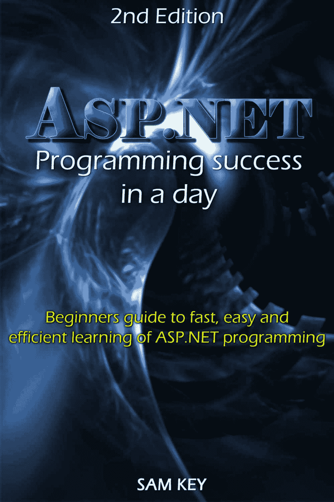


## 引言

感谢你的下载，祝贺你下载了《ASP.NET 编程一天成功：快速、简单、高效学习 ASP.NET 编程的入门指南》。

本书包含了关于如何使用 `ASP.NET` 系统进行基础编程的经过验证的步骤和策略。

`ASP.NET` 可能是当今最通用但也最经常被忽视的编程语言之一。它提供了强大的功能、灵活性以及广泛的选项。随着后续版本的发布，`ASP.NET` 也开始显著提升其跨平台兼容性，使其达到了与其竞争的编程语言相当的水平。任何严肃的程序员都至少需要了解 `ASP.NET` 编程的基础知识，以便利用它的许多强大特性——而这本书将帮助你实现这一目标。

再次感谢下载本书。希望你读得愉快！

## 第 1 章：ASP.NET 简介

### 破除 ASP.NET 的迷思

如果你对编程语言感兴趣，你一定听过 `ASP.NET`，它是微软的一个用于服务器端的开源 Web 应用程序框架。该技术的创建是为了允许程序员构建网站、应用程序和 Web 服务。与其他语言相比，`ASP.NET` 相对较新，它于 2002 年随着公司 `.NET` 框架第一个版本的发布发布。它是微软 `ASP`（活动服务器页）的继承者，因此得名如此。

如果你对编程语言感兴趣，就会知道 `ASP.NET` 在开发社区中臭名昭著。就像任何其他平台一样，整个 `.NET` 系统都有其合理的批评意见。然而，`.NET` 一直由于引起比比常多的程序员（尤其是非用户）的反感而闻名。这些人是依赖于误解，认为 `ASP.NET` 是低人一等的。但大多数这些观点都是毫无根据的；请看下面的分析：

1. `ASP.NET` 是微软制作的，所以它应该是坏的。很多人认为微软是科技世界中庞大、邪恶、唯利图是的巨头，他们仅仅因为 `ASP.NET` 是微软的产品而讨厌它。然而，有趣的是，谷歌和苹果这另外两个“邪恶科技巨头”（正如许多批评者所言）也有它们自己的编程系统，每个系统都拥有一批忠实的追随者。这恰证明了只要产品运行良好，由谁创建它并不重要。

2. `ASP.NET` 很贵。在与其他编程语言对 `ASP.NET` 进行比较时，这可能是唯一一致的负面点，但那些评论很少在语境中讨论“贵”这个词。对于家庭用户来说可能有点贵，但如果放在商业环境中可能极其廉价。

事实上，在开发 `ASP.NET` 时花费的大头之一是 `Windows` 本身的成本（前提是你确实是从零开始且没有 `Windows` 的）。为了保持领先地位（因为如 `Mono Project` 等替代方案进展滞后），你可以购买一台安装了 OEM `Windows` 的新机器，或者购买许可证，费用在 99 到 189 美元之间（旗舰版）。

在安装 `Windows` 之后，开发 `ASP.NET` 应用程序（或任何 `.NET` 应用程序）所需的所有内容都可以免费获得。对于初，微软提供了 `WebMatrix` 集成开发环境（内置 Web 服务器和数据库引擎）。对于高级用户，Express（稍精简版）的 `Visual Studio` 是免费的。对于学生，`DreamSpark` 项目让许多微软软件免费可用。

最后，`Windows` 托管一直被认为要贵得多。这在十年前可能是事实，但现在有几家价格合理的托管服务（有些每月 2 美元起步）。

3. `ASP.NET` 仅用于企业。在上述观点的基础上，许多人会哀叹 `ASP.NET` 不适合小型个人网站。事实上，你只需要查看框架的类库就能有所感觉。虽然某些简单的事情在 `.NET` 中并不像应该的那么简单，而且微软作为一个平台在发布 `.NET` 时主要针对企业，但他们确实做了很多妥协，让该系统对所有人都友好。

首先，让我们考虑上述面向初者的 `WebMatrix`。它为新开发者提供了进行 `ASP.NET` 项目的简单方法。除了非常易用外，它还通过简化的 `API` 创建，使事情变得不那么复杂。

此外，`ASP.NET` 提供了多种开发方法。为了创建可以被视为对象设计杰作的结构化程序，你可以使用不同的方法，甚至可以通过在 `PHP` 中盛行的脚本思维。

4. `ASP.NET` 是封闭的。虽然很容易假设微软是像制作其他任何软件一样制作了它，但令人惊讶的是，整个 `ASP.NET` 系统都是开源的。你可以在调试过程中实际上进入代码，甚至可以构建你个人的版本的整个 `.NET` 框架。即使 `ASP.NET` 发布的 `WebForms` 和 `MVC` 其代码也是开放的。

5. `ASP.NET` 仅限 Windows。之前我们讨论过运行 `ASP.NET` 的主要成本是获取 `Windows` 操作系统。然而，我们也同时提到了 `Mono Project`。`Mono Project` 是 `ASP.NET` 的跨平台版本，这很大程度上归于 `.NET` 框架的开放性。虽然没有官方支持，但 `Mono Project` 已获得微软的公开承认。正如之前提到的，`Mono` 比微软的发布后了几步。尽管如此，它的人气仍在增长——它甚至允许程序员使用 `.NET` 框架和 `C#!` 创建 iOS 应用。

6. `ASP.NET` 没有需求。许多人认为 `ASP.NET` 与 `Javascript`、`Perl`、`PHP`、`Ruby` 以及其他六个系统相比相形见��。他们认为 `ASP.NET` 没有需求。再次，这应该客观来看——不同的地方有不同的就业市场。

值得注意的是，大多数 `Windows` 软件都是使用 `.NET` 框架开发的，这为精通 `ASP.NET` 的人提供了巨大的就业机会。`Mono` 也考虑了这种需求——凭借 `Mono Project` 拥有的广泛操作系统支持，人们可以为任何最大的操作系统编写任何应用程序。

最后，考虑一下这一点：许多最流行的网站（包括 `Amazon` 和 `eBay`）都使用 `ASP.NET` 作为它们的开发模型。`ASP.NET` 是一个大不起的东西。

### ASP.NET 框架的优势

在破除了针对 `ASP.NET` 的常见误解后，这里是该系统的一些显著优势。

1. `ASP.NET` 极大地减少了构建大型应用程序所需的代码量。

2. 内置的 `Windows` 身份验证（以及按应用程序配置）使得使用 `ASP.NET` 开发的应用程序是安全的。

3. 早期绑定、缓存服务、原生优化和即时编译共同提供了更好的性能。


4. ASP.NET 框架在 VisualStudio IDE 中拥有丰富的设计器和工具箱。这个强大的工具提供了拖放式服务器控件、WYSIWYG（所见即所得）、自动部署等更多功能。

5. ASP.NET 页面易于编写和维护，因为源代码和 HTML 是写在一起的。源代码同样在服务器上执行，提供了强大的功能和灵活性。

6. ASP.NET 运行时负责管理并紧密监控进程，因此当某个进程死掉时，可以创建一个新进程。这确保了应用程序始终处于可用状态，以处理请求。

7. 由于它具有语言无关性，它允许程序员选择最适合应用程序的语言。程序员还可以将应用程序划分到不同的编程语言中。

8. 在 ASP.NET 中不需要注册组件，因为配置是内置的。这使得部署变得更加容易。

9. 实现 ASP.NET 的 Web 服务器会密切监控所有页面。任何内存泄漏、无限循环或其他非法活动都会被立即销毁，框架会自动重启以保持连续性。

10. 总的来说，ASP.NET 可以应对大量用户而不会产生性能问题。

# 第 2 章：ASP.NET 编程

习惯于 Classic ASP（约 1998 年）进行编程的人需要被提醒，.NET 版本是新一代的，因此与旧版本不兼容。然而，其编程风格包含了原始的某些元素。

使用 ASP.NET 编写的页面可以通过 `.aspx` 扩展名来区分。这些页面通常使用 Visual Basic（文件扩展名为 `.vbhtml`）或 C#（`.cshtml`）编写，尽管用户控件可以用 C++、Java 和其他编程语言编写。

当用户的浏览器请求一个 ASP.NET 文件时，系统内核引擎会读取该文件，然后编译并执行找到的脚本。结果将以纯 HTML 的形式返回给用户。

## Web Pages（网页模型）

Web Pages 实际上是用于创建 ASP.NET 站点和应用程序的三种编程模型之一（另外两个是 `MVC` 或“模型-视图-控制器”，以及 `Web Forms`）。它是 ASP.NET 页面最简单的编程模型，允许轻松地结合 HTML、CSS、Javascript 和其他服务器代码。它围绕单个网页构建，因此易于理解和使用，并且对页面元素提供完全的控制。

另一方面，`MVC` 稍微复杂一些，因为它被分为三个部分：`model`（模型）是应用程序核心的表示（如数据库中的记录列表），`view`（视图）是数据显示（如记录本身），而 `controller`（控制器）是处理输入的部分。像 `WebForms` 一样，它可以完全控制 HTML、CSS 和 JavaScript。

最后是 `WebForms`，它是 ASP.NET 中最老的编程模型，依赖于服务器控件、服务器代码和 HTML 结合的事件驱动页面。这些表单在服务器上编译并运行，反过来生成显示网页的 HTML。Web Forms 带有若干种（数百种）不同的控件和其他组件，用于构建可以访问数据的用户驱动型站点。

为了简单起见，我们将在书中仅深入探讨 Web Pages，因为它代表了学习 ASP.NET 最简单、最直接的方式。

## ASP.NET Razor

Razor 是一种新的、简单的标记语法，旨在将服务器代码嵌入到网页中。这种设置与 Classic ASP 相似。Razor 具有与传统 ASP.NET 相同的强大功能（因为它基于 ASP.NET 框架本身），但学习和使用要容易得多。它对初学者来说很容易上手，并极大地提高专家的工作效率。

假设我们有以下网页的 HTML 代码：

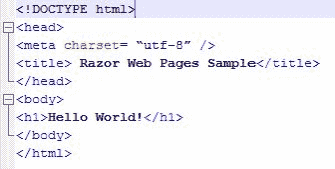

这是一个非常简单的页面，我们将尝试向其添加 Razor 代码：

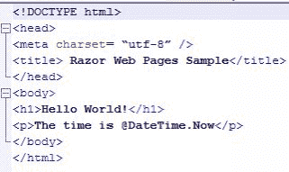

带有 `Date.Time` 的部分是 Razor 代码，由“@”符号标记。这段特定代码导致页面显示当前的日期和时间。这是通过让 Razor 代码在服务器上获取当前时间来实现的。如果你想要其他格式，也可以对此显示进行自定义。

正如我们之前提到的，这些页面可以使用两种语言——VB 和 C#。在这些的任何一种语言上使用 Razor 时，都有不同的规则。以下是针对 C# 的规则：

- Razor 代码块应始终包括在 `@{...}` 中。
- 内联表达式（即函数和变量）应始终以 `@` 开头。
- 代码语句应始终以分号（`;`）结束。
- 声明变量时应使用 `var` 关键字。
- 引号（“ ”）应始终包含字符串。
- 始终记住 C# 的代码是区分大小写的。
- 此外，请记住 C# 文件应该附加 `.cshtml` 扩展名，否则它无法按预期工作。

相比之下，这里是 Visual Basic 的主要规则：

- Razor 代码块应始终包括在 `@Code...End Code` 中。
- 内联表达式像 C# 一样应以 `@` 符号开头。
- 使用 `Dim` 关键字声明变量。
- 引号（“ ”）应始终包含字符串。
- VB 代码与 C# 不区分大小写。
- VB 页面需要 `.vbhtml` 扩展名才能正常工作。

使用 Razor 创建的网页基本上可以描述为带有两种不同内容的 HTML 网页：纯 HTML（你可以立即识别出来）和由 `@` 符号标记的 Razor 代码。

当服务器读取页面时，首先运行 Razor 代码。然后，ASP.NET 将 HTML 页面发送给浏览器。服务器执行的代码可以完成浏览器中无法完成的任务，例如访问数据库。服务器代码可以在发送到浏览器之前现场创建动态内容。

Razor 代码还可以与对象工作，可以基于文本框、整个网页、数据库记录，或者在许多其他可能性中自定义。还有描述其特征的对象。

与其他编程语言一样，Razor 同样能够处理“if 和 else”条件，以及读取用户输入。这些有助于动态页面的创建。

# 第 3 章：创建一致的布局

Web Pages 允许程序员创建具有一致外观的内容。这意味着每个站点都有相同的页头和页脚，每个页面都有相同的样式和布局。这可以非常高效地完成，因为程序员可以在不同的文件中拥有内容块（如上述页头和页脚）。布局模板也可以用于定义所有页面的一致布局。

## Content（内容块）

使用 Web Pages，程序员可以使用 `@RenderPage()` 系统从单独的文件导入一致的内容。内容块来自另一个文件，可以导入到页面的任何位置。它可以包含文本、代码和标记，就像任何其他普通网页一样。

这节省了大量工作，因为你不需要在每个页面中编写相同的内容。当你更改其中一个文件时，更新将带到你的所有页面。以下是代码形式的示例：

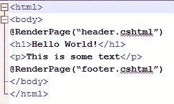


布局页看起来与任何其他网页一样，但它包含了对 `@RenderBody()` 的调用。此方法将包含内容页。请记住，在此过程中，内容页必须以 Layout（布局）指令开头。以下是布局页的底层运行原理：

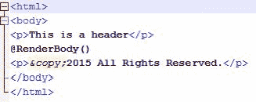

这是一个内容页的示例：

# 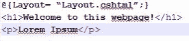

# 第 4 章：文件夹

在 ASP.NET 系统中，存在两种不同类型的文件夹结构：逻辑结构和物理结构。以下是构成典型逻辑文件夹结构的一组文件夹：

● `Account`。此文件夹包含所有登录和安全文件。
● `App_Data`。它包含所有数据库以及数据文件。
● `Images`。此文件夹包含你页面使用的不同图像。
● `Scripts`。这些包含不同的浏览器脚本。
● `Shared`。此文件夹包含所有公共文件，例如布局和样式文件。

除了服务器上的逻辑文件夹结构外，你的计算机上也有一个物理位置。这看起来应该很熟悉：

`C:\YourName\Documents\MyWeb\Sample\Images`

## 虚拟名称与物理名称

区分某个项目的名称是虚拟的还是物理的是重要的——但这很容易，因为它们直接遵循逻辑/物理文件夹的名称。例如，一个示例图像的虚拟名称可能简单为“Images\sample.png”，而其物理对应项则是 `C:\YourName\Documents\MyWeb\Sample\Images\sample.png`。

## 路径与 URL

我们知道 URL（通用资源定位符）用于从 Web 访问文件和页面。例如 `http://www.yoursite.com/sample/page.aspx`。然而，这对应于服务器计算机上的物理数据，基本上与上一节中的物理名称相同。这被称为“路径”。虚拟路径是作为快捷方式创建的，用以表示这些物理路径的长名称。此虚拟路径就是上述 URL 中“.com”之后出现的内容：`/sample/page.aspx`。

在编写 ASP.NET 代码时，你需要根据编码的内容对虚拟路径和物理路径进行引用。

ASP.NET 提供了三种不同的工具来方便地处理这些文件夹路径，将在下文中讨论：

### ~ 运算符

它指定了编程代码中的虚拟根。使用 `~` 运算符而不是根路径将允许你将页面或站点移动到不同的位置或文件夹，而无需更改代码。以下是一个示例：

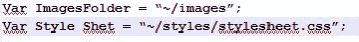

### Server.MapPath

此方法将虚拟路径（例如，`/sample.cshtml`）转换为服务器可以理解的物理路径（`C:\YourName\Documents\MyWeb\Sample\sample.cshtml`）。

当需要打开网站服务器上的文件时，可以使用此方法。需要记住，只有使用完整的物理路径才能访问数据文件。如下所示：

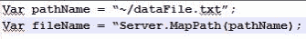

下一章将更多地讨论读取和写入数据文件。

### Href

本质上，浏览器无法理解我们之前讨论的 `~` 运算符（它仅限于 ASP.NET 使用）。`Href` 方法可以通过将代码行中使用的路径转换为浏览器可以理解的特定路径来弥补这一缺陷。

`Href` 样式可用于映射到资源的路径，如 CSS 文件和图像文件。你将在 HTML ``、`<link>` 和 `<a>` 元素中频繁使用此方法。示例代码如下：

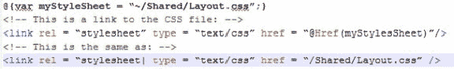

# 第 5 章：全局页面

## Web 启动之前：_AppStart

大多数服务器端代码都写在单个网页内部。例如，如果某个页面包含任何输入表单，则该网页通常会包含用于读取数据的服务器代码。

然而，当程序员在站点根目录下创建一个名为 `_AppStart` 的页面时，启动代码甚至在站点启动之前就可以执行。如果存在这样的页面，当站点中的任何页面被请求时，ASP.NET 会首先运行它。

`_AppStart` 的典型用法是用于启动代码以及全局值（如全局名称和计数器）的初始化。

注意，`_AppStart` 在文件扩展名上应与其他页面相似，例如 `_AppStart.cshtml` 或 `_AppStart.vbhtml`。此外，注意 `_AppStart` 中的下划线前缀。在任何页面加上下划线意味着包含的文件不能被直接浏览。这是好事，因为 `_AppStart` 文件夹通常包含敏感信息。

## 每个页面之前：_PageStart

与 `_AppStart` 即使在站点启动之前运行一样，你也可以创建在文件夹中任何页面之前运行的代码。对于你站点中的每个文件夹，你都可以添加一个名为 `_PageStart` 的文件。

`_PageStart` 的常见用途是为文件夹中的每个页面设置布局页。它也可以用于在页面运行之前检查用户是否登录。

基本上，当站点及其页面的请求进来时，ASP.NET 将检查 `_AppStart` 是否存在。如果是这种情况且当前请求是第一个请求，则 `_AppStart` 将运行。

然后 ASP.NET 将检查 `_PageStart` 文档是否存在。如果存在，它将在页面之前运行。

# 第 6 章：HTML 表单

像任何其他编程语言一样，表单是放置单选按钮、复选框、文本框甚至下拉列表的地方。以下是使用 Razor 实现此点的示例。

## 显示图像

你也可以在输入字段中使用 Razor 根据用户输入动态显示图像。

例如，你想使用 images 文件夹中名为 `sample.png` 的图像。可以使用 HTML  元素显示：

```html

```

然而，如果你有三张根据选项显示的图片，可以使用 Razor 代码：

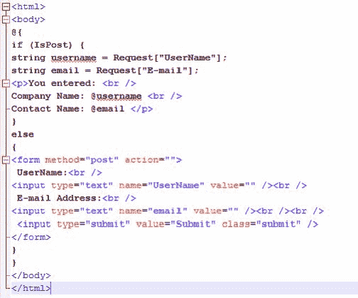

在此示例中，服务器最初形成名为 `imagePath` 的变量。然后，HTML 指向名为 `Choice` 的输入方法（`<select>` 元素）。这允许程序员选择浏览器友好的名称（例如“Photo 1”），并在页面提交后传递文件名（例如“sample.png”）。

代码将通过 `Request["Choice"]` 读取选择。一旦发现值，代码将构造文件路径并存储在 `imagePath` 中。

在任何图像的 HTML 页面中，都使用  标签。页面加载后，src 代码将对应于 `imagePath` 的值。

最后，将  元素放置在 if 块中，以防止其尝试显示无名图像。

# 第 7 章：对象

到为止，你已经使用了一些页面对象方法。最初，你有：

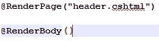

并且在上一章中，你有这些行：

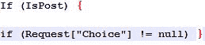

本章将让你更好地理解不同的对象代码。

## 页面对象方法

● `Href`。利用指定的参数创建 URL。
● `RenderBody()`。渲染内容页中位于任何命名部分之外（适用于布局页）。
● `RenderPage(page)`。在另一个页面内渲染页面的内容。
● `RenderSection(section)`。渲染命名部分的内容（适用于布局页）。
● `Write(object)`。将对象作为字符串写入（经过 HTML 编码）。
● `WriteLiteral`。直接写入对象，而不先通过 HTML 编码。


### Page 对象属性

- `IsPost`: 当客户端使用的数据传输方法恰好为 `POST` 时，此属性返回 true。
- `Layout`: 用于设置或获取布局页的位置。
- `Page`: 提供对在布局页和其他页面之间共享的数据的访问（类属性的访问）。
- `Request`: 获取 `HttpRequest` 对象并将其传递到现有的 HTTP 请求中。
- `Server`: 获取 `HttpServerUtility` 对象，提供网页处理的方法。

### 对象的 Page 属性

页面对象的 `page` 属性将提供对在布局页与其他内容页面之间共享的数据进行类属性的访问。程序员可以在现有的 `Page` 属性上添加自己的属性：

- `Page.Version`
- `Page.Title`
- `Page.<在此处插入任何内容>`

此属性可能非常有帮助——例如，它允许程序员在内容文件中创建页面标题，供布局文件使用。以下是它在示例的“Home.cshtml”页面中的显示方式：

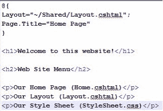

相比之下，这是它在示例的“Layout.cshtml”网站中看起来的样式：

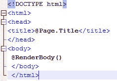

# 第 8 章：使用文本文件的 ASP.NET

程序员有时需要访问存储在文本文件中的数据。这些文件（也用于存储信息）通常也被称为“平文件”。常见的平文件格式包括 `.xml`、`.txt` 和逗号分隔值（`.csv`）。

## 显示来自文本文件的数据

文本文件通常出现在 `App_Data` 文件夹中（因此，如果你想亲自尝试以下示例，则需要创建一个）。假设你有一个名为“Authors.txt”的新文档，其内容如下：

```
Doyle, Arthur Conan
Christie, Agatha
Leblanc, Maurice
```

此示例将展示如何从此文本文件中显示数据：

在此示例中，使用 `Server.MapPath` 来查找文本的的确切文件路径。然后，`File.ReadAllLines` 将打开文本并将并将中的所有行读取到数组中。对于这些数组 `datalines` 中的每个 `dataItem`，将显示该数据。

## 显示来自 Excel 的

使用 Microsoft Excel，程序员可以将电子表格保存为 `.csv` 文件。一旦完成，电子表格中的每一行将被保存并被视为文本行。每列之间将用逗号分隔，每行将被保存为文本行。

与上述相同的指令可以读取 Excel `.csv` 文档——你只需要将文件名更改为相应的名称。

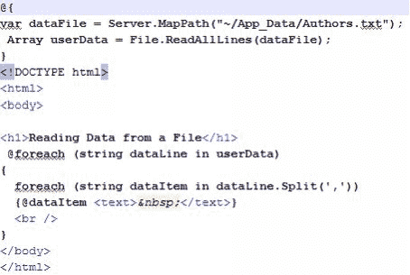

# 第 9 章：从数据库显示信息

使用 Web Pages，程序员将能够轻松地从数据库显示信息。程序员能够连接到任何现有的数据库，尽管该数据库可以从零创建。如下例所示，我们将尝试与现有的 SQL Server Compact 数据库建立接口。

## 创建客户页面

在你的文件夹中，假设一个新文件名为“Items.cshtml”。你可以尝试使用下面的代码来替换你现有的代码：

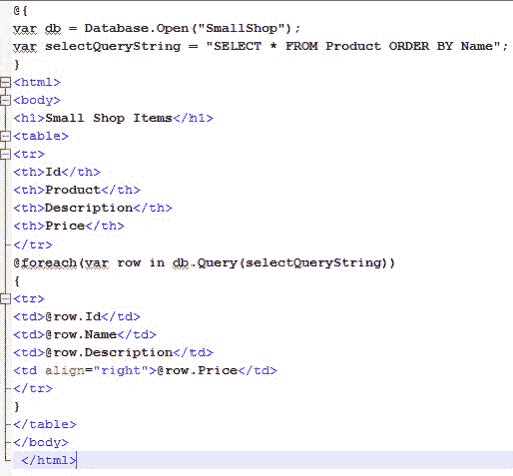

此示例使用了 `Database.Open(name)` 技术，它通过两个步骤连接到数据库：

1. 它将在应用程序的 `App_Data` 中搜索与 `name` 参数中指定的内容匹配的数据库（文件扩展名除外）。
2. 如果未找到文件，它将在应用程序的 `Web.config` 文件中查找连接字符串。（连接字符串是显示连接数据库的信息。这可能包括任何 SQL 数据库的名称，以及完整的用户名和密码，或文件路径）。

这种两步方法允许程序员使用数据库测试应用程序，还可以通过连接字符串在网络主机上执行运行应用程序。

# 第 10 章：ASP.NET 辅助工具

在 ASP.NET 中，程序员可以利用辅助工具（helpers），这些组件可以通过单行 Razor 代码轻松访问。除了内置的 ASP.NET 辅助工具外，还可以通过 Razor 语法以 DIY 的方式构建它们，然后将它们存储为 `.cshtml` 文件。

以下是一些实用辅助工具的列表：

- **WebGrid 助手**: 它可以简化数据显示，自动设置 HTML 表格并支持不同的格式选项。除了这些，它还可以支持对数据进行分页以及通过点击表头进行排序。
- **Chart 助手**: 它可以显示不同类型的图表图像，具有不同的格式选项和标签。它还可以显示来自数据库、数组或文件的数据。
- **WebMail 助手**: 它将提供使用简单邮件传输协议（SMTP）通过电子邮件发送消息的功能。
- **WebImage 助手**: 此辅助工具可以提供管理页面中图像的功能。你还可以使用如水印（watermark）、调整大小（resize）、旋转（rotate）和翻转（flip）等特定关键字。

除了上述内容外，用户还可以利用第三方辅助工具来简化多媒体、社交网络和其他组件，包括安全和导航。

这些辅助工具还可以通过 `WebMatrix` 轻松安装。只需打开 Site 工作区，点击 Web Pages 管理（Web Pages Administration），登录，并使用搜索字段查找你所需的辅助工具。

# 第 11 章：ASP.NET 调试

在任何平台上创建的任何应用程序即使已经发布，也可能包含无数错误。虽然编译可以可靠地排除许多语法错误，但某些类型的 bug 需要程序员通过调试过程。这是在运行时检查代码以便进行验证的方法。

随 ASP.NET 一同提供的 Windows SDK（软件开发包）包含一个视觉调试器（Visual Debugger），允许程序员查看应用程序运行的情况。该工具是 `DbgCLR.exe`，可以在 `DuiDebug` 文件夹中找到。该调试器通过附加到运行页面的进程来使用。

如果你使用的是 Internet Information Services 5.0 和 5.1 版本，或者以 5.0 应用程序模式运行的 ISS 6.0，那么附加视觉调试器的进程是 `Aspnet_wp.exe`，即 ASP.NET 的工作进程。然而，如果你在工作进程隔离模式下运行版本 6.0 的 ISS，则将调试器附加到 `W3wp.exe` 或线程池进程。

一旦调试器附加到特定进程，该进程中发生的一切切都是可见的。在此基础上，调试器还将进程中执行的指令映射回原始代码。视觉调试器具有三个主要功能来帮助你调试应用程序：

- **断点（Breakpoints）**: 这些是代码中调试器将发送信号以让应用程序停止的地方。这将允许你查看该点的应用程序状态，然后逐行执行。
- **单步（Stepping）**: “逐行执行”代码仅仅是逐行运行代码。为了让体验更友好，视觉调试器具有一些迭代器，允许程序员指定在达到另一个停止点之前循环运行次数。
- **数据查看（Data Viewing）**: 调试器对于在应用程序运行时对数据的跟踪和查看提供了不同的选项。一旦应用程序在断点停止，可以对数据进行修改，然后可以使用修改后的数据再次运行应用程序。


首先，对于远程调试，远程和本地计算机都应该处于域或工作组设置中。为了调试工作进程（worker process），程序员必须拥有执行该操作的权限。默认情况下，ASP.NET 应用程序将以 `ASPNET` 用户身份运行。如果工作进程是 `ASPNET` 或 `NETWORK SERVICE`，则程序员必须拥有管理员权限才能进行调试。

工作进程的名称可能会根据调试场景和 `IIS` 的版本而变化。工作进程运行的用户账户可以通过修改 `machine.config` 文件来更改。该文件位于运行 `IIS` 的服务器上。实现此操作的最佳方法是使用 `IIS Manager`。工作进程也可以更改为在您的用户账户下运行，在这种情况下，程序员不需要是服务器管理员即可执行所需操作。

请记住，在更改工作进程以便在不同的账户下运行之前，始终存在 ASP.NET 工作进程在新的账户下可能被黑客攻击的可能性。`NETWORK SERVICE` 和 `ASPNET` 账户可以最小权限运行，从而减少进程被黑客攻击时可能遭受的损害。切换到具有更高权限的账户可能会增加潜在损害。

## 为 Web 应用程序配置调试

为了启用 ASP.NET Web 应用程序的调试，必须配置应用程序能够编译为“调试构建（debug build）”。此构建包含了调试器所需的数据，以便它可以逐行通过代码并显示其中的变量。Web 可以在其 `Web.config` 文件的编译（Compilation）部分配置为使用调试构建。如果您想调试单个页面，可以在相关页面的 `@ Page` 指令中添加 `debug=true` 行。

请记住，任何编译为调试构建的应用程序，其运行速度都可能比零售版本（retail build）慢得多。在将应用程序部署到市场之前，请确保关闭调试模式。调试模式还会在错误发生后导致堆栈中暴露更多信息，这可能意味着产品存在安全问题。

## 远程调试与本地调试

在本地运行的 Web 服务器（如 `IIS`）允许您调试在您的计算机上本地运行的应用程序。这些页面可以在浏览器中查看。

然而，当页面由于无法运行 Web 服务器（或简单是因为应用程序本地不可）而无法本地运行时，就可以进行远程调试。为了实现这一点，必须在远程服务器上安装 `Visual Studio` 的远程调试组件。

## 调试权限

调试过程所需的权限比简单运行相同的应用程序更多。除了为调试保护应用程序中的配置外，还必须确保有足够的权限允许调试器附加（attaching）到相关进程。用户将权限调试以其凭据运行的本地进程，但他们无法访问其他用户的进程进行调试。另一方面，管理员可以访问并调试任何用户的进程。

当您在远程服务器上进行调试时也是如此，因为您需要运行进程的计算机的管理员权限。

## 客户端脚本调试

除了服务器端进行的应用程序调试外，Visual 调试器还允许您调试客户端脚本，只要它是用 JavaScript (ECMAScript) 或 VBScript 编写的。当程序员使用带有客户端脚本的 Web 服务器控件时，此功能将特别有用用。

## 调试已部署的 Web 应用程序

您可能需要调试已经在生产服务器上运行的 Web 应用程序。这是可能的，但应该谨慎进行。假设您已附加了 ASP.NET 的工作进程进行调试，并且触发了断点。这将导致工作进程中的所有托管代码停止。停止这些托管代码反过来可能会导致特定服务器上所有用户的工作停止。如果您决定在生产服务器上进行调试，理解其对生产的影响是非常重要的。

除了将调试器添加到相关的 ASP.NET 工作进程外，请双检查 Visual 调试器是否获得了访问应用程序符号（symbols）的权限。还需要找到并打开应用程序源文件。

许多 ASP.NET 应用程序会引用包含业务逻辑或其他有用代码的 `DLLs`。这些引用会自动将 `DLLs` 从本地计算机复制到 Web 应用程序虚拟目录下的 `\bin` 文件夹。调试时，请记住应用程序将引用此副本，而不是计算机上的本地副本。

将工作进程附加到调试器的方法与其他远程进程的方法相同。当附加成功时，如果没有打开正确的项目，当应用程序到达断点时，您将看到一个对话框。该框将要求提供源文件的位置。在此框中指定的文件名必须与服务器调试符号中指定的文件名相同。

## 为 ASP.NET Web 应用程序启用调试

要启用调试选项，必须在项目属性（Project Properties）菜单和应用程序的 Web 配置文件中同时启用。请注意，您看到的命令和对话框可能与帮助文档中列出的不同，取决于软件版本或您的当前设置。可以通过在工具（Tools）菜单中选择“导入和导出（Import and Export）”更改设置。

### 在项目属性中启用

1. 转到解决方案资源管理器（Solution Explorer）并右键点击项目名称。从选项中，选择“属性（Properties）”。
2. 在属性菜单下，点击标记为“Web”的选项卡。
3. 从调试器选项中选择 ASP.NET。

### 使用 web.config 文件启用

1. 使用任何 XML 解析器或 Web 编辑打开 `web.config`。注意，无法通过 浏览器远程访问它。默认情况下，Microsoft IIS 的配置是防止浏览器直接访问 `Web.config` 文件。这是出于安全考虑。通过浏览器访问配置文件将导致产生“访问被禁止 (403 Forbidden)”。
2. 由于配置文件是用 XML 编写的，它包含使用标记标记的嵌套部分。找到 `configuration/system.web/compilation` 元素。如果该元素不存在，您必须手动创建它。
3. 如果上述元素没有 debug 属性，则也必须手动添加。
4. 确保在添加 debug 属性后，将其值更改为“true”。

以下是 Web 配置文件的样式示例：

```xml
<configuration>
...
<system.web>
<compilation Debug="true"
...
>
</compilation>
</system.web>
</configuration>
```

## 健壮编程

编程语言将自动检测对配置文件的所有更改，这些更改将自动应用到设置中。因此，程序员不再需要重启 IIS 服务器或计算机即可使更改生效。

ASP.NET 的另一个优点是它会继承来自 URL 层级结构中较高位置的配置文件的设置。这特别有用，因为一个站点可以包含多个虚拟存储的目录和子目录，每个目录都可能包含一个 `web.config` 文件。然而，如果在层级结构较低的任何文件中设置了 debug，则高层级的 debug 值将被覆盖。


假设你在 `www.yoursite.com/file/web.config` 中指定了“debug=true”值，那么“file”文件夹及其内部所有子文件夹中的任何应用程序都会继承上述设置。因此，当你要查找的应用程序位于 `/file/file2` 文件夹时，它将继承“file”文件夹中的设置。异常情况是这些应用程序之一通过其自己的 `web.config` 覆盖了配置设置。

# 第 12 章：监控 ASP.NET 程序的健康状况

健康监控是一项确保应用程序健康的任务。任何故障系统都将得到快速诊断，在应用程序生命周期内发生的重大事件可以被评估。ASP.NET 应用程序可以单独进行监控，也可以跨“Web 场（Web farm）”进行监控，而且监控不仅可以配置错误，还可以应用内部发生的事件。

ASP.NET 内置的健康监控系统包含了事件类型，它们通过封装应用程序的健康状态信息来工作。还有提供程序类型用于处理事件信息。这些提供程序监听事件并消耗信息，通常通过记录日志或向管理员发送通知。将事件连接到提供程序（通常称为“启用事件”）是通过修改配置文件中的设置来实现的。此外，还有有助于管理这些事件的额外类型。

ASP.NET 的健康监控系统通过 `System.Web.Management` 命名空间中的类实现。

## 配置监控

ASP.NET 应用程序可以配置使用自定义或内置的监控工具。可以通过配置文件的 `healthMonitoring` 部分向应用程序添加提供程序和 Web 事件。访问该部分后，程序员可以使用不同的类来处理数据。

## 类层次结构：Web 事件

当事件触发时，相关的事件类也会被触发。有关事件的数据将收集在对象的属性中，这些属性随后由事件提供程序处理。

这些事件可以包含大量信息，例如来自审计事件、配置错误、应用程序错误、响应数据、请求数据、应用程序域和工作进程的信息。父事件类包含的健康信息将被子事件类继承。事件在 Web 事件类层次结构中越靠下，其数据对应用程序就越具体。例如，派生类可以暴露客户端 IP、堆栈跟踪以及进程和线程等信息。

## 类层次结构：提供程序

- 内置提供程序可以用于处理 Web 事件。程序员也可以继承这些内置类来创建自定义提供程序。然而，这些类受以下继承限制：
- 运行在任何信任级别下的应用程序都可以继承 `WebEventProvider` 类。
- 运行在任何信任级别下的应用程序都可以继承 `BufferedWebEventProvider` 类。
- 运行在全信任（Full trust）级别下的应用程序可以继承 `SqlWebEventProvider` 类。
- 其他类无论信任级别如何，都无法被应用程序所继承。

## 使用内置提供程序和 Web 事件

这是使用健康监控工具最常用的策略。唯一的要求是配置应用程序使用你需要的项目。你首先需要执行以下几个任务：

- 在应用程序配置文件的 `healthMonitoring` 部分的 `eventMappings`元素中添加你所需的 Web 事件类。
- 在 `providers` 元素（位于 `healthMonitoring` 部分）中添加消耗事件的提供程序。
- 在 `rules` 元素中添加一个定义提供程序和事件之间关联的项目。

在默认设置中，内置类可以在根配置文件的 `healthMonitoring` 段中进行配置。该节确立了以下默认配置：

- 在 `eventMappings` 中指定派自 `WebBaseEvent` 的 Web 事件类。该部分可用于为任何一组事件类分配友好的名称。
- 在上述定义的组中至少包含一组派自 `WebBaseEvent` 的事件类。
- 在 `providers` 元素中指定了以下事件提供程序：`EventLogWeEventProvider`、`SqlWebEventProvider` 和 `WmiWebEventProvider`。程序员可以在提供程序 元素中指定其他内置提供程序，如 `TemplatedMailWebEventProvider`、`SimpleMailWebEventProvider` 和 `TraceWebEventProvider`。
- 将审核失败事件和 Web 错误关联到 `EventLogWebEventProvider` 类的规则在 `rules` 元素中详细说明。你可以通过向 rules 元素添加内容来启用 Web 事件和提供程序。如果事件映射到此元素中的任何事件提供程序，则该事件被视为已启用。需要为事件配置提供程序和 `eventMappings` 元素，除非在 rules 元素中连接两者，否则该事件不会被启用。

程序员还可以详细说明配置项目的参数值。这些示例包括限制事件发生次数的参数、指定不同事件之间间隔的参数，或者指定 SQL 和邮件提供程序缓冲选项的参数。

# 第 13 章：显示安全的错误消息

当应用程序显示错误时，不能以泄露漏洞信息的方式，因为这可能被恶意攻击者用于黑入或危害你的系统。例如，如果应用程序尝试登录数据库失败，错误消息绝不能显示正在使用的用户名。

有多种方法可以控制向用户显示的错误消息，包括以下内容：

- 配置应用程序不向远程用户提供详细的错误。这些“远程用户”指的是那些在未直接连接服务器的计算机上请求应用程序页面的人。这些错误可以选择地重定向到应用程序页面。
- 尽可能包含错误处理，并且你可以构建你自己的版本的错误消息。在错误处理器中，程序员可以测试该特定用户是否为本地用户。如果是，系统可以做出相应。
- 可以在应用程序或页面级别创建全局错误处理器。这可以捕获所有未处理的异常，将其路由到更通用的页面。

## 配置应用程序不允许远程用户查看错误消息

通过调整应用程序的 Web 配置，可以对 `customErrors` 进行以下修改：

- 将 `mode` 设置为 `RemoteOnly`。记住，这是区分大小写的。此更改将允许在用户为本地用户时显示详细错误——特别是开发人员尝试连接应用程序时。
- 设置 `defaultRedirect` 属性，指向应用程序错误页面。
- 添加 `error` 元素，将特定实例重定向到特定页面。例如，标准的“未找到页面”（404）错误消息可以在应用程序页面找到。

以下代码显示了 `Web.config` 中典型的 `customErrors` 块的示例：

```
<customErrors mode="RemoteOnly" defaultRedirect="AppErrors.aspx">
<error statusCode="404" redirect="NoSuchPage.aspx"/>
<error statusCode="403" redirect="NoAccessAllowed.aspx"/>
</customErrors>
```

## 错误处理

首先，在可能产生语句周围放置 `try-catch` 块。你也可以检查具有 `IsLocal` 属性的本地用户，然后修改错误处理。localhost 的等效值为 `127.0.0.1`——这意味着 Web 浏览器和服务器在同一台 PC 上运行。


以下行展示了错误处理块的示例。当出现错误时，会话状态变量将加载消息详情。应用程序将显示一个页面，该页面可以读取你的 `Session` 变量，并随后显示你的错误消息。这些错误消息是专门编写的，以防止向其他用户提供可被利用的项目。对于本地用户，可以提供一组不同的错误详情。在你的 `finally` 块中，我们将释放一个打开的资源。

```
Try
{
    sqlConnection1.Open();
    sqlDataAdapter1.Fill(dsCustomers1);
}
Catch (Exception ex)
{
    If(Request.IsLocal)
    { Session["CurrentError"] = ex.Message}
    Else
    { Session["CurrentError"] = “Error processing page.;}
    Server.Transfer(“ApplicationError.aspx”);
}
Finally
{
    this.sqlConnection1.Close();
}
```

## 创建全局错误处理器

程序员还可以创建错误处理器，捕获页面级别甚至整个应用程序级别内的所有不同未处理异常。

要创建这些全局处理器，只需为你的 `System.Web.UI.TemplateControl.Error` 创建一个即可。应用程序级别的处理器在 `Global.asax` 数据中单独处理——只需将代码添加到你的 `System.Web.HttpApplication.Error` 中。如果应用程序或页面内发生未处理的异常，将调用这些处理器。有关最新错误的附加信息可以从 `GetLastError` 获取。

请注意，如果你已经有了全局错误处理器，它的优先级将高于 `customErrors` 配置元素中 `defaultRedirect` 属性指定的错误处理方法。

以下是一个示例（代码），展示了处理器如何获取错误信息，将其放入 `Session` 变量中，然后调用错误处理选项，该选项反过来提取并显示有关错误的信息。

```c
protected void Application_Error(Object sender, EventArgs e)
{
    Session["CurrentError"] = “Global: “
    Server.GetLastError().Message;
    Server.Transfer(“lasterr.aspx”);
}
```

# 第 14 章：ASP.NET 安全

### 安全工作原理

在创建应用程序之后，你必须确保你的网站是安全的。对于 Web 开发人员来说这是一个常见的复杂问题，尤其是因为今天的互联网格局充满了漏洞，等待着意图不纯的人去利用。网站的保护需要制定周密的计划，程序员或管理员需要对保护网站所需的选项有清晰的理解。

ASP.NET 系统与微软的 `.NET` 框架以及 `IIS`（互联网信息服务）协同工作，帮助提供 Web 安全。这意味着程序员或管理员也可以访问框架内置的安全。这包括代码访问安全以及基于角色的安全。`IIS` 还可以根据用户的 IP 地址或主机名授予或撤销访问。进一步的授权步骤必须通过 NTFS 文件访问权限的 URL 验证来实现。

在保护你的应用程序时，你需要利用 ASP.NET 安全的两个主要功能——验证（Authentication）和授权（Authorization）。

### 验证

验证本质上是执行的一种过程，以确保用户确实是他们所称的。应用程序将获取凭据（包括名称、密码或其他形式的标识），并根据建立的权威对其进行验证。一旦发现凭据有效，提交这些凭据的实体（用户、计算机）将被视为“已验证”。

一旦通过验证，将会检查该实体对特定资源的访问权限。在 ASP.NET 中，验证通过使用身份提供程序来实现，这些代码模块包含必要的代码来验证访问访问请求者的凭据。

其中主要是 `Windows Authentication`（Windows 身份验证）提供程序，它将 `IIS` 提供的身份视为应用程序中已验证的用户。默认情况下，`IIS` 将提供多种验证方法，例如 Windows 集成（NTLM）验证、匿名验证、Windows 集成（Kerberos）验证、摘要验证（Digest authentication）、基本（或 Base64 编码）验证，甚至基于客户端证书的验证。

另一方面，还有某些形式的身份提供程序，允许所有者通过名称和密码验证用户，这些信息是通过程序员创建的登录表单提交的。未通过上述方式验证的请求将重定向到此登录页面，用户在那里通过表单提交信息。一旦应用程序验证了请求，系统将颁发密钥（通过票据），为后续请求建立身份。

### 授权

另一方面，授权是一个限制授予（或拒绝）给特定用户的访问权限的过程，这与其作为已验证权威实体的权限相符。

还有两种执行授权的方法。第一种是文件授权，使用 `FileAuthorizationModule`（文件授权模块）执行。它将检查处理程序文件（`.aspx` 或 `.asmx`）的 `ACL`（访问控制列表），以确定用户是否应该获得该文件的访问权限。`ACL` 权限也决定了这一点。

还有 URL 授权，通过 `UrlAuthorizationModule`（URL 授权模块）执行。它将用户和角色映射到 ASP.NET 应用程序中的不同 URL。该模块可以用于根据不同角色选择性允许或拒绝人员访问应用程序的任意部分（通常是目录）。

通过 URL 授权功能，管理员可以根据预定义的角色或通过将此访问分配给用户名，显式允许或阻止用户访问目录中的特定位置。为目录建立的权限将被子目录继承，除非单独的子目录配置覆盖了它们。

除非子目录配置覆盖了权限，否则管理员可以显式允许或阻止用户访问目录中的特定位置。

以下是授权部分代码的语法：

```xml
<authorization>
<allow|deny] users role />
</authorization>
```

在上述代码中，允许或拒绝部分是必须的。程序员需要指定角色或用户属性；虽然不需要一次性指定两者，但也可以这样做。同样，`verbs` 属性是可选的。

显而易见，放置允许或拒绝元素将授予或撤销访问。每个元素都支持其余属性。用户将针对账户或身份。在这种情况下，匿名用户将使用问号进行标识。所有已验证的用户可以通过星号指定。角色将用于识别特定请求的 `RolePrincipal` 对象，该请求将被允许或拒绝访问资源。最后，动词将定义适用于操作的 HTTP 动词。这包括 `get`、`head` 和 `pos`。默认是星号，表示所有动词。

下面的示例授予名为“Chris”的身份以及 Admin 角色的成员访问权限。该代码还将拒绝“Erick”（除非该身份包含在管理员组中）以及所有匿名用户的访问。

```xml
<authorization>
<allow users="Chris”/>
<allow roles="Admins” />
<deny users="Erick”/>
<deny users="?”/>
</authorization>
```

另一方面，以下代码展示了如何允许 Erick 访问系统并向其他人拒绝相同的访问。

```xml
<authorization>
<allow users="Erick”/>
<deny users="*”/>
</authorization>
```

对于角色和用户属性，可以通过逗号分隔的列表指定多个实体。以下是一个示例：


```xml
<allow users="Chris, Erick, contoso\Jam"/>
```

注意，如果指定了域帐户名称，则名称应同时包含用户名和域（因此为 `contoso\Jam`）。

下面是另一个示例，它允许用户对特定资源执行 HTTP GET 操作，但仅允许用户 `Chris` 执行 POST 操作。

```xml
<authorization>
<allow verbs="GET" users="*"/>
<allow verbs="POST" users="Kim"/>
<deny verbs="POST" users="*"/>
</authorization>
```

这里也存在某些规则。首先，应用程序级配置文件中的规则将优先任何继承的规则。系统将通过构建所有 URL 规则的组合列表来确定哪些规则具有优先级，并将最近的规则（或在层次结构中最近的规则）放在列表的头部。

此外，给定应用程序的一组组合规则，`ASP.NET` 将从列表头部开始检查规则，直到找到第一个匹配项。`ASP.NET` 的默认配置将包含一个 `<allow users="*">` 元素，它将授权所有用户，尽管该元素也是最后应用的。如果没有其他规则匹配，则将允许请求。另一方面，如果找到的匹配是“deny”规则，则请求将返回 `401` HTTP 状态码。当然，匹配的“allow”元素将允许请求继续。

在配置文件中，还可以创建 `location` 元素来指定特定的目录或文件，该对象将作为 `location` 元素设置的对象。

# 第 15 章：ASP.NET 的通用安全实践

有时，新程序员会尝试用复杂的措施来保护他们的应用程序，但未能涵盖恶意攻击者进入系统的最简单方法。以下提示被证明对于维护您的 `ASP.NET` 应用程序的完整性不仅简单，而且有效。

1. 除了经常备份外，还要确保备份设备物理存储在安全的地方。
2. 同样要保持 Web 服务器的安全，以便未经授权的用户无法以任何方式访问它。
3. 使用 `NTFS` 文件系统代替 `FAT32`。Windows 文件系统可以比其对应系统提供更高的安全性。
4. 使用强密码保护 Web 服务器以及网络中的所有其他计算机。如果可能，为每台计算机使用一个不同的密码。
5. 保护您的 `IIS`。
6. 关闭任何未使用的端口并关闭任何未使用的服务。
7. 使用提供入站和出站流量实时监控的防病毒程序。
8. 建立并执行策略，禁止用户在容易找到的地方写下密码。
9. 使用防火墙。微软就针对不同系统和应用程序应使用的不同类型的防火墙提供了建议和指南。
10. 始终安装来自微软和第三方供应商的安全补丁。微软网站列出了所有最新的安全更新和其他安全公告。
11. 利用 Windows 的事件日志功能，并定期检查日志，以确保尽快检测到可疑活动。任何重复的系统登录尝试以及针对服务器的异常高请求数都应该引起警觉。

## 以最小权限运行应用程序

当应用程序运行时，它们在本地设备上以特定权限的上下文中运行，也可能在远程计算机上运行。为了以最小的权限运行，请确保不要以管理员（系统用户）身份运行您的应用程序。始终在应用程序所需的资源上使用最少的设置设置权限（`ACLs`）。例如，如果这不会导致您的应用程序故障，请将所有文件设置为只读。

此外，将应用程序的所有文件在位于根目录下方的文件夹中。永远不要允许用户指定访问任何文件的路径。这种技术将帮助防止用户到达服务器根目录。

## 了解您的用户

对于大多数在线应用程序，用户无需提供凭据即可访问网站。如果是这样，您的应用程序将通过以预定义用户身份运行来访问所需的资源。在 Windows `2000` 或 `XP` 上，默认是服务器 PC 上的本地 `ASPNET` 用户上下文（对于后续版本，是 `NETWORK SERVICE`）。

如果您的应用程序位于内网中，通过配置应用程序使用 `Windows Integrated Security` 来限制已身份验证用户的访问。这样，可以使用用户的登录凭据来访问资源。这也被称为冒充（impersonation）。

如果您需要从用户处收集凭据，请使用上述的身份验证策略之一。

## 防止恶意输入

为了安全，请假设通用规则：您从用户那里接收到的输入永远是不安全的。恶意用户很容易从面向他们的客户端向应用程序本身发送危险信息。为了防止这种情况发生，请确保遵循以下指南：

1. 在网页中，确保通过过滤用户输入来检查 HTML 标签。此类标签可能包含恶意脚本。
2. 永远不要显示或回未经过滤的输入。在显示之前，处理 HTML 将脚本转换为字符串进行显示。
3. 如果你想接受 HTML 作为用户输入，请确保手动对其进行过滤。这将允许您定义输入中的哪些部分被接受。这比创建一个显式尝试过滤恶意代码的过滤器要好，因为实际上无法确保预料并处理所有可能的情况。
4. 永远不要假设来自 HTTP 请求头的信息是安全的。这些信息位于 `HttpRequest` 对象中。对 cookie、查询字符串等应用保护措施。注意浏览器将向服务器报告的任何信息，因为当这些信息对应用程序很重要时，它们可能会被伪造。
5. 如果可能，永远不要将敏感信息存储在可以从浏览器访问的地方。这包括 cookie 和隐藏字段。例如，永远不要在 cookie 中存储密码。

视图状态（view state）将以编码格式存储在隐藏字段中。默认情况下，这封包含一个消息认证码或 `MAC`，它允许页面确定视图状态是否被篡改过。如果将敏感信息存储在视图状态中，您应该通过将 `ViewStateEncryptionMode` 设置为 `true` 来对其进行加密。

## 安全地访问数据库

通常，数据库有它们自己的安全级别。这是安全 Web 应用程序的重要方面，包括设计应用程序安全访问数据库的方法。

为了确保这一点，请确保数据库自身的安全性仅对有限人员开放。策略可以根据您的应用程序而变化。例如，如果这不会导致您的应用程序失败，可以使用集成安全，，让通过 `Windows` 身份验证的用户访问数据库。这比将凭据传递给数据库更安全。另一方面，如果应用程序允许用户匿名访问，那么创建一个具有最小权限的单一用户并在该用户连接时进行查询有助于检查。

此外，记住不要通过涉及用户输入的拼接字符串来创建 SQL 语句。相反，创建一个参数化查询并使用上述用户输入设置参数值。

如果必须存储用户名和密码作为数据库登录的凭据，请将其存储在 `web.config` 文件中。并使用受保护配置对其进行加密。


除了系统信息等内容，你可能还有一些希望保持私密的信息。任何此类信息都应被视为“敏感”信息。这些信息的范围可能从密码、加密密钥到你应用程序的注释等。如果任何人获取了这些信息，你的应用程序可能会被破坏。

如果应用程序在服务器和浏览器之间传输任何敏感信息，请考虑使用 `SSL`（安全套接层）。微软知识库对此提供了大量相关信息。

你还可以使用某种形式的保护性配置来保护这些信息。确保不要将这些信息存储在网页中，即使是以任何形式（例如服务器代码），只要这些形式是你你不希望让别人看到的。

在 `System.Security.Cryptography` 命名空间中，提供了强力的加密算法。你也可以利用这些算法来优势。

## 安全地使用 Cookies

Cookies 对于保持用户特定数据可用非常有用。然而，因为它们也会发送到运行浏览器的计算机上，它们可能会被伪造或用于其他恶意手段。记住，永远不要在这些 Cookie 中安装任何关键信息（如密码），即使是暂时的。根据经验法则，Cookie 中任何可能损害应用程序的内容从根本就不应该放在 Cookie 中。与其存储信息本身，不如在 Cookie 中保留一个指向该数据服务器位置的引用。

同时记住为 Cookie 设置过期日期。这些日期应设在实际可行的最短时间内。如果不会破坏应用程序，请永远不要使用永久性 Cookie。作为额外措施，考虑对 Cookie 中的信息进行加密。将 Cookie 的 `HttpOnly` 和 `Secure` 属性设置为值“true”也会很有帮助。

## 防御 DDOS

DDOS 或拒绝服务（Denial of Service）是一种恶意攻击，使你的系统无法供他人使用。这是通过请求过载你的服务器来实现的，使其过度繁忙。在坏的情况下，这可能会导致应用程序崩溃。

你可以使用不同的错误处理技术，如 `try-catch`。如上述，你可以使用 `finally` 块，以便在应用程序失败时释放资源。

还可以为 `IIS` 配置进程节流（Process throttling），防止程序占用 CPU 时间。在使用或存储用户输入之前，可以对其进行大小限制的测试。还可以对查询设置安全防护措施——例如，在 `ASP.NET` 网页显示查询结果之前，你应该先确保记录的数量不是不合理的。

对允许的上传大小设置限制也应该是应用程序的一部分。可以使用以下语法（以千字节为单位更改 `maxRequestLength`）：

```xml
<configuration>
  <system.web>
    <httpRuntime maxRequestLength="4096" />
  </system.web>
</configuration>
```

`RequestLengthDiskThreshold` 属性也可以用于减少大型论坛帖子和上传的（内存）开销。

除了本章遇到的不同风险外，你还应该熟悉其他应用程序安全威胁，以便能够明智地防御它们。记住，安全技术只是整体解决方案的一部分。

以下是四种较为常见但防御较弱的威胁：

1.  **否认（Repudiation）**。这是一种威胁，涉及以某种方式进行交易，导致事后没有证明真实参与者的证据。这可能意味着冒用无辜用户的凭据。为了防止这种现象，你需要建立严格的身份验证机制。
2.  **权限提升（Elevation of privilege）**。这是一种利用恶意手段获取比通常分配更多的权限的攻击。一个很好的例子是用户能够获得管理权限，从而让该用户访问服务器上的所有数据。这还可以让用户获得对服务器功能的控制权。如之前讨论，最小权限上下文中（Minimal privilege context）是应对此类攻击的有效手段。
3.  **篡改（Tampering）**。这种攻击指的是在没有适当授权的情况下删除资源。一个例子是网页的篡改，用户进入网站并更改了其中的文件。脚本利用是此类攻击的常见媒介。如上所述，这些脚本可以通过输入字段进入你的应用程序。
4.  **信息泄露（Information Disclosure）**。这简单来说就是窃取和/或公开本应安全私密的信息。一个非常常见的例子是窃取密码等登录凭据，尽管这可以到整个系统中的任何类型文件。防止这种情况发生的良好方法是从根源上避免存储密码和其他信息。加密技术（如存储哈希值）极大有助于确保信息即使被盗取，对黑客来说也完全无用。

## 结论

再次感谢下载这本书！

我希望这本书帮助你掌握基础 `ASP.NET` 编程的门径。

下一步是实际上开始编写你的 `ASP.NET` 页面！记住，这本书只处理了入门阶段。`ASP.NET` 下有许多不同的主题，就像任何其他编程语言一样。确保努力学习和实践，这样你就能通向创作你的 `ASP.NET` 杰作之之路！

最后，如果你喜欢这本书，请花时间分享你的想法并在 Amazon 上发表评论。我们尽力接触读者并提供我们能提供的最大价值。你的好评将帮助我们实现目标。不胜感激！

感谢并祝你好运！


# 《一天学会 Android 编程！Android 应用程序编程初者的力量指南》预览

### 第一章：准备

Android 应用程序开发并非易事。你必须在程序开发方面拥有良好的背景。如果你熟悉 Visual Basic 和 Java，将是一个加分项。如果你使用过 `Eclipse` IDE（集成开发环境），那绝对将是一个巨大的优势。此外，熟悉 `XML` 将对你有帮助。

在开始开发之前，你需要几样东西。

首先，你需要一台高端计算机。通常，其他程序开发工具包不需要强大的计算机来创建应用程序。然而，为 Android 创建程序略有不同。你需要更多的计算能力来运行模拟器，模拟器是允许你在计算机中测试程序的程序。

使用没有良好处理器和大量内存（RAM）的弱电脑会让运行那些模拟器变得困难。如果你能够运行它，它也会运行非常缓慢。

其次，你需要一个 Android 设备。该设备将成为你的 Beta 测试机。通过它，你将知道程序在 Android 设备上的表现如何。在选择测试设备时，确保它与你应用目标市场的设备相当。如果你针对平板电脑用户，请使用平板电脑。如果你针对智能手机用户，请使用智能手机。

第三，你需要 Google 的 `Android SDK`（软件开发工具包）。SDK 是一允许你创建和编译程序代码的文件和程序。截至此时，最新的 `Android SDK` 文件大小约为 350MB。下载它需要你 15 到 30 分钟。如果你解压缩 `Android SDK` 文件，它将占用你计算机大约 450MB 的磁盘空间。下载页面链接为：http://developer.android.com/sdk/index.html

SDK 可以运行在 Windows XP、Windows 7、Mac OSX 10.8.5（更高版本）以及可以运行 32 位应用程序且 `glibc`（GNU C 库）版本为 2.11 或更高的 Linux 发行版上。


一旦你解压了下载的文件内容，请打开 SDK Manager。该程序是开发工具包的更新工具。为了确保你拥有工具包组件的最新版本，请定期运行管理器并下载这些更新。此外，你还可以使用 SDK Manager 下载旧版本的 SDK。如果你想针对运行旧版 Android  way 系统的设备编写程序，就必须这样做。

[点击此处在 Amazon 上查看《一天学会 Android 编程》(Android Programming in a Day)](http://www.amazon.com/Android-Programming-Power-Beginners-Development-ebook/dp/B00QMK9MRO)

## 查看我的其他书籍

下面是我在 Amazon 和 Kindle 上同样受欢迎的其他书籍。只需点击下方链接即可查看。或者，你也可以访问 Amazon 上的作者主页查看我的其他作品。

[点击此处在 Amazon 上查看《一天学会 C 语言编程》(C Programming Success in a Day)](http://www.amazon.com/Programming-Success-Day-programming-Developers-ebook/dp/B00Q3Y55PM)

[点击此处在 Amazon 上查看《一天学会 Android 编程》(Android Programming in a Day)](http://www.amazon.com/Android-Programming-Power-Beginners-Development-ebook/dp/B00QMK9MRO)

点击此处在 Amazon 上查看《一天学会 C++ 编程》(C ++ Programming Success in a Day)

[点击此处在 Amazon 上查看《一天学会 Python 编程》(Python Programming in a Day)](http://www.amazon.com/Python-Programming-Day-Beginners-beginners-ebook/dp/B00R1WXCD2)

[点击此处在 Amazon 上查看《PHP 编程：专业易上手》(PHP Programming Professional Made Easy)](http://www.amazon.com/PHP-Programming-Professional-Made-Easy-ebook/dp/B00RES3EWC)

[点击此处在 Amazon 上查看《CSS 编程：专业易上手》(CSS Programming Professional Made Easy)](http://www.amazon.com/CSS-Programming-Professional-Made-Easy-ebook/dp/B00RET2L2U)

[点击此处在 Amazon 上查看《Windows 8 学者教程》(Windows 8 Tips for Beginners)](http://www.amazon.com/Windows-Tips-Beginners-Networking-Technology-ebook/dp/B00RW2E6JA)

如果链接出于任何原因无法使用，你可以直接在 Amazon 网站上搜索这些标题来找到它们。

