# 最佳新编程书：在 Visual Studio 2016 中学习 C# 编程 - 学习应用与游戏编程基础，C# 语言基础：C# 编程训练营


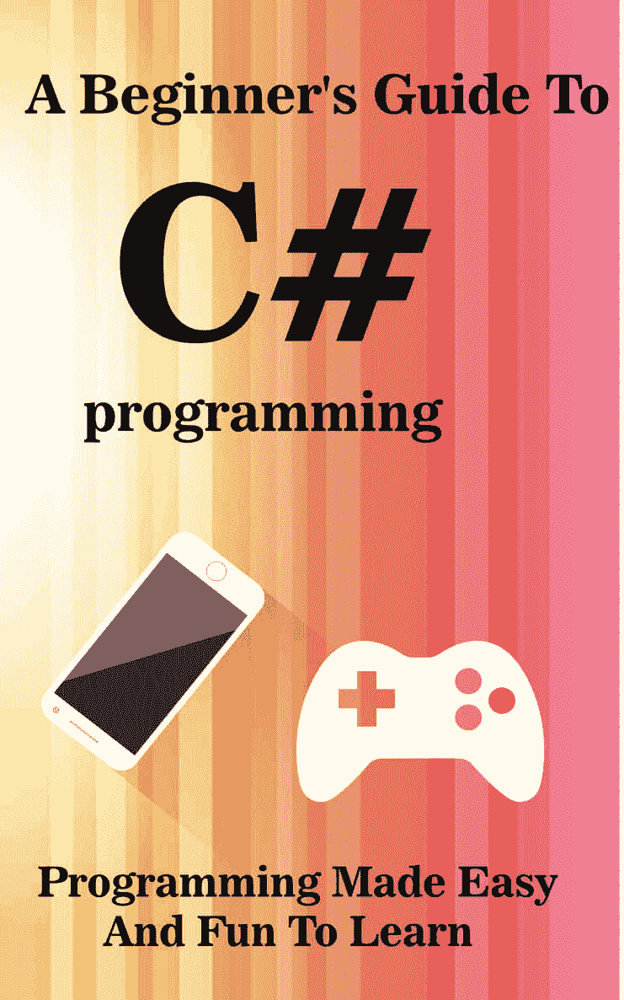
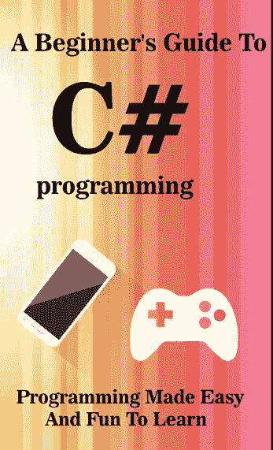


版权 © 2016

## 关于作者：
Faisal 拥有超过 4 年的`Programming` 经验……他在 14 岁开始学习编程。目前他正在为移动平台开发游戏。


# 第 1 章（C# 简介）

`C#`（读作 "C SHARP"）是微软的一种面向对象的编程语言，旨在结合 `C++` 的计算能力与 Visual Basic 的编程易性。`C#` 基于 `C++` 并包含了与 `JAVA` 相似的特性。`C#` 设计用于与微软的 `.NET` 平台配合。

## 为什么选择 C#
`C#` 是一种优雅、简单、类型安全的面向对象的语言，允许企业级人员构建各种应用程序。

`C#` 用于著名的游戏引擎，在全球范围内用于：
- 简单的命令行工具。输入处理、转换处理、输出处理。
- 桌面应用程序。
- Windows 服务
- Web 服务等。

## C# VS .NET
`C#` 是一种编程语言。`.NET` 是在 Windows 上构建应用程序的框架。

## C 语言的历史
在 `c#` 之前，我们在 C 家族中有两种语言：`c` 和 `c++`。当我们编译代码时，编译器会将代码转换为我们运行的机器的本地代码。

这意味着如果我在 Windows 机器上编写了一个程序，它将无法在其他操作系统（如 Linux、mac 等）上运行。

当微软在设计 `c#` 时，他们借鉴了 Java 社区的想法。在 `java` 中，代码首先被翻译成字节码，然后翻译成机器码。

在 `c#` 中，代码首先被翻译成 `il`（中间语言），然后翻译成独立于我们运行的计算机的机器码。`clr`（公共语言运行时）负责将 `il` 代码翻译成机器码。

## .NET 应用程序架构
应用程序由类组成，这些类是应用程序的主要构建模块。这些类相互作用以为我们提供所需的功能。

### 什么是类。
类是一个容器，其中包含数据（也称为属性）和函数（也称为方法）。

### 函数或方法
函数和方法具有行为，它们为我们执行任务。

### 数据。
数据代表我们应用程序的状态。

### 示例：
汽车
汽车可以拥有型号、颜色、品牌、速度等属性，并且可以像 `Start()`、`Break()` 等的功能。将这辆车视为一个类，在现实应用中，我们有很多类，每个类负责某些特定任务，这些类相互作用以提供所需的功能。

### 命名空间。
随着项目中类的数量增加，我们需要一种方法来组织相关的类，因此我们使用 `namespace`。`namespace` 是相同类的容器。

### 程序集。
随着命名空间数量的增加，我们需要方法来划分应用程序，这里 `assemblies` 就派上用场了。`Assembly` 是相同命名空间的容器。物理上它是磁盘上的文件，可以是（`exe` 或 `dll`）。

## 我们的第一个 C 程序。
在本书中我们将使用 Visual Studio，所以请打开 Visual Studio。

在顶部点击文件：
`file>new>project>installed>templates>visual c#>windows>console application`

在这里有 3 个字段，我们可以为项目命名，只需将项目命名为 `HelloWorld`。

我们还可以通过点击浏览按钮设置项目的位置。

第三，我们可以在 Visual Studio 中命名解决方案，我们有解决方案，一个解决方案可以包含多个项目。

最后点击确定创建控制台应用程序。

查看下面的截图
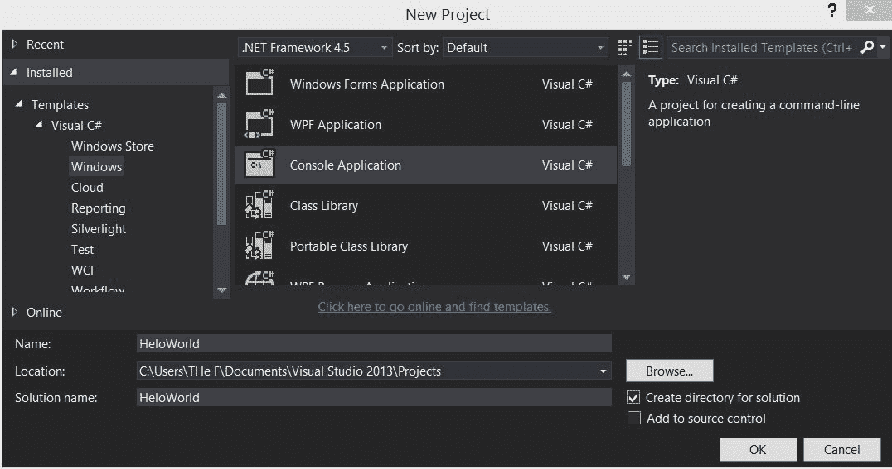 **让我们看看 Visual Studio 的一些窗口和标签**

### 几个常用窗口和标签
- 解决方案管理器 (Solution Explorer)
- 代码编辑器 (Coding Editor)

从解决方案管理器开始，要显示解决方案管理器或任何窗口，请点击顶部的“视图”并选择您想在解决方案管理器窗口中显示的窗口。首先是解决方案名称和此解决方案中的项目数量。
- `properties>AssemblyInfo.cs`
- `assemblyinfo` 在应用程序编译时产生，它是应用程序的标识。

### 引用 (References)
在引用下，我们看到与此项目链接以执行某些任务的 `assemblies`。这些 `assemblies` 是随 Visual Studio 控制台应用程序模板自带的。

### App.config
在这里存储应用程序的配置。它有标题、描述等字段，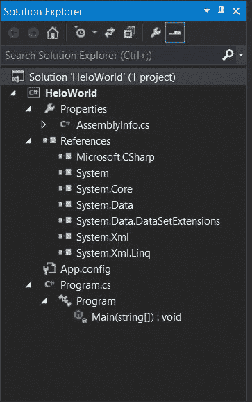

### Program.cs
在 `program.cs` 中，我们可以开始编写代码。

在 `PROGRAM.CS` 文件中，顶部有一堆 `using` 语句。我们的项目名称是 `HELLOWORLD`，所以 Visual Studio 默认创建一个名为 `HELLOWORLD` 的命名空间。当我们在这个 `namespace` 中编写代码时，我们可以访问此命名空间定义的所有类。如果我们想使用来自不同命名空间的类，必须在我们的代码文件中导入它，这就是我们使用 `using` 语句的原因，Visual Studio 默认添加了 5 个 `using` 语句：

```csharp
using System;
using System.Collections.Generic;
using System.Linq;
using System.Text;
using System.Threading.Tasks;
```
`System` 是 `.NET` 框架中的一个命名空间，其中包含了所有方便的类。


变量和常量的名称也称为标识符，标识符不能与数字开头，标识符不能包含空格，标识符不能是 C 语言中已定义的关键字（如 `int`、`bool`、`float`）。始终使用有意义的名字。

## 命名规范

### 驼峰命名法：`[firstName]`
驼峰命名法的第一个字母小写，之后每个单词的首字母大写

### 帕斯命名法：`[FirstName]`
所有单词的字母均大写

### 匈牙体系：`[strFirstName]`
首先前缀数据类型，然后所有单词的字母大写

## C 中的基本类型

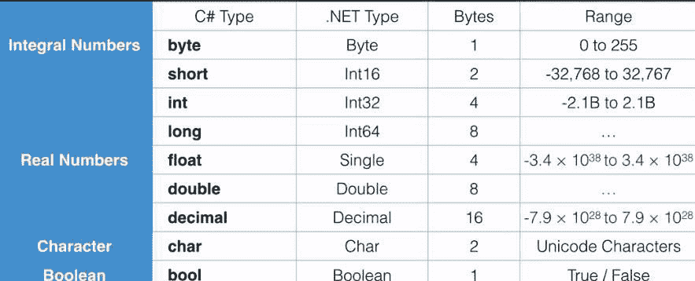

### 使用实数
当我们想要使用 `float` 或 `double` 类型时，我们需要显式地告诉将此数字视为 `float` 或 `double`，请遵循以下语法：

```c-csharp
float number=1.4f;
double number=12.4m;
```

`F` 和 `m` 关键字显式告诉编译器将数字视为 `float` 或 `double`

在 `c` 中，我们可以拥有名称相同但类型不同的变量

## 非基本类型
- `String`
- `Array`
- `Enum`
- `Class`

## 作用范围
作用范围意味着变量/常量在何处有效

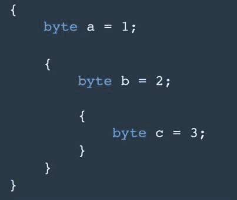 这里有 3 个代码块，包含 3 个变量

所以变量 `a` 可以在它的任何子块中访问，也可以在该块的任何地方访问

所以变量 `b` 可以在它的任何子块中访问，也可以在该块的任何地方访问

而变量 `c` 只能在同一个块中访问

## 在 visual studio 中练习变量
打开 visual studio 并创建一个控制台项目

在程序的 `main` 函数中声明一些值并在控制台上显示它们，见下方的代码

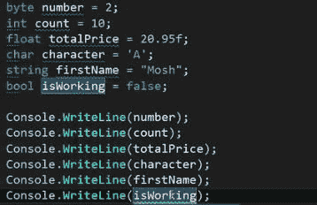

要声明字符类型，我们将在‘A’ 内部输入一个字符；对于字符串，我们在“`string`”内输入字符串。

我们还使用关键字 `var` 来代替声明数据类型 `c`，编译器会自动检测数据类型。现在将所有数据类型更改为 `var`

它看起来应该是这样的

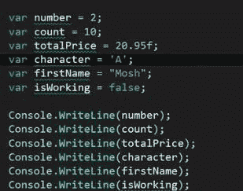

## 格式化字符串
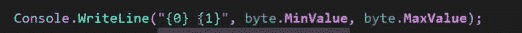

通过这种方式我们将输出可视化。`{0}` 被 `byte.minValue` 替换，它是 `byte` 的最小值；`{1}` 被 `byte.maxvalue` 替换，它是 `byte` 可以存储的最大值

## C# 运算符
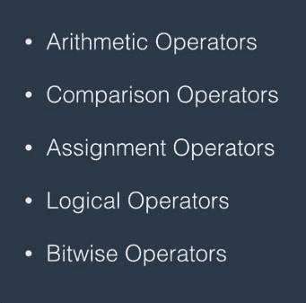

### 算术运算符
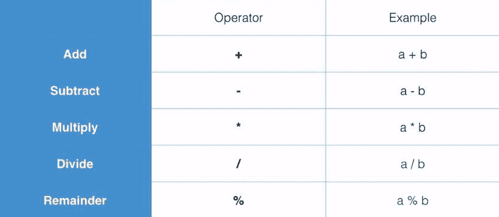 这些运算符用于数学计算

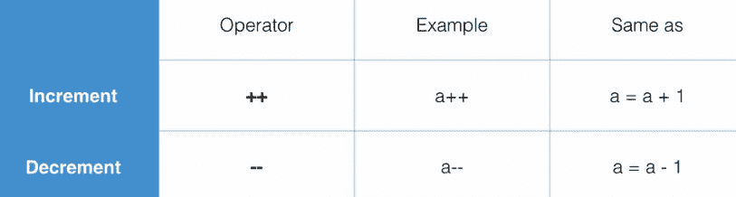 增增运算符值增加一 (1)，递减运算符减少一

## 比较运算符
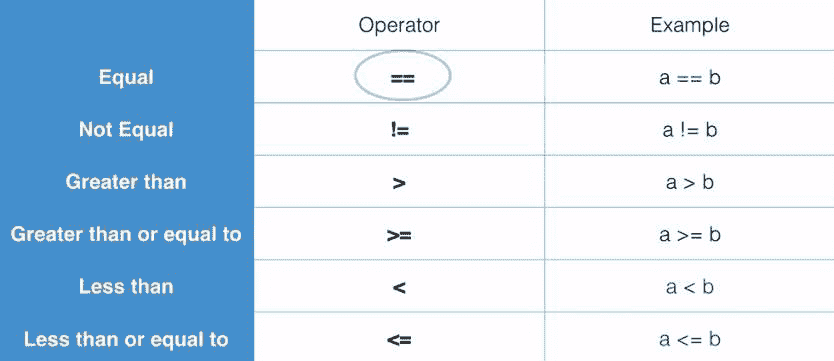 这里需要注意的是，等号 (`=`) 用于赋值，而 `==` 用于测试等等性

## 逻辑运算符
这些运算符被用于条件语句，我们稍后会讨论

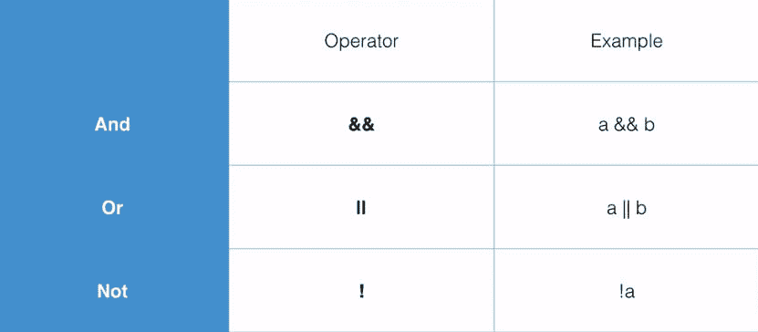

## 位运算符
这些运算符用于低级编程

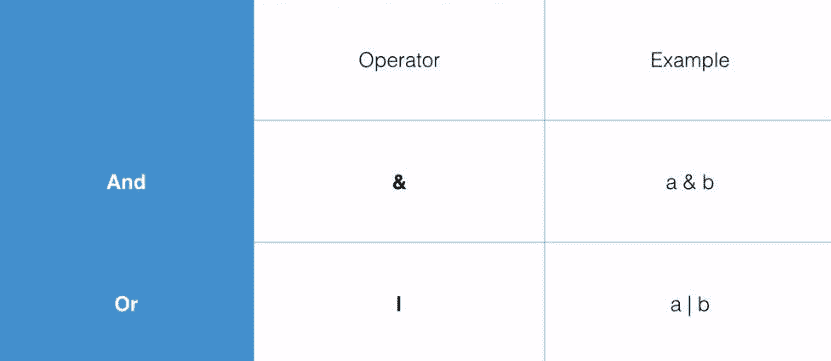

## 练习运算符
在 `main` 方法中声明两个变量，为了显示它们的和值，只需使用

 运行应用程序并在控制台上查看结果

我们还使用 `/`、`-` 或任何算术运算符

示例 2
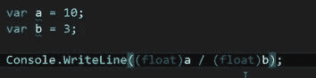

在这种情况情况下，我们将变量声明为 `int`，为了以浮点数显示除法结果，我们必须显式告诉编译器通过对两个变量进行强制转换 (`float`) 将其 `float`

示例 3
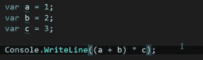

这里有三个变量 `a``,`b``,`c`，如果我们想先加 `a` 和 `b` 然后乘以 `c`，可以通过在 `(a+b)` 内部编写 `a+b` 来实现，现在 `a` 和 `b` 先加，然后与 `c` 相乘

示例 4
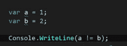 我们可以使用比较运算符和逻辑运算符检查相等和不相等

这里 `a` 不等于 `b`，所以结果将为 true

示例 5
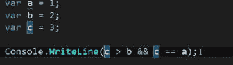

通过 `and` 运算符我们现在可以检查两个条件是否都真。这里 `>b` 是真的，而 `c==a` 是假的，如果其中一个条件不真，结果将为 false

示例 6
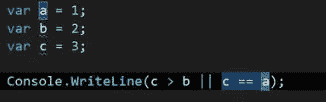

我们可以使用 `or` 运算符，如果这些条件任一为真结果将为 true

## 注释
注释用于描述什么、为什么、如何、限制等……

注释不会被执行

注释的类型

### 多行注释
这些用于在多行上编写注释 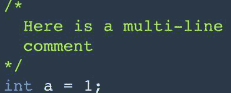

### 单行注释
这些用于在单行上编写注释 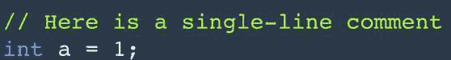

# 恭喜章节已完成……………… ………………………… ………………………… …….

# 第 3 章：非基本类型
章节文本

## 类
结合相关的变量（字段）和函数（方法）

让我们通过示例来学习类

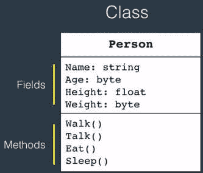 这里我们有一个名为 `person` 的类，带有四个字段和四个方法

类是创建对象的蓝图

### 对象
对象是类的实例

通过这个示例我们可以创建类的实例
- Marry
- John

### 创建类
访问修饰符意味着可以访问它
`person` 类的示例
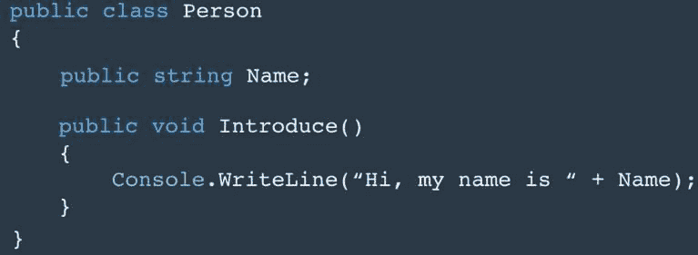 类包含字段和方法。在这个例子中方法没有参数
`Calculator`

### 创建对象
我们像这样声明对象，但必须为变量分配内存
`person` 示例
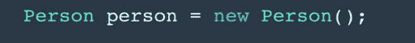images/00028.jpeg) 我们可以使用 `var` 关键字让代码更整洁，通过使用点来访问字段和函数
`Person.name="faisal";`Person.introduce();`

### 静态
我们可以添加 `static` 关键字 `Add()` 函数的 `calculator`
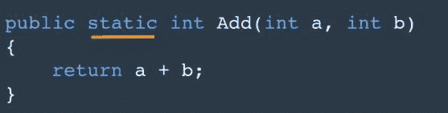 现在我们可以直接从 Calculator 访问
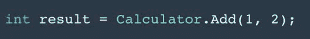 当我们创建对象时 `static` 函数在内存中只一个处

# 练习类
首先在 visual studio 中按 `Shift+alt+c` 创建一个类

将类命名为 `Person`

现在添加名和姓字符串字段

以及一个 `introduce()` 方法，在控制台上输出名和姓
见下方的代码
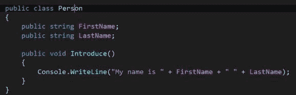 现在在 `main` 方法中创建一个 person 对象并分配名和姓，调用 `introduce()` 方法
见下方的代码
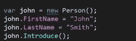 创建另一个名为 `Calculator` 的类并填充 `Add()` 方法该方法接收两个 `int` 变量并在相加后返回它们

现在回到 `main` 方法创建 `calculator` 类的对象，最后调用 `Add()` 函数并将结果存储在变量中并在控制台上打印。(images/00033.jpeg)

## 数组
一种存储相同类型变量集合的数据结构

为什么要使用数组？

示例：
在这个示例中与其声明 3 个 `int` 变量，我们可以声明一个 `int[]` 数组

注意方括号 `[]` 。第一个括号表示它是数组，第 2 个 括号表示数组中元素的数量。在声明时我们需要初始化它的元素数量。

访问数组的元素
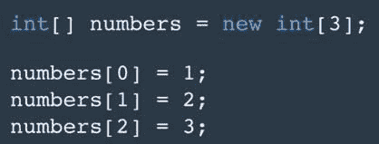 要访问第一个元素，我们从索引 (0) 开始，第二个元素是索引 1，依此类推。我们在方括号 `[]` 中传递索引。并可以赋值。

我们可以使用对象初始化语法初始化数组 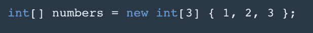

# 练习数组
打开 visual studio 并在 `main` 方法中创建一个带有三个元素的 `numbers` 数组，将索引 0 赋值为 1，将它们全部显示在控制台上

同时也创建一个 `Boolean` 数组并将索引 0 设置为 true，最后将它们全部显示在控制台上

如果我们不初始化数组元素的索引，将分配数据类型的默认值，在这种情况下 `Boolean` 的默认值为 false，而 `int` 有默认值 0


查看下方代码 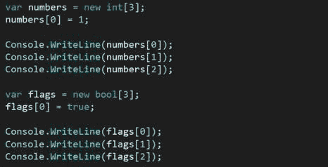 现在运行应用程序并查看结果。

# 字符串

字符串是字符序列，我们用 `"double quotes helloworld"` 将其括起来。

## 字符串拼接

我们可以使用下面的语法将字符串拼接在一起：

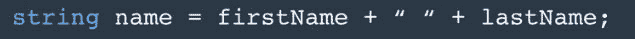

在此示例中：
我们正使用字符串字面量（这是一个空字符串）和 `+` 号将 `firstname` 和 `anme` 字符串拼接在一起。

# 字符串练习

打开 visual studio

创建一个字符串：
`String keyword name of string =string” Example`
`String firstname=faisal”`
`String secondname=nazeer”`

// 现在我们可以拼接两个字符串

`Var fullname=firstname + +secondname”` 现在在控制台上显示它 Console.WriteLine(fullname);`

# 第 4 章. 控制流

## 条件条件语句

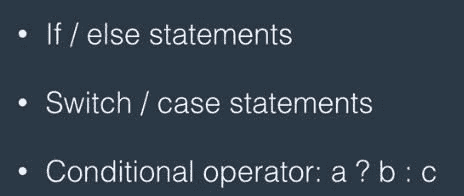

### IF/ELSE 语句

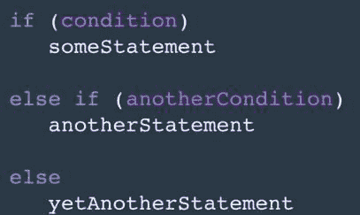

在第一行我们有一个条件 IF，如果条件为真，则执行 IF 代码块。如果条件为假，则将检查 ELSE IF 块，如果 ELSE IF 条件为真，则执行 ELSE IF 块，否则执行 ELSE 语句。

## SWITCH CASE 语句

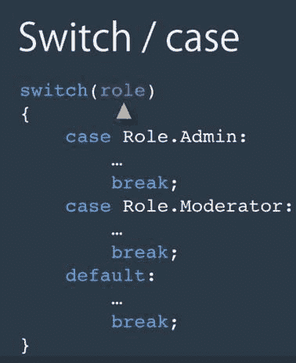

在 switch case 语句中，我们在 cases 中比较变量的值，如果条件为真，则将运行该代码块；否则跳到下一个；如果所有条件都不为真，则将执行 default 块。

## switch/case 语句的语法

首先我们创建一个变量，然后创建 cases 并比较变量的值，我们可以拥有任意数量的 cases，最后执行 default 块。

## Switch Case 练习：

```sharp
char grade = 'A';

switch (grade)
{
case 'A':
Console.WriteLine("Excellent!"); break;
case 'B':
Console.WriteLine("nice");
break;
case 'C':
Console.WriteLine("Well done"); break;
case 'D':
Console.WriteLine("You passed"); break;
case 'F':
Console.WriteLine("Better try again"); break;
default:
Console .WriteLine("Invalid grade");
break;
}
Console.WriteLine("Your grade is {0}", grade);
```

这里我们在每个 case 中检查等级，即 `A`，如果任何 case 等于 `a`，它将运行；在这种情况下，第一个 case 是 `A`，所以将运行第一个代码块。

## 迭代语句

这些语句用于重复一系列语句，直到给条件为真。

迭代语句的类型

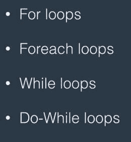

## For 循环

### 语法

C# 中 `for` 循环的语法如下：

```csharp
for ( init; condition; increment )
{
    statement(s);
}
```

这里是 for 循环中的控制流：

- 首先执行 `init` 步骤，且只执行一次。此步骤允许你声明并初始化任何循环控制变量。你不需要在此处放置语句，只要出现分号即可。
- 接下来，评估 `condition`。如果它为真，则执行循环体。如果为假，则不执行循环体，控制流跳转到 for 循环之后的的第一条语句。
- 在执行完 for 循环体后，控制流跳转回 `increment` 语句。此语句允许你更新任何循环控制变量。只要在条件后出现分号，此语句可以留空。
- 现在再次评估条件。如果它为真，则循环执行并重复该过程（循环体、然后增量步骤、然后再次测试条件）。在条件变为假后，for 循环终止。

### 示例

```csharp
using System;

namespace Loops {
class Program {
    static void Main(string[] args) {
        /* for 循环执行 */ for (int a = 10; a < 20; a = a + 1) {
            Console.WriteLine("value of a: {0}", a); 
        }
        Console.ReadLine();
    }
}
}
```

当上述代码被编译并执行时，它产生以下结果：

value of a: 10
value of a: 11
value of a: 12
value of a: 13
value of a: 14
value of a: 15
value of a: 16
value of a: 17
value of a: 19

## While 循环

C# 中的 `while` 循环语句只要给定条件为真，就会重复执行目标语句。

### 语法

C# 中 `while` 循环的语法如下：

```csharp
while(condition)
{
    statement(s);
}
```

在这里，`statement(s)` 可能是单个语句或一个语句块。`condition` 可以是任何表达式，true 是任何非零值。循环在条件为真时进行迭代。

当条件变为假时，程序控制传递到紧随循环的行。

### 示例

```csharp
using System;

namespace Loops {
class Program
{
    static void Main(string[] args) {
        /* 局部变量定义 */ int a = 10;
        /* while 循环执行 */ while (a < 20)
        {
            Console .WriteLine("value of a: {0}", a); a++;
        }
        Console.ReadLine();
    }
}
}
```

当上述代码被编译并执行时，它产生以下结果：

value of a: 10
value of a: 11
value of a: 12
value of a: 13
value of a: 14
value of a: 15
value of a: 16
value of a: 17
value of a: 18

## Do While Loop

与 `for` 和 `while` 循环在循环开始时测试条件不同，`do...while` 循环在循环结束时检查条件。

`do...while` 循环类似于 while 循环，但 `do...while` 循环保证至少执行一次。

### 语法

C# 中 `do...while` 循环的语法如下：

```csharp
do
{
    statement(s);
}while( condition );
```

注意条件表达式出现在循环末尾，因此在测试条件之前会执行循环中的 `statement(s)`。

如果条件为真，控制流跳转回 `do`，再次执行 `statement(s)`。此过程重复直到给定条件变为假。

### 示例

```csharp
using System;

namespace Loops {
class Program {
    static void Main(string[] args) {
        /* 局部变量定义 */ int a = 10;
        /* do 循环执行 */ do
        {
            Console .WriteLine("value of a: {0}", a); a = a + 1;
        }
while (a < 20);
        Console.ReadLine();
    }
}
}
```

当上述代码被编译并执行时，它产生以下结果：

value of a: 10
value of a: 11
value of a: 12
value of a: 13
value of a: 14
value of a: 16
value of a: 17
value of a: 18
value of a: 19

## Foreach 循环

Foreach 循环用于遍历具有列表性质对象的元素，例如数组。

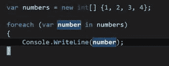首先创建一个局部变量，然后遍历我们想要访问元素的对象。

在此示例中，我们正在遍历数组的所有元素并将其显示在控制台上。

# **恭喜，书写完成了**

