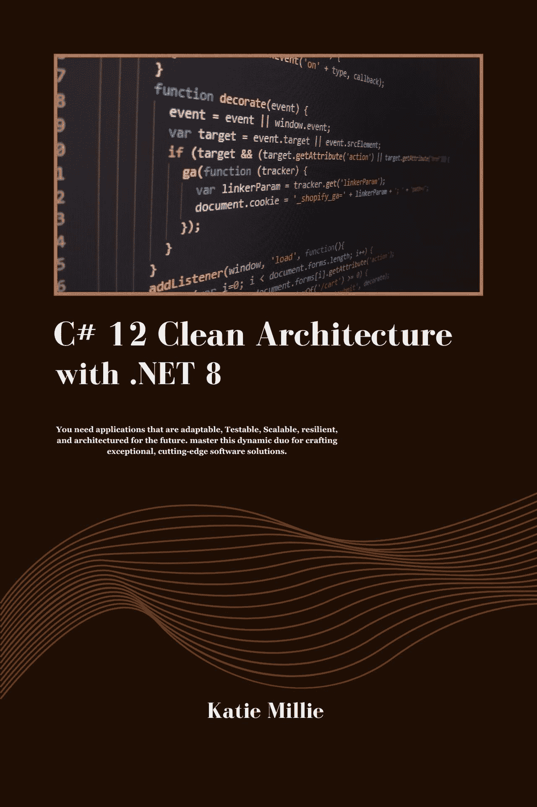

# C# 12 与 .NET 8 的整洁架构

你需要的是适应性强、可测试、可扩展、具有弹性且面向未来架构的应用程序。掌握这对动态组合，打造卓越、前沿的软件解决方案。

作者：Katie Millie

* * *

版权声明

版权所有 © 2024 Katie Millie。保留所有权利。

* * *

未经 Katie Millie 事先书面同意，严禁以任何形式或任何方式复制或使用本文档的任何部分。此禁令涵盖电子或机械方法、影印、录制或任何形式的信息存储和检索系统。文中提及的任何商标均归其各自所有者所有。违反这些条款可能导致法律后果。感谢您合作维护 Katie Millie 的知识产权。

## 目录

### 引言

第 1 章

传统软件开发的挑战

介绍整洁架构：构建持久的软件

在 C# 12 和 .NET 8 的现代开发环境中，整洁架构的优势

第 2 章

整洁架构的核心原则

依赖规则：高层模块不应依赖于低层模块

抽象：关注什么，而非如何

框架与依赖：工具，而非基础

在 C# 12 项目中应用整洁架构原则

第 3 章

揭示 C# 12 特性以增强整洁架构

静态分析器：主动的代码质量与错误检测

模式匹配增强：提升代码可读性、可维护性和表达力

其他 C# 12 特性及其与整洁架构实践的协同作用

第 4 章

为整洁架构设置开发环境

配置整洁架构结构的项目模板

理解 .NET 8 的项目布局与关注点分离

第 5 章

在整洁架构中使用 .NET 8 进行依赖注入

在 C# 12 和 .NET 8 中实现依赖注入

依赖注入在整洁架构中实现松耦合和可测试性的优势

第 6 章

构建核心逻辑：业务规则层

在 C# 12 中实现业务规则层以提升可维护性和可测试性

对业务规则层进行单元测试以确保代码质量和信心

第 7 章

在整洁架构中使用 .NET 8 进行数据持久化

使用 .NET 8 定义数据模型和映射实体以实现持久化

在整洁架构中实现关注点分离的数据访问逻辑

对持久层进行单元测试以确保可靠的数据处理

第 8 章

使用 ASP.NET Core MVC 8 实现整洁架构

使用 C# 12 从 ASP.NET Core MVC 控制器消费业务逻辑层

在 ASP.NET Core MVC 应用程序中实现依赖注入以提升灵活性

利用 Minimal APIs 实现简洁高效的控制器（.NET 8 新特性）

第 9 章

健壮整洁架构应用的测试策略

集成测试：测试层间交互

利用测试框架（xUnit, NUnit）与 C# 12 特性

使用 .NET 8 的整洁架构项目的测试考量

第 10 章

依赖倒置原则实现松耦合与灵活性

用于数据访问抽象的仓储模式

使用 C# 12 和 .NET 8 实现整洁架构的微服务开发

第 11 章

整洁架构的最佳实践与设计模式

整洁架构的设计模式：适配器、外观等

在 C# 12 和 .NET 8 中随着项目演进维护整洁架构

第 12 章

软件开发与整洁架构的新兴趋势

利用 DevOps 实践进行整洁架构项目

第 13 章

使用 .NET 8 实现整洁架构的持续集成与持续交付（CI/CD）

CI/CD 对整洁架构项目的优势

第 14 章

项目的长期成功：整洁架构及更远

使用 C# 12 和 .NET 8 持续学习和适应整洁架构

结论

附录

术语表

展示使用 C# 12 和 .NET 8 实现整洁架构的示例应用代码

### 引言

打造领先的软件：掌握 C# 12 与 .NET 8 的整洁架构

在当今瞬息万变的科技世界中，构建仅仅功能可用的软件是过时的配方。你需要的是适应性强、具有弹性且面向未来架构的应用程序。《C# 12 与 .NET 8 的整洁架构》应运而生，这是你掌握这对动态组合、打造卓越、前沿软件解决方案的全面指南。

本书不仅仅关于编写代码；它关乎打造蓬勃发展的代码。我们将深入探讨整洁架构的变革性世界，这是一种赋能你构建以下特性的设计哲学：

● 解耦：业务逻辑独立于表示层和数据访问层，促进灵活性和对变化的弹性。

● 可测试：松耦合便于进行单元测试，确保代码质量并降低回归风险。

● 可维护：清晰的职责分离提升了代码的可读性，并简化了未来的修改。

为什么选择 C# 12 和 .NET 8？这个强大的组合为实现你的整洁架构愿景提供了完美的平台。C# 12 凭借其开创性的特性，如全局 using 和静态分析器，简化了代码并提升了开发者的生产力。结合 .NET 8 的强大功能，如增强的 Minimal APIs 和改进的性能优化，你拥有了构建简洁、高效且可扩展应用程序的必要工具，从而保持领先优势。

本书为你量身定制，无论你是经验丰富的 C# 开发者，还是刚刚踏上架构之旅：

● 刚接触整洁架构？别担心！我们将分解核心原则，引导你理解定义这种设计方法的分层结构和关注点分离。

● C# 老手？探索 C# 12 特性在整洁架构框架内的激动人心的可能性。了解全局 using 如何简化代码组织，静态分析器如何提升代码质量，以及模式匹配如何优化代码的可读性和可维护性。

● .NET 爱好者？利用 .NET 8 的力量来实现整洁架构的最佳实践。学习如何利用 Minimal APIs 实现简洁高效的控制器，拥抱配置管理以实现灵活配置，并利用异步编程构建高效、响应迅速的应用程序。


超越基础：

本书不仅介绍整洁架构；它还为你提供了有效实施它的实用技能。我们将深入探讨：

● 真实案例：通过我们逐步指导你构建一个实际应用，让你在实践中掌握整洁架构原则。

● 高级主题：探索依赖倒置和仓储模式等高级概念，巩固你对整洁架构最佳实践的理解。

● 测试策略：学习如何为你的整洁架构应用有效编写单元测试，确保代码质量和可维护性。

● 释放 .NET 8 潜力：探索如何在整洁架构的背景下，利用 .NET 8 的特性，如最小 API 和增强的性能优化策略。

在这段旅程结束时，你将能够：

● 自信地使用 C# 12 和 .NET 8，基于整洁架构原则设计和构建软件。

● 具备创建解耦、可维护且可测试的应用程序的技能，这些应用能够经受时间的考验。

● 深入理解最佳实践和高级概念，从而有能力为整洁架构项目做出贡献。

`C# 12 Clean Architecture with .NET 8` 不仅仅是一本书；它是你对构建能够蓬勃发展、适应变化并赋能你交付卓越价值的软件的投资。准备好释放你开发技能的真正潜力，构建引领潮流的软件了吗？立即订购你的副本，踏上打造卓越软件解决方案的旅程吧！

## 第 1 章

### 传统软件开发的挑战

传统的软件开发方法常常面临一些挑战，这些挑战可能阻碍软件系统的效率、可扩展性和可维护性。在本节中，我们将探讨其中一些挑战，以及整洁架构如何结合 C# 12 和 .NET 8 来有效解决它们。

1.  **单体架构**

    传统的软件开发通常依赖于单体架构，其中应用程序的所有组件紧密耦合在一起。这可能导致代码重复、可扩展性有限以及难以对代码库进行更改等问题。

2.  **紧耦合**

    在传统的软件开发中，系统内的组件通常是紧耦合的，这使得在不影响整个系统的情况下修改或替换单个组件变得困难。这种缺乏灵活性的情况可能会阻碍适应不断变化的需求或技术趋势的能力。

3.  **缺乏可测试性**

    传统的软件开发实践可能不优先考虑可测试性，导致代码难以测试且容易出错。没有适当的测试，确保软件系统的可靠性和稳定性就变得具有挑战性。

4.  **对框架的依赖**

    传统的软件开发通常严重依赖于特定的框架或技术，这可能导致供应商锁定和灵活性有限。这种对框架的依赖使得在新技术或工具出现时采用它们变得具有挑战性。

### 使用整洁架构、C# 12 和 .NET 8 应对挑战

整洁架构结合 C# 12 和 .NET 8 的最新特性，为这些挑战提供了解决方案：

1.  **模块化和可扩展的架构**：整洁架构提倡模块化和可扩展的架构，允许开发人员将系统划分为可以独立开发和维护的独立组件。这使得更容易扩展和适应不断变化的需求。

    ```csharp
    // 整洁架构中模块化组件的示例
    namespace MyNamespace.Core.Entities
    {
        public class Product { /*...*/ }
    }

    namespace MyNamespace.Infrastructure.Repositories
    {
        public class ProductRepository { /*...*/ }
    }
    ```

2.  **松耦合**：整洁架构鼓励组件之间的松耦合，允许在不影响整个系统的情况下更容易地修改和替换单个模块。

    ```csharp
    // 整洁架构中松耦合的示例
    public class ProductService
    {
        private readonly IProductRepository _productRepository;

        public ProductService(IProductRepository productRepository)
        {
            _productRepository = productRepository;
        }
    }
    ```

3.  **可测试性**：整洁架构优先考虑可测试性，使得编写全面的单元测试、集成测试和端到端测试变得更容易。这确保了软件系统的可靠性和稳定性。

    ```csharp
    // 整洁架构中单元测试的示例
    [Test]
    public void GetAllProducts_ReturnsProducts()
    {
        var mockRepository = new Mock<IProductRepository>();
        mockRepository.Setup(repo => repo.GetAllAsync()).ReturnsAsync(new List<Product>());

        var productService = new ProductService(mockRepository.Object);
        var products = await productService.GetAllProductsAsync();

        Assert.IsNotNull(products);
    }
    ```

4.  **框架独立性**：整洁架构鼓励独立于特定框架或技术，允许开发人员根据需要选择最合适的工具，并降低供应商锁定的风险。

    ```csharp
    // 整洁架构中框架独立性的示例
    public interface IProductRepository
    {
        Task<List<Product>> GetAllAsync();
    }
    ```

通过采用整洁架构原则并利用 C# 12 和 .NET 8 的特性，开发人员可以克服传统软件开发的挑战，构建健壮、可扩展且可维护的软件系统，这些系统能够适应不断变化的需求和技术趋势。

### 介绍整洁架构：构建持久的软件

在快节奏的软件开发世界中，构建健壮且可维护的软件系统对于长期成功至关重要。整洁架构提供了一种结构化的软件设计方法，优先考虑诸如关注点分离、框架独立性和可测试性等原则。在本指南中，我们将探讨整洁架构的基础知识，并演示如何使用 C# 12 和 .NET 8 构建持久的软件。

#### 理解整洁架构

整洁架构由 Robert C. Martin（Uncle Bob）推广，是一种强调关注点分离和框架独立性的软件架构模式。其核心是将软件系统划分为多个层，每层都有特定的职责和抽象级别。这些层通常包括：

1.  **实体**：包含表示应用程序核心概念的业务实体或领域对象。

2.  **用例**：包含特定于应用程序的业务规则或用例，通常称为应用程序服务。

3.  **接口**：定义与外部系统或依赖项交互的接口或契约。

4.  **框架和驱动程序**：包含应用程序使用的外部框架、工具或技术，例如数据库、UI 框架或外部 API。

整洁架构提倡这些层之间的松耦合，允许每层独立演进而不影响其他层。这种关注点分离确保了系统一部分的更改不会在其他地方产生意外后果，使代码库更易于维护和适应变化。

#### 整洁架构的优势

整洁架构为构建持久的软件提供了几个好处：

1.  **可扩展性**：通过将代码库组织成模块化和松耦合的组件，整洁架构使软件系统能够在规模和复杂性增长时优雅地扩展。可以添加新功能或修改现有功能，而不会引入不必要的复杂性或依赖关系。


2. 可维护性：整洁架构通过强制关注点分离和最小化依赖，倡导编写整洁、可读且易于维护的代码。这使得开发者能够更轻松地理解、修改和扩展代码库，从而降低技术债务和代码腐化的风险。

3. 可测试性：整洁架构优先考虑可测试性，使得编写全面的单元测试、集成测试和端到端测试变得更加容易。通过设计易于测试的组件，开发者可以在开发过程的早期识别并修复问题，确保软件系统的可靠性和稳定性。

4. 灵活性：整洁架构允许在选择技术栈和框架时保持灵活性，使开发者能够采用新兴的技术或工具。这种灵活性确保了软件系统能够适应不断变化的需求和技术进步。

### 使用 C# 12 和 .NET 8 实现整洁架构

让我们通过一个简单的电子商务应用程序，演示如何使用 C# 12 和 .NET 8 实现整洁架构：

#### 目录结构

```
MyECommerce.Core/
- 包含领域实体和业务逻辑

MyECommerce.Application/
- 包含应用服务和用例

MyECommerce.Infrastructure/
- 包含数据访问逻辑和外部依赖

MyECommerce.Presentation/
- 包含表示层组件，如 UI 或 API 端点
```

### 示例代码：领域实体

```csharp
// MyECommerce.Core/Entities/Product.cs

namespace MyECommerce.Core.Entities
{
    public class Product
    {
        public int Id { get; set; }
        public string Name { get; set; }
        public decimal Price { get; set; }
    }
}
```

### 示例代码：应用服务

```csharp
// MyECommerce.Application/Services/ProductService.cs

using MyECommerce.Core.Entities;
using MyECommerce.Infrastructure.Repositories;
using System.Collections.Generic;
using System.Threading.Tasks;

namespace MyECommerce.Application.Services
{
    public class ProductService
    {
        private readonly IProductRepository _productRepository;

        public ProductService(IProductRepository productRepository)
        {
            _productRepository = productRepository;
        }

        public async Task<List<Product>> GetAllProductsAsync()
        {
            return await _productRepository.GetAllAsync();
        }
    }
}
```

#### 示例代码：表示层（API 端点）

```csharp
// MyECommerce.Presentation/Controllers/ProductController.cs

using Microsoft.AspNetCore.Mvc;
using MyECommerce.Application.Services;
using MyECommerce.Core.Entities;
using System.Collections.Generic;
using System.Threading.Tasks;

namespace MyECommerce.Presentation.Controllers
{
    [ApiController]
    [Route("api/products")]
    public class ProductController : ControllerBase
    {
        private readonly ProductService _productService;

        public ProductController(ProductService productService)
        {
            _productService = productService;
        }

        [HttpGet]
        public async Task<ActionResult<List<Product>>> GetAllProducts()
        {
            var products = await _productService.GetAllProductsAsync();
            return Ok(products);
        }
    }
}
```

整洁架构为构建经得起时间考验的软件系统提供了一种结构化的方法。通过分离关注点、提升可测试性并实现灵活性，整洁架构使开发者能够创建可扩展、可维护且能适应变化的软件。借助 C# 12 和 .NET 8 的特性和增强功能，实现整洁架构变得更加强大和高效，允许开发者构建健壮且富有弹性的软件系统，以满足现代软件开发的需求。

## 在 C# 12 和 .NET 8 现代开发环境中整洁架构的优势

整洁架构在现代软件开发中继续发挥着关键作用，为构建软件系统提供了一种结构化且可维护的方法。随着 C# 12 和 .NET 8 的进步，整洁架构变得更加强大和高效，提供了在现代开发环境中至关重要的几项优势。

### 1. 可扩展性

整洁架构为软件系统提供了一个可扩展的结构，使其能够随着时间的推移而增长和演进，而不会牺牲可维护性或性能。通过将代码库组织成模块化且松散耦合的组件，整洁架构使团队能够添加新功能、模块或特性，而不会引入不必要的复杂性或依赖。

```csharp
// 整洁架构中模块化组件的示例

namespace MyNamespace.Core.Entities
{
    public class Product { /*...*/ }
}

namespace MyNamespace.Infrastructure.Repositories
{
    public class ProductRepository { /*...*/ }
}
```

### 2. 可维护性

如果没有清晰的架构结构，维护复杂的软件系统可能具有挑战性。整洁架构通过强制关注点分离和最小化依赖，倡导编写整洁、可读且易于维护的代码。这使得开发者能够更轻松地理解、修改和扩展代码库，从而降低技术债务和代码腐化的风险。

```csharp
// 整洁架构中松散耦合的示例

public class ProductService
{
    private readonly IProductRepository _productRepository;

    public ProductService(IProductRepository productRepository)
    {
        _productRepository = productRepository;
    }
}
```

### 3. 可测试性

整洁架构优先考虑可测试性，使得编写全面的单元测试、集成测试和端到端测试变得更加容易。通过设计易于测试的组件，开发者可以在开发过程的早期识别并修复问题，确保软件系统的可靠性和稳定性。

```csharp
// 整洁架构中单元测试的示例

[Test]
public void GetAllProducts_ReturnsProducts()
{
    var mockRepository = new Mock<IProductRepository>();
    mockRepository.Setup(repo => repo.GetAllAsync()).ReturnsAsync(new List<Product>());

    var productService = new ProductService(mockRepository.Object);
    var products = await productService.GetAllProductsAsync();

    Assert.IsNotNull(products);
}
```

### 4. 灵活性

整洁架构允许在选择技术栈和框架时保持灵活性，使团队能够采用新兴的技术或工具。这种灵活性确保了软件系统能够适应不断变化的需求和技术进步，降低了供应商锁定的风险，并使应用程序面向未来。

```csharp
// 整洁架构中独立于框架的示例

public interface IProductRepository
{
    Task<List<Product>> GetAllAsync();
}
```


### 5. 框架的独立性

整洁架构鼓励与特定框架或技术保持独立，使团队能够选择最适合其需求的工具。通过将依赖抽象到接口或契约之后，整洁架构使团队能够更换实现或升级依赖，而不会影响系统的其余部分。

整洁架构结合 `C# 12` 和 `.NET 8` 中的特性和增强功能，为在现代开发环境中构建健壮且可维护的软件系统提供了多项优势。通过优先考虑可扩展性、可维护性、可测试性、灵活性和框架独立性，整洁架构使团队能够克服现代软件开发的挑战，并交付满足用户和利益相关者不断变化需求的高质量软件。借助整洁架构，团队可以构建经得起时间考验的软件，轻松适应不断变化的需求和技术进步。

## 第 2 章：整洁架构的核心原则

### 分层架构：关注点分离

在现代软件开发中，分层架构是一种基本的设计模式，它强调关注点分离，使得构建和维护复杂软件系统变得更加容易。随着 `C# 12` 和 `.NET 8` 的进步，分层架构仍然是组织代码和强制执行模块化设计原则的强大方法。在本指南中，我们将探讨分层架构，并展示如何使用 `C# 12` 和 `.NET 8` 来促进关注点分离。

#### 理解分层架构

分层架构将软件系统划分为不同的层，每层负责一组特定的任务或关注点。这些层通常包括：

1.  **表示层**：负责处理用户界面（UI）交互并向用户呈现信息。此层可能包括 UI 控制器、视图或 Web API 等组件。
2.  **应用层**：包含特定于应用程序的业务逻辑和用例。此层协调表示层、领域层和基础设施层之间的交互。
3.  **领域层**：包含领域实体、业务规则和特定于领域的逻辑。此层代表应用程序的核心概念，独立于任何特定技术或框架。
4.  **基础设施层**：包含与基础设施相关的关注点，如数据访问、外部依赖以及与外部系统的通信。此层提供与数据库、外部 API 或其他服务交互的实现。

#### 分层架构的优势

分层架构为构建软件系统提供了多项优势：

1.  **关注点分离**：通过将系统划分为层，分层架构促进了关注点分离，使得理解、修改和维护代码库变得更加容易。每层都有特定的职责，减少了组件之间的耦合并提高了模块化程度。
2.  **模块化和可重用性**：分层架构鼓励模块化设计，允许组件独立开发和维护。这种模块化促进了代码重用，并使团队能够在不影响系统其余部分的情况下添加新功能或模块。
3.  **可测试性**：分层架构通过隔离每层内的组件来促进可测试性。这使得编写单元测试、集成测试和端到端测试变得更加容易，确保了软件系统的可靠性和稳定性。

#### 使用 `C# 12` 和 `.NET 8` 实现分层架构

让我们用一个简单的电子商务应用程序来演示如何使用 `C# 12` 和 `.NET 8` 实现分层架构：

**目录结构**

```
MyECommerce.Core/
- 包含领域实体和业务逻辑

MyECommerce.Application/
- 包含应用服务和用例

MyECommerce.Infrastructure/
- 包含数据访问逻辑和外部依赖

MyECommerce.Presentation/
- 包含表示层组件，如 UI 或 API 端点
```

**示例代码：领域实体**

```csharp
// MyECommerce.Core/Entities/Product.cs
namespace MyECommerce.Core.Entities
{
    public class Product
    {
        public int Id { get; set; }
        public string Name { get; set; }
        public decimal Price { get; set; }
    }
}
```

**示例代码：应用服务**

```csharp
// MyECommerce.Application/Services/ProductService.cs
using MyECommerce.Core.Entities;
using MyECommerce.Infrastructure.Repositories;
using System.Collections.Generic;
using System.Threading.Tasks;

namespace MyECommerce.Application.Services
{
    public class ProductService
    {
        private readonly IProductRepository _productRepository;

        public ProductService(IProductRepository productRepository)
        {
            _productRepository = productRepository;
        }

        public async Task<List<Product>> GetAllProductsAsync()
        {
            return await _productRepository.GetAllAsync();
        }
    }
}
```

**示例代码：表示层（API 端点）**

```csharp
// MyECommerce.Presentation/Controllers/ProductController.cs
using Microsoft.AspNetCore.Mvc;
using MyECommerce.Application.Services;
using MyECommerce.Core.Entities;
using System.Collections.Generic;
using System.Threading.Tasks;

namespace MyECommerce.Presentation.Controllers
{
    [ApiController]
    [Route("api/products")]
    public class ProductController : ControllerBase
    {
        private readonly ProductService _productService;

        public ProductController(ProductService productService)
        {
            _productService = productService;
        }

        [HttpGet]
        public async Task<ActionResult<List<Product>>> GetAllProducts()
        {
            var products = await _productService.GetAllProductsAsync();
            return Ok(products);
        }
    }
}
```

分层架构是一种强大的设计模式，它促进了软件系统中的关注点分离和模块化。通过将代码库组织成不同的层，开发人员可以构建更易于理解、维护和扩展的软件。借助 `C# 12` 和 `.NET 8` 中的特性和增强功能，实现分层架构变得更加高效和有效，使团队能够构建满足现代软件开发需求的健壮且可扩展的软件系统。

### 依赖规则：高层模块不应依赖于低层模块

依赖规则是整洁架构的一个关键原则，它指出高层模块不应依赖于低层模块。相反，两者都应依赖于抽象。此规则旨在促进组件之间的松耦合，提高可维护性，并实现更轻松的测试和可扩展性。在本指南中，我们将探讨依赖规则，并在整洁架构的上下文中，使用 `C# 12` 和 `.NET 6` 演示其实现。

#### 理解依赖规则

在整洁架构中，模块被组织成层，每层负责特定的任务或关注点。依赖规则规定，包含更抽象和特定于业务逻辑的高层模块，不应依赖于包含实现细节或基础设施关注点的低层模块。相反，两者都应依赖于抽象或接口。

此原则确保对低层模块（如数据库访问或外部依赖）的更改不会影响高层模块。它还促进了模块化，允许组件独立开发和维护。此外，依赖规则通过使组件在测试期间易于模拟或替换来促进可测试性。

#### 使用 `C# 12` 和 `.NET 6` 实现依赖规则

让我们在整洁架构的上下文中，演示如何使用 `C# 12` 和 `.NET 6` 实现依赖规则：

**目录结构**

```
MyECommerce.Core/
- 包含领域实体和业务逻辑

MyECommerce.Application/
```


- `MyECommerce.Application/`
  - 包含应用服务和用例

- `MyECommerce.Infrastructure/`
  - 包含数据访问逻辑和外部依赖

- `MyECommerce.Presentation/`
  - 包含表示层组件，如用户界面或 API 端点

#### 示例代码：核心层（领域实体）

```csharp
// MyECommerce.Core/Entities/Product.cs

namespace MyECommerce.Core.Entities
{
    public class Product
    {
        public int Id { get; set; }
        public string Name { get; set; }
        public decimal Price { get; set; }
    }
}
```

#### 示例代码：应用层（应用服务）

```csharp
// MyECommerce.Application/Services/ProductService.cs

using MyECommerce.Core.Entities;
using MyECommerce.Core.Interfaces;
using System.Collections.Generic;
using System.Threading.Tasks;

namespace MyECommerce.Application.Services
{
    public class ProductService
    {
        private readonly IProductRepository _productRepository;

        public ProductService(IProductRepository productRepository)
        {
            _productRepository = productRepository;
        }

        public async Task<List<Product>> GetAllProductsAsync()
        {
            return await _productRepository.GetAllAsync();
        }
    }
}
```

#### 示例代码：基础设施层（仓储实现）

```csharp
// MyECommerce.Infrastructure/Repositories/ProductRepository.cs

using MyECommerce.Core.Entities;
using MyECommerce.Core.Interfaces;
using System.Collections.Generic;
using System.Threading.Tasks;

namespace MyECommerce.Infrastructure.Repositories
{
    public class ProductRepository : IProductRepository
    {
        public async Task<List<Product>> GetAllAsync()
        {
            // 数据库查询或外部 API 调用的实现
        }
    }
}
```

#### 示例代码：表示层（API 端点）

```csharp
// MyECommerce.Presentation/Controllers/ProductController.cs

using Microsoft.AspNetCore.Mvc;
using MyECommerce.Application.Services;
using MyECommerce.Core.Entities;
using System.Collections.Generic;
using System.Threading.Tasks;

namespace MyECommerce.Presentation.Controllers
{
    [ApiController]
    [Route("api/products")]
    public class ProductController : ControllerBase
    {
        private readonly ProductService _productService;

        public ProductController(ProductService productService)
        {
            _productService = productService;
        }

        [HttpGet]
        public async Task<ActionResult<List<Product>>> GetAllProducts()
        {
            var products = await _productService.GetAllProductsAsync();
            return Ok(products);
        }
    }
}
```

依赖规则是整洁架构的一个基本原则，它促进了软件系统中的松耦合和模块化。通过遵守此规则，开发者可以创建更易于理解、维护和扩展的软件。借助 C# 12 和 .NET 6 中的特性和增强功能，实现依赖规则变得更加高效和有效，使团队能够构建满足现代软件开发需求的健壮且可扩展的软件系统。

## 抽象：关注“做什么”，而非“怎么做”

在软件开发中，抽象在促进模块化、灵活性和可维护性方面扮演着至关重要的角色。它们允许开发者专注于定义需要完成什么，而不是如何完成。抽象提供了一层间接性，将组件解耦，使它们能够相互通信而无需了解实现细节。在整洁架构的背景下，抽象对于遵守依赖规则和促进模块间的松耦合至关重要。在本指南中，我们将探讨抽象的概念，并演示如何在整洁架构的背景下，使用 C# 12 和 .NET 8 来实现它们。

### 理解抽象

抽象代表一个更高层次的概念或想法，它隐藏了底层的实现细节。它们提供了复杂系统的简化视图，允许开发者以更直观和可管理的方式与之交互。抽象专注于定义组件的行为或接口，而不是具体的实现细节。

在软件开发的背景下，抽象可以采取多种形式，包括接口、抽象类，甚至更高层次的架构模式。通过使用抽象，开发者可以设计出更可重用、可扩展和可测试的组件。

### 在整洁架构中实现抽象

在整洁架构中，抽象用于定义模块所依赖的契约或接口，而不是具体的实现。这允许模块通过定义良好的接口进行交互，从而促进松耦合和模块化。

让我们演示如何在整洁架构中使用 C# 12 和 .NET 8 来实现抽象：

#### 示例代码：核心层（领域接口）

```csharp
// MyECommerce.Core/Interfaces/IProductRepository.cs

using MyECommerce.Core.Entities;
using System.Collections.Generic;
using System.Threading.Tasks;

namespace MyECommerce.Core.Interfaces
{
    public interface IProductRepository
    {
        Task<List<Product>> GetAllAsync();
    }
}
```

#### 示例代码：基础设施层（仓储实现）

```csharp
// MyECommerce.Infrastructure/Repositories/ProductRepository.cs

using MyECommerce.Core.Entities;
using MyECommerce.Core.Interfaces;
using System.Collections.Generic;
using System.Threading.Tasks;

namespace MyECommerce.Infrastructure.Repositories
{
    public class ProductRepository : IProductRepository
    {
        public async Task<List<Product>> GetAllAsync()
        {
            // 数据库查询或外部 API 调用的实现
        }
    }
}
```

#### 示例代码：应用层（应用服务）

```csharp
// MyECommerce.Application/Services/ProductService.cs

using MyECommerce.Core.Entities;
using MyECommerce.Core.Interfaces;
using System.Collections.Generic;
using System.Threading.Tasks;

namespace MyECommerce.Application.Services
{
    public class ProductService
    {
        private readonly IProductRepository _productRepository;

        public ProductService(IProductRepository productRepository)
        {
            _productRepository = productRepository;
        }

        public async Task<List<Product>> GetAllProductsAsync()
        {
            return await _productRepository.GetAllAsync();
        }
    }
}
```

#### 示例代码：表示层（API 端点）

```csharp
// MyECommerce.Presentation/Controllers/ProductController.cs

using Microsoft.AspNetCore.Mvc;
using MyECommerce.Application.Services;
using MyECommerce.Core.Entities;
using System.Collections.Generic;
using System.Threading.Tasks;

namespace MyECommerce.Presentation.Controllers
{
    [ApiController]
    [Route("api/products")]
    public class ProductController : ControllerBase
    {
        private readonly ProductService _productService;

        public ProductController(ProductService productService)
        {
            _productService = productService;
        }

        [HttpGet]
        public async Task<ActionResult<List<Product>>> GetAllProducts()
        {
            var products = await _productService.GetAllProductsAsync();
            return Ok(products);
        }
    }
}
```


## 抽象的好处

在整洁架构中实现抽象具有以下几大好处：

1.  **松耦合**：抽象促进了模块之间的松耦合，允许组件通过定义良好的接口而非具体实现进行交互。这减少了依赖关系，使系统更具模块化和可扩展性。
2.  **灵活性**：抽象提供了一层间接性，使得组件可以轻松替换或升级，而不会影响系统的其他部分。这提升了灵活性，并能更好地适应不断变化的需求或技术趋势。
3.  **可测试性**：抽象通过允许在测试期间轻松模拟或替换组件来促进测试。这使得编写单元测试、集成测试和端到端测试变得更加容易，从而确保软件系统的可靠性和稳定性。

抽象是软件开发中的一个基本概念，它使开发者能够专注于定义需要做什么，而不是如何去做。在整洁架构的背景下，抽象在促进松耦合、模块化和可测试性方面发挥着至关重要的作用。通过使用接口或更高层次的架构模式来实现抽象，开发者可以构建出更灵活、更易于维护和更具可扩展性的软件系统。借助 `C# 12` 和 `.NET 8` 中的功能和增强特性，实现抽象变得更加高效和有效，使团队能够构建出满足现代软件开发需求的健壮且富有弹性的软件系统。

## 框架与依赖：工具，而非基石

在软件开发的背景下，框架和依赖是使开发者能够高效构建复杂且功能丰富的应用程序的基本工具。然而，至关重要的是要认识到，框架和依赖应作为支持开发过程的工具，而不是构成软件架构的基石。整洁架构强调独立于特定框架和依赖的重要性，倡导一种优先考虑关注点分离的模块化和灵活设计。在本指南中，我们将探讨框架和依赖在整洁架构中的角色，并演示如何使用 `C# 12` 和 `.NET 8` 来实现它们。

### 理解框架和依赖

框架是预先构建的工具、库和约定的集合，为开发软件应用程序提供了基础。另一方面，依赖是指在软件项目中使用的外部库或包，用于提供额外的功能或特性。虽然框架和依赖可以显著加速开发过程并提供对高级功能的访问，但它们也引入了复杂性和潜在的约束。

在整洁架构中，框架和依赖应被视为支持开发过程的工具，而不是决定软件系统设计的因素。通过最小化依赖并抽象掉框架特定的细节，开发者可以构建出更具模块化、更易于维护且更能适应变化的软件。

### 在整洁架构中实现框架和依赖

让我们演示如何使用 `C# 12` 和 `.NET 8` 在整洁架构中实现框架和依赖：

#### 示例代码：核心层（领域实体）

```csharp
// MyECommerce.Core/Entities/Product.cs

namespace MyECommerce.Core.Entities
{
    public class Product
    {
        public int Id { get; set; }
        public string Name { get; set; }
        public decimal Price { get; set; }
    }
}
```

#### 示例代码：基础设施层（仓储实现）

```csharp
// MyECommerce.Infrastructure/Repositories/ProductRepository.cs

using MyECommerce.Core.Entities;
using MyECommerce.Core.Interfaces;
using System.Collections.Generic;
using System.Threading.Tasks;

namespace MyECommerce.Infrastructure.Repositories
{
    public class ProductRepository : IProductRepository
    {
        public async Task<List<Product>> GetAllAsync()
        {
            // 数据库查询或外部 API 调用的实现
        }
    }
}
```

#### 示例代码：应用层（应用服务）

```csharp
// MyECommerce.Application/Services/ProductService.cs

using MyECommerce.Core.Entities;
using MyECommerce.Core.Interfaces;
using System.Collections.Generic;
using System.Threading.Tasks;

namespace MyECommerce.Application.Services
{
    public class ProductService
    {
        private readonly IProductRepository _productRepository;

        public ProductService(IProductRepository productRepository)
        {
            _productRepository = productRepository;
        }

        public async Task<List<Product>> GetAllProductsAsync()
        {
            return await _productRepository.GetAllAsync();
        }
    }
}
```

#### 示例代码：表示层（API 端点）

```csharp
// MyECommerce.Presentation/Controllers/ProductController.cs

using Microsoft.AspNetCore.Mvc;
using MyECommerce.Application.Services;
using MyECommerce.Core.Entities;
using System.Collections.Generic;
using System.Threading.Tasks;

namespace MyECommerce.Presentation.Controllers
{
    [ApiController]
    [Route("api/products")]
    public class ProductController : ControllerBase
    {
        private readonly ProductService _productService;

        public ProductController(ProductService productService)
        {
            _productService = productService;
        }

        [HttpGet]
        public async Task<ActionResult<List<Product>>> GetAllProducts()
        {
            var products = await _productService.GetAllProductsAsync();
            return Ok(products);
        }
    }
}
```


## 最小化框架和依赖项的好处

通过将框架和依赖项视为工具，而非软件架构的基础，整洁架构提供了多项优势：

1.  **独立性**：整洁架构倡导对特定框架和依赖项保持独立，使开发者能够选择最适合其需求的工具。这降低了供应商锁定的风险，并确保软件系统能够适应不断变化的需求或技术趋势。
2.  **模块化**：最小化依赖项并抽象掉框架特定细节，促进了模块化，允许组件独立开发和维护。这使得代码库更灵活，更易于理解、修改和扩展。
3.  **可测试性**：整洁架构优先考虑可测试性，使组件在测试期间能够轻松地被模拟或替换。这使得编写全面的单元测试、集成测试和端到端测试变得更加容易，从而确保软件系统的可靠性和稳定性。

框架和依赖项是使开发者能够高效构建复杂且功能丰富的软件应用程序的基本工具。然而，重要的是要认识到，框架和依赖项应作为支持开发过程的工具，而不是构成软件架构的基础。通过最小化依赖项并抽象掉框架特定细节，整洁架构倡导一种模块化和灵活的设计，优先考虑关注点分离。借助 C# 12 和 .NET 8 中的功能和增强，在整洁架构中实现框架和依赖项变得更加高效和有效，使团队能够构建满足现代软件开发需求的健壮且有弹性的软件系统。

## 在 C# 12 项目中应用整洁架构原则

整洁架构是一种软件设计范式，强调关注点分离、模块化和可测试性。它通过将代码库组织成具有不同职责的层，提供了一种构建软件系统的结构化方法。随着 C# 12 和 .NET 8 的发布，开发者可以使用强大的功能和增强特性，这些进一步促进了整洁架构原则的实施。在本指南中，我们将探讨如何在使用 .NET 8 的 C# 12 项目中应用整洁架构原则，并附带代码示例。

### 理解整洁架构原则

整洁架构定义了一组指导软件系统设计和组织的原则：

1.  **关注点分离**：整洁架构将系统划分为层，每层负责一个特定的关注点。这种分离确保每个组件具有单一职责，并且可以独立开发、测试和维护。
2.  **依赖规则**：高层模块不应依赖于低层模块。两者都应依赖于抽象。该原则促进了组件之间的松散耦合，并有助于模块化和可测试性。
3.  **抽象**：专注于定义需要做什么，而不是如何去做。抽象提供了一个间接层，隐藏了实现细节，使组件能够通过定义良好的接口进行交互。
4.  **框架和依赖项**：将框架和依赖项视为工具，而非软件架构的基础。最小化依赖项并抽象掉框架特定细节，以促进独立性和灵活性。

### 使用 C# 12 和 .NET 8 实现整洁架构

让我们演示如何在使用 .NET 8 的 C# 12 项目中应用整洁架构原则：

#### 目录结构

```
MyECommerce.Core/
- 包含领域实体和业务逻辑

MyECommerce.Application/
- 包含应用服务和用例

MyECommerce.Infrastructure/
- 包含数据访问逻辑和外部依赖项

MyECommerce.Presentation/
- 包含表示层组件，如 UI 或 API 端点
```

#### 示例代码：核心层（领域实体）

```csharp
// MyECommerce.Core/Entities/Product.cs

namespace MyECommerce.Core.Entities
{
    public class Product
    {
        public int Id { get; set; }
        public string Name { get; set; }
        public decimal Price { get; set; }
    }
}
```

#### 示例代码：应用层（应用服务）

```csharp
// MyECommerce.Application/Services/ProductService.cs

using MyECommerce.Core.Entities;
using MyECommerce.Core.Interfaces;
using System.Collections.Generic;
using System.Threading.Tasks;

namespace MyECommerce.Application.Services
{
    public class ProductService
    {
        private readonly IProductRepository _productRepository;

        public ProductService(IProductRepository productRepository)
        {
            _productRepository = productRepository;
        }

        public async Task<List<Product>> GetAllProductsAsync()
        {
            return await _productRepository.GetAllAsync();
        }
    }
}
```

#### 示例代码：基础设施层（仓储实现）

```csharp
// MyECommerce.Infrastructure/Repositories/ProductRepository.cs

using MyECommerce.Core.Entities;
using MyECommerce.Core.Interfaces;
using System.Collections.Generic;
using System.Threading.Tasks;

namespace MyECommerce.Infrastructure.Repositories
{
    public class ProductRepository : IProductRepository
    {
        public async Task<List<Product>> GetAllAsync()
        {
            // 数据库查询或外部 API 调用的实现
        }
    }
}
```

#### 示例代码：表示层（API 端点）

```csharp
// MyECommerce.Presentation/Controllers/ProductController.cs

using Microsoft.AspNetCore.Mvc;
using MyECommerce.Application.Services;
using MyECommerce.Core.Entities;
using System.Collections.Generic;
using System.Threading.Tasks;

namespace MyECommerce.Presentation.Controllers
{
    [ApiController]
    [Route("api/products")]
    public class ProductController : ControllerBase
    {
        private readonly ProductService _productService;

        public ProductController(ProductService productService)
        {
            _productService = productService;
        }

        [HttpGet]
        public async Task<ActionResult<List<Product>>> GetAllProducts()
        {
            var products = await _productService.GetAllProductsAsync();
            return Ok(products);
        }
    }
}
```


## 在 C# 12 项目中应用整洁架构的优势

在使用 .NET 8 的 C# 12 项目中应用整洁架构原则，能带来诸多益处：

1.  **模块化**：整洁架构通过将代码库组织成具有明确职责的层次结构来促进模块化。这使得系统更易于理解、维护和扩展。
2.  **可测试性**：整洁架构通过促进组件间的松耦合以及定义清晰的层次边界来优先考虑可测试性。这使得编写全面的单元测试、集成测试和端到端测试变得更加容易。
3.  **独立性与灵活性**：整洁架构促进了对特定框架和依赖项的独立性，使开发者能够选择最适合其需求的工具。这降低了供应商锁定的风险，并确保软件系统能够适应不断变化的需求或技术趋势。

整洁架构为构建软件系统提供了一种结构化方法，强调关注点分离、模块化和可测试性。通过在使用 .NET 8 的 C# 12 项目中应用整洁架构原则，开发者可以构建健壮且可维护的软件系统，以满足现代软件开发的需求。整洁架构强调模块化、可测试性以及对特定框架和依赖项的独立性，提供了一种灵活且适应性强的软件设计方法，使团队能够交付高质量的软件解决方案。

## 第三章：揭示 C# 12 特性以增强整洁架构

### 全局 Using：简化代码组织以提升可读性和可维护性

全局 Using（Global Usings）在 C# 10 中引入，是一项强大的功能，允许开发者为整个项目全局指定 using 指令。此功能通过减少重复 using 指令造成的冗余，显著简化了代码组织，增强了可读性，并提高了可维护性。当与整洁架构原则和 .NET 8 增强功能结合使用时，全局 Using 可以进一步提升开发体验。在本指南中，我们将探讨全局 Using 及其优势，并演示如何在使用 C# 12 和 .NET 8 的整洁架构上下文中实现它们。

#### 理解全局 Using

C# 中的 using 指令用于导入命名空间，允许开发者引用类型而无需指定其完全限定名。虽然 using 指令至关重要，但它们可能会使每个文件的顶部变得杂乱，使代码更难阅读，尤其是在较大的项目中。

全局 Using 通过允许开发者为整个项目全局指定 using 指令来解决此问题，从而无需在每个文件中都包含它们。这不仅减少了冗余，还提高了代码库的整体可读性和可维护性。

#### 在整洁架构中实现全局 Using

让我们演示如何在使用 C# 12 和 .NET 8 的整洁架构上下文中实现全局 Using：

**示例代码：全局 Using**

```csharp
// GlobalUsings.cs
global using System;
global using System.Collections.Generic;
global using System.Linq;
global using System.Threading.Tasks;
```

在上面的示例中，我们在名为 `GlobalUsings.cs` 的文件中全局指定了常用的命名空间。这些全局 Using 将应用于项目中的所有文件，减少了在每个文件中单独包含它们的需要。

#### 全局 Using 在整洁架构中的优势

在整洁架构中实现全局 Using 提供了几个好处：

1.  **提升可读性**：全局 Using 减少了每个文件顶部的杂乱，使代码更简洁、更易于阅读。开发者可以专注于代码的核心逻辑，而不会被重复的 using 指令分散注意力。
2.  **增强可维护性**：使用全局 Using，开发者在添加或移除依赖项时不再需要更新多个文件中的 using 指令。这减少了出错的可能性，并使代码库更易于维护。
3.  **一致性**：全局 Using 通过确保在整个代码库中一致地使用相同的命名空间集合来促进项目的一致性。这提高了代码质量，并降低了不一致或冲突的风险。

#### 与整洁架构集成的示例

让我们将全局 Using 与整洁架构项目结构集成：

**目录结构**

```
MyECommerce.Core/
- 包含领域实体和业务逻辑

MyECommerce.Application/
- 包含应用服务和用例

MyECommerce.Infrastructure/
- 包含数据访问逻辑和外部依赖项

MyECommerce.Presentation/
- 包含表示层组件，如 UI 或 API 端点
```

**示例代码：GlobalUsings.cs**

```csharp
// MyECommerce.GlobalUsings.cs
global using MyECommerce.Core.Entities;
global using MyECommerce.Core.Interfaces;
global using MyECommerce.Application.Services;
global using MyECommerce.Infrastructure.Repositories;
```

全局 Using 是 C# 10 中引入的一项有价值的功能，它显著简化了代码组织，增强了可读性，并提高了可维护性。通过全局指定常用命名空间，开发者可以减少冗余，消除杂乱，并促进项目的一致性。当与整洁架构原则和 .NET 8 增强功能集成时，全局 Using 进一步提升了开发体验，使团队能够高效地构建健壮且可维护的软件系统。全局 Using 专注于可读性、可维护性和一致性，是现代 C# 开发者在任何规模项目中工作的宝贵工具。

### 静态分析器：主动的代码质量与错误检测

静态分析器是分析源代码而不执行它的工具，用于检测潜在问题并强制执行编码标准。它们在确保代码质量、识别错误和推广最佳实践方面发挥着至关重要的作用。当集成到开发工作流中时，静态分析器帮助开发者在开发过程的早期识别和修复问题，从而产生更高质量的代码库并降低维护成本。在本指南中，我们将探讨静态分析器及其优势，并演示如何在使用 C# 12 和 .NET 8 的整洁架构上下文中实现它们。

#### 理解静态分析器

静态分析器对源代码执行各种检查，从简单的语法验证到更复杂的分析，如代码质量、安全漏洞和性能优化。这些工具可以识别潜在的错误、代码异味和编码标准违规，使开发者能够在它们表现为运行时错误或影响软件质量之前解决它们。

静态分析器基于静态代码分析的原理运行，在不执行代码的情况下检查代码库。它们使用模式匹配、数据流分析和控制流分析的组合来检测问题，并为开发者提供可操作的反馈。

#### 在整洁架构中实现静态分析器

让我们演示如何在使用 C# 12 和 .NET 8 的整洁架构上下文中实现静态分析器：

**与 Roslyn 分析器集成的示例**

1.  **安装 Roslyn 分析器包**：使用 NuGet 将 `Microsoft.CodeAnalysis.FxCopAnalyzers` 包添加到你的项目中。

    ```bash
    dotnet add package Microsoft.CodeAnalysis.FxCopAnalyzers --version <version>
    ```

2.  **配置分析器**：在你的项目文件（例如 `MyECommerce.csproj`）中配置静态分析器。

    ```xml
    <Project Sdk="Microsoft.NET.Sdk">
      <PropertyGroup>
        <TargetFramework>net6.0</TargetFramework>
      </PropertyGroup>
      <ItemGroup>
        <PackageReference Include="Microsoft.CodeAnalysis.FxCopAnalyzers" Version="<version>" />
      </ItemGroup>
    </Project>
    ```

3.  **运行分析器**：作为构建过程的一部分运行静态分析器，以识别代码库中的问题。

    ```bash
    ```


## 静态分析器在整洁架构中的优势

将静态分析器集成到整洁架构项目中能带来诸多好处：

1.  **主动问题检测**：静态分析器能在代码库中潜在问题演变为运行时错误之前就将其发现，使开发者能在开发流程早期就着手解决。
2.  **强制执行编码标准**：静态分析器强制执行编码标准和最佳实践，确保整个代码库的一致性和可读性。
3.  **提升代码质量**：通过早期识别和修复问题，静态分析器有助于提升代码库的整体质量，从而减少缺陷并降低维护成本。
4.  **增强开发者生产力**：静态分析器为开发者提供可操作的反馈，使他们能够快速识别并修复问题，无需进行手动代码审查或调试。

#### 示例用例

静态分析器可以检测代码库中的广泛问题，包括：

-   未使用的变量或参数
-   潜在的空引用异常
-   代码异味，如过长的方法或复杂的条件语句
-   违反编码标准（例如，命名约定、格式）
-   安全漏洞（例如，SQL 注入、跨站脚本攻击）

静态分析器是确保代码质量、识别缺陷以及在软件开发中推广最佳实践的强大工具。通过使用 C# 12 和 .NET 8 将静态分析器集成到整洁架构项目中，开发者可以在开发流程早期主动检测并解决问题，从而获得更高质量的代码库并降低维护成本。凭借其对主动问题检测、强制执行编码标准和提升代码质量的关注，静态分析器已成为现代软件开发工作流程中不可或缺的组成部分。通过利用静态分析器的能力，开发者可以构建健壮且可维护的软件系统，以满足当今复杂且要求严苛的软件环境的需求。

## 模式匹配增强：提升代码可读性、可维护性和表达力

模式匹配是 C# 中的一项强大功能，它允许开发者编写更简洁、更具表达力且更易于维护的代码。随着 C# 12 和 .NET 8 中引入的增强功能，模式匹配变得更加通用，使开发者能够轻松处理复杂场景。在本指南中，我们将探讨 C# 12 中的模式匹配增强功能、其优势，并在整洁架构的背景下演示其实现。

### 理解模式匹配

模式匹配是一种语言特性，允许开发者根据模式测试数据并根据匹配结果执行操作。它为编写条件逻辑提供了简洁的语法，并简化了常见的编程任务，如类型检查、属性提取和解构。

在 C# 12 中，模式匹配通过新功能和改进得到了增强，从而提高了代码的可读性、可维护性和表达力。这些增强包括 switch 表达式、属性模式、位置模式等。

### 在整洁架构中实现模式匹配

让我们演示如何在使用 C# 12 和 .NET 8 的整洁架构背景下实现模式匹配增强功能：

#### 示例代码：Switch 表达式

Switch 表达式为基于表达式的值编写条件逻辑提供了简洁的语法。

```csharp
public string GetDayOfWeek(DayOfWeek day)
{
    return day switch
    {
        DayOfWeek.Monday => "Monday",
        DayOfWeek.Tuesday => "Tuesday",
        DayOfWeek.Wednesday => "Wednesday",
        DayOfWeek.Thursday => "Thursday",
        DayOfWeek.Friday => "Friday",
        _ => "Weekend",
    };
}
```

#### 示例代码：属性模式

属性模式允许开发者根据对象的属性进行匹配。

```csharp
public string GetShapeName(Shape shape)
{
    return shape switch
    {
        { Sides: 3 } => "Triangle",
        { Sides: 4 } => "Rectangle",
        { Sides: 5 } => "Pentagon",
        _ => "Unknown",
    };
}
```

#### 示例代码：位置模式

位置模式允许开发者解构对象并匹配其组成部分。

```csharp
public string GetQuadrant(Point point)
{
    return point switch
    {
        (0, 0) => "Origin",
        (>= 0, >= 0) => "Quadrant I",
        (< 0, >= 0) => "Quadrant II",
        (< 0, < 0) => "Quadrant III",
        (>= 0, < 0) => "Quadrant IV",
        _ => "Unknown",
    };
}
```

### 模式匹配增强的优势

在整洁架构中实现模式匹配增强功能具有以下优势：

1.  **提升可读性**：模式匹配为编写条件逻辑提供了更简洁、更具表达力的语法，使代码更易于阅读和理解。
2.  **增强可维护性**：模式匹配简化了常见的编程任务，如类型检查、属性提取和解构，降低了出现缺陷的可能性，并使代码库更易于维护。
3.  **改善表达力**：借助模式匹配增强功能，开发者可以轻松处理复杂场景，从而编写出更具表达力和灵活性的代码。
4.  **减少样板代码**：模式匹配减少了对样板代码的需求，从而产生更清晰、更简洁的代码库。

#### 示例用例

模式匹配增强功能可应用于整洁架构项目中的各种场景，包括：

-   在 Web API 控制器中处理不同类型的请求
-   从复杂对象中提取属性以进行验证或处理
-   解构对象以根据其组成部分执行特定操作

C# 12 和 .NET 8 中的模式匹配增强功能为开发者提供了强大的工具，用于编写更具表达力、可维护性和可读性的代码。通过利用 switch 表达式、属性模式和位置模式等功能，开发者可以轻松处理复杂场景，并减少对样板代码的需求。当应用于整洁架构的背景下时，模式匹配增强功能有助于提升代码库的整体可维护性和可读性，从而构建更高质量的软件系统。凭借其对提升可读性、可维护性和表达力的关注，模式匹配增强功能成为现代 C# 开发者工具箱中的一项宝贵补充，适用于任何规模的项目。

## 其他 C# 12 特性及其与整洁架构实践的协同效应

C# 12 引入了多项新功能和增强功能，进一步改善了开发体验、代码可读性和可维护性。当与整洁架构实践相结合时，这些功能增强了软件系统的整体设计和实现，从而构建出更健壮、更易于维护的代码库。在本指南中，我们将探讨 C# 12 中引入的一些关键特性及其与整洁架构实践的协同效应，并附带代码示例。

### 1. Record 结构体

Record 结构体是 C# 12 中引入的一种新类型，它结合了记录和结构体的优点。它提供了一种轻量级且不可变的方式来表示数据，使其非常适合在整洁架构中对领域实体进行建模。

#### 示例代码：

```csharp
public record struct Person
{
    public string FirstName { get; init; }
    public string LastName { get; init; }
}
```

#### 与整洁架构的协同效应：

Record 结构体与整洁架构中的不可变性和值语义原则高度契合。通过使用 record 结构体来表示领域实体，开发者可以确保数据保持不可变且线程安全，从而降低出现缺陷的风险，并使代码库更易于理解。

### 2. 目标类型条件表达式

目标类型条件表达式允许开发者在使用条件表达式时省略变量的类型，从而减少冗余并提高代码可读性。

#### 示例代码：

```csharp
var message = (condition) ? "True" : "False";
```


#### 与整洁架构的协同

目标类型条件表达式有助于简化整洁架构组件中的条件逻辑，使代码库更简洁、更易读。通过减少冗余，开发者可以专注于代码的核心逻辑，而不被不必要的语法分散注意力。

### 3. 参数空值检查

C# 12 引入了一项新功能，允许开发者为参数指定可空性约束，从而在编译时实现更健壮的空值检查。

示例代码：

```csharp
public void Process(string? data)
{
    if (data is null)
    {
        throw new ArgumentNullException(nameof(data));
    }
    // Process data
}
```

#### 与整洁架构的协同

参数空值检查通过提供编译时的可空性检查，增强了整洁架构组件的可靠性和安全性。通过为参数指定可空性约束，开发者可以防止空引用异常，并确保代码在所有场景下都能按预期运行。

### 4. 顶级程序

顶级程序允许开发者编写 C# 代码而无需类声明的样板代码，减少了冗余并提高了代码的可读性。

示例代码：

```csharp
using System;
Console.WriteLine("Hello, World!");
```

#### 与整洁架构的协同

顶级程序简化了整洁架构应用程序的入口点，使开发者更容易专注于程序的核心逻辑。通过减少样板代码，开发者可以快速构建原型并迭代设计，而不会受到不必要的干扰。

### 5. 改进的内插字符串处理

C# 12 对内插字符串处理进行了改进，允许开发者直接在内插字符串中包含表达式，而无需额外的括号。

示例代码：

```csharp
var name = "John";
var message = $"Hello, {name}!";
```

#### 与整洁架构的协同

改进的内插字符串处理通过提供更简洁的字符串内插语法，提高了整洁架构组件的可读性和可维护性。通过消除对额外括号的需求，开发者可以编写更具表现力和可读性的代码。

C# 12 引入了多项新功能和增强功能，这些功能与整洁架构实践协同良好，增强了软件系统的整体设计和实现。诸如记录结构体、目标类型条件表达式、参数空值检查、顶级程序以及改进的内插字符串处理等功能，有助于提高代码的可读性、可维护性和表达力。通过在整洁架构的背景下利用这些功能，开发者可以构建更健壮、可扩展和可维护的软件系统，以满足现代软件开发的需求。凭借其对简洁性、可靠性和灵活性的关注，C# 12 为开发者提供了构建高质量软件解决方案的强大工具。

## 第 4 章：为整洁架构设置开发环境

### 安装支持 .NET 8 和 C# 12 的 Visual Studio 或您首选的 IDE

Visual Studio 是一个流行的集成开发环境（IDE），用于使用各种编程语言（包括 C#）构建软件应用程序。随着 .NET 8 和 C# 12 的发布，确保您的 IDE 支持这些最新版本以利用新功能和增强功能至关重要。在本指南中，我们将逐步介绍安装支持 .NET 8 和 C# 12 的 Visual Studio 的过程，以及为偏好不同开发环境的开发者提供的替代 IDE 选项。

#### 安装支持 .NET 8 和 C# 12 的 Visual Studio

**步骤 1：下载 Visual Studio**

访问 Visual Studio 官方网站（`https://visualstudio.microsoft.com/`）并下载最新版本的 Visual Studio。

**步骤 2：安装 Visual Studio**

运行下载的安装程序，并按照屏幕上的说明在您的计算机上安装 Visual Studio。

**步骤 3：选择工作负载**

在安装过程中，系统会提示您选择要安装的工作负载。确保选择“.NET 桌面开发”工作负载，该工作负载包含使用 C# 进行 .NET 开发的支持。

**步骤 4：选择 .NET 版本**

在 Visual Studio 中，您可以为项目指定目标 .NET 版本。要使用 .NET 8 功能，请确保为项目选择 .NET 8 作为目标框架。

**步骤 5：启用 C# 12 支持**

Visual Studio 通常包含对最新版本 C# 的支持。但是，如果您在使用 C# 12 功能时遇到任何问题，请确保已安装最新更新，或检查是否有与 C# 语言功能相关的特定扩展。

**步骤 6：验证安装**

安装 Visual Studio 后，通过创建新项目或打开现有项目并检查项目属性，验证是否启用了 .NET 8 和 C# 12 支持。

#### 替代 IDE 选项

虽然 Visual Studio 是 .NET 开发的热门选择，但对于偏好不同开发环境的开发者，还有其他 IDE 选项可用。一些值得注意的替代方案包括：

1.  **Visual Studio Code (VS Code)**：VS Code 是由 Microsoft 开发的轻量级、跨平台 IDE。它通过扩展为 .NET 开发提供了出色的支持，包括对 .NET 8 和 C# 12 功能的支持。
2.  **JetBrains Rider**：Rider 是由 JetBrains 开发的跨平台 IDE，以其对各种编程语言和框架（包括 .NET）的出色支持而闻名。它开箱即用地提供了对 .NET 8 和 C# 12 功能的全面支持。
3.  **SharpDevelop**：SharpDevelop 是一个用于 .NET 开发的开源 IDE。虽然它可能没有 Visual Studio 或 Rider 相同级别的功能和精致度，但它仍然为 C# 开发提供了一个功能强大的环境，包括对 .NET 8 和 C# 12 功能的支持。

#### 设置替代 IDE

**Visual Studio Code：**

*   从官方网站（`https://code.visualstudio.com/`）安装 Visual Studio Code。
*   从 Visual Studio Code 市场安装 C# 扩展。
*   在 Visual Studio Code 中打开包含 C# 项目的文件夹并开始编码。

**JetBrains Rider：**

*   从官方网站（`https://www.jetbrains.com/rider/`）下载并安装 JetBrains Rider。
*   打开 Rider 并创建/打开您的 C# 项目。
*   Rider 应自动检测并配置 .NET 8 和 C# 12 支持。

**SharpDevelop：**

*   从官方网站（`http://www.icsharpcode.net/`）下载并安装 SharpDevelop。
*   打开 SharpDevelop 并创建/打开您的 C# 项目。
*   SharpDevelop 应支持 .NET 8 和 C# 12 功能，但您可能需要检查更新或额外的插件/扩展。

安装支持 .NET 8 和 C# 12 的 IDE 对于利用 C# 语言和 .NET 框架的最新功能和增强功能至关重要。Visual Studio 是 .NET 开发的热门选择，但开发者也有其他选择，例如 Visual Studio Code、JetBrains Rider 和 SharpDevelop，具体取决于他们的偏好和要求。无论选择哪种 IDE，确保其支持 .NET 8 和 C# 12 功能对于在整洁架构环境中进行高效和有效的开发都至关重要。凭借正确的工具和设置，开发者可以构建满足现代软件开发需求的高质量软件系统。

### 为整洁架构结构配置项目模板

为了在支持 .NET 8 的 C# 12 中配置整洁架构结构的项目模板，我们将从创建必要的项目和文件夹开始，以遵循整洁架构原则。

**1. 项目结构：**

```
SolutionName
│
├───src
│   ├───Application        // 应用层
│   ├───Domain             // 领域层
│   ├───Infrastructure    // 基础设施层
│   └───Presentation       // 表现层
│   
└───tests
```


## 项目结构

```
SolutionName
│
├───src
│   ├───Application        // 应用层
│   ├───Domain             // 领域层
│   ├───Infrastructure    // 基础设施层
│   └───Presentation       // 表现层
│
└───tests
    ├───Application.Tests // 应用层测试
    ├───Domain.Tests      // 领域层测试
    └───Infrastructure.Tests // 基础设施层测试
```

- `src`: 包含应用程序的源代码。
- `Application`: 存放应用特定的逻辑和用例。
- `Domain`: 包含领域实体、值对象和领域逻辑。
- `Infrastructure`: 包含领域层中定义的接口的实现，并处理外部依赖。
- `Presentation`: 处理用户界面和用户交互。
- `tests`: 包含每一层的单元测试和集成测试。

## 项目设置

### 应用层

此层包含应用特定的业务规则和逻辑。它不依赖于任何其他层。

```csharp
// src/Application/MyApplication.csproj
<Project Sdk="Microsoft.NET.Sdk">
  <PropertyGroup>
    <TargetFramework>net8.0</TargetFramework>
  </PropertyGroup>
</Project>
```

### 领域层

领域层包含实体、值对象、接口和领域逻辑。

```csharp
// src/Domain/MyDomain.csproj
<Project Sdk="Microsoft.NET.Sdk">
  <PropertyGroup>
    <TargetFramework>net8.0</TargetFramework>
  </PropertyGroup>
</Project>
```

#### 基础设施层

此层包含领域层中定义的接口的实现。它处理数据库访问、文件 IO、外部服务等。

```csharp
// src/Infrastructure/MyInfrastructure.csproj
<Project Sdk="Microsoft.NET.Sdk">
  <PropertyGroup>
    <TargetFramework>net8.0</TargetFramework>
  </PropertyGroup>
</Project>
```

### 表现层

此层负责用户界面和输入/输出处理。

```csharp
// src/Presentation/MyPresentation.csproj
<Project Sdk="Microsoft.NET.Sdk">
  <PropertyGroup>
    <TargetFramework>net8.0</TargetFramework>
    <OutputType>Exe</OutputType>
    <UseWPF>true</UseWPF> // 桌面应用使用 WPF
    <!-- <UseWinForms>true</UseWinForms> 桌面应用使用 WinForms -->
    <!-- <UseBlazor>true</UseBlazor> Web 应用使用 Blazor -->
  </PropertyGroup>
</Project>
```

### 测试项目

这些项目包含各层的单元测试和集成测试。

```csharp
// tests/Application.Tests/Application.Tests.csproj
<Project Sdk="Microsoft.NET.Sdk">
  <PropertyGroup>
    <TargetFramework>net8.0</TargetFramework>
  </PropertyGroup>
  <ItemGroup>
    <ProjectReference Include="../src/Application/MyApplication.csproj" />
  </ItemGroup>
</Project>
```

```csharp
// tests/Domain.Tests/Domain.Tests.csproj
<Project Sdk="Microsoft.NET.Sdk">
  <PropertyGroup>
    <TargetFramework>net8.0</TargetFramework>
  </PropertyGroup>
  <ItemGroup>
    <ProjectReference Include="../src/Domain/MyDomain.csproj" />
  </ItemGroup>
</Project>
```

```csharp
// tests/Infrastructure.Tests/Infrastructure.Tests.csproj
<Project Sdk="Microsoft.NET.Sdk">
  <PropertyGroup>
    <TargetFramework>net8.0</TargetFramework>
  </PropertyGroup>
  <ItemGroup>
    <ProjectReference Include="../src/Infrastructure/MyInfrastructure.csproj" />
  </ItemGroup>
</Project>
```

## 依赖注入

在 `Infrastructure` 层中，为 `Domain` 层中定义的接口配置依赖注入。

```csharp
// src/Infrastructure/DependencyInjection.cs
using Microsoft.Extensions.DependencyInjection;
using MyDomain.Interfaces;
using MyInfrastructure.Repositories;

namespace MyInfrastructure
{
    public static class DependencyInjection
    {
        public static IServiceCollection AddInfrastructure(this IServiceCollection services)
        {
            services.AddScoped<IMyRepository, MyRepository>();
            // 在此添加其他服务
            return services;
        }
    }
}
```

在 `Presentation` 层中，为来自 `Application` 层的服务和基础设施服务配置依赖注入。

```csharp
// src/Presentation/DependencyInjection.cs
using Microsoft.Extensions.DependencyInjection;
using MyApplication.Interfaces;
using MyInfrastructure;

namespace MyPresentation
{
    public static class DependencyInjection
    {
        public static IServiceCollection AddPresentation(this IServiceCollection services)
        {
            services.AddInfrastructure();
            services.AddScoped<IMyService, MyService>();
            // 在此添加其他服务
            return services;
        }
    }
}
```

此设置遵循整洁架构的原则，实现了清晰的关注点分离和依赖倒置。每一层都独立于其他层，从而提升了可维护性、可测试性和可扩展性。

## 关注点分离

理解项目布局和关注点分离对于构建可维护和可扩展的应用程序至关重要。借助 .NET 8 和 C# 12，遵循整洁架构原则可确保清晰的关注点分离，从而更易于管理复杂性并促进测试。让我们深入探讨整洁架构背景下项目布局和关注点分离的关键方面。

### 应用层

**职责：** 定义应用特定的逻辑，并编排领域实体与基础设施服务之间的交互。

```csharp
// 应用层示例
public interface IOrderService
{
    Task PlaceOrderAsync(OrderDto orderDto);
}

public class OrderService : IOrderService
{
    private readonly IOrderRepository _orderRepository;

    public OrderService(IOrderRepository orderRepository)
    {
        _orderRepository = orderRepository;
    }

    public async Task PlaceOrderAsync(OrderDto orderDto)
    {
        // 下单的业务逻辑
        await _orderRepository.CreateAsync(orderDto.ToEntity());
    }
}
```

### 领域层

**职责：** 封装领域实体、值对象和业务逻辑。

```csharp
// 领域层示例
public class Order
{
    public int Id { get; set; }
    public string CustomerName { get; set; }
    public decimal TotalAmount { get; set; }
    // 其他属性和业务逻辑
}
```

#### 基础设施层

**职责：** 实现领域层中定义的接口，处理数据访问、外部服务和基础设施相关问题。

```csharp
// 基础设施层示例
public class OrderRepository : IOrderRepository
{
    private readonly AppDbContext _dbContext;

    public OrderRepository(AppDbContext dbContext)
    {
        _dbContext = dbContext;
    }

    public async Task CreateAsync(OrderEntity orderEntity)
    {
        _dbContext.Orders.Add(orderEntity);
        await _dbContext.SaveChangesAsync();
    }
}
```

### 表现层

**职责：** 处理用户界面、输入/输出和表现相关问题。

```csharp
// 表现层示例 (ASP.NET Core MVC)
public class OrderController : Controller
{
    private readonly IOrderService _orderService;

    public OrderController(IOrderService orderService)
    {
        _orderService = orderService;
    }

    [HttpPost]
    public async Task<IActionResult> PlaceOrder(OrderViewModel orderViewModel)
    {
        if (!ModelState.IsValid)
        {
            return BadRequest(ModelState);
        }

        await _orderService.PlaceOrderAsync(orderViewModel.ToDto());
        return Ok();
    }
}
```


```
3\. 优势：

● 可维护性：通过清晰的关注点分离，可以更容易地理解、更新和维护应用程序的不同部分，而不会影响其他部分。

● 可测试性：每一层都可以独立测试，便于进行单元测试、集成测试和模拟依赖。

● 可扩展性：整洁架构促进了模块化和解耦，使应用程序能够进行水平和垂直扩展。

理解项目布局以及在 .NET 8 和 C# 12 的整洁架构中的关注点分离，对于构建健壮且可维护的应用程序至关重要。通过将代码组织成不同的层，并确保每一层都有特定的职责，开发者可以实现更好的代码质量、可测试性和可扩展性。拥抱整洁架构原则使开发者能够自信地处理复杂的软件项目。

## 第 5 章

### 在整洁架构中使用 .NET 8 进行依赖注入

#### 依赖注入原则详解

依赖注入（DI）是一种在软件开发中广泛使用的设计模式，包括在 .NET 8 的 C# 12 中，用于实现松耦合并促进可维护、可扩展和可测试的代码。让我们探讨依赖注入的原则，以及它们如何在整洁架构的背景下应用。

1\. 什么是依赖注入？

依赖注入是一种技术，其中类的依赖项从外部提供，而不是在内部创建。这有助于更好地分离关注点，并使类更具模块化和可重用性。

2\. 依赖注入的原则：

2.1 依赖倒置原则（DIP）：

依赖倒置原则指出，高层模块不应该依赖于低层模块。相反，两者都应该依赖于抽象。此外，抽象不应该依赖于细节；细节应该依赖于抽象。

2.2 单一职责原则（SRP）：

单一职责原则指出，一个类应该只有一个改变的理由。通过使用依赖注入，每个类都可以专注于其主要职责，从而产生更易于维护和测试的代码。

3\. 依赖注入的实现：

3.1 构造函数注入：

构造函数注入是实现依赖注入最常见的方法之一。依赖项通过类构造函数提供。

```csharp
// Constructor Injection Example
public class OrderService : IOrderService
{
    private readonly IOrderRepository _orderRepository;

    public OrderService(IOrderRepository orderRepository)
    {
        _orderRepository = orderRepository;
    }

    // Methods using _orderRepository
}
```

3.2 方法注入：

在方法注入中，依赖项通过方法参数提供。这种方法不如构造函数注入常见，但在某些场景下可能很有用。

```csharp
// Method Injection Example
public class OrderService : IOrderService
{
    public void ProcessOrder(IOrderRepository orderRepository)
    {
        // Method logic using orderRepository
    }
}
```

3.3 属性注入：

属性注入涉及通过类的公共属性注入依赖项。虽然方便，但它可能导致依赖项未初始化等问题。

```csharp
// Property Injection Example
public class OrderService : IOrderService
{
    public IOrderRepository OrderRepository { get; set; }

    // Method using OrderRepository
}
```

4\. 依赖注入的优势：

4.1 松耦合：

依赖注入通过将依赖项的创建和管理与使用它们的类解耦来促进松耦合。这使得更容易替换依赖项或修改类的行为，而不会影响其消费者。

4.2 可测试性：

通过依赖注入，在单元测试期间可以轻松地将依赖项替换为模拟对象或存根。这有助于单元测试，并确保每个类都可以被隔离测试。

4.3 可重用性：

通过遵循依赖注入原则，类变得更加模块化和可重用。依赖项可以轻松地被替换或扩展，而无需修改现有代码，从而促进代码的可重用性和可维护性。

5\. 与整洁架构的集成：

在整洁架构的背景下，依赖注入在解耦层和促进关注点分离方面起着至关重要的作用。每一层都可以定义其依赖项，并依赖于抽象而不是具体实现。

依赖注入是一种强大的设计模式，它在软件应用程序中促进了松耦合、可测试性和可维护性。通过遵循依赖注入原则，开发者可以构建模块化、可扩展和健壮的系统，这些系统更容易理解、维护和扩展。在 C# 12 和 .NET 8 的整洁架构背景下，依赖注入是一个基本概念，它有助于开发高质量的软件解决方案。

### 在 .NET 8 的 C# 12 中实现依赖注入

在 .NET 8 的 C# 12 中实现依赖注入（DI）对于构建可维护、可测试和可扩展的应用程序至关重要，尤其是在遵循整洁架构原则时。让我们探讨如何在整洁架构的背景下实现依赖注入，并为每一层提供代码示例。

1\. 设置依赖注入：

1.1 应用层：

在应用层，为需要依赖项的服务定义接口。

```csharp
// Application Layer Example
public interface IOrderService
{
    Task PlaceOrderAsync(OrderDto orderDto);
}
```

1.2 基础设施层：

实现应用层中定义的接口。这一层处理数据库访问、外部服务和其他基础设施问题。

```csharp
// Infrastructure Layer Example
public class OrderRepository : IOrderRepository
{
    private readonly AppDbContext _dbContext;

    public OrderRepository(AppDbContext dbContext)
    {
        _dbContext = dbContext;
    }

    public async Task CreateAsync(OrderEntity orderEntity)
    {
        _dbContext.Orders.Add(orderEntity);
        await _dbContext.SaveChangesAsync();
    }
}
```

1.3 表现层：

在表现层的启动类（如 ASP.NET Core MVC 应用程序）中配置依赖注入。

```csharp
// Presentation Layer Startup.cs
public void ConfigureServices(IServiceCollection services)
{
    services.AddControllersWithViews();

    // Register application services
    services.AddScoped<IOrderService, OrderService>();

    // Register infrastructure services
    services.AddDbContext<AppDbContext>(options =>
        options.UseSqlServer(Configuration.GetConnectionString("DefaultConnection")));
}
```

2\. 构造函数注入：

构造函数注入是注入依赖项的首选方法。依赖项通过类的构造函数提供。

```csharp
// Constructor Injection Example
public class OrderService : IOrderService
{
    private readonly IOrderRepository _orderRepository;

    public OrderService(IOrderRepository orderRepository)
    {
        _orderRepository = orderRepository;
    }

    public async Task PlaceOrderAsync(OrderDto orderDto)
    {
        // Business logic to place an order
        await _orderRepository.CreateAsync(orderDto.ToEntity());
    }
}
```


## 3. 依赖注入的好处

### 3.1 可测试性

通过依赖注入，在单元测试期间可以轻松地将依赖替换为模拟对象或存根，从而能够对每个类进行独立的彻底测试。

### 3.2 松耦合

依赖注入通过将依赖的创建和管理与使用它们的类解耦，促进了松耦合。这使得类的修改和扩展更加容易，而不会影响其消费者。

### 3.3 可维护性

遵循依赖注入原则，类变得更加模块化和可维护。依赖可以轻松地被替换或扩展，而无需修改现有代码，从而提高了代码的可重用性和可维护性。

## 4. 与整洁架构的集成

依赖注入通过促进关注点分离和模块化，无缝地融入整洁架构原则。每一层都可以定义其依赖并依赖于抽象而非具体实现，从而增强了应用程序的可维护性和可扩展性。

在 C# 12 和 .NET 8 中实现依赖注入对于构建健壮且可维护的应用程序至关重要，尤其是在遵循整洁架构原则时。通过配置依赖注入、使用构造函数注入并遵循松耦合和可测试性原则，开发者可以创建高度模块化、可扩展和可测试的系统。依赖注入促进了代码的可重用性、可维护性和灵活性，使其成为使用 C# 和 .NET 进行现代软件开发的必备工具。

## 依赖注入在整洁架构中实现松耦合和可测试性的好处

依赖注入（DI）是一种强大的设计模式，它带来了诸多好处，特别是在使用 C# 12 和 .NET 8 的整洁架构背景下。DI 的两个关键好处是松耦合和提高的可测试性。让我们通过代码示例详细探讨这些好处。

### 1. 松耦合

#### 1.1 什么是松耦合？

松耦合指的是软件组件之间的依赖程度。在松耦合的系统中，组件是独立的，可以被修改或替换而不影响系统的其他部分。

#### 1.2 依赖注入如何促进松耦合

依赖注入通过将创建和管理依赖的责任从使用它们的类中移除，从而解耦组件。类不再内部创建依赖，而是从外部源接收它们，通常是通过构造函数注入。

#### 1.3 代码示例

考虑一个例子，其中 `OrderService` 类依赖于 `IOrderRepository` 接口来与数据库交互。如果没有 DI，`OrderService` 将在内部创建 `OrderRepository` 的实例，导致紧耦合。

```csharp
// Without Dependency Injection
public class OrderService : IOrderService
{
    private readonly IOrderRepository _orderRepository = new OrderRepository();
    // OrderService methods using _orderRepository
}
```

通过依赖注入，依赖通过其构造函数注入到 `OrderService` 中，促进了松耦合。

```csharp
// With Dependency Injection
public class OrderService : IOrderService
{
    private readonly IOrderRepository _orderRepository;
    public OrderService(IOrderRepository orderRepository)
    {
        _orderRepository = orderRepository;
    }
    // OrderService methods using _orderRepository
}
```

### 2. 可测试性

#### 2.1 什么是可测试性？

可测试性指的是软件组件能够被独立测试的难易程度。在一个设计良好的系统中，各个组件可以独立测试，而无需依赖外部依赖。

#### 2.2 依赖注入如何增强可测试性

依赖注入通过允许在单元测试期间将依赖替换为模拟对象或存根来促进测试。这使开发者能够隔离组件，并专注于测试其特定行为，而无需担心其依赖的行为。

#### 2.3 代码示例

考虑测试 `OrderService` 类。如果没有依赖注入，将很难隔离该类并独立于 `OrderRepository` 测试其行为。

```csharp
// Without Dependency Injection (Difficult to test)
[TestClass]
public class OrderServiceTests
{
    [TestMethod]
    public void PlaceOrderAsync_Should_Create_Order()
    {
        var orderService = new OrderService();
        // Test logic using orderService
    }
}
```

通过依赖注入，我们可以在测试期间注入 `IOrderRepository` 的模拟实现，从而更容易地隔离和测试 `OrderService` 类。

```csharp
// With Dependency Injection (Easier to test)
[TestClass]
public class OrderServiceTests
{
    [TestMethod]
    public async Task PlaceOrderAsync_Should_Create_Order()
    {
        // Arrange
        var mockOrderRepository = new Mock<IOrderRepository>();
        var orderService = new OrderService(mockOrderRepository.Object);
        // Act
        await orderService.PlaceOrderAsync(new OrderDto());
        // Assert
        mockOrderRepository.Verify(repo => repo.CreateAsync(It.IsAny<OrderEntity>()), Times.Once);
    }
}
```

依赖注入为使用 C# 12 和 .NET 8 的整洁架构项目带来了显著的好处，特别是在松耦合和可测试性方面。通过解耦组件并促进依赖注入，DI 使开发者能够创建更模块化、可维护和可测试的软件系统。

通过依赖注入实现的松耦合允许更大的灵活性和更轻松的维护，因为组件可以被修改或替换而不影响系统的其他部分。提高的可测试性使开发者能够编写更可靠、更健壮的测试，从而带来更高质量的软件。

通过拥抱依赖注入，开发者可以构建更清晰、更可维护、测试更好的应用程序，这些应用程序更容易理解、扩展和维护，最终带来更积极的开发体验和更好的软件成果。

## 第六章：构建核心逻辑：业务规则层

### 在整洁架构中定义业务规则和用例

定义业务规则和用例是整洁架构的一个基本方面，因为它有助于封装应用程序的核心逻辑和功能。在使用 C# 12 和 .NET 8 时，遵循整洁架构原则涉及在架构的适当层中组织业务规则和用例。让我们探讨如何在整洁架构的背景下定义业务规则和用例，并提供代码示例。

#### 1. 业务规则

##### 1.1 什么是业务规则？

业务规则代表了约束、要求和策略，这些规则决定了系统的行为。这些规则封装了确定应用程序内数据如何被处理、验证和转换的逻辑。

##### 1.2 定义业务规则

在整洁架构中，业务规则通常封装在领域层中。该层包含领域实体、值对象和领域逻辑，这些代表了应用程序的核心业务概念和规则。

```csharp
// Domain Layer Example
public class Order
{
    public int Id { get; set; }
    public string CustomerName { get; set; }
    public decimal TotalAmount { get; set; }
    // Other properties and business logic
}
```

#### 2. 用例

##### 2.1 什么是用例？

用例代表用户可以在系统中执行的特定操作或交互，以实现特定目标或结果。每个用例封装了一组相关的操作和业务规则，这些操作和规则被执行以满足用户请求。

##### 2.2 定义用例

用例通常在整洁架构的应用层中实现。该层包含特定于应用程序的逻辑，并协调领域实体和基础设施服务之间的交互。

```csharp
```


// 应用层示例

```csharp
public interface IOrderService
{
    Task PlaceOrderAsync(OrderDto orderDto);
}
```

```csharp
// 应用层示例
public class OrderService : IOrderService
{
    private readonly IOrderRepository _orderRepository;

    public OrderService(IOrderRepository orderRepository)
    {
        _orderRepository = orderRepository;
    }

    public async Task PlaceOrderAsync(OrderDto orderDto)
    {
        // 下单的业务逻辑
        var order = MapToOrderEntity(orderDto);
        await _orderRepository.CreateAsync(order);
    }

    private OrderEntity MapToOrderEntity(OrderDto orderDto)
    {
        // 从 DTO 到领域实体的映射逻辑
    }
}
```

## 3. 定义业务规则和用例的好处

### 3.1 封装性

在清洁架构的适当层中定义业务规则和用例，可以促进封装，因为每一层都负责应用程序功能的特定方面。这增强了可维护性，并使系统随着时间的推移更容易理解和修改。

### 3.2 关注点分离

通过将业务规则和用例与基础设施关注点分离，清洁架构确保应用程序的核心逻辑独立于外部依赖。这种关注点分离提高了模块化程度，并便于测试和维护。

### 3.3 可扩展性

清洁架构通过允许添加新功能或修改现有功能而不影响应用程序的其他部分，实现了系统的可扩展性。业务规则和用例可以独立地扩展或修改，从而使系统能够随着时间的推移而演进。

定义业务规则和用例对于使用清洁架构原则在 C# 12 和 .NET 8 中构建可维护和可扩展的应用程序至关重要。通过将业务逻辑封装在领域层中，并通过应用层中的用例来编排交互，开发者可以创建模块化、可测试且灵活的系统，以满足业务领域的需求。拥抱清洁架构使开发者能够构建健壮且适应性强的软件解决方案，这些方案可以随着时间的推移而演进和成长。

## 在 C# 12 中实现业务规则层以实现可维护性和可测试性

在 .NET 8 的清洁架构背景下，在 C# 12 中实现业务规则层对于确保应用程序的可维护性和可测试性至关重要。业务规则层，通常称为领域层，包含应用程序的核心业务逻辑、实体和值对象。让我们深入探讨如何实现这一层，并通过代码示例来实现可维护性和可测试性。

### 1. 定义实体和值对象

#### 1.1 实体

实体代表具有唯一标识和相关行为的核心业务对象。这些对象封装了领域概念的状态和行为。

```csharp
// 领域层示例 - 实体
public class Order
{
    public int Id { get; set; }
    public string CustomerName { get; set; }
    public decimal TotalAmount { get; set; }
    // 其他属性和业务逻辑
}
```

#### 1.2 值对象

值对象代表不可变的对象，它们没有身份，仅由其属性定义。这些对象用于建模那些不是实体但对领域仍然重要的概念。

```csharp
// 领域层示例 - 值对象
public class Address
{
    public string Street { get; }
    public string City { get; }
    public string PostalCode { get; }

    public Address(string street, string city, string postalCode)
    {
        Street = street;
        City = city;
        PostalCode = postalCode;
    }
    // 用于相等性比较、验证等的方法
}
```

### 2. 封装业务逻辑

#### 2.1 服务

在某些情况下，不属于实体或值对象的复杂业务逻辑可以封装在服务类中。

```csharp
// 领域层示例 - 服务
public class OrderService
{
    private readonly IOrderRepository _orderRepository;

    public OrderService(IOrderRepository orderRepository)
    {
        _orderRepository = orderRepository;
    }

    public async Task PlaceOrderAsync(OrderDto orderDto)
    {
        // 下单的业务逻辑
        var order = MapToOrderEntity(orderDto);
        await _orderRepository.CreateAsync(order);
    }

    private OrderEntity MapToOrderEntity(OrderDto orderDto)
    {
        // 从 DTO 到领域实体的映射逻辑
    }
}
```

### 3. 确保可测试性

#### 3.1 单元测试

单元测试对于确保业务逻辑按预期运行至关重要。通过为实体、值对象和服务编写单元测试，开发者可以验证应用程序的核心逻辑是否正常工作。

```csharp
// 单元测试示例 - OrderService
[TestClass]
public class OrderServiceTests
{
    [TestMethod]
    public async Task PlaceOrderAsync_Should_Create_Order()
    {
        // 准备
        var mockOrderRepository = new Mock<IOrderRepository>();
        var orderService = new OrderService(mockOrderRepository.Object);
        var orderDto = new OrderDto { /* 订单详情 */ };

        // 执行
        await orderService.PlaceOrderAsync(orderDto);

        // 断言
        mockOrderRepository.Verify(repo => repo.CreateAsync(It.IsAny<OrderEntity>()), Times.Once);
    }
}
```

#### 3.2 集成测试

集成测试确保系统不同组件之间的交互按预期工作。通过测试领域层与基础设施层的集成，开发者可以验证应用程序的端到端行为。

```csharp
// 集成测试示例 - OrderRepository
[TestClass]
public class OrderRepositoryTests
{
    [TestMethod]
    public async Task CreateAsync_Should_Create_Order_In_Database()
    {
        // 准备
        var dbContextOptions = new DbContextOptionsBuilder<AppDbContext>()
            .UseInMemoryDatabase(databaseName: "TestDatabase")
            .Options;
        var dbContext = new AppDbContext(dbContextOptions);
        var orderRepository = new OrderRepository(dbContext);
        var orderEntity = new OrderEntity { /* 订单详情 */ };

        // 执行
        await orderRepository.CreateAsync(orderEntity);

        // 断言
        var orderInDb = await dbContext.Orders.FirstOrDefaultAsync();
        Assert.IsNotNull(orderInDb);
        Assert.AreEqual(orderEntity.Id, orderInDb.Id);
    }
}
```


```
4. 实施业务规则层的好处：

4.1 可维护性：

将业务逻辑分离到领域层中，通过封装应用程序的核心功能来提升可维护性。对业务规则的修改可以在此层内完成，而不会影响系统的其他部分。

4.2 可测试性：

领域层本质上是可测试的，因为它包含了应用程序的核心业务逻辑。为实体、值对象和服务编写单元测试，可以确保业务规则按预期运行，从而便于检测缺陷和回归问题。

根据整洁架构原则，在 C# 12 和 .NET 8 中实施业务规则层，对于构建可维护和可测试的应用程序至关重要。通过在该层内定义实体、值对象和服务，并确保业务逻辑的正确封装，开发者可以实现可维护性和可测试性。为领域层编写单元测试和集成测试，可以验证业务规则的正确性和健壮性，从而产出更高质量、满足业务领域需求的软件。

## 针对业务规则层的单元测试：提升代码质量与信心

在 C# 12 和 .NET 8 中对业务规则层进行单元测试，对于确保代码质量、可靠性以及建立对应用程序的信心至关重要。业务规则层通常位于整洁架构的领域层中，包含封装了核心业务逻辑的实体、值对象和服务。让我们探讨如何有效地对该层进行单元测试，并通过代码示例来实现代码质量与信心的提升。

### 1. 单元测试的重要性：

#### 1.1 确保正确性：

单元测试验证业务规则层的各个组件是否按照定义的业务规则和逻辑按预期运行。它们有助于在开发过程的早期捕获缺陷和回归问题。

#### 1.2 增强信心：

通过编写全面的单元测试，开发者能够对代码库的正确性和可靠性建立信心。这种信心对于进行修改和重构至关重要，可以确保现有功能保持完好。

### 2. 编写单元测试：

#### 2.1 实体和值对象：

针对实体和值对象的单元测试通常侧重于验证其行为、状态和交互。断言基于特定操作或方法的预期结果进行。

```csharp
// 单元测试示例 - 订单实体
[TestClass]
public class OrderTests
{
    [TestMethod]
    public void CalculateTotalAmount_Should_Return_Correct_Total()
    {
        // 准备
        var order = new Order();
        order.AddItem(new OrderItem { ProductId = 1, Quantity = 2, Price = 10 });

        // 执行
        var totalAmount = order.CalculateTotalAmount();

        // 断言
        Assert.AreEqual(20, totalAmount);
    }
}
```

```csharp
// 单元测试示例 - 地址值对象
[TestClass]
public class AddressTests
{
    [TestMethod]
    public void Equals_Should_Return_True_When_Addresses_Are_Equal()
    {
        // 准备
        var address1 = new Address("123 Main St", "City", "12345");
        var address2 = new Address("123 Main St", "City", "12345");

        // 断言
        Assert.IsTrue(address1.Equals(address2));
    }
}
```

#### 2.2 服务：

针对业务规则层内服务的单元测试，侧重于测试封装了复杂业务逻辑的方法的行为。通常使用模拟对象或存根来隔离依赖并控制测试环境。

```csharp
// 单元测试示例 - 订单服务
[TestClass]
public class OrderServiceTests
{
    [TestMethod]
    public async Task PlaceOrderAsync_Should_Create_Order()
    {
        // 准备
        var mockOrderRepository = new Mock<IOrderRepository>();
        var orderService = new OrderService(mockOrderRepository.Object);
        var orderDto = new OrderDto { /* 订单详情 */ };

        // 执行
        await orderService.PlaceOrderAsync(orderDto);

        // 断言
        mockOrderRepository.Verify(repo => repo.CreateAsync(It.IsAny<OrderEntity>()), Times.Once);
    }
}
```


```
3. 对业务规则层进行单元测试的好处：

3.1 代码质量：

单元测试通过确保业务规则层的各个组件按预期运行来提升代码质量。它们有助于识别和预防开发过程中可能出现的错误、不一致性和边界情况。

3.2 对变更的信心：

单元测试为开发者在修改或重构现有代码时提供了信心。通过全面的测试套件，开发者可以验证变更不会引入回归问题或破坏现有功能。

4. 单元测试的最佳实践：

4.1 保持专注：

单元测试应专注于在隔离环境中测试单个代码单元。避免同时测试多个组件，因为这可能导致测试复杂且脆弱。

4.2 使用模拟：

利用模拟框架，如 `Moq` 或 `NSubstitute`，来隔离依赖项并在测试期间控制外部组件的行为。

4.3 测试边界情况：

编写测试以覆盖边界情况、边界条件和错误场景，以确保代码的健壮性和可靠性。

在 C# 12 和 .NET 8 中对业务规则层进行单元测试对于保持代码质量和应用信心至关重要。通过为实体、值对象和服务编写全面的单元测试，开发者可以验证核心业务逻辑按预期运行，并能适应变化。单元测试提升了代码库的可靠性、可维护性和信心，使开发者能够交付符合业务领域需求的高质量软件。将单元测试作为开发过程不可或缺的一部分，以确保您的清洁架构项目取得成功。

## 第 7 章：在清洁架构中使用 .NET 8 进行数据持久化

### 选择合适的数据访问技术（.NET Entity Framework Core）

在 C# 12 和 .NET 8 中构建健壮且可扩展的应用程序时，选择合适的数据访问技术至关重要，尤其是在清洁架构的背景下。.NET 中最受欢迎的数据访问选择之一是 Entity Framework Core（`EF Core`）。让我们探讨在清洁架构设置中使用 `EF Core` 的考量因素和优势，并附带代码示例。

1. 理解 Entity Framework Core（`EF Core`）：

1.1 什么是 `EF Core`？

Entity Framework Core（`EF Core`）是一个开源、跨平台的 .NET 对象关系映射（ORM）框架。它提供了一套强大的工具，用于将领域实体映射到数据库表、查询数据以及管理数据库操作。

1.2 `EF Core` 的主要特性：

- **ORM 能力**：`EF Core` 允许开发者直接使用领域对象，抽象了底层的数据库交互。
- **Linq 支持**：`EF Core` 支持 LINQ 查询，使得使用 C# 语言特性编写表达力强且高效的数据库查询变得容易。
- **Code-First 方法**：开发者可以使用 C# 类定义数据库实体和关系，`EF Core` 会生成相应的数据库模式。
- **迁移支持**：`EF Core` 提供了通过迁移管理数据库模式随时间变化的工具，实现无缝的数据库更新。

2. 选择 `EF Core` 的考量因素：

2.1 与清洁架构的兼容性：

`EF Core` 非常符合清洁架构原则，因为它允许在数据访问层和领域层之间分离关注点。开发者可以在基础设施层内定义数据库实体和仓储，同时保持领域层独立于特定的数据库技术。

2.2 性能和可扩展性：

`EF Core` 为大多数应用程序提供了良好的性能，特别是结合适当的索引和查询优化等最佳实践时。然而，对于性能要求极高的应用程序，仔细进行基准测试和优化数据库交互至关重要。

2.3 开发的便捷性：

`EF Core` 的主要优势之一是其易用性和开发者生产力。凭借其直观的 API 和工具支持，开发者可以快速构建和维护数据访问代码，而无需手动编写复杂的 SQL 查询。

3. 在清洁架构中实现 `EF Core`：

3.1 定义数据库实体：

在清洁架构的基础设施层中，使用 `EF Core` 的 Code-First 方法定义数据库实体。这些实体映射到数据库表并代表领域概念。

```csharp
// Entity Framework Core 示例 - 订单实体
public class OrderEntity
{
    public int Id { get; set; }
    public string CustomerName { get; set; }
    public decimal TotalAmount { get; set; }
    // 其他属性
}
```

3.2 实现仓储：

创建仓储接口和实现以抽象数据库操作。仓储封装了数据访问逻辑，并提供了与数据库交互的清晰接口。

```csharp
// 基础设施层示例 - 订单仓储接口
public interface IOrderRepository
{
    Task<OrderEntity> GetByIdAsync(int id);
    Task CreateAsync(OrderEntity order);
    // 其他仓储方法
}
```

```csharp
// 基础设施层示例 - 订单仓储实现
public class OrderRepository : IOrderRepository
{
    private readonly AppDbContext _dbContext;

    public OrderRepository(AppDbContext dbContext)
    {
        _dbContext = dbContext;
    }

    public async Task<OrderEntity> GetByIdAsync(int id)
    {
        return await _dbContext.Orders.FindAsync(id);
    }

    public async Task CreateAsync(OrderEntity order)
    {
        _dbContext.Orders.Add(order);
        await _dbContext.SaveChangesAsync();
    }
    // 其他仓储方法
}
```

3.3 配置 `EF Core` 上下文：

配置 `EF Core` 数据库上下文，指定数据库提供程序、连接字符串和实体映射。此配置通常在表示层的启动类中完成。

```csharp
// 表示层 Startup.cs
public void ConfigureServices(IServiceCollection services)
{
    // 配置 EF Core 上下文
    services.AddDbContext<AppDbContext>(options =>
        options.UseSqlServer(Configuration.GetConnectionString("DefaultConnection")));

    // 注册仓储
    services.AddScoped<IOrderRepository, OrderRepository>();
}
```


## 使用 EF Core 的优势

### 快速开发

EF Core 的代码优先方法和直观的 API 使得数据访问开发易于上手，能够实现快速原型设计和开发迭代。

### 跨平台支持

EF Core 是跨平台的，并支持多种数据库提供程序，包括 SQL Server、SQLite、PostgreSQL 和 MySQL，使其适用于广泛的应用程序和部署场景。

### 与 .NET 生态系统的集成

作为 .NET 生态系统的重要组成部分，EF Core 与其他 .NET 库、框架和工具（如 ASP.NET Core、Visual Studio 和 Azure 服务）无缝集成。

Entity Framework Core (EF Core) 是一种强大且多功能的数据访问技术，用于在 .NET 8 环境下使用 C# 12 构建应用程序，尤其是在清洁架构的背景下。通过利用 EF Core 的 ORM 功能，开发者可以抽象数据库交互，提高生产力，并保持各层之间清晰的关注点分离。选择 EF Core 时，需要考虑与清洁架构的兼容性、性能、开发的便捷性以及与 .NET 生态系统的集成等因素。通过在清洁架构设置中有效实施 EF Core，开发者可以构建可扩展、可维护且高质量的应用程序，满足现代软件开发的要求。

## 在 .NET 8 中定义数据模型和映射实体以实现持久化

在 .NET 8 环境下使用 C# 12 构建应用程序时，定义数据模型和映射实体以实现持久化是一个关键方面，尤其是在清洁架构的背景下。清洁架构通过将领域逻辑与基础设施关注点（如数据访问）分离来促进关注点分离和可维护性。让我们探讨如何在清洁架构设置中使用 Entity Framework Core 定义数据模型和映射实体以实现持久化，并附带代码示例。

### 定义数据模型

#### 领域实体

领域实体代表应用程序的核心业务概念。这些实体封装了领域的状态和行为，是数据建模的基础。

```csharp
// 领域层示例 - 订单实体
public class Order
{
    public int Id { get; set; }
    public string CustomerName { get; set; }
    public decimal TotalAmount { get; set; }
    // 其他属性和业务逻辑
}
```

#### 值对象

值对象代表没有身份的不可变对象。它们封装了对领域很重要但自身没有唯一身份的概念。

```csharp
// 领域层示例 - 地址值对象
public class Address
{
    public string Street { get; }
    public string City { get; }
    public string PostalCode { get; }
    // 构造函数、方法和验证逻辑
}
```

### 映射实体以实现持久化

#### 配置 Entity Framework Core 上下文

在基础设施层，配置 Entity Framework Core 数据库上下文以定义数据库架构、映射以及与底层数据库的交互。

```csharp
// 基础设施层示例 - DbContext 配置
public class AppDbContext : DbContext
{
    public DbSet<OrderEntity> Orders { get; set; }

    public AppDbContext(DbContextOptions<AppDbContext> options) : base(options)
    {
    }

    protected override void OnModelCreating(ModelBuilder modelBuilder)
    {
        // 配置实体映射和关系
        modelBuilder.Entity<OrderEntity>()
            .HasKey(o => o.Id);
        // 其他配置
    }
}
```

#### 映射实体

使用 Entity Framework Core 约定或流畅 API 将领域实体映射到数据库表。在 DbContext 类中定义实体配置和关系。

```csharp
// 基础设施层示例 - OrderEntity
public class OrderEntity
{
    public int Id { get; set; }
    public string CustomerName { get; set; }
    public decimal TotalAmount { get; set; }
    // 其他属性
}
```

```csharp
// 基础设施层示例 - DbContext 配置
protected override void OnModelCreating(ModelBuilder modelBuilder)
{
    modelBuilder.Entity<OrderEntity>()
        .HasKey(o => o.Id);
    // 配置其他实体映射和关系
}
```

### 定义数据模型和映射实体的优势

#### 可维护性

通过定义清晰的数据模型和映射实体以实现持久化，开发者可以确保领域层和基础设施层之间清晰的关注点分离。这种分离增强了可维护性，并使随着时间的推移管理数据模型的变更变得更容易。

#### 可重用性

定义良好的数据模型和实体映射通过将数据库交互封装在基础设施层内来促进可重用性。这允许开发者在应用程序的不同部分重用数据访问逻辑，而无需重复代码。

#### 灵活性

Entity Framework Core 灵活的映射功能使开发者能够将复杂的领域模型映射到各种数据库架构和结构。这种灵活性允许对多样化的领域概念和数据关系进行建模。

定义数据模型和映射实体以实现持久化是使用 C# 12 和 .NET 8 构建应用程序的关键步骤，尤其是在清洁架构的背景下。通过定义清晰的领域实体和值对象，并使用 Entity Framework Core 将它们映射到数据库表，开发者可以确保应用程序的可维护性、可重用性和灵活性。清洁架构原则指导领域层和基础设施层之间的关注点分离，为数据建模和持久化提供清晰且可扩展的方法。通过有效定义数据模型和映射实体，开发者可以构建健壮且可维护的应用程序，满足现代软件开发的要求。

## 在清洁架构中实现具有关注点分离的数据访问逻辑

在 .NET 8 环境下使用 C# 12 构建可维护和可扩展的应用程序时，在清洁架构中实现具有关注点分离的数据访问逻辑至关重要。清洁架构促进应用程序不同层之间的关注点分离，确保每一层都有特定的职责并独立于其他层。让我们探讨如何在清洁架构的背景下实现数据访问逻辑，附带代码示例，同时遵守关注点分离的原则。

### 定义仓储接口

#### 仓储接口

仓储接口定义了与数据持久层交互的契约。每个仓储接口封装了与特定领域实体或聚合根相关的数据访问逻辑。

```csharp
// 应用层示例 - 订单仓储接口
public interface IOrderRepository
{
    Task<Order> GetByIdAsync(int id);
    Task<IEnumerable<Order>> GetAllAsync();
    Task CreateAsync(Order order);
    Task UpdateAsync(Order order);
    Task DeleteAsync(int id);
}
```

### 实现仓储接口

#### 基础设施层

在基础设施层，使用 Entity Framework Core 或其他数据访问技术实现仓储接口。仓储实现封装了数据库交互，并遵守仓储接口定义的契约。

```csharp
// 基础设施层示例 - 订单仓储实现
public class OrderRepository : IOrderRepository
{
    private readonly AppDbContext _dbContext;

    public OrderRepository(AppDbContext dbContext)
    {
        _dbContext = dbContext;
    }

    public async Task<Order> GetByIdAsync(int id)
    {
        return await _dbContext.Orders.FindAsync(id);
    }

    public async Task<IEnumerable<Order>> GetAllAsync()
    {
        return await _dbContext.Orders.ToListAsync();
    }

    public async Task CreateAsync(Order order)
    {
        _dbContext.Orders.Add(order);
        await _dbContext.SaveChangesAsync();
    }
}
```


public async Task UpdateAsync(Order order)
{
    _dbContext.Orders.Update(order);
    await _dbContext.SaveChangesAsync();
}

public async Task DeleteAsync(int id)
{
    var order = await _dbContext.Orders.FindAsync(id);
    if (order != null)
    {
        _dbContext.Orders.Remove(order);
        await _dbContext.SaveChangesAsync();
    }
}

## 3. 封装数据访问逻辑

### 3.1 数据传输对象（DTOs）

使用数据传输对象（DTOs）在应用程序的各层之间传输数据。DTOs 封装了特定操作所需的数据，并有助于保持关注点分离。

```csharp
// 应用层示例 - 订单 DTO
public class OrderDto
{
    public string CustomerName { get; set; }
    public decimal TotalAmount { get; set; }
    // 其他属性
}
```

### 3.2 服务层

在服务层中，封装业务逻辑并使用仓储接口协调数据访问操作。服务负责编排应用程序不同层之间的交互。

```csharp
// 应用层示例 - 订单服务
public class OrderService
{
    private readonly IOrderRepository _orderRepository;

    public OrderService(IOrderRepository orderRepository)
    {
        _orderRepository = orderRepository;
    }

    public async Task<OrderDto> GetByIdAsync(int id)
    {
        var order = await _orderRepository.GetByIdAsync(id);
        // 将 Order 实体映射为 OrderDto
        return MapToDto(order);
    }

    public async Task<IEnumerable<OrderDto>> GetAllAsync()
    {
        var orders = await _orderRepository.GetAllAsync();
        // 将 Order 实体集合映射为 OrderDto 集合
        return orders.Select(MapToDto);
    }

    public async Task CreateAsync(OrderDto orderDto)
    {
        var order = MapToEntity(orderDto);
        await _orderRepository.CreateAsync(order);
    }

    public async Task UpdateAsync(int id, OrderDto orderDto)
    {
        var order = await _orderRepository.GetByIdAsync(id);
        if (order != null)
        {
            // 更新 Order 实体属性
            // 保存更改
            await _orderRepository.UpdateAsync(order);
        }
    }

    public async Task DeleteAsync(int id)
    {
        await _orderRepository.DeleteAsync(id);
    }

    // 映射方法
}
```

## 4. 数据访问逻辑中关注点分离的好处

### 4.1 模块化

将数据访问逻辑分离到仓储实现中，将业务逻辑分离到服务类中，可以促进模块化，并使应用程序更易于管理和扩展。

### 4.2 可测试性

通过关注点分离，应用程序的每个组件都可以独立测试。可以为仓储、服务和其他组件编写单元测试，而无需涉及外部依赖项。

### 4.3 可维护性

关注点分离通过将更改隔离到应用程序的特定部分来增强可维护性。开发人员可以修改数据访问逻辑而不影响业务逻辑，反之亦然，这使得代码库更容易维护和随时间演进。

在清洁架构中实现具有关注点分离的数据访问逻辑，对于使用 C# 12 和 .NET 8 构建可维护和可扩展的应用程序至关重要。通过定义仓储接口、在基础设施层实现仓储实现、在服务类中封装数据访问逻辑，以及使用 DTOs 在各层之间传输数据，开发人员可以在其应用程序中实现模块化、可测试性和可维护性。关注点分离促进了代码组织、可重用性和灵活性，使得随着需求的演进，管理和扩展应用程序变得更加容易。将关注点分离作为清洁架构的基础原则，以构建健壮且可维护的软件解决方案。

## 对持久层进行单元测试以实现可靠的数据处理

对持久层进行单元测试对于确保使用 C# 12 和 .NET 8 构建的应用程序中的可靠数据处理和维护数据完整性至关重要，尤其是在清洁架构的背景下。持久层通常使用 Entity Framework Core 等技术实现，负责与数据库交互并执行数据访问操作。让我们探讨如何有效地对持久层进行单元测试，并提供代码示例，以确保在清洁架构设置中实现可靠的数据处理。

### 1. 对持久层进行单元测试的重要性

#### 1.1 数据完整性

持久层的单元测试确保数据操作（如创建、检索、更新和删除）正确执行，从而维护数据的完整性和一致性。

#### 1.2 错误处理

单元测试有助于识别和处理与数据访问相关的潜在错误和边缘情况，例如数据库连接问题、并发冲突和数据验证错误。

### 2. 为数据访问操作编写单元测试

#### 2.1 模拟依赖项

使用 Moq 或 NSubstitute 等模拟框架来模拟数据库上下文和仓储等依赖项。模拟允许您隔离被测单元并在测试期间控制其行为。

```csharp
// 单元测试示例 - OrderRepository
[TestClass]
public class OrderRepositoryTests
{
    [TestMethod]
    public async Task GetByIdAsync_Should_Return_Order()
    {
        // 准备
        var orders = new List<OrderEntity>
        {
            new OrderEntity { Id = 1, CustomerName = "John Doe", TotalAmount = 100 },
            new OrderEntity { Id = 2, CustomerName = "Jane Smith", TotalAmount = 200 }
        };

        var mockDbContext = new Mock<AppDbContext>();
        mockDbContext.Setup(m => m.Orders).ReturnsDbSet(orders);

        var orderRepository = new OrderRepository(mockDbContext.Object);

        // 执行
        var order = await orderRepository.GetByIdAsync(1);

        // 断言
        Assert.IsNotNull(order);
        Assert.AreEqual(1, order.Id);
        Assert.AreEqual("John Doe", order.CustomerName);
        Assert.AreEqual(100, order.TotalAmount);
    }
}
```

#### 2.2 测试 CRUD 操作

编写单元测试以验证仓储的创建、读取、更新和删除（CRUD）操作。确保每个操作按预期运行并与数据库上下文正确交互。

```csharp
// 单元测试示例 - OrderRepository
[TestClass]
public class OrderRepositoryTests
{
    [TestMethod]
    public async Task CreateAsync_Should_Create_Order()
    {
        // 准备
        var order = new OrderEntity { Id = 3, CustomerName = "Alice", TotalAmount = 150 };

        var mockDbContext = new Mock<AppDbContext>();
        var orderRepository = new OrderRepository(mockDbContext.Object);

        // 执行
        await orderRepository.CreateAsync(order);

        // 断言
        mockDbContext.Verify(m => m.Orders.Add(order), Times.Once);
        mockDbContext.Verify(m => m.SaveChangesAsync(), Times.Once);
    }
}
```


## 对持久层进行单元测试的好处

### 3.1 可靠性

单元测试通过验证数据访问操作在不同场景和边界情况下的行为是否符合预期，从而增强对其可靠性的信心。

### 3.2 防止回归

单元测试充当安全网，用于检测数据处理逻辑中的回归问题。它们确保对代码库的更改不会无意中引入错误或破坏现有功能。

### 3.3 文档

单元测试作为数据访问操作行为的活文档。它们提供了关于持久层如何与数据库交互的见解，并有助于新开发者熟悉代码库。

对持久层进行单元测试对于确保使用 C# 12 和 .NET 8 构建的应用程序中的可靠数据处理和维护数据完整性至关重要，尤其是在清洁架构的背景下。通过编写单元测试来验证 CRUD 操作、错误处理和边界情况，开发者可以确保数据访问逻辑按预期行为并正确处理数据操作。单元测试增强了对持久层可靠性的信心，防止了回归，并作为数据访问操作行为的文档。将单元测试作为开发工作流中的基本实践，以构建满足现代软件开发要求的健壮且可维护的应用程序。

## 第 8 章：使用 ASP.NET Core MVC 8 的清洁架构

### ASP.NET Core MVC 8 作为清洁架构中的表示层

ASP.NET Core MVC 8 是一个强大且多功能的框架，用于在 C# 12 和 .NET 8 中构建 Web 应用程序，尤其是在清洁架构的背景下。清洁架构通过将应用程序组织成不同的层来促进关注点分离、可维护性和可测试性。让我们探讨如何在清洁架构设置中将 ASP.NET Core MVC 8 实现为表示层，并提供代码示例和最佳实践。

## 1. 理解 ASP.NET Core MVC

### 1.1 模型-视图-控制器 (MVC) 模式

ASP.NET Core MVC 遵循模型-视图-控制器模式，该模式将应用程序分为三个主要组件：

- **模型**：表示应用程序的数据和业务逻辑。
- **视图**：呈现用户界面以显示数据并与用户交互。
- **控制器**：处理用户输入，处理请求并更新模型。

### 1.2 ASP.NET Core MVC 8 的特性

- **路由**：ASP.NET Core MVC 提供了一个强大的路由机制，用于将传入的 HTTP 请求映射到控制器操作。
- **模型绑定**：自动将传入的请求数据绑定到模型属性，简化数据访问和操作。
- **操作过滤器**：允许将授权、日志记录和验证等横切关注点应用于控制器操作。
- **视图组件**：允许创建可重用的、自包含的 UI 组件。
- **依赖注入**：内置对依赖注入的支持，便于集成服务和组件。

## 2. 在清洁架构中实现 ASP.NET Core MVC

### 2.1 表示层

在清洁架构中，表示层负责处理用户交互、呈现视图以及协调用户界面与底层应用程序层之间的通信。

```csharp
// 表示层示例 - OrderController
public class OrderController : Controller
{
    private readonly IOrderService _orderService;

    public OrderController(IOrderService orderService)
    {
        _orderService = orderService;
    }

    public async Task<IActionResult> Index()
    {
        var orders = await _orderService.GetAllOrdersAsync();
        return View(orders);
    }

    // 用于创建、更新和删除订单的其他操作方法
}
```

### 2.2 视图

ASP.NET Core MVC 中的视图负责根据控制器提供的数据向客户端呈现 HTML 标记。视图可以使用 Razor 语法编写，该语法将 HTML 与 C# 代码结合在一起。

```html
<!-- 视图示例 - Index.cshtml -->
@model IEnumerable<OrderDto>

@foreach (var order in Model)
{
    <div>
        <h4>订单 ID: @order.Id</h4>
        <p>客户姓名: @order.CustomerName</p>
        <p>总金额: @order.TotalAmount</p>
    </div>
}
```

#### 2.3 依赖注入

ASP.NET Core MVC 开箱即支持依赖注入，使得将服务和组件注入到控制器、视图以及应用程序的其他部分变得容易。

```csharp
// 表示层 Startup.cs
public void ConfigureServices(IServiceCollection services)
{
    services.AddControllersWithViews();

    // 注册服务
    services.AddScoped<IOrderService, OrderService>();
}
```

## 3. ASP.NET Core MVC 在清洁架构中的优势

### 3.1 关注点分离

ASP.NET Core MVC 通过将表示逻辑（控制器和视图）与业务逻辑和数据访问层分离来促进关注点分离。这种分离增强了可维护性和可测试性。

### 3.2 可测试性

借助清洁架构和 ASP.NET Core MVC，可以使用 Moq 或 NSubstitute 等模拟框架对控制器和视图进行隔离单元测试。这确保了表示层按预期行为。

### 3.3 可扩展性

ASP.NET Core MVC 提供了一个可扩展的架构，允许随着应用程序的增长添加新的功能和组件。MVC 的模块化特性使开发者能够在不损害其架构的情况下扩展和定制应用程序。

ASP.NET Core MVC 8 是一个强大且灵活的框架，用于在 C# 12 和 .NET 8 中构建 Web 应用程序，尤其是在清洁架构的背景下。通过将 ASP.NET Core MVC 实现为表示层，开发者可以在其应用程序中实现关注点分离、可维护性和可测试性。凭借模型-视图-控制器模式、路由、模型绑定和依赖注入等特性，ASP.NET Core MVC 为构建现代 Web 应用程序提供了坚实的基础。将 ASP.NET Core MVC 作为清洁架构项目的关键组件，以构建满足现代软件开发要求的可扩展、可维护且高质量的 Web 应用程序。

## 从 ASP.NET Core MVC 控制器使用业务逻辑层（C# 12）

从 ASP.NET Core MVC 控制器使用业务逻辑层是在 C# 12 和 .NET 8 中构建 Web 应用程序的一个基本方面，尤其是在清洁架构的背景下。清洁架构促进了关注点分离，其中表示层（MVC 控制器）通过定义良好的接口与应用程序层（业务逻辑）进行交互。让我们探讨如何从 ASP.NET Core MVC 控制器使用业务逻辑层，同时提供代码示例并遵循清洁架构原则。

### 1. 理解清洁架构层

#### 1.1 表示层（MVC 控制器）

表示层使用 ASP.NET Core MVC 控制器实现，负责处理用户交互、处理 HTTP 请求和呈现视图。

#### 1.2 应用程序层（业务逻辑）

应用程序层包含应用程序的业务逻辑，包括用例、工作流和业务规则。它协调表示层和领域层之间的交互。

### 2. 从 MVC 控制器使用业务逻辑层

### 2.1 依赖注入

使用依赖注入将业务逻辑层中的必要服务注入到 MVC 控制器中。这允许控制器使用应用程序层提供的功能。

```csharp
// 表示层示例 - OrderController
public class OrderController : Controller
{
    private readonly IOrderService _orderService;

    public OrderController(IOrderService orderService)
    {
        _orderService = orderService;
    }

    // 使用业务逻辑的操作方法
    public async Task<IActionResult> Index()
    {
```


#### 2.2 定义服务接口

为应用层中的服务定义接口，以促进松散耦合和依赖反转。这使得表示层能够通过抽象与业务逻辑层进行交互。

```csharp
// Application Layer Example - IOrderService
public interface IOrderService
{
    Task<IEnumerable<OrderDto>> GetAllOrdersAsync();
    Task<OrderDto> GetOrderByIdAsync(int orderId);
    Task CreateOrderAsync(OrderDto orderDto);
    Task UpdateOrderAsync(int orderId, OrderDto orderDto);
    Task DeleteOrderAsync(int orderId);
}
```

#### 2.3 实现服务类

在应用层实现封装业务逻辑并与领域层交互的服务类。这些服务类包含了应用程序的用例和工作流。

```csharp
// Application Layer Example - OrderService
public class OrderService : IOrderService
{
    private readonly IOrderRepository _orderRepository;

    public OrderService(IOrderRepository orderRepository)
    {
        _orderRepository = orderRepository;
    }

    public async Task<IEnumerable<OrderDto>> GetAllOrdersAsync()
    {
        var orders = await _orderRepository.GetAllAsync();
        // Map entities to DTOs
        return orders.Select(MapToDto);
    }

    // Other methods implementing business logic
}
```

## 3. 使用业务逻辑层的好处

### 3.1 关注点分离

从 MVC 控制器使用业务逻辑层，通过将表示逻辑与业务逻辑分离，促进了关注点分离。这提高了应用程序的可维护性和模块化程度。

### 3.2 可测试性

通过接口使用业务逻辑，使得 MVC 控制器更容易进行单元测试。模拟服务接口允许在不涉及底层业务逻辑的情况下，对控制器操作进行隔离测试。

#### 3.3 灵活性

使用依赖注入从业务逻辑层获取服务，增加了灵活性，并允许轻松替换实现。这便于应用程序随时间进行更改和增强。

从 ASP.NET Core MVC 控制器使用业务逻辑层，对于在 C# 12 和 .NET 8 环境下构建健壮且可维护的 Web 应用程序至关重要，尤其是在清洁架构的背景下。通过将服务接口注入 MVC 控制器并将业务逻辑委托给应用层，开发者可以在其应用程序中实现关注点分离、可测试性和灵活性。清洁架构原则指导着应用程序的设计和组织，促进了模块化和可维护性。拥抱清洁架构和依赖注入，以构建满足现代软件开发需求的可扩展且可维护的 Web 应用程序。

## 在 ASP.NET Core MVC 应用程序中实现依赖注入以增强灵活性

在 ASP.NET Core MVC 应用程序中实现依赖注入（DI）对于在 C# 12 和 .NET 8 环境下实现灵活性、模块化和可维护性至关重要，尤其是在清洁架构的背景下。依赖注入允许组件解耦，并促进将依赖项注入到类中，从而促进松散耦合和可测试性。让我们探讨如何在 ASP.NET Core MVC 应用程序中实现依赖注入，同时提供代码示例，并遵循清洁架构原则。

### 1. 理解 ASP.NET Core 中的依赖注入

#### 1.1 依赖注入容器

ASP.NET Core 包含一个内置的依赖注入容器，用于管理应用程序服务的实例化和生命周期。它会在请求时自动解析依赖项并将其注入到类中。

#### 1.2 依赖注入的好处

- **松散耦合**：依赖注入通过移除对具体实现的直接依赖，促进了组件之间的松散耦合。
- **可测试性**：注入依赖项使得类更容易测试，因为它允许在单元测试期间替换模拟或伪造的实现。
- **灵活性**：依赖注入支持在运行时替换实现，使应用程序更加灵活，并能适应不断变化的需求。

### 2. 在 ASP.NET Core MVC 中实现依赖注入

#### 2.1 服务注册

在应用程序启动期间，在依赖注入容器中注册服务和依赖项。这通常发生在 `Startup` 类的 `ConfigureServices` 方法中。

```csharp
// Startup.cs - ConfigureServices method
public void ConfigureServices(IServiceCollection services)
{
    // Register services
    services.AddScoped<IOrderService, OrderService>();
    services.AddScoped<IOrderRepository, OrderRepository>();

    // Add MVC services
    services.AddControllersWithViews();
}
```

#### 2.2 将依赖项注入控制器

通过构造函数注入将依赖项注入到 MVC 控制器中。ASP.NET Core 会自动从依赖注入容器解析依赖项并将其注入到控制器中。

```csharp
// Presentation Layer Example - OrderController
public class OrderController : Controller
{
    private readonly IOrderService _orderService;

    public OrderController(IOrderService orderService)
    {
        _orderService = orderService;
    }

    // Controller actions
}
```

#### 2.3 服务中的构造函数注入

以类似的方式将依赖项注入到服务类中，通常是通过构造函数注入。这允许服务类使用其他服务或仓储。

```csharp
// Application Layer Example - OrderService
public class OrderService : IOrderService
{
    private readonly IOrderRepository _orderRepository;

    public OrderService(IOrderRepository orderRepository)
    {
        _orderRepository = orderRepository;
    }

    // Service methods
}
```


## 依赖注入在 ASP.NET Core MVC 中的优势

### 3.1 灵活性

依赖注入允许在运行时替换实现，从而轻松更改服务实现或引入新功能，而无需修改现有代码。

### 3.2 可测试性

通过将依赖注入到类中，ASP.NET Core MVC 应用程序变得更容易测试。在单元测试期间模拟或替换依赖，可以对各个组件进行隔离测试。

### 3.3 模块化设计

依赖注入通过将应用程序分解为更小的、可互换的组件来促进模块化设计。这有助于更好的代码组织，并使应用程序更易于理解和维护。

在 ASP.NET Core MVC 应用程序中实现依赖注入对于在 C# 12 和 .NET 8 中实现灵活性、模块性和可维护性至关重要，尤其是在清洁架构的背景下。通过在内置依赖注入容器中注册服务和依赖，将依赖注入到控制器和服务类中，并利用构造函数注入，开发人员可以在其应用程序中实现松散耦合、可测试性和灵活性。清洁架构原则指导应用程序的设计和组织，促进关注点分离和模块化。将依赖注入作为 ASP.NET Core MVC 开发的基础原则，以构建可扩展且可维护的 Web 应用程序，满足现代软件开发的要求。

## 利用 Minimal API 实现简洁高效的控制器（.NET 8 新特性）

在 .NET 8 中利用 Minimal API 提供了一种简洁高效的方式来构建 ASP.NET Core 应用程序中的控制器，尤其是在清洁架构的背景下。Minimal API 简化了定义端点的过程，减少了样板代码，并提供了更专注的开发体验。让我们探索如何在 C# 12 和 .NET 8 中，遵循清洁架构原则，利用 Minimal API 创建控制器，并附带代码示例。

### 1. 理解 Minimal API

#### 1.1 简介

Minimal API 是传统 ASP.NET Core 控制器的轻量级替代方案，在 .NET 6 中引入，并在 .NET 8 中进一步改进。它们提供了一种简化的语法来定义 HTTP 端点，无需控制器、路由或中间件。

#### 1.2 关键特性

- **简洁性**：Minimal API 减少了定义 HTTP 端点所需的代码量，从而产生更清晰、更简洁的控制器。
- **效率**：通过消除对控制器和路由配置的需求，Minimal API 提高了应用程序的性能和效率。
- **灵活性**：Minimal API 在定义端点方面提供了灵活性，允许开发人员专注于应用程序的核心功能。

### 2. 在清洁架构中实现 Minimal API

#### 2.1 定义 Minimal API

在 `Program.cs` 文件中使用 `WebApplication` 类定义 Minimal API。这允许您直接在应用程序入口点内定义端点。

```csharp
// Program.cs - Minimal API 定义
var builder = WebApplication.CreateBuilder(args);
var app = builder.Build();

app.MapGet("/orders", async () =>
{
    // 从数据库检索订单
    // 返回响应
});

app.Run();
```

#### 2.2 依赖注入

在 Minimal API 中利用依赖注入，为端点处理程序注入所需的服务和依赖。这保持了关注点分离并促进了模块化。

```csharp
// Program.cs - 依赖注入
var builder = WebApplication.CreateBuilder(args);

// 注册服务
builder.Services.AddScoped<IOrderService, OrderService>();
builder.Services.AddScoped<IOrderRepository, OrderRepository>();

var app = builder.Build();

app.MapGet("/orders", async (IOrderService orderService) =>
{
    var orders = await orderService.GetAllOrdersAsync();
    return Results.Ok(orders);
});

app.Run();
```

### 3. Minimal API 的优势

#### 3.1 简洁性

Minimal API 减少了传统 ASP.NET Core 控制器通常关联的样板代码，从而产生更清晰、更简洁的端点定义。

#### 3.2 效率

通过消除对控制器和路由配置的需求，Minimal API 提高了应用程序的性能和效率，减少了开销并提高了响应时间。

#### 3.3 灵活性

Minimal API 在定义端点方面提供了灵活性，允许开发人员专注于应用程序的核心功能，而不受控制器和路由结构的约束。

### 4. 与清洁架构的集成

### 4.1 关注点分离

即使在 Minimal API 的背景下，也必须通过将业务逻辑封装在服务和仓库中来保持关注点分离，遵循清洁架构的原则。

### 4.2 依赖注入

继续利用依赖注入为端点处理程序注入所需的服务和依赖，确保松散耦合和模块化。

在 .NET 8 中利用 Minimal API 提供了一种简洁高效的方式来定义 ASP.NET Core 应用程序中的控制器，尤其是在清洁架构的原则下。Minimal API 简化了定义 HTTP 端点的过程，减少了样板代码，并提供了更专注的开发体验。通过直接在 `Program.cs` 文件中定义 Minimal API，利用依赖注入，并保持关注点分离，开发人员可以在 C# 12 和 .NET 8 中构建可扩展且可维护的 Web 应用程序。将 Minimal API 作为传统控制器的轻量级替代方案，提高 ASP.NET Core 应用程序的效率和简洁性，同时遵循清洁架构原则。

## 第 9 章：健壮的清洁架构应用程序的测试策略

### 单元测试：隔离验证业务逻辑

单元测试在隔离验证业务逻辑方面起着至关重要的作用，确保应用程序的每个组件都按预期运行并符合指定的要求。在 C# 12 和 .NET 8 以及清洁架构原则的背景下，单元测试有助于维护业务逻辑层的完整性和可靠性。让我们探索如何编写单元测试来隔离验证业务逻辑，并附带代码示例，在清洁架构的背景下。

## 1. 理解清洁架构中的单元测试

#### 1.1 目的

清洁架构中的单元测试侧重于隔离测试单个代码单元，例如方法或函数，而不依赖于外部依赖。这确保了每个单元在不依赖其他组件的情况下按预期运行。

### 1.2 隔离

将被测单元与外部依赖（如数据库或外部服务）隔离对于有效的单元测试至关重要。模拟框架通常用于在测试期间模拟依赖的行为。

## 2. 为业务逻辑编写单元测试

### 2.1 依赖注入

利用依赖注入将依赖的模拟实现注入到被测单元中。这允许您在测试期间控制依赖的行为并隔离业务逻辑。

```csharp
// 单元测试示例 - OrderServiceTests
[TestClass]
public class OrderServiceTests
{
    [TestMethod]
    public async Task GetAllOrdersAsync_Should_Return_All_Orders()
    {
        // 准备
        var orders = new List<Order>
        {
            new Order { Id = 1, CustomerName = "John Doe", TotalAmount = 100 },
            new Order { Id = 2, CustomerName = "Jane Smith", TotalAmount = 200 }
        };

        var mockRepository = new Mock<IOrderRepository>();
        mockRepository.Setup(repo => repo.GetAllAsync()).ReturnsAsync(orders);

        var orderService = new OrderService(mockRepository.Object);

        // 执行
        var result = await orderService.GetAllOrdersAsync();

        // 断言
        Assert.IsNotNull(result);
        Assert.AreEqual(2, result.Count());
    }
}
```


### 2.2 模拟依赖项：

使用 `Moq` 或 `NSubstitute` 等模拟框架来创建依赖项的模拟实现。模拟允许你在测试期间指定依赖项的行为，确保结果的一致性和可预测性。

```csharp
// 单元测试示例 - OrderServiceTests

[TestClass]
public class OrderServiceTests
{
    [TestMethod]
    public async Task GetAllOrdersAsync_Should_Return_All_Orders()
    {
        // 准备
        var orders = new List<Order>
        {
            new Order { Id = 1, CustomerName = "John Doe", TotalAmount = 100 },
            new Order { Id = 2, CustomerName = "Jane Smith", TotalAmount = 200 }
        };

        var mockRepository = new Mock<IOrderRepository>();
        mockRepository.Setup(repo => repo.GetAllAsync()).ReturnsAsync(orders);

        var orderService = new OrderService(mockRepository.Object);

        // 执行
        var result = await orderService.GetAllOrdersAsync();

        // 断言
        Assert.IsNotNull(result);
        Assert.AreEqual(2, result.Count());
    }
}
```

## 3. 单元测试业务逻辑的好处：

### 3.1 可靠性：

单元测试验证业务逻辑在不同场景下的行为是否符合预期，确保应用程序的可靠性和正确性。

### 3.2 可维护性：

通过隔离验证业务逻辑，单元测试使得识别和修复问题变得更容易，从而随着时间的推移增强了代码库的可维护性。

### 3.3 文档化：

单元测试作为业务逻辑行为的活文档，提供了关于应用程序每个组件应如何运行的见解。

单元测试对于隔离验证业务逻辑以及确保使用 `C# 12` 和 `.NET 8` 构建的应用程序的可靠性和正确性至关重要，尤其是在清洁架构的背景下。通过利用依赖注入和模拟框架，开发人员可以编写单元测试，将被测单元与外部依赖项隔离，并独立验证其行为。单元测试促进了可靠性、可维护性和文档化，使其成为软件开发过程中不可或缺的一部分。将单元测试作为开发工作流中的基本实践，以构建满足现代软件开发要求的健壮且可维护的应用程序。

## 集成测试：测试层之间的交互

集成测试对于验证使用 `C# 12` 和 `.NET 8` 构建的应用程序中层与层之间的交互至关重要，尤其是在清洁架构的背景下。集成测试验证应用程序的不同组件是否按预期协同工作，确保层之间的集成点正常运行。让我们探讨如何在清洁架构的原则下，通过代码示例编写集成测试来测试层之间的交互。

### 1. 理解清洁架构中的集成测试：

#### 1.1 目的：

集成测试侧重于验证应用程序不同组件或层之间的交互。它确保数据在层之间正确流动，并且依赖项被正确连接。

#### 1.2 范围：

集成测试通常涵盖应用程序边界处组件之间的交互，例如表示层、应用层和基础设施层之间。

### 2. 编写集成测试：

#### 2.1 设置：

设置测试环境，使其尽可能接近生产环境。这包括初始化测试所需的服务和依赖项。

```csharp
// 集成测试设置 - OrderServiceTests

private IOrderService _orderService;
private IOrderRepository _orderRepository;

[TestInitialize]
public void Initialize()
{
    // 初始化服务和依赖项
    var dbContextOptions = new DbContextOptionsBuilder<AppDbContext>()
        .UseInMemoryDatabase("TestDatabase")
        .Options;

    var dbContext = new AppDbContext(dbContextOptions);
    _orderRepository = new OrderRepository(dbContext);
    _orderService = new OrderService(_orderRepository);
}
```

#### 2.2 测试执行：

编写测试用例以验证层之间的交互。这可能涉及调用一层中的方法或操作，并断言预期的行为或结果。

```csharp
// 集成测试示例 - OrderServiceTests

[TestMethod]
public async Task GetAllOrdersAsync_Should_Return_All_Orders()
{
    // 准备：将测试数据插入数据库
    await _orderRepository.CreateAsync(new Order { CustomerName = "John Doe", TotalAmount = 100 });
    await _orderRepository.CreateAsync(new Order { CustomerName = "Jane Smith", TotalAmount = 200 });

    // 执行：调用被测方法
    var result = await _orderService.GetAllOrdersAsync();

    // 断言：验证预期的行为或结果
    Assert.IsNotNull(result);
    Assert.AreEqual(2, result.Count());
}
```

#### 2.3 清理：

在每个测试后清理测试环境，以确保后续测试从干净的状态开始。这可能涉及重置数据库状态或释放资源。

```csharp
// 集成测试清理 - OrderServiceTests

[TestCleanup]
public void Cleanup()
{
    // 清理资源
    _orderRepository.Dispose();
}
```


## 集成测试的优势

### 1. 全面测试

集成测试通过测试各层之间的交互，提供对应用程序功能的全面覆盖，确保数据流正确且依赖项正确连接。

### 2. 真实场景

集成测试通过将应用程序作为一个整体进行测试来模拟真实场景，包括数据库或外部服务等外部依赖项。

### 3. 对系统行为的信心

通过验证各层之间的交互，集成测试让开发者确信系统在不同场景和条件下都能按预期运行。

集成测试对于验证使用 C# 12 和 .NET 8 构建的应用程序中各层之间的交互至关重要，尤其是在清洁架构的背景下。通过编写覆盖应用程序边界组件之间交互的集成测试，开发者可以确保数据在各层之间正确流动，并且依赖项正确连接。集成测试提供了对应用程序功能的全面覆盖，模拟了真实场景，并让开发者对系统的行为充满信心。将集成测试作为开发工作流程中的基本实践，以构建满足现代软件开发要求的健壮可靠的应用程序。

## 利用测试框架（xUnit, NUnit）与 C# 12 特性

利用 xUnit 和 NUnit 等测试框架与 C# 12 特性，可以增强为基于 .NET 8 构建的应用程序编写健壮且可维护测试的能力，尤其是在清洁架构的背景下。这些测试框架为编写单元测试、集成测试和其他类型的测试提供了强大的功能，而 C# 12 引入了新的语言特性，进一步提高了测试代码的表达力和可读性。让我们探索如何在清洁架构原则下，利用 xUnit 和 NUnit 与 C# 12 特性来测试应用程序，并附带代码示例。

### 1. 理解测试框架

#### 1.1 xUnit 和 NUnit

`xUnit` 和 `NUnit` 是 .NET 应用程序流行的开源测试框架。两个框架都支持广泛的测试类型，包括单元测试、集成测试和参数化测试。

#### 1.2 特性

- **测试属性**：`xUnit` 和 `NUnit` 都使用属性来标记测试用例、设置、拆卸等方法。
- **断言**：它们提供了一套丰富的断言方法来验证预期行为。
- **参数化测试**：两个框架都支持参数化测试，允许使用不同的输入值运行相同的测试。

### 2. 利用 C# 12 特性

#### 2.1 记录类型

C# 12 引入了记录类型，这是一种不可变的引用类型，提供内置的基于值的相等性语义。记录类型对于以最少的样板代码创建测试数据对象非常有用。

```csharp
// C# 12 Record Type Example
public record Order(int Id, string CustomerName, decimal TotalAmount);
```

#### 2.2 使用 IDisposable 的 using 语句

C# 12 中的 `using` 语句现在可以以简化的方式与实现 `IDisposable` 接口的类型一起使用。这对于管理测试中的资源很有用。

```csharp
// Using Statement Example
using var disposableResource = new DisposableResource();
```

### 3. 使用 xUnit 和 NUnit 编写测试

#### 3.1 xUnit 示例

`xUnit` 提供了一个干净且可扩展的架构来编写测试。以下是使用 `xUnit` 编写单元测试的示例：

```csharp
// xUnit Test Example
public class OrderServiceTests
{
    [Fact]
    public async Task GetAllOrdersAsync_Should_Return_All_Orders()
    {
        // Arrange
        var orders = new List<Order>
        {
            new Order(1, "John Doe", 100),
            new Order(2, "Jane Smith", 200)
        };
        var mockRepository = new Mock<IOrderRepository>();
        mockRepository.Setup(repo => repo.GetAllAsync()).ReturnsAsync(orders);
        var orderService = new OrderService(mockRepository.Object);

        // Act
        var result = await orderService.GetAllOrdersAsync();

        // Assert
        Assert.NotNull(result);
        Assert.Equal(2, result.Count());
    }
}
```

#### 3.2 NUnit 示例

`NUnit` 是另一个流行的测试框架，提供了与 `xUnit` 类似的功能。以下是使用 `NUnit` 编写单元测试的示例：

```csharp
// NUnit Test Example
[TestFixture]
public class OrderServiceTests
{
    [Test]
    public async Task GetAllOrdersAsync_Should_Return_All_Orders()
    {
        // Arrange
        var orders = new List<Order>
        {
            new Order(1, "John Doe", 100),
            new Order(2, "Jane Smith", 200)
        };
        var mockRepository = new Mock<IOrderRepository>();
        mockRepository.Setup(repo => repo.GetAllAsync()).ReturnsAsync(orders);
        var orderService = new OrderService(mockRepository.Object);

        // Act
        var result = await orderService.GetAllOrdersAsync();

        // Assert
        Assert.NotNull(result);
        Assert.AreEqual(2, result.Count());
    }
}
```

### 4. 测试框架与 C# 12 特性的优势

#### 4.1 表达力

C# 12 特性（如记录类型和简化的 `using` 语句）提高了测试代码的表达力和可读性，使测试更易于理解和维护。

#### 4.2 生产力

像 `xUnit` 和 `NUnit` 这样的测试框架提供了编写测试的高效环境，具有测试发现、测试运行器以及与流行开发环境集成等功能。

#### 4.3 信心

通过利用测试框架与 C# 12 特性，开发者可以编写全面的测试来验证其代码的行为，从而对其应用程序的可靠性和正确性充满信心。

利用 xUnit 和 NUnit 等测试框架与 C# 12 特性，可以增强为基于 .NET 8 构建的应用程序编写健壮且可维护测试的能力，尤其是在清洁架构的背景下。借助记录类型和简化的 `using` 语句等特性，开发者可以编写表达力强且可读性高的测试代码，同时最大限度地减少样板代码。通过使用 `xUnit` 或 `NUnit` 编写测试，开发者可以确保其应用程序的可靠性和正确性，从而对其代码库充满信心。将测试框架和 C# 12 特性作为开发工作流程中的基本工具，以构建满足现代软件开发要求的高质量软件。

## .NET 8 清洁架构项目的测试注意事项

测试注意事项对于确保使用 .NET 8 和 C# 12 构建的清洁架构项目的可靠性、可维护性和可扩展性至关重要。清洁架构促进了关注点分离、模块化和可测试性，因此建立全面的测试策略至关重要。让我们探索 .NET 8 清洁架构项目的关键测试注意事项，包括单元测试、集成测试和端到端测试，并附带代码示例。

### 1. 单元测试

#### 1.1 目的

单元测试侧重于在隔离外部依赖的情况下验证代码单元（如方法或函数）的行为。它确保每个单元在不同场景下都能按预期运行。

#### 1.2 代码示例

```csharp
// Unit Test Example - OrderServiceTests
public class OrderServiceTests
{
    [Fact]
    public async Task GetAllOrdersAsync_Should_Return_All_Orders()
    {
        // Arrange
        var orders = new List<Order>
        {
            new Order(1, "John Doe", 100),
            new Order(2, "Jane Smith", 200)
        };
        var mockRepository = new Mock<IOrderRepository>();
        mockRepository.Setup(repo => repo.GetAllAsync()).ReturnsAsync(orders);
        var orderService = new OrderService(mockRepository.Object);

        // Act
        var result = await orderService.GetAllOrdersAsync();

        // Assert
        Assert.NotNull(result);
        Assert.Equal(2, result.Count());
    }
}
```


### 2. 集成测试

#### 2.1 目的

集成测试验证应用程序不同组件或层之间的交互，确保它们按预期协同工作。它验证层间的数据流以及组件之间的集成点。

#### 2.2 代码示例

```csharp
// Integration Test Example - OrderControllerTests
public class OrderControllerTests
{
    [Fact]
    public async Task GetAllOrders_Should_Return_All_Orders()
    {
        // Arrange
        var client = TestApplicationFactory.CreateClient();

        // Act
        var response = await client.GetAsync("/orders");
        response.EnsureSuccessStatusCode();
        var orders = await response.Content.ReadAsAsync<IEnumerable<OrderDto>>();

        // Assert
        Assert.NotNull(orders);
        Assert.Equal(2, orders.Count());
    }
}
```

### 3. 端到端测试

#### 3.1 目的

端到端测试验证整个应用程序的行为，模拟真实场景和用户交互。它确保应用程序从用户的角度正确运行。

#### 3.2 代码示例（使用 Selenium WebDriver）

```csharp
// End-to-End Test Example - OrderWorkflowTests
public class OrderWorkflowTests
{
    [Fact]
    public void User_Can_Place_An_Order()
    {
        // Arrange
        var driver = new ChromeDriver();
        driver.Navigate().GoToUrl("https://example.com");

        // Act
        driver.FindElement(By.Id("btnAddToCart")).Click();
        driver.FindElement(By.Id("btnCheckout")).Click();
        driver.FindElement(By.Id("txtName")).SendKeys("John Doe");
        driver.FindElement(By.Id("txtAddress")).SendKeys("123 Main St");
        driver.FindElement(By.Id("btnPlaceOrder")).Click();

        // Assert
        var confirmationMessage = driver.FindElement(By.Id("lblConfirmation")).Text;
        Assert.Contains("Order placed successfully", confirmationMessage);
    }
}
```

### 4. 模拟依赖

#### 4.1 目的

`Moq` 或 `NSubstitute` 等模拟框架用于在测试期间创建依赖的模拟实现。模拟允许你模拟依赖的行为，并控制它们与被测单元的交互。

#### 4.2 代码示例（使用 Moq）

```csharp
// Unit Test Example - OrderServiceTests
public class OrderServiceTests
{
    [Fact]
    public async Task GetAllOrdersAsync_Should_Return_All_Orders()
    {
        // Arrange
        var orders = new List<Order>
        {
            new Order(1, "John Doe", 100),
            new Order(2, "Jane Smith", 200)
        };

        var mockRepository = new Mock<IOrderRepository>();
        mockRepository.Setup(repo => repo.GetAllAsync()).ReturnsAsync(orders);
        var orderService = new OrderService(mockRepository.Object);

        // Act
        var result = await orderService.GetAllOrdersAsync();

        // Assert
        Assert.NotNull(result);
        Assert.Equal(2, result.Count());
    }
}
```

### 5. 持续集成（CI）和持续部署（CD）

#### 5.1 目的

将测试集成到 CI/CD 流水线中，确保在代码发生更改时自动运行测试。这有助于尽早发现错误，并确保应用程序保持稳定可靠。

#### 5.2 示例（使用 Azure DevOps）

- 配置构建流水线以运行单元测试、集成测试和端到端测试。
- 设置发布流水线，在通过所有测试后将应用程序部署到不同的环境。

测试注意事项对于确保使用 .NET 8 和 C# 12 构建的整洁架构项目的可靠性和可维护性至关重要。通过结合单元测试、集成测试、端到端测试、模拟依赖以及将测试集成到 CI/CD 流水线中，开发人员可以全面验证其应用程序的行为。将测试作为软件开发过程不可或缺的一部分，以构建满足现代软件开发实践要求的健壮可靠的应用程序。

## 第 10 章：依赖倒置原则实现松耦合与灵活性

依赖倒置原则（DIP）是面向对象设计的基本原则，它促进了软件系统中的松耦合和灵活性。在使用 .NET 8 和 C# 12 的整洁架构背景下，应用依赖倒置原则有助于创建模块化、可维护和可测试的代码库。让我们深入探讨 DIP 的工作原理、其优势，以及如何在 .NET 8 的 C# 12 整洁架构中实现它，并附带代码示例。

### 1. 理解依赖倒置原则（DIP）

#### 1.1 原则概述

依赖倒置原则指出，高层模块不应该依赖于低层模块。相反，两者都应该依赖于抽象。抽象不应该依赖于细节；细节应该依赖于抽象。

#### 1.2 关键点

- **抽象**：抽象定义了契约或接口，将高层模块与低层实现细节解耦。
- **控制反转（IoC）**：DIP 通常涉及控制反转，其中依赖项被注入到组件中，而不是在内部实例化。

### 2. 依赖倒置的优势

#### 2.1 松耦合

通过依赖抽象而不是具体实现，组件变得松耦合，使得在不影响系统其他部分的情况下更容易修改或替换实现。

#### 2.2 灵活性

DIP 通过允许组件以最小的整体系统影响进行交换或扩展来实现灵活性。这有助于更容易地维护、演进和适应不断变化的需求。

### 3. 在 C# 12 整洁架构中实现依赖倒置

#### 3.1 抽象

定义接口或抽象类来表示组件之间的依赖关系。这些抽象定义了指定具体实现预期行为的契约。

```csharp
// Abstraction - IOrderRepository
public interface IOrderRepository
{
    Task<IEnumerable<Order>> GetAllAsync();
    Task<Order> GetByIdAsync(int id);
    Task AddAsync(Order order);
}
```

#### 3.2 控制反转（IoC）

使用构造函数注入或依赖注入容器将依赖项注入到组件中。这允许依赖项从外部提供，促进控制反转并遵守依赖倒置原则。

```csharp
// High-level Module Example - OrderService
public class OrderService : IOrderService
{
    private readonly IOrderRepository _orderRepository;

    public OrderService(IOrderRepository orderRepository)
    {
        _orderRepository = orderRepository;
    }

    // Service methods
}
```

#### 3.3 依赖注入容器（可选）

可以使用 `Microsoft.Extensions.DependencyInjection` 等依赖注入容器来管理依赖项的实例化和解析。在应用程序启动期间，将抽象及其具体实现注册到容器中。

```csharp
// Dependency Injection Setup - ConfigureServices method in Startup.cs
public void ConfigureServices(IServiceCollection services)
{
    services.AddScoped<IOrderRepository, OrderRepository>();
    services.AddScoped<IOrderService, OrderService>();
}
```

### 4. 代码示例

```csharp
// High-level Module - OrderService
public class OrderService : IOrderService
{
    private readonly IOrderRepository _orderRepository;

    public OrderService(IOrderRepository orderRepository)
    {
        _orderRepository = orderRepository;
    }

    public async Task<IEnumerable<Order>> GetAllOrdersAsync()
    {
        return await _orderRepository.GetAllAsync();
    }
}

// Low-level Module - OrderRepository
public class OrderRepository : IOrderRepository
{
    public async Task<IEnumerable<Order>> GetAllAsync()
    {
        // Implementation to retrieve orders from database
    }

    // Other repository methods
}

// Abstraction - IOrderRepository
public interface IOrderRepository
{
    Task<IEnumerable<Order>> GetAllAsync();
}

// Abstraction - IOrderService
public interface IOrderService
{
    Task<IEnumerable<Order>> GetAllOrdersAsync();
}
```


## 依赖反转原则在整洁架构中的益处

### 5.1 可测试性

DIP 通过允许在单元测试期间轻松地用模拟或伪造实现替换依赖，从而促进可测试性，便于对组件进行隔离测试。

### 5.2 可维护性

整洁架构与 DIP 相结合可产生可维护的代码库，因为对系统一部分的更改对其他部分的影响最小。这促进了模块化和关注点分离。

### 5.3 可扩展性

通过依赖抽象而非具体实现，系统变得更具可扩展性，允许以最小的现有代码修改来添加新功能或特性。

依赖反转原则是一个强大的概念，它在软件系统中促进了松耦合、灵活性和可维护性。通过在 .NET 8 和 C# 12 的整洁架构上下文中应用 DIP，开发人员可以创建模块化、可测试和适应性强的代码库。实现 DIP 涉及定义抽象、通过依赖注入反转控制以及依赖接口而非具体实现。将 DIP 作为开发工作流中的基础原则，以构建满足现代软件开发实践要求的健壮且可扩展的应用程序。

## 用于数据访问抽象的仓储模式

仓储模式是一种设计模式，通常用于抽象和封装应用程序中访问数据源的逻辑。在 .NET 8 和 C# 12 的整洁架构上下文中，仓储模式有助于将应用程序的业务逻辑与底层数据访问技术解耦，从而促进模块化、可测试性和可维护性。让我们探讨如何在 .NET 8 的 C# 12 整洁架构中实现仓储模式，并附带代码示例。

### 1. 理解仓储模式

#### 1.1 目的

仓储模式在应用程序的业务逻辑和数据访问逻辑之间提供了一个抽象层。它允许业务逻辑与领域对象一起工作，而无需与特定的数据访问技术（如数据库或 Web 服务）紧密耦合。

#### 1.2 关键组件

- **仓储接口**：定义一组用于访问和操作领域对象的方法。
- **具体仓储实现**：实现仓储接口并提供与数据源交互的逻辑。
- **领域对象**：表示应用程序领域实体的普通旧 CLR 对象（POCO）。

### 2. 在 C# 12 整洁架构中实现仓储模式

#### 2.1 仓储接口

定义一个接口，指定可以对领域对象执行的操作。此接口作为访问数据的契约。

```csharp
// 仓储接口 - IOrderRepository
public interface IOrderRepository
{
    Task<IEnumerable<Order>> GetAllAsync();
    Task<Order> GetByIdAsync(int id);
    Task AddAsync(Order order);
    Task UpdateAsync(Order order);
    Task DeleteAsync(int id);
}
```

#### 2.2 具体仓储实现

使用访问和操作数据的具体逻辑实现仓储接口。此实现通常与特定的数据源（如数据库）交互。

```csharp
// 具体仓储实现 - OrderRepository
public class OrderRepository : IOrderRepository
{
    private readonly AppDbContext _dbContext;

    public OrderRepository(AppDbContext dbContext)
    {
        _dbContext = dbContext;
    }

    public async Task<IEnumerable<Order>> GetAllAsync()
    {
        return await _dbContext.Orders.ToListAsync();
    }

    // 实现其他仓储方法
}
```

#### 2.3 依赖注入

使用构造函数注入将仓储接口注入到更高级别的组件（如服务类或控制器）中。这允许这些组件使用仓储，而无需与其具体实现紧密耦合。

```csharp
// 服务类示例 - OrderService
public class OrderService : IOrderService
{
    private readonly IOrderRepository _orderRepository;

    public OrderService(IOrderRepository orderRepository)
    {
        _orderRepository = orderRepository;
    }

    // 服务方法
}
```

### 3. 仓储模式的益处

#### 3.1 抽象

仓储模式抽象了数据访问的细节，允许业务逻辑与领域对象一起工作，而无需关心底层数据源。

#### 3.2 解耦

通过依赖抽象（接口）而非具体实现，组件变得松耦合，使得在不影响系统其他部分的情况下更容易替换或扩展数据访问逻辑。

#### 3.3 可测试性

仓储模式通过允许在测试期间使用仓储的模拟实现来促进单元测试，从而能够对业务逻辑进行隔离测试，而无需接触数据库。

### 4. 代码示例

```csharp
// 领域对象 - Order
public class Order
{
    public int Id { get; set; }
    public string CustomerName { get; set; }
    public decimal TotalAmount { get; set; }
}

// 仓储接口 - IOrderRepository
public interface IOrderRepository
{
    Task<IEnumerable<Order>> GetAllAsync();
    Task<Order> GetByIdAsync(int id);
    Task AddAsync(Order order);
    Task UpdateAsync(Order order);
    Task DeleteAsync(int id);
}

// 具体仓储实现 - OrderRepository
public class OrderRepository : IOrderRepository
{
    private readonly AppDbContext _dbContext;

    public OrderRepository(AppDbContext dbContext)
    {
        _dbContext = dbContext;
    }

    public async Task<IEnumerable<Order>> GetAllAsync()
    {
        return await _dbContext.Orders.ToListAsync();
    }

    // 实现其他仓储方法
}

// 服务类示例 - OrderService
public class OrderService : IOrderService
{
    private readonly IOrderRepository _orderRepository;

    public OrderService(IOrderRepository orderRepository)
    {
        _orderRepository = orderRepository;
    }

    // 服务方法
}
```


## .NET 8 和 C# 12 中的仓储模式

仓储模式是一种强大的设计模式，用于在使用 .NET 8 和 C# 12 构建的应用程序中抽象数据访问逻辑，尤其是在整洁架构的背景下。通过实现仓储模式，开发者可以将应用程序的业务逻辑与底层数据源解耦，促进模块化和可测试性，并增强可维护性。将仓储模式作为开发工作流的基础原则，以构建健壮、可扩展且可维护的应用程序，遵循软件设计的最佳实践。

### 使用 C# 12 和 .NET 8 为微服务开发实现整洁架构

使用 C# 12 和 .NET 8 为微服务开发实现整洁架构，涉及设计模块化、松散耦合且可维护的系统，这些系统遵循整洁架构的原则，同时利用微服务架构的优势。整洁架构强调关注点分离、依赖倒置和可测试性，而微服务架构则专注于构建可以独立部署和扩展的小型、独立服务。让我们探讨如何使用 C# 12 和 .NET 8 为微服务开发实现整洁架构，包括代码示例。

#### 1. 理解微服务的整洁架构

##### 1.1 整洁架构的原则

- **关注点分离**：将系统划分为层，每层具有特定的职责和依赖方向。
- **依赖倒置原则 (DIP)**：高层模块不应依赖于低层模块。两者都应依赖于抽象。
- **可测试性**：以促进不同级别自动化测试的方式设计系统，例如单元测试、集成测试和端到端测试。

##### 1.2 微服务架构的原则

- **去中心化**：将系统拆分为小型、独立的服务，这些服务可以独立开发、部署和扩展。
- **隔离**：每个微服务应拥有自己的数据存储和业务逻辑，最小化服务之间的依赖。
- **弹性**：设计服务以具备故障恢复能力，并能从中断中快速恢复。

#### 2. 为微服务实现整洁架构

##### 2.1 分层架构

使用分层架构实现系统，每层具有特定的职责：

- **表示层**：处理用户交互和输入/输出。
- **应用层**：包含特定于应用程序的业务逻辑，并协调不同组件之间的交互。
- **领域层**：定义领域实体、业务规则和核心逻辑。
- **基础设施层**：为外部依赖（如数据库、外部服务和通信协议）提供实现。

##### 2.2 示例代码结构

```plaintext
MyMicroservicesSolution
|-- Microservice1
|   |-- Presentation
|   |-- Application
|   |-- Domain
|   |-- Infrastructure
|
|-- Microservice2
|   |-- Presentation
|   |-- Application
|   |-- Domain
|   |-- Infrastructure
|
|-- SharedKernel
|   |-- Domain
|   |-- Infrastructure
|
|-- Common
|   |-- Infrastructure
|
|-- Tests
|   |-- Microservice1Tests
|   |-- Microservice2Tests
|   |-- EndToEndTests
```

#### 3. 依赖注入

使用依赖注入来管理系统不同组件之间的依赖关系。这促进了松散耦合，并使组件易于替换或扩展。

##### 3.1 示例（使用 `Microsoft.Extensions.DependencyInjection`）

```csharp
// Startup.cs in Microservice1
public class Startup
{
    public void ConfigureServices(IServiceCollection services)
    {
        services.AddScoped<IOrderRepository, OrderRepository>();
        services.AddScoped<IOrderService, OrderService>();
    }
}
```

#### 4. 容器化和编排

使用 Docker 等技术对微服务进行容器化，并使用 Kubernetes 等平台进行编排。这简化了在分布式环境中微服务的部署和扩展。

##### 4.1 Dockerfile 示例

```dockerfile
## Dockerfile for Microservice1
FROM mcr.microsoft.com/dotnet/sdk:5.0 AS build
WORKDIR /app
COPY . .
RUN dotnet publish -c Release -o out

FROM mcr.microsoft.com/dotnet/aspnet:5.0 AS runtime
WORKDIR /app
COPY --from=build /app/out .
ENTRYPOINT ["dotnet", "Microservice1.dll"]
```

##### 4.2 Kubernetes 部署

```yaml
## Deployment.yaml for Microservice1
apiVersion: apps/v1
kind: Deployment
metadata:
  name: microservice1
spec:
  replicas: 3
  selector:
    matchLabels:
      app: microservice1
  template:
    metadata:
      labels:
        app: microservice1
    spec:
      containers:
      - name: microservice1
        image: microservice1:latest
        ports:
        - containerPort: 80
```

#### 5. 微服务之间的通信

使用轻量级协议（如 HTTP/REST）或消息传递协议（如 RabbitMQ 或 Kafka）实现微服务之间的通信。这使得服务能够异步地相互通信。

##### 5.1 示例（使用 `HttpClient` 进行 HTTP 通信）

```csharp
// Example code in Microservice1 for calling Microservice2
public class OrderService : IOrderService
{
    private readonly HttpClient _httpClient;

    public OrderService(HttpClient httpClient)
    {
        _httpClient = httpClient;
    }

    public async Task<IEnumerable<Order>> GetOrdersFromMicroservice2()
    {
        var response = await _httpClient.GetAsync("https://microservice2/api/orders");
        response.EnsureSuccessStatusCode();
        var orders = await response.Content.ReadAsAsync<IEnumerable<Order>>();
        return orders;
    }
}
```

#### 6. 测试策略

实施全面的测试策略，包括单元测试、集成测试和端到端测试，以验证微服务在不同级别的行为。

##### 6.1 示例（使用 `xUnit` 进行测试）

```csharp
// Example unit test for Microservice1
public class OrderServiceTests
{
    [Fact]
    public async Task GetOrdersFromMicroservice2_Should_Return_Orders()
    {
        // Arrange
        var httpClient = new HttpClient();
        var orderService = new OrderService(httpClient);

        // Act
        var orders = await orderService.GetOrdersFromMicroservice2();

        // Assert
        Assert.NotNull(orders);
        Assert.NotEmpty(orders);
    }
}
```

#### 7. 监控和日志记录

实施监控和日志记录以跟踪微服务的健康状况和性能。使用 Prometheus、Grafana 和 ELK 技术栈等工具进行监控和日志记录。

##### 7.1 示例（使用 `Serilog` 进行日志记录）

```csharp
// Example code in Microservice1 for logging
public class OrderService : IOrderService
{
    private readonly ILogger<OrderService> _logger;

    public OrderService(ILogger<OrderService> logger)
    {
        _logger = logger;
    }

    public async Task<IEnumerable<Order>> GetOrdersFromMicroservice2()
    {
        try
        {
            // Call Microservice2
        }
        catch (Exception ex)
        {
            _logger.LogError(ex, "Error occurred while getting orders from Microservice2");
            throw;
        }
    }
}
```


## 使用 C# 12 和 .NET 8 实现微服务开发的整洁架构

使用 C# 12 和 .NET 8 实现微服务开发的整洁架构，涉及设计模块化、松耦合且可维护的系统，这些系统需遵循整洁架构原则，同时利用微服务架构的优势。通过遵循分层架构、依赖注入、容器化、微服务间通信、测试策略以及监控/日志记录等最佳实践，开发者可以构建可扩展、有弹性且可维护的基于微服务的应用程序。在您的开发工作流中拥抱整洁架构和微服务原则，以创建能够适应现代软件开发不断演进需求的健壮且灵活的系统。

## 第 11 章：整洁架构的最佳实践与设计模式

### 通过代码审查和指南强制执行整洁架构原则

通过代码审查和指南强制执行整洁架构原则，对于维护代码质量、一致性以及遵循架构最佳实践至关重要。通过建立明确的指南并进行彻底的代码审查，团队可以确保代码库遵循整洁架构的原则，从而提升模块化、可测试性和可维护性。让我们探讨如何通过代码审查和指南来强制执行整洁架构原则，并提供基于 C# 12 和 .NET 8 的示例。

#### 1. 建立整洁架构指南

##### 1.1 定义文件夹结构

建立一个反映整洁架构各层的统一文件夹结构，例如表示层、应用层、领域层和基础设施层。这有助于组织代码并明确各层的职责。

```plaintext
MyProject
|-- Presentation
|-- Application
|-- Domain
|-- Infrastructure
```

##### 1.2 命名约定

采用能反映各类、接口和方法在各层中目的和角色的命名约定。一致的命名可以提高代码库的可读性和理解度。

```csharp
// 应用层服务的命名约定示例
public interface IOrderService { }
public class OrderService : IOrderService { }
```

#### 2. 进行代码审查

##### 2.1 审查层依赖

确保每一层仅依赖于更靠近核心的层（即领域层），并且不依赖于外层。这促进了依赖倒置和关注点分离的原则。

```csharp
// 依赖倒置示例：应用层依赖于领域层
// 正确：应用层依赖于领域层
public class OrderService : IOrderService
{
    private readonly IOrderRepository _orderRepository;

    public OrderService(IOrderRepository orderRepository)
    {
        _orderRepository = orderRepository;
    }

    // 服务方法
}
```

##### 2.2 业务逻辑封装

验证业务逻辑是否封装在领域层内，使其独立于基础设施的关注点。业务逻辑应专注于表示领域概念和规则。

```csharp
// 封装业务逻辑示例：包含业务规则的领域实体
public class Order
{
    public decimal CalculateTotalAmount()
    {
        // 根据订单项、折扣等计算总金额
    }
}
```

#### 3. 强制执行依赖注入

##### 3.1 避免使用服务定位器模式

不鼓励使用服务定位器模式，即组件直接从全局容器解析其依赖项。相反，应提倡使用构造函数注入来显式定义依赖项。

```csharp
// 构造函数注入示例：避免使用服务定位器模式
public class OrderController : ControllerBase
{
    private readonly IOrderService _orderService;

    public OrderController(IOrderService orderService)
    {
        _orderService = orderService;
    }

    // 控制器操作
}
```

##### 3.2 优先使用抽象而非实现

鼓励使用接口或抽象类来定义组件之间的契约，以促进松耦合，并实现更轻松的测试和扩展。

```csharp
// 使用抽象示例：定义仓储契约的接口
public interface IOrderRepository
{
    Task<IEnumerable<Order>> GetAllAsync();
    Task<Order> GetByIdAsync(int id);
    Task AddAsync(Order order);
    Task UpdateAsync(Order order);
    Task DeleteAsync(int id);
}
```

#### 4. 提升可测试性

##### 4.1 审查测试覆盖率

确保单元测试覆盖每一层中的关键业务逻辑和场景。力求实现高测试覆盖率，以增强对代码库正确性和健壮性的信心。

```csharp
// 单元测试示例：测试领域层中的业务逻辑
public class OrderTests
{
    [Fact]
    public void CalculateTotalAmount_Should_Return_Correct_Total()
    {
        // 准备
        var order = new Order(/* 设置订单 */);

        // 执行
        var totalAmount = order.CalculateTotalAmount();

        // 断言
        Assert.Equal(/* 预期总额 */, totalAmount);
    }
}
```

##### 4.2 鼓励测试驱动开发（TDD）

提倡测试驱动开发实践，即开发者在实现功能之前先编写测试。TDD 有助于确保代码是可测试的，并且满足需求。

```csharp
// 测试驱动开发（TDD）示例：在实现之前编写测试
public class OrderServiceTests
{
    [Fact]
    public void PlaceOrder_Should_Create_New_Order()
    {
        // 准备
        var orderService = new OrderService(/* 模拟依赖项 */);

        // 执行
        var orderId = orderService.PlaceOrder(/* 订单详情 */);

        // 断言
        Assert.NotNull(orderId);
    }
}
```

#### 5. 提供持续反馈

##### 5.1 进行定期代码审查

安排定期的代码审查会议，团队成员可以依据整洁架构原则和指南相互审查代码。提供建设性反馈以帮助提高代码质量。

##### 5.2 文档指南

记录整洁架构指南和最佳实践，作为团队成员的参考。根据需要更新文档，以反映不断演进的实践和经验教训。

通过代码审查和指南强制执行整洁架构原则，对于在 C# 12 和 .NET 8 项目中维护代码质量、一致性以及遵循架构最佳实践至关重要。通过建立明确的指南、进行彻底的代码审查并提供持续反馈，团队可以确保代码库保持模块化、可测试和可维护。拥抱整洁架构原则，将其作为构建健壮、可扩展且可维护的软件系统的基础，以满足现代软件开发不断演进的需求。

### 整洁架构的设计模式：适配器、外观等

设计模式在有效实施整洁架构原则方面发挥着至关重要的作用。它们有助于构建代码结构、提高可维护性并确保遵循架构最佳实践。在 C# 12 与 .NET 8 的整洁架构背景下，一些常用的设计模式包括适配器、外观等。让我们结合代码示例及其在整洁架构中的应用来探讨这些设计模式。

#### 1. 适配器模式

适配器模式通过提供一个桥梁，使不兼容的接口能够协同工作。在整洁架构中，它可以用于将外部服务或库适配到应用程序的接口中，而无需直接与之耦合。

示例：

```csharp
// 外部服务接口
public interface IExternalService
{
    void PerformAction();
}

// 适配器实现
public class ExternalServiceAdapter : IExternalService
{
    private readonly ExternalLibrary _externalLibrary;

    public ExternalServiceAdapter(ExternalLibrary externalLibrary)
    {
        _externalLibrary = externalLibrary;
    }

    public void PerformAction()
    {
        _externalLibrary.DoSomething();
    }
}
```


## 2. 外观模式

外观模式为子系统中的一组接口提供了一个统一的接口。它通过提供一个更高级别的接口来简化复杂系统，该接口隐藏了底层组件的复杂性。

示例：

```csharp
// Subsystem Components
public class SubsystemA
{
    public void OperationA() { }
}

public class SubsystemB
{
    public void OperationB() { }
}

// Facade
public class SystemFacade
{
    private readonly SubsystemA _subsystemA;
    private readonly SubsystemB _subsystemB;

    public SystemFacade(SubsystemA subsystemA, SubsystemB subsystemB)
    {
        _subsystemA = subsystemA;
        _subsystemB = subsystemB;
    }

    public void PerformComplexOperation()
    {
        _subsystemA.OperationA();
        _subsystemB.OperationB();
    }
}
```

## 3. 工厂模式

工厂模式提供了一个创建对象的接口，而无需指定它们的具体类。它封装了对象创建逻辑，使系统更灵活且更易于扩展。

示例：

```csharp
// Product Interface
public interface IProduct
{
    void Operation();
}

// Concrete Products
public class ConcreteProductA : IProduct
{
    public void Operation() { }
}

public class ConcreteProductB : IProduct
{
    public void Operation() { }
}

// Factory
public class ProductFactory
{
    public IProduct CreateProduct(string type)
    {
        switch (type)
        {
            case "A":
                return new ConcreteProductA();
            case "B":
                return new ConcreteProductB();
            default:
                throw new ArgumentException("Invalid product type");
        }
    }
}
```

## 4. 单例模式

单例模式确保一个类只有一个实例，并提供一个全局访问点来访问该实例。它通常用于管理应在应用程序中共享的资源或状态。

示例：

```csharp
// Singleton Implementation
public class Singleton
{
    private static Singleton _instance;
    private static readonly object _lock = new object();

    private Singleton() { }

    public static Singleton Instance
    {
        get
        {
            lock (_lock)
            {
                if (_instance == null)
                {
                    _instance = new Singleton();
                }
                return _instance;
            }
        }
    }
}
```

## 5. 观察者模式

观察者模式定义了对象之间的一对多依赖关系，以便当一个对象状态改变时，所有其依赖对象都会被通知并自动更新。它对于实现事件驱动架构非常有用。

示例：

```csharp
// Subject Interface
public interface ISubject
{
    void Attach(IObserver observer);
    void Detach(IObserver observer);
    void Notify();
}

// Concrete Subject
public class ConcreteSubject : ISubject
{
    private readonly List<IObserver> _observers = new List<IObserver>();

    public void Attach(IObserver observer)
    {
        _observers.Add(observer);
    }

    public void Detach(IObserver observer)
    {
        _observers.Remove(observer);
    }

    public void Notify()
    {
        foreach (var observer in _observers)
        {
            observer.Update();
        }
    }
}

// Observer Interface
public interface IObserver
{
    void Update();
}

// Concrete Observer
public class ConcreteObserver : IObserver
{
    public void Update()
    {
        // Handle update
    }
}
```

设计模式是在 C# 12 和 .NET 8 项目中有效实施整洁架构原则的强大工具。通过理解和应用诸如适配器、外观、工厂、单例和观察者等模式，开发者可以构建代码结构、提高可维护性，并确保遵循架构最佳实践。这些模式为常见的设计问题提供了可重用的解决方案，使得构建可扩展、健壮和可维护的软件系统变得更加容易。将设计模式作为开发工作流程的基础方面，以创建整洁、模块化且可测试的代码库，这些代码库能够轻松地适应不断变化的需求和未来的增强。通过将这些设计模式融入你的整洁架构项目中，你可以增强代码的可读性、促进关注点分离，并便于维护和扩展。此外，通过代码审查和指南强制执行这些模式，你可以确保开发团队的一致性和对最佳实践的遵循，最终产出更高质量的软件产品。

## 在 C# 12 和 .NET 8 中，随着项目演进维护整洁架构

随着项目演进维护整洁架构对于确保软件系统的长期成功、可扩展性和可维护性至关重要。随着项目的增长和需求的变化，在保持整洁架构核心原则的同时调整架构至关重要。在本指南中，我们将探讨在 C# 12 和 .NET 8 中，随着项目演进维护整洁架构的策略和最佳实践，并提供代码示例。

### 1. 拥抱模块化

#### 1.1 提取模块

随着项目的扩展，识别系统内的内聚模块，并将它们提取为独立的组件。这促进了模块化和关注点分离，使得管理和演进系统的各个部分变得更加容易。

```plaintext
MyProject
|-- Modules
|   |-- OrderManagement
|   |-- UserManagement
|   |-- InventoryManagement
```

#### 1.2 维护清晰的边界

定义模块之间的清晰边界，以最小化依赖并确保松耦合。使用接口和契约来建立模块之间的通信，允许它们通过定义良好的 API 进行交互。

```csharp
// Example of Interface for Order Management Module
public interface IOrderService
{
    void PlaceOrder(Order order);
    Order GetOrderById(int orderId);
    // Other methods...
}
```

### 2. 演进领域模型

#### 2.1 完善领域实体

定期审查和完善你的领域实体，以反映不断变化的业务需求。保持领域实体的专注和内聚，避免用不相关的功能使其臃肿。

```csharp
// Example: Evolving Order Entity
public class Order
{
    public int Id { get; set; }
    public List<OrderItem> Items { get; set; }
    public decimal TotalAmount { get; set; }
    // Additional properties and methods...
}
```

#### 2.2 应用领域驱动设计（DDD）原则

利用领域驱动设计原则来有效地建模复杂的业务领域。识别领域聚合、值对象和实体，确保它们准确地代表业务领域的核心概念。

```csharp
// Example: Modeling Order Aggregate Root
public class Order
{
    public int Id { get; set; }
    public List<OrderItem> Items { get; set; }
    // Other properties and methods...
}
```

### 3. 调整应用服务

#### 3.1 引入新的用例

随着新需求的出现，引入新的应用服务来处理额外的用例。保持应用服务的内聚性，并专注于特定的业务操作，遵循单一职责原则（SRP）。

```csharp
// Example: Adding New Use Case to OrderService
public class OrderService : IOrderService
{
    private readonly IOrderRepository _orderRepository;

    public OrderService(IOrderRepository orderRepository)
    {
        _orderRepository = orderRepository;
    }

    public void CancelOrder(int orderId)
    {
        var order = _orderRepository.GetById(orderId);
        // Cancel order logic...
    }
}
```

#### 3.2 维护服务契约

确保在引入更改时，服务契约保持稳定和向后兼容。使用版本控制或向后兼容的更改，以防止破坏使用你服务的现有客户端。

### 4. 增强基础设施抽象

#### 4.1 抽象外部依赖

抽象外部依赖，如数据库、第三方 API 和文件系统，以促进可测试性和灵活性。使用仓储模式和抽象，将应用程序逻辑与基础设施关注点解耦。

```csharp
// Example: Abstracting Database Access with Repository Pattern
public interface IOrderRepository
{
    Order GetById(int orderId);
    void Add(Order order);
    // Other methods...
}
```


## 4.2 采用依赖注入

继续利用依赖注入来管理依赖关系，并促进组件之间的松耦合。使用 `Microsoft.Extensions.DependencyInjection` 等 DI 框架来简化依赖关系的配置和管理。

```csharp
// 示例：在 Startup.cs 中注册依赖
public class Startup
{
    public void ConfigureServices(IServiceCollection services)
    {
        services.AddScoped<IOrderRepository, OrderRepository>();
        services.AddScoped<IOrderService, OrderService>();
        // 其他依赖...
    }
}
```

## 5. 实施持续重构

### 5.1 定期重构

实践持续重构以提高代码质量、可维护性，并遵循整洁架构原则。重构代码以消除重复、提高清晰度并简化复杂性。

### 5.2 确保测试覆盖率

在应用程序的所有层（包括单元测试、集成测试和端到端测试）中保持全面的测试覆盖率。自动化测试为系统的正确性和健壮性提供了信心。

```csharp
// 示例：OrderService 的单元测试
public class OrderServiceTests
{
    [Fact]
    public void PlaceOrder_Should_Create_New_Order()
    {
        // 准备
        var orderService = new OrderService(/* 模拟依赖 */);
        // 执行
        var orderId = orderService.PlaceOrder(/* 订单详情 */);
        // 断言
        Assert.NotNull(orderId);
    }
}
```

## 6. 强调文档与沟通

### 6.1 记录设计决策

记录架构决策、设计选择以及变更背后的基本原理，以确保团队成员理解系统的架构和演进。

### 6.2 促进协作

鼓励团队成员之间的协作和知识共享，以促进对系统架构和设计原则的共同理解。

在 C# 12 和 .NET 8 中维护整洁架构需要一种积极主动的方法，以便随着项目的发展和需求的变化来适应和演进架构。通过拥抱模块化、演进领域模型、调整应用服务、增强基础设施抽象、实施持续重构以及强调文档与沟通，您可以确保您的项目保持可扩展、可维护，并符合整洁架构原则。定期审查和完善您的架构，纳入利益相关者的反馈，并努力持续改进，以构建满足组织不断变化需求的健壮且灵活的软件系统。

## 第 12 章

### 软件开发与整洁架构的新兴趋势

### 面向云原生应用的整洁架构

整洁架构原则不仅限于传统的本地应用程序；它们同样适用于云原生应用程序。云原生应用程序旨在利用云平台的可扩展性、弹性和弹性。在本指南中，我们将探讨如何使用 C# 12 和 .NET 8 将整洁架构原则应用于云原生应用程序，并提供代码示例。

## 1. 将基础设施与业务逻辑解耦

### 1.1 使用云服务

不要将应用程序紧密耦合到特定的基础设施提供商，而是利用 `Azure`、`AWS` 或 `Google Cloud` 等云服务来处理数据库、存储和消息传递等外部依赖。

```csharp
// 示例：在基础设施层使用 Azure Blob 存储
public class BlobStorageRepository : IFileRepository
{
    private readonly BlobServiceClient _blobServiceClient;
    public BlobStorageRepository(string connectionString)
    {
        _blobServiceClient = new BlobServiceClient(connectionString);
    }
    // 实现接口方法
}
```

## 2. 为可扩展性和弹性而设计

### 2.1 微服务架构

使用微服务架构实现您的系统，其中每个服务负责特定的领域或功能。这允许对单个服务进行独立部署、扩展和维护。

```plaintext
MyCloudNativeApp
|-- Services
|   |-- OrderService
|   |-- UserService
|   |-- ProductService
```

### 2.2 断路器模式

实施断路器模式等弹性模式，以优雅地处理故障并防止分布式系统中的级联故障。

```csharp
// 示例：使用 Polly 实现断路器模式
var circuitBreakerPolicy = Policy
    .Handle<HttpRequestException>()
    .CircuitBreakerAsync(
        exceptionsAllowedBeforeBreaking: 3,
        durationOfBreak: TimeSpan.FromSeconds(30)
    );
var response = await circuitBreakerPolicy.ExecuteAsync(() => httpClient.GetAsync(url));
```

## 3. 云原生部署

### 3.1 容器化

使用 `Docker` 容器化您的微服务，以确保开发、测试和生产环境的一致性。

```dockerfile
## OrderService 的 Dockerfile
FROM mcr.microsoft.com/dotnet/sdk:5.0 AS build
WORKDIR /app
COPY . .
RUN dotnet publish -c Release -o out

FROM mcr.microsoft.com/dotnet/aspnet:5.0 AS runtime
WORKDIR /app
COPY --from=build /app/out .
ENTRYPOINT ["dotnet", "OrderService.dll"]
```

### 3.2 编排

使用 `Kubernetes` 或类似工具编排您的容器，以自动化云原生应用程序的部署、扩展和管理。

```yaml
## OrderService 的 Kubernetes Deployment
apiVersion: apps/v1
kind: Deployment
metadata:
  name: order-service
spec:
  replicas: 3
  selector:
    matchLabels:
      app: order-service
  template:
    metadata:
      labels:
        app: order-service
    spec:
      containers:
      - name: order-service
        image: order-service:latest
        ports:
        - containerPort: 80
```

## 4. 实施整洁架构层

### 4.1 关注点分离

在各层之间保持清晰的关注点分离，其中领域层包含业务逻辑，应用层编排用例，基础设施层处理外部依赖，表示层用于用户界面或 API。

```plaintext
MyCloudNativeApp
|-- Services
|   |-- OrderService
|       |-- Domain
|       |-- Application
|       |-- Infrastructure
|       |-- Presentation
```

### 4.2 依赖注入

继续使用依赖注入来管理组件之间的依赖关系，促进松耦合和可测试性。

```csharp
// 示例：在 OrderService Startup 中注册依赖
public class Startup
{
    public void ConfigureServices(IServiceCollection services)
    {
        services.AddScoped<IOrderRepository, OrderRepository>();
        services.AddScoped<IOrderService, OrderService>();
        // 其他依赖...
    }
}
```

## 5. 监控与可观测性

### 5.1 日志记录与追踪

实施日志记录和分布式追踪，以深入了解云原生应用程序的行为和性能。

```csharp
// 示例：使用 Serilog 进行日志记录
Log.Information("Order placed: {orderId}", orderId);
```

### 5.2 指标收集

从微服务中收集和聚合指标，以监控资源利用率、响应时间和错误率。

```csharp
// 示例：使用 Prometheus 收集指标
var counter = Metrics.CreateCounter("orders_placed", "Number of orders placed");
counter.Inc();
```


整洁架构原则对于使用 C# 12 和 .NET 8 开发的云原生应用具有高度相关性和益处。通过应用整洁架构原则，例如将基础设施与业务逻辑解耦、为可扩展性和弹性而设计、拥抱云原生部署实践、实现整洁架构分层以及确保监控和可观测性，你可以构建出健壮、可扩展且可维护的云原生应用，充分利用云平台的全部潜力。随着你持续演进云原生应用，应优先遵循整洁架构原则，以在需求变化和技术进步面前保持代码质量、灵活性和敏捷性。

## 为整洁架构项目利用 DevOps 实践

利用 DevOps 实践对于确保使用 C# 12 和 .NET 8 开发的整洁架构项目的成功、效率和可扩展性至关重要。DevOps 实践侧重于精简开发与运维团队之间的协作、自动化流程，并促进持续集成、交付和部署。在本指南中，我们将探讨如何将 DevOps 实践整合到整洁架构项目中，并提供代码示例和最佳实践。

### 1. 版本控制与协作

#### 1.1 使用版本控制系统

利用 `Git` 等版本控制系统来管理源代码、跟踪变更并促进团队成员之间的协作。将你的代码仓库托管在 GitHub、GitLab 或 Bitbucket 等平台上，以实现集中访问和协作。

```
MyCleanArchitectureProject
|-- src
|   |-- Domain
|   |-- Application
|   |-- Infrastructure
|   |-- Presentation
|-- tests
|   |-- UnitTests
|   |-- IntegrationTests
|-- docs
|   |-- ArchitectureDiagrams
|   |-- APIReferences
```

#### 1.2 分支策略

采用 GitFlow 或 GitHub Flow 等分支策略来有效管理功能开发、错误修复和版本发布。使用功能分支进行新开发，并使用拉取请求进行代码审查和协作。

### 2. 持续集成 (CI)

#### 2.1 自动化构建

使用 Azure DevOps、Jenkins 或 GitHub Actions 等 CI/CD 平台设置自动化构建流水线，以便在代码推送到仓库时自动触发构建。确保构建过程包括编译、单元测试和代码质量检查。

```yaml
## 示例 GitHub Actions 工作流
name: Build and Test
on:
  push:
    branches:
      - main
jobs:
  build:
    runs-on: ubuntu-latest
    steps:
      - uses: actions/checkout@v2
      - name: Setup .NET
        uses: actions/setup-dotnet@v1
        with:
          dotnet-version: 5.0.x
      - name: Restore dependencies
        run: dotnet restore
      - name: Build
        run: dotnet build --configuration Release
      - name: Test
        run: dotnet test --configuration Release --no-build
```

#### 2.2 代码质量检查

使用 SonarQube、ReSharper 或 Roslyn 分析器等静态代码分析工具，将代码质量检查集成到你的构建流水线中，以识别潜在问题并强制执行编码标准。

```csharp
// 示例 Roslyn 分析器规则
public class MyClassShouldBeSealedAnalyzer : DiagnosticAnalyzer
{
    public override void Initialize(AnalysisContext context)
    {
        context.ConfigureGeneratedCodeAnalysis(GeneratedCodeAnalysisFlags.None);
        context.EnableConcurrentExecution();
        context.RegisterSymbolAction(AnalyzeSymbol, SymbolKind.NamedType);
    }

    private static void AnalyzeSymbol(SymbolAnalysisContext context)
    {
        var namedTypeSymbol = (INamedTypeSymbol)context.Symbol;
        if (!namedTypeSymbol.IsSealed && namedTypeSymbol.TypeKind == TypeKind.Class)
        {
            var diagnostic = Diagnostic.Create(
                rule: Rule,
                location: namedTypeSymbol.Locations[0],
                namedTypeSymbol.Name);
            context.ReportDiagnostic(diagnostic);
        }
    }
}
```

### 3. 持续交付与部署 (CD)

#### 3.1 自动化部署

使用 CD 流水线自动化部署过程，将应用程序制品一致地部署到开发、预生产和生产环境。使用部署脚本或基础设施即代码 (IaC) 工具（如 Terraform 或 ARM 模板）来配置和设置基础设施。

```yaml
## 示例 GitHub Actions 部署工作流
name: Deploy to Production
on:
  push:
    branches:
      - main
jobs:
  deploy:
    runs-on: ubuntu-latest
    steps:
      - uses: actions/checkout@v2
      - name: Setup .NET
        uses: actions/setup-dotnet@v1
        with:
          dotnet-version: 5.0.x
      - name: Restore dependencies
        run: dotnet restore
      - name: Build
        run: dotnet build --configuration Release
      - name: Publish
        run: dotnet publish --configuration Release --output ./publish
      - name: Deploy to Azure Web App
        uses: azure/webapps-deploy@v2
        with:
          app-name: 'my-web-app'
          publish-profile: ${{ secrets.AZURE_WEBAPP_PUBLISH_PROFILE }}
          package: './publish'
```

#### 3.2 金丝雀发布与功能开关

实施金丝雀发布和功能开关，以逐步将新功能发布到生产环境，同时最小化风险和影响。使用功能开关根据配置动态地开启或关闭功能。

```csharp
// 示例：整洁架构中的功能开关
public class FeatureFlagService : IFeatureFlagService
{
    public bool IsFeatureEnabled(string featureName)
    {
        // 检查功能开关状态的实现
    }
}
```

### 4. 监控与事件管理

#### 4.1 监控工具

集成 Azure Monitor、Prometheus 或 Grafana 等监控和告警工具，以实时监控应用程序健康状况、性能指标和资源利用率。为关键问题和事件设置告警。

#### 4.2 事件响应

建立事件响应流程和升级路径，以快速处理和解决生产环境中出现的问题。进行事后复盘 (PIR) 以识别根本原因并防止再次发生。

利用 DevOps 实践对于精简协作、自动化流程以及确保使用 C# 12 和 .NET 8 开发的整洁架构项目的成功至关重要。通过拥抱版本控制、持续集成、交付和部署，并实施监控和事件管理实践，团队可以高效且有效地构建、部署和维护高质量的软件应用程序。将 DevOps 实践整合到你的开发工作流中，以加速交付、提高可靠性，并在你的组织中培养协作和持续改进的文化。

## 第 13 章：.NET 8 整洁架构的持续集成与持续交付 (CI/CD)

### 为自动化构建和部署实施 CI/CD 流水线

实施持续集成/持续部署 (CI/CD) 流水线对于自动化使用 C# 12 和 .NET 8 开发的整洁架构项目中的构建和部署至关重要。CI/CD 流水线有助于精简开发流程、确保代码质量，并实现快速可靠的部署。在本指南中，我们将探讨如何在整洁架构项目中实施 CI/CD 流水线以实现自动化构建和部署，并提供代码示例和最佳实践。

#### 设置 CI/CD 流水线

**选择 CI/CD 平台：**

选择一个与你的版本控制系统良好集成并支持 .NET 应用程序的 CI/CD 平台。流行的选择包括 Azure DevOps、GitHub Actions、Jenkins 和 GitLab CI/CD。

**定义构建阶段：**

将你的 CI/CD 流水线分解为多个阶段，例如构建、测试和部署。每个阶段应执行特定任务，确保代码更改在流水线的每一步都得到验证。

#### 代码示例

让我们看看如何使用 GitHub Actions 为使用 C# 12 和 .NET 8 的整洁架构项目设置一个基本的 CI/CD 流水线。

**1. 构建阶段：**

构建阶段编译代码、恢复依赖项并生成构建制品。

```yaml
name: CI
on:
  push:
    branches:
      - main
jobs:
  build:
    runs-on: ubuntu-latest
    steps:
      - name: Checkout code
```


## 面向整洁架构项目的 CI/CD 流水线

### 构建阶段

```yaml
name: CI
on:
  push:
    branches:
      - main
jobs:
  build:
    runs-on: ubuntu-latest
    steps:
      - name: Checkout code
        uses: actions/checkout@v2
      - name: Setup .NET
        uses: actions/setup-dotnet@v1
        with:
          dotnet-version: '5.0.x'
      - name: Restore dependencies
        run: dotnet restore
      - name: Build
        run: dotnet build --configuration Release
```

### 测试阶段

测试阶段运行单元测试，以确保代码质量和正确性。

```yaml
name: CI
on:
  push:
    branches:
      - main
jobs:
  test:
    runs-on: ubuntu-latest
    steps:
      - name: Checkout code
        uses: actions/checkout@v2
      - name: Setup .NET
        uses: actions/setup-dotnet@v1
        with:
          dotnet-version: '5.0.x'
      - name: Restore dependencies
        run: dotnet restore
      - name: Build
        run: dotnet build --configuration Release
      - name: Run unit tests
        run: dotnet test --configuration Release --no-build
```

### 部署阶段

部署阶段将应用程序制品部署到目标环境，例如开发、预发布或生产环境。

```yaml
name: CD
on:
  push:
    branches:
      - main
jobs:
  deploy:
    runs-on: ubuntu-latest
    steps:
      - name: Checkout code
        uses: actions/checkout@v2
      - name: Setup .NET
        uses: actions/setup-dotnet@v1
        with:
          dotnet-version: '5.0.x'
      - name: Restore dependencies
        run: dotnet restore
      - name: Build
        run: dotnet build --configuration Release
      - name: Publish
        run: dotnet publish --configuration Release --output ./publish
      - name: Deploy to Azure Web App
        uses: azure/webapps-deploy@v2
        with:
          app-name: 'my-web-app'
          publish-profile: ${{ secrets.AZURE_WEBAPP_PUBLISH_PROFILE }}
          package: './publish'
```

### 最佳实践

1.  **自动化一切**：尽可能自动化构建和部署过程，以最大限度地减少人工干预并降低人为错误的风险。
2.  **使用 Docker 保证一致性**：使用 Docker 容器化你的应用程序，以确保在不同环境中的一致性，并简化向各种平台的部署。
3.  **包含代码质量检查**：将静态代码分析、代码格式化和代码覆盖率检查集成到你的 CI/CD 流水线中，以维护代码质量并确保符合编码标准。
4.  **使用密钥管理**：使用你的 CI/CD 平台提供的密钥管理工具，安全地存储 API 密钥、连接字符串和凭据等敏感信息。
5.  **监控流水线性能**：使用指标和警报监控你的 CI/CD 流水线的性能和可靠性，以主动识别和解决问题。

为使用 C# 12 和 .NET 8 开发的整洁架构项目实施 CI/CD 流水线，对于保持效率、可靠性和质量至关重要。通过设置 CI/CD 流水线、定义构建阶段、整合代码示例并遵循最佳实践，你可以简化开发流程、确保代码质量并加速软件应用程序的交付。将 CI/CD 流水线集成到你的开发工作流中，以在你的组织中实现快速迭代、持续改进和可靠的部署。

## CI/CD 对整洁架构项目的益处

持续集成/持续部署为使用 C# 12 和 .NET 8 开发的整洁架构项目带来了诸多益处。这些益处包括提高代码质量、缩短上市时间、增强团队协作以及降低部署风险。在本指南中，我们将探讨 CI/CD 对整洁架构项目的益处，并提供代码示例和实用见解。

### 缩短上市时间

#### 自动化构建

CI/CD 流水线自动化了构建过程，允许开发者快速编译、测试并将其代码更改打包为可部署的制品。

```yaml
name: CI
on:
  push:
    branches:
      - main
jobs:
  build:
    runs-on: ubuntu-latest
    steps:
      - name: Checkout code
        uses: actions/checkout@v2
      - name: Setup .NET
        uses: actions/setup-dotnet@v1
        with:
          dotnet-version: '5.0.x'
      - name: Restore dependencies
        run: dotnet restore
      - name: Build
        run: dotnet build --configuration Release
```

#### 持续部署

CI/CD 流水线自动化了部署过程，使团队能够快速、可靠地将新功能和错误修复发布到生产环境。

```yaml
name: CD
on:
  push:
    branches:
      - main
jobs:
  deploy:
    runs-on: ubuntu-latest
    steps:
      - name: Checkout code
        uses: actions/checkout@v2
      - name: Setup .NET
        uses: actions/setup-dotnet@v1
        with:
          dotnet-version: '5.0.x'
      - name: Restore dependencies
        run: dotnet restore
      - name: Build
        run: dotnet build --configuration Release
      - name: Publish
        run: dotnet publish --configuration Release --output ./publish
      - name: Deploy to Azure Web App
        uses: azure/webapps-deploy@v2
        with:
          app-name: 'my-web-app'
          publish-profile: ${{ secrets.AZURE_WEBAPP_PUBLISH_PROFILE }}
          package: './publish'
```

### 提高代码质量

#### 自动化测试

CI/CD 流水线执行自动化测试，包括单元测试、集成测试和端到端测试，确保代码更改符合质量标准且不会引入回归问题。

```yaml
name: CI
on:
  push:
    branches:
      - main
jobs:
  test:
    runs-on: ubuntu-latest
    steps:
      - name: Checkout code
        uses: actions/checkout@v2
      - name: Setup .NET
        uses: actions/setup-dotnet@v1
        with:
          dotnet-version: '5.0.x'
      - name: Restore dependencies
        run: dotnet restore
      - name: Build
        run: dotnet build --configuration Release
      - name: Run unit tests
        run: dotnet test --configuration Release --no-build
```

#### 代码分析

CI/CD 流水线执行静态代码分析和代码质量检查，识别代码异味、潜在错误以及是否符合编码标准等问题。

```csharp
// Example Roslyn Analyzer Rule
public class MyClassShouldBeSealedAnalyzer : DiagnosticAnalyzer
{
    public override void Initialize(AnalysisContext context)
    {
        context.ConfigureGeneratedCodeAnalysis(GeneratedCodeAnalysisFlags.None);
        context.EnableConcurrentExecution();
        context.RegisterSymbolAction(AnalyzeSymbol, SymbolKind.NamedType);
    }

    private static void AnalyzeSymbol(SymbolAnalysisContext context)
    {
        var namedTypeSymbol = (INamedTypeSymbol)context.Symbol;
        if (!namedTypeSymbol.IsSealed && namedTypeSymbol.TypeKind == TypeKind.Class)
        {
            var diagnostic = Diagnostic.Create(
                rule: Rule,
                location: namedTypeSymbol.Locations[0],
                namedTypeSymbol.Name);
            context.ReportDiagnostic(diagnostic);
        }
    }
}
```


### 3. 增强协作

#### 3.1 可见性

CI/CD 流水线提供了代码变更、构建和部署状态的可见性，促进了团队成员之间的协作与沟通。

#### 3.2 拉取请求

将 CI/CD 与版本控制系统集成，可以实现对拉取请求的自动化代码审查和检查，确保代码变更在合并前满足质量和兼容性要求。

### 4. 降低部署风险

#### 4.1 增量部署

CI/CD 流水线支持增量部署，允许团队以小的、可管理的增量发布变更，从而降低引入错误的风险并最大限度地减少停机时间。

#### 4.2 回滚机制

自动化部署包含回滚机制，使团队能够在部署失败或在生产环境中检测到问题时，快速回退到之前的版本。

### 5. 一致的环境

#### 5.1 基础设施即代码

CI/CD 流水线利用基础设施即代码（IaC）工具（如 `Terraform` 或 ARM 模板）在不同环境中一致地配置和设置基础设施。

#### 5.2 容器化

使用 `Docker` 容器可确保应用程序具有一致的运行时环境，无论底层基础设施如何，从而简化部署和管理。

CI/CD 为使用 C# 12 和 .NET 8 开发的整洁架构项目带来了诸多益处，包括更快的上市时间、更高的代码质量、更强的协作、更低的部署风险以及一致的环境。通过实施 CI/CD 流水线，团队可以自动化构建、测试和部署，简化开发流程，并高效可靠地交付高质量的软件应用程序。将 CI/CD 集成到您的开发工作流中，以加速交付、提高生产力，并在您的组织中培养持续改进的文化。

## 第 14 章：长期项目成功：整洁架构及更多

### 利用整洁架构构建可维护和可扩展的软件

利用整洁架构原则对于使用 C# 12 和 .NET 8 构建可维护和可扩展的软件应用程序至关重要。整洁架构提倡关注点分离、依赖倒置和模块化设计，使团队能够开发易于理解、维护和扩展的软件系统。在本指南中，我们将探讨整洁架构如何促进可维护性和可扩展性，并提供代码示例和实用见解。

### 1. 关注点分离

整洁架构主张将系统不同部分的关注点分离到不同的层中，每层都有自己的职责和依赖关系。通过分离关注点，开发人员可以更改系统的某一部分而不影响其他部分，从而便于软件的维护和演进。

**代码示例：**

```
MyApp
|-- Domain
|-- Application
|-- Infrastructure
|-- Presentation
```

### 2. 依赖倒置

整洁架构强调依赖倒置原则（DIP），该原则指出高层模块不应依赖于低层模块；两者都应依赖于抽象。此原则允许模块之间松散耦合，使得在不影响整个系统的情况下更容易替换或扩展单个组件。

**代码示例：**

```csharp
// 高层模块依赖于抽象
public class OrderService : IOrderService
{
    private readonly IOrderRepository _orderRepository;

    public OrderService(IOrderRepository orderRepository)
    {
        _orderRepository = orderRepository;
    }

    // 方法实现...
}
```

### 3. 模块化设计

整洁架构鼓励模块化设计，其中组件被组织成独立的模块或包。这种模块化结构使开发人员能够同时处理系统的不同部分，促进代码重用，并简化维护和故障排除。

**代码示例：**

```
MyApp
|-- Module1
|-- Module2
|-- Module3
```

### 4. 可测试性

整洁架构通过将业务逻辑与外部依赖（如数据库或 Web 框架）解耦来促进可测试性。这种分离允许开发人员为业务逻辑编写单元测试，而无需模拟外部依赖，从而产生更全面和可靠的测试套件。

**代码示例：**

```csharp
// 领域层中的业务逻辑
public class OrderService
{
    public void PlaceOrder(Order order)
    {
        // 业务逻辑...
    }
}

// OrderService 的单元测试
[TestFixture]
public class OrderServiceTests
{
    [Test]
    public void PlaceOrder_WithValidOrder_ShouldSucceed()
    {
        // 准备
        var orderService = new OrderService();
        var order = new Order { /* 订单详情 */ };

        // 执行
        orderService.PlaceOrder(order);

        // 断言
        // 断言订单已成功下达
    }
}
```

### 5. 可扩展性

整洁架构通过提供模块化和灵活的结构来支持可扩展性，允许系统随时间增长和演进。通过解耦组件并在层之间强制执行清晰的边界，整洁架构使团队能够添加新功能、支持其他平台或处理增加的负载，而不会损害系统完整性或性能。

**代码示例：**

```csharp
// 高层模块依赖于抽象
public class ProductService : IProductService
{
    private readonly IProductRepository _productRepository;

    public ProductService(IProductRepository productRepository)
    {
        _productRepository = productRepository;
    }

    // 方法实现...
}
```

整洁架构为使用 C# 12 和 .NET 8 构建可维护和可扩展的软件应用程序提供了坚实的基础。通过提倡关注点分离、依赖倒置、模块化设计、可测试性和可扩展性，整洁架构使团队能够开发易于理解、维护和随时间扩展的软件系统。通过遵循整洁架构原则并利用其优势，团队可以构建满足不断变化的业务需求、随用户群增长而扩展，并在整个生命周期内保持高质量和可靠性的软件应用程序。

### 持续学习并适应使用 C# 12 和 .NET 8 的整洁架构

持续学习和适应是使用整洁架构原则结合 C# 12 和 .NET 8 开发软件的关键方面。随着技术的发展和业务需求的变化，开发人员必须掌握新的工具、技术和最佳实践，以构建可维护和可扩展的应用程序。在本指南中，我们将探讨在整洁架构背景下持续学习和适应的重要性，并提供实际示例和建议。

#### 1. 紧跟技术发展

##### 1.1 框架和语言更新

了解 C# 和 .NET 生态系统中的更新和发布，包括新功能、性能改进和最佳实践。定期更新您的开发环境，并利用最新的功能来提高生产力和保持代码质量。

```csharp
// 示例：利用 C# 12 特性
public record Product(string Name, decimal Price);
```


## 2. 拥抱新工具与实践

### 2.1 现代开发工具

探索并采用新的开发工具、集成开发环境（IDE）和扩展程序，以简化开发工作流程、增强协作并提升代码质量。可以尝试使用 `Visual Studio Code`、`JetBrains Rider` 或 `Visual Studio 2022` 等工具，体验现代化的开发环境。

### 2.2 DevOps 实践

学习并实施 DevOps 实践，包括持续集成/持续部署（CI/CD）流水线、基础设施即代码（IaC）以及自动化测试，以加速开发周期、提高部署可靠性，并培养协作与持续改进的文化。

## 3. 演进中的整洁架构

### 3.1 架构模式

紧跟能够补充整洁架构原则的新架构模式与实践，例如微服务、无服务器计算和事件驱动架构。评估这些模式，确定其是否适合你的项目，并相应地调整整洁架构。

### 3.2 社区贡献

通过论坛、会议和开源项目与开发者社区互动，学习他人的经验，分享知识，并为整洁架构原则与实践的演进做出贡献。

## 4. 持续改进

### 4.1 代码审查

定期参与代码审查，向同行学习，提供反馈，并发现代码质量、设计模式以及遵循整洁架构原则方面的改进机会。

### 4.2 回顾总结

在项目里程碑或迭代周期结束后进行回顾总结，反思成功经验、遇到的挑战以及吸取的教训。找出需要改进的领域，并实施行动项以优化流程、协作和项目成果。

## 5. 示例：采用最小化 API

### 5.1 理解最小化 API

探索并学习最小化 API，这是在 `.NET 6` 中引入并在 `.NET 8` 中进一步增强的一项新功能，它允许开发者以最少的仪式和配置创建轻量级的 HTTP API。

### 5.2 实现

调整整洁架构以整合最小化 API 来构建 HTTP 端点，在保持关注点分离和可测试性的同时，简化表示层组件的实现。

```csharp
// 示例：用于获取产品数据的最小化 API

var builder = WebApplication.CreateBuilder(args);

var app = builder.Build();

app.MapGet("/api/products", () =>
{
    // 从仓储中检索产品
    var products = _productService.GetProducts();
    return Results.Ok(products);
});

app.Run();
```


对于使用 Clean Architecture 和 C# 12/.NET 8 的开发者而言，持续学习和适应对于紧跟技术趋势、改进开发实践以及提升项目成果至关重要。通过跟进技术更新、拥抱新工具和实践、演进 Clean Architecture 原则、参与开发者社区以及持续改进流程，团队能够构建可维护、可扩展且高质量的软件应用程序，以满足用户和企业不断变化的需求。将持续学习和适应融入你的开发工作流程，以推动项目的创新、效率和成功。

## 结论

总之，拥抱 Clean Architecture 原则，并结合 C# 12 和 .NET 8，为构建健壮、可维护和可扩展的软件应用程序奠定了基础。通过分离关注点、促进依赖倒置和采用模块化设计，Clean Architecture 使开发者能够创建易于理解、适应变化且能灵活应对需求演进的系统。

借助 .NET 8，开发者可以访问一个功能强大的平台，该平台赋能他们有效地实施 Clean Architecture 原则。无论是利用最新的语言特性、采用现代开发工具，还是拥抱 DevOps 实践，.NET 8 都提供了构建高质量软件解决方案所需的工具和能力。

持续学习和适应是软件开发领域成功的关键组成部分。通过紧跟技术更新、拥抱新工具和实践，并积极参与开发者社区，团队可以持续提升技能、改进流程并交付卓越成果。

展望未来，Clean Architecture、C# 12 和 .NET 8 的结合将继续在塑造软件开发格局中发挥关键作用。通过遵循 Clean Architecture 原则、利用 C# 和 .NET 的最新特性，并拥抱持续学习和适应的心态，开发者可以构建经得起时间考验、满足用户和企业不断变化需求的软件应用程序。

在动态且不断变化的技术世界中，拥抱 Clean Architecture 并结合 C# 12 和 .NET 8 不仅仅是一个选择——它是构建健壮、可维护和可扩展软件的必然要求。通过遵循这些原则并持续追求改进，开发者可以解锁新的可能性，推动创新，并创造出对世界产生积极影响的解决方案。

## 附录

### 术语表

1.  **Clean Architecture**：一种软件架构模式，它提倡分离关注点、依赖倒置和模块化设计，以创建易于理解、维护和演进的系统。
2.  **C# 12**：C# 编程语言的最新版本，引入了新特性和增强功能，旨在提高开发者生产力和代码质量。
3.  **.NET 8**：.NET 框架的最新版本，提供了一个全面的平台，用于构建支持 Web、桌面、移动和云开发的跨平台应用程序。
4.  **分离关注点**：一种设计原则，主张将软件系统划分为不同的模块，每个模块负责特定的功能方面，以提高可维护性和灵活性。
5.  **依赖倒置原则 (DIP)**：一种面向对象设计原则，它鼓励通过引入抽象来解耦高层模块和低层模块，从而允许可互换的实现，并便于测试和维护。
6.  **模块化设计**：一种软件设计方法，涉及将系统分解为更小的、独立的模块或组件，这些模块或组件可以单独开发、测试和维护，从而促进代码重用和可扩展性。
7.  **持续集成 (CI)**：一种开发实践，涉及每天多次自动构建、测试并将代码更改集成到共享仓库中，从而能够早期发现问题并确保代码库的稳定性。
8.  **持续部署 (CD)**：一种实践，在代码更改通过 CI 流程后，自动将其部署到生产或预发布环境，从而实现新功能和错误修复的快速可靠发布。
9.  **DevOps**：一套将开发 (Dev) 和运维 (Ops) 相结合的实践，旨在自动化软件交付管道、改进团队间的协作，并加速软件开发和部署的步伐。
10. **Minimal APIs**：在 .NET 6 中引入并在 .NET 8 中进一步增强的一项功能，使开发者能够以最少的仪式和配置创建轻量级 HTTP API，从而简化 Web 应用程序和服务的开发。

### 展示 Clean Architecture 与 C# 12 和 .NET 8 结合的示例应用程序代码

以下是一个展示 Clean Architecture 原则与 C# 12 和 .NET 8 结合的示例应用程序。该应用程序是一个简单的任务管理系统，具有创建、更新、删除和列出任务的功能。它遵循典型的 Clean Architecture 结构，包含独立的领域层、应用层、基础设施层和表示层。

#### 1. 领域层

领域层包含代表应用程序核心功能的实体和业务逻辑。

```csharp
namespace TaskManagement.Domain.Entities
{
    public class Task
    {
        public int Id { get; set; }
        public string Title { get; set; }
        public string Description { get; set; }
        public DateTime DueDate { get; set; }
        public bool IsCompleted { get; set; }
    }
}
```

#### 2. 应用层

应用层包含用例或应用服务，用于协调领域层和基础设施层之间的交互。

```csharp
using TaskManagement.Domain.Entities;
using TaskManagement.Domain.Repositories;

namespace TaskManagement.Application.Services
{
    public class TaskService
    {
        private readonly ITaskRepository _taskRepository;

        public TaskService(ITaskRepository taskRepository)
        {
            _taskRepository = taskRepository;
        }

        public Task GetTaskById(int id)
        {
            return _taskRepository.GetById(id);
        }

        public void CreateTask(Task task)
        {
            _taskRepository.Add(task);
        }

        // 用于更新、删除和列出任务的其他方法...
    }
}
```

#### 3. 基础设施层

基础设施层包含仓库和其他基础设施相关组件的实现。

```csharp
using TaskManagement.Domain.Entities;

namespace TaskManagement.Infrastructure.Repositories
{
    public class TaskRepository : ITaskRepository
    {
        public Task GetById(int id)
        {
            // 从数据库检索任务的实现
        }

        public void Add(Task task)
        {
            // 将任务添加到数据库的实现
        }

        // 其他 CRUD 操作...
    }
}
```

#### 4. 表示层 (Minimal API)

表示层包含应用程序的入口点，并使用 Minimal API 处理 HTTP 请求。

```csharp
using Microsoft.AspNetCore.Builder;
using Microsoft.AspNetCore.Http;
using Microsoft.Extensions.DependencyInjection;
using TaskManagement.Application.Services;
using TaskManagement.Infrastructure.Repositories;

var builder = WebApplication.CreateBuilder(args);

builder.Services.AddScoped<ITaskRepository, TaskRepository>();
builder.Services.AddScoped<TaskService>();

var app = builder.Build();

app.MapGet("/api/tasks/{id}", (int id, TaskService taskService) =>
{
    var task = taskService.GetTaskById(id);
    return task != null ? Results.Ok(task) : Results.NotFound();
});

app.MapPost("/api/tasks", (Task task, TaskService taskService) =>
{
    taskService.CreateTask(task);
    return Results.Created($"/api/tasks/{task.Id}", task);
});

// 其他 CRUD 端点...

app.Run();
```


此示例应用展示了如何使用 C# 12 和 .NET 8 实现整洁架构。通过将关注点分离到不同的层次并遵循整洁架构原则，开发者可以创建可维护、可扩展且可测试的软件应用。这种架构允许在每一层灵活选择技术和框架，使其适用于广泛的项目和开发环境。
