# C# 6 技术指南：使用 Visual Studio 2015 编程 C#


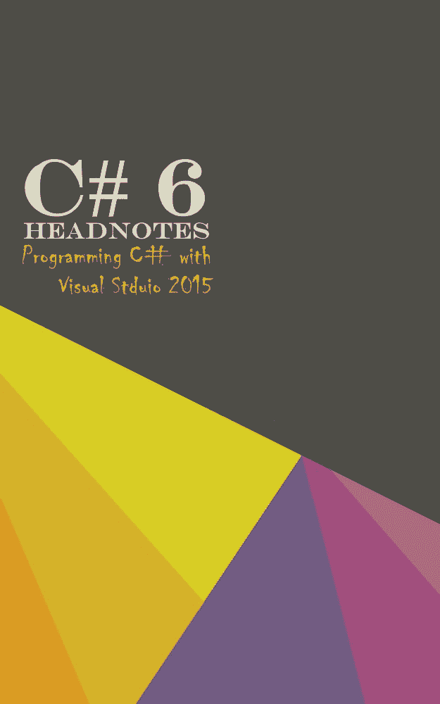


## I. C# 入门

C# 是一种优雅且类型安全的面向对象的语言，允许开发者构建运行在 .NET Framework 上的各种安全且健壮的应用程序。你可以使用 C# 创建 Windows 客户端应用程序、XML Web 服务、分布式组件、客户端/服务器应用程序、数据库应用程序等等更多内容。Visual C# 提供了高级代码编辑器、方便的用户界面设计器、集成调试器以及许多许多其他工具，使得基于 C# 语言和 .NET Framework 开发应用程序变得更容易。

## 1. 我可以用 C# 做什么？

C# 语法具有很强的表现力，但同时也简单易于学习。C# 的大括号语法对于任何熟悉 C、C++ 或 Java 的人来说都是一目就能出的。熟悉其中任何一种语言的开发者通常能够在很短时间内开始在 C# 中进行高效工作。C# 语法简化了 C++ 的许多复杂性，并提供了 Java 中不具备的强大功能，如可空值类型、枚举、委托、lambda 表达式和直接内存访问。C# 支持泛型方法和类型，这提供了更高的类型安全性和性能；还支持迭代器，它允许集合类的实现者定义自定义迭代行为，供客户端代码轻松使用。语言集成查询 (LINQ) 表达式让强类型查询成为一种一类语言结构。

作为一种面向对象的语言，C# 支持封装、继承和多态的概念。所有的变量和方法（包括作为应用程序入口的 `Main` 方法）都封装在类定义中。一个类可以直接继承一个父类，但可以实现任意数量的接口。重写父类虚方法的方法需要 `override` 关键字以避免意外重新定义。在 C# 中，`struct` 类似于轻量级类；它是一种栈分配的类型，可以实现接口但不支持继承。

除了这些基本的面向对象原则外，C# 还通过多种创新的语言结构轻松开发软件组件，包括：

*   称为 `delegates`（委托）的封装签名，实现了类型安全的事件通知。
*   属性（Properties），作为私有成员变量的访问器。
*   特性（Attributes），提供了关于类型的运行时元数据。
*   内联 XML 文档注释。
*   语言集成查询 (LINQ)，提供了跨多种数据源的内置查询能力。

如果你必须与其他 Windows 软件（如 COM 对象或原生 Win32 DLL）交互，你可以在 C# 中通过名为“Interop”（互操作）的过程来实现。Interop 允许 C# 程序几乎可以执行原生 C++ 应用程序的任何事情。对于直接内存访问至关重要的情况，C# 甚至支持指针和“unsafe”代码的概念。

与 C 和 C++ 相比，C# 的构建过程更简单且更灵活。没有单独的头文件，也不要求方法和类型按特定顺序声明。一个 C# 源文件可以定义任意数量的类、结构体、接口和事件。

以下是额外的 C# ：

*   关于该语言良好的通用介绍，请参阅《C# 规范》第 1 章。
*   有关 C# 语言特定方面的详细信息，请参阅 C# 参考。
*   有关 LINQ 的更多信息，请访问 LINQ（语言集成查询）。
*   要查找 Visual C# 团队的最新文章和资源，请访问 Visual C# 开发中心。

## 2. 什么是 .NET？

C# 程序运行在 .NET Framework 上，它是 Windows 的重要组成部分，包含一个名为通用语言运行时 (`CLR`) 的虚拟执行系统和一套统一的类库。`CLR` 是微软对国际标准通用语言基础 (`CLI`) 的商业实现。

### 22.10. 将 RTF 转换为纯文本

## 23. 不安全代码与指针

### 23.1. 固定大小缓冲区

### 23.2. 指针类型

## 24. XML 文档注释

### 24.1. 文档注释的推荐标签

### 24.2. 处理 XML 文件

### 24.3. 文档标签的分隔符

## III. 编码标准和命名规范

### 1. 应当

### 2. 不要

### 3. 避免

## II. 语言指南

## 1. 第一步

### 1.1. 你的第一个程序

我们将遵循新语言的传统，从第一个在屏幕上打印“Hello World!”字样的程序开始。在 C# 中，这可以通过一行代码实现：

```csharp
Console.WriteLine("Hello World!");
```

我们的 `Main` 方法看起来应该是这样，按 F5 构建并运行程序：

```csharp
static void Main()
{
    Console.WriteLine("Hello World!");
}
```

要插入 `Console.WriteLine();` 行，只需输入快捷键 `cw` 然后按两次 `TAB` 即可调用代码片段。

### 1.2. C# 编码规范

作为 C# 编程语言最佳实践的一部分，为了让读者更快地理解代码，创建一致的外观并利于复制和修改代码，即使：

> 复制和粘贴是一种设计错误。 – David Parnas


我们需要至少了解这些规范中的一些，才能编写出良好的代码。

### 1.2.1. 命名规范

在简短的示例中，不使用指令的情况下，请使用命名空间限定。

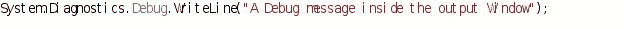

### 1.2.2. 注释规范

将注释放在单独的一行，而不是放在行尾。它应该以大写字母开头，每行开头有一个空格，并以句号结尾。


## 2. 常量与变量

常量和变量将名称与特定类型的值关联起来。常量的值一旦设置就无法更改，而变量在将来可以被设置为不同的值。

### 2.1. 声明常量和变量

常量和变量在使用之前必须声明。使用 `const` 关键字声明常量，使用 `var` 关键字声明匿名变量，使用 `dynamic` 关键字声明动态变量。

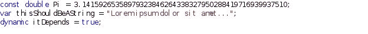

`var` 是静态类型，编译器和运行时都知其类型。

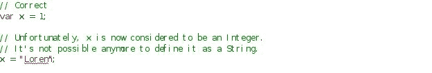

`dynamic` 是一个完全不同的物，它最像对象，但具有动态分发特性。

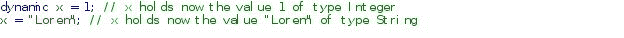

## 3. 基本类型

基本类型通过 `System` 命名空间下预定义的关键字来标识。这些关键字被视为保留字。

基本类型允许通过字面量创建值：

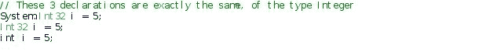

C# 定义了以下基本类型：

| 结构体 / 类 | 数据类型 | 描述 | 范围 |
| :--- | :--- | :--- | :--- |
| `struct System.Byte` | byte | 8 位无符号整数 | 0 .. 255 |
| `struct System.SByte` | sbyte | 8 位符号整数 | -128 .. 127 |
| `struct System.Int16` | short | 16 位符号整数 | -32,768 .. 32,767 |
| `struct System.UInt16` | ushort | 16 位无符号整数 | 0 .. 65,535 |
| `struct System.Int32` | int | 32 位符号整数 | -2,147,483,648 .. 2,147,483,647 |
| `struct System.UInt32` | uint | 32 位无符号整数 | 0 .. 4,294,967,295 |
| `struct System.Int64` | long | 64 位符号整数 | -9,223,372,036,854,775,808 .. 9,223,372,036,854,775,807 |
| `struct System.UInt64` | ulong | 64 位无符号整数 | 0 .. 18,446,744,073,709,551,615 |
| `struct System.Single` | float | 单精度浮点数 | -3.402823e38 .. 3.402823e38 |
| `struct System.Double` | double | 双精度浮点数 | -1.79769313486232 e308 .. 1.79769313486232 e308 |
| `struct System.Decimal` | decimal | 十进制数 | -79228162514264337593543950335 .. 79228162514264337593543950335 |
| `struct System.Char` | char | 作为 UTF-16 编码单元的字符 | 一个 Unicode 字符。 |
| `classSystem.String` | string | 一系列 Unicode 字符组成的文本 | 一个 Unicode 字符组成的字符串。 |
| `struct System.Boolean` | bool | 布尔值 | 真或假。 |
| `classSystem.Object` | object | 支持 .NET Framework 类层次结构中的所有类，并为派生类提供低级服务。 | 一个对象。 |

### 3.1. 使用数学和逻辑运算符

以下是基本数学运算符列表，按优先级顺序排列。使用括号强制执行其他顺序：

| 运算符 | 用途 |
| :--- | :--- |
| `*`, `/`, `%` | 乘法、除法、取模 |
| `+`, `-` | 加法、减法 |
| `&` | 逻辑与 |
| `^` | 逻辑异异 |
| `\|` | 逻辑或 |

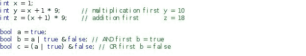

使用预定义的类型名称而不是系统类型名称（如 `Int16`、`Single`、`UInt64` 等），这会让代码读起来更自然。

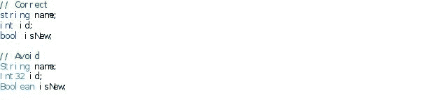

浮点数谜题

但始终记住，这不是 Bug —— 这是一个未说明的功能！

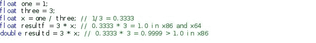

## 4. 决策

你有能力根据将测试的条件改变应用程序的执行流。

### 4.1. 使用 if 语句进行决策

你可以根据将测试的条件改变执行流。如果条件满足，则执行 `if` 和 `else` 之间的代码。

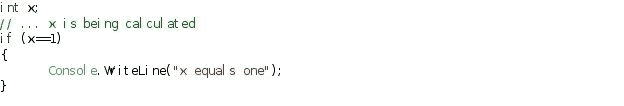

### 4.2. 使用 if-else 语句进行决策

你可以根据将测试的条件改变执行流。如果条件满足，则执行 `if` 和 `else` 之间的代码。


### 4.3. 使用关系运算符

这些运算符比较值：

| 运算符 | 用途 |
| :--- | :--- |
| `==` | 检查相等 |
| `!=` | 检查不相等 |
| `>` | 大于 |
| `<` | 小于 |
| `>=` | 大于等于 |
| `<=` | 小于等于 |

!((images/00016.jpeg)

### 4.4. 使用逻辑运算符

逻辑运算符用于评估条件：

| 运算符 | 用途 |
| :--- | :--- |
| `&&` | 逻辑与 |
| `||` | 逻辑或 |
| `!` | 逻辑非 |

#### 4.4.1. 使用与运算符

`&&` 运算符是条件的短路评估。

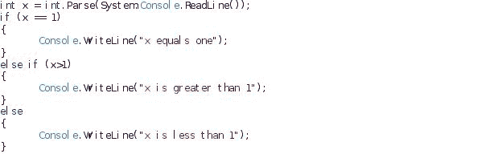

#### 4.4.2. 使用或运算符

`||` 运算符是条件的短路评估。

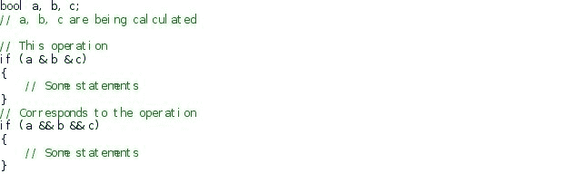

#### 4.4.3. 使用非运算符

它是一个取反的一元运算符。

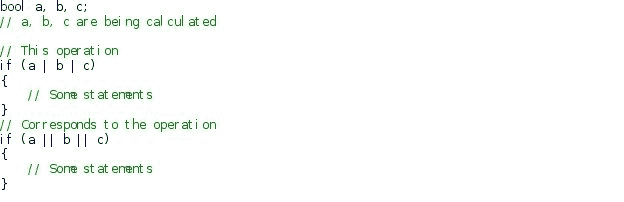

### 4.5. 使用 switch 语句进行决策

switch 语句用于根据给定表达式的值执行多个操作。如果条件满足，则执行 `case` 和 `break` 关键字之间的代码。要从一个 case 到另一个 case 使用 `goto`。


#### 4.5.1. 在 switch 语句中使用枚举

switch 可以作用于枚举值。枚举 switch 有会产生更的代码。有时更快。

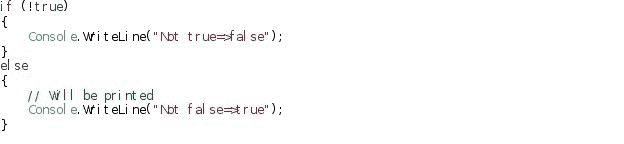

### 4.6. 增和和减运算符

C# 中有不同的快捷方式，允许你以后置和前置的形式增加或减少变量的值。

| 运算符 | 用途 |
| :--- | :--- |
| `v++` | 变量 v 增加 1 |
| `v--` | 变量 v 减少 1 |
| `v+=n` | 变量 v 增加 n |
| `v-=n` | 从变量 v 减去 n |
| `v*=n` | 变量 v 乘以 n |


你也可以用元素初始化数组，在这种情况下，你不需要指定数组的大小。

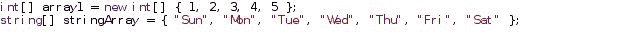

### 5.3. 多维数组

如果需要声明一个 n 维的多维数组。

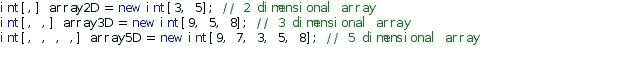

你仍然可以使用值初始化多维数组。

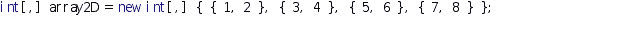

### 5.4. 锯齿数组 (Jagged Arrays)

锯齿数组是“数组的数组”，意味着数组的元素本身也是数组。在这种情况下，对于多维数组，如果我们认为主数组是行，那么每一行可以有不同的列大小。

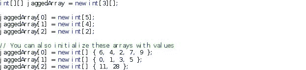

### 5.5. 将数组作为参数

你可以将单维数组或多维数组作为方法的参数进行传递。

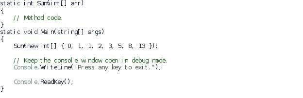

#### 5.5.1. 将数组作为参数传递

如果你想传递方法参数时不关心它接收多少个参数，可以使用 `params` 关键字。它是作为参数数组传递的，在调用方法时不需要声明数组，它由 C# 编译器隐式创建。

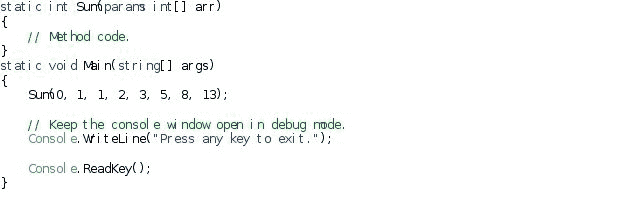


#### 索引初始化器 (Index initializers)

对象和集合初始化器用于声明式地初始化对象的字段和属性，或者为集合提供一组初始元素。使用索引器初始化字典和其他对象显得不够优雅。

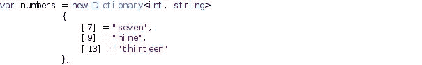

## 6. 循环

循环是一组语句，会按照指定的次数重复，或者直到满足逻辑条件。

### 6.1. 使用 for 循环

for 循环允许代码重复执行。与其它类型的循环不同，for 循环的特点是具有显式的循环计数器。

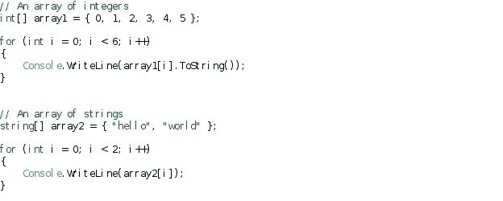

### 6.2. 使用 foreach 循环

foreach 循环提供了遍历集合中各项项的可能性。与 for 循环不同，foreach 循环通常不维护显式的计数器。这里展示了如何使用 foreach 循环创建相同的循环：

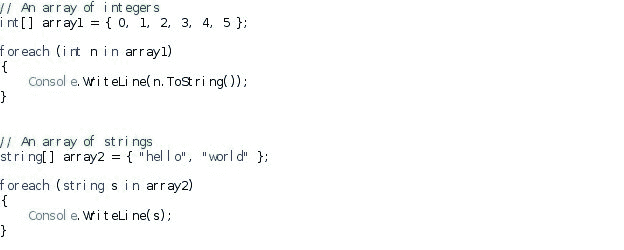

### 使用 while 循环

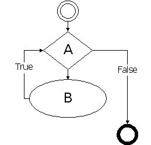

while 循环允许根据给定的布尔条件重复执行代码。

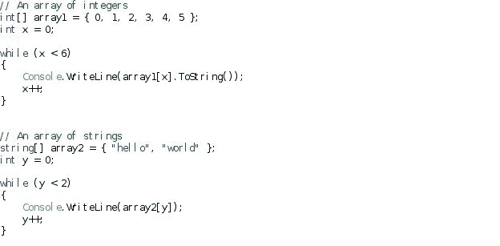

### 6.3. 使用 do-while 循环

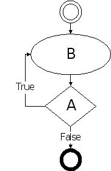

do-while 循环至少执行一次代码。然后根据给定的条件重复继续执行代码或停止。

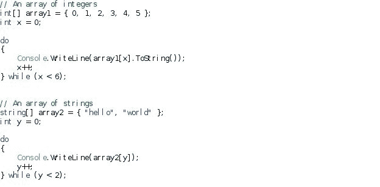

## 7. 类与结构体 (Classes and Structs)

类和结构体是两种可扩展的程序代码模板，即蓝图，用于创建对象；为状态提供初始值并实现行为。

有四个主要原则使一种语言成为面向对象：封装、数据抽象、多态和继承。这些原则将在稍后通过示例进行讨论。

### 7.1. 类

可以使用 `class` 关键字声明类。所有类都继承自 `System.Object`，因此类是引用类型。


### 7.2. 结构体

可以使用 `struct` 关键字声明结构体。所有结构体都继承自 `System.ValueType`，而 `System.ValueType` 又继承自 `System.Object`，因此结构体是值类型。

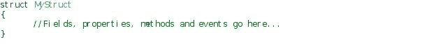

使用 `Struct` 时：

- 非常量或非静态字段不能初始化。
- 不能声明默认构造函数（无参数）或析构函数。但我们可以声明带有参数的构造函数。
- 可以不使用 `new` 关键字即可实例化。
- 可以实现接口。
- 可以继承其他结构体或类，但不能作为类的基类。
-与其他值类型不同，它可以作为可空类型 (Nullable type)。

### 7.3. 对象

对象是类或结构体的实例。对于类，它们通过使用 `new` 运算符创建。对于结构体，可以使用 `new` 运算符创建，但不是强制的。

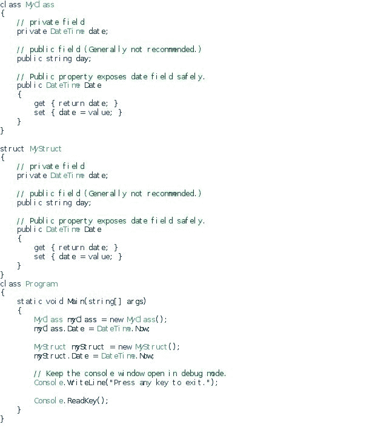

### 7.4. 成员

#### 7.4.1. 字段 (Fields)

字段是在类作用域内定义的变量。字段可以是内置数值类型，也可以另一个类的实例。


#### 7.4.2. 常量 (Constants)

常量是在编译时设置值且无法更改的字段或属性。


#### 7.4.3. 属性 (Properties)

属性是类上的方法，访问方式就像该类上的字段一样。属性可以为类字段提供保护，防止其在对象不知情的情况下被更改。

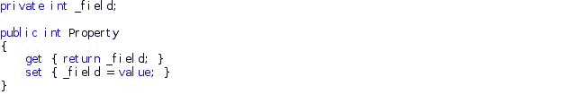


#### 自动属性的初始化器 (Initializers for auto-properties)

你现在可以自动属性添加初始化器，就像在字段中这样做一样。

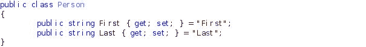

初始化器直接初始化底层字段（backing field）；它不通过自动属性的 setter 工作。初始化器按照编写顺序执行，与字段初始化器的执行顺序相同且一同执行。


#### 仅 getter 的自动属性 (Getter-only auto-properties)

自动属性现在可以在不带 setter 的情况下声明。

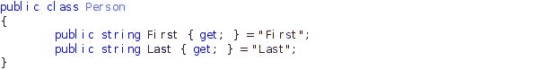

foreach 通常不维护显式计数器。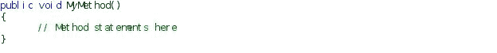

images/00052.jpeg)


### 7.4.6.8. 逻辑、条件与空运算符

| 表达式 | 目的 |
| :--- | :--- |
| `x & y` | 整数按位与，布尔逻辑与 |
| `x ^ y` | 整数按位异异，布尔逻辑异异 |
| `x \| y` | 整数按位或，布尔逻辑或 |
| `x && y` | 仅当 `x` 为真时评估 `y` |
| `x \| y` | 仅当 `x` 为假时评估 `y` |
| `x ?? y` | 如果 `x` 为空则结果为 `y`，否则为 `x` |
| `x ?: y : z` | 如果 `x` 为真则结果为 `y`，如果 `x` 为假则结果为 `z` |

 空条件运算符

有时代码往往深陷在空检查中。空条件运算符允许仅在接收者不为空时访问成员和元素，否则提供空结果。


空条件运算符通常与空合并运算符 `??` 配合使用：


空条件运算符表现出短路行为，即紧随其后的成员访问、元素访问和调用的链仅在原始接收者不为空时才会执行：


此示例本质上等同于：

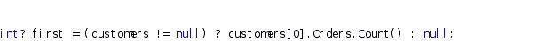

区别在于 `customers` 只被评估一次。除非 `customers` 有非空值，否则紧跟 `?` 之后的成员访问、元素访问和调用都不会执行。

当然，空条件运算符本身也可以链用，以防在链中需要多次检查空：


注意，调用（带括号的参数列表）不能紧跟在 `?` 运算符——这会导致过多的语法歧义。因此，仅在委托存在时调用委托的直接方法行不通。然而，你可以通过委托上的 `Invoke` 方法来实现：


我们预计这种模式的一个非常常见的用法是触发事件：


这是在触发事件之前检查空的一种简单且线程安全的方法。之所以是线程安全的是因为该特性只评估左侧一次，并将其保留在临时变量中。

### 7.4.6.9. 赋值与匿名运算符

| 表达式 | 目的 |
| :--- | :--- |
| `=` | 赋值 |
| `x op= y` | 复合赋值。支持这些运算符：`+=`, `-=`, `*=`, `/=`, `%=`, `&=`, `|=`, `!=`, `<<=`, `>>=` |
| `(T x) => y` | 匿名函数（Lambda 表达式） |

### 7.4.7. 索引器

索引器允许对象以类似于数组的方式索引。

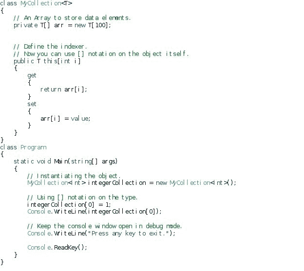

### 7.4.8. 构造函数

构造函数是在对象首次创建时被调用的方法。它们通常用于初始化对象的数据。结构体（Structs）不能显式包含默认构造函数，因为它是由编译器提供的。

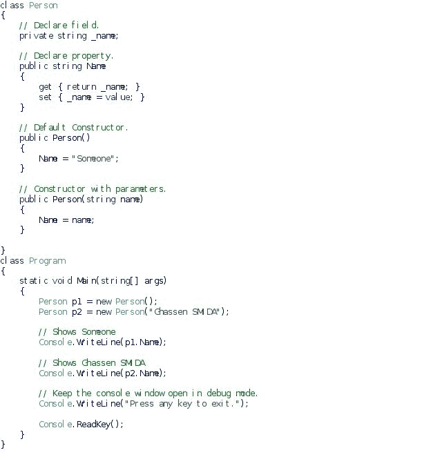

### 7.4.9. 析构函数

析构函数在 C# 中极少使用。它们是运行时执行引擎在对象从内存中移除之前调用的方法。它们通常用于确保任何必须释放的资源得到适当处理。一个类中只有一个析构函数，结构体不能定义它，它没有修饰符或参数且不能被调用，它是自动调用的。要查看它的运行，请使用 Ctrl+F5 直接编译并运行此程序。

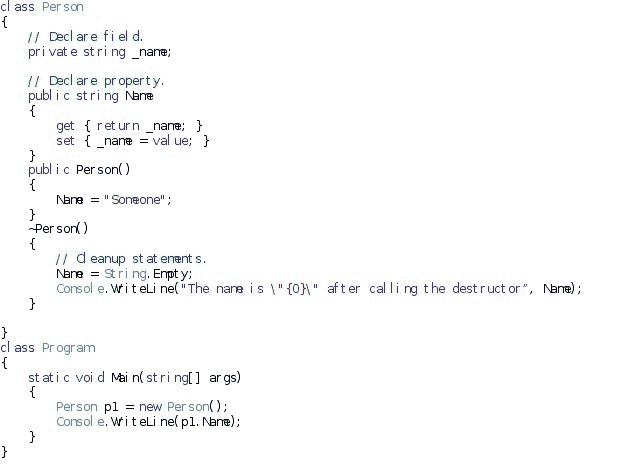

### 7.4.10. 嵌套类型

嵌套类型是在另一个类型内部定义的类型。嵌套类型通常用于描述仅包含它的类型使用的对象。

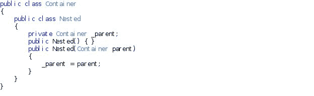

你可以如下所示创建 `Nested` 类的新实例：


### 7.5. 封装

封装是使语言面向对象的四个主要原则之一。它是关于通过限制对访问器和修改器的访问来隐藏数据实现。

#### 7.5.1. 访问器

访问器是用于询问对象自身信息的方法。在 OOP 中，这些通常以属性的形式存在，在正常条件下，它们有一个 `get` 方法，即一个访问器方法。

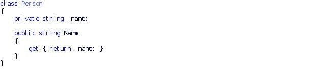

#### 7.5.2. 修改器

修改器是用于修改对象状态的公共方法，同时隐藏数据如何被修改的具体实现。

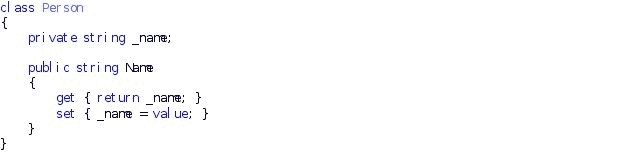

### 7.6. 继承

对象之间可以通过“拥有”、“使用”或“是”的关系相关联。“是”是对象关系中的继承方式。正如之前提到的，在 C# 中，所有类都继承自 `System.Object`。

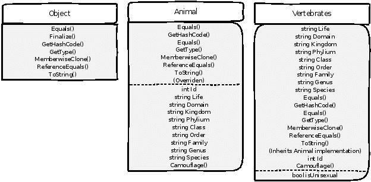


### 7.7. 多态

多态意味着一个名称有多种形式。多态通过具有相同名称的方法表现出来。有两种基本类型态：重写（Overriding），也称为运行时多态，以及重载（Overloading），被称为编译时多态。

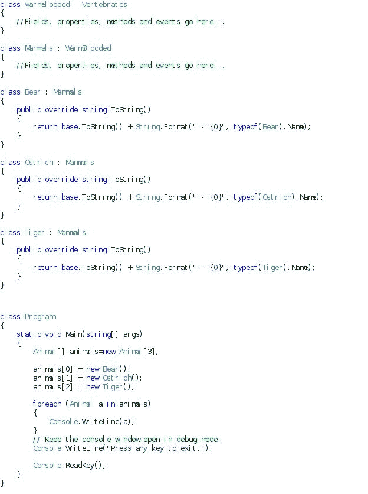

### 7.8. 抽象类与密封类

#### 7.8.1. 抽象类与类成员

数据抽象是最容易理解的原则之一。数据抽象与封装紧密结合，因为抽象表示一个模型、视图或其他实际表示。

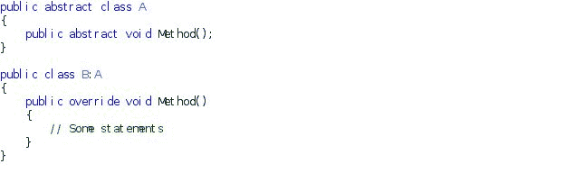

抽象方法没有实现。你可以在派生类中使用 `override` 关键字来实现此方法。如果一个类将方法声明为 `abstract`，则继承自该抽象类的类将实现它。

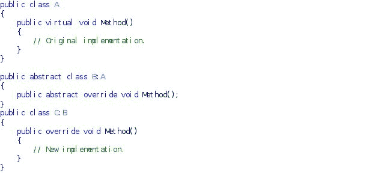

#### 7.8.2. 密封类与类成员

你可以使用 `sealed` 关键字声明一个密封类。密封类不能作为基类，因此它们阻止了继承。如果它们用于虚成员，则将消除该成员对进一步派生类的虚属性。

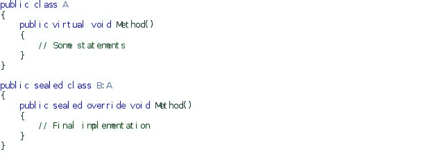

#### 7.8.3. override 和 new 关键字的区别

要使用 `override` 和 `new` 关键字，基类方法必须是虚的。这些关键字也可以用于属性、索引器和事件。`override` 和 `new` 的区别完全在于多态。如果你使用 `override` 关键字，编译器将重新定义此成员，无论基类如何；另一方面，通过使用 `new` 关键字，编译器将在此继承级别上隐藏定义，但一旦通过基类调用，它将显示原始定义。如果没有多态，它们就没有区别。

### 7.9. 静态类与静态类成员

静态类的主要特征是我们是我们无法实例化，它只包含静态成员并且是密封的。如果需要调用此类的公共方法，只需直接使用类名如所示：

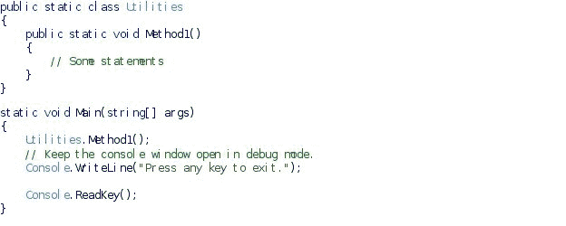

静态成员是该变量在所有实例中的共享实例。

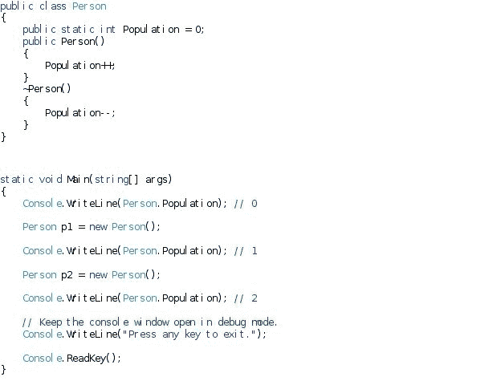

使用 static

该功能允许导入类型的所有可访问静态成员，使其在随后的代码中无需限定符即可使用。这对于你拥有一组经常使用的特定领域的函数来说非常有用。`System.Math` 就是其中的一个常见例子。它还允许你直接指定枚举类型的单个命名值，如上面的 `System.DayOfWeek` 成员。

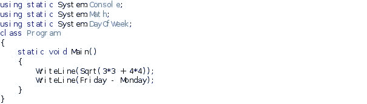

### 7.10. 访问修饰符

| 访问修饰符 | 目的 |
| :--- | :--- |


| `public` | 该类型或成员可以被同一程序集中的任何其他代码或引用它的另一个程序集中的代码访问。 |
| `private` | 该类型或成员只能由同一类或结构体中的代码访问。 |
| `protected` | 该类型或成员只能由同一类或结构体中的代码，或由派生自该类的类访问。 |
| `internal` | 该类型或成员可以被同一程序集中的任何代码访问，但不能从另一个程序集访问。 |

## 8. 委托 (Delegates)

`Delegates` 是指向具有特定参数列表和返回类型的方法的引用。由于它是一种特殊类型，你可以实例化委托，将其实例与适当的方法（相同的签名和返回类型）关联，或者通过其实例调用任何定义的方法。

`Delegates` 在 C# 中具有几种能力：引用方法、分发多个方法、异步执行和事件类型。

让我们首先检查委托作为方法引用的作用。为了做到这一点，委托指定了它可以引用的方法签名，如下所示：


你可能会发现，委托看起来像一个抽象方法，除了它有一个委托类型定义关键字。委托定义是一种引用类型，就像 `class`、`struct` 或 `interface` 一样。上一个委托定义用于一个命名为 `Add` 的委托类型，它接受两个 `double` 参数并返回 `double` 类型的结果。与其他类型一样，委托的访问权限只能是 `public` 或 `internal`，并且默认为 `internal`。

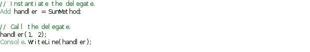

## 9. 事件 (Events)

`events` 在类中声明和引发，并使用同一类内或其他某些类中的委托与事件处理程序关联。包含事件的类被用于发布事件，这被称为发布者类（publisher class）。接受此事件的其他类被称为订阅者类（subscriber class）。`Events` 使用发布者-订阅模型。

`publisher` 是一个包含事件定义和委托定义的对象。事件-委托的关联也定义在该对象中。发布者类对象引发事件并通知其他对象。

`subscriber` 是一个接受事件并提供事件处理程序的对象。发布者类中的委托会调用订阅者类的方法（事件处理程序）。

要在类内部声明事件，必须先为该事件声明委托类型。


接下来，使用 `event` 关键字声明事件本身：


之前的代码定义了一个名为 `MyLogHandler` 的委托和一个名为 `MyEventLog` 的事件，该事件在引发时会调用该委托。

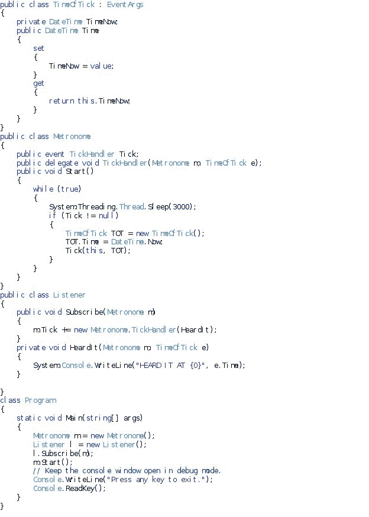

## 10. Lambda 表达式 (Lambdas)

`lambda` 是一个无名方法。有时你有一段代码只为了一个特定目的，你不需要将其定义为方法。方法的好处在于它们让你能够将代码模块化，并有某种可以通过委托引用并在从多个处调用的内容。

与方法一样，lambdas 可以有参数、正体并返回值。


对于单个语句，你不需要在正体中使用大括号，但对于多个语句则需要使用。`Predicate` 是一个泛型委托。类型参数设置为 `<string>`，这意味着 lambda 参数的类型为 `string`。


这显示了 `Func<T, TResult>` 接受一个类型为 `T` 的参数并返回一个类型为 `TResult` 的值。


## 11. 枚举类型 (Enumeration Types)

`enumeration` 是集合中所有项目的完整、有序列表。在 C# 中，它提供了一种高效的方法来声明一组命名的整数常量，这些常量可以赋值给变量。


要验证此类型的整数值，你可以对其进行强制转换：


你可以无视顺序为枚举的元素赋值值，也可以赋值计算后的值：


你还可以使用枚举来定义位标志（bit flag）。这样就可以在它们上执行 `AND`、`OR` 和 `XOR` 操作。如果一个元素的值为零，意味着“没有设置任何标志”。如果这并不代表如此，请不要这样做。


## 12. 异常与异常处理 (Exceptions and Exception Handling)

异常处理是在计算过程中响应异常异常——即需要特殊处理的异常或异常情况——的过程，通常使用 `try`、`catch` 和 `finally` 关键字来尝试可能不会成功的操作，从而改变程序的正常执行流。

### 12.1. 使用异常 (Using Exceptions)

异常由派自 `System.Exception` 的类表示。该类识别异常类型并包含有关异常详细信息的属性。抛异常涉及创建一个异常派生类的实例，可选地配置异常的属性，然后使用 `throw` 关键字抛出该对象。


抛出异常后，运行时会检查当前语句以确定是否在 `try` 块内。如果是，将检查与 `try` 块关联的所有 `catch` 块，查看它们是否可以捕获该异常。


一个 `try` 语句可以包含多个 `catch` 块。第一个可以处理异常的 `catch` 语句将被执行；后续兼容的 `catch` 语句将**忽略。


在执行 `catch` 块之前，运行时会检查 `finally` 块。`finally` 块允许程序员清理 `try` 块分配的任何资源。


### 12.2. 异常处理 (Exception Handling)

`try` 块被 C# 程序员用于划分受异常影响的代码。关联的 `catch` 块用于处理产生的异常。`try` 块需要一个或多个 `catch` 块，或者一个 `finally` 块，或者两者都有。

以下示例显示了 `try-catch` 语句：

`try-finally` 语句：

`try-catch-finally` 语句：

### 12.3. 创建和抛出异常 (Creating and Throwing Exceptions)

异常用于指示发生了错误。创建描述错误的异常对象，然后使用 `throw` 关键字抛出。


### 12.4. 编译器生成的异常 (Compiler-Generated Exceptions)

某些异常是由 .NET Framework 的公共语言运行时 (CLR) 在基本操作失败时自动抛出的。这些异常及其错误条件如下表所示：

| 异常 |  |
| :--- | :--- |
| `ArithmeticException` | 算术运算期间发生异常的基类，例如 `DivideByZeroException` 和 `OverflowException`。 |
| `ArrayTypeMismatchException` | 当数组无法存储给定元素是因为元素的实际类型与数组的实际类型不兼容时抛出。 |
| `DivideByZeroException` | 当尝试将整数除以零时抛出。 |
| `IndexOutOfRangeException` | 当尝试索引数组时，索引小于零或超出数组边界时抛出。 |
| `InvalidCastException` | 当运行时从基类型到接口或派生类型的显式转换失败时抛出。 |
| `NullReferenceException` | 当你尝试引用值为空的对象时抛出。 |
| `OutOfMemoryException` | 当使用 `new` 操作尝试分配内存失败时抛出。这表示公共语言运行时的可用内存已耗尽。 |
| `OverflowException` | 在检查上下文中发生算术运算溢出时抛出。 |


| `StackOverflowException` | 当执行栈因过多的待处理方法调用而耗尽时抛出；通常表示存在极深或无限递归。 |
| `TypeInitializationException` | 当静态构造函数抛出异常，且没有兼容的 catch 句来捕获该异常时抛出。 |

### 12.5. 使用 try/catch 处理异常

`try-catch` 块的作用是捕获并处理由工作代码生成的异常。某些异常可以在 `catch` 块中处理，并在不重新抛出异常的情况下解决问题。


### 12.6. 使用 finally 执行清理代码

`finally` 语句的作用是确保即使在抛出异常，必要的对象清理工作（通常是持有外部资源的对象）也会立即发生。


 在 catch 和 finally 块中使用 Await

在 C# 5 中，我们不允许在 `catch` 和 `finally` 块中使用 `await` 关键字，因为我们曾以某种方式说服了自己这在实现上是不可能的。

这实际上是一个重大的限制，人们不得不采用难陋的变通来弥补。现在这不再需要了：


实现过程相当复杂，但你无需担心这一点。这正是语言中引入 `async` 的意义所在。

 异常过滤器

VB 有。F# 有。现在 C# 也有了。它们看起来像是这样：


如果括号中的表达式求值为真，则运行 `catch` 块，否则异常将继续向传递。

异常过滤器比捕获并重新抛出异常更好，因为它们能保持堆栈不受破坏。如果异常随后导致堆栈转储，你可以看到它最初源自何处，而不仅仅是最后一次被重新抛出的地方。

使用异常过滤器进行副作用（例如记录日志）也是一种常见且被接受的“滥用”形式。它们可以检查“飞而过”的异常，而不拦截其路径。在这些情况下，过滤器通常会调用一个返回 `false` 的辅助函数，该函数会执行副作用：


## 13. 文件系统和注册表

### 13.1. 遍历目录树

“遍历目录树”这一短语意味着访问指定根文件夹下每个嵌套子目录中的每个文件，深度不限。你不一定需要打开每个文件。你可以以字符串的形式获取文件或子目录的名称，也可以以 `System.IO.FileInfo` 或 `System.IO.DirectoryInfo` 对象的形式获取额外信息。


### 13.2. 获取文件、文件夹和驱动器的信息

你可以使用以下类访问文件系统信息：

* `System.IO.FileInfo`
* `System.IO.DirectoryInfo`
* `System.IO.DriveInfo`
* `System.IO.Directory`
* `System.IO.File`


### 13.3. 创建文件或文件夹

你可以通过程序在计算机上创建文件夹，创建一个子文件夹，在子文件夹中创建一个文件，并向文件写入数据。


### 13.4. 复制、删除和移动文件及文件夹

使用 `System.IO.File` 以同步方式复制、移动和删除文件及文件夹。


### 13.5. 为文件操作提供进度对话框

如果你使用 `Microsoft.VisualBasic` 命名空间中的 `CopyFile(String, String, UOption)` 方法，可以在 Windows 中提供一个显示文件操作进展的标准对话框。


### 13.6. 写入文本文件


### 13.7. 从文本文件中读取

你可以使用 `System.IO.File` 类的静态方法 `ReadAllText` 和 `ReadAllLines` 读取文本文件的内容。


### 13.8. 一一行读取文本文件

你可以使用 `StreamReader` 类的 `ReadLine` 方法一次行将文本文件的内容读取到字符串中。每行文本都存储在字符串 `line` 中并显示在屏幕上。


### 13.9. 在注册表中创建键

你可以在当前用户的注册表项 "Names" 键下，添加键值对 "Name" 和 "Test"。


## 14. 泛型

### 14.1. 泛型简介

泛型类和方法以非泛型对应项无法的方式结合了重用性、类型安全和效率。泛型最常用于集合以及操作集合的方法。


下面的代码示例显示了客户端代码如何使用泛型 `GenericList<T>` 类创建整数列表。只需通过更改类型参数，即可轻松修改后续代码以创建字符串或任何自定义类型的列表：


### 14.2. 泛型类型参数

在泛型类型或方法定义中，类型参数是客户端在实例化时指定的类型的占位符。泛型类（如 `GenericList<T>`）不能直接使用，因为它本身不是一个类型；它更像是类型的蓝图。除非单个字母名称完全是自俗其懂，否则一个描述性的名称会增加价值。


### 14.3. 类型参数的约束

当你定义泛型类时，可以对客户端代码可用于类型的类型种类进行限制。如果客户端代码尝试使用不受约束允许的类型实例化你的类，结果将是编译错误。这些限制被称为约束。

| 约束 | 说明 |
| :--- | :--- |
| `where T : struct` | 类型参数必须是值类型。可以指定除 `Nullable` 外的值类型。 |
| `where T : class` | 类型参数必须是引用类型；这也适用于任何类、委托或数组类型。 |
| `where T : new()` | 类型参数必须具有公共无参数构造函数。与其他约束一起使用时，`new()` 约束必须最后指定。 |
| `where T : <base class>` | 类型参数必须是或派自指定的基类。 |
| `where T : <interface>` | 类型参数必须是或实现指定的接口。可以指定多个接口约束。约束接口也可以是泛型的。 |
| `where T : U` | 为 `T` 提供的类型必须是或派自为 `U` 提供的类型。 |


### 14.4. 泛型类

泛型类封装与特定数据类型无关的操作。泛型类最用途用于链表、哈希表、栈、队列、树等集合。


### 14.5. 泛型接口

为泛型集合类或代表集合项目的泛型类定义接口通常很有用。泛型类的倾向是使用泛型接口（例如 `IComparable<T>` 而不是 `IComparable`），以避免对值类型的装箱和解箱操作。适用于类的继承规则也适用于接口。

### 14.6. 泛型方法

泛型方法是带有类型参数声明的方法，如下：


### 14.7. 泛型与数组


下界为零的一维数组会自动实现 `IList<T>`。这使得你能够创建泛型方法，使用相同的代码来遍历数组和其他集合类型。这种技术主要对于读取集合中的数据非常有用。


### 14.8. 泛型委托 (Generic Delegates)

委托可以定义自己的类型参数。引用泛型委托的代码可以指定类型参数来创建一个闭合构造类型，就像实例化泛型类或调用泛型方法一样。


### 14.9. Default 关键字

在泛型类和方法中，出现的一个问题是当你无法预知以下内容时，如何为参数化类型 `T` 分配默认值：

- `T` 是否会是引用类型或值类型。
- 如果 `T` 是值类型，它将是数值还是结构体。


## 15. 索引器 (Indexers)

索引器允许类或结构体的实例像数组一样被索引。索引器类似于属性，不同之处它们的访问器带有参数。

### 15.1. 使用索引器

索引器是一种语法便利工具，允许你创建一个类、结构体或接口，客户端应用程序可以像访问数组一样访问它们。索引器最常实现在主要目的是封装内部集合或数组的类型中。


### 15.2. 接口中的索引器

索引器可以在接口上声明（[C# 参考]）。接口索引器的访问器与类索引器的访问器有以下不同点：

- 接口访问器不使用修饰符。
- 接口访问器没有方法体。


## 16. 接口 (Interfaces)

接口包含了类或结构体可以实现的不同成员声明。你可以使用接口为来自多个来源的类包含行为，因为类不支持多重继承。或者如果你想为结构体模拟继承，因为结构体完全不支持继承。


## 17. LINQ 查询表达式 (LINQ Query Expressions)

语言集成查询 (LINQ) 是一组基于将查询能力直接集成到 C# 语言中的技术的名称。

对于编写查询的开发者来说，LINQ 最可见的“语言集成”部分是查询表达式。

### 17.1. 查询集合

查询是一组指令，描述了从给定的数据源（或多个源）检索哪些数据，以及返回的数据应该具有什么形状和组织形式。查询与它产生的结果是不同的。


如上一个示例所示检索元素序列，但将它们转换为新类型的对象。例如，查询可能只从数据源中的某些客户记录中检索姓。


### 17.2. 过滤数据

在某些情况下，直到运行时你并不知道要在 `where` 子句中对源元素应用多少个谓词。动态指定多个谓词过滤器的一种方法是使用 `Contains<TSource>` 方法


### 17.3. 排序集合

你可以对一个或多个源序列使用 `orderby` 子句。


### 17.4. 关联对象

在关系数据库术语中，内连接（inner join）产生一个结果集，其中第一个集合中的每个元素对应第二个集合中的每个匹配元素出现一次。如果第一个集合中的元素没有匹配的元素，则它不会出现在结果集中。


执行使用 `join` 子句无法实现的连接操作。在查询表达式中，`join` 子句限于等值连接（equijoins）并对其进行了优化，等值连接是目前最常见的连接操作类型。在执行等值连接时，使用 `join` 子句通常总是获得最佳性能


## 18. Main() 和命令行参数

当应用程序启动时，第一个被调用的方法是 `Main` 方法。简而言之，它是 `.exe` 程序的入口。它必须是静态的且不能是公共的。

它可以在类或结构体内部声明，带有或不带有 `string[]` 参数。


## 19. 命名空间 (Namespaces)

组织代码有多种方式，选择应该基于团队的标准以及你正在构建的项目性质。组织代码的常用方法之一是使用 C# 命名空间功能。


当你需要完全限定命名空间时，还可以创建/使用命名空间别名来简化语法。在此例中你可以调用别名 `Crypto` 而不是 `System.Security.Cryptography`。


## 20. 可空类型 (Nullable Types)

可空类型是 `System.Nullable<T>` 结构的实例。可空类型可以表示其底层值类型的正确范围，外加一个额外的 null 值。

`Nullable<bool>` 可以分配值 `true`、`false` 或 `null`。可空类型可以表示底层值类型的所有值，外加一个 null 值。可空类型可以通过以下两种方式声明：

`Nullable<T> 变量`

-或-

`T? 变量`

可空类型具有以下特征：

- 引用类型不能创建可空，因为它们已经支持 null。
- `T?` 是 `Nullable<T>` 的简写，其中 `T` 是值类型。
- 像普通值类型一样为可空类型分配值，例如 `int? x = 10;` 或 `double? d = 4.1;`。可空类型也可以分配 null：`int? x = null;`。
- 使用 `Nullable<T>.GetValueOrDefault()` 方法返回的值，如果为空则返回底层类型的默认值，例如 `int j = x.GetValueOrDefault();`。
- 使用 `HasValue` 和 `Value` 只读属性测试 null 获取值，如下所示：`if(x.HasValue) j = x.Value;`。
- `HasValue` 属性在包含值时返回 true，为 null 时返回 false。
- `Value` 属性在已赋值时返回值，否则将抛出 `System.InvalidOperationException`。
- `HasValue` 的默认值为 false。`Value` 属性没有默认值。
- 你也可以对可空类型使用 `==` 和 `!=` 运算符，如下所示：`if (x != null) y = x;`。
- 使用 `??` 运算符分配一个默认值，当当前值为 null 的可空类型赋值给非可空类型时应用，例如 `int? x = null; int y = x ?? -1;`。
- 不允许嵌套可空类型。以下行将无法编译：`Nullable<Nullable<int>> n;`。

### 20.1. 使用可空类型


### 20.2. 装箱可空类型

可空类型的对象在为空时才会被装箱。如果 `HasValue` 为 false，则将对象引用赋予 null 而不是装箱。如果对象为空——如果 `HasValue` 为 true——则发生装箱，但只有基于该可空对象的底层类型被装箱。


### 20.3. 识别可空类型

你可以使用 C# `typeof` 运算符创建一个表示可空类型的 `Type` 对象：


在可空类型上调用 `GetType()` 会在类型隐式转换为 `Object` 时执行装箱操作。因此，`GetType()` 总是返回表示底层类型的 `Type` 对象，而不是可空类型。


使用以下代码判断 `Type` 对象是否表示 `Nullable` 类型：


## 20.4. 安全地从 `bool?` 强制转换为 `bool`

`bool?` 可空类型可以包含三个不同的值：true、false 和 null。因此，`bool?` 类型不能用于 `if`、`for` 或 `while` 等条件语句。


这是不允许的，因为在条件语句的上下文中 `null` 的含义并不明确。要在条件语句中使用 `bool?`，你需要执行以下操作：


## 21. 语句、表达式和运算符

构成应用程序的 C# 代码由关键字、表达式和运算符组成的语句组成。

### 21.1. 语句

程序执行的操作通过语句表示。常见操作包括声明变量、赋值赋值、调用方法、遍历集合以及根据给定条件跳转到一个或另一个代码块。

程序中执行语句的顺序被称为控制流或执行流。


C# 中有各种类型的语句及其相关的关键字，如下表所示：

| 异常 | 说明 |
| :--- | :--- |
| 声明语句 | 声明语句引入一个新的变量或常量。变量声明可以选择地为变量赋值。 |
| 表达式语句 | 计算一个值的表达式语句必须将该值存储在变量中。 |
| 选择语句 | 选择语句允许你根据一个或多个指定的条件跳转到不同的代码部分。`if-else`、`switch-case` |
| 迭代语句 | 迭代语句允许你遍历数组等集合，或重复执行同一组语句，直到满足指定的条件。`do`、`for`、`foreach-in`、`while` |
| 跳转语句 | 跳转语句将控制转移到另一个代码部分。`break`、`continue`、`default`、`goto`、`return`、`yield` |
| 异常处理语句 | 异常处理语句允许你从运行时发生的异常状况中优雅地恢复。`throw`、`try-catch`、`try-finally`、`try-catch-finally` |
| 检查和未检查 | checked 和 unchecked 语句允许你指定当结果存储在太小以无法容纳结果值的变量时，是否允许数值操作导致溢出。 |
| await 语句 | 如果你用 `async` 修饰符标记方法，则可以在方法中使用 `await` 运算符。当控制到达 `async` 方法中的 `await` 表达式时，控制返回给调用者，方法中的进度被暂停，直到等待的任务完成。 |
| yield return 语句 | 迭代器对集合（如列表或数组）执行自定义迭代。迭代器使用 `yield return` 语句一次性返回每个元素。当遇到 `yield return` 语句时，代码中的当前位置会被记住。 |
| fixed 语句 | `fixed` 语句防止垃圾回收器移动可移动变量。 |
| lock 语句 | `lock` 语句允许你限制只有一个线程可以访问代码块。 |
| 标记语句 | 你可以给语句一个标记，然后使用 `goto` 关键字跳转到被标记的语句。 |
| 空语句 | 空语句由单个分号组成。它什么都不做，可以用于需要语句但不需要执行操作的地方。 |

### 21.2. 表达式

表达式是由一个或多个操作数和零或多个运算符组成的序列，可以求值为单个值、对象、方法或命名空间。表达式可以由字面量值、方法调用、运算符及其操作数或简单名称组成。


方法类成员上的表达式体

方法以及用户定义的运算符和转换可以通过“lambda 箭头”赋予一个表达式体：


其效果与方法具有带有单个 return 语句的块状体效果完全相同。

`nameof` 表达式

有时你需要提供一个用于命名某些程序元素的字符串：在抛出 `ArgumentNullException` 时，你想命名有错的参数；在抛出 `PropertyChanged` 事件时，你想命名发生更改的属性，等等。

为此目的使用字符串字面量是简单的，但容易出错。你可能会拼错，或者重构可能会导致它失效。`nameof` 表达式本质上是一种特殊的字符串字面量，编译器会检查你是否具有指定的名称，Visual Studio 知道它指的是什么，因此导航和重构将正常工作：

你可以在 `nameof` 表达式中放入更复杂的点名称，但这只是为了告诉编译器去哪里查找：只有最后的标识符会被使用：

### 21.3. 匿名函数

匿名函数是一个“内联”语句或表达式，可以使用委托类型的地方。

#### 21.3.1. Lambda 表达式

Lambda 表达式用于创建委托或表达式树。通过使用 Lambda 表达式，你可以编写作为参数传递或作为函数值的函数。对于编写 LINQ 查询非常有帮助。


#### 21.3.2. 匿名方法

创建匿名方法本质上是将代码块作为委托传递。


### 21.4. 可重载运算符

C# 允许通过使用 `operator` 关键字定义静态成员来重载运算符。然而，并不是所有运算符都可以重载，某些还有限制。

| 运算符 | 是否重载 |
| :--- | :--- |
| `+`、`-`、`!`、`~`、`++`、`--`、`true`、`false` | 这些一元运算符可以重载。 |
| `+`、`-`、`*`、`/`、`%`、`&`、`|`、`^`、`<<`、`>>` | 这些二进制运算符可以重载。 |
| `==`、`!=`、`<`、`>`、`<=`、`>=` | 比较运算符可以。 |
| `&&`、`||` | 条件逻辑运算符不能重载，但它们使用重载的 `&` 和 `|` 进行计算。 |
| `[]` | 数组索引运算符不能重载，但你可以定义索引器。 |
| `(T)x` | 强制转换运算符不能重载，但你可以定义新的转换运算符。 |
| `+=`、`-=`、`*=`、`/=`、`%=`、`&=`、`|=`、`^=`、`<<=`、`>>=` | 赋值运算符不能重载，但例如 `+=` 使用重载的 `+` 进行计算。 |
| `=`、`.`、`?:`、`??`、`->`、`=>`、`f(x)`、`as`、`checked`、`unchecked`、`default`、`delegate`、`is`、`new`、`sizeof`、`typeof` | 这些运算符不能重载。 |


### 21.5. 转换运算符

C# 允许对类或结构体声明转换，以便与其他类、结构体或基本类型转换。转换像运算符一样定义并为目标类型命名。被转换的参数类型或转换结果类型中，有一个必须是包含类型。

### 21.6. 使用运算符重载创建复数类

你可以使用运算符重载创建一个复数类 `Complex` 来定义复数加法。程序使用 `ToString()` 方法的重写显示复数的虚部和实部以及加法结果。


### 21.7. 等等比较


有时需要比较两个值是否相等。在某些情况下，你正在测试值的等价性（也称为等效性），这意味着两个变量包含的值是相等的。


## 22. 字符串

字符串是 `String` 类型的对象，其值为文本。在内部，文本存储为顺序的只读 `Char` 对象的集合。

你可以通过多种方式声明和初始化字符串：


### 22.1. 拼接多个字符串

拼接是将一个字符串附加另一个字符串末尾的过程。当你使用 `+` 运算符拼接字符串字面量或字符串常量时，编译器会创建一个字符串。


### 22.2. 修改字符串内容

由于字符串是不可变的，在不使用不安全代码的情况下，无法在创建后修改字符串对象的值。


字符串插值

`String.Format` 及其同类方法非常通用且有用，但它们的使用方式有些笨拙且容易出错。特别不幸的是在格式字符串中使用类似 `{0}` 等占位符，它们必须与单独提供的参数对齐：


字符串插值允许你通过直接在字符串字面量中设置“空洞”，将表达式直接放在它们的位置：


就像使用 `String.Format` 一样，可以提供可选的对齐和格式指定符：


空洞的内容可以几乎是任何表达式，甚至包括其他字符串：


注意条件表达式被括号括起来，这样 `: "s"` 就不会被误认为是格式指定符。

### 22.3. 比较字符串

当你比较字符串时，你产生的是一个结果，说明一个字符串大于或小于另一个字符串，或者两个字符串相等。


### 22.4. 使用 String.Split 解析字符串

可以使用 `String.Split` 方法解析字符串。作为输入，`Split` 接收一个字符数组，指示哪些字符分隔了目标字符串中有意义的子字符串。


### 22.5. 使用字符串方法搜索字符串

stringstring 类型是 `System.String` 类的别名，它提供了许多搜索字符串内容的有用方法。


### 22.6. 使用正则表达式搜索字符串

`System.Text.RegularExpressions.Regex` 类可以用于搜索字符串。这些搜索的复杂度从非常简单到完全利用正则表达式不等。


你可以使用正则表达式来验证数组中每个字符串的格式。该验证要求每个字符串都符合电话号码的形式，其中三组数字由连字符分隔，前两组包含三位数字，第三组包含四位数字。这是通过使用正则表达式 `^\\d{3}-\\d{3}-\\d{4}` 完成的。


### 22.7. 确定字符串是否表示数值

要确定字符串是否为指定数值类型的有效表示，请使用所有原始数值类型以及 `DateTime` 和 `IPAddress` 等类型实现的静态 `TryParse` 方法。


你可以对 `long`、`byte` 和 `decimal` 值的字符串表示使用 `TryParse`。


### 22.8. 将字符串转换为 DateTime

程序允许用户以字符串值输入日期是常见的。要将基于字符串的日期转换为 `System.DateTime` 对象，你可以使用 `Convert.ToDateTime(String)` 方法或 `DateTime.Parse(String)` 静态方法。


### 22.9. 在旧编码和 Unicode 之间转换

内存中的所有字符串都被编码为 Unicode (UTF-16)。从存储器将数据引入字符串对象时，数据会自动转换为 UTF-16。


### 22.10. 将 RTF 转换为纯文本

富文本格式 (RTF) 是微软在 20 世纪 80 年代后期开发的一种文档格式，用于跨操作系统的文档交换。


## 23. 不安全代码和指针

为了维护类型安全和安全性，C# 默认不支持指针算术。然而，通过使用 `unsafe` 关键字，你可以定义一个可以使用指针的不安全上下文。

- 不安全代码具有以下属性：
- 方法、类型和代码块可以被定义为不安全的。
- 在某些情况下，不安全代码可以通过移除数组边界检查来提高应用程序性能。
- 调用需要指针的本地函数时，需要不安全代码。
- 使用不安全代码会引入安全性和风险。
- 为了让 C# 编译不安全代码，应用程序必须使用 `/unsafe` 进行编译。

### 23.1. 固定大小缓冲区

你可以使用 `fixed` 语句创建一个包含固定大小数组的缓冲区。


### 23.2. 指针类型

在不安全的上下文中，类型可以是指针、值类型或引用类型。可以是以下任何一种：

- `sbyte`, `byte`, `short`, `ushort`, `int`, `uint`, `long`, `ulong`, `char`, `float`, `double`, `decimal`, `bool`。
- 任何 `enum` 类型。
- 任何用户定义的结构体类型。

| 示例 | 说明 |
|---|---|
| `int* p` | 指向整数的指针。 |
| `int** p` | 指向指针的指针。 |
| `int*[] p` | 指针的一维数组。 |
| `char* p` | 指向字符的指针。 |
| `void* p` | 指向未知类型的指针。 |

## 24. XML 文档注释

你可以通过在注释引用的代码块之前的特殊注释（用三个斜杠表示）中包含 XML 元素来为你的代码创建文档。


当你使用 `/doc` 选项编译时，编译器将搜索所有的 XML 标签并创建一个 XML 文件。

### 24.1. 文档注释推荐标签

C# 编译器处理代码中的文档注释，并将其格式化为在 `/doc` 命令行中指定的 XML 文件。

| 标签 | 说明 |
|---|---|
| `<c>` | `<c>` 标签提供了一种方法，将描述中的文本标记为代码。 |
| `<code>` | `<code>` 标签提供了一种将多行标记为代码的方法。 |
| `<cref>` | XML 标签中的 `cref` 属性表示“代码引用”。它指定标签内部文本为代码元素。 |
| `<example>` | `<example>` 标签允许指定方法或其他库成员的示例。 |
| `<exception>` | `<exception>` 标签允许指定可能抛出的异常。 |
| `<include>` | `<include>` 标签允许引用另一个文件中描述源代码中类型和成员的注释。 |
| `<list>` | `<list>` 块用于定义表格或定义列表的标题行。 |


| `<para>` | `<para>` 标签用于标签内部，例如 `<summary>`、`<remarks>` 或 `<returns>`，允许您为文本添加结构。 |
| `<param>` | `<param>` 标签应该用于方法声明的注释中，用于描述方法的参数之一。 |
| `<paramref>` | `<paramref>` 标签提供了一种方法，指示代码注释中的单词（例如在 `<summary>` 或 `<remarks>` 块中）引用某个参数 |
| `<permission>` | `<permission>` 标签允许您记录成员的访问权限。`PermissionSet` 类允许您指定对成员的访问权限 |
| `<remarks>` | `<remarks>` 标签用于添加有关类型的信息，补充通过 `<summary>` 指定的信息 |
| `<returns>` | `<returns>` 标签应该用于方法声明的注释中，用于描述返回值 |
| `<see>` | `<see>` 标签允许您在文本内部指定链接。使用 `<seealso>` 来指示文本应放置在“另见”部分  |
| `<seealso>` | `<seealso>` 标签允许您指定可能希望出现在“另见”部分的文本。使用 `<see>` 在文本内部指定链接 |
| `<summary>` | `<summary>` 标签应该用于描述类型或类型成员。使用 `<remarks>` 为类型描述添加补充信息 |
| `<typeparam>` | `<typeparam>` 标签应该用于泛型类型或泛型方法声明的注释，用于描述类型参数 |
| `<typeparamref>` | 使用此标签允许文档文件的使用者以某种特殊方式格式化单词，例如使用斜体。 |
| `<value>` | `<value>` 标签允许您描述属性所代表的值 |

（* 表示编译器将验证语法。）*

### 24.2. 处理 XML 文件

编译器为代码中每个标记为要生成文档的构造结构生成 ID 字符串。

| 字符 | 描述 |
| :--- | :--- |
| N | `namespace` 您无法为命名空间添加文档注释，但在支持的情况下，可以对其创建 `cref` 引用。 |
| T | 类型：类、接口、结构体、枚举、委托 |
| F | 字段 (Field) |
| P | 属性（包括索引器或其他索引属性） |
| M | 方法（包括构造函数、运算符等特殊方法） |
| E | 事件 |
| ! | 错误字符串字符串的其余部分提供了有关错误的信息。C# 编译器为无法解析的链接生成错误信息。 |

### 24.3. 文档标签的分隔符

使用 XML 文档注释需要分隔符，分隔符指示编译器文档注释的开始和结束。

```
///
```
单行分隔符。

```
/** */
```
多行分隔符。


## III. 编码标准和命名规范

因为这与 Microsoft 的 .NET Framework 或 Microsoft 实践保持一致且易于阅读。这里有一些需要遵循的指令：

## 1.  (Do)

类名和方法名使用 `PascalCasing`。


方法参数和局部变量使用 `camelCasing`。


对于 3 个或更多字符的缩写使用 `PascalCasing`（2 个字符均为大写）


使用预定义类型名称代替系统类型名称，如 `Int16`、`Single`、`UInt64` 等。


局部变量声明使用隐式类型 `var`。异常：基本类型（`int`、`string`、`double` 等）使用预定义名称。


使用名词或名词短语为类命名。


接口以字母 `I` 前缀。接口名称为名词（短语）或形容词。


根据其主类命名源文件。异常：带有部分类的文件名反映了它们的来源或用途，例如 `designer`、`generated` 等。文件按字母顺序排序，部分类保持相邻。


使用清晰定义的结构组织命名空间。这有助于保持代码库的良好组织。


垂直对齐大括号。


在类顶部声明所有成员变量，静态变量放在最顶部。


枚举使用单数名称。异常：位字段枚举。使用复数标记（Plural flags），因为枚举可以持有多个值（使用位逻辑“或”操作）。


## 2. 避免 (Don’t)

不要在标识符中使用匈牙利命名法或其他任何类型标识，因为这与 Microsoft 的 .NET Framework 保持一致，且 Visual Studio IDE 可以非常容易地确定类型（通过工具提示）。通常情况下，你希望在任何标识符中避免类型指示。


不要使用 `SnailCasing`（标识符中的下划线）。异常：你可以在私有静态变量前加下划线。这还可以避免下划线压力（无法看清下划线）。


显式指定枚举的类型或枚举的值（位字段除外）。依赖实际类型和值可能会引起混淆。


枚举名称后缀使用 `Enum`


## 3. 避免 (Avoid)

避免使用缩写。异常：常用名称的缩写，如 `Id`、`Xml`、`Ftp`、`Uri`


