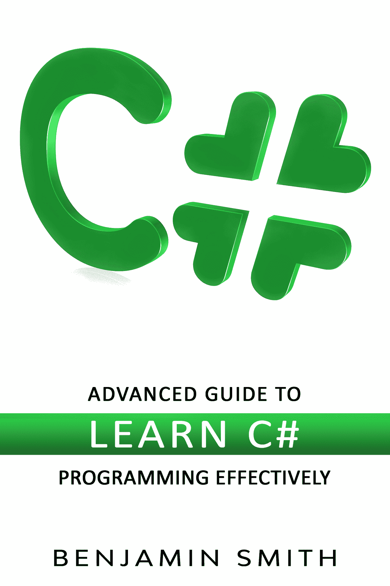
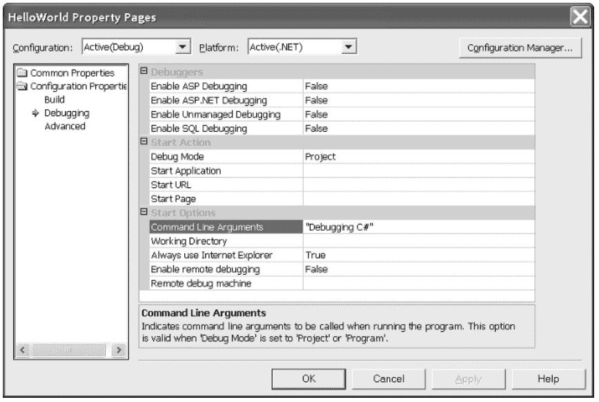
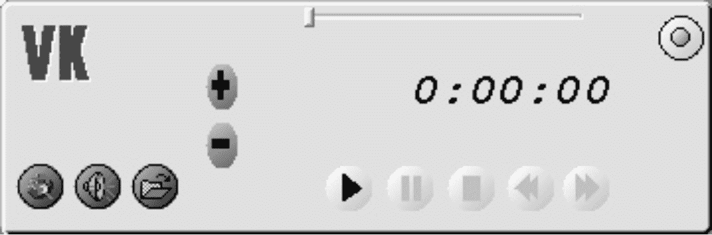
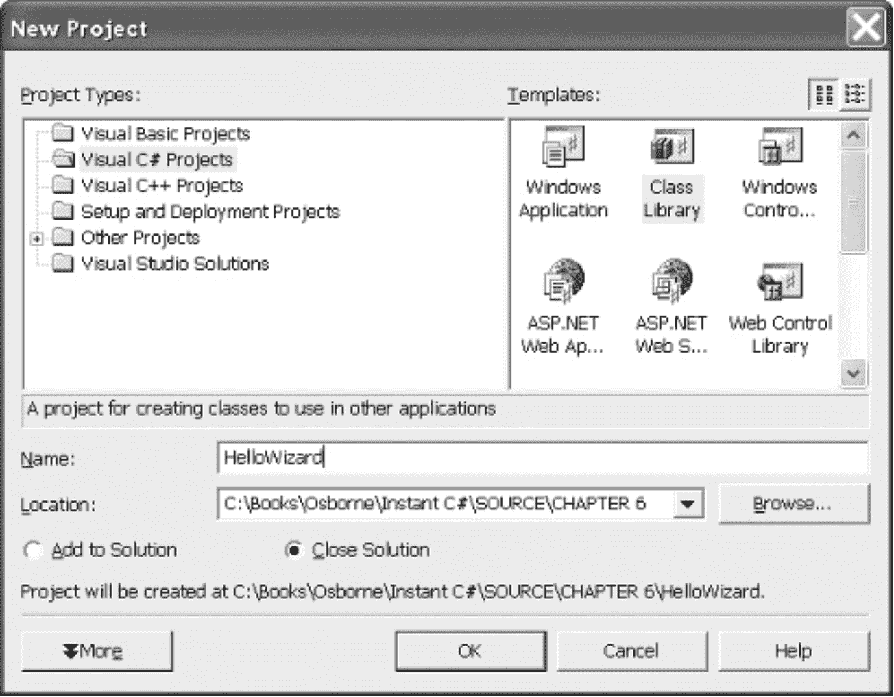
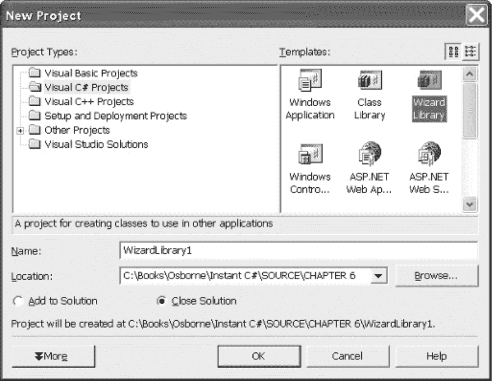
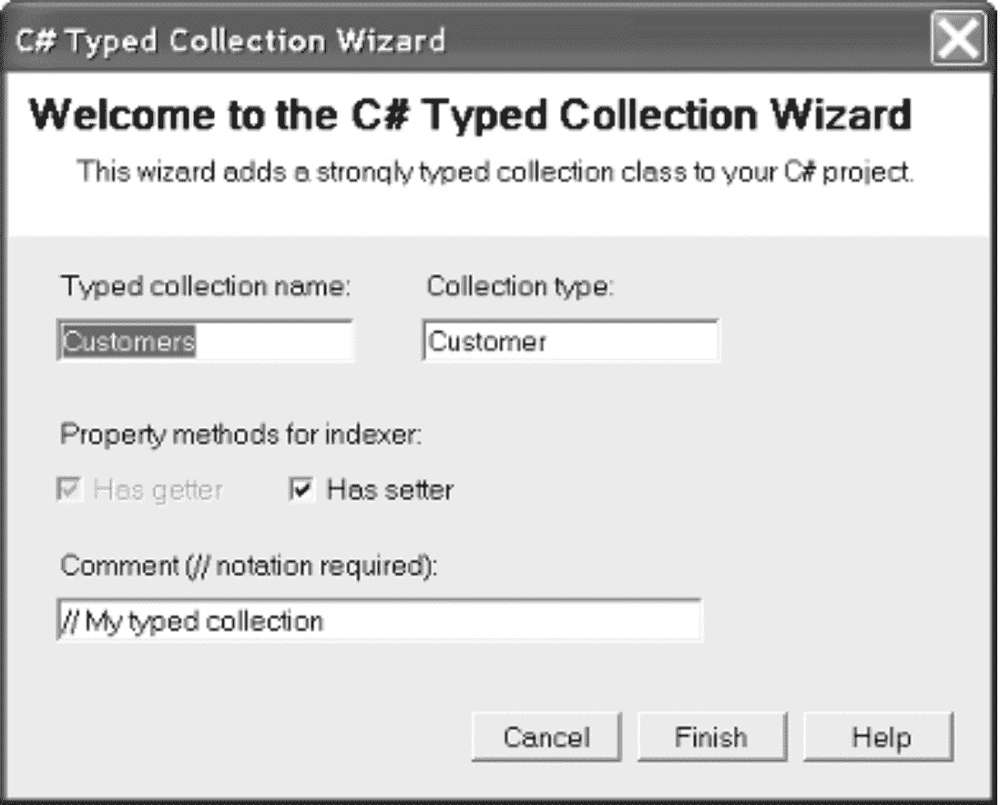

# C#：学习 C# 编程的高级指南





## 引言
面向对象编程就像一个兔子洞；一旦你开始探索，隧道似乎越陷越深。这尤为如此，因为有一系列核心基于面向对象技术和原则的编程语言。`C++`、`C`、`Java`、`Javascript`、`PHP`、`Visual Basic`、`Microsoft .NET`、`Ruby`、`Scala` 以及许多其他语言被称为“OOPL”（面向对象编程语言）。在这个语言族中，`C#` 类似于一个难以相处但资源极其丰富的同伴。对某些人来说，`C#` 是充满魅力且迷人的；而对另一些人来说，学习和使用这种语言是一件非常麻烦的事，但这两个处于光谱极端的人都没有错。

熟悉主流 OOPL（如 `C++`）的人会发现 `C#` 具有你在其他面向对象语言中可以找到的所有花花哨，这最终使得学习 `C#` 变得更加容易，但尽管有这些相似之处，相同技术、工具和概念的实现方式是截然不同的，此外，`C#` 本身并没有一个定义的 IDE。同时，你也可以认为没有哪种编程语言的某个 IDE 是比更好的。尽管如此，在 `C#` 的情况下，结果是编程体验的不一致，而其他语言则并非如此。因此，试图教读者一套通用的技术和实践实际上是不可能的。即使是基本概念也可能有所不同，尽管你可能已经通过其他面向对象语言熟悉了它们。

正由于这个原因，本书的第一章本质是对 `C#` 中最重要的编程概念的回顾。这样，由于所有读者可能在进入后续章节之前阅读这一章，每个人将对后续章节中解释和使用的概念有相同的理解。这非常重要，因为从字面上说，第 1 章之后的所有讨论都是建立在最开始时强调的概念之上的。即使读者已经了解第一章中讨论的所有概念，该章节本身也并非没用，因为它仍然作为一个回顾他们已有知识的机会。如果某些内容不清楚或解释得模糊，请进行简短的网页搜索。你极有可能只需要一些细节就能理解正在讨论的内容。

## 第 1 章：熟悉 C# 基础
本章将为读者提供 `C#` 中最重要的概念的全面回顾。这是必要的，因为接下来的章节将建立在我们在这里回顾的内容的基础上。这使得读者能够熟悉高级 `C#` 编程中常用的惯用法。通过这种方式，本章希望在我们在书的后半部分进入高级技术和项目之前让读者达成共识。然而，如果你已经拥有 `Java`、`Javascript`、`C++`、`PHP`、`Visual Basic .NET` 等面向对象编程语言的经验，你可能会认为这一章不值得花，但这一章将是一个非常有用的检查点，你可以回顾熟悉的概念。另一方面，大多数拿起这本书的读者会发现这一章揭示了 `C#` 乃至 `.NET` 编程的某些他们未知的方面。简而言之，这里的内容将为读者在整个课程中理解 `C#` 编程提供必要的基础。


## 1. 封装
## 2. 继承
## 3. 聚合
## 4. 多态

因此，任何包含这些原则的编程语言都被归类为面向对象的编程语言。为了在核心部分正确实现这些原则性元素，编程语言使用了被称为 `idioms`（惯用法）和 `constructors`（构造函数）的工具。例如，这些包括：

* 模板
* 运算符重载
* 接口
* 多线程
* 多重继承
* 异常处理
* 指针
* 垃圾回收等


在探索 C sharp 时，我们发现这种面向对象的编程语言的核心通过运算符重载、继承、接口、异常处理、垃圾回收、多接口继承、反射和多线程实现了主要元素，但你可能会注意到，`C sharp` 规避了一些功能，如模板、原始指针，甚至多重类继承。这些功能没有被包含在 `C sharp` 编程语言中的原因是存在一种争议：一方面，支持这种观点，认为这些特性引入的问题比它们可能解决的问题要多得多；另一方面，另一种观点认为这些是任何面向对象编程语言的核心组件，它们带来的特性是无价的，并且需要被包含在内，但为了保持简单直观，通过简单地不向 `C sharp` 中添加这些特性，从而避免了进一步的复杂性。然而，这并没有给任何有编程经验的人带来很大信心。这是因为模板、多重继承和指针的特性集极大地方便了 Web 应用程序和 Web 服务项目中的用户。因此，对于某些人来说，这可能是一个决定性的缺陷，但 `C sharp` 并没有让它们的终端用户失望。为了弥补此类工具的缺失，`C sharp` 包含了了自己的功能集，可以帮助用户构建 Web 应用程序和 Web 服务。例如，`C sharp` 具有一个允许在 Windows 平台上托管应用程序的工具，即“COM interop ..”。不仅如此，`C sharp` 还以多语言编程和快速应用开发著称。

但在所有这些论述之后，仍然有一个好消息。正如我们之前讨论过的，所有的面向对象编程语言具有相同的核心原理，区别在于实现这些原理的特性。你会发现其他 OOPL 的某些特性延续到了 `C sharp`。例如，如果你熟悉 `C++` 或 `Java` 的语法，那么你会发现 `C sharp` 的语法非常熟悉，从而让你能够相当快地进入状态。这只是你在将 `C sharp` 与其他面向对象编程语言比较时会发现许多相似之处之一，所以如果你是从这些语言过渡过来的，进行快速的比较是一个好主意。

在接下来的章节中，我们将讨论面向对象的基础，并讨论 `C sharp` 中提供的相应特性。

### 定义类

创建和定义类的方法与你在 `C++` 中相同，尽管此操作的底层结构在 `C sharp` 中略有不同。以下语法演示了在 `C sharp` 中定义类所需的结构。

```
Access-modifier class name{}
```

需要注意的一点是，与 `C++` 一样，`C sharp` 是一种大小敏感的编程语言。因此，在引用类时，你需要警惕定义类的大小。否则，编译器将无法识别你指的是哪个类。

上述演示的语法具有混淆的可能，所以让我们澄清它的元素。该语法有两个元素——“访问修饰符”和“名称 ..”。第二个元素是自言自明的，即用于识别该类的字符集，但第一个元素的目的是定义类的作用域（你应该已经熟悉“作用域”了）。通常情况下，类被指定为“public”（这在其他编程语言中等同于“global”），这样只要包含了头文件（类已经在其中定义了），就可以被任何程序中的任何函数访问它们。

所以，如果我们替换上面所示语法中的适当参数，我们将得到类似下面的内容：

```
public class MyFirstClass{}
```

在花括号中，你填入类的内容（它包含的函数、方法和对象）。如果你观察得仔细一点，你会发现类名的每个单词的首字母都是大写的。这并不是随机的，也不是错误。相反，我们在命名类时遵循一种约定。约定的目的是在编程时保持一致性，这从长远来看可能产生巨大影响，但并不是强制遵循这种命名约定（被称为“帕斯卡命名法”Pascal Casing）。是否选择使用它完全取决于你（编程中的其他许多约定也是如此）。

### 在控制台应用程序中使用类

假设你具备一些编程知识或任何程度编程经验，那么你一定熟悉“控制台”（console）这个术语。当你使用 IDE 软件编写代码时，你会发现底部有一个小窗口，看起来类似于命令提示符，在用户执行某些命令（如编译、调试等）时提供反馈信息。此外，当要求编译你当前打开的项目时，控制台还会显示代码中的语法错误。

同样，假设我们想使用 `C sharp` 来编写应用程序等。在这种情况下，我们将使用集成开发环境（例如 Microsoft Visual Studio）来完成，但我们不应将“控制台”与“控制台应用程序”混淆。虽然控制台在 IDE 中始终原生打开，但另一方面，“控制台应用程序”仅仅是一个没有 fancy GUI 的可执行文件。用户与应用程序交互的界面就像简单的命令提示符。

在这些任务中，你在 `C sharp` 编程期间可能执行的最常见操作是在特定的控制台应用程序中实现你定义的类。我们可以通过在 IDE 中打开“新建项目”轻松创建一个新的控制台应用程序。新创建的控制台应用程序的底层代码如下：

```
using System;
namespace HelloWorld
{
    /// <summary>
    /// Class1 的摘要描述。
    /// </summary>
    class Class1
    {
        /// <summary>
        /// 应用程序的主入口点。
        /// </summary>
        [STAThread]
        static void Main(string[] args)
        {
            // TODO: 在此处添加代码启动应用程序
        }
    }
}
```

现在让我们分解一下这段代码。在代码块的最开始，我们注意到使用了一个语句，即“using ..”。传递给该语句的参数是“System ..”。在这段代码中，`System` 实际上通过我们计算机上安装的 `.NET Framework`显然是使用 Windows）可用的 `.dll` 程序集文件。我们不需要详细说明“为什么”一个新的控制台应用程序要使用 `System.dll` 程序集文件。对这个“为什么”问题的简单回答是，该文件包含了“公共语言运行时”（Common Language Runtime）所需的必要元素。即使说 `.dll` 文件本身就是控制台应用程序也是没错。我们在 `C sharp` 中使用的 `using` 语句与 `C++` 中的 `include` 语句以及 Delphi 中的 `uses` 语句同义。

下一步，我们通过 `namespace` 语句指定控制台应用程序的“名称”。传递给该语句的参数将是我们分配给项目的名称，在这种情况下，将是用户创建的第一个程序的约定名称，即“Hello World”。然而，在参数中，我们不在单个命名空间之间添加空格。

你在这段代码中间看到的“斜杠”符号表示注释。在三个/两个斜杠（`\\\` 或 `\\`）之后写的任何内容都被认为是程序员编写的额外注释。当你以后在程序生命周期中需要查看程序代码，或者当其他人在探索它时，注释会非常有帮助。

在初始的三个注释之后，我们将看到第一个类的定义。由于这是我们创建默认控制台应用程序时生成的代码，类名和结构是标准的。建议将你创建的类起一个简单易懂、简短且易记忆的名字（尽管并不是每个名字都能同时具备这三个元素）。

接下来我们是整个应用程序的核心元素，`Main()` 成员。如果你对控制台熟悉，你就会熟悉这个成员。`Main` 是一个静态成员。`string[] args` 这种形式的参数告诉我们，这些字符串是数组的。。 ` `C++` `，`Main` 这种属性用的实用的。在任务任务，，是你在 `C sharp` 编程期间最可能执行的最常见操作。

### 在控制台应用程序中打印语句

现在我们通过在控制台应用程序中填充参数来显示语句：

```
using System;
namespace HelloWorld
{
    /// <summary>
    /// Class1 的摘要描述。
    /// </summary>
    class Class1
    {
        /// <summary>
        /// 应用程序的主入口点。
        /// </summary>
        [STAThread]
        static void Main(string[] args)
        {
            Console.WriteLine("Hello World!");
            Console.ReadLine();
        }
    }
}
```

为了打印短语，我们使用两个基本函数，即 `Console.WriteLine()` 和 `Console.ReadLine()`。我们指定想要控制台应用程序显示的短语或句子，并将其作为参数传递给 `Console.WriteLine()`。一旦完成，`Console.ReadLine()` 函数将一直等待它接收到的回车，然后继续它的工作。`Console.WriteLine()` 函数的作用与 `C++` 语言中的 `cout` 语句相同。分析打印“Hello World!”短语的使用时，你可能会注意到这些方法是在没有包含“Console”实例的情况下使用的。但事实是这些方法是名为 `Console` 的类的静态成员。所以，如果我们想调用和使用这些方法，就不需要创建相应类的实例。## 在命令提示符上执行“读取”

我们现在将概述有效拦截传递给控制台应用程序的参数的方法。要这样做，我们只需向 `Console.WriteLine()` 方法传递一个特殊参数。该参数是 `args[0]`，你可以看到它在代码块中的实现：

```
using System;
namespace HelloWorld
{
    /// <summary>
    /// Class1 的摘要描述。
    /// </summary>
    class Class1
    {
        /// <summary>
        /// 应用程序的主入口点。
        /// </summary>
        [STAThread]
        static void Main(string[] args)
        {
            Console.WriteLine(args[0]);
            Console.ReadLine();
        }
    }
}
```

当我们执行此代码块时，每当我们向命令提示符传递参数时，它就会被显示在控制台上的控制台拦截。向命令提示符传递参数有两种方法（也有其他方法，但为了简单起见，我们只坚持这两种）。


* 通过命令行提示符执行程序并传递相应的参数。
* 使用 Microsoft Visual Studio IDE 向命令行提示符传递参数。

让我们详细介绍第二种方法。使用 `.NET Visual Studio` 集成开发环境并不复杂，因为到此时你已经具有使用其他 IDE 的经验。为了使用 IDE 向命令行传递参数，我们需要执行以下操作：

1. 打开 Visual Studio IDE，并在 `View`（视图）选项卡中找到 `Solution Explorer`（解决方案资源管理器）菜单。
2. 进入 `Solution Explorer` 菜单后，你会看到你正在工作或放置在 IDE 浏览目录中的所有项目列表。在这里，你需要找到要为此任务操作的项目，然后右键点击它。这将打开一个下拉菜单，从中选择 `Properties`（属性）选项。
3. 这将打开一个如下所示的新窗口：



在左侧，你将看到一个小型文件导航界面。在这里，双击 `Configuration Properties`（配置属性），并在内部选择 `Debugging`（调试）。
4. 在名为 `Start options`（启动选项）的第 3 类类别中，第一部分将是 `Command Line Arguments`（命令行参数）。在这里，你需要指定一个适当的值。在这种情况下，我们传递了一个参数 `Debugging C#`。
5. 一旦完成命令行参数的传递，我们可以手动重启在 IDE 中打开的应用程序，或者按快捷键 `F5 key` 进行重启。一旦应用程序在重启后通过 IDE 运行，我们就能看到传递给命令行提示符的参数。


### 使用字段和属性

`Fields`（字段）和 `Properties`（属性）是两个之间存在有趣关系的元素，但在讨论它们之前，让我们先理解编程中“消费者”（consumers）和“生产者”（producers）的底层概念。“消费者”是指那些对类等对象的终端用户。同样，“生产者”是指那些构建这些类的人。这里值得注意的一个有趣点是，消费者和生产者都是程序员。

现在已经明确了这一点，让我们来谈谈“字段”。一个 `Field`（字段）简单来说就是包含类中的一组数据。按照惯例，类的字段从不是公有（public）的。相反，它们被生产者设置为 `private`（私有），但有时消费者需要访问他们正在使用的类的字段，然而，由于这些字段是私有的，他们受到了阻碍。

这就是 `Properties`（属性）大显身场的地方。属性具有双重性质。详细来说，如果消费者正在使用这种“属性方法”，它看起来就像消费者在处理数据没有区别。另一方面，如果生产者使用相同的属性方法，它的功能就就像是一个方法（method）。

你可能会问，为什么起初需要访问类的数据字段呢？嗯，答案非常简单直接：访问类的数据允许程序员自由地更改类的方法，甚至对类的对象进行一些微调。同样，使用 `Properties` 允许我们控制类中数据被访问的方式。

### 定义字段

字段的本质，即它包含的数据类型，通常可以是任何类型（它只需要符合它将要使用的类的目的）。由于这些数据对类很重要，因此它们通常通过使用访问修饰符来保持私有状态（即将其作用域设置为 `private`）。这样一来，只有创建该字段的程序员（生产者）才能对其进行更改。如果生产者以外的任何人想要访问类中的字段并对其进行更改，他们必须通过“属性方法”来完成。

在接下来的代码块中，我们正在创建一个存储字符串数据的字段：

```csharp
using System;
namespace HelloWorld{
    /// <summary>
    /// 类 Class1 的摘要描述。
    /// </summary>
    class Class1{
        private static string arg0 = null;
        /// <summary>
        /// 应用程序的主入口点。
        /// </summary>
        [STAThread]
        static void Main(string[] args){
            arg0 = args[0];
            Console.WriteLine(arg0);
            Console.ReadLine();
        }
    }
}
```

在这次演示中，你可以发现我们没有在程序中使用 `Class1` 的实例。现在，让我们稍微修改这段代码块，以便我们实际上使用相应类的实例，同时它本质上执行相同的工作：

```csharp
using System;
namespace HelloWorld{
    /// <summary>
    /// 类 Class1 的摘要描述。
    /// </summary>
    class Class1{
        private string arg0 = null;
        public void WriteCommandLine( string arg ){
            Console.WriteLine(arg);
            Console.ReadLine();
        }
        /// <summary>
        /// 应用程序的主入口点。
        /// </summary>
        [STAThread]
        static void Main(string[] args){
            Class1 class1 = new Class1();
            class1.arg0 = args[0];
            class1.WriteCommandLine(class1.arg0);
        }
    }
}
```

基本上，修改涉及我们如何使用 `Main()` 方法。最初，该方法处理了执行相应工作的大部分工作，但我们在修订中更改了 `Main()` 方法的目的，使其唯一的工作仅充当“启动方法”。为了适应代码工作方式的变化，我们实现了一个 `Class1` 的实例。

### 定义属性

由于其性质和功能，`Properties`（属性）基本上被认为是“方法”（当我们在之前的章节节中讨论“属性方法”时，你可能已经猜到了）。通常，属性可以用两种方式之一使用，要么作为“右侧值”（right-hand side value），要么作为“左侧值”（left-hand-side value）。如果属性被用作 RHS 值，我们调用一个特定的属性方法称为“getter”（获取器）。另一方面，如果属性被用作 LHS 值，我们调用的相应属性方法称为“setter”（设置器）。

属性还有用于定义其作用域的访问修饰符。按照惯例，属性被设置为公有的（public）。以下是属性定义的方式：

```csharp
Access-Modifier Type Property-Name
{
    get{return field;}
    set{field = value;}}
}
```

本质上，属性有三个基本元素——一个访问修饰符（通常设置为 `public`）、一个“类型”，以及最后也是最重要的一点，一个名称。`Properties` 根据其用法和实现分为三种，即：“只读属性”（Read-only Properties）、“索引属性”（Indexed Properties）和“只写属性”（Write-only Properties）。在继续之前，让我们来讨论这些不同类型的属性。

#### 只读属性

我们区分只读属性的主要元素是观察它是否拥有“getter”或“setter”。如果属性只有“getter”，那么它就是“只读属性”。正如其名称所示，此类属性只允许用户查看属性元素（如其值），而用户没有权限进行任何更改。这里有一个访问类中定义的“只读属性”值的示例。此温度类具有摄氏度和华氏刻度的特征。以下是我们如何使用只读属性来获取相应类将显示的温度刻度：

```csharp
public enum TemperatureMode{fahrenheit, celsius}
class Temperature{
    private TemperatureMode mode = TemperatureMode.fahrenheit;
    private double celsius = 0;
    private double fahrenheit = 0;
    public Temperature( double aTemperature, TemperatureMode aMode ){
        mode = aMode;
        SetTemperature(aTemperature);
    }
    private void SetTemperature(double aTemperature, TemperatureMode aMode){
        if(aMode == TemperatureMode.fahrenheit ){
            fahrenheit = aTemperature;
            celsius = FahrenheitToCelsius(fahrenheit);
        }
        else{
            celsius = aTemperature;
            fahrenheit = CelsiusToFahrenheit(aTemperature);
        }
    }
    public static double CelsiusToFahrenheit(double celsius){
        return celsius * (9.0/5) + 32;
    }
    public static double FahrenheitToCelsius(double fahrenheit){
        return (fahrenheit - 32) * 5.0/9;
    }
    public TemperatureMode Mode{
        get{return mode;}
        set{mode = value;}}
    public double Value{
        get{return mode == TemperatureMode.fahrenheit ?fahrenheit : celsius;}}
    public bool Test(){
        return fahrenheit == FahrenheitToCelsius(celsius)&& celsius == CelsiusToFahrenheit(fahrenheit);
}
上面的代码块执行了确定温度将转换到的刻度（简单来说，是确定使用摄氏度刻度还是华氏度刻度）。
```

#### 只写属性

正如只有“getters”的属性是“只读属性”的特征一样，只有“setter”的属性主要被称为“只写属性”。在这种类型的属性中，访问类的用户可以对其甚至对属性本身进行更改。通常你不会遇到只写属性，因为它们会给终端用户带来不必要的复杂性。但并不意味着只写属性完全没用。例如，你可以使用只写属性来以密码的形式向用户请求身份验证。与其使用只读属性显示密码，不如让用户自己输入。

#### 索引属性

这种属性与其他两个一样简单。正如“Index”（索引）名称所示，这种属性主要用于通信放置在类中的项。由于主用户将是消费者，请求的数据以 `object[index]` 的形式显示。

```csharp
class IndexedProperty{
    private string[] args = null;
    public IndexedProperty(string[] args){
        this.args = new string[args.Length];
        args.CopyTo(this.args, 0);
    }
    [System.Runtime.CompilerServices.IndexerName("Command")]
    public string this [int index]{
        get{return args[index];}
        set{args[index] = value;
    }
}
```

### 使用类实例

为了创建一个对象的实例并使其在创建它的程序中运行，我们需要通过运算符来调用“构造函数”（Constructor）。当我们创建一个对象的实例时，可以获取一组变量并将它们链接到实例化对象，但执行此操作有一个条件：当我们尝试将变量赋值给对象时，两个元素都需要相互兼容。实例化对象的类型和变量的类型需要相似；如果对象和变量的类型不匹配，此过程将失败。这扩展到了继承的对象。因此，如果我们有一个之前声明为与对象相同的变量，那么我们也可以在相同对象的子实例中使用它。如果我们想创建一个对象的实例，我们需要使用构造函数。构造函数基本上是一种在创建对象过程中主要使用的方法（包括创建实例）。构造函数有三个元素：名称、访问修饰符和参数。构造函数的名称通常是它所属类的名称。

```csharp
// 简单的对象创建
FileStream fs = new FileStream("c:\\temp\\killme.txt", FileMode.CreateNew);
fs.Write(new Byte[]{65, 66, 67, 68, 69}, 0, 5);
fs.Close();

// 数组示例
string[] strings = new string[10];
strings[0] = "Some Text!";
int[] integers = new int[]{0,1,2,3,4};
```

### 定义接口

在面向对象编程语言的语文中，接口（interface）与你可能熟悉的没有区别。接口的主要用途是为特定类创建交互方法。更准确地说，接口是接入类功能的实际实现。考虑安装在车辆上的音响系统。该音响系统有两个圆形控制器。接口是接入类功能的某种具体化。


- 继承特征的类是父类，而继承这些特征的类是子类。例如，如果 `Class Y` 继承了 `Class X` 的成员，那么 `X` 就是父类，`Y` 就是子类。
- 如果 `class Y` 继承了 `class X` 的成员，那么 `class X` 被称为 `superclass`（超类），`class Y` 被称为 `subclass`（子类）。
- `Inheritance`（继承）有时也被称为 `generalizing`（泛化）。
- 如果继承关系有多个子类，那么每个子类之间的关系被称为 `siblings`（兄弟关系）。因此，多个从同一个超类继承成员的类被称为 `siblings`。

这里有一个使用继承特性的示例，其中多个类都继承了 `Radio Class` 的成员，在这种情况下，该类被用作父类。

```csharp
public interface IAudio {
    void AdjustVolume(int value);
}
public class Radio : IAudio {
    private int volume = 0;
    void IAudio.AdjustVolume(int value) {
        volume += value;
    }
    public int Volume {
        get { return volume; }
        set { volume = value; }
    }
    private double station = 94.1;
    public double Station {
        get { return station; }
        set { station = value; }
    }
    public void Receive() {}
}
public enum RadioBand { AM, FM}
public class AMFMRadio : Radio {
    private int volume = 0;
    void IAudio.AdjustVolume(int value) {
        volume += value;
    }
    public int Volume {
        get { return volume; }
        set { volume = value; }
    }
    private double station = 94.1;
    public double Station {
        get { return station; }
        set { station = value; }
    }
    public void Receive() {}
}
```

这对于你来说可能有点困惑，因为这里发生了多处继承，但核心概念仍然保持不变。在这个示例中，我们有一个父类（超类）`Radio` 和两个子类（子类）`CommunicationsRadio` 和 `AMFMRadio`。这些兄弟类继承了父类的重要成员，以执行它们特有的功能。对于 `CommunicationsRadio` 类，目的是启用发射和接收无线电信号的功能；对于 `AMFMRadio` 类，则是支持不同的无线波段，即调幅波段（AM）和调频波段（FM）。

### 封装与聚合
`Encapsulation`（封装）和 `Aggregation`（聚合）都表示一个类（或任何数据结构）填充成员的倾向，但这两个术语并不等同。虽然封装指的是一个类将成员保留在类内部的倾向，但聚合则包含了那些本身也是类（或数据结构）的成员。如果封装的概念仍然让你感到困惑，可以考虑一个类比。想象一个带有小隔层存放药片的小盒。药物被 `encapsulated`（封装）在药盒中。在这个类比中，`medicine` 实际上是 `class`，它拥有方法、函数和对象，而药盒代表了 `encapsulation` 方法。通过使用封装和聚合，我们本质上可以将数据放入类中，同时控制访问这些数据的权限。通过封装，我们可以添加简单的数据类型和结构；通过聚合，我们可以在类内部添加更复杂的数据类型和结构。

然而，我们不能仅仅将数据随机丢进类中。我们需要思考哪个类是存储数据的最佳容器。实现一种方法是查看可用的类列表，并确定哪一个是最合适的竞争者，即哪个类本质上负责持有特定类型的数据。例如，如果我们把人肺视为 `data`（数据），那么将它们放在 `human body (class)` 中会比放在植物（另一个类）中更符合逻辑。

让我们使用 `Radio` 类来探索如何实现 `Encapsulation` 和 `Aggregation`。

```csharp
public class BoomBox {
    private AMFMRadio radio;
    public AMFMRadio Radio {
        get { return radio; }
    }
    BoomBox() {
        radio = new AMFMRadio();
    }
}
```

在这个代码块中，我们正在处理一个之前没有用过的类，名为 `BoomBox`。有趣的地方在于，这个类实际上包含了 `AMFMRadio` 类。因此，`AMFMRadio` 类代表了封装以及聚合的过程。

### 多态
C# 中 `Polymorphism`（多态）的概念其实并没有那么复杂。当程序员遇到一个可以由任何通用 `provider`（提供者）处理的问题时，基本上涉及到多态。但这里的关键在于，提供者必须是更大提供者集合的一部分。这意味着无论我们从集合中选择哪一个提供者，都可以解决这个问题。这被称为 `Polymorphism`，但仅从这个角度理解多态可能对你没有帮助，所以让我们采取更具技术的方法。

首先，取一个类并将其声明为通用类型。当我们对类进行泛化时，它本质上继承了其父类（超类）的类型。如果我们想取这个类创建多个实例，并希望类的每个实例都具有特定类型，我们就指定一个而不是通用类型，这就是我们的 `problem`（问题）。这种被称为 `problem` 的想法可能看起来很傻，但它是为了帮助你理解 `polymorphism` 的概念。我们可以通过从不同的 `types`（类型）中选择一种类型来解决这个问题。选择任何一个类型都能解决问题，但我们仍然有广泛的选择。这就是 `polymorphism`，即我们先声明一个通用类型的类，然后声明带有特定 `types` 的实例。这种现象在 `EventHandler` 委托的工作中可以很容易观察到。该委托的指令方式使得其初始参数将是一个对象。因此，持有对象的类将被视为根。

### 访问修饰符、类和成员修饰符
让我们先讨论 `Access Modifiers`（访问修饰符）。简单来说，访问修饰符定义了类的用户可以看到和访问的内容。如果类的访问修饰符设置为 `private`，那么消费者将无法看到类，更不用说尝试访问它。如果访问修饰符设置为 `public`，那么消费者就能看到该类，并访问其内容对其进行更改。访问修饰符的实际用途是在用户的编程过程中引导他们。如果有人在代码中使用你的类，那么将那些不需要消费者关注的类保持为 `private`，可以将注意力主要集中在生产者保持为 `public` 的类上。通过这种方式，生产者确保消费者只会碰那些为了使用它们而需要交互的类。

在 C# 中，总共有五种可以使用的访问修饰符。这些修饰符列如下，并附有简单的解释。

1. **Public Access Modifier**（公共访问修饰符）：该修饰符赋予最终用户访问相应类成员的自由（这也包括类中的 `types`）。
2. **Protected Access Modifier**（受保护访问修饰符）：该访问修饰符通常用于嵌套类（类内部的类）。因此，子类（subclasses）将能够访问父类（superclass）以及嵌套内部的其他类，但不会赋予消费者相同的访问权限。相反，他们被限制无法访问嵌套类的成员。
3. **Private Access Modifier**（私有访问修饰符）：类中任何具有私有访问修饰符的成员都无法被创建该类的之外的任何子类或其它用户访问。


## 4. 内部访问修饰符 (Internal)
成员和类型访问修饰符指定为‘internal’的类，其访问权限仅限于它们所在的程序集（assembly）。通过这种方式，任何外部都无法访问这些类，但代码可以与这些类的成员和类型进行通信。

## 5. 保护内部修饰符 (Protected Internal)
这种访问修饰符基本上是在 internal 修饰符的基础上加上 protected 修饰符的结果。就像保护 访问修饰符通常用于嵌套类一样，protected internal 修饰符也大多用于嵌套类型。只有程序集对保护 internal 修饰符中的嵌套类成员具有无限制的访问权限。

然而，在使用访问修饰符时，你需要遵循一些规则以避免产生错误。

- 每当你定义高层类型时，其访问修饰符必须指定为‘Public’。否则，当其他类型需要与高层类型通信时，一定会引起麻烦。如果你不想使用‘Public’访问修饰符，你唯一的其他选择就是使用‘Internal’访问修饰符。
- 每当你处理嵌套类或类型时（在嵌套类中，一个类包含另一个类；类似地，嵌套类型是一个持有另一个类型定义的类型），你必须在使用‘Private’访问修饰符或‘Protected’访问修饰符之间做出选择。
- 尽管‘Protected Internal’是两个访问修饰符（protected 和 internal）的组合，但强烈建议不要这样组合任何其他访问修饰符。
- 如果类或类型没有指定任何访问修饰符，则将为相应的成员赋予‘默认访问授权’，但不建议依赖此。生产者应该始终指定适当的访问修饰符。

在类和成员上使用修饰符的概念在我们讨论访问修饰符时，已经以某种方式讨论过了。无论如何，如果你发现定义的类被封装在命名空间（namespace）中，最好将它的访问修饰符设置为‘Public’或‘Internal’。在处理嵌套类时，你可以用于定义它们的访问修饰符选项是有限的。这些选项包括‘protected、protected internal 或 private’访问修饰符。成员赋予了生产者为其分配任何访问修饰符的自由。如果你不指定任何访问修饰符，它将默认设置为 private。

### 反射 (Reflection)
这基本上是一种在 .NET Framework 中广泛使用的功能。通过使用‘reflection’，用户可以探索程序的程序集以提取代码中的数据，这些包括：

- 命名空间 (Namespaces)
- 接口 (Interfaces)
- 类 (Classes)
- 方法 (Methods)
- 属性 (Properties)
- 字段 (Fields)

此外，反射是一个极其有用的对象函数，允许用户：

- 在程序运行时执行‘IL ’（中间语言）代码。
- 使用特殊方法查看记录在特性（attributes）中的元数据值。
- 开展一些侦查工作，例如，探索在相应程序集中定义的类型并发现成员。

## 第 2 章：使用程序集查看器 (Assembly Viewer) 和用户控件 (UserControls)
在上一章的最后部分，我们简要地讨论了面向对象的函数‘Reflection’。本章扩展了讨论，允许读者探索‘Reflection’的实际用途，以检查程序集内包含的数据。本章的核心概念基于动态加载程序集并使用反射通过程序集查看器探索该程序集。这里的主要收获是，理解加载程序集和使用它们的过程具有巨大的潜在益处。例如，我们可以使用 HTTP 连接无线加载程序集，通过对客户端进行轻量级编程，我们可以自动化两个任务：

- 部署基于‘Windows-Forms’框架的应用程序。
- 基于 Windows Forms 为这些应用程序发布更新。

除此之外，我们还将在本章中探索许多其他主题，例如创建和声明静态方法、使用如 `IEnumerator` 等接口，以及实际演示继承的使用。最后，我们还将探索 UserControls 的功能，以创建你在许多 Windows 应用程序中看到的按钮、图标和操作。

### 分析程序集管理器的代码列表
在本节中，我们将探索使用 Reflection 函数加载程序集和提取信息所需的最重要模块之一。必要的函数、方法、类和对象可以在 `AssemblyManager.cs` 模块中找到。遗憾的是，托管该模块源代码的网站已经关闭，但下所示的列表包含了你从该模块本身需要的所有重要点和组成部分（例如方法或类）。

```c
1: using System;
2: using System.Reflection;
3: using System.Diagnostics;
4: using Diag = System.Diagnostics;
5: using System.IO;
6: using System.Collections;
7: using System.Text;
8: using System.Windows.Forms;
9:
10: namespace AssemblyViewer
11: {
12: /// <summary>
13: /// Summary description for AssemblyManager.
14: /// </summary>
15: public class AssemblyManager
16: {
17: private string name = "";
18: private Assembly;
19:
20: public AssemblyManager(string assemblyName)
21: {
22: Debug.Assert(File.Exists(assemblyName));
23: Name = assemblyName;
24: }
25:
26: public Assembly Assembly
27: {
28: get
29: {
30: return assembly;
31: }
32: }
33:
34: public string Name
35: {
36: get
37: {
38: return name;
39: }
40: set
41: {
42: if(name.Equals(value)) return;
43: name = value;
44: Changed();
45: }
46: }
47:
48: private void Changed()
49: {
50: Debug.Assert(File.Exists(name));
51: assembly = null;
52: assembly = Assembly.LoadFrom(name);
53: }
54:
55: private string Formatted(Type type)
56: {
57: const string mask = "{0} \r\n";
58: string result = string.Format(mask, type.Name);
59: Broadcaster.Broadcast(result);
60: return result;
61: }
62:
63: private string Formatted(MemberInfo info)
64: {
65: const string mask = "\t{0} {1}\r\n";
66: string result = string.Format( mask,
67: info.MemberType.ToString(), info.Name );
68: Broadcaster.Broadcast(result);
69: return result;
70: }
71:
72: private string Load()
73: {
74: StringBuilder str = new StringBuilder();
75: IEnumerator outer = assembly.GetTypes().GetEnumerator();
76:
77: while(outer.MoveNext())
78: {
79: Type type = (Type)outer.Current;
80: str.Append(Formatted(type));
81:
82: IEnumerator inner = type.GetMembers().GetEnumerator();
83:
84: while(inner.MoveNext())
85: {
86: str.Append(Formatted((MemberInfo)inner.Current));
87: Application.DoEvents();
88: }
89: }
90:
91: return str.ToString();
92: }
93:
94: public string Text
95: {
96: get
97: {
98: return GetText();
99: }
100: }
101:
102: public string GetText()
103: {
104: return Load();
105: }
106:
107: }
108:}
```

### ‘using’ 语句
通常，‘using ’ 在以下两种场景之一（或同时在两种场景下）实现：

- 导入命名空间 (namespace)
- 处理对象（在这种情况下，它被用作‘块语句’）


在上方显示的详细列表中，已经演示了如何实现 `using` 语句。如果你有任何 `C++` 经验，那么可以将 `using` 语句视为 `include` 语句。如果 `C#` 是你首次接触的对象对象编程语言，它将帮助你理解 `using` 语句的作用——即它作为一个帮助你向程序集引入外部引用的工具，但请注意，每当你处理程序集时，它会被存储在扩展名为 `.DLL` 的文件中。因此，如果我们使用 `using` 语句来添加程序集本身，我们本质上是在引入一个 `.DLL` 文件。此外，此语句还可以用于指向属于通用程序集文件的特定类或函数。如果我们想使用 `Reflection`，将必须引用相应的程序集文件。

```
using System.Reflection;
```

我们引用的程序集是 `System.dll`，而我们正在使用的类 `System.Reflection` 是该程序集文件的一部分。如果我们想使用控件来访问 Windows Forms 功能，必须先在程序中包含相应的程序集文件（`System.Windows.Forms`）。我们还可以实现 `using` 语句来为命名空间创建引用。每当我们指定这个 `reference` 时，代码将自动将其解释为其链接的命名空间。例如：

```
using System.Diagnostics;
using Diag = System.Diagnostics;
```

每当我们使用 `Diag` 术语时，程序都会将其视为 `System.Diagnostics` 命名空间。在进入下一节之前，我们将讨论该指令的最后一个用途。假设你正在实现 `using` 语句，以使用你指定的对象创建一个代码块。如果 `using` 指令显式地使用该块将要使用的对象实现，那么一旦该块结束，该对象将被程序丢弃。无论在块执行完成之前发生异常，这种情况都会持续发生。这里有一个演示。

```
using (FormAbout form = new FormAbout()){
    form.ShowDialog();
}
```

一旦这个简单的代码块执行完毕，该对象将被丢弃。

### 使用反射处理程序集

可以认为，整个 `AssemblyManager` 类中承担了大部分工作的核心元素，非 `Load()` 函数。该函数主要利用被称为“枚举器”（enumerators）的特殊对象来执行两项任务（每个任务使用不同的枚举器）：

*   遍历程序集中已指定的每一个类型并加载它们。
*   遍历之前探索的每个类型的对应成员，然后加载这些成员。

通过在程序中创建特殊的循环结构（例如，嵌套循环），我们可以有效地遍历所有这些类型及其相应的成员，从而提取这些信息。一旦函数收集了必要的信息，它就会将其转换为具体的形态（如字符串），然后将其显示给用户。这为终端用户为设计和创建元素（如类的接口）提供了急需的见解。

在继续之前，让我们简要讨论一下枚举器。假设你面对的是以列表（list）或数组形式存储的数据，你被要求设计一个程序来遍历数据结构中的每个条目并执行特定任务。传统上，你可能考虑的第一种方法是为此类任务创建一个循环。为了这样做，你将使用 `for` 或 `while` 创建语句。然而，我们知道这种指令的构造在本质上是一个 `statement`（语句）。如果我们想在程序遍历数据时使用某种方法来执行特定任务，我们能够向对应的方法传递某些参数，但方法不接受语句作为其参数。这就是 `enumerators` 用用场的地方。枚举器仅仅是用于执行特殊任务的对象，例如遍历数据表、数组、字符串集合等。基本上，枚举器与算法一起使用。因此，你获取一个枚举器，将其作为参数传递给方法，并指定该方法将使用的算法。

如果你想使用 `Load()` 函数，你必须首先了解它的语法并在程序中定义它。如果你查看本节开头的 Assembly Manager 代码列表，你会发现 `load` 函数的定义始于 `第 69 行到第 90 行`。如果我们关注代码列表的第 70 行，会发现函数定义包含了创建一个名为 `StringBuilder` 的对象实例。该对象的实例的创建似乎是毫不费力，因为它在之前已经定义过了（如果你查阅命名空间 `System.Text` 就能找到该定义）。该对象的目的是加速转换字符串字符的逻辑处理。更准确地说，`StringBuilder` 对象可用的单个字符串缓冲区容量大得多。因此，大量的字符串信息可以流经缓冲区，使字符串操作更快。

现在让我们继续讨论如何实际使用反射。首要要求是从我们正在处理的程序集文件中选择一个合适的对象实例。一旦我们获取了该对象实例，我们本质上就拥有了程序集的引用。从现在起，我们所做的就是使用反射，程序集就会揭示其内部定义的所有成员，但如果我们处理的是类型实例而不是对象实例，情况就会稍有不同。正如我们所知，每个类型的成员特定于其唯一的元素（例如，一个只包含指向 `Methods` 的成员和其他类型指向 `Field` 信息的类型等）。因此，当我们对类型实例使用反射时，我们将提取它所引用的信息。因此，如果我们想要关于 `Methods`、`Fields`、`Events`、`Properties` 等的数据，我们必须在相应的类型实例上使用反射。

虽然我们知道拥有对象实例时该做什么，但我们并不知道最初如何召唤该对象实例。嗯，我们主要可以通过以下两种方法来提取对象实例：

1.  使用方法 `AssemblyLoadFrom()`。传递给此方法的参数是我们正在处理的程序集名称。
2.  使用静态方法 `Reflection.Assembly.GetcallingAssembly()`。


通过这两种方法中的任何一种，我们本质上都可以提取出想要操作的程序集的引用。一旦获取了该引用，你现在需要使用适当的方法对该程序集文件执行某些操作。例如，如果我们有一个程序集引用，并想要提取告诉我们该程序集中定义了所有类型的信息，我们必须使用使用适当的方法。在这种情况下，我们必须首先传递一个数组声明，并将该数组的“type”属性设置为我们想要从程序集中提取的类型。一旦设置好数组，我们所做的就是调用 `assembly.GetTypes()` 方法。然而，在使用此方法时，你始终需要记住，`assembly` 这部分基本上就是你之前获取的实际程序集引用。

`Reflection`（反射）的功能不仅仅是简单的解开程序集的内容。当我们使用反射来提取有关程序集所包含的类型和成员的信息时，此时，反射也能够直接使用它们，尽管它们的定义是在程序集文件中的。这里有一个关于如何加载程序集文件并使用反射执行一个原本源于程序集本身的静态方法的示例。

```cs
const string s ="c:\\winnt\\Microsoft.NET\\Framework" +"\\v1.0.3705\\System.Windows.Forms.dll";
Assembly = Assembly.LoadFrom(s);
Type type = assembly.GetType("System.Windows.Forms.MessageBox", true);
type.InvokeMember("Show", BindingFlags.Public |BindingFlags.InvokeMethod |BindingFlags.Static, null, null,new object[] {"Invoked by Reflection"});
```

### Broadcaster 类

如果你查看 Assembly Manager 的代码列表，你将遇到一个相当独特的语句，它使用了一个你们大多数人之前没见过的类：`Broadcaster.Broadcast`。

该语句本质上使用 `Broadcaster` 类向指定目标字面地“广播”信息。任何其他截获此广播的用户都可以访问正在传播的信息。这种方法通常用于发送诸如正在进行的操作当前进度等信息。为此，该类本质上需要定义一个“主表单”作为接收广播并显示信息的应用程序。我们可以看到 `AssemblyViewer` 使用这种相同的方法在操作进行期间显示其当前状态。

以下是 `Broadcaster` 类以及接收广播所需的接口。

```cs
using System;
using System.Collections;

namespace AssemblyViewer
{
    /// <summary>
    /// Broadcaster 的摘要描述。
    /// </summary>
    public class Broadcaster
    {
        private static Broadcaster instance = null;
        private ArrayList listeners = null;
        protected Broadcaster()
        {
            listeners = new ArrayList();
        }

        static private Broadcaster Instance
        {
            get
            {
                if( instance == null )
                    instance = new Broadcaster();
                return instance;
            }
        }

        public static void Add(IListener listener)
        {
            Instance.listeners.Add(listener);
        }

        public static void Remove(IListener listener)
        {
            Instance.listeners.Remove(listener);
        }

        public static void Broadcast(string message)
        {
            IEnumerator enumerator = Instance.listeners.GetEnumerator();
            while(enumerator.MoveNext())
            {
                if(((IListener)enumerator.Current).Listening())
                    ((IListener)enumerator.Current).Listen(message);
            }
        }
    }

    public interface IListener
    {
        bool Listening();
        void Listen(string message);
    }
}
```

本质上可以将任何带有 `IListener` 接口的类连接，该类将获得截获发送到目标位置字符串信息的能力，但要实现这一点，该类需要实现该接口并与正在“广播”的类注册。

### 使用 Broadcaster 类

现在让我们理解如何在应用程序中有效实现实现此类。在此之前，读者必须始终记住 `Broadcaster` 属于那些理想上只希望运行一个类实例的类组。这种组被称为 `Singleton`（单例）。因此，广播类的构建方式与其他类不同。为了让它像其他单例类一样工作，它有一个 `Private Instance Property`（私有实例属性）。

在整个类中，你会发现有很多公共方法可用，但我们必须记住，这些“公共方法”中的每一个实际上都是静态的（static）。每当调用广播类的公共成员时，相应的方法首先要要检查的是一个名为 `Instance` 的属性，该属性被设置为“只读”，因此方法可以访问它但不能修改它。然后，该属性会双重检查广播类是否创建了任何实例，如果是，那么有多少个。所以，如果 `Instance` 属性确认没有广播类的 `singleton`（单例）实例，它将继续创建一个。这个新创建的广播类实例将被传递给名为 `instance` 的字段（设置为私有）。如果 `Instance` 属性确认已存在该类的单例实例，它将把该实例链接到同一个私有类中。完成后，通过 `Instance` 属性提供来自该类单例实例的对象。所有这些争斗的结果是，广播类最终获得了一个指向广播类单例实例的对象。

最后，还有两个重要元素：

*   **IListener 接口** - 我们可以将此接口添加到数组中，用于定义接入广播的系统部分。一旦接口被添加到监听器的 `ArrayList` 中，我们现在就可以执行 `broadcast()` 方法。每当我们执行此操作时，数组中的每个监听器都会接收到广播器传播的信息。
*   **IEnumerator** - 我们使用枚举器而不是使用 `for, while` 循环语句，以便方法能够遍历 `ArrayList` 中定义的整个监听器列表。

### 为 Broadcaster 类定义接口

正如我们之前提到的，主要与 `Broadcaster` 类一起使用的接口是 `IListener` 接口。该接口有两个核心方法，帮助执行该类的核心功能。

1.  **Listening**：这是一个输出为 True 或 False 值的函数。换句话说，一个“布尔值”。函数返回的这个布尔值实际上告诉接口对象（实现接口的对象）是否愿意拦截从广播器发送的消息。通过这种方式，对象可以静音广播，而无需从与其链接的广播器中移除注册。
2.  **Listen**：此方法负责截获以字符串形式广播的。。

为了在你的应用程序中使用广播器，你所做的就是用想要接收广播的类实现 `IListener` 接口。下面的代码块演示了如何使用 `IListener` 接口来使用广播类。

```cs
public class FormMain : System.Windows.Forms.Form, IListener
{
    private void FormMain_Load(object sender, System.EventArgs e)
    {
        Broadcaster.Add(this);
    }
    protected override void Dispose( bool disposing )
    {
        if( disposing )
        {
            if(components != null)
            {
                components.Dispose();
            }
        }
        Broadcaster.Remove(this);
        base.Dispose( disposing );
    }
    void IListener.Listen(string message)
    {
        ChangeStatus(message.Trim());
    }
    bool IListener.Listening()
    {
        return true;
    }
}
```

### 与 Windows Forms 控件工作

`AssemblyViewer` 中定义了许多我们可以使用的 Form 控件。例如，我们有：

*   `StatusBar`、`MainMenu`、`OpenFileDialog`、`RichTextBox` 控件等。


仅位于 `AssemblyViewer` 的 `FormMain.cs` 模块中。我们可以使用这些控件为基于 .NET Framework 的应用程序创建界面，但我们无法列出该模块的所有代码，因为它包含了 400 多个条目。因此，我们将展示来自该模块的部分代码。

让我们从在现有项目中简单地添加“表单控件（Form Controls）”元素开始。每当表单被包含在程序中时，项目使用的主要命名空间本质上都会进行扩展，以涵盖负责定义“表单”的类。因此，在添加表单控件时，我们不需要创建一个单独的命名空间。包含 Windows 控件的语法所示：

```csharp
public class FormMain : System.Windows.Forms.Form, IListener
```

一旦你开始在程序中使用表单控件，你会发现添加“表单控件”的底层语法实际上是基于“继承（Inheritance）”的。因为对于项目中添加的每个“表单控件”，语法都会创建一个自 `System.Windows.Forms.Form` 的类。如果我们仅解释上述的语法，那么它本质上是指 `FormMain` 类应该从程序集文件 `System.Windows.Forms.Form` 继承其成员和类型。最后，这行简单的代码还实现了 `IListener` 接口。

如果你使用 `Visual Studio .NET` 作为 C# 编程的 IDE，那么在这种情况下，你会发现项目中实现 Windows Forms 非常方便。这是因为在使用 Visual Studio .NET 处理 Windows Forms 控件时，你有两个选项：

1. **代码视图（Code view）**：顾如名，IDE 向你显示负责“表单控件”形状、大小和内容的底层代码。你可以通过直接操作代码来更改元素，并通过添加相应的代码来包含额外的控件。
2. **表单视图（Form view）**：在此选项下，Visual Studio .NET 为程序员提供所添加表单控件的纯图形化视图。在这种模式下，你可以通过与 IDE 界面交互来直接操作表单控件元素。你还可以通过 IDE 内部提供的选项添加其他表单控件。这为人们提供了一种直观的方式来处理表单控件，而无需与相应的代码进行过多交互。


### 实现“状态栏”（StatusBar）表单控件

任何有计算机经验的人对“状态栏”这个术语都很熟悉。通常，状态栏的目的是显示任何操作的进度，这些状态栏通常出现在应用程序中。例如，取一个安装向导应用程序。当你点击“安装”按钮时（如果你没注意到，它也是一个表单控件），应用程序将开始将文件复制到指定的目录。安装进度将显示在“状态栏”上。我们还可以使用 `StatusBar` 作为显示应用程序当前状态的实时图形馈送。要在应用程序中实现 `StatusBar`，我们使用名为 `AssemblyViewer` 的应用程序模块中的当前内容。你需要提取的代码已经下文所示。

```csharp
private void Initialize(){
    openFileDialog1.InitialDirectory = GetInitialDirectory();
    Broadcaster.Add(this);
}
private void ChangeStatus(string status){
    statusBar1.Text = status;
    statusBar1.Refresh();
}
void IListener.Listen(string message){
    ChangeStatus(message.Trim());
}
```

我们已经讨论过如何使用广播类中的 `Broadcast` 函数和相应的接口 `IListener` 来实现此功能。

### 实现“主菜单”（MainMenu）表单控件

在任何标准的 Windows 应用程序中，你都会看到“主菜单”，它包含了用户可能想要访问的所有可能功能。通常，菜单主要仅由菜单项组成，也可以由一组按钮控件组成。如果我们从技术角度看菜单，它有两个对象——`MainMenu` 和 `MenuItem`。当我们创建一个 `MainMenu` 表单控件时，我们基本上是取一个空白的表单控件并在上面放置相应的对象和元素（尽管 IDE 也为此目的提供了模板）。在 `MainMenu` 表单控件上添加元素的交互过程非常直观、易于理解，并且不需要任何特殊编码，因此让我们进入下一个表单。

### 实现“打开对话框”（OpenFileDialog）表单控件

`OpenFileDialog` 表单控件是你使用 Windows 时遇到过的东西。当你从计算机硬盘上传内容到云存储时，你首先需要指定文件在系统中的位置。这会打开一个小的弹出窗口，类似于微型文件管理器，你通过该管理器导航到你所需的文件。这就是 `OpenFileDialog` 表单控件的实际实现。要实现这一点，我们只需要使用下所示在 `FormMain` 模块中定义的方法。

```csharp
public void OpenAssembly(){
    if( openFileDialog1.ShowDialog() == DialogResult.OK)
        OpenAssembly(openFileDialog1.FileName);
}
```

`OpenAssembly` 语句负责将我们刚刚选择的文件加载到 `AssemblyViewer` 上。记住，你需要根据不同的目的为 `OpenFileDialog` 表单控件添加相应的功能。例如，你可能记得某些此类弹出文件管理器有一个名为“文件类型”的特殊类别，允许用户过滤不同的文件类型。我们也可以通过使用以下代码向此表单控件添加此功能：

```csharp
openFileDialog1.Filter = "Class Library(*.dll)|*.dll|Executables(*.exe)|*.exe";
```

### 使用 ThreadPool 类实现多线程

“多线程”这个主题本身并不简单，但几乎每个程序员或计算机爱好者都熟悉这个术语所暗示的含义。线程基本上定义了由 CPU 分配给应用程序的一个代码执行流。CPU 拥有有限数量的线程，这些线程作为其规格的一部分进行宣传（例如，8 核 16 线程 CPU 意味着每个核心具有 2 个线程）。为了确保应用程序顺利初始化，并在运行过程中不会因等待部分代码执行完毕再继续等因素而产生瓶颈，程序员需要实现多线程。我们可以继续讨论多线程几百页而仍然无法涵盖整个主题，因此让我们只在与 `AssemblyViewer` 工作时才讨论多线程。让我们在 `AssemblyViewer` 应用程序内部讨论多线程。当你运行应用程序时，你会看到一个“启动界面”作为欢迎动画。嗯，`AssemblyViewer` 在此时总共使用了 2 个线程，一个线程用于执行启动界面的代码，而另一个线程用于初始化应用程序本身。启动界面本身还有其他用途，但那是另一天讨论的话题。

在本节中，我们将讨论主要设计用于帮助程序员在应用程序内部实现和处理多线程的类。这个类是 `ThreadPool` 类。将此类想象成一个银行经理。就像银行经理“管理”分行的员工一样，`threadpool` 类管理应用程序可用的线程总数，但在你在 Windows Form 控件上实现多线程时，需要额外的关注，因为表单控件很容易吞噬并占用宝贵的资源——线程，供其他应用程序或同一应用程序中的其他进程使用。

以下代码使用 `threadpool` 类通过多线程实现同一个启动界面的不同动画。

```csharp
1: bool done = false;
2: private void Increment()
3: {
4: Opacity += .05;
5: lock(this)
6: {
7: done = Opacity >= 1;
8: }
9: }
10:
11: private void Show(Object state)
12: {
13: try
14: {
15: while(!done)
16: {
17: this.Invoke(new MethodInvoker(Increment));
18: Thread.Sleep(100);
19: }
20: Thread.Sleep(1500);
21: }
22: finally
23: {
24: Close();
25: }
26: }
27:
28: public static void Splash()
29: {
30: #if DEBUG
31: FormSplash form = new FormSplash();
32: form.Opacity = 0;
33: form.Show();
34: ThreadPool.QueueUserItem(35: new Callback(form.Show));
36: #endif
37: }
```

### 实现控件库

如果你想开始构建用户控件（UserControls），最简单的方法是使用“新建项目”对话框中 Windows Control 中的模板。使用 UserControl 将创建一个项目，Windows Control 将生成一个具有 DLL 扩展名的程序集。另一种方法是从类库（Class Library）开始，稍后手动添加所有用户控件，但这种方法不受支持，因为如果你可以轻松地使用快捷方式，就没有动力去使用它们。在创建 Windows Control 时，你得到的类型将是类库。Windows Control 模板会添加如 `UserControl.cs` 和 `AssemblyInfo.cs` 等模块。它会同样添加如 `System`、`System.Drawing`、`System.Windows` 和 `System.Data` 等命名空间。要开始使用第一个用户控件，可以使用 UserControl 模块中存在的一个类。它继承自 `UserControl`。要添加元数据，可以使用 Info 文件。Windows Control 允许你根据需要添加无限的用户控件。考虑到 `.resx` 文件与 UserControl 相关，最好将每个模块限制为单一的 UserControl。你也可以通过一些通用解决方案构建 UserControl，稍后通过通用应用程序进行测试。许多专家大多推荐这种方法。在本章中，这种方法被用于构建用户控件。考虑到主控件，它由一组按钮组成。这些按钮总共 4 个。根据 UserControl 的大小，这 4 个按钮相应地调整了大小。还有另一个控件帮助 UserControl 具有两个列表框。

### 创建 ButtonCluster（按钮组）

在 UserControl 宿主上，通过 `ButtonCluster` 使用 4 个按钮。这些按钮通常位于表单的中心。这些组件可以移动，这是通过点击特定按钮完成的。如果应用程序偏离 Windows 视图且过度，合格的客户将知道该做什么。这需要自定义实践。每当事件触发时，列表会通知 UserControl。按钮需要对齐，为了这一点，必须考虑某些点。按钮的文本必须显示，以允许用户响应事件。

### 构建 UserControl 的图形界面

四个相同大小的按钮以垂直形式排列。这些按钮在视觉外观中起着至关重要的作用。这些按钮可以水平对齐以使控件符合预期。`button cluster` 将保持简单。真实的按钮可能通过不同的类型提供。使用 .NET 格式创建具有相同大小的按钮。现在，调整 UserControl 的大小。在垂直方向上对齐按钮到中心。之后，调整 UserControl 的大小。让所有按钮的高度等于单个按钮的宽度。

### 实现 UserControl 事件处理程序

当 UserControl 的大小调整时，会通知，因为事件处理程序是可用的。这有助于执行按钮的类似调整代码。在编写代码时，建议使用重写（override）方法，因为在任何其他情况下，这是足够的。智能的想法是使用另一个类并在需要时执行该函数。以下代码有助于确定形状的顶部。这是一个圆形矩形。

```csharp
using System;
using System.Drawing;

namespace UserControlsExamples{
    public class Rectangles{
        private Rectangles(){}
        public static Rectangle GetVerticalRectangle(Rectangle rectangle, int index, int segments){
            Rectangle r = rectangle;
            r.Size = new Size(r.Width, NewBottom(rectangle, segments));
            r.Location = new Point(0, NewTop(rectangle, index));
            return r;
        }
        public static int NewTop(Rectangle rectangle, int index){
            return (int)((float)index / segments * rectangle.Height);
        }
        public static int NewBottom(Rectangle rectangle, int segments){
            return rectangle.Height / segments;
        }
    }
}
```

### 确定按钮的划分

当 UserControl 的大小调整时，会通知，因为事件处理程序是可用的。这有助于执行按钮的类似调整代码。通过调用一个名为 `OnResize` 的方法来实现事件处理程序。在任何情况下，重写（override）方法都是首选的。.NET 格式使用 `OnResize` 事件方法。

```csharp
protected override void OnResize(System.EventArgs e){
    base.OnResize(e);
    ResizeButtons();
}
```

### 在组成控件中提升事件

`ButtonCluster` 的按钮被声明为 public。可以认为，对于这些按钮的组成控件声明也是可能的。事实上，.NET IDE 允许用户这样做。当组成控件声明为 public 时，其事件和属性对用户是直接可见的。某些属性具有嵌套类型。这些在属性窗口中不会出现，其值可以更改。嵌套类型的属性在运行时和编译时不会保留。在这种，如果用户了解背景，他将进行推断。在编程中，这被视为错误。名字是 `Borland’s Delphi`。Delphi 基于 Pascal 语言。其次，嵌套属性应可以在设计时更改，以便尽早查找嵌套对象。

### 添加和删除元素

四种类型的每个按钮都有自己的功能和行为，可以通过不同的方式实现。当点击“all right”按钮时，设置为将左列表中的所有元素传输到右侧。相反，“all left”按钮执行相反操作，将元素从右侧移动到左侧。如果只传输选中元素，则使用 `right` 按钮将它们从左到右，而 `left` 按钮则相反。列表由定义为 `ObjectCollection` 的项组成。移动元素的列表控件由下面的方法处理。

```csharp
private void SourceToTarget(ListBox.ObjectCollection source, ListBox.ObjectCollection target){
    target.AddRange(source);
    source.Clear();
}
private void MoveAllLeft(){
    SourceToTarget(listBoxRight.Items, listBoxLeft.Items);
}
private void MoveAllRight(){
    SourceToTarget(listBoxLeft.Items, listBoxRight.Items);
}
private void SourceToTarget(ListBox.SelectedObjectCollection source, ListBox.ObjectCollection target){
    IEnumerator e = source.GetEnumerator();
    while(e.MoveNext()){
        target.Add(e.Current);
    }
}
private void RemoveSelected(ListBox listBox){
    for(int i=listBox.Items.Count - 1; i>=0; i--){
        if(listBox.GetSelected(i))
            listBox.Items.RemoveAt(i);
    }
}
private void MoveLeft(){
    SourceToTarget(listBoxRight.SelectedItems, listBoxLeft.Items);
    RemoveSelected(listBoxRight);
}
private void MoveRight(){
    SourceToTarget(listBoxLeft.SelectedItems, listBoxRight.Items);
    RemoveSelected(listBoxLeft);
}
```

`Source ToTarget` 方法在被 `MoveAllRight` 和 `MoveAllLeft` 调用时接收两个 `ListBox.ObjectCollection` 对象。根据项目移动的方向，列表也会重新定位。`SourceToTarget` 使用 `AddRange` 来清空源列表中的所有元素。

### 创建 PickList 控件

在存在 `ButtonCluster` 的任何应用程序中都可以 `PickList`。这是通过引用程序集实现的。同样，在任何 UserControl 中，`PickList` 也可以作为控件使用。而不是单独的控件，它是作为类的结果实现的。构造的 UserControl 具有三个控件：`ButtonCluster` 和两个 `ListBox` 控件。`ButtonCluster` 作为控件的执行，用户需要关注新功能。这里，`ButtonCluster` 被放置在面板中。现在，保持某些设置。分别更改 `ListBox` 的 `Dock` 属性。将中间面板设置为 `Fill`。当 UserControl 的所有调整完成后，`ListBox` 在面板中保持其位置。

```csharp
buttonCluster.Location = new Point(panel.Left + (panel.Width - buttonCluster.Width) / 2, panel.Top + (panel.Height - buttonCluster.Height) / 2);
```


*   `ListBox.SelectedObjectCollection`，被指定为该方法的第一个参数。
*   `ListBox.ObjectCollection`，被选为第二个参数。

移动元素的方向决定了参数的转置顺序。使用枚举器将所有选定的项目从源传输到目标，然后调用 `RemoveSelected`。在第 31 行和第 32 行使用了整数，其中 `GetSelected` 和 `RemoveAt` 的定义方式使得它们仅只接收一个整数。`ListBox` 的特性包括通过特殊集合在列表中存储对象，从而有助于内存优化的提升。尽管如此，这仍然存在一个缺点，即在管理列表之间的项目移动时可以观察到，特别是在编写通用实用程序时尤为明显。

#### BeginUpdate 和 EndUpdate
在 `ListBox` 中传输大量项目时，重要的是不要让它在每次添加或删除新元素时都更新视图，因为这样做会减慢加载过程。处理流程如下：当需要加载的项目数量较多时，在更新开始时调用 `ListBox.BeginUpdate`，在处理完成后调用 `ListBox.EndUpdate`。遵循此流程，在调用 `EndUpdate` 之前，列表不会显示已添加的新项目，从而防止更长的加载时间。可以通过下面提供的代码进一步解释这一点。

```cs
listBox1.BeginUpdate(); // 加载列表。例如，在列表的第 21 到 25 行添加代码
listBox1.EndUpdate();
```

#### AboutBox（关于框）
大多数 Windows 应用程序具有 `AboutBox` 功能，它的用处在于一次开发、多次使用。可以通过 `System.Diagnostics.FileVersionInfo` 类来解释程序集元数据，从而访问 `AboutBox` 的更多属性。

#### 暴露组成属性
组成属性的暴露方式比事件要简单得多。当在 `UserControl` 中发现控件属性需要被暴露时，会声明一个相同类型的公共属性。组成控件的属性将被返回并设置在 `UserControl` 中的新控件属性中。

例如，考虑定义了 `AboutBoxInfo` `UserControl`，并且我们需要让用户自由更改 `PictureBox.Image` 属性，则暴露 `Image` 属性。如果 `PictureBox` 控件被设置为使用默认名称，那么添加到用户控件中的新用户属性语句将暴露该组成图像属性。

```cs
public Image Image
{
    get{ return pictureBox1.Image;}
    set{ pictureBox1.Image = value;}
}
```

观察可以发现，`UserControl` 现在包含了 `Image` 属性。如果包含在 `UserControl` `AboutBoxInfo` 的 `PictureBox` 是私有成员且只有一个，那么使用具有描述性的名称并不重要。因此，对它使用默认名称完全可以，因为即使是消费者也无法与之交互并直接修改。

关于组成控件的一个理想特性是能够将它们公开并自由操纵。虽然现在可以将它们设置为公开，但在属性窗口中查看时它们将无法正常工作。在属性窗口中设计组成控件时修改的值在关闭 Visual Studio .NET 或仅简单地编译应用程序时将不会被保存。如果需要支持此类功能，则不需要暴露组成属性和事件。

#### 实现类‘ContactInformation’
本节将讨论如何使用 `ContactInformation` 类来存储关于我们 `UserControl` 的某些信息，并在稍后探索这些信息。通常，我们还可以将此类作为为项目创建的自定义类的容器。以下代码列表定义了 `ContactInformation` 类的两个元素，即 `Contact` 类和 `Contacts` 对象（它将作为容器）。

```cs
1: public class Contacts
2: {
3: private ArrayList items;
4:
5: public Contacts()
6: {
7: items = new ArrayList();
8: }
9:
10: public ArrayList Items
11: {
12: get
13: {
14: return items;
15: }
16: }
17: }
18:
19: public class Contact
20: {
21: private string firstName;
22: private string lastName;
23: private string phoneNumber;
24:
25: public Contact( string firstName, string lastName, string phoneNumber)
26: {
27: this.firstName = firstName;
28: this.lastName = lastName;
29: this.phoneNumber = phoneNumber;
30: }
31:
32: public string FirstName
33: {
34: get
35: {
36: return firstName;
37: }
38: set
39: {
40: firstName = value;
41: }
42: }
43:
44: public string LastName
45: {
46: get
47: {
48: return lastName;
49: }
50: set
51: {
52: lastName = value;
53: }
54: }
55: public string PhoneNumber
56: {
57: get
58: {
59: return phoneNumber;
60: }
61: set
62: {
63: phoneNumber = value;
64: }
65: }
66: }
```


综合来看，这些广泛涵盖了图形编程的三个重点：排版（使用不同的字形、字体、大小等绘制文本）、成像（复杂的图形对象，如图像、照片、位图等）以及 2D 矢量图形（相对简单的图形对象，如基本形状、线条和曲线）。

## GDI+ 编程简介

现代互联网开发时代的一个重要概念是“无状态性”（statelessness），即代码不保留信息，而是携带每次使用时都会访问的标记。这同样适用于使用 `GDI+`：使用这些类的代码需要提醒它们的属性和状态，例如字体大小、形状、位置、屏幕大小等。简而言之，几乎每一个与图形环境相关的信息，在代码与 `DC`（即设备上下文，即你设计图形的“画布”）交互时，都必须显式地说明。你无法通过缓存 `DC` 本身来走捷径：

```csharp
public class CacheGraphics : System.Windows.Forms.Form{Graphics graphics;public CacheGraphics(){graphics = new Graphics();}}
```

这定义了一个继承自 `Form` 的类 `CacheGraphics`，并创建了一个新的 `Graphics` 对象存储在 `graphics` 变量中。这是不可行的，因为 `GDI+` 是无状态的。`DC` 中的任何更改（包含在 `Graphics` 对象中）都不会传输到 `graphics` 变量中，因为它仅根据收到的信息显示图形——它没有存储上述任何数据。因此，请不要直接使用 `new` 创建 `Graphics` 对象，也不要将此类对象存储在某些字段中。

相反，请使用 `CreateGraphics` 在每次需要时创建一个新的 `Graphics` 对象进行工作（或者，从事件处理程序获取 `Graphics` 对象参数）。创建一个 `Graphics` 对象比简单地调用一个新对象要复杂得多，使用这个预定义方法可以确保对象每次都能顺地初始化。每当调用新的图形操作时，你都必须提供它所需的所有状态数据。

### 现在让我们来看如何使用 `GDI+` 构建图形界面的示例：PlayControl


### PlayControl

`PlayControl` 是将图形与功能集成的简单示例。在表面层发生了几件事：圆角形状和按钮、渐变和颜色、包含在按钮空间内的图像、`VideoKiosk` 徽标、界面顶部的滑块等。正如预期的那样，按钮响应 `Click` 事件，导致 `Click` 事件处理程序被调用，并将其输出传递给函数以运行必要的代码块。

两点有助于这些图形控件的可重用设计：其一，控件由按钮分别实现；其二，图形设计实际上并没有做任何事情——它仅用于调用使用 `IPlayer` 接口的函数（将在稍后讨论）。例如，在使用了 `IPlayer` 接口的情况下，按下播放将通过传递 `PlayControl` 的相应命令来播放内容。类允许单个控件的可重复性，而接口允许我们重用整个组件。该接口及其子程序在下文中进行了描述。

```csharp
using System;namespace VideoKiosk{public interface IPlayer{void Close();void Play();void Pause();void Stop();void FastForward();void FastReverse();void VolumeUp();void VolumeDown();bool Open();double Duration();bool Mute();void Mute(bool state);double Elapsed();}}
```

由于这一庞大的函数列表，我们可以得出 `IPlayer` 接口可以用于在一台计算机上模拟许多现代设备。`Form1.cs` 是 `VideoKiosk` 中的主表，用于实现该接口，即接口中命名的所有函数都由此表处理。因此，我们可以使用 `PlayControl` 将 `Form1` 调用播放器。要实现这一点，我们将包含构造函数中的 `PlayControl` 引用如下传递给表单：

```csharp
private PlayControl control = null;private void Form1_Load(object sender, System.EventArgs e){control = new PlayControl(this);control.Show();}
```

`PlayControl` 实例本身关联并跟踪播放器。它的构造函数如下：

```csharp
private IPlayer player;public PlayControl(){InitializeComponent();}public PlayControl(IPlayer player) : this(){this.player = player;}
```

由于 `PlayControl` 依赖于 `Form1`，当 `Form1` 关闭时，`PlayControl` 也会关闭。上面的构造函数显示了如何调用默认构造函数（即 `PlayControl` 方法本身且不接受参数）。它必须调用此构造函数，因为这是初始化组件的函数。如果不这样做，我们想要创建的控件对象将不会创建，表单也将无法正常工作。此默认构造函数由 `this()` 调用，随后的播放器控件缓存在 `this.player` 变量字段中。这现在创建了一个我们可以使用 `PlayControl` 控制的播放器。

让我们看看例如，当我们按下播放按钮时，播放功能是如何处理的。首先，调用了函数 `player.Play()`，它在 `Form1` 中运行代码。在我们的示例中，`Form1` 包含以下内容。其他接口集可能会不同：

```csharp
void IPlayer.Play(){axMediaPlayer1.Play();}
```

更细致且实用的播放功能实现（如此 `VideoKiosk` 播放命令代码所示）将涉及事件调用和逻辑检查：

```csharp
private void Play(){if(player==null) return;try{player.Play();PlayerState = PlayerState.playing;}catch{PlayError();PlayerState = PlayerState.stopped;}}private void playButton1_Click(object sender, System.EventArgs e){Play();}
```


通常情况下，良好的习惯是不直接在事件处理器本身中编写代码，而是调用方法 `Play`，并使用 `PlayControl` 的当前上下文来决定执行的操作。它使用了一个哨兵结构（我们也可以交替使用 `if-else` 或其他条件块语句）来确保 `PlayerState` 不为 `null`。对于异常处理，再次使用此方法，以确保玩家不会发生任何错误。

如果调用 `player.Play` 成功，`PlayerState` 将被更新，玩家将执行动作。然而，如果没有成功（例如，在没有媒体文件可以播放的情况下），会调用 `Catch` 块（或 `else` 条件等），其中运行 `PlayError` 方法并停止 `PlayerState`。`PlayError` 会显示一个消息框，你可以使用之前讨论过的步骤对其进行编辑。

创建 PlayControl 界面的图形
为计算机程序创建图形要求人们精通编程，并具备一定的艺术能力和思维。这两种特质都是困难且罕见的，开发良好的图形界面虽然很有趣，但具有挑战性。

我们可以应用几种不同类型的图形输入，例如矢量艺术、摄影、绘画/素描等。将艺术交给艺术家，并将他们的愿景实现在界面是一个好主意，这意味着创建图形变成了一项两人工作：一名艺术家和一名程序员协同工作。

回到我们的示例，`PlayControl` 图形界面由一张背景图像以及叠加在其上的按钮、滑块、进度条和已时间（使用文本显示）组成。

### 背景
`Form` 的背景图形使用一个名为 `BackgroundImage` 的变量赋值。默认情况下，这是由 Windows 自己定义的灰色背景，但你可以使用任何选择的图像并将其分配给该变量。这减少了使用复杂控件来创建所需图形的需求。在预定义图像的基础上进行工作并对其编辑，比使用自定义控件方法定义某些内容要容易，而且通过减少过量的调用并保持代码精简来加速运行。

使用剩余的 `Form` 控件在背景上设计区域将导致直线和方框，看起来并不有趣。因此，我们现在仅将其交互限制在添加背景上

### 按钮和自定义控件
现在让我们看看如何为 `PlayControl` 界面添加按钮，我们将使用 `GDI+ Toolbox`。我们更倾向于具有圆角和椭圆形形状边框的按钮，但工具箱并没有直接提供这些功能。我们必须自己制作一些。为此，我们将向项目添加一个自定义控件，其中包含了我们可能需要实现到按钮功能中的所有类和方法。以下代码描述了使用自定义控件制作的基本按钮，它作为我们界面中所有其他按钮的基础。

```cs
public class RoundButton : System.Windows.Forms.Control 
{
    private bool hasOutline = false;

    protected bool down = false;

    protected virtual Color Getcolor()
    {
        Color[] colors = {Color.Silver, Color.Gray};
        return colors[Convert.ToInt32(down)];
    }

    protected virtual Brush GetBrush(bool buttonState)
    {
        return new LinearGradientBrush(
            new Point(2,2), new Point(Width -1 , Height - 1),
            Color.White, Getcolor());
    }

    private int GetPenWidth()
    {
        // 使用按钮状态来调整笔宽
        return 1 + Convert.ToInt32(down);
    }

    private Pen GetPen()
    {
        return new Pen(Brushes.Black, GetPenWidth());
    }

    public bool HasOutline
    {
        get
        {
            return hasOutline;
        }
        set
        {
            hasOutline = value;
            Invalidate();
        }
    }

    private void DrawButtonOutline(Graphics graphics)
    {
        graphics.DrawEllipse(GetPen(), 1, 1, Bounds.Width - 2, Bounds.Height - 2);
    }

    private void DrawButton(Graphics graphics)
    {
        graphics.FillEllipse(GetBrush(down), 0, 0, Width, Height);
        if(hasOutline)DrawButtonOutline(graphics);
    }

    protected override void OnPaint(System.Windows.Forms.PaintEventArgs e)
    {
        base.OnPaint(e);
        DrawButton(e.Graphics);
        DrawGraphic(e.Graphics);
    }

    protected override void OnResize(System.EventArgs e)
    {
        GraphicsPath path = new GraphicsPath();
        path.AddEllipse(0, 0, Bounds.Width, Bounds.Height);
        Region = new Region(path);
        Invalidate();
        base.OnResize(e);
    }

    protected override void OnMouseDown(System.Windows.Forms.MouseEventArgs e)
    {
        base.OnMouseDown(e);
        down = true;
        Invalidate();
    }

    protected override void OnMouseUp(System.Windows.Forms.MouseEventArgs e)
    {
        base.OnMouseUp(e);
        down = false;
        Invalidate();
    }
}
```

让我们来分解一下：
构造函数、析构函数和 Dispose。由于控件无仅仅是 `Control.dll`，它将有自己的构造函数、析构函数和 `Dispose` 方法。`RoundButton` 类没有使用这些中的任何一个（默认值除外），但这是一个特殊情况。在其他类 `VideoKiosk.dll` 中你会发现它们的存在。

 构造函数 构造函数的作用是初始化类所需的任何对象。控件构造函数具有相同的目的。在新成员不需要初始化或不需要执行任何特定方法的情况下，可以忽略定义构造函数。对于我们的 `RoundButton`，我们不需要构造函数，因为我们不需要任何特殊形式的初始化。构造函数可以重载（即可以定义多个相同名称的并具有不同的功能、输入和输出），对构造函数的调用根据给出参数的数据类型来解析。一个好主意是使用构造函数调用初始化方法，而不是在里面塞满代码。例如，`Form1` 在其构造函数未使用 `InitializeComponent`，因为它有多个需要初始化的控件。Dispose 方法
C# 作为一种 .NET 语言，采用非确定性销毁，即对象是由预定义的销毁，程序员不需要定义函数来这样做。“垃圾回收器”会移除缓存数据，尽管显式地使用它是复杂、不便且危险的，因此需要我们编写代码来调用它。通常情况下，我们仍然编写需要确定性销毁的代码。这就是我们转向 `Dispose` 方法而不是析构函数的地方。

析构函数
为了保险起见，我们将描述什么是析构函数。它的作用是在在使用完成后移除并删除缓存数据。与 `Dispose` 相比，我们不会经常看到它，但它的看起来是这样的：

```cs
~RoundButton(){}
```


## 条件逻辑与数组的使用

有一种技术可以不使用 `if-else` 逻辑，而是而使用数组。这使得代码更加精简干练，且条件语句的 IL 代码比使用数组的代码更短。考虑以下示例，它检查一个 `down` 字段并返回颜色。我们有两种方式来实现：

```csharp
protected virtual Color Getcolor(){Color[] colors = {Color.Silver, Color.Gray};return colors[Convert.ToInt32(down)];}
```

```csharp
protected virtual Color Getcolor(){if( down )return Color.Gray;else return Color.Silver;}
```

前者利用了我们的方法，而后者使用基本语句来实现相同的目的，并且更易理解。两者的 IL 代码有所不同，因为 C# 不允许泛型数组，且 `Boolean` 必须先转换为整数才能用于数组索引。此外，对于非常简单的条件，存在三元运算符（`?:`）。它将变量求值为一个 `Boolean`——如果为真，则应用第一个选项；如果为假，则应用第二个选项。这产生的 IL 代码最少，但难以用于多个复杂的条件（人们可以使用 `case` 代替）。

```csharp
protected virtual Color Getcolor(){return down ? Color.Gray : Color.Silver;}
```

关于颜色的说明：带有名称的颜色列表存储在 `Color` 结构中，可以通过 `Getcolor` 方法调用。我们还可以指定 Alpha 混合（颜色的透明度）、红色、蓝色和绿色色调（范围从 0 到 255，或八进制）来创建颜色。另一个是：我们在 `Getcolor` 中使用了 `Convert` 类。该类包含用于将数据类型转换为特定类型的方法，例如 `Convert.ToInt32` 将数据转换为 32 位整数。正如我们之前解释过的，由于这些方法经过重载，因此接受大多数数据类型。如果无法转换，则会抛出 `InvalidCastException`。

### 使用 Graphics 对象

GDI+ 中的 `Graphics` 对象就像一块画布，在上面进行绘画需要对对象进行多次迭代。要创建自定义图形，你需要首先通过以下方式创建 `Graphics` 对象：使用具有画布的对象（如 Windows Forms）的 `CreateGraphics` 方法，或者作为传递给 `Paint` 事件处理程序的 `PaintEventArgs` 参数的属性，或其他方法。一旦创建了对象的实例，就可以使用类方法来创建所需的图形。注意不要缓存此对象，也不要在调用之前方法的递归方法中使用它，因为这些对象是无状态的，不会记住任何内容。我们在下方展示如何从 `Paint` 事件处理程序请求 `Graphics` 对象，并在每次执行 `Paint` 操作时进行。

### Paint 事件处理器

此处理器接收两个输入参数：

- 一个对象。
- 一个 `PaintEventArgs` 实例。

该处理器最常见的情况是用户想要创建自己的图形。现在，让我们关注两个直接实现在 `PlayControl` 接口上的方法。

```csharp
private void PlayControl_Paint(object sender, System.Windows.Forms.PaintEventArgs e){OutlineControl(e.Graphics);DrawTrademark(e.Graphics);}
```

上述代码中的重构方法描述了它们的功能。然后，为了创建一个漂亮的圆角形状，我们添加了第一条语句以这样使用 `PlayControl`（否则我们无法创建此形状）。最后，为了添加商标“VK”，我们编写了第二条语句。以下代码详细说明了这些函数：

```csharp
private Point[] GetPoints(int shift) 
{
    return new Point[]
    {
        new Point(3 + shift, 0 + shift),
        new Point(Bounds.Width - 3 + shift, 0 + shift),
        new Point(Bounds.Width + shift, 3),
        new Point(Bounds.Width + shift, Bounds.Height - 3 + shift),
        new Point(Bounds.Width - 3 + shift, Bounds.Height + shift),
        new Point(3 + shift, Bounds.Height + shift),
        new Point(0 + shift, Bounds.Height - 3 + shift),
        new Point(0 + shift, 3 + shift),
        new Point(3 + shift, 0 + shift)
    };
}

private void OutlineControl(Graphics graphics) 
{
    graphics.SmoothingMode = SmoothingMode.AntiAlias;
    graphics.DrawPolygon(new Pen(Brushes.Black, 2), GetPoints(-1));
    graphics.DrawPolygon(new Pen(Brushes.White, 2), GetPoints(1));
}

private void DrawShadowText(Graphics graphics, string s, Font font, Brush foreBrush, Brush backBrush, int x, int y) 
{
    graphics.DrawString(s, font, backBrush, new Point(x, y));
    graphics.DrawString(s, font, foreBrush, new Point(x-1, y-1));
}

private void DrawTrademark(Graphics graphics) 
{
    Font font = new Font("Haettenschweiler", 24, FontStyle.Bold);
    DrawShadowText(graphics, "VK", font, Brushes.DarkSlateBlue, Brushes.White, 5, 5);
}
```


`OutlineControl` 修改 `Graphics` 对象以将 `SmoothingMode` 参数设置为 `AntiAlias`，这通过混合多边形中的多个像素来使其平滑。随后，使用 `GetPoints()` 返回新的、经过平滑的形状。`DrawTrademark` 通过应用多层文本创建阴影和内凹效果。这些文本层是通过使用名为 `DrawShadowText` 方法创建的，该方法会将文本偏移到一侧或贯穿。内凹效果是通过写入偏移了 `-1` 的文本并输入更亮的颜色来实现的。

#### 重载 OnPaint
人们可以在每次图形实例化时，在表单上创建多个自定义效果，也可以通过创建自定义控件来处理所有这些。为了做到这一点，我们需要重载 `OnPaint` 方法。这是我们在每次绘制控件（例如我们的 `RoundButton`）时用于重绘控件的方法。

在我们的 `PlayControl` 代码列表中，我们注意到 `OnPaint` 并不是一个事件处理程序，因为该方法是用于创建自定义绘图的类的一部分。我们不需要为它提供事件标记，但我们需要为它提供一个 `PaintEventArgs` 对象，并带有我们正在使用的 `Graphic` 对象。如果你想遵循默认绘制方法，可以使用继承的 `OnPaint` 方法，该方法也会调用事件处理程序。在我们完成基础绘图后，我们将插入这段代码来创建我们的自定义绘图，正如我们在 `PlayControl` 列表中使用 `DrawButton` 和 `DrawGraphic` 所示。我们将很快介绍用于实现此点的 GDI+ 工具。

#### 使控件失效（Invalidating）
我们使用 `Invalidate` 方法来更改控件的图形。它会调用 `OnPaint`，触发 `Paint` 事件，并强制控件重绘。在 `PlayControl` 列表中，这显示在第 72 行的 `HasOutline` 子程序中。

#### 绘制形状并填充
在与 `Graphics` 类协作时，我们有很多方法来创建多边形和圆形图形，以及填充这些绘图的方法。例如，在制作我们的按钮时，我们使用 `DrawEllipse` 绘制按钮的外圆轮廓（取决于 `HasOutline` 是否返回 `true`），并使用 `FillEllipse` 为该区域填充。

这些方法通过使用 `Pen`（对于 `Draw` 方法）或 `Brush`（对于 `Fill` 方法）来创建相应的图形。你可以使用整数参数或浮点数输入来定义它们需要遵循或填充的路径（区别在于浮点数输入中的数学计算更准确）。这些图形的创建特别取决于这些方法接收什么种类型的参数。对于每种形状都有多个重载函数，它们由编译器选择并使用。

对于矩形区域，你可以使用两个点来定义其输入而不是四个点，它们分别被称为 `Rectangle` 结构和 `Point` 结构（对于整数输入，或者是 `RectangleF` 和 `PointF`）。

#### 使用变换（Transforms）在屏幕上移动图形对象
GDI+ 使用多组坐标定义其位置，例如世界坐标、页面坐标和设备坐标。`Graphics` 方法在被调用执行时接收世界坐标，这些坐标被转换为页面坐标，然后转换为设备坐标。这一切都在内部完成，并允许我们程序员对原点位置、像素大小等进行更改。我们使用这些变换来提供移动的幻觉。具体来说，对于我们的 `RoundButton` 示例，我们使用 `Graphics` 对象的位置和大小的缩放矩阵变换来实现这一点。

```csharp
protected virtual void DrawDownGraphic(Graphics graphics){Matrix m = new Matrix();m.Scale(1.03F,1.03F);graphics.Transform = m;}protected virtual void DrawGraphic(Graphics graphics){if(down) DrawDownGraphic(graphics);}protected override void DrawGraphic(Graphics graphics){base.DrawGraphic(graphics);graphics.FillPolygon(GraphicBrush(), GetPoints());}protected override void OnPaint(System.Windows.Forms.PaintEventArgs e){base.OnPaint(e);DrawButton(e.Graphics);DrawGraphic(e.Graphics);}protected override void OnMouseDown(System.Windows.Forms.MouseEventArgs e){base.OnMouseDown(e);down = true;Invalidate();} 
```

当按钮被点击时，`RoundButton` 控件调用 `OnMouseDown` 方法（在这种情况下，我们使用基类的 `OnMouseDown` 方法，这允许用户拦截该事件），导致 `down` 字段被设置为 `True` 以失效并更新按钮。这会调用 `OnPaint` 来重绘控件；首先调用 `base.OnPaint` 方法，然后是自定义方法。当 `down` 为 `True` 时（即按钮被按下时），`DrawDownGraphic` 方法创建一个矩阵对象。该对象被缩放并通过 `graphics.Transform` 传递给 `Graphics` 对象以创建所需的效果。使用变换在某种是一种艺术，你需要良好的眼光、练习和反复尝试才能获得最适合你的效果。

#### 使用 GraphicsPath 对象创建形状表单
`GraphicsPath` 是存储在 `System.Drawing.Drawing2D` 命名空间中的类，用于创建一系列连接的线条和曲线。基本上，它是 Windows Forms 的以曲线为中心的对应物。

该类的对象结合了直线和不直的曲线创建一个形状表单。这种组合被发送给对象并用于定义形状的裁剪区域。例如，`PlayControl` 的圆角这样创建的：

```csharp
private void ShapeForm(){GraphicsPath path = new GraphicsPath();path.AddPolygon(GetPoints(0));Region = new Region(path); } 
```

这段代码创建了一个 `GraphicsPath` 对象 `Path`。该对象使用 `GetPoints` 接收点，并发送到 `Region` 中定义一个裁剪区域以创建一个形状。这是一个简单的示例，帮助你理解它在我们的 `PlayControl` 背景下的基本功能，但它本身是单薄的。我们将在下面详细阐述这种形状表单。

#### 定义裁剪区域
Windows Forms 包含一个 `Region` 属性类，代表控件的裁剪区域。这些类对象非常有用，因为它们是用字坐标表示的，缩放它们相当容易。定义一个区域产生一个表单，而不仅仅是任意形状。

下面的代码块重新定义了表单的裁剪区域并将其更改为所示。它的裁剪方式也将框架包含在内。表单对用户的输入做出响应，并在像原始图像一样被拖动时移动裁剪区域。

```csharp
private void Form1_Load(object sender, System.EventArgs e){BackColor = Color.Red;GraphicsPath path = new GraphicsPath();path.AddString("C#", Font.FontFamily, 1,75,new Point(0, 0), new StringFormat());Region = new Region(path); }private void Form1_Click(object sender, System.EventArgs e){MessageBox.Show("Clicked!"); } 
```

这段代码在 Form Load 事件中更改了背景颜色。我们初始化一个新的 `GraphicsPath` 对象并为其提供字符串和一些字体信息。该对象用于创建一个区域并赋值给表单的 `Region` 字段。

#### 线性比例渐变画刷
正如我们之前提到的，我们使用 `Brush` 对象来填充和着色形状。有几种类型，例如 `HatchBrush`、`LinearGradientBrush`、`PathGradientBrush`、`SolidBrush` 和 `TextureBrush`。所有这些在填充图形形状时都会产生不同的效果。使用画刷时，我们要创建一个画刷类型的实例，要么显式使用 `Brushes` 类。

首先，让我们谈谈 `LinearGradientBrush`。这种画刷类型在区域内产生从一种颜色到另一种颜色的渐变。在 `PlayControl` 列表中，第 45 行到第 50 行之间显示了这种使用的示例。提供了渐变的起始和结束点，并定义了两端的颜色。这种 Brush 可以通过多种方式进行修改：

*   `Blend` 定义了在渐变区域任意一点上颜色的混合比例。


- `GammaCorrection` 是一个简单的布尔值，用于回答是否对渐变应用了伽马校正。
- `InterpolationColors` 允许用户创建比两种颜色更多的颜色的渐变。
- `LinearColors` 是一个包含渐变起始和结束颜色的数组。
- `Transform` 允许我们对某个区域进行位置变换（倾斜、移动、旋转、缩放等）。
- `Rectangle` 定义了一个矩形区域，以及用于定义该区域的两个点之间的渐变。

我们使用 `LinearGradientBrush` 绘制了 `RountButton`，并添加了一个条件，根据 `down` 字段的状态使用不同的渐变。下面的列表显示了我们如何使用 `LinearGradientBrush` 的方法 `RotateTransform` 和 `SetTriangularShape`。

```csharp
1: using System;2: using System.Drawing;33: using System.Drawing.Drawing2D;
4: using System.Collections;
5: using System.ComponentModel;
6: using System.Windows.Forms;
7: using System.Data;
8:
9: namespace GradientBrushDemo10: {
11: public class Form1 : System.Windows.Forms.Form12: {
13:
14: [ Chopped out code that was generated by the forms designer]
15: private System.Windows.Forms.Timer timer1;
16:
17: private float angle = 0;
18:
19: private LinearGradientBrush GetBrush()
20: {
21: return new LinearGradientBrush(
22: new Rectangle( 20, 20, 200, 100),
23: Color.Orange,
24: Color.Yellow,
25: 0.0F,
26: true);
27: }
28:
29: private void Rotate( Graphics graphics,
30: LinearGradientBrush brush )
31: {
32: brush.RotateTransform(angle);
33: brush.SetBlendTriangularShape(.5F);
34: graphics.FillEllipse(brush, brush.Rectangle);
35: }
36:
37: private void Rotate(Graphics graphics)
38: {
39: angle += 5 % 360;
40: Rotate(graphics, GetBrush());
41: }
42:
43: private void timer1_Tick(object sender, System.EventArgs e)
44: {
45: Rotate(CreateGraphics());
46: }
47:
48: private void Form1_Paint(object sender,
49: System.Windows.Forms.PaintEventArgs e)
50: {
51: Rotate(e.Graphics);
52: }
53: }
54: }
```

注意我们如何使用 `Timer` 控件以等间隔重新重新创建一个椭圆。我们使用了 `Yellow` 和 `Orange` 作为两种渐变色。每当我们使用 `Rotate` 方法时，都会将浮点值增加五，并使用取模运算符对其进行限制。`RotateTransform` 旋转画笔，`SetBlendTriangularShape` 创建一个三角形的渐变，三个外侧点在接近中心时从一种颜色过渡到另一种颜色。最后，我们使用 `FillEllipse` 使用此画笔填充椭圆。`Pens` 的工作方式与 `Brushes` 类似；你可以创建其中一个的实例来使用，或者显式地从 `Pens` 类调用。下面的代码创建了一个 `Pen` 对象，使用 `LinearGradientBrush` 对进行初始化，并使用它绘制椭圆。

```csharp
LinearGradientBrush brush =new LinearGradientBrush(new Rectangle(0, 0, 2, 2),Color.White, Color.Green, LinearGradientMode.ForwardDiagonal);
Pen p = new Pen(brush, 10F);
e.Graphics.DrawEllipse( p, 5, 5, 100, 200);
```

#### Tracker Control
我们回记得使用了 `Control` 类来创建我们的 `RoundButton` 类对象。我们本可以使用 `ButtonBase` 类来改进，因为它的功能和结构相似，因此更容易修改。你应该始终考虑要使用哪个基类，这样对继承结构的修改将变得更容易实现。你也可以从头开始创建一个 `Control` 类，这在书的后面会有描述。有时这两种方法都不起作用，你将需要创建一个在控件层次结构中层级更高的基继承类，例如 `System.Windows.Forms.Control`。

#### Defining Tracker Control
将追踪器想象成一个自定义的控件。在 `PlayControl` 示例中，它是界面顶部的滑块。它的外观和功能与进度条类似，用于指示两个极端值之间的相对值（即有三个变量：最小值、最大值和当前位置）。这个示例将让你对 GDI+ 方法和功能有深入的见解。对于我们的追踪器，最小值定义左侧，最大值定义右侧，进度指示器位于中间某个地方，可以使用百分比确定。追踪器的完整评分列表包含在 `Tracker.cs` 中，它是 `VideoKiosk.sln` 项目中 `Controls.dll` 包的一部分。考虑最小和最大之间的范围为 `2000\`。为了避免无效化和重绘调用（多达 2000 次唯一调用），我们改为使用任意数量的划分，并仅在发生显著变化时才重绘进度指示器。

#### SetStyle
在创建 `PlayControl` 时，我们付出了巨大的努力创建一个吸引人的前景控件元素和背景图像的组合。然而，原生并不支持透明背景，这迫使我们么要让控件看起来像背景，要么直接让背景图像显示。后者是一个资源消耗较少的选项，而且恰好是最干净的解决方案。为了做到，我们需要设置控件的一个名为 `ControlStylesSupport.SupportsBackTransparentColor` 的属性。为追踪器设置此项将允许背景显示。

```csharp
public Tracker(){this.SetStyle(ControlStyles.SupportsTransparentBackColor, true);}
```

#### ControlPaint
`ControlPaint` 是一个 GDI+ 类，包含绘制 3D 形状（如按钮或滑块）的方法。该类定义在 `Systems.Windows.Forms` 中，由设计按钮、复选框、菜单符号、单选按钮、尺寸柄等的方法组成。我们将使用 `ControlPaint` 来制作 `Tracker` 的视觉界面。

#### Drawing a 3D Border
我们想为 `Tracker` 创建一个 3D 边框。`Tracker` 类有一个 `DrawBar` 方法，用于为 `Progress Indicator` 的移动绘制一条槽。该方法接受一个 `Graphics` 对象作为参数，并调用 `DrawBorder3D` 方法对其操作。

```csharp
protected virtual void DrawBar(Graphics graphics){ControlPaint.DrawBorder3D(graphics, GetX(), GetY(), GetWidth(), GetHeight(), Border3DStyle.Etched, Border3DSide.All);}
```

此方法是静态的，因此不需要为它创建特殊的 `ControlPaint` 对象。区域边界使用相对于追踪器大小的 `GetX`、`GetY`、`GetWidth` 和 `GetHeight` 方法指定。最后两个参数是枚举值，根据我们的设计考虑从可用列表中选择。这有助于创建一种指示沿线移动的视觉样式，因此我们在边框的所有侧都实现了 `etc-border-style` 样式。

#### Drawing a Button Control
我们可以通过多种方式为 `Tracker` 创建按钮。一种方法是根据追踪器的大小缩放插入控件的图像。例如，让此图像成为按钮的形状。为了绘制此，控件使用 `Tracker.drawTracker` 调用 `ControlPaint.DrawButton` 来绘制指示器。

```csharp
protected virtual void DrawTracker(Graphics graphics){ControlPaint.DrawButton(graphics,TrackPosition(), (Height-8)/2, 5, 10, ButtonState.Normal);}
```

垂直偏移量为 (Height – 8)/2，这使得按钮正位于线上。跟踪水平位置更为复杂，我们将使用 `TrackPosition` 来实现这一点。`ButtonState.Normal` 以未按下的状态绘制按钮。

#### DrawImage
`PlayControl` 中包含的按钮有各种类型，最可见的区别在于图像。因此，我们不为为每个按钮创建唯一的类，而是创建一个类，并带有一个子程序来更改它需要显示的图像。下面的代码描述了一个 `ImageButton` 对象，它是 `RoundButton` 的派生类。


```csharp
public class ImageButton : DarkButton2 {
    // TODO: Make sure that the image can be deleted!
    private Image graphic = null;

    public ImageButton() 
    {
    }

    protected override Color Getcolor()
    {
        Color[] colors = {Color.MidnightBlue, Color.Black};
        return colors[Convert.ToInt32(down)];
    }

    private int GetX()
    {
        return (Width - graphic.Size.Width) / 2;
    }

    private int GetY()
    {
        return (Height - graphic.Size.Height) / 2;
    }

    private ImageAttributes GetImageAttribute()
    {
        ImageAttributes attribute = new ImageAttributes();
        attribute.SetcolorKey(Color.White, Color.White, ColorAdjustType.Default);
        return attribute;
    }

    private Rectangle GetRectangle()
    {
        return new Rectangle(GetX() + 1, GetY() + 1, graphic.Size.Width, graphic.Size.Height);
    }

    protected override void DrawGraphic(Graphics graphics)
    {
        base.DrawGraphic(graphics);
        if( graphic == null ) return;

        graphics.DrawImage(graphic, GetRectangle(), 0, 0, graphic.Size.Width, graphic.Size.Height, GraphicsUnit.Pixel, GetImageAttribute());
    }

    public Image Graphic
    {
        get 
        {
            return graphic;
        }
        set 
        {
            graphic = value;
            Invalidate();
        }
    }
}
```

关键在于如何修改图像以适应按钮的显示。例如，图像的某些部分可能是不需要显示的。为了移除这些部分，你可以通过定义一个 `ImageAttributes` 对象来筛选它们，该对象定义了需要移除的颜色。此外，注意 `DrawImage` 是重载的，以便处理各种输入参数。`ImageButton` 现在使用我们创建的 `ImageAttributes` 对象来筛选我们所需的颜色（在本例中为白色）并将其移除。如果我们只想移除图像的特定部分，只需让该部分的颜色与传递给 `ImageAttributes` 方法的颜色相同。

### 次要话题

我们已经向你概述了 `VideoKiosk.sln` 的工作原理，但请记住，该结构的列表（包括 `Control.dll`）代码远多于数百行。这些代码允许你简化操作，从一个基础的 `RoundButton` 对象创建所有的控制按钮，但我们想向你展示如何使用和欣赏 GDI+。不过，它确实使用了 `.NET` 中的几个结构来完善其功能，这些与我们的话题是边缘性的。我们在这里讨论它们以供你参阅。

### 运行时间钟

`VideoKiosk.sln` 包含一个使用 `Timer` 滴答更新的运行时间钟。`Timer` 控件并不消耗资源，但对于一个小型时钟来说足够了。

它通过在毫秒定义的时间间隔内触发标记来工作。当此间隔（`Timer.Interval`）完成时，`SetPosition` 函数将使用由 `Player.Elapsed` 定义的值更改 `Tracker` 对象的位置，同时更新显示 `Tracker` 时间的数字钟。这是通过定义秒为单位的位置来实现的，以便用于数字钟和 `Tracker` 的极值。我们使用一个名为 `TimeSpan` 的方法创建时钟，最初提供以秒为单位的运行时间：

```csharp
private TimeSpan GetSpan(int position){return new TimeSpan(0,0,0,position, 0);}
private string GetMask(){return "{0}:{1,2:0#}:{2,2:0#}";}private string GetFormatted(TimeSpan span){return string.Format(GetMask(), span.Hours,span.Minutes, span.Seconds);} evenprivate void ChangePosition(){labelElapsed.Text = GetFormatted(GetSpan(Position));}
```

该方法还知道如何将秒转换为其他更大的时间单位。秒会自动转换为分钟和小时。`GetMask` 提供了一个格式化字符串来控制 `TimeSpan` 的外观，然后用于更新时。我们很快会讨论这个格式化字符串。

### 使用 TimeSpan 计时

`TimeSpan` 可以测量精确到 100 纳秒的时间差。这是 `TimeSpan` 的一个“滴答”，就像其他时钟的滴答一样。`TimeSpan` 可以表示为正或负的时间跨度，度量可达天。`TimeSpan` 存储时间的字符串格式为 `d:hh:mm:ss.ff`，其中 `ff` 指秒的分数。如果我们需要这个字符串，可以使用 `TimeSpan.ToString()` 获取该格式的时间。对 `DateTime` 值进行算术运算也会产生类似的字符串。

### 格式化字符串

我们选择不使用 `TimeSpan.ToString()`，而是手动进行操作，以便从更具教育意义的角度查看字符串的内部工作原理。`Format` 和格式化掩码。`GetMask` 为你提供了一个格式化掩码，用于接收字符串中的数据值。该掩码为“{0}:{1,2:0#}:{2,2:0#}”：括号中的值是可以修改的格式字符，其他所有都是字面量。第一个值表示要更改的从零开始的参数，逗号后的任何值代表参数的大小。第三个值代表数字，如果有空间则会在数字前添加一个零（当数字太短时）。例如，`{1,2:0#}` 表示第一个可替换参数，长度为 2，且当前填充为 0。

### 提示控件

Windows Forms 包含一个 `ToolTip` 结构。该结构被添加到程序的组件区中，而不是主表单，这导致 `Form` 的控件增加了 `ToolTip` 属性：这允许你在鼠标悬停在控件上时显示提示文本框。它们是不可见的组件，在运行时不会自动显示。起初使用它似乎并不直观，从表面上看 Windows Forms 似乎并不支持它，但只需将其添加到组件区即可简单。

### 向工具箱添加控件

我们创建一个自定义控件来为容器添加一组功能。添加控件会自动将其添加到 Windows Forms 的工具箱选项卡中。

向工具箱添加控件需要你创建一个 `Control` 类库，在其中添加你需要的方法。然后你可以从工具箱右键菜单中访问“自定义工具箱”选项，并将此库添加到你想在工具箱中显示的列表中。这将在书的后续章节详细介绍。

### 捕获和处理异常

我们已经学习了如何使用资源保护块和 `try-finally` 结构处理异常标记。`VideoKiosk.sln` 使用了 `try-catch` 结构。`Try` 块是你放置运行主代码的地方，`Catch` 块是你添加异常处理代码的地方。如果在 `Try` 中抛出异常，将调用 `Catch` 块。其基本语法如下：

```cs
try{// code to try}catch{// code to run if an error occurs}
```

你可以使用多个 `Catch` 块来处理多个异常，每个块处理特定类别的异常。以下是这样做的示例——在方法中，`SetMaximum` 是一个捕获 `OverflowMaximum` 异常的函数，输入整数大于 32 位。

```csharp
private void SetMaximum(double duration){try{tracker1.Minimum = 0;tracker1.Maximum = Convert.ToInt32(duration);}catch(OverflowException e){MessageBox.Show(e.Message, "Media Error!",MessageBoxButtons.OK, MessageBoxIcon.Exclamation);}}
```


作为最后的说明，如果没有需要处理的异常，请不要使用异常处理结构。这有助于清理代码并保持其简洁。

## 创建 TODO 列表

在 Visual Studio .NET 中，你可以使用注释标记（comment tokens）来添加提醒性注释或标题，这些标记是特殊的关键字。这些标记关键字包括 `TODO` 以及我们定义的任何其他关键字。要使用它们，请将它们紧跟在你的双正斜杠注释标记（` //`）之后。这会将注释置于任务列表中。我们可以在 Visual Studio 环境中通过进入 `View > Show Tasks > All` 或 `View > Show Tasks > Comment` 来查看此任务列表。要创建自定义标记，请在 `Options` 列表或 `Environment > Task List` 页面中定义它们：

以下代码演示了对之前 `ImageButton` 类代码的更新，其中我们记得使用注释对其对其了编辑。我们将添加删除类中 `Image` 属性的能力，这是通过为其分配一个 `DefaultValueAttribute` 实现的。

```csharp
public class ImageButton : DarkButton2 {
    private Image graphic = null;
    public ImageButton()
    {
    }
    protected override Color Getcolor() {
        Color[] colors = {Color.MidnightBlue, Color.Black};
        return colors[Convert.ToInt32(down)];
    }
    private int GetX() {
        return (Width - graphic.Size.Width) / 2;
    }
    private int GetY() {
        return (Height - graphic.Size.Height) / 2;
    }
    private ImageAttributes GetImageAttribute() {
        ImageAttributes attribute = new ImageAttributes();
        attribute.SetcolorKey(Color.White, Color.White, ColorAdjustType.Default);
        return attribute;
    }
    private Rectangle GetRectangle() {
        return new Rectangle(GetX() + 1, GetY() + 1, graphic.Size.Width, graphic.Size.Height);
    }
    protected override void DrawGraphic(Graphics graphics) {
        base.DrawGraphic(graphics);
        if( graphic == null ) return;
        graphics.DrawImage(graphic, GetRectangle(), 0, 0, graphic.Size.Width, graphic.Size.Height, GraphicsUnit.Pixel, GetImageAttribute());
    }
    [DefaultValue(null)]
    public Image Graphic {
        get {
            return graphic;
        }
        set {
            graphic = value;
            Invalidate();
        }
    }
}
```

问题在上述代码的第 52 行得到解决。完成后，记得从你的代码中移除 `TODO` 标记。使用注释的一个技巧是添加自定义标记，以分类某事属于什么类型的问题，以及应该如何处理。

## Process 类

在书中之前的章节中引入的 `Process` 类用于实际接收触发其余代码运行的动力。`Process.Start` 是附加到 `PlayControl` 界面上左侧 `ImageButton` 控件的 `Click` 事件处理程序的静态方法。

## COM Interop

COM Interop（为了互操作性）是 .NET 语言中的一个概念，它在 .NET 环境中使用 COM 库和控件，因为 .NET 在程序集中中使用 `Reflection` 和元数据来达到相同的目标。这些概念在之前的章节中也解释过，如果你想回顾可以可以查看。

以 `VideoKiosk.sln` 中的 ActiveX Media Player 为例。这是一个基于 COM 的控件，为了使用它，我们需要通过从 `Toolbox` 菜单选择 `Customize Toolbox` 将这些控件导入到我们的 .NET 工具箱中。这将导入 COM 控件的类型库，并允许在 .NET 环境中使用它们。当然，这有一个前提：你将使用过时的 COM 结构，你还需要创建一个安装程序来注册这些命令和方法。

总结我们在本章到为止的讨论，GDI+ 是 Windows 强大的 GDI 工具包的改进和精简化，由于 .NET 的出现以及新方法和结构的添加，使其处理变得更加容易和宽容。GDI+ 用于成像、排版和矢量图形。GDI+ 使用的结构是无状态的，需要持续的信息流。使用 `CreateGraphics` 创建 `Graphics` 对象，或者获取 `Paint` 事件处理程序接收的对象。

## 第四章：个性化 Visual Studio .NET 环境

微软对 Visual Studio 的代码自动化能力投入了大量的资金和研究。这是为了改善编程体验。我们可以使用自己创建并使用的自动化向导、宏和模板来替换枯燥单调的过程。由于扩展性模型（该模型允许你自定义 Visual Basic .NET 的每一个细节），这些宏非常灵活。本章将不会介绍你可以自定义的每一个细节，而是介绍如何自己创建向导和宏等对象，为你提供可以自己应用和开发的实用信息。

在本章中，我们将创建项目模板。我们将涵盖的特定主题包括：

*   使用 `IDTWizard` 创建自定义向导。
*   创建定制的项目模板。
*   注册你的向导并对其进行测试。
*   使用 `Macros IDE` 编写宏。

### 创建向导

通俗地说，`Wizard`（向导）是指一系列输入信息以创建结果的对话框。感谢 Windows，这些结构变得非常流行，上述定义正是这种成名的结果。另一个更准确的定义是 `Wizard` 是系列线性子程序，与当时存在的基于空间的编程相比。线性模型提供的优势是降低了程序在给定步骤的可访问性，这在基于结果的任务等情况下是有益的。

对于程序员来说，一个深奥的定义是 `Wizard` 是一种应用程序或子程序，将任务或目标分解为多个步骤供用户遵循并完成，这是通过 `IDTWizard` 实现的。用户与 `Wizard` 的交互非常简单，大多数时候只需要点击 `Next` 按钮即可继续。开发者选择 `Wizard` 比较困难，因为所有的后端内容都需要重新制定，以便将命令压缩到一个按钮按下中。然而，使用 `IDTWizard` 创建 `Wizard` 实际上非常简单，程序员的艺术愿景可以实现在控制台中。

以下代码段是关于使用 `IDTWizard` 创建 `Wizard` 的基础介绍。在本章稍后的部分还提供了一个更高级的示例。

```csharp
using System;
using EnvDTE;
using System.Windows.Forms;
namespace HelloWizard{
    public class HelloWizard : IDTWizard{
        public void Execute(object Application,int hwndOwner, ref object[] ContextParams,ref object[] CustomParams, ref WizardResult retval){
            MessageBox.Show("Hello Wizard");
            retval = EnvDTE.WizardResult.WizardResultSuccess;
        }
    }
}
```


正如你所见，Wizard 的功能性定义是一个实现了 `EnvDTE` 中定义的 `IDTWizard` 接口的类。`IDTWizard` 只定义了一个方法：`execute`。其余部分由程序员决定，包括测试是否运行正常。

### Wizard 项目
Wizard 本质上是类的集合，因此要创建一个 Wizard，我们需要创建一个类库。要开始创建一个 `Class Library Project`（类库项目），请进入新建项目对话框，选择 `Class Library`（类库）模板，命名你的项目并点击 `OK`。现在你已经踏上了创建自己的 Wizard 的路程。

### 使用 IDTWizard
要使用 `IDTWizard` 来制作你的 Wizard，你需要引用设计时环境，即 Visual Studio .NET 的扩展性模型。为此，请向项目的引用添加 `envdte.dll` 程序集的引用，并使用关键字引用该库。



`IDTWizard` 中只有一个函数 `Execute`，它必须提供一个上下文数组、一个供其使用的自定义参数数组、一个所有句柄以及一个使用引用传递修饰的返回值。

#### 引用传递 (Pass-By Referencing)
我们需要创建一个返回非 `void` 数据类型值的方法。该方法返回的参数也可以赋予 `ref` 关键字，由于它们可以受到调用者的影响，从而允许返回多个值。其他语言中 `ref` 的等效物包括 `C++` 中的传递传递、VisualBasic .NET 中的 `ByRef` 以及 Delphi 中的 `var`。下方的示例代码将描述该方法。

### 测试 Wizard
在向 Wizard 添加了功能后，你可以运行它来检查其是否正常工作。单例对象 `DTE` 包含一个名为 `LaunchWizard` 的方法，其功能正是如此（具体细节将在章节稍后给出）。接下来的代码列表是我们之前创建的 HelloWorld Wizard 的测试宏，随后的代码是你可以放入 Wizard 中的内容示例。

```vbnet
Imports System
Imports EnvDTE
Imports System.Diagnostics
Public Module Module1
    Public Sub Test()
        Const Path As String = _"C:\Temp\HelloWizard.vsz"
        Debug.WriteLine("This is running!")
        Dim ContextParams(1) As Object
        ContextParams(0) = Nothing
        DTE.LaunchWizard(Path, ContextParams)
    End Sub
End Module
```

此宏可以在宏 IDE 中找到：转到 Tools > Macros > Macros IDE 打开菜单。现在我们需要创建一个 Wizard 启动文件。该启动文件的扩展名为 `.vsz`，且名称与 Wizard 的类库同名。

```ini
VSWIZARD 7.0
Wizard=HelloWizard
HelloWizardParam=<Nothing>
```

将此代码存放在名为 `HelloWizard.vsz` 的文件中，并将该文件放在与 `HelloWizard.dll` 相同的目录下。`HelloWizard.dll` 已使用 `regasm.exe`（一种 Visual Studio .NET 工具）进行了注册。注册你的 Wizards 的过程将在本章稍后探讨。

### 为 Visual Studio .NET Wizards 创建项目模板
Visual Studio .NET 包含了许多方法、教程、模板等，用于帮助你创建各种项目。然而，它并没有提供 Wizard 的模板。我们将向你展示如何自己创建一个模板，然后通过新建项目对话框来访问它。

Visual Studio .NET 包含一个名为 `VsWizard.dll` 的基础 Wizard，你可以用它来创建项目模板。可以在 `…/Microsoft Visual Studio .NET/Common7/IDE/VsWizard.dll` 找到。该 Wizard 使用示例文件、脚本和其他输入从预定义的模板创建项目。因此，我们可以使用它来创建一个模板，从而避免编写另一个引擎来完成此工作，但我们还需要向它提供一组要遵循的规则、文件和示例。我们创建项目模板的过程包括以下步骤（顺序不限特定顺序）：

*   查找并使用一个与我们的目标模板尽可能接近的现有模板。我们将使用 `Class Library` 模板，因为 Wizard 本身已经是一个类库或 DLL。
*   通过添加新文件来修改现有模板。对于我们的 Wizard，我们需要添加一个 `.cs` 文件，其中包含一个使用 `IDTWizard` 的类。我们可以使用 `HelloWizard` 代码来实现此点。
*   更新 `templates.inf` 列表，该列表包含了我们新模板所使用的文件。
*   重写 `common.js`（`.js` 为 Jscript .NET），这是一个包含 `VsWizard.dll` 使用的通用方法的结构文件。我们需要向其中添加代码，以便创建一个引用 `envdte.dll` 的类库项目。
*   重写 `default.js` 以包含我们模板的通用方法。
*   为我们的模板添加图标。
*   修改 `VsWizard.dll` 启动器，使其与我们的模板关联。
*   更新 `VSDir` 以包含我们的项目模板，使其显示在新建项目对话框中。

诚然，这个过程相当繁琐，但这是一个通用的且可扩展的列表，可以用于创建任何你需要的模板。接下来的章节将详细扩展此清单，并说明如何完成每个步骤要求的任务，以及对该过程的进一步描述。我们也将按顺序遵循该清单。

### 从现有模板创建新模板
项目模板是新建项目对话框中由图标表示的方法。你也可以从文本文件从开始创建一个整个模板，但这样更容易。请注意考虑你将基于哪个项目模板来创建，因为不同版本的 Visual Studio 具有不同的模板。

要创建一个模板，请选择一个与你的相似的，在我们的案例中是 `Class Library` 模板。要访问此模板，进入 `…Files\Microsoft Visual Studio .NET\VC#\VC#Wizards`。在这里，类库由 `CSharpDLLWiz` 表示。按照以下步骤使用此模板创建一个新模板。

*   将库文件夹复制到相同目录，默认将将其命名为“Copy of CSharpDLLWiz”。
*   随你喜欢命名。我们建议将此文件夹命名为 `CSharpDLLWizWiz` 以保持惯。

这些文件夹具有 `Scripts` 和 `Templates` 子目录，其中包含一个语言标识符。对于英语用户，该标识符可能位于 `1033`。`scripts\1033` 文件夹包含了模板的 `default.js` 文件，我们稍后将学习修改它。`templates\1033` 文件夹包含了引擎将用于创建模板的实际代码文件。我们将在本节之后讨论它是如何工作的。记住，现在这些仍然只是来自类库模板的相同文件。

你的文件夹看起来应该像这样：

```text
..\Microsoft Visual Studio .NET\VC#\VC#Wizards\CSharpDLLWizWiz\Scripts\1033\default.js
CSharpDLLWizWiz\Templates\1033\assemblyinfo.cs
file1.cs
Templates.inf
```

### 向 Wizard 类库模板添加文件
我们可以将模板所需的文件添加到 `Templates\1033\` 中。现在，我们不需要添加任何此类文件，只需使用现有内容。然而，我们需要更改此处的 `file1.cs` 文件，使其包含 Wizard 模板的代码。它看起来像这样：

```csharp
using System;
using EnvDTE;
namespace [!output SAFE_NAMESPACE_NAME]
{
    /// <summary>
    /// [!output SAFE_CLASS_NAME] 的摘要描述
    /// </summary>
    public class [!output SAFE_CLASS_NAME] : IDTWizard
    {
        public [!output SAFE_CLASS_NAME]()
        {
            // TODO: 在处添加构造函数逻辑
        }
        public void Execute(object Application, int hwndOwner, ref object[] ContextParams, ref object[] CustomParams, ref wizardResult retval)
        {
            // TODO: 在处添加你的自定义代码
            // retval = EnvDTE.wizardResult.wizardResultSuccess;
        }
    }
}
```


请注意，此处的代码与我们原始的 HelloWizard 代码非常相似，只是增加了 `SAFE_CLASS_NAME` 可替换标记。再次，你不需要更改此文件夹中的任何文件，但你可以检查它们以了解其功能，并在需要时对它们进行修改。

#### 修改 default.js
`default.js` 存储在 `Scripts\1033\` 中。为了针对我们的模板修改它，我们需要对其进行一个微小但重要的修改，允许我们的 Wizard 项目能够引用 `envdte.dll`。我们还需要配合 `common.js` 进行操作，这将在下一节中描述。现在，让我们看看如何修改 `default.js`：

```javascript
1: // (c) 2001 Microsoft Corporation2:3: function OnFinish(selProj, selObj)4: {5: var oldSuppressUIValue = true;6: try7: {8: oldSuppressUIValue = dte.SuppressUI;9: var strProjectPath = wizard.FindSymbol("PROJECT_PATH");10: var strProjectName = wizard.FindSymbol("PROJECT_NAME");11: var strSafeProjectName = CreateSafeName(strProjectName);12: wizard.AddSymbol("SAFE_PROJECT_NAME", strSafeProjectName);13:14: var bEmptyProject = 0; //wizard.FindSymbol("EMPTY_PROJECT");15:16: var proj = CreateCSharpProject(strProjectName,17: strProjectPath, "defaultDll.csproj");18:19: var InfFile = CreateInfFile();20: if (!bEmptyProject)21: {22: AddReferencesForWizard(proj);23: AddFilesToCSharpProject(proj,24: strProjectName, strProjectPath, InfFile, false);25: }26: proj.Save();28: }29: catch(e)30: {31: if( e.description.length > 0 )32: SetErrorInfo(e);33: return e.number;34: }35: finally36: {37: dte.SuppressUI = oldSuppressUIValue;38: if( InfFile )39: InfFile.Delete();40: }41: }42:43: function GetcSharpTargetName(strName, strProjectName)44: {45: var strTarget = strName;46:47: switch (strName)48: {49: case "readme.txt":50: strTarget = "ReadMe.txt";51: break;52: case "File1.cs":53: strTarget = "Class1.cs";54: break;55: case "assemblyinfo.cs":56: strTarget = "AssemblyInfo.cs";57: break;58: }59: return strTarget;60: }61:62: function DoOpenFile(strName)63: {64: var bOpen = false;65:66: switch (strName)67: {68: case "Class1.cs":69: bOpen = true;70: break;71: }72: return bOpen;73: }74:75: function SetFileProperties(oFileItem, strFileName)76: {77: if(strFileName == "File1.cs" &#124;&#124; strFileName == "assemblyinfo.cs")78: {79: oFileItem.Properties("SubType").Value = "Code";80: } |
```

模板向导的设计使用外部的 JScript 函数。这里提到了四个：`OnFinish`、`GetcSharpTargetName`、`DoOpenFile` 和 `SetFileProperties`。这些函数专门用于模板向导调用 Wizard Library。

*   `SetFileProperties` 设置一个标记，说明 `.cs` 文件包含代码。
*   `DoOpenFile` 在 Visual Studio .NET 中打开类模块文件。
*   `GetcSharpTargetName` 修改文件名。我们用它将 `file1.cs` 的名称更改为 `class1.cs`。
*   `OnFinish` 完成文件中方法和参数的替换，并完成包工作。

我们需要对 `file1.cs` 进行的微小改动是将第 22 行的 `AddReferenceForClass(proj)` 替换为 `AddReferenceForWizard`。该方法尚未在任何地方定义，下一节将修改 `common.js` 来定义并包含此方法。

#### 修改 common.js
项目模板的结构基于共享的向导引擎、文件夹结构、模板文件以及两个组合创建项目模板的 JScript 文件。这是一个复杂且难以处理的系统，但这就是我们所拥。

`common.js` 是所有模板通用的脚本，存储在 `..\Microsoft Visual Studio .NET\VC#\VC#Wizards\1033\` 中。我们必须修改此文件以包含对我们新模板及后续项目的引用。将以下代码添加到 `common.js` 以包含 `AddReferenceForWizard` 方法。

| 描述 |
| :--- |
| `oProj`: 项目对象 |
| *************************************** |
| `function AddReferencesForWizard(oProj){var refmanager = GetcSharpReferenceManager(oProj);var bExpanded = IsReferencesNodeExpanded(oProj)refmanager.Add("System");refmanager.Add("System.Data");refmanager.Add("System.XML");refmanager.Add("envdte");if(!bExpanded)CollapseReferencesNode(oProj);}` |

我们使用 `AddReferenceForClass` 方法实现了这一点，添加了对 `refmanager` 的调用以引用 `envdte.dll`。我们可以这样做是因为类库的结构已经与我们的非常相似。如果我们从零开始创建模板，我们就需要创建其他方法和类。现在剩下的只需创建一个 `VSDir` 文件和一个向导启动器文件了。

#### 向导启动文件
我们之前在名为“创建自定义向导”的章节中讨论过如何使用 `IDTWizard` 创建向导。然而，我们不需要从零开始创建向导。我们将修改类库模板的向导并使用它。我们只需要告诉“新建项目”对话框它需要选择的向导。

所有项目模板的向导启动文件存储在目录 `...\Microsoft Visual Studio .NET\VC#\CSharpProjects` 中。类库的向导启动文件存储在 `CSharpDLL.vsz` 中。复制此文件，将其重命名为类似 `CSharpDLLWiz.vsz` 的名称，并修改其中的代码以引用我们的模板，如下：

```
VSWIZARD 7.0Wizard=VsWizard.VsWizardEngineParam="WIZARD_NAME = CSharpDLLWizWiz"Param="WIZARD_UI = FALSE"Param="PROJECT_TYPE = CSharpJ"
```

我们对向导文件进行的唯一修改是让它引用我们的模板。其他参数只是值。

#### 创建 VSDir 文件
VSDir 文件定义了“新建项目”和“新建项”对话框接收的信息。这些文件需要两个东西：图标和名称。指定这些内容与模板的连接，它们如下：

`CSharpDLLWiz.vsz|{FAE04EC1-301F-11d3-BF4B-00C479BC}|Wizard Library|20|#2323|{FAE04EC1-301F-11d3-BF4B-00C479BC}|4547|WizardLibrary`

这一行包含了现有项目模板的项目。VSDir 文件存储在 `...\Microsoft Visual Studio .NET\VC#\CSharpProjects\CSharpEx.vsdir`，该文件夹也将包含你的向导启动文件。

这一行通过管道（`|`）符号划分。下表按照出现顺序分解这些字段并描述了它们的作用。

| 相对路径名称 | 描述 |
| :--- | :--- |
| `CSharpDLLWiz.vsz` | 使用相对路径指定向导启动文件。将 `.vsz` 文件与 `.vsdir` 文件存储在同一目录下。 |
| `{FAE04EC1-301F-11d3-BF4B-00C479BC}` | CLSID 包 | 代表资源 DLL 的 GUID。此特定 GUID 指向名为 C Sharp 编辑工厂的内容。 |
| `Wizard Library` | 本地化名称 | 这是模板的本地化名称，以及在新建项目”对话框中显示的名称。 |
| `20` | 排序优先级 | 决定元素的顺序。排序优先级 1 为最高。 |
| `#2323` |  | 包含模板本地化文本描述的字符串或资源标识符。 |
| `{FAE04EC1-301F-11d3-BF4B-00C479BC}` | DLLPath 或 CLSID 包 | 包含指向包含模板图标的 EXE 或 DLL 资源的 GUID 引用。 |
| `4547` | 图标资源 ID | 指明从上一个条目引用的资源文件中使用哪个图标。 |
| `<blank>` | 标记 | 位标记，我们的模板未使用。你可以参考 Visual Studio .NET 关于 VSDir 文件的帮助获取单个标记值。 |
| `WizardLibrary` | 建议的基础名称 | 指定模板的默认名称。我们的条目代表一个项目，因此 Wizard Library 项目的根名称将是 WizardLibrary。第一个项目将是 WizardLibrary1，以此类推。 |


此模板用于在“新建项目”对话框中创建以下条目：

现在一切都已完成，让我们通过创建一个新项目来测试我们的模板。进入 `File > New > Project`，点击向导库（Wizard Library）图标并按确定。现在你应该拥有了一个新的类库项目，其中包含 `assemblyinfo.cs` 文件和一个名为 `WizardLibrary1.cs` 的文件，该文件应包含 `IDTWizard` 的基本执行。请双击是否存在对 `envdte.dll` 的引用。

关于本节项目模板的最后一点是，它是来自基类和环境的共享文件的组合。其中一个重要的文件是 `DefaultDLL.csproj` 文件，它位于 `…\Microsoft Visual Studio .NET\VC#\VC#Wizards` 文件夹中。所有基于 DLL 的项目都引用此模板。此外，创建模板的大部分过程是复制和粘贴，而不是从零开始创建。如果你经常需要使用自定义的项目结构，可以创建一个模板，以简化繁琐的任务并优化你的流程。

既然这些功能都能正常工作，让我们使用这些工具来制作一些可以为你自动执行任务的东西。

### 使用向导扩展 Visual Studio .NET

向导是创建任务自动化的一种简单方法，对初级程序员非常有益。创建向导允许你的团队更轻松地使用 .NET 编程中更独特的特性。

让我们创建一个创建一个强类型集合的向导，该集合继承自 `ReadOnlyCollectionBase` 或 `CollectionBase`。在这些类中的方法包括 `IList`、`IListSource`、`IENumberable`，这将让你创建一个行为类似于数组的集合结构，它可以被 `DataGrid` 控件排序和使用，并可以编译为 ADO.NET 数据集。这个向导已经存在，命名为 `TypedCollectionWizard`，它实现了 `System.Collections.CollectionBase` 中的方法。它的工作原理是创建一个继承自前一个类的类，添加一个索引器和一个 `Add` 方法。我们将使用这个示例来理解如何编写宏以及针对通用环境对象模型（Common Environment Object model）进行编程。

### 编写宏

现在我们已经对如何创建、编写和测试向导有了基本的了解，这在编写宏时也将非常有帮助，同时还有 C# 编程和 Windows Forms 接口。让我们继续学习如何编写宏。

宏支持是 Visual Studio .NET 可扩展模型的一部分，与宏 IDE 并列但相互独立。宏使用 Visual Basic .NET 编写。宏 IDE 是一个以项目为中心的环境，创建的宏文件以 `.vsmacro` 扩展名存储，尽管 Visual Basic 代码也可以传递给它。

首先，从 `Tools > Macros > Macros IDE` 打开宏 IDE。使用它与 Visual Studio .NET 类似。在新环境中，从 `View` 菜单中选择 `Project Manager`。要创建一个新宏，选择一个现有模块或创建一个新的（模块是一个源代码文件）。为其添加一个简单的子程序（即方法），并通过 `Debug > Start` 启动调试过程查看其是否有效。这是一个宏示例，它仅仅是产生一个显示“Hello World!”的消息框：

```vb

Sub HelloWorld()
MsgBox("Hello World!")
End Sub
```

让我们转向一个更实用的宏示例，该宏向现有项目添加一个新类，类似于我们稍后重构 `TypedCollectionWizard` 的方式。以下宏恰恰执行了这一操作：向活动项目的目录添加一个新的类文件，第二个（空）条目是填写新类名称的地方。默认情况下，方法本身会生成一个适当名称：

```vb
Sub TestNewFile()
DTE.ItemOperations.AddNewItem( _
"Local Project Items\Class", "")
End Sub
```

注意 `DTE` 命名空间关键字。下一节将对该关键字进行简要概述，涉及设计时环境。

### 通用环境模型

`DTE` 是一个设计时环境对象，内部文档称为通用环境模型（Common Environment Model）、自动化模型或扩展性模型。我们将继续称其为 `DTE`。它是项目的根节点，代表一个允许访问 Visual Studio .NET 能力的对象模型。`DTE` 使用接口在 Visual Studio .NET 环境中创建面向对象的可访问性，这在实际上是一种自动化方法。该模型的文档非常庞大，查阅风险需自负。

对于我们当前关注的内容，我们将仅使用手册的一小部分将 `DTE` 应用于宏和 C# 代码，这应该可以向你介绍使用它的核心概念。考虑 `DTE` 的良好方法是将其视为与 Visual Studio .NET 交互的掩具，包括菜单、文档、宏等。

### 使用宏编写代码

我们已经学习了如何重用项目模板来生成新代码，但我们也可以在运行时使用 `DTE` 更改代码。它看起来如下：

```vb
1: Public Sub TestWriteCode()
2: Try
3: Dim item As ProjectItem = _
4: DTE.ItemOperations.AddNewItem( _
5: "Local Project Items\Code File")
6:
7: Dim defaultNamespace = _
8: item.ContainingProject.Properties. _
9: Item("DefaultNamespace").Value
10:
11: Dim code as CodeNamespace = _
12: item.FileCodeModel.AddNamespace(defaultNamespace)
13:
14: Dim editPoint as EditPoint = _
15: code.StartPoint.CreateEditPoint
16:
17: editPoint.LineDown(2)
18:
19: editPoint.Insert(DateTime.Now.ToString() + vbCrLf)
20:
21: Catch e As Exception
22: MsgBox(e.Message, MsgBoxStyle.OKOnly, "Error")
23: End Try
24: End Sub
```

这段代码的作用是：

* 通过请求新文件来创建一个 C# 文件，并获取其 `ProjectItem` 引用。
* 添加默认命名空间，并格式化命名空间元素。
* 通过分配编辑点向该文件插入文本。可以在此处手动添加，也可以使用 `Add` 方法添加。

该文件被添加到当前项目中，但它本身不能创建项目。运行此代码将得到以下结果：

```csharp
namespace TestWizardOuput{5/9/2002 5:12:23 PM}
```

`TypedCollectionWizard` 使用不完整的代码模板结合 `DTE` 来生成其强类型集合。让我们转向如何自动生成功能性代码。

### 代码生成器

你可以通过以代码中所有实例都存在的结构为中心来创建一个代码生成器。添加基于字符串的输入来处理这些结构，并为其添加动态功能。例如，模板的代码生成器 `Wizard` 编写如下：


```csharp
using System;
namespace TypedCollectionWizard {
    /// <summary>
    /// Wizard 的摘要描述。
    /// </summary>
    public class Wizard {
        /// <summary>
        /// 参数 0 是类名；参数 1 是类型名；
        /// 参数 2 是可选的设置器；参数 3 是注释。
        /// </summary>
        private const string template = " // Code generator by pkimmel@softconcepts.com\r\n" + " {3}\r\n" + " public class {0} : System.Collections.CollectionBase\r\n" + " {{\r\n" + " public {1} this[int index]\r\n" + " {{\r\n" + " get{{ return ({1})InnerList[index]; }}\r\n" + " {2}" + " }}\r\n\r\n" + " public int Add({1} value)\r\n" + " {{\r\n" + " return InnerList.Add(value);\r\n" + " }}\r\n" + " }}\r\n";
        private const string setter = "set{ Inner List[index] = value; }\r\n";
        private string name;
        private string typeName;
        private bool hasGetter = true;
        private bool hasSetter = true;
        private string comment;

        public Wizard(string name, string typeName, bool hasGetter, bool hasSetter, string comment) {
            this.name = name;
            this.typeName = typeName;
            this.hasGetter = hasGetter;
            this.hasSetter = hasSetter;
            this.comment = comment;
        }

        private string GetSetter() {
            return hasSetter ? setter : "\r\n";
        }

        private string Getcode() {
            return string.Format(template, name, typeName, GetSetter(), comment );
        }

        public string GetTemplate {
            get { return template; }
        }

        public string Code {
            get { return Getcode(); }}
        }
    }
}
```

这段代码非常直观，它创建了一个使用随类变化的参数的模板，并在调用 `Getcode` 时根据需要使用这些参数。更重要的是，我们可以使用这个独立类来测试它对 Wizard 是否有效。这生成了下面的代码，它在语法上是正确的，并且按照 Wizard 的意图工作。

```csharp
public class Customers : System.Collections.CollectionBase{public Customer this[int index]{get{ return (Customer)InnerList[index]; }set{ Inner List[index] = value; }}public int Add(Customer value){return InnerList.Add(value);}}
```

现在让我们创建一个接口来与此代码交互：

### 实现 Wizard UI

我们在示例中使用索引索引器向导的用户界面。为了实现它，我们这里那儿都使用了一些小技巧。接下来的部分将讨论这些技巧：

#### 用户界面策略：

我们使用属性方法与控件进行交互，控件的任何更改只需要对其引用进行单处更改即可。以下是输入到 Textbox UI 的集合名称名称的代码。

```csharp
private string ClassName{ get{ return textBoxClassName.Text; }}
```

Textbox 控件的任何更改只需要在 GUI 代码中的一处进行引用即可

你可以做的另一件事是使用字母数字表达式对 UI 中的字段输入以及类进行验证。以下代码证实了这一点。

```csharp
private void DoValidateField(Control control, string value,string expression, string errorText){if( !Regex.IsMatch(value, expression)){control.Focus();throw new Exception(errorText);}}private void ValidateClassName(){DoValidateField(textBoxClassName,ClassName, @"^\w$&#124;^\w[A-Za-z0-9]+$","Valid class name is required");}
```

#### 对话表单策略

我们使用 `FormWizard` 创建对话表单。表单的一个技巧是创建一个名为 `Execute` 的静态方法，它接受输入并返回表单的输出。用户只需要关心输入和输出，而不需要关心，`Execute` 会处理它们。以下演示了：

```csharp
public static bool Execute(ref string generatedCode){using(Form1 form = new Form1()){if( form.ShowDialog() == DialogResult.OK){generatedCode = form.Code;return true;}elsereturn false;}}
```

最终，用户将是 `TypedCollectionWizard`。当实现 `IDTWizard` 时，它只需要使用这个静态方法，提供一个输入，它就会返回一个输出，然后可以使用该输出。这也可以应用于 Windows Forms 应用程序。替代方案涉及重写和重新评估代码，实际上是写了两遍代码。表单使用以下代码显示。

```csharp
string generatedCode = string.Empty;If(FormWizard.Execute(generatedCode))// do something
```

### 实现 Wizard

我们使用一个静态方法设置了代码生成器，该方法只需要一个输入即可运行。一切都在内部处理。完成后，Wizard 的其余部分就相当容易实现了。向 Wizard 添加功能是通过使用 `IDTWizard.Execute` 方法来实现我们的代码，如下所示：

```csharp
using System;
using System.IO;
using EnvDTE;
using System.Windows.Forms;

namespace TypedCollectionWizard {
    /// <summary>
    /// Class1 的摘要描述。
    /// </summary>
    public class CollectionWizard : IDTWizard {
        // 实现 IDTWizard.Execute
        public void Execute(object Application, int hwndOwner, ref object[] ContextParams, ref object[] CustomParams, ref wizardResult retval) {
            string generatedCode = string.Empty;
            if( FormWizard.Execute(ref generatedCode)) {
                WriteCode((DTE)Application, generatedCode);
                retval = EnvDTE.wizardResult.wizardResultSuccess;
            }
            else {
                retval = EnvDTE.wizardResult.wizardResultCancel;
            }
        }

        private void WriteCode(DTE dte, string generatedCode) {
            try {
                DoCode(dte, generatedCode);
            } catch(Exception e) {
                MessageBox.Show(e.Message, "写入代码", MessageBoxButtons.OK, MessageBoxIcon.Error);
            }
        }

        private void DoCode(DTE dte, string generatedCode) {
            ProjectItem item = dte.ItemOperations.AddNewItem(@"Local Project Items\Code File", "");
            string defaultNamespace = (string)item.ContainingProject.Properties.Item("DefaultNamespace").Value;
            CodeNamespace code = item.FileModel.AddNamespace(defaultNamespace, 0);
            EditPoint editPoint = code.StartPoint.CreateEditPoint();
            editPoint.LineDown(2);
            editPoint.Insert(generatedCode);
        }
    }
}
```

这段代码完成了 `IDTWizard`，当 `Execute` 为真时使用 `WriteCode` 显示表单，使用 `try-catch` 结构处理错误，并使用 `DoCode` 生成代码文件。我们通过将应用程序参数转换为 DTE 对象并在代码中使用它来生成源代码。现在来测试 Wizard！

### 完成示例向导启动文件

创建向导启动文件很简单，我们只需要提供向导名称并说明它不需要传递参数。该文件后缀名为 `.vsz`，并且每次加载 Wizard 时都会被读取。以下描述了 `TypedCollectionWizard` 的向导启动文件，它保存在库文件相同的目录下。

```vsz
VSWIZARD 7.0Wizard=TypedCollectionWizard.CollectionWizardParam=<Nothing>
```

1. 第一行必须添加。
2. 第二行定义了程序名称以及实现 `IDWizard` 的类名。
3. 其他参数定义了发送到 Wizard 的任何参数（如果有）。


### 注册向导

向导需要访问注册表（Registry`），但不需要是全局程序集缓存（或 `GAC`）的成员。为此，我们可以使用 `regasm` 如下方式对其进行注册：

```c:\winnt\Microsoft.NET\v1.0.3705\regasm c:\temp\TypedCollectionWizard.dll /codebase
```

这是 .NET 框架的默认路径。如果 `c:\temp` 处有不同的目录，请使用该目录。`/codebase` 使用 `file://` 将这些路径存储在注册表中。再次强调，向导仍然是一个 .NET 结构，仅访问注册表。它不是一个 COM 组件。在章节末尾会有相关说明。

简单来说，`GAC` 是机器上所有使用的程序集的缓存。向导并不是该列表的永久部分，因此不需要注册。`GAC` 实际上是一个包含并分类了程序集以方便使用的巨型文件夹。我们建议查看一个名为 `GACutil.exe` 的 .NET 工具。

### 使用宏测试向导

让我们使用在章节开头创建的宏来测试我们的向导。将宏的 `constPath` 变量替换为 `TypedCollectionWizard` 的地址并运行它。

### 从命令行窗口运行向导

我们可以使用上一节中的宏从命令行窗口运行向导。选择 `View > Other Windows > Command Window`（视图 > 其他窗口 > 命令行窗口）。我们创建了一个名为 `MyMacro` 的测试宏，将其存储在名为 `Module1` 的模块中，并将内部的方法命名为 `TestCollectionWizard`。结合这一切，我们通过此行代码调用向导：

```Macros.MyMacros.Module1.TestCollectionWizard
```

当你通过 `Intellisense` 输入单词 `Macros` 时，会弹出命令列表。

### 次要话题

本章介绍了各种工具和概念，如 `JScript`、`gacutil.exe`、`regasm.exe` 等。这些结构拥有丰富的文档，有对这些概念进行更深入的介绍：

#### 回 JScript

我们使用了一些 `JScript` 来实现模板，这是调用外部编译器完成的。然而，与 `Visual Basic .NET` 和 `C#` 相比，`JScript` 是完全不同且同样的语言。你可能会在网页的客户端代码以及 `ACT`（微软开发的一种测试自动化应用）等处发现用这种语言编写的代码。以下清单描述了如何编写一些 `JScript` .NET 代码。

*   打开 `NotePad`（记事本）。
*   编写 `print("Hello World!")`。
*   将此文件保存为 `HelloWorld.js`，并记住它的目录。关闭文件。
*   打开命令提示符，通过如下调用编译器运行文件：

```c:\winnt\Microsoft.NET\Framework\V1.0.3705\jsc Hello.js
```

#### 使用 regasm 工具

向导是 Visual Studio .NET 的部分，通过 `COM` 附加到它。为此，我们使用 `regasm` 工具。最有效的两种形式是：

```regasm assemblyname /codebase
```
```regasm assemblyname /unregister
```

1. `regasm` 仅指该工具。`assemblyname` 是包含向导 DLL 的程序集名称。`/codebase` 将代码添加到注册表。从技术上讲，这是完成调用所需的所有内容，尽管它提供了一个警告，建议使用强名称（例如通过 `sn.exe`）以避免版本问题。
2. 与上述类似，但它使用 `/unregister` 从注册表中注销向导。

向导并不使用 `COM`。需要将 DLL 注册到注册表中以便将其加载到 Visual Studio .NET 环境中。执行：

```regasm assemblyname /regfile:regfile
```

其中 `assemblyname` 指你的程序集，而第二个 `regfile` 指扩展名为 `.reg` 的文件。

### 结论

编程与十年前相比已经取得了长远的进步，并且继续以指数级速度增长和发展。我们开发了诸如异常处理器之类的工具，对于我们可以想象的几乎每种情况都有应急计划。

正如我们所提到的，编程领域正在以极快的速度膨，一个人精通编程的一切正变得越来越不可能。专业化现在是常态，因为一个人不可能了解各方面的一切。仅仅在这一章中，我们就触及了三种大型语言——`Visual Basic .NET`、`JScript`（或 JavaScript）、`C#` 以及实用程序 `GACutil.exe` 和 `regasm.exe`。现在的程序员只需要对底层概念有基本的了解，但需要选择这些领域之一。他们。可以专注于游戏开发、网页设计，甚至是更具实用性的应用/软件编程。任何你能想象到的。

基于现代计算机的强度以及它们在给定规则下理解概念的速度，自动化也开始成为程序员（以及整个人类）的一个真正问题。在需要智力和复杂决策的游戏中，例如国际象棋、中国围棋和 `DotA 2`，使用高级自动化来重复过程和开发最佳策略的程序早已超过了人类的能力。现在，编程可以交给程序本身了。

我们现在走到了旅程的终点。尽管你可能觉得 `C#` 有些困难，有时理解起来令人沮丧，无论如何，你都增加了自己的编程知识。在编程世界中，经验是你能找到最好的老师。虽然我们已尽力为你提供对概念和高级话题的充分解释，但你可能仍然觉得缺少了什么。如果是这样，说明你正处于学习的正确道路上。你任何觉得模糊的地方都将成为研究特定话题的动力，使你接触到更多事物，引发多米诺效应。书中的每一章都试图在某种程度上涵盖 `C#` 编程的所有方面，然而，完全掌握 `C#` 的每一个高级编程元素已超出本书范围。因此，为读者提供 `C#` 编程最重要的核心信息（即使不是完整的包）是重要的。强烈建议你研究那些让你困惑的方面，这将帮助你在一个其他情况下无法实现的水平上澄清概念。

简而言之，我们在第一章中探索了面向对象编程的基本原理，并学习了 `C#` 如何通过各种函数实现这些原理。在接下来的章节中，我们发现了 `C#` 编程的扩展功能，例如使用 .NET 框架中的 `Reflection` 函数从程序集中提取信息并使用它们。最后，我们转向了真正高级的 `C#` 编程话题，如使用 `GDI+`、处理 `Visual Studio .NET` 和事件日志器，最后重要的是理解如何有效使用 `UserControls` 来创建应用程序的界面。所有这些话题共同定义了 `C#` 编程范式，我们希望读者学习并理解这些章节中每个话题和讨论的核心概念。

