# C# 速成教程：学习 C# 编程语言基础的初学者指南


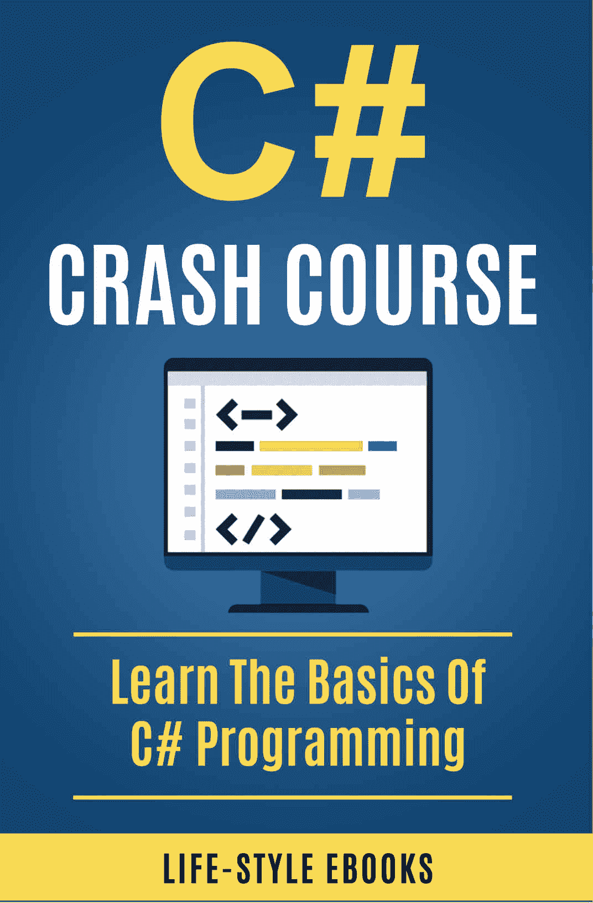


## 简介

感谢你的下载，并祝贺你选择了《C# 快速入门——学习 C# 编程语言基础的入门课程》这本书。

本书包含了经过验证的步骤和策略，教你如何在一周内掌握 `C#` 基础知识。

本电子书将教你与 `C#` 编程语言相关的基础思想和概念。它将使用清晰的语言和实用的示例来解释编程课程。书中还提供了真实的 `C#` 代码和截图，以帮助你理解课程内容。此外，本书将赋予你成为一名优秀 `C#` 程序员所需的技能、知识和技术。

在阅读这些材料后，你将熟悉 `C#` 语言和命令行控制台。你将学会如何向程序用户发送信息，以及如何获取他们的输入。你将学会如何编译程序以及如何格式化代码。你将了解 `classes`（类）、`variables`（变量）、`functions`（函数）、`methods`（方法）和 `data types`（数据类型）的工作原理。简单来说，你将成为一名熟练的 `C#` 程序员，最快只需 7 天即可实现！

再次感谢下载本书，希望你喜欢！


# 第 1 章：核心概念

根据 `C#` 语言，你将熟悉相关的思想和……这将帮助你理解 `C#`。

# 第 2 章：变量与字面量

`C#` 语言使用 `variables`（变量）来存储数据。这是一个基础概念。

# 第 3 章：数据类型

`C#` 拥有各种代表不同类型信息的 `data types`（数据类型）。

# 第 4 章：控制台

`console`（控制台）用于与用户进行交互。

# 第 5 章：条件语句

`conditional statements`（条件语句）允许程序做出决策。

# 第 6 章：循环语句

`loops`（循环）用于重复代码块。

# 第 7 章：方法

`methods`（方法）执行特定任务的代码块。

## 结语

我们希望本书能帮助你开启掌握 `C#` 的之旅。

## 你的第一个程序

`C#` 语言使用 `Console.WriteLine()` 显示消息。这是输出信息的基本方式。

重要提示：`C#` 代码使用了：

```csharp
using System;

class HelloWorld
{
    static void Main()
    {
        Console.WriteLine("Hello, World!");
    }
}
```

## 它是如何工作的？

`C#` 程序由三部分组成：

1. **类定义**：`class` 关键字定义一个类。
2. **方法定义**：`Main()` 方法是入口点。
3. **内容**：大括号 `{}` 内部的代码会被执行。

### 类定义

`C#` 代码使用 `class` 来定义一个类。类是对象的模板。

```csharp
class HelloWorld
{
}
```

### 方法定义

`Main()` 方法是程序的起点。它通常是 `static void`。

```csharp
static void Main()
{
```

### 方法的内容

大括号 `{}` 内部的代码会被执行。我们使用 `Console.WriteLine()` 输出文本。

```csharp
Console.WriteLine("Hello, World!");
```


*   你的方法名称应以大写字母开头。
*   编写在另一个代码内部的代码应当缩进。

## 类名称

在 C# 中，每个程序都有一个或多个类定义。程序员通常将每个类定义存储在与类名对应的单独文件中。此外，这些文件的扩展名应为 `.cs`。你可以将不同的类编译到同一个文件中，而不会遇到任何技术问题。但是，这会让你的代码导航工作变得非常困难。

## 关于 C# 的更多信息

C#` 编程语言是先进、现代、多用途且面向对象的。它与 `C`、`C++` 和 `Java` 等语言具有某些相似之处。主要区别在于 C#` 提供了更简单的编程方式和简化的语法。

一个 C# 程序包含一个或多个 `.cs` 文件，其中存放数据类型和类定义。你需要编译这些 `.cs` 文件以获取可执行代码（即以 `.dll` 或 `.exe` 结尾的文件）。例如，如果你将编译 `HelloCSharp` 程序，将得到一个名为 `HelloCSharp.exe` 的可执行文件。

## 创建 C# 程序所需的条件

在使用 C#` 编写程序之前，你需要两个重要的东西——一个文本编辑器（例如 `Notepad`）和 `.NET` 框架。文本编辑器将帮助你编写和编辑代码。而 `.NET` 框架将帮助你编译和执行程序。

### 什么是 .NET？

基本上，`.NET` 是一个为开发和执行计算机程序设计的框架。大多数现代 Windows 系统都将 `.NET` 作为内置框架。因此，如果你使用的是微软的现代操作系统，无需在计算机上安装任何软件。

如果你使用的是旧版本的 Windows 系统，需要先下载 `.NET` 框架。你可以访问此[网站](http://download.microsoft.com) 获取最新版本的 .NET。

**重要提示**：在阅读本书后续内容之前，请确保你的电脑已安装 `.NET`。否则，你在编译和运行后面看到的示例程序将会遇到问题。

### 文本编辑器

你应该使用文本编辑器来编写、编辑和保存源代码。你可以使用计算机上安装的任何文本编辑器。如果你不想下载额外的程序，可以直接使用 `Notepad`（即 Windows 预装的文本编辑器）。

### 编译和执行程序

现在，是时候编译并运行你之前看到的 `HelloCSharp` 程序了。你需要执行以下操作：

1. 生成一个 `.cs` 文件并将其命名为 `HelloCSharp`。
2. 在该 `.cs` 文件中编写源代码。
3. 编译代码以获取 `.exe` 文件。
4. 运行生成的程序。

打开你的电脑，让我们开始编写代码。

**重要提示**：本电子书假设你正在使用 Windows 计算机。

以下是 `HelloCSharp` 程序的代码：

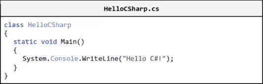

## 使用命令行编写 C# 程序

首先，你需要启动 `Command Prompt`（也称为 `Command Console`）。如果你使用的是 Windows 7 或 Windows 8，可以点击“开始”按钮并搜索 `cmd`。检查搜索结果并寻找名为“Command Prompt”的程序。右键点击该程序并从菜单中选择“以管理员身份运行”。以下是截图：

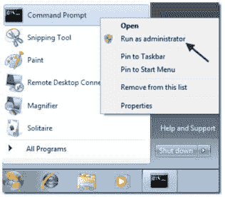

**重要提示**：如果你通过双击来启动命令行提示符，某些重要功能可能无法使用。

接下来，你需要生成一个文件目录以便存储生成的程序。输入 `md` 后跟目录名称。然后输入 `cd` 进入新目录。以下是截图：

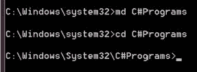

在此示例中，目录名称为 `C#Programs`。`cd` 命令将活动目录更改为 `C:\Windows\System32\C#Programs`。现在，你可以准备创建 `.cs` 文件了。回到命令行提示符并发布以下命令：

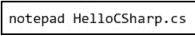

运行该命令后，你的屏幕将显示如下：

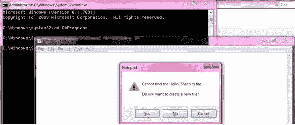

你的电脑会提示 `HelloCSharp.cs` 不存在。此外，它还会询问是否想要创建一个新文件。点击 `Yes` 按钮并将程序代码复制到 Notepad 应用程序。下面的截图将帮助你完成这一步：

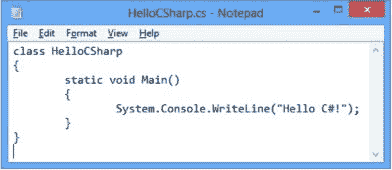

按下 `CTRL+S` 保存文件。然后点击红色 X 或按下 `ALT+F4` 关闭文本编辑器。现在，你将在 `C#Programs` 目录中看到程序代码。

### 编译代码

此时，你可以使用 `csc`（即 C# 语言的内置编译器）编译源代码。在命令行提示符中输入 `csc HelloCSharp.cs`。由于这是你第一次使用编译器，你可能会收到类似下面的错误消息：

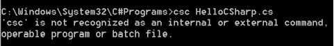

要解决这个问题，你只需要指定 C# 编译器的位置。Windows 7 计算机所需的目录为：`C:\Windows\Microsoft.NET\Framework\v4.0.30319`

**重要提示**：目录末的数字可能会根据你使用的操作系统版本而变化。

因此，你应该发布以下命令：

```
C:\Windows\Microsoft.NET\Framework\v4.0.30319\csc HelloCSharp.cs
```

C# 编译器将你的 `.cs` 文件转换为可执行程序。要运行你的第一个程序，请在命令行提示符中输入它的名称。你将得到以下消息：


## 如何更改 Windows 计算机的系统路径

你肯定不想每次创建程序时都输入编译器的完整目录。本书的这部分教你如何设置电脑，使其能够自动检测编译器的位置。

以下是你需要执行的操作：

1. 访问计算机的控制面板并点击“系统”。
2. 你将看到一个新窗口。搜索并点击“高级系统设置”。
3. 点击“环境变量”并寻找名为 `Path` 的变量。
4. 点击“编辑...”按钮并指定编译器目录。再次，路径为：`C:\Windows\Microsoft.NET\Framework\v4.0.30319`。
5. 按下“确定”保存更改。
6. 现在，关闭当前的命令行提示符并启动一个新的。然后输入 `csc`。
7. 屏幕应该给出以下错误：


8. 这意味着你的电脑可以自动触发编译器。一旦你指定了源代码，你的电脑就会为你生成 `.exe` 文件。

# 第 2 章：C# 的数据类型、变量和字面量

本章将关注 C# 中使用的数据类型和变量。通过阅读这些材料，你将了解这些对象是什么，以及如何在编写自己的程序时使用它们。

## 变量——简介

典型的程序在执行过程中会使用不同的值。例如，你可以开发一个解决数学问题的程序。显然，在使用此类程序时，你需要输入不同的值。简单来说，程序员不知道用户会输入哪些值。因此，他们需要确保生成的程序能够接受用户可能提供的任何值。

当用户给出一个值时，你可以将其临时存储在机器的 `RAM`（即随机访问内存）中。此内存中的所有值都可能发生变化。正如此，程序员将此类值称为`变量`。

## 数据类型

数据类型是具有相似属性的值集（范围）。例如，`byte` 数据类型指的是 `0 到 255` 数字范围内的值。

### 属性

数据类型具有以下属性：

* 名称（例如 `int`、`char`、`bool` 等）
* 大小（例如 `1 byte`）
* 默认值（例如 `1`、`2`、`3` 等）

## C# 中不同的数据类型

C# 支持的数据类型：

* 布尔
* 字符
* 对象
* 浮点数
* 小数
* 整数
* 字符串


由于这些数据类型已经预装在 C# 语言中，程序员将它们称为“原始类型”。让我们详细讨论每种数据类型：

### 布尔型 (Boolean)

你需要使用 `bool`（即一个 C# 关键字）来声明此数据类型。布尔值只能是 `true` 或 `false`。在 C# 编程语言中，布尔值会被设置为 `false`。程序员使用这种数据类型来存储逻辑语句的结果。

### 字符 (Characters)

这种数据类型可以存储单个字符。你需要使用 `char`（即另一个 C# 关键字）来声明此类型。在单引号内编写你的 `char` 值（例如，“I”）。

### 对象 (Objects)

程序员将对象视为 C# 语言中是最特殊的数据类型。基本上，对象是 `.NET` 中其他数据类型的父类。这种数据类型在声明时需要 `object` 关键字，它可以接受来自其他数据类型的任何值。你可以将对象认为指向计算机内存某些部分的地址。

### 实数型 – 浮点数 (Real Type – Floating Points)

在 C# 语言中，“实数”指的是你在数学中学习过的实际数字。浮点实数数据类型可以是 `float` 或 `double`。

1. **Float** – 程序员将此子类型称为“单精度实数型”。浮点数的默认值为 `0.0F`（末尾的“f”不区分大小写）。字母 `f` 表示该值是一个 `float`。
2. **Double** – 程序员在引用此子类型时使用“双精度实数型”术语。它的默认值为 `0.0D`（即末尾的字母“d”不区分大小写）。C# 会自动将实数标记为 `double`，所以你实际上不需要值的末尾添加 `d`。

### 实数型 – 小进制型 (Real Type – Decimals)

这种编程语言支持“十进制算术”，这使用十进制值表示数字的数学方法。这种方法的主要优势是无论处理的数值是多少，它都能保持准确性。

C# 使用 `decimal` 数据类型来表示这种实数。该数据类型长度为 128 位，可以精确到第 29 位小数。由于其卓越的精确性，程序员使用它们进行财务计算（例如支付、税收、利息等）。

### 整数 (Integers)

这种数据类型由 8 个子类型组成，分别是：

- **SBYTE** – `sbyte` 是一个 8 位的有符号整数。这意味着它可以包含最多 256 个值（即 $2⁸$）。此外，`sbytes` 可以是负数也可以正数。
- **BYTE** – 此子类型包含 8 位无符号整数。它与 `sbyte` 几乎相同。唯一的区别是 `byte` 永远为负数。
- **SHORT** – 这些整数是有符号的 16 位的。
- **USHORT** – 这些是长度为 16 位的无符号整数。
- **INT** – 这可能是 C# 中流行的数据类型。程序员使用这种数据类型是因为它与 32 位处理器完美兼容，并且足够用于典型计算。它是一个长度为 32 位的有符号整数。
- **UINT** – 该 32 位整数是非符号的。因此，它只能是正数。
- **LONG** – 该整数长度为 64 位。它可以是正数也可以是负数。
- **ULONG** – 这类似于“long”整数。唯一的区别是 `ulong` 只能取正值。

### 字符串 (Strings)

字符串是字符的集合或序列。C# 要求你在声明属于此数据类型的值时使用 `string`（即一个关键字）。你必须在一对双引号之间编写每个字符串。这种语言允许你对字符串执行各种操作（例如拼接、字符替换、字符搜索等）。

### 变量 (The Variables)

你可以使用变量来存储、检索和修改可更改的数据。作为程序员，你需要在存储和处理信息中使用变量。

#### 变量的特征 (The Characteristics of a Variable)

变量具有以下特征：

- 名称（也称为“标识符”）
- 数据类型
- 值（即你想存储的信息）

变量是具有名称的计算机内存区域。它们存储值并允许计算机程序访问其内容。你可能将变量放置在栈中（即你计算机程序的运行内存）或或的动态内存中。

`Characters`、`Booleans` 和 `Integers` 被称为值类型，因为它们将数据保留在程序的栈中。相反，字符串、数组和对象被称为“引用类型”，因为它们内部不持有值。相反，它们充当指向存储数据的计算机内存部分的标记。

#### 如何命名变量 (How to Name a Variable)

你需要在使用变量之前为它们命名。变量名作为标识符：它帮助程序定位和指定变量。C# 允许你自由选择变量名。然而，与其他任何语言一样，C# 对变量名称有一些规则。这些规则如下：

- 你可以使用下划线（即 `_`）、字母和数字创建变量名。
- 你不能用数字开头命名。因此，`FirstSample` 是有效的，而 `1stSample` 则无效。
- 你不能在变量命名中使用 C# 关键字。这个简单的规则可以防止程序中出现编译和运行时错误。如果你真的想为变量使用关键字，可以以下划线开头。

#### 如何声明变量 (How to Declare a Variable)

你应该在在使用变量之前声明它。以下是你需要做的几件事：

1. 指定变量的数据类型（例如 `char`）
2. 指定变量的名称（例如 `sample`）
3. 设置变量的初始值。这一步是完全可选的。

变量声明的格式为 `data_type name = initial_value;`

这里是一些有效声明的示例：

```
int year = 2000;
string name;
char test;
```

重要提示：你需要使用分号结束每个 C# 语句。如果你忘记添加单个分号，你的程序将产生不符合人意或意想不到的结果。

#### 如何赋值 (How to Assign a Value)

就像任何其他语言一样，C# 允许你为变量赋值。此过程被称为“值值赋值”，它要求你使用等号。程序员将此符号称为“赋值运算符”。在运算符的左侧编写变量名。然后在另一侧指定你想要赋值的值。

检查以下示例：

```
test = x;
name = “John Doe”;
```

#### 如何初始化变量 (How to Initialize a Variable)

在编程中，“初始化”是为新变量赋值的过程。因此，你将在声明变量时设置这个“初值值”。

#### 变量的默认值 (The Default Value of a Variable)

如果你不为变量分配任何值，C# 将执行自动初始化（即它为空变量分配一个默认值）。下面的表格将为你展示每种数据类型的默认值：


下面的代码将向你展示如何声明变量并赋值：

```
//这是一个示例
byte years = 10;
short days = 31;
decimal pi = 3.14;
bool isittasty = true;
char sample = x;
string animal = “dog 明天
```

重要提示：以两个正斜杠（即 `//`）开头的行是“注释”。在编程中，注释是添加到代码中的描述性文本，以提高可读性。语言编译器会忽略这些行。因此，注释不会影响计算机程序的功能。

#### 值与引用 (Values and References)

C# 程序员将数据类型分为两类：值类型和引用类型。


值类型（Value type）存在于程序的执行栈中。此外，它保存了程序员存储的值。值类型包含布尔值（Booleans）、字符（Characters）和整数（Integers）。分配给这些数据类型的内会在程序完成代码执行后变得可用。例如，当程序关闭时，程序 `Main()` 方法中的变量将被清空。

另一方面，引用类型（Reference type）在程序的栈中存储一个地址（即引用）。该地址指向所需值的位置。基本上，引用类型在声明期间会分配动态内存。当程序不再需要它时，它也会释放一些内存。

## 字面量 (Literals)

字面量是程序源代码中指定的值。下面的示例将说明这一概念：

```csharp
bool isitdelicious = false;
short income = 22000;
char firstletter = ‘c’;
byte ten = 10;
int prize = 250000;
```

在这个示例中，字面量是 `false`、`22000`、`‘c’`、`10` 和 `250000`。这些是你直接添加到程序代码中的值。

## 不同类型的字面量

C# 支持以下类型的字面量：

* 实数 (Real)
* 整数 (Integer)
* 字符串 (String)
* 字符 (Character)
* 布尔值 (Boolean)

让我们详细讨论这些字面量：

### 实数 (Real)

实数字面量有一个符号（即 `+` 或 `-`）、一个后缀、一个前缀和一个小数点。你应该对 `double`、`float` 和 `decimal` 值使用这种类型。C# 允许你以指数形式编写实数字面量。以下是你可以应用于实数字面量的后缀：

* `F` – 此后缀代表 `float` 值。
* `D` – 使用此后缀指示 `double` 值。
* `M` – 此字母表示 `decimal` 值。
* `E` – 使用此字母表示指数值。例如，“e4”意味着你需要将整数乘以 10⁴。

### 整数 (Integer)

整数字面量由前缀、后缀、符号（即 `+` 或 `-`）和一组数字组成。你可以使用前缀在代码中以进制或十六进制添加数字。以下是你在 C# 中可以使用的前缀和后缀：

* `0X`（例如 `0XA6F2`）– 使用此前缀指示十六进制值。
* `U`（例如 `119U`）– 此后缀代表无符号 `int` (`uint`) 或无符号 `long` (`ulong`) 值。
* `L`（例如 `360L`）– 使用此后缀用于“long”（长型）值。

**重要说明：** 如果你不使用任何后缀，C# 将把整数字面量标记为“int”。此外，字母（即 `L`、`U` 和 `X`）是不区分大小写的。

### 字符串 (String)

使用此字面量处理字符串值。基本上，字符串字面量是置于双引号内的字符集（例如，“sample”）。

**重要说明：** 在 C# 语言中，你可以使用 `@` 符号来创建引用字符串（或字面字符串）。程序员使用这些字符串来命名文件路径。

### 字符 (Character)

字符字面量是由一对单引号包围的单个字符（例如 ‘z’）。使用字符字面量设置属于 `char` 类型的值。此外，你也可以这样写字符字面量：

* 单个字符（例如 ‘X’）
* 特殊字符的代码（例如 ‘\u0067’）
* 转义代码（见下文）

**转义代码 (Escape Codes)** – 这些是向源代码添加字符的特殊字符序列。通常情况下，这里涉及的字符不能直接添加到程序代码中。

C# 防止你直接向程序添加某些字符。这些字符包括：制表符、换行符、反斜杠、引号等。以下列表将为你展示 C# 中常用的转义代码：

* `\\` – 换行符
* `\t` – 制表符
* `\'` – 单引号
* `\"` – 双引号

### 布尔值 (Boolean)

布尔字面量只有两种类型：`true` 和 `false`。在处理 `bool`（即布尔）变量时，你只能分配这两个值之一。下面提供的代码段将向你展示如何声明布尔字面量：

```csharp
bool answer = false;
```

# 第 3 章：C# 运算符

本章将重点介绍 C# 的运算符。通过阅读这些材料，你将了解运算符的工作原理以及如何使用它们。

## 基础

运算符帮助你处理数据。它们接受输入并产生结果。

## 不同类型的运算符

C# 将运算符分为以下几类：

### 赋值运算符 (Assignment Operator)

在 C# 中，你需要使用 `=` 来赋值。这里是一些示例：

```csharp
int y = 99;
string hello = “Good”;
char sample = ‘z’;
```

**重要说明：** C# 允许你多次使用 `=`。这里是一些示例：

```csharp
int d = 100;
e = 3;
```

### 算术运算符 (Arithmetic Operators)

这些运算符帮助你执行数学运算。该类别包括：

* `+` – 使用此运算符对两个值进行加法运算（例如 `+1`）。
* `-` – 此运算符允许你从左操作数的值减去右操作数的值（例如 `-1`）。
* `*` – 使用此运算符，你可以乘以两个操作数（例如 `*6`）。
* `/` – 使用此运算符将左操作数除以右操作数。
* `++` – 这被称为自增运算符。它将操作数的值加一。你可以在操作数之前或之后编写它（例如 `99++`、`++5`）。
* `--` – 此运算符与自增运算符完全相反。你可以用它将操作数的值减一。你可以在要修改的操作数之前或之后编写它。下面的代码将展示它们如何工作：

```csharp
class Test {
    static void Main() {
        double d = 100, e = 3;
        Console.WriteLine(d + e);
        Console.WriteLine(d - e);
        Console.WriteLine(d / e);
        Console.WriteLine(d * e);
        Console.WriteLine(++d);
        Console.WriteLine(--e);
    }
}
```

### 逻辑运算符 (Logical Operators)

逻辑运算符与布尔值操作：

* `&&` – 称为“与”(AND)。如果两个操作数都为真，则返回真。
* `^` – 这是“异或”(Exclusive OR)。如果操作数不同，则返回真。
* `||` – “或”(OR)。如果至少有一个为真，则返回真。
* `!` – 称为“非”(Negation)。它会反转值。

这里是一些示例：

```csharp
class Test {
    static void Main() {
        bool x = true, y = false;
        Console.WriteLine(x && y);
        Console.WriteLine(x || y);
        Console.WriteLine(!x);
        Console.WriteLine(x ^ y);
    }
}
```


这些操作符作用于二进制数。在 IT 世界中，所有的信息都表示为 0 和 1 的序列。这意味着如果你想成为一名成功的程序员，你就需要掌握二进制操作符。

二进制操作符的工作方式与逻辑运算符完全相同。实际上，你可能认为二进制运算符和逻辑运算符使用的输入不同，但执行相同的相同。逻辑运算符使用布尔值来产生结果。而二进制操作符作用于以二进制位表示的数字。以下是你在使用 C# 时会遇到的二进制操作符：

- `&` – 这被称为 `Binary AND`（二进制位与）。它表示两个操作数位均为 `1` 的位置。
- `^` – 程序员将此运算符称为 `Binary Exclusive OR`（二进制位异或）。它会在值不同的位置上放置 `1`。
- `|` – 这是 `Binary OR`（二进制位或）运算符。它表示任何一个操作数位为 `1` 的位置。
- `~` – 它作为二进制值的取反运算符。就像 `!` 一样，它会反转变量当前的值。
- `<<` – 这是 `Binary Left Shift`（二进制左移）运算符。它将二进制数的位向左移动。这种移动取决于你将赋值的值（例如 `4 << 1`、`4 << 3`、`4 << 2` 等）。

### 比较运算符

这些操作符允许你比较两个操作数内部的值。这些操作符中的每一个都输出布尔值作为最终结果。以下是 C# 语言的比较运算符：

- `==` – 这是相等运算符（Equality operator）。它检查两个操作数是否相等（例如 `x == y`）。
- `>` – 此运算符检查左侧操作数的值是否大于右侧操作数的值（例如 `x > y`）。
- `<` – 此运算符比较两个操作数的值。如果左侧操作数的值小于右侧操作数，它将返回 `true`（例如 `y < x`）。
- `>=` – 使用此运算符，你可以判断左侧操作数的值是否大于或等于右侧操作数的值。
- `<=` – 如果左侧操作数的值小于或等于右侧操作数的值，此运算符将返回 `true`。
- `!=` – 使用此运算符检查两个操作数的相等性。如果值不相等，它将返回 `true`（例如 `x != y`）。

### 条件运算符

C# 用户将 `?` 称为条件运算符（conditional operator）。基本上，该操作符使用布尔表达式的结果来确定应该处理哪个语句。这被称为 `ternary operator`（三元运算符），因为它作用于三个操作数。在这里，第一个值应该是布尔值，而其余的值需要属于相同的数据类型（例如字符、字符串、数字等）。

该操作符的语法为：

```
first_operand ? second_operand : third_operand;
```

它的工作原理是：如果 `first_operand` 为真，程序将处理 `second_operand`。然而，如果 `first_operand` 为假，程序将处理 `third_operand`。

# 第 4 章：数据类型转换

通常情况下，操作符作用于属于相同类型的参数。然而，C# 语言提供了许多数据类型，你可以用于特定情况。为了对属于不同类型的变量进行任何处理，你应该先转换其中一个变量。在 C# 中，数据类型转换可以是隐式的或显式的。

每个 C# 表达式都有一种数据类型。这种数据类型取决于表达式内部使用的字面量、变量、值和结构。基本上，你可能会使用一个类型与情况不兼容的表达式。当这种情况发生时，你会得到以下结果之一：

- 程序将给你一个编译时错误。
- 程序将执行自动转换。这意味着程序将获得正确的表达式类型。

将 `s` 类型转换为 `t` 类型允许你在运行程序时将 `s` 视为 `t`。有时，这个过程需要程序员来验证类型转换。检查下面的示例：

- 将 `objects` 转换为 `strings` 需要在程序运行时进行验证。这种验证确保你确实想将这些值作为字符串使用。
- 将 `string` 值转换为 `object` 值不需要验证。

### 隐式转换

将 `s` 类型转换为 `t` 类型允许你在运行程序时将 `s` 视为 `t`。有时，这个过程需要程序员来验证类型转换。检查下面的示例：

```csharp
class Example
{
    static void Main()
    {
        double varDouble = 2.1;
        Console.WriteLine(varDouble);

        long varLong = (long)varDouble;
        Console.WriteLine(varLong);

        double varDouble2 = 2e9;
        Console.WriteLine(varDouble2);

        int varInt = (int)varDouble2;
        Console.WriteLine(varInt);
    }
}
```

### 显式转换

如果存在损失可能，请使用这种转换。例如，在将浮点值转换为整数时会发生损失。这是下面的示例：

```csharp
class Example
{
    static void Main()
    {
        double varDouble = 2.1;
        Console.WriteLine(varDouble);

        long varLong = (long)varDouble;
        Console.WriteLine(varLong);

        double varDouble2 = 2e9;
        Console.WriteLine(varDouble2);

        int varInt = (int)varDouble2;
        Console.WriteLine(varInt);
    }
}
```

### 字符串转换

C# 允许将任何数据类型转换为 `string`。如果你使用 `+` 且至少有一个非字符串参数，编译器将自动执行此过程。


大多数计算机程序都会与其用户进行交互。用户需要与其交互的程序提供输入或指令。如今有许多交互方法：基于控制台的、基于浏览器的、基于互联网的、图形化的等。现在，使用控制台进行程序交互的人数正在不断减少。这是因为替代方案（例如基于浏览器的）在便利性和用户友好性方面更好。

## 使用控制台

有时，控制台是用户与程序交互的最重要工具。例如，在创建简单的计算机程序时，你需要使用控制台。这些程序要求你关注必须解决的问题。美观的 GUI（即图形用户界面）和吸引人的输出对你完成这项任务没有帮助。

你还可以使用控制台在将代码块添加到复杂的程序之前对其进行测试。由于控制台是一个简单的工具，你可以轻松地隔离出代码块，而无需按下任何按钮或查看不同的屏幕。控制台会在几秒钟内提供你所需的结果。

### 访问控制台

访问控制台的过程取决于你当前使用的操作系统。例如，如果你使用的是 Windows 计算机，需要执行以下步骤：

1. 点击“开始”按钮。
2. 点击“程序”并选择“辅助工具”。
3. 点击写有“命令提示符”的选项。

控制台将显示你的主目录，由你的用户名表示。在下面的示例中，用户名是 SARAH：

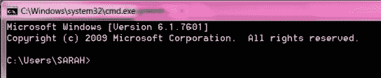

**重要提示：** 如果你使用的是 Windows Vista、Windows 7 或 Windows 8，可以通过搜索 `cmd` 来启动控制台。

### 关于控制台的附加信息

控制台是一个显示文本信息的黑色窗口。它有一个闪烁的光标并显示字符字符串。如你所见，每当你输入一个字符，光标就会移动。

Windows 程序可以是基于桌面、基于浏览器、基于互联网或基于控制台的。基于控制台的程序利用控制台进行输入和输出过程。另一方面，基于桌面的程序依赖其 GUI 进行用户程序交互。本书专注于基于控制台的应用程序，因此你将使用键盘输入数据，并在命令提示符中查看结果。

某些基于控制台的应用程序需要用户提供文本、数字、字符等这意味着这意味着操作基于控制台的程序时会经常使用键盘。

## 基本命令

在本节中，你将学习使用命令提示符发布的基本命令。如果你想成为一名优秀的 C# 程序员，应该仔细学习这些材料。

字体 控制台命令

*   `cd name_of_directory` – 此命令允许你更改活动目录。例如，如果你想进入 C: 下的 Users 文件夹，你需要执行以下命令：
    `cd C:\Users`
*   `dir` – 使用此命令查看活动目录中的文件。
*   `rmdir name_of_directory` – 此命令允许你删除目录。例如，`rmdir Sample` 会删除名为“Sample”的目录。
*   `mkdir name_of_directory` – 使用此命令，你可以在活动目录中创建新目录。例如，如果你当前在 Users 目录，`mkdir John` 将在“Users”内部创建一个名为“John”的文件夹。
*   `type name_of_file` – 使用此命令查看现有文件的内容。例如，你可能执行 `type HelloCSharp.cs` 来查看该 .cs 文件的内容。

### 标准输入输出 (I/O)

标准 I/O 系统是为 UNIX 计算机开发的机制。该系统涉及特殊设备以接受输入和产生输出。

如果程序正在等待用户执行操作或提供信息，控制台将显示光标。这意味着系统处于“等待模式”。

### 输入和输出

操作系统需要定义用于用户程序交互的标准 I/O 机制。启动基于控制台的应用程序时，程序初始化块中的代码需要与操作系统分配的 I/O 机制配合工作。这些代码允许用户与相关的控制台程序进行交互。

由于这些代码，程序可以从 `Console.In`（即 C# 的标准输入流）读取用户输入，向 `Console.Out`（即 C# 的标准输出流）发送信息，并通过 `Console.Error`（即 C# 的标准错误流）报告问题情况。

**重要提示：** 你将在书中后部分学习 C# 流。本章将集中于与 C# I/O 机制相关的概念和思想。

### I/O 设备

某些程序接受非键盘输入。例如，你可以创建一个 C# 程序，从文本文件、条码器、麦克风和其他数据源获取输入。程序还可以将其输出发送到屏幕、外部文件、打印机等。

### System.Console

名为 `System.Console` 的类具有各种方法和属性，你可以使用它们来读取、显示或格式化文本信息。`System.Console` 类最流行的三个属性与输入和显示数据有关。这些属性是：`Console.In`、`Console.Out` 和 `Console.Error`。

这些属性帮助你显示数据、读取信息和报告错误消息。C# 允许你直接使用这些属性。然而，你需要记住 `System.Console` 还包含其他可以帮助你的方法的属性。

**重要提示：** C# 允许你修改默认流。要做到这一点，你需要使用以下方法：`Console.SetOut`（输出）、`Console.SetIn`（输入）和 `Console.SetError`（错误）。

### 控制台输入

编程语言有一套向控制台输入信息的系统。特别是 C# 语言使用名为 `Console.In` 的对象来控制其输入流。

实际上，你不需要直接使用 `Console.In`。`Console` 类提供了两个方法（即 `ReadLine` 和 `Read`），它们与 `Console.In` 工作。

### Console.ReadLine 方法

此方法为想要从控制台读取数据的人提供了简单方便的方法。当你调用此方法时，你的程序将停止并等待用户输入。然后，用户可能会输入一个字符或字符串并按下“回车”。通过按回车键，用户通知程序他们已输入内容。`ReadLine` 方法将读取用户的输入，因此得名。

给出的代码将向你展示 `ReadLine` 如何工作：

```csharp
class Test
{
    static void Main()
    {
        Console.WriteLine("What is your first name? ");
        string firstName = Console.ReadLine();
        Console.WriteLine("Please enter your last name? ");
        string lastName = Console.ReadLine();
        Console.WriteLine("Hi, {0} {1}!", firstName, lastName);
    }
}
```

如果你在命令提示符中输入“John”和“Smith”，你将获得以下消息：

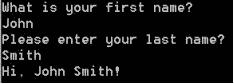

### Console.Read 方法

`Console.Read` 和 `Console.ReadLine` 之间存在显著。首先，`Console.Read` 只读取单个字符，而 `Console.ReadLine` 读取整个表达式。其次，`Console.Read` 返回代码而不是接受的内容。如果你想将输出作为普通字符使用，你应该执行以下操作：

*   将输出转换为字符
*   在结果上使用 `Convert.ToChar` 方法


重要说明：`Constant.Read` 只有在用户按下“Enter”（回车）键时才会读取字符。当用户按下此键时，程序会将输入传输到标准字符串缓冲区并调用 `Console.Read` 方法。请查看下方的示例：

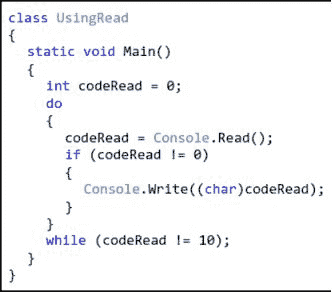

## 如何读取数字

C# 程序不会直接读取数字。它们需要将输入视为字符串（即通过 `Console.ReadLine` 方法）并将其转换为数字。将字符串转换为其他数据类型的过程被称为解析（parsing）。C# 语言中的所有原始数据类型都支持这一过程。

## 控制台输出

本书的这将重点介绍两个方法：`Console.WriteLine` 和 `Console.Write`。这两个方法都可以打印 C# 语言中的所有数据类型。这意味着你可以使用它们在用户的控制台上显示消息。

下面的代码段将教你这些方法是如何工作的：

```csharp
Console.WriteLine(“我想要学习 C# 编程语言。”);
// 这一行将打印括号内的字符串。

Console.WriteLine(100);
// 这一行将在用户的命令提示符上显示“100”。

Console.WriteLine(3.14);
// 这一行将在用户的控制台上打印 double 类型的值 3.14。
```

你可以使用 `Console.WriteLine` 方法在用户的屏幕上显示不同类型的数据。这是因为 `Console` 类内置了每种数据类型的版本。

`Console.WriteLine` 和 `Console.Write` 的唯一区别在于，前者打印括号内的值并在控制台上添加一个换行符，而后者仅简单显示括号内的信息。因此，在代码中使用 `Console.WriteLine` 就像是在显示消息后按了“Enter”键（即光标将移动到下一行）。

## 字符串拼接

C# 语言防止程序人员在字符串值上使用运算符。显然，你不能对实际单词进行算术运算（例如：fish – dog，power * humans，land / people 等）。然而，C# 允许你串联（即组合）多个字符串对象以生成一个新的字符串。你可以通过在字符串上使用“+”符号来实现这一点。下方的示例将说明这一思想。

```csharp
string gadget = “smartphone”;
string example = “I use my ” + gadget + “to access ” + “the internet.”;
Console.WriteLine(example);
```

如果你执行该代码，控制台将显示：

I use my smartphone to access the internet.

# 第 6 章：C# 的条件语句

本章将教你如何在 C# 代码中使用条件语句。基本上，条件语句是一个代码块，允许你根据分配的一个或多个条件执行各种操作。请仔细阅读这些材料，因为它包含了有价值的信息，可以帮助你在短短 7 天内掌握 C#。

## 运算符

在本节中，你将学习更多关于 C# 比较运算符的信息。这些运算符极其重要：它们可以帮助你为自己的条件语句设置条件。

### 比较运算符

C# 拥有不同的运算符，用于比较相同类型的值。这些运算符是：

- `<`
- `>`
- `<=`
- `>=`
- `!=`
- `==`

你可以使用上述运算符来比较 C# 表达式（例如：两个整数、两个变量、两个常量等）。在使用这些这些运算符中的任何一个时，结果将始终是一个布尔值（Boolean）。分析以下示例：

```csharp
int height = 170;
Console.WriteLine(height < 180); // 这将给你“true”。

string gender = “Male”;
Console.WriteLine(gender == “Female”); // 这将给你“false”。

double valueofPi = 3.14;
Console.WriteLine(valueofPi > 100); // 这将给你“true”。
```

### 逻辑运算符

C# 还支持一些逻辑运算符。程序人员使用这些运算符来创建布尔语句（也称为“逻辑”语句）。让我们详细讨论每个逻辑运算符：

### AND（与）和 OR（或）运算符

你只能在涉及布尔值的表达式上使用逻辑与（即 `&&`）和逻辑或（即 `||`）运算符。如果两个操作数都为真，逻辑与运算符将给你返回“true”。例如：

```csharp
bool sample = (1 < 2) && (10 == 10);
```

由于 1 小于 2 且 10 等于 10，该表达式将给你 true。由于逻辑与运算符在不执行不分析的情况下提供快速结果，程序人员称其为“短路运算符”。它首先检查语句的左侧部分。如果评估结果为“false”，操作将立即停止。由于其中一个操作数为假，该表达式不再可能为真。

另一方面，逻辑或（即 `||`）运算符在你的操作数中至少有一个评估为真时，将给你返回 true。例如：

```csharp
bool sample = ( 1 < 2) || (10 > 100);
```

这个示例将给你 true，因为左侧的操作数为真。逻辑或运算符也是“短路运算符”，因为它即使在不检查整个 C# 语句的情况下给出结果。在当前示例中，逻辑或将不再分析第二个操作数，因为第一个已经是真的了。因此，条件已经满足。

### 异或和取反运算符

异或（即 `^`）是一个全路计算运算符，因为它在给出结果之前需要检查两个操作数。**仅当**其中一个操作数评估为真时，它才会给你 true。因此，如果两个操作数都为真，你将得到 false。检查以下示例：

```csharp
bool sample = (1 < 2) ^ (2 == 2);
```

由于两个表达式都是真的，异或将给你 false。

取反运算符（即 `!`）则简单地反转它所连接的布尔值。例如：

```csharp
bool sample = !(1 < 2);
```

1 小于 2。但是，由于“!”连接在布尔表达式上，结果将被反转。这意味着该表达式评估结果为“false”。

## 语句

现在你已经知道如何使用比较和逻辑运算符，是时候讨论条件语句的创建了。这些语句是强大的工具，可以帮助你实现编程逻辑。

### If 语句

if 语句的语法如下：

```csharp
if (条件表达式)
{
    if 语句的主体;
}
```

如你所示，此语法包含三个部分：

1. `if` 子句 – 这部分表示 `if` 语句的开始。
2. 布尔表达式 – 这部分可以包含一个逻辑表达式或持有布尔数据的变量。与 C 不同，C# 不接受整数表达式作为其条件语句。
3. 语句的主体 – 你需要使用一对大括号来包裹这部分。C# 允许你在该区域内放置多个语句。

如果布尔表达式评估为真，程序将运行语句的主体。如果评估结果为假，程序将忽略语句的主体并将控制传递给后续块。下方的示例将向你展示“if”语句是如何工作的：

```csharp
Console.WriteLine(“请输入一个数字。”);
int number1 = int.Parse(Console.ReadLine());
int number2 = 0;

if (number1 > number2)
{
    Console.WriteLine(“C# 是一种优秀的语言。”);
}
```

此代码需要用户提供数字。如果用户的输入大于零，程序将在命令提示符上打印“C# 是一种优秀的语言。”

重要说明：如果条件语句的主体只有一行，你可以省略大括号。查看下面的示例：

```csharp
int x = 10;
if (x > 0)
    System.Console.WriteLine(“该变量是一个正数。”);
```

### If-Else 语句

与其他编程语言一样，C# 支持“if-else”条件语句。在编写 if-else 语句时，你应该使用以下语法：

```csharp
if (布尔变量或表达式)
{
    条件语句的主体;
}
else
{
    else 语句的主体;
}
```


上述语法由以下部分组成：

*   `if` 子句 – 该部分是条件语句的开始。
*   布尔表达式或变量 – 该表达式的值。
*   条件语句体 – 如果有多个语句，将其包含在大括号内。
*   `else` 关键字 – 触发 `else` 子句的 C# 关键字。
*   `else` 子句体 – 在处理 `if-else` 语句时，计算机程序分析括号内的值。该值需要是布尔（即真或假）。如果值为“真”，程序将执行条件语句体并忽略 `else` 子句。然而，如果值为假，程序将运行 `else` 语句体。分析以下示例：

```csharp
int a = 100;

if (a != 50)
{
    ConsoleWriteLine("不等于 50");
}
else
{
    ConsoleWriteLine("等于 50");
}
```

你可以将这段代码解释为：如果 `a != 50`，控制台将打印：“不等于 50”。另一方面，如果 `a = 50`，控制台将显示：“等于 50”。由于变量 `a` 的值为 100，你的命令行提示符将给出：


### 嵌套语句

在某些情况下，你需要在另一个 `if` 语句内部编写 `if` 语句。程序员将这种过程称为“嵌套”。这意味着你在另一个条件语句内部编写条件语句时就是在进行“嵌套”。

**注意：** C# 允许嵌套 `if-else` 语句。在这种情况下，每个 `else` 子句指向它之前的 `if` 子句。这种简单的规则可以帮助你分析复杂的嵌套语句。根据专家建议，你不应该创建超过三层的嵌套语句。如果你确实需要使用四层或更多结构，请将其导出到不同的方法。

下面的代码将向你展示嵌套 `if` 语句的工作原理：

```csharp
int a = 10;
int b = 20;

if (a > b)
{
    ConsoleWriteLine("a 大于 b");
}
else
{
    if (a < b)
    {
        ConsoleWriteLine("a 小于 b");
    }
    else
    {
        ConsoleWriteLine("a 等于 b");
    }
}
```

### Switch-Case 语句

当答案有很多时，程序员使用 `switch-case` 语句。以下是 `switch-case` 语句的语法：

```csharp
switch (selector)
{
    case 第一整数:
        语句;
        break;
    case 第二整数:
        语句;
        break;
    default:
        语句;
        break;
}
```

基本上，`selectors` 是返回可用值（即你可以比较或处理的值）的表达式。`switch` 关键字将 `selector` 的值与 `cases` 进行比较。如果 `selector` 的值匹配该 `case`，将运行分配给该语句。如果没有匹配，程序将执行 `default` 语句。

**注意：** 确保 `cases` 的值是唯一的。如果两个或多个 case 共享相同的值，你的程序产生产生的结果。如所示，每个 case 都有一个 `break`。`break` 子句会终止它所属的 `case` 体。C# 要求你在所有的 `switch` 语句中添加此子句。你不必将 `default` 部分放在 `switch-case` 的末尾，但如果你想保持代码的可读性，推荐该位置。

# 第 7 章：循环语句

本章将教你如何使用循环语句。作为程序员，你将使用循环语句反复运行某些代码块。循环在 C# 中占重要地位。因此，如果你想掌握这种语言，应该仔细学习这些材料。

## 循环——基础

在创建程序时，你经常需要多次执行代码序列。多次输入相同的代码块非常无聊。因此，你需要一种快速简单的方法来重复代码。坦率，C# 语言支持循环语句。

循环是一个反复运行代码片段的工具。你可以用它运行特定次数的代码，或者只要满足给定条件一直运行。C# 提供了不同类型的循环语句。让我们详细分析每个类型：

### While 循环

这是 C# 中简单的循环语句。它的语法是：

```csharp
while (赋值的条件)
{
    循环体;
}
```

在该语法中，`赋值的条件` 是一个产生布尔值的表达式。该条件决定了 `体` 运行的次数。另一方面，`体` 是你想要执行的语句（或语句组）。

下面的图表将说明 while 循环是如何工作的：


在处理 `while` 循环时，C# 程序会检查布尔表达式的值。如果值为“真”，程序将运行循环体内的所有语句。然后，程序将检查布尔表达式以查看其值。如果值仍为真，程序将重新运行循环体并返回第一步（即检查表达式的值）。这一过程将持续到布尔表达式为假。一旦发生，程序将处理循环之后的代码块。

**注意：** 如果布尔表达式为假，C# 程序不会运行 while 循环体。因此，如果你在启动程序时布尔值为假，你的循环内语句永远不会执行。

以下示例将说明 while 循环是如何工作的：

```csharp
int timer = 10;

while (timer >= 0)
{
    System.WriteLine("剩余时间：" + timer);
    timer--;
}
```

如果你编译并执行这段代码，你的命令行提示符将打印这些数据：


### Break 操作符

你可以使用 `break`（一种 C# 操作符）提前退出循环。如果程序员不想等待循环的自然结束，就会使用这种操作符。基本上，循环一旦遇到 `break` 操作符就会结束。

在 C# 中，你只能在循环体内部使用此操作符。这意味着 `break` 只有在循环运行时才有效。

### For 循环


通常情况下，“for”循环比`do-while`循环和`while`循环更复杂。然而，`for` 循环可以帮助你用更少的 C# 代码来完成复杂的任务。“for”循环的语法如下：

```csharp
for (initializer; Boolean_expression; update)
{
    the_loop’s_body;
}
```

一个“for”循环包含一个初始化器（即计数器的初始值）、一个布尔表达式、一个更新计数器的 C# 语句以及循环体。

“计数器”（即分配给循环的初始值）是“for”循环最显著的特征。在大多数情况下，计数器的值会一直增加，直到它达到最终值（例如从 1 到 10）。此外，程序员通常知道“for”循环将迭代多少次。

你可以在“for”循环中包含一个或多个变量。这些变量可以可以按降序或升序顺序移动。在编写程序时，你可以在单个“for”循环中结合升序和降序变量。此外，由于“for”循环支持算术运算（例如加法、乘法等），升序变量可以从 1 变为 1024。

**重要提示：** “for”循环的所有部分都是可选的。你可以通过在语法中留空来创建一个无限的“for”循环。这里有一个示例：

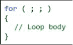

此时，你已经准备好学习更多关于“for”循环的不同部分了。

### 初始化

“for”循环可以拥有一个初始化片段：

```csharp
for (double sample = 1; …;   …)
{
    // 你可以在这里使用“sample”变量。
}
// 你不能在在这里使用该变量。
```

C# 程序在运行“for”循环之前会执行一次此片段。程序员通常使用初始化片段来创建一个计数器（也称为“循环变量”）并为其分配初始值。该计数器在循环体内部是可用且可操作的。C# 允许你使用单个初始化片段声明多个变量。

### 条件

显然，“for”循环需要一个条件表达式。这里有一个示例：

```csharp
for (double sample = 1; sample < 5; …)
{
    // 这是循环体。
}
```

计算机程序在运行循环体之前会评估条件表达式。如果结果为“true”，则循环体将运行；否则，相关程序将跳转到在当前循环之后的语句。

### 更新语句

这是“for”循环的最后部分。基本上，更新语句会更新循环的计数器。让我们使用上面提供的代码段：

```csharp
for (double sample = 10; sample > 1; sample--)
{
    // 这是循环体。
}
```

程序在运行循环体后执行此部分。请记住，该语句会更新计数器的值。

### 循环体

此部分由 C# 语句组成。它可以利用你在循环初始化片段中声明的变量。查看下面的示例：

```csharp
for (double sample = 10; sample > 1; sample--)
{
    System.Console.WriteLine(sample);
}
```

在某些情况下，你需要停止当前的迭代但不结束循环本身。你可以使用 C# 中名为“continue”的运算符来完成此任务。提供的示例将说明该运算符如何工作：

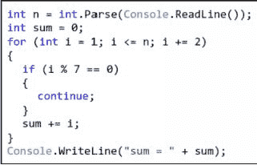

此代码计算范围（1 到 n）内所有被 7 除余数的奇数总和。

### “Foreach”循环

最近，C# 引入了“foreach”循环的概念（即扩展的“for”循环）。这种循环概念也存在于其他编程语言中，如 C、VB、C++、PHP 等。通过这个编程工具，你可以运行列表、数组或其他值组的所有元素。“foreach”循环即使对于非索引数据组也能获取其中的所有现有元素。

在编写这种循环时，请使用以下语法：

```csharp
foreach (type name_of_variable in name_of_group)
{
    the_statements;
}
```

如你所见，这种循环比典型的“for”循环简单得多。“foreach”循环可以帮助你快速扫描集合中的所有对象。无数程序员在编写代码时使用这种循环这并不意外。

### 嵌套 for 循环

C# 允许你将一个“for”循环放在另一个“for”循环内部。代码最内层部分的循环运行次数最多。而最外层的循环重复次数最少。你应该使用以下语法：

```csharp
for (initializing_fragment, condition, update)
{
    for (initializing_fragment, condition, update)
    {
        the_statements;
    }
}
```


```csharp
{
    static void Main()
    {
        System.Console.WriteLine“Hi C#!”);
    }
}
```

## 语法

在声明方法时，使用以下语法：

`static data_type_of_the_result name_of_method (list_of_parameters)`

让我们通过 `Main()` 方法（即 `static void Main()`）来分析这一语法。`Main()` 使用 `void` 作为其返回类型，因为它不产生任何结果。`Main` 单词作为它的名称。而括号则作为程序员将提供的参数的容器。

**重要提示**：在编写 C# 程序时，你必须遵循这一语法。不要更改方法各个部分的排列顺序。

C# 并不要求你在声明中包含参数。这意味着你可以留空括号（例如 `Main()`）。

## 方法名称

在声明、调用或实现期间，你需要指定方法的名称。以下是在为你的方法命名时需要记住的规则：

- 确保首字母大写写。
- 每个单词的首字母都大大写（例如 `SampleMethod`、`NewMethod`、`MainLine` 等）。
- 使用动词和名词作为方法的名称。

**重要提示**：上述讨论的规则完全可选可选。如果你希望你的 C# 代码具有良好的结构和可读性，请遵循这些规则。

## 方法实现

声明方法是不够的。如果你想让方法在程序内部运行，你还需要实现你的方法。程序员在引用方法的实现时使用“体”（body）一词。

## 方法体

你会在大括号内找到方法体。该体由你想要执行的命令、表达式和语句组成。因此，方法体是任何方法的重要部分。

**重要提示**：请记住，你不能在 C# 中嵌套方法。不要在另一个方法内部编写方法。

## 方法调用

基本上，这是运行方法体内语句的过程。调用方法非常简单直接：你只需要指定它的名称，添加一对括号，并使用分号结束该行。以下是你应该使用的语法：

`name_of_method();`

下面提供的示例代码将向你展示如何调用方法：

```csharp
class Animals
{
    static void Main()
    {
        Console.WriteLine“I love dogs.”);
    }
}
```

如果你编译并执行该代码，你的命令行提示符将打印以下消息：

I love dogs.

## 你可以调用方法的地方

C# 允许你在以下区域调用方法：

- 在程序的主方法（即 `Main()`）内部。
- 在另一个方法内部。
- 在方法自身的内部。这种技术被称为“递归”。

## 结论

感谢感谢下载这本书！

我希望这本书能够帮助你在短短几天内成为一名熟练的 C# 程序员。

下一步是继续使用 C# 编写你自己的程序。

最后，如果你喜欢这本书，我想请你帮个忙，你是否愿意在 Amazon 上为这本书留个评论？我将不胜感激！

感谢你并祝你好运！

