# C# 初学者速成课程：快速轻松掌握 C# 编程 (计算机编程, 初学者编程) (第 2 卷)

## 第 1 章 C# 简介

### 1.1 C# 概述

C# 是一种面向对象、类型安全的高级编程语言。它由 Microsoft 在 .NET 框架开发期间开发。C# 是为公共语言基础设施 (CLI) 开发的，该基础设施旨在允许来自其他各种高级语言的程序协同工作，而无需完全重写这些程序。CLI 包含各种可执行程序，简称为可执行文件，它们被安置并运行在一个称为运行时环境的系统中。

在 .NET 框架中创建的所有程序都在一个处理运行时需求的环境中执行。公共语言运行时 (CLR) 提供虚拟机，帮助程序员无需考虑 CPU 规范。类库和 CLR 构成了 .NET 框架。

### 1.2 C# 的编程特性

-   它是一种简单、先进的面向对象语言
-   它包含所有 .NET 语言通用的数据类型和类
-   公共语言运行时 (CLR) 与 Java 虚拟机 (JVM) 类似
-   C# 提供对封装、继承、多态和接口的支持
-   Visual Studio 提供对 VC++、Visual Basic、Vbscript 和 Jscript 的支持
-   .NET 由类库和公共执行引擎组成
-   垃圾回收、自动内存管理、互操作性内置于 C# 中
-   用户可以使用 C# 开发控制台、Windows 和 Web 应用程序

### 1.3 C# 环境

C# 是 .NET 框架的一部分。它用于创建 .NET 应用程序。使用 .NET 框架，用户可以设计、部署和开发应用程序。使用简单的编程模型即可轻松构建健壮的应用程序。

#### .NET 框架的组成部分

包含几个组件的 .NET 框架图如下所示：

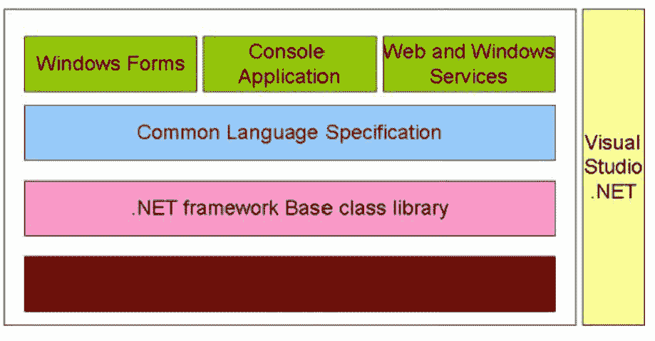

.NET 框架由以下组件组成：

-   公共语言运行时
-   .NET 框架基类库
-   公共语言规范
-   用户和程序接口

#### 公共语言运行时 (CLR)

.NET 框架的核心组件是 CLR。它是程序执行的环境。CLR 中的代码被转换为中间语言 (IL)。然后，该 IL 代码可用于不同的平台。

IL 代码由即时 (JIT) 编译器转换为机器语言。编译器检查类型安全性。这确保了对象以兼容的方式被访问。


 ## .NET Framework 类库

该类库适用于任何 .NET 语言，如 VB.NET、VC# 和 VC++.NET。该库提供了在代码中用于执行不同编程任务的类，例如数据收集、字符串管理、文件访问以及连接数据库。

### 公共语言规范

CLR 包含一套由 .NET 框架中所有编程语言共同遵守的通用规则。这些规则被称为公共语言规范 (CLS)。CLS 帮助一个对象与其他语言的对象或应用程序进行交互。

### 用户和程序接口

.NET 框架提供了三种不同类型的用户界面：

- **Windows Forms：** 基于窗口的应用程序。
- **Web Forms：** 用于创建基于 Web 的应用程序。
- **Console Applications：** 用于创建由命令行执行的基于控制台的应用程序。

# 第二章 C# 程序结构

## 2.1 C# 程序结构简介

C# 程序由多个部分组成。我们将探讨 C# 程序所需的所有组件。

请参考以下演示 C# 程序的代码。

```
Example 1:

using System;
namespace welcome
public class WelcomeUser
{
    static void Main( string[] args)
    {
        Console.WriteLine("WelcomeUser");
        Console.Read();
    }
}
```

该代码由几个部分组成，具体如下所述：

### 命名空间声明

命名空间由编程中使用的类集合组成。**using** 关键字用于添加 System 命名空间。System 类包含对用户有用的类和方法。

在上述代码中，添加了 **welcome** 命名空间。

### 类

类由程序使用的数据和方法定义组成。一个类可以包含一个或多个方法。每个类必须有一个 **Main** 方法，它是代码中运行的第一个方法。在上述代码中，声明了 **WelcomeUser** 类。

### 类方法

类中的方法指定了语句的行为。在上述代码中，**WriteLine** 方法用于在控制台中写入值。它定义在 System 命名空间的 Console 类中。

Console 类的 **Read** 方法用于等待用户按下按键。从而防止屏幕关闭过快。

### 注释

注释是用于提供有关代码额外信息的文本。编译器会忽略放置在注释块中的任何代码。注释有两种类型：一种用于单行条目，另一种用于多行条目。

例如：

```
using System;
namespace comment
/*It is a simple code
Used for writing value to the console
*/
class Demo
{
    static void Main()
    {
        //It is added inside Main method
        Console.WriteLine("Demonstration of code");
    }
}
```

## 2.2 用户界面元素

Visual Studio 应用程序中存在各种用户界面元素，可用于项目。我们将详细探讨这些用户界面元素。

### 开始页

开始页是用户打开 Microsoft Visual Studio 应用程序时显示的初始页面。

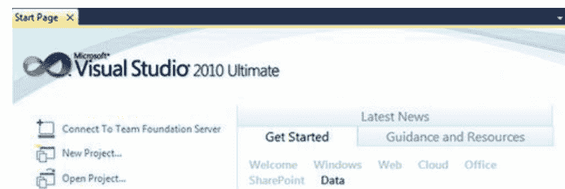

Visual Studio IDE 将开始页作为默认主页。通过开始页，用户可以指定首选项、利用 .NET 平台进行开发者沟通以及探索新的 .NET 特性。

在 Visual Studio .NET 中，“项目”选项卡显示最近的项目及其最新的修改日期。用户可以使用列表中的任何现有项目。当需要创建新项目时，点击“新建项目”按钮。当用户想要打开现有项目时，点击“打开项目”按钮。

### 标准工具栏

标准工具栏用于提供快捷菜单命令。工具栏上有几个按钮，帮助用户执行与打开、关闭、保存、编辑、粘贴文件相关的任务。

标准工具栏中存在与工具相关的函数，列举如下：

- 新建项目：在应用程序中创建一个新项目。使用  按钮。
- 添加新项目：向项目中添加一个新项。使用  按钮。
- 保存：保存特定解决方案中创建的所有程序。使用 $\text{save\_icon}$ 按钮。
- 全部保存：保存应用程序中所有未保存的项目。使用 $\text{save\_all\_icon}$ 按钮。
- 剪切：使用此选项将选定对象放置在剪贴板上。使用 $\text{cut\_icon}$ 图标。
- 复制：将选定项的副本保存在剪贴板上。使用 $\text{copy\_icon}$ 图标。
- 粘贴：用于将内容粘贴到文档中。使用 $\text{paste\_icon}$ 图标。
- 调试：执行项目的编译和运行。使用 $\text{debug\_icon}$ 图标。

### 解决方案资源管理器

在解决方案资源管理器窗口中，会显示项目中使用的类、项目和解决方案名称。双击解决方案资源管理器中的文件即可打开该文件。

下图显示了应用程序中的解决方案资源管理器窗口。

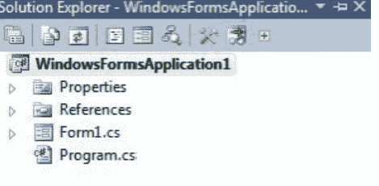

### 输出窗口

输出窗口提供关于 Visual Studio .NET IDE 功能状态的消息。当用户编译应用程序时，会显示其当前状态。窗口中会显示编译期间出现的错误数量。使用 **视图 -> 输出窗口** 选项来打开该窗口。

下图显示了 Visual Studio 应用程序中的输出窗口。

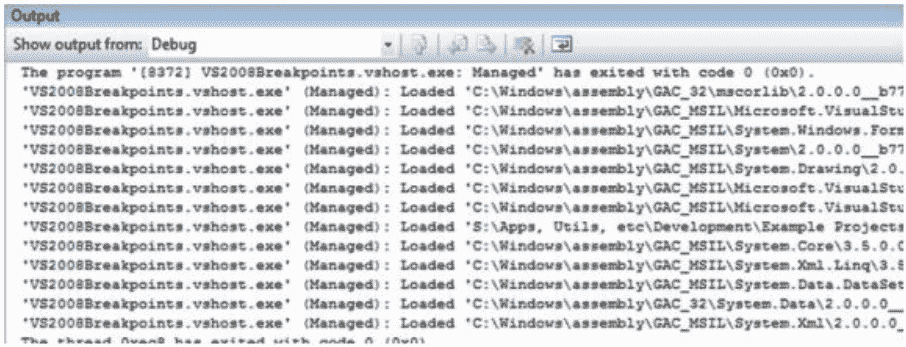

### 错误列表

错误列表窗口显示应用程序中存在的错误列表。用户可以在代码编译后立即定位错误。双击错误即可定位其源代码。点击“视图”、“错误列表窗口”选项以打开错误列表窗口。

下图显示了错误列表窗口。

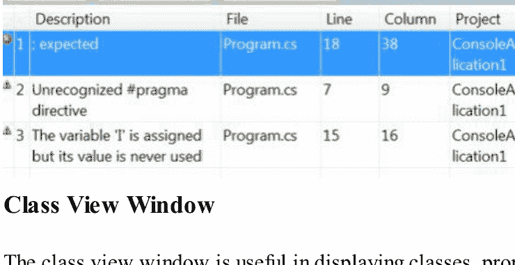

### 类视图窗口

类视图窗口用于显示与文件关联的类、属性和方法。使用树状视图结构来显示项目。通过双击项目可以查看代码编辑器窗口。

该窗口包含两个按钮，一个用于对项目进行排序，另一个用于创建新文件夹。使用“视图”、“类视图”选项打开类视图窗口。

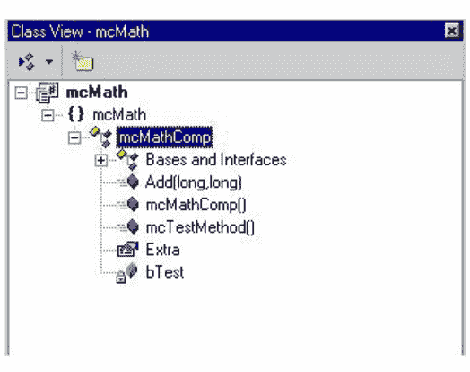

### 代码编辑器

用户可以在代码编辑器中输入或编辑代码。用户可以为类在编辑器中添加代码。

以下窗口显示了代码编辑器。

```
using System.Collections.Generic;
using System.ComponentModel;
using System.Data;
using System.Drawing;
using System.Linq;
using System.Text;
using System.Windows.Forms;

namespace WindowsFormsApplication1
{
    public partial class Form1 : Form
    {
        public Form1()
        {
            InitializeComponent();
        }
    }
}
```

## 2.3 编译和执行 C# 程序

编译和执行程序涉及以下步骤：

1. 打开 Visual Studio 应用程序
2. 从列表中点击 **文件** $\rightarrow$ **新建** $\rightarrow$ **项目** 选项
3. 选择 Visual C# 模板并选择 Windows 选项
4. 从模板列表中选择控制台应用程序 (console application) 模板
5. 添加项目名称并点击 **确定** 按钮
6. 解决方案资源管理器窗口中创建了一个新项目
7. 在代码编辑器窗口中添加所需代码
8. 按 **F5** 或点击 **运行** 按钮执行项目。用户可以查看代码的输出结果

也可以使用 Visual Studio IDE 的命令行来编译 C# 程序代码：

1. 在文本编辑器中添加代码，并将文件保存为 **.cs** 扩展名
2. 打开命令提示符并导航到该文件所在目录
3. 输入 `csc filename.cs` 并编译代码
4. 命令提示符移动到下一行并创建一个可执行文件
5. 输入文件名并执行程序


## 第 3 章 语法、数据类型与转换

### 3.1 C# 中的不同关键字

关键字是特殊的预定义保留字，每个关键字都被赋予了唯一的含义。为了更好地理解，这些关键字可以被分为不同的类别。以下是按类型分类的关键字列表。

#### 1) 类、方法、字段和属性的关键字

- abstract
- extern
- internal
- internal
- new
- const
- override
- protected
- private
- public
- sealed
- readonly
- static
- virtual
- void

#### 2) 类型转换关键字

- explicit
- implicit
- as
- is
- operator
- sizeof
- typeof

#### 3) 程序流程控制实用关键字

- if
- else
- for
- foreach
- in
- case
- break
- continue
- return
- while
- goto
- default
- do
- switch

#### 4) 用于内置类型和枚举的关键字

- bool
- char
- class
- byte
- decimal
- enum
- double
- float
- interface
- long
- int
- object
- sbyte
- short
- string
- uint
- struct
- ulong
- ushort

#### 5) 用于异常处理的关键字

- try
- catch
- throw
- finally
- checked
- unchecked

#### 6) 用作字面量、方法传递参数的关键字

- true
- false
- null
- this
- value
- out
- params
- ref

#### 7) 在函数指针、对象分配、非托管代码中实用的关键字

- delegate
- event
- new
- stackalloc
- unsafe

### 3.2 C# 中的数据类型

数据类型用于以特定的类型存储数据。程序员可以使用几种内置数据类型来声明数据。

每种数据类型都有一组有限的可选值，这些有限的选项被称为该数据类型的**数据范围（**data range**）。下面列出了存在的数据类型及其对应的数据范围：

- **bool：** 用于表示布尔值。可赋的值为 true 或 false。
- **byte：** 8 位无符号整数。byte 数据类型的取值范围是 0 到 255。
- **char：** 16 位 Unicode 字符。取值范围是 U+0000 到 U+ffff。
- **double：** 64 位双精度浮点类型。取值范围是 (+/-) 5.0 x 10^-324 到 (+/-) 1.7 x 10^308。
- **decimal：** 128 位具有有效数字的精确十进制值。取值范围是 (-7.9 x 10^28 到 7.9 x 10^28) / 10^0 到 28。
- **float：** 32 位单精度浮点数。取值范围是 -3.4 x 10^38 到 + 3.4 x 10^38。
- **int：** 32 位有符号整数类型。取值范围从 -2,147,483,648 到 2,147,483,647。
- **long：** 64 位有符号整数类型。取值范围从 -9,223,372,036,854,775,808 到 9,223,372,036,854,775,807。
- **sbyte：** 8 位有符号整数类型。取值范围从 -128 到 127。
- **short：** 16 位有符号整数类型。取值范围从 -32,768 到 32,767。
- **uint：** 32 位无符号整数类型。取值范围从 0 到 4,294,967,295。
- **ulong：** 64 位无符号整数类型。取值范围从 0 到 18,446,744,073,709,551,615。
- **ushort：** 16 位无符号整数类型。取值范围从 0 到 65,535。

## 3.3 C# 中的类型转换

当程序员需要将一种数据类型转换为另一种数据类型时，类型转换非常有用。类型转换也被称为**类型强制转换**（**type casting**）。C# 中有两种类型的强制转换：**隐式类型**（**implicit type**）转换和**显式类型**（**explicit type**）转换。

#### 隐式类型转换

`implicit` 关键字用于隐式转换。它们不需要任何强制转换运算符。这些转换包括从小整数类型到大整数类型，以及从派生类到基类的转换。

#### 显式类型转换

显式转换是由用户通过使用预定义函数显式完成的。在这些转换中，需要一个强制转换运算符。

```csharp
using System;
namespace TypeConversion
{
    class Conversion
    {
        static void Main(string[] args)
        {
            double d=10.243;
            int i;

            i = (int)d;
            Console.WriteLine(i);
            Console.Read();
        }
    }
}
```

C# 包含了一些对用户非常有用的类型转换方法。

以下列表显示了这些类型转换方法：

- **ToByte：** 用于将类型转换为 byte
- **ToBoolean：** 用于转换为布尔值
- **ToDateTime：** 用于将类型转换为日期时间类型
- **ToDouble：** 将类型转换为 double
- **ToDecimal：** 将浮点数或整数转换为 decimal 类型
- **ToInt64：** 将类型转换为 64 位整数
- **ToSingle：** 将类型转换为浮点数
- **ToString：** 将类型转换为字符串类型
- **ToUInt64：** 将类型转换为无符号大整数

以下代码片段显示了将值类型转换为 Double 类型的过程。

```csharp
using System;
namespace type
{
    class DoubleConversion
    {
        int a=10;
        float f=30.05f;
        bool b=false;

        Console.WriteLine(a.ToDouble());
        Console.WriteLine(f.ToDouble());
        Console.WriteLine(b.ToDouble());
        Console.Read();
    }
}
```

## 第 4 章 变量与常量

### 4.1 探索 C# 中的变量

变量是分配给程序所使用的内存位置的名称。每个变量都有一个与之相关的数据类型。数据类型决定了内存中用于存储该变量的内存大小。

C# 提供的数据类型可分为：

1. 整数类型：int, uint, short, byte, sbyte, long, ulong, 和 char
2. 浮点类型：double, float
3. 十进制类型：decimal
4. 布尔类型：true 或 false 值
5. 可空类型：nullable 数据类型
6. 引用类型：class

#### 定义变量

声明变量的语法为：

```
<data_type> <variable_list>;
```

其中，**data_type** 是一个有效的 C# 数据类型。它可以是 int, char, float, double 或用户定义类型。**variable_list** 包含一个或多个标识符。

变量示例：

```csharp
int a,b,c;
char x,y;
float price, totalcost;
double area;
```

#### 初始化变量

变量使用等号初始化，后跟一个表达式。初始化变量的语法为：

```
variable_name = value;
```

变量可以在声明时初始化。初始化变量的一般形式为：

```
<data_type> <variable_name> = value;
```

变量初始化的示例：

```csharp
int a = 4;
char z='z';
double y = 12.145;
```

演示变量类型的示例：

**示例 5：**

```csharp
using System;
namespace VariableDeclare
class Program
{
    static void Main(string[] args)
    {
        int a;
        short s;
        double d;

        /*initializing variables*/
        a=20;
        s=5;
        d=a+s;
        Console.WriteLine("a={0},b={1},d={2}",a,s,d);
        Console.Read();
    }
}
```

#### 接收用户输入值

**System** 命名空间中的 **Console** 类提供了 **ReadLine()** 函数。

该函数用于接收用户的输入并将其存储在变量中。

示例：

```csharp
int no;
no=Convert.ToInt32(Console.ReadLine());
```

**Convert.ToInt32()** 函数将用户输入的数据转换为整数数据类型。该函数接收字符串格式的数据。

#### LValue 和 RValue 表达式

C# 中的两种表达式类型是：

- **lvalue（左值）：** 出现在赋值语句左侧的表达式。
- **rvalue（右值）：** 出现在赋值语句右侧而非左侧的表达式。

变量是左值，因此出现在赋值语句的左侧。数值是右值，因此出现在右侧。

```csharp
int a=50;
```

### 4.2 C# 中的常量与字面量

常量是表示固定值的类成员。常量值可以在编译时计算，但不能被修改。常量使用 **const** 关键字声明。

语法：

`const <data_type> <constant_name> = value;`

常量示例：

```csharp
using System;
namespace constc
class Program
{
    static void Main(string[] args)
    {
        const int i=3;
        int x;
        Console.WriteLine("The value for x is");
        x=Convert.ToInt32(Console.ReadLine());
        int mult = x*i;
        Console.WriteLine("Value of multiplication is:{0}",mult);
        Console.ReadLine();
    }
}
```

#### 字面量

字面量是值的源代码表示形式。C# 中有不同类型的字面量。

#### 整数字面量

整数字面量用于编写 int, long, uint 和 ulong 类型的值。它可以表示为十进制、八进制或十六进制常量。基数或底数由前缀指定。0x 或 0X 表示十六进制，0 定义八进制且...

十进制数在使用时不需要前缀。

整数文字的一些示例有 15, 0321, 0x5b, 30l。

#### 浮点数文字

浮点数文字由整数部分、小数部分、小数点部分和指数部分组成。浮点数文字可以用指数形式或小数形式表示。

浮点数文字可以表示为 3.1415, 1423E-6L。

#### 字符文字

字符文字代表一个**单个字符**。它们被包含在单引号中。以反斜杠开头的字符被称为*转义字符*，其中一些转义字符在字符串中使用时具有特殊含义，用于指定特殊功能，例如创建制表符或回车符。以下是一些特殊转义字符的列表：

- \' - 单引号
- \" - 双引号
- \\ - 反斜杠
- \0 - 空字符 (null)
- \a - 警报 (Alert)
- \b - 退格 (Backspace)
- \f - 换页 (Form feed)
- \t - 水平制表符 (Horizontal tab)
- \v - 垂直制表符 (Vertical tab)
- \r - 回车 (Carriage return)

#### 字符串文字

C# 支持两种字符串文字类型：**常规字符串文字**和**逐字字符串文字**。常规字符串文字包含被包含在双引号中的零个或多个字符。

逐字字符串文字包含一个 @ 字符，后面跟着一个双引号字符以及零个或多个字符。逐字字符串文字可以跨越多行。

显示字符串文字的示例：

"welcome user"

"welcome, \

user"

@"welcome user"

## 第 5 章 C# 中的运算符

### 5.1 运算符简介

运算符用于定义表达式的含义。它是一组一个或多个用于计算或比较的字符。运算符可以将一个或多个数据值（称为操作数）更改为一个新值。

### 5.2 *算术运算符*

算术运算符用于对变量执行**算术运算**。下表显示了 C# 中的算术运算符。

| 运算符 | 描述 | 示例 |
|---|---|---|
| + | 将两个操作数相加 | c=a+b<br>如果 a=10, b=20, c=10+20=30 |
| - | 从第一个操作数中减去第二个操作数 | c=a-b<br>如果 a=10, b=5, c=10-5=5 |
| * | 将两个操作数相乘 | c=a*b<br>如果 a=10, b=5, c=10*5=50 |
| / | 用分子除以分母 | c=a/b<br>如果 a=21, b=2, c=21/2=10 |
| % | 取模运算符，即整数除法后的余数 | c=a%b<br>如果 a=21, b=2, c=21%2=1 |
| ++ | 自增运算符。用于将值增加 1 | 如果 a=10,<br>a++=11 |
| -- | 自减。值可以减少 1 | 如果 a=10<br>a--=9 |

### 5.3 关系运算符

关系运算符用于**关系运算**和**类型比较**。

| 运算符 | 描述 | 示例 |
| --- | --- | --- |
| == | 检查操作数的值是否相等。 | 如果 x=10, y=20, (x==y) 不成立 |
| != | 如果两个操作数的值不相等，则条件为真 | 如果 x=11, y=12, (x!=y) 成立 |
| > | 如果左操作数大于右操作数，则条件为真 | 如果 x=13, y=17, (x>y) 不成立 |
| < | 如果右操作数大于左操作数，则条件为真 | 如果 x>10, y=15, (x<y) 成立 |
| >= | 如果左操作数的值大于或等于右操作数，则条件为真 | 如果 x=5, y=3, (x>=y) 成立 |
| <= | 如果左操作数的值小于或等于右操作数，则条件为真 | 如果 x=10, y=4, (x<=y) 不成立 |

### 5.4 逻辑运算符

逻辑运算符用于评估表达式并返回一个 **Boolean** 值。

| 运算符 | 描述 | 示例 |
|----------|-------------|---------|
| && | 逻辑与 (AND) 运算符。如果两个表达式都为真，则结果为真 | X 的布尔值为 true，Y 的布尔值为 false, (A&&B) 为 false |
| ! | 逻辑非 (NOT) 运算符。如果表达式为假，则返回真 | X 的布尔值为 true, !(X) = false |
| \|\| | 逻辑或 (OR) 运算符。如果其中任一表达式为真，则结果为真 | X 的布尔值为 true, Y 的布尔值为 false, (X\|\|Y) 为 true |
| ^ | 如果其中任一表达式为真，则返回真。如果两个表达式同为真或同为假，则返回假 | X 的布尔值为 true, Y 的值为 false, (X^Y) 为 true |

### 5.5 *按位运算符*

按位运算符用于位操作。它们执行**位运算**。

| a | b | a&b | a\|b | a^b |
|---|---|-----|-----|-----|
| 0 | 0 | 0 | 0 | 0 |
| 0 | 1 | 0 | 1 | 1 |
| 1 | 0 | 0 | 1 | 1 |
| 1 | 1 | 1 | 1 | 0 |

### 5.6 赋值运算符

赋值运算符用于对操作数执行算术运算。结果值被赋给其中任何一个操作数。

| 运算符 | 描述 | 示例 |
| :--- | :--- | :--- |
| = | 将右侧操作数的值赋给左侧操作数 | z=x+y 将 x+y 的值赋给 z |
| += | 加并赋值运算符。将右操作数加到左操作数上，并将结果赋给左操作数 | x+=y 类似于 x=x+y |
| -= | 减并赋值运算符。从左操作数中减去右操作数。 | x-=y 类似于 x=x-y |
| *= | 乘并赋值运算符。将右操作数与左操作数相乘 | x*=y 类似于 x=x*y |
| /= | 除并赋值运算符。用左操作数除以右操作数 | x/=y 类似于 x=x/y |
| %= | 取模并赋值运算符。对两个操作数取模 | x%=y 类似于 x=x%y |
| <<= | 左移并赋值运算符 | a<<=2 类似于 a=a<<2 |
| >>= | 右移并赋值运算符 | a>>=2 类似于 a=a>>2 |
| &= | 按位与并赋值运算符 | a&=3 类似于 a=a&3 |
| ^= | 按位异或并赋值运算符 | a^=4 类似于 a=a^4 |
| \|= | 按位或并赋值运算符 | a\|=5 类似于 a=a\|5 |

### 5.7 杂项运算符

| 运算符 | 描述 | 示例 |
|----------|-------------|---------|
| sizeof() | 返回数据大小 | sizeof(int), 返回 4 |
| typeof() | 提供类的类型 | typeof(StreamWriter); |
| & | 变量的地址 | &x, 变量的实际地址 |
| ?: | 条件表达式 | 如果条件为真? X 值 否则 Y |
| as | 如果转换不成功，则在不抛出异常的情况下进行转换 | Object o1 = new StringReader("Welcome"); StringReader s = obj as StringReader; |
| is | 检查对象是否为特定类型 | If(Maths is Subject) , 检查数学是否是学科 |

## 第 6 章 C# 决策语句

决策的结构方式如下：

- 语句必须满足至少一个条件
- 必须至少有两个最终结果

查看下图，我们可以看到决策逻辑的一般表示。

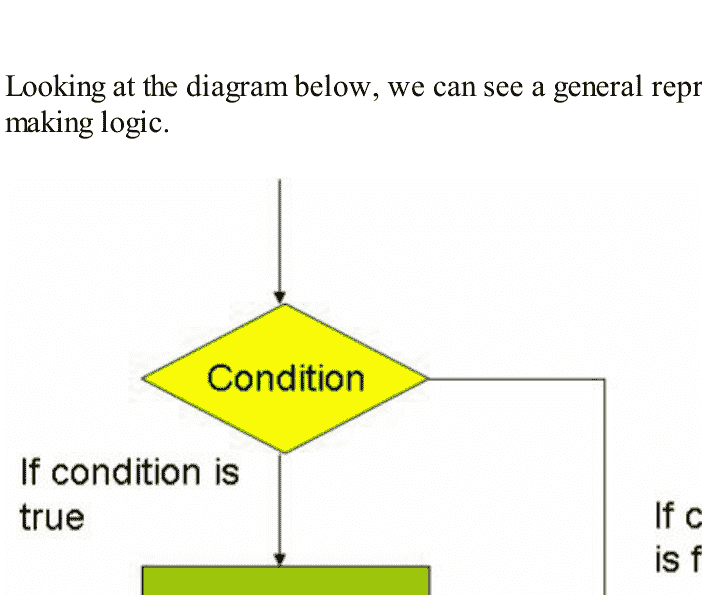

在上面的图中，箭头代表系统执行语句的流程。当语句到达条件逻辑（菱形）时，语句将与条件进行匹配。该条件有两个结果：*True*（真）或 *False*（假）。

如果语句匹配条件，则被声明为 *True*，然后语句将在到达终点之前运行一组代码（矩形）。如果语句不匹配条件，则被声明为 false，并直接跳转到终点。

C# 有多种类型的决策语句，下面将详细说明。

### 6.1 If 语句

If 语句包含一个布尔表达式 *True* 或 *False*。其后跟着一个或多个语句。

语法：

```
if (boolean_expression)
{
    //if the Boolean expression is true, statement executed
}
```

如果表达式的值为 **true**，则执行代码块中的语句。如果表达式的值为 **false**，则执行 if 语句结束后的那一组代码。

#### 流程图

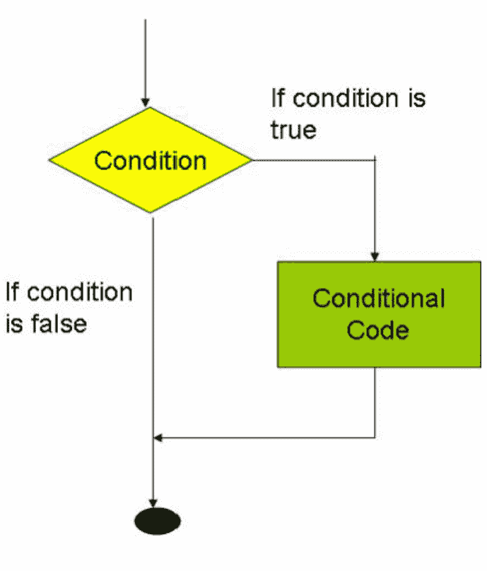

#### if 语句示例

#### 示例 7:

```
using System;
namespace decision
{
    class Program
    {
        static void Main(string[] args)
        {
            /*local variables*/
            int i = 15;
            /*boolean condition is checked*/
            if(i < 15)
            {
                Console.WriteLine("The value of i is less than 15");
            }
            Console.WriteLine("Value of i is {0}", i);
            Console.Read();
        }
    }
}
```

在这个代码示例中，我们可以看到条件是 `if(i < 15)`。因此，在这里变量 `i` 必须满足小于 15 的条件，结果才为 **True**，否则为 **False**。


## 6.2 If else 语句

一个 **if** 语句可以附加一个可选的 else 语句。当表达式值为 false 时，将执行 **else** 语句。

**语法：**

```
if(boolean_expression)
{
    /* 如果布尔表达式为 true，则执行此语句 */
}
else
{
    /* 如果布尔表达式为 false，则执行此语句 */
}
```

如果表达式值为 **true**，则执行 **if 块**，否则执行 **else 块**。

**流程图**

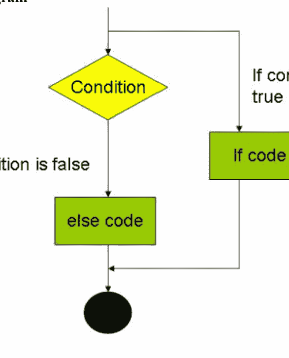

#### if else 语句示例：

**示例 8：**

```csharp
using System;
namespace ifelseconstruct
{
    class User
    {
        static void Main(string[] args)
        {
            int age;
            Console.WriteLine("Enter the age of the user");
            age=Convert.ToInt32(Console.ReadLine());
            if(age < 18)
            {
                Console.WriteLine("Not an adult");
            }
            else
            {
                Console.WriteLine("User is an adult");
            }
        }
    }
}
```

在上面的代码示例中，指定了条件 ( age < 18 )。因此，这里的变量 age 必须满足小于 18 的条件才能使条件为 *True*，否则将执行 else 块。

#### else if else 语句

一个 **if** 语句后面也可以跟一个 **else if else** 结构。可以使用 if else if 语句检查多个条件。

**语法**

```
if (boolean_expression 1)
{
    /*如果布尔表达式 1 为 true，则执行此语句*/
}
else if(boolean_expression 2)
{
    /* 如果布尔表达式 2 为 true，则执行此语句*/
}
else if(boolean_expression 3)
{
    /* 如果布尔表达式 3 为 true，则执行此语句*/
}
else
{
    /* 如果没有条件为 true，则执行此语句*/
}
```

#### else if else 语句示例

**示例 9：**

```csharp
using System;
namespace ifelse
{
    class Program
    {
        static void Main(string[] args)
        {
            int x = 30;

            if(x == 100)
            {
                Console.WriteLine("The value is 100");
            }
            else if(x == 20)
            {
                Console.WriteLine("The value is 20");
            }
            else if(x == 10)
            {
                Console.WriteLine("The value is 10");
            }
            else
            {
                Console.WriteLine("No matching value found");
            }
            Console.WriteLine("Value of x is:{0}",x);
            Console.Read();
        }
    }
}
```

在上面的示例中，指定了值 x = 30。如果存在与 x 值匹配的表达式，则执行相应的块。如果没有表达式匹配，则执行 **else** 块。

## 6.3 嵌套 if 语句

嵌套 **if** 语句在一个 **if** 或 **else if** 语句内部包含另一个 **if** 或 **else** 语句。

**嵌套 if 语句的语法**

```
if(boolean_expression1)
{
    /*如果表达式 1 为 true，则执行此语句*/
    if(boolean_expression2)
    {
        /*如果表达式 2 为 true，则执行此语句*/
    }
}
```

**嵌套 if 语句示例**

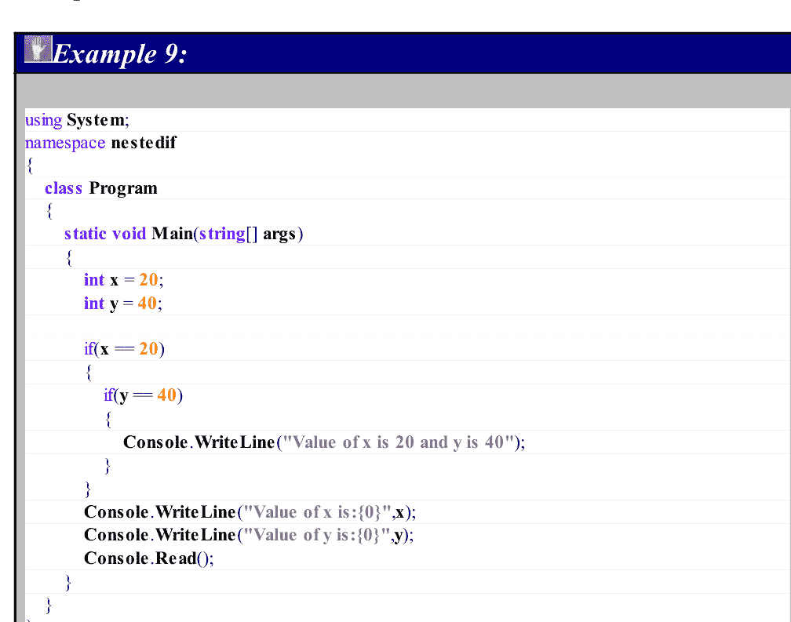

在上面的代码中，为 x 和 y 变量赋值。检查 if 语句内部的值。如果相同，则执行内部语句，否则控制流将移出循环。

## 6.4 Switch 语句

Switch 语句有助于高效地对变量进行多个条件评估。每个条件称为一个 *case*，并检查被切换的变量是否匹配 **switch case**。

**语法：**

```
switch(Expression)
{
        case ConstantExpression1:
                statements;
        break;
        case ConstantExpression2:
                statements;
        break;
        ...... 
        case ConstantExpression_n:
                statements;
        break;
        default:
                statements;
                break;
}
```

switch 语句中添加的规则如下：

- switch 语句中的表达式必须是整数或类类型。
- 用户可以在 switch 语句中添加任意数量的 case 语句。
- **ConstantExpression** 的数据类型必须与 switch 中的表达式相似。
- 当表达式与 ConstantExpression 匹配时，该 **case** 内的代码将被执行，并将遇到 **break** 关键字，这将强制执行退出 **switch 语句**。
- 每个 case 不需要 **break** 关键字。
- 可选的 **default** case 出现在 switch 的末尾，并作为表达式与任何 **ConstantExpressions** 都不匹配时的备用方案。

**流程图**

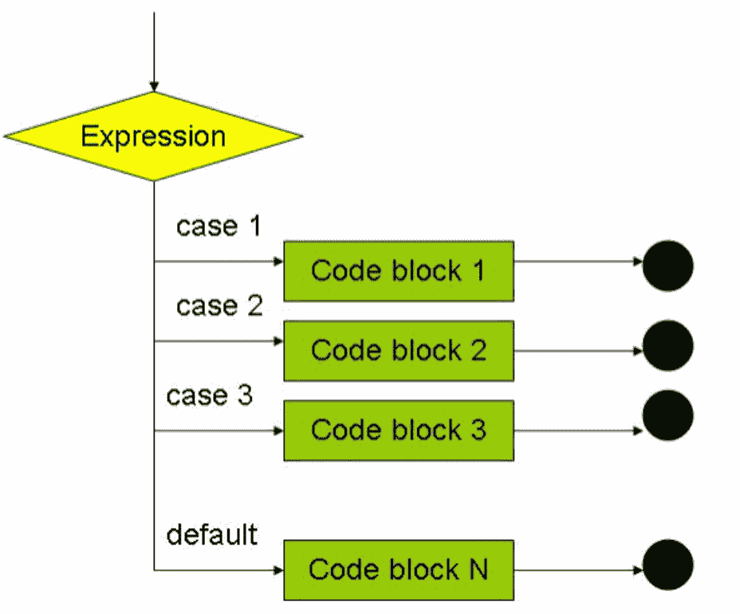

#### switch 语句示例

```csharp
using System;
namespace switchcase
{
    class Program
    {
        static void Main(string[] args)
        {
            char grade = 'A';
            switch(grade)
            {
                case 'C':
                    Console.WriteLine("Fair");
                    break;
                case 'B':
                    Console.WriteLine("Good");
                    break;
                case 'A':
                    Console.WriteLine("Excellent");
                    break;
                default:
                    Console.WriteLine("No matching grade");
                    break;
            }
            Console.WriteLine("Grade is {0}",grade);
            Console.ReadLine();
        }
    }
}
```

在上面的代码中，为 grade 赋值。它与不同的 switch case 进行匹配。如果值与已声明的 case 之一匹配，则显示相应的消息。如果没有表达式匹配，则执行 *default* case。

## 6.5 嵌套 switch 语句

用户可以切换外部 switch 语句序列的一部分。switch 中的公共值不会冲突。

**语法：**

```
switch(c1)
{
    case 'A':
        Console.WriteLine("A is the part of outer switch");
        switch(c2)
        {
            case 'A':
                Console.WriteLine(" A is the part of inner switch");
                break;
            case 'B':
                // statements
                break;
        }
        break;
    case 'B':
        // statements
        break;
}
```

#### 嵌套 switch 语句示例

```csharp
using System;
namespace switchcase
{
    class Program
    {
        static void Main(string[] args)
        {
            char grade ='A';
            switch(grade)
            {
                case 'C':
                    Console.WriteLine("Fair");
                    break;
                case 'B':
                    Console.WriteLine("Good");
                    break;
                case 'A':
                    Console.WriteLine("Excellent");
                    break;
                default:
                    Console.WriteLine("No matching grade");
                    break;
            }
            Console.WriteLine("Grade is {0}", grade);
            Console.ReadLine();
        }
    }
}
```

**示例 12：**

```csharp
using System;
namespace nestedswitch
{
    class Program
    {
        static void Main(string[] args)
        {
            int x = 20;
            int y = 40;

            switch(x)
            {
                case 20:
                    Console.WriteLine("Part of outer switch");
                    switch(y)
                    {
                        case 40:
                            Console.WriteLine("Part of inner switch");
                            break;
                    }
                    break;
            }
            Console.WriteLine("Value of x is :{0}", x);
            Console.WriteLine("Value of y is: {0}", y);
            Console.Read();
        }
    }
}
```

在上面的代码中，为变量 x 和 y 赋值。如果变量 x 的值与表达式匹配，则执行 switch case 内的语句，否则控制流将移出 case 结构。

## 第 7 章 C# 中的循环

循环结构用于反复执行一行或多行代码。为复杂的执行提供了各种控制结构。

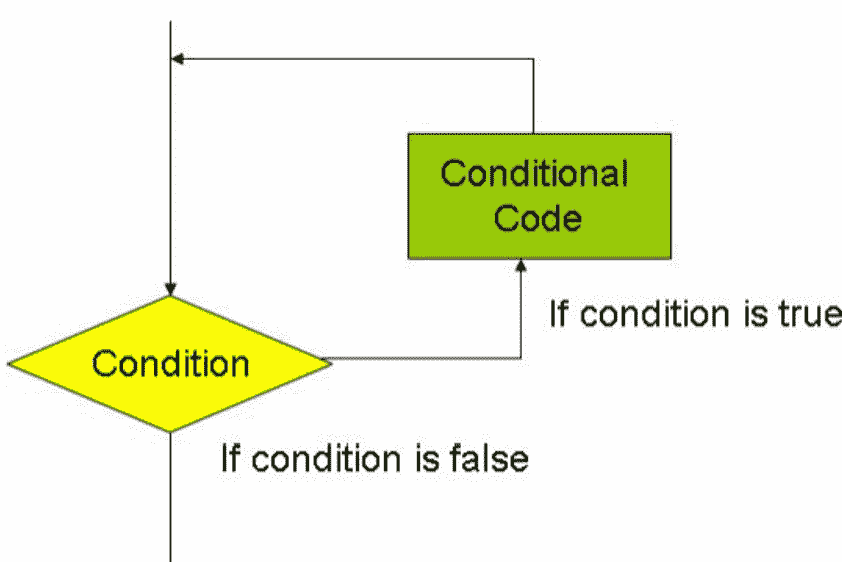

### 7.1 While 循环

**while** 循环包含一个条件表达式，在执行 while 循环内部的逻辑语句之前必须匹配该表达式。如果一条语句匹配该表达式，则它将运行循环内的代码，然后返回到条件表达式以重新检查该语句是否仍与表达式匹配。如果再次匹配，则循环将再次执行，否则将完全跳过循环。

让我们来看一下 while 循环的语法。

**语法：**

```
while (expression)
{
    statements;
}
```

**流程图**

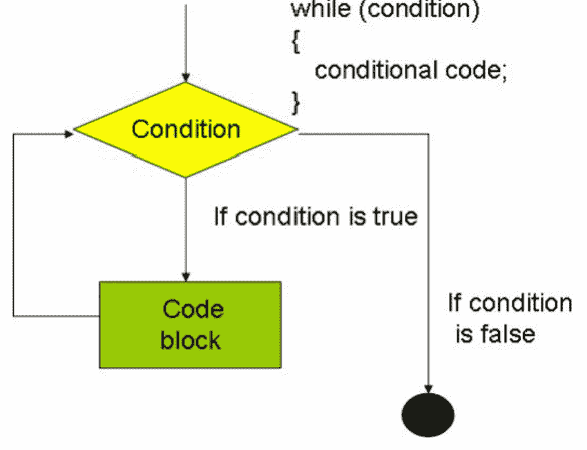


#### while 循环示例

```csharp
using System;
namespace whileloop
{
    class Program
    {
        static void Main(string[] args)
        {
            int var;
            var=50;
            while(var<150)
            {
                Console.WriteLine("Value of variable is:{0}",var);
                var=var+10;
            }
        }
    }
}
```

在上述代码中，变量 var 被初始化为 50。**while** 循环会检查条件。如果条件小于 150，则执行循环体内的语句。如果为 **false**，则控制流不进入 while 循环。

## 7.2 For 循环

**for** 循环用于将一段语句执行特定次数。

**语法：**

```csharp
for (initialization; condition; increment/decrement)
{
    statement(s);
}
```

其中：

- **initialization**（初始化）用于声明和初始化循环控制变量。它在循环开始时执行。
- **condition**（条件）检查表达式。如果值为 true，则执行循环体。如果为 false，则控制流跳出循环。
- **increment/decrement**（递增/递减）用于增加或减少变量值。

#### 流程图

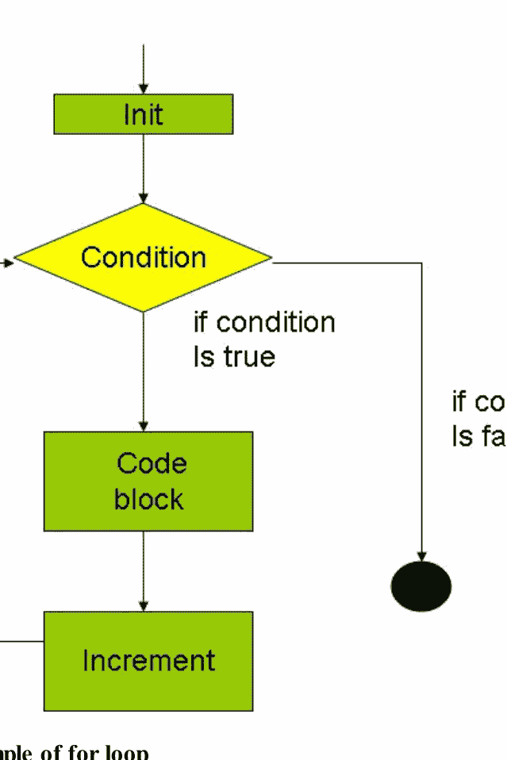

#### For 循环示例

```csharp
using System;
namespace forloop
{
    class Program
    {
        static void Main(string[] args)
        {
            int i;
            for(int i=1;i<=10;i++)
            {
                Console.WriteLine("Value of variable is:{0}",i);
            }
        }
    }
}
```

在上述代码中，声明了变量 i 的值。**For** 循环包含赋值、条件和递增。如果条件为 *true*，则增加该值，并执行 for 循环内部的语句。一旦条件为 *false*，控制流将移出循环。

## 7.3 Do while 循环

**do...while** 循环结构与 **while** 循环类似。两种循环都会在条件为 false 之前持续运行。不同之处在于，do...while 循环中的语句至少会被执行一次，因为代码块中的语句在检查条件之前就已经执行了。

**语法：**

```csharp
do
{
    Statements;
}while(expression);
```

#### 流程图

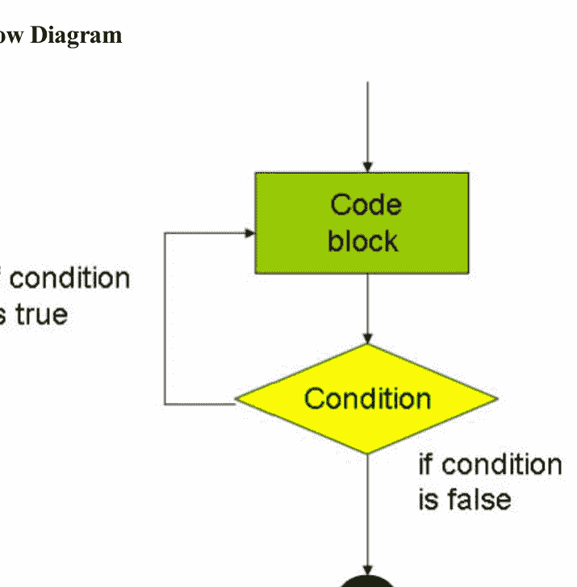

#### Do while 循环示例

**示例 15：**

```csharp
using System;
namespace dowhile
{
    class Program
    {
        static void Main(string[] args)
        {
            int x=1;
            do
            {
                Console.WriteLine("Value of x is:{0}",x);
                x=x+1;
            }while(x<10);
            Console.ReadLine();
        }
    }
}
```

在上述代码中，变量 x 被赋值为 1。**do** 循环打印代码块内部的语句。一旦 while 循环中的条件为 false，do while 循环中的语句将不再执行。

## 7.4 Break 语句

**break** 语句用于退出循环。当遇到此语句时，循环终止，控制流恢复到循环后的下一条语句。

**语法：**

```csharp
break;
```

#### 流程图

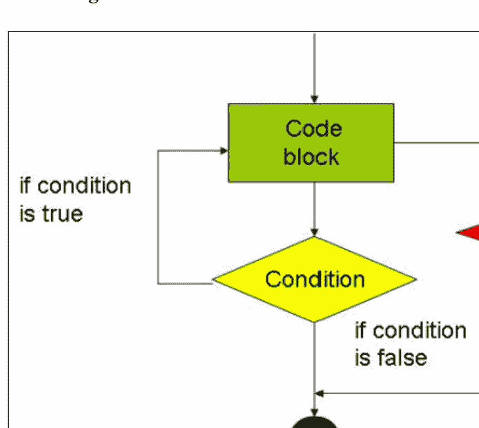

#### Break 语句示例

**示例 16：**

```csharp
using System;
namespace breakloop
{
    class Program
    {
        static void Main(string[] args)
        {
            int i=11;
            while(i<15)
            {
                Console.WriteLine("value of i:{0}",i);
                i++;
                if(i>13)
                {
                    break;
                }
            }
            Console.ReadLine();
        }
    }
}
```

在代码示例中，变量 i 的值被赋值为 11。**while** 循环检查 i 的条件。如果条件为 *true*，则执行 while 循环中的语句，并增加 i 的值。

如果循环检查 i 的值，一旦 i 的值大于 13，**break** 语句将被执行，控制流移出循环。

## 7.5 Continue 语句

continue 语句与 break 语句类似，但 **continue** 不是跳出循环，而是强制进行下一次循环迭代，跳过中间的任何代码。

**语法：**

```csharp
continue;
```

#### 流程图

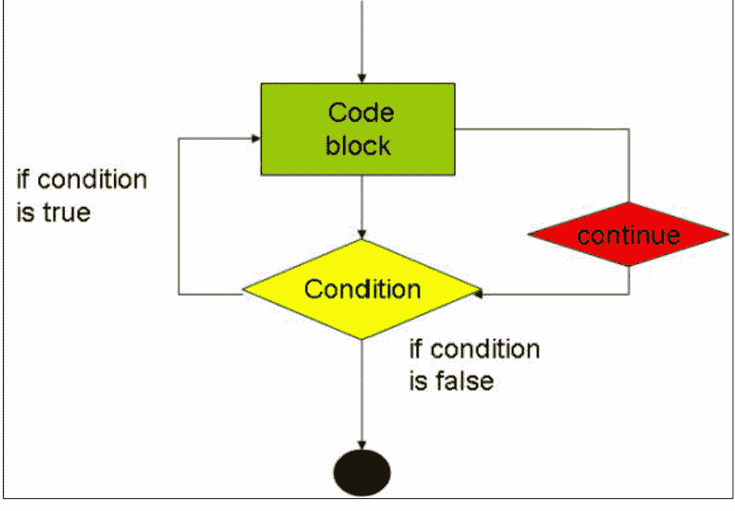

#### Continue 语句示例

**示例 17：**

```csharp
using System;
namespace continue_demo
{
    class Program
    {
        static void Main(string[] args)
        {
            int i=45;
            do
            {
                if(i==50)
                {
                    i=i+1;
                    continue;
                }
                Console.WriteLine("Value of i is:{0}",i);
                i++;
            }
            while(i<60);
            Console.ReadLine();
        }
    }
}
```

在上面的代码示例中，我们可以看到 **do-while** 循环和 **continue** 结合使用的效果。我们可以看到，当进入 **do** 内部的语句时，i 最初被设置为 45。此时会检查 i 是否等于 50，结果不匹配，因此输出 i 的值，并将 i 递增 1。

这个过程一直持续到 i 为 50，此时 i 将被递增 1 并触发 **continue** 关键字，这将跳过 **do** 部分剩余的代码，直接跳转到 **while** 条件表达式。

一旦 i 达到 61，**while** 条件语句将不再匹配，执行流程将离开循环。

## 第 8 章 C# 中的类与方法

### 8.1 类声明

在 C# 中，类是该语言的主要构建块。它提供了一组预定义的变量和方法。对象被定义为类的一个实例，因此类内部的方法决定了可以在该对象上执行哪些操作。

#### 类定义

类定义以关键字 **class** 开始，后面跟着实际的类名。类的变量和方法全部包含在花括号之间；这个区域也被称为类主体。

**语法：**

```csharp
<access specifier>class class_name
{
    //member variables
    <access specifier> <data type> variable1;
    <access specifier> <data type> variable2;
    .......
    <access specifier><data type> variableN;
    //member methods
    <access specifier><return type>method1(parameter_list)
    {
        //method body
    }
    <access specifier><return type>method2(parameter_list)
    {
        //method body
    }
    ....
    <access specifier><return type>methodN(parameter_list)
    {
        //method body
    }
}
```

- 访问修饰符定义了其他方法和成员能够与给定类的法和成员交互的接触级别。如果没有指定访问修饰符，默认访问修饰符为 **private**。
- 数据类型指定变量类型，返回类型用于说明从方法返回的数据类型，不过需要注意，方法并不总是需要返回任何内容。
- 点(.)运算符用于访问类成员。
- 点运算符用于连接对象名称和成员名称。

#### 类演示示例

```csharp
using System;
namespace demo
{
    class Calculate
    {
        public int len;
        public int bread;
    }
    class Program
    {
        static void Main(string[] args)
        {
            Calculate c1 = new Calculate();
            Calculate c2 = new Calculate();
            int area = 0;
            int area1 = 0;

            c1.len = 10;
            c1.bread = 5;

            c2.len = 15;
            c2.bread = 10;

            area = c1.len*c1.bread;
            Console.WriteLine("area of rectangle 1 is:{0}",area);

            area1 = c2.len*c2.bread;
            Console.WriteLine("area of rectangle 2 is:{0}",area1);
            Console.ReadLine();
        }
    }
}
```

**编译后，该类运行结果为：**

area of rectangle 1 is:50
area of rectangle 2 is:150

## C# 构造函数

构造函数是一种特殊的方法，在创建类的实例时会自动调用。类的成员在构造函数内部进行初始化。构造函数的名称必须与类名相同。

#### 构造函数示例

```csharp
using System;
namespace construct
{
    class Calculate
    {
        int number1,number2,sum;
        public Calculate()
        {
            number1 = 20;
            number2 = 40;
        }
        public void Addition()
        {
            sum = number1+number2;
        }
        public void Show()
        {
            Console.WriteLine("The total is:{0}",sum);
        }
        public static void Main(string[] args)
        {
            Calculate c1 = new Calculate();
            c1.Addition();
            c1.Show();
        }
    }
}
```

**编译后，该类运行结果为：**

The total is: 60

在上述示例中，每次实例化 `Calculate` 类时，构造函数都会手动为 `number1` 和 `number2` 分配一个固定值。然而，如果你想

如何让 number1 和 number2 的值变得不同且动态变化？这该如何实现呢？

这时就要引入 **带参数构造函数** 这个概念了。这个术语的本质是，我们直接向构造函数传入参数，这允许我们在类实例化时传入数值。我们来看一个例子：

#### 带参数构造函数示例

```
using System;
namespace construct
{
    class Calculate
    {
        int number1,number2,sum;

        // 参数被添加到这里的构造函数中
        Calculate(int num1,int num2)
        {
            // 我们将参数赋值给类变量
            number1 = num1;
            number2 = num2;
        }
        public void Addition()
        {
            sum=number1+number2;
        }
        public void Show()
        {
            Console.WriteLine("The total is:{0}",sum);
        }
        public static void Main(string[] args)
        {
            int a,b;

            Console.WriteLine("Enter value of a");
            a = Convert.ToInt32(Console.ReadLine());

            Console.WriteLine("Enter the value of b");
            b = Convert.ToInt32(Console.ReadLine());

            // a 和 b 被传递到类构造函数
            Calculate c1 = new Calculate(a,b);
            c1.Addition();
            c1.Show();

            Console.ReadLine();
        }
    }
}
```

#### 编译后，类的输出结果是：

Enter value of a
10
Enter value of b
20
The total is: 30

## C# *析构函数*

析构函数是类中一个很少使用的特殊函数，通常用于在退出类之前释放非托管资源。析构函数在使用上有几个限制：

-   它不能被继承。
-   它不能被重载。
-   任何给定的类中只能有一个析构函数。
-   析构函数不能被程序员直接调用；它是由垃圾回收器调用的。

析构函数与它的类同名，并以~符号为前缀。

#### 析构函数示例

```
using System;
namespace destruct
{
    class Calculate
    {
        int number1,number2,sum;
        Calculate()
        {
            number1=15;
            number2=4;
        }
        public void Addition()
        {
            sum=number1+number2;
        }
        public void Show()
        {
            Console.WriteLine("The total is:{0}",sum);
        }

        // 析构函数在此定义，并在类
        // 离开作用域时被调用。
        ~Calculate()
        {
            Console.WriteLine("Destructor invoked");
        }
        public static void Main(string[] args)
        {
            Calculate c1=new Calculate();
            c1.Addition();
            c1.Show();
        }
    }
}
```

**编译后，类的输出结果是：**

The total is: 19

## 8.2 定义方法

**方法**是一条或多条程序语句的集合，可以通过调用方法名来执行。要使用一个方法，用户首先需要定义一个方法，然后调用它。

定义一个方法意味着声明其结构的元素。定义方法使用以下语法：

```
<访问修饰符> <返回类型> <方法名> ( 参数列表)
{
    方法体
}
```

方法的不同元素是：

-   **访问修饰符：** 它检查变量或方法可被访问的程度。
-   **返回类型：** 这定义了方法返回值的类型。如果类型设置为 **void**，则表示该方法不返回任何内容。
-   **方法名：** 它是一个唯一的标识符，区分大小写。方法名不能与变量名相同。
-   **参数列表：** 传递给方法和由方法接收的值。它们写在方法名后的括号中。
-   **方法体：** 执行实际方法功能的指令集。

**示例：**

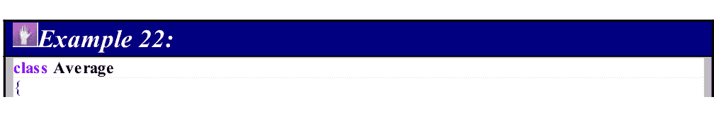

```
public int Number(int no1, int no2)
{
    int output;
    output = no1+no2/2;
    return output;
}
```

## 8.3 *调用方法*

方法定义后，用户可以使用方法名调用该方法。方法名后跟括号。

## **示例：**

```
Example 23:
using System;
class Average
{
    public int Number(int no1, int no2)
    {
        int output;
        output = no1+no2/2;
        return output;
    }
    static void Main(string[] args)
    {
        Average a = new Average();
        // 从对象类 a 调用方法 Number
        int value = a.Number(20,30);
        Console.WriteLine("The result is {0}",value);
    }
}
```

**编译代码后，结果是：**

The result is 25

## 8.5 递归方法调用

一个方法可以调用它自己，这被称为**递归**。

```
Example 24:
using System;
namespace recursive
{
    class recursivecall
    {
        public int factorial(int no)
        {
            int result;
            if(no == 1)
            {
                return 1;
            }
            else
            {
                result = factorial(no-1)*no;
                return result;
            }
        }
        static void Main(string[] args)
        {
            recursivecall r = new recursivecall();
            Console.WriteLine("Factorial of no is {0}",r.factorial(2));
            Console.WriteLine("Factorial of no is {0}",r.factorial(3));
            Console.Read();
        }
    }
}
```

**编译代码后，结果是：**

Factorial of no is 2
Factorial of no is 6

## 8.4 向方法传递参数

当用户调用一个方法时，如果方法接受参数，那么在调用方法时必须传递这些参数。传递给方法的参数有三种类型。

#### 值参数

对于值参数，方法会创建一个传入参数的副本作为变量在方法内部使用。如果这个变量的值被改变，它只会在方法本身的作用域内改变，而不会改变作为参数传入的原始变量的值。

**示例：**

```
class Program
{
    void Increaseno(int no)
    {
        no++;
    }
    public static void Main()
    {
        Program p = new Program();
        int number = 2;
        p.Increaseno(number);
        Console.WriteLine(number);
    }
}
```

编译代码后，结果是：

2

#### 引用参数

引用参数与值参数类似，不同之处在于当参数传递给方法时，它不是创建参数值的副本，而是直接指向内存中的原始存储值。因此，如果在方法的作用域内更改了值，那么作为参数传入的原始变量的值也会随之改变。

使用 **ref** 关键字来声明引用参数。

**示例：**

```
class Program
{
    void Increaseno(ref int no)
    {
        no++;
    }
    public static void Main()
    {
        Program p=new Program();
        int number = 2;
        p.Increaseno(ref number);
        Console.WriteLine(number);
    }
}
```

编译代码后，结果是：

3

#### 输出参数

return 语句用于从方法返回值。使用 return 语句只能返回一个变量。**输出参数** 提供了这个功能。

它们与引用参数类似，不同之处在于它们将数据从方法中传出。

**示例：**

```
class Program
{
    void Demo(out int no)
    {
        no=10;
    }
    public static void Main()
    {
        Program p=new Program();
        int number;
        p.Demo(out number);
        Console.WriteLine(number);
    }
}
```

编译代码后，结果是：

10

# 第9章 C#中的数组

## 9.1 数组简介

数组是相似数据类型值的集合。数组中的变量被称为数组元素。数组元素通过一个单一的名称和一个表示元素在数组中位置的索引号来访问。

数组有一个秩，它决定了每个数组元素关联的索引数。数组的秩也被称为数组的维度。下图显示了系统中的数组结构。

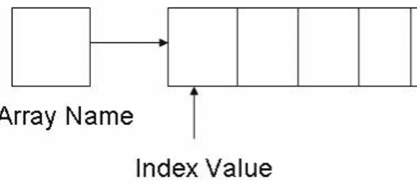


## 9.2 数组声明

数组在任何程序中使用之前必须先声明。以下语法用于声明数组。

```
datatype[ ] ArrayName;
```

数组的语法包含以下组成部分：

- **datatype：** 用于指定数组中元素的数据类型。
- **[ ]：** 指定数组的大小，称为秩（rank）。
- **ArrayName：** 表示数组的名称。

## 9.3 初始化与赋值

**new** 关键字用于创建数组的实例。数组在初始化时指定大小。以下代码片段用于初始化数组。

```
int [ ] x ;
x = new int [15];
```

数组可以通过合并上述两条语句来初始化，写法如下：
`int [ ] x = new int [15];`

#### 为数组赋值

可以使用**索引号**（也称为元素的下标）为数组的每个元素赋值。以下代码片段用于为数组赋值。

```
int [ ] amount = new int [5];
amount[0] = 50;
```

可以使用以下代码创建并初始化数组：

```
int [ ] amount = { 40,60,70,80};
```

数组的大小可以省略。

```
int [ ] age = new int[ ] { 21,31,40};
```

当用户将一个数组的数据复制到另一个数组时，源数组和目标数组引用同一位置。以下代码片段显示了将一个数组复制到另一个数组。

```
int [ ] age = new int[ ] { 12,14,15,16};
int [ ] amount = age;
```

这里创建了两个数组**age**和**amount**。它们指向同一个内存位置。

## 9.4 访问数组元素

要访问数组中的元素，需要使用索引。索引是表示数组中元素位置的数字。索引始终从零开始，因此要访问数组中的第一个元素，我们使用如下格式：

*array_name[index]*

*在这种情况下，index 的值为零。*

**示例：**

```csharp
using System;
namespace arraydeclare
{
    class Arraydemo
    {
        static void Main(string[] args)
        {
            int [] a = new int[5];
            int x,y;

            for(int x = 0;x <5;x++)
            {
                a[x]=x + 10;
            }
            for(y = 0;y < 5;y++)
            {
                Console.WriteLine("Element [{0}]={1}",y,a[y]);
            }
            Console.ReadLine();
        }
    }
}
```

**当代码编译并执行后，输出为：**

Element [0] = 10
Element [1] = 11
Element [2] = 12
Element [3] = 13
Element [4] = 14

## 9.5 Foreach 循环

此循环专门设计用于遍历数组中的所有元素。它能高效地检索数组中的元素。

#### 语法：

```
foreach(type identifier in expression)
statement - block
```

#### 示例：

```csharp
// Example 29:
using System;
namespace arraydeclare
{
	class Arraydemo
	{
		static void Main(string[] args)
		{
			int [] a = new int[5];
			for(int x = 0;x < 5;x++)
			{
				a[x] = x +otr 10;
			}
			foreach(int y in a)
			{
				int x = y - 10;
				Console.WriteLine("Element[{0}]",x,y);
				x++;
			}
			Console.ReadLine();
		}
	}
}
```

代码编译并执行后，输出为：

Element [0] = 10
Element [1] = 11
Element [2] = 12
Element [3] = 13
Element [4] = 14

## 9.6 C# 的不同数组类型

以下是用于开发代码的各种 C# 数组类型。

#### 多维数组

多维数组在**多个行维度**中存储数据。它也称为矩形数组。用户可以声明二维整数数组，如下所示：

```
int [ , ] no;
```

二维数组可以被视为一个表格。它有 x 行和 y 列。一个二维数组包含 2 行和 4 列。

| | 列 0 | 列 1 | 列 2 | 列 3 |
|---|---|---|---|---|
| 行 0 | x[0][0] | x[0][1] | x[0][2] | x[0][3] |
| 行 1 | x[1][0] | x[1][1] | x[1][2] | x[1][3] |

##### 初始化二维数组

以下数组有 3 行和 3 列。

```
int [ , ] x = new int [ 3, 3 ] = {
    {1, 2, 3},
    {4, 5, 6},
    {7, 8, 9}
};
```

##### 访问多维数组的元素

多维数组中的元素可以使用下标来访问。它们是数组的行和列索引。

**示例：**

```
int output = a [1, 2];
```

在上述语句中，访问了第二行第三列的元素。

**示例：**

（参考图像 `c133ae999967b1fbceab3bccc1cb1d4f_89_0.png`）

代码编译并执行后，输出为：

```
x[0,0] = 1
x[0,1] = 1
x[1,0] = 2
x[1,1] = 2
x[2,0] = 3
x[2,1] = 3
```

#### 交错数组

交错数组是数组的数组。int 类型的交错数组声明如下：

```
int [ ] [ ] marks;
```

数组可以初始化为：

```
int [ ] [ ] marks = new int [3] [ ] { new int [ ] {45,57,78}, new int [ ] { 60, 75, 86,45,35} };
```

marks 数组是两个整数数组，marks[0] 包含 3 个整数，marks[1] 包含 5 个整数。

**示例：**

（参考图像 `c133ae999967b1fbceab3bccc1cb1d4f_90_0.png`）

```csharp
using System;
namespace Jaggedarray
{
    class jagged
    {
        static void Main(string[] args)
        {
            int[][] x = new int[][]{
                new int[]{0,0},
                new int[]{2,2},
                new int[]{3,4},
                new int[]{4,2},
                new int[]{1,3}};

            int a,b;

            for(a = 0;a < 5;a++)
            {
                for(b = 0;b < 2;b++)
                {
                    Console.WriteLine("x[{0},{1}]={2}",a,b,x[a][b]);
                }
            }
            Console.ReadLine();
        }
    }
}
```

代码编译并执行后，输出为：

```
x[0,0] = 0
x[0,1] = 0
x[1,0] = 2
x[1,1] = 2
x[2,0] = 3
x[2,1] = oku 4
x[3,0] = 4
x[3,1] = 2
x[4,0] = 1
x[4,1] = 3
```

#### 参数数组（Param Arrays）

当声明方法时，要传递的参数数量未确定。此时使用 **Param** 数组。

**示例：**

```csharp
// Example 32:
using System;
namespace ParamArray
{
    class ParamArray
    {
        public int AddValues(params int[] data)
        {
            int total = 0;
            foreach(int a in data)
            {
                total += a;
            }
            return total;
        }
    }
    class Test
    {
        static void Main(string[] args)
        {
            ParamArray pa = new ParamArray();
            int total = pa.AddValues(2,3,4,5,6);
            Console.WriteLine("The sum is {0}", total);
            Console.Read();
        }
    }
}
```

**当代码编译并执行后，输出为：**

The sum is 20

#### Array 类

**Array** 类是 C# 中所有数组的基类。**System** 命名空间包含 Array 类。Array 类中有各种属性和方法。

##### Array 类的属性

- **Length：** 返回数组所有维度中的总项目数。
- **Rank：** 返回数组的秩。
- **IsFixedSize：** 指示数组是否具有固定大小的值。
- **IsReadOnly：** 声明数组是否为只读的值。

##### Array 类的方法

- **Sort：** 对作为参数传递给它的数组进行排序操作。
- **Clear：** 移除数组中的所有项目，并将项目范围设置为 0。
- **GetLength：** 返回数组中的项目数。
- **GetValue：** 获取数组中指定项目的值。
- **IndexOf：** 返回一维数组中某个值的首次出现的索引。
- **Reverse：** 反转数组中元素的顺序。

**示例：**

```csharp
using System;
namespace Array
{
    class Array1
    {
        static void Main(string[] args)
        {
            int[] item = {12,34,23,55,64};
            int[] value = item;

            Console.Write("Original Array:");
            foreach(int x in item)
            {
                Console.Write(x+" ");
            }
            Console.WriteLine();

            //reverse the array
            Array.Reverse(value);
            Console.Write("Array reversed:");

            foreach(int x in value)
            {
                Console.Write(x+" ");
            }
            Console.WriteLine();

            //sort the array
            Array.Sort(item);
            Console.Write("Array sorted:");
            Console.Read();
        }
    }
}
```

**当代码编译并执行后，输出为：**

Original Array: 12 34 23 55 64
Array reversed: 64 55 23 34 12
Array sorted: 12 23 34 55 64


## 第10章 C#中的字符串

## 10.1 字符串的创建

C#中的字符串是一个字符数组。**string**关键字用于声明变量。该关键字是**System.String**类的别名。

#### 字符串对象的创建

创建字符串有多种方法。它们是：

-   检索属性或调用返回字符串的方法
-   使用字符串类构造函数
-   使用字符串连接运算符（+）
-   调用格式化方法将值或对象转换为字符串表示形式
-   将字符串字面量赋值给字符串变量

**示例：**

```csharp
using System;
namespace StringType
{
    class Program
    {
        static void Main(string[] args)
        {
            //string literal and concatenation
            string name,location;
            name = "Harry";
            location = "USA";
            string value = name + location;
            Console.WriteLine("The value is:{0}",value);

            //string constructor
            char[] vowels = {'a','e','i','o','u'};
            string item = new string(vowels);
            Console.WriteLine("The item contains values:{0}",item);

            //formatting method for value conversion
            DateTime dt = new DateTime(2014,12,10,15,34,1);
            string msg = string.Format("Message sent at {0:t} on {0:D}",dt);

            //method returning value
            string[] array = {"Welcome","User"};
            string result = String.Join("",array);
            Console.WriteLine("Message is:{0}",result);
        }
    }
}
```

代码编译并执行后，输出为：

The value is: Harry USA
The item contains values: aeiou
Message sent at 2.30 PM on Tuesday, June 02, 2015
Message is: Welcome User

## 10.2 字符串类的属性和方法

**字符串类的属性**

-   **Chars：** 获取**String**对象中特定位置的**Char**对象。
-   **Length：** 获取String对象中的**字符数**。

**字符串类的方法**

-   **public bool Equals(string value)**
    检查当前String对象和指定对象是否具有相同的值。
-   **public string Insert(int startIndex, string value)**
    返回一个新字符串，其中指定的字符串被插入到特定的索引位置。
-   **public string Replace(char oldchar, string newValue)**
    字符串对象中特定字符的所有出现都会被替换为Unicode字符，并返回一个新字符串。
-   **public int LastIndexOf(string value)**
    返回字符串对象中Unicode字符最后一次出现的从零开始的索引位置。
-   **public string Trim()**
    从对象中移除所有前导和尾随空白字符。
-   **public static Compare(string str1, string str2, bool IgnoreCase)**
    比较两个字符串，并返回一个表示排序顺序中相对位置的整数值。
-   **public static string Concat(string str1, string str2)**
    连接两个字符串对象。
-   **public string[] Split (char[] separator, int count)**
    返回一个字符串数组，其中包含当前字符串对象中的子字符串。它由特定Unicode字符数组的元素分隔。返回的子字符串数量由int参数指定。
-   **public bool Contains(string value)**
    返回一个值，指示指定的字符串对象是否出现在字符串中。
-   **public static string Copy(string str)**
    创建一个与指定字符串具有相同值的新String对象。
-   **public string ToUpper()**
    返回转换为大写的字符串的副本。
-   **public int IndexOf(string value)**
    返回指定字符串在当前实例中第一次出现的从零开始的索引。
-   **public string Remove(int startindex)**
    从当前实例中的指定位置开始移除字符，直到最后一个字符。返回一个字符串。
-   **public char[] ToCharArray()**
    返回一个包含当前字符串对象中所有字符的Unicode字符数组。
-   **public string ToLower()**
    返回转换为小写的字符串的副本。

## 10.3 演示字符串功能的示例

字符串比较

```csharp
using System;
namespace string1
{
    class Program
    {
        static void Main(string[] args)
        {
            string string1 = "A string named as string1";
            string string2 = "A string named as string2";
            if(String.Compare(string1,string2) == 0)
            {
                Console.WriteLine(string1+"and"+string2+"equal");
            }
            else
            {
                Console.WriteLine(string1+"and"+string2+" not equal");
            }
            Console.Read();
        }
    }
}
```

代码编译并执行后，输出为：

A string named as string1 and A string named as string2 are not equal

连接字符串

```csharp
using System;
namespace string1
{
    class Program
    {
        static void Main(string[] args)
        {
            string[] str1 = new string[]{"Set your aims high",
            "Rome was not built in a day",
            "Save Time"};
            string str = String.Join("\n",str1);
            Console.WriteLine(str);
            Console.Read();
        }
    }
}
```

代码编译并执行后，输出为：

Set your aims high
Rome was not built in a day
Save Time

#### 包含值的字符串

```csharp
using System;
namespace string1
{
    class Program
    {
        static void Main(string[] args)
        {
            string str = "A new user";
            if(str.Contains("user"))
            {
                Console.WriteLine("The value 'user' is present");
            }
            Console.Read();
        }
    }
}
```

代码编译并执行后，输出为：

The value 'user' is present

## 第11章 封装和多态

### 11.1 封装简介

**封装**是将数据和功能包含在物理或逻辑包中的过程。它有助于开发人员防止对应用程序关键细节的访问。它将代码和数据绑定在一起。

**抽象**表明所有信息都存在，但只向用户提供**相关信息**。

抽象和封装是相关的特性。封装通过提供隐藏非必要细节的手段来辅助抽象。使用封装，某些信息是可见的，而其他信息是隐藏的。

### 11.2 C#中的访问修饰符

访问修饰符定义了类成员的作用域。成员用于引用类的函数和变量。一个程序由一个或多个类组成。类的某些成员需要被其他类访问。

#### 访问修饰符的类型

C#支持以下访问修饰符。

-   public
-   private
-   protected
-   internal
-   protected internal

#### Public访问修饰符

**Public**访问修饰符允许类将其成员变量和函数暴露给其他类。声明为public的成员可以从类外部访问。

#### public访问修饰符示例

```csharp
Example 38:
using System;
namespace public1
{
    class User
    {
        //member variables
        public string name;
        public int age;
        public void AddValue()
        {
            Console.WriteLine("Enter the user name:");
            name = Console.ReadLine();
            Console.WriteLine("Enter the age:");
            age = Convert.ToInt32(Console.ReadLine());
        }
        public void Show()
        {
            Console.WriteLine("User name is:{0}", name);
            Console.WriteLine("Age is:{0}", age);
        }
    }
    class Program
    {
        static void Main(string[] args)
        {
            User u = new User();
            u.AddValue();
            u.Show();
            Console.Read();
        }
    }
}
```

代码编译并执行后，输出为：

```
Enter the user name:
Mark
Enter the age:
20
User name is: Mark
Age is: 20
```

#### Private访问修饰符

**private**访问修饰符允许用户对其他类对象和函数隐藏类的成员变量和函数。私有成员在类外部不可见。只有类内部定义的类函数才能访问私有实体。类的对象或实例不能访问任何私有变量或函数，因为它们被声明为类的外部成员。

**示例：**

```csharp
Example 39:
using System;
namespace private1
{
    class Student
    {
        //member variables
```


 ```
private string name;
private int age;
public void AddValue()
{
    Console.WriteLine("Enter the student name:");
    name = Console.ReadLine();
    Console.WriteLine("Enter the age:");
    age = Convert.ToInt32(Console.ReadLine());
}
public void Show()
{
    Console.WriteLine("Student name is:{0}",name);
    Console.WriteLine("Age is:{0}",age);
}
}
class Program
{
    static void Main(string[] args)
    {
        Student s = new Student();
        s.AddValue();
        s.Show();
        Console.Read();
    }
}
}
```

编译并执行上述代码后，输出如下：

Enter the student name:
Harry
Enter the age:
15

Student name is: Harry
Age is: 15

#### 受保护访问修饰符（Protected access specifier）

受保护访问修饰符允许类将成员变量和函数对其他类对象和函数隐藏，但子类除外。该修饰符在实现继承时非常有用。

#### 示例：

```
using System;
namespace protected1
{
    class Employee
    {
        //成员变量
        protected string name;
        public void AddValue()
        {
            Console.WriteLine("Enter the employee name:");
            name = Console.ReadLine();
        }
        public void Show()
        {
            Console.WriteLine("Employee name is:{0}",name);
        }
    }
    class Program
    {
        static void Main(string[] args)
        {
            Employee e = new Employee();
            e.AddValue();
            e.Show();
            Console.Read();
        }
    }
}
```

编译并执行上述代码后，输出如下：

Enter the employee name:
Ajay
Employee name is: Ajay

#### 内部访问修饰符（Internal access specifier）

**Internal**访问修饰符允许类将其成员函数和变量暴露给包含的子类或同一应用程序内的类。

#### 示例：

```
using System;
namespace internal1
{
    class Location
    {
        //成员变量
        internal string city;
        public void AddValue()
        {
            Console.WriteLine("Enter the city name:");
            city = Console.ReadLine();
        }
        public void Show()
        {
            Console.WriteLine("City name is:{0}",city);
        }
    }
    class Program
    {
        static void Main(string[] args)
        {
            Location l = new Location();
            l.AddValue();
            l.Show();
            Console.Read();
        }
    }
}
```

编译并执行上述代码后，输出如下：

```
Enter the city name:
London
City name is: London
```

#### 受保护内部访问修饰符（Protected Internal access specifier）

**受保护内部（protected internal）**访问修饰符允许类将成员函数和变量暴露给包含类、子类或同一应用程序中的类。允许对应用程序外部的派生类进行访问。

#### 示例：

```
Example 42:

using System;
namespace protectedinternal1
{
    class number
    {
        //成员变量
        protected internal int no;
        public void AddValue()
        {
            Console.WriteLine("Enter the number:");
            no = Convert.ToInt32(Console.ReadLine());
        }
        public void Show()
        {
            Console.WriteLine("Number is:{0}",no);
        }
    }
    class Program
    {
        static void Main(string[] args)
        {
            number n = new number();
            n.AddValue();
            n.Show();
            Console.Read();
        }
    }
}
```

#### 编译并执行上述代码后，输出如下：

Enter the number:
10
Number is: 10

## 11.3 多态性（Polymorphism）

**多态性**是指函数以不同形式存在的能力。单词"poly"意为"许多"，"morphos"意为"形式"。

多态性有两种类型：

- **静态**：函数响应在编译时决定
- **动态**：函数响应在运行时决定

## 11.4 静态多态性（Static Polymorphism）

静态多态性指的是以不同形式存在的实体。C#有两种实现多态性的方法。

- 函数重载
- 运算符重载

#### 函数重载（Function overloading）

函数重载允许用户对两个或多个函数使用相似的名称。函数定义必须通过参数类型或参数列表中的参数数量来区分彼此。

示例：

```
Example 43:

using System;
namespace calculate
{
    class calculate
    {
        public int Min(int no1, int no2)
        {
            if(no1 < no2)
            {
                return no1;
            }
            else
            {
                return no2;
            }
        }
        public float Min(float no1, float no2)
        {
            if(no1 < no2)
            {
                return no1;
            }
            else
            {
                return no2;
            }
        }
    }
}
```

```
class Program
{
    static void Main(string[] args)
    {
        calculate p = new calculate();
        Console.WriteLine("Minimum value is:{0}", p.Min(3,4));
        Console.WriteLine("Minimum value is:{0}", p.Min(3.2F,1.2F));
        Console.ReadLine();
    }
}
```

## **编译并执行上述代码后，输出如下：**

Minimum value is: 3
Minimum value is: 1.2

## 11.5 动态多态性（Dynamic Polymorphism）

C#有两种实现动态多态性的方法。它们是：

- **抽象类**：它们是特殊类型的基类，包含抽象类成员。从抽象类派生的类成员必须实现抽象函数和属性。
- **虚函数**：它们并非真正存在。它们似乎存在于某些部分中。

#### 抽象类（Abstract class）

抽象类提供了类的部分实现。当派生类继承它时，实现得以完成。抽象方法通过派生类来实现。

##### 创建抽象类的规则

- 用户不能在抽象类之外声明抽象方法
- 不能创建抽象类的实例
- 从抽象类派生的类必须重写该类的所有方法
- 抽象类不能声明为**sealed**

#### 示例：

```
Example 44:

using System;
namespace poly
{
    abstract class Result
    {
        public abstract int average();
    }
    class Data: Result
    {
        private int sub1;
        private int sub2;
        public Data(int x, int y)
        {
            sub1 = x;
            sub2 = y;
```

```
        public override int average()
        {
            Console.WriteLine("The average is:");
            return (sub1 + sub2) / 2;
        }
    }

    class Program
    {
        static void Main(string[] args)
        {
            Data d = new Data(30, 70);
            int a = d.average();
            Console.WriteLine("Average:{0}",a);
            Console.Read();
        }
    }
}
```

编译并执行上述代码后，输出如下：

```
The average is:
Average: 50
```

#### 虚函数（Virtual Functions）

如果你需要一个在类中定义且需要由继承类实现的函数，则使用虚函数。继承类根据需求修改继承类的功能。方法调用在运行时进行。

**virtual**关键字用于函数的返回类型之前。

#### 示例：

```
//Example 45:
using System;
namespace virtual1
{
    class Calculate
    {
        protected int x, y;

        public Calculate(int l = 0, int m = 0)
        {
            x = l;
            y = m;
        }
        public virtual int operation()
        {
            return 0;
        }
    }
    class Multiplication : Calculate
    {
        public Multiplication (int l = 0, int m = 0):base(l,m)
        {

        }
        public override int operation()
        {
            Console.WriteLine("Multiplication is:");
            return x * y;
        }
    }
    class Addition : Calculate
    {
        public Addition (int l = 0, int m = 0):base(l,m)
        {

        }
        public override int operation()
        {
            Console.WriteLine("Addition is:");
            return x + y;
        }
    }
    class call
    {
        public void callvalue(Calculate c)
        {
            int z;
            z = c.operation();
            Console.WriteLine("Result:{0}",z);
        }
    }
    class Program
    {
        static void Main(string[] args)
        {
            call p = new call();
```


Multiplication m = new Multiplication(10,2);
Addition t = new Addition(15,16);
p.callvalue(m);
p.callvalue(t);
Console.Read();
}
}
}

**当代码被编译并执行时，输出如下：**

Multiplication is:
Result: 20
Addition is:
Result: 31

## 第12章 继承与接口

## 12.1 继承简介

继承的概念不仅对C#至关重要，对大多数其他编程语言也同样如此。它允许用户创建从其他类*继承*数据成员和方法的类。通过允许用户在一个核心类中创建多个常用且广泛使用的方法，并让其他类继承该核心类及其所有方法，继承可以为用户节省时间。这避免了用户在每个类中重复相同的方法。

## 12.2 基类和派生类

继承结构可以用几种方式概括，在本例中，我们有三个类**A**、**B**和**C**。类**B**派生自类**A**。类**C**派生自类**B**。这意味着什么呢？

如果我们用符号表示这些类的关系，可以展示如下：

类 **A** → 类 **B** → 类 **C**

- 由于类**B**派生自类**A**，我们说类**A**是类**B**的父类。我们也可以说类**B**是类**A**的子类。
- 由于类**C**派生自类**B**，我们说类**B**是类**C**的父类。我们也可以说类**C**是类**B**的子类。
- 由于类**C**派生自类**B**，而类**B**又派生自类**A**，我们说类**A**是类**C**的祖父类。我们也可以说类**C**是类**A**的孙类。
- 在此例中，由于类**A**不从其他类继承，这个类被称为**基**类。类**B**和类**C**将被声明为派生类。

在此例中，我们使用了父과子的比喻来表示不同类之间的关系，但你也会遇到其他比喻，如超类（基类）和子类（派生类），它们描述的是相同的关系。

以下是我们在代码中声明这些关系的方式：

```csharp
<access – specifier> class <base_class>
{
    .....
}
class <derived_class> : <base_class>
{
    .....
}
```

**示例 46：**

```csharp
using System;
namespace inheritance1
{
    class Demo
    {
        public void side(int s)
        {
            side = s;
        }
        protected int side;
    }
    //Derived class
    class Area : Demo
    {
        public int getAreaOfSquare()
        {
            return s * s;
        }
    }
    class Program
    {
        static void Main(string[] args)
        {
            Area a = new Area();
            a.side(4);
            //Display the area of square
            Console.WriteLine("Area is: {0}",a.getAreaOfSquare());
            Console.Read();
        }
    }
}
```

当代码被编译并执行时，输出如下：

Area is: 16

## 12.3 基类初始化

在创建继承结构时，用户必须首先从基类（超类）开始。下面是一个基类如何设置以及派生类如何继承它的示例。

**示例：**

```csharp
using System;
namespace Base1
{
    class Square
    {
        //member variables
        protected int side;
        public Square(int s)
        {
            side = s;
        }

        public int CalculateArea()
        {
            return side * side;
        }

        public void Show()
        {
            Console.WriteLine("The value of side is:{0}",side);
            Console.WriteLine("Area is:{0}",单边距离=CalculateArea());
        }
    }

    class Paint : Square
    {
        private int amount;
        public Paint(int side):base(s)
        {

        }

        public int Totalamount()
        {
            int amount;
            amount = CalculateArea * 50;
            return amount;
        }
    }
}
```

```csharp
    }
    public void Show()
    {
        base.Show();
        Console.WriteLine("Total amount is:{0}", Totalamount());
    }
}
class Program
{
    static void Main(string[] args)
    {
        Paint p = new Paint(7);
        p.Show();
        Console.Read();
    }
}
}
```

**当代码被编译并执行时，输出如下：**

```
The value of side is: 3
Area is: 9
Total amount is: 450
```

## 12.4 C# 中的接口

接口是一种抽象基类，它声明方法但不在方法内声明任何逻辑。本质上，接口可以被描述为合同，所有继承该接口的类都必须遵守。接口明确规定了每个派生类必须具有哪些方法和属性。如果这些方法未能在派生类中呈现，则会发生错误。

**声明接口**

使用 **interface** 关键字来声明接口。它们的默认数据类型为 public。

**接口声明示例**

```csharp
public interface IInterface1
{
    void MethodToImplement();
}
```

**示例：**

```csharp
using System;
namespace interface1
{
    public interface IStudentInfo
    {
        //interface members
        void ShowData();
    }

    public class StudentInfo : IStudentInfo
    {
        private int srno;
        private string name;
        private string subject;

        public StudentInfo()
        {
            srno = "";
```

```csharp
            name = "";
            subject = "";
        }

        public StudentInfo(int s, string n, string b)
        {
            srno = s;
            name = n;
            subject = b;
        }

        public void ShowData()
        {
            Console.WriteLine("Student no is:{0}",srno);
            Console.WriteLine("Student name is:{0}",name);
            Console.WriteLine("Subject is:{0}",subject);
        }

        class Program
        {
            static void Main(string[] args)
            {
                StudentInfo s = new StudentInfo(10,"Alex","Maths");
                StudentInfo s1 = new StudentInfo(20,"Adam","Science");
                s.ShowData();
                s1.ShowData();
                Console.Read();
            }
        }
    }
}
```

当代码被编译并执行时，输出如下：

Student no is: 10
Student name is: Alex
Subject is: Maths
Student no is: 20
Student name is: Adam
Subject is: Science

## 12.5 C# 中的多重继承

多重继承是指派生类从两个不相关的类继承的做法。这种做法在 C# 中并不被天然支持，然而通过使用 **接口**，我们可以在一定程度上模拟多重继承的行为。

下面是使用接口来模拟多重继承的示例：

```csharp
using System;
namespace multiple1
{
    class队伍中
    {
        protected int @base;
        protected int height;
        public void setbase(int b)
        {
            @base = b;
        }
        public void setheight(int h)
        {
            height = h;
        }
    }

    //Base class
    public interface Paint
    {
        int amount(int area);
    }

    //Derived class
    class Triangle : Area,Paint
    {
        public int getValue()
        {
            return ( 1/2 * b * h );
        }
        public int amount(int area)
        {
            return area * 50;
        }
    }

    class Program
```

```csharp
    {
        Triangle t = new Triangle();
        int area;
        t.setbase(4);
        t.setheight(5);
        area = t.getValue();

        //Display the area
        Console.WriteLine("Area is:{0}",t.getValue());
        Console.WriteLine("Total Paint cost is:{0}",t.amount());
        Console.Read();
    }
}
}
```

当代码被编译并执行时，输出如下：

```
Area is: 10
Total Paint cost is: 500
```

## 第13章 运算符重载与异常处理

## 13.1 运算符重载简介

在 C# 中，内置运算符可以被重新定义或重载。重载的运算符是具有 **operator** 关键字的函数。其后紧跟要定义的运算符符号。重载运算符具有返回类型和参数列表。

**示例：**

```csharp
using System;
namespace operator1
{
    class Room
    {
        private int length;
        private int breadth;

        public int getArea()
        {
            return length * breadth;
        }
        public void setlen (int len)
        {
            length = len;
        }

        public void setbread(int bread)
        {
            breadth = bread;
        }

        //+ operator is overloaded
        public static Room operator + (Room r, Room s)
        {
            Room o = new Room();
            o.length = r.length + s.length;
            o.breadth = r.breadth + s.breadth;
            return o;
        }
    }
    class Program
    {
        public static void Main(string[] args)
        {
            Room o1 = new Room();
```


 ```
Room o2 = new Room();
Room o3 = new Room();
int area = 0;

//Room 1 specification
o1.setlen(10);
o1.setbread(5);

//Room 2 specification
o2.setlen(5);
o2.setbread(10);

//area of room 1
area = o1.getArea();
Console.WriteLine("Area of Room 1 is:{0}",area);

//area of room2
area = o2.getArea();
Console.WriteLine("Area of Room 2 is:{0}",area);

//Adding two objects
o3 = o1 + o2;

//Area of Room 3
area = o3.getArea();
Console.WriteLine("Area of Room 3 is:{0}",area);
Console.Read();
}
}
}
```

**当代码编译并执行时，输出结果为：**

```
Area of Room 1 is: 50
Area of Room 2 is: 150
Area of Room 3 is: 225
```

## 13.2 重载中的不同运算符

C# 中可以重载的运算符如下所述：

| 运算符 | 描述 |
| --- | --- |
| +, -, *, /, % | 二元运算符具有两个操作数，可以被重载 |
| +, -, !, ~, ++, -- | 一元运算符采取一个操作数，可以被重载 |
| &&, \|\| | 条件逻辑运算符。它们不能直接被重载 |
| ==, !=, <, >, <=, >= | 比较运算符。它们不能被重载 |
| =, ., ?:, new, is, sizeof, typeof | 它们不能被重载 |
| +=, -=, *=, /=, %= | 赋值运算符，不能被重载 |

## 13.3 异常处理简介

**异常**是在化学反应过程中发生的错误（*注：原文此处疑似笔误*）

## 13.3 异常处理简介

**异常**是在程序执行过程中发生的错误。当一项操作未能正常完成时就会发生异常，因此系统在发生异常时会抛出一个错误。

C# 的异常处理基于四个关键字：**try**、**catch**、**finally** 和 **throw**。

- **try**：try 块在激活时检查该代码块是否出现特定的异常。必须存在一个或多个 catch 块。
- **catch**：catch 关键字用于捕获异常。程序在用户希望处理该问题的代码位置捕获异常。
- **finally**：finally 块用于无论是否抛出异常都执行的相关语句。
- **throw**：throw 关键字用于抛出异常。

**语法：**

```
try
{
    //statements causing exception
}
catch( ExceptionName e1 )
{
    //error handling code
}
catch( ExceptionName e2 )
{
    //error handling code
}
catch( ExceptionName eN )
{
    //error handling code
}
finally
{
    //statements to be executed
}
```

## 13.4 C# 中的异常类

有几个异常类是直接或间接继承自 **System.Exception** 类的。一些派生自 **System.Exception** 类的类包括 **System.ApplicationException** 和 **System.SystemException** 类。

对于具有自定义异常的用户定义应用程序，该异常必须继承自 **ApplicationException** 类。

**System.SystemException** 类是所有异常的基类。

| 异常类 | 描述 |
|---|---|
| System.IO.IOException | 处理 I/O 错误 |
| System.NullReferenceException | 在对空对象进行解引用过程中产生的错误 |
| System.IndexOutOfRangeException | 当方法引用超出边界的数组元素时产生的错误 |
| System.DivideByZeroException | 在被除数除以零的过程中产生的错误 |
| System.OutOfMemoryException | 应用程序内存分配错误 |
| System.InvalidCastException | 类型转换导致的错误 |
| System.StackOverflowException | 由于栈溢出产生的错误 |

## 13.5 异常处理

C# 提供了以 **try** 和 **catch** 块形式构建的结构化解决方案。核心程序语句与错误处理语句分开。**finally** 块用于处理错误。

示例：

```
Example 51:

using System;
namespace DivNumbers
{
    class Divide
    {
        int output;
        Divide()
        {
            output = 0;
        }

        public void division(int no1, int no2)
        {
            try
            {
                output = no1 / no2;
            }
            catch(DivideByZeroException e)
            {
                Console.WriteLine("Exception handled:{0}",e);
            }
            finally
            {
                Console.WriteLine("Output is:{0}",output);
            }
        }

        public static void Main(string[] args)
        {
            Divide d = new Divide();
            d.division(5,0);
            Console.Read();
        }
    }
}
```

#### 当代码编译并执行时，输出结果为：

Exception handled: System.DivideByZeroException: Attempted to divide by zero

Output is: 0

## 13.6 用户定义异常

当出现需要使用自定义代码以特殊方式处理异常的情况时，用户可以创建自己的异常类。这些异常被称为用户定义异常。

用户定义异常类派生自 **ApplicationException** 类。

```
Example 52:
using System;
namespace userdefined
{
    class Average
    {
        static void Main(string[] args)
        {
            Perform p = new Perform();
            try
            {
                p.CalAverage();
            }
            catch(CountZeroException e)
            {
                Console.WriteLine("CountZeroException: {0}",e.Message);
            }
            Console.Read();
        }
    }
}
public class CountZeroException:ApplicationException
{
    public CountZeroException(string message):base(message)
    {

    }
}
public class Perform
{
    int no1 = 0;
    int count = 0;
    float average;
    public void CalAverage()
    {
        if(count == 0)
        {
            throw(new CountZeroException("Count is zero in calculation"));
        }
        else
        {
            average = no1 / count;
        }
    }
}
```

**当代码编译并执行时，输出结果为：**

CountZeroException: Count is zero in calculation

# 第 14 章 多线程

## 14.1 C# 中的线程

线程定义了一个控制流。线程是操作系统分配的基本单位。在一个程序中，线程的执行是独立的。

单个进程使用一个线程执行。这样的进程被称为单线程进程。一次只能执行一个任务。用户必须等待该任务完成后才能执行新任务。

为了同时执行多个线程，需要创建多个线程。创建两个或更多线程的过程被称为多线程。

## 14.2 线程的生命周期

线程的生命周期从创建 **System.Threading.Thread** 类的对象时开始。一旦任务完成，生命周期即告结束。线程的生命周期有多种状态。

- **未启动状态 (Unstarted State)：** 当创建 **Thread** 类的实例时，线程进入未启动状态。
- **就绪状态 (Ready State)：** 在程序调用 **Start()** 方法之前，线程一直处于此状态。
- **不可运行状态 (Not Runnable State)：** 在以下情况下线程处于不可运行状态：
  1. **等待 (Waiting)：调用 Wait() 方法使线程等待特定条件**
  2. **阻塞 (Blocked)：线程被 I/O 操作阻塞**
  3. **休眠 (Sleeping)：调用 Sleep() 方法使线程进入休眠模式。**
- **终止状态 (Dead State)：** 一旦线程完成执行或被中止，它就进入终止状态。

## 14.3 主线程

**System.Threading.Thread** 类用于处理线程。主线程在程序开始执行时立即创建。**Thread** 类用于创建线程，这些线程被称为子线程。用户可以通过使用 Thread 类的 **CurrentThread** 属性来访问主线程。

#### 示例：

```
Example 53:
using System;
namespace thread
{
    class MainThread
    {
        static void Main(string[] args)
        {
            Thread t1 = new Thread();
            t1.Name="Thread1";
            Console.WriteLine("Thread is:{0}",t1.Name);
            Console.Read();
        }
    }
}
```

当代码编译并执行时，输出结果为：

Thread is: Thread1


## 14.4 Thread 类的属性和方法

属性：

- **IsAlive**：显示当前线程执行状态的值
- **CurrentThread**：获取当前正在运行的线程
- **CurrentContext**：获取线程正在执行的当前上下文
- **ExecutionContext**：ExecutionContext 对象包含关于不同上下文的信息
- **Name**：获取或设置线程的名称
- **ThreadState**：包含当前线程状态的值
- **Priority**：获取或设置显示线程调度优先级的值

方法：

- `public static void BeginThreadAffinity()`：主机即将执行依赖于当前物理操作系统线程的指令。
- `public void Abort()`：在调用它的线程上引发 ThreadAbortException。
- `public void Interrupt()`：中断处于 WaitSleepJoin 状态的线程
- `public static AppDomain GetDomain()`：返回一个唯一的域标识符
- `public static void MemoryBarrier()`：处理器执行当前线程。指令不能被重新排序。
- `public void Start()`：启动线程
- `public static bool Yield()`：让调用线程将执行权让步给另一个已准备好可以在处理器上运行的线程

## 14.5 创建和管理线程

通过扩展 Thread 类来创建线程。扩展的 Thread 类调用 **Start()** 方法来启动子线程的执行。

**示例：**

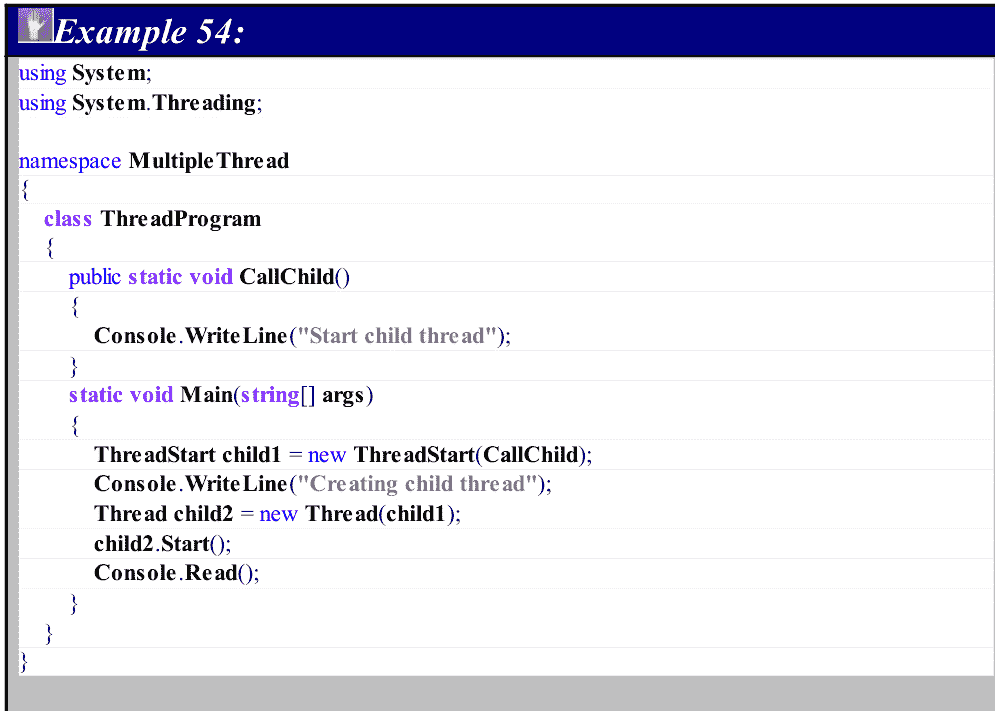

当代码编译并执行后，输出结果为：

Start child thread
Creating child thread

#### 管理线程

当需要暂停线程一段时间以便另一个线程可以执行时，使用 **Thread.Sleep()** 方法。该方法接受一个参数，以毫秒为单位指定时间。

**示例 55：**

```csharp
using System;
using System.Threading;

namespace Multithreaded
{
    class Program
    {
        public static void ChildThread()
        {
            Console.WriteLine("Start child thread");
            int sleeptime = 4000;
            Console.WriteLine("Thread sleeping for {0} seconds", sleeptime / 1000);
            Thread.Sleep(sleeptime);
            Console.WriteLine("Resume child thread");
        }

        public static void Main()
        {
            ThreadStart t1 = new ThreadStart(ChildThread);
            Console.WriteLine("child thread created");
            Thread child1 = new Thread(t1);
            child1.Start();
            Console.Read();
        }
    }
}
```

当代码编译并执行后，输出结果为：

```
Start child thread
Thread sleeping for 4 seconds
Resume child thread
child thread created
```

## 14.6 销毁线程

使用 **Thread.Abort()** 方法来销毁线程。当线程被销毁时会抛出 **ThreadAbortException**。该异常不会被捕获，而是被发送到 **finally** 块。

示例：

```csharp
using System;
using System.Threading;

namespace ThreadDemo
{
    class Program
    {
        public static void ChildThread()
        {
            try
            {
                Console.WriteLine("Child Thread started");
                for(int j = 0; j <= 10; j++)
                {
                    Thread.Sleep(1000);
                    Console.WriteLine("Child thread finished");
                }
            }
            catch(ThreadAbortException e)
            {
                Console.WriteLine("Exception caught");
            }
            finally
            {
                Console.WriteLine("Exception is not handled");
            }
        }

        public static void Main()
        {
            ThreadStart t1 = new ThreadStart(ChildThread);
            Console.WriteLine("Creating child thread");
            Thread t2 = new Thread(t1);
            t2.Start();

            Thread.Sleep(2000);

            //child thread aborted
            Console.WriteLine("Aborting child thread");
            t2.Abort();
            Console.Read();
        }
    }
}
```

当代码编译并执行后，输出结果为：

Creating child thread
Child Thread started
0
1
Aborting child thread
Exception caught
Exception is not handled

## C# 参考链接

用户可以通过以下参考链接获取有关 C# 语言的更多详细信息。

- [Visual Studio Application](https://visualstudio.microsoft.com/) – 用于创建 C# 应用程序的 IDE。
- [C# ( Programming guide )](https://docs.microsoft.com/en-us/dotnet/csharp/) – C# 编程语言概述
- [C# Programming](https://docs.microsoft.com/en-us/dotnet/csharp/programming-guide/) – 解释了使用 .NET 框架的 C# 功能相关信息
- [Mono](https://www.mono-project.com/) – 使用该软件可以轻松创建跨平台应用程序。
- [C# Complete tutorial](https://www.tutorialspoint.com/csharp/index.htm) – 包含对初学者学习 C# 语言有用的课程

## 结论

至此本书结束。我们希望这本指南对你来说完全能够理解和轻松跟随。这本书不应该结束你学习 C# 的旅程，相反，它应该只是开始。关于 C# 还有大量的信息可以学习，因此当你完成本书后，请进一步探索 C# 的边界。

C# 的受欢迎程度正在增长，并且正被越来越多地使用。许多知名网站和企业级应用都由 C# 驱动。你可以在超级计算机上运行的科学计算中找到 C#。系统管理任务（如包管理和配置）也使用 C#。无论你的编程兴趣是什么，学习、探索和成长的无限可能都是无穷无尽的。
