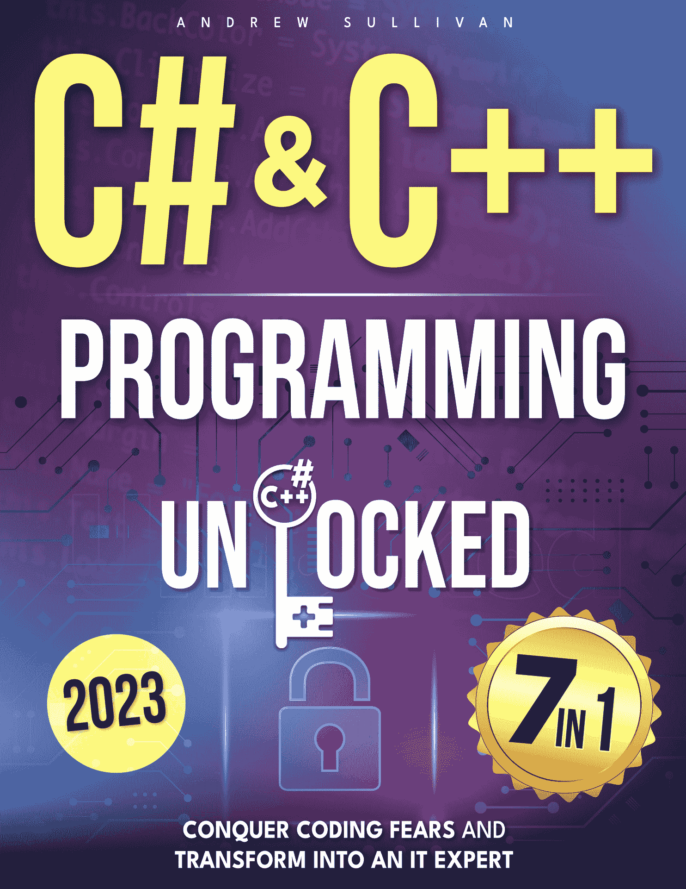

# C# & C++ 编程解锁指南：[7合1] 克服编程恐惧，精通游戏与移动/IoT 开发，从新手到专业人士的 IT 专家转型指南





数据可视化是有效分析和展示数据的一项技能。使用 `Chart.js` 或 `D3.js` 等库结合 `C#` 来创建交互式且视觉吸引力强的图表、图形或仪表板。你可以处理真实世界的数据集或生成示例数据，展示你在数据处理、数据绑定和视觉表示方面的技能。

## 参加编程挑战和竞赛

参与编程挑战和竞赛提供了磨练解决问题能力的机会，并与其他开发者进行基准比较。`LeetCode`、`HackerRank` 和 `Codeforces` 等平台提供了按难度分类的各种挑战。解决与算法、数据结构和编程范式相关的问题，并努力提高你的效率并优化代码。

## 为开源项目贡献

为开源项目贡献允许你与经验丰富的开发者合作，接触真实的代码库，并为开源社区做出贡献。选择一个与你的兴趣和技能水平相匹配的项目，从解决微小问题或添加新功能开始。这让你在使用版本控制系统、理解项目工作流以及遵循编码规范方面获得实践经验。

请记住，提高 `C#` 技能的关键在于持续的练习和实践经验。选择既具有挑战性又在你能力范围内的项目和练习。在处理这些项目时，不要犹豫向在线资源、文档和开发者社区寻求指导。构建和完善项目的过程将深化你对 `C#` 的理解，让你接触不同的编程场景，并帮助你培养成为一名成功的 `C#` 开发者所需的解决问题能力。

# 第 2 册 - C# 编程：中级技术与框架

# 引言：在 C# 中进阶

## 为 C# 高级主题做准备

在你掌握 `C#` 的旅程中，为那些将你的技能提升到下一个水平的高级主题和技术做好准备至关重要。

`C#` 是一种强大的编程语言，提供了丰富的高级特性和框架。通过掌握这些高级主题，你将解锁新的可能性，并能够以更高的效率和灵活性开发更复杂的应用程序。

### 认识在 C# 中进阶的重要性

在 `C#` 中进阶不仅是获取知识，更关乎对语言及其能力有更深入的理解。通过在 `C#` 中进阶，你将：

* 增强你的解决问题能力：`C#` 的高级主题要求你进行批判性和创造性的思考，以找到复杂编程挑战的解决方案。这将磨练你的解决问题能力，让你成为更熟练的开发者。

* 提高你的生产力：`C#` 的高级特性和技术可以显著简化开发流程。通过有效利用这些工具，你可以编写更整洁、更易维护的代码并缩短开发时间。

* 扩展你的职业机会：精通高级 `C#` 概念和框架将开启更广泛的就业机会。许多行业（如金融、医疗保健和游戏）都需要具有高级 `C#` 技术专的开发者。

### 建立坚实的基础

在深入高级主题之前，对 `C#` 的基础概念有良好的理解至关重要。确保你已经牢牢掌握早期章节涵盖的主题，例如变量、数据类型、控制流和面向对象编程。这个基础将作为一个坚实的基石，你可以在此构建你的高级 `C#` 技能。

### 复习和强化核心概念

在深入高级主题之前，花时间复习并强化你对核心概念的理解。这包括异常处理、文件 I/O、`LINQ`（语言集成查询）和委托等主题。温习这些主题将为应对更复杂的概念提供坚固的框架。

### 拥抱文档和官方资源

当你进入更高级的 `C#` 主题时，请依靠微软提供的官方文档和资源。Microsoft Docs 网站为各种 `C#` 特性和和框架提供了全面的文档、教程和示例。这些资源提供了深入的解释和实践指导，帮助你掌握复杂概念并有效地应用它们。

### 探索高级框架和库

`C#` 提供了一个丰富的高级框架和库生态系统，可以极大增强你的开发能力。在第 2 册中，我们将探索如 `ASP.NET` 等框架，它被广泛用于构建 Web 应用程序。第 2 册每章末的用例将与名为“使用 ASP.NET 开发库存管理 Web 应用程序”的项目相结合。该项目将引导你构建一个基于 Web 的完整库存管理系统，让你有效地应用每章中学的高级概念。

### 强调实际应用

为了真正实现 `C#` 的进阶，通过实际项目应用所学知识至关重要。随着章节的进行，请完成提供的用例和练习，并挑战自己创建额外的项目来展示你对高级概念的理解。构建真实的应用程序将巩固你的理解，并向潜在雇主或客户证明你的专业水平。

### 寻求持续学习

在 `C#` 中进阶是一个持续的过程。技术不断演变，新框架不断出现，最佳实践不断变化。接受持续学习的心态，关注 `C#` 生态系统的最新动态。关注行业博客、参与开发者社区、参加会议并探索在线学习平台以扩展知识并保持技能敏锐。

通过为 `C#` 的高级主题做好准备，你正在为一段充满回报且成功的编程之旅奠定基础。记住建立坚实的基础，复习核心概念，探索高级框架并强调实际应用。通过投入和对持续学习的承诺，你将成为一名熟练且自信的 `C#` 开发者，能够应对复杂项目并在职业上不断进步。

## 在 C# 编程旅程中掌握中级主题的重要性

在你成为精通的 `C#` 程序员的旅程中，意识到掌握中级主题的重要性至关重要。在早期阶段获得的基础知识的基础上，掌握 `C#` 的中级技术和框架将解锁无限可能，并推动你向熟练开发者迈进。

### 扩展你的技能树

掌握 `C#` 的中级主题将扩展你的编程技术库，并为你提供更广泛的工具来解决复杂问题。通过深入学习语言，你将获得广泛应用于实际应用的高级概念、设计模式和框架的专业知识。这种更广泛的技能树使你能够应对更复杂的项目，并开启更多样化的职业机会。

### 增强解决问题能力

`C#` 的中级主题挑战你进行批判性和创造性的思考，以解决复杂的编程谜题。这些主题通常涉及更复杂的算法、数据结构和设计模式。通过掌握这些技术，你将磨练自己的解决问题能力，能够以战略性眼光面对挑战并编写出优雅的解决方案。

### 提高生产力和效率


C# 中级主题将向你介绍高级语言特性、框架和工具，这些工具能够提升你作为开发者的生产效率。例如，学习高级数据结构和算法允许你优化代码性能，从而运行更快、更高效的程序。此外，精通 `ASP.NET` 等框架使你能够花费更少的精力和时间构建健壮的 Web 应用。

### 开发可扩展和可维护的代码

随着 C#学习的深入，你将遇到软件架构、设计模式和代码组织等主题。这些中级概念将教你如何编写模块化、可重用且可维护的代码。通过理解这些原则，你可以开发出能够适应不断变化的需求、并且随着时间的推移更容易维护和扩展的可扩展应用程序。

### 扩展应用开发可能性

掌握 C# 中级主题将带你接触各种框架和库，这些库扩展了应用开发的范围。例如，学习 Windows Presentation Foundation (`WPF`) 允许你创建具有直观用户界面的丰富桌面应用程序。探索 `Xamarin` 则允许你开发跨平台移动应用程序。这些中级主题将赋予你知识和技能，以探索不同领域并满足更广泛受众的需求。

### 实现高级项目的潜力

第二本书末尾每个章节的案例与一个名为“使用 `ASP.NET` 开发库存管理 Web 应用”的大型项目相关。这个综合项目是整书中所得知识的结晶，整合了中级技术和框架的各个方面。通过开展这个项目，你将把新技能应用于复杂的现实世界场景，获得实践经验，并向潜在的雇主或客户展示你的能力。

# 第一章：C# 数据结构与算法

## C# 中各种数据结构的解释与用法

数据结构在编程中起着至关重要的作用，因为它们提供了组织和处理数据的有效方式。在本章中，我们将探索 C# 中提供的各种数据结构，并深入研究它们的解释和用法。理解这些数据结构将使能够编写更高效、更可扩展的代码，提高 C# 程序的性能和功能。

### 数组

数组是固定大小的、同类型元素的顺序集合。数组中的元素可以通过索引直接访问。当能够预先知道集合的大小并需要快速访问其元素时，数组是非常有用的。这里是在 C# 中声明、初始化和使用数组的示例：

```csharp
int[] numbers = new int[5] {1, 2, 3, 4, 5};
Console.WriteLine(numbers[0]); // 输出: 1
```

### 列表

`List<T>` 类是一个代表可调整大小数组的泛型类。它提供了搜索、排序和操作列表的方法。当你需要一个大小可以改变的集合时，列表非常有用。这里有一个示例：

```csharp
List<int> numbers = new List<int> {1, 2, 3, 4, 5};
numbers.Add(6); // 向列表添加元素
Console.WriteLine(numbers[5]); // 输出: 6
```

### 栈

`Stack<T>` 类代表后进先出 (LIFO) 的对象集合。它提供了 `push`（添加项）、`pop`（移除项）和 `peek`（查看顶部的元素但不移除它）的方法。栈用于回溯算法和解析器中的符号平衡等任务。这里是示例：

```csharp
Stack<int> stack = new Stack<int>();
stack.Push(1); // 向栈添加元素
stack.Push(2);
Console.WriteLine(stack.Pop()); // 移除并返回顶部元素。输出: 2
```

### 队列

`Queue<T>` 类代表先进后出 (FIFO) 的对象集合。它提供了 `enqueue`（添加项）、`dequeue`（移除项）和 `peek`（查看第一个元素但不移除它）的方法。队列用于任务调度和数据流缓冲等任务。这里是示例：

```csharp
Queue<int> queue = new Queue<int>();
queue.Enqueue(1); // 向队列添加元素
queue.Enqueue(2);
Console.WriteLine(queue.Dequeue()); // 移除并返回第一个元素。输出: 1
```

### 链表

`LinkedList<T>` 类代表双向链表。它提供了在列表中添加、移除和搜索项的方法。当你需要频繁从集合中间添加或删除项时，链表是非常有用的。这里是示例：

```csharp
LinkedList<int> linkedList = new LinkedList<int>();
linkedList.AddLast(1); // 在列表末尾添加元素
linkedList.AddLast(2);
Console.WriteLine(linkedList.First.Value); // 输出: 1
```

### 哈希集合

`HashSet<T>` 类代表一组唯一的元素。它提供了添加、移除和检查项是否存在于集合中的方法。当你需要快速检查某个项是否是集合的一部分，且不在乎元素的顺序时，哈希集合是非常有用的。这里是示例：

```csharp
HashSet<int> set = new HashSet<int>();
set.Add(1); // 向集合添加元素
set.Add(2);
Console.WriteLine(set.Contains(1)); // 检查元素是否存在。输出: True
```

### 字典

`Dictionary<TKey, TValue>` 类代表键值对集合。它提供了根据键添加、移除和查找项的方法。当你需要将值与键关联，并且需要根据键检索值时，字典是非常有用的。这里是示例：

```csharp
Dictionary<string, int> dictionary = new Dictionary<string, int>();
dictionary["one"] = 1; // 向字典添加键值对
dictionary["two"] = 2;
Console.WriteLine(dictionary["one"]); // 输出: 1
```

### 排序集合与排序列表

`SortedSet<T>` 和 `SortedList<TKey, TValue>` 类代表始终排序的集合。`SortedSet<T>` 是唯一元素的集合，`SortedList<TKey, TValue>` 是键值对集合。当你需要维护一个排序集合时，它们是非常用的。这里是一个示例：

```csharp
SortedSet<int> sortedSet = new SortedSet<int> {2, 1, 3};
Console.WriteLine(sortedSet.Min); // 输出: 1

SortedList<string, int> sortedList = new SortedList<string, int> {{"two", 2}, {"one", 1}, {"three", 3}};
Console.WriteLine(sortedList.Keys[0]); // 输出: one
```

这些数据结构都有其优缺点，选择哪一种取决于程序的具体需求。理解这些数据结构及其属性有助于你根据需求选择合适的项并编写更高效的代码。

## 在 C# 中实现常用算法

算法是高效和优化编程的基础。它们为解决问题和处理数据结构提供了逐步指令。在本节中，我们将探索 C# 中实现常用算法，并理解它们在各种场景中的应用。通过掌握这些算法，你将获得编写优雅且高效的代码所需的技能，以处理复杂任务并提高 C# 程序的性能。

### 排序算法

这些算法用于根据元素的比较运算符重新排列给定的数组或列表元素。比较运算符用于决定元素在相应数据结构中的新顺序。

*   **冒泡排序**：冒泡排序是最简单的排序算法，它通过反复交换顺序错误的相邻元素来工作。它最适用于小型列表或已基本部分排序的列表。

*   **选择排序**：这种排序算法通过反复从未排序部分找到最小元素并将其放在开头来对数组排序。它不适用于大型列表，因为其效率不高。


- **插入排序**：插入排序是一种简单的排序算法，其工作方式类似于我们整理手中的扑牌牌。它对于长度较短的列表以及已经基本好序的列表，它非常高效。
- **快速排序**：`QuickSort` 是一种分治算法，它选择一个元素作为基准，并围绕该基准对给定数组进行分区。它是最高效且常用的排序算法之一。
- **合并排序**：`MergeSort` 也是一种分治算法。它将输入数组分为两部分，对这两个部分分别递归调用自身，然后合并两个排序后的部分。它非常高效，但需要等于所排序数组大小的额外空间。

以下是实现选择排序的示例。

```csharp
public static void SelectionSort(int[] arr)
{
    for (int i = 0; i < arr.Length - 1; i++)
    {
        int minIndex = i;
        for (int j = i + 1; j < arr.Length; j++)
        {
            if (arr[j] < arr[minIndex])
            {
                minIndex = j;
            }
        }
        int temp = arr[minIndex];
        arr[minIndex] = arr[i];
        arr[i] = temp;
    }
}
```

### 搜索算法

这些算法旨在从任何存储元素的数据结构中检查某个元素或检索某个元素。

- **线性搜索**：线性搜索是一种非常简单的搜索算法。在这种搜索中，会对所有项目进行逐一的顺序搜索。每个项目都会被检查，如果找到了匹配项，则返回该特定项目；否则搜索持续到数据结构的末尾。
- **二分查找**：二分查找通过比较集合中间的元素来查找特定项目。如果匹配成功，则返回该元素的索引。如果中间元素大于目标元素，则在中间元素左侧的子数组中搜索；否则，则在中间元素右侧的子数组中搜索。这一过程在子数组上继续进行，直到子数组的大小减为零。

以下是实现线性搜索的示例。

```csharp
public static int LinearSearch(int[] arr, int key)
{
    for (int i = 0; i < arr.Length; i++)
    {
        if (arr[i] == key)
        {
            return i;
        }
    }
    return -1;
}
```

### 图算法

这些算法旨在通过将问题建模为图来解决问题。

- **深度优先搜索 (DFS)**：DFS 是一种使用栈的遍历算法，在回溯之前，沿每个分支尽可能深地探索。它通常用于检查图的连通性以及测试图是否为树等任务。
- **广度优先搜索 (BFS)**：BFS 是另一种遍历算法，它使用队列在移动到邻居节点之前探索顶点的所有邻居。它通常用于寻找图中的最短路径以及测试图是否为二分图。
- **Dijkstra 算法**：这是一种用于权图的最短路径算法。它找到从起始顶点到图中所有其他顶点的最短路径。

以下是实现深度优先搜索 (DFS) 的示例：

```csharp
// 这是一个简化示例。现实世界中的 DFS 需要更复杂的实现。
public static void DFS(int[][] graph, bool[] visited, int node)
{
    if (visited[node])
    {
        return;
    }
    visited[node] = true;
    foreach (var neighbour in graph[node])
    {
        DFS(graph, visited, neighbour);
    }
}
```

### 动态规划

动态规划是一种通过将复杂问题分解为更简单的子问题的方法。它被用于子问题重叠的情况，即当同一个子问题被多次求解时。

- **斐波契契序列**：斐波契契序列是用动态规划解决问题的一个经典示例。该序列定义为：`fib(0) = 0`，`fib(1) = 1`，对于 `n > 1`，`fib(n) = fib(n-1) + fib(n-2)`。简单的递归解具有指数时间复杂度，但动态规划提供了多项式时间的解。
- **背包问题**：背包问题是一个组合优化问题。给定一组物品，每个物品都有重量和价值，确定包含集合中每种物品的数量，使得总重量小于或等于给定限制，且总价值最大。

以下是实现斐波那契序列的示例：

```csharp
public static int Fibonacci(int n)
{
    int[] fib = new int[n + 2];
    fib[0] = 0;
    fib[1] = 1;
    for (int i = 2; i <= n; i++)
    {
        fib[i] = fib[i - 1] + fib[i - 2];
    }
    return fib[n];
}
```

### 递归

递归是一种问题的解决方案取决于该问题更小实例解决方案的方法。

- **阶乘计算**：非负整数 `n` 的阶乘是所有小于或等于 `n` 的正整数的乘积。可以使用递归计算：对于 `n > 0`，`fact(n) = n * fact(n-1)`，且 `fact(0) = 1`。
- **汉诺塔**：汉诺塔是一种数学游戏或谜题。它由三根杆子和若干个大小不同的盘子组成，盘子可以移动到任何根杆子上。游戏开始时，盘子放在杆子上。


设计排序算法的目标是将一组元素按照特定的顺序（例如升序或降序）进行排列。这在处理大型数据集或需要以结构化、组织化的方式呈现信息时特别有用。排序算法可以应用于多种场景，例如组织客户数据、安排排行榜上的分数，或根据特定标准对产品列表进行排序。

让我们一起学习 C# 中实现一个简单排序算法的过程。在本示例中使用 `Bubble Sort`（冒泡排序）算法，因为它是最容易理解和实现的排序算法之一。

### 第 1 步：理解算法

冒泡排序的工作原理是不断交换相邻元素，如果它们的顺序错误）。这个过程会持续进行，直到不再需要交换为止，这意味着列表已经排序。

### 第 2 步：设置你的开发环境

为了编写并运行 C# 代码，你需要一个开发环境。如果你还没有设置，可以安装 `Visual Studio`，它是一个流行的 C# 开发 IDE。你可以从微软官方网站下载。

### 第 3 步：创建一个新的控制台应用程序

一旦安装了 `Visual Studio`，打开它并创建一个新的 `Console App (.NET Core)` 项目。将其命名为 `"BubbleSort"`。

### 第 4 步：实现冒泡排序算法

打开 `Program.cs` 文件，并将现有代码替换为以下内容：

```csharp
using System;

class Program
{
    static void Main()
    {
        int[] arr = {64, 34, 25, 12, 22, 11, 90};
        Console.WriteLine("Unsorted array:");
        PrintArray(arr);
        BubbleSort(arr);
        Console.WriteLine("Sorted array:");
        PrintArray(arr);
    }

    static void BubbleSort(int[] arr)
    {
        int n = arr.Length;
        for (int i = 0; i < n - 1; i++)
        {
            for (int j = 0; j < n - i - 1; j++)
            {
                if (arr[j] > arr[j + 1])
                {
                    // Swap arr[j] and arr[j+1]
                    int temp = arr[j];
                    arr[j] = arr[j + 1];
                    arr[j + 1] = temp;
                }
            }
        }
    }

    static void PrintArray(int[] arr)
    {
        int n = arr.Length;
        for (int i = 0; i < n; ++i)
            Console.Write(arr[i] + " ");
        Console.WriteLine();
    }
}
```

### 第 5 步：运行程序

按下 `F5` 或点击 `"Start Debugging"` 按钮运行程序。你应该能看到控制台上打印出的未排序数组和已排序数组。

### 第 6 步：实验与学习

尝试修改数组或实现不同的排序算法。你实验和实践得越多，就能越好地理解这些算法的工作原理的。

记住，这是 `Bubble Sort` 算法的基础实现。世界上还有许多其他排序算法，每种算法都有自己的优缺点。随着你学习更多编程和算法的知识，你将开始理解在何时使用每种算法。

# 第 2 章：C# 中的面向对象编程

## 在 C# 境下理解 OOP 原则

面向对象编程（OOP）是一种强大的范式，允许开发者以更模块化、可重用的方式组织和构建代码。在本章中，我们将在 C# 的背景下探索 OOP 的基本原则。通过理解这些原则，你将能够设计并实现健壮且可维护的 C# 。

### 封装

封装是将相关数据和行为打包到称为 `class`（类）的单个单元中的原则。在 C# 中，`class` 充当创建对象的蓝图。它封装了操作这些数据的（属性或属性）以及方法（行为）。封装促进了代码组织、数据隐藏和模块化，从而允许更好的代码维护和重用。

### 继承

继承是一种允许类从另一个类继承属性和行为的机制。在 C# 中，你可以创建一个类的层次结构，子类从其父类或基类继承特征。继承促进了代码重用，因为你可以在基类中定义公共属性和方法并在派生类中对其进行扩展或专门化。它能够在保持代码结构化和组织化的同时，创建更专门的类。

### 多态

多态是对象以多种形式展现的能力。在 C# 中，多态可以通过方法重写（method overriding）和方法重载（method overloading）来实现。方法重写允许派生类为其基类中定义的方法提供自己的实现，而方法重载允许具有相同名称但不同参数的多个方法共存。多态赋予代码灵性和扩展性，因为不同类的对象可以根据它们的共同接口或基类被相互对待。

在 C# 背景下理解这些 OOP 原则使你能够创建更灵活、易维护的代码。通过将相关数据和行为封装到类中，利用继承创建类层次结构，并利用多态以更通用的方式处理对象，你可以构建可扩展的适应的应用程序。

## C# OOP 实现示例

面向对象编程（OOP）为构建代码和构建模块化应用程序提供了强大的框架。在本章中，我们将探索 C# 中 OOP 实现的实际示例。通过研究现实场景，你将更深入地理解如何有效应用 OOP 原则。

 类继承

OOP 的关键特性之一是类继承。在 C# 中，你可以创建从基类继承属性和行为的派生类。例如，考虑你正在为汽车经销商开发一个软件应用程序的场景。你可以定义一个名为 `"Vehicle"`（车辆）的基类，它包含了所有车辆共有的属性和方法，例如 `"Make"`（品牌）、`"Model"`（型号）和 `StartEngine()`（启动引擎）。然后，你可以创建 `"Car"`（汽车）和 `"Motorcycle"`（摩托车）等派生类，它们继承 `"Vehicle"` 类并添加自己的特定属性和方法。这种继承促进了代码重用，并允许你高效地管理相关对象。

 封装和抽象是 OOP 中的基本概念。封装涉及将相关数据和行为封装在 `class` 中，而抽象专注于向外部暴露相关信息。例如，想象你正在开发一个银行应用程序。你可以创建一个名为 `"BankAccount"`（银行账户）的类，它封装了如 `"AccountNumber"`（账号）和 `"Balance"`（余额）之类的属性，以及如 `Deposit()` 和 `Withdraw()` 提类的方法。通过封装这些细节，你可以隐藏账户的内部运作，并提供一个简单的交互接口。这种封装和抽象允许更好的代码组织、维护和重用。

 多态

多态是 OOP 的另一个强大特性。它允许不同类的对象根据它们的共同接口或基类被相互对待。在 C# 中，你可以通过方法重写和接口来实现多态。例如，假设你正在为大学开发一个软件应用程序。你可以定义一个名为 `"Person"`（人员）的基类，其中有一个方法为 `PrintDetails()`。然后，你可以创建 `"Student"`（学生）和 `"Professor"`（教授）等派生类，它们重写 `PrintDetails()` 方法以提供自己的实现。通过将这两个类的对象都视为 `"Person"` 对象，你可以调用 `PrintDetails()` 方法并获得多态行为。这种灵活性允许代码的扩展和适应。

这些示例强调了 OOP 原则在 C# 中的实际应用。通过利用类继承、封装、抽象和多态，你可以创建结构良好且易维护的代码。

## 构建用例：实现库存系统


我们将深入探讨一个实际案例，涉及如何在 C# 中使用面向对象编程（OOP）原则实现一个库存系统。该项目将提供实操经验，并展示如何应用所学的概念来解决现实世界的问题。

库存系统对于企业高效地管理库存、跟踪库存水平以及处理各种操作（如添加新项目、更新数量和生成报告）至关重要。通过开发库存系统，你将更深入地理解如何设计类、利用继承、封装数据以及更有意义的方式利用其他 OOP 特性。

让我们一起了解 C# 中实现一个简单库存系统的过程。该系统将允许你向库存中添加物品、移除物品并检查特定物品的数量。

### 第 1 步：理解问题

问题是要创建一个能够跟踪各种物品及其数量的库存系统。

### 第 2 步：设计类

此系统我们需要两个类：`Item` 和 `Inventory`。

`Item` 类将代表单个物品。它将具有物品名称和数量的属性。

`Inventory` 类代表库存本身。它将有一个添加物品的方法、一个移除物品的方法以及检查特定物品数量的方法。

### 第 3 步：设置你的开发环境

要编写和运行 C# 代码，你需要一个开发环境。如果你还没有设置，可以安装 `Visual Studio`，这是一款流行的 C# 开发 IDE。你可以从微软官方网站下载它。

### 第 4 步：创建一个新的控制台应用程序

一旦安装了 Visual Studio，打开它并创建一个新的控制台应用 (.NET Core) 项目。将其将其命名为 "InventorySystem"。

### 第 5 步：实现类

打开 `Program.cs` 文件，并将现有代码替换为以下内容：

```csharp
using System;

using System.Collections.Generic;

public class Item
{
    public string Name { get; set; }
    public int Quantity { get; set; }
}

public class Inventory
{
    private List<Item> items = new List<Item>();

    public void AddItem(string name, int quantity)
    {
        items.Add(new Item { Name = name, Quantity = quantity });
    }

    public void RemoveItem(string name)
    {
        Item itemToRemove = items.Find(item => item.Name == name);
        if (itemToRemove != null)
        {
            items.Remove(itemToRemove);
        }
    }

    public int CheckQuantity(string name)
    {
        Item item = items.Find(i => i.Name == name);
        return item != null ? item.Quantity : 0;
    }
}

class Program
{
    static void Main()
    {
        Inventory inventory = new Inventory();
        inventory.AddItem("Apple", 10);
        inventory.AddItem("Banana", 20);
        Console.WriteLine(inventory.CheckQuantity("Apple")); // Output: 10
        inventory.RemoveItem("Apple");
        Console.WriteLine(inventory.CheckQuantity("Apple")); // Output: 0
    }
}
```

### 第 6 步：运行程序

按下 F5 或点击“开始调试”按钮运行程序。你应该能看到“Apple” 的数量打印为 10，然后在从库存中移除后显示为 0。

### 第 7 步：实验与学习

按下 F5 或点击“开始调试”按钮运行程序。你应该能看到“Apple” 的数量打印为 10，然后在从库存中移除后显示为 0。

# 第 3 章：框架与库

## 流行框架和库简介

我们将探索 C# 中可用的一些框架和库。这些框架和库为开发者提供了可以显著简化开发的工具和功能。

### ASP.NET

`ASP.NET` 是由微软开发的广泛使用的 Web 应用程序框架。它为构建网站和 Web API 提供平台，包括身份验证和会话管理等功能。

### Entity Framework

`Entity Framework` (`EF`) 是一个对象关系映射 (ORM) 框架，简化了数据库访问和操作。它支持各种数据库提供程序和关系。

### WPF

`Windows Presentation Foundation` (`WPF`) 是用于构建具有丰富用户界面的桌面应用程序的框架。它提供了灵活且强大的设计工具，利用 `XAML`（可扩展应用程序标记语言）进行 UI 和数据绑定、动画以及多媒体集成。

### Xamarin

`Xamarin` 是一个跨平台开发框架，允许开发者使用 C# 为 iOS、Android 和 Windows 构建原生移动应用程序。它提供了共享代码库，同时允许访问平台特定的 API。

### NUnit

`NUnit` 是一个流行的 C# 单元测试框架。它提供了一套全面的工具和属性，用于编写和执行单元测试，以验证代码的正确性并识别错误。

### Moq

`Moq` 是一个 C# 模拟框架（mock framework），主要用于单元测试。它允许开发者创建模拟依赖项或外部组件行为的模拟对象，实现隔离测试场景。

### SignalR

`SignalR` 是一个用于构建交互式 Web 应用程序的实时通信框架。它实现了服务器与客户端的双向通信，允许实时更新和通知。

## 如何使用这些工具增强 C# 开发的示例

在上一节中，我们探索了 C# 生态系统中一些流行的框架和库。现在，让我们深入探讨如何使用这些工具来增强 C# 开发，并赋予开发者构建更健壮、高效应用程序的能力。通过利用这些框架和库的功能，开发者可以简化工作流，缩短开发时间并创建高质量的软件解决方案。


### 1. ASP.NET
通过 `ASP.NET`，开发者可以利用其丰富的功能集来构建强大的 Web 应用程序。通过使用 `server controls`，开发者可以轻松创建交互式用户界面并有效地处理用户输入。此外，`ASP.NET` 的数据绑定能力能够与数据库进行无缝集成，简化了数据的检索和操作。该框架还提供了身份验证和授权机制，确保了 Web 应用程序的安全访问。通过掌握 `ASP.NET`，开发者可以创建动态且功能丰富的 Web 应用程序，以满足各种用户需求。

这是一个简单的 `ASP.NET MVC` 控制器示例：

```csharp
public class HomeController : Controller
{
    public ActionResult Index()
    {
        return View();
    }
}
```

### 2. Entity Framework
`Entity Framework` 为 C# 了一种了一种便捷且高效处理数据库的方法。它通过将数据库实体映射到 C# 对象，抽象了数据库操作的复杂性。通过 `Entity Framework`，开发者可以专注于编写与实体交互的代码，而消除了手动编写 SQL 查询的需要。通过利用 `Entity Framework` 中 `LINQ`（集成语言查询）的力量，开发者可以使用熟悉的语法执行复杂的数据库查询和操作。这简化了数据访问，并增强了数据库驱动应用程序的生产力。

这是一个定义模型并查询数据库的示例：

```csharp
public class Blog
{
    public int BlogId { get; set; }
    public string Url { get; set; }
}

public class BloggingContext : DbContext
{
    public DbSet<Blog> Blogs { get; set; }
}

// Querying the database
using (var db = new BloggingContext())
{
    var blogs = db.Blogs
        .Where(b => b.Url.Contains("dotnet"))
        .ToList();
}
```

### 3. WPF
Windows Presentation Foundation (`WPF`)允许开发者构建具有丰富用户界面的视觉桌面应用程序。通过 `WPF`，开发者可以使用 `XAML`（可扩展应用程序标记语言）创建出的 UI 设计，并利用各种控件和布局选项。该框架支持数据绑定，允许开发者将 UI 元素直接绑定到数据源。这有助于在数据更改时自动更新 UI 元素，从而带来更具响应能力和交互性的用户体验。`WPF` 还提供了动画、样式和模板等高级功能，使开发者创建高度可定制且视觉吸引人的应用程序。

这是一个简单的 WPF 应用程序示例：

```xml
<Window x:Class="WpfApp.MainWindow"
        xmlns="http://schemas.microsoft.com/winfx/2006/xaml/presentation"
        xmlns:x="http://schemas.microsoft.com/winfx/2006/xaml"
        Title="MainWindow" Height="350" Width="525">
    <Grid>
        <Button Content="Click me" HorizontalAlignment="Left" Margin="10,10,0,0" VerticalAlignment="Top" Width="75" Click="Button_Click"/>
    </Grid>
</Window>
```

```csharp
public partial class MainWindow : Window
{
    public MainWindow()
    {
        InitializeComponent();
    }

    private void Button_Click(object sender, RoutedEventArgs e)
    {
        MessageBox.Show("Hello, WPF!");
    }
}
```

### 4. Xamarin
`Xamarin` 是一个强大的跨平台框架，允许开发者使用 C# 编写原生移动应用程序。通过在不同平台之间共享代码，开发者可以显著减少开发时间和精投入。`Xamarin` 提供了访问原生 API 的能力，确保了生成的应用程序具有相同的性能。

### 5. NUnit
`NUnit` 是一种广泛使用的 C# 测试框架。通过使用 `NUnit`，开发者可以验证应用程序的功能。它提供了各种工具和断言来确保代码质量。

### 6. Moq
`Moq` 是一个流行的 Mock 框架，简化了依赖项测试。它允许开发者隔离组件，从而实现更可靠的单元测试。

### 7. SignalR
`SignalR` 是用于构建交互式 Web 应用程序的实时通信框架。它促进了服务器与客户端之间的双向通信，实现了数据的实时更新。


### 第 5 步：运行 Web 应用

按下 `F5` 或点击“开始调试”按钮来运行 Web 应用。你的默认网络浏览器将打开并显示“Hello, World!”消息。

### 第 6 步：实验与学习

尝试修改 Web 应用以添加更多功能。例如，你可以在主页添加一个表单，允许用户输入姓名，然后显示个性化的问候消息。你实验和实践得越多，就能越深入理解如何使用 `ASP.NET Core` 来构建 Web 应用。

# 第 4 章：C# 实战项目

## 展示 C# 能力的实战项目

我们将探索展示 C# 编程能力的实战项目。这些项目将提供实践经验，并帮助读者巩固贯穿书中学的 C# 概念和技术的理解。

### 联系人管理应用程序

构建一个联系人管理应用程序，允许用户存储和管理联系人。应用程序应提供添加新联系人、搜索和过滤联系人以及更新联系人信息等功能。实现各种 C# 概念，如 `classes`、`objects`、`collections` 和 `file handling`，创建一个功能齐全且易于使用的联系人管理系统。

### 文本游戏

使用 C# 创建一个基于文本的游戏，通过交互式叙事吸引用户。游戏可以是一个简单的冒险游戏，也可以是用户通过做出影响结果的选择的角色扮演游戏。使用 C# 编程结构（如 `conditionals`、`loops` 和 `data structures`）实现角色创建、决策和分支剧情等游戏机制。

### 计算器应用程序

开发一个可执行基础算术运算的计算器应用程序。该应用程序应具有图形用户界面 (`GUI`) 并支持加、减、乘、除。使用 C# 实现 `event handling`、`user input validation` 和 `mathematical operations`，创建一个功能齐全且直观的计算器工具。

### 天气预报应用程序

构建一个天气预报应用程序，用于获取并显示指定位置的天气信息。利用 `APIs`（应用程序编程接口）从外部源获取实时天气数据，并以用户友好的格式呈现。使用 C# 实现 `location search`、`data parsing` 和 `data visualization` 等功能，创建一个实用的天气预报工具。

### 文件管理系统

开发一个文件管理系统，允许用户组织和管理计算机上的文件和文件夹。应用程序应提供创建新文件夹、移动和重命名文件以及搜索特定文件等功能。使用 C# `file handling capabilities`、`directory operations` 和 `user interface design` 创建高效且易于使用的文件管理系统。

### 图像处理工具

创建一个图像处理工具，允许用户执行基础图像编辑操作。实现 `cropping`、`resizing`、`applying filters` 和 `adjusting color settings` 等功能。利用 C# 的图像处理 `libraries and frameworks` 来构建一个多功能且易于使用的图像编辑工具。

通过制作这些实战项目，读者将获得将 C# `concepts` 和技术应用于真实世界场景的实践经验。这些项目将强化他们对 C# 能力的理解，并帮助他们培养实际的问题解决能力。

## 构建这些项目的分步指南

这些指南将引导你完成创建每个项目的过程，从初始设置到最终实现。通过遵循这些指南，你将获得实践经验，并加深对中级 C# 技术和框架的理解。

### 联系人管理应用程序

*   第 1 步：定义一个 `Contact` 类，带有 `FirstName`、`LastName`、`Phone Number`、`Email` 等属性。
*   第 2 步：创建一个 `ContactManager` 类，它将包含一个 `List<Contact>` 以及 `AddContact`、`RemoveContact`、`SearchContact` 等方法。
*   第 3 步：在你的 `Main` 方法中，创建一个 `ContactManager` 实例和一个用户界面（可能是基于控制台的），允许用户添加、删除和搜索联系人。

### 文本游戏

*   第 1 步：为 `Character`、`Item`、`Location` 等定义类。每个类都应该拥有与其代表的内容相关的属性和方法。
*   第 2 步：创建一个 `GameEngine` 类来控制游戏逻辑。该类应该有启动游戏、处理用户输入和更新游戏状态的方法。
*   第 3 步：在你的 `Main` 方法中，创建一个 `GameEngine` 实例并启动游戏。

### 计算器应用程序

*   第 1 步：创建一个 `Calculator` 类，并为每个想要支持的操作编写方法（例如 `Add`、`Subtract`、`Multiply`、`Divide`）。
*   第 2 步：在你的 `Main` 方法中，创建一个用户界面（可能是基于控制台的），允许用户输入数字并选择操作。然后调用你的 `Calculator` 实例上的相应方法并显示结果。

### 天气预报应用程序

*   第 1 步：选择一个天气 API（如 `OpenWeatherMap`）并了解如何在 C# 中向其发送请求。
*   第 2 步：创建一个 `WeatherService` 类，向天气 API 请求请求并返回结果。
*   第 3 步：在你的 `Main` 方法中，创建一个 `WeatherService` 实例和一个用户界面，允许用户输入位置并显示该位置的天气预报。

### 文件管理系统

*   第 1 步：创建一个 `FileManager` 类，带有创建、读取、更新和删除文件的方法。
*   第 2 步：在你的 `Main` 方法中，创建一个 `FileManager` 实例和一个用户界面，允许用户选择文件和操作（创建、读取、更新或删除），然后调用 `FileManager` 实例上的相应方法。

### 图像处理工具

*   第 1 步：选择一个 C# 图像处理库（如 `System.Drawing` 或 `AForge.NET`）并学习如何使用它打开图像并应用过滤器。
*   第 2 步：创建一个 `ImageProcessor` 类，并带有对图像应用不同过滤器的方法。
*   第 3 步：在你的 `Main` 方法中，创建一个 `ImageProcessor` 实例和一个用户界面，允许用户选择图像和过滤器，然后调用 `ImageProcessor` 实例上的相应方法并显示结果图像。

请记住，这些只是高层级的指南。每个项目都相当复杂，需要更多的规划和编码才能完全实现。但希望这些指南能给你一个良好的起点。

这些项目，连同“使用 ASP.NET 开发库存管理 Web 应用”这一较大的项目，将成为你新学技能的全面展示，并在你在真实世界场景中展示能力时提供成就感。

### 构建用例：使用 ASP.NET 开发 MVC Web 应用

我们将深入探索使用 `ASP.NET` 构建基础 `MVC`（模型-视图-控制器）Web 应用的精彩世界。`MVC` 是一种流行的架构模式，它将应用程序分为三个相互关联的组件：`Model`、`View` 和 `Controller`。这种模式通过将数据处理、用户界面和应用程序逻辑分离，促进了模块化、可维护和可扩展的代码。

让我们开始使用 `ASP.NET Core` 构建基础 `MVC` Web 应用的过程。

### 第 1 步：设置你的开发环境

为了编写和运行 `ASP.NET Core` 代码，你需要一个开发环境。如果你还没有设置，可以安装 `Visual Studio`，这是一个用于 C# 开发流行的 IDE。你可以从微软官方网站下载。

### 第 2 步：创建一个新的 ASP.NET Core Web 

一旦安装了 `Visual Studio`，打开它并创建一个新的 `ASP.NET Core Web Application` 项目。将其命名为 `MyFirstMvcApp`。


### 第 3 步：选择 Web （模型-视图-控制器）模板

在“新建 ASP.NET Core Web 应用”对话框中，选择“Web Application (Model-View-Controller)”模板，这会创建一个具有简单 UI 并支持 MVC 的项目。

### 第 4 步：理解项目结构

你创建的项目使用了 MVC 模式，即 Model-View-Controller（模型-视图-控制器）。该模式将项目分为三个相互关联的部分：

* `Models`：表示应用数据的类。
* `Views`：显示应用用户界面的文件。
* `Controllers`：处理用户输入和交互的类。

### 第 5 步：创建模型

让我们创建一个简单的模型。右键点击 `Models` 文件夹，选择`添加 -> 类`，将其命名为 `Person.cs` 并添加以下代码：

```csharp
public class Person
{
    public int Id { get; set; }
    public string Name { get; set; }
    public int Age { get; set; }
}
```

### 第 6 步：创建控制器

接下来，我们将创建一个控制器。右键点击 `Controllers` 文件夹，选择`添加 -> 控制器`，选择“MVC 控制器 - 空”，并将其命名为 `PersonController`。在新建的 `PersonController.cs` 中，添加以下代码：

```csharp
public class PersonController : Controller
{
    public IActionResult Index()
    {
        var person = new Person { Id = 1, Name = "John Doe", Age = 30 };
        return View(person);
    }
}
```

### 第 7 步：创建视图

最后，我们将创建一个视图。右键点击 `Views` 文件夹，选择`添加 -> 新文件夹`并将其命名为 `Person`。然后，右键点击 `Person` 文件夹，选择`添加 -> 视图`，选择“空（无模型）”并将其命名为 `Index`。在新建的 `Index.cshtml` 中，添加以下代码：

```razor
@model MyFirstMvcApp.Models.Person
<h1>@Model.Name</h1>
<p>Age: @Model.Age</p>
```

### 第 8 步：运行 Web 应用

按下 F5 或点击“开始调试”按钮来运行 Web 应用。你的默认网络浏览器将打开并显示在 `PersonController` 中定义的个人姓名和年龄。

尝试修改 Web 应用以添加更多功能。例如，你可以在人员视图中添加一个表单，允许用户输入自己的姓名和年龄，然后将这些信息显示给他们。你实验和实践得越多，就能越好地理解如何使用 ASP.NET Core 构建 MVC Web 应用。

记住，这是你使用 ASP.NET Core 和 MVC 可以做的一些非常基础的示例。随着你对框架变得越来越熟悉，你可以开始构建更复杂的 Web 应用，包含多个模型、视图和控制器，以及用户身份验证和数据库访问等其他功能。

# 第 5 章：克服 C# 挑战

## C# 开发者面临的常见挑战概述

随着 C# 编程之旅的不断进步，你会遇到许多该语言及其生态系统特有的挑战。

### 内存管理

C# 开发中的主要挑战之一是高效地管理内存。C# 是一种托管语言，通过垃圾回收进行自动内存管理。然而，不当的内存使用可能会导致内存泄漏和性能问题。为了克服这一挑战，理解对象生命周期、销毁模式以及使用适当的数据结构来最小化内存开销等概念至关重要。

### 性能优化

C# 高层次的抽象，但也要求对性能进行仔细考虑。实现最佳性能涉及优化算法、最小化不必要的对象分配，以及利用 `async/await` 等语言特性进行高效的异步编程。性能分析工具可以帮助识别瓶颈并指导性能改进。

### 异常处理

有效处理异常对于编写健壮且可靠的 C# 代码至关重要。适当的异常处理包括在适当层级捕获并处理异常、记录异常详情以便调试，以及设计结构化的异常层次以提供有意义的错误信息。此外，理解异常传播并谨慎地使用 `try-catch` 块对于维护代码的完整性至关重要。

## 并发与多线程

C# 为并发和并行编程提供了强大的工具和框架。然而，处理线程、任务和共享资源可能会引入竞态条件、死锁和线程同步问题等挑战。为了解决这些挑战，对同步原语、线程安全数据结构和多线程编程最佳实践的坚实理解是重要的。

## 依赖管理

在复杂的 C# 项目中，管理依赖和版本控制可能会变得具有挑战性。使用像 `NuGet` 这样健壮的包管理系统并遵循依赖注入的最佳实践以确保库和框架的无缝集成非常重要。了解如何处理冲突依赖并有效升级程序包对于维护稳定且最新的代码库至关重要。

## 测试与调试

测试和调试是开发过程中不可或缺的一部分。确保全面的测试覆盖并采用单元测试、集成测试和自动化测试等实践，有助于捕获错误并确保代码的可靠性。此外，利用调试工具和技术来高效地诊断和解决问题对于顺利开发至关重要。

### 跟上不断演进的技术

技术格局在不断演变，C# 生态系统中定期引入新的框架、库和功能。保持最新进展、参加会议、参与在线社区并不断学习新技术和框架将帮助你克服跟上不断变化的技术格局的挑战。

## 克服这些挑战并优化 C# 代码的策略

在上一节中，我们讨论了 C# 开发者面临的常见挑战。现在，让我们探索一些有效的策略来克服这些挑战并优化你的 C# 代码。通过遵循这些策略，你可以提高应用程序的性能、可维护性和可靠性。

### 内存管理

为了优化 C# 中的内存使用，请考虑以下策略：

* 使用对象池：不要频繁创建新对象，而是从池中重用现有对象，以减少内存分配和释放。
* 释放未管理资源：实现 `IDisposable` 接口并使用 `using` 语句确保及时释放未管理资源。
* 避免不必要的对象拷贝：在适当的情况下利用引用和浅拷贝来最小化内存开销。
* 优化大对象分配：对于大对象，考虑使用内存映射文件（memory-mapped files）或内存映射流来减少内存压力。

### 性能优化

为了提高你的 C# 代码的性能，请考虑以下策略：

* 使用高效的数据结构和算法：针对特定问题领域选择最合适的数据结构和算法以优化时间复杂度。
* 减少不必要的计算：通过缓存结果、优化循环和使用延迟加载技术来避免冗余计算。
* 利用并行处理：利用多线程和并行编程技术分配工作负载并提高整体性能。
* 优化 I/O 操作：减少磁盘读写，优化数据库查询并使用异步编程技术以避免阻塞操作。

### 异常处理

为了在 C# 中有效处理异常，请遵循以下策略：

* 在适当的层级捕获异常：在可以有效处理异常的地方捕获异常，并为用户提供有意义的错误信息。


*   记录异常详情：记录异常信息以及相关的上下文，以帮助调试和故障排除。
*   使用自定义异常类型：创建自定义异常类，为不同的错误场景提供更具体的信息。
*   处理预期的异常：将预期的异常与非预异常分开处理，以维持程序流程。

## 并发与多线程

为了解决 C# 中的并发挑战，请考虑以下策略：

*   使用线程同步机制：采用 `locks`、`mutexes`、`semaphores` 和其他同步原语防止竞态条件并确保线程安全。
*   避免不必要的阻塞：使用非阻塞同步技术，如并发集合、`async/await` 模式和 `Task Parallel Library` (`TPL`)。
*   使用线程安全的数据结构：选择线程安全的集合并为共享资源实现适当的同步机制。
*   进行可扩展性设计：考虑使用消息队列、事件驱动架构和分布式系统来高效地处理并发操作。

## 依赖管理

要在 C# 中有效管理依赖关系，请考虑这些策略：

*   使用包管理器：利用如 `NuGet` 等包管理器来管理和更新外部库和框架。
*   实践版本控制：对你所使用的库的版本和依赖关系保持清晰的。
*   采用依赖注入：应用依赖注入模式来解耦组件，使其更具测试性和可维护性。
*   使用模块化设计原则：将代码库结构化为内聚模块，以管理依赖并提高代码的可维护性。

## 测试与调试

为了确保 C# 代码的质量，请遵循以下策略：

*   采用测试驱动开发方法：编写单元测试以验证单个组件的功能并确保代码的正确性。
*   利用调试工具：熟悉调试功能并使用它们高效地识别和解决问题。
*   进行代码审查：与同事进行代码审查或加入开源项目，以获取代码反馈并提高其质量。
*   持续重构和优化：定期审查并重构你的代码，以提高其设计、可维护性和性能。

随着你在 C# 之路上不断进步，不要害怕尝试不同的技术、探索最佳实践，并关注 C# 生态系统的最新进展。克服挑战和优化 C# 代码的关键在于持续的学习、实践和解决问题的思维。将挑战视为成长和精炼的机会，你将成为一名能够构建健壮且高性能应用程序的熟练 C# 开发者。

## 用例构建：优化 C# 代码性能

优化代码性能是软件开发的一个关键方面。以下是优化 C# 代码性能的逐步指南：

### 第 1 步：理解问题

在开始优化之前，你需要了解性能问题源自何。你的应用程序运行缓慢吗？某些操作耗时比预期长吗？

### 第 2 步：使用分析工具

分析工具可以帮助你识别代码中引起性能问题的部分。Visual Studio 包含一个 `Performance Profiler`，它可以分析 CPU 使用、内存使用和其他性能指标。使用 `Performance Profiler` 运行应用程序，寻找任何占用大量 CPU 或内存的方法。

### 第 3 步：优化你的代码

一旦确定性能瓶颈，就可以开始优化代码。以下是一些优化 C# 代码的建议：

*   避免不必要的计算：如果你多次执行相同的计算，考虑将结果存储在变量中并重用。
*   使用正确的数据结构：不同的数据结构具有不同的性能特性。例如，如果你频繁搜索项目，`HashSet` 或 `Dictionary` 可能比 `List` 更高效。
*   最小化内存分配：频繁的内存分配会因为垃圾回收的开销导致性能问题。尝试重用对象，并考虑对小对象使用值类型（`structs`）代替引用类型（`classes`）。
*   为 I/O 操作使用 `async/await`：如果应用程序花费大量时间等待 I/O 操作（如网络请求或文件读取），考虑使用 `async/await` 让应用程序在等待 I/O 完成时执行其他工作。

### 第 4 步：测试你的更改

做出更改后，再次使用 `Performance Profiler` 运行应用程序，查看更改是否改进了性能。请记住，优化可能是一个复杂的过程，你的更改可能产生产生的效果，甚至可能让性能变差。如果是这样，不要气馁——继续尝试不同的方法，直到找到可行的方法为止。

### 第 5 步：重复

性能优化通常是一个迭代过程。你可能需要多次通过这些步骤，优化代码的不同部分，直到你对应用程序的性能满意为止。

记住，虽然编写高效的代码很重要，但避免过早优化同样重要。不要花时间去优化没有引起性能问题的代码部分。正如谚所说，“过早优化是万恶之源。”

# 第 3 册 - C# 编程：高级概念与行业实践

# 引言：精通 C#

## 高级主题在专业 C# 开发中的重要性

成为一名熟练的 C# 开发者的过程涉及深入研究一系列高级主题。这些概念是创建健壮、可扩展和高质量应用程序的基石。它们不仅完善了你的编程技能，还为令人兴奋的职业机会铺平了道路，让你能够应对复杂的开发挑战。

跟上软件开发这一动态不断变化的领域至关重要。新技术、框架和最佳实践的定期出现需要持续学习的心态。通过沉浸在 C# 的深层领域，你使自己具备满足这些行业需求的技能，准备好处理前沿项目并为开发社区做出意义贡献。

随着应用程序复杂性的增加，效率和可扩展性变得至关重要。源于深入理解 C# 的工具和技术可以实现性能优化、有效的资源管理和可扩展的架构设计。这些知识能够开发出高性能应用程序，处理海量数据，满足日益增长的用户需求并提供无缝体验。

强调软件工程原则、设计模式和最佳实践可以带来整洁、模块化且可维护的代码。这改进了代码质量，简化了维护，并促进了开发团队内部更好的协作。掌握如 `SOLID` 等原则、`Factory Method`（工厂方法）或 `Observer`（观察者模式）等设计模式，以及 MVC 或 MVVM 等架构模式，有助于创建结构良好且可扩展的代码库。

在专业的软件开发环境中，有效的协作和团队合作是关键的。对高级 C# 概念的共同理解促进了这种协作，允许自信地交流想法、讨论技术挑战，并在大型项目的团队讨论中做出重要贡献。


C# 与特定领域及技术的交叉开辟了新的机会途径。例如，Web 开发概念可以让你成为 `ASP.NET Core`、`web APIs` 或像 `React` 和 `Angular` 等前端框架的专家。游戏开发主题则引入了如 `Unity` 等框架或游戏物理库。因此，深入地探索 `C#` 可以释放各个专业领域的潜力。

# 准备迈向 C# 精通水平

精通 `C#` 不仅需要对语言有基础的理解。它还要求对高级概念有深刻的理解，遵循行业实践，并致力于持续学习。这条路径将你定位为专家级 `C#` 开发者，能够处理复杂的项目并为软件开发行业做出重大贡献。

为了向精通 `C#` 准备，将知识范围扩展到基础知识之外至关重要。这需要花时间深入研究并发、内存管理、异步编程、设计模式和性能优化等高级主题。利用书籍、在线课程、教程和行业博客等资源可以深化你对这些概念的理解，为解决高级问题奠坚坚的基础，并使你能够开发高效、可扩展且可靠的应用程序。

随着你的进步，专注于精通 `C#` 的语言特性和能力非常重要。这包括熟悉语言的最新更新和版本，并探索如 `LINQ`、`lambda expressions`、`delegates`、`events` 和 `generics` 等高级语言特性。理解这些特性允许你编写更简洁、更有表现力且高效的代码。在现实场景中实现它们可以巩固你的理解，并提供宝贵的实践经验。

实现 `C#` 精通还涉及接纳软件工程原则和最佳实践。深入理解 `SOLID` 原则、设计模式、清洁代码实践和测试驱动开发，为编写可维护、可扩展且结构良好的代码提供了一个坚实的框架。将这些原则应用于你的项目不仅可以提高代码的质量，还能促进协作和维护性。

扩展专业知识还涉及探索 `C#` 生态系统中的流行框架和库。熟悉 `ASP.NET Core`、`Entity Framework`、`Xamarin` 和 `WPF` 等框架，让你能够利用它们的力量来构建强大且功能丰富的应用程序。尝试不同的框架和库可以提供实践经验并扩展你的工具箱。

准备精通 `C#` 的一个关键方面是构建真实世界的应用程序。承担挑战你的边界并要求应用高级概念和行业实践的挑战性项目，可以提供无贵的经验。参与开源项目或创建自己的项目来解决复杂问题，可以让你接触不同的场景，并帮助你理解实践环境中软件开发的细微之处。

最后，获得 `C#` 精通需要采取持续学习的心态。保持对行业最新趋势、进展和最佳实践的关注至关重要。通过论坛、聚会和在线社区与开发者社区互动，可以进行知识交换、经验分享以及与志同道合的专业人士合作。接受反馈并寻求导师和指导的机会可以加速你的学习和成长。

# 第 1 章：高级 C# 结构：委托 (Delegates)、事件 (Events) 和 LINQ

## 深入研究 C# 中的委托 (Delegates) 和事件 (Events)

我们将探索对开发健壮且灵活的应用程序至关重要的高级 C# 结构：`delegates`、`events` 和 `LINQ`。`delegates` 和 `events` 提供了处理回调和事件驱动编程的强大机制，而 `LINQ`（语言集成查询）能够实现高效的数据查询和操作。理解并精通这些结构将显著增强你在 `C#` 中设计和实现复杂解决方案的能力。

### 委托 (Delegates)

`C#` 中的 `delegate` 是一种类型，代表具有特定参数列表和返回类型的方法的引用。当你实例化一个 `delegate` 时，可以将该实例与任何签名匹配的方法关联联。`delegates` 用于将方法作为参数传递给其他方法。

这是一个委托的示例：

```cs
public delegate int MyDelegate(int x, int y);

public class Program
{
    public static int Add(int a, int b)
    {
        return a + b;
    }

    public static void Main()
    {
        MyDelegate del = Add;
        int result = del(10, 20);
        Console.WriteLine(result);  // 输出: 30
    }
}
```

在这个示例中，`MyDelegate` 是一个委托，可以指向接受两个整数作为参数并返回一个整数的方法。`Add` 方法匹配此签名，因此我们可以创建一个指向 `Add` 的 `MyDelegate` 实例。

### 事件 (Events)

`C#` 中的 `events` 是类在对象发生某些有趣事件时向该类的客户端提供通知的一种。事件最熟悉的用法是在图形用户界面中；通常，表示界面中控件的类具有事件，当用户对控件进行操作时（例如点击按钮），事件会发出通知。

`events` 是一种特殊的多路委托，只能在声明它的类或结构（发布者类）内部调用。如果其他类或结构订阅了该事件，则当发布者类引发事件时，它们的事件处理方法将被调用。

这是一个事件的示例：

```cs
public class Publisher
{
    public event EventHandler MyEvent;

    public void RaiseEvent()
    {
        MyEvent?.Invoke(this, EventArgs.Empty);
    }
}

public class Subscriber
{
    public void OnMyEvent(object sender, EventArgs e)
    {
        Console.WriteLine("Event raised!");
    }
}

public class Program
{
    public static void Main()
    {
        Publisher pub = new Publisher();
        Subscriber sub = new Subscriber();
        pub.MyEvent += sub.OnMyEvent;
        pub.RaiseEvent();  // 输出: Event raised!
}
```

在上面的示例中，`Publisher` 是声明了一个名为 `MyEvent` 事件的类。`Subscriber` 是声明了与 `EventHandler` 委托签名匹配的方法 `OnMyEvent` 的类。在 `Main` 方法中，我们将 `OnMyEvent` 订阅到 `MyEvent`，因此当 `MyEvent` 被引发时，就会调用 `OnMyEvent`。

## 语言集成查询 (LINQ) 简介

语言集成查询 (`LINQ`) 是 `C#` 的强大功能，允许以更直观、灵活的方式处理数据。它引入了标准的、易于学习查询和更新模式，该技术可以扩展以支持任何类型的数据存储。

`LINQ` 集成在 `C#` 中，语法与 `SQL` 相似，使得在应用程序内部查询数据更加直接。它可以以类型的方式查询任何对象集合、数据库、`XML` 等。

以下是 `LINQ` 的主要类型：

- `LINQ to Objects`: 允许你查询任何实现 `IEnumerable<T>` 的集合，例如数组或列表。
- `LINQ to SQL`: 也称为 `DLINQ`，允许你查询关系型数据库。
- `LINQ to XML`: 也称为 `XLINQ`，提供了内存中的 `XML` 编程接口。
- `LINQ to Entities`: 这是 `ADO.NET Entity Framework` 的一部分，允许你查询关系型数据库。

这是一个如何使用 `LINQ to Objects` 过滤整数列表的示例：

```cs
List<int> numbers = new List<int> { 1, 2, 3, 4, 5, 6, 7, 8, 9, 10 };

IEnumerable<int> evenNumbers = from num in numbers
where num % 2 == 0
select num;

foreach (int num in evenNumbers)
{
    Console.WriteLine(num);
}
```


在这个示例中，我们正在使用 LINQ 来从列表中仅选择出偶数。`from num in numbers` 类似于 SQL 中的 `FROM` 子句，用于指定数据源。`where num % 2 == 0` 类似于 SQL 中的 `WHERE` 子句，用于指定要应用的过滤器。最后，`select num` 指定了我们想要从数据源中选择的内容，类似于 SQL 中的 `SELECT` 子句。

此 LINQ 查询的结果是一个 `IEnumerable<int>`，它只包含列表中的偶数。然后，我们将这些数字打印到控制台上。

## 构建用例构建：构建一个命令行应用程序

让我们构建一个使用委托、事件和 LINQ 的简单命令行应用程序。我们将创建一个管理学生列表的应用程序，允许用户添加学生并显示所有成绩高于特定阈值的学生。

### 第 1 步：定义 Student 类

首先，我们将定义一个 `Student` 类来表示一个具有名称和成绩的学生：

```csharp
public class Student
{
    public string Name { get; set; }
    public int Grade { get; set; }
}
```

### 第 2 步：定义 StudentManager 类

接下来，我们将定义一个 `StudentManager` 类来管理学生列表。该类将有一个 `AddStudent` 方法用于向列表添加学生，以及一个 `StudentsAboveGrade` 方法使用 LINQ 获取所有成绩高于特定阈值的学生：

```csharp
public class StudentManager
{
    private List<Student> students = new List<Student>();

    public void AddStudent(Student student)
    {
        students.Add(student);
    }

    public IEnumerable<Student> StudentsAboveGrade(int grade)
    {
        return students.Where(s => s.Grade > grade);
    }
}
```

### 第 3 步：定义事件和委托

我们在 `StudentManager` 类中定义了一个事件，该事件在添加学生时触发。我们还会定义一个代表该事件处理程序方法的委托：

```csharp
public delegate void StudentAddedEventHandler(Student student);

public class StudentManager
{
    public event StudentAddedEventHandler StudentAdded;
    // ... 类的其余部分 ...

    public void AddStudent(Student student)
    {
        students.Add(student);
        StudentAdded?.Invoke(student);
    }
}
```

### 第 4 步：处理事件

在 `Main` 方法中，我们将订阅 `StudentAdded` 事件，每当添加学生时向控制台打印一条消息：

```csharp
public static void Main()
{
    StudentManager manager = new StudentManager();
    manager.StudentAdded += student =>
    {
        Console.WriteLine($"Added student: {student.Name}");
    };
    // ... Main 方法的其余部分 ...
}
```

### 第 5 步：实现用户界面

最后，我们将实现一个简单的命令行用户界面，允许用户添加学生并显示所有成绩高于特定阈值的学生：

```csharp
public static void Main()
{
    // ... 事件订阅 ...
    while (true)
    {
        Console.WriteLine("Enter command (add/display/quit):");
        string command = Console.ReadLine();
        if (command == "add")
        {
            Console.WriteLine("Enter student name:");
            string name = Console.ReadLine();
            Console.WriteLine("Enter student grade:");
            int grade = int.Parse(Console.ReadLine());
            manager.AddStudent(new Student { Name = name, Grade = grade });
        }
        else if (command == "display")
        {
            Console.WriteLine("Enter grade threshold:");
            int grade = int.Parse(Console.ReadLine());
            IEnumerable<Student> students = manager.StudentsAboveGrade(grade);
            foreach (Student student in students)
            {
                Console.WriteLine($"{student.Name}: {student.Grade}");
            }
        }
        else if (command == "quit")
        {
            break;
        }
    }
}
```

在这个用户界面中，用户可以输入 "add" 添加学生，输入 "display" 显示所有成绩高于特定阈值的学生，或输入 "quit" 退出应用程序。当添加学生时，会触发 `StudentAdded` 事件，并在控制台上打印一条消息。

# 第 2 章：Web 设计中的 C# 与组件化编程

## 探索 C# Web 设计框架

随着对动态和用户友好 Web 体验需求的不断增长，开发者在 Web 设计中利用 C# 的力量变得至关重要。通过理解和利用专门为 Web 开发设计的框架，开发者可以创建符合行业标准的、可扩展且高效的 Web 应用。

### C# Web 设计框架

1. **ASP.NET**: `ASP.NET` 是由微软开发的一个成熟且被广泛采用的 Web 框架。它为构建动态网站、Web 服务和 Web 应用程序提供了强大的工具、库和组件。`ASP.NET` 允许开发者使用 C# 进行服务器端脚本编写，允许他们创建响应式且功能丰富的 Web 体验。它提供了各种功能，如模型-视图-控制器 (MVC) 架构、内置安全机制以及与数据库的无缝集成。

2. **ASP.NET Core**: `ASP.NET Core` 是 `ASP.NET` 的下一代，专为跨平台和高度模块化设计。它提供了一个使用 C# 开发 Web 应用的轻量级且灵活的框架。`ASP.NET Core` 提供了改进的性能、扩展性和云部署支持。

3. **Blazor**: `Blazor` 是一个允许开发者使用 C# 和 HTML 构建交互式用户界面的框架。它能够通过 WebAssembly 在客户端渲染或通过 SignalR 在服务器端创建单页应用程序 (SPAs)。`Blazor` 为 C# 开发者提供了熟悉的编程模型，允许他们利用技能创建动态 Web 应用。通过 `Blazor`，开发者可以使用 C# 编写客户端和服务器端逻辑，从而简化开发流程。

4. **Xamarin**: 虽然主要以移动应用开发闻名，但 `Xamarin` 也可以用于 C# 创建 Web 应用。UI 工具 `Xamarin.Forms` 允许开发者构建运行在多个设备和平台上的跨平台 应用。通过共享大部分代码，开发者可以节省开发不同平台 Web 应用的时间精力。

## 理解 MVC（模型-视图-控制器）模式及其应用

MVC 模式是一种广泛使用的架构模式，将数据管理、用户界面展示和应用程序逻辑分离。理解 MVC 模式对于使用 C# 构建可扩展、可维护和可测试的 Web 应用至关重要。遵循此模式，开发者可以实现更好的代码组织、提高重用性和开发效率。

### MVC 模式

MVC 模式由三个核心组件组成：模型、视图和控制器。每个组件都有自己的职责，并以协调的方式相互作用。

1. **Model**: `Model` 代表应用程序的数据和业务逻辑。它封装了管理应用程序行为的数据结构、操作和规则。在 C# 中，`Model` 可以使用类、结构体或其他数据结构来实现。它处理数据的存储、检索和操纵，确保应用程序数据的完整性和一致性。

2. **View**: `View` 负责向最终用户展示应用程序的用户界面。它显示来自 `Model` 的数据并提供用户交互的手段。在 C# 中，视图通常使用 HTML、CSS 和客户端脚本语言（如 JavaScript）实现。视图的设计美观且用户友好，使用户户与应用程序的数据和功能进行交互。


## 3. 控制器 (Controller)
控制器作为模型（Model）和视图（View）之间的中间环节。它接收来自视图的用户输入，对其进行处理并相应地更新模型。控制器协调数据流并控制应用程序的行为。在 C# 中，控制器被实现为类，用于处理用户请求、执行业务逻辑操作并更新模型或选择合适的视图进行显示。

### MVC 模式在 C# Web 设计中的应用
MVC 模式广泛应用于 `ASP.NET MVC` 和 `ASP.NET Core MVC` 等 C# Web 设计框架中。这些框架为构建 Web 应用提供了结构化的方法，利用 MVC 模式实现关注点分离并维护可维护的代码库。通过采用 MVC 模式，开发者可以创建灵活、可扩展且易维护和扩展的 Web 应用。

## 组件结构、JavaScript 嵌套与迭代机制
我们将探索 C# Web 设计和组件化编程中使用的组件结构、JavaScript 嵌套和迭代机制。这些概念对于使用 C# 构建动态交互的 Web 应用至关重要。理解组件的结构、JavaScript 嵌套的工作原理以及如何高效遍历数据，是创建稳健高效 Web 体验的关键。

### 组件结构
基于组件的编程是 Web 开发中的一种流行方法，允许开发者将用户界面拆分为可重用且独立的组件。组件是具有自身逻辑和用户界面的自包含元素。它们可以组合起来创建复杂的 Web 应用。

在 C# 中，诸如 `Blazor` 和 `ASP.NET Core` 等各种框架提供了基于组件的架构。组件通常使用 HTML、CSS 和 C# 代码组合结构。HTML 部分定义组件的布局和结构，而 C# 代码则处理逻辑和数据管理。通过将应用程序组织成组件，开发者可以实现代码复用、模块化和可维护性。

### JavaScript 嵌套
JavaScript 经常与 C# 结合使用以增强 Web 应用的交互性和功能。在 C# 组件中嵌套 JavaScript 代码允许根据用户操作或数据变化对用户界面进行动态操作。

JavaScript 嵌套涉及将 JavaScript 代码嵌入组件的 HTML 或 Razor 语法中。这允许开发者操作 DOM（文档对象模型）并响应用户事件。通过结合 C# 和 JavaScript 的力量，开发者可以创建丰富的交互 Web 体验。

### 迭代机制
遍历数据是 Web 开发中的常见任务，特别是在处理动态内容或集合时。C# 提供了多种迭代机制，允许开发者高效地遍历数据。

一种常见的迭代机制是 `foreach` 循环，它简化了遍历数组或列表等集合的过程。该循环会自动遍历集合中的每个元素，无需手动管理索引或边界。

C# 中另一个实用的迭代机制是 `LINQ`（语言集成查询）。`LINQ` 提供了一种强大且具表现力的方式来查询和操作数据。通过 `LINQ`，开发者可以使用声明式语法对数据集合执行复杂的过滤、排序和转换操作。

通过利用这些迭代机制，开发者可以高效地处理和操作 Web 应用中的数据，提高性能和生产力。

## 用例构建：开发单页 Web 应用
在 C# 中创建单页应用（SPA）通常涉及使用 `ASP.NET Core` 作为后端，并使用 `Angular`、`React` 或 `Vue.js` 等 JavaScript 框架作为前端。然而，随着 `Blazor` 的引入，你现在可以使用 C# 而替 JavaScript 构建交互式 UI。在本指南中，我们将使用 `Blazor` 构建一个简单的 SPA。

###  1 ：安装必要的工具
首先，你需要安装 `.NET Core SDK` 和 `Visual Studio`。你可以从微软官方网站下载它们。

### 2 步：创建一个新的 Blazor WebAssembly 项目
打开 `Visual Studio` 并创建一个新项目。选择“Blazor App”并点击“Next”。为项目输入名称并点击“Create”。在下一个屏幕上，选择“Blazor WebAssembly App”并点击“Create”。

### 3 步：理解项目结构
一个新的 `Blazor` 项目包含几个文件和文件夹：
* `wwwroot`：此文件夹包含静态文件，如 HTML、CSS 和 JavaScript 文件。
* `Pages`：此文件夹包含表示应用程序页面的组件。
* `Shared`：此文件夹包含可以在多个页面共享的组件。
* `App.razor`：该文件是应用程序的主入口点。
* `Program.cs`：该文件设置应用程序的启动配置。

### 4 步：创建一个新页面
在 `Pages` 文件夹中创建一个名为 `MyPage.razor` 的文件。在该文件中，你可以为应用程序定义新页面：

```razor
@page "/mypage"

<h1>欢迎来到我的页面！</h1>

<p>这是应用程序中的一个新页面。</p>
```
顶部的 `@page "/mypage"` 指令指定了该页面的路由。

### 5 步：在新页面添加链接
打开 `Shared/NavMenu.razor` 文件。该文件定义了应用程序的导航菜单。为你的页面添加一个新的列表项：

```html
<li class="nav-item px-3">
  <NavLink class="nav-link" href="mypage">
    <span class="oi oi-list-rich" aria-hidden="true"></span> My Page
  </NavLink>
</li>
```

### 6 步：运行应用程序
你现在可以通过按 `F5` 或点击“开始调试”按钮来运行应用程序。应用程序将在新的浏览器窗口中打开。你应该能在导航菜单中看到“My Page”链接，点击此链接将带你进入新页面。

### 7 步：添加交互性
`Blazor` 允许你使用 C# 为页面添加交互性。例如，你可以添加一个可以增加计数器的按钮：

```razor
@page "/mypage"

<h1>欢迎来到我的页面！</h1>

<p>计数器：@counter</p>

<button class="btn btn-primary" @onclick="IncrementCounter">增加</button>

@code {
    private int counter;

    void IncrementCounter()
    {
        counter++;
    }
}
```
在此代码中，`@counter` 是一个持有当前计数器值的字段。`@onclick="IncrementCounter"` 是点击按钮时触发的事件，而 `IncrementCounter` 是增加计数器的方法。


## 2. 扩大范围和可用性
随着移动设备使用的增加，确保响应式设计可以让应用程序触及更广泛的受众。通过满足移动用户的独特需求，开发者可以开发更大的市场，并为移动中的用户提供无缝体验。响应式设计还提升了可访问性，确保残障人士能够有效地访问和导航应用程序。

## 3. 提升性能和速度
响应式设计与优化应用程序的性能和速度密不可分。通过针对特定设备定制内容和资源，开发者可以减少不的数据传输，缩短加载时间并减少带宽占用。这带来了更快速更高效的用户体验，降低了跳出率并提高了用户满意度。

## 4. 一致的品牌形象与设计
设备响应式开发能够在不同设备上一致地展示品牌、美学和设计元素。保持统一的品牌体验可以增强用户对品牌的认可度和信任。通过调整布局和视觉元素以适应不同的屏幕尺寸，开发者可以确保品牌形象的凝聚力和可识别性。

## 5. 应用程序的未来保障
随着技术的不断演进和新设备的引入，设备响应式开发为应用程序提供了未来保障。通过采用响应式设计原则和技术，开发者可以适应新兴设备和技术，而无需进行重大的开发或重新设计。这种灵活性确保了应用程序在快速变化的数字环境中保持相关性和可用性。

## Razor Pages 与 Telerik 提高易用性介绍

在 Web 开发领域，创建响应式且用户友好的界面对于提供良好的用户体验至关重要。Razor Pages 和 Telerik。

### 理解 Razor Pages
Razor Pages 是 `ASP.NET Core` 的一个特性，它通过在单个文件中结合 HTML 和 `C#` 代码来简化网页的开发。这种方法让开发者能够轻松地创建动态且交互式的网页。Razor Pages 提供了一种直观的方式来处理用户交互、管理数据和执行服务器端操作。通过利用 `Razor Pages` 框架，开发者可以通过提供无缝且响应式的用户界面来增强应用程序的可用性。

### Razor Pages 的优势：:
1. **简化开发**：通过 `Razor Pages`，开发者可以通过结合 HTML 标记和 `C#` 代码快速高效地构建网页。`Razor` 语法的简单性和熟悉性使其更容易创建动态和交互式元素，减少了开发精力和投入。
2. **提高可维护性**：`Razor Pages` 促进了整洁模块化的代码结构。通过将每个页面的逻辑封装在单个文件中，维护和更新应用程序变得更加容易。关注点分离允许开发者专注于单个 `Razor Pages` 中的特定功能。
3. **增强用户体验**：`Razor Pages` 能够创建动态且响应式的 Web 界面。开发者可以使用 `Razor` 语法根据用户交互自定义内容并显示实时数据。这种能力通过提供更具交互性和个性化的界面增强了整体用户体验。

### Telerik 介绍
Telerik 是一套用于构建 Web 应用程序的 UI 控件和组件套件。它提供了大量的预构建 UI 元素，例如网格、图表、日历和表单控件，这些元素可以无缝集成到 `C#` 项目中。`Telerik` 简化了高级用户界面功能的实现，并在不同的设备和平台之间提供了一致且具有视觉吸引力的设计。

### Telerik 的优势：
1. **丰富的用户界面**：`Telerik` 提供了一系列专业设计的 UI 组件，增强了 Web 应用程序的视觉吸引力和易用性。丰富的控件库提供了高级功能和交互性，使开发者能够创建引人注目且直观的用户界面。
2. **跨平台兼容性**：`Telerik` 设计用于在不同的设备和平台上无缝工作，确保用户获得一致的体验。组件是响应式的，并适应各种屏幕尺寸，使开发者能够构建在桌面和移动设备上均可用且功能完备应用程序。
3. **节省时间和提高效率**：`Telerik` 通过提供即用的组件和控件来加速开发，这些组件可以轻松集成到 `C#` 项目中。这消除了开发者从零创建自定义 UI 元素的需求，节省了时间和精力和。直观的 API 和文档进一步提高了生产力，使开发者能够快速实现复杂功能。

## 构建用例构建：使用 Razor Pages 创建响应式 Web Page

在 `ASP.NET Core` 中使用 `Razor Pages` 创建响应式网页涉及几个步骤。在本指南中，我们将创建一个在桌面和移动设备上都能良好显示的简单响应式网页。

### 第 1 步：安装必要的工具
首先，您需要安装 `.NET Core SDK` 和 `Visual Studio`。您可以从微软官方网站下载它们。

### 第 2 步：创建新的 Razor Pages 项目
打开 `Visual Studio` 并创建一个新项目。选择“Razor Pages”并点击“下一步”。为项目输入名称并点击“创建”。

### 第 3 步：理解项目结构
一个新的 `Razor Pages` 项目包含几个文件和文件夹：
* `wwwroot`: 此文件夹包含静态文件，如 HTML、CSS 和 JavaScript 文件。
* `Pages`: 此文件夹包含应用程序的 `Razor Pages`。
* `Startup.cs`: 此文件设置了应用程序的启动配置。

### 第 4 步：添加 Bootstrap 以实现响应式
`ASP.NET Core Razor Pages` 项目带有 `Bootstrap`，这是一个用于构建响应式网站的流行 CSS 框架。您可以在 `wwwroot/lib/bootstrap/dist/css` 中找到 `Bootstrap` CSS 文件。

### 第 5 步：创建一个新的 Razor Page
在 `Pages` 文件夹中，右键点击并选择“添加” -> “Razor Page”。为页面输入名称并点击“添加”。这将为该页面创建一个新的 `.cshtml` 文件。

### 第 6 步：使用 Bootstrap 设计页面布局
在 `.cshtml` 文件中，您可以使用 `Bootstrap` 类来设计响应式布局。例如：

```html
<div class="container">
  <div class="row">
    <div class="col-md-8">
      <h1>欢迎来到我的页面！</h1>
      <p>这是一个响应式网页。</p>
    </div>
    <div class="col-md-4">
      <h2>关于</h2>
      <p>此页面是用 Razor Pages 和 Bootstrap 构建的。</p>
    </div>
  </div>
</div>
```

在此示例中，`container` 类为页面内容提供居中容器，`row` 类创建一个新行，而 `col-md-8` 和 `col-md-4` 类创建了两列，它们在中等和较小的设备上垂直堆叠，在较大的设备上并排显示。

### 第 7 步：运行应用程序
现在可以通过按 `F5` 或点击“启动调试”按钮来运行应用程序。应用程序将在新的浏览器窗口中打开。您应该可以看到您的新页面，如果调整浏览器窗口，您将看到布局根据不同的屏幕尺寸进行了调整。


在需求分析阶段，软件工程师会收集并记录软件项目的功能性和非功能性需求。`C#` 可用于开发原型或概念验证应用程序，以演示特定功能或验证需求。凭借其丰富的库和框架，`C#` 使得工程师能够快速开发原型并从利益相关者处收集反馈。

### 软件设计中的 C#

在软件设计阶段，工程师将需求转换为结构良好的设计，概述系统的架构、模块和接口。`C#` 提供了强大的面向对象编程 (OOP) 特性，允许工程师设计和实现可重用且易维护的代码。通过利用类、继承和接口等概念，`C#` 允许工程师创建模块化且可扩展的软件设计。

### 实现阶段中的 C#

实现阶段涉及根据软件设计编写代码。`C#` 提供了一系列丰富的特性和库，简化了实现过程。从内置数据类型到高级语言结构，`C#` 为编写高效且表达力强的代码提供了坚实的基础。此外，`C#` 生态系统中大量的可用框架和库允许工程师利用预构建的解决方案并加速开发。

### 测试中的 C#

测试是软件工程中确保软件质量和可靠性的关键环节。`C#` 各种测试框架，如 `NUnit` 和 `MSTest`，它们为单元测试、集成测试和自动化测试提供了工具。这些框架结合 `C#` 对测试驱动开发 (TDD) 的支持，使工程师能够编写全面的测试套件并自动化测试过程，以实现高效可靠的软件测试。

### 维护中的 C#

软件维护涉及进行修改、修复漏洞以及添加新功能。`C#` 可读且易于维护的代码结构使得工程师更容易理解和修改代码库。该语言对封装、继承和多态的支持促进了代码的重用和扩展，减少了维护任务所需的工作。

### C# 在软件工程项目中的应用

1. **桌面应用程序**：`C#` 广泛用于使用 `Windows Presentation Foundation (WPF)` 和 `Windows Forms` 等框架开发桌面应用程序。这些框架提供了丰富的用户界面以及与 Windows 操作系统的无缝集成，使得 `C#` 成为构建功能丰富且用户友好桌面应用程序的流行选择。
2. **Web 开发**：`C#` 广泛用于使用 `ASP.NET` 和 `ASP.NET Core` 等框架的 Web 开发。这些框架允许工程师利用 `C#` 的强类型、强大的库以及对 Web 标准的支持来构建可扩展且安全的 Web 应用程序。`C#` 可用于服务器端编程、处理请求、管理数据以及实现业务逻辑。
3. **移动应用开发**：通过 `Xamarin` 等框架，`C#` 可用于开发 iOS、Android 和 Windows 的跨平台移动应用程序。`Xamarin` 允许工程师编写一次代码并部署到多个平台，节省了开发时间和精力。`C#` 提供了访问原生设备功能以及与特定特定 API 的无缝集成，为移动应用用户提供了类原生的体验。
4. **云计算**：`C#` 非常适合云计算，并可以配合 `Microsoft Azure` 等平台一起开发可扩展的云原生应用程序。`Azure` 提供了与 `C#` 无缝集成的各种服务和工具，使工程师能够构建利用云能力的分布式高可用应用程序。

`C#` 在软件工程项目中的应用是广泛的，涵盖了软件开发周期的各个阶段。从需求分析到实现、测试和维护，`C#` 为构建可靠且可扩展的软件解决方案提供了一个健壮且灵活的平台。无论是桌面应用程序、Web 开发、移动应用还是云计算，`C#` 都赋予了工程师交付满足当今行业需求的高质量软件的能力。

## 理解 C# 中的设计模式和架构

设计模式为常见的软件设计问题提供了成熟的解决方案，而架构定义了软件系统的整体结构和组织。在 `C#` 中理解并应用设计模式和架构原则可以显著提高软件项目的质量、可维护性和可扩展性。

### 设计模式

设计模式是软件设计中常见问题的典型解决方案。每个模式都像是一个蓝图，你可以对其进行定制以解决代码中的特定设计问题。它们被分为三类：创建型、结构型和行为型。

1. **创建型模式**：这些模式处理对象的创建机制，尝试以适用于情况的方式对象。示例包括 `Singleton`（单例）、`Factory Method`（工厂方法）和 `Abstract Factory`（抽象工厂）。
2. **结构型模式**：这些模式处理对象的组合，即实体如何相互使用。示例包括 `Adapter`（适配器）、`Decorator`（装饰器）和 `Composite`（组合）。
3. **行为型模式**：这些模式关注对象之间的通信。示例包括 `Observer`（观察者）、`Strategy`（策略）和 `Template Method`（模板方法）。

### 软件架构

软件架构关于做出一旦实现后更改成本高昂的基础结构选择。它提供了一种抽象来管理系统复杂性，并在组件之间建立通信和协调机制。

1. **MVC（模型-视图-控制器）**：该模式将应用程序分为三个主要部分：模型、视图和控制器。`ASP.NET MVC` 框架是使用此模式构建 Web 应用程序的热选择。
2. **MVVM（模型-视图-视图）**：该模式通常用于 `WPF`、`Xamarin` 和 `UWP` 应用程序。它通过 `ViewModel` 将 UI（视图）与数据（模型）分离。
3. **分层架构**：该模式将关注点分离为如 `Presentation Layer`（表现层）、`Business Layer`（业务层）和 `Data Access Layer`（数据访问层），这是企业级应用的良好选择。
4. **微服务架构**：这种架构风格将应用程序结构化为松耦合的服务。每个服务都是执行单一操作的小型独立单元。

### C# 中的关键设计模式

1. **单例模式**：单例模式确保一个类只有一个实例并提供对该实例的全局访问。当需要在应用程序范围内共享类实例时（例如日志记录器或配置管理器），它非常有用。
2. **工厂模式**：工厂模式提供创建对象的接口而不指定具体类。它允许开发者将对象创建过程委托给单独的类，提高了代码的灵性和解耦。
3. **观察者模式**：观察者模式在对象之间建立一对多的关系，允许一个对象的变化自动反映在其他依赖对象中。这种模式通常用于事件驱动系统和 GUI 框架。
4. **装饰器模式**：装饰器模式允许动态地向对象添加额外功能。它允许开发者在不修改原始实现的情况下扩展对象的行为。该模式对于实现灵活模块化的代码非常有帮助。

### C# 设计模式和架构的益处

1. **代码重用性**：设计模式促进了成熟解决方案的重用，减少了在常见问题上重复发明轮子的需要。


2. **可维护性**：良好的软件架构和设计模式的使用改进了代码结构和模块化，使得系统随着时间的推移更容易于维护和增强。

3. **可扩展性**：如 `microservices` 等架构模式允许应用程序根据需要添加或删除独立服务来实现横水平扩展。

4. **灵活性**：通过分离关注点和应用设计模式，`C#` 应用程序变得更加灵活，并能够适应不断变化的需求。

## 构建用例：开发一个 WPF 应用程序

让我们使用 `C#` 创建一个简单的 WPF（Windows 呈现框架）应用程序。我们将创建一个简单的程序，允许用户输入名称，并在点击按钮时显示问候消息。

### 第 1 步：安装必要的工具

首先，你需要安装 `.NET Core SDK` 和 `Visual Studio`。你可以从微软官方网站下载它们。

### 第 2 步：创建新的 WPF App 项目

打开 `Visual Studio` 并创建一个新项目。选择 `"WPF App (.NET Core)"` 并点击 `Next`。为项目输入名称并点击 `Create`。

### 第 3 步：理解项目结构

一个新的 WPF 项目包含几个文件和文件夹：

* `App.xaml`：此文件定义启动 URI（应用程序启动时打开的第一个窗口）以及任何全局资源。
* `MainWindow.xaml`：此文件定义应用程序的主窗口。
* `MainWindow.xaml.cs`：此文件包含主窗口的后台代码（code-behind）。

### 第 4 步：设计用户界面

打开 `MainWindow.xaml`。在该文件中，你可以使用 `XAML` 定义主窗口的用户界面。对于我们的应用程序，我们将添加一个 `TextBox` 让用户输入名称，一个 `Button` 显示问候，以及一个 `Label` 来显示问候内容：

```xml
<Window x:Class="WpfApp.MainWindow"
xmlns="http://schemas.microsoft.com/winfx/2006/xaml/presentation"
xmlns:x="http://schemas.microsoft.com/winfx/2006/xaml"
Title="Greeting App" Height="200" Width="400">
<StackPanel Margin="10">
<TextBox x:Name="NameTextBox" PlaceholderText="Enter your name" />
<Button x:Name="GreetButton" Content="Greet" Click="GreetButton_Click" Margin="0,10,0,0" />
<Label x:Name="GreetingLabel" />
</StackPanel>
</Window>
```

### 第 5 步：添加交互

打开 `MainWindow.xaml.cs`。在该文件中，你可以添加代码来处理事件，例如按钮点击。对于我们的应用程序，我们将添加代码在点击按钮时显示问候：

```csharp
public partial class MainWindow : Window
{
    public MainWindow()
    {
        InitializeComponent();
    }

    private void GreetButton_Click(object sender, RoutedEventArgs e)
    {
        string name = NameTextBox.Text;
        GreetingLabel.Content = $"Hello, {name}!";
    }
}
```

现在你可以通过按 `F5` 或点击 `"Start Debugging"` 按钮来运行应用程序。应用程序将在新窗口中打开。你应该能够输入名称、点击 `"Greet"` 按钮并看到问候消息。

# 5 章：C# 中的测试与调试

## C# 开发中测试的重要性

测试是软件开发生命周期中不可或缺的一部分，因为它确保了应用程序的功能、可靠性和质量。通过对 `C#` 代码进行彻底测试，开发者可以识别并修复漏洞，验证程序的行为，并确保软件符合要求的规范。有效的测试和调试实践在构建稳健且无错误的应用程序方面起着至关重要的作用。

### C# 开发测试的重要性

1. **缺陷检测与预防**：测试有助于检测和防止代码中的缺陷。通过执行各种测试用例和场景，开发者可以识别软件中的任何异常行为或缺陷。早期发现缺陷能够及时修复，减少在生产环境中出现问题的概率。
2. **质量保证**：测试确保应用程序符合预期的质量标准。它验证了软件是否按预期运行、执行预期的操作并产生准确的结果。彻底的测试提高了应用程序的可靠性和可用性。
3. **提高稳定性**：严谨的测试增强了软件的稳定性。通过尽发现并解决潜在问题，开发者可以提高应用程序的整体性能和韧性。这带来了更稳定、更可靠的用户体验。
4. **用户满意度**：测试在确保客户满意方面发挥着重要作用。经过充分测试的应用程序不太出现严重问题或意外行为，为用户提供了流畅且一致的体验。高质量的软件可以建立信任并促进积极的用户参与。
5. **降低维护成本**：在开发阶段识别并解决缺陷比在生产环境中处理它们更具效益。测试有助于及早发现错误，减少后期维护和支持所需的精成本。
6. **合规性行业标准**：许多行业都有严格的监管要求和标准。适当的测试确保应用程序遵循这些指南，确保合规并减少法律和财务风险。

### C# 开发中的测试策略

1. **单元测试**：单元测试涉及隔离代码的各个单元或组件。通过为特定方法或函数编写测试用例，开发者可以验证每个单元的行为是否符合预期。`NUnit` 或 `MSTest` 等单元测试框架提供了自动化简化这一过程的工具。
2. **集成测试**：集成测试侧重于验证软件不同组件或模块之间的交互。它确保集成后的系统运行正常，且组件能够无缝协作工作。
3. **系统测试**：系统测试评估整个系统的整体行为和功能。它作为一个整体测试应用程序，考虑了各种场景和用户交互。系统测试验证软件是否满足需求并运行可靠。
4. **性能测试**：性能测试评估应用程序在不同负载条件下的响应速度、可扩展性和效率。它有助于识别瓶颈、内存泄漏和其他性能相关问题。
5. **回归测试**：回归测试确保代码库的更改或更新不会引入新缺陷或影响现有功能。它涉及重新运行之前执行过的测试用例，以验证系统在修改后行为保持一致。

### C# 开发中的调试

除了测试之外，有效的调试对于识别和解决代码中的问题至关重要。`C# 中的调试工具（如断点、监视窗口和单步执行代码）帮助开发者跟踪执行流并识别错误的根源。通过仔细分析代码及其在运行期间的行为，开发者可以更高效地定位并修复漏洞。


# C# 调试策略

1. **重现问题**：调试的第一步是一致性地重现问题。这涉及到识别触发问题的特定输入、条件或场景。通过重现问题，开发者可以对其成因产生深刻见，并更好地理解其发生时的上下文。
2. **分析错误消息和堆栈跟踪**：错误消息和堆栈跟踪提供了关于问题位置和性质的宝贵信息。通过仔细检查这些消息，开发者可以缩小问题的范围，并识别可能存在问题的相关代码部分。
3. **利用断点**：断点允许开发者在特定的代码行暂停程序执行。这使他们能够检查变量、评估表达式并单步执行代码以理解其执行流。通过策略性地放置断点，开发者可以精确定位故障点，并检查程序运行期间的状态。
4. **日志与跟踪**：日志语句和跟踪技术可以帮助捕获程序执行的重要信息。通过在代码的关键点添加日志语句，开发者可以收集有关程序流的见解，并跟踪变量或方法调用的值。这有助于识别导致 bug 的模式、不一致之处或意外行为。
5. **调试工具**：C# 提供了一系列强大的调试工具来辅助调试过程。像 `Visual Studio` 这样的集成开发环境（IDE）提供了监视窗口、立即窗口和调用堆栈导航等功能，允许开发者检查变量、查看对象属性并跟踪执行流。这些工具提供了全面的调试环境，以有效地诊断和解决问题。
6. **二分查找法**：在难以识别 bug 原因的复杂场景下，开发者可以使用二分查找法。通过选择性地启用或禁用部分代码，开发者可以更高效地缩小问题区域并隔离根源。
7. **协作与代码审查**：调试并非仅仅是个人的努力。与同行协作和进行代码审查可以为解决问题提供新的视角和见解。通过与他人讨论问题，开发者可以获得解决 bug 的新想法和新方法。

有效的调试对于确保 C# 高质量软件开发至关重要。通过采用重现问题、分析错误消息、利用断点、日志以及利用调试工具等策略，开发者可以高效地诊断和解决 bug。

## 构建用例构建：为 C# 项目实现测试套件

为 C# 项目创建测试套件通常涉及使用测试框架，如 `MSTest`、`NUnit` 或 `xUnit`。在本指南中，我们将使用内置在 `Visual Studio` 中的 `MSTest`。

### 第一步：安装工具

首先，你需要安装 `.NET Core SDK` 和 `Visual Studio`。你可以从微软官方网站下载它们。

### 第二步：创建新的 MSTest 测试项目

打开 `Visual Studio` 并创建一个新项目。选择“MSTest Test Project (.NET Core)”并点击“下一步”。为项目输入名称并点击“创建”。

### 第三步：项目结构

一个新的 `MSTest` 项目包含几个文件：

* `UnitTest1.cs`：此文件包含一个示例单元测试。你可以重命名此文件并向其中添加你自己的测试。
* `.csproj`：此文件包含关于项目及其依赖项的信息。

### 第四步：编写测试

打开 `UnitTest1.cs`。在此文件中，你可以编写测试。每个测试都是一个标记了 `[TestMethod]` 特性的方法。例如，让我们写一个检查两个数字相加结果是否正确的测试：

```csharp
[TestClass]
public class UnitTest1
{
    [TestMethod]
    public void TestAddition()
    {
        int a = 2;
        int b = 3;
        int sum = a + b;
        Assert.AreEqual(5, sum);
    }
}
```

在示例中，`Assert.AreEqual` 检查两个参数是否相等。如果不相等，测试将失败。

### 第五步：运行测试

你可以通过打开测试管理器（在菜单中转到“测试” > “测试管理器”）并点击“运行所有”来运行测试。你应该会在列表中看到你的测试，如果测试通过，它将被标记为绿色复选标记。

### 第六步：添加更多测试

你可以通过添加更多带有 `[TestMethod]` 特性的方法来添加更多测试。理想情况下，你应该为应用程序中的每个方法至少编写一个测试。你还可以将测试组织到不同的类、甚至是不同的项目中。

### 第七步：再次运行测试

在添加更多测试后，你可以通过点击测试管理器中的“运行所有”来再次运行所有测试。

# 第 6 章：专业 C# 项目

## 展示专业 C# 开发的高级项目

这些项目旨在为你提供真实 C# 开发场景的实操经验和实践示例。通过这些这些项目，开发者可以巩固理解，提升技能，并获得专业 C# 开发实践的宝贵见解。

### 项目 1：构建聊天应用程序

1. **设置**：从设置一个 `ASP.NET Core` 项目开始。你还需要向你的项目添加 `SignalR` 和 `Entity Framework Core`。
2. **用户管理**：使用 `ASP.NET Core Identity` 实现用户注册和登录。
3. **实时通信**：使用 `SignalR` 实现服务器与客户端之间的实时通信。你需要创建一个管理连接并处理传入消息的 `SignalR hub`（中心）。
4. **数据存储**：使用 `Entity Framework Core` 在数据库中存储聊天消息和用户数据。你需要创建数据模型并设置数据库上下文。
5. **前端**：创建注册、登录和聊天室的视图。你还需要编写 `JavaScript` 代码处理实时通信。

### 项目 2：开发数据仪表板

1. **设置**：从设置一个 `ASP.NET Core` 项目开始。你还需要向项目添加 `Entity Framework Core`。
2. **数据访问**：使用 `Entity Framework Core` 访问数据。这可能涉及设置模型和数据库上下文，并为所需的数据编写查询。
3. **数据处理**：根据数据，你可能需要在将其发送到客户端之前在服务器端进行处理。这可能涉及计算、聚合或转换。
4. **数据可视化**：使用 `D3.js` 或 `Chart.js` 等 JavaScript 库创建数据的交互式可视化。这将涉及编写从服务器获取数据并用于生成图图的 `JavaScript` 代码。

### 项目 3：构建推荐引擎

1. **设置**：从设置一个 `ASP.NET Core` 项目开始。你还需要向项目添加 `ML.NET`。
2. **数据访问**：使用 `Entity Framework Core` 访问数据。这可能涉及设置模型和数据库上下文，并为所需的数据编写查询。
3. **机器学习**：使用 `ML.NET` 在你的数据上训练推荐模型。这将涉及选择合适的算法、设置流水线并训练模型。
4. **推荐**：一旦模型训练完成，你就可以它来生成推荐。这可能涉及编写一个接受用户历史作为输入并返回推荐列表的方法。

### 项目 4：创建一个电子商务平台

1. **设置**：从设置一个 `ASP.NET Core` 项目开始。你还需要向项目添加 `Entity Framework Core`。
2. **用户管理**：使用 `ASP.NET Core Identity` 实现用户注册和登录。


### 项目概述

3. **产品目录**：为你的产品创建模型，并使用 `Entity Framework Core` 将它们存储在数据库中。你需要创建视图来显示产品目录、单个产品详情以及搜索结果。
4. **购物车**：实现一个购物车功能，用户可以在其中添加产品、查看购物车并进行结账。
5. **订单处理**：实现订单处理，包括收集收货信息、计算总额以及处理支付。

### 项目 5：构建内容管理系统 (CMS)

1. **环境搭建**：从设置一个 `ASP.NET Core` 项目开始。你还需要向项目中添加 `Entity Framework Core`。
2. **用户管理****：使用 `ASP.NET Core Identity` 实现用户注册和登录。
3. **内容管理**：实现创建、编辑和发布内容的交互。这可能涉及为内容创建模型、为内容创建和编辑设置视图，以及实现内容审核和发布的工作流。
4. **角色与权限**：实现角色和权限，以控制谁可以在你的 CMS 中执行什么操作。这可能涉及创建角色、为用户分配角色以及在执行操作时检查权限。

记住，这些都是复杂的项目，需要花费时间和精力才能完成。不要急于，花时间理解每一步，如果卡住了，不要犹豫查阅教程或寻求帮助。祝你好运！

## 全生命周期 C# 项目开发的实战体验

获得全生命周期 C# 项目开发的实践经验意味着经历软件开发的所有阶段，从需求收集到部署和维护。以下是一个使用假设项目的分步指南——假设我们正在构建一个基于 Web 的任务管理应用程序。

1. **需求收集**：与利益相关者讨论，以了解他们希望从应用程序中获得什么。对于我们的任务管理应用程序，我们可能需要创建任务、将任务分配给用户、跟踪任务进度等功能。
2. **设计**：规划应用程序如何运行。这可能包括为用户界面创建原型框（wireframes）、设计数据库架构并决定应用程序的架构（例如使用 `MVC`、`MVVM` 等）。
3. **开发**：开始编写应用程序代码。在 `C#` 中，这可能包括为 Web 应用设置 `ASP.NET Core` 项目、为任务和用户创建模型、设置控制器来处理 Web 请求，以及为用户界面创建视图。
4. **测试**：为你的代码编写测试以确保其运行符合预期。这可能包括单元测试（测试单个方法）、集成测试（测试应用程序的不同部分如何协同工作）以及端到端测试（测试整个应用程序）。
5. **部署**：一旦应用程序运行并通过测试，就是部署它的时候。这可能涉及设置服务器、安装 `.NET` 运行时以及部署应用程序文件。如果你使用如 `Azure` 等云提供商，可能还涉及设置 `CI/CD` 流水线以自动化部署过程。
6. **维护**：应用程序部署后，需要进行维护。这可能包括修复 Bug、添加新功能，并定期更新应用程序以使用最新版本的 `.NET` 和其他依赖项。
7. **文档**：在整个项目中，记录你的工作是非常重要的。这可能包括在代码中编写注释、记录如何使用应用程序，以及为其他开发者编写技术文档。

## 构建用例：开发 Unity 游戏

创建一个 Unity 游戏涉及广泛的任务，具体细节会根据你制作的游戏类型而大异。然而，我将提供一个使用 `C#` 在 `Unity` 中创建一个基础 2D 平台跳游戏的分步指南。

### 第一步：安装 Unity 和 Visual Studio

从各自的官网下载并安装 `Unity` 和 `Visual Studio`。

### 第二步：创建一个新的 Unity 项目

打开 `Unity Hub` 并创建一个新的 2D 项目。

### 第三步：导入或创建资源

对于基础游戏，你需要一些资源，例如角色和环境的精灵图（sprites）。你可以自己创建，也可以在网上找到。一旦你有了资源，就将它们导入 `Unity`。

### 第四步：创建游戏环境

使用导入的资源创建你的游戏环境。这可能包括平台、障碍物、背景元素等。

### 第五步：创建玩家角色

在 `Unity` 编辑器中进入 `Hierarchy`（层级）窗口并点击 `+` 按钮。从下拉菜单中选择 `2D Object > Sprite`。将在场景中创建一个新的精灵游戏对象。

在 `Inspector`（检查器）窗口中，你会看到 `Sprite Renderer` 组件下标记为 `Sprite` 的字段。点击该字段旁的小圆圈打开 `Select Sprite` 窗口。在这里，你可以选择已导入到项目的精灵图。如果你还没有导入任何精灵图，可以将图像文件拖入 `Project` 窗口来完成。

选中玩家精灵图后，进入 `Inspector` 窗口并点击 `Add Component` 按钮。在出现的搜索框中输入 `Rigidbody2D` 并从下拉菜单中选择。这将为你的精灵添加一个 `Rigidbody2D` 组件。

`Rigidbody2D` 组件允许你的精灵受到 2D 物理效果的影响。例如，你可以对精灵施加力使其移动，它会自动对与其他物体的碰撞做出反应。

在仍选中玩家精灵的情况下，再次返回 `Inspector` 窗口并点击 `Add Component` 按钮。这次输入 `BoxCollider2D` 并从下拉菜单中选择。这将为你的精灵添加一个 `BoxCollider2D` 组件。

`BoxCollider2D` 组件允许你的精灵检测碰撞。默认情况下，`BoxCollider2D` 会自动调整大小，但你可以根据需要调整其尺寸和位置。

### 第六步：编写玩家移动脚本

创建一个用于控制角色的 `C#` 脚本。该脚本应该处理玩家输入（例如使用方向键或 WASD 键移动，空格键跳跃）并相应移动角色。

以下是玩家移动脚本的一个简单示例：

```csharp
using System;
using System.Collections;
using System.Collections.Generic;
using UnityEngine;

public class PlayerMovement : MonoBehaviour
{
    public float moveSpeed = 5f;
    public float jumpForce = 5f;
    private bool isJumping = false;
    private Rigidbody2D rb;

    void Start()
    {
        rb = GetComponent<Rigidbody2D>();
    }

    void Update()
    {
        float moveX = Input.GetAxis("Horizontal");
        rb.velocity = new Vector2(moveX * moveSpeed, rb.velocity.y);

        if (Input.GetButtonDown("Jump") && !isJumping)
        {
            rb.AddForce(new Vector2(0f, jumpForce), ForceMode2D.Impulse);
            isJumping = true;
        }
    }

    void OnCollisionEnter2D(Collision2D collision)
    {
        if (collision.gameObject.CompareTag("Ground"))
        {
            isJumping = false;
        }
    }
}
```

### 第七步：将脚本附加到玩家角色

回到 `Unity`，在 `Hierarchy` 面板中选择玩家角色。在 `Inspector` 面板中，点击 `Add Component` > `Scripts` 并选择 `PlayerMovement` 脚本。这将脚本附加到玩家角色上。

### 第八步：测试游戏


点击 Unity 界面顶部的“Play”按钮。你应该能够使用方向键或 WASD 键让玩家角色在屏幕上移动，并使用空格键让角色跳跃。

这是一个非常基础 Unity 游戏示例。现实世界的游戏可能会涉及更复杂的玩法、多个场景、动画、音效等更多内容。但这应该为你使用 `C#` 在 Unity 中开发游戏提供一个良好的起点。

# 第 7 章：掌握最终项目

## 构建用例演练：将 C# 应用程序部署到 Azure

本章提供了该构建用例的全面演练，引导读者完成将其 C# 应用程序部署到 Azure 云平台的过程。通过掌握这个最终项目，读者将获得利用 Azure 力量来托管和扩展其应用程序的宝贵经验。

将 `C# application` 部署到 Azure 涉及几个步骤。以下是分步骤操作指南：

### 第 1 步：创建 Azure 账户

如果你还没有 Azure 账户，则需要创建一个。你可以在 Azure 网站上注册免费账户。

### 第 2 步：安装 Azure CLI

`Azure CLI` 是一个你可以用于管理 Azure 资源的命令行工具。你可以从 Azure 网站下载它。

### 第 3 步：在 Azure 中创建 Web App

你可以使用 Azure 门户或 `Azure CLI` 在 Azure 中创建新的 Web App。以下是使用 `Azure CLI`的方法：

1. 打开命令提示符或终端。
2. 运行命令 `az login` 登录 Azure。这将打开一个浏览器窗口，你可以在其中登录 Azure 账户。
3. 登录后，运行命令 `az group create --name myResourceGroup --location "West Europe"` 创建一个新的资源组。将 `"myResourceGroup"` 替换为你想要使用的资源组名称，将 `"West Europe"` 替换为你想要的位置。
4. 运行命令 `az webapp create --resource-group myResourceGroup --plan myAppServicePlan --name myWebApp --runtime "DOTNET|5.0" --deployment-local-git` 创建新的 Web App。将 `"myResourceGroup"` 替换为你的资源组名称，将 `"myAppServicePlan"` 替换为你想要使用的 App Service 计划名称，将 `"myWebApp"` 替换为你想要使用的 Web App 名称。

### 第 4 步：部署你的应用程序

你可以使用 Git 将应用程序部署到 Azure。以下是操作方法：

1. 在你的应用程序目录中，运行命令 `git init` 初始化一个新的 Git 仓库。
2. 运行命令 `git add ..` 将所有文件添加到仓库中。
3. 运行命令 `git commit -m "Initial commit"` 提交你的文件。
4. 运行命令 `git remote add azure <git clone url>` 为你的 Azure Web App 添加远程仓库。将 `"<git clone url>"` 替换为你的 Azure Web App 的 Git 克隆 URL。你可以在 Azure 门户中 Web App 的“概述”部分找到此 URL。
5. 运行命令 `git push azure master` 将你的应用程序推送到 Azure。

你的应用程序现在应该已经部署到 Azure。你可以通过访问 `https://<app-name>.azurewebsites.net` 来访问它，将 `"<app-name>"` 替换为你的 Web App 名称。

记住将所有占位符替换为你的实际值。此外，确保你的应用程序配置为监听由 `WEBSITE_PORT` 环境变量提供的端口，因为 Azure 将使用该端口提供应用程序服务。

### 使用 C#、WPF 和 Azure 构建健壮的企业级软件解决方案

构建健壮的企业级软件解决方案涉及许多步骤和代码，在本平台提供包含所有代码的完整详细指南已超出其范围。然而，我可以提供一个高层指南，并带有一些示例代码片段，让你了解可能如何处理这样一个项目。

### 第 1 步：需求收集

在开始编码之前，你需要了解你正在构建什么。这可能涉及与利益相关者的会议、创建原型以及编写详细的规格说明书。

### 第 2 步：设置开发环境

安装 Visual Studio 和 `Azure SDK`。在 Visual Studio 中创建一个新的 `WPF` 项目。

### 第 3 步：开发 WPF 应用程序

从创建应用程序的主窗口开始。在 `WPF` 中，UI 通常使用 `XAML` 定义。以下是主窗口 `XAML` 可能的示例：

```xml
<Window x:Class="MyApp.MainWindow"
xmlns="http://schemas.microsoft.com/winfx/2006/xaml/presentation"
xmlns:x="http://schemas.microsoft.com/winfx/2006/xaml"
Title="My App" Height="450" Width="800">
<Grid>
<!-- 你的 UI 元素在此处 -->
</Grid>
</Window>
```

### 第 4 步：设置 Azure 服务

在 Azure 门户中创建一个新的 `SQL Database`。这将涉及选择订阅、资源组、数据库名称、服务器和定价层。

### 第 5 步：连接到 Azure SQL 数据库

在你的 `WPF` 应用程序中，你可以使用 `System.Data.SqlClient` 命名空间连接到你的 Azure SQL Database。以下是你可能这样做的示例：

```csharp
string connectionString = "Server=tcp:myserver.database.windows.net,1433;Initial Catalog=mydatabase;Persist Security Info=False;User ID=myusername;Password=mypassword;MultipleActiveResultSets=False;Encrypt=True;TrustServerCertificate=False;Connection Timeout=30;";

using (SqlConnection connection = new SqlConnection(connectionString))
{
    connection.Open();
    // 对数据库执行命令
}
```

### 6 步：实现功能

实现应用程序的功能。这将涉及编写大量的 `C#` 代码。具体取决于你的应用程序的功能。

### 第 7 步：测试

对你的应用程序进行彻底测试。这可能涉及编写单元测试、手动测试甚至设置自动化测试。

### 第 8 步：部署

将你的 `WPF` 应用程序部署给用户。这可能涉及发布到共享网络驱动器、通过安装程序分发甚至发布到 Microsoft Store。

部署你的 Azure 服务。这将涉及点击 Azure 门户中的“发布”按钮。

记住，这是一个高层指南，每个步骤都涉及大量工作。构建健壮的企业级软件解决方案是一个大项目，但也是学习软件开发和提高 `C#` 编程技能的绝佳方法。

## 项目完成与优化的策略与最佳实践

### 策略与最佳实践：

1. **项目规划与管理**：项目的成功取决于有效的规划和管理。此阶段涉及定义项目目标、创建项目计划、设定里程碑并建立时间表。分配资源、任务以及与开发团队进行有效通信至关重要。定期监控项目并适应变化也是项目管理的关键。
2. **代码审查与重构**：为了优化 `C# application`，开发者应该进行彻底的代码审查。这种做法有助于识别潜在问题、代码气味和改进领域。通过重构代码，开发者可以增强可读性、维护性和性能。它涉及优化算法、消除冗余代码并应用最佳编码实践以确保代码整洁高效。
3. **性能优化**：性能是软件开发中的关键因素。此阶段重点关注识别和解决 `C# application` 中的性能瓶颈。代码剖析、识别资源密集型操作以及优化数据库查询等技术可以显著提高应用程序的速度和响应能力。此外，应该采用缓存机制、异步编程和高效的内存管理来提升性能。


## 4. 错误处理与异常管理
健壮的错误处理和异常管理对于生成高质量软件至关重要。此阶段涉及实现有效的错误处理机制，包括日志记录、异常处理和优雅错误恢复。开发者应努力提供有意义的错误信息，以协助故障排除和调试。

## 5. 安全与数据保护
安全性是任何软件项目的关键考虑因素。此阶段重点关注实施强大的安全措施以保护敏感数据并防止未经授权的访问。这包括采用安全的身份验证和授权机制、对静态和传输中的数据进行加密，并遵循安全最佳实践以减少潜在漏洞。

## 6. 测试与质量保证
彻底的测试和质量保证对于确保 C# 程序的可靠性和功能非常重要。此阶段涉及编写全面的测试用例，进行单元测试、集成测试和系统测试。此外，开发者应考虑实现自动化测试框架和持续集成实践，以简化测试流程并提高整体软件质量。

## 7. 文档与用户支持
适当的文档和用户支持对于项目的完成至关重要。此阶段涉及创建清晰全面的文档，包括用户手册、API 文档和代码注释。它还包括提供用户支持渠道，如在线论坛、知识库以及对用户查询的及时响应。

# 第 4 册 - C++ 编程：实用入门

# 引言：深入浅 C++

### C++ 简介及其在编程世界中的角色

作为最广泛使用的编程语言之一，C++ 为开发各种应用程序（从系统软件到游戏、嵌入式系统和高性能应用）提供了一个强大且多功能的平台。

C++ 拥有丰富的历史，自 20 世纪 70 年代后期诞生以来，它一直是软件开发的流行选择。它是 C 编程语言的扩展，引入了额外的功能和能力，允许开发者编写高效且复杂的程序。C++ 以其灵活性、性能以及在处理低级编程任务的同时支持高层抽象的能力而闻名。

C++ 是一种面向对象的编程语言，为开发健壮且高效的应用程序提供了全面的功能。它结合了过程化、面向对象和泛型编程范式，允许开发者将代码组织成重用的模块、创建复杂的数据结构并利用强大的抽象。

C++ 的核心特性之一是它能够直接访问内存位置并与硬件交互。这种低级控制使其适用于开发系统级软件，如操作系统、设备驱动程序和嵌入式系统。同时，C++ 提供了更高层次的抽象，包括类、模板和多态，使开发者能够编写既高效又可维护的代码。

### C++ 在编程世界中的角色

C++ 应用非常广泛，用于各个行业。C++ 擅长的一些关键领域包括：

1. **系统编程**：C++ 广泛用于开发系统软件，如操作系统、设备驱动程序和嵌入式系统。它在底层工作并直接操纵硬件的能力使其成为此类应用的首选。
2. **游戏开发**：许多热门游戏（包括 AAA 大作）都是使用 C++ 开发的。该语言为构建复杂且资源密集型的游戏引擎提供了必要的性能和控制。
3. **高性能计算**：C++ 广泛应用于科学研究、金融和工程等领域，在这些领域中高性能计算至关重要。它高效处理复杂算法和利用硬件资源的能力使其适用于此类应用。
4. **网络与通信**：C++ 常用于网络和通信协议，在这些协议中效率和可靠性至关重要。它允许开发者创建高效的网络应用程序，如路由器、服务器和通信中间件。
5. **跨平台开发**：C++ 是一种可移植的语言，允许开发者编写可以在不同平台上编译和执行的代码。这种跨平台能力使其成为开发运行在多个操作系统上的应用程序的首选。

### 安装开始 C++ 编程所需的必要工具

在深入学习 C++ 编程之前，设置好开发环境并确保我们拥有所需的工具和资源来有效地编写、编译和运行 C++ 代码是至关重要的。

### 设置开发环境

为了开始我们的 C++ 之旅，我们需要设置开发环境，这通常涉及以下步骤：

### 选择 C++ 编译器

C++ 编译器是一种将 C++ 源代码翻译成可执行机器码的软件工具。目前有多种 C++ 编译器，包括开源和商业性的。一些流行的选项包括 `GCC`（GNU 编译器集）、`Clang` 和 `Microsoft Visual C++`。选择最适合你需求的编译器并将其安装在系统上。

### 集成开发环境 (IDE)

IDE 提供了一个全面的开发环境，具有代码编辑、调试和项目管理等功能。它简化了开发流程并提高了生产力。一些广泛使用的 C++ IDE 包括 `Visual Studio`、`Code::Blocks` 和 `Eclipse`。安装一个符合你偏好和要求的 IDE。

### 安装步骤

按照你选择的编译器和 IDE 提供的安装说明进行操作。从官方网站下载安装包，或者在可用时使用包管理器。注意安装过程中所需的任何额外依赖项或配置。

### 验证安装

安装完成后，请验证工具是否已正确安装。打开你的 IDE 并创建一个新的 C++ 项目或文件。编写一个简单的 "Hello, World!" 程序并编译它。执行编译后的程序以确保一切运行正常。此步骤确认了编译器、IDE 和关联工具已设置完毕。

### 在线 IDE 和平台

另一种，如果你偏好基于 Web 的开发环境，或者不想在本地机器上安装软件，可以使用在线 IDE 和平台。这些平台提供了集成的在线编码环境，无需本地安装。用于 C++ 编程的在线平台包括 `Replit`、`CodeSandbox` 和 `JDoodle`。只需在你选择的平台上创建账户并在浏览器中开始编码。

通过安装 C++ 编译器和 IDE 等必要工具，开发者可以为他们的 C++ 项目建立稳固的基础。无论你选择本地安装还是偏好在线平台，在进入 C++ 编程世界之前，确保工具配置正确且运行正常都是关重要的。有了设置良好的开发环境，我们现在准备好进一步探索该语言，并深入研究 C++ 的核心概念和实际应用。

# 第一章：C++ 基础

## 理解 C++ 编程基础

理解这些基础概念对于建立 C++ 开发的坚实基础关重要。我们将探索语言的关键元素、语法和编程结构，这些结构构成了 C++ 程序的构建块。

以下是 C++ 编程的一些基础概念：


# C++ 基础概述

1. **变量与数据类型**：在 C++ 中，你需要指定正在声明的变量类型。基本类型包括整数 (`int`)、浮点数 (`float`)、字符 (`char`) 和布尔值 (`bool`)。
2. **控制结构**：这些包括 `if-else` 语句、`switch-case` 和循环（`for`、`while`、`do-while`）。它们用于根据不同的条件执行不同的操作。
3. **函数**：函数是执行特定任务的代码块。一个 C++ 程序至少有一个函数，即 `main()`，所有最简单的程序都可以定义额外的函数。
4. **数组与字符串**：数组用于存储多个相同类型的变量。字符串是字符数组。
5. **指针**：指针是一个存储另一个变量内存地址的变量。指针是 C++ 语言的一项强大特性，但如果使用不当，也可能导致错误。
6. **类与对象**：C++ 是一种面向对象的编程语言。这意味着它使用类来围绕对象组织代码。类定义了对象的数据和行为。
7. **继承与多态**：这些是面向对象编程的关键特性。继承允许类继承另一个类的属性和方法。多态允许子类对其父类已提供的方法提供不同的实现。
8. **标准模板库 (STL)**：STL 是 C++ 中的一个库，提供了多个泛型类和函数，包括集合和算法，这些对于减少需要编写的代码量非常有用。
9. **异常处理**：C++ 提供了一种处理异常（即运行时错误）的机制。该机制使用了 `try`、`catch` 和 `throw` 关键字。
10. **文件 I/O**：C++ 通过一组简单灵活的类支持对文件进行输入输出操作。

学习 C++ 可能具有挑战性，但回报丰厚。它是一门强大的语言，被应用于各种领域，从游戏开发到软件工程。如果你对深入了解计算机在底层是如何工作的感兴趣，它这也是一门非常棒的学习语言。

# 基础 C++ 程序结构说明

一个 C++ 程序由共同工作执行任务的各种元素组成。理解基础 C++ 程序的结构对于任何学习该语言的人来说至关重要。本文将深入探讨 C++ 程序的基本组件，包括预处理器指令、主函数、语句、表达式和注释。

## 预处理器指令

典型 C++ 程序的第一行通常以预处理器指令开头。预处理器指令是包含在程序代码中的行，它们不是程序语句，而是处理器的指令。这些行前面总有一个哈希符号 (`#`)。预处理器在代码实际编译开始之前处理这些指令。

最常见的预处理器指令是 `#include`，用于在包含点将另一个文件的内容包含当前文件中。例如，`#include <iostream>` 告诉预处理器包含 `iostream` 标准文件。该文件是关重要的，因为它允许在 C++ 程序中进行输入和输出。没有它，你就无法使用 `cin` 接收输入或使用 `cout` 输出信息。

## main 函数

每个 C++ 程序都必须有一个 `main` 函数。每当执行程序时，操作系统都会运行 `main` 函数。`main` 函数是每个 C++ 程序的起点。它通常被写为 `int main()`。`main` 之前的 `int` 意味着 `main` 函数将返回一个整数。圆括号 `()` 可以包含参数，尽管在 `main` 的情况下它们是空的。

`main` 函数的体包含在大括号 `{}` 中。所有可执行代码必须放在这些大括号内部。`main` 函数通常返回一个值，由 `return 0;` 语句指示。该语句表示程序已成功执行。

## 语句与表达式

在 `main` 函数内部，我们编写各种语句和表达式，这些是告诉计算机做什么的指令。C++ 中的每条语句都以分号 (`;`) 结束。表达式是根据 C++ 语法编写的变量、常量和运算符的组合。例如，`int a = 10;` 是一个语句，而 `a + 10` 是一个表达式。

## 注释

注释用于解释代码并提高其可读性。编译器不会执行注释也不会影响程序的输出。在 C++ 中，单行注释使用 `//` 创建，多行注释通过将注释封装在 `/*` 和 `*/` 之间创建。

这里是一个简单的 C++ 程序示例：

```cpp
// 这是一个简单的 C++ 程序
#include <iostream>

int main() {
  // 向屏幕打印一条消息
  std::cout << "Hello, World!" << std::endl;
  return 0;
}
```

在这个程序中，`#include <iostream>` 行是一个预处理器指令，它包含了 `iostream` 标准文件。该文件允许我们使用 `std::cout` 对象输出信息。

`int main()` 行是 `main` 函数的开始。该函数将始终是我们程序的起点。

`std::cout << "Hello, World!" << std::endl;` 行是一条向屏幕打印 "Hello, World!" 的语句。该行的 `std::endl` 部分用于插入新行。

最后，`return 0;` 行表示程序已成功执行完毕。

# 第 2 章：C++ 操作

## 深入理解运算符在 C++ 中的用法

C++ 中的运算符是指示编译器执行特定数学或逻辑操作的符号。它们用于操作数据和变量，构成了任何程序指令的核心。

C++ 拥有丰富的运算符集合，可以大致分为以下类别：算术、关系、逻辑、位运算、赋值和杂项。

算术运算符用于执行常见的数学运算，如加、减、乘、除。例如，在表达式 `a + b` 中，`+` 是算术运算符，`a` 和 `b` 是操作数。模运算符 `%` 也是一种算术运算符，用于计算除法的余数。

关系运算符用于比较两个值并确定它们之间的关系。这些运算符包括 `==` (等于)、`!=` (不等于)、`>` (大于)、`<` (小于)、`>=` (大于等于) 和 `<=` (小于或)。关系关系操作的结果是一个布尔值，真或假。

逻辑运算符用于组合两个或多个条件的结果。逻辑与运算符 `&&` 在两个条件都为真时返回真。逻辑或运算符 `||` 在至少一个条件为真时返回真。逻辑非运算符 `!` 反转操作数的真值。

位运算符对整数的二进制表示进行操作。它们包括位与 `&`、位或 `|`、位异异 `^`、位取反 `~`、左移 `<<` 和右移 `>>`。这些运算符通常用于底层编程，如设备驱动程序、底层图形、密码学和程序代码优化。

赋值运算符用于向变量赋值。基础赋值运算符是 `=`，但还有复合赋值运算符，如 `+=`、`-=`、`*=`、`/=` 和 `%=`，它们在一步内完成操作和赋值。

杂项运算符包括大小运算符、逗号运算符、三目运算符等。大小运算符 `sizeof` 用于获取变量或数据类型的大小。逗号运算符 `,` 用于将相关的表达式连接在一起。


在 C++ 编程中，有效理解和使用运算符至关重要。它们允许你控制程序的执行流并以复杂的方式处理数据。熟练掌握运算符可以让你写出更高效、更具读性的代码。

## 理解 C++ 中的各种数据操作

### 算术运算

算术运算涉及对数值数据类型进行数学计算。C++ 提供了一系列算术运算符，包括加法 (`+`）、减法 (`-`）、乘法 (`*`）、除法 (`/`) 和取模 (`%`)。这些运算符允许对变量和常量进行基础算术计算。

例如：

```cpp
int a = 10;
int b = 5;
int sum = a + b;      // 加法
int difference = a - b;  // 减法
int product = a * b;  // 乘法
int quotient = a / b;  // 除法
int remainder = a % b;  // 取模
```

### 赋值操作

赋值操作用于给变量赋值。赋值运算符 (`=`) 被用于在变量中存储值。理解赋值运算符与相等运算符 (`==`) 之间的区别至关重要。赋值运算符用于分配值，而相等运算符用于比较两个值是否相等。

例如：

```cpp
int x = 5;     // 将值 5 赋值给变量 x
```

### 比较操作

比较操作用于比较两个值并评估它们的关系。C++ 提供比较运算符，如等于 (`==`)、不等于 (`!=`)、大于 (`>`)、小于 (`<`)、大于等于 (`>=`) 和小于等于 (`<=`)。这些运算符根据比较结果返回一个布尔值（`true` 或 `false`）。

例如：

```cpp
int x = 5;
int y = 3;
bool isEqual = (x == y);    // x 等于 y 吗？(false)
bool isGreater = (x > y);  // x 大于 y 吗？(true)
```

### 逻辑运算

逻辑运算涉及组合和评估逻辑表达式。C++ 提供逻辑运算符，如逻辑与 (`&&`)、逻辑或 (`||`) 和逻辑非 (`!`)。这些运算符用于创建条件表达式并某些条件控制执行流。

例如：

```cpp
bool condition1 = true;
bool condition2 = false;
bool result1 = condition1 && condition2;   // 逻辑与 (false)
bool result2 = condition1 || condition2;  // 逻辑或 (true)
bool result3 = !condition1;               // 逻辑非 (false)
```

### 位运算

位运算用于操作数据的单个位。它们通常用于低层编程和处理二进制数据。C++ 提供位运算符，如位与 (`&`)、位或 (`|`)、位异异 (`^`)、位取反 (`~`)、左移 (`<<`) 和右移 (`>>`)。

例如：

```cpp
unsigned int a = 5;  // 二进制表示: 0101
unsigned int b = 3;  // 二进制表示: 0011
unsigned int result1 = a & b;  // 位与: 0001 (1)
unsigned int result2 = a | b;  // 位或: 0111 (7)
unsigned int result3 = a ^ b;  // 位异异: 0110 (6)
```

# 第 3 章：C++ 指针与处理器的介绍

## 指针的用途及其在 C++ 中的重要性说明

指针是 C++ 的基础部分，理解指针对于精通该语言至关重要。指针是一个存储另一个变量内存地址的变量。这允许强大且灵活的编程技术，例如动态内存分配、树和链表等数据结构以及通过引用传递函数参数。

### 什么是指针？

指针是一个变量，就像你定义的任何其他变量一样，但它存储的不是直接值，而是内存地址。这个内存地址是另一个变量在内存中的位置。

你可以使用 `*` 运算符声明指针。例如，`int* p;` 声明了一个指向整数的指针。你可以使用取地址运算符 `&` 为它赋值另一个变量的地址。例如，`int x = 10; int* p = &x;` 使 `p` 指向 `x`。

### 解引用指针

访问指针指向的位置所存储的值的行为被称为解引用。解引用运算符 `*` 用于访问此值。例如，如果 `p` 是指向 `x` 的指针，`*p` 将给你 `x` 的值。

### 指针的用途

1. 动态内存分配：指针用于在堆上动态分配内存。这些内存不会自动清除，你可以控制其生命周期。在 C 语言中，malloc()`、`calloc()`、`realloc()` 和 `free()` 函数用于动态内存分配。在 C++ 中，则使用 `new` 和 `delete`。
2. 数据结构：指针用于创建链表、树和图等复杂的数据结构。例如，在链表中，每个节点都包含数据和一个指向下一个节点的指针。
3. 通过引用传递函数参数：在 C++ 中，指针可以用来通过引用传递参数给函数。这意味着函数不是在数据的副本上操作，而是在原始数据本身上操作。这可以使你的程序内存效率更高，并处理异常。

### 指针的重要性

指针提供了一种高效使用内存、以复杂方式处理数据的方法，并提高了程序的性能。它们对于动态内存分配是必要的，是数据结构的基础；没有指针，链表、树和图是不可能的。

## 处理器的说明及其作用

在 C++ 中，“处理器”（handler）一词通常用于异常处理的语境，指的是处理特定类型异常的代码块。

### 什么是异常处理器？

C++ 中的异常处理器是定义在 catch 块中的代码。当使用 `throw` 关键字抛出异常时，流停止并移动到最近的 catch 块（如果存在）。如果没有找到匹配的 catch 块，程序将终止。

这是一个异常处理器的基本示例：

```cpp
try {
    // 可能会抛出异常的代码
    throw std::runtime_error("发生了一个问题");
}
catch (const std::runtime_error& e) {
    // 这是针对 runtime_error 类型异常的处理器
    std::cerr << "捕获到异常: " << e.what() << '\n';
}
```

### 处理器在 C++ 编程中的作用

异常处理器在健壮且性的 C++ 编程中起着关键作用：

- 错误处理：处理器的主要作用是管理程序执行过程中出现的错误或异常情况。这包括运行时错误、逻辑错误或系统生成的错误。
- 资源管理：处理器通常包含清理代码，用于释放异常发生时使用的资源。这包括动态分配的内存、文件句柄、网络连接等。
- 程序恢复：通过捕获异常，处理器允许程序从错误中恢复，而不是崩溃或意外退出。处理器可能包含修复问题的代码，或者允许程序在降级状态下继续运行。


## 错误传播

- 错误传播：如果函数检测到错误但没有具备处理错误的能力，它可以抛出一个异常。该异常将沿着调用栈向上传播，直到包含适当处理程序的函数。

# 第 4 章：使用 C++ 进行底层编程

## 理解底层编程及其与操作服务的关系

底层编程涉及在更接近硬件和操作系统的层次上工作，在这里我们对内存、CPU 寄存器和系统资源拥有直接控制权。理解底层编程对于设备驱动程序开发、操作系统开发以及优化关键性能代码等任务至关重要。

### 什么是底层编程？

底层编程指的是编写直接与硬件和系统级组件交互的代码。与提供抽象并隐藏底层细节的高级编程语言不同，底层编程要求对底层硬件架构、内存管理和系统服务有深入的理解。

### 与操作服务的的关系

由于以下原因，底层编程与操作服务紧密相连：

- **系统访问**：底层编程允许开发者访问和控制各种操作系统服务和资源。这包括管理内存、与硬件设备交互、执行系统调用以及处理中断。
- **设备驱动程序**：编写设备驱动程序是底层编程的一个重要方面。设备驱动程序实现了硬件设备与操作系统之间的通信，允许应用程序利用设备提供的功能。
- **系统级优化**：底层编程通常被用于优化性能关键代码。通过理解硬件和操作系统的底层细节，开发者可以微调其代码以利用系统级优化并获得更好的性能。
- **操作系统开发**：构建操作系统需要对底层编程概念有深入的理解。操作系统负责管理资源、调度任务、提供服务以及促进系统各组件之间的通信。

### 底层编程的优势与挑战：

底层编程提供了若干优势和挑战：

- **控制与效率**：底层编程为开发者提供了对系统资源的细粒度控制，使他们能够优化性能并实现自定义功能。
- **理解系统内部**：底层编程增强了开发者对硬件和操作系统如何协同工作的理解，从而对系统行为和性能瓶颈有更好的洞察。
- **复杂性与风险**：在底层工作会引入复杂性，并增加引入 bug 和漏洞的风险。开发者必须严谨，并意识到与直接访问系统相关的潜在风险。
- **可移植性**：底层代码通常依赖于平台，在针对不同的硬件或操作系统时可能需要修改。

### 底层编程的现实应用：

使用 C++ 进行底层编程适用于许多领域，包括：

- **嵌入式系统**：嵌入式系统需要底层编程来与专用硬件组件交互并满足严格的资源限制。
- **游戏开发**：游戏引擎经常采用底层编程技术进行性能优化和特定平台的功能。
- **实时系统**：实时系统（如控制系统和机器人）依赖底层编程来确保对外部事件做出及时且确定的响应。
- **安全与漏洞开发**：理解底层编程对于安全研究人员和漏洞开发人员识别漏洞和开发防御措施至关重要。

底层编程提供了对系统资源的直接访问，实现了控制、效率和系统级优化。对于设备驱动开发、操作系统开发和性能优化等任务至关重要。虽然底层编程提供了强大的能力，但也带来了复杂性并要求对细节的关注关注。通过掌握 C++ 底层编程，开发者可以开启无限可能，并更深入地理解软件如何与硬件及操作系统交互。

## C++ 底层编程的实际示例

C++ 中的底层编程通常涉及与硬件或操作系统的直接交互、内存操作，或使用特定的编程技术进行优化。以下是 C++ 底层编程任务的一些实际示例。

### 内存管理

C++ 允许通过指针直接操作内存。这通常用于动态内存分配，即在运行时为变量分配内存。这是一个 C++ 中为数组进行动态内存分配的示例：

```
int* arr = new int[10];  // 为 10 个整数的数组分配内存

for (int i = 0; i < 10; i++) {
  arr[i] = i;  // 给数组赋值
}

delete[] arr;  // 完成后别忘记释放内存！
```

### 位操作

位操作是 C++ 发放异彩的另一个领域。这通常用于系统编程、密码学和图形学。以下是一个使用位运算符操作整数中位数的示例：

```
unsigned int x = 15;  // 二进制：00001111
unsigned int y = x << 2;  // 向左移位 2 位：00111100（十进制 60）
```

### 内联汇编

C++ 允许使用内联汇编，你可以在 C++ 代码中直接编写汇编语言代码。这通常用于需要直接控制 CPU 的任务，例如系统编程或高性能计算。这是一个使用内联汇编相加两个整数的示例：

```cpp
int add(int a, int b) {
  int result;
  __asm__ ("addl %%ebx, %%eax;"  // 汇编指令
  : "=a" (result)  // 输出操作数
  : "a" (a), "b" (b)  // 输入操作数
  );
  return result;
}
```

### 硬件接口

在直接与硬件接口时，通常需要底层编程。这可能涉及编写设备驱动程序，你需要直接与特定硬件交互。虽然编写驱动程序超出了本示例的范围，但它通常涉及读写特定的内存地址、使用系统调用与操作系统交互以及使用中断处理设备事件。

### 代码优化

底层编程技术可优化代码性能。这可能涉及循环展开、使用特定的 CPU 指令或以利用 CPU 缓存架构的方式内存。

# 第 5 章：复杂的 C++ 构造

## C++ 高级构造介绍

C++ 是一种多功能语言，提供了许多高级构造，可以实现更高效、更灵活的编程。这些构造包括模板、标准模板库（STL）、异常处理、命名空间等。让我们深入探讨这些高级构造。

### 模板

模板是 C++ 的一项强大功能，允许泛型编程。它们允许你编写处理不同数据类型的单个函数或类。例如，你可以编写一个函数模板来实现通用的 `max()` 函数，它可以适用于任何可以比较的类型：

```cpp
template <typename T>
T max(T a, T b) {
  return (a > b) ? a : b;
}
```

### 标准模板库 (STL)


标准模板库 (STL) 是 C++ 中的一个库，提供了多个泛型类和函数。这包括算法集合、容器、迭代器和函数对象。STL 可以极大地减少你需要编写的代码量，并且通常比自定义代码更高效、更可靠。

例如，`std::vector` 是 STL 提供的动态数组：

```cpp
std::vector<int> vec;
vec.push_back(10);
vec.push_back(20);
```

### 异常处理

C++ 中的异常处理提供了一种应对异常情况（如运行时错误）并继续运行的方法。这是通过使用 `try`、`catch`、`throw` 和 `finally` 来实现的：

```cpp
try {
  // 可能会抛出异常的代码
  throw std::runtime_error("A problem occurred");
}
catch (const std::runtime_error& e) {
  // 处理异常
  std::cerr << "Caught exception: " << e.what() << '\n';
}
```

### 命名空间

C++ 中的命名空间（Namespaces）用于将逻辑上相关的具命名实体（如类、变量和函数）组合在一起。它们提供了一种避免命名冲突的方法，特别是当你的代码库包含多个库时。

```cpp
namespace MyNamespace {
  int x;
  int y;
}

int main() {
  MyNamespace::x = 10;
  MyNamespace::y = 20;
  return 0;
}
```

### 面向对象编程 (OOP)

虽然 OOP 不仅仅是“高级”构造，但 C++ 中的 OOP 是一个庞大的课题，包含了继承、多态、抽象类和接口等更高级的特性。这些特性允许代码更具模块化可扩展性。

```cpp
class Base {
public:
  virtual void print() {
    std::cout << "Base" << std::endl;
  }
};

class Derived : public Base {
public:
  void print() override {
    std::cout << "Derived" << std::endl;
  }
};
```

C++ 提供了广泛的高级构造，允许强大、灵活且高效的编程。这些构造可以使你的代码更模块化、可重用且易于维护，并帮助你应对更复杂的编程任务。

## 深入 C++ 中类、对象和方法的用法

类、对象和方法是面向对象编程 (OOP) 的基本概念，C++ 是一门完全支持 OOP 的语言。理解这些概念对于设计和实现复杂的软件系统至关重要。

### 类 (Classes)

C++ 中的类是一种用户定义的数据类型，封装了数据以及操作这些数据的数据。它充当创建对象的蓝图。类使用 `class` 关键字定义，后面跟着类名以及一个包含在花括号 `{}` 括围的代码块。

这里是一个简单的类定义示例：

```cpp
class MyClass {
public:
  int myVariable; // 一个数据成员
  void myFunction() { // 一个成员函数（方法）
    // 一些代码
  }
};
```

在这个示例中，`MyClass` 拥有一个数据成员 (`myVariable`) 和一个成员函数 (`myFunction`)。

### 对象 (Objects)

对象是类的实例。当定义一个类时，不会分配内存。只有在创建对象时才会分配内存。对象封装了由类定义的数据和函数。

你可以这样创建一个类的对象：

```cpp
MyClass myObject;
```

现在 `myObject` 是 `MyClass` 的对象，你可以使用点运算符 `.` 访问类的数据成员和成员函数：

```cpp
myObject.myVariable = 10;
myObject.myFunction();
```

### 方法 (Methods)

方法也被称为成员函数，是属于类的函数。它们在类的数据成员上进行操作。在上面的 `MyClass` 示例中，`myFunction` 是 `MyClass` 的方法。

方法定义在类体内，并可以在类的对象上调用。它们可以访问类的私有数据成员，这使得它们成为封装的关键部分——这是 OOP 的基本原则之一。

以下是你如何定义和使用一个操作类数据的方法的：

```cpp
class MyClass {
public:
  int myVariable;
  void setVariable(int value) {
    myVariable = value;
  }
  int getVariable() {
    return myVariable;
  }
};

int main() {
  MyClass myObject;
  myObject.setVariable(10);
  std::cout << myObject.getVariable() << std::endl; // 输出: 10
  return 0;
}
```

在这个示例中，`setVariable` 和 `getVariable` 分别是设置和获取 `myVariable` 值的方法。

# 第 6 章：C++ 应用

## C++ 实际应用概述

C++ 广泛应用于需要高性能、高效率和低级控制的行业和领域。它的多功能性和广泛的库支持使其成为开发各种应用的极选择。在本章中，我们将探索 C++ 发现实际用途的一些关键领域。

### 系统编程 (Systems Programming)

C++ 广泛用于系统编程，以开发操作系统、设备驱动程序、嵌入式系统以及与硬件直接交互的软件。它在底层工作并对内存和硬件资源提供紧密控制的能力，使其成为开发高效可靠的系统级软件的首选语言。

### 游戏开发 (Game Development)

C++ 是游戏开发的热门选择，因为它能够处理复杂的计算、实时渲染和资源管理。许多游戏引擎（如 `Unreal Engine` 和 `Unity`）都是用 C++ 实现的。游戏开发者利用 C++ 提供的性能和控制力来创建沉浸式游戏。

### 高性能计算 (High-Performance Computing)

C++ 广泛用于高性能计算 (HPC) 应用，如科学模拟、计算流体力学、金融建模和数据分析。它高效处理大数据集并执行复杂计算的能力使其成为这些应用的理想选择。

### 网络与电信 (Networking and Telecommunications)

C++ 常用于对延迟和吞吐量处理有要求的网络应用程序。它可以开发网络协议、服务器应用程序、路由器和其他网络组件。C++ 库（如 `Boost.Asio`）为构建网络应用提供了稳健的框架。

### 金融系统 (Financial Systems)

金融行业高度依赖 C++ 开发算法交易系统、风险管理工具、高频交易和其他和其他应用。C++ 的性能、对内存的控制以及对数学库的支持使其适用于处理大量的金融数据并执行复杂的计算。

### 科学与工程软件 (Scientific and Engineering Software)

C++ 广泛应用于科学和工程领域，用于仿真软件、数据分析工具和建模应用。处理复杂数学算法、数值库和性能优化技术的能力使其成为这些应用的理想选择。

### 图形用户界面 (GUI) 开发

C++ 提供了多个用于构建图形用户界面库和框架。流行的库（如 `Qt` 和 `wxWidgets`）能够创建具有丰富交互用户界面的跨平台桌面应用程序。C++ 的效率和灵活性使其适用于开发具有苛刻图形需求的 GUI 应用。

## 理解 C++ 实际应用的实战项目

这些项目提供了对 C++ 如何在现实世界场景中使用的实际理解，并通过参与实践性编码练习来强化你的学习效果。通过完成这些项目，你将获得使用 C++ 构建实际应用程序的宝贵经验和信心。

### 控制台计算器


开发一个基于控制台计算器应用程序，执行加、减、乘、除等基础算术运算。这个项目将让你对 C++ 语法、数据类型和控制结构有深入理解。你将学习如何处理用户输入、执行计算以及在控制台上显示结果。

### 文件管理系统
创建一个文件管理系统，允许用户执行基本文件操作，如创建、读取、更新和删除文件。这个项目将涉及文件输入/输出（I/O）操作、文件数据处理以及错误处理技术的实现。你将深入文件处理概念，并学习如何使用 C++ 高效地管理文件。

### 学生记录管理
构建一个学生记录管理系统，允许用户存储和检索学生信息，如姓名、年龄和成绩。这个项目将涉及类设计、面向对象编程原则，并利用数组或链表等数据结构来存储和操作学生数据。你将获得使用类和对象对现实实体建模的实践经验。

### 简单游戏
使用 C++ 开发一个简单的游戏，例如猜数字游戏或井井棋。这个项目将向你介绍游戏开发概念，包括用户输入处理、游戏逻辑和控制流。你将学习如何为游戏构建和组织代码，实现游戏规则并提供交互式游戏体验。

### 图像处理应用
创建一个图像处理应用程序，允许用户应用各种图像过滤器，如灰度转换、亮度调整和边缘检测。这个项目将涉及图像文件格式、理解像素操作以及实现图像处理算法。你将探索 C++ 与计算机图形学的交叉领域，获得对图像处理技术的见解。

### 银行管理系统
设计一个银行管理系统，模拟银行操作，如账户创建、存款、取款和余额查询。这个项目将侧重于类设计、客户账户数据结构管理以及事务操作实现。你将获得建模现实系统的经验，并理解数据完整性和安全性的重要性。

通过参与这些项目，你将提升解决问题的能力，增强使用 C++ 构建现实应用程序的信心，并强化对核心概念的理解。这些项目将帮助你建立一个实用的 C++ 应用作品集，向潜在雇主证明你的专业水平，或向编程社区的同行展示你的能力。抓住探索 C++ 实际应用的机会，释放你在解决现实挑战中的创造力。

# 第 7 章：C++ 的下一步

## 准备学习 C++ 高级主题
本章作为指南，帮助你为 C++ 高级主题做好准备，并进一步探索该语言奠定基础。通过熟悉这些概念，你将准备好应对更复杂的项目并深入高级 C++ 编程技术。

### 面向对象编程 (OOP) 原则
在 C++ 中进阶，牢掌握面向对象编程原则至关重要。回顾并深化你对封装、继承和多态等概念的理解。OOP 为设计模块化、可重用且易维护的代码提供了一种强大的范式。通过掌握这些原则，你将有能力创建复杂且可扩展的应用程序。

### 模板与泛型编程
模板和泛型编程允许你编写适应不同数据类型的重用代码。深入模板编程的世界，你将在其中学习函数模板、类模板和模板特化。探索泛型编程在代码重用和类型安全方面的优势。由于这些知识将为构建多功能库和框架打开大门。

### 标准模板库 (STL)
标准模板库是 C++ 标准库提供的一系列强大的容器、算法和迭代器。理解各种容器（如 `vectors`、`lists` 和 `maps`）以及如何在你的程序中有效使用它们。学习 STL 算法，它们允许你毫不费力地执行排序、搜索和数据操作。STL 是 C++ 开发者不可或的工具，掌握它将极大增强你的编程能力。

### 内存管理
内存管理是 C++ 编程的关键方面，特别是在处理动态内存分配时。探索指针、内存分配运算符（`new` 和 `delete`）以及内存泄漏等主题。理解栈内存和堆内存的区别，并学习高效内存管理的最佳实践。这些知识将帮助你编写健壮且内存高效的代码。

### 异常处理
异常处理是处理程序中错误和异常情况的重要技术。学习如何使用 `try-catch` 块来处理异常并从错误中优雅恢复。深入了解异常层次、自定义异常类和异常安全保证。有效的异常处理可确保你的应用程序的可靠性和稳定性。

### 高级 C++ 特性
准备探索 C++ 的高级特性，如 Lambda 表达式、移动语义、智能指针和多线程。Lambda 表达式提供了定义内联函数的简洁且强大的方式。移动语义和智能指针实现了高效的资源管理。多线程允许你通过并行化代码来利用现代硬件的全部潜力。熟悉这些特性将让你的 C++ 编程提升到一个新水平。

通过对面向对象编程原则、模板、标准模板库、内存管理、异常处理和高级 C++ 特性的充分理解，你将准备好应对更复杂的项目并探索 C++ 编程的专业领域。抓住深化对语言理解的机会并继续扩展你的技能。凭借这些知识，你将能够应对高级 C++ 概念并构建健壮、高效且可扩展的应用程序。

## 持续学习与实践建议
这些建议将帮助你探索额外资源，获取实践经验并继续提高你的 C++ 编程能力。

### 阅读 C++ 书籍和在线资源
通过阅读书籍和探索在线资源不断扩展你的 C++ 知识。寻找涵盖设计模式、算法和优化技术等高级书籍。这些资源可以提供深入的解释、示例以及经验 C++ 开发者的见解。此外，探索关注高级 C++ 概念和解决方案的在线论坛、博客和教程。经常与新内容接触将让你跟上 C++ 社区的最新动态。

### 贡献开源项目
参与开源项目是获得实践经验并与其他协作绝佳方式。在 `GitHub` 等平台上寻找 C++ 项目并参与其开发。通过与经验开发者合作以及向开源项目贡献代码，你将获得行业最佳实践、代码审查流程和协作开发工作流的宝贵见解。这也是展示技能和建立强大作品集的机会。

### 解决挑战性编程问题


通过解决复杂的 C++ 编程问题来挑战自我。LeetCode、HackerRank 和 Project Euler 等平台提供了丰富的编程挑战，将测试你的解决问题能力并加深你对高级 C++ 概念的理解。这些平台通常为每个问题提供详细的解释和讨论，让你能够从他人那里学习并扩展你的问题技巧。

## 协作 C++ 项目

与其他 C++ 爱好者合作或加入编程社区，共同开展 C++ 项目。通过与他人合作，你将接触到不同的编码风格，学习新技术，并获得对代码的反馈。考虑参加编程竞赛或黑客松，在这些你可以与团队合作时间受限的项目。协作项目为学习、建立人脉和培养团队技能提供了宝贵机会。

## 探索高级主题和专业领域

C++ 是一种多功能语言，拥有各种高级主题和专业领域。考虑探索如使用 C++ 进行游戏开发并使用 Unreal Engine 或 Unity 等游戏引擎、使用 `Boost` 和 `Eigen` 等库进行科学计算，或嵌入式系统编程。选择一个与你的兴趣和职业目标相符的专业领域并深入研究该特定领域。这种专注的探索将增强你的专业知识，使你作为 C++ 专业人士脱颖而出。

## 构建并完善个人项目

继续构建个人项目以应用并强化你的 C++ 知识。识别你可以改进和扩展项目的领域。考虑重构和优化现有代码、实现新功能或集成第三方库。构建和完善个人项目将帮助你获得实践经验，并巩固对 C++ 编程原则和最佳实践的理解。

通过参与持续学习、为开源项目做出贡献、解决挑战性的编程问题、协作 C++ 项目、探索高级主题和专业领域以及构建和完善个人项目，你将继续提升 C++ 技能并成为一名熟练的程序员。记住保持好奇心，在学习中坚持不懈，并拥抱新挑战。通过投入和练习，你将作为 C++ 开发人员不断成长，并开启编程领域令人兴奋的机会。

# 第 5 卷 - C++ 编程：掌握复杂结构与数据库管理

# 引言：C++ 进阶之路

### 为 C++ 高级主题做准备

在你精通 C++ 复杂结构和数据库管理的过程中，打下坚实的基础并获取必要的知识以应对更复杂的概念是非常关重要的。

在深入学习高级主题之前，确保对 C++ 基础有可靠的理解至关重要。回顾核心概念，如变量、数据类型、控制结构、函数和面向对象编程原则。通过练习基础编程题和熟悉 C++ 的常用语法和惯用法来强化你的知识。对基础的牢固掌握将为应对更复杂的概念提供坚实的基础。

为了深入研究高级主题，考虑阅读专门针对高级 C++ 编程的书籍。这些书籍通常涵盖模板元编程、多线程、高级数据结构和设计模式等主题。推荐书目包括 Scott Meyers 的《Effective Modern C++》、《Anthony Williams 的《C++ Concurrency in Action》以及 David Vandevoorde 和 Nicolai M. Josuttis 写的《C++ Templates: The Complete Guide》。此外，探索专注于高级 C++ 主题的在线资源、教程和文章。关注 C++ 社区的最新进展以保持领先。

当你向更复杂的应用迈进时，理解高级数据结构和算法变得至关重要。探索链表、树、图、排序算法、搜索算法和动态规划等主题。在 C++ 中实现这些数据结构和算法，以强化你的理解并提高解决问题的能力。练习需要应用这些高级概念的挑战性编程问题。LeetCode、Codeforces 和 HackerRank 等平台提供了大量的算法挑战，帮助你磨练技能。

要掌握复杂结构和数据库管理，请熟悉数据库概念和 DBMS 工具。学习关系型数据库、`SQL`（结构查询语言）和数据库设计原则。理解如何利用 `SQLite` 等库或通过 API 连接外部数据库服务器使用 C++ 与数据库交互。探索数据建模、查询优化、事务管理和数据库安全等主题。数据库项目的实际操作将加深你对 C++ 如何整合 DBMS 的理解。

为了获得实践经验并巩固对 C++ 高级主题的理解，请开展真实项目……考虑开发涉及复杂数据结构、算法问题解决和数据库交互的应用。与其他合作或为你你感兴趣领域的开源项目做出贡献。通过从事实际项目，你将遇到现实挑战，精炼技能并从实际场景中学习。

参与 C++ 社区以促进持续学习和成长。参与论坛、讨论板和在线社区，C++ 开发者在其中分享知识和经验。参加 C++ 会议、研讨会和聚会，与专业人士建立联系并向行业专家学习。参与社区将让你接触到不同的观点、新技术和 C++ 生态系统中新兴趋势。

为 C++ 高级主题做准备是你成为熟练 C++ 开发人员之旅中令人兴奋的阶段。通过加强基础、探索高级书籍和资源、学习高级数据结构和算法、理解数据库管理系统、参与真实项目并在 C++ 社区中保持活跃，你将具备所需的技能和知识，自信地应对复杂结构和数据库管理。记住，持续学习和实际应用是掌握 C++ 高级主题的关键。拥抱挑战，坚持坚持，享受 C++ 进阶的旅程。

## C++ 在编程市场中的演变地位及其当前应用场景

在你开启精通 C++ 复杂结构和数据库管理的之旅时，理解这种编程语言在市场上不断变化的地位及其当前的应用场景是关重要的。C++ 拥有丰富的历史，并不断演变以满足现代软件开发的需求。

### 广泛用于系统编程

### 高性能计算与科学应用


C++ 广泛应用于高性能计算 (HPC) 和科学计算应用。它优化代码执行、利用多线程以及利用低级编程构造的能力，使其非常适合处理计算密集型任务。C++ 常用于数值模拟、天气预报、分子建模和计算金融等领域，在这些领域中，计算资源的高效利用至关重要。

### 游戏开发
游戏行业高度依赖 C++ 来开发顶尖游戏。C++ 提供了渲染复杂图形、实现物理引擎和管理游戏逻辑所需的性能。像 `Unreal Engine` 和 `Unity` 等游戏引擎都是使用 C++ 构建的，为开发者为创建沉浸式游戏体验提供了强大的框架。C++ 对面向对象编程的支持及其与其他语言接口的能力使其成为游戏开发的首选。

### 数据库管理系统
C++ 在数据库管理系统 (DBMS) 和数据密集型应用中发挥着至关重要的作用。C++ 用于构建高效且可扩展的数据库引擎、查询优化器和数据处理框架。它高效操作内存和处理复杂数据结构使其非常适合管理海量数据。`MySQL` 和 `PostgreSQL` 等 C++ 库为处理数据库操作提供了稳健且高效的解决方案。

### 金融与交易系统
金融行业高度依赖 C++ 来开发交易系统、算法交易平台和高频交易应用。C++ 处理复杂计算、处理大量金融数据以及保持低延迟的能力在这一领域至关重要。C++ 的性能结合其对多线程和实时数据处理的支持，使其成为构建可靠高效金融系统的自然选择。

### 基础设施软件
C++ 广泛用于基础设施软件的开发，包括网络协议、通信库、编译器和操作系统组件。它在低层级工作并与不同硬件和组件组件接口的能力，使得创建稳健高效的基础设施解决方案成为可能。C++ 对并发编程的支持及其对低层级的控制使其在关键系统级软件的开发中不可或缺。

C++ 在编程语言市场中继续发挥着至关重要的作用，并提供了多样化的用例。它作为系统编程、高性能计算、游戏开发、数据库管理系统、金融应用和基础设施软件语言的地位，凸显了它的多功能强大。随着你深入学习 C++ 并探索复杂结构和数据库管理，理解当前的用例和市场需求将帮助你有效地利用这门语言。拥抱 C++ 在这些领域提供的机会，继续精炼你的技能，成为你所选领域中精通的 C++ 开发者。

# 第 1 章：C++ 在高性能和核心项目中的角色

## 探索 C++ 在开发高性能机器解决方案方面的优势

我们将深入探讨 C++ 在高性能和核心项目中的作用，重点其在开发高性能、基于机器的解决方案方面的优势。C++ 是一种强大的编程语言，以其效率、性能和低级能力而闻名。它与复杂结构工作和管理数据库的能力使其成为构建稳健可扩展应用程序的首选方案。让我们探索 C++ 如何在开发基于机器的高性能解决方案方面表现出色。

### 性能与效率
C++ 以其性能和效率闻名。它提供了直接的内存管理和控制，允许开发者优化代码并实现高执行速度。C++ 代码可以针对特定的硬件架构进行精细调整和定制，利用手动内存管理和内联汇编等低级优化。这种程度的控制和优化在高性能计算中至关重要，因为每一毫秒的速度都关重要。

### 低级访问
C++ 的主要优势之一是能够提供对硬件的低级访问。这在基于机器的解决方案中特别有用，因为那里需要直接与硬件设备或机器组件进行交互。C++ 允许开发者编写与底层系统直接交互的代码，使其成为驱动程序、固件和其他系统级软件的理想选择。

### 与现有代码库的集成
C++ 常用于集成现有代码库，特别是那些用 `C` 或汇编等低级语言编写的代码。它与 `C` 代码的兼容性使其与用 `C` 编写的库和框架无缝集成，扩展了现有项目的能力和功能。这种灵活性使得 C++ 成为扩展或优化旧系统并将其与现代机器解决方案集成的极佳选择。

### 并行与多线程
C++ 为并行和多线程提供了稳健的支持，使其适合需要高效利用多个核心或处理器的性能应用。C++ 提供了标准库，如 `Thread Support Library` 和 `Parallel Algorithms Library`，允许开发者编写并发和并行代码。这种能力在涉及处理海量数据或运行复杂计算的机器解决方案中至关重要。

### 处理复杂数据结构
基于机器的解决方案通常处理大型且复杂的数据结构，例如数据库或复杂的数据模型。C++ 提供了必要的工具和构造来高效地处理这些结构。它提供了诸如 `templates`、`classes` 和强类型安全等功能，允许开发者构建稳健的数据结构并轻松地操作它们。这种能力在数据库管理系统中特别有价值，因为效率和可靠性至关重要。

### 可扩展性与扩展性
C++ 以其可扩展性和扩展性闻名，使其适合开发大型企业级应用。它的模块化本质和对面向对象编程的支持允许创建可重用的可维护的代码库。C++ 构建复杂结构的能力以及对库和框架的支持使其成为开发可扩展伸缩解决方案的极佳选择。

C++ 在开发高性能、基于机器解决方案方面的优势在于其性能、低级访问、集成能力、并行支持、对复杂数据结构的处理以及可扩展性。当你开始在 C++ 中精通复杂结构和数据库管理时，理解该语言在高性能计算中的能力和优势是关重要的。通过利用 C++ 的效率、低级控制和与现有代码库的兼容性，你可以为基于机器的应用程序开发强大且高效的解决方案。

## 回顾 C++ 在核心项目开发中的真实示例

C++ 广泛应用于各个行业，用于构建需要效率、性能和可靠性的关键系统和应用程序。通过研究这些示例，我们可以洞察如何利用 C++ 来应对核心项目开发中的复杂挑战并获得最佳结果。

### 操作系统


C++ 在核心项目开发中的一个显著真实世界案例是操作系统的开发。C++ 常被用于构建操作系统的内核、设备驱动程序和其他关键组件。它的低级能力（如直接内存管理和硬件访问）使其非常适合开发高效且稳健的操作系统。

### 游戏机机引擎
游戏开发是 C++ 发挥重作用作用的另一个领域。游戏引擎是现代游戏开发的基石，高度依赖 C++ 来实现高性能和实时渲染。C++ 允许开发者针对特定的硬件平台优化代码，利用多线程进行并行处理，并处理复杂的图形和物理计算。许多流行的游戏引擎，如 `Unreal Engine` 和 `Unity`，都是用 `C++` 编写的。

### 嵌入式系统
C++ 广泛用于嵌入式系统的开发，嵌入式系统是嵌入其他设备或机器中的计算机系统。这些系统从微小的微控制器到汽车、航空航天和工业应用中的复杂系统不等。C++ 能够实现对硬件资源的有效控制、实时功能的实现以及内存限制的管理。它被用于构建各种嵌入式设备的固件、控制系统和通信协议。

### 金融系统
金融行业依赖高性能系统进行交易、风险管理和算法交易。由于其高效性、低延迟以及处理海量数据的能力，C++ 是构建这些系统的流行选择。C++ 允许开发者创建复杂的数据结构、实现数学模型并与金融数据源进行交互。C++ 的性能和可靠性使其成为开发稳健金融系统的首选语言。

### 网络与电信
C++ 广泛用于网络和电信应用的开发。网络协议、路由器、交换机和通信框架通常使用 `C++` 实现。C++ 允许开发者处理低级网络编程、管理网络资源并确保最佳性能。它能够与套接字工作、管理数据包和处理并发连接的能力使其非常适合网络应用。

### 数据库管理系统
C++ 被用于开发处理大规模数据存储和检索的数据库管理系统 (DBMS)。C++ 提供了必要的工具来构建高效的数据结构、处理复杂查询并有效管理内存。用 `C++` 编写的 DBMS 提供了处理大量结构化和非结构化数据所需的高性能、并发控制和可扩展性。

C++ 在核心项目开发中的真实世界示例展示了它的多功能性、性能以及构建关键系统和应用程序的适用性。无论是操作系统、游戏引擎、嵌入式系统、金融系统、网络与电信应用，还是数据库管理系统，`C++` 在交付高性能解决方案方面表现出色。通过学习和理解这些示例，你将深入 `C++` 在掌握复杂结构和数据库管理方面的力量潜力。随着你在 `C++` 之旅中的进步，探索并应用这些真实世界示例中的原理和技术将增强你的技能，让你能够自信地应对复杂项目。

# 第二章：高级 C++ 特性：模板、STL 和 Boost 库

## 深入探讨 C++ 的高级特性，包括模板和标准模板库 (STL)

我们将深入探讨两个模板组件是 STL。这些特性通过允许代码重用、泛型编程以及高效的数据结构和算法增强了 `C++` 的功能。理解并利用这些高级特性对于掌握 `C++` 中的复杂结构和数据库管理至关重要。

### 模板
模板是 `C++` 中一项强大的特性，促进了泛型编程。它们允许创建适用于不同数据类型的重用代码。通过编写泛型算法和数据结构，开发者可以实现更大的代码灵活性并减少代码重复。模板允许创建在多种类型上运行的函数和类，提供了高层次的抽象和代码重用。

在复杂结构和数据库管理的领域，模板可以用于实现泛型数据结构，如链表、二叉树、哈希表和队列。这些数据结构随后可以用于高效地组织和操作数据库系统中的复杂数据。模板在通过创建用于数据数据的泛型算法来实现数据库管理方面也起着重要作用。

### 标准模板库 (STL)
标准模板库 (STL) 是模板类和函数的集合，是 `C++` 标准库的一部分。它提供了丰富的算法、容器和迭代器，极大地简化了复杂数据结构和算法的实现。

STL 包含了 `vector`、`list`、`queue` 和 `map` 等各种容器，提供了高效的数据存储和检索。排序、搜索和处理数据的算法也由 `STL` 提供，允许开发者轻松执行操作。此外，`STL` 提供的强大迭代器能够对容器元素进行遍历和处理。

在复杂结构项目中集成 `STL` 可以显著提高效率和可维护性。通过利用 `STL`，开发者可以使用经过验证的算法和数据结构，减少对自定义实现的需求。

### Boost 库
除了模板和 `STL`，高级 `C++` 开发的另一个价值资源是 `Boost Libraries`。Boost 是一个广泛使用的、经过评审的高质量库集合，扩展了 `C++` 的功能。这些库涵盖了数学、文件系统、网络和多线程等领域，为开发者提供了额外的工具和功能。

`Boost Libraries` 提供大量的工具，对于掌握复杂结构和数据库管理非常有益。例如，`Boost Graph Library` 为图结构提供了数据结构和算法，这在数据库建模和管理中是基础。`Boost.Asio` 实现了高效的网络能力，对于构建分布式数据库系统至关重要。这些库以及 `Boost` 集合中的许多其他库，扩展了 `C++` 在复杂项目中的可能性和性能。通过理解并应用这些高级特性，开发者可以释放 `C++` 在复杂项目中的全部潜力。模板、`STL` 和 `Boost Libraries` 为应对复杂结构、算法和数据库管理任务提供了必要的工具和抽象。拥抱这些特性扩展了 `C++` 开发的可能性，促进了高性能和稳健解决方案的创建。


# 理解和使用 C++ 中的 Boost 库

Boost 是一个包含约 80 个库的集合，扩展了 C++ 的功能。这些库是开源的，供任何人使用和贡献。它们被设计为与 C++ 标准库良好协作，并提供了标准库中未提供的设施。多年来，Boost 中的许多库已经并入 C++ 标准库中，例如智能指针、正则表达式和线程。

Boost 库涵盖了广泛的编程需求，包括字符串和文本处理、容器、迭代器、算法、输入/输出等。它们被设计为可以在许多不同的平台和操作系统之间进行移植，并能与各种编译器良好工作。

## 设置 Boost

在使用 Boost 之前，你需要先下载并安装它。Boost 网站（[www.boost.org](http://www.boost.org/)）为各种平台提供了详细说明。一旦安装了 Boost，你就可以通过 `#include` 指令在你的 C++ 程序中包含必要的库。例如，要使用 Boost.Regex 库，你可以这样包含它：

```cpp
#include <boost/regex.hpp>
```

## 使用 Boost 库

以下是使用一些流行的 Boost 库的示例：

### 用于网络和低级 I/O 编程的 Boost.Asio

Boost.Asio 是一个用于网络和低级 I/O 编程的跨平台 C++ 库。它使用现代 C++ 方法提供了一个一致的异步模型。这使得编写网络应用程序变得更容易，因为它为你处理了许多低级细节。

这是一个使用 Boost.Asio 创建定时器的简单示例：

```cpp
#include <boost/asio.hpp>
#include <iostream>

int main() {
    boost::asio::io_context io;
    boost::asio::steady_timer t(io, boost::asio::chrono::seconds(5));
    t.wait();
    std::cout << "Hello, world!" << std::endl;
    return 0;
}
```

在这个示例中，我们首先创建了一个 `io_context` 对象。该对象被 `Boost.Asio` 用于与操作系统的 I/O 服务交互。然后我们创建了一个 `steady_timer` 对象，它代表一个定时器。我们将定时器设置为在 5 秒后过期。`wait()` 函数会阻塞直到定时器过期。定时器过期后，我们在控制台上打印 "Hello, world!"。

### 用于文件系统操作的 Boost.Filesystem

Boost.Filesystem 提供了一种与文件系统交互的可移植方法。它可以用于创建、删除或检查文件和目录。它还提供了路径操作和文件 I/O 的函数。

这是一个使用 Boost.Filesystem 获取文件大小的简单示例：

```cpp
#include <boost/filesystem.hpp>
#include <iostream>

int main() {
    boost::filesystem::path p("my_file.txt");
    if (boost::filesystem::exists(p)) {
        std::cout << boost::filesystem::file_size(p) << std::endl;
    }
    return 0;
}
```

在这个示例中，我们首先创建一个 `path` 对象，它代表文件系统中的一个路径。然后我们使用 `exists()` 函数检查路径是否存在。如果路径存在，我们使用 `file_size()` 函数在控制台上打印它的大小。

### 用于正则表达式的 Boost.Regex

Boost.Regex 提供了正则表达式的支持。正则表达式是处理文本的强大工具。它们允许你根据模式匹配和处理字符串。

这是一个使用 Boost.Regex 匹配字符串的简单示例：

```cpp
#include <boost/regex.hpp>
#include <iostream>

int main() {
    std::string line;
    boost::regex pat("^Subject: (Re: |Aw: )*(.*)");
    while (std::cin) {
        std::getline(std::cin, line);
        boost::smatch matches;
        if (boost::regex_match(line, matches, pat))
            std::cout << matches[2] << std::endl;
    }
    return 0;
}
```

在这个示例中，我们首先创建一个 `regex` 对象，它代表一个正则表达式。然后我们使用 `std::getline()` 从标准输入读取行。对于每一行，我们尝试使用 `regex_match()` 函数将其与正则表达式进行匹配。如果该行匹配正则表达式，我们在控制台上打印第二个匹配项。

# 第 3 章：C++ 优化技术

## 优化 C++ 代码以提高性能的技巧

为了提高性能而优化 C++ 代码涉及良好的编码实践、高效的算法和数据结构，以及对硬件和编译器的理解。以下是优化 C++ 代码的一些技巧。

### 选择正确的算法和数据结构

算法和数据结构的选择对于代码的性能至关重要。不同的算法和数据结构具有不同的时间和空间复杂度，这描述了资源使用如何随输入规模而缩放。

例如，如果你在一个项目集合中执行大量搜索，数组中的线性搜索的时间复杂度为 `O(n)`，这意味着所需的时间随项目数量的线性增加。然而，如果这些项目位于排序后的数组或平衡二叉搜索树中，你可以使用时间复杂度为 `O(log n)` 的二分查找，这对于大型集合来说要快得多。

同样，不同的数据结构适用于不同类型的任务。如果你经常需要通过键查找值，那么哈希表（例如 `std::unordered_map`）可以在常数时间内进行查找，而二叉树（例如 `std::map`）则以对数时间进行查找。

### 避免不必要的拷贝

拷贝是一项消耗资源的操作，特别是对于大型对象。每当对象被复制时，所有数据都必须被复制，这消耗时间和内存。如果你向函数传递对象，考虑通过引用或指针而不是按值传递。

在 C++11 及之后的版本中，你还可以使用移动语义（move semantics）将资源从一个对象移动到另一个，而不是拷贝并删除。这可以显著提高管理昂资源类型（如 `std::vector` 或 `std::string`）的性能。

### 使用内联函数

函数调用具有开销。函数的参数必须推入栈，控制权必须转移到函数，当函数执行完毕后控制权必须返回并清理栈。内联函数可以通过将函数调用替换为函数代码来消除这种开销。

然而，内联函数会增加二进制的大小，因为函数代码在每次调用时都会被复制。这会导致代码膨胀，并可能由于更多的缓存缺失而影响性能。因此，通常建议只对被频繁调用的小函数进行内联。

### 在适当的地方使用 const 和 constexpr

`const` 关键字告诉编译器变量的值在初始化后不会改变。这允许编译器进行某些优化，例如用变量的值替换对变量的使用。

`constexpr` 关键字告诉编译器在编译时求值表达式。这可以用于计算编译时已知的值，从而节省运行时间。

### 优化循环性能

循环是性能瓶颈的常见来源，因为它们会导致部分代码被多次执行。有几种技术可以优化循环：

- 循环展开（Loop Unrolling）：这种技术涉及增加循环体中的操作数量并减少循环迭代次数。这减少了循环控制的开销，但增加了代码的大小，可能会导致更多的指令缓存缺失。


- 循环合并（Loop Jamming）：这种技术将两个或多个迭代相同范围的循环合并为一个循环。这减少了循环控制的开销，但可能会循环体变得更加复杂。
- 循环不变代码移动（Loop Invariant Code Motion）：如果循环包含在每次迭代中计算相同结果的代码，可以将这些代码移动到循环外部。这减少了每次迭代执行的工作量。

### 使用编译器优化

现代编译器能够执行各种优化。这些包括函数内联、循环展开、常量传播、死代码消除等许多项。通过理解这些优化并编写能够利用这些优化的代码，你可以在不进行重大更改的情况下提高代码性能。

### 理解缓存利用率

现代 CPU 具有分级缓存（`L1`、`L2` 等）。这些缓存存储频繁访问的数据，其访问速度比主内存快得多。通过理解你的代码如何与缓存相互作用，你可以编写出能够最大化缓存命中并最小化缓存缺失的代码。这通常涉及组织数据和计算，以利用空间局部性和时间局部性。

### 使用多线程和并发

如果你的程序执行可以并行完成的任务，使用多线程可以显著提高性能。这在现代多核处理器上尤其如此，因为每个线程都可以在单独的核心上运行。然而，多线程编程可能是可能是复杂且易错的，需要仔细的同步以避免竞态条件。

### 对代码进行性能分析

性能分析涉及测量代码的性能以识别瓶颈。这通常通过性能分析工具完成，该工具会测量 CPU 使用率、内存占用和 I/O 操作等。通过对代码进行分析，你可以将优化精力集中在对性能影响最大的代码部分。

优化 C++ 代码对于在复杂的结构和数据库管理场景中实现高性能至关重要。通过应用性能分析、基准测试、算法改进、内存管理技术、编译器优化以及利用多线程和并行，开发者可以释放 C++ 应用程序的全部潜力。利用 `C++ Library` 和第三方库可以进一步提高代码效率。平衡优化工作与代码的可读性、可维护性和可移植性对于确保长期成功至关重要。

## 理解并避免 C++ 中常见的性能陷阱

C++ 是一种强大的语言，提供了对系统资源的极大控制，但这种力量伴随着责任。如果不小心，很容易无意中写出性能糟糕的代码。以下是 C++ 中一些常见的性能陷阱以及避免它们的方法：

### 不必要的拷贝

在 C++ 中，通过值传递大型对象会导致不必要的拷贝，这在性能上可能是代价高昂的。为了避免这种情况，请考虑通过引用或指针传递对象。这对于函数参数和返回值尤为重要。

例如：

```cpp
void process(std::vector<int> v) { /*...*/ }
```

考虑：

```cpp
void process(const std::vector<int>& v) { /*...*/ }
```

在 `C++11` 及更高版本中，你还可以使用移动语义（move semantics）在想要转移资源所有权时避免拷贝。

### 容器的使用不当

不同的容器具有不同的性能特性。例如，在 `std::vector` 中间插入或删除元素是缓慢的，因为插入或删除点之后的所有元素必须移动。如果你经常在中间插入或删除元素，请考虑使用 `std::list` 或 `std::deque`。

此外，请记住不同容器具有不同的内存使用特性。例如，`std::list` 使用的内存比 `std::vector` 多，因为它需要存储指向前一个和后一个元素的指针。

### 忽略缓存影响

现代 CPU 具有缓存层次结构来加速内存访问。如果你的数据足够小可以放入缓存并以可预测的模式访问，你的程序运行速度会快得多。然而，如果你的数据太大或访问模式不可预测，你可能会遇到缓存缺失，这会减慢你的程序。

要编写缓存友好型的代码，请尝试保持数据结构小而简单，并按顺序或其他可预测的模式访问内存。

### 未利用编译器优化

现代 C++ 编译器能够执行许多可以显著提高代码性能的优化。然而，这些优化在调试构建中通常被禁用，以便于调试。

为了确保你的代码运行得尽可能快，请确保在发布版本构建（release builds）中启用优化。在 `GCC` 和 `Clang` 中，你可以通过 `-O2` 或 `-O3` 命令行选项来实现。

### 阻塞 I/O 操作

I/O 操作（如从文件或网络套接字读取）比 CPU 操作慢得多。如果你的程序阻塞等待 I/O 操作完成，它在此期间就无法做任何其他事情。

为了避免这种情况，请考虑使用异步 I/O 操作，它允许你的程序在 I/O 操作进行期间继续执行其他工作。在 `C++11` 及更高版本中，你可以使用 `std::async` 函数轻松地异步执行操作。

### 不必要的堆分配

在堆上分配内存比在栈上分配内存要慢得多。如果你频繁在堆上分配和释放小型内存对象，请考虑使用内存池或自定义分配器来加速这些操作。

此外，请记住每次堆分配都有内存开销。如果你有许多小对象，这些开销可能会累积并消耗大量的内存。

由于虽然 C++ 赋予了你对程序如何使用系统资源的极大控制权，但它要求你注意如何使用这些资源。通过理解并避免这些常见的性能陷阱，你可以编写出运行更快、内存内存更少的 C++ 代码。

# 第 4 章：C++ 中的图形库与视觉设计

## 探索 C++ 中图形库的使用及其在视觉设计中的应用

图形库提供了一系列工具和函数，使开发者能够创建具有吸引力和交互性的用户界面、图形和动画。通过利用这些库，开发者可以增强用户体验，并在游戏、多媒体、数据可视化等领域创建具有视觉冲击力的应用程序。

### 图形库概述

C++ 提供了许多强大的图形库，每个库都有其独特的功能、能力和关注领域。流行的 C++ 图形库包括 `Qt`、`OpenGL`、`SFML (Simple and Fast Multimedia Library)` 和 `SDL (Simple DirectMedia Layer)`。这些库提供了广泛的功能，包括窗口管理、渲染、事件处理、多媒体支持等。理解这些库的能力优势可以帮助开发者根据特定项目需求选择最合适的一个。

### 用户界面设计

图形库允许开发者为应用程序创建具有视觉吸引力的用户界面（UI）。它们提供了各种 UI 元素，如按钮、菜单、文本框、滑块和复选框，可以对这些元素进行自定义和布局以创建直观且交互的界面。这些库通常包含布局管理器、样式表和主题选项，以方便设计过程。开发者可以利用图形库创建用户友好的界面，从而增强应用程序的可用性和美感。

### 图形与动画


视觉设计不仅限于用户界面。`C++` 中的图形库允许开发者创建和操作 2D 和 3D 图形、应用变换、渲染图像以及与着色器进行工作。它们提供了绘制形状、线条、曲线和纹理的功能，并支持光照和阴影等高级渲染技术。此外，这些库还提供了动画能力，通过平滑的过渡、关键帧动画和粒子效果让图形栩生起来。

### 多媒体支持
许多 `C++` 图形库都提供多媒体支持，允许开发者将音频和视频元素整合到他们的应用程序中。它们提供了 `APIs` 用于播放音频文件、处理实时音频输入/输出以及同步多媒体内容。这使得创建富含多媒体的应用成为可能，例如多媒体播放器、交互式演示和视频游戏。

### 数据可视化
数据可视化是许多应用程序的关键方面，特别是在科学研究、数据分析和商业智能等领域。图形库提供了通过图表、图形、热图或其他视觉表示对数据进行可视化的工具。开发者可以利用这些库创建具有视觉吸引力且信息丰富的的可视化结果，帮助用户理解复杂信息并做出明智决策。

跨平台开发
使用 `C++` 图形库的优势之一是它们的跨平台兼容性。许多库支持多个操作系统，包括 Windows、macOS、Linux 甚至是 Android 和 iOS 等移动平台。这允许开发者编写一次代码并将应用程序部署到不同的平台上，而无需大幅修改。使用图形库进行跨平台开发可以节省开发时间和精力，同时接触更广泛的受众。

这些库提供了丰富的工具和功能，用于创建视觉吸引力的用户界面、图形、动画、多媒体应用程序和数据可视化。通过利用图形库，开发者可以增强用户体验，创建引人入目的应用程序并有效传播复杂信息。理解图形库的能力和特征使开发者能够释放创造力，使用 `C++` 创建视觉惊艳的应用程序。

## ActiveX 控制与游戏开发的实际示例
ActiveX 控制、游戏开发和其他用例代表了编程和软件开发的广泛应用范围。让我们更详细地探讨每一个主题。

### ActiveX 控制
ActiveX 是微软在 1996 年引入的一个框架，作为组件对象模型 (`COM`) 和对象链接与嵌入 (`OLE`) 技术的一部分。它允许开发者创建可重用的软件组件，这些组件可以与 Windows 计算机上的多个应用程序交互。ActiveX 控制就是此类组件之一，它可以嵌入网页中，以提供如多媒体播放、交互式页面元素甚至整个应用程序的功能。

例如，可以使用 ActiveX 控制在网页上创建一个日历小部件。该组件允许用户直接在网页内选择日期、查看事件并执行其他与日历相关的任务。ActiveX 控制将使用 `C++` 或 `Visual Basic` 等语言编写，并被封装为 `.ocx` 文件。该文件随后可以使用 HTML 的 `<object>` 标签嵌入到网页中。

然而，需要注意的是，ActiveX 已经在很大程度上被逐渐淘汰，取而代之的是更现代、更安全的技术。由于安全考虑，包括微软自己的 Edge 浏览器在内的大多数现代网络浏览器都不再支持 ActiveX 控制。虽然 ActiveX 控制仍可以在某些语文中（如桌面应用程序或 Internet Explorer 中）中使用，但通常不建议在新的开发中使用它们。

### 游戏开发：以《毁灭战士》为例
《毁灭战士》（Doom）由 id Software 开发并于 1993 年发布，它是是历史上影响力最大的视频游戏之一。它普及了第一人称射击游戏类型，并引入了许多技术创新，这些创新此后已成为游戏开发的标准。

《毁灭战士》是用 `C` 编写的，这种语言在高级抽象和对硬件的底层控制之间提供了良好的平衡。这允许开发者创建一个既复杂又具有高性能的的游戏，即使在当时相对有限的硬件上也是如此。

《毁灭战士》的关键技术创新之一是它的图形引擎。与早期使用俯视或侧向卷视视角的游戏不同，《毁灭战士》从玩家的第一人称视角展示了游戏世界。这是通过一种名为 `raycasting`（光线投射）的技术实现的，该技术涉及从玩家位置向游戏世界发射射线，以确定屏幕上应该显示什么内容。

《毁灭战士》的另一个创新是它的网络多人游戏模式。《毁灭战士》允许多达四名玩家通过局域网 (`LAN`）一起玩游戏，这在当时是一项新颖的功能。这是通过点对点网络模型实现的，每个玩家的计算机都会向所有其他玩家的计算机发送更新并接收更新。

# 第 5 章：使用 C++ 进行数据库管理

## 理解如何使用 C++ 与数据库交互
理解如何在 `C++` 中处理数据库，对于开发需要数据持久化存储和检索的健壮且高效的应用程序至关重要。

### 连接数据库
使用 `C++` 进行数据库管理的第一步是建立与数据库的连接。`C++` 提供了库和 `APIs`，例如 `ODBC`开放数据库连接）和 `JDBC`（Java 数据库连接），允许开发者连接到各种数据库，包括 `MySQL`、`SQLite`、`PostgreSQL` 和 `Oracle` 等流行数据库。这些库提供了函数和类来处理连接参数、身份验证并与数据库服务器建立安全连接。

### 执行 SQL 查询
一旦连接，`C++` 允许开发者对数据库执行 `SQL`（结构化查询语言）查询。`SQL` 是一种用于管理和操作关系型数据库的标准语言。通过 `C++`，开发者可以构建并执行 `SQL` 查询，以执行各种操作，如检索数据 (`SELECT`)、插入记录 (`INSERT`)、更新现有数据 (`UPDATE`) 和删除记录 (`DELETE`)。`C++` 库提供了方法和类来构建 `SQL` 查询、绑定参数、执行查询并检索结果。

### 数据库操作与事务
`C++` 促进了基础 `CRUD`（增删改查）操作之外的各种数据库操作。开发者可以执行高级任务，如创建和修改数据库模式、定义表关系、索引以及实现涉及 `joins`（连接）和聚合的复杂查询。此外，`C++` 支持事务管理以确保数据的完整性和一致性。开发者可以启动事务、提交更改或在发生错误或失败时回滚事务。

### 数据映射与对象关系映射 (ORM)
`C++` 提供了将数据库实体映射到 `C++` 对象的灵活性，允许开发者使用面向对象的方法与数据库交互。对象关系映射 (`ORM`) 库（如 `ODB` 和 `Qt` 的对象关系映射 `Qt ORM`）提供了工具和框架来简化映射过程并透明地处理数据库操作。ORM 框架有助于抽象数据库交互的复杂性，让开发者能够专注于业务逻辑，而编写编写底层的数据库代码。

### 性能优化与安全性


C++ 中的高效数据库管理涉及性能优化技术。开发者可以通过使用预处理语句、存储过程以及优化查询执行计划来优化数据库操作。此外，C++ 还提供了用于安全数据库交互的机制，例如参数化查询、输入验证和加密技术，以防止 SQL 注入攻击并确保数据机密性。

## C++ 数据库管理的实用示例

数据库管理是许多软件应用的关键方面。C++ 并没有对数据库管理提供内置支持，但有多个库可以提供此功能。这些库允许你使用 SQL（一种用于管理关系型数据库中数据的标准语言）与数据库交互。

其中一个库是 `SQLite`，它是一个提供轻量级磁盘数据库的 C 语言库。`SQLite` 不需要独立的服务器进程，并允许使用 SQL 查询语言的非标准变体访问数据库。某些应用程序可以使用 `SQLite` 进行内部数据存储。

另一个库是 `SOCI`，通常被称为“C++ 数据库访问库”。`SOCI` 是一个为 C++ 设计的数据库访问库，它能够实现将 SQL 查询嵌入到常规 C++ 代码中的幻觉，且完全保持在标准 C++ 范围内。

让我们来探索如何使用这些库在 C++ 应用中管理数据库。

### C++ 与 SQLite

`SQLite` 是一个 C 语言库，但可以在 C++ 程序中中使用。以下是一个关于如何使用 `SQLite` 创建数据库、创建表并插入一些数据的示例：

```cpp
#include <sqlite3.h>
#include <string>
#include <iostream>

int main() {
    sqlite3* DB;
    int exit = 0;
    exit = sqlite3_open("example.db", &DB);
    std::string sql = "CREATE TABLE PERSON("
    "ID INT PRIMARY KEY     NOT NULL, "
    "NAME              TEXT      NOT NULL, "
    "SURNAME          TEXT      NOT NULL, "
    "AGE               INT       NOT NULL, "
    "ADDRESS           CHAR(50), "
    "SALARY           REAL );";
    char* messageError;
    exit = sqlite3_exec(DB, sql.c_str(), NULL, 0, &messageError);
    if (exit != SQLITE_OK) {
        std::cerr << "Error Create Table" << std::endl;
        sqlite3_free(messageError);
    } else {
        std::cout << "Table created Successfully" << std::endl;
    }
    sqlite3_close(DB);
    return (0);
}
```

在这个示例中，我们首先使用 `sqlite3_open()` 打开数据库的连接。然后，我们定义了一个 SQL 查询来创建表。我们使用 `sqlite3_exec()` 执行该查询。如果查询执行失败，我们会打印错误信息。最后，我们使用 `sqlite3_close()` 关闭数据库连接。

### C++ 与 SOCI

`SOCI` 为数据库访问提供了更像 C++ 风格的接口。以下是一个如何使用 `SOCI` 与 PostgreSQL 数据库交互的示例：

```cpp
#include <soci/soci.h>
#include <soci/postgresql/soci-postgresql.h>
#include <iostream>
#include <istream>
#include <ostream>
#include <string>
#include <exception>

using namespace soci;

int main() {
    try {
        session sql(postgresql, "dbname=mydb user=myuser password=mypass");
        int count;
        sql << "SELECT COUNT(*) FROM mytable", into(count);
        std::cout << "We have " << count << " entries in the table.\n";
        std::string name;
        sql << "SELECT name FROM mytable WHERE id = 1", into(name);
        std::cout << "The first entry is " << name << '\n';
    } catch (std::exception const & e) {
        std::cerr << "Error: " << e.what() << '\n';
    }
    return 0;
}
```

在这个示例中，我们首先创建一个 `session` 对象，它代表与数据库的连接。然后，我们使用 `<<` 运算符执行 SQL 查询。我们使用 `into()` 函数来获取查询结果。如果发生任何错误，我们会捕获它并打印错误信息。

# 第 6 章：工业物联网与微控制器固件中的 C++

## C++ 在工业物联网 项目和微控制器固件中的重要性

我们将探索 C++ 如何在这些领域作为一种强大的编程语言发挥，以及它在为 IoT 设备和微控制器构建健壮且高效的应用时提供的优势。

### 高效的资源利用

C++ 以其优化资源利用的能力而闻名，使其成为工业物联网项目和微控制器固件的理想选择。这些应用通常运行在内存和处理能力资源有限的设备上。C++ 允许开发者编写能够最大化性能并最小化资源消耗的代码，确保系统资源的高效利用。

### 底层硬件访问

工业物联网项目和微控制器固件通常需要直接访问硬件组件，以完成传感器接口、控制系统集成和数据采集等任务。C++ 实现了低层编程，并提供了直接访问和操作硬件资源的机制。这种级别的控制对于确保工业环境中与设备及外围之间进行精确且可靠的通信至关重要。

### 实时响应

许多工业物联网应用和微控制器固件运行在实时环境中，在这些环境中响应速度至关重要。C++ 支持确定性行为，并允许开发者编写具有预测执行时间的代码。这使得满足严格的时间要求成为可能。

### 安全性和可靠性

在工业环境中，安全性和可靠性极其重要。C++ 提供了强类型检查、异常处理以及对设计模式的支持，这些特性有助于编写健壮的代码。


C++ 提供了多个用于网络和通信的库，例如用于异步网络的 `Boost.Asio`、用于 HTTP 请求的 `libcurl` 以及用于 MQTT 的 `MQTT-C`（MQTT 是一种常用 IoT 应用的轻级消息协议）。

例如，你可以使用 C++ 和 `libcurl` 库向远程服务器发送 HTTP GET 请求：

```cpp
#include <curl/curl.h>
#include <iostream>

int main() {
  CURL* curl = curl_easy_init();
  if(curl) {
    CURLcode res;
    curl_easy_setopt(curl, CURLOPT_URL, "http://example.com");
    res = curl_easy_perform(curl);
    if(res != CURLE_OK)
      std::cerr << "curl_easy_perform() failed: " << curl_easy_strerror(res) << std::endl;
    curl_easy_cleanup(curl);
  }
  return 0;
}
```

在这个示例中，我们首先使用 `curl_easy_init()` 初始化一个 `CURL` 句柄。然后我们使用 `curl_easy_setopt()` 设置请求的 URL，并使用 `curl_easy_perform()` 执行请求。如果请求失败，我们会打印错误信息。最后，我们使用 `curl_easy_cleanup()` 清理 `CURL` 句柄。

## 多线程与并发

许多 IoT 应用需要同时执行多个任务。例如，一个 IoT 设备可能需要同时读取传感器数据、控制执行器并与远程服务器通信。

C++ 提供了多个用于多线程和并发的特性，例如 C++11 中引入的 `<thread>` 和 `<future>` 库。这些库允许你轻松地创建和管理线程，并异步执行任务。

例如，你可以使用 C++ 和 `<thread>` 库在独立的线程中闪烁 LED：

```cpp
#include <wiringPi.h>
#include <thread>
#include <chrono>

void blink() {
  pinMode(0, OUTPUT);
  for (int i = 0; i < 10; i++) {
    digitalWrite(0, HIGH);
    std::this_thread::sleep_for(std::chrono::milliseconds(500));
    digitalWrite(0, LOW);
    std::this_thread::sleep_for(std::chrono::milliseconds(500));
  }
}

int main() {
  wiringPiSetup();
  std::thread blinkThread(blink);
  blinkThread.join();
  return 0;
}
```

在这个示例中，我们首先定义了一个闪烁 LED 的 `blink()` 函数。然后我们使用 `std::thread` 创建一个新线程来运行该函数。在退出程序之前，我们使用 `join()` 等待线程完成。

# 第章：实用 C++ 项目

## 展示 C++ 在各种应用中的高级项目

这些项目将展示复杂结构和数据库管理概念在现实场景中的实际应用。通过研究这些项目，读者将获得实践经验，并进一步提升 C++ 编程技能。

### 游戏引擎开发

从零开始构建游戏引擎是一项挑战性项目，可以展示 C++ 的许多方面。这包括使用 `OpenGL` 或 `DirectX` 等库渲染图形、处理用户输入、管理游戏物理等。你可以从构建一个简单的 2D 游戏引擎开始，然后将其扩展为支持 3D 图形、高级物理和其他功能。

### 金融交易系统

金融机构因其性能特性经常使用 C++ 构建高频交易系统。你可以构建一个使用实时市场数据做出交易决策的模拟交易系统。这可能涉及复杂的算法、多线程编程、网络编程等。

### 机器学习库

虽然 Python 常用于机器学习，但出于性能考虑，C++ 可用于实现底层算法。你可以构建一个实现常用机器学习算法的库，如线性回归、k-means 聚类或神经网络。这将涉及大量的数学，可能还需要一些并行编程。

### 物联网 (IoT) 设备

使用树莓派或类似设备，你可以构建一个使用传感器收集数据并将数据发送到服务器进行处理的 IoT 设备。这可能涉及硬件接口、网络、多线程编程等。例如，你可以构建一个气象站，从各种传感器收集数据并将其发送到服务器进行分析和可视化。

### 数据库管理系统

构建一个简单的数据库管理系统 (DBMS) 是理解数据库底层工作原理极极方法。这可能涉及数据结构、算法、文件 I/O，如果你想支持远程连接，可能还需要网络。你可以从构建一个简单的内存数据库开始，然后将其扩展为支持磁盘存储、SQL 查询和其他功能。

### 光线追踪器

光线追踪器是一种通过追踪光线通过图像平面像素的路径来生成图像的程序。构建光线追踪器是学习 C++ 计算机图形、算法和性能优化的绝佳方法。你可以从构建一个支持球体和平面的简单光线追踪器开始，然后将其扩展为支持复杂的 3D 模型、高级光照渲染和其他功能。

## 使用高级 C++ 特性开发项目的详细指南

这些特性使得 C++ 适用于各种项目，从操作系统、游戏引擎到 Web 服务器和机器学习库。在本指南中，我们将探索如何在项目开发中使用高级 C++ 特性。

### 面向对象编程 (OOP)

OOP 是一种使用“对象”（类的实例）的编程范式，对象能够包含数据和操作数据的方法。C++ 支持 OOP 的四大原则：封装、继承、多态和抽象。

例如，如果你正在开发一个游戏，你可能会有一个包含名称、分数和位置成员的类，以及移动玩家的方法。你可以为每个玩家创建该类的实例。

### 模板

模板允许你编写适用于不同数据类型的通用代码。它们可以创建函数模板和类模板。

例如，如果你正在开发一个数据结构库，你可能会使用模板创建一个可以持有任何类型的 `Array` 类。

```cpp
template <typename T>
class Array {
  T* arr;
  int size;

public:
  Array(T arr[], int s);
  void print();
};
```

### 标准模板库 (STL)

STL 是一个强大的库，提供了许多泛型类和函数，包括算法、容器、迭代器等

例如，如果你正在开发一个文本处理工具，你可以使用 `std::string` 类处理文本，使用 `std::vector` 或 `std::map` 存储数据，使用 `std::sort` 或 `std::find` 等算法处理数据。

### 异常处理

异常处理是一种处理硬件和软件错误的机制。C++ 提供了几个关键字来实现这一功能，包括 `try`、`catch`、`throw` 和 `noexcept`。

例如，如果你正在开发一个金融应用程序，你可以使用异常处理来确保交易处理正确，并处理任何发生的错误。

### 多线程

多线程是单进程内多个执行线程的特殊多任务处理形式。C++11 引入了 `<thread>` 库来支持多线程。

例如，如果你正在开发一个 Web 服务器，你可能会使用多线程同时处理多个客户端连接。

### 智能指针

智能指针是 C++ 的一项特性，提供了自动内存管理，有助于防止内存泄漏。它们是像指针一样的对象，但具有自动内存管理等额外功能。

例如，如果你正在开发一个内存管理至关重要的大型应用程序，你可能会使用 `std::unique_ptr`、`std::shared_ptr` 或 `std::weak_ptr` 等智能指针来管理资源。

### Lambda 表达式


Lambda 表达式是 C++11 引入的一项特性，允许你直接在代码中编写匿名函数。在在使用如 `std::sort` 或 `std::for_each` 等模板函数时，它们变得特别有用。

例如，如果你正在开发一个图形应用程序，可以使用 lambda 表达式来定义自定义的排序或绘图程序。

### 移动语义与右值引用

移动语义是 C++11 引入的一项特性，允许在对象之间移动而不是复制资源。这可以显著提高对象的性能。

例如，如果你正在开发一个 3D 建模应用程序，可能可以使用移动语义来高效地处理大量的顶点和纹理数据。

# 第 8 章：C++ 的未来

## 探索 C++ 的未来趋势

几十年来，C++ 一直是编程世界的柱，并不断演进以适应开发者的需求。以下是一些可能塑造 C++ 未来的趋势：

### C++20 及以后

`C++20` 标准于 2020 年定稿，引入了多项新特性和改进，例如模块（modules）、协程（coroutines）、概念（concepts）、范围（ranges）等。这些特性旨在让 C++ 更加强大、易用且高效。

展望未来，C++ 委员会已经在研究标准的下一个后续版本，即 `C++23` 及更高版本。虽然现在说这些版本将包含具体内容还为时尚早，但它们可能会继续改进 `C++20` 中引入的特性，并引入新特性以满足现代软件开发的需求。

### 并发与并行性

随着硬件的不断演进，多核和许多核处理器日益常见，对能够有效处理并发和并行性的语言的需求日益增长。C++ 一直在增加特性以更好地支持这些范式，例如 C++11 中的 `<thread>` 和 `<future>` 库，以及 C++17 中的并行算法。

未来，我们可以预计 C++ 将继续改进对并发和并行的支持，以充分利用现代硬件。

### 安全性与防护

随着软件变得越来越复杂和互联，安全性和防护变得比以往任何时候都重要。C++ 被誉为一把“锋利的工具”，它赋予了开发者巨大的力量，但也带来了巨大的责任。

近年来，业界一直在推动通过不鼓励不安全的做法、改进对静态分析工具的支持以及引入传统 C++ 特性的更安全替代方案来使 C++ 更加安全。这一趋势未来可能会继续，因为 C++ 社区将继续在力量与性能需求与安全性需求之间寻求平衡。

### 互操作性

C++ 经常与 `C`、`Python` 和 `JavaScript` 等语言结合使用。因此，C++ 与语言之间更好的互操作性需求日益增长。

这可能涉及改进 C++ 外部函数接口 (`FFI`)（它允许 C++ 代码调用其他语言编写的函数反之亦然），或者开发更好的工具和库将 C++ 代码绑定到其他语言。

### 工具链

虽然 C++ 拥有丰富的库和框架，但其工具链传统上落后于其他语言。然而，这种情况近年来得到了改善，随着更强大的 IDE、更好的包管理器以及更全面的测试和性能分析工具的开发。

未来，我们可以预计 C++ 工具链生态系统将继续改进，让开发者编写、测试、调试和部署 C++ 代码变得更加容易。

## 关于跟上 C++ 最新进展的建议

对于任何使用该语言的开发者来说，跟上 C++ 的最新进展至关重要。以下是一些帮助你跟上 C++ 最新变化和趋势的策略：

### 1. 关注标准委员会

ISO C++ 标准委员会（也称为 `WG21`）负责 C++ 语言标准的开发。委员会的论文和会议报告公开可用，并提供了关于 C++ 现状和未来方向的丰富信息。你可以在 ISO C++ 官方网站上找到这些文档。

### 2. 阅读 C++ 博客和网站

有很多专门针对 C++ 的博客和网站定期发布关于最新特性、最佳实践和高级技术的文章。其中一些著名的网站包括：

* `isocpp.org`：标准 C++ 基金会的官方网站，发布关于 C++ 的新闻和资源。
* `cppreference.com`：一个记录整个 C++ 语言和标准库的 wiki。
* C++ 专家如 `Herb Sutter`、`Bjarne Stroustrup` 和 `Scott Meyers` 的博客。

### 3. 参加会议和聚会

`CppCon`、`Meeting C++` 和 `C++Now` 等会议是向其他 C++ 专业人士学习和建立人脉的绝佳机会。许多会议还会在线免费提供演讲。

本地的 C++ 聚会也是获取信息和结识当地其他开发者的好方法。你可以在 `Meetup.com` 等网站上找到聚会。

### 4. 参与在线社区

像 `Stack Overflow`、C++ subreddit 以及 `Quora` 和 `Hacker News` 的 C++ 板块都是你可以提问、分享知识并从其他开发者那里学习的地方。

### 5. 参加在线课程和教程

`Coursera`、`Udemy` 和 `Pluralsight` 等在线学习平台提供 C++ 课程，包括关于 `C++20` 最新特性的课程。`YouTube` 也有许多关于 C++ 的教程和系列座。

### 6. 阅读书籍

有很多涵盖高级 C++ 主题和 `C++20` 最新特性的书籍。一些著名的包括 `Bjarne Stroustrup` 的《A Tour of C++》、`Scott Meyers` 的《Effective Modern C++》以及 `Anthony Williams` 的《C++ Concurrency in Action》。

### 7. 实践编程

最后，跟上 C++ 进展的最佳方法就是经常使用它。尝试在项目中使用最新的特性和技术，不要害怕实验和在实践中学习。


在第 1 章中，我们将探索 C# 和 C++ 之间的互操作技术。这包括理解这两种语言之间的共同点和差异，如何利用每种语言的特性来优势。我们还将提供 C# 和 C++ 互操作的实际示例和用例，为您后续的学习奠定坚实的基础。

在第 2 章中，我们将深入探讨 C# 和 C++ 在数据分析中的作用，以及它们如何结合使用创建强大的数据分析工具。这包括创建这些工具的详细指南，从理解数据、处理数据到结果的可视化。

在第 3 章中，我们将讨论使用 C# 和 C++ 构建高性能应用程序的技术和最佳实践。这包括理解这两种语言的性能特性、如何针对性能优化代码，以及高性能应用程序的案例研究。

在第 4 章中，我们将提供实操性的 C# 和 C++ 项目，让您能够在实践上下文中应用所学知识。每个项目都包含详细的说明，包括项目目标以及您可能遇到的任何挑战的解决方案。

最后，在第 5 章中，我们将探索 C# 和 C++ 如何融入更广泛的编程生态系统。这包括理解这些语言如何与其他技术交互，以及如何继续在 C# 和 C++ 方面的学习和开发。

读完本书，您将对 C# 和 C++ 有深入的理解，并学会如何结合使用这些语言来创建强大的应用程序。无论您是寻求扩展技能树的资深开发者，还是渴望进入编程世界的初学者，本书都为您提供成功所需的知识和技能。现在，让我们开启这段跨越 C# 和 C++ 差距的兴奋旅程吧。

# 第 1 章：C# 与 C++ 之间的互操作

## 探索 C# 与 C++ 的互操作技术

当你处理一个需要这两种语言优势的项目时，C# 和 C++ 之间的互操作是一个至关方面。C# 是一种擅长快速应用开发的高级语言，而 C++ 是一种低级语言，对系统资源提供更大的控制。以下是实现这两种强大语言互操作的一些技术：

### 平台调用服务 (P/Invoke)

P/Invoke 是 .NET 中的一项技术，允许托管代码（如 C#）调用用 C 或 C++ 等语言编写的 DLL 中实现的非托管函数。当你有想要在 C# 应用程序中使用旧留 C++ 代码时，这种技术特别有用。

以下是在 C# 中使用 P/Invoke 调用 C++ 函数的示例：

```cpp
// C++ code
extern "C" __declspec(dllexport) int Add(int a, int b)
{
    return a + b;
}

// C# code
class Program
{
    [DllImport("MyLibrary.dll")]
    public static extern int Add(int a, int b);

    static void Main()
    {
        Console.WriteLine(Add(2, 3));  // Outputs: 5
    }
}
```

在例示例中，C++ 函数 `Add` 使用 `extern "C"` 声明以防止名称修饰，并使用 `__declspec(dllexport)` 将其从 DLL 导出。在 C# 代码中，`Add` 函数使用 `DllImport` 特性声明，指定了 DLL 的名称，然后就可以像任何其他 C# 函数一样调用它。

### C++/CLI

C++/CLI 是微软创建的一种语言规范，允许 C++ 程序使用 .NET 特性。它是 C++ 和 .NET 之间的桥梁，允许用每种语言编写的代码比使用 P/Invoke 更无缝地交互。

以下是使用 C++/CLI 从 C++ 调用 C# 方法的示例：

```cpp
// C# code
namespace MyNamespace
{
    public class MyClass
    {
        public int Add(int a, int b)
        {
            return a + b;
        }
    }
}

// C++ code
using namespace MyNamespace;
int main()
{
    MyClass^ myClass = gcnew MyClass();
    int result = myClass->Add(2, 3);
    Console::WriteLine(result);  // Outputs: 5
}
```

在此示例中，C# 方法 `Add` 是 `MyNamespace` 命名空间下 `MyClass` 类的一部分。在 C++/CLI 代码中，使用 `gcnew` 创建了 `MyClass` 对象，然后在该对象上调用 `Add` 方法。

### COM 互操作

COM（组件对象模型）互操作是一项允许 .NET 代码与 COM 对象交互的技术，COM 对象可以用 C++ 等语言编写。这是一种更复杂的互操作方法，但它允许高度的控制和灵活性。

## C# 和 C++ 互操作的实际示例和用例

C# 和 C++ 之间的互操作在各种场景下非常有用。以下是一些实际示例和用例：

### 在 C# 应用程序中使用旧留 C++ 库

假设你有一个执行某些复杂计算的旧留 C++ 库。在 C# 中重写整个库可能耗时且容易出错。相反，你可以使用 P/Invoke 从 C# 代码中调用 C++ 函数。

```cpp
// C++ code in MyMathLibrary.dll
extern "C" __declspec(dllexport) double CalculateSomethingComplex(double a, double b)
{
    // Some complex calculation...
}

// C# code
class Program
{
    [DllImport("MyMathLibrary.dll")]
    public static extern double CalculateSomethingComplex(double a, double b);

    static void Main()
    {
        double result = CalculateSomethingComplex(10.0, 20.0);
    }
}
```

### 使用 C++ 组件创建高性能应用程序

C# 非常适合于快速应用开发，但对于性能关键的代码，C++ 往往具有优势。你可以用 C++ 编写应用程序性能关键部分，然后使用 C++/CLI 桥接 C# 和 C# 之间的差距。

```cpp
// C++/CLI code in MyPerformanceLibrary.dll
public ref class PerformanceClass
{
public:
    static double PerformanceCritical(double a, double b)
    {
        // Performance critical logic here
    }
};

// C# code
class Program
{
    static void Main()
    {
        double result = PerformanceClass.PerformanceCritical(2.5, 3.5);
        Console.WriteLine(result);
    }
}
```

在所有这些示例中，关键在于发挥每种语言的优势：使用 C# 进行快速应用开发和高级特性，并使用 C++ 处理性能关键代码。通过这样做，你可以创建出既强大又高效的应用程序。


# `C++` 是一种低级、面向性能的编程语言，以其高效性和对硬件的直接访问而闻名。尽管 `C++` 需要更多的手动内存管理且学习曲线更陡峭，但它在计算密集型任务中表现出色，并能对系统资源进行细粒度的控制。在数据分析中，`C++` 通常用于：

*   数值计算：`C++` 通过 `Eigen`、`Armadillo` 和 `Intel MKL` 等库为数值计算提供了广泛支持。这些库为线性代数、统计分析和数值模拟提供了优化的算法。
*   性能优化：`C++` 允许开发者精调算法并利用特定硬件的特性，使其成为需要实时分析或处理大型数据集的性能关键型应用程序的理想选择。
*   与现有的 C++ 代码库集成：许多遗留系统和科学库是用 `C++` 编写的，将它们与较新的数据分析项目相结合是有益的。`C++` 提供了一种无缝利用这些现有代码库的方法，充分发挥其功能和性能优势。

## 为数据分析桥接 C# 和 C++

`C#` 和 `C++` 的结合对于数据分析任务可能是非常强大的，因为它允许开发者利用这两种语言的优势。`C#` 和 `C++` 在数据分析中有效协作的一些常见场景包括：

*   互操作性：`C#` 和 `C++` 可以通过 `PInvoke`、`COM Interop` 或构建 `C++/CLI` 封装器等机制相互通信。这使得 `C++` 库或组件无缝集成到 `C#` 应用程序，在享受 `C#` 效率的同时，利用 `C++` 的性能优势。
*   算法设计与实现：可以使用 `C#` 进行原型开发和算法设计，而计算密集型或性能关键的代码部分可以在 `C++` 中实现以获得最佳的执行速度。
*   多线程和并行计算：`C++` 对多线程和并行执行提供细粒度的控制，使其非常适用于数据密集型应用程序的性能优化。通过将 `C#` 的易用性与 `C++` 的并行编程能力相结合，开发者可以实现系统资源的高效利用。

## 使用 C# 和 C++ 创建数据分析工具的详细指南

数据分析在当今数据驱动的世界中起着至关重要的作用，正确的工具对于提取洞察和做出决策至关重要。`C#` 和 `C++` 是两种强大的编程语言，结合后可以创建稳健高效的数据分析工具。在本章中，我们将提供关于使用 `C#` 和 `C++` 创建数据分析工具的详细指南，涵盖关键步骤、技术和最佳实践。

### 设计数据分析工具

创建数据分析工具的第一步是定义其目的和功能。这涉及理解分析任务的具体需求并识别必要的特性。数据分析工具的一些常见功能包括数据导入和预处理、统计分析、数据可视化和报告生成。通过明确定义目标，你可以更好地规划工具的架构和设计。

### 利用 C# 进行快速开发

`C#` 提供了一个高级、面向对象的编程环境，促进了快速开发和生产力。在创建数据分析工具时，可以利用 `C#` 执行以下任务：

*   用户界面：`C#` 提供了直观且功能丰富的框架，如 `Windows Presentation Foundation (WPF)` 或 `Windows Forms`，用于为数据输入、参数配置和结果可视化创建用户友好的界面。
*   数据处理与分析：`C#` 为数据操作、处理和分析提供了广泛支持。利用 `LINQ (Language-Integrated Query)` 和 `Math.NET Numerics` 等库，你可以轻松地执行过滤、聚合和转换数据的操作。
*   可视化：`C#` 库（如 `Microsoft Chart Controls`）或第三方库（如 `Plotly.NET` 和 `OxyPlot`）能够创建视觉上交互式的图表、图形和其他数据的可视化。

### 利用 C++ 处理性能密集型任务

虽然 `C#` 非常适合快速开发和数据处理，但某些数据分析任务可能需要性能优化。这就是 `C++` 发挥长处的地方。考虑使用 `C++` 用于：

*   算法优化：在 `C++` 中实现计算密集型算法或复杂的数学计算可以显著提高性能。`C++` 提供了底层控制、手动内存管理和硬件资源的高效利用。
*   集成现有的 C++ 库：如果你针对特定的数据分析任务建立了 `C++` 库或组件，可以使用 `PInvoke` 或 `COM Interop` 等技术将其无缝集成到你的 `C#` 应用程序中。
*   多线程和并行计算：`C++` 对多线程和并行执行提供细粒度的控制，这对于从并行化中受益的数据密集型任务非常有优势。

### 确保 C# 和 C++ 之间的互操作性

为了在数据分析工具中有效桥接 `C#` 和 `C++`，建立两种语言之间的互操作性至关重要。`平台调用服务 (PInvoke)`、`COM Interop` 或构建 `C++/CLI` 封装器等技术可以促进无缝的通信和集成。这允许你在利用 `C++` 性能优势的同时，利用 `C#` 的生产力和丰富的生态系统。

## 测试与调试

与任何软件开发项目一样，彻底测试和调试对于确保数据分析工具的可靠性和准确性关重要。使用适当的测试框架和方法来验证功能并处理各种场景和边缘情况。针对 `C#` 和 `C++` 的调试工具和技术可以帮助识别并修复开发过程中出现的任何问题。

### 部署与分发

一旦数据分析工具准备就绪，请考虑部署和分发过程。根据需求，你可以将工具作为独立可执行文件、Web 应用程序集成到现有软件生态系统中。考虑打包和部署选项，如 `ClickOnce 部署` 或 `容器化`，以确保用户顺畅安装和使用。


- **高效的数据结构与算法**：选择合适的数据结构和算法以降低计算复杂度。利用 .NET 框架内置的集合和算法，如 `List<T>` 或 `Dictionary<TKey, TValue>` 来提高性能。
- **异步编程**：利用 C# 的异步特性创建响应式应用程序。通过使用 `async/await` 关键字和任务并行库 (TPL)，可以提高资源利用率和响应速度。
- **内存管理**：采用内存管理的最佳实践，例如避免不必要的分配、释放托管资源。`IDisposable` 和 `using` 语句的使用可以有效地清理资源。
- **即时编译 (JIT)**：C# 利用 JIT 编译将 `IL` 代码转换为机器代码。这种动态编译可以通过优化常用代码路径来提高性能。

## 利用 C++ 处理性能关键任务

当性能至关重要时，将 C++ 代码集成到 C# 应用程序可以带来显著益处：

- **在 C++ 中实现性能关键模块**：识别性能关键模块或算法并在 C++ 中实现它们。使用 C++ 的底层控制、手动内存管理以及与硬件接口的能力来实现最优性能。
- **C# 与 C++ 之间的互操作性**：建立 C# 和 C++ 之间的无缝互操作性。诸如平台调用服务 (PInvoke)、`COM Interop` 或构建 `C++/CLI` 封装器等技术可以促进通信。

## 分析与性能分析

分析和性能工具对于识别瓶颈和优化应用程序性能至关重要。利用适用于 C# 和 C++ 的分析工具，如 `Visual Studio Profiler`，可以帮助识别热点、内存泄漏或低效算法，从而优化代码库的关键部分。

## 性能测试与基准测试

进行彻底的性能测试和基准测试以通过优化技术验证性能改进。建立性能指标并比较不同的实现。

## 持续改进与重构

构建高性能应用程序是一个持续的过程。持续监控并分析应用程序性能，主动识别改进区域。定期的重构和代码审查可以帮助解决性能问题，随时间的推移使应用程序更加高效。

## 高性能应用程序案例

这些案例研究作为实例，展示了如何在构建高性能应用程序时跨越两种语言之间的差距。让我们深入研究这些案例，实现这些结果：

### 金融交易系统

金融交易系统需要低延迟和高吞吐处理来处理海量市场数据。通过结合 C# 和 C++，开发者可以利用 C# 的生产力和易用性，同时利用 C++ 的性能优化。C# 可用于事件处理、数据聚合和业务逻辑，而性能关键组件如订单匹配算法或数据解析可以在 C++ 中实现。

### 计算机图形与游戏引擎

计算机图形和游戏引擎要求实时渲染、物理模拟和高效的资源管理。由于其底层控制和与硬件交互的能力，C++ 长期以来一直是这些领域的选择语言。然而，C# 可用于高级游戏逻辑、脚本和用户界面开发。通过使用 C++ 处理渲染管线或物理模拟等性能关键组件，并利用 C# 处理高级脚本和游戏系统，开发者可以创建高性能的游戏应用。

### 科学计算与模拟

科学计算通常涉及复杂的计算、模拟和数据处理。C++ 为这些计算密集型任务提供了性能优化。通过将 C++ 库或组件集成到 C# 应用程序中，开发者可以利用 C++ 进行数值计算的速度和效率，同时使用 C# 进行数据可视化、用户交互和高级分析。这种组合让科学家和工程师能够从两种语言的优势中受益，实现高性能的科学计算解决方案。

### 图像与视频处理

图像和视频处理应用需要高效算法来处理图像操作、视频压缩或实时视频处理。C++ 的底层控制和直接处理内存的能力使其成为高性能图像视频处理例程的理想选择。通过将 C++ 模块集成到 C# 应用程序中，开发者可以创建强大的图像视频处理管线，同时利用 C# 的易用性和丰富的生态系统处理用户界面设计和应用集成。

### 网络与分布式系统

网络和分布式系统涉及处理大量数据传输、管理网络协议以及确保分布式组件之间的有效通信。C++ 可用于实现底层网络协议、接字编程或优化序列化和反序列化。C# 可以通过提供高级抽象（如异步编程模型或构建分布式系统的框架）来补充这些组件。这种组合允许开发具有高效数据处理和健壮通信能力的高性能网络和分布式系统。

# 第 4 章：C# 和 C++ 项目

## 通过实战 C# 和 C++ 项目进行项目式学习

通过参与实践，将有机会应用两种语言的知识，强化概念，并在开发真实应用方面获得宝贵经验。让我们探索项目式学习的好处，并发现一些鼓舞人的 C# 和 C++ 项目来开始。

### 为什么选择项目式学习？

项目式学习是学习 C# 和 C++ 等编程语言的有效方法。它提供了许多超越理论知识的处，提供了更具沉浸感和参与感的学习体验。以下是项目式学习的优势：

1. **知识的应用**：项目允许你在实际环境中应用所学的概念、原理和技术。这种实践经验有助于巩固理解并增强解决问题的能力。
2. **现实世界的相关性**：项目模拟现实世界场景，使你能够针对软件开发中常见的挑战开发解决方案。这有助于弥合理论与实践之间的差距，为职业工作做好准备。
3. **协作与沟通**：项目通常涉及团队合作，促进协作和沟通能力。与他人合作可以激发创造力，鼓励想法交流，并让你接触行业最佳实践。


## 4. 自主学习：项目赋予了你探索感兴趣话题并追求自己解决方案的自由。这种自主性培养了独立思考、研究能力和解决问题的灵活性。

现在，让我们来探索一些有趣的 `C#` 和 `C++` 项目，你可以通过这些项目来提升技能，并加深对这些语言的理解。

### 游戏开发
启动一个游戏开发项目，在这里你可以同时利用 `C#` 和 `C++` 创建引人入胜且具有交互性的游戏。使用 `C#`，你可以构建游戏逻辑、用户界面和脚本组件；而 `C++` 则可以用于底层性能优化、图形渲染或物理模拟。该项目允许你结合这两种语言的优点，开发出完整且沉浸式的游戏体验。

### 图像处理应用
开发一个利用 `C#` 和 `C++` 优势的图像处理应用程序。使用 `C#` 构建用户界面、处理用户交互并实现高层图像处理算法。利用 `C++` 处理性能关键型操作，如底层图像处理、实现复杂的过滤器或利用计算机视觉库。该项目将在利用 `C++` 性能优势的同时，加深你对图像处理技术的理解。

### 机器人控制系统
创建一个集成了 `C#` 和 `C++` 的机器人控制系统，用于控制和管理机器人。使用 `C#` 设计用户界面、实现高层控制算法并处理实时数据可视化。采用 `C++` 处理底层硬件交互、传感器数据处理或复杂的运动控制算法。该项目让你接触机器人编程的挑战和复杂性，将 `C#` 的灵活性与 `C++` 的效率相结合。

### 数据库管理应用
开发一个结合 `C#` 和 `C++` 特性的数据库管理应用程序，高效处理数据库操作。使用 `C#` 设计用户界面、实现业务逻辑并管理数据库连接。利用 `C++` 优化性能密集型任务，如数据检索、索引或高级数据处理。该项目将在利用两种语言优势的同时，增强你对数据库管理的理解。

### 物联网 (IoT) 项目
开展一个集成了 `C#` 和 `C++` 的物联网项目，创建一个智能且连接的系统。使用 `C#` 构建云端基础设施、实现 Web 服务并开发友好的界面。结合 `C++` 为嵌入式设备编程、处理传感器数据或实现实时控制算法。该项目将带你进入有趣的物联网的世界，并展示 `C#` 和 `C++` 如何协作创建创新解决方案。

## 每个项目的详细指南，包括目标和解决方案

通过研究这些项目，你将深入地理解 `C#` 和 `C++` 的集成，以及如何利用它们创建强大且高效的软件解决方案。让我们深入这些 `C#` 和 `C++` 项目的指南。

### 项目 1：游戏开发

#### 目标
使用 `C#` 和 `C++` 开发一个交互式游戏。

在这个项目中，目标是利用 `C#` 和 C++` 的优势创建一个引人入胜的游戏。主要目标是使用 `C#` 设计并实现游戏机制、用户界面和交互元素。此外，`C++` 可用于性能优化、图形渲染或其他计算密集型任务。。通过结合这两种语言，你可以创建一个将高层逻辑与底层性能增强无缝整合的游戏。

#### 解决方案
1. 设计游戏机制：从概述游戏的规则、目标和机制开始。使用 `C#` 实现游戏逻辑，包括角色移动、碰撞检测、评分系统和关卡进度。
2. 创建用户界面：使用 `C#` 为菜单、设置和游戏控制设计并开发易于使用的界面。利用 `C++` 渲染高质量图形、粒子效果或高级视觉元素。
3. 实现性能优化：识别需要改进性能的区域，例如复杂的物理模拟或 AI 算法。利用 `C++` 优化这些计算密集型任务，利用其底层的控制和内存管理能力。
4. 测试与完善：持续测试游戏，识别 Bug 并完善游戏体验。注意性能瓶颈，并根据需要进一步优化。

### 项目 2：图像处理应用

#### 目标
开发一个利用 `C#` 和 `C++` 能力的图像处理应用程序。

该项目侧重于利用 `C#` 和 `C++` 创建一个图像处理应用程序，将高层处理算法与针对性能关键任务的底层优化相结合。

#### 解决方案
1. 设计用户界面：使用 `C#` 设计一个直观的用户界面，允许用户加载、操作和保存图像。使用 `C#` 实现裁剪、缩放、过滤和增强图像的功能。
2. 实现高层图像处理算法：利用 `C#` 实现高层图像处理算法，如边缘检测、图像分割或特征提取。
3. 集成底层优化：识别能够从底层优化中受益的计算密集型任务。利用 `C++` 实现这些优化，利用其对内存管理和 CPU 指令的控制。
4. 增强性能：对应用程序进行基准测试，识别需要进一步提高性能的区域。使用 `C++` 优化代码的关键部分以获得更高的效率。

### 项目 3：机器人控制系统

#### 目标
结合 `C#` 和 `C++` 的能力开发机器人控制系统。

在这个项目中，目标是为机器人设备创建一个控制系统，集成 `C#` 用于高层控制以及 `C++` 用于底层硬件交互和性能关键任务。

#### 解决方案
1. 设计用户界面：使用 `C#` 设计一个直观的用户界面，允许用户控制机器人设备、监控传感器数据并可视化实时反馈。
2. 实现高层控制算法：利用 `C#` 实现各种机器人的控制算法，如运动规划、路径跟踪或物体检测。
3. 集成底层硬件交互：利用 `C++` 与机器人硬件接口，处理传感器数据并控制执行器。利用 `C++` 的性能优势确保实时响应和低延迟。
4. 测试与完善：通过对机器人进行测试来验证控制系统，微调算法并确保控制的可靠性和精确性。

这些项目指南让你了解实际应用中结合 `C#` 和 `C++` 的目标、挑战和解决方案。通过遵循这些详细指南，你将获得实践经验，并加深对如何有效桥接 `C#` 和 `C++` 的理解。

# 第 5 章：超越 C# 和 C++

## 探索 C# 和 C++ 在更广泛编程生态中的定位

虽然 `C#` 和 `C++` 本身是强大的语言，但理解它们在更广泛编程背景下的地位和相关性可以为它们的能力和潜在应用提供价值贵的见解。让我们探索 `C#` 和 `C++` 如何与其他编程语言、框架和技术相互作用。

### 与其他语言的互操作性


C# 和 C++ 与多种编程语言具有互操作性，允许开发者结合其他语言来发挥它们独特的优势。例如，C# 可以通过 `IronPython`、`JNI`（Java Native Interface）以及 `.NET Core` 中的 JavaScript 互操作性等库和框架与 Python、Java 和 JavaScript 等语言无缝互操作。这种互操作性为结合不同语言的优势来构建健壮且可扩展的应用开启了可能性。

## 与框架和技术的集成

C# 和 C++ 都与流行的框架和技术具有广泛的集成能力。C# 与 `.NET` 框架紧密结合，为应用程序开发提供了广泛的库和 API 访问。它可以配合 `ASP.NET` 框架用于 Web 开发，与 `Xamarin` 用于跨平台移动应用开发，以及 `Unity` 用于游戏开发。相比之下，C++ 以其与底层系统编程的兼容性而闻名，使其成为开发操作系统、嵌入式系统和实时应用的自然选择。

## 对多平台开发的支持

C# 和 C++ 已经演变为支持多平台开发，使开发者能够创建运行在不同操作系统和架构上的应用程序。C# 拥有 `.NET Core` 框架的优势，允许在 Windows、macOS 和 Linux 上进行跨平台开发。C++ 长期以来一直用于开发跨平台应用，其编译器和工具链可在各种平台上使用。通过利用这些语言的移植性，开发者可以接触更广泛的群体，并确保应用程序在不同环境中流畅运行。

## 与现有代码库的集成

C# 和 C++ 经常用于与现有代码库集成至关重要的场景。C# 提供了与现有 `.NET` 代码库的无缝集成，允许开发者利用对遗留应用程序或库的投入。C++ 则与现有 `C` 代码库和库的兼容性，使其成为需要与既有 C 系统接口或处理性能关键任务的项目的理想选择。

## 对现代开发实践的支持

C# 和 C++ 都适应了现代开发实践和范式。C# 拥抱了面向对象编程（OOP）、函数式编程（FP）和异步编程模型，使得编写整洁且可维护的代码变得更容易。C++ 也随着现代 C++ 标准、智能指针和 lambda 等特性不断演进，允许开发者编写更具表现力且更高效的代码。这种适应性允许开发者在项目中利用最新的实践和模式。

## 为在 C# 和 C++ 中的持续学习和开发做准备

随着技术的演进和新进展的，开发者关注最新趋势和最佳实践至关重要，以最大化他们在使用这些编程语言时的技能和效能。让我们探索在 C# 和 C++ 中持续学习和开发的策略与资源。

### 关注语言更新

C# 和 C++ 都在不断演进，每个语言版本都会引入新特性和改进。及时了解这些更新以利用新功能并增强你的编程技能至关重要。关注官方文档、开发者博客和社区论坛，以跟上语言更新，并学习新特性和技术。

### 探索高级主题和专业领域

C# 和 C++ 提供了丰富的高级主题和专业领域，你可以通过它们来扩展知识和专业知识。考虑深入研究并发、并行编程、内存管理、设计模式、性能优化和软件架构等领域。通过深入研究这些主题，你可以更深入地理解这些语言的复杂性，并释放它们的全部潜力。

### 参与社区和社交

参与开发者社区并与其他专业人士建立联系是增强 C# 和 C++ 学习和开发的价值方式。加入在线论坛、参加会议并参与当地的聚会，以与志同道合的人联系并交流知识和经验。参与讨论、分享你的项目并寻求反馈可以提供宝贵的见解，并帮助你作为开发者成长。

### 探索开源项目和贡献

为 C# 和 C++ 的开源项目贡献是提升技能和获得实践经验的极佳方式。通过与其他开发者在真实项目上协作，你可以提高对最佳实践、编码标准和团队合作的理解。此外，探索开源项目允许你从经验丰富的开发者那里学习，并通过分享自己的见解和代码贡献为社区做出贡献。

### 持续练习和项目开发

提高 C# 和 C++ 技能的最有效方法之一是通过持续练习和项目开发。定期参与编码练习、挑战和个人项目，以巩固你对语言的理解，并尝试不同的技术和方法。构建实际应用和解决现实问题不仅能磨练你的编码技能，还能提供一个作品集，向潜在的雇主或客户展示你的能力。

### 探索在线学习平台和课程

在线学习平台提供了丰富的 C# 和 C++ 编程资源、教程和课程。`Udemy`、`Coursera` 和 `Pluralsight` 等平台提供了由行业专家教授的全面课程，涵盖了这些语言的各个方面。这些课程提供了结构化的学习路径、实践练习和实际示例，帮助你加深理解并获得实践经验。

# 书籍 7 - C# 和 C++：职业准备及未来

## 引言：为未来做准备

欢迎阅读《C# 和 C++：职业准备及未来》，这是一本详尽的指南，旨在为你提供成为 C# 和 C++ 开发者脱颖而出所需的知识和技能。这本书不仅仅是一本技术手册；它还是在充满活力且高丰报的编程领域获得成功职业的路线图。

精通 C# 和 C++ 会对你的职业产生深远影响。这些语言是行业中使用范围广泛的语言之一，提供了广泛的机会。无论你是在开发桌面应用程序、设计游戏引擎、构建企业级系统，还是创建尖端的 AI 算法，C# 和 C++ 都是可以帮助你实现目标的工具。

## 第一章

在第一章中，我们将深入探讨 C# 和 C++ 在行业中的现状。我们将探索这些语言如何塑造职业机会，并展示它们在不同领域应用的研究结果。这将让你清晰地了解自己的技能可以应用在何处，以及你的职业可能发展的哪些路径。

## 第二章

第二章将引导你了解适用于 C# 和 C++ 的认证和课程。我们将讨论这些认证的重要性以及它们如何增强你的简历，帮助你在竞争激烈的就业市场中脱颖而出。

## 第三章

在第三章中，我们将回顾精通 C# 和 C++ 开发者所需的必备技能。这不仅包括技术技能，还包括解决问题、沟通和团队合作等软技能。我们还将提供提高和掌握这些技能的技巧。


第 4 章将概述 `C#` 和 `C++` 开发者的就业市场。我们将提供寻找和申请相关职位的提示，并讨论如何在就业市场中寻找与你的职业目标相匹配的机会。

在第 5 章中，我们将深入探讨针对 `C#` 和 `C++` 开发者的简历制作和面试准备技巧。我们将分享创建令人印象深刻的简历、在面试中表现出技巧，并提供成功面试和简历的案例研究和示例。

第 6 章将带你了解 `C#` 和 `C++` 行业的最新趋势。我们将讨论跟上更新的重要性，以及如何为这些语言的新进展做好准备。这将确保你在不断演进的科技行业中保持竞争力和相关性。

最后，在第 7 章中，我们将为你后续进行 `C#` 和 `C++` 的持续自学习和发展做好准备。我们将提供持续开发和学习的资源和建议，确保你作为一名程序员能够不断成长和进化。

“`C#` 与 `C++`：职业准备及未来”不仅仅是一本书；它是通向编程成功职业的阶脚石。读完本书后，你将对 `C#` 和 C++` 能带你走向何方以及到达那里所需的工具有清晰的理解。因此，让我们共同开启这段旅程，为期待的未来做好准备。

# 第一章：了解格局：C# 和 C++ 的用途

## 深入探讨精通 C++ 和 C# 如何塑造你的职业机会

在当今技术驱动的世界，`C++` 和 `C#` 等编程语言在塑造志向开发者的职业机会方面起着重要作用。这两种语言各具独特优势，获得了巨大的关注，并在软件行业的各个领域得到了应用。精通 `C++` 和 `C#` 可以开启大量的职业路径，并对长期的专业成功做出贡献。在本章，我们将深入探讨精通 `C++` 和 `C#` 如何影响你的职业轨迹，并为令人兴奋的机会铺平道路。

`C++` 以其高性能和多功能性闻名，使其成为开发高性能应用程序和系统的首选。从操作系统、游戏引擎、嵌入式系统到资源密集型应用程序，`C++` 都有广泛的应用范围。它的使用领域延伸到游戏、金融、汽车、航空航天等领域。通过掌握 `C++`，开发者可以成为需要资源高效和可靠解决方案行业中的宝贵资产。此外，精通 `C++` 还可以带来固件开发、机器人以及其他前沿领域的职业机会。

另一方面，`C#` 已经成为在 Microsoft `.NET` 平台上构建应用程序的强大语言。`C#` 广泛用于 Web 开发、桌面应用程序、移动应用以及使用 `Unity` 游戏引擎进行游戏开发。它的易用性、与 `.NET` 框架的强力集成以及托管内存分配使其成为开发现代、可扩展且用户友好的应用程序的流行选择。通过精通 `C#`，开发者可以在软件开发公司、IT 咨询公司以及利用微软技术的企业中寻找机会。

## C++ 和 C# 在各行业中使用的研究发现

`C++` 和 `C#` 是世界上最广泛使用的两种编程语言，它们的应用跨越了各个行业。最近的研究结果揭示了这些语言的使用情况，这些见解对于新入和经验丰富的开发者来说都非常有启发性。

在软件行业，`C++` 通常是系统软件、游戏开发和实时系统的首选语言。它的效率和对系统资源的控制使其成为性能至上应用程序的理想选择。例如，许多流行的游戏引擎（如 `Unreal Engine`）是使用 `C++` 构建的。同样，`Windows` 和 `Linux` 等操作系统也有用 `C++` 编写的组件。

另一方面，`C#` 被大量用于企业软件开发。它的简单性加上健壮的 `.NET` 框架使其成为业务应用、Web 服务和桌面应用程序的流行选择。例如，企业使用的许多内部工具是用 `C#` 构建的，它是 `Windows` 桌面应用的常用语言。

在 Web 开发领域，`C#` 通过 `ASP.NET` 框架开辟了重要的市场地位，该框架用于构建动态网站和 Web 应用程序。它在企业领域特别受欢迎，因为其强大性和易用性的结合被高度重视。

在不断增长的数据科学和机器学习领域，`C++` 和 `C#` 都有其用武之地。得益于高效率，`C++` 通常用于性能密集型任务，例如训练大型机器学习模型。`C#` 配合 `Accord.NET` 和 `CNTK` 等库，也用于开发机器学习应用程序，特别是在以 `.NET` 为中心的环境中。

在硬件和嵌入式系统行业，由于 `C++` 对硬件资源的细粒度控制，它被常用。它用于微控制器编程、嵌入式系统开发以及与硬件交互。

在金融行业，`C++` 和 `C#` 都被使用。`C++` 因其速度被用于高频交易应用，而 `C#` 通常用于构建金融模型、算法和桌面应用程序。

在教育领域，`C#` 因其可读性和简单性被频繁使用，成为教授编程概念的良好语言。然而，`C++` 也会被教授，特别是在侧重于系统编程、游戏开发或需要深入理解计算机体系的课程中。

# 第二章：C# 和 C++ 的认证与课程

## 进知识的实用认证和课程概述

在不断变化的编程世界中，认证和课程是增强专业知识和职业前景的有价值工具。本章探索了专门为 `C#` 和 `C++` 开发者设计的某些认证和课程。这些认证和课程不仅可以深化你对语言的理解，还能证明你对持续学习和职业成长的承诺。

### 微软认证专家 (MCP) - C#

作为最受认可的认证之一，`MCP - C#` 验证了你在 `C#` 编程和 `.NET` 框架方面的熟能力。该认证面向寻求使用 `C#` 和 `Visual Studio` 构建应用程序的开发者。涵盖的内容包括语言语法、面向对象编程以及使用 `ADO.NET` 进行数据访问。

### 微软认证解决方案开发者 (MCSD) - App Builder

此认证针对希望展示使用 `C#` 和其他微软技术开发现代 Web 和移动应用程序技能的开发者。获得 `MCSD - App Builder` 证明了你在微软平台上构建高级解决方案的能力。

### C++ 认证专业程序员 (CPP)

`CPP` 认证由 C++ Institute 颁发，旨在测试你的 `C++` 编程技能和对核心概念的理解。它涵盖了 `C++` 语法、数据结构和内存管理等主题。获得此认证可能非常有价值，特别是如果你目标是处理复杂的 `C++` 项目时。

### C++ Institute 认证助理程序员 (CPA)

`CPA` 认证是一项入门级认证，评估你对 `C++` 编程的基础知识。对于希望建立 `C++` 开发坚实基础初学者来说，这是一个合适的起点。

### 在线学习平台


除了证书之外，许多在线学习平台还提供 `C#` 和 `C++` 的专业课程。诸如 Udemy、Pluralsight、Coursera 和 edX 等平台提供了适用于各种技能水平的广泛课程。这些课程涵盖了从 `C#`  Web 开发到高级 `C++` 算法的多种主题。

# 证书的重要性以及它们如何增强你的简历

证书在劳动力市场中具有重要价值，特别是对于 `C#` 和 `C++` 开发者而言。以下是证书如何对你的简历和职业生涯产生积极影响的：

### 技能验证
证书为你在特定领域的技能和知识提供了切实的证明。雇主将获得认证的候选人视为通过标准化评估展示了自身能力的专业人士。

### 提高就业率
拥有相关的证书可以让你在众多其他求职者中脱颖而出。它表明你致力于持续学习，并积极跟进行业趋势。

### 职业晋升
证书可以为新的工作机会和职业发展打开大门。它们可能是晋升或薪资谈判的决定性因素，因为雇主通常看重经过认证的专业人士。

### 展示专业知识
获得专业证书可以展示你在特定领域的专业知识，例如 Web 端开发、游戏开发或数据库管理。

### 个人成长
准备证书和完成课程可以拓宽你的知识，并挑战你去探索新的概念和最佳实践。

在追求证书和课程时，选择与你的职业目标和兴趣相匹配的至关重要。此外，积极参与项目并贡献开源社区可以补充你的证书，展示你的实践能力和团队协作技巧。

# 第 3 章：C# 和 C++ 开发者的必备技能

## 熟练的 C# 和 C++ 开发者所需技能集的回顾

成为一名熟练的 `C#` 和 `C++` 开发者需要多样化的技能组合，这超越了对语言语法的了解。在本章，我们将深入探讨对成功的 `C#` 和 `C++` 开发至关重要的基础技能：

### 深入理解面向对象编程 (OOP)
面向对象编程是 `C#` 和 `C++` 的基础。开发者必须掌握关键的 OOP 概念，如类、对象、继承、多态和封装。`OOP` 使开发者能够设计高效且易于维护的代码，使其成为构建复杂软件系统的必备技能。

### 内存管理
在 `C++` 中，手动内存管理是该语言的一个方面。开发者应该对内存分配和释放有深入理解，以避免内存泄漏并优化资源利用。`C#` 开发者也应该熟悉垃圾回收过程以及如何管理对象的生命周期。

### 熟练算法和数据结构
牢掌握算法和数据结构对于高效解决问题至关重要。这项技能对于从事性能关键型应用（如游戏或高性能软件）的 `C++` 开发者来说尤为重要。

### .NET 框架的知识
对于 `C#` 开发者来说，全面理解 `.NET Framework` 至关重要。该框架提供了大量的库和 API，简化了开发任务。熟练的 `C#` 开发者能够有效利用这些资源来构建健壮且功能丰富的应用程序。

## 多线程与并发
现代应用程序通常需要并发处理多个任务。熟练的开发者应该精通精通多线程概念和技术，以确保线程安全并避免竞态条件。

### 解决问题和调试技巧
调试是开发过程中不可或缺的一部分。`C#` 和 `C++` 开发者必须具备强大的解决问题能力，以及高效识别和解决问题的能力。

## 提高和掌握这些技能的技巧

提高和掌握 `C#` 和 `C++` 开发的必备技能需要投入、实践和成长型思维。以下是一些增强你专业能力的技巧：

### 动手编码项目
参与挑战你应用所学概念的动手编码项目。从事真实世界的项目将加深你的的理解，并提高你的解决问题能力。

### 开源贡献
为开源项目做出贡献允许你与其他开发者协作，并接触行业最佳实践。它还提供了从经验丰富的程序员那里学习的机会。

### 在线教程和资源
利用来自权威来源（如 `Microsoft Docs`、`C++ Reference` 和 `Stack Overflow`）的在线教程、文档和资源。这些平台提供了丰富的知识和常见编程问题的解决方案。

### 代码审查与反馈
通过代码审查或在线编程社区向经验丰富的开发者寻求反馈。建设性的批评有助于识别改进领域，并提供宝贵的见解。

### 持续学习
保持 `C#` 和 `C++` 最新趋势、技术和最佳实践的更新。参加研讨会、网络研讨会会议来扩展你的知识。

### 在团队项目上协作
与多元化的开发者团队协作可以让你接触不同的观点和工作流。它磨练了你的沟通技巧，并为真实世界的开发环境做好了准备。

# 第 4 章：就业市场中的 C# 和 C++

## 关于 C# 和 C++ 开发者就业市场的讨论

`C#` 和 `C++` 开发者的就业市场充满活力，并在各行各业提供了广泛的机会。这两种语言在软件开发行业中都有很强的存在，对于渴望成为程序员的人来说是有价值的技能。让我们探索 `C#` 和 `C++` 开发者的就业市场格局：

### 对 C# 和 C++ 开发者的需求
由于这些语言的流行和广泛使用，对 `C#` 和 `C++` 开发者的需求保持稳定。`C#` 在 Windows 应用程序、使用 `ASP.NET` 的 Web 以及使用 `Unity` 的游戏开发中特别流行。另一方面，`C++` 被应用于游戏、嵌入式系统和高性能软件等性能关键型应用。

### 招聘 C# 和 C++ 开发者的行业
`C#` 和 `C++` 开发者在各种行业都受到欢迎。在技术领域，你可以在软件开发公司、游戏工作室和 IT 咨询公司找到机会。此外，金融、汽车、航空航天和制造业通常需要 `C++` 开发者来开发其性能驱动的应用。

### C# 和 C++ 开发者的职位角色
`C#` 和 `C++` 开发者的职位角色根据行业和项目需求而异。常见的职位名称包括`软件开发者`、`应用程序开发者`、`游戏开发者`、`系统开发者`和`嵌入式系统工程师`。

### 技能需求
除了精通 `C#` 和 `C++`，雇主还寻找熟悉相关框架、库和工具的开发者。对于 `C#` 开发者，`ASP.NET`、`.NET Core`、`Entity Framework` 和 `Xamarin` 的技能通常是需要的。对于 `C++` 开发者，拥有 Unreal Engine 等游戏引擎或 Boost 等中间件库可能会非常有优势。

### 远程办公机会
新冠肺炎加速了远程办公的采用，使得 `C#` 和 `C++` 开发者远程工作变得常见。这种灵活性开启了与全球公司合作的机会。

 寻找并申请相关工作的技巧

寻找并申请相关的 `C#` 和 `C++` 工作需要策略性的方法和有效的求职技巧。以下是一些增强你求职搜索的技巧：


1. 建立强大的作品集：创建一个展示你的项目、对开源项目的贡献以及任何相关工作经验的作品集。作品集可以帮助雇主评估你的技能和贡献。

2. 利用求职平台：探索诸如 `LinkedIn`、`Indeed`、`Glassdoor` 以及专门的技术招聘公告板，以寻找相关机会。设置职位提醒以接收新职位的通知。

3. 建立人脉并参加活动：参加技术聚会、工作讨会和行业活动，与专业人士和潜在雇主建立联系。人脉关系可以带来宝贵的职位推荐和对就业市场的洞察。

4. 定制你的简历和求职信：针对每份工作申请定制化你的简历和求职信。突出你的 `C#` 和 `C++` 技能、相关项目以及任何符合职位要求的特定行业经验。

5. 准备面试：练习编程练习、算法以及 `C#` 或 `C++` 概念，为技术面试做好充分准备。研究公司，并准备好讨论你的技能如何与他们的项目和目标相。

6. 持续学习：关注 `C#` 和 `C++` 的最新进展。持续学习展示了你对职业成长的投入，并让你在其他候选人中脱颖而出。

# 第 5 章：C++ 开发者的面试与简历构建

## 构建令人印象深刻的简历和在面试中表现良好的技巧

你的简历和面试表现对于成为 `C#` 或 `C++` 开发者至关重要。一份制作良好的简历展示了你的技能和经验，而一次成功的面试则突出了你的技术能力和沟通能力。让我们探索创建令人印象深刻的简历并在面试中表现出技巧：

### 撰写简历

- 突出相关技能：调整你的简历以强调 `C#` 和 `C++` 技能以及你处理过的任何相关技术或框架。使用具体的示例和指标来证明你之前项目中的影响力。
- 展示项目：包含一个突出你显著项目的章节。描述项目的目的、你的角色以及你使用的技术。提供 `GitHub` 仓库或项目演示的链接可以展示你的实际工作成果。
- 证书和课程：提到你完成的任何相关证书或课程。这些证明了你对职业发展的投入，并可以是你简历的宝贵补充。
- 保持简洁：避免长度过长。一份一页或两页的简历通常足够，但要确保包含所有重要信息。

### 准备面试

- 复习核心概念：温习基础 `C#` 和 `C++` 概念、数据结构、算法和设计模式。准备好讨论如何在之前的项目中应用它们。
- 练习编程：练习编程挑战和白板练习将提高你的解决问题能力，并帮助你自信地应对技术面试。
- 沟通技巧：练习清晰简洁地表达你的。练习向非技术背景的面试官解释技术概念。
- 研究公司：了解公司、其项目和文化。调整你的答案以证明你的技能如何符合他们的需求。

## 成功面试与简历的案例研究及示例

一份制作良好的简历和面试中的强劲表现对于成为 `C#` 或 `C++` 开发者至关重要。在本章中，我们将深入研究案例，并提供成功的面试和简历示例，这些示例帮助开发者在竞争激烈的就业市场上脱颖而出。让我们探索这些个人所采用的策略，以给潜在雇主留下深刻印象。

### 案例研究：John 的简历成功

John 是一个有抱负的 `C++` 开发者，他创建了一份展示了他的技术技能和解决问题能力的简历。他的简历遵循整洁、专业的格式，具有清晰的标题和对其项目及成就的简洁描述。

### 关键点

- John 从一个强有力的总结开始，强调了他对 `C++` 编程的热爱以及对相关技术的经验。
- 他列出了他的技术技能，确保包含了 `C++`、`STL` 和 `Boost` 等关键词。
- John 详细描述了他的关键项目，强调了他面临的挑战以及他如何使用 `C++` 概念和库克服这些挑战的。
- 他包含了 `GitHub` 仓库的链接，展示了他的代码和对开源项目的贡献。

### 结果

John 的简历给雇主留下了深刻印象，他收到了几次面试邀请。在面试期间，他能够自信地讨论他的项目并展示他的解决问题能力。这导致了多个工作录取，让他能够选择最合适的职位。

### 案例研究：Sarah 的面试成功

Sarah 是一位专业经验有限的 `C#` 开发者，她为面试做了大量的准备。尽管缺乏工作经验，她强调强调了对 `C#` 开发的热爱以及对持续学习的承诺。

### 关键点

- Sarah 研究了她所面试的公司，并调整了答案以匹配他们的项目和价值观。
- 她定期练习编程练习和算法以增强她的解决问题能力。
- Sarah 展示了她的个人项目以及它们如何与公司的技术栈和目标保持一致。
- 在面试期间，她强调了她学习和适应新技术的意愿。

### 结果

Sarah 详尽的准备和对 `C#` 开发的真实兴趣对面试官产生了积极影响。即使没有实质性的工作经验，她的热情和对学习的投入也脱颖而出。结果，她在一家重视成长潜力的科技公司获得了一个初级职位。

### 案例研究：Michael 的行为面试方法

Michael 是一位经验丰富的 `C++` 开发者，他精通技术概念，但想在行为面试中表现出色。他专注于传达他的沟通技巧、团队合作精神以及有效处理挑战的能力。

### 关键点

- Michael 练习回答常见的行为面试问题，例如他如何解决团队成员之间的冲突或如何处理紧迫的日期。
- 他使用 `STAR` 方法（情境、任务、行动、结果）来构建他的回答，使它们清晰简洁。
- Michael 提供了他之前工作经验中的真实案例来展示他的其实战能力。

### 结果

Michael 的行为面试方法给潜在雇主留下了深刻印象，因为这展示了他的协作和处理现实情况的能力。这结合他深厚的技术知识，使他获得了寻找在技术和软技能方面都能表现出色的开发者的录取。

# 第 6 章：C# 和 C++ 的行业趋势：未来将如何？

## C# 和 C++ 行业最新趋势的深度探索

技术格局不断演变，`C#` 和 `C++` 开发的世界也不例外。在本章中，我们将深入研究塑造这些编程语言未来的当前趋势和新兴技术。作为开发者，关注最新的行业趋势对于职业增长和在快速发展的科技行业中保持竞争力至关重要。

### 跨平台开发


C# 和 C++ 行业中一个重大趋势趋势是对跨平台开发的日益受到重视。随着移动设备和不同操作系统的兴起，开发者正在寻找能够跨多个平台进行无缝部署的代码编写方法。C# 开发者可以利用 `Xamarin` 等框架为 iOS 和 Android 构建原生移动应用，而 C++ 开发者则可以使用 `Qt` 等工具来创建具有原生外观和体验的跨平台应用程序。

### 性能优化

随着软件需求的不断增长，性能优化仍然是 C# 和 C++ 开发者的首要任务。对资源消耗更少的高性能应用程序的需求推动了编译器技术和运行时环境的进步。开发者们正在探索多线程、并行处理和底层优化等技术，以确保他们的应用程序获得最佳性能。

### 物联网与嵌入式系统

C# 和 C++ 在物联网（IoT）和嵌入式系统开发中都起着至关重要的作用。由于其高效的底层能力，C++ 在资源受限的环境被广泛广泛。另一方面，C# 正在通过 `.NET IoT Core` 等平台在物联网领域获得越来越多的关注，使开发者能够使用熟悉的 C# 库和框架来构建物联网解决方案。

### 人工智能与机器学习

人工智能（AI）和机器学习（ML）正在改变各个行业，C# 和 C++ 在这一领域也并未落后。C++ 通常被用于在机器学习应用中实现计算密集型算法和实时处理，而带有 `ML.NET` 等库的 C# 则让开发者能够构建机器学习模型并将 AI 能力集成到他们的应用程序中。

### 云计算与微服务

云计算和微服务架构的采用率正在快速增加，C# 和 C++ 开发者正在利用这些技术来构建可扩展且具韧性的应用程序。C# 开发者可以利用 `Microsoft Azure` 的力量，而 C++ 开发者可以使用云库和 SDK 与云服务交互。

### 区块链开发

随着对区块链技术兴趣的增长，C++ 是构建基于区块链的应用和加密货币的热选语言。它处理底层内存管理和计算效率的能力使其成为这一利基领域的理想选择。

### 量子计算

虽然量子计算仍处于早期阶段，但是一项可能彻底改变计算能力的前景技术。C# 和 C++ 已开始探索如 `Microsoft Quantum Development Kit` 等量子开发框架，为开发者未来的量子计算做好准备。

## 紧跟 C# 和 C++ 更新的重要性

在不断变化的软件开发版图中，紧跟最新的更新、趋势和进展对于 C# 和 C++ 开发者来说至关重要。C# 和 C++ 都是被广泛使用的编程语言，随着技术的不断进步，它们的流行程度预计将增长。作为开发者，保持这些语言的最新变化和改进至关重要，以便在职场中保持竞争力并最大限度地利用职业机会。

### 利用新功能和增强

C# 和 C++ 都会定期接收更新，引入新功能、增强和优化。紧跟这些更新允许开发者利用最新的语言特性并从性能改进中获益。通过将这些进步整合到代码库中，开发者可以创建更高效、更易维护且更健壮的应用程序。

### 确保兼容性

技术演变迅速，新的硬件和软件平台不断推出。通过紧跟 C# 和 C++ 的更新，开发者可以确保他们的应用程序与最新的平台、操作系统和框架保持兼容。这对于开发跨平台应用程序的开发者来说尤为重要。


无论是在线还是线下，与开发者社区互动都是与行业趋势保持联系的绝佳方式。参与讨论论坛、`GitHub` 仓库和开发者聚会，可以与志同道合的专业人士建立人脉并分享知识。

### 培养解决问题的能力

高效解决复杂问题的能力对于 `C#` 和 `C++` 开发者来说是无价的。定期参与编程挑战、算法和数据结构问题，可以锻炼你的解决问题能力并提高代码效率。

### 保持多化的技能树

虽然专精 `C#` 或 `C++` 很有价值，但精通相关技术和语言可以使开发者更灵活地适应变化的行业需求。对 Web 开发、数据库管理或移动 App 开发的熟悉可以对 `C#` 和 `C++` 技能形成补充。

### 协作与建立人脉

与同行、导师和行业专业人士建立联系可以带来新的机会和见解。人脉网络可以提供宝贵的反馈、指导，甚至是潜在的就业机会。

### 平衡实践经验与理论

虽然学习理论至关重要，但实践经验同样关键。通过个人项目并在真实世界的应用中进行协作，将所学知识应用于实际场景。

### 保持适应能力与敏捷性

科技行业以节奏快著称。在学习新技术和新方法方面适应良好且敏捷的开发者，能够更好地在不断变化的领域脱颖而出。

# 第 7 章：继续你的编程之旅：进阶学习与开发

## 为 C# 和 C++ 的持续自我学习与发展做好准备

在快速发展的软件世界中，持续学习和个人发展对于 `C#` 和 `C++` 开发者保持竞争力、职业进步以及有效应对新挑战至关重要。第 7 章探讨了持续学习的重要性，并就如何准备 `C#` 和 `C++` 的持续自我提升提供了宝贵的指导。拥成长心态并承诺终身学习将使开发者能够在这一不断演变的领域蓬勃发展。

### 设定明确目标

在深入进一步学习之前，建立明确的目标至关重要。确定你感兴趣或最符合你职业愿景的 `C#` 和 `C++` 特定领域。无论是精通特定的框架、增强调试技能，还是探索新的设计模式，良好的目标将引导你的学习旅程。

### 识别学习资源

为 `C#` 和 `C++` 开发者提供了大量的学习资源，从书籍、在线教程、课程到社区论坛和编程挑战应有尽。识别适合你学习风格和偏好的可靠来源，不要犹豫地探索各种材料。

### 在线学习平台

如 `Coursera`、`Udemy`、`Pluralsight` 和 `Codecademy` 等在线学习平台提供了大量的 `C#` 和 `C++` 课程，旨在满足所有水平的专家需求。参加符合你目标和兴趣的课程，并系统地完成它们。

### 参与真实世界项目

通过实践项目应用所学知识是强化学习的最有效的方法之一。考虑贡献开源项目、构建个人项目，或与同行协作解决现实世界的挑战。

### 关注行业趋势

保持对 `C#` 和 `C++` 最新趋势、工具和最佳实践的关注。定期关注技术博客、播客并参加会议和网络研讨会，以获取新兴技术和方法的见解。

### 加入在线社区

参与 `C#` 和 `C++` 开发者社区，与志同道合的人互动，分享知识，并向经验丰富的人士寻求建议。与他人互动可以提供宝贵的反馈并促进协作学习。

### 定期练习

坚持练习是保持知识和磨练技能的关键。每周花时间练习编程练习、算法问题并探索 `C#` 和 `C++` 的新功能。

### 参加工作讨会和聚会

参加工作讨会和聚会以获得实践经验，向专家学习，并与潜在雇主和同事建立人脉。

### 接受挑战

学习和发展涉及克服挑战。将偶尔的挫败感和挫折视为学习过程的一部分，并将其视为成长的机会。

## 持续开发与学习的资源与建议

在 `C#` 和 `C++` 中继续你的编程之旅需要对终身学习的承诺以及对个人和职业增长机会的拥抱。在本节中，我们探索了丰富的资源并提供了宝贵的建议，以赋予开发者所需的所需的工具。这些资源不仅将帮助开发者跟上 `C#` 和 `C++` 的最新进展，还能让他们应对复杂挑战并在职业生涯中表现出色。

## 1. 在线学习平台

如 `Coursera`、`Udemy`、`Pluralsight` 和 `edX` 等在线学习平台提供了广泛的 `C#` 和 `C++` 课程。这些课程可以帮助你学习新概念，深化对语言的理解，并掌握最新的特性和最佳实践。

## 2. 书籍

书籍是深入研究主题的极佳方法。`C#` 的推荐书籍包括 Jon Skeet 的《C# in Depth》和 Andrew Troelsen 的《Pro C# 7》。对于 `C++`，考虑 Scott Meyers 的《Effective Modern C++》以及 Stanley B. Lippman、Josée Lajoie 和 Barbara E. Moo 写的《C++ Primer》。

## 3. 文档与官方网站

`C#` (`.NET Docs`) 和 `C++` (`cppreference.com`) 的官方文档都是极好的资源。它们提供了关于语言全面且最新的信息，包括教程、指南和参考材料。

## 4. 编程练习网站

如 `LeetCode`、`HackerRank` 和 `CodeSignal` 等网站提供了编程挑战，可以帮助你练习 `C#` 和 `C++` 技能。这些挑战从易到难不等，涵盖了广泛的主，是很好的练习方式。

## 5. 开源项目

贡献开源项目是学习和成长的极佳方法。它让你能够参与真实世界的项目，与其他开发者协作并学习他们的代码。`GitHub` 和 `GitLab` 等网站托管了大量的开源项目。

## 6. 博客与播客

如 `.NET Blog` 和 `ISO C++ Blog` 等博客，以及 `CppCast` 和 `.NET Rocks` 等播客，可以帮助你掌握 `C#` 和 `C++` 最新新闻、趋势和最佳实践。

## 7. 聚会与会议

参加聚会和会议可以帮助你与其他开发者联系，向专家学习，并了解领域的最新动态。`Meetup.com` 等网站可以帮助寻找本地活动。

`C#` 和 `C++` 开发者的之旅并未结束于一本书。相反，它开启了无限可能的世界。利用本章提供的资源和建议，开发者可以继续他们的编程之旅，拥抱终身学习，并在不断变化的科技领域蓬勃发展。无论是探索在线课程、贡献开源项目、关注行业趋势还是寻求导师，成功的道路在于对学习和发展的持续投入。拥抱这些资源，让它们引导你在 `C#` 和 `C++` 领域开启充满活力且富有回报的职业生涯。

# 参考文献

# 书 1 - C# 编程：初学者本质指南

1. Albahari, J., & Albahari, B. (2020). C# 9.0 in a Nutshell: The Definitive Reference. O'Reilly Media.

2. Miles, R. (2020). C# Programming Yellow Book.


3. Coursera: 提供 `C#` 课程。[`www.coursera.org/`](https://www.coursera.org/)
4. Pluralsight. (n.d.). `C#` 学习路径。获取自 [`www.pluralsight.com/`](https://www.pluralsight.com/)
5. Udemy: `C#` 编程课程。[`www.udemy.com/topic/c-sharp/`](https://www.udemy.com/topic/c-sharp/)
6. Reddit `C#` 社区。获取自 [`www.reddit.com/r/csharp/`](https://www.reddit.com/r/csharp/)
7. Stack Overflow. (n.d.). 一个流行的编程问答社区。[`stackoverflow.com/`](https://stackoverflow.com/)
8. Microsoft Docs. (n.d.). `C#` 和 `.NET` 的官方文档。获取自 [`docs.microsoft.com/en-us/dotnet/csharp/`](https://docs.microsoft.com/en-us/dotnet/csharp/)

# 书籍 2 - C# 编程：中级技术与框架

1. 在 GitHub 上探索开源 `C#` 项目。[`github.com/topics/csharp`](https://github.com/topics/csharp)
2. Freeman, A., & Ross, K. (2017). 《从入门开始学 C#`：使用 `C#`、`XAML` 和 `.NET` 进行真实世界编程的学习指南》。O’Reilly Media。
3. Brackeys: 提供 `C#` 游戏开发教程。[`www.youtube.com/user/Brackeys`](https://www.youtube.com/user/Brackeys)

# 书籍 3 - C# 编程：高级概念与行业实践

1. Lippert, E. (2010). `C#` 秘密：双重检查锁定与单例模式。MSDN Magazine, 25(6)。
2. Ostrovsky, I. (2012). `C#` - 理论与实践中的 `C#` 内存模型。MSDN Magazine, 27(12)。 [`msdn.microsoft.com/en-us/magazine/jj863136.aspx`](https://msdn.microsoft.com/en-us/magazine/jj863136.aspx)

# 书籍 4 - C++ 编程：实用性入门

1. Coursera: 提供 `C++` 课程。[`www.coursera.org/`](https://www.coursera.org/)
2. Pluralsight. (n.d.). `C++` 学习路径。获取自 [`www.pluralsight.com/`](https://www.pluralsight.com/)
3. Udemy: `C++` 编程课程。[`www.udemy.com/`](https://www.udemy.com/)
4. cppreference.com. (n.d.). 全面的 `C++` 参考与文档。[`en.cppreference.com/w/`](https://en.cppreference.com/w/)
5. Reddit `C++` 社区。[`www.reddit.com/r/cpp/`](https://www.reddit.com/r/cpp/)
6. Stack Overflow. (n.d.). 一个流行的编程问答社区。[`stackoverflow.com/`](https://stackoverflow.com/)

# 书籍 5 - C++ 编程：掌握复杂结构与数据库管理

1. Stroustrup, B. (2013). 《C++` 编程语言》（第 4 版）。Addison-Wesley Professional。
2. Meyers, S. (2014). 《现代高效 `C++`：改进 `C++11` 和 `C++14` 用法的 42 种特定方法》。O'Reilly Media。
3. Sutter, H. (2005). 《免费午餐结束：软件并发的根本性转变》。Dr. Dobb's Journal, 30(3)。获取自 [`www.gotw.ca/publications/concurrency-ddj.htm`](http://www.gotw.ca/publications/concurrency-ddj.htm)
4. The Cherno. (n.d.). `C++` 游戏开发教程。获取自 [`www.youtube.com/user/TheChernoProject`](https://www.youtube.com/user/TheChernoProject)
5. Lippman, S. B., Lajoie, J., & Moo, B. E. (2012). 《C++` 教程》（第 5 版）。Addison-Wesley Professional.

# 书籍 6 - C# 与 C++：弥越鸿沟

1. LeetCode. (n.d.). 练习 `C#` 和 `C++` 编码题。[`leetcode.com/`](https://leetcode.com/)
2. HackerRank. (n.d.). `C#` 和 `C++` 练习。[`www.hackerrank.com/`](https://www.hackerrank.com/)
3. Pluralsight: 关于 `C#` 和 `C++` 集成的课程。[`www.pluralsight.com/`](https://www.pluralsight.com/)
4. Reddit 社区：关于 `C#` 和 `C++` 集成的讨论。[`www.reddit.com/`](https://www.reddit.com/)

# 书籍 7 - C# 与 C++：职业准备及未来

1. Glassdoor: `C#` 和 `C++` 职位列表与公司评论。[`www.glassdoor.com/Community/index.htm`](https://www.glassdoor.com/Community/index.htm)
2. LinkedIn: `C#` 和 `C++` 开发者的人网络与就业机会。[`www.linkedin.com/`](https://www.linkedin.com/)
3. Reddit 社区：`C#` 和 `C++` 开发者的职业建议。[`www.reddit.com/`](https://www.reddit.com/)

