# C#：初学者 C# 编程，2019. (C# 编程)


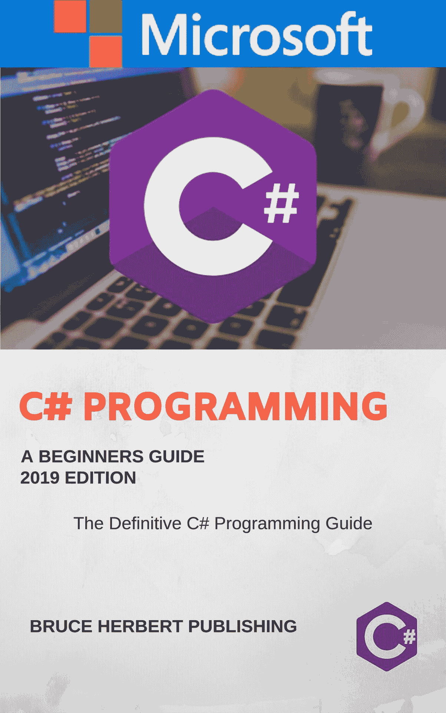


 # C# - 入学者指南 初学者教程

C# 是一种简单、现代、通用面向对象的编程语言，由微软在其 Anders Hejberg 领导的 .Net 中开发。本教程将教你基础 C# 编程，并带你了解与 C# 编程相关的各种高级概念。

本教程将帮助你建立 C# 基础。

## 适用对象：
本教程为初学者准备，帮助他们理解基础 C# 编程。

## 先决条件：
C# 编程很大程度上基于 C 和 C++ 编程语言，因此如果你对 C 或 C++ 编程有基础了解，那么学习 C# 将会非常有趣。


* 它是一种现代的、通用编程语言
* 它是面向对象的。
* 它是面向组件的。
* 它很容易学习。
* 它是一门结构化语言。
* 它能生成高效程序。
* 可以在多种计算机平台上编译。
* 它是 `.Net Framework` 的一部分。

# C# 的强大编程特性
尽管 `C#` 的构造紧密遵循传统的高级语言（`C` 和 `C++`），并且作为一种面向对象的编程语言，它与 `Java` 有许多相似之处，但它具有许多强大的编程特性，使其深受全球程序员的喜爱。以下是 `C#` 的一些特性列表——

* 布尔条件
* 自动垃圾收集
* 标准库
* 程序集版本控制
* 属性和事件
* 委托和事件管理
* 易用的泛型
* 索引器
* 条件编译
* 简单的多线程支持
* LINQ 和 Lambda 表达式
* 与 Windows 的集成

# C# 环境

## .Net Framework
`.Net framework` 是一个革命性的平台，可以帮助你编写以下类型的应用程序——

* Windows 应用程序
* Web 应用程序
* Web 服务

`.Net framework` 应用程序是多平台的应用程序。该框架的设计使其可以使用任何以下语言：`C#`、`C++`、`Visual Basic`、`Jscript`、`COBOL` 等。所有这些语言都可以访问该框架并相互通信。`.Net framework` 由一个供如 `C#` 等客户端语言使用的巨大代码库组成。以下是 `.Net framework` 的某些组件——

* 通用运行时 (`CLR`)
* .Net Framework 类库
* 通用语言规范 (CLS)
* 通用类型系统 (CTS)
* 元数据和程序集
* Windows Forms
* ASP.Net 和 ASP.Net AJAX
* ADO.Net
* Windows Workflow Foundation (WF)
* Windows Presentation Foundation
* Windows Communication Foundation (WCF)
* LINQ

## C# 的集成开发环境 (IDE)
微软为 `C#` 编程提供了以下开发工具——

* Visual Studio 2019 (VS)
* Visual C# 2019 快捷版 (VCE)
* Visual Web Developer

后两个工具可以在微软官方网站免费获取。使用这些工具，你可以编写各种 `C#` 程序，从简单的命令行应用程序到更复杂的应用程序。你也可以使用基础文本编辑器（如 `Notepad`）编写 `C#` 源文件，并使用命令行编译器将代码编译为程序集，这也是 `.NET Framework` 的一部分。`Visual C# Express` 和 `Visual Web Developer Express` 版是 `Visual Studio` 的精简版，外观相同。它们保留了 `Visual Studio` 的大部分功能。你可以从 [Microsoft Visual Studio](https://www.microsoft.com/visualstudio/eng/downloads) 下载。它会自动安装在你的机器上。注意：安装快捷版需要活跃的互联网连接。

# 在 Linux 或 Mac OS 上编写 C# 程序
尽管 `.NET Framework` 运行在 Windows 操作系统上，但也有可以在其他操作系统上的替代版本。`Mono` 是 `.Net Framework` 的开源版本，包含 `C#` 编译器，并运行在多个操作系统上，包括各种版本的 `Linux` 和 `Mac OS`。请查看 [Go Mono](http://www.go-mono.com/mono-downloads/download.html)。`Mono` 的目的不仅是为了跨平台运行微软 `.NET` 应用程序，还为了为 `Linux` 开发者带来更好的开发工具。`Mono` 可以运行在许多操作系统上，包括 `Android`、`BSD`、`iOS`、`Linux`、`OS X`、`Windows`、`Solaris` 和 `UNIX`。

# C# 程序结构
在学习 `C#` 编程语言的基础构建块之前，让我们来看简单的 `C#` 程序结构，以便在后续章节中参考。

## 创建 Hello World 程序
一个 `C#` 程序由以下部分组成：

* 命名空间声明
* 类
* 类方法
* 类属性
* Main 方法
* 语句和表达式
* 注释

让我们来看打印“Hello World”的简单代码：

```
using System;
namespace HelloWorldApplication {
    class HelloWorld {
        static void Main ( string [] args ) {
            /* 我的第一个 C# 程序 */
            Console.WriteLine("Hello World");
            Console.ReadKey();
        }
    }
}
```

当这段代码被编译并执行时，它会产生以下结果：Hello World

让我们来看给定程序的各个部分：

* 程序的的第一行 `using System;` —— `using` 关键字用于在程序包含 `System` 命名空间。程序通常有多个 `using` 语句。
* 下一行是命名空间声明。`namespace` 是类的集合。`HelloWorldApplication` 命名空间包含类 `HelloWorld`。
* 下一行是 `class` 声明，`HelloWorld` 类包含了你的程序所使用的数据和方法定义。类通常包含多个方法。方法定义了类的行为。然而，`HelloWorld` 类只有一个方法 `Main`。
* 下一行定义了 `Main` 方法，它是所有 `C#` 程序的入口点。`Main` 方法说明了类在执行时执行的操作。
* 下一行 `/*...*/` 被编译器忽略，用于添加注释。
* `Main` 方法通过语句 `Console.WriteLine("Hello World");` 指定了它的行为。`WriteLine` 是定义在 `System` 命名空间中的 `Console` 类的一个方法。该语句会导致屏幕上显示消息“Hello World!”。
* 最后一行 `Console.ReadKey();` 是给 VS.NET 用户使用的。这会让程序等待按键，并防止程序在从 Visual Studio 启动时屏幕直接运行并关闭。

值得注意以下几点：

* `C#` 是大小敏感的。
* 所有语句和表达式必须以分号 (`;`) 结束。
* 程序执行从 `Main` 方法开始。
* 与 `Java` 不同，文件名可以与类名不同。

# 编译和执行程序
如果你使用 `Visual.Net` 来编译和执行 `C#` 程序，请采取以下步骤：

* 启动 `Visual Studio`。
* 在菜单栏上，选择 `File -> New -> Project`。
* 从模板中选择 `Visual C#`，然后选择 `Windows`。
* 选择 `Console Application`。
* 为你的项目指定名称并点击 OK 按钮。
* 这将在解决方案管理器（Solution Explorer）中创建一个新项目。
* 在编辑器中编写代码。
* 点击 `Run` 按钮或按 `F5` 键执行项目。会出现包含 Hello World 行的命令提示符窗口。

你可以使用命令行而不是 `Visual Studio IDE` 来编译 `C#` 程序：

* 打开文本编辑器并添加上述代码。
* 将文件保存为 `helloworld.cs`。
* 打开命令行提示符工具并进入保存文件的目录。
* 输入 `csc helloworld.cs` 并按回车编译你的代码。
* 如果代码中没有错误，命令行提示符将带你下一行并生成 `helloworld.exe` 可执行文件。
* 输入 `helloworld` 执行你的程序。
* 你可以看到屏幕上打印的 Hello World。


# C# - 基础语法

`C#` 是一种面向对象的编程语言。在面向对象编程方法论中，程序由各种对象组成，这些对象通过动作相互作用。对象可以执行的操作被称为方法。相同类型的对象被认为具有相同的类型，或者说处于同一个类中。

例如，让我们考虑一个 `Rectangle` 对象。它具有如 `length` 和 `width` 等属性。根据设计，它可能需要接收这些属性值的方法、计算面积的方法以及显示详情的方法。让我们来看 `Rectangle` 类实现并讨论 `C#` 基础语法：

```csharp
using System ;
namespace RectangleApplication {
class Rectangle {
    // member variables
    double length ;
    double width ;
    public void Acceptdetails () {
        length = 4.5 ;
        width = 3.5 ;
    }
    public double GetArea () {
        return length * width ;
    }
    public void Display () {
        Console . WriteLine ( "Length: {0}" , length );
        Console . WriteLine ( "Width: {0}" , width );
        Console . WriteLine ( "Area: {0}" , GetArea ());
    }
}
class ExecuteRectangle {
    static void Main ( string [] args ) {
        Rectangle r = new Rectangle ();
        r . Acceptdetails ();
        r . Display ();
        Console . ReadLine ();
    }
}
```

当上述代码编译并执行时，会产生以下结果 ——：
Length: 4.5
Width: 3.5
Area: 15.75

## using 关键字

任何 `C#`程序的第一个语句都是 `using System;`。`using` 关键字用于在程序中包含命名空间。程序可以包含多个 `using` 语句。

## C# 中的注释

注释用于解释代码。编译器会忽略注释内容。`C#` 程序中的多行注释以 `/*` 开始，并字符 `*/` 结束，如下所示：

```csharp
/* This program demonstrates
The basic syntax of C# programming
Language */
```

单行注释用 `//` 符号表示。例如：

```csharp
} //end class Rectangle
```

## 成员变量

变量是类的属性或数据成员，用于存储数据。在前面的程序中，`Rectangle` 类有两个名为 `length` 和 `width` 的成员变量。

## 成员函数

函数是执行特定任务的语句集合。类的成员函数声明在类内部。我们的示例类 `Rectangle` 包含三个成员函数：`AcceptDetails`、`GetArea` 和 `Display`。

## 类实例化

在前面的程序中，`ExecuteRectangle` 类包含 `Main()` 方法并实例化 `Rectangle` 类。

## 标识符

标识符是用于标识类、变量、函数或任何用户定义项目的名称。在 `C#` 中命名类的基本规则如下：

- 名称必须以字母开始，字母后面可以跟跟随字母、数字 (0 - 9) 或下划线。标识符的第一个字符不能是数字。
- 它不能包含任何嵌入的空格或符号，如 `? - + ! @ # % ^ & * ( ) [ ] { } . ; : " ' /` 和 `\`。然而，可以使用下划线 (`_`）。
- 它不应该是 `C#` 关键字。

## C# 关键字

关键字是为 `C#` 编译器预定义的保留字。这些关键字不能用作标识符。然而，如果你想将这些关键字用作标识符，可以在关键字前加上 `@` 字符。在 `C#` 中，某些标识符在上下文具有特殊含义，例如 `get` 和 `set` 被称为上下文关键字。下表列出了 `C#` 中的保留关键字和上下文关键字：

| 保留关键字 | | | | |
| :--- | :--- | :--- | :--- | :--- |
| `abstract` | `as` | `base` | `bool` | `break` |
| `catch` | `char` | `checked` | `class` | `continue` |
| `default` | `delegate` | `do` | `double` | `else` |
| `explicit` | `extern` | `false` | `finally` | `fixed` |
| `foreach` | `goto` | `if` | `implicit` | `in` |
| `interface` | `internal` | `is` | `lock` | `long` |
| `null` | `object` | `operator` | `out` | `override` |
| `private` | `protected` | `public` | `readonly` | `ref` |
| `sealed` | `short` | `sizeof` | `stackalloc` | `static` |
| `switch` | `this` | `throw` | `true` | `typeof` |
| `ulong` | `unchecked` | `ushort` | `using` | `virtual` |
| `volatile` | `while` | | | |
| 上下文关键字 | | | | |
| `add` | `alias` | `ascending` | `descending` | `dynamic` |
| `from` | `get` | `global` | `group` | `into` |
| `let` | `join` | `remove` | `select` | `set` |
| | | | |

# C# - 数据类型

`C#` 中的变量分为以下类型：

- 值类型
- 引用类型
- 指针类型

## 值类型

值类型可以被赋值。它们派自 `System.ValueType`。值类型直接包含数据。示例包括 `int`、`char` 和 `float`，它们分别存储数字、字母和浮点数。当你声明一个 `int` 类型时，系统分配内存来存储值。下表列出了 `C#` 中可用的值类型：

| 类型 | 表示 | 范围 | 默认值 |
| :--- | :--- | :--- | :--- |
| `bool` | 布尔值 | True 或 False | False |
| `byte` | 8 位无符号整数 | 0 to 255 | 0 |
| `char` | 16 位 Unicode 字符 | U+0000 to U+ffff | '\0' |
| `decimal` | 128 位高精度小数值 | (-7.9 x 10²⁸ 到 7.9 x 10²⁸) | 0.0M |
| `double` | 64 位双精度浮点类型 | (+/-)5.0 x 10^-324 到 (+/-)1.7 x 10³⁰⁸ | 0.0D |
| `float` | 32 位单精度浮点类型 | -3.4 x 10³⁸ 到 +3.4 x 10³⁸ | 0.0F |
| `int` | 32 位有符号整数类型 | -2,147,483,648 to 2,147,483,647 | 0 |
| `long` | 64 位有符号整数类型 | -9,223,372,036,854,775,808 to 9,223,372,036,854,775,807 | 0L |
| `sbyte` | 8 位有符号整数 | -128 to 127 | 0 |
| `short` | 16 位有符号整数 | -32,768 to 32,767 | 0 |
| `uint` | 32 位无符号整数类型 | 0 to 4,294,967,295 | 0 |
| `ulong` | 64 位无符号整数类型 | 0 to 18,446,744,073,709,551,615 | 0 |
| `ushort` | 16 位无符号整数类型 | 0 to 65,535 | 0 |


要获取特定平台上类型或变量的确切大小，你可以使用 `sizeof` 方法。表达式 `sizeof(type)` 生成对象或类型以字节为单位的存储大小。以下是在任何机器上获取 `int` 类型大小的示例：

```csharp
using System;
namespace DataTypeApplication {
    class Program {
        static void Main(string [] args) {
            Console.WriteLine("Size of int: {0}", sizeof(int));
            Console.ReadLine();
        }
    }
}
```
当编译并执行上述代码时，它产生以下结果：Size of int: 4。

## 引用类型 (Reference Type)
引用类型不包含变量存储的实际数据，而是包含对变量的引用。换句话说，它们引用内存位置。通过使用多个变量，引用类型可以引用内存位置。如果内存位置中的数据被其中一个变量更改，另一个变量将自动反映此值的变化。内置引用类型的示例有：`object`、`dynamic` 和 `string`。

## 对象类型 (Object Type)
`Object Type` 是 C# 通用类型系统 (CTS) 中所有数据类型的终极基类。`Object` 是 `System.Object` 类的别名。对象类型可以分配任何其他类型的值，包括值类型、引用类型、预定义或自定义类型。然而，在赋值之前，需要进行类型转换。当值类型转换为对象类型时，称为`装箱 (boxing)`；另一方面，当对象类型转换为值类型时，称为`拆箱 (unboxing)`。

```csharp
object obj;
obj = 100; // this is boxing
```

## 动态类型 (Dynamic Type)
你可以在 `dynamic` 数据类型变量中存储任何类型的值。这些类型变量的类型检查发生在运行时。声明动态类型的语法为 `-dynamic <variable_name> = value;`。
例如：
```csharp
dynamic d = 20;
```
动态类型与对象类型相似，区别在于对象类型变量的类型检查在编译时进行，而动态类型变量的检查在运行时。

## 字符串类型 (String Type)
`String Type` 允许你为变量分配任何字符串值。字符串类型是 `System.String` 类的别名。它派自对象类型。可以使用两种形式的字符串字面量为字符串类型赋值：带引号的和 @ 带引号的。
例如：
```csharp
String str = "C Sharp";
```
@ 带引号的字符串字面量如下：
```csharp
@ "C Sharp";
```
用户定义的引用类型是：`class`、`interface` 或 `delegate`。我们将在后面的章节中讨论这些类型。

## 指针类型 (Pointer Type)
指针类型变量存储另一种类型的内存地址。C# 中的指针具有与 C 或 C++ 中的指针相同的能力。声明指针类型的语法为 `-type * identifier;`。
例如：
```csharp
char * cptr;
int * iptr;
```

## C# 类型转换 (C# Type Conversion)
类型转换是将一种数据类型转换为另一种类型。它也被称为类型转换 (Type Casting)。在 C# 中，类型转换有两种形式：

- **隐式类型转换**：这些转换由 C# 以类型的方式执行。例如，从较小的整数类型较大的整数类型的转换，以及从派生类到基类的转换。
- **显式类型转换**：这些转换由用户使用预定义函数显式完成。显式转换需要强制转换操作符。

以下示例显示了显式类型转换：

```csharp
using System;
namespace TypeConversionApplication {
    class ExplicitConversion {
        static void Main(string [] args) {
            double d = 5673.74;
            int i;
            // 将 double 转换为 int。
            i = (int ) d;
            Console.WriteLine(i);
            Console.ReadLine();
        }
    }
}
```
当编译并执行上述代码时，它产生以下结果：-5673

## C# - 类型转换方法 (C# - Type Conversion Methods)
C# 提供了以下内置类型转换方法：

| 序号 (Sr.No.) | 方法与描述 (Methods & Description) |
| :--- | :--- |
| 1 | `ToBoolean` - 在的情况下将类型转换为布尔值。 |
| 2 | `ToByte` - 将类型转换为字节 (byte)。 |
| 3 | `ToChar` - 在可能的情况下将类型转换为单个 Unicode 字符。 |
| 4 | `ToDateTime` - 将类型（整数或字符串类型）转换为日期时间结构。 |
| 5 | `ToDecimal` - 将浮点型或整数类型转换为小数类型 (decimal)。 |
| 6 | `ToDouble` - 将类型转换为 double 类型。 |
| 7 | `ToInt16` - 将类型转换为 16 位整数。 |
| 8 | `ToInt32` - 将类型转换为 32 位整数。 |
| 9 | `ToInt64` - 将类型转换为 64 位整数。 |
| 10 | `ToSByte` - 将类型转换为有符号字节类型。 |
| 11 | `ToSingle` - 将类型转换为单精度浮点数类型。 |
| 12 | `ToString` - 将类型转换为字符串。 |
| 13 | `ToType` - 将类型转换为指定的类型。 |
| 14 | `ToUInt16` - 将类型转换为无符号 int 类型。 |
| 15 | `ToUInt32` - 将类型转换为无符号 long 类型。 |
| 16 | `ToUInt64` - 将类型转换为无符号大整数。 |

以下示例将各种值类型转换为字符串：

```csharp
using System;
namespace TypeConversionApplication {
    class StringConversion {
        static void Main(string [] args) {
            int i = 75;
            float f = 53.005f;
            double d = 2345.7652;
            bool b = true;
            Console.WriteLine(i.ToString());
            Console.WriteLine(f.ToString());
            Console.WriteLine(d.ToString());
            Console.WriteLine(b.ToString());
            Console.ReadLine();
        }
    }
}
```
当编译并执行上述代码时，它产生以下结果：7553.0052345.7652True

## C# - 变量 (C# - Variables)
变量只是程序可以操作的存储区域的名称。C# 中的每个变量都有特定的类型，该类型决定了变量内存的大小和布局、内存中可以存储的值的范围以及可以应用于变量的操作 set。

C# 提供的基本值类型可以分类为：

| 类型 (Type) | 示例 (Example) |
| :--- | :--- |
| 整数类型 | `sbyte`, `byte`, `short`, `ushort`, `int`, `uint`, `long`, `ulong` 和 `char` |
| 浮点类型 | `float` 和 `double` |
| 小数类型 | `decimal` |
| 布尔类型 | 如分配的 `true` 或 `false` 值 |
| 可空类型 | 可空数据类型 s |


C# 还允许定义变量的其他值类型，如 `enum` 以及变量的引用类型如 `class`，我们将在后续章节中介绍这些内容。

## 定义变量

C# 中变量定义的语法格式为 -`<data_type> <variable_list>;`。

在这里，`data_type` 必须是有效的 C# 数据类型，包括 `char`、`int`、`float`、`double` 或任何用户定义的数据类型，`variable_list` 可以由一个或多个由逗号分隔的标识符组成。

这里是一些有效的变量定义：
```csharp
int i, j, k;
char c, ch;
float f, salary;
double d;
```
你可以在定义时初始化变量，例如 `-int i = 100;`。

## 初始化变量

变量通过等号后跟常量表达式来初始化（赋值值）。初始化的通用形式为 `-variable_name = value;`。变量可以在声明时初始化。初始化器由等号和一个常量表达式组成，如 `-<data_type> <variable_name> = value;`。

以下是一些示例：
```csharp
int d = 3 , f = 5 ;   /* 初始化 d 和 f. */
byte z = 22 ;         /* 初始化 z. */
double pi = 3.14159 ; /*  pi 的近似值。 */
char x = 'x'         /* 变量 x 的值为 'x'。 */
```
正确初始化变量是一个良好的编程习惯，否则程序可能会产生意想不到的结果。

下面的示例使用了不同类型的变量：
```csharp
using System;
namespace VariableDefinition {
    class Program {
        static void Main(string [] args) {
            short a;
            int b;
            double c;
            /* 实际初始化 */
            a = 10;
            b = 20;
            c = a + b;
            Console.WriteLine("a = {0}, b = {1}, c = {2}", a, b, c);
            Console.ReadLine();
        }
    }
}
```
当编译并执行上述代码时，它产生以下结果 -`a = 10, b = 20, c = 30`。

## 接收用户输入

`System` 命名空间中的 `Console` 类提供了一个 `ReadLine()` 函数用于接收用户输入并将其存储到变量中

例如：
```csharp
int num;
num = Convert.ToInt32(Console.ReadLine());
```
`Convert.ToInt32()` 函数将用户输入的数据转换为 `int` 数据类型，因为 `Console.ReadLine()` 接受字符串格式的数据。

## C# 中的 lvalue 和 rvalue 表达式

C# 中有两种表达式：

- `lvalue`（左值）：作为 `lvalue` 的表达式可以出现在赋值的左侧或右侧。
- `rvalue`（右值）：作为 `rvalue` 的表达式可以出现在赋值的右侧，但不能出现在左侧。

变量是 `lvalues`，因此它们可以出现在赋值的左侧。数字字面量是 `rvalues`，因此它们不能被赋值，且不能出现在左侧。

以下以下是一个有效的 C# 语句 -`int g = 20;`。
但以下不是有效语句，会产生编译时错误 -`-10 = 20;`。

# C# - 运算符

运算符是告诉编译器执行特定数学或逻辑操作的符号。C# 拥有丰富的内置运算符集合，并提供了以下类型的运算符：

- 算术运算符
- 关系运算符
- 逻辑运算符
- 位运算运算符
- 赋值运算符
- 其他运算符

本教程将逐一解释算术、关系、逻辑、位运算、赋值和其他运算符。

## 算术运算符

下表显示了 C# 支持的所有算术运算符。假设变量 `A` 存储 10，变量 `B` 存储 20，则：

| 运算符 | 说明 | 示例 |
| :--- | :--- | :--- |
| `+` | 将两个操作数加 | `A + B = 30` |
| `-` | 从第一个操作数中减去第二个 | `A - B = -10` |
| `*` | 两个操作数相乘 | `A * B = 200` |
| `/` | 被除数除以除数 | `B / A = 2` |
| `%` | 取模运算符和整数除法后的余数 | `B % A = 0` |
| `++` | 增运算符将整数值加一 | `A++ = 11` |
| `--` | 递减运算符将整数值减一 | `A-- = 9` |

示例：下面的示例演示了 C# 中所有可用的算术运算符
```csharp
using System;
namespace OperatorsAppl {
    class Program {
        static void Main(string [] args) {
            int a = 21;
            int b = 10;
            int c;
            c = a + b;
            Console.WriteLine("Line 1 - Value of c is {0}", c);
            c = a - b;
            Console.WriteLine("Line 2 - Value of c is {0}", c);
            c = a * b;
            Console.WriteLine("Line 3 - Value of c is {0}", c);
            c = a / b;
            Console.WriteLine("Line 4 - Value of c is {0}", c);
            c = a % b;
            Console.WriteLine("Line 5 - Value of c is {0}", c);
            a++;
            Console.WriteLine("Line 6 - Value of a is {0}", a);
            a--;
            Console.WriteLine("Line 7 - Value of a is {0}", a);
            Console.ReadLine();
        }
    }
}
```
（注：此处根据原文逻辑对代码进行了微调以确保示例完整，保持翻译逻辑一致）

## 关系运算符

下表显示了 C# 支持的所有关系运算符。假设变量 `A` 存储 10，变量 `B` 存储 20，则：

| 运算符 | 说明 | 示例 |
| :--- | :--- | :--- |
| `==` | 检查两个操作数相等 | `A == B` |
| `!=` | 检查两个操作数不相等 | `A != B` |
| `>` | 检查左侧大于右侧 | `A > B` |
| `<` | 检查左侧小于右侧 | `A < B` |
| `>=` | 检查左侧大于等于右侧 | `A >= B` |
| `<=` | 检查左侧小于等于右侧 | `A <= B` |

示例：下面的示例演示了 C# 中所有的关系运算符
```csharp
using System;
class Program {
    static void Main(string [] args) {
        int a = 21;
        int b = 10;
        if (a == b) {
            Console.WriteLine("Line 1 - a is equal to b");
        } else {
            Console.WriteLine("Line 1 - a is not equal to b");
        }
        if (a < b) {
            Console.WriteLine("Line 2 - a is less than b");
        } else {
            Console.WriteLine("Line 2 - a is not less than b");
        }
        if (a > b) {
            Console.WriteLine("Line 3 - a is greater than b");
        } else {
            Console.WriteLine("Line 3 - a is not greater than b");
        }
        a = 5;
        b = 20;
        if (a <= b) {
            Console.WriteLine("Line 4 - a is less than or equal to b");
        } else {
            Console.WriteLine("Line 4 - a is not less than or equal to b");
        }
        if (b >= a) {
            Console.WriteLine("Line 5 - b is greater than or equal to a");
        } else {
            Console.WriteLine("Line 5 - b is not greater than or equal to");
        }
    }
}
```
当上述代码编译并执行时，它产生以下结果 -`Line 1 - a is not equal to b`, `Line 2 - a is not less than b`, `Line 3 - a is greater than b`, `Line 4 - a is less than or equal to b`, `Line 5 - b is greater than or equal to a`。

## 逻辑运算符

下表显示了 C# 支持的所有逻辑运算符。假设变量 `A` 持有布尔值 true，变量 `B` 持有布尔值 false，则

| 运算符 | 说明 | 示例 |
| :--- | :--- | :--- |
| `&&` | 逻辑与运算符。如果两个操作数都非零则条件为真。 | `(A && B)` 为 false. |
| `||` | 逻辑或运算符。如果两个操作数中任一非零则条件为真。 | `(A || B)` 为 true. |
| `!` | 逻辑非运算符。用于反转其操作数的逻辑状态。如果条件为真，逻辑非运算符将使其为假。 | `!(A && B)` 为 true. |


# 示例：逻辑运算符

以下示例演示了 C# 中所有可用的逻辑运算符 -

```csharp
using System;
namespace OperatorsAppl {
    class Program {
        static void Main(string [] args) {
            bool a = true;
            bool b = true;
            if (a && b) {
                Console.WriteLine("Line 1 - Condition is true");
            }
            if (a || b) {
                Console.WriteLine("Line 2 - Condition is true");
            }
            /* lets change the value of a and b */
            a = false;
            b = true;
            if (a && b) {
                Console.WriteLine("Line 3 - Condition is true");
            } else {
                Console.WriteLine("Line 3 - Condition is not true");
            }
            if (!(a && b)) {
                Console.WriteLine("Line 4 - Condition is true");
            }
            Console.ReadLine();
        }
    }
}
```

当上述代码被编译并执行时，会产生以下结果 −
- Line 1 - Condition is true
- Line 2 - Condition is true
- Line 3 - Condition is not true
- Line 4 - Condition is true

## 位运算符

位运算符对位（bits）操作并执行逐位操作。`&`、`|` 和 `^` 的真值表如下 −

| p | q | p & q | p \| q | p ^ q |
| :--- | :--- | :--- | :--- | :--- |
| 0 | 0 | 0 | 0 | 0 |
| 0 | 1 | 0 | 1 | 1 |
| 1 | 1 | 1 | 1 | 0 |
| 1 | 0 | 0 | 1 | 1 |

假设 `A = 60;` 且 `B = 13;`，那么在二进制格式下如下 −
- `A = 0011 1100`
- `B = 0000 1101`
- `A&B = 0000 1100`
- `A|B = 0011 1101`
- `A^B = 0011 0001`
- `~A = 1100 0011`

C# 支持的位运算符如表所示。假设变量 `A` 存储 60 变量 `B` 存储 13，则 −

| Operator | Description | Example |
| :--- | :--- | :--- |
| `&` | 二进制与运算符。如果位在两个操作数中都存在，则将其复制到结果中。 | `(A & B) = 12`，即 `0000 1100` |
| `\|` | 二进制或运算符。如果位在任一操作数中存在，则将其复制。 | `(A \| B) = 61`，即 `0011 1101` |
| `^` | 二进制异或运算符。如果位在其中一个操作数中设置但不同不同，则复制该位。 | `(A ^ B) = 49`，即 `0011 0001` |
| `~` | 二进制取反运算符。是单元运算符，具有“翻转”位的效果。 | `(~A ) = -61`，由于是有符号二进制数，在补码表示法中为 `1100 0011`。 |
| `<<` | 二进制左移运算符。左操作数的值根据右操作数指定的位数向左移动。 | `A << 2 = 240`，即 `1111 0000` |
| `>>` | 二进制右移运算符。左操作数的值根据右操作数指定的位数向右移动。 | `A >> 2 = 15`，即 `0000 1111` |

### 示例：位运算符

以下示例演示了 C# 中所有可用的位运算符 −

```csharp
using System;
namespace OperatorsAppl {
    class Program {
        static void Main(string [] args) {
            int a = 60;             /* 60 = 0011 1100 */
            int b = 13;             /* 13 = 0000 1101 */
            int c = 0;
            c = a & b;              /* 12 = 0000 1100 */
            Console.WriteLine("Line 1 - Value of c is {0}", c);
            c = a | b;              /* 61 = 0011 1101 */
            Console.WriteLine("Line 2 - Value of c is {0}", c);
            c = a ^ b;              /* 49 = 0011 0001 */
            Console.WriteLine("Line 3 - Value of c is {0}", c);
            c = ~ a;                /* -61 = 1100 0011 */
            Console.WriteLine("Line 4 - Value of c is {0}", c);
            c = a << 2;             /* 240 = 1111 0000 */
            Console.WriteLine("Line 5 - Value of c is {0}", c);
            c = a >> 2;             /* 15 = 0000 1111 */
            Console.WriteLine("Line 6 - Value of c is {0}", c);
            Console.ReadLine();
        }
    }
}
```

上述代码被编译并执行时，产生以下结果 −
- Line 1 - Value of c is 12
- Line 2 - Value of c is 61
- Line 3 - Value of c is 49
- Line 4 - Value of c is -61
- Line 5 - Value of c is 240
- Line 6 - Value of c is 15

## 赋值运算符

C# 支持以下赋值运算符：

| Operator | Description | Example |
| :--- | :--- | :--- |
| `=` | 简单赋值运算符。将右操作数的值赋给左操作数。 | `C = A + B` 将值赋值给 `C` |
| `+=` | 加赋值运算符。将右操作数加到左操作数并将结果赋给左操作数。 | `C += A` 等于 `C = C + A` |
| `-=` | 减赋值运算符。从左操作数减去右操作数并将结果赋给左操作数。 | `C -= A` 等于 `C = C - A` |
| `*=` | 乘赋值运算符。将左操作数乘以右操作数并将结果赋给左操作数。 | `C *= A` 等于 `C = C * A` |
| `/=` | 除赋值运算符。将左操作数除以右操作数并将结果赋给左操作数。 | `C /= A` 等于 `C = C / A` |
| `%=` | 取模赋值运算符。对两个操作数取模并将结果赋给左操作数。 | `C %= A` 等于 `C = C % A` |
| `<<=` | 左移赋值运算符。 | `C <<= 2` 等于 `C = C << 2` |
| `>>=` | 右移赋值运算符。 | `C >>= 2` 等于 `C = C >> 2` |
| `&=` | 位与赋值运算符。 | `C &= 2` 等于 `C = C & 2` |
| `^=` | 位异或赋值运算符。 | `C ^= 2` 等于 `C = C ^ 2` |
| `\|=` | 位或赋值运算符。 | `C \|= 2` 等于 `C = C \| 2` |

### 示例：赋值运算符

以下示例演示了 C# 中所有可用的赋值运算符 −

```csharp
using System;
namespace OperatorsAppl {
    class Program {
        static void Main(string [] args) {
            int a = 21;
            int c;
            c = a;
            Console.WriteLine("Line 1 - Value of c is {0}", c);
            c += a;
            Console.WriteLine("Line 2 - Value of c is {0}", c);
            c -= a;
            Console.WriteLine("Line 3 - Value of c is {0}", c);
            c *= a;
            Console.WriteLine("Line 4 - Value of c is {0}", c);
            c /= a;
            Console.WriteLine("Line 5 - Value of c is {0}", c);
            c %= 200;
            Console.WriteLine("Line 6 - Value of c is {0}", c);
            c <<= 2;
            Console.WriteLine("Line 7 - Value of c is {0}", c);
            c >>= 2;
            Console.WriteLine("Line 8 - Value of c is {0}", c);
            c &= 2;
            Console.WriteLine("Line 9 - Value of c is {0}", c);
            c ^= 2;
            Console.WriteLine("Line 10 - Value of c is {0}", c);
            c \|= 2;
            Console.WriteLine("Line 11 - Value of c is {0}", c);
            Console.ReadLine();
        }
    }
}
```

上述代码被编译并执行时，会产生以下结果 −
- Line 1 - Value of c is 21
- Line 2 - Value of c is 42
- Line 3 - Value of c is 21
- Line 4 - Value of c is 441
- Line 5 - Value of c is 21
- Line 6 - Value of c is 21
- Line 7 - Value of c is 84
- Line 8 - Value of c is 21
- Line 9 - Value of c is 0
- Line 10 - Value of c is 2
- Line 11 - Value of c is 2

## 杂运算符

C# 还支持其他重要的运算符，包括 `sizeof`、`typeof` 和 `? :`。

| Operator | Description | Example |
| :--- | :--- | :--- |
| `sizeof()` | 返回数据类型的大小。 | `sizeof(int)`, 返回 4。 |
| `typeof()` | 返回类的类型。 | `typeof(StreamReader)` |
| `&` | 返回变量的地址。 | `&a` 返回变量的实际地址。 |
| `*` | 变量指针。 | `*a` 创建一个指向变量 `a` 的指针。 |
| `? :` | 条件表达式 | 如果条件为真？返回值 X：否则返回值 Y |
| `is` | 判断对象是否属于特定类型。 | `If( Ford is Car)` // 检查 Ford 是否是 Car 类的对象。 |
| `as` | 转换失败时不抛出异常。 | `Object obj = new StringReader("Hello");StringReader r = obj as StringReader;` |


# 

```csharp
using System;namespace OperatorsAppl {
class Program {
    static void Main ( string [] args ) {
        /* example of sizeof operator */
        Console . WriteLine ( "The size of int is {0}" , sizeof ( int ));
        Console . WriteLine ( "The size of short is {0}" , sizeof ( short ));
        Console . WriteLine ( "The size of double is {0}" , sizeof ( double ));
        /* example of ternary operator */
        int a , b ;
        a = 10 ;
        b = ( a == 1 ) ? 20 : 30 ;
        Console . WriteLine ( "Value of b is {0}" , b );
        b = ( a == 10 ) ? 20 : 30 ;
        Console . WriteLine ( "Value of b is {0}" , b );
        Console . ReadLine ();
    }
}}
```

当上述代码编译并执行时，它产生以下结果：
−The size of int is 4
The size of short is 2
The size of double is 8
Value of b is 30
Value of b is 20

# C# 中的运算符优先级

运算符优先级决定表达式中项的分组。这影响表达式的求值。某些运算符的优先级高于运算符；例如，乘法运算符的优先级高于加法运算符。

例如 `x = 7 + 3 * 2;`；在这里，`x` 被赋值为 13 而不是 20，因为运算符 `*` 的优先级高于 `+`，所以首先求值 `3*2`，然后将 `7` 加到其中。

在这里，优先级最高的运算符出现在表格顶部，优先级最低的出现在底部。在表达式中，高优先级的运算符先求值。

| 类别 | 运算符 | 结合性 |
| :--- | :--- | :--- |
| 后置 | `() [] -> . ++ - -` | 从左到右 |
| 一元 | `+ - ! ~ ++ - - (type)* & sizeof` | 从右到左 |
| 乘法 | `* / %` | 从左到右 |
| 加法 | `+ -` | 从左到右 |
| 移位 | `<< >>` | 从左到右 |
| 关系 | `< <= > >=` | 从左到右 |
| 等于 | `== !=` | 从左到右 |
| 按位与 | `&` | 从左到右 |
| 按位异异 | `^` | 从左到右 |
| 按位或 | `|` | 从左到右 |
| 逻辑与 | `&&` | 从左到右 |
| 逻辑或 | `||` | 从左到右 |
| 条件 | `?:` | 从右到左 |
| 赋值 | `= += -= *= /= %= >>= <<= &= ^= |==` | 从右到左 |
| 逗号 | `,` | 从左到右 |

## 示例

```csharp
using System;namespace OperatorsAppl {
class Program {
    static void Main ( string [] args ) {
        int a = 20 ;
        int b = 10 ;
        int c = 15 ;
        int d = 5 ;
        int e ;
        e = ( a + b ) * c / d ; // ( 30 * 15 ) / 5
        Console . WriteLine ( "Value of (a + b) * c / d is : {0}" , e );
        e = (( a + b ) * c ) / d ; // ( 30 * 15 ) / 5
        Console . WriteLine ( "Value of ((a + b) * c) / d is  : {0}" , e );
        e = ( a + b ) * ( c / d ); // ( 30 ) * (15/5)
        Console . WriteLine ( "{0}", e);
        e = a + ( b * c ) / d ; // 20 + (150/5)
        Console . WriteLine ( "{0}", e);
        Console . ReadLine ();
    }
}}
```

当上述代码编译并执行时，它产生以下结果：
Value of (a + b) * c / d is : 90
Value of ((a + b) * c) / d is  : 90

# C# - 决策判断

决策结构要求程序员指定一个或多个条件，由程序进行求值或测试，并在条件被确定为真时执行一条或多条语句，可选，如果条件被确定为假，则执行其他语句。

以下是大多数编程语言中常见的典型决策结构的通用形式：
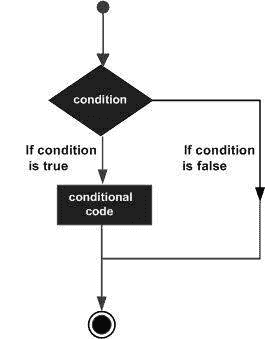

C# 提供了以下类型的决策语句。点击以下链接查看详细信息。

| 序号 | 语句与描述 |
| :--- | :--- |
| 1 | if 语句 | `if` 语句由一个布尔表达式后跟一个或多个语句组成。 |
| 2 | if...else 语句 | `if` 语句后面可以跟一个可选的 `else` 语句，该语句在布尔表达式为假时执行。 |
| 3 | 嵌套 if 语句 | 你可以在另一个 `if` 或 `else if` 语句内部使用一个 `if` 或 `else if` 语句。 |
| 4 | switch 语句 | `switch` 语句允许对变量与一组值进行等性测试。 |
| 5 | 嵌套 switch 语句 | 你可以在另一个 `switch` 语句内部使用一个 `switch` 语句。 |

## If 语句

`if` 语句由一个布尔表达式后跟一个或多个语句组成。

### 语法
C# 中 `if` 语句的语法为：
`if(boolean_expression) {/* 如果布尔表达式为真，则执行语句(s) */}`

如果布尔表达式求值为 `true`，则执行 `if` 语句内部的代码块将被执行。如果布尔表达式求值为 `false`，则在 `if` 语句结束处（右大括号之后）后的第一组代码将被执行。

### 流程图：
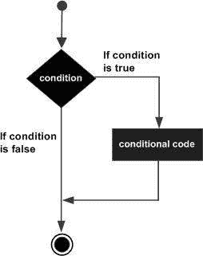

## 示例
```csharp
using System;namespace DecisionMaking {
class Program {
    static void Main ( string [] args ) {
        /* 局部变量定义 */
        int a = 10 ;
        /* 使用 if 语句检查布尔条件 */
        if ( a < 20 ) {
            /* 如果条件为真则打印以下内容 */
            Console . WriteLine ( "a is less than 20" );
        }
        Console . WriteLine ( "value of a is : {0}" , a );
        Console . ReadLine ();
    }
}}
```
当上述代码编译并执行时，它产生以下结果：
a is less than 20
value of a is : 10

## if...else 语句

`if` 语句后面可以跟一个可选的 `else` 语句，它在布尔表达式为假时执行。

### 语法
C# 中 `if...else` 语句的语法为：
`if(boolean_expression) {/* 如果布尔表达式为真，则执行语句(s) */} else {/* 如果布尔表达式为假，则执行语句(s) */}`

如果布尔表达式求值为 `true`，则执行 `if` 代码块，否则执行 `else` 代码块。

### 流程图：
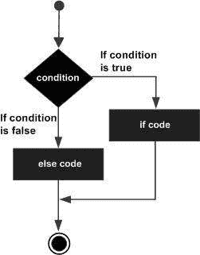

## 示例
```csharp
using System;namespace DecisionMaking {
class Program {
    static void Main ( string [] args ) {
        /* 局部变量定义 */
        int a = 100 ;
        /* 检查布尔条件 */
        if ( a < 20 ) {
            /* 如果条件为真则打印以下内容 */
            Console . WriteLine ( "a is less than 20" );
        } else {
            /* 如果条件为假则打印以下内容 */
            Console . WriteLine ( "a is not less than 20" );
        }
        Console . WriteLine ( "value of a is : {0}" , a );
        Console . ReadLine ();
    }
}}
```
当上述代码编译并执行时，它产生以下结果：
a is not less than 20
value of a is : 100

## if...else if...else 语句

`if` 语句后面可以跟一个可选的 `else if...else` 语句，这对于使用单个 `if...else if` 语句测试各种条件非常有用。在使用 `if`、`else if`、`else` 语句有几点需要注意：

- `if` 可以有零或一个 `else`，它必须位于任何 `else if` 之后。
- `if` 可以有零到多个 `else if`，它们必须位于 `else` 之前。
- 一旦某个 `else if` 成功，剩余的 `else if` 或 `else` 将不再被测试。


## if...else if...else 语句

C# 中 `if...else if...else` 语句的语法如下：

```csharp
if(boolean_expression 1) {/* 当布尔表达式 1 为真时执行 %}
else if( boolean_expression 2) {/* 当布尔表达式 2 为真时执行 %}
else if( boolean_expression 3) {/* 当布尔表达式 3 为真时执行 %}
else {/* 当上述条件均为假时执行 %}
```

示例：
```csharp
using System ;
namespace DecisionMaking {
class Program {
    static void Main ( string [] args ) {
        /* 局部变量定义 */
        int a = 100 ;
        /* 检查布尔条件 */
        if ( a == 10 ) {/* if 条件为真则打印以下内容 */
            Console . WriteLine ( "Value of a is 10" );
        }else if ( a == 20 ) {/* if else if 条件为真 */
            Console . WriteLine ( "Value of a is 20" );
        }else if ( a == 30 ) {/* if else if 条件为真  */
            Console . WriteLine ( "Value of a is 30" );
        } else {/* 如果没有条件为真 */
            Console . WriteLine ( "None of the values is matching" );
        }
        Console . WriteLine ( "Exact value of a is: {0}" , a );
        Console . ReadLine ();
    }
}
```

当上述代码编译并执行时，将产生以下结果：
None of the values is matching
Exact value of a is: 100

## 嵌套 if 语句

在 C# 中嵌套 `if-else` 语句总是合法的，这意味着你可以在一个 `if` 或 `else if` 语句内部嵌套另一个 `if` 或 `else if` 语句。

语法：
`嵌套 if` 语句的语法如下：

```csharp
if( boolean_expression 1) {/* 当布尔表达式 1 为真时执行 %}
    if(boolean_expression 2) {/* 当布尔表达式 2 为真时执行 %}
}
```
你可以以嵌套 `if` 语句类似的方式嵌套 `else if...else`。

示例：
```csharp
using System ;
namespace DecisionMaking {
class Program {
    static void Main ( string [] args ) {
        //* 局部变量定义 */
        int a = 100 ;
        int b = 200 ;
        /* 检查布尔条件 */
        if ( a == 100 ) {/* if 条件为真则检查以下内容 */
            if ( b == 200 ) {/* if 条件为真则打印以下内容 */
                Console . WriteLine ( "Value of a is 100 and b is 200" );
            }
        }
        Console . WriteLine ( "Exact value of a is : {0}" , a );
        Console . WriteLine ( "Exact value of b is : {0}" , b );
        Console . ReadLine ();
    }
}
```
当上述代码编译并执行时，将产生以下结果：
Value of a is 100 and b is 200
Exact value of a is : 100
Exact value of b is : 200

## switch 语句

`switch` 语句允许对变量与一组值进行等值测试。每个值被称为一个 `case`，被切换的变量会在每个 `switch case` 中进行检查。

语法：
C# 中 `switch` 语句的语法如下所示：

```csharp
switch(expression) {
    case constant-expression1 : statement(s);
    break;
    case constant-expression2 :
    case constant-expression3 : statement(s);
    break;
    /* 你可以有任意数量的 case 语句 */
    default : /* 可选 */
    statement(s);
}
```

以下规则适用于 `switch` 语句：

- `switch` 语句中使用的 `expression` 具有整型或枚举类型，或者是一个类类型且该类具有转换为整型或枚举类型的单一转换函数。
- 你可以在 `switch` 中包含任意数量的 `case` 语句。每个 `case` 后面都跟着要比较的值和一个冒号。
- `case` 的 `constant-expression` 必须与 `switch` 中的变量具有相同的数据类型，并且它必须是常量或字面量。
- 当被切换的变量等于某个 `case` 时，该 case 后的语句将执行，直到遇到 `break` 语句。
- 当遇到 `break` 语句时，`switch` 终止，控制流跳转到 `switch` 语句之后的下一行。
- 并不是每个 `case` 都需要包含 `break`。如果没有出现 `break`，将会引起编译错误。
- `switch` 语句可以有一个可选的 `default` `case`，它必须出现在 `switch` 的末尾。`default` case 可用于在没有任何 `cases` 为真时执行某项任务。

流程图：


示例：
```csharp
using System ;
namespace DecisionMaking {
class Program {
    static void Main ( string [] args ) {
        /* 局部变量定义 */
        char grade = 'B' ;
        switch ( grade ) {
            case 'A' : Console . WriteLine ( "Excellent!" ); break ;
            case 'B' :
            case 'C' : Console . WriteLine ( "Well done" ); break ;
            case 'D' : Console . WriteLine ( "You passed" ); break ;
            case 'F' : Console . WriteLine ( "Better try again" ); break ;
            default : Console . WriteLine ( "Invalid grade" ); break ;
        }
        Console . WriteLine ( "Your grade is {0}" , grade );
        Console . ReadLine ();
    }
}
```
当上述代码编译并执行时，将产生以下结果：
Well done
Your grade is B

## 嵌套 switch 语句

可以将一个 `switch` 作为外部 `switch` 语句语句序列的一部分。即使内部和外部 `switch` 的 `case` 常量包含共同的值，也不会产生冲突。

语法：
`嵌套 switch` 语句的语法如下：

```csharp
switch(ch1) {
    case 'A':
        Console.WriteLine("This A is part of outer switch" );
        switch(ch2) {
            case 'A': Console.WriteLine("This A is part of inner switch" ); break;
            case 'B': /* 内部 B case */ break;
        }
    case 'B': /* 外部 B case */
}
```

示例：
```csharp
using System ;
namespace DecisionMaking {
class Program {
    static void Main ( string [] args ) {
        int a = 100 ;
        int b = 200 ;
        switch ( a ) {
            case 100 :
                Console . WriteLine ( "This is part of outer switch" );
                switch ( b ) {
                    case 200 : Console . WriteLine ( "This is part of inner switch" ); break;
                }
                break;
        }
    }
}
```
当上述代码编译并执行时，将产生以下结果：
This is part of outer switch
This is part of inner switch

# C# - 循环

在某些情况下，你需要多次执行一段代码块。通常情况下，语句是按顺序执行的：函数中的第一个语句首先执行，然后是第二个，依此类推。编程语言提供了各种控制结构允许允许复杂的执行路径。循环语句允许我们多次执行语句或一组语句，以下是大多数编程语言中循环语句的形式：

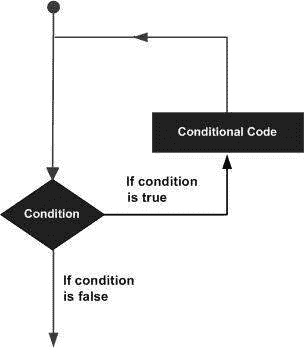

C# 提供了以下类型的循环来处理循环需求。点击以下链接查看详细信息。

| 序号 | 循环类型与描述 |
| :--- | :--- |
| 1 | while 循环在给定条件为真时重复执行语句或一组语句。它在执行循环体之前测试条件。 |
| 2 | for 循环多次执行语句序列，并缩短了管理循环变量的代码。 |
| 3 | do...while 循环与 while 语句相似，但它在循环体末尾测试条件。 |
| 4 | 嵌套循环你可以在另一个 while、for 或 do..while 循环内部嵌套一个或多个循环。 |


## while 循环
C# 中的 `while` 循环语句在给定条件为真时，会重复执行目标语句。

### 语法
C# 中 `while` 循环的语法如下：
```csharp
while(condition) {statement(s);}
```
在这里，`statement(s)` 可以是一个单独语句，也可以是一个语句块。`condition` 可以是任何表达式，而 `true` 是任何非零值。当条件为真时，循环进行迭代。当条件变为假时，程序控制将传递到紧接在循环之后的行。

### 流程图
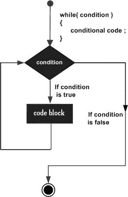
在这里，`while` 循环的关键点在于循环可能永远不会运行。当测试 `condition` 的结果为假时，将跳过循环体，并执行 `while` 循环后的第一个语句。

## 示例
```csharp
using System ;
namespace Loops {
    class Program {
        static void Main ( string [] args ) {
            /* 局部变量定义 */
            int a = 10 ;
            /* while 循环执行 */
            while ( a < 20 ) {
                Console . WriteLine ( "value of a: {0}" , a );
                a ++;
            }
            Console . ReadLine ();
        }
    }
}
```
当上述代码编译并执行时，将产生以下结果：
value of a: 10
value of a: 11
value of a: 12
value of a: 13
value of a: 14
value of a: 15
value of a: 16
value of a: 17
value of a: 18
value of a: 19

## for 循环
`for` 循环是一种重复控制结构，允许你高效地编写需要执行特定次数的循环。

### 语法
C# 中 `for` 循环的语法如下：
```csharp
for ( init; condition; increment ) {statement(s);}
```
以下是 `for` 循环中的控制流：
- 首先执行 `init` 步骤，且只执行一次。此步骤允许你声明并初始化任何循环控制变量。只要出现分号，就不强制要求在这里放置语句。
- 接下来评估 `condition`。如果为真，则执行循环体。如果为假，则不执行循环体，控制流跳转到 `for` 循环之后的紧邻语句。
- 在执行 `for` 循环体后，控制流跳转回 `increment` 语句。该语句允许你更新任何循环控制变量。只要在条件之后出现分号，该语句可以留空。
- 现在再次评估 `condition`。如果为真，则执行循环并重复该过程（循环体、然后是增量步骤，然后再次测试条件）。在条件变为假后，`for` 循环终止。

### 流程图
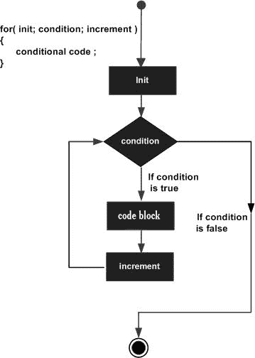

## 示例
```csharp
using System ;
namespace Loops {
    class Program {
        static void Main ( string [] args ) {
            /* for 循环执行 */
            for ( int a = 10 ; a < 20 ; a = a + 1 ) {
                Console . WriteLine ( "value of a: {0}" , a );
            }
            Console . ReadLine ();
        }
    }
}
```
当上述代码编译并执行时，将产生以下结果：
value of a: 10
value of a: 11
value of a: 12
value of a: 13
value of a: 14
value of a: 15
value of a: 16
value of a: 17
value of a: 18
value of a: 19

## do...While 循环
与在循环开始时测试条件的 `for` 和 `while` 循环不同，`do...while` 循环在循环结束时检查其条件。`do...while` 循环类似于 `while` 循环，不同在于 `do...while` 循环保证至少执行一次。

### 语法
C# 中 `do...while` 循环的语法如下：
```csharp
do {statement(s);} while( condition );
```
注意条件表达式出现在循环的末尾，因此循环中的 `statement(s)` 在测试条件之前会执行一次。如果条件为真，控制流跳转回 `do`，循环中的 `statement(s)` 再次执行。此过程不断重复直到给定条件变为假。

### 流程图
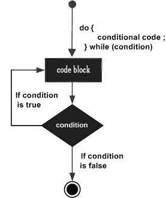

## 示例
```csharp
using System ;
namespace Loops {
    class Program {
        static void Main ( string [] args ) {
            /* 局部变量定义 */
            int a = 10 ;
            /* do 循环执行 */
            do {
                Console . WriteLine ( "value of a: {0}" , a );
                a = a + 1 ;
            } while ( a < 20 );
            Console . ReadLine ();
        }
    }
}
```
当上述代码编译并执行时，将产生以下结果：
value of a: 10
value of a: 11
value of a: 12
value of a: 13
value of a: 14
value of a: 15
value of a: 16
value of a: 17
value of a: 18
value of a: 19

## 嵌套 for 循环
C# 允许在一个另一个内部使用循环。本节展示了几个示例来说明这一概念。

### 语法
C# 中 `嵌套 for 循环`语句的语法为：
```csharp
for ( init; condition; increment ) {for ( init; condition; increment ) {statement(s);}statement(s);}
```
C# 中 `嵌套 while 循环`语句的语法为：
```csharp
while(condition) {while(condition) {statement(s);}statement(s);}
```
C# 中 `嵌套 do...while 循环`语句的语法为：
```csharp
do {statement(s);do {statement(s);}while( condition );}while( condition );
```
关于循环嵌套的最后一点是，你可以将任何类型的循环放在任何类型的循环内部。例如，`for` 循环可以放在 `while` 循环内部，反之亦然。

## 示例
以下程序使用嵌套 for 循环寻找 2 到 100 之间的质数：
```csharp
using System ;
namespace Loops {
    class Program {
        static void Main ( string [] args ) {
            /* 局部变量定义 */
            int i , j ;
            for ( i = 2 ; i < 100 ; i ++) {
                for ( j = 2 ; j <= ( i / j ); j ++)
                    if (( i % j ) == 0 ) break ; // 如果找到因数，则不是质数
                if ( j > ( i / j )) Console . WriteLine ( "{0} is prime" , i );
            }
            Console . ReadLine ();
        }
    }
}
```
当上述代码编译并执行时，将产生以下结果：
2 is prime
3 is prime
5 is prime
7 is prime
11 is prime
13 is prime
17 is prime
19 is prime
23 is prime
29 is prime
31 is prime
37 is prime
41 is prime
43 is prime
47 is prime
53 is prime
59 is prime
61 is prime
67 is prime
71 is prime
73 is prime
79 is prime
83 is prime
89 is prime
97 is prime

## 循环控制语句
循环控制语句改变了其正常执行顺序。当执行离开作用范围时，在该作用范围内创建的所有自动对象都会被销毁。C# 提供了以下控制语句。

| 序号 | 控制语句及描述 |
| :--- | :--- |
| 1 | `break` 语句：终止 `循环` 或 `switch` 语句，并将执行转移到循环或 switch 之后的后续语句。 |
| 2 | `continue` 语句：导致循环跳过其主体的剩余部分，并在迭代之前立即重新测试其条件。 |

### break 语句
C# 中的 `break` 语句有以下两种用法：
- 当在循环内部遇到 `break` 语句时，循环立即终止，程序控制从循环后的下一个语句开始恢复。
- 它可以用于终止 `switch` 语句中的某个 `case`。


如果你在使用嵌套循环（即在一个循环内部另一个循环），`break` 语句将停止最内层循环的执行，并开始执行块之后的下一行代码。

### break 语句

### 语法
C# 中 `break` 语句的语法如下 —
`break;`

### 流程图
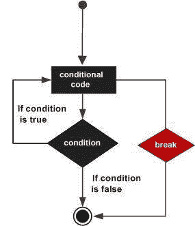

## 示例
```csharp
using System ;
namespace Loops {
class Program {
    static void Main ( string [] args ) {
        /* local variable definition */
        int a = 10 ;
        /* while loop execution */
        while ( a < 20 ) {
            Console . WriteLine ( "value of a: {0}" , a );
            a ++;
            if ( a > 15 ) {
                /* terminate the loop using break statement */
                break ;
            }
        }
        Console . ReadLine ();
    }
}
```
当上述代码编译并执行时，会产生以下结果 —
value of a: 10
value of a: 11
value of a: 12
value of a: 13
value of a: 14
value of a: 15

### continue 语句

C# 中的 `continue` 语句的作用与 `break` 语句相似。然而，`continue` 并不是强制终止，而是强制执行循环的下次迭代，跳过中间的任何代码。

对于 `for` 循环，`continue` 语句会导致循环的条件测试和增量部分执行。对于 `while` 和 `do...while` 循环，`continue` 语句会导致程序控制传递到条件测试。

### 语法
C# 中 `continue` 语句的语法如下 —
`continue;`

### 流程图
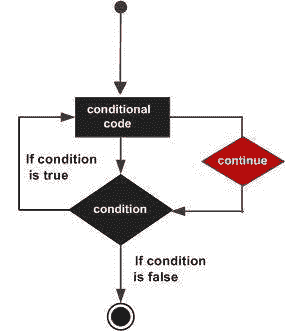

## 示例
```csharp
using System ;
namespace Loops {
class Program {
    static void Main ( string [] args ) {
        /* local variable definition */
        int a = 10 ;
        /* do loop execution */
        do {
            if ( a == 15 ) {
                /* skip the iteration */
                a = a + 1 ;
                continue ;
            }
            Console . WriteLine ( "value of a: {0}" , a );
            a ++;
        }while ( a < 20 );
        Console . ReadLine ();
    }
}
```
当上述代码编译并执行时，会产生以下结果 —
value of a: 10
value of a: 11
value of a: 12
value of a: 13
value of a: 14
value of a: 16
value of a: 17
value of a: 18
value of a: 19

### 死循环

如果一个条件永远不变为假，循环就会变成死循环。`for` 循环传统上用于此目的。由于构成 `for` 循环的三个表达式都不是必需的，你可以通过让条件表达式为空来创建一个无限循环。

## 示例
```csharp
using System ;
namespace Loops {
class Program {
    static void Main ( string [] args ) {
        for (; ; ) {
            Console . WriteLine ( "Hey! I am Trapped" );
        }
    }
}
```
当条件表达式缺失时，它被假设为真。你可以拥有初始化和增量表达式，但程序员更常见地使用 `for(;;)` 结构来表示死循环。

# C# - 封装

封装被定义为“将一个或多个项目封装在物理或逻辑包内部的过程”。在面向对象的编程方法论中，封装防止了对实现细节的访问。抽象和封装是面向对象编程中相关的特性。抽象允许使相关信息可见，而封装使程序员能够实现所需的抽象级别。

封装通过使用访问修饰符来实现。`访问修饰符`定义了类成员的范围和可见性。C# 支持以下访问修饰符 —

- Public（公共）
- Private（私有）
- Protected（保护）
- Internal（内部）
- Protected internal（内部保护）


## 公共修饰符
公共访问修饰符允许类将其成员变量和成员函数暴露给其他函数和其他对象任何公共成员都可以从类的外部访问。下面的示例说明了这一点：

```csharp
using System;
namespace RectangleApplication {
    class Rectangle {
        //member variables
        public double length;
        public double width;
        public double GetArea() {
            return length * width;
        }
        public void Display() {
            Console.WriteLine("Length: {0}", length);
            Console.WriteLine("Width: {0}", width);
            Console.WriteLine("Area: {0}", GetArea());
        }
    } //end class Rectangle
    class ExecuteRectangle {
        static void Main(string [] args) {
            Rectangle r = new Rectangle();
            r.length = 4.5;
            r.width = 3.5;
            r.Display();
            Console.ReadLine();
        }
    }
}
```
当上述代码编译并执行时，会产生以下结果：
Length: 4.5
Width: 3.5
Area: 15.75

在前面的示例中，成员变量 `length` 和 `width` 被声明为 `public`，因此可以使用命名为 `r` 的 `Rectangle` 类实例从 `Main()` 函数访问。成员函数 `Display()` 和 `GetArea()` 也可以直接访问这些变量，而无需使用类的实例。成员函数 `Display()` 也被声明为 `public`，因此也可以可以使用命名为 `r` 的 `Rectangle` 类实例从 `Main()`访问。

## 私有修饰符
私有访问修饰符允许类将其成员变量和成员函数从其他函数和其他对象隐藏。只有同一类的函数可以访问其私有成员。即使是类的实例无法访问其私有成员。下面的示例说明了这一点：

```csharp
using System;
namespace RectangleApplication {
    class Rectangle {
        //member variables
        private double length;
        private double width;
        public void Acceptdetails() {
            Console.WriteLine("Enter Length: ");
            length = Convert.ToDouble(Console.ReadLine());
            Console.WriteLine("Enter Width: ");
            width = Convert.ToDouble(Console.ReadLine());
        }
        public double GetArea() {
            return length * width;
        }
        public void Display() {
            Console.WriteLine("Length: {0}", length);
            Console.WriteLine("Width: {0}", width);
            Console.WriteLine("Area: {0}", GetArea());
        }
    } //end class Rectangle
    class ExecuteRectangle {
        static void Main(string [] args) {
            Rectangle r = new Rectangle();
            r.Acceptdetails();
            r.Display();
            Console.ReadLine();
        }
    }
}
```
当上述代码编译并执行时，会产生以下结果：
Enter Length: 4.4
Enter Width: 3.3
Length: 4.4
Width: 3.3
Area: 14.52

在前面的示例中，成员变量 `length` 和 `width` 被声明为 `private`，因此无法从 `Main()` 函数访问。成员函数 `AcceptDetails()` 和 `Display()` 可以访问这些变量。由于成员函数 `AcceptDetails()` 和 `Display()` 被声明为 `public`，因此可以使用命名为 `r` 的 `Rectangle` 类实例从 `Main()` 访问。

## 保护修饰符
保护访问修饰符允许子类访问其基类的成员变量和成员函数。这有助于实现继承。我们将在继承章节中详细讨论此。

## 内部修饰符
内部访问修饰符允许类将其成员变量和成员函数暴露给当前程序集中的其他函数和其他对象。换句话说，任何具有内部修饰符的成员都可以从定义该成员的应用程序中的任何类或方法访问。下面的程序说明了这一点：

```csharp
using System;
namespace RectangleApplication {
    class Rectangle {
        //member variables
        internal double length;
        internal double width;
        double GetArea() {
            return length * width;
        }
        public void Display() {
            Console.WriteLine("Length: {0}", length);
            Console.WriteLine("Width: {0}", width);
            Console.WriteLine("Area: {0}", GetArea());
        }
    } //end class Rectangle
    class ExecuteRectangle {
        static void Main(string [] args) {
            Rectangle r = new Rectangle();
            r.length = 4.5;
            r.width = 3.5;
            r.Display();
            Console.ReadLine();
        }
    }
}
```
当上述代码编译并执行时，会产生以下结果：
Length: 4.5
Width: 3.5
Area: 15.75

在前面的示例中，注意成员函数 `GetArea()` 没有声明任何访问修饰符。那么，如果不提到任何修饰符，类成员的默认访问修饰符是什么呢？它是 `private`。

## 保护内部修饰符
保护内部访问修饰符允许类将其成员变量和成员函数从其他类对象和函数隐藏，同一应用程序内的子类除外。这在实现继承时也会使用。

# C# - 方法
方法是共同执行任务的语句组。每个 C# 程序至少有一个带有名为 `Main` 方法的类。要使用方法，你需要：
- 定义方法
- 调用方法

## 在 C# 中定义方法
定义方法基本上是在声明其结构的元素。在 C# 中定义方法的语法如下：
`<Access Specifier> <Return Type> <Method Name>(Parameter List) {Method Body}`

以下是方法的各种元素：
- **访问修饰符**：它决定了从另一个类访问变量或方法的可见性。
- **返回类型**：方法可以返回一个值。返回类型是方法返回的值的数据类型。如果方法不返回任何值，则返回类型为 `void`。
- **方法名**：方法名是一个唯一标识符，并且区分大小写。它不能与类中定义的任何其他标识符相同。
- **参数列表**：参数封装在括号之间，用于从方法传递和接收数据。参数列表指的是方法参数的类型、顺序和数量。参数是可选的；也就是说，方法可以不包含参数。
- **方法体**：它包含完成所需活动所需的指令集。


## 示例
下面的代码段展示了一个名为 `FindMax` 函数，它接收两个整数值并返回两者中较大的一个。它具有公共访问修符，因此可以使用该类的实例从类外部访问。

```csharp
class NumberManipulator {
    public int FindMax ( int num1 , int num2 ) {
        /* local variable declaration */
        int result ;
        if ( num1 > num2 )
            result = num1 ;
        else
            result = num2 ;
        return result ;
    }
}
```

## 在 C# 中调用方法
你可以使用方法的名称来调用方法。下面的示例阐述了这一点：

```csharp
using System ;
namespace CalculatorApplication {
    class NumberManipulator {
        public int FindMax ( int num1 , int num2 ) {
            /* local variable declaration */
            int result ;
            if ( num1 > num2 )
                result = num1 ;
            else
                result = num2 ;
            return result ;
        }
        static void Main ( string [] args ) {
            /* local variable definition */
            int a = 100 ;
            int b = 200 ;
            int ret ;
            NumberManipulator n = new NumberManipulator ();
            //calling the FindMax method
            ret = n . FindMax ( a , b );
            Console . WriteLine ( "Max value is : {0}" , ret );
            Console . ReadLine ();
        }
    }
}
```

当上述代码编译并执行时，将产生以下结果：
Max value is : 200

你也可以通过使用类的实例从其他类调用公共方法。例如，`FindMax` 方法属于 `NumberManipulator` 类，你可以从另一个类 `Test` 中调用它。

```csharp
using System ;
namespace CalculatorApplication {
    class NumberManipulator {
        public int FindMax ( int num1 , int num2 ) {
            /* local variable declaration */
            int result ;
            if ( num1 > num2 )
                result = num1 ;
            else
                result = num2 ;
            return result ;
        }
    }
    class Test {
        static void Main ( string [] args ) {
            /* local variable definition */
            int a = 100 ;
            int b = 200 ;
            int ret ;
            NumberManipulator n = new NumberManipulator ();
            //calling the FindMax method
            ret = n . FindMax ( a , b );
            Console . WriteLine ( "Max value is : {0}" , ret );
            Console . ReadLine ();
        }
    }
}
```

当上述代码编译并执行时，将产生以下结果：
Max value is : 200

## 递归方法调用
方法可以调用自己。这被称为 `recursion`。下面的示例是一个使用递归函数计算给定数字的阶乘：

```csharp
using System ;
namespace CalculatorApplication {
    class NumberManipulator {
        public int factorial ( int num ) {
            /* local variable declaration */
            int result ;
            if ( num == 1 )
                return 1 ;
            else
                result = factorial ( num - 1 ) * num ;
            return result ;
        }
        static void Main ( string [] args ) {
            NumberManipulator n = new NumberManipulator ();
            //calling the factorial method
            Console . WriteLine ( "Factorial of 6 is : {0}", n.factorial(6) );
            Console . WriteLine ( "Factorial of 7 is : {0}" , n . factorial ( 7 ));
            Console . ReadLine ();
        }
    }
}
```

当上述代码编译并执行时，将产生以下结果：
Factorial of 6 is: 720
Factorial of 7 is: 5040
Factorial of 8 is: 40320

## 向方法传递参数
当调用带有参数的方法时，你需要传递参数。有三种方式可以将参数传递给方法：

| 序号 | 机制 | 描述 |
| :--- | :--- | :--- |
| 1 | 值参数 | 该方法将参数的实际值复制到函数的形式参数中。在这种情况下，函数内部对参数的更改对实际参数没有影响。 |
| 2 | 引用参数 | 该方法将参数所在内存位置的引用复制到形式参数中。这意味着对参数的更改会影响实际参数。 |
| 3 | 输出参数 | 该方法有助于返回多个值。 |

# C# - 数组
数组存储的是相同类型的固定大小的顺序元素集合。数组用于存储数据集合，但将数组认为是存储在连续内存位置的相同类型变量的集合通常更有用。

与其声明单独变量（如 `number0`、`number1` 和 `number99`），你不如声明一个名为 `numbers` 的数组变量，并使用 `numbers[0]`、`numbers[1]` 和 `numbers[99]` 来表示单个变量。数组中的特定元素通过索引访问。所有数组都由连续的内存位置组成。最低地址对应第一个元素，最高地址对应最后一个元素。

## 声明数组
在 C# 中声明数组，可以使用以下语法：
`datatype[] arrayName;`
其中，
* `datatype` 用于指定数组中元素的类型。
* `[]` 指定数组的阶数（rank）。阶数指定数组的大小。
* `arrayName` 指定数组的名称。

例如 `double[] balance;`

## 初始化数组
“声明数组不会在内存中初始化数组。当数组变量被初始化时，你可以为数组赋值。数组是引用类型，所以你需要使用 `new` 关键字来创建数组的实例。例如 `double[] balance = new double[10];`”

## 为数组赋值
你可以通过索引号给单个数组元素赋值，例如：
`double[] balance = new double[10];`
`balance[0] = 450.0;`

你可以在声明时给数组赋值，如所示：
`double[] balance = { 234.0, 452.69, 342.1 };`

你还可以创建并初始化数组，所示：
`int[] marks = new int[5] { 99, 98, 92, 97, 95 };`

你也可以省略数组的大小，所示：
`int[] marks = new int[] { 99, 98, 92, 97, 95 };`

你可以将一个数组变量复制到另一个目标数组变量中。在这种情况下，目标和源都指向同一个内存位置：
`int[] marks = new int[] { 99, 98, 92, 97, 95 };`
`int[] score = marks;`

当你创建一个数组时，C# 编译器会根据数组类型隐式将每个数组元素初始化为默认值。例如，对于 `int` 数组，所有元素都初始化为 0。

## 访问数组元素
通过索引数组名称来访问元素。这是通过在名称后的方括号内放置元素的索引来实现的。例如 `double salary = balance[9];`

下面的示例演示了上述声明、赋值和访问数组的概念：

```csharp
using System ;
namespace ArrayApplication {
    class MyArray {
        static void Main ( string [] args ) {
            int [] n = new int [ 10 ]; /* n is an array of 10 integers */
            int i , j ;
            /* initialize elements of array n */
            for ( i = 0 ; i < 10 ; i ++ ) {
                n [ i ] = i + 100 ;
            }
            /* output each array element */
            for ( j = 0 ; j < 10 ; j ++ ) {
                Console . WriteLine ( "Element[{0}] = {1}" , j , n [ j ]);
            }
            Console . ReadLine ();
        }
    }
}
```

当上述代码编译并执行时，将产生以下结果：
Element[0] = 100
Element[1] = 101
Element[2] = 102
Element[3] = 103
Element[4] = 104
Element[5] = 105
Element[6] = 106
Element[7] = 107
Element[8] = 108
Element[9] = 109

## 使用 foreach 循环
在上面的示例中，我们使用 for 循环访问每个数组元素。你也可以使用 `foreach` 语句遍历数组。

```csharp
using System ;
namespace ArrayApplication {
    class MyArray {
        static void Main ( string [] args ) {
            int [] n = new int [ 10 ]; /* n is an array of 10 integers */
            int i , j ;
            /* initialize elements of array n */
            for ( i = 0 ; i < 10 ; i ++ ) {
                n [ i ] = i + 100 ;
            }
            /* output each array element's value */
            foreach ( int j in n ) {
                int i = j - 100 ;
                Console . WriteLine ( "Element[{0}] = {1}" , i , j );
            }
            Console . ReadLine ();
        }
    }
}
```

## C# 数组
对于 C# 程序员来说，应该明确以下几个与数组相关的重要概念：

| 序号 | 概念 | 描述 |
| :--- | :--- | :--- |
| 1 | 多维数组 | C# 支持多维数组。多维数组最简单的形式是二维数组。 |
| 2 | 锯齿数组 | C# 支持多维数组，即数组的数组。 |


### 3. 将数组传递给函数
你可以通过指定数组名称而不加索引，将数组指针传递给函数。

### 4. 参数数组 (Param arrays)
这用于向函数传递未知数量的参数。

### 5. Array 类
定义在 `System` 命名空间中，它是数组的基类，并提供了用于处理数组的各种属性和方法。

### 多维数组
C# 允许多维数组。多维数组也称为矩形数组（rectangular array）。你可以声明一个字符串类型的二维数组为 `-string [,] names;`，或者一个 int 类型的变量的三维数组为 `-int [ , , ] m;`。

#### 二维数组
多维数组最简单的形式是二维数组。二维数组是一个一维数组的列表。二维数组可以被想象成表格，具有 `x` 行和 `y` 列。下面是一个包含 3 行 4 列的二维数组：
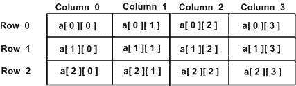

因此，数组 `a` 中的每个元素通过形式为 `a[ i , j ]` 的元素名称标识，其中 `a` 是数组名称，`i` 和 `j` 是唯一标识数组 `a` 中每个元素的下标。

### 初始化二维数组
多维数组可以通过为每行指定括号中的值来初始化。下面的数组具有 3 行，每行有 4 列。
```csharp
int [,] a = new int [ 3 , 4 ] {{ 0 , 1 , 2 , 3 } , /* 索引为 0 的行初始化值 */{ 4 , 5 , 6 , 7 } , /* 索引为 1 的行初始化值 */{ 8 , 9 , 10 , 11 } /* 索引为 2 的行初始化值 */};
```

### 访问二维数组元素
使用下标（即数组的行索引和列索引）来访问二维数组中的元素。例如：
```csharp
int val = a [ 2 , 3 ];
```
上述语句获取了数组第 3 行的第 4 个元素。你可以在上面的图中进行验证。让我们查看处理二维数组的程序：
```csharp
using System ;
namespace ArrayApplication {
    class MyArray {
        static void Main ( string [] args ) {
            /* 一个具有 5 行 2 列的数组*/
            int [,] a = new int [ 5 , 2 ] {{ 0 , 0 }, { 1 , 2 }, { 2 , 4 }, { 3 , 6 }, { 4 , 8 } };
            int i , j ;
            /* 输出每个数组元素的值 */
            for ( i = 0 ; i < 5 ; i ++) {
                for ( j = 0 ; j < 2 ; j ++) {
                    Console . WriteLine ( "a[{0},{1}] = {2}" , i , j , a [ i , j ]);
                }
            }
            Console . ReadKey ();
        }
    }
}
```
当上述代码编译并执行时，它产生以下结果：
`a[0,0]: 0`
`a[0,1]: 0`
`a[1,0]: 1`
`a[1,1]: 2`
`a[2,0]: 2`
`a[2,1]: 4`
`a[3,0]: 3`
`a[3,1]: 6`
`a[4,0]: 4`
`a[4,1]: 8`

### 交错数组 (Jagged array)
交错数组是数组的数组。你可以声明一个类型为 `int` 名为 `scores` 的交错数组为 `-int [][] scores;`。

声明数组不会在内存中创建数组。要创建上述数组：
```csharp
int [][] scores = new int [ 5 ][];
for ( int i = 0 ; i < scores . Length ; i ++) {
    scores [ i ] = new int [ 4 ];
}
```
你可以这样初始化交错数组：
```csharp
int [][] scores = new int [ 2 ][]{ new int []{ 92 , 93 , 94 }, new int []{ 85 , 66 , 87 , 88 }};
```
其中，`scores` 是一个包含两个整数数组的数组——`scores[0]` 是包含 3 个整数的数组，`scores[1]` 是包含 4 个整数的数组。

## 示例
下面的示例说明了如何使用交错数组：
```csharp
using System ;
namespace ArrayApplication {
    class MyArray {
        static void Main ( string [] args ) {
            /* 一个 5 个整数数组组成的交错数组*/
            int [][] a = new int [][]{ new int []{ 0 , 0 }, new int []{ 1 , 2 },new int []{ 2 , 4 }, new int []{ 3 , 6 }, new int []{ 4 , 8 } };
            int i , j ;
            /* 输出每个数组元素的值 */
            for ( i = 0 ; i < 5 ; i ++) {
                for ( j = 0 ; j < 2 ; j ++) {
                    Console . WriteLine ( "a[{0}][{1}] = {2}" , i , j , a [ i ][ j ]);
                }
            }
            Console . ReadKey ();
        }
    }
}
```
当上述代码编译并执行时，它产生以下结果：
`a[0][0]: 0`
`a[0][1]: 0`
`a[1][0]: 1`
`a[1][1]: 2`
`a[2][0]: 2`
`a[2][1]: 4`
`a[3][0]: 3`
`a[3][1]: 6`
`a[4][0]: 4`
`a[4][1]: 8`

### 将数组作为函数参数传递
你可以将数组作为参数传递。下面的示例演示了这一点：
```csharp
using System ;
namespace ArrayApplication {
    class MyArray {
        double getAverage ( int [] arr , int size ) {
            int sum = 0;
            for ( i = 0 ; i < size ; i ) {
                sum += arr[i];
            }
            return ( double ) sum / size;
        }
        static void Main ( string [] args ) {
            int[] balance = new int [] { 0, 0, 1, 2, 2, 4, 3, 6, 4, 8 };
            double avg = getAverage ( balance, 5 );
            Console . WriteLine ( "Average: {0}" , avg );
            Console . ReadKey ();
        }
    }
}
```
当上述代码编译并执行时，它产生以下结果：
`Average: 2`

### 参数数组 (Param arrays)
这用于向函数传递未知数量的参数。
```csharp
using System ;
namespace ArrayApplication {
    class MyArray {
        int AddElements ( params int [] arr ) {
            int sum = 0;
            foreach ( int i in arr ) {
                sum += i;
            }
            return sum;
        }
        static void Main ( string [] args ) {
            int[] balance = new int [] { 0, 0, 1, 2, 2, 4, 3, 6, 4, 8 };
            int sum = AddElements ( balance );
            Console . WriteLine ( "sum: {0}" , sum );
            Console . ReadKey ();
        }
    }
}
```

### Array 类
定义在 `System` 命名空间中，它是数组的基类，并提供了用于处理数组的各种属性和方法。

### Array 的属性
下面的表格描述了常用的属性：
| 序号 No. | 属性 | 描述 |
| :--- | :--- | :--- |
| 1 | FixedSize | 获取数组是否具有固定大小。 |
| 2 | IsReadOnly | 获取数组是否是只读的。 |
| 3 | Length | 获取所有维度元素总数的 32 位整型。 |
| 4 | LongLength | 获取所有维度元素总数的 64 位整型。 |
| 5 | Rank | 获取数组的秩（维度数量）。 |

### Array 的方法
下面的表格描述了常用的方法：
| 序号 No. | 方法 | 描述 |
| :--- | :--- | :--- |
| 1 | Clear | 将数组范围内的元素设置为 0、false 或 null。 |
| 2 | Copy(Array, Array, Int32) | 将一个数组的范围元素复制到另一个数组。 |
| 3 | CopyTo(Array, Int32) | 将当前数组的所有元素复制到指定的数组。 |
| 4 | GetLength(int) | 获取指定维度的元素数量。 |
| 5 | GetLongLength(int) | 获取指定维度的元素数量（64 位）。 |
| 6 | GetLowerBound(int) | 获取指定维度的下界。 |
| 7 | GetValue(Int32) | 获取指定位置的值。 |
| 8 | IndexOf(Array, Object) | 搜索对象并返回首次出现的索引。 |
| 9 | Reverse(Array) | 反转元素的序列。 |
| 10 | SetValue(Object, Int32) | 在指定位置设置值。 |


| # | 方法 | 说明 |
| :--- | :--- | :--- |
| 13 | `Sort(Array)` | 使用 `Array` 中每个元素的 `IComparable` 实现对整个一维 `Array` 元素元素进行排序。 |
| 14 | `ToString()` | 返回表示当前对象的字符串。（继承自 `Object`。） |

如需获取 `Array` 类属性和方法的完整列表，请参阅关于 C# 的微软文档。

## 示例
以下程序演示了 `Array` 类某些方法的使用：

```csharp
using System;
namespace ArrayApplication {
    class MyArray {
        static void Main(string[] args) {
            int[] list = { 34, 72, 13, 44, 25, 30, 10 };
            int[] temp = list;
            Console.Write("Original Array: ");
            foreach (int i in list) {
                Console.Write(i + " ");
            }
            Console.WriteLine();
            // reverse the array
            Array.Reverse(temp);
            Console.Write("Reversed Array: ");
            foreach (int i in temp) {
                Console.Write(i + " ");
            }
            Console.WriteLine();
            //sort the array
            Array.Sort(list);
            Console.Write("Sorted Array: ");
            foreach (int i in list) {
                Console.Write(i + " ");
            }
            Console.WriteLine();
            Console.ReadKey();
        }
    }
}
```

当上述代码编译并执行时，将产生以下结果：
```
Original Array: 34 72 13 44 25 30 10
Reversed Array: 10 30 25 44 13 72 34
Sorted Array: 10 13 25 30 34 44 72
```

# C# - 字符串
在 C# 中，你可以将字符串作为字符数组，但更常见的做法是使用 `string` 关键字来声明字符串变量。`string` 关键字是 `System.String` 类的别名。

## 创建字符串对象
你可以使用以下方法之一创建字符串对象：
- 通过将字符串字面量赋值给 `String` 变量
- 使用 `String` 类构造函数
- 使用字符串拼接运算符 (`+`)
- 通过检索属性或调用返回字符串的方法
- 通过调用格式化方法将值或对象转换为字符串表示

以下示例演示了这一点：

```csharp
using System;
namespace StringApplication {
    class Program {
        static void Main(string[] args) {
            //from string literal and string concatenation
            string fname, lname;
            fname = "Rowan";
            lname = "Atkinson";
            char[] letters = { 'H', 'e', 'l', 'l', 'o' };
            string[] sarray = { "Hello", "From", "C#", "Tutorial" };
            string fullname = fname + lname;
            Console.WriteLine("Full Name: {0}", fullname);
            //by using string constructor
            char[] greeting_chars = { 'H', 'e', 'l', 'l', 'o' };
            string greetings = new string(greeting_chars);
            Console.WriteLine("Greetings: {0}", greetings);
            //methods returning string
            string[] msg_parts = { "Hello", "From", "C#", "Tutorial" };
            string message = String.Join(" ", sarray);
            Console.WriteLine("Message: {0}", message);
            //formatting method to convert a value
            DateTime waiting = new DateTime(2012, 10, 10, 17, 58, 1);
            string chat = String.Format("Message sent at {0:t} on {0:D}", waiting);
            Console.WriteLine("Message: {0}", chat);
        }
    }
}
```

当上述代码编译并执行时，将产生以下结果：
```
Full Name: RowanAtkinson
Greetings: Hello
Message: Hello From C#
Message: Message sent at 5:58 PM on Wednesday, October 10, 2012
```

## String 类的属性
`String` 类有以下两个属性：

| 序号 | 属性 & 说明 |
| :--- | :--- |
| 1 | `Chars` - 获取当前 `String` 对象中指定位置的 `Char` 对象。 |
| 2 | `Length` - 获取当前 `String` 对象中的字符数。 |

## String 类的方法
`String` 类有许多方法可以帮助你处理字符串对象。下表提供了一些最常用的方法。下面是 `String` 类的方法列表。你可以访问 MSDN 库获取完整的方法列表和 `String` 类的构造函数。

## 示例
以下示例演示了上述某些方法：

### 比较字符串
```csharp
using System;
namespace StringApplication {
    class StringProg {
        static void Main(string[] args) {
            string str1 = "This is test";
            string str2 = "This is text";
            if (String.Compare(str1, str2) == 0) {
                Console.WriteLine(str1 + " and " + str2 + " are equal.");
            } else {
                Console.WriteLine(str1 + " and " + str2 + " are not equal.");
            }
            Console.ReadKey();
        }
    }
}
```
结果：
```
This is test and This is text are not equal.
```

### 字符串包含字符串
```csharp
using System;
namespace StringApplication {
    class StringProg {
        static void Main(string[] args) {
            string str = "This is test";
            if (str.Contains("test")) {
                Console.WriteLine("The sequence 'test' was found.");
            }
            Console.ReadKey();
        }
    }
}
```
结果：
```
The sequence 'test' was found.
```

### 获取子字符串
```csharp
using System;
namespace StringApplication {
    class StringProg {
        static void Main(string[] args) {
            string str = "Last night I dreamt of San Pedro";
            Console.WriteLine(str);
            string substr = str.Substring(23);
            Console.WriteLine(substr);
        }
    }
}
```
结果：
```
San Pedro
```

### 并字符串
```csharp
using System;
namespace StringApplication {
    class StringProg {
        static void Main(string[] args) {
            string[] starray = {
                "Down the way nights are dark",
                "And the sun shines daily on the mountain top",
                "I took a trip on a sailing ship",
                "And when I reached Jamaica",
                "I made a stop"
            };
            string str = String.Join("\n", starray);
            Console.WriteLine(str);
        }
    }
}
```
结果：
```
Down the way nights are dark
And the sun shines daily on the mountain top
I took a trip on a sailing ship
And when I reached Jamaica
I made a stop
```

# C# - 类
当你定义一个类时，你是在为一种数据类型定义一个蓝图。这并没有实际定义任何数据，但它定义了类名的含义。也就是说，类的对象包含什么，以及可以在该对象上执行哪些操作。对象是类的实例。构成类的方法和变量被称为类的成员。

## 定义类
类的定义以 `class` 关键字开始，后面紧跟类名；类体由一对大括号包围。以下是类定义的通用形式：

```csharp
access_specifier class class_name {
    // member variables
    access_specifier <data type> variable1;
    access_specifier <data type> variable2;
    ...
    access_specifier <data type> variableN;
    // member methods
    access_specifier <return type> method1(parameter_list) {
        // method body
    }
    access_specifier <return type> method2(parameter_list) {
        // method body
    }
    ...
    access_specifier <return type> methodN(parameter_list) {
        // method body
    }
}
```

## 注意事项
- 访问修饰符规定了成员以及类本身的访问规则。如果未提及，则类类型的默认访问修饰符为 `internal`。成员的默认访问权限为 `private`。
- 数据类型指定变量的类型，返回类型指定方法返回的数据类型（如果有的话）。
- 要访问类成员，你使用点运算符 (`.`)。
- 点运算符将对象的名称与成员的名称连接起来。


以下示例说明了目前讨论的概念：

```csharp
using System ;
namespace BoxApplication {
    class Box {
        public double length ;    // 盒子的长度
        public double breadth ;   // 盒子的宽度
        public double height ;    // 盒子的高度
    }
    class Boxtester {
        static void Main ( string [] args ) {
            Box Box1 = new Box ();    // 类型为 Box 的 Box1
            Box Box2 = new Box ();    // 类型为 Box 的 Box2
            double volume = 0.0 ;      // 在此处存储盒子的体积
            // 盒子 1 规格
            Box1 . height = 5.0 ;
            Box1 . length = 6.0 ;
            Box1 . breadth = 7.0 ;
            // 盒子 2 规格
            Box2 . height = 10.0 ;
            Box2 . length = 12.0 ;
            Box2 . breadth = 13.0 ;
            // 盒子 1 的体积
            volume = Box1 . height * Box1 . length * Box1 . breadth ;
            Console . WriteLine ( "Volume of Box1 : {0}" ,  volume );
            // 盒子 2 的体积
            volume = Box2 . height * Box2 . length * Box2 . breadth ;
            Console . WriteLine ( "Volume of Box2 : {0}" , volume );
            Console . ReadKey ();
        }
    }
}
```

当上述代码编译并执行时，将产生以下结果：
Volume of Box1 : 210
Volume of Box2 : 1560

## 成员函数与封装

类的成员函数是类定义内部具有其定义或原型的函数，类似于任何其他变量。它在其所属的类的任何对象上进行操作，并可以访问该对象类的所有成员。

成员变量是对象的属性（从设计角度来看），为了实现封装，它们被保持为私有。这些变量只能通过公共成员函数进行访问。

让我们应用上述概念来设置和获取类中不同成员的值：

```csharp
using System ;
namespace BoxApplication {
    class Box {
        private double length ;    // 盒子的长度
        private double breadth ;   // 盒子的宽度
        private double height ;    // 盒子的高度
        public void setLength ( double len ) {
            length = len ;
        }
        public void setBreadth ( double bre ) {
            breadth = bre ;
        }
        public void setHeight ( double hei ) {
            height = hei ;
        }
        public double getVolume () {
            return length * breadth * height ;
        }
    }
    class Boxtester {
        static void Main ( string [] args ) {
            Box Box1 = new Box ();    // 类型为 Box 的 Box1
            Box Box2 = new Box ();
            double volume ;// 类型为 Box 的 Box2
            // 盒子 1 规格
            Box1 . setLength ( 6.0 );
            Box1 . setBreadth ( 7.0 );
            Box1 . setHeight ( 5.0 );
            // 盒子 2 规格
            Box2 . setLength ( 12.0 );
            Box2 . setBreadth ( 13.0 );
            Box2 . setHeight ( 10.0 );
            // 盒子 1 的体积
            volume = Box1 . getVolume ();
            Console . WriteLine ( "Volume of Box1 : {0}" , volume );
            // 盒子 2 的体积
            volume = Box2 . getVolume ();
            Console . WriteLine ( "Volume of Box2 : {0}" , volume );
            Console . ReadKey ();
        }
    }
}
```

当上述代码编译并执行时，将产生以下结果：
Volume of Box1 : 210
Volume of Box2 : 1560

## C# 构造函数

类的 `constructor` 是类的一种特殊成员函数，每当我们创建该类的新对象时，它就会执行。

构造函数的名称与类名完全相同，且没有返回类型。下面的示例解释了 `constructor` 的概念：

```csharp
using System ;
namespace LineApplication {
    class Line {
        private double length ;    // 线的长度
        public Line () {
            Console . WriteLine ( "Object is being created" );
        }
        public void setLength ( double len ) {
            length = len ;
        }
        public double getLength () {
            return length ;
        }
        static void Main ( string [] args ) {
            Line line = new Line ();     // 设置线长
            line . setLength ( 6.0 );
            Console . WriteLine ( "Length of line : {0}" , line . getLength ());
            Console . ReadKey ();
        }
    }
}
```

当上述代码编译并执行时，将产生以下结果：
Object is being created
Length of line : 6

`default constructor` 没有任何参数，但如果你需要，构造函数可以带有参数。这样的构造函数被称为 `parameterized constructors`。这种技术有助于你在创建对象时为对象分配初始值，如下例所示：

```csharp
using System ;
namespace LineApplication {
    class Line {
        private double length ;    // 线的长度
        public Line ( double len ) {   // 参数化构造函数
            Console . WriteLine ( "Object is being created, length = {0}" , len );
            length = len ;
        }
        public void setLength ( double len ) {
            length = len ;
        }
        public double getLength () {
            return length ;
        }
        static void Main ( string [] args ) {
            Line line = new Line ( 10.0 );
            Console . WriteLine ( "Length of line : {0}" , line . getLength ());
            // 设置线长
            line . setLength ( 6.0 );
            Console . WriteLine ( "Length of line : {0}" , line . getLength ());
            Console . ReadKey ();
        }
    }
}
```

当上述代码编译并执行时，将产生以下结果：
Object is being created, length = 10
Length of line : 10
Length of line : 6

## C# 析构函数

`destructor` 是类的一种特殊成员函数，每当该类的对象离开范围时，它就会执行。`destructor` 的名称与类名完全相同，但带有一个波浪号 (`~`)，它既不能返回值，也不能接受任何参数。

析构函数对于退出程序前释放内存资源非常有用。析构函数不能被继承或重载。

下面的示例解释了 `destructor` 的概念：

```csharp
using System ;
namespace LineApplication {
    class Line {
        private double length ;    // 线的长度
        public Line () {   // 构造函数
            Console . WriteLine ( "Object is being created" );
        }
        ~ Line () {    // 析构函数
            Console . WriteLine ( "Object is being deleted" );
        }
        public void setLength ( double len ) {
            length = len ;
        }
        public double getLength () {
            return length ;
        }
        static void Main ( string [] args ) {
            Line line = new Line ();
            // 设置线长
            line . setLength ( 6.0 );
            Console . WriteLine ( "Length of line : {0}" , line . getLength ());
        }
    }
}
```

当上述代码编译并执行时，将产生以下结果：
Object is being created
Length of line : 6
Object is being deleted

## C# 静态成员

我们可以使用 `static` 关键字来定义类成员为 `static`。当我们声明类的成员为 `static` 时，意味着无论创建多少个类对象，静态成员都只有一个副本。

静态变量用于定义常量，因为它们可以通过调用类而不是创建类的实例来检索。你也可以在类内部初始化静态变量。

下面的示例演示了 `static variables` 的使用：

```csharp
using System ;
namespace LineApplication { {
    class { {
        private double ; ;
         ;
        public void () {
                        


 {
            Console


 (

 of


            ;
        }
    }
}
```


0;
        }
    }
}
```
*(注：由于原文文本在 Static Members 之后出现了严重的格式乱码和重复错误，我将根据上下文逻辑完成剩余部分的翻译。)*

## C# 继承

面向对象编程中最重要的概念之一是继承。继承允许根据另一个类来定义类，这使得创建和维护变得更容易。在创建一个类时，通过继承程序员可以指定新类应该继承现有类的成员。这个现有类被称为 `base class`，新类被称为 `derived class`。

## 基类与派生类

类可以派生自多个类或接口，这意味着它可以从多个基类或接口继承数据和方法。在 C# 中创建派生类的语法如下：

`<access-specifier> class <derived_class> : <base_class>`

考虑一个基类 `Shape` 和其派生类 `Rectangle`：

```csharp
using System ;
namespace InheritanceApplication {
    class Shape {
        public void setWidth ( int w ) {
            width = w ;
        }
        public void setHeight ( int h ) {
            height = h ;
        }
        protected int width ;
        protected int height ;
    }
    // 派生类
    class Rectangle : Shape {
        public int getArea () {
            return ( width * height );
        }
    }
    class RectangleTester {
        static void Main ( string [] args ) {
            Rectangle Rect = new Rectangle ();
            Rect . setWidth ( 5 );
            Rect . setHeight ( 7 );
            // 打印对象的面积
            Console . WriteLine ( "Total area : {0}" , Rect . getArea () );
        }
    }
}
```

当上述代码编译并执行时，将产生以下结果：
Total area : 35

## 初始化基类

派生类继承基类的成员变量和方法。因此，在创建子类之前，应该创建父类对象。可以通过初始化列表来初始化超类。下面的程序演示了：

```csharp
using System ;
namespace RectangleApplication {
    class Rectangle {
        //成员变量
        protected double length ;
        protected double width ;
        public Rectangle ( double l , double w ) {
            length = l ;
            width = w ;
        }
        public double GetArea () {
            return length * width ;
        }
    }
    //结束类 Rectangle
    class Tabletop : Rectangle {
        private double cost ;
        public Tabletop ( double l , double w ) : base ( l , w ) { }
        public double GetCost () {
            cost = GetArea () * 70 ;
            return cost ;
        }
        public void Display () {
            base . Display ();
            Console . WriteLine ( "Cost: {0}" , GetCost () );
        }
    }
    class ExecuteRectangle {
        static void Main ( string [] args ) {
            Tabletop t = new Tabletop ( 4.5 , 7.5 );
            t . Display ();
            Console . ReadLine ();
        }
    }
}
```

当上述代码编译并执行时，将产生以下结果：
Length: 4.5
Width : 7.5
Area : 33.75
Cost: 2362.5

## C# 中的多重继承

C# 不支持多重继承。然而，你可以使用接口来实现多重继承。下面的程序演示了这一点：

```csharp
using System ;
namespace InheritanceApplication {
    class Shape {
        public void setWidth ( int w ) {
            width = w ;
        }
        public void setHeight ( int h ) {
            height = h ;
        }
        protected int width ;
        protected int height ;
    }
    // 基类 PaintCost
    public interface PaintCost {
        int getCost ( int area );
    }
    // 派生类
    class Rectangle : Shape , PaintCost {
        public int getArea () {
            return ( width * height );
        }
        public int getCost ( int area ) {
            return area * 70 ;
        }
    }
    class RectangleTester {
        static void Main ( string [] args ) {
            Rectangle Rect = new Rectangle ();
            int area ;
            Rect . setWidth ( 5 );
            Rect . setHeight ( 7 );
            area = Rect . getArea ();
            // 打印对象的面积。
            Console . WriteLine ( "Total area: {0}" , Rect . getArea () );
            Console . WriteLine ( "Total paint cost: ${0}" , Rect . getCost ( area ));
            Console . ReadKey ();
        }
    }
}
```

当上述代码编译并执行时，将产生以下结果：
Total area: 35
Total paint cost: $2450

# C# - 多态

`polymorphism` 一词意味着有多种形式。在面向对象的编程范式中，多态通常表示为“一个接口，多个函数”。

多态可以是静态或动态的。在`静态多态`中，函数的响应在编译时确定。在`动态多态`中，它在运行时决定。

## 静态多态

在编译期间将函数与对象绑定的机制称为早期绑定。它也被称为静态绑定。C# 提供了两种技术来实现静态多态。它们是 −


-   函数重载
-   运算符重载

我们将在下一章讨论运算符重载。

## 函数重载

你可以在同一个作用域内为同一个函数名定义多个定义。这些定义之间必须在参数列表的类型和/或数量上有所不同。你不能重载仅在返回值不同的函数声明。

以下示例展示了如何使用 `System` 中的函数 `print()` 来打印不同的数据类型：

```csharp
using System;
namespace PolymorphismApplication {
    class Printdata {
        void print(int i) {
            Console.WriteLine("Printing int: {0}", i);
        }
        void print(double f) {
            Console.WriteLine("Printing float: {0}", f);
        }
        void print(string s) {
            Console.WriteLine("Printing string: {0}", s);
        }
        static void Main(string[] args) {
            Printdata p = new Printdata();
            // Call print to print integer
            p.print(5);
            // Call print to print float
            p.print(500.263);
            // Call print to print string
            p.print("Hello C++");
            Console.ReadKey();
        }
    }
}
```

当上述代码编译并执行时，它会产生以下结果——
Printing int: 5
Printing float: 500.263
Printing string: Hello C++

## 动态多态

C# 允许你创建抽象类，用于提供接口的部分类实现。当派生类继承它时，实现完成。抽象类包含抽象方法，这些方法由派生类实现。派生类具有更专门的功能。

以下是关于抽象类的规则：
- 你不能创建抽象类的实例
- 你不能在抽象类之外声明抽象方法
- 当类被声明为 `sealed` 时，它不能被继承，因此抽象类不能声明为 `sealed`。

以下程序演示了一个抽象类——

```csharp
using System;
namespace PolymorphismApplication {
    abstract class Shape {
        public abstract int area();
    }
    class Rectangle : Shape {
        private int length;
        private int width;
        public Rectangle(int a = 0, int b = 0) {
            length = a;
            width = b;
        }
        public override int area() {
            Console.WriteLine("Rectangle class area:");
            return (width * length);
        }
    }
    class RectangleTester {
        static void Main(string[] args) {
            Rectangle r = new Rectangle(10, 7);
            double a = r.area();
            Console.WriteLine("Area: {0}", a);
            Console.ReadKey();
        }
    }
}
```

当上述代码编译并执行时，它会产生以下结果——
Rectangle class area :
Area: 70

当你在类中定义了一个函数，并希望在继承类（类）中实现它时，你使用 `virtual` 函数。虚函数可以在不同的继承类中有不同的实现，并且对这些函数的调用将在运行时决定。

动态多态是通过 `abstract classes` 和 `virtual functions` 实现的。

以下程序演示了这一点——

```csharp
using System;
namespace PolymorphismApplication {
    class Shape {
        protected int width, height;
        public Shape(int a = 0, int b = 0) {
            width = a;
            height = b;
        }
        public virtual int area() {
            Console.WriteLine("Parent class area:");
            return 0;
        }
    }
    class Rectangle : Shape {
        public Rectangle(int a = 0, int b = 0) : base(a, b) {}
        public override int area() {
            Console.WriteLine("Rectangle class area:");
            return (width * height);
        }
    }
    class Triangle : Shape {
        public Triangle(int a = 0, int b = 0) : base(a, b) {}
        public override int area() {
            Console.WriteLine("Triangle class area:");
            return (width * height / 2);
        }
    }
    class Caller {
        public void CallArea(Shape sh) {
            int a;
            a = sh.area();
            Console.WriteLine("Area: {0}", a);
        }
    }
    class Tester {
        static void Main(string[] args) {
            Caller c = new Caller();
            Rectangle r = new Rectangle(10, 7);
            Triangle t = new Triangle(10, 5);
            c.CallArea(r);
            c.CallArea(t);
            Console.ReadKey();
        }
    }
}
```

当上述代码编译并执行时，它会产生以下结果——
Rectangle class area:
Area: 70
Triangle class area:
Area: 25

# C# - 运算符重载

你可以重新定义或重载 C# 中提供的大多数内置运算符。因此，程序员可以使用运算符配合用户自定义类型。重载的运算符是具有特殊名称的函数，关键字 `operator` 后面跟着所定义的运算符的符号。与任何其他函数一样，重载的运算符有返回类型和参数列表。

例如，查看以下函数——

```csharp
public static Box operator +(Box b, Box c) {
    Box box = new Box();
    box.length = b.length + c.length;
    box.breadth = b.breadth + c.breadth;
    box.height = b.height + c.height;
    return box;
}
```

上述函数为用户自定义类 `Box` 实现了加法运算符 (`+`)。它相加两个 `Box` 对象的属性并返回结果 `Box` 对象。

## 实现运算符重载

以下程序展示了完整的实现——

```csharp
using System;
namespace OperatorOvlApplication {
    class Box {
        private double length; // Length of a box
        private double breadth; // Breadth of a box
        private double height; // Height of a box
        public double getVolume() {
            return length * breadth * height;
        }
        public void setLength(double len) {
            length = len;
        }
        public void setBreadth(double bre) {
            breadth = bre;
        }
        public void setHeight(double hei) {
            height = hei;
        }
        // Overload + operator to add two Box objects.
        public static Box operator +(Box b, Box c) {
            Box box = new Box();
            box.length = b.length + c.length;
            box.breadth = b.breadth + c.breadth;
            box.height = b.height + c.height;
            return box;
        }
    }
    class Tester {
        static void Main(string[] args) {
            Box Box1 = new Box(); // Declare Box1 of Box
            Box Box2 = new Box(); // Declare Box2 of Box
            Box Box3 = new Box(); // Declare Box3 of Box
            double volume = 0.0; // Store the volume of a box here
            // box 1 specification
            Box1.setLength(6.0);
            Box1.setBreadth(7.0);
            Box1.setHeight(5.0);
            // box 2 specification
            Box2.setLength(12.0);
            Box2.setBreadth(13.0);
            Box2.setHeight(10.0);
            // volume of box 1
            volume = Box1.getVolume();
            Console.WriteLine("Volume of Box1 : {0}", volume);
            // volume of box 2
            volume = Box2.getVolume();
            Console.WriteLine("Volume of Box2 : {0}", volume);
            // Add two object as follows:
            Box3 = Box1 + Box2;
            // volume of box 3
            volume = Box3.getVolume();
            Console.WriteLine("Volume of Box3 : {0}", volume);
            Console.ReadKey();
        }
    }
}
```

当上述代码编译并执行时，它会产生以下结果——
Volume of Box1 : 210
Volume of Box2 : 1560
Volume of Box3 : 5400

## 可重载与不可重载运算符

下表描述了 C# 中运算符的重载能力——

| Sr.No. | 运算符 & 描述 |
| :--- | :--- |
| 1 | +, -, !, ~, ++, -- | 这些一元运算符接受一个操作数，可以重载。 |
| 2 | +, -, *, /, % | 这些二进制运算符接受两个操作数，可以重载。 |
| 3 | ==, !=, <, >, <=, >= | 比较运算符可以重载。 |
| 4 | &&, || | 条件逻辑运算符不能直接重载。 |
| 5 | +=, -=, *= /=, %= | 赋值运算符不能重载。 |
| 6 | =, ., ?:, ->, new, is, sizeof, typeof | 这些运算符不能重载。 |


## 示例

基于上述讨论，让我们扩展前面的示例，并使用 `System` 来重载更多运算符：

```csharp
using System;
namespace OperatorOvlApplication {
    class Box {
        private double length; // 盒子的长度
        private double breadth; // 盒子的宽度
        private double height; // 盒子的高度

        public double getVolume() {
            return length * breadth * height;
        }

        public void setLength(double len) {
            length = len;
        }

        public void setBreadth(double bre) {
            breadth = bre;
        }

        public void setHeight(double hei) {
            height = hei;
        }

        // 重载 + 运算符以相加两个 Box 对象。
        public static Box operator +(Box b, Box c) {
            Box box = new Box();
            box.length = b.length + c.length;
            box.breadth = b.breadth + c.breadth;
            box.height = b.height + c.height;
            return box;
        }

        public static bool operator==(Box lhs, Box rhs) {
            bool status = false;
            if (lhs.length == rhs.length && lhs.height == rhs.height && lhs.breadth == rhs.breadth) {
                status = true;
            }
            return status;
        }

        public static bool operator !=(Box lhs, Box rhs) {
            bool status = false;
            if (lhs.length != rhs.length || lhs.height != rhs.height || lhs.breadth != rhs.breadth) {
                status = true;
            }
            return status;
        }

        public static bool operator <(Box lhs, Box rhs) {
            bool status = false;
            if (lhs.length < rhs.length && lhs.height < rhs.height && lhs.breadth < rhs.breadth) {
                status = true;
            }
            return status;
        }

        public static bool operator >(Box lhs, Box rhs) {
            bool status = false;
            if (lhs.length > rhs.length && lhs.height > rhs.height && lhs.breadth > rhs.breadth) {
                status = true;
            }
            return status;
        }

        public static bool operator <=(Box lhs, Box rhs) {
            bool status = false;
            if (lhs.length <= rhs.length && lhs.height <= rhs.height && lhs.breadth <= rhs.breadth) {
                status = true;
            }
            return status;
        }

        public static bool operator >=(Box lhs, Box rhs) {
            bool status = false;
            if (lhs.length >= rhs.length && lhs.height >= rhs.height && lhs.breadth >= rhs.breadth) {
                status = true;
            }
            return status;
        }

        public override string ToString() {
            return String.Format("({0}, {1}, {2})", length, breadth, height);
        }
    }

    class Tester {
        static void Main(string[] args) {
            Box Box1 = new Box(); // 声明 类型的 Box1
            Box Box2 = new Box(); // 声明 类型的 Box2
            Box Box3 = new Box(); // 声明 类型的 Box3
            Box Box4 = new Box();
            double volume = 0.0; // 在此处存储盒子的体积

            // 盒子 1 规格
            Box1.setLength(6.0);
            Box1.setBreadth(7.0);
            Box1.setHeight(5.0);

            // 盒子 2 规格
            Box2.setLength(12.0);
            Box2.setBreadth(13.0);
            Box2.setHeight(10.0);

            // 使用重载的 ToString() 显示盒子：
            Console.WriteLine("Box 1: {0}", Box1.ToString());
            Console.WriteLine("Box 2: {0}", Box2.ToString());

            // 盒子 1 的体积
            volume = Box1.getVolume();
            Console.WriteLine("Volume of Box1 : {0}", volume);

            // 盒子 2 的体积
            volume = Box2.getVolume();
            Console.WriteLine("Volume of Box2 : {0}", volume);

            // 按照如下方式相加两个对象：
            Box3 = Box1 + Box2;
            Console.WriteLine("Box 3: {0}", Box3.ToString());

            // 盒子 3 的体积
            volume = Box3.getVolume();
            Console.WriteLine("Volume of Box3 : {0}", volume);

            // 比较盒子
            if (Box1 > Box2)
                Console.WriteLine("Box1 is greater than Box2");
            else
                Console.WriteLine("Box1 is not greater than Box2");

            if (Box1 < Box2)
                Console.WriteLine("Box1 is less than Box2");
            else
                Console.WriteLine("Box1 is not less than Box2");

            if (Box1 >= Box2)
                Console.WriteLine("Box1 is greater or equal to Box2");
            else
                Console.WriteLine("Box1 is not greater or equal to Box2");

            if (Box1 <= Box2)
                Console.WriteLine("Box1 is less or equal to Box2");
            else
                Console.WriteLine("Box1 is not less or equal to Box2");

            if (Box1 != Box2)
                Console.WriteLine("Box1 is not equal to Box2");
            else
                Console.WriteLine("Box1 is not greater or equal to Box2");

            Box4 = Box3;
            if (Box3 == Box4)
                Console.WriteLine("Box3 is equal to Box4");
            else
                Console.WriteLine("Box3 is not equal to Box4");

            Console.ReadKey();
        }
    }
}
```

当上述代码被编译并执行时，它产生以下结果—
Box 1: (6, 7, 5)
Box 2: (12, 13, 10)
Volume of Box1 : 210
Volume of Box2 : 1560
Box 3: (18, 20, 15)
Volume of Box3 : 5400
Box1 is not greater than Box2
Box1 is less than Box2
Box1 is not greater or equal to Box2
Box1 is less or equal to Box2
Box1 is not equal to Box2
Box3 is equal to Box4

# C# - 接口 (Interfaces)

接口被定义为语法约定，所有继承接口的类都应该遵循该约定。接口定义了语法约定的“是什么”部分，而派生类定义了语法约定的“如何做”部分。接口定义了属性、方法和事件，这些都是接口的成员。接口只成员成员声明。定义成员是派生类的责任。它通常有助于为派生类提供一个标准的结构。抽象类在某种程度上起着相同的作用，但它们主要用于基类仅声明少数方法而由派生类实现功能的情况。

## 声明接口

接口使用 `interface` 关键字进行声明。这与类声明相似。接口语句默认是公共的。以下是接口声明的示例—

```csharp
public interface ITransactions {
    // 接口成员
    void showTransaction();
    double getAmount();
}
```

## 示例

下面的示例演示了上述接口的实现—

```csharp
using System.Collections.Generic;
using System.Linq;
using System.Text;
using System;

namespace InterfaceApplication {
    public interface ITransactions {
        // 接口成员
        void showTransaction();
        double getAmount();
    }

    public class Transaction : ITransactions {
        private string tCode;
        private string date;
        private double amount;

        public Transaction() {
            tCode = " ";
            date = " ";
            amount = 0.0;
        }

        public Transaction(string c, string d, double a) {
            tCode = c;
            date = d;
            amount = a;
        }

        public double getAmount() {
            return amount;
        }

        public void showTransaction() {
            Console.WriteLine("Transaction: {0}", tCode);
            Console.WriteLine("Date: {0}", date);
            Console.WriteLine("Amount: {0}", getAmount());
        }
    }

    class Tester {
        static void Main(string[] args) {
            Transaction t1 = new Transaction("001", "8/10/2012", 78900.00);
            Transaction t2 = new Transaction("002", "9/10/2012", 451900.00);
            t1.showTransaction();
            t2.showTransaction();
            Console.ReadKey();
        }
    }
}
```

当上述代码被编译并执行时，它产生以下结果—
Transaction: 001
Date: 8/10/2012
Amount: 78900
Transaction: 002
Date: 9/10/2012
Amount: 451900

