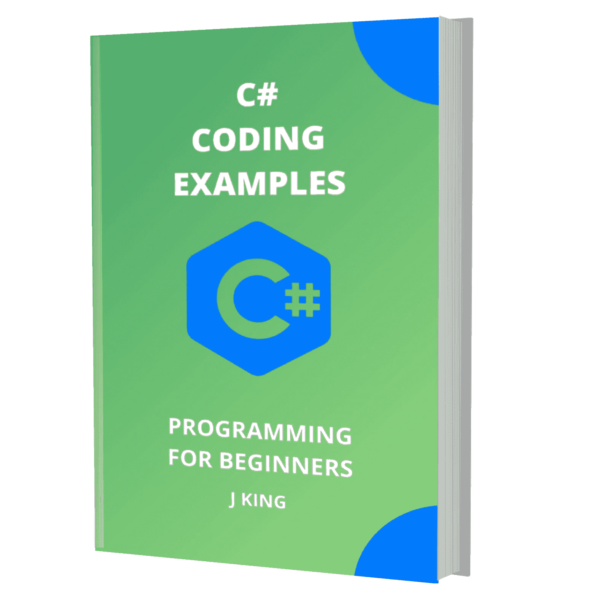

# C# 编程示例：初学者编程指南





## C# | 打印消息/文本（打印 Hello world 的程序）

我们使用以下两个函数来打印消息/文本或任何值：

- `Console.Write()`：此功能在输出设备上显示文本、值，并在消息后不插入换行。
- `Console.WriteLine()`：此功能在设备上显示文本、值，并在消息后添加一个换行。

### 程序
```csharp
/*c# 打印消息的基础程序*/
using System;
class HelloWorld {
    static void Main() {
        // 在消息后不插入换行的文本
        Console.Write("Hello World,");
        Console.Write("How are you?");
        // 换行
        Console.WriteLine();
        // 在消息后带有换行行的文本
        Console.WriteLine("Hello World");
        Console.WriteLine("How are you?");
        // 像 C 语言一样使用转义序列换行
        Console.WriteLine("Hello World\nHow are you?");
    }
}
```

### 输出
```
Hello World,How are you?
Hello World
How are you?
Hello World
How are you?
```

## 打印新行的 C# 程序

在屏幕上打印消息时，可以使用以下方法在消息内部打印换行：

- 使用 `\n` - 打印换行
 使用 使用 `\x0A` 或 `\x A`（`\n` 的 ASCII 字面量）—— 打印换行
- 使用 `Console.WriteLine()` – 如果我们在过程中写入了消息，则会打印换行


# C# 打印新行的 C# 程序

```csharp
using System;
using System.IO;
using System.Text;
namespace IncludeHelp
{
    class Test
    {
        // 主方法
        static void Main(string[] args)
        {
            // 使用 \n
            Console.WriteLine("Hello\nWorld");
            // 使用 \x0A
            Console.WriteLine("Hello\x0AWorld");
            Console.WriteLine();
            Console.WriteLine("end of the program");
            //按回车退出程序
            Console.ReadLine();
        }
    }
}
```
输出
```
HelloWorld
HelloWorld
end of the program
```

## 打印各种数据类型大小的 C# 程序
我们将使用 `sizeof()` 运算符来打印不同数据类型的大小。

```csharp
using System;
using System.IO;
using System.Text;
namespace IncludeHelp
{
    class Test
    {
        // 主方法
        static void Main(string[] args)
        {
            Console.WriteLine("sizeof(int): {0}", sizeof(int));
            Console.WriteLine("sizeof(float): {0}", sizeof(float));
            Console.WriteLine("sizeof(char): {0}", sizeof(char));
            Console.WriteLine("sizeof(double): {0}", sizeof(double));
            Console.WriteLine("sizeof(bool): {0}", sizeof(bool));
            //按回车退出程序
            Console.ReadLine();
        }
    }
}
```
输出
```
sizeof(int): 4
sizeof(float): 4
sizeof(char): 2
sizeof(double): 8
sizeof(bool): 1
```

## C# 程序中 double 到 int 的类型转换
语法：`int_variable = (int)double_variable;`

示例：
输入：
```csharp
double a = 123456.789;
int b = 0;
//类型转换
b = (int)a;
```
输出：
```
a: 123456.789
b: 123456
```

```csharp
// 从 double 到 int 类型转换的 C# 程序
using System;
using System.IO;
using System.Text;
namespace IncludeHelp
{
    class Test
    {
        // 主方法
        static void Main(string[] args)
        {
            double a = 123456.789;
            int b = 0;
            //类型转换
            b = (int)a;
            Console.WriteLine("value of a: {0}", a);
            Console.WriteLine("value of b: {0}", b);
            //按回车退出程序
            Console.ReadLine();
        }
    }
}
```
输出
```
value of a: 123456.789
value of b: 123456
```

## 定义不同类型的常量
常量可以使用 `const` 关键字描述，一旦定义常量，其值永远无法修改。

语法：`const data_type constant_name = value;`
`const float PI = 3.14f;`

示例：
输入：
```csharp
const int a = 10;   //整数常量
Console.WriteLine("a: {0}", a);
```
输出：
```
a: 10
```

```csharp
// 定义不同类型常量的 C# 程序
using System;
using System.IO;
using System.Text;
namespace IncludeHelp
{
    class Test
    {
        // 主方法
        static void Main(string[] args)
        {
            const int a = 10;   //整数常量
            const float b = 20.23f; // float 常量
            const double c = 10.23;  //double 常量
            const char d = 'Y';      //字符常量
            const string e = "Hello";   //字符串常量
            //打印值
            Console.WriteLine("a: {0}", a);
            Console.WriteLine("b: {0}", b);
            Console.WriteLine("c: {0}", c);
            Console.WriteLine("d: {0}", d);
            Console.WriteLine("e: {0}", e);
            //按回车退出程序
            Console.ReadLine();
        }
    }
}
```
输出
```
a: 10
b: 20.23
c: 10.23
d: Y
e: Hello
```

## 演示算术运算符示例的 C# 程序
示例：
输入：
```csharp
int a = 10;
int b = 3;
//运算
int sum = a + b;
int sub = a - b;
int mul = a * b;
float div = (float)a / (float)b;
int rem = a % b;
```
输出：
```
sum = 13
sub = 7
mul = 30
div = 3.333333
rem = 1
```

```csharp
// 演示算术运算符示例的 C# 程序
using System;
using System.IO;
using System.Text;
namespace codingex
{
    class Test
    {
        // 主方法
        static void Main(string[] args)
        {
            int a = 10;
            int b = 3;
            int sum = a + b;
            int sub = a - b;
            int mul = a * b;
            float div = (float)a / (float)b;
            int rem = a % b;
            Console.WriteLine("Addition of {0} and {1} is = {2}", a, b, sum);
            Console.WriteLine("Subtraction of {0} and {1} is = {2}", a, b, sub);
            Console.WriteLine("Multiplication of {0} and {1} is = {2}", a, b, mul);
            Console.WriteLine("Division of {0} and {1} is = {2}", a, b, div);
            Console.WriteLine("Remainder of {0} and {1} is = {2}", a, b, rem);
            Console.ReadLine();
        }
    }
}
```

## 位运算符示例的 C# 程序
位运算符用于执行位运算：
- `&` (位与)：当两个位都为 1 时返回 1
- `|` (位或)：当任意一个位为 1 时返回 1
- `^` (位异异)：当仅有一个位为 1 时返回 1
- `~` (位非)：返回操作数的取反
- `<<` (左移)：将位向左移动
- `>>` (右移)：将位向右移动

语法：
`Operand1 & Operand2`
`Operand1 | Operand2`
`Operand1 ^ Operand2`
`~Operand1`
`Operand1 << Operand2`
`Operand1 >> Operand2`

## 关系运算符示例的 C# 程序
- `==` (等于)：如果两个操作数相同则返回 true
- `!=` (不等于)：如果两个操作数不相等则返回 true
- `<` (小于)：如果第一个操作数小于第二个操作数则返回 true
- `<=` (小于等于)：如果第一个操作数小于或等于第二个操作数则返回 true
- `>` (大于)：如果第一个操作数大于第二个操作数则返回 true
- `>=` (大于或等于)：如果第一个操作数大于或等于第二个操作数则返回 true

## 两个整数求和的 C# 程序
输入：
```
First number: 10
Second number: 20
```
输出：
```
Addition of 10 and 20 is = 30
```

```csharp
using System;
class AddTwoNumbers
{
    static void Main()
    {
        try
        {
            //声明两个变量
            int a = 0;
            int b = 0;
            //输入数字
            Console.Write("Enter first number: ");
            a = Convert.ToInt32(Console.ReadLine());
            Console.Write("Enter second number: ");
            b = Convert.ToInt32(Console.ReadLine());
            //计算和
            int sum = a + b;
            Console.WriteLine("Addition of " + a + " and " + b + " is = " + sum);
        }
        catch (Exception ex)
        {
            Console.WriteLine("Error: " + ex.ToString());
        }
    }
}
```

## 交换两个数字的程序

### 1) 使用临时变量交换
为了交换数字，我们使用一个临时变量来保存值。首先将第一个变量赋值给临时变量，然后将第二个变量赋值给第一个变量，最后将临时变量赋值给第二个变量。

```csharp
using System;
namespace swap
{
    class ab
    {
        static void Main(string[] args)
        {
            int a = 5;
            int b = 3;
            int temp;
            temp = a;
            a = b;
            b = temp;
            Console.WriteLine("Values after swapping:");
            Console.WriteLine("a=" + a);
            Console.WriteLine("b=" + b);
        }
    }
}
```

### 2) 不使用临时变量交换
不使用任何额外的变量来交换数字。通过特定的数学运算来实现。

```csharp
using System;
namespace swap
{
    class ab
    {
        static void Main(string[] args)
        {
            int a = 10;
            int b = 20;
            a = a + b;
            b = a - b;
            a = a - b;
            Console.WriteLine("Values after swapping:");
            Console.WriteLine("a=" + a);
            Console.WriteLine("b=" + b);
        }
    }
}
```

## 简单 if-else 语句演示
语法：
```csharp
if(test_condition)
{
    // 代码块 1
}
else
{
    // 代码块 2
}
```

## 多重 if-else 语句的 C# 示例
```csharp
using System;
using System.IO;
using System.Text;
namespace IncludeHelp
{
    class Test
    {
        // 主方法
        static void Main(string[] args)
        {
            //输入一个整数并检查它是正、负还是零
            int number;
            Console.Write("Enter an integer number: ");
            number = Convert.ToInt32(Console.ReadLine());
            //检查条件
            if (number > 0)
                Console.WriteLine("{0} is a positive number", number);
            else if (number < 0)
                Console.WriteLine("{0} is a negative number", number);
            else
                Console.WriteLine("{0} is Zero", number);
            //按回车退出程序
            Console.ReadLine();
        }
    }
}
```

## 条件运算符（三元运算符）
条件运算符也称为三元运算符，它需要 3 个操作数。它通过 `?` 和 `:` 执行。

语法：`logical ? true_block : false_block`

```csharp
using System;
using System.IO;
using System.Text;
namespace IncludeHelp
{
    class Test
    {
        // 主方法
        static void Main(string[] args)
        {
            //寻找两个数中的最大值
            int a;
            int b;
            //输入数字
            Console.Write("Enter first number : ");
            a = Convert.ToInt32(Console.ReadLine());
            Console.Write("Enter second number: ");
            b = Convert.ToInt32(Console.ReadLine());
            //寻找最大数
            int large = (a > b) ? a : b;
            Console.WriteLine("Largest number is {0}", large);
        }
    }
}
```

## switch 语句演示
switch 语句允许根据变量执行不同的代码块。

```csharp
using System;
using System.IO;
using System.Text;
namespace IncludeHelp
{
    class Test
    {
        // 主方法
        static void Main(string[] args)
        {
            int day;
            Console.Write("Enter day (0-6): ");
            day = Convert.ToInt32(Console.ReadLine());
            switch (day)
            {
                case 0:
                    Console.WriteLine("Sunday");
                    break;
                case 1:
                    Console.WriteLine("Monday");
                    break;
                case 2:
                    Console.WriteLine("Tuesday");
                    break;
                case 3:
                    Console.WriteLine("Wednesday");
                    break;
                case 4:
                    Console.WriteLine("Thursday");
                    break;
                case 5:
                    Console.WriteLine("Friday");
                    break;
                case 6:
                    Console.WriteLine("Saturday");
                    break;
                default:
                    Console.WriteLine("Invalid Input");
                    break;
            }
            Console.ReadLine();
        }
    }
}
```
