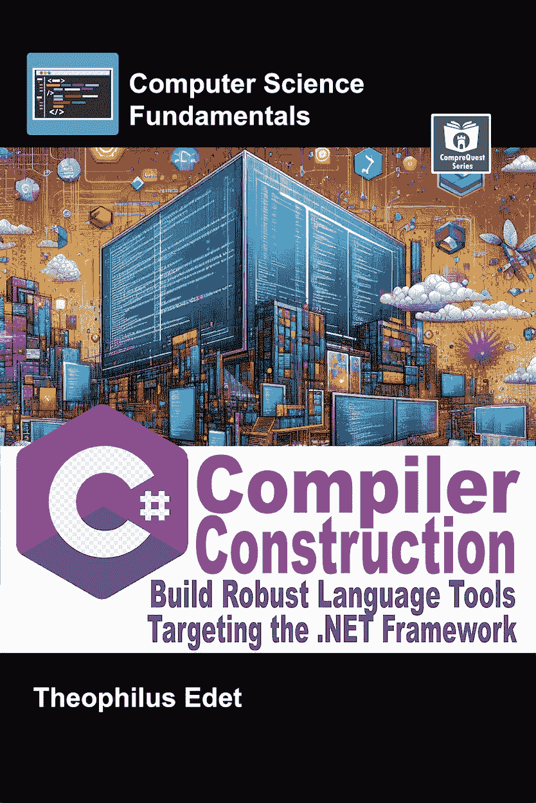

# C# 编译器构建：构建面向 .NET Framework 的健健语言工具（计算机科学基础）




![内扉页图像]


| Theophilus Edet | | |
|  | theoedet@yahoo.com |
|  | facebook.com/theoedet |
|  | twitter.com/TheophilusEdet |
|  | Instagram.com/edettheophilus |
|  |  |


基于属性的测试（Property-based testing）是一种测试技术，根据系统应该满足的属性或不变性来生成测试用例。开发者不再指定具体的输入和预期输出，而是定义编译器输出应当遵循的属性，由基于属性的测试框架生成测试用例来验证这些属性。这种技术可以发现传统测试用例可能覆盖的边界情况和边缘情况。让我们针对一个 C# 编译器项目探索基于属性的测试：

```csharp
// Example of Property-Based Testing for C# Compiler Project

[Property]

public void CompilerGeneratesValidOutput(string sourceCode)
{
    // Arrange
    var compiler = new Compiler();
    // Act
    var result = compiler.Compile(sourceCode);

    // Assert
    Assert.IsTrue(result.Success);
    Assert.IsNotNull(result.Output);

    // Validate properties of the compiler output
}
```

自动化测试技术（如持续集成、测试自动化框架和基于属性的测试）简化了 C# 编译器的测试流程，使开发者能够高效可靠地验证编译器功能。通过将自动化测试实践集成到开发工作流中，开发者可以提高对 C# 编译器实现正确性和健壮性的信心，并向用户交付高质量的软件。在后续章节中，我们将探索高级测试技术和最佳实践，以进一步增强 C# 编译器构建中的测试过程。

## 编译器输出验证技术：验证代码完整性

验证技术对于确保编译器输出的完整性和正确性至关重要，特别是在生成可执行代码是关键任务的 C# 编译器。在本节中，我们将探索验证编译器输出完整性的各种验证技术和策略，包括静态分析、动态分析、形式化验证和代码审查流程。

### 1. 静态分析
静态分析技术涉及在不执行编译器输出的情况下对其检查，专注于识别生成代码中的潜在问题、错误或漏洞。静态分析工具（如静态代码分析器和 l）分析代码结构、语法和语义，以检测常见的编程错误、风格违反和性能低效。通过对编译器输出进行静态分析，开发者可以在开发过程早期识别并解决问题。让我们在 C# 编译器的环境下演示编译器输出的静态分析：

```csharp
// Example of Static Analysis for Compiler Output

public class StaticAnalyzer
{
    public void AnalyzeGeneratedCode(string generatedCode)
{
        // 对生成的代码进行静态分析
        // 识别潜在问题、错误或漏洞
        // 为开发者提供反馈以进行改进
    }
}
```

### 2. 动态分析
动态分析技术涉及执行编译器输出并观察其运行时行为，以识别运行时错误、内存泄漏或性能瓶颈。动态分析工具（如性能分析器和调试器）监控生成代码的执行，收集运行时信息并分析运行时行为。通过对编译器输出进行动态分析，开发者可以在真实条件下验证生成代码的正确性和效率。让我们在 C# 编译器的环境下演示编译器输出的动态分析：

```csharp
// Example of Dynamic Analysis for Compiler Output

public class Profiler
{
    public void ProfileGeneratedCode(string executablePath)
    {
        // 执行编译后的可执行文件
        // 监控运行时性能指标
        // 识别性能瓶颈或内存泄漏
        // 分析运行时行为以验证正确性
    }
}
```

### 3. 形式化验证
形式化验证技术涉及从数学上证明编译器输出相对于指定属性或要求的正确性。形式化验证工具（如定理证明器和模型检查器）使用形式化方法验证生成的代码是否符合预期规范且不表现异常行为。虽然形式化验证可能消耗资源且非常复杂，但它为编译器输出的正确性提供了强有保障。让我们在 C# 编译器的环境下探索编译器输出的形式化验证：

```csharp
// Example of Formal Verification for Compiler Output

public class TheoremProver
{
    public void ProveCodeCorrectness(string generatedCode, Specification specification)
    {
        // 形式化定义所需的属性或要求
        // 使用定理证明技术验证正确性
        // 提供数学证明或反例
    }
}
```

### 4. 代码审查流程
代码审查流程涉及由丰富的开发者对编译器输出进行人工检查，以识别问题、错误或改进机会。代码审查对代码质量、设计决策和对编码标准的遵循情况提供宝贵的反馈。通过对编译器输出进行代码审查，开发者可以利用集体智慧确保代码的完整性和可维护性。让我们在 C# 编译器的环境下强调代码审查对编译器输出验证的重要性：

```csharp
// Example of Code Review Process for Compiler Output

public class CodeReviewer
{
    public void ReviewGeneratedCode(string generatedCode)
    {
        // 对生成的代码进行人工检查
        // 识别问题、错误或改进领域
        // 为开发者提供建设性反馈
    }
}
```

验证技术对于确保 C# 编译器输出的完整性和正确性至关重要。通过采用静态分析、动态分析、形式化验证和代码审查流程，开发者可以验证编译器输出的完整性，并确保其符合预期的规范和要求。通过将全面的验证技术纳入开发工作流，开发者可以增强其 C# 编译器实现的可靠性和可信度。在后续章节中，我们将探索高级验证技术和最佳实践，以进一步增强 C# 编译器构建中的验证过程。

## 模块 11

### 语言扩展与特性：实现新的语言结构

本模块涵盖了向编译器添加语言扩展以及通过新语言特性扩展代码功能。讨论了管理语言更新、确保兼容性以及处理互操作性考虑以增强语言能力。编程语言随时间演进以纳入新的结构和能力，使开发者能够更有效、高效地表达思想。在本模块中，我们将深入研究实现新语言结构的过程、处理语言版本、确保兼容性以及管理互操作性考虑。

#### 向编译器添加语言扩展：增强语言能力

本节涵盖了向编译器添加语言扩展以及通过新语言特性扩展代码功能。讨论了管理语言更新、确保兼容性以及处理互操作性考虑以增强语言能力。编程语言随时间演进以纳入新的结构和能力，使开发者能够更有效、高效地表达思想。在本模块中，我们将深入研究实现新语言结构的过程、处理语言版本、确保兼容性以及管理互操作性考虑。

## 实现新语言特性：扩展代码功能

新语言特性为编程语言引入了语法、语义和运行时行为的增强，扩展了其能力并为开发者提供了更多表达思想和解决问题的工具。在本部分中，我们将探索在编译器中实现新语言特性的技术。从语言规范到编译器实现，您将学习如何扩展语言的语法和语义以适应新的结构和特性。


# 处理语言版本控制：管理语言更新

编程语言随着新语言版本的引入和更新不断演进。在本节中，我们将讨论在编译器构造中处理语言版本问题的策略。你将学习如何管理语言更新、保持与旧版本的兼容性，并确保迁移到新语言版本的开发者能够实现平滑过渡。

## 兼容性与互操作性考虑：确保代码集成

在引入新语言特性和扩展时，兼容性和互操作性是基本的考虑因素。在这一部分，我们将探索确保不同语言版本和实现之间代码集成与兼容性的技术。从管理语言依赖到促进代码迁移，你将学习如何确保语言生态系统内的无缝互操作。

完成模块 11 之后，你将对编译器构造中的语言扩展和特性有全面的理解。从添加新的语言结构到管理语言版本控制，你将具备所需的知识和技能，通过编译器开发来增强编程语言的能力表达能力。

## 为编译器添加语言扩展：增强语言能力

通过自定义语言扩展来扩展编译器的语言能力，使开发者能够针对特定需求引入新的语法和特性。本节深入探讨了扩展 C# 编译器的过程，说明了如何将新的语言结构无缝集成到现有框架中。我们将探索修改编译器前端和后端的技术，以适应这些扩展，确保其与标准 C# 语法和语义的兼容性和一致性。

### 1. 语法修改

在扩展编译器时，引入新的语法结构或修改现有结构是基础。这涉及更新词法分析器（lexer）和解析器（parser）以正确识别和处理新语法。让我们为 C# 中的简化 switch 语句添加自定义语法：

```csharp
// 简化 switch 语句的自定义语法
switch (expression)
{
case value1:
    Console.WriteLine("Value 1");
    break;
case value2:
    Console.WriteLine("Value 2");
    break;
default:
    Console.WriteLine("Default case");
    break;
}
```

### 2. 新关键字

在语言中加入新关键字允许定义标准 C# 之外的特定语言结构。这需要修改词法分析器和解析器来处理这些新标记（tokens）。让我们引入新关键字 `protected`，以便访问当前程序集和派生类中的成员：

```csharp
// 用于访问控制的新关键字 'protected'
protected class MyClass
{
    protected int myField;
    protected void MyMethod()
    {
        // 方法实现
    }
}
```

### 3. 语言增强

增强语言的语义和能力不仅限于语法修改，还能实现更具表达力和强大的结构。让我们通过引入方法返回类型的类型推断来增强 C#：

```csharp
// 语言增强：方法返回类型的类型推断
public var GetResult()
{
    return 42; // 编译器推断返回类型为 'int'
}
```

### 4. 兼容与一致性

引入语言扩展时，保持与标准 C# 语法和规范的兼容性和一致性至关重要。这确保了与现有代码库和库顺利集成。此外，遵循既定的编码规范可以提高可读性和维护性。让我们通过一个例子来强调这一点：

```csharp
// 维护兼容性和一致性
public class MyExtensionClass
{
    public void MyExtensionMethod(this MyClass obj)
    {
        // 方法实现
    }
}
```

扩展 C# 编译器以支持自定义语言扩展，使开发者能够根据特定的用例和需求定制语言。通过仔细设计语法修改、引入新关键字并增强语言语义，开发者可以在保持与标准 C# 实践兼容且一致的同时，开启新的可能性。在随后的章节中，我们将探索在在 C# 编译器构造中实现和管理语言扩展的高级技术，确保新特性无缝集成到语言生态系统中。

## 实现新语言特性：扩展代码功能

使用新语言特性扩展编译器的能力涉及多步过程，包括语法解析、语义分析、代码生成和后端集成。本节将通过详细的 C# 示例阐述每一步，展示在 C# 编译器中实现自定义语言结构。

### 1. 语法解析

语法解析是实现新语言特性的初始阶段。编译器分析代码结构以准确理解其含义。让我们为 C# 中的数组推导式（array comprehensions）引入自定义语法：

```csharp
var squares = [for (int i = 1; i <= 5; i++) i * i];
```

在这里，`[for (int i = 1; i <= 5; i++) i * i]` 表示一个数组推导式，它生成一个包含 1 到 5 数字平方数的数组。

### 2. 语义分析

语义分析确保代码符合语言的规则和约束，例如类型检查和名称解析。让我们对数组推导式语法进行语义分析：

```csharp
var squares = [for (int i = 1; i <= 5; i++) i * i]; // 类型: int[]
```

在这一步中，编译器验证数组推导式内部的表达式是正确的并且与预期的类型 `int[]` 兼容。

### 3. 代码生成

在解析和语义分析之后，编译器生成中间表示（IR）或将代码转换为可执行的机器指令。让我们为数组推导式生成代码：

```csharp
var squares = new int[5];
for (int i = 1; i <= 5; i++)
{
    squares[i - 1] = i * i;
}
```

这段代码片段初始化了一个大小为 5 的数组 `squares`，并使用循环填充 1 到 5 数字的平方数。

### 4. 与编译器后端集成

将新语言特性与编译器后端集成可以确保高效的代码生成和优化。让我们将数组推导式功能与编译器后端集成：

```csharp
// 代码优化和机器码生成
编译器后端优化生成的代码，并将其转换为适用于目标平台的机器码。
```


随着 C# 语言的演进，新的特性和增强会在后续的语言规范中引入。编译器开发者需要跟上这些更新，并在他们的编译器中包含对新语言特的支持。这意味着定期更新编译器的解析器、语义分析器和代码生成器，以适应语法和语义的变化。让我们概述一个管理语言规范更新的策略：

```csharp
public class LanguageVersionManager
{
    private LanguageVersion currentVersion;

    public LanguageVersionManager(LanguageVersion initialVersion)
    {
        this.currentVersion = initialVersion;
    }

    public void UpdateLanguageVersion(LanguageVersion newVersion)
    {
        // 为新语言版本更新解析器、语义分析器代码生成器
        this.currentVersion = newVersion;
    }
}
```

在此示例中，`LanguageVersionManager` 类通过提供为新语言版本更新编译器的机制，促进了语言更新的管理。

### 2. 特性标记与兼容模式
为了便于逐步采用新语言特性并保持向后兼容，编译器通常支持特性标记（Feature Flags）和兼容模式。特性标记允许开发者启用或禁用特定的语言特性，而兼容模式则确保在旧版本语言编写的代码仍然有效。让我们来说明特性标记和兼容模式的使用：

```csharp
public class CompilerOptions
{
    public bool EnableFeatureFlags { get; set; }
    public bool EnableCompatibilityMode { get; set; }
}
```

通过配置 `CompilerOptions` 类，开发者可以控制特性标记和兼容模式的使用，使编译器的行为适应不同的语言版本。

### 3. 测试套件与回归测试
维护全面的测试套件并执行回归测试对于验证编译器在不同语言版本下的正确性和兼容性至关重要。测试套件涵盖了广泛的代码示例，包括边界情况和涉及新语言特性的场景。回归测试确保支持新语言版本所做的更改不会引入回归或破坏现有功能。让我们强调测试套件和回归测试的重要性：

```csharp
public class CompilerTests
{
    public void RunRegressionTests()
    {
        // 执行回归测试以验证编译器在不同语言版本下的行为
    }
}
```

`CompilerTests` 类封装了回归测试，以验证编译器的行为并确保跨版本的一致性。

处理语言版本是开发健壮且适应性强的编译器的不可缺的一部分。通过实施更新语言规范、支持特性标记和兼容模式以及维护全面的测试套件等策略，编译器开发者可以有效管理语言更新，并确保与不断演变的语言规范兼容。在随后的章节中，我们将探索管理语言版本的高级技术，并响应语言更新和增强优化编译器性能。

## 兼容性与互操作性考虑：确保代码集成

在编译器构建领域，确保与现有代码库和外部库的兼容性和互操作性至关重要。本节深入探讨在 C# 编译器内部维护无缝代码集成的考虑和技术，使能够利用外部库并与不同语言编写的代码交互。

### 1. 平台兼容性
编译器开发中的主要关注之一是确保生成的代码与目标平台的架构和运行时环境兼容。这涉及生成针对目标平台优化的机器码，并遵循平台特定的约定和 API。让我们探讨一个平台兼容性考虑的示例：

```csharp
public class PlatformCompatibility
{
    public void GenerateMachineCode()
    {
        // 生成针对目标平台优化的机器码
    }
}
```

`GenerateMachineCode` 方法封装了生成针对目标平台优化的机器码的逻辑，确保与目标环境的兼容。

### 2. 与外部库的互操作性
C# 编译器经常需要与用语言（如 C/C++ 或汇编）编写的外部库建立接口。这需要支持互操作机制，例如平台调用服务（P/Invoke）或通用语言基础（CLI）互操作。让我们来说明与外部库的互操作性：

```csharp
[DllImport("external.dll")]
public static extern int ExternalFunction();
```

在此示例中，`DllImport` 属性允许编译器使用平台调用外部动态链接库（DLL）中的函数。

### 3. 语言互操作性
在多语言环境中，编译器必须支持不同编程语言之间的互操作性，以促进代码重用和集成。这通常涉及提供 C# 代码与 F#、VB.NET 或托管 C++ 等其他语言代码之间无缝交互的机制。让我们考虑一个语言互操作的示例：

```csharp
// C# 代码
public class CSharpClass
{
    public void Method()
    {
        // 调用 F# 代码中的方法
        FSharpModule.FSharpMethod();
    }
}
```

在这里，C# 编译器允许调用在 F# 模块中定义的方法，展示了同一项目内的语言互操作性。

### 4. 标准合性
确保符合语言标准和规范对于不同编译器实现和开发环境之间的互操作性至关重要。编译器应该遵循公认的标准，如通用语言规范（CLS）和通用语言运行时（CLR），以便与其它 .NET 语言和运行时环境无缝集成。

兼容性和互操作性考虑是设计和实现健壮 C# 编译器的不可或缺的一部分。通过解决平台兼容性、与外部库的互操作性、语言互操作性以及遵循标准规范，编译器可以与现有代码库和外部依赖无缝集成，促进代码重用并促进不同开发生态系统之间的互操作性。在随后的章节中，我们将探索在 C# 编译器构建中优化兼容性和互操作性的高级技术，使开发者能够构建通用且互操作的软件解决方案。

## 模块 12

### 性能优化：识别瓶颈和热点
本文探讨了识别性能瓶颈和优化代码效率的技术。讨论了增强代码性能、提高资源效率以及平衡代码效率与复杂性的策略。

优化代码的性能对于确保程序高效运行并有效利用系统资源至关重要。在本模块中，我们探索了识别性能瓶颈、优化编译时间和内存使用以及在代码效率和复杂性之间进行权衡的技术。

#### 剖析与识别性能瓶颈：分析代码效率
分析是指分析编译代码性能以识别瓶颈和优化区域的过程。在本节中，我们讨论了对编译代码进行分析和识别性能瓶颈的技术。从 CPU 分析到内存分析，再到 I/O 分析，你将学习如何分析代码效率并识别待改进之处。

## 编译器优化技术：增强代码性能


编译器优化技术旨在通过转换编译代码，使其在目标平台上执行得更高效，从而提高代码的性能。在本节中，我们将探索编译器构建中使用的各种优化技术。从代码生成优化到循环优化再到数据流分析，你将学习如何系统地应用优化技术来增强代码性能。

# 优化编译时间和内存占用：提高资源效率

编译时间和内存占用是开发过程中的关键因素，特别是对于拥有海量代码库的大型项目而言。在本节中，我们将讨论在编译器构建中优化编译时间和内存占用的策略。从增量编译到内存管理技术，你将学习如何提高资源效率并缩短开发周期。

# 性能优化中的权衡：平衡效率与复杂性

性能优化通常涉及在代码效率和复杂性之间进行权衡。在本节中，我们将探索性能优化中固有的权衡，并讨论平衡效率与可维护性及可读性的策略。你将学习如何优先考虑优化工作并做出明智决策，以在不牺牲代码质量的情况下实现预期的性能水平。

完成模块 12 后，你将对编译器构建中的性能优化技术有全面的理解。从性能分析到优化再到资源管理，你将具备有效优化编译代码性能所需的知识和技能。

## 性能分析与识别性能瓶颈：分析代码效率

高效的代码执行对于编译器的整体性能至关重要。本节关注在编译器代码库进行性能分析和识别性能瓶颈的重要性。通过分析代码效率，开发者可以确定需要优化的区域并提升编译器的整体性能。

### 1. 分析分析工具

性能分析工具通过提供编译器执行行为的详细见解，在识别性能瓶颈方面发挥着至关重要的作用。这些工具测量各种指标，如 CPU 利用率、内存占用和不同代码段的执行时间。通过利用分析工具，开发者可以识别对整体执行时间贡献最大的代码区域。让我们考虑使用分析工具的示例：

```java
public class CompilerProfiler
{
    public void ProfileCompilation()
    {
        // 使用分析工具测量 CPU 利用率、内存占用和执行时间
    }
}
```

`ProfileCompilation` 方法利用分析工具收集性能指标并分析编译器的执行行为。

### 2. 识别性能瓶颈

对编译器进行分析后，开发者可以分析收集到的数据以识别性能瓶颈。瓶颈的特征通常是消耗不成比例的资源或对整体执行时间贡献显著的代码段。通过识别这些瓶颈，开发者可以优先考虑优化工作，并专注于提高关键代码路径的效率。让我们说明识别性能瓶颈的示例：

```java
public class BottleneckAnalyzer
{
    public void AnalyzeBottlenecks()
    {
        // 分析分析数据以识别 CPU 利用率高或执行时间长的代码段
    }
}
```

`AnalyzeBottlenecks` 方法检查分析数据，以识别出高 CPU 利用率或执行时间长的代码段，这表明存在潜在的性能瓶颈。

### 3. 分析代码效率

分析代码效率涉及检查单个代码段的性能特性并识别优化机会。此过程包括评估代码库中的算法复杂度、数据结构使用和资源分配模式。通过提高关键代码段的效率，开发者可以显著增强编译器的整体性能。让我们考虑分析代码效率的示例：

```java
public class CodeEfficiencyAnalyzer
{
    public void AnalyzeCodeEfficiency()
    {
        // 评估算法复杂和数据结构使用以识别优化区域
    }
}
```

`AnalyzeCodeEfficiency` 方法评估编译器代码库中的算法复杂度和数据结构使用，识别提高代码效率的优化机会。

性能分析和识别性能瓶颈是优化编译器效率的必要步骤。通过利用分析工具收集性能指标并分析代码效率，开发者可以识别关键优化区域并提高编译器的整体性能。在随后的章节中，我们将探索解决性能瓶颈并进一步提高编译器效率的高级优化技术和方法。

## 编译器优化技术：增强代码性能

编译器优化技术在提高生成代码的性能和效率方面起着关键作用。本节探索 C# 编译器内部优化编译过程的各种策略和方法，重点关注增强代码性能和执行速度。

### 1. 静态分析与优化

静态分析技术在不执行代码的情况下分析源码，根据代码结构和语义识别优化机会。常见的静态优化技术包括常量折叠、死代码消除和循环展开。通过应用静态分析，编译器可以在编译时优化代码并生成更高效的输出。让我们说明静态分析和优化的示例：

```java
public class StaticAnalyzer
{
    public void ApplyStaticOptimizations()
    {
        // 应用静态分析技术，如常量折叠和死代码消除
    }
}
```

`ApplyStaticOptimizations` 方法利用静态分析技术优化代码结构并消除冗余计算。

### 2. 内联展开

内联展开是一种技术，编译器将函数调用替换为被调用函数的实际体。这种优化减少了函数调用调用的开销，并允许循环展开和死代码消除等进一步优化。让我们考虑内联展开的示例：

```java
public class InlineOptimizer
{
    public void ApplyInlineExpansion()
    {
        // 用实际函数体替换函数调用以减少开销
    }
}
```

`ApplyInlineExpansion` 方法执行内联展开优化，将函数调用替换为相应的函数体。

### 3. 循环优化

循环优化技术旨在通过减少循环开销和最小化冗余计算来提高循环性能。常见的循环优化包括循环展开、循环融合和循环交换。通过优化循环，编译器可以增强代码的执行速度和效率。让我们探索循环优化：

```java
public class LoopOptimizer
{
    public void ApplyLoopOptimizations()
    {
        // 执行循环优化技术，如循环展开和循环融合
    }
}
```

`ApplyLoopOptimizations` 方法应用循环优化技术以提高循环性能并减少开销。

### 4. 寄存器分配

寄存器分配是一项关键优化技术，将变量分配给 CPU 寄存器以减少内存访问并提高代码执行速度。通过高效利用可用寄存器，编译器可以减少内存流量并增强生成代码的性能。让我们考虑寄存器分配：

```java
public class RegisterAllocator
{
```


```csharp
public void AllocateRegisters()
{
    // Assign variables to CPU registers to minimize memory accesses
}
```

`AllocateRegisters` 方法通过高效地将变量分配到 CPU 寄存器来优化代码，从而减少内存流量并提高执行速度。

编译器优化技术对于提高生成代码的性能和效率至关重要。通过应用静态分析、内联展开、循环优化和寄存器分配，编译器可以产生运行更快、资源消耗更少的优化代码。在随后的章节中，我们将深入探讨高级优化策略和方法，以进一步增强 C# 编译器中的代码性能。

## 优化编译时间和内存使用：提高资源效率

优化编译时间和内存使用对于增强开发者体验和缩短项目整体构建时间至关重要。本节探讨了提高 C# 编译器资源效率的技术和策略，重点是在保持代码质量和正确性的同时，尽可能地减少编译时间和内存占用。

### 1. 增量编译

增量编译是一种编译器仅重新编译代码库中修改或受影响的部分，而不是整个项目。通过跟踪依赖关系和增量变化，编译器可以显著缩短后续构建的编译时间。让我们来说明增量编译：

```csharp
public class IncrementalCompiler
{
    public void PerformIncrementalCompilation()
    {
        // Recompile only modified or affected parts of the codebase
    }
}
```

`PerformIncrementalCompilation` 方法实现了增量编译，仅重新编译代码库的必要部分以最大限度地减少编译时间。

### 2. 依赖管理

高效的依赖管理对于优化编译时间和减少不必要的重新编译关重要。编译器应该准确跟踪源文件与外部库之间的依赖关系，确保只有在必要时触发依赖项的重新编译。让我们考虑依赖管理：

```csharp
public class DependencyManager
{
    public void ManageDependencies()
    {
        // Track dependencies between source files and external libraries
    }
}
```

`ManageDependencies` 方法确保了依赖关系的准确跟踪，使编译器能够减少不必要的重新编译并提高整体构建效率。

### 3. 内存优化技术

内存优化技术侧重于减少编译过程中编译器的内存占用。这涉及高效的内存管理，例如释放未使用的内存、最小化内存分配以及利用内存池。让我们探索内存优化技术：

```csharp
public class MemoryOptimizer
{
    public void OptimizeMemoryUsage()
    {
        // Implement memory management techniques to reduce memory footprint
    }
}
```

`OptimizeMemoryUsage` 方法应用内存管理技术来优化编译期间的内存使用，减少整体内存占用。

### 4. 并行编译

并行编译涉及将编译任务分到多个处理器核心或线程上，利用并行性来提高编译速度。通过并发执行编译任务，编译器可以更高效地利用可用硬件资源并缩短整体构建时间。让我们检查并行编译：

```csharp
public class ParallelCompiler
{
    public void PerformParallelCompilation()
    {
        // Distribute compilation tasks across multiple processor cores or threads
    }
}
```

`PerformParallelCompilation` 方法将编译任务并行化，利用多个处理器核心或线程的力量来提高编译速度。

优化编译时间和内存使用对于提高 C# 编译器中的资源效率和开发者生产力至关重要。通过实施增量编译、高效依赖管理、内存优化和并行编译等技术，编译器可以最小化构建时间、减少内存占用，并增强整体开发者体验。在随后的章节中，我们将探索高级优化策略，以进一步提高 C# 编译器的资源效率。

## 性能优化中的权衡：平衡代码效率与复杂性

在 C# 编译器的性能优化追求中，开发者经常会在效率收益和复杂性增加之间面临权衡。本节深入探讨了在平衡优化工作方面的细微决策，以便在管理代码复杂性和可维护性的同时，实现最优编译器性能。

### 1. 性能 vs 复杂性

提高编译器性能的优化工作有时会给代码库引入额外的复杂性。随着开发者实施更高级的优化技术，他们必须权性能收益与增加的复杂性和潜在的维护开销。让我们探索性能与复杂性之间的权衡：

```csharp
public class PerformanceComplexityBalancer
{
    public void BalancePerformanceComplexity()
    {
        // Evaluate the trade-off between performance gains and increased code complexity
    }
}
```

`BalancePerformanceComplexity` 方法评估性能提升与代码复杂度之间的权衡，帮助开发者在优化过程中做出明智决策。

### 2. 可维护性考虑

显著增加代码复杂性的优化技术会影响编译器代码库的可维护性。随着代码复杂性的增加，理解、调试和修改变得更具挑战性，可能会阻碍未来的开发工作。让我们考虑可维护性因素：

```csharp
public class MaintainabilityAnalyzer
{
    public void AssessMaintainability()
    {
        // Evaluate the impact of optimization techniques on code maintainability
    }
}
```

`AssessMaintainability` 方法分析优化技术对代码可维护性的影响，帮助开发者在性能收益与长期可维护性担忧之间取得平衡。

### 3. 性能剖析与分析

性能剖析和分析工具在识别优化机会的同时减少不必要的复杂性起着至关重要的作用。通过仔细分析性能瓶颈并将优化重点放在关键代码路径上，开发者可以获得重大的性能提升，而不会过度复杂代码库。让我们探索性能剖析与分析：

```csharp
public class PerformanceAnalyzer
{
    public void AnalyzePerformance()
    {
        // Utilize performance profiling tools to identify critical optimization opportunities
    }
}
```

`AnalyzePerformance` 方法利用性能剖析工具识别优化机会，使开发者能够优先考虑那些以最小复杂度提供最显著性能收益的优化。

### 4. 迭代优化方法

采用迭代优化方法允许开发者在管理复杂性的同时逐步提高编译器性能。通过不断评估优化工作的影响并根据需要调整策略，开发者随着时间的推移可以在性能收益和代码复杂度之间取得平衡。让我们考虑迭代优化方法：

```csharp
public class IterativeOptimizer
{
    public void IterateOptimization()
    {
        // Continuously evaluate and refine optimization strategies based on performance feedback
    }
}
```

`IterateOptimization` 方法根据性能反馈迭代提炼优化策略，确保性能收益与代码可维护性和复杂性之间取得平衡。


平衡效率提升与复杂性增加之间的关系，是 C# 编译器性能优化的关键方面。通过仔细权衡性能改进、代码复杂性和可维护性之间的取舍，开发者可以有效优化编译器性能，同时确保代码库的长期可持续性。在随后的章节中，我们将探索在 C# 编译器中实现最佳性能的高级优化技术和方法论。

# 第 13 模块：并行与并发编译：同步与资源管理技术

本节将讨论并行和并发编译技术，侧重于优化编译速度和效率。涵盖了增强编译效率、管理共享资源以及分析并行处理影响的策略。编译过程并行化可以显著缩短构建时间并提高开发者生产力，特别是对于拥有大量代码库的大型项目。如此。在本模块中，我们将探索并行编译技术、同步机制、资源管理，以及与并行处理相关的性能优势和挑战。

## 并行编译简介：优化编译速度

并行编译涉及将编译任务分配到多个线程或进程中进行并发执行，从而加速构建过程。在本节中，我们将概述并行编译及其在提高编译速度和开发者生产力方面的意义。你将学习并行化如何利用现代多核处理器来获得重大的性能提升。

## 实现并发编译：增强编译效率

并发编译通过引入并发原语和同步机制来管理共享资源并确保线程安全，扩展了并行编译。在本部分，我们将探索在编译器构建中实现并发编译的技术。从任务调度到资源锁定到死锁预防，你将学习如何设计一个健壮的并发编译框架以实现编译效率的最大化。

## 同步与资源管理：管理共享资源

同步和资源管理是并发编译的关键方面，确保多个编译任务能够安全地访问和修改共享资源而不遇到数据竞态或不一致。在本节中，我们将讨论并发编译中使用的同步技术和资源管理策略。从锁、信号到原子操作和事务内存，你将学习如何在并发编译环境中有效地管理共享资源。

## 性能优势与挑战：分析并行处理影响

虽然并行和并发编译提供了显著的性能优势，但也引入了与同步开销、资源竞争和可扩展性限制相关的挑战。在本部分中，我们将探索编译器构建中与并行处理相关的性能优势和挑战。你将学习分析并行化对编译速度的影响，并识别缓解潜在性能瓶颈的策略。

完成第 13 模块后，你将全面理解并行和并发编译技术及其在优化编译速度和资源利用方面的作用。从并行化到同步再到性能分析，你将具备实现高效可扩展的并行编译框架所需的知识和技能。

## 并行编译简介：优化编译速度

并行编译是一种利用多个处理器核心或线程来提高编译过程速度和效率的技术。本节介绍了 C# 编译器背景下的并行编译概念，探讨了它如何优化编译速度并提高开发者的整体生产力。

### 1. 利用多线程

并行编译利用多线程的力量，将编译任务并发地分配到多个处理器核心或线程中。通过将编译过程分解为更小的、独立的工作单元，编译器可以并行执行编译任务，显著缩短整体编译时间。让我们来看利用多线程进行并行编译的示例：

```csharp
public class ParallelCompiler
{
    public void CompileInParallel()
    {
        // Distribute compilation tasks across multiple threads for parallel execution
    }
}
```

`CompileInParallel()` 方法利用多线程将编译任务分配到多个线程，实现了编译任务的并行执行。

### 2. 并发编译任务

并行编译允许编译器并发执行编译任务，从而允许多个源文件同时进行编译。这种并发执行提高了编译速度，特别是在编译负载由许多独立源文件组成的场景下。让我们考虑并发编译任务：

```csharp
public class ConcurrentCompiler
{
    public void CompileConcurrently()
    {
        // Execute compilation tasks for different source files concurrently
    }
}
```

`CompileConcurrently()` 方法并发执行不同源文件的编译任务，通过并行执行实现了编译速度的最大化。

### 3. 负载均衡与资源管理

高效的负载均衡和资源管理是并行编译的关键方面，确保编译任务均匀地分配到可用的处理器核心或线程。负载均衡算法动态将编译任务分配给空闲线程，防止资源竞争并优化整体编译吞吐量。让我们探索负载均衡和资源管理：

```csharp
public class LoadBalancer
{
    public void BalanceLoad()
    {
        // Implement load balancing algorithms to evenly distribute compilation tasks
    }
}
```

`BalanceLoad()` 方法实现了负载均衡算法，将编译任务均匀地分配到可用的处理器核心或线程，使资源利用率和编译吞吐量最大化。

### 4. 同步与依赖管理

并行编译需要同步机制来管理依赖关系并确保编译任务的正确顺序。同步原语（如锁、信号量和屏障）促进了并行编译线程之间的协调，防止数据竞态并确保编译过程的完整性。让我们考虑同步和依赖管理：

```csharp
public class DependencyManager
{
    public void ManageDependencies()
    {
        // Implement synchronization mechanisms to manage dependencies between compilation tasks
    }
}
```

`ManageDependencies()` 方法实现了同步机制，以管理编译任务之间的依赖关系，确保正确的执行顺序并防止并发问题。

并行编译是 C# 编译器中优化编译速度和提高开发者生产力的强大技术。通过利用多线程、并发编译任务、负载均衡和同步机制，编译器可以显著缩短编译时间并提高编译过程的效率。在随后的章节中，我们将深入探讨高级并行编译技术，以及在 C# 编译器中进一步优化编译速度的策略。

## 实现并发编译：增强编译效率


并发编译是优化 C# 编译器内部编译效率的关键方面。本节将深入探讨并发编译的实现细节，探索编译器如何利用多线程和并行性来提高编译速度和资源利用率。

### 1. 多线程与任务并行

多线程是并发编译的基础，它允许编译器在多个线程上并发执行编译任务。在 C# 的 `Task Parallel Library` (TPL) 等多线程框架的支持下，任务并行使得编译器能够将编译工作负载高效地分配到可用的处理器核心之间。让我们通过示例说明并发编译中的多线程和任务并行：

```csharp
using System.Threading.Tasks;

public class ConcurrentCompiler
{
    public void CompileConcurrently(string[] sourceFiles)
    {
        Parallel.ForEach(sourceFiles, file =>
        {
            // 使用任务并行并发编译每个源文件
            Compile(file);
        });
    }

    private void Compile(string file)
    {
        // 对指定的源文件执行编译
    }
}
```

在 `CompileConcurrently` 方法中，`Parallel.ForEach` 循环将编译任务分发到多个线程上，允许使用任务并行并发编译每个源文件。

### 2. 线程安全与同步

在并发编译中，确保线程安全和适当同步至关重要，以防止数据竞态并维护编译任务的完整性。使用 `locks`、`mutexes`（互斥量）和线程安全数据结构等同步原语来协调共享访问并管理并发执行。让我们考虑并发编译中的线程安全和同步：

```csharp
using System.Threading;

public class ConcurrentCompiler
{
    private readonly object _lock = new object();

    public void CompileConcurrently(string[] sourceFiles)
    {
        Parallel.ForEach(sourceFiles, file =>
        {
            lock (_lock)
            {
                // 以安全的方式对指定的源文件执行编译
                Compile(file);
            }
        });
    }

    private void Compile(string file)
    {
        // 对指定的源文件执行编译
    }
}
```

在更新后的实现中，利用 `lock` 来同步对 `Compile` 方法的访问，确保在并发执行编译任务时的线程安全。

### 3. 资源管理与负载均衡

高效的资源管理和负载均衡对于最大化编译吞吐量以及最小化并发编译任务之间的资源竞争至关重要。负载均衡算法动态地将编译负载分配给空闲线程，确保最优的资源利用率和整体编译效率。让我们探索资源管理和负载均衡策略：

```csharp
using System.Threading.Tasks;

public class ConcurrentCompiler
{
    public void CompileConcurrently(string[] sourceFiles)
    {
        int totalThreads = Environment.ProcessorCount;
        Parallel.ForEach(sourceFiles, new ParallelOptions { MaxDegreeOfParallelism = totalThreads }, file =>
        {
            // 使用负载均衡并发编译每个源文件
            Compile(file);
        });
    }

    private void Compile(string file)
    {
        // 对指定的源文件执行编译
    }
}
```

在这一增强的实现中，`Parallel.ForEach` 循环利用 `MaxDegreeOfParallelism` 选项将最大并发线程数限制为处理器核心总数，从而实现了高效的负载均衡和资源管理。

实现并发编译技术使 C# 编译器能够有效利用多线程和并行性，从而提高编译效率并缩短整体编译时间。通过确保线程安全、适当同步和高效资源管理，编译器可以最大化编译吞吐量并提高开发者生产力。在随后的章节中，我们将探索高级并发编译策略和优化方案，以进一步增强 C# 编译器的效率。

## 同步与资源管理：管理共享资源

在并发编译领域，有效的同步和资源管理对于确保平稳运行和优化性能至关重要。本节探索了在维护线程安全的同时，高效管理共享资源所需的复杂平衡。

### 1. 使用锁机制实现线程安全

编译器内部的共享资源（如符号表或中间数据结构）必须由多个线程安全地访问，以防止数据损坏。利用锁机制（如 C# 中的 `lock` 关键字）可以确保对代码临界区域斥访问。

```csharp
using System.Threading;

public class ResourceManager
{
    private readonly object _lock = new object();
    private int _sharedResource;

    public void ModifySharedResource()
    {
        lock (_lock)
        {
            // 安全地访问并修改共享资源
            _sharedResource++;
        }
    }
}
```

在这个示例中，`ModifySharedResource` 方法确保一次只有一个线程可以访问并修改 `_sharedResource` 变量，防止了竞态条件。

### 2. 用于资源池的并发数据结构

高效的资源管理通常涉及使用并发数据结构来处理资源池。这些数据结构（如并发队列或字典）提供了对资源的安全的访问，允许多个线程并发获取和释放它们。

```csharp
using System.Collections.Concurrent;

public class ResourceManager
{
    private readonly ConcurrentQueue<Resource> _resourcePool = new ConcurrentQueue<Resource>();

    public void AddResourceToPool(Resource resource)
    {
        _resourcePool.Enqueue(resource);
    }

    public Resource AcquireResourceFromPool()
    {
        if (_resourcePool.TryDequeue(out var resource))
        {
            return resource;
        }
        // 处理池为空的情况
        return null;
    }
}
```

在这里，`ConcurrentQueue` 数据结构确保了对资源池的访问访问，使线程能够无竞争地获取和释放资源。

### 3. 负载均衡与任务调度

负载均衡在并发编译中变得至关重要，以便将编译任务均匀地分布到可用线程或处理器核心上。任务调度策略（如工作窃取或动态任务分配）确保了计算资源的有效利用。

```csharp
using System.Threading.Tasks;

public class TaskScheduler
{
    public void ScheduleTasks(CompilationTask[] tasks)
    {
        Parallel.ForEach(tasks, task =>
        {
            // 执行编译任务
            task.Compile();
        });
    }
}
```

在此片段中，`Parallel.ForEach` 方法动态地将编译任务分发到可用线程，最大化了并行性和编译吞吐量。

同步和资源管理是并发编译的基础支柱，确保了编译器在多线程环境下的顺利运行。通过采用锁机制、利用并发数据结构并实现高效的任务调度策略，编译器可以在维护线程安全和资源完整性的同时，利用并行的力量。

## 性能收益与挑战：分析并行处理的影响

在编译器构建领域，利用并行处理既带来了巨大的性能收益，也带来了独特的挑战。本节将探讨并行处理对编译器性能的影响，探索其优势、局限性以及相关的考虑因素。

### 1. 并行处理的性能收益

并行处理允许编译器利用现代多核处理器的计算能力，从而显著提升性能。通过将编译任务分发到多个线程上，编译器可以利用并行性并发执行任务，从而缩短整体编译时间。

```csharp
using System.Threading.Tasks;

public class ParallelCompiler
{


```csharp
public void CompileAll(string[] sourceFiles)
{
    Parallel.ForEach(sourceFiles, file =>
    {
        // Compile each source file concurrently
        CompileFile(file);
    });
}

private void CompileFile(string file)
{
    // Compilation logic for a single file
}
}
```
在此示例中，`ParallelCompiler` 类利用 `Parallel.ForEach` 并发编译多个源文件，通过并行处理来提高编译吞吐量。

### 2. 并行编译的挑战：

尽管并行编译具有优势，但它也引入了若干挑战，包括同步开销、负载均衡的复杂性以及潜在的可扩展性限制。在并行环境中，协调对共享资源的访问并确保线程安全变得日益复杂。此外，编译任务之间可能会出现负载不均衡，导致资源利用率低下和性能下降。

```csharp
using System.Threading.Tasks;

public class ParallelCompiler
{
    public void CompileAll(string[] sourceFiles)
    {
        Parallel.ForEach(sourceFiles, file =>
        {
            lock (typeof(ParallelCompiler))
            {
                // Synchronized access to shared resources
                CompileFile(file);
            }
        });
    }

    private void CompileFile(string file)
    {
        // Compilation logic for a single file
    }
}
```
在这里，`ParallelCompiler` 类利用锁机制来同步对共享资源的访问，降低了并行执行环境中出现数据损坏的风险。

### 3. 并行编译的优化技术：

为了解决并行编译的挑战，编译器采用了多种优化技术，包括细粒度锁、工作负载划分和任务调度策略。细粒度锁通过缩小锁定区域范围来最小化同步开销，而工作负载划分技术确保了编译任务在线程之间的平衡分布。此外，动态任务调度算法根据任务的复杂性和执行时间自适应地分配计算资源，从而优化了整体编译性能。

```csharp
using System.Threading.Tasks;

public class ParallelCompiler
{
    public void CompileAll(string[] sourceFiles)
    {
        Parallel.ForEach(sourceFiles, new ParallelOptions { MaxDegreeOfParallelism = Environment.ProcessorCount }, file =>
        {
            // Compile each source file concurrently with limited degree of parallelism
            CompileFile(file);
        });
    }

    private void CompileFile(string file)
    {
        // Compilation logic for a single file
    }
}
```
在这一增强实现中，`ParallelCompiler` 类使用 `MaxDegreeOfParallelism` 限制并行度，防止了过度创建线程并缓解了潜在的可扩展性问题。

并行处理在编译器构建中提供了显著的性能优势，使编译器能够利用多核架构加速编译。然而，并行编译带来了与同步、负载均衡和可扩展性相关的挑战。通过采用针对并行环境定制的优化技术，编译器可以克服这些挑战并充分发挥并行处理的潜力，最终提高编译吞吐量和效率。

# 模块 14：跨平台编译：处理平台特定特性

本文将探讨跨平台编译的挑战，包括管理多种平台和确保代码的可移植性。讨论了简化开发流程、解决兼容性问题以及处理平台特定特性的策略。随着各种计算平台和操作系统的普及，支持多个目标环境对于确保软件应用程序的可移植性和可用性至关重要。在本模块中，我们将深入探讨跨平台编译的挑战、处理平台特定特性的策略、确保代码可移植性以及解决兼容性问题。

## 跨平台编译的挑战：管理多种平台

由于目标平台之间硬件架构、操作系统和编译器工具链的差异，跨平台编译面临诸多挑战。在本节中，我们将讨论跨平台编译涉及的挑战以及对编译器构建的影响。从平台特定的优化到库依赖再到运行时环境，你将学习如何应对支持多种平台的复杂性。

# 设计跨平台编译器：确保代码的可移植性

设计跨平台编译器需要仔细考虑平台特定特性和依赖，同时在跨目标环境时保持代码的可移植性。在本段中，我们将探索生成与多个目标平台兼容的可执行代码的跨平台编译器设计策略。你将学习如何抽象平台特定功能，并为并非通用的特性提供运行时支持。

# 使用单一代码库针对多个平台：简化开发流程

使用单一代码库支持多个目标平台可以简化开发流程并减少维护开销。在本节中，我们将讨论在编译器构建中使用统一代码库针对多个平台的技术。从条件编译到平台抽象层以及兼容性库，你将学习如何利用代码复用和抽象来提高开发效率。

## 处理平台特定特性和局限性：解决兼容性问题

每个平台可能具有独特的特性、API 和局限性，这些会影响编译过程和编译代码的运行行为。在本段中，我们将探索在跨平台编译中处理平台特定特性和解决兼容性问题的技术。你将学习如何检测平台特定的代码结构、提供回退机制，并确保跨目标平台的行为一致性。

在完成模块 14 后，你将对跨平台编译技术及其在确保软件应用程序可移植性和可用性方面的作用有全面的理解。从管理多种平台到确保代码可移植性再到解决兼容性问题，你将具备在编译器构建中支持多个目标所需的知识和技能。

## 跨平台编译的挑战：管理多种平台

跨平台编译面临一系列复杂的挑战，这些挑战源于目标平台的多样性、硬件架构的差异以及操作系统环境的变化。本节探讨了在为多个平台和架构执行代码而编译代码过程中会遇到的多方面障碍。

### 1. 平台特定特性和局限性：

每个目标平台都拥有其独特的特性、库和 API，以及特定的局限性和限制。编译器必须应对这些差异，以确保在不同平台上的兼容性和最优性能。在处理平台特定特性（如系统调用、GUI 框架或硬件加速能力）时会产生挑战，这些特性可能需要条件编译或抽象层来维持可移植性。

```csharp
#if WINDOWS
using System.Windows.Forms;

#elif LINUX
using Gtk;

#endif

public class PlatformSpecificComponent
{
    public void Initialize()
    {
#if WINDOWS
        // Initialize Windows-specific components
        var form = new Form();
#elif LINUX
        // Initialize Linux-specific components
        var window = new Window("GTK App");
#endif
    }
}
```
在此示例中，使用了条件编译指令来处理平台特定的 UI 组件，确保与 Windows 和 Linux 环境均兼容。

### 2. 管理多种平台：


编译器必须应对各种平台带来的复杂性，包括系统架构、指令集和运行时环境的差异。支持多个平台要求编译器生成针对每个平台优化的目标代码，同时遵循特定平台的约定和标准。当需要适应不同平台之间内存模型、调用约定和二进制格式的差异时，挑战也随之而来。

```java
public class PlatformSpecificComponent
{
    public void OptimizeForPlatform()
    {
        #if x86
        // Optimize code for x86 architecture
        #elif ARM
        // Optimize code for ARM architecture
        #endif
    }
}
```

在这里，采用了条件编译指令来针对特定的处理器架构优化代码，以适应指令集和优化技术的差异。

### 3. 解决兼容性问题

确保平台之间的无缝互操作和兼容性，要求编译器处理由于 API、库版本和系统行为差异引起的兼容性问题。编译器可能需要实现特定平台的垫片（shims）、适配器（adaptors）或填充程序（polyfills），以弥补兼容性差距并促进代码迁移移植。此外，彻底的测试和验证对于识别并解决特定平台的 bug 和不一致性至关重要。

```java
public class PlatformCompatibilityHelper
{
    public static void InvokePlatformSpecificMethod()
    {
        #if WINDOWS
        WindowsApi.Invoke();
        #elif LINUX
        LinuxApi.Invoke();
        #endif
    }
}
```

在这种场景下，特定平台的 API 被封装在条件编译块中，允许编译器根据目标平台调用相应的 API，从而确保在不同环境下的兼容性和功能。

跨平台编译为编译器带来了巨大挑战，要求它们能够处理不同平台的复杂性，管理特定平台的特性和局限性，并解决兼容性问题。通过利用条件编译、抽象层和兼容性机制，编译器可以应对这些挑战，并促进具有增强移植性和互操作性的跨平台应用开发。

# 设计跨平台编译器：确保代码的可移植性

设计跨平台编译器涉及一种综合方法，以确保在不同目标平台上的兼容性、性能和可维护性。本节探讨了在构建能够为多个操作系统和架构生成执行代码的编译器时涉及的关键考虑和策略。

### 1. 抽象特定平台的逻辑

设计跨平台编译器的一个基本方面是抽象特定平台的逻辑，以提高代码的可移植性和可维护性。通过将依赖于平台的功能封装在抽象层或接口定义中，编译器可以将特定平台的细节从核心编译过程中隔离出来。这种抽象允许开发者编写与平台无关的代码，便于在各种平台上无缝部署。

```cs
public interface IPlatformAPI
{
    void PlatformSpecificMethod();
}

public class PlatformA : IPlatformAPI
{
    public void PlatformSpecificMethod()
    {
        // Platform A specific implementation
    }
}

public class PlatformB : IPlatformAPI
{
    public void PlatformSpecificMethod()
    {
        // Platform B specific implementation
    }
}
```

在此示例中，`IPlatformAPI` 接口定义了特定平台的方法，而具体实现（`PlatformA` 和 `PlatformB`）封装了特定平台的逻辑，促进了代码的可移植性。

### 2. 利用平台抽象库

利用平台抽象库或框架通过为不同平台提供统一的 API 和功能，简化了跨平台开发。编译器可以利用这些库以统一的方式访问特定平台的特性和服务，降低了针对多个平台的复杂性。流行的跨平台库，如 `.NET Core`、`Xamarin` 或 `Qt`，为开发在各种操作系统和设备上无缝运行的应用提供了全面的工具集。

```cs
using System.IO;

public class FileManager
{
    public void WriteToFile(string path, string content)
    {
        // Platform-agnostic file I/O using .NET Core API
        File.WriteAllText(path, content);
    }
}
```

在插图中，`FileManager` 类利用 `.NET Core` API 进行文件 I/O 操作，确保了不同平台之间的兼容性和一致性。

### 3. 特定平台的代码生成

跨平台编译器必须生成针对每个平台优化的目标代码，同时遵循特定平台的约定和标准。这涉及生成特定平台的二进制文件、利用特定平台的 API 以及应用特定平台的优化，以确保最佳性能和兼容性。编译器采用条件编译、代码转换技术和目标特定的代码生成器，使生成的代码适应每个目标平台的特征。

```cs
#if WINDOWS
using System.Windows.Forms;
#elif LINUX
using Gtk;
#endif

public class PlatformSpecificComponent
{
    public void Initialize()
    {
        #if WINDOWS
        // Windows-specific initialization
        var form = new Form();
        #elif LINUX
        // Linux-specific initialization
        var window = new Window("GTK App");
        #endif
    }
}
```

在此代码段中，使用条件编译指令来生成特定平台的初始化代码，确保与 Windows 和 Linux 环境的兼容性。

设计跨平台编译器意味着抽象特定平台的逻辑、利用平台抽象库以及生成特定平台的代码，以确保在不同目标平台上的兼容性、性能和可维护性。通过采用这些策略，编译器可以促进在各种操作系统和架构上无缝执行的跨平台应用，使开发者能够通过软件产品触达更广泛的用户。

# 使用单一代码库针对多个平台：简化开发流程

使用单一代码库针对多个平台是跨平台开发的关键方面，使开发者能够最大化代码复用并简化开发流程。本节探讨了高效开发和部署在各种操作系统和架构上无缝运行的应用的策略和最佳实践。

### 1. 利用跨平台框架

跨平台框架为构建针对多个平台的应用提供了统一的开发环境和工具集。利用 `Xamarin`、`React Native` 或 `Flutter` 等框架，允许开发者编写一次代码，并在最少修改的情况下将其部署到各种平台。这些框架抽象了特定平台的细节，在不同的操作系统和设备上提供一致的 API 和功能。

```cs
using Xamarin.Forms;

public class MainPage : ContentPage
{
    public MainPage()
    {
        // Cross-platform UI layout using Xamarin.Forms
        var label = new Label
        {
            Text = "Hello, World!",
            HorizontalOptions = LayoutOptions.Center,
            VerticalOptions = LayoutOptions.Center
        };
        Content = label;
    }
}
```

在此示例中，使用 `Xamarin.Forms` 来创建跨平台 UI 布局，允许开发者构建能够无缝适应不同平台的用户界面。

### 2. 实现平台条件逻辑：


在追求跨平台代码复用时，开发者经常会遇到需要针对特定平台适配的场景。通过使用条件编译和平台特定的代码块，开发者可以在维护单一代码库的同时，根据每个目标平台的特性定制应用程序的行为。这种方法允许开发者在不牺牲代码复用性的情况下，适应平台特定的特性、优化方案或 UI 组件。

```csharp
#if WINDOWS_UWP

using Windows.UI.Xaml.Controls;

#elif __ANDROID__

using Android.Widget;

#endif

public class PlatformSpecificComponent
{
    public void Initialize()
    {
#if WINDOWS_UWP
        var textBlock = new TextBlock
        {
            Text = "Hello, Windows!",
            HorizontalAlignment = HorizontalAlignment.Center,
            VerticalAlignment = VerticalAlignment.Center
        };
#elif __ANDROID__
        var textView = new TextView(Application.Context)
        {
            Text = "Hello, Android!",
            Gravity = Android.Views.GravityFlags.Center
        };
#endif
    }
}
```

在此代码段中，使用条件编译指令创建了平台特定的 UI 组件，在保持单一代码库的同时，确保了平台特定的行为。

### 3. 持续集成与测试

持续集成（CI）和测试对于确保跨平台应用程序的可靠性和兼容性至关重要。通过将自动化构建和测试流水线集成到开发流中，开发者可以在开发周期的早期检测并解决平台特定问题。涵盖各种平台和设备配置的全面测试套件有助于验证应用程序在不同环境下的功能和行为，从而提高软件的整体质量和可靠性。

```csharp
public class TestSuite
{
    [Test]
    public void TestPlatformCompatibility()
    {
        // Write platform-specific test cases to validate compatibility
        Assert.IsTrue(RunOnWindows() && RunOnLinux() && RunOnMacOS());
    }
}
```

在此测试套件中，执行了平台特定的测试用例以验证应用程序在不同操作系统上的兼容性，确保在不同平台上的行为一致。

使用单一代码库针对多个平台，使开发者能够最大化代码复用，简化开发工作，并让应用程序触及更广泛的受众。通过利用跨平台框架、实现平台条件逻辑以及集成持续集成和测试实践，开发者可以高效地开发和部署跨平台应用程序，在不同的操作系统和设备上提供一致的用户体验。

## 处理平台特定特性与局限性：解决兼容性问题

在开发针对多个平台的应用程序时，必须处理平台特定的特性和局限性，以确保在不同环境下一致的功能和用户体验。本节探讨了在开发过程中有效处理平台特定因素的策略。

#### 1. 特性检测与抽象

处理平台特定特性的方法之一是检测运行时环境的能力并抽象掉平台特定的实现。通过利用特性检测机制或平台抽象库，开发者可以根据底层平台的能力动态调整应用程序的行为。

```csharp
public class PlatformFeatureHandler
{
    public void HandlePlatformFeatures()
    {
        if (PlatformSupportsFeatureA())
        {
            // Platform-specific implementation for Feature A
            FeatureA.PlatformSpecificMethod();
        }
        else
        {
            // Default implementation for platforms without Feature A
            DefaultImplementation.Method();
        }
    }
}
```

在此示例中，`HandlePlatformFeatures` 方法根据平台是否支持 `Feature A` 动态选择合适的实现，确保跨环境的兼容性。

#### 2. 条件编译

条件编译指令允许开发者根据目标平台包含或排除代码块，从而实现平台特定的优化或调整。通过利用 `#if`、`#elif` 和 `#else` 等预处理器指令，开发者可以根据每个平台的要求定制应用程序行为。

```csharp
#if WINDOWS
using Windows.Security.Cryptography;

#elif LINUX
using OpenSSL;

#endif
public class CryptographyHelper
{
    public void EncryptData(byte[] data)
    {
#if WINDOWS
        // Platform-specific encryption logic for Windows
        var encryptedData = WindowsEncryption.Encrypt(data);
#elif LINUX
        // Platform-specific encryption logic for Linux
        var encryptedData = OpenSSLWrapper.Encrypt(data);
#endif
    }
}
```

在此代码段中，平台特定的加密逻辑被封装在条件编译块中，确保根据目标平台使用正确的加密方法。

#### 3. 平台特定配置文件

另一种策略是使用平台特定的配置文件来指定跨平台而异的设置或行为。通过为每个平台维护单独的配置文件或在统一的配置文件中使用平台特定的配置区域，开发者可以针对每个环境微调应用程序行为。

#### 4. Polyfills（填充）与 Shims（垫片）

对于并非所有平台原生支持的特性，开发者可以实现 polyfills 或 shims 来提供回退功能。Polyfills 是在旧浏览器中模拟现代特性的 JavaScript 库，而 shims 是模拟缺失功能的代码段。通过将 polyfills 和 shims 集成到应用程序代码库中，无论原生支持都能确保跨平台的行为一致。

```csharp
public class PolyfillHandler
{
    public void ApplyPolyfills()
    {
        if (PlatformRequiresPolyfill())
        {
            // Apply polyfills for missing features
            ApplyFeaturePolyfill();
        }
    }
}
```

在此示例中，`ApplyPolyfills` 方法检查平台是否需要 polyfills 并在必要时应用，确保不同环境下特性支持的一致。

#### 5. 平台特定测试

为了验证应用程序在不同平台上的行为，开发者应该在每个目标平台上进行全面的测试。这包括确保功能按预期运行的功能测试、验证应用程序在各种设备和浏览器上行为的兼容性测试，以及评估应用程序在不同平台上的响应速度和资源消耗的性能测试。

```csharp
public class PlatformSpecificTests
{
    [Test]
    public void TestFeatureCompatibility()
    {
        // Write platform-specific test cases to validate feature compatibility
        Assert.IsTrue(FeatureWorksAsExpectedOnWindows() && FeatureWorksAsExpectedOnLinux());
    }
}
```

在此测试套件中，执行了平台特定的测试用例以验证跨不同操作系统的特性兼容性，确保在不同平台上的行为一致。


本文探讨了编译器架构中的前端和后端组件，重点强调了代码处理逻辑的分离。文中讨论了提高代码灵活性、增强可维护性以及实现无缝代码集的策略。编译构造涉及两个主要部分：负责解析和语义分析的前端，以及负责代码生成和优化的后端。在本模块中，我们将深入研究模块化编译器架构的设计原则，解耦前端和后端逻辑，提高代码的可维护性并实现无缝代码集成。

## 理解前端和后端组件：分离代码处理逻辑

前端组件处理编译的初始阶段，包括词法分析、解析、语义分析和中间表示的生成。而后端组件侧聚焦于从中间表示生成目标代码、优化代码以及管理资源分配。在本节中，我们将提供前端和后端组件的概述，并讨论它们在编译过程中的各自角色。

# 解耦前端和后端逻辑：提高代码可维护性

解耦前端和后端逻辑通过隔离关注点和减少组件之间的依赖关系来增强代码的可维护性。在这部分中，我们将探索编译器构造中解耦前端和后端逻辑的技术。从定义清晰接口到封装功能，你将学习如何设计一种促进代码复用、可扩展性和可测试性的模块化编译器架构。

# 实现模块化编译器架构：增强代码灵活性

模块化编译器架构使编译器设计具有灵活性和适应性，允许开发者在不影响编译器整体功能的情况下，交换前端或后端组件。在本节中，我们将讨论实现模块化编译器架构的策略。你将学习如何将编译器组件结构成凝聚的模块，强制关注点分离，并促进组件的组合与复用。

# 前端与后端模块之间的接口：实现无缝代码集成

前端和后端模块之间的接口对于实现无缝代码集成和组件间的通信至关重要。在这部分中，我们将探索定义前端和后端模块之间接口和协议的技术。你将学习如何建立通信通道、交换数据结构，并在前端和后端组件之间有效地协调编译任务。

完成模块 15 之后，你将对编译器前端、后端组件及其在模块化编译器架构中的作用有全面的理解。从关注点分离到代码可维护性再到无缝集成，你将具备设计和实现模块化编译器系统以促进高效且可扩展代码处理所需的知识和技能。

## 理解前端和后端组件：分离代码处理逻辑

理解编译器的前端和后端组件对于理解编译系统的整体架构和功能至关重要。本节提供了这些组件的概述，强调了它们在编译过程中的作用和相互作用。

### 前端组件：

编译器的前端负责分析源代码并将其转换为中间表示（`IR`），该表示捕捉了程序的结构和语义。它由几个关键组件组成：

1. **词法分析器 (`Lexer`)**：`lexer` 处理源代码输入并将其分解为标记（tokens），标记是有意义代码的最小单元。每个标记代表一个特定的元素，如关键字、标识符、字面量或运算符。
2. **语法分析器 (`Parser`)**：`parser` 分析由 `lexer` 生成标记序列，并验证其是否符合编程语言的语法规则。它构建一个表示程序语法结构的解析树或抽象语法树（`AST`）。
3. **语义分析器**：`semantic analyzer` 对 `AST` 执行语义分析，以确保程序遵循语言语义规则。它检查类型兼容性、变量声明、函数调用以及其他语义约束。
4. **中间表示 (`IR`) 生成器**：`IR generator` 将 `AST` 翻译为中间表示（`IR`），该表示抽象了源语言语法的细节。`IR` 作为编译器前端和后端组件之间的桥梁。

### 后端组件：

编译器的后端接收前端生成的 `IR` 并将其翻译为目标平台的执行代码。它由以下组件组成：

1. **优化器**：`optimizer` 对 `IR` 执行各种变换，以提高生成代码的效率和性能。这可能包括常量折叠、死代码消除和循环优化等优化。
2. **代码生成器**：`code generator` 将优化后的 `IR` 翻译为特定目标平台的机器码或汇编语言指令。它将源语言的高级结构映射到目标硬件可以执行的低级指令。
3. **汇编器/链接器**：在某些编译器中，生成的机器码可能需要通过汇编器或链接器的进一步处理以生成最终的可执行二进制文件。汇编器转换为机器码转换为链接器解析外部依赖并将多个目标文件合并为一个可执行文件。

### 前端与后端之间的交互：

编译器的前端和后端组件按顺序协同工作，处理源代码并生成可执行输出。前端分析源代码，执行词法、语法和语义分析，并生成表示程序结构和语义的 `IR`。后端随后获取 `IR`，对其进行效率优化，生成特定于目标的代码，并产生最终的可执行输出。

理解编译器的前端和后端组件对于掌握编译过程的复杂性至关重要。前端处理源代码分析并转换为中间表示，而后端将中间表示转换为目标平台的执行代码。通过将编译过程分解为这些组件，编译器可以高效地将高级源代码转换为高效的机器执行指令。

# 解耦前端和后端逻辑：提高代码可维护性

解耦编译器的前端和后端逻辑对于增强代码的可维护性和扩展性至关重要。本节探索了在 C# 编译器中实现解耦的策略，以及演示解耦技术的详细示例。

1. **关注点分离 (SoC)**：

解耦前端和后端逻辑的一种方法是遵循关注点分离原则。这涉及将编译器的功能分为不同的模块，每个模块负责编译的某个特定方面。

```csharp
// 前端模块
public class FrontendCompiler
{
    private readonly Lexer lexer;
    private readonly Parser parser;

    public FrontendCompiler()
    {
        lexer = new Lexer();
        parser = new Parser();
    }

    public AST GenerateAST(string sourceCode)
    {
        var tokens = lexer.Tokenize(sourceCode);
        return parser.Parse(tokens);
    }
}

// 后端模块
public class BackendCompiler
{
    private readonly Optimizer optimizer;
    private readonly CodeGenerator codeGenerator;

    public BackendCompiler()
    {
        optimizer = new Optimizer();
    }
}
```


```csharp
codeGenerator = new CodeGenerator();

}

public Executable GenerateExecutable(AST ast)
{
    var optimizedAST = optimizer.Optimize(ast);
    return codeGenerator.GenerateCode(optimizedAST);
}

}
```在此示例中，前端模块封装了词法分析和解析，而后端模块负责处理优化和代码生成。这种关注点分离改进了代码组织，并使编译器更容易维护和扩展。

### 2. 依赖注入

依赖注入是一种设计模式，通过从外部源注入依赖来促进组件之间的松散耦合。通过使用依赖注入，前端和后端组件可以从具体实现中解耦，从而提供更大的灵活性可测试性。

```csharp
// 前端模块
public class FrontendCompiler
{
    private readonly ILexer lexer;
    private readonly IParser parser;

    public FrontendCompiler(ILexer lexer, IParser parser)
    {
        this.lexer = lexer;
        this.parser = parser;
    }

    public AST GenerateAST(string sourceCode)
    {
        var tokens = lexer.Tokenize(sourceCode);
        return parser.Parse(tokens);
    }
}

// 后端模块
public class BackendCompiler
{
    private readonly IOptimizer optimizer;
    private readonly ICodeGenerator codeGenerator;

    public BackendCompiler(IOptimizer optimizer, ICodeGenerator codeGenerator)
    {
        this.optimizer = optimizer;
        this.codeGenerator = codeGenerator;
    }

    public Executable GenerateExecutable(AST ast)
    {
        var optimizedAST = optimizer.Optimize(ast);
        return codeGenerator.GenerateCode(optimizedAST);
    }
}
```在此示例中，接口（`ILexer`、`IParser`、`IOptimizer` 和 `ICodeGenerator`）定义了前端和后端组件的约，允许在运行时注入不同的实现。

### 3. 适配器模式

适配器模式可以用于解耦接口兼容的前端和后端组件。适配器充当中间环节，在前端和后端接口之间转换请求。

```csharp
// 前端模块
public class FrontendCompiler
{
    private readonly ILexer lexer;
    private readonly IParser parser;

public FrontendCompiler(ILexer lexer, IParser parser)
    {
        this.lexer = lexer;
        this.parser = parser;
    }

    public AST GenerateAST(string sourceCode)
    {
        var tokens = lexer.Tokenize(sourceCode);
        return parser.Parse(tokens);
    }
}

// 后端模块
public class BackendCompilerAdapter : ILexer, IParser
{
    private readonly BackendCompiler backendCompiler;

    public BackendCompilerAdapter(BackendCompiler backendCompiler)
    {
        this.backendCompiler = backendCompiler;
    }

    public IEnumerable<Token> Tokenize(string sourceCode)
    {
        // 调用后端编译器对源代码进行分词
        var ast = backendCompiler.Tokenize(sourceCode);
        // 将 AST 转换为令牌
        // 返回令牌
    }

    public AST Parse(IEnumerable<Token> tokens)
    {
        // 调用后端编译器解析令牌
        return backendCompiler.Parse(tokens);
    }
}
```在此示例中，`BackendCompilerAdapter` 类将前端接口（`ILexer` 和 `IParser`）适配到 `BackendCompiler` 类的对应方法。

解耦前端和后端逻辑对于提高 C# 编译器的可维护性和可扩展性至关重要。通过遵循关注点分离、依赖注入和适配器模式等原则，开发者可以创建模块化、灵活且易于维护的编译器系统。这些技术使得前端和后端组件能够独立进化，便于编译器代码库的维护、测试和扩展。

# 实现模块化编译器架构：增强代码灵活性

实现模块化编译器架构对于构建可扩展、可维护和易扩展的编译器系统至关重要。本节深入探讨在 C# 中创建模块化编译器架构涉及的原理和技术，并提供了详细的代码示例。

### 1. 组件分解

实现模块化编译器架构的第一步是将编译器分解为更小的、可重用的组件。每个组件应该应该有定义的职责和接口，以便于集成和替换。

```csharp
// 词法分析组件
public interface ILexer
{
    IEnumerable<Token> Tokenize(string sourceCode);
}

// 语法分析组件
public interface IParser
{
    AST Parse(IEnumerable<Token> tokens);
}

// 语义分析组件
public interface ISemanticAnalyzer
{
    void Analyze(AST ast);
}

// 代码生成组件
public interface ICodeGenerator
{
    void GenerateCode(AST ast);
}
```在此示例中，编译器被分解为四个组件：词法分析（`ILexer`）、语法分析（`IParser`）、语义分析（`ISemanticAnalyzer`）和代码生成（`ICodeGenerator`）。每个组件都定义了与编译器其他部分交互的清晰接口。

### 2. 依赖注入

依赖注入是实现模块化编译器架构的关键技术。它允许组件保持松散耦合，并便于在运行时切换实现。

```csharp
public class Compiler
{
    private readonly ILexer lexer;
    private readonly IParser parser;
    private readonly ISemanticAnalyzer semanticAnalyzer;
    private readonly ICodeGenerator codeGenerator;

    public Compiler(ILexer lexer, IParser parser, ISemanticAnalyzer semanticAnalyzer, ICodeGenerator codeGenerator)
    {
        this.lexer = lexer;
        this.parser = parser;
        this.semanticAnalyzer = semanticAnalyzer;
        this.codeGenerator = codeGenerator;
    }

    public void Compile(string sourceCode)
    {
        var tokens = lexer.Tokenize(sourceCode);
        var ast = parser.Parse(tokens);
        semanticAnalyzer.Analyze(ast);
        codeGenerator.GenerateCode(ast);
    }
}
```在此示例中，`Compiler` 类依赖于抽象（接口）而非具体实现。`ILexer`、`IParser`、`ISemanticAnalyzer` 和 `ICodeGenerator` 的实际实现可以通过依赖注入提供。

### 3. 插件架构

插件架构允许开发者通过添加新组件或替换现有组件来扩展编译器的功能。这促进了编译器系统的模块化灵活性。

```csharp
public interface ICompilerPlugin
{
    void Initialize(Compiler compiler);
}

public class OptimizerPlugin : ICompilerPlugin
{
    private readonly IOptimizer optimizer;

    public OptimizerPlugin(IOptimizer optimizer)
    {
        this.optimizer = optimizer;
    }

    public void Initialize(Compiler compiler)
    {
        compiler.RegisterOptimizer(optimizer);
    }
}
```在此示例中，`ICompilerPlugin` 接口定义了编译器插件的约，`OptimizerPlugin` 类是一个向编译器注册优化器的插件示例。

在 C# 中实现模块化编译器架构涉及将编译器分解为更小的可重用组件，采用依赖注入实现组件间的松散耦合，并利用插件架构实现扩展性。通过采用这些原则和技术，开发者可以创建可扩展、可维护且易于扩展的编译器系统，促进强大且功能丰富的编程语言编译器的开发。

前端与后端模块之间的接口：实现无缝代码集成

前端与后端模块之间的接口是编译器设计的关键方面，能够在编译过程不同阶段之间无缝通信和数据交换。本节探讨了在 C# 编译器中建立前端和后端模块之间有效接口的策略，并提供了详细的代码示例。

### 1. 抽象语法树 (AST) 表示：


前端与后端模块之间交互的一种常用方法是使用抽象语法树（AST）表示。前端模块生成一个表示源代码语法和语义结构的 `AST`，然后由后端模块消费该 AST 以进行代码生成。

```csharp
// AST Node Definition
public class ASTNode
{
    public string Type { get; set; }
    public List<Node> Children { get; set; }
    public ASTNode(string type)
    {
        Type = type;
        Children = new List<Node>();
    }
    public void AddChild(Node node)
    {
        Children.Add(node);
    }
}
```

在这个示例中，`ASTNode` 类表示抽象语法树中的一个节点。每个节点都有一个 `type`，并且可以有零或多个子节点，形成源代码结构的层次化表示。

### 2. 接口合约 (Interface Contracts)
为了便于前端与后端模块之间的通信，可以定义接口合约为数据交换建立共同语言。这些合约定义了每个模块期望和提供的方法以及数据结构。

```csharp
// Frontend Interface
public interface IFrontend
{
    ASTNode GenerateAST(string sourceCode);
}

// Backend Interface
public interface IBackend
{
    void GenerateCode(ASTNode ast);
}
```

在这个示例中，`IFrontend` 接口定义了一个从源代码生成抽象语法树的方法，而 `IBackend` 接口定义了一个从抽象语法树生成代码的方法。

### 3. 数据传输对象 (DTOs)
数据传输对象（DTOs）可封装前端与后端模块之间交换的数据。这些 DTO 作为传输数据的轻量级容器，可以帮助维护模块之间的关注点分离。

```csharp
// DTO for AST Node
public class ASTNodeDTO
{
    public string Type { get; set; }
    public List<string> Children { get; set; }
}
```

在这个示例中，`ASTNodeDTO` 类作为抽象语法树节点的数据传输对象。它封装了节点的 `type` 和子节点标识列表，允许前端与后端模块之间进行高效的数据交换。

前端与后端模块之间的接口对于实现 C# 器的无缝通信和数据交换至关重要。通过采用抽象语法树表示、接口合约和数据传输对象等策略，开发者可以建立有效的接口，促进模块化、可扩展且可维护的编译器架构。这些接口在编译过程中起着至关重要的作用，使前端模块能够产生源代码的结构化表示，后端模块能够高效生成可执行代码。

# 模块 16：即时编译 (JIT)：实时性能

即时编译（JIT）被引入作为增强运行时效率的手段。讨论了设计和实现 JIT 编译器、支持动态代码执行，以及平衡速度与资源使用。JIT 编译通过在执行期间动态翻译和优化代码，弥补了高级语言代码与机器指令之间的差距。在本模块中，我们将探索 JIT 编译的基础、实现、与运行时环境的集成，以及平衡速度与资源使用的考虑因素。

### 即时编译简介：增强运行时效率
即时编译（JIT）通过在运行时动态编译和优化代码彻底改变了代码的执行方式，与传统的解释或提前编译（AOT）相比，实现了显著的性能提升。在本节中，我们将概述 JIT 编译及其在增强运行时效率和性能方面的作用。你将深入 JIT 编译的优势及其对运行时行为的影响。

### 设计与实现 JIT 编译器：优化代码执行
设计和实现 JIT 编译器需要对目标语言、运行时环境和优化技术有深入理解。在这个部分中，我们将深入探讨 JIT 编译器的设计和实现复杂性。从字节码解释到代码生成再到优化传递，你将学习如何构建一个 JIT 编译器，在运行时高效地将高级代码翻译为优化的机器指令。

### 与运行时环境集成：支持动态代码执行
JIT 编译与运行时环境集成，为动态代码执行、运行时多态和自适应优化提供支持。在本节中，我们将探索将 JIT 编译与运行时环境（如 .NET Framework 中的通用语言运行时 `CLR`）集成的技术。你将学习 JIT 编译如何与运行时系统交互，以提供高效且动态的代码执行能力。

### 性能与效率考量：平衡速度与资源使用
虽然 JIT 编译提供了显著的性能优势，它在编译时间和内存使用方面引入了开销。在这个部分中，我们将讨论与 JIT 编译相关的性能和效率考量。从启动延迟到内存占用到编译开销，你将学习如何有效平衡速度与资源使用，以优化 JIT 编译代码的整体性能。

通过模块 16 的结束，你将对即时编译（JIT）及其在增强运行时性能方面的作用有全面的理解。从设计原则到实现技术再到与运行时环境的集成，你将具备在编译器构造中有效利用 JIT 编译所需的知识技能。

## 即时编译简介：增强运行时效率
即时编译（JIT）通过在执行期间动态将中间代码翻译为原生机器码，在提高应用程序运行时性能方面起着至关重要的作用。在本节中，我们将深入探讨 JIT 编译过程，并探索它如何增强 C# 编译器的运行时效率，并在详细的代码示例。

### 1. JIT 编译过程
JIT 编译在运行时发生，包含以下步骤：

*   **中间代码生成**：C# 编译器将源代码翻译为中间语言（`IL`）表示，称为字节码。这种 `IL` 代码是平台无关的，作为生成原生代码之前的中间步骤。
*   **方法即时编译**：当程序执行期间第一次调用某个方法时，.NET 运行时的 JIT 编译器会将该方法的 `IL` 代码动态翻译为特定于底层硬件和操作系统的原生机器码。这些原生代码随后被缓存以供后续调用，从而提高性能。
*   **优化**：JIT 编译器在代码翻译期间可能会应用各种优化技术以增强运行时效率。这些优化包括内联展开、循环展开和死代码消除等。通过分析程序的执行概况，JIT 编译器会根据运行时特征量身定制优化。

### 2. JIT 编译实战
让我们用一个简单的 C# 代码片段来说说明 JIT 编译过程：

```csharp
using System;

public class Program
{
    public static void Main(string[] args)
    {
        int result = Add(10, 20);
        Console.WriteLine("Result: " + result);
    }

    public static int Add(int a, int b)
    {
        return a + b;
    }
}
```

当调用 `Main` 方法时，.NET 运行时的 JIT 编译器会将 `Add` 方法的 `IL` 代码动态编译为原生机器码。让我们使用 JIT Visualizer 工具检查生成的原生代码：

```assembly
; CIL code for Program.Add method
.method public hidebysig static int32 Add(int32 a,
int32 b) cil managed
{
    // Method begins at RVA 0x2050
    // Code size 6 (0x6)
}
```


```
.maxstack  2

.locals init (int32 V_0)

IL_0000:  ldarg.0
IL_0001:  ldarg.1
IL_0002:  add
IL_0003:  stloc.0
IL_0004:  ldloc.0
IL_0005:  ret
} // end of method Program::Add
```

在这里，我们观察了 JIT 编译器为 `Add` 方法生成的原生机器码指令。这些指令执行加法操作（`add`）并返回结果。

### 3. 性能影响

JIT 编译提供了显著的性能优势：

- **减少启动开销**：
  通过将编译推迟到运行时，JIT 编译最小化地减少了启动时间，允许应用程序快速启动。
- **自适应优化**：
  根据运行时分析对代码进行优化的能力，使得 JIT 编译器能够针对特定的程序执行场景定制优化方案，从而提高性能。
- **平台无关性**：
  JIT 编译桥接了平台无关的字节码与特定平台原生代码之间的差距，使 C# 程序能够在不同的硬件架构和操作系统高效执行。

JIT 编译是 C# 运行时执行的基础方面，通过动态将中间代码翻译成原生机器码来增强运行时效率。通过将编译推迟到运行时并应用自适应优化，JIT 编译器使 C# 程序能够在保持平台无关性的同时实现最优性能。对于寻求优化 C# 的开发者来说，理解 JIT 编译过程至关重要。

## 设计与实现 JIT 编译器：优化代码执行

设计和实现 JIT 编译器涉及许多优化运行时代码执行的考虑。在本节中，我们将探索在 C# 中构建 JIT 编译器的关键步骤和技术，并附带详细的代码示例。

### 1. 中间语言 (IL) 解析

JIT 编译的第一步是解析 C# 编译器生成的中间语言 (IL) 代码。这涉及到分析 IL 指令并生成代码的抽象表示，例如控制流图 (CFG) 或抽象语法树 (AST)。

```csharp
public class ILParser
{
    public ControlFlowGraph ParseIL(MethodBody methodBody)
    {
        // 解析 IL 指令并构建控制流图
        ControlFlowGraph cfg = new ControlFlowGraph();
        // 根据 IL 指令添加基本块和边
        return cfg;
    }
}
```

在例示例中，`ILParser` 类接收一个包含 IL 指令的 `MethodBody` 对象作为输入，并解析它们以构建表示方法控制流的控制流图 (CFG)。

### 2. 控制流分析

在解析 IL 代码后，会进行控制流分析以识别基本块、控制流边以及代码的其他结构元素。这种分析有助于理解方法的控制流结构，并识别潜在的优化机会。

```csharp
public class ControlFlowAnalyzer
{
    public void Analyze(ControlFlowGraph cfg)
    {
        // 执行控制流分析
        // 识别基本块、控制流边等
        // 根据控制流结构应用优化
    }
}
```

在例示例中，`ControlFlowAnalyzer` 类分析由 `ILParser` 构建的控制流图 (CFG)，以识别基本块和控制流边，为进一步的优化提供可能。

### 3. 优化轮

一旦完成控制流分析，就会对代码应用优化轮次以提高性能。这些优化轮次可能循环展开、常量折叠、寄存器分配以及其他优化生成的原生代码的技术。

```csharp
public class OptimizationPass
{
    public void ApplyOptimization(ControlFlowGraph cfg)
    {
        // 对控制流图应用优化轮次
        // 优化示例：循环展开、常量折叠等
    }
}
```

在例示例中，`OptimizationPass` 类对控制流图 (CFG) 应用优化轮次，以提高生成的原生代码的效率。

### 4. 代码生成

在应用优化后，最后一步是从优化的控制流图生成原生机器码。这涉及到将每个基本块翻译成机器指令，并将编译后的代码发射到内存中执行。

```csharp
public class CodeGenerator
{
    public byte[] GenerateCode(ControlFlowGraph cfg)
    {
        // 从优化的控制流图生成原生机器码
        // 将基本块翻译为机器指令
        // 将编译后的代码发射到内存
        return new byte[0]; // 生成代码的占位符
    }
}
```

在例示例中，`CodeGenerator` 类从优化的控制流图 (CFG) 生成原生机器码，并将其作为字节数组返回以执行。

在 C# 中设计和实现 JIT 编译器涉及解析中间语言 (IL) 代码、执行控制流分析、应用优化轮以及生成原生机器码。通过遵循这些步骤和技术，开发者可以构建能够动态优化运行时代码执行的高效 JIT 编译器。

## 与运行时集成：支持动态代码执行

运行时集成对于 JIT 编译器高效支持动态代码执行至关重要。本节探索了在 C# 中将 JIT 编译器与运行时集成的机制和考虑，并附带详细的代码示例。

### 1. 动态代码加载

支持动态代码执行的一个方面是能够在运行时动态加载并执行编译后的代码。在 C# 中，可以通过反射或动态程序集加载来实现。

```csharp
// 使用反射动态加载代码示例
Assembly assembly = Assembly.LoadFrom("CompiledAssembly.dll");
Type type = assembly.GetType("CompiledType");
dynamic instance = Activator.CreateInstance(type);
instance.DynamicMethod();
```

在例示例中，使用反射加载 JIT 编译的代码。随后在运行时动态调用 `DynamicMethod()`。

### 2. 运行时代码修改

另一个重要方面是在运行时动态修改代码。这对于实现热替换或动态代码生成等功能非常有用。

```csharp
// 运行时代码修改示例
ILGenerator ilGenerator = methodBuilder.GetILGenerator();
ilGenerator.Emit(OpCodes.Ldc_I4, 42); // 将常量 42 加载到栈
ilGenerator.Emit(OpCodes.Ret); // 从方法返回
```

例示例中，在运行时动态发射 IL 指令。

### 3. 垃圾回收考虑

与运行时集成时，必须考虑垃圾回收对动态生成代码的影响。由于动态生成代码可能会动态分配内存，因此有效地管理内存对于避免内存泄漏和性能下降。

```csharp
// 动态生成代码内存管理示例
using (var generator = new DynamicMethodGenerator())
{
    // 生成并执行动态生成代码
    generator.GenerateAndExecute();
}
```

例示例中，`DynamicMethodGenerator` 类封装了生成和执行动态生成代码的过程。通过使用 `using` 语句，资源在使用后会被正确释放，确保了高效的内存管理。

### 4. 安全考虑

与运行时集成还引发了安全考虑，特别是在执行动态生成代码时。必须验证并清理输入，以防止代码注入和其他安全漏洞。

```csharp
// 动态生成代码的输入验证示例
if (!input.StartsWith("SafePrefix"))
{
    throw new SecurityException("不允许该输入。");
}
```


在本示例中，在执行动态生成的代码之前会进行输入验证，以确保只处理安全的输入。

与运行时环境集成对于 JIT 编译器有效支持动态代码执行至关重要。通过启用动态代码加载、运行时代码修改、高效内存管理以及处理安全考虑，JIT 编译器可以无缝集成到 C# 运行时环境中，以安全且高效的方式支持动态代码执行。

## 性能与效率考虑：平衡速度与资源消耗

在 JIT 编译中，在速度和资源消耗之间取得平衡对于实现最优性能的关键。本节探讨了 C# JIT 编译器中的各种性能和效率考虑，以及维持这种微妙平衡的策略。

### 1. 编译开销

JIT 编译中的主要关注之一是代码生成过程中产生的开销。虽然 JIT 编译具有将编译推到运行时的优势，但编译代码所需的时间可能会影响应用程序的启动时间和响应。

```csharp
// 测量编译开销的示例
Stopwatch stopwatch = new Stopwatch();
stopwatch.Start();
// 执行 JIT 编译
stopwatch.Stop();
TimeSpan compilationTime = stopwatch.Elapsed;
Console.WriteLine("Compilation Time: " + compilationTime);
```

在本示例中，使用 `Stopwatch` 来测量 JIT 编译所需的时间。最小化编译开销对于提高应用程序的启动时间和响应至关重要。

### 2. 运行时性能

虽然 JIT 编译通过将中间代码转换为原生机器码来提高运行时性能，但生成的代码的效率会影响应用程序的整体性能。JIT 编译器执行的优化（如循环展开和内联）有助于提高运行时性能。

```csharp
// 循环展开优化的示例
for (int i = 0; i < 10; i++)
{
    // 循环体
}
```

在本示例中，JIT 编译器可能会展开循环以消除循环控制开销并提高执行速度。

### 3. 内存消耗

JIT 编译消耗额外的内存来存储生成的原生代码和元数据。然而，过度的内存消耗会导致垃圾回收器的压力增大，内存使用增加，从而影响应用程序的整体性能。

```csharp
// 监控内存消耗的示例
long memoryUsage = GC.GetTotalMemory(false);
Console.WriteLine("Memory Usage: " + memoryUsage);
```

在本示例中，使用 `GC.GetTotalMemory` 方法监控内存消耗。高效管理内存和最小化内存开销对于维持最优性能至关重要。

### 4. 热点检测与优化

JIT 编译器采用热点检测机制来识别频繁执行的代码路径。通过激进地优化这些热点，JIT 编译器可以显著提高应用程序的整体性能。

```csharp
// 热点检测与优化的示例
if (executionCount > threshold)
{
    // 应用激进优化
}
```

在本示例中，如果代码路径被频繁执行（超过某个阈值），JIT 编译器将应用激进优化来提高性能。

平衡速度与资源消耗是 JIT 编译面临的关键挑战。通过最小化编译开销、优化运行时性能、高效管理内存以及识别并优化热点，JIT 编译器可以在 C# 应用程序中实现最优性能。理解这些性能和效率考虑对于开发者构建高性能的 JIT 编译器至关重要，使其能够在不产生过度资源的情况下提供卓越的运行时性能。

## 第 17 模块：编译器安全：防范漏洞

本节将探讨编译器安全威胁，重点关注防范代码利用。讨论了防止常见攻击、确保代码完整性与安全性，以及验证代码安全措施的技术。编译器安全对于确保编译代码的完整性和安全性至关重要，可以防止潜在的漏洞利用和恶意攻击。在本模块中，我们将探索编译器安全的各种威胁、防止漏洞的技术、安全编译实践，以及审计和测试编译器安全措施的重要性。

### 编译器安全威胁概述：理解代码利用

编译器安全威胁涵盖了一系列潜在漏洞，攻击者可以利用这些漏洞破坏编译代码的完整性和安全性。在本节中，我们将提供编译器安全威胁的概述，包括代码注入、缓冲区溢出和其他常见的攻击向量。你将了解攻击者利用编译代码中的漏洞并破坏系统安全的各种技术。

### 防止代码注入和缓冲区溢出的技术：防范常见攻击

代码注入和缓冲区溢出是编译代码中最常见的安全漏洞之一，允许攻击者执行任意代码并破坏系统完整性。在部分中，我们将讨论防止编译器输出中的代码注入和缓冲区溢出的技术。从输入验证到内存安全检查再到栈保护机制，你将学习如何降低这些常见攻击向量的风险。

### 安全编译实践：确保代码完整性与安全性

安全编译实践涉及采用严格的流程和方法，以确保在整个编译流水线上编译代码的完整性和安全性。在本节中，我们将探索安全编译实践及其在降低编译器安全风险的作用。你将学习安全编码标准、编译器加固技术以及最小化编译代码攻击面的最佳实践。

### 审计与测试编译器安全：验证代码安全措施

审计和测试是编译器安全的不可少的组成部分，使开发者能够在攻击者利用漏洞之前识别并解决潜在漏洞。在部分中，我们将讨论审计和测试编译器安全措施的技术。从静态代码分析到渗透测试到模糊测试，你将学习如何验证安全措施的有效性并确保编译代码的健壮性。

完成第 17 模块后，你对编译器安全有了全面的理解，并掌握有效防范漏洞的必要措施。从威胁分析到漏洞预防再到安全编译实践，你将具备保护编译代码免恶意攻击并确保软件系统完整性所需的知识和技能。

### 编译器安全威胁概述：防范代码利用

编译器安全对于确保编译代码的完整性和安全性至关重要。本节提供了常见编译器安全威胁的概述，并探讨了 C# 编译器中防范代码利用的策略。

### 1. 代码注入攻击

代码注入攻击发生在攻击者在编译过程中向程序注入恶意代码。这可能导致任意代码执行并破坏系统安全。

```csharp
// 易受代码注入的漏洞代码示例
string userInput = GetInputFromUser();
string query = "SELECT * FROM Users WHERE Username = '" + userInput + "'";
```

在本示例中，`userInput` 直接拼接到 SQL 查询中，使其容易受到 SQL 注入攻击。

### 2. 缓冲区溢出


缓冲区溢出发生在程序写入的数据超过了分配内存的边界，这可能会覆盖关键数据结构或执行任意代码。编译器必须生成防止缓冲区溢出的代码，以确保编译后软件的安全性。

```java
// 易受缓冲区溢出影响的漏洞示例

byte[] buffer = new byte[10];

int index = GetIndexFromUser();

buffer[index] = 0xFF; // 如果 index 越界，可能会发生缓冲区溢出
```

在此示例中，在不进行边界检查的情况下写入 `buffer` 数组会导致缓冲区溢出漏洞。

### 3. 恶意代码生成：
恶意代码生成涉及编译器在无意中产生包含漏洞或后门的代码。这可能是由于编译器实现中的缺陷，或者是由于攻击者的蓄意篡改造成的。

```java
// 编译器生成的代码中潜在漏洞示例

// 编译器可能在优化过程中无意中引入漏洞

public void ProcessData(byte[] data)
{

// 在没有进行适当输入验证的情况下处理数据
}
```

在此示例中，编译器可能会以引入漏洞的方式优化 `ProcessData` 方法，例如省略输入验证检查。

### 4. 安全编译实践：
为了缓解编译器的安全威胁，遵循安全编译实践至关重要。这包括：

- **输入验证**：验证并清理所有用户输入，以防止代码注入攻击。
- **边界检查**：确保对数组和缓冲区的操作在其边界内，以防止缓冲区溢出。
- **代码审查**：彻底审查编译器代码库的安全性漏洞，并进行定期安全审计。
- **编译器加固**：实施栈金丝（stack canaries）和地址空间布局随机化 (`ASLR`) 等安全功能，以缓解被利用风险。

编译器安全威胁对编译代码的完整性和安全性构成巨大风险。通过理解代码注入、缓冲区溢出和恶意代码生成等常见威胁，开发者可以实施稳健的安全措施，以防止 C# 编译器受到攻击利用。遵循安全编译实践并持续监控漏洞是缓解编译器安全风险和确保编译后软件安全性的必要步骤。

## 防止代码注入和缓冲区溢出的技术：防御常见攻击

防止代码注入和缓冲区溢出是编译器安全性的关键方面。本节探索了在 C# 编译器中缓解这些常见攻击的技术和最佳实践。

### 1. 参数化查询：
为了防止 SQL 注入攻击，编译器应该鼓励使用参数化查询，而不是使用字符串拼接来构建 SQL 查询。参数化查询将 SQL 代码与用户输入分离，降低了注入攻击的风险。

```java
// 使用参数化查询防止 SQL 注入的示例

SqlCommand command = new SqlCommand("SELECT * FROM Users WHERE Username = @Username", connection);

command.Parameters.AddWithValue("@Username", userInput);
```

在此示例中，`SqlCommand` 对象利用了参数化查询，用户输入作为参数传递的，而不是直接连接到 SQL 查询中。

### 2. 边界检查：
为了防止缓冲区溢出，编译器应该插入边界检查代码，以确保数组访问在分配内存的边界内。这可以防止攻击者覆盖关键数据结构或执行任意代码。

```java
// 边界检查防止缓冲区溢出的示例

byte[] buffer = new byte[10];

int index = GetIndexFromUser();

if (index >= 0 && index < buffer.Length)
{

buffer[index] = 0xFF; // 仅当 index 在边界内时执行写入操作
}
```

在此示例中，在写入 `buffer` 数组之前执行了边界检查，确保 `index` 在数组边界内。

### 3. 栈金丝（Stack Canaries）：
栈金丝是放置在栈变量和返回地址之间的值，用于检测缓冲区溢出攻击。编译器可以自动插入栈金丝，以检测是否发生了缓冲区溢出并防止注入的恶意代码的执行。

```cpp
// 使用栈金丝检测缓冲区溢出的示例

void VulnerableFunction()
{

char buffer[8];
int canary = 0xDEADBEEF; // 栈金丝值

// 可能会覆盖栈金丝的漏洞代码
}
```

在此示例中，栈上的 `buffer` 之前放置了一个栈金丝值。如果 `buffer` 溢出并修改了 `canary` 值，则表明发生了溢出攻击。

### 4. 地址空间布局随机化 (ASLR)：
`ASLR` 是一种随机化可执行代码和数据段内存地址的安全技术，这使得攻击者难以预测漏洞代码或数据结构的位置。编译器可以通过生成位置无关的代码和数据来支持 `ASLR`。

```text
// 在编译器中启用 ASLR 支持的示例

// 编译器生成位置无关的代码和数据
```

在此示例中，编译器生成了位置无关的代码和数据，使得 `ASLR` 支持能够随机化内存布局并增强安全性。

防止代码注入和缓冲区溢出需要编译器采取主动方法。通过实施参数化查询、边界检查、栈金丝和 `ASLR` 支持等技术，编译器可以降低与这些常见攻击相关的风险，并增强 C# 应用中编译代码的安全性。此外，推广安全编码实践和进行定期安全审计对于维护稳健的编译器安全性至关重要。

## 安全编译实践：确保代码完整性和安全性

安全编译实践对于维护 C# 编译器中代码的完整性和至关重要。本节深入探讨了编译器可以采用的缓解安全风险和确保编译代码可靠性的各种实践和技术。

### 1. 输入验证：
稳健的输入验证是安全编译的基本方面。编译器应该执行严格的输入验证检查，以防止注入攻击并确保只处理经过清理和验证的输入。

```java
// 防止代码注入的输入验证示例

if (!IsValidInput(userInput))
{

throw new ArgumentException("检测到无效输入.");
}
```

在此示例中，`IsValidInput` 函数对 `userInput` 执行了彻底验证，以确保其在后续处理之前的完整性。

### 2. 代码清理：
编译器应该结合代码清理技术以消除或中和潜在有害的代码结构。这包括剥离或转义可能用于注入攻击或其他恶意目的的字符。

```java
// 中和潜在有害字符的代码清理示例

string sanitizedInput = SanitizeInput(userInput);
```

在此示例中，`SanitizeInput` 函数移除或转义了可能存在安全风险的字符，确保输入对于后续处理是安全的。

### 3. 代码签名和验证：
为了验证编译代码的真实性和完整性，编译器可以使用代码签名和验证机制。通过使用加密对对编译程序集进行数字签名，编译器可以确保代码没有被篡改或更改。

```csharp
// 编译器中的代码签名示例

[assembly: AssemblyKeyFile("key.snk")]
```

在此示例中，编译器使用密钥文件中指定的密钥对程序集进行签名，确保其真实性和完整性。

### 4. 静态分析和代码审查：


彻底的静态分析和代码审查是识别和缓解编译器代码库中安全漏洞的关键步骤。通过进行定期的安全审计和同行评审，编译器可以发现潜在的缺陷并实施必要的修复，以增强代码的完整性和安全性。

```
// Example of static analysis and code review process

// Static analysis tools and manual code review are employed to identify security vulnerabilities
```

在此示例中，使用了静态分析工具和人工代码审查来分析编译器代码的安全漏洞，并确保其符合安全编码规范。

确保代码的完整性和安全性需要一种多方面的方法，涵盖输入验证、代码清理、代码签名和严谨的代码审查流程。通过将这些安全编译实践整合到其工作流中，编译器可以降低安全风险，并对 C# 应用中编译代码的可靠性和安全性建立信任。此外，培养安全意识文化和持续改进的理念，对于长期维护稳健的编译器安全性至关重要。

## 审计和测试编译器安全：验证代码安全措施

审计和测试是确保编译器安全措施有效性的关键步骤。本节探讨了审计和测试编译器安全的技术，以验证 C# 应用中编译代码的完整性和可靠性。

### 1. 安全审计

定期的安全审计对于识别编译器代码库中的漏洞和缺陷至关重要。审计人员分析编译器的源代码和配置，以识别潜在的安全风险并建议修复措施。

```
// Example of conducting a security audit

// Security experts review compiler source code for vulnerabilities and weaknesses
```

在此示例中，安全专家通过审查编译器的源代码，来识别可能损害代码完整性和安全的漏洞和缺陷。

### 2. 渗透测试

渗透测试涉及对编译器模拟真实世界的攻击，以评估其对利用的抵抗能力。伦理黑客尝试利用已知漏洞或发现新的攻击向量，以评估编译器的安全态势。

```
// Example of penetration testing

// Ethical hackers attempt to exploit compiler vulnerabilities to assess security resilience
```

在此示例中，伦理黑客通过渗透测试来识别并利用编译器中的漏洞，为潜在的安全弱点提供宝贵的见解。

### 3. 模糊测试 (Fuzz Testing)

模糊测试（或 fuzzing）涉及向编译器提供格式异常或意外输入，以发现漏洞或崩溃。模糊测试工具生成随机或变异输入，对编译器的输入验证和错误处理机制进行压力测试。

```
// Example of fuzz testing

// Fuzzing tools generate malformed inputs to test compiler resilience to unexpected data
```

在此示例中，模糊测试工具生成多种输入，以测试编译器优雅处理意外数据并检测潜在漏洞的能力。

### 4. 回归测试

回归测试确保安全修复和增强不会引入新的漏洞或退化。定期执行包含已知安全测试用例的测试套件，以验证安全措施的有效性并识别任何意外的后果。

```
// Example of regression testing

// Test suites containing security test cases are executed to validate security fixes and enhancements
```

在此示例中，回归测试确保安全修复和增强不会在编译器中无意间引入新的漏洞或退化。

审计和测试是编译器安全不可或缺的组成部分，有助于识别、缓解和防止安全漏洞及缺陷。通过开展的安全审计、渗透测试、模糊测试和回归测试，编译器可以验证其安全措施的有效性，并对 C# 应用中编译代码的完整性和可靠性建立信心。此外，培养持续改进和警惕的文化对于长期维护稳健的编译器安全性至关重要。

# 模块 18：编译器即服务 (CaaS)：提高开发效率

引入编译器即服务 (`CaaS`) 平台是为了提高开发效率。本文将讨论设计和实现 `CaaS` 平台、实现无缝代码访问以及探索云编译器的优势。编译器即服务代表了软件开发的一种范式转变，让开发者可以通过云端按需访问编译器服务和基础设施。在本模块中，我们将深入探讨 `CaaS` 的优势、`CaaS` 平台的设计与实现、与开发环境的集成以及云端编译器的优势。

### 编译器即服务简介：提高开发效率

编译器即服务 (`CaaS`) 利用云基础设施为开发者提供按需访问编译器服务和资源的能力，消除了对本地编译器安装和基础设施管理的需求。在本节中，我们将介绍 `CaaS` 并讨论其在提高开发效率和简化编译过程方面的重要性。你将学到 `CaaS` 如何实现快速的开发迭代，并促进分层团队之间的协作。

### 设计和实现 CaaS 平台：提供按需编译器服务

设计和实现 `CaaS` 平台涉及开发可扩展、可靠且安全的基础设施，以便在云端托管编译器服务。在这一部分中，我们将探索设计和实现 `CaaS` 平台的技术。从容器化到自动伸缩到安全措施，你将学习如何构建一个稳健的 `CaaS` 平台，为开发者提供编译器服务的无缝访问。

### 与开发环境集成：实现无缝代码访问

与开发环境集成对于让开发者无缝访问编译器服务并将其纳入工作流至关重要。在本节中，我们将讨论将 `CaaS` 平台与集成开发环境 (`IDEs`) 和代码编辑器等流行开发环境集成的技术。你将学习如何为开发者提供直观的界面，直接从他们喜欢的开发环境中编译和测试代码。

### CaaS 的优势和用例：探索云编译器的优势

`CaaS` 提供了许多优势，包括扩展性、成本效益和可访问性，使其成为现代软件开发工作流非常有吸引的选择。在这一部分中，我们将探索 `CaaS` 在各种开发场景下的优势和用例。从快速原型到持续集成到协作编码环境，你将学习 `CaaS` 如何增强开发效率并加速软件项目的上市时间。

完成模块 18 后，你将对编译器即服务 (`CaaS`) 及其在提高开发效率方面的作用有全面的理解。从平台设计到与开发环境的集成再到云端优势，你将具备在编译器构建和软件开发中有效利用 `CaaS` 所需的知识和技能。


CaaS 允许开发者在云端编译器服务器上远程编译代码，消除了在本地安装编译器的需求。开发者可以将源代码提交到 CaaS 平台，该平台将编译代码并返回编译后的输出，从而减少本地机器的编译耗时间和资源开销。

```c
// Example of using CaaS for on-demand compilation
CaaSService.Compile(sourceCode);
```

在此示例中，开发者调用 `CaaS` 服务远程编译其源代码，允许在无需本地配置编译器设置的情况下进行高效编译。

### 2. 可扩展性与资源管理
CaaS 平台提供可扩展的编译资源，可以根据不断变化的的需求进行动态调整。开发者可以利用云基础设施的弹性，根据工作负载需求扩展或缩小编译资源，以确保最优资源利用率并最大限度地减少编译瓶颈。

```c
// Example of dynamically scaling compilation resources in CaaS
CaaSService.ScaleResources(Resources.High);
```

在此示例中，`CaaS` 平台动态将编译资源调整到更高水平，以高效处理日益增长的工作负载需求。

### 3. 跨平台兼容性
CaaS 允许开发者为多个目标平台编译代码，而无需安装特定平台的编译器。通过提供从任何连接互联网的设备即可访问的中心化编译服务，CaaS 促进了跨平台兼容性，并简化了多平台应用的开发流。

```c
// Example of compiling code for multiple platforms using CaaS
CaaSService.CompileForPlatform(sourceCode, Platform.Windows);
CaaSService.CompileForPlatform(sourceCode, Platform.Linux);
```

在此示例中，开发者利用 `CaaS` 为 `Windows` 和 `Linux` 等不同平台编译代码，利用了该服务的跨平台特性。

### 4. 与开发环境的集成
CaaS 平台与流行的集成开发环境（IDE）和版本控制系统无缝集成，增强了开发体验。开发者可以直接在首选的 IDE 中访问编译器服务，简化编译过程并促进团队成员之间的协作。

```c
// Example of IDE integration with CaaS
VisualStudio.IntegrateWithCaaS();
```

在此示例中，`CaaS` 平台与 `Visual Studio` IDE 集成，允许开发者直接在 IDE 环境中访问编译器服务，获得无缝的开发体验。

编译器即服务（CaaS）代表了开发格局的范式转变，为开发者提供了通过互联网访问编译服务的便利途径。通过提供按需编译、可扩展性、跨平台兼容性以及与开发环境的无缝集成，CaaS 平台赋能开发者简化开发流程、提高生产力并加速 C# 应用程序的上市时间。拥抱 CaaS 使组织能够高效利用云端编译器资源，并在当今快速发展的软件开发生态系统中保持竞争力。

## 设计与实现一个 CaaS 平台：提供按需代码服务

设计和实现编译器即服务（CaaS）平台需要仔细考虑各种架构组件和功能。本节将探索构建 CaaS 平台以及为 C# 应用程序提供按需代码服务的关键方面。

### 1. 可扩展基础设施
设计 CaaS 平台的一个基础方面是建立可以处理不同水平需求的的可扩展基础设施。利用 `AWS`、`Azure` 或 `Google Cloud` 等云计算服务，可以部署弹性资源，这些资源可以水平扩展以适应增加的编译请求。

```c
// Example of deploying a scalable infrastructure using cloud services
CloudProvider.DeployInfrastructure(Resources.High);
```

在此示例中，云提供商动态扩展基础设施资源，以满足对编译服务的高需求。

### 2. 多租户支持
为了同时支持多个用户和组织，CaaS 平台应实现多租户支持。每个租户都应拥有隔离的环境来安全地编译代码，确保数据隐私和资源隔离。

```c
// Example of implementing multi-tenancy support in a CaaS platform
MultiTenancyManager.CreateTenant(tenantId);
```

在此示例中，多租户管理器为每个租户创建隔离的环境，以便其安全地编译代码。

### 3. RESTful API 设计
CaaS 平台应该暴露 RESTful API 以通过程序化地与编译服务交互。API 应提供提交代码、获取编译结果、管理用户账户和监控系统的端点。

```csharp
// Example of RESTful API endpoints for interacting with the CaaS platform
[HttpPost("/compile")]
public CompilationResult Compile([FromBody] SourceCode code)
{
    // Compile the code and return the result
}
```

在此示例中，API 端点 `/compile` 接受源代码作为输入并返回编译结果。

### 4. 安全措施
确保 CaaS 平台的安全性对于保护用户数据和防止未经的访问至关重要。应实施数据传输和存储加密、访问控制、身份验证和授权机制等安全措施，以保护平台和用户信息。

```c
// Example of implementing security measures in a CaaS platform
SecurityManager.ConfigureSecurity();
```

在此示例中，安全管理器配置了加密、访问控制和身份验证机制以保护 CaaS 平台。设计和实现编译器即服务（CaaS）平台涉及构建可扩展基础设施、实现多租户支持、设计 RESTful API 以及确保稳健的安全措施。通过建立可扩展且安全的平台，组织可以提供按需代码服务，赋能开发者简化开发流程并加速 C# 应用程序的软件交付。构建 CaaS 平台需要仔细的规划、执行和持续维护，以满足快速变化的软件开发领域中开发者和组织的需求。

## 与开发环境的集成：实现无缝代码访问

将编译器即服务（CaaS）平台与流行的开发环境集成，通过在 IDE 内部直接无缝访问编译器服务来增强开发体验。本节将探索集成过程以及它为 C# 开发者带来的益处。

### 1. IDE 插件开发
为了实现与开发环境的集成，需要为 `Visual Studio`、`Visual Studio Code` 或 `JetBrains Rider` 等流行的 IDE 开发插件或扩展。这些插件应在 IDE 中提供访问编译器服务、提交代码编译和获取编译结果的直观界面。

```csharp
// Example of IDE plugin development for integrating with CaaS
public class CaaSPlugin
{
    public void CompileButton_Click()
    {
        // Submit code for compilation to the CaaS platform
    }
}
```

在此示例中，IDE 插件提供了一个编译按钮，它与 CaaS 平台交互以启动编译过程。

### 2. 实时反馈
IDE 集成了实时编译反馈，允许开发者快速识别并解决错误或警告。当开发者编写代码时，IDE 可以在后台自动触发向 CaaS 平台的编译请求，并在代码编辑器内联显示编译结果（包括错误和警告）。


```c
// Example of real-time feedback on code compilation within the IDE

public void CodeEditor_TextChanged(string newText)
{
    // Trigger compilation request to CaaS platform and display results inline
}
```

在此示例中，当开发者在编辑器中输入代码时，IDE 会向 CaaS 平台触发编译请求并内联显示编译结果，从而提供即时反馈。

### 3. 无缝身份验证

与开发环境的集成应提供无缝身份验证机制，使开发者能够使用现有的凭据对 CaaS 平台进行验证。可以实现单点登录 (`SSO`) 或基于 `OAuth` 的验证，以简化验证过程并消除对单独登录凭据的需求。

```c
// Example of implementing seamless authentication with the CaaS platform

public void SignInButton_Click()
{
    // Initiate single sign-on (SSO) authentication with the CaaS platform
}
```

在此示例中，点击登录按钮将通过 `SSO` 启动与 CaaS 平台的无缝身份验证过程。

### 4. 版本控制集成

与 `Git` 或 `SVN` 等版本控制系统的集成允许开发者直接从仓库编译代码并更有效地进行协作。IDE 插件可以提供从特定分支或提交编译代码的功能，从而促进持续集成工作流。

```c
// Example of version control integration for compiling code from repositories

public void CompileFromRepository(string repositoryUrl, string branch)
{
    // Retrieve code from repository and submit it for compilation
}
```

在此示例中，IDE 插件允许开发者直接从 `Git` 仓库的指定分支编译代码。

与开发环境的集成使 C# 开发者能够在其偏好的 IDE 中无缝地访问编译器服务，从而提高生产力并简化开发流程。通过提供代码编译的实时反馈、无缝身份验证以及与版本控制系统的集成，IDE 插件使开发者能够高效地编译代码并更有效地进行协作。拥抱 IDE 与 CaaS 平台的集成使组织能够加速软件开发，并轻松地交付高质量的 C# 应用程序。

## CaaS 的优势与用例：探索云编译器的优势

编译器即服务 (`CaaS`) 提供了许多优势和用例，满足了开发者和组织的多样化需求。本节深入探讨了利用云编译器的优势，并探索了在 C# 应用程序中有效利用 CaaS 的实际场景。

### 1. 可扩展性

云编译器提供了可扩展的基础设施，可以动态调整波动的编译需求。无论是编译小型项目还是大型应用程序，CaaS 平台都可以根据需要需扩展或缩小资源，确保最佳性能并最大限度地减少编译瓶颈。

### 2. 成本效益

CaaS 消消除了对硬件基础设施的预先投入以及与维护本地编译器设置相关的维护成本。通过利用云服务提供商提供的按需付费模型，组织可以优化资源利用并降低整体基础设施成本。

### 3. 可访问性

云编译器提供了从任何连接互联网的地方访问编译服务的无处不在的特性。开发者可以在各种设备和位置编译他们的代码，促进远程工作、协作和开发工作流，而不受特定硬件或环境的限制。

### 4. 快速开发周期

CaaS 通过加速编译过程，实现了代码更改的快速迭代和部署。开发者可以快速编译和测试代码更改，而无需等待本地编译，从而实现更反馈循环和更短的开发周期。

### 5. 跨平台兼容性

CaaS 平台支持为多个目标平台编译代码，包括 `Windows`、`Linux` 和 `macOS`，而无需安装特定平台的编译器。这促进了跨平台兼容性，并有助于开发可以在不同操作系统上无缝运行的应用程序。

### 6. 资源优化

通过将编译任务卸载到云基础设施，组织可以优化资源的分配和利用。开发者可以专注于编写代码而不受编译任务的负担，而 IT 团队可以根据负载需求高效地分配资源。

### 7. 持续集成与部署 (CI/CD)

将 CaaS 与 `CI/CD` 流水线集成可以实现代码更改的自动化编译、测试和部署。CaaS 平台提供了 `APIs` 和集成钩子，允许与 `CI/CD` 工具无缝集成，简化软件交付过程并促进持续集成和部署的实践。

### 8. 灾难恢复与冗余

云编译器提供了内置的冗余和灾难恢复能力，确保高可用性和数据持久性。在硬件故障或数据丢失的情况下，云服务提供商提供的备备份和冗余机制有助于降低风险并确保业务连续性。

编译器即服务 (`CaaS`) 为云端代码编译提供了一种通用且高效的解决方案，具有可扩展性、成本效益、可访问性和快速开发周期。通过利用云编译器，组织可以优化资源利用、简化开发工作流并加速 C# 应用程序的软件交付。凭借其众多优势和用例，CaaS 代表了寻求提高生产力和敏捷性的现代软件开发环境的极具吸引力的选择。

## 第 19 模块

### 编译器的持续集成与部署：简化开发流程

本节探索了编译器项目的持续集成与部署 (`CI/CD`) 实践，以简化开发流程。讨论了自动化代码测试和部署的策略、确保代码完整性和质量的策略，以及提供可靠更新的方法。`CI/CD` 是一种强调自动化测试、频繁集成和快速部署的软件开发方法，使开发者能够简化开发流程并高效地交付高质量软件。在本模块中，我们深入探讨了为编译器项目实现 `CI/CD` 流水线的策略、自动化代码测试和部署，以及在整个开发周期内确保代码的完整性和质量。

#### 持续集成与部署 (CI/CD) 概述：改进开发工作流

持续集成与部署 (`CI/CD`) 是一种软件开发方法，强调自动化测试、代码更改的持续集成以及向生产环境快速部署更新。在本节中，我们提供了 `CI/CD` 原理概述及其在改进编译器项目开发工作流方面。你将学习 `CI/CD` 如何让开发者尽早发现并解决问题、加速开发周期并放心地发布软件更新。

## 为编译器项目设计 CI/CD 流水线：自动化测试与部署

为编译器项目设计 `CI/CD` 流水线涉及定义代码测试、集成和部署的自动化工作流。在本部分，我们探索了针对编译器项目独特需求设计的 `CI/CD` 流水线技术。从编译代码到运行自动化测试到部署编译器更新，你将学习如何自动化关键开发任务，并确保编译器输出的可靠性和一致性。

## CI/CD 流水线中的自动化测试与验证：确保代码完整性和质量


自动化测试和验证是 `CI/CD` 流水线的重要组成部分，允许开发者自动验证代码的完整性和质量。在本节中，我们将讨论如何在针对编译器项目的 `CI/CD` 流水线中实现自动化测试和验证的技术。从单元测试、集成测试再到性能测试，你将学习如何在开发流水线的每个阶段自动化测试过程并验证编译器的输出。

# 部署编译器更新与发布：提供可靠的代码更新

## 持续集成与部署 (CI/CD) 概述

部署编译器的更新和发布涉及自动化部署过程，以确保代码更新可靠且一致地交付到生产环境。在这一部分，我们将探索使用 `CI/CD` 流水线部署编译器更新和发布的策略。你将学习如何自动化部署任务、管理版本控制和发布周期，并确保编译器更新无缝交付给终端用户。

完成模块 19 的学习后，你将全面理解持续集成与部署（CI/CD）的原则及其在编译器项目中的应用。从设计 `CI/CD` 流水线到自动化测试和部署，再到确保代码的完整性和质量，你将具备所需的知识和技能，以简化开发流程并充满信心地交付高质量的编译器更新。

## 持续集成与部署 (CI/CD) 概述：简化开发流程

持续集成与部署（CI/CD）实践通过自动化构建、测试和部署代码更改的过程，彻底改变了软件开发模式。本节提供了关于 `CI/CD` 原则以及它们在简化 C# 应用程序开发流程中作用的概述。

### 1. 持续集成 (CI)

持续集成侧重于频繁将多个开发者的代码更改合并到共享存储库中，通常每天几次。每次代码提交时，都会触发自动化构建和测试过程，以确保集成后的更改不会引入回归或冲突。

### 2. 持续部署 (CD)

持续部署扩展了 `CI` 过程，在测试成功后自动将代码更改部署到生产环境。这种方法允许组织快速持续地交付软件更新，缩短上市时间并提高对客户反馈的响应速度。

### 3. CI/CD 的优势

`CI/CD` 实践为开发团队和组织提供了多优势：

*   **更快的反馈循环**：自动化测试和部署过程对代码更改提供快速反馈，允许开发者在开发周期早期识别并解决问题。
*   **提高代码质量**：持续测试确保代码更改符合质量标准且不引入回归，从而产生更可靠的软件。
*   **提高效率**：构建、测试和部署任务的自动化减少了人工努力并加速了软件交付流水线，让团队能够专注于高价值的活动。
*   **增强协作**：`CI/CD` 通过促进频繁的代码集成和开发过程的可视性，鼓励了团队成员之间的协作。
*   **降低风险**：自动化测试和部署降低了向生产环境引入错误或 bug 的风险，增强了软件的整体可靠性和稳定性。

### 4. CI/CD 流水线组件

典型的 `CI/CD` 流水线由以下组件组成：

*   **源码管理 (SCM)**：`Git`、`SVN` 或其他版本控制系统管理代码库并跟踪更改。
*   **构建自动化**：如 `Jenkins`、`Azure Pipelines` 或 `GitHub Actions` 等工具自动执行编译代码、运行测试和生成产物的过程。
*   **自动化测试**：单元测试、集成测试和验收测试验证代码更改的功能和质量。
*   **部署自动化**：部署脚本或工具自动将应用程序部署到各种环境，如开发、测试和生产环境。

### 5. 针对 C# 的 CI/CD

对于 C# 应用程序，`CI/CD` 流水线可以利用如 `NUnit` 用于单元测试、`MSBuild` 用于项目构建以及 `Docker` 用于容器化。`Azure DevOps`、`Jenkins` 和 `GitHub Actions` 是流行的 `CI/CD` 平台，支持 C# 开发并与 `Visual Studio` 以及其他开发工具集成。

持续集成与部署（CI/CD）实践对于简化开发流程、提高代码质量和加速 C# 应用程序的软件交付着至关重要的作用。通过自动化构建、测试和部署任务，`CI/CD` 流水线使开发团队能够快速持续地交付高质量软件，从而提高生产力和对变化的业务需求的响应。

# 为编译器项目设计 CI/CD 流水线：自动化代码测试与部署

为编译器项目设计有效的 `CI/CD` 流水线涉及代码测试和部署过程自动化，以确保编译器代码库的可靠性和效率。本节探索了针对 `.NET` 生态系统的编译器项目设计定制的 `CI/CD` 流水线的关键考虑和最佳实践。

### 1. 源码集成

将编译器项目与 `Git` 等版本控制系统（VCS）集成对于管理代码更改和促进团队成员之间的协作至关重要。`CI/CD` 流水线应监控存储库中的新提交，并在代码更改时触发自动化构建和测试。

### 2. 自动化构建

`CI/CD` 流水线应包含自动化构建过程，将编译器的源代码编译为可执行二进制文件。可以使用 `MSBuild` 或 `.NET CLI` 等工具来编排构建过程，确保跨环境的一致性和可重复性。

```bash
# 编译 C# 项目的 MSBuild 命令示例
msbuild /t:Build MyCompilerProject.csproj
```

在此示例中，使用 `MSBuild` 编译 `MyCompilerProject.csproj` 文件定义的 C# 编译器项目。

### 3. 全面测试

编译器项目需要全面的测试来验证代码更改，并确保与目标语言规范和运行时环境兼容。`CI/CD` 流水线应包含针对词法分析、解析、语义分析、代码生成和优化阶段的自动化测试，利用如 `NUnit` 或 `xUnit` 等测试框架。

```csharp
// 词法分析的 NUnit 测试示例
[Test]
public void Lexing_Test()
{
    // 准备
    var lexer = new Lexer();
    var sourceCode = "int x = 42;";

    // 执行
    var tokens = lexer.Tokenize(sourceCode);

    // 断言
    Assert.AreEqual(5, tokens.Count);
}
```

在此示例中，`NUnit` 测试通过比较预期标记与 `lexer` 生成的实际标记来验证词法分析阶段的正确性。

### 4. 产物生成

`CI/CD` 流水线应在构建过程中生成编译器可执行文件、库或包。这些产物可以进行版本化并部署到产物仓库或包管理器中供下游流程或终端用户使用。

### 5. 部署自动化

自动化部署过程简化了编译器更新的分发并确保了跨环境的一致性。根据部署目标，`CI/CD` 流水线可以使用部署脚本或 `Docker` 等容器化技术将编译器产物部署到本地开发机器、测试服务器或生产环境。

```yaml
# 将编译器产物发布到 GitHub Releases 的 GitHub Actions 工作流示例
name: Release

on:
  release:
    types: [created]

jobs:
  deploy:
    runs-on: ubuntu-latest
    steps:
      - name: Checkout repository
        uses: actions/checkout@v2
      - name: Upload compiler artifact
        uses: actions/upload-artifact@v2
```


name: `my-compiler`

path: `path/to/artifact`

在此示例中，定义了一个 GitHub Actions 工作流，用于在创建新的发布标签时将编译器产物上传到 GitHub Releases。

为编译器项目设计 CI/CD 流水线，需要对源码控制集成、自动化构建、全面测试、产物生成和部署自动化进行仔细考虑。通过自动化代码测试和部署过程，CI/CD 流水线可以简化开发工作流，提高代码质量，并加速为 .NET 生态系统交付可靠的编译器更新。

## CI/CD 流线中的自动化测试与验证：确保代码完整性与质量

自动化测试和验证是编译器项目 CI/CD 流水线的关键组件，确保代码的完整性、可靠性以及对语言规范的遵循。本节探讨了自动化测试和验证在 CI/CD 流线中的重要性，并概述了实施有效测试的策略，以维护 `C#` 编译器项目的代码质量。

1. **自动化测试的重要性：**自动化测试在验证编译器功能、检测回归以及确保代码转换和优化的正确性方面起着至关重要的作用。通过自动化测试执行，开发团队可以在开发周期早期识别 Bug 和问题，从而实现更快的反馈循环和更高的代码质量。

2. **自动化测试的类型：**编译器项目通常采用多种自动化测试来验证编译器功能的不同方面：
* **单元测试：** 验证编译器内部单个组件或模块的正确性，例如 `lexer`、`parser`、`semantic analyzer` 和 `code generator`。
* **集成测试：** 验证编译器内部多个组件之间的交互和集成，确保它们按预期协同工作。
* **回归测试：**通过将编译输出与一组已知输入和代码构造的预期结果进行比较，来检测回归。

3. **测试覆盖率指标：**衡量测试覆盖有助于评估自动化测试的有效性，并识别代码库中需要额外测试的区域。测试覆盖率指标（如语句覆盖、分支覆盖和路径覆盖）提供了自动化测试执行代码百分比的洞察，并突出了测试覆盖不足的区域。

4. **持续验证：**将自动化测试和验证集成到 CI/CD 流线中，可以对代码更改进行持续验证，确保新功能或优化不会引入意外的副作用或回归。自动化测试会在代码提交时自动执行，为开发者提供快速反馈并防止集成问题。

5. **Mock（模拟）与 Fake（伪造）：**在某些情况下，编译器测试可能需要模拟外部依赖或复杂的运行时。Mock 和 Fake 技术允许开发者为外部依赖创建人工替代品，能够在不依赖外部资源的情况下对特定的编译器功能进行隔离测试。

6. **测试数据生成：**自动化测试套件通常需要多样化的测试数据来覆盖不同的代码路径和边界情况。测试数据生成技术（如属性测试或模糊测试）自动生成输入数据，以测试不同的代码分支并发现手动测试用例可能未涵盖的边界。

自动化测试和验证是编译器项目 CI/CD 流线的核心要素，确保了代码的完整性、可靠性和对语言规范的遵循。通过将单元测试、集成测试、回归测试和测试覆盖率指标集成到 CI/CD 工作流中，开发团队可以维护高代码质量，尽早发现问题，并为 `C#` 生态系统交付可靠的编译器更新。

## 部署编译器更新与发布：提供可靠的代码更新

高效可靠地部署编译器更新和发布对于确保用户获取最新的功能、错误修复和优化至关重要。本节深入探讨了通过 CI/CD 流线部署编译器更新和发布的过程，强调了可靠性的重要性，并为 `C#` 编译器项目的无缝部署提供了最佳实践。

1. **自动化发布流水线：**自动化发布过程简化了编译器更新和发布的部署，减少了人工干预并最大限度地降低了错误风险。CI/CD 流水线可以配置为在构建和测试阶段成功完成后，自动将编译器产物打包并部署到指定的环境（如开发、测试和生产环境）。

2. **特定环境部署：**在不同环境中部署编译器更新需要仔细考虑特定环境配置和依赖关系。CI/CD 流水线应支持特定环境部署，允许开发者定义针对每个环境需求定制的部署脚本或配置文件，以确保跨部署的一致性和可靠性。

3. **回滚机制：**在部署失败或出现不可预问题时，建立回滚机制对于恢复稳定状态和最小化停机时间至关重要。CI/CD 流水线应包含回滚策略，例如版本化部署或自动回滚脚本，以便快速恢复之前的发布版本并恢复服务可用性。

4. **金丝发布：**金丝发布涉及在广泛部署之前，先将编译器更新推送到部分用户或环境。这种方法允许开发者在较小范围内监控更新的影响，收集反馈，并在向所有用户完全部署更新之前检测潜在问题或回归。CI/CD 流水线可以通过根据预定义标准和监控指标自动增加发布比例的过程，来促进金丝发布。

5. **版本控制与发布说明：**清晰的版本控制和发布说明对于告知编译器更新中引入的更改、错误修复和新功能至关重要。CI/CD 流水线应根据提交信息、拉取请求描述或变更日志自动生成版本号和发布说明，让用户直观了解每个版本包含的更改，并方便升级过程。

6. **持续监控：**对已部署的编译器更新进行持续监控对于实时检测性能问题、错误或回归至关重要。CI/CD 流水线可以与监控和日志工具集成，以跟踪关键性能指标、记录事件并向开发团队告警异常，从而实现主动故障排除和问题的快速解决。

可靠且高效地部署编译器更新和发布需要周全的规划、自动化和持续监控。通过自动化发布流水线、支持特定环境部署、实施回滚机制、利用金丝发布、提供清晰的版本控制和发布说明以及持续监控已部署的更新，CI/CD 流水线确保了用户能够获得可靠且最新的编译器版本，提升了 `C#` 社区的整体开发体验。


本文探讨了编译器优化策略，以最大化代码性能。文中讨论了通过数据流分析、循环优化和高级算法来提高代码效率的技术。编译器优化对于提高编译代码的效率、速度和资源利用率起着至关重要的作用，最终提升软件应用程序的整体性能。在本模块中，我们将探索各种优化策略，包括数据流分析、循环优化和高级算法，以推向代码效率的边界。

# 编译器优化策略概述：增强代码性能

编译器优化策略旨在将高级代码转换为优化的机器指令，这些指令在目标平台上的执行得更高效。在本节中，我们将概述编译器优化技术及其在增强代码性能方面的重要性。你将学习不同类别的优化方法，包括指令调度、寄存器分配和代码移动，以及它们对运行时行为的影响。

# 理解优化级别与技术：应用优化原理

编译器优化级别允许开发者控制编译期间所用优化技术的激进程度，从而在代码性能与编译时间及复杂性之间取得平衡。在本部分中，我们将探索编译器构造中常用的优化级别和技术。从简单的 `constant folding`（常量折叠）到复杂的 `inlining`（内联）和 `loop unrolling`（循环展开），你将学习如何有效应用优化原理来最大化代码性能。

# 数据流分析与优化：通过分析提高代码效率

数据流分析是一项基础优化技术，编译器用于分析数据在程序中的流向并识别优化机会。在本节中，我们将深入研究数据流分析和优化技术。从 `reaching definitions`（到达定义）、`live variables analysis`（活变量分析）到 `data dependence analysis`（数据依赖分析），你将学习如何执行数据流分析并根据结果优化代码以提高效率并减少冗余。

# 循环优化技术：提高代码速度和效率

循环是编程语言中的结构，优化循环结构可以显著影响代码性能。在本部分中，我们关注旨在提高代码速度和效率的循环优化技术。从 `loop unrolling`（循环展开）、`loop fusion`（循环融合）到 `loop interchange`（循环交换），你将学习如何应用各种循环优化策略来减少循环开销并提高执行速度。

# 高级编译器优化算法：探索前沿方法

高级编译器优化算法利用复杂的技巧和算法来实现更高水平的代码性能和效率。在本节中，我们将探索现代编译器构造中使用的前沿优化方法。从 `profile-guided optimization`（配置文件引导优化）、`interprocedural optimization`（过程间优化）到 `whole-program optimization`（全程序优化），你将学习高级算法如何推向优化的边界并开启代码效率的新高度。

完成模块 20 后，你将对编译器优化技术及其在最大化代码性能方面的作用有全面的理解。从基础优化到高级算法，你将具备有效优化代码和增强软件应用程序性能所需的知识和技能。

## 编译器优化策略概述：最大化代码性能

编译器优化策略在最大化生成代码的性能和效率方面起着至关重要的作用。本节概述了编译器在 C# 编译器项目中所使用的各种优化技术，以优化代码执行、减少资源消耗并提高整体性能。

### 1. 编译器优化概述：

编译器优化是指转换源代码以产生在、执行得更高效的优化机器码的过程。优化技术旨在保留原始代码功能行为的同时，减小代码体积、最小化执行时间并优化资源使用。

### 2. 常见优化技术：

- **Constant Folding（常量折叠）**：在编译时评估常量表达式并用其计算出的值替换，以消除运行期间的重复计算。
- **Dead Code Elimination（死代码消除）**：移除不可达的代码段或对程序输出没有贡献的语句，减少代码体积并提高执行速度。
- **Loop Unrolling（循环展开）**：复制循环体或迭代以减少循环开销并提高指令级并行，从而实现更快的循环执行。
- **Inlining（内联）**：用实际函数体替换函数或方法调用，以避免函数调用机制的开销，减少调用负担并提高局部性。
- **Register Allocation（寄存器分配）**：尽可能将变量和临时值分配处理器寄存器，以最小化内存访问延迟并提高执行速度。
- **Common Subexpression Elimination (CSE)(公共表达式消除）**：通过重用以前计算过的表达式来识别并消除冗余计算，减少重复计算并提高代码效率。

### 3. 优化级别：

编译器优化通常分为不同的级别或层级，每一层代表了编译时间与应用优化级别之间的平衡：

- **Low/Optimize for Size（低级/针对大小优化）**：专注于以性能为代价最小化代码体积，适用于资源受限的环境或有大小限制的应用。
- **Medium/Optimize for Balanced Performance（中级/平衡性能优化）**：通过应用中等的优化在代码体积和性能之间取得平衡，适用于大多数需要大小与速度平衡的应用。
- **High/Optimize for Speed（高级/针对速度优化）**：强调最大化代码性能，即使这会导致可执行文件体积更大或编译时间更长，适用于性能敏感型应用或高性能计算环境。

### 4. Profile-Guided Optimization (PGO)(配置文件引导优化）：

配置文件引导优化 (PGO) 是一种使用运行时分析数据引导编译器优化的技术。通过在运行时收集程序执行模式和热点路径的信息，PGO 使编译器能够做出明智的优化决策，从而针对应用程序特定的使用模式产生更有效的优化。

### 5. Just-In-Time (JIT) Compilation（即时编译）：

在 .NET 和 C# 的语文中，`JIT` 编译器在运行时优化代码执行方面发挥着重要作用。`JIT` 编译器动态地将中间语言 (`IL`) 代码编译为针对目标架构和执行环境优化的原生机器码，应用诸如方法内联、`loop unrolling` 和 `register allocation` 等各种优化技术来提高运行时性能。

编译器优化策略对于 C# 编译器项目中最大化代码性能和效率至关重要。通过采用 `constant folding`、`dead code elimination`、`loop unrolling`、`inlining`、`register allocation` 和 `profile-guided optimization` 等技术，编译器可以生成更高效的优化机器码，为 .NET 生态系统提供更快、更高效的应用程序。


数据流分析和优化是编译器用于分析程序内数据流并识别代码效率优化机会的基础性技术。本节将探讨 C# 编译器开发的背景下，探索数据流分析和优化的概念，并强调它们在提高代码性能和资源利用率方面的重要性。

### 1. 理解数据流分析

数据流分析是一种静态分析技术，编译器用它检查数据值如何在程序的变量、表达式和控制流结构中传播。通过分析代码内部数据依赖关系和关系的流，编译器可以获得关于程序行为的价值见解，并识别优化机会。

### 2. 关键数据流分析技术

- **可达定义分析 (Reaching Definitions Analysis)**：确定可能到达特定程序点的定义集，使编译器能够跟踪变量值的流，并识别潜在的冗余或死代码。
- **可用表达式分析 (Available Expressions Analysis)**：识别在特定程序点值可用的表达式，允许编译器通过重用之前计算的结果来消除冗余计算并优化代码。
- **存活变量分析 (Live Variable Analysis)**：确定在特定程序点值活跃或被使用的变量集，通过识别可以安全删除或替换的变量，促进死代码消除和寄存器分配等优化。

### 3. 常见的数据流优化策略

- **公共子表达式消除 (CSE)**：通过重用之前计算的表达式来识别并消除冗余计算，减少重复计算并提高代码效率。
- **拷贝传播 (Copy Propagation)**：在程序中传播变量和表达式的值，用其原始源替换冗余的拷贝，减少内存开销并提高执行速度。
- **常量传播 (Constant Propagation)**：在程序中传传常量值，用其常量值替换变量或表达式，消除冗余计算并简化代码。

### 4. 对编译器优化的影响

数据流分析通过提供关于程序行为和依赖关系的见解，在引导编译器优化方面起着至关重要的作用。利用数据流分析结果，编译器可以应用针对性的优化来提高代码效率、减少资源消耗并增强整体性能。

### 5. 与 JIT 编译的集成

在 .NET 和 C# 中，数据流分析技术通常集成到 JIT 编译过程中，以优化运行时代码执行。JIT 编译器使用数据流分析结果做出明智的优化决策，例如方法内联、循环展开和寄存器分配，并针对应用程序特定的执行上下文和使用模式进行定制。

数据流分析和优化是 C# 编译器项目中编译器用于分析程序行为、识别优化机会和提高代码效率的关键技术。通过执行可达定义分析、可用表达式分析和存活变量分析，编译器可以获得关于代码内部数据依赖和关系的价值见解，从而实现针对性的优化（如公共子表达式消除、拷贝传播和常量传播），以增强代码性能和资源利用率。

# 循环优化技术：提高代码速度和效率

循环优化技术是编译器用于增强程序中循环结构性能和效率的基础性策略。本节将深入探讨 C# 编译器开发中常用的各种循环优化技术，强调它们在提高代码速度和效率方面的重要性。

### 1. 循环展开 (Loop Unrolling)

循环展开是一种涉及复制循环体或迭代的技术，旨在减少循环开销并提高指令级并行性。通过在单次迭代中执行循环体的多次迭代，循环展开减少了循环控制开销和指令流水线停顿，从而实现更快的循环执行和更高的性能。

### 2. 循环融合 (Loop Fusion)

循环融合将多个嵌套循环合并为一个循环，以减少循环开销并提高缓存局部性。通过合并循环体并同时遍历多个数组，循环融合最小化了内存访问延迟并改进了数据局部性，导致更快的循环执行和更低的内存带宽消耗。

### 3. 循环分块 (Loop Tiling/Blocking)

循环分块（称为循环阻塞）将大循环划分为较小的块或瓦，以提高缓存利用率并减少缓存缺失。通过处理适应缓存的小数据块，循环分块增强了数据局部性并减少了内存访问延迟，提高了性能和效率，特别是对于内存密集型的循环计算。

### 4. 循环交换 (Loop Interchange)

循环交换交换嵌套循环的顺序，以提高数据局部性并利用内存访问中的空间局部性。通过重排循环嵌套以更符合缓存的方式访问数据，循环交换减少了缓存缺失并提高了内存带宽利用率，导致更快的循环执行和增强的性能。

### 5. 循环向量化 (Loop Vectorization)

循环向量化是将标量循环操作转换为向量化指令的技术，以利用现代处理器中的 SIMD（单指令多数据）并行性。通过将多次循环迭代封装到 SIMD 向量寄存器中并执行并行计算，循环向量化利用硬件并行能力加速了循环执行并增强性能。

### 6. 循环不变代码移动 (LICM)

循环不变代码移动识别跨循环迭代保持不变的表达式或计算，并将它们提升到循环之外以消除冗余计算。通过将循环不变代码移出循环体，LICM 减少了计算冗余和循环开销，提高了代码效率和执行速度。

循环优化技术对于提高 C# 编译器项目的代码速度和效率至关重要。通过采用循环展开、融合、分块、交换、向量化和循环不变代码移动，编译器可以优化循环结构以最小化循环开销、减少内存访问延迟、利用并行性并增强整体性能，为 .NET 生态系统提供更快更高效的代码。

## 高级编译器优化算法：探索领先优化方法

高级编译器优化算法代表了优化研究的前沿，推向代码性能和效率的边界。本节将探索现代 C# 编译器开发中使用的领先优化方法，展示它们在增强代码速度、资源利用率和整体性能方面的创新方法。

### 1. 基于机器学习的优化

机器学习技术（如神经网络和遗传算法）日益被应用于编译器优化任务中。通过在大型代码样本和性能指标数据集上训练模型，机器学习算法可以学习预测特定代码模式和执行环境的最优优化策略，从而提供更有效且自适应的优化解决方案。

### 2. 自动向量化与自动并行化 (Auto-Vectorization and Auto-Parallelization)


自动向量化和自动并行化技术能够自动将顺序代码转换为并行化和向量形式，以利用硬件并行性。通过分析代码依赖和执行特性，编译器可以自动识别并行执行的机会，并生成利用多核处理器和 `SIMD` 指令的优化代码，从而增强代码性能和可扩展性。

### 3. 配置引导的优化 (PGO) 增强

配置引导的优化（`PGO`）技术已经演进，包含了更复杂的剖析方法和反馈机制。通过在程序执行期间收集详细的运行时配置文件和反馈数据，编译器可以生成更准确、更有针对性的优化决策，动态调整优化策略以匹配程序的执行行为和性能特征。

### 4. 混合优化策略

混合优化策略结合了多种优化技术，例如静态分析、动态剖析和机器学习，以实现协同的性能提升。通过利用不同优化方法的互补优势，混合优化策略与传统优化方法相比可以提供更卓越的代码性能和效率，对于复杂且动态的代码库尤其如此。

### 5. 全程序优化

全程序优化技术将整个代码库或程序模块作为一个整体单元进行分析和优化，而不是针对单个函数或编译单元。通过考虑过程间依赖、数据流和全程序范围优化，全程序优化方法可以识别全局优化机会，并在整个应用程序中实现更高水平的代码性能和效率。

### 6. 领域特定优化框架

领域特定优化框架针对特定的应用领域或问题空间（如科学计算、数据处理或游戏）定制优化策略。通过将领域特定知识和启发式算法引入优化过程，这些框架可以生成高度专业且高效的代码，针对目标应用领域的独特需求和约束进行优化。

高级编译器优化算法代表了优化研究的前沿，为 `C#` 编译器项目提供了增强代码性能和效率的创新方法。通过利用基于机器学习的优化、自动向量化、自动并行化、`PGO` 增强、混合优化策略、全程序优化以及领域特定优化框架，编译器可以实现前所未有的代码速度、资源利用和整体性能，驱动 `.NET` 生态系统的演进，并赋予开发者构建更快、更高效应用程序的能力。

## 模块 21：扩展编译器生态系统：构建编译器插件与扩展

通过构建插件和扩展深入学习增强编译器功能。与第三方工具集成，扩展编译器能力，并为开源项目做出贡献。探索可用的编译器生态系统资源以利用工具和服务。编译器插件和扩展允许开发者扩展编译器功能，引入新的语言特性，并与第三方工具和库集成。在本模块中，我们将深入探讨构建编译器插件和扩展、与外部资源集成以及为更广泛的编译器社区贡献的过程。

### 构建编译器插件与扩展：增强编译器功能

编译器插件和扩展通过添加新功能、优化或分析工具来增强编译的能力。在本节中，我们将探索编译器插件和扩展的开发及其在增强编译器功能的作用。你将学习编译器插件的架构、扩展点的设计原理以及将插件集成到编译流水线的过程。

### 与第三方工具和库集成：扩展编译器能力

与第三方工具和库集成允许编译器利用外部资源并扩展其能力。在这一部分，我们将讨论将编译器与第三方工具和库集成的技术。从利用外部优化库到集成静态分析工具到支持领域特定语言，你将学习如何通过与外部资源的无缝集成来扩展编译器能力。

### 为开源编译器项目贡献：与社区协作

开源编译器项目为开发者提供了贡献编译器技术进步以及与更广泛社区协作的机会。在本节中，我们将探索为开源编译器项目做贡献的过程。从修复漏洞到功能开发到文档改进，你将学习如何与编译器社区互动、贡献代码并参与协作开发。

### 探索编译器生态系统资源：利用可用工具和服务

编译器生态系统提供了丰富的资源，包括开发工具、库和服务，这些资源可以简化编译器开发并提高生产力。在这一部分，我们将探索编译器生态系统中的各种资源。从开发框架到代码分析工具到云端服务，你将学习如何利用现有资源加速编译器开发并提高代码质量。

完成模块 21 后，你将对编译器插件和扩展、它们在扩展编译器功能方面的作用以及它们与外部资源的集成有全面的理解。从构建插件到为开源项目贡献到利用生态系统资源，你将具备扩展编译器能力和推动编译器技术进步所需的知识和技能。

### 构建编译器插件与扩展：增强编译器功能

编译器插件和扩展是扩展编译器能力的价值工具，为开发者提供了定制和增强编译过程以适应其特定需的灵活性。在本节中，我们将探索在 `C#` 编译器开发背景下构建编译器插件和扩展的概念，提供对其实现的的详细见解，并通过全面的 `C#` 代码示例展示其增强编译器功能和提高开发者生产力的潜力。

### 编译器插件与扩展简介

编译器插件和扩展是模块化组件，旨在通过引入新功能、优化或语言结构来扩展编译器的功能。这些插件可以作为独立模块开发，也可以无缝集成到编译器工具链中，允许开发者根据其需求定制编译过程，并将自定义功能整合到编译器工作流中。

### 编译器插件的关键特性

**自定义语言结构**：编译器插件赋予开发者引入新的语言结构或语法扩展，从而能够创建领域特定语言（`DSLs`）或实现基础语言不具备的特性。例如，考虑一个为 `C#` 中的模式匹配引入新语言特性的插件，允许开发者更简洁地表达复杂的条件逻辑：

```csharp
// 插件定义的用于模式匹配语言结构
if (value is int { } intValue)
{
    Console.WriteLine($"The value is an integer: {intValue}");
}
```


### 优化轮
插件可以实现自定义的优化轮或变换，以增强代码性能和效率。这些优化轮针对特定的代码模式或应用领域，根据代码库的特征应用定制的优化。例如，考虑一个通过展开小循环来优化循环迭代以减少循环开销的插件：

```csharp
// 插件定义的循环展开的优化轮
for (int i = 0; i < array.Length; i += 2)
{
    // 展开后的循环体
    ProcessElement(array[i]);
    ProcessElement(array[i + 1]);
}
```

### 代码生成扩展
编译器插件扩展了代码生成阶段，以支持额外的目标平台、架构或运行时环境。这允许开发者生成针对特定硬件平台优化的代码，或与第三方库和框架集成。例如，考虑一个为不同 CPU 架构的多线程执行生成特定平台代码的插件：

```csharp
// 插件定义的多线程执行代码生成扩展
#if ARM
Parallel.ForEach(array, item =>
{
    ProcessItem(item);
});
#elif x86
foreach (var item in array)
{
    ProcessItem(item);
}
#endif
```

### 静态分析工具
插件提供静态分析工具和代码质量检查，以识别代码库中的潜在 Bug、性能瓶颈或合规性问题。这些工具增强了代码的可维护性、可靠性和对编码标准的遵循情况。例如，考虑一个执行静态分析以检测潜在空引用异常的插件：

```csharp
// 插件定义的检测空引用的静态分析工具
public void ProcessData(string? data)
{
    if (data != null)
    {
        Console.WriteLine(data.Length);
    }
    else
    {
        Console.WriteLine("Data is null.");
    }
}
```

### 编译器插件开发注意事项
开发编译器插件涉及几个关键考虑，以确保它们的有效性以及与现有工具链和开发工作流的兼容性：

- **API 和扩展点**：编译器框架通常为插件开发提供 API 和扩展点，允许开发者无缝集成到编译过程中并访问编译器内部。
- **与构建系统的集成**：插件必须与常见的构建系统和开发工作流无缝集成，以确保开发者易于采用和使用。
- **兼容性与版本控制**：设计插件时应考虑兼容性和版本控制，以确保与不同编译器版本和工具链配置的无缝集成。

### 编译器插件的用例
- **语言扩展**：向 C# 编译器引入新的语言特性或语法扩展，例如额外的控制流结构或 DSL 元素。
- **性能优化**：实现自定义的优化轮或变换，以提高代码性能和资源利用率。
- **工具集成**：将第三方静态分析工具、代码格式化程序或代码生成器集成到编译过程中，以提高开发效率和代码质量。

编译器插件和扩展为 C# 编译器开发提供了扩展编译器功能和增强编译过程的强大手段。通过支持自定义语言结构、优化轮、代码生成扩展和静态分析工具，插件使开发者能够根据特定需求定制编译器，提高代码性能和质量，并提升整体开发效率。

## 与第三方工具和库集成：扩展编译器能力
将第三方工具和库集成到编译器生态系统中可以增强编译器能力，并为开发者提供丰富的功能和资源。在本节中，我们将深入探讨将第三方工具和库集成到 C# 编译器项目的过程，探索其中涉及的收益、挑战和最佳实践，并结合详细的 C# 代码示例进行说明。

#### 1. 利用外部库
集成外部库扩展了开发者在编译器环境中可用的功能范围。例如，集成如 `Newtonsoft.Json` 的库可以使编译器能够轻松地解析和操作 JSON 数据：

```csharp
using Newtonsoft.Json;

public class Program
{
    public static void Main(string[] args)
    {
        string json = "{ \"name\": \"John\", \"age\": 30 }";
        dynamic data = JsonConvert.DeserializeObject(json);
        Console.WriteLine($"Name: {data.name}, Age: {data.age}");
    }
}
```

#### 2. 利用外部工具进行分析
外部工具提供了专门的分析能力，补充了编译器的内置功能。例如，集成 `Roslyn Analyzers` 工具集允许开发者执行全面的静态代码分析，以识别潜在问题并强制执行编码标准：

```csharp
// Roslyn 分析器规则：确保 'using' 指令按字母顺序排序
using System;
using System.Collections.Generic;
using System.Linq;
using Microsoft.CodeAnalysis;
using Microsoft.CodeAnalysis.CSharp;
using Microsoft.CodeAnalysis.CSharp.Syntax;
using Microsoft.CodeAnalysis.Diagnostics;

[DiagnosticAnalyzer(LanguageNames.CSharp)]
public class UsingDirectiveOrderAnalyzer : DiagnosticAnalyzer
{
    public override void Initialize(AnalysisContext context)
    {
        context.RegisterSyntaxNodeAction(AnalyzeUsingDirective, SyntaxKind.UsingDirective);
    }

    private void AnalyzeUsingDirective(SyntaxNodeAnalysisContext context)
    {
        var usingDirective = (UsingDirectiveSyntax)context.Node;
        if (usingDirective.Name.ToString().StartsWith("System", StringComparison.Ordinal))
        {
            // 如果 'System' 命名空间未按字母排序，则报告诊断信息
            context.ReportDiagnostic(Diagnostic.Create(
                DiagnosticDescriptors.UsingDirectiveOrder,
                usingDirective.GetLocation(),
                "Using directives for 'System' namespaces should be sorted alphabetically."));
        }
    }
}
```

#### 3. 使用插件扩展编译器功能
编译器插件提供了一种用于扩展编译器功能并与外部工具和库集成的灵活机制。例如，可以开发一个自定义插件，在编译过程中调用外部分析工具并报告分析结果：

```csharp
public class ExternalAnalyzerPlugin : ICompilerPlugin
{
    public void Initialize(CompilerContext context)
    {
        // 调用外部分析工具
        AnalysisResult result = ExternalAnalyzer.Analyze(context.SourceCode);
        // 报告分析结果
        foreach (Diagnostic diagnostic in result.Diagnostics)
        {
            context.ReportDiagnostic(diagnostic);
        }
    }
}
```

#### 4. 处理依赖关系和版本控制
在集成第三方工具和库时，管理依赖和版本控制对于确保兼容性和稳定性至关重要。利用 NuGet 等包管理工具可以简化依赖管理并促进集成过程：

```xml
<ItemGroup>
    <PackageReference Include="Newtonsoft.Json" Version="13.0.1" />
    <DotNetCliToolReference Include="Microsoft.CodeAnalysis.NetAnalyzers" Version="5.0.0" />
</ItemGroup>
```


为开源编译器项目做出贡献可以促进开发社区内的协作，并推动编译器技术的发展。本节探讨了在 C# 开发背景下为开源编译器项目贡献的过程，强调了其优势、最佳实践以及有效协作的策略，并辅以详细的 C# 代码示例。

## 1. 理解开源编译器项目
开源编译器项目为开发者提供了一个协作平台，使其能够为编译器工具链贡献增强功能、修复修复和新功能。此类项目的示例包括 C# 的 `Roslyn` 编译器和用于 `.NET` 的 `Mono` 编译器。

## 2. 寻找贡献机会
贡献者可以通过探索项目文档、问题跟踪器（issue trackers）和社区论坛来识别潜在的贡献领域。常见的贡献领域包括实现新语言特性、改进性能、修复漏洞以及增强文档。

## 3. 设置开发环境
在为开源编译器项目做出贡献之前，开发者必须设置好开发环境。这通常涉及克隆项目仓库、安装必要的依赖以及配置 `Visual Studio` 或 `Visual Studio Code` 等开发工具。

## 4. 选择要处理的问题
贡献者可以从项目的问题跟踪器中选择一个问题进行处理。问题可能会带有标签，指示其复杂性、优先级和关注领域。初学者可以从“good first issue”标签开始，而经验丰富的开发者可能会处理更具挑战性的任务。

## 5. Fork 仓库并创建分支
为了处理某个问题，贡献者会将项目仓库 fork 到自己的 `GitHub` 账户中，并为他们的更改创建一个新分支。分支名称应具有描述性，并反映正在解决的问题。

## 6. 实现更改
贡献者编写代码来解决所选问题，并遵循项目的编码标准、风格指南和最佳实践。例如，在向 `Roslyn` 编译器添加新的语言语言特性时，开发者会遵循 `Roslyn` 的编码规范和指南：

```csharp
// 为 Roslyn 编译器添加新语言特性的示例
public class NewLanguageFeature
{
    public void Hello()
    {
        Console.WriteLine("Hello, world!");
    }
}
```

## 7. 编写测试
开发者编写单元测试以验证其更改的正确性和健壮性。测试驱动开发（`TDD`）实践鼓励在实现新功能之前编写测试，以确保代码的可靠性和可维护性。

```csharp
// NewLanguageFeature 类的单元测试用例
[TestClass]
public class NewLanguageFeatureTests
{
    [TestMethod]
    public void Hello_WritesHelloWorld()
    {
        var feature = new NewLanguageFeature();
        var output = new StringWriter();
        Console.SetOut(output);
        feature.Hello();
        Assert.AreEqual("Hello, world!" + Environment.NewLine, output.ToString());
    }
}
```

## 8. 提交拉取请求
一旦完成更改的实现和测试，贡献者将向主项目仓库提交拉取请求（`PR`）。PR 描述应该提供背景，解释所做的更改并引用相关的问题。

## 9. 审查与迭代
项目维护者和其他贡献者会审查 PR，提供反馈、建议和代码改进。贡献者根据反馈对其更改进行迭代，直到其满足项目标准和要求。

## 10. 合并并关闭 PR
一旦 PR 获得批准且所有检查通过，项目维护者会将更改合并到主分支。随后相关问题将被关闭，标志着贡献的完成。

为开源编译器项目做出贡献使开发者能够与社区协作，提升编码技能，并促进编译器技术的发展。通过理解项目指南、选择合适的问题、实现更改、编写测试、提交拉取请求以及参与代码审查，开发者可以为开源编译器项目做出重大贡献，并对开发社区产生积极影响。

## 探索编译器生态系统资源：利用可用工具和服务
探索编译器生态系统资源对于寻求优化工作流、提高生产力以及关注编译器技术最新的开发者至关重要。本节深入探讨了编译器生态系统中提供的各种工具、服务和资源，提供了关于它们的用法、益处以及对 C# 开发贡献的见解，并辅以相关的示例和说明。

## 1. 集成开发环境 (IDEs)
IDE 在编译器开发中起着至关重要的作用，为开发者提供了代码编辑、调试和项目管理的全面工具。用于 C# 开发流行的 IDE 包括 `Visual Studio`、`Visual Studio Code` 和 `JetBrains Rider`。这些 IDE 提供了语法高亮、代码补全、重构工具和集成调试支持等功能，简化了开发过程并提高了开发者的效率。

## 2. 编译器工具链
编译器工具链包含了编译过程中使用的系列工具和实用程序，包括编译器、链接器、汇编器和优化器。对于 C# 开发，`.NET` 编译器平台（`Roslyn`）是一个强大的工具链，提供了一用于构建编译器、分析器和代码重构的 API 和服务。开发者可以利用 `Roslyn` 创建自定义的代码分析工具，执行语法转换，并将编译器功能集成到应用程序中。

## 3. 静态代码分析工具
静态代码分析工具在不执行代码的情况下分析源代码，识别潜在问题、代码气味和安全漏洞。`SonarQube`、`ReSharper` 和 `Microsoft Code Analysis` (`FxCop`) 等工具提供了自动化代码分析能力，帮助开发者维护代码质量、遵循编码标准并早期检测缺陷。将静态代码分析工具集成到开发工作流中可以确保代码的一致性、可靠性和维护性。

## 4. 持续集成 (CI) 与持续部署 (CD) 平台
CI/CD 平台使软件的构建、测试和部署过程自动化，便于快速可靠地发布到生产环境。`Jenkins`、`Azure DevOps` 和 `GitHub Actions` 等平台允许开发者自动化构建和测试过程，强制执行编码标准并无缝部署编译器更新。通过将 CI/CD 流线集成到开发工作流中，开发者可以确保代码完整性，加速反馈循环并简化发布管理。

## 5. 包管理器
包管理器通过提供可重用软件组件和库的集中仓库，简化了依赖管理。对于 C# 开发，`NuGet` 是主要的包管理器，允许开发者在项目中无缝地发现、安装和管理包。通过利用 `NuGet` 包，开发者可以访问庞大的库、框架和工具生态系统，从而加速开发并减少代码重复。

## 6. 社区论坛与文档
社区论坛和文档资源是编译器生态系统中知识、支持和协作的宝贵来源。`Stack Overflow`、`Reddit` (`r/csharp`) 和 `Microsoft Docs` 等平台提供了用于提问、分享见解和从同行开发者经验中学习的论坛。此外，官方文档资源为编译器工具链及相关技术提供了全面的指南、教程和 API 参考，使开发者能够有效利用编译器能力。


# 7. 代码托管与版本控制平台

代码托管和版本控制平台实现了编译器项目的协作开发和版本管理。如 `GitHub`、`GitLab` 和 `Bitbucket` 等平台提供了版本控制、问题跟踪和拉取请求（pull request）管理等功能，促进了分布式团队和开源贡献者之间的协作。通过在这些平台上托管编译器项目，开发者可以培养透明度、鼓励贡献，并确保项目的持续性。

探索编译器生态系统资源为开发者提供了高效编译器开发和 C# 编程至关重要的工具、服务和知识。通过利用 IDE、编译器工具链、静态代码分析工具、CI/CD 平台、包管理器、社区论坛、文档资源和代码托管平台，开发者可以优化工作流、提高生产力并跟上编译器技术的最新进展，赋予他们构建稳健高效软件解决方案的能力。

# 第 22 模块

## 案例研究：真实世界的编译器项目 - 从经验中学习

研究成熟的编译器项目，获取对语言设计和实现的见解。从真实世界的实现中学习，并提取最佳实践以应用于未来的编译器项目。案例研究为语言设计、实现策略、性能优化和社区参与提供了宝贵的教训。在本模块中，我们将探索各种编译器项目，分析其设计和实现，并为未来的编译器工作推导出最佳实践。

### 现有编译器项目分析：从成熟编译器中获取见解

现有编译器项目是无价的知识和灵感来源，提供了语言设计、优化技术和社区参与策略的见解。在本节中，我们分析来自不同编程语言和平台的成熟编译器项目。通过研究它们的架构、设计决策和开发流程，我们对编译器构建的复杂性和挑战有了宝贵的见解。

## 真实编译器实现的教训：理解成功与失败

真实的编译器现在成功和失败方面都提供了宝贵的教训，突出了编译器构建中的最佳实践和常见陷阱。在这一部分，我们深入研究真实编译器项目的案例，检查导致其成功或失败的因素。我们从编译器开发者的经验中提取了宝贵的教训。

### 语言设计与实现的案例研究：探索不同的语言范式

语言设计和实现对编译器项目的成功至关重要，影响着开发者的生产力、代码可维护性和运行时性能。在本节中，我们探索关注不同语言范式的编译器项目案例，包括命令式、函数式和面向对象的编程语言。通过检查这些语言中采用的设计选择和实现技术，我们对语言设计涉及的权衡和考虑有了深入了解。

噬 案例研究的最佳实践：将教训应用于未来的编译器项目

案例研究提供了丰富的知识和见解，可以指导未来的编译器项目并引导开发者做出明智的设计和实现决策。在本部分中，我们提炼了从本模块分析的案例得出的最佳实践。从模块化架构到性能优化到社区参与，我们确定了构建成功编译器项目的关键原则和策略，并将它们应用于未来的尝试。

完成第 22 模块后，你将从真实世界的编译器项目中获得宝贵的见解，从它们的成功和失败中学习，并为未来的编译器工作得出最佳实践。从分析现有编译器到研究语言设计选择再到提炼最佳实践，你将具备所需的知识和灵感，自信开启自己的编译器之旅。

# 现有编译器项目分析：从成熟编译器中获取见解

分析现有编译器项目为编译器设计、实现策略和最佳实践提供了宝贵的见解，使开发者能够从成熟项目中学习并将教训应用于自己的编译器工作中。本节探索了分析现有编译器项目的流程，强调了关键考虑因素，并提供了 C# 生态系统中著名编译器项目的示例。

### 1. 研究编译器架构

分析现有编译器项目的主要目标之一是理解它们的架构和设计原则。开发者检查编译器如何结构化前端和后端组件，它们如何处理词法、解析、语义分析、优化和代码生成阶段，以及它们如何管理中间表示 (`IR`) 和抽象语法树 (`ASTs`)。通过学习编译器架构，开发者对模块化设计模式、关注点分离和性能优化策略有了见解。

### 2. 探索语言特性和构造

编译器项目通常实现对各种语言特性和构造的支持，从基础语法元素到高级语言功能。开发者分析编译器如何处理控制流语句、数据类型、函数、类、泛型和其他语言构造，观察这些特性是如何被解析、分析并翻译成可执行代码的。通过探索语言特性，开发者对语言语义、类型推断机制和错误处理策略有了更深入理解。

### 3. 研究优化技术

优化在编译器项目中起着至关重要的作用，因为编译器旨在从高级源程序生成高效且优化的代码。开发者检查现有编译器采用优化技术，包括常量折叠、死代码消除、循环展开和寄存器分配。他们研究编译器如何分析程序行为、识别优化机会，并应用转换技术来提高代码性能和效率。

### 4. 性能基准测试

编译器性能基准测试涉及衡量不同编译器项目和输入场景下的编译时间、内存占用和生成的代码质量。开发者进行基准实验以比较各种编译器实现的性能，识别瓶颈并评估优化策略的有效性。通过对编译器进行基准测试，开发者对编译速度、资源利用和代码质量之间的权衡有了见解。

### 5. 从案例研究中学习

现有编译器项目的案例研究提供了编译器设计实现的真实示例。开发者分析案例研究以理解编译器开发期间遇到的挑战、成功和失败，从项目维护者和贡献者的经验中学习。案例研究还展示了不同的语言范式、目标平台和优化技术，为构建自定义编译器解决方案提供了宝贵的见解。

### 6. 应用最佳实践


通过分析现有的编译器项目，开发者可以识别并应用编译器构建中的最佳实践，包括模块化设计、代码重用、文档编写、测试和版本控制。他们采用既定的编码规范，遵守语言标准并遵循社区指南，以确保编译器项目的兼容性、互操作性和可维护性。应用最佳实践有助于开发者构建稳健、高效且易于维护的编译器解决方案，同时满足用户和贡献者的需求。

分析现有的编译器项目为开发者构建自定义编译器解决方案提供了宝贵的见解、知识和灵感。通过学习编译器架构、探索语言特性、研究优化技术、进行性能基准测试、学习案例以及应用最佳实践，开发者可以增强对编译器技术的理解，并提高构建编译器的熟练度。最终，对现有项目的分析为编译器工程领域的创新、协作和持续改进奠定了基础。

## 从现实编译器实现中学教训：理解成功与失败

现实世界的编译器实现从编译器开发的实践经验中提供了宝贵的教训和见解。本节深入探讨了从真实编译器项目中获得的教训，强调了在开发和演进过程中遇到的成功与失败。通过理解这些教训，开发者可以更深入地理解编译器工程原理，并将其有效地应用到自己的项目中。

### 1. 编译器优化的成功经验

从现实编译器实现中学到的关键教训之一是有效优化技术的重要性。成功的编译器采用多种优化策略，包括循环展开、内联和寄存器分配，以产生高效且高性能的代码。通过仔细分析程序行为并应用优化传递，编译器可以显著提高代码质量和执行速度。

### 2. 语言设计与实现的挑战

现实世界的编译器项目经常遇到语言设计和实现方面的挑战，特别是在处理复杂的语言特性或不断演变的语言标准时。开发者必须仔细设计语言语法和语义，以在表达能力与简单清晰之间取得平衡。此外，在引入新功能的同时保持与现有语言版本及标准的兼容性需要周密的规划和协调。

### 3. 性能优化的权衡

优化编译器性能涉及在编译速度、代码大小和运行时效率之间进行权衡。现实编译器必须在激进的优化技术与编译时间和资源使用等实际考虑之间取得平衡。开发者必须仔细评估优化传递对编译速度和代码质量的影响，并根据项目需求和限制做出明智决策。

### 4. 处理特定平台的特性和局限性

针对多个平台的编译器项目必须有效地处理特定平台的特性和局限性。现实编译器在生成跨不同硬件架构和操作系统的内核且可移植代码方面面临挑战。开发者必须实现特定平台的优化，处理依赖于架构的指令，并解决兼容性问题，以确保在目标平台上的最佳性能和兼容性。

### 5. 适应演变的语言和平台趋势

现实编译器项目必须适应不断变化的语言和平台趋势，以保持相关性和竞争力。语言标准随时间演进，引入了新的语言特性、语法增强和性能改进。同样，硬件架构和运行时环境的变化需要编译器纳入针对特定平台的优化和代码生成策略。开发者必须紧跟新兴趋势和技术，持续更新其编译器项目以满足不断的需求。

### 6. 平衡创新与稳定性

成功的编译器项目在创新与稳定性之间取得平衡，在利用新技术和新技术的同时维护兼容性和可靠性。引入创新的语言特性和优化算法可以增强编译器的功能和性能，但必须仔细考虑向后兼容性和代码稳定性。开发者必须优先考虑稳定性和健壮性，以确保编译器项目满足用户需求，并维护其作为可靠工具的声誉。

现实世界的编译器实现为编译器开发者提供了宝贵的教训和见解，强调了开发过程中遇到的成功与失败。通过从现实经验中学习，开发者可以更深入地理解编译器工程原理、优化技术、语言设计考量以及特定平台的挑战。这些教训为构建稳健、高效且易于维护的编译器解决方案提供了宝贵的指导，以满足用户不断的需求并适应变化的语言和平台趋势。

## 语言设计与实现的案例研究：探索不同的语言范式

语言设计和实现的案例研究为现实编译器项目中所使用的多种编程语言范式、设计选择和实现策略提供了宝贵的见解。本节探索了各种案例研究，每个案例都关注于不同的编程语言范式，并研究了每个范式特有的设计原理、语言特性和实现技术。

### 1. 命令式编程范式

命令式编程语言（如 `C` 和 `Pascal`）强调语句的顺序执行和对可变状态的操作。命令式语言设计和实现的案例研究深入探讨了变量赋值、控制流结构（例如循环和条件判断）以及基于过程的分解等概念。这些语言优先考虑效率和对程序执行的低级控制，使其非常适用于系统编程和对性能至关重要的应用。

### 2. 面向对象编程 (OOP) 范式

面向对象的编程语言（如 `Java` 和 `C#`）围绕对象组织代码，封装数据和行为。OOP 语言设计和实现的案例研究探索了 `classes`、继承、多态和封装等概念。这些语言促进了模块化、可重用性和可扩展性，便于开发具有复杂领域模型和交互的大型软件系统。

### 3. 函数式编程范式

函数式编程语言（如 `Haskell` 和 `F#`）将计算视为数学函数的求值，强调不可变数据和纯函数。函数式语言设计和实现的案例研究关注高阶函数、Lambda 表达式、模式匹配和惰性求值等概念。这些语言促进声明式和简洁的代码，便于并行、并发以及对程序行为的推理。

### 4. 声明式编程范式


声明式编程语言（如 `SQL` 和 `Prolog`）通过描述预期结果而非显式步骤来表达计算。声明式语言设计与实现的案例研究探索了声明式查询、模式匹配、逻辑推理和约束求解等概念。这些语言擅长用极少量的样板代码表达复杂的数据转换、查询数据库以及解决组合问题。

### 5. 领域特定语言 (DSLs)
领域特定语言为特定的问题领域定制，提供了针对特定任务优化的专门语法和语义。DSL 设计与实现的案例研究审查了多种语言，例如用于数据库查询的 `SQL`、用于文本处理的正则表达式，以及用于系统配置的配置语言。这些语言使领域专家能够简洁、准确地表达领域特定逻辑，提高生产力并减少开发工作量。

### 6. 并发与并行编程范式
为并发和并行编程设计的语言（如 `Erlang` 和 `Go`）提供了管理并发、同步以及并发进程之间通信的原语。并发与并行语言设计与实现的案例研究探索了轻量级进程、消息传递、共享内存和同步原语等概念。这些语言允许开发者构建高可扩展性、容错且响应迅速的系统，能够高效地利用多核架构和分布式计算资源。

语言设计与实现的案例研究为各种编程语言范式及其各自的设计原则、特性和实现技术提供了宝贵的见解。通过探索不同的范式，开发者可以更深入地理解每种方法的权衡、优缺点，并在设计和实现编程语言及编译器系统时做出明智决策。这些案例研究为寻求构建针对特定问题领域和编程范式的创新型且具表现力的语言解决方案的编译器开发者提供了宝贵的参考和灵感。

## 从案例研究中提取的最佳实践：将教训应用于未来编译器项目

编译器设计与实现的案例研究从真实项目中提取了宝贵的见解和教训，为开启新编译器任务的开发者提供了指导和最佳实践。本节总结了从案例研究中提取的关键实践，并将其应用于未来的编译器项目，使开发者能够利用集体智慧和经验构建稳健、高效且易于维护的编译器解决方案。

### 1. 模块化设计与关注点分离
模块化设计对于构建可扩展和可维护的编译器项目至关重要。未来的编译器项目应该采用模块化架构，将词法分析、语法分析、语义分析、优化和代码生成等组件分离到不同的模块中。这允许每个组件进行独立的开发、测试和演进，促进代码复用、扩展性以及开发者之间的协作。

### 2. 与语言无关的前后端
解耦编译器的前端（语言特定）和后端（目标特定）组件可以促进语言的无关性，并有助于对多种源语言和目标平台的支持。未来的编译器项目应该设计其前端，以与语言无关的方式解析和分析源代码，生成中间表示（`IR`），该表示可以被针对不同架构和环境的各种后端模块所消费。

### 3. 全面的测试与验证
测试和验证是编译器开发的关键环节，确保了编译器输出的正确性、可靠性和健壮性。未来的编译器项目应该建立全面的测试框架，包括单元测试、集成测试、回归测试和验证套件，以验证编译器功能、优化性能并确保与语言标准及规范的兼容。

### 4. 持续集成与部署 (CI/CD)
持续集成和部署实践简化了开发流程，自动化测试并确保了编译器构建的一性和可靠性。未来的编译器项目应该实现 `CI/CD` 流水线，自动构建、测试和部署编译器更新，为开发者提供快速反馈并促进团队成员之间的协作。`CI/CD` 流水线增强了代码质量，缩短了上市时间并提升了整体项目效率。

### 5. 文档与用户支持
全面的文档和用户支持对于促进编译器项目的采用和可用性至关重要。未来的编译器项目应该提供清晰简洁的文档，包括用户指南、教程、API 参考和代码示例，以帮助开发者理解编译器的功能和用法。此外，活跃的社区参与、论坛和支持通道让用户寻求帮助、报告问题并为项目开发做出贡献。

### 6. 社区参与与协作
社区参与和协作是编译器开发创新和增长的关键驱动力。未来的编译器项目应该积极与开发者社区互动，征求反馈，并通过开源协作平台、代码仓库和开发者论坛鼓励贡献。构建一个活力且包容的社区可以促进知识共享、代码复用和集体问题解决，丰富编译器工具和技术的生态系统。

通过应用从案例研究中提取的最佳实践，未来的编译器项目可以利用集体智慧和经验，构建稳健、高效且易于维护的编译器解决方案。模块化设计、语言无关的前前后端、全面的测试与验证、持续集成与部署、文档与用户支持以及社区参与协作是成功编译器项目的支柱。通过遵循这些最佳实践，开发者可以克服挑战、降低风险，并交付满足用户需求的高质量解决方案，推动编译器技术的发展。

## 模块 23

## 编译器构建的未来趋势：识别研究领域与机遇

探索编译器设计中的新兴技术和研究领域，预测行业转变。识别增长机会并适应不断变化的语言和平台趋势。随着编程语言和计算平台的不断演进，编译器技术也必须适应以满足现代软件开发的需求。在本模块中，我们将探索编译器构建的最新趋势，预测行业变化，并识别对编译器工程未来具有前景的研究领域。

### 编译器设计中的新兴技术：探索编译器的未来
硬件架构、编程语言和软件开发方法论的进步驱动着编译器设计的创新。在本节中，我们将探索塑造编译器构建未来的新兴技术。从异构计算到领域特定语言再到量子计算，你将了解到编译器技术的最新趋势、发展以及其对软件开发的潜在影响。

## 编译器构建未来预测：预测行业变化


编译器构建的格局在技术演变、行业趋势和用户需求的驱动下不断演进。在部分中，我们对编译器构建的未来进行预测，展望未来几年行业的变化和发展。从新编程范式的采用到利基领域专用编译器的泛化，你将一览编译器工程的未来及其对软件开发的影响。

## 编译器工程的研究领域与机遇：识别增长领域

编译器工程是一个充满活力的领域，拥有许多研究领域和创新机会。在本节中，我们识别了编译器工程中的关键研究领域和增长机会。从机器学习驱动的优化到自适应编译技术，再到侧重于安全的编译器技术，你将探索具有推进编译器构建前沿水平潜力的潜在研发途径。

## 适应不断演变的语言和平台趋势：在动态行业中保持竞争力

随着编程语言和计算平台的演进，编译器技术必须适应以支持新的功能、优化和编程范式。在本部分中，我们讨论了在动态行业中保持竞争力以及适应不断变化的语言和平台趋势的策略。从模块化架构到语言无关性以及对新兴平台的支持，你将学习如何让你的编译器项目面向未来并保持领先地位。

完成模块 23 之后，你将一览编译器构建的未来，探索新兴技术，预测行业变化，并识别研究领域和创新机会。从量子计算、机器学习到领域特定语言，你将具备所需的知识和远见，能够从容地应对不断演变的编译器工程格局。

## 编译器设计中的新兴技术：探索未来编译器的可能性

编译器设计的格局在硬件、编程语言和计算范式进步的推动下不断演进。本节探索了编译器设计中的新兴技术，阐明了具有重塑编译器构建领域的未来可能性和创新。

### 1. 机器学习与编译器优化：

机器学习技术在增强编译器优化能力方面具有前景。未来的编译器可能利用机器学习算法，自动发现并应用针对特定代码模式、目标架构和性能目标定制的优化策略。通过分析代码和执行轨迹的大型数据集，机器学习驱动的编译器可以自适应地优化代码生成和资源利用，提高程序的整体效率和性能。

### 2. 针对特殊负载的即时编译（JIT）：

即时编译（JIT）技术正越来越多地应用于特殊负载，例如机器学习推理、实时处理和动态代码生成。未来的编译器可能整合针对特定领域优化的 JIT 编译能力，实现动态生成代码的高效执行、运行时行为的自适应优化以及与动态运行时环境的无缝集成。JIT 编译使开发者能够构建高响应、自适应且高效的软件系统，这些系统能够动态适应变化的负载需求。

### 3. 针对自定义架构的硬件-编译器协同设计：

硬件-编译器协同设计旨在将编译器优化技术与自定义硬件架构紧密集成，实现性能、能效和资源利用的最大化。未来的编译器项目可能会探索协同设计方法，利用领域特定语言（`DSLs`）、硬件描述语言（`HDLs`）和高级综合（`HLS`）工具自动生成针对特定应用领域和目标平台的硬件设计。通过将编译器优化与硬件设计紧密耦合，开发者为特殊计算任务（如人工智能 AI、数字信号处理 DSP 和加密操作的加速器）解锁性能和效率的新高度。

### 4. 多语言与跨语言编译：

多语言和跨语言编译技术允许将编写多种编程语言的代码在一个应用程序或系统中无缝集成。未来的编译器可能通过提供语言之间的互操作性来支持多语言编译，促进跨语言边界的通信、数据共享和函数调用。多语言编译允许开发者在统一的代码库中利用不同编程语言的优势，增强复杂软件系统的生产力、代码复用和可维护性。

### 5. 量子编译器技术：

随着量子计算的出现，量子编译器技术的开发变得日益重要。量子编译器将高级量子算法翻译成可执行的量子机器码，针对量子硬件平台优化量子电路合成、量子比特映射和门控调度。未来的量子编译器可能会采用先进的优化技术、量子电路重写策略和纠错机制，以减轻噪声和退相干的影响，提高量子计算系统的可靠性和可扩展性。

### 6. 领域特定编译与优化：

领域特定编译和优化技术将编译器优化定制到特定的应用领域，例如图形渲染、科学计算和嵌入式系统。未来的编译器可能会整合领域特定知识、启发式算法和变换，以优化特殊负载和目标环境的代码生成、内存管理和性能调优。领域特定编译技术使开发者能够从应用程序中提取最大的性能和效率，优化资源利用并最小化领域特定任务的开销。

编译器设计中的新兴技术为推进编译器构建和优化的领先水平提供了兴奋的可能性。机器学习、JIT 编译、硬件-编译器协同设计、多语言编译、量子编译器技术和领域特定编译技术仅代表编译器设计领域的研究人员和从业者探索的创新途径之一。通过采用这些新兴技术，编译器开发者可以解锁性能、效率和多功能性的新高度，为未来开发更强大、自适应和智能的软件系统。

## 编译器构建的预测：预测行业变化

预测编译器构建的未来涉及预测行业趋势、技术进步和范式转变，这些因素将塑造未来几年软件开发的格局。本节对编译器构建的未来提供了预测，展望了方法论、工具和实践的变化，这些变化将影响未来几年编译器的设计、实现和利用。

### 1. 领域特定编译器的兴起：


随着软件系统变得日益专业化并针对特定应用领域进行定制，对领域特定编译器的需求将会增加。这些编译器将针对机器学习、数据分析、机器人和物联网（IoT）等特定任务进行优化，为领域特定需求提供定制化的优化方案、语言特性和运行时支持。开发者将利用领域特定编译器来简化开发流程，提高利基应用领域的性能并增强生产力。

### 2. 人工智能与机器学习在编译中的集成：

人工智能（AI）和机器学习技术在编译过程中的集成将变得更加流行。AI 驱动的编译器将利用机器学习算法自动发现优化策略、预测程序行为，并针对目标架构和性能目标自适应地优化代码生成。这些智能编译器将不断从代码模式、执行轨迹和性能反馈中学习，随着时间的推移提高优的效果和效率。

## 3. 向多语言和跨语言编译转变：

随着软件系统变得日益复杂和异构，向多语言和跨语言编译的趋势将继续增长。开发者将采用多语言编译技术，在单个应用程序中无缝集成用多种编程语言编写，实现互操作性、代码复用和语言选择的灵活性。多语言编译将促进混合应用程序的，利用不同语言的优势为不同的组件或模块服务。

## 4. 量子编译器技术的演进：

随着量子计算的发展，量子编译器技术的演进将加速。量子编译器将变得更加复杂，整合先进的优化技术、纠错机制和量子电路合成策略，以提高量子算法的可靠性、可扩展性和性能。量子编译器将在释放量子计算潜力以解决加密、优化和材料科学等领域的现实问题方面发挥着至关重要的作用。

## 5. 编译器即服务（CaaS）平台的出现：

编译器即服务（CaaS）平台将成为在云端按需访问编译器工具和服务的可行解决方案。CaaS 平台将为开发者提供可扩展、灵活且具有效益的编译器解决方案，实现快速原型、协作开发以及与云开发环境的无缝集成。这些平台将使编译器技术的访问民主化，赋予所有水平的开发者轻松地构建、测试和部署软件。

## 6. 采用领域特定语言（DSLs）和自定义 DSL 编译器：

随着开发者寻求更有效地表达领域特定概念和抽象，领域特定语言（DSLs）和自定义 DSL 编译器的采用将变得更加流行。自定义 DSL 编译器将允许开发者定义并实现针对特定应用领域定制的领域特定语言，提供针对领域特定任务优化的表达语法、语义和优化。DSL 编译器将赋予领域专家弥合问题领域与解决方案之间差距的能力，提高生产力和代码的可维护性。

编译器构建的未来在技术进步、行业趋势演变和软件开发需求变化的驱动下，充满了令人兴奋的可能性。领域特定编译器、人工智能与机器学习的集成、多语言编译、量子编译器技术、编译器即服务平台以及领域特定语言代表塑造编译器构建未来的少数趋势。通过拥抱这些预测并走于行业变化之前，开发者可以定位自己，在动态的软件开发格局中进行创新、适应并繁荣。

## 编译器工程中的研究领域与机会：识别增长领域

编译器工程是一个动态领域，不断演变以满足现代软件开发的需求。本节探索了编译器工程中的研究领域和机会，识别出未来几年可能发生创新和进展的增长领域。

### 1. 高级语言特性与优化：

高级语言特性和优化技术方面的研究将侧重于增强编程语言的表达能力、生产力和性能。感兴趣的领域包括新型语言结构、类型系统、内存管理技术，以及针对特定编程范式（如函数式编程、并发编程和领域特定语言 DSLs）定制的优化策略。通过推进高级语言特性和优化，研究人员可以赋予开发者编写更高效、简洁且易于维护的代码。

### 2. 并行与分布式编译：

随着多核处理器和分布式计算环境的普及，并行和分布式编译技术将变得日益重要。该领域的研究将探索并行策略、任务调度算法和资源分配机制，以利用编译过程中的并行性和并发性。并行和分布式编译技术将实现更快的构建时间、更高的可扩展性和更好的硬件资源利用率，提高从事大型软件项目的开发者的生产力。

### 3. 针对新兴架构的编译器优化：

随着新的硬件架构（如加速器、GPU、FPGA 和量子处理器）变得日益普及，针对新兴架构的编译器优化研究将会增加。研究人员将调查优化技术、代码生成策略和运行时支持机制，以最大化专用硬件平台的性能、能效率和资源利用。针对新兴架构定制的编译器优化将允许开发者充分利用新计算技术的潜力，适用于从科学计算到机器学习的广泛应用。

### 4. 用于编译器优化的机器学习：

将机器学习技术应用于编译器优化将继续是一个肥沃的研究领域。研究人员将探索机器学习算法、神经网络和强化学习技术，以自动化优化决策、预测程序行为，并针对特定代码模式和目标架构自适应地调整编译器优化。用于编译器优化的机器学习具有彻底改变编译器设计和实现方式的潜力，带来更智能、自适应且更高效的编译过程。

### 5. 编译器安全与可信度：

随着软件系统中安全威胁和漏洞的日益普遍，编译器安全和可信度方面的研究将变得至关重要。研究人员将调查防止代码注入攻击、缓冲区溢出以及在编译过程中引入的其他安全漏洞的技巧。将开发编译器安全机制，如代码签名、完整性验证和安全编译技术，以确保编译后代码的可信度和完整性，防止恶意利用和篡改。

### 6. 编译器性能剖析与分析：


编译器性能分析与分析的研究将侧重于开发识别性能瓶颈、分析资源使用以及优化编译时间和内存开销的工具和技术。研究人员将探索插桩方法、剖析算法和可视化技术，以对编译器行为提供洞察并识别优化机会。编译器性能分析与分析工具将使开发者能够诊断并解决性能问题，提高编译过程的效率和有效性。

编译器工程的研究领域和机会涵盖了广泛的主题，从高层语言特征和优化到并行与分布式编译、针对新兴架构的编译器优化、用于编译器优化的机器学习、编译器安全以及性能剖析与分析。通过关注这些增长领域，研究人员可以驱动创新，推进前沿技术，并应对数字时代软件开发不断变化的需求。

## 适应不断变化的语言和平台趋势：在动态行业中保持相关

在瞬息万变的软件开发格局中，适应不断变化的语言和平台趋势对于编译器构建这一动态领域保持竞争力至关重要。本节探索了跟踪新兴语言和平台趋势的策略，确保编译器开发者能够有效应对变化的需求和技术进步。

1. **持续学习与职业发展**：
编译器开发者必须参与持续学习和职业发展，以跟上新兴语言和平台趋势。这包括参加专注于编程语言、编译器构建和软件开发方法论的会议、研讨会和座座。此外，参加在线课程、阅读研究论文以及积极贡献开源项目，可以为编译器工程中的新兴趋势和最佳实践提供宝贵的见解。

2. **协作与知识共享**：
编译器社区内部协作和知识共享对于了解不断变化的语言和平台趋势至关重要。编译器开发者应该积极参与致力于编译器构建的论坛、邮件列表和在线社区，在这些地方他们可以交流想法、讨论新兴技术，并从同行和行业专家的经验中学习。通过培养协作和知识共享的文化，编译器开发者可以共同应对语言和平台趋势带来的挑战和机遇。

3. **实验与原型设计**：
实验和原型设计对于探索新的语言特征、编程范式和平台能力至关重要。编译器开发者应该花时间实验新兴技术、对新的编译器优化进行原型并评估支持新型语言结构可行性。通过接受实验和原型设计，编译器开发者可以评估新兴趋势对编译器设计和实现的潜在影响，使能够主动适应不断变化的行业需求。

4. **社区参与与贡献**：
积极参与更广泛的软件开发社区对于理解不断变化的语言和平台趋势至关重要。编译器开发者应该参加相关的行业会议、用户组和聚会，与来自不同背景的开发者、架构师和思想领袖建立联系。此外，贡献开源编译器项目并与语言设计师、工具供应商和平台提供者合作，可以为软件开发的日益趋势和未来方向提供宝贵的见解。

5. **工具的灵活性与敏捷性**：
编译器开发者必须保持工具的灵活性和敏捷性，以适应。这包括设计模块化且可扩展的编译器架构，能够轻松适应语言规范、编程范式和平台需求的变化。通过采用敏捷开发实践、持续集成和自动化测试，编译器开发者可以确保他们的工具对变化的行业趋势和客户需求保持响应。

6. **对未来需求的预测**：
最后，编译器开发者必须预测未来需求并预判软件开发的趋势。这涉及进行市场研究、分析行业趋势并预测技术进步，以识别未来的潜在机会和挑战。通过主动应对未来需求，编译器开发者可以将自己定位为该领域的创新者和思想领袖，驱动编译器技术的演进，以满足未来软件开发者的需求。

适应不断变化的语言和平台趋势对于在编译器构建这一动态领域保持相关性和竞争力至关重要。通过坚持持续学习、协作、实验、社区参与、工具灵活性和对未来需求的预测，编译器开发者可以有效应对变化的行业需求，并在未来几年驱动编译器技术的创新。

## 模块 24：实践中的编译器优化策略：现实应用与策略

通过案例研究分析编译器优化策略的实际应用。理解优化层级、技术和成功的实现，以实现高效的代码生成。编译器优化不仅仅是一个理论概念；它是软件开发中一个关键方面，直接影响代码性能和效率。在本模块中，我们将深入探讨编译器优化策略的实际应用，分析现实案例，并讨论有效实施优化技术的策略。

### 编译器优化策略概述：代码效率最大化
编译器优化策略旨在将高层代码转换为高效的机器指令，最大化代码性能和效率。在本节中，我们将提供编译器优化策略概述及其在实际应用中的重要性。从`loop unrolling`（循环展开）等基础优化到`vectorization`（向量化）和`parallelization`（并行化）等高级技术，你了解实践中用于优化代码的各种策略。

### 理解优化层级和技术：针对性能目标定制优化
编译器优化层级允许开发者控制编译期间应用优化技术的激进程度，为特定的性能目标和约束定制化优化。在部分中，我们讨论了实践中常用的优化层级和技术。你将学习如何根据性能需求、目标平台特性和编译时间考量来选择合适的优化层级。

### 现实编译器中的优化案例研究：从成功实现中学习
现实世界的编译器在实践中采用多种优化技术来提高代码性能和效率。在本节中，我们分析了现实编译器中的优化案例研究，检查了为性能关键应用优化代码的策略和技术。从优化编译器生成的代码到利用特定平台的优化，你将获得编译器优化技术成功实现的见解。

### 实施优化技术的实操练习：在行动中练习优化


动手练习提供了在实践中应用优化技术的机会，能够巩固理论概念并磨练实践技能。在本部分中，我们展示了在编译器项目中实现优化技术的实操练习。从手动循环优化到配置文件引导的优化（PGO），再到自动向量化，你将有机会练习优化技术，并亲眼观察它们对代码性能的影响。

完成模块 24 之后，你将对实践中的编译器优化策略有全面的理解，通过分析真实世界的示例和动手练习获得实战经验。从选择优化级别到实现优化技术，你将具备在真实编译器项目中有效优化代码并最大化性能所需的知识和技能。

## 实践中的编译器优化策略：真实世界的应用与策略

编译器优化策略对于提高生成代码的性能、效率和可靠性起着性作用。在本节中，我们将深入探讨编译器优化的真实应用和策略，探索优化技术如何在实践中应用以增强各种场景下的代码执行。

### 1. 常见的编译器优化技术

在深入具体示例之前，让我们先回顾一些常见的编译器优化技术：

- **常量折叠 (Constant Folding)**：在编译时评估常量表达式，以减少运行时计算。
- **循环展开 (Loop Unrolling)**：通过复制循环体来减少循环开销并提高指令级并行性。
- **内联 (Inlining)**：用实际函数体替换函数调用，以消除调用开销。
- **死代码消除 (Dead Code Elimination)**：移除不可达的代码段，以减小代码体积并提高清晰度。
- **寄存器分配 (Register Allocation)**：将变量分配到 CPU 寄存器以最小化内存访问并提高性能。

### 2. 示例：矩阵乘法的循环优化

考虑以下用于矩阵乘法的 C# 代码：

```csharp
public class MatrixMultiplier {
    public static int[,] Multiply(int[,] matrixA, int[,] matrixB) {
        int rowsA = matrixA.GetLength(0);
        int colsA = matrixA.GetLength(1);
        int colsB = matrixB.GetLength(1);
        int[,] result = new int[rowsA, colsB];
        for (int i = 0; i < rowsA; i++) {
            for (int j = 0; j < colsB; j++) {
                int sum = 0;
                for (int k = 0; k < colsA; k++) {
                    sum += matrixA[i, k] * matrixB[k, j];
                }
                result[i, j] = sum;
            }
        }
        return result;
    }
}
```

为了为了更好的性能优化此代码，编译器可以应用循环展开和循环交换优化：

```csharp
public class MatrixMultiplier {
    public static int[,] Multiply(int[,] matrixA, int[,] matrixB) {
        int rowsA = matrixA.GetLength(0);
        int colsA = matrixA.GetLength(1);
        int colsB = matrixB.GetLength(1);
        int[,] result = new int[rowsA, colsB];
        for (int i = 0; i < rowsA; i++) {
            for (int j = 0; j < colsB; j++) {
                int sum1 = 0, sum2 = 0, sum3 = 0, sum4 = 0;
                for (int k = 0; k < colsA; k += 4) {
                    sum1 += matrixA[i, k] * matrixB[k, j];
                    sum2 += matrixA[i, k + 1] * matrixB[k + 1, j];
                    sum3 += matrixA[i, k + 2] * matrixB[k + 2, j];
                    sum4 += matrixA[i, k + 3] * matrixB[k + 3, j];
                }
                result[i, j] = sum1 + sum2 + sum3 + sum4;
            }
        }
        return result;
    }
}
```

在这个优化版本中，内层循环被展开了 4 倍，允许并行执行多次迭代，这可以显著提高性能，特别是在具有宽 SIMD（单指令多数据流）单元的架构上。

### 3. 示例：公共子表达式消除

考虑以下 C# 代码代码段：

```csharp
int x = a + b * c;
int y = a + b * c;
int z = x + y;
```

在这段代码中，表达式 `b * c` 是公共子表达式，编译器可以将其消除：

```csharp
int temp = b * c;
int x = a + temp;
int y = a + temp;
int z = x + y;
```

通过只计算一次公共子表达式 `b * c` 并将其存储在临时变量中，编译器减少了冗余计算并提高了代码效率。

### 4. 示例：函数内联

考虑带有简单函数调用的 C# 代码：

```csharp
public int Add(int a, int b) {
    return a + b;
}

public int Compute(int x, int y) {
    return Add(x, y) * 2;
}
```

为了优化这段代码，编译器可以内联 `Add` 函数：

```csharp
public int Compute(int x, int y) {
    return (x + y) * 2;
}
```

通过将 `Add` 函数直接内联到 `Compute` 函数中，编译器消除了函数调用的开销，从而实现了更高效的代码执行。

编译器优化策略对于最大化代码性能、效率和可靠性至关重要。通过应用诸如上述技术，可以实现代码的优化。


在公共子表达式消除后：

```c
int temp = a + b;
int result = temp * (c - d) + temp;
```

通过仅计算一次公共子表达式 `a + b` 并将其存储在临时变量 `temp` 中，编译器消除了冗余计算，提高了代码效率。

理解优化层级和技术对于充分利用编译器优化的潜力至关重要。通过利用优化层级并采用如循环优化、函数内联和公共子表达式消除等技术，编译器可以将层级代码转换为高度优化的机器代码，从而提高性能和效率。

## 真实世界编译器中的优化案例研究：从成功实现中学习

在本节中，我们将探索在流行的 C# 编译器中应用优化技术的真实示例。通过研究这些案例，我们对优化策略是如何实现的的，以及它们对代码性能和效率的影响有了深入见解。

### 1. Roslyn 编译器

Roslyn 是由微软开发的开源 C# 编译器，它采用了大量的优化技术来生成高效代码。让我们检查 `Roslyn` 中利用的一些优化策略：

- **内联 (Inlining)**：`Roslyn` 执行激进的函数内联，用实际函数体替换较小的函数调用，以消除调用开销并实现进一步优化。
- **循环优化 (Loop Optimization)**：`Roslyn` 应用了循环展开和循环融合等循环优化技术，以提高循环结构的效率。
- **公共子表达式消除 (Common Subexpression Elimination)**：`Roslyn` 识别并消除代码中的冗余计算，减少重复计算并提高效率。

以下是 `Roslyn` 如何优化简单 C# 函数的示例：

```csharp
public int Compute(int x, int y) {
    return x * y + x * y;
}
```

被 `Roslyn` 优化后：

```csharp
public int Compute(int x, int y) {
    int temp = x * y;
    return temp + temp;
}
```

通过识别公共子表达式 `x * y` 并仅对其进行一次计算，`Roslyn` 消除了冗余计算，提高了代码效率。

---

### 2. Mono 编译器

`Mono` 项目是 .NET Framework 的开源实现，包含一个实现了各种优化技术的 C# 编译器。让我们探索 `Mono` 编译器中采用的一些优化策略：

- **代码移动 (Code Motion)**：`Mono` 编译器执行代码移动优化，将循环不变的计算移循环之外，减少冗余计算并提高循环效率。
- **指令调度 (Instruction Scheduling)**：`Mono` 优化指令调度，以最大化指令级并行性并最小化流水线停顿，增强代码执行速度。
- **数据流分析 (Data Flow Analysis)**：`Mono` 进行数据流分析以识别寄存器分配和优化的机会，提高代码性能和效率。

以下是 `Mono` 编译器如何优化循环结构的示例：

```csharp
public int Sum(int[] array) {
    int sum = 0;
    for (int i = 0; i < array.Length; i++) {
        sum += array[i];
    }
    return sum;
}
```

被 `Mono` 编译器优化后：

```csharp
public int Sum(int[] array) {
    int sum = 0;
    int length = array.Length;
    for (int i = 0; i < length; i++) {
        sum += array[i];
    }
    return sum;
}
```

通过将 `array.Length` 的计算移出循环，`Mono` 编译器减少了冗余计算并提高了循环效率。

---

### 3. RyuJIT 编译器

`RyuJIT` 是 .NET 的即时编译（JIT）编译器，它采用复杂的优化技术在运行时生成高度优化的机器代码。让我们检查 `RyuJIT` 中利用的一些优化策略：

- **内联缓存 (Inline Caching)**：`RyuJIT` 使用内联缓存动态优化方法分发，减少虚方法调用开销并提高执行速度。
- **代码生成 (Code Generation)**：`RyuJIT` 针对底层硬件架构生成优化的机器代码，利用 `SIMD` 指令和硬件特定的优化等功能。
- **配置引导优化 (PGO)**：`RyuJIT` 利用配置引导优化技术，根据运行时行为和执行分析来优化代码，提高代码性能和效率。

以下是 `RyuJIT` 如何优化循环结构的示例：

```csharp
public int Sum(int[] array) {
    int sum = 0;
    for (int i = 0; i < array.Length; i++) {
        sum += array[i];
    }
    return sum;
}
```

被 `RyuJIT` 优化后：

```csharp
public int Sum(int[] array) {
    int sum = 0;
    int length = array.Length;
    for (int i = 0; i < length; i++) {
        sum += array[i];
    }
    return sum;
}
```

通过将 `array.Length` 的计算提升到循环之外，`RyuJIT` 减少了冗余计算并提高了循环效率。像 `Roslyn`、`Mono` 和 `RyuJIT` 这样的真实世界编译器采用了大量的优化技术来生成高效代码。通过研究这些案例，我们对 C# 编译背景下优化策略的实际应用及其对代码性能和效率的影响获得了宝贵的见解。

## 实现优化技术的实操练习：在实践中练习优化

在本节中，我们提供了在 C# 代码中实现优化技术的实操练习。这些练习提供了应用书中讨论的优化策略的实践经验，允许读者加深理解并熟练掌握。

### 练习 1：循环优化

**目标**：应用循环优化技术提高循环结构的效率。

```csharp
public class LoopOptimization {
    public static int Sum(int[] array) {
        int sum = 0;
        for (int i = 0; i < array.Length; i++) {
            sum += array[i];
        }
        return sum;
    }
}
```

**指令**：
1. 分析 `Sum` 方法并识别循环优化的机会。
2. 应用循环展开或循环融合等循环优化技术提高效率。
3. 比较优化版本与原始实现的性能。

### 练习 2：函数内联

**目标**：应用函数内联消除调用开销并提高代码效率。

```csharp
public class FunctionInlining {
    public static int Multiply(int a, int b) {
        return a * b;
    }
    public static int Compute(int x, int y) {
        return Multiply(x, y) + 10;
    }
}
```

**指令**：
1. 根据尺寸和频繁调用识别 `Multiply` 函数为内联候选。
2. 将 `Multiply` 函数内联到 `Compute` 函数中以消除调用开销。
3. 验证内联代码的正确性并测量其对代码性能和效率的影响。

### 练习 3：公共子表达式消除 (CSE)

**目标**：识别并消除公共子表达式以减少冗余计算。

```csharp
public class CommonSubexpressionElimination {
    public static int Compute(int x, int y) {
        return x * y + x * y;
    }
}
```

**指令**：
1. 分析 `Compute` 方法并识别公共子表达式。
2. 应用公共子表达式消除，仅计算一次公共子表达式并重用结果。
3. 验证优化代码的正确性并测量其对代码性能和效率的影响。

### 练习 4：指令调度

**目标**：优化指令调度，以最大化指令级并行性并最小化流水线停顿。

```csharp
public class InstructionScheduling {
    public static int Calculate(int a, int b, int c, int d) {
        return (a + b) * (c - d);
    }
}
```

**指令**：
1. 分析 `Calculate` 方法并识别指令调度优化的机会。
2. 重排指令顺序以最大化指令级并行性并最小化流水线停顿。
3. 验证优化代码的正确性并测量其对代码性能和效率的影响。


这些实操练习提供了在 `C#` 代码中实现优化技术的实战经验。通过积极参与优化任务，读者可以深化对优化原理的理解，并培养将优化策略应用于真实代码的熟练程度。此外，还可以利用基准测试和性能分析工具来衡量优化对代码性能和效率的影响，进一步增强学习体验。

# 第 25 模块：编译器维护与演进：维持代码健康

开发长期编译器维护策略，以确保代码的健康与稳定性。处理错误修复、增强性能，并适应不断演变的语言标准和需求。编译器维护涉及管理错误修复、性能改进以及为了适应语言标准和平台需求变化的更新。在本模块中，我们将探索维持代码健康的策略、处理错误修复和性能改进、适应不断变化的语言标准，以及管理版本控制和发布周期。

## 编译器项目的长期维护策略：确保代码健康

编译器项目与任何软件项目一样，都需要持续维护以解决错误、性能问题和不断变化的需求。在本节中，我们将讨论编译器项目的长期维护策略，确保代码随时间推移的健康与稳定性。从建立编码规范到实施自动化测试，再到培养代码审查和协作的文化，你将学习如何在编译器开发中维持代码的健康和质量。

## 处理错误修复与性能改进：增强代码稳定性和效率

错误修复和性能改进是编译器维护不可或缺的组成部分，解决了影响代码稳定性、效率用户体验的问题。在这一部分，我们将探索编译器项目中处理错误修复和性能改进的技术。从问题的分类优先级排序到实施修复与优化，再到进行回归测试，你将学习如何有效地管理代码维护任务，并确保编译器输出的稳定高效。

## 演变的语言标准与更新：适应变化的需求

编程语言随时间演进，引入影响编译器设计和实现的新特性、语法变化和语言结构。在本节中，我们将讨论编译器项目中适应不断语言标准和更新的策略。从跟踪语言规范到实现语言扩展和更新，再到确保与现有代码库兼容，你将学习如何应对语言需求的变化并保持与演进语言标准的兼容。

## 版本控制与发布管理实践：管理软件版本与更新

版本控制和发布管理是编译器维护的关键方面，使开发者能够有效地管理软件版本、跟踪更改并向用户交付更新。在这一部分，我们将探索编译器项目的版本控制和发布管理实践。从语义化版本到发布分支策略，再到管理变更日志和发布说明，你将学习如何建立健壮的版本和发布流程，以促进代码的维护和演进。

完成第 25 模块后，你将对编译器维护和演进有全面的理解，学习如何维持代码健康、处理错误修复和性能改进、适应不断变化的语言标准并有效地管理版本和发布周期。从建立编码规范到管理软件版本，你将具备确保编译器项目长期成功所需的知识和实践。

## 编译器项目的长期维护策略：维持代码健康

在编译器开发领域，维持代码健康对于项目的生命周期和成功至关重要。随着时间的推移，代码库可能会变得复杂且难以处理，使开发者难以理解、修改和扩展代码。在本节中，我们将探索在编译器项目中维持代码健康的策略和最佳实践，重点关注 C# 代码示例。

### 1. 详尽的文档

维护代码健康的基石之一是详尽的文档。良好的文档可以提高可读性并有助于理解，帮助该项目的当前和未来开发者。文档不仅应涵盖代码的功能，还应涵盖其设计原理、使用说明以及任何潜在的陷阱。

```csharp
/// <summary>
/// 代表变量声明的符号表条目。
/// </summary>
public class SymbolEntry {

// 成员变量和属性
}
```

### 2. 代码重构

定期代码重构对于保持代码库的整洁、有序和可维护性至关重要。重构涉及在改变外部行为的情况下重组现有代码，以改进其内部结构、可读性和可维护性。常见的重构技术包括提取方法、重命名变量以提高清晰度以及消除代码重复。

```csharp
public class CodeRefactoringExample {

    // 重构前
    public int CalculateTotalPrice(int quantity, decimal unitPrice, decimal discount) {
        decimal totalPrice = quantity * unitPrice;
        totalPrice -= totalPrice * discount;
        return (int)Math.Round(totalPrice);
    }

    // 重构后
    public int CalculateTotalPrice(int quantity, decimal unitPrice, decimal discount) {
        decimal totalPrice = GetTotalPrice(quantity, unitPrice);
        return (int)Math.Round(ApplyDiscount(totalPrice, discount));
    }

    private decimal GetTotalPrice(int quantity, decimal unitPrice) {
        return quantity * unitPrice;
    }

    private decimal ApplyDiscount(decimal totalPrice, decimal discount) {
        return totalPrice - totalPrice * discount;
    }
}
```

### 3. 自动化测试

全面的测试套件对于确保编译器项目的正确性和稳定性至关重要。自动化测试（包括单元测试、集成测试和端到端测试）有助于尽早错误、验证功能并防止回归。通过自动化测试过程，开发者可以快速识别并修复问题，确保代码库的可靠性。

```csharp
[TestFixture]
public class LexerTests {
    [Test]
    public void Lex_ShouldTokenizeValidInput() {
        // 准备
        var input = "int x = 10;";
        // 执行
        var tokens = Lexer.Lex(input);
        // 断言
        Assert.AreEqual(5, tokens.Count);
        Assert.AreEqual(TokenType.Keyword, tokens[0].Type);
        Assert.AreEqual("int", tokens[0].Value);
        // 更多断言...
    }
}
```

### 4. 版本控制

使用 Git 等版本控制系统对于管理代码库更改、跟踪修订以及促进开发者之间的协作至关重要。版本控制允许开发者并发处理不同的功能或修复，跟踪更改并在需要时回滚到之前的版本。

```bash
git commit -m "添加死代码消除优化遍历"
git push origin main
```

### 5. 持续集成与部署 (CI/CD)

实施 CI/CD 流可以自动化构建、测试和部署代码更改的过程，确保代码库始终处于稳定可部署状态。通过自动化代码编译、测试和部署等重复任务，CI/CD 流提高了开发效率，并降低了在代码库中引入 bug 的风险。

```yaml
# .github/workflows/ci.yml

name: CI

on:
  push:
    branches: [ main ]

jobs:
  build:
    runs-on: ubuntu-latest
    steps:
      - name: Checkout code
        uses: actions/checkout@v2
      - name: Setup .NET
        uses: actions/setup-dotnet@v1
        with:
          dotnet-version: '6.0.x'
      - name: Restore dependencies
        run: dotnet restore
      - name: Build
        run: dotnet build
```


```bash
run: dotnet build --configuration Release
```

- name: Test

```bash
run: dotnet test --no-restore
```

维护编译器项目的代码健康需要对文档记录、重构、测试、版本控制以及 CI/CD 实践采取主动的方法。通过遵循这些策略和最佳实践，开发者可以确保其代码库长期保持可维护性、可扩展性和健壮性，从而实现编译器项目的持续开发和进化。

## 处理 Bug 修复与性能改进：增强代码稳定性和效率

Bug 修复和性能改进对于维护编译器项目至关重要。在本节中，我们将探索识别、处理和防止 Bug 的策略，以及优化编译器性能的技术。通过 C# 代码示例，我们将展示如何有效地实现补丁的修复和性能增强。

### 1. Bug 修复策略

及时处理 Bug 对于维护编译器项目的稳定性和可靠性至关重要。一种常见的方法是采用系统的 Bug 分类流程，根据严重程度和影响对 Bug 进行分类。开发者可以优先修复影响功能或正确性的关键 Bug，然后是较不严重的问题。

```csharp
public class BugFixExample {

    public void FixLexerBug() {
        // Bug: 词法器无法解析某些字符
        // Fix: 更新词法器正则表达式以包含缺失的字符
    }

    public void FixParserBug() {
        // Bug: 解析器在遇到嵌套表达式时崩溃
        // Fix: 为嵌套表达式实现适当的错误处理
    }
}
```

### 2. 性能优化技术

优化编译器的性能可以显著提高其效率和响应速度。算法优化、数据结构选择和缓存等技术可以带来巨大的性能提升。此外，性能分析工具（Profiling tools）可以帮助识别性能瓶颈，引导开发者优先进行优化。

```csharp
public class PerformanceOptimizationExample {

    public void OptimizeLexer() {
        // 使用有限状态机 (FSM) 方法优化词法器性能
    }

    public void OptimizeParser() {
        // 通过实现高效的解析算法(例如 LL(k))优化解析器性能
    }

    public void OptimizeCodeGeneration() {
        // 通过减少冗余计算和内存分配来优化代码生成性能
    }
}
```

### 3. 回归测试

在实现 Bug 修复或性能改进后，必须进行回归测试以确保现有功能保持完好。回归测试验证了代码更改后，之前实现的功能仍然继续正常工作。自动化回归测试套件有助于尽早发现回归，防止已修复的 Bug 再次引入。

```csharp
[TestFixture]
public class RegressionTests {

    [Test]
    public void TestLexerRegression() {
        // 测试词法器功能，确保 Bug 修复没有引入新问题
    }

    [Test]
    public void TestParserRegression() {
        // 测试解析器功能，验证性能改进没有破坏现有功能
    }
}
```

### 4. 代码审查与质量保证

代码审查在维护代码质量和在开发过程中早期捕获潜在问题方面起着至关重要的作用。通过进行彻底的代码审查，开发者可以识别 Bug、提出改进建议，并确保符合编码标准和最佳实践。此外，将静态代码分析工具集成到开发流中可以帮助自动检测代码异味、潜在 Bug 和安全漏洞。

```csharp
public class CodeReviewExample {
    // 代码审查检查清单
    // - 验证 Bug 修复是否解决了根源
    // - 评估性能改进对现有代码的影响
    // - 确保遵循编码标准和最佳实践
}
```

### 5. 持续监控

对编译器性能指标和错误日志进行持续监控，允许开发者实时识别趋势、异常和潜在问题。监控工具提供了编译器性能、资源利用率和错误率的见解，使得能够在问题升级之前采取主动干预。

```csharp
public class PerformanceMonitoringExample {

    public void MonitorCompilerPerformance() {
        // 收集并分析编译器性能指标（例如：编译时间、内存使用情况）
    }

    public void MonitorErrorLogs() {
        // 监控编译器错误日志，以查找反复出现的问题和模式
    }
}
```

处理 Bug 修复和性能改进对于维护编译器项目的稳定性、可靠性和效率至关重要。通过采用系统的 Bug 分类流程、性能优化技术、回归测试、代码审查实践和持续监控，开发者可以随着时间的推移增强代码的稳定性、效率可维护性。这些策略确保编译器能够保持健壮并响应用户不断变化的需求。

## 演进语言标准与更新：适应变化的语言需求

随着编程语言的演进，编译器项目必须不断适应以纳入新的语言特性、语法更改和性能增强。在本节中，我们将探索处理语言标准更新的策略，并使用 C# 代码示例演示如何将新语言特性集成到编译器项目中。

### 1. 语言特性提案

跟进语言标准机构（如 ECMA International，针对 C#）的语言特性提案和更新并保持同步，对于理解语言方向和预测未来变化至关重要。开发者应该积极参与讨论、审查提案并提供反馈，以塑造语言的演进。

```csharp
public class LanguageFeatureProposal {
    // 示例提案：C# 10 中的模式匹配增强
    // - 审查提案：https://github.com/dotnet/csharplang/issues/4192
    // - 对建议的语法和语义提供反馈
}
```

### 2. 语言特性实现

一旦语言特性提案获得批准并确定，开发者就可以开始在编译器中实现对这些特的支持。这涉及更新词法器、解析器、语义分析器和代码生成器，以识别、解析、分析和生成新语言结构的代码。

```csharp
public class LanguageFeatureImplementation {
    // 示例：在 C# 编译器中实现记录类型 (record)
    // 更新词法器以识别 'record' 关键字
    // 更新解析器以解析记录声明
    // 更新语义分析器处理记录类型语义
    // 更新代码生成器以生成记录类型的 IL 代码
}
```

### 3. 语法转换

在某些情况下，新语言特性可能需要将旧语法编写的代码转换为新语法。语法转换涉及重写现有代码以利用新的语言结构，同时保留其功能和语义。这一过程确保了与现有代码库的后兼容，同时利用了最新的语言特性。

```csharp
public class SyntaxTransformation {
    // 示例：将元组语法转换为记录语法
    // 转换前：(int, string) person = (42, "John");
    // 转换后：record Person(int Age, string Name) { }
}
```

### 4. 编译器版本

维护多个编译器版本允许开发者支持不同的语言标准并适应不同需求的项目。通过对编译器进行版本控制，开发者可以确保与现有代码库兼容，同时为采用新语言特性提供升级路径。

```csharp
public class CompilerVersioning {
    // 示例：在编译器中支持多个 C# 语言版本
    // 版本 1.0：支持 C# 7.0
    // 版本 2.0：支持 C# 8.0
    // 版本 3.0：支持 C# 9.0
}
```


### 5. 开发者教育与迁移指南

随着新语言特性的引入，必须对开发者就这些特用法以及现有代码库的迁移策略进行教育。提供详尽的文档、教程和迁移指南有助于开发者理解新的语言结构，并促进他们在项目中使用现代化的语言特性。

```csharp
public class DeveloperEducation {
    // 示例：为采用 C# 10 特性创建迁移指南
    // - 记录新的语言特性和语法变化
    // - 为迁移提供代码示例和最佳实践
    // - 解决常见陷和兼容性问题
}
```

### 6. 社区参与

与开发者社区互动可以促进在语言更新和编译器特性方面的协作、知识共享和反馈交换。参与论坛、用户组和在线社区，让开发者能够相互学习、分享经验，并为语言和编译器生态系统的集体改进做出贡献。

```csharp
public class CommunityEngagement {
    // 示例：举办虚拟聚会以讨论 C# 语言更新
    // - 邀请语言设计者、编译器开发者和社区成员
    // - 促进对语言特性、最佳实践和未来方向的讨论
}
```

适应不断发展的语言标准和更新对于维护编译器项目的相关性和有效性至关重要。通过积极监控语言特性提案、实现新的语言结构、提供向后兼容、对编译器进行版本控制、教育开发者以及与社区互动，编译器项目可以随语言共同演进，确保对现代编程范式和实践的持续支持。

## 版本控制与发布管理实践：管理软件版本与更新

版本控制和发布管理是维护编译器项目的关键方面。在本节中，我们将深入探讨管理软件版本、规划发布以及实施版本控制实践的策略。通过 C# 代码示例，我们将演示如何构建版本控制方案、管理发布周期并有效利用版本控制系统。

### 1. 语义版本化

语义版本化（`SemVer`）是一种广泛采用的版本控制方案，为管理软件版本提供了系统化的方法。根据 `SemVer`，版本号由三部分组成：`MAJOR.MINOR.PATCH`。`MAJOR` 版本更改表示不向下兼容的更新，`MINOR` 版本更改以向后兼容的方式添加功能，而 `PATCH` 版本更改包含向后兼容的错误修复。

```csharp
public class SemanticVersioningExample {
    public static class Calculator {
        public static int Add(int a, int b) {
            return a + b;
        }
    }
}
```

### 2. 发布规划

有效的发布规划涉及定义发布目标、优先考虑功能和错误修复，以及调度发布周期。通过将发布目标分解为可管理的任务并估算其工作量，开发者可以为每次发布创建路线图并相应分配资源。发布规划确保发布按时交付并满足利益相关者的预期。

```csharp
public class ReleasePlanningExample {
    // 为即将进行的发布定义发布目标和功能优先级
    // 调度发布周期并为开发和测试分配资源
    // 与利益相关者协调收集反馈并根据需要调整发布计划
}
```

### 3. 持续集成与部署 (CI/CD)

实施 `CI/CD` 流水线可以简化编译器更新的构建、测试和部署过程。`CI/CD` 自动化确保更改能够平滑集成、经过充分测试并可靠地部署到生产环境。通过自动化代码编译、测试和部署等重复性任务，`CI/CD` 流水线减少了人工工作并提高了开发效率。

```csharp
public class ContinuousIntegration {
    // 配置 CI/CD 流水线以自动化构建、测试和部署过程
    // 与版本控制系统（如 Git）集成，在代码更改时触发自动构建
    // 在部署前执行自动化测试以确保代码质量和可靠性
}
```

### 4. 版本控制系统

版本控制系统（`VCS`）如 `Git` 提供了管理源代码更改、跟踪版本历史以及促进开发者之间协作的重要工具。通过利用分支、合并和拉请求（pull requests）等功能，开发者可以同时处理不同的功能，实验新想法，并保持代码库的整洁有序。

```csharp
public class VersionControlSystems {
    // 为编译器项目初始化 Git 仓库
    // 为功能开发、错误修复和发布稳定创建分支
    // 使用拉请求进行团队成员之间的代码审查和协作
}
```

### 5. 标签标记与发布日志

对发布进行标签标记和记录发布日志是向用户和利益相关者传递变更的重要实践。通过为每个发布打上版本号标签并提供详细说明新功能、错误修复和已知问题的发布日志，开发者可以确保透明度并促进用户对新版本的采用。

```csharp
public class ReleaseNotes {
    // 在版本控制系统中用相应的版本号对发布进行标记
    // 生成详细说明每个发布中引入更改的发布日志
    // 包含新功能、错误修复、性能改进和已知问题的信息
}
```

### 6. 用户反馈与迭代改进

收集用户反馈并根据用户体验对发布进行迭代对于持续改进编译器项目至关重要。通过用户调查、错误报告和功能请求收集反馈，开发者可以识别改进领域并在未来的发布中优先考虑增强功能。

```csharp
public class UserFeedback {
    // 通过调查、错误报告和功能请求收集用户反馈
    // 分析用户反馈以识别趋势、痛点和功能优先级
    // 将用户反馈纳入发布规划并相应地优先考虑增强功能
}
```

有效的版本控制和发布管理实践对于维护编译器项目的稳定性、可靠性和可用性至关重要。通过采用语义版本化、策略性地规划发布、实施 `CI/CD` 流水线、利用版本控制系统、标记发布标签、记录发布日志以及根据用户反馈进行迭代，开发者可以确保编译器更新以一致、透明且高质量的方式交付。这些实践培养了用户的信任，鼓励采用新特性的，并为编译器项目的长期成功做出贡献。

## 模块 26:

### 编译器文档与用户指南：清晰沟通

意识到编译器项目详尽文档的重要性。编写用户指南、教程和 API 参考，以帮助用户有效理解和使用编译器。编译器文档在促进理解、使用和贡献编译器项目方面起着至关重要的作用。


# 文档在编译器项目中至关重要，它确保了代码的可理解性、访问性和可维护性。在本节中，我们将讨论文档在编译器项目中的性及其对代码质量和协作的影响。你将学习清晰且全面的文档如何促进代码理解、促进开发者之间的协作，并降低新贡献者的准入门槛。

## 设计全的编译器文档：提供清晰且简洁的信息

全面的编译器文档应该涵盖编译器的各个方面，包括架构、设计决策、使用说明和贡献指南。在部分中，我们将探索设计全面编译器文档的策略，旨在为用户和贡献者提供清晰、简洁的信息。从记录编译器内部原理到解释使用场景，再到提供代码示例和教程，你将学习如何创建满足不同受众需求的文档。

## 编写用户指南和教程：帮助用户操作编译器

用户指南和教程是帮助用户操作编译器的宝贵资源，帮助他们理解如何有效、高效地使用编译器。在本节中，我们将讨论为编译器项目编写用户指南和教程的策略。你将学习如何构建用户指南、为常见任务提供分步说明，并提供故障排除技巧和最佳实践，以帮助用户克服常见挑战。

## 提供 API 引用和用示例：支持集成与开发

API 引用和用示例是编译器文档不可或缺的组件，为开发者提供了如何将编译器功能集成到其项目中，以及通过自定义扩展编译器能力的指导。在本部分中，我们将探索在编译器文档中提供 API 引用和用示例的策略。你将学习如何记录编译器 API、提供代码样本和使用场景，并就集成和开发的最佳实践提供指导。

通过第 26 节的学习，你将理解清晰全面的文档在编译器项目中的性，并具备设计和编写有助于理解、使用和贡献文档的技能。从设计全面文档到编写用户指南和教程，你将具备在编译器开发中有效通信所需的知识和实践。

## 文档在编译器项目中的重要性：确保代码理解和访问性

文档在编译器项目中起着关键作用，它通过提供全面的指导、澄清代码功能并促进开发者对代码库的理解。在本节中，我们将探索文档在编译器项目中的意义，并使用 C# 代码示例演示创建清晰且易于访问的文档的最佳实践。

### 1. 代码库概述

记录编译器代码库的整体结构和组织有助于开发者理解不同组件如何相互作用并对项目功能做出贡献。提供目录、模块和关键文件的概述有助于新贡献者快速定位并有效地导航代码库。

```csharp
/// <summary>
/// 编译器项目包含用于词法分析、语法解析、语义分析、
/// 代码生成和错误处理的模块。
/// </summary>
public class CodebaseOverview {
    // 记录目录结构、模块依赖和关键文件
    // 为主组件及其在编译器架构中的作用提供解释
}
```

### 2. API 引用文档

通过清晰的描述、用例示例和返回值说明对 API、类、方法及其参数进行记录，可以增强对代码库的理解，并方便开发者使用 API。文档良好的 API 有助于开发者有效利用编译器功能，并降低将编译器组件集成到其项目中的学习曲线。

```csharp
/// <summary>
/// 表示用于存储变量定义的符号表。
/// </summary>
public class SymbolTable {
    /// <summary>
    /// 向符号表添加变量定义。
    /// </summary>
    /// <param name="variableName">变量名称。</param>
    /// <param name="variableType">变量的数据类型。</param>
    public void AddVariable(string variableName, Type variableType) {
        // 实现细节
    }
}
```

### 3. 用用示例和教程

提供用示例和教程演示了如何使用编译器功能来完成常见任务并解决编程挑战。示例展示了最佳实践，说明了使用模式，并使开发者能够在项目中有效利用利用编译器特性。

```csharp
/// <summary>
/// 使用编译器词法分析模块对源代码进行分字的用示例。
/// </summary>
public class LexicalAnalysisExample {
    public void TokenizeSourceCode(string sourceCode) {
        Lexer lexer = new Lexer();
        List<Token> tokens = lexer.Tokenize(sourceCode);
        // 处理标记
    }
}
```

### 4. 贡献指南

记录贡献指南有助于维护一致性，鼓励贡献，并简化外部贡献者的贡献流程。关于代码格式、提交信息、拉取请求（pull requests）和代码审查标准的指南确保了贡献符合项目标准，并对项目的开发产生积极贡献。

```csharp
/// <summary>
/// 编译器项目的贡献指南。
/// </summary>
public class ContributionGuidelines {
    // 为设置开发环境提供说明
    // 概述编码标准和格式规范
    // 解释提交拉取请求和贡献代码更改的过程
}
```

### 5. 版本历史和发布说明

维护版本历史和发布说明记录了编译器项目随时间的演进，突出了重大里程碑，并传达了每个版本引入的更改。版本历史和发布说明为用户和利益相关者提供了透明度，使能够理解项目进展并评估更新对其工作流的影响。

```csharp
/// <summary>
/// 编译器 2.0 版本的发布说明。
/// </summary>
public class ReleaseNotes {
    // 总结发布引入的新功能、增强和错误修复
    // 提供从旧版本升级的说明
    // 强调已知问题和局限性
}
```

### 6. 开发者引导文档

创建开发者引导文档可以引导新贡献者完成设置开发环境、构建项目、运行测试和做出贡献的过程。引导文档确保新开发者能够快速上手并有效地为项目做出贡献。

```csharp
/// <summary>
/// 为编译器项目做贡献的开发者引导指南。
/// </summary>
public class DeveloperOnboardingGuide {
    // 设置开发环境的逐步说明
    // 关于构建项目、运行测试和验证更改的指导
    // 在开发社区中进行有效协作和通信的技巧
}
```

全面的文档对于确保代码库理解、促进协作以及赋予开发者有效利用编译器功能至关重要。通过记录代码库概述、API 引用、用示例、贡献指南、版本历史、发布说明和开发者引导说明，编译器项目可以营造一个支持且包容的开发环境，同时加速项目的增长和采用。


# 设计详尽的编译器文档：提供清晰简洁的信息

创建详尽的编译器文档对于确保开发者能够有效地理解、使用并为编译器项目做出贡献至关重要。在本节中，我们将使用 C# 代码示例探索为编译器项目设计清晰简洁文档的策略。

### 1. 文档编译器组件

对编译器组件进行记录可以为开发者提供不同模块和子系统架构、设计和功能的见解。通过解释每个组件的作用、职责和相互作用，文档可以帮助开发者理解编译器如何将源代码转换为可执行程序。

```csharp
/// <summary>
/// 词法分析器组件负责源代码的词法分析。
/// 它从输入流中读取字符并产生标记流。
/// </summary>
public class LexicalAnalyzer {
// Implementation details
}
```

### 2. 解释代码结构与组织

对代码结构和组织进行记录有助于开发者高效地导航代码库并定位相关文件和模块。通过提供目录结构、文件命名规范和模块依赖关系的解释，文档可以协助开发者理解编译器项目的组织结构并找到相关的代码组件。

```csharp
/// <summary>
/// 编译器项目被组织成不同模块的目录，
/// 包括词法分析、语法分析、语义分析和代码生成。
/// 每个目录都包含与其相应模块相关的类和文件。
/// </summary>
public class CodeStructure {
// Explanation of directory structure and module organization
}
```

### 3. 描述编译器算法与技术

对编译器算法和技术进行记录阐明了编译器实现中所使用的底层原理和方法。通过描述词法分析、语法解析、语义分析、代码生成和优化技术，文档让开发者能够理解编译器的内部机制，并在修改或扩展其功能时做出明智的决策。

```csharp
/// <summary>
/// 递归下降解析是一种自顶而下的解析技术，
/// 通过递归遍历语法规则来分析源代码的语法。
/// 它为解析语法中的每个非终结符符号了独立的方法。
/// </summary>
public class RecursiveDescentParser {
// Implementation details and example code
}
```

## 4. 提供用例示例和示例代码

包含用法示例和示例代码展示了如何使用编译器功能和 API 来完成常见任务。通过提供代码片段、教程和操作指南，文档帮助开发者学习如何将编译器组件集成到他们的项目中，利用编译器特性并有效地解决编程挑战。

```csharp
/// <summary>
/// 使用符号表模块管理变量定义的示例。
/// </summary>
public class SymbolTableExample {
public void ManageVariables() {
SymbolTable symbolTable = new SymbolTable();
symbolTable.AddVariable("x", DataType.Int);
symbolTable.AddVariable("y", DataType.Float);
}
}
```

### 5. 解决常见问题 (FAQs)

记录常见问题 (FAQs) 可以解决开发者在使用编译器时遇到的各种常见查询、关注点和问题。通过对常见问题提供解释、解决方案和故障排除提示，文档帮助开发者独立解决问题，并减少重复支持请求的需求。

```csharp
/// <summary>
/// 常见问题 (FAQs) 部分，解决了常见问题和关注点。
/// </summary>
public class FAQs {
// Answers to common questions about compiler usage, configuration, and troubleshooting
}
```

### 6. 持续改进与更新

记录持续改进和更新确保了随着编译器项目的演进，文档保持更新和相关性。通过鼓励对文档做出贡献、提供版本控制的文档仓库以及向用户和开发者收集反馈，文档会随编译器项目共同演进，反映变化、增强和最佳实践。

```csharp
/// <summary>
/// 用于更新和改进文档的贡献指南。
/// </summary>
public class DocumentationContributionGuidelines {
// Instructions for contributing to documentation, submitting edits, and suggesting improvements
}
```

详尽的文档对于确保开发者能够有效地理解、使用和为编译器项目做出贡献至关重要。通过记录编译器组件、解释代码结构与组织、描述算法与技术、提供用例示例和示例代码、解决常见问题以及记录持续改进与更新，编译器项目可以出一个支持且丰富的开发者社区，同时加速项目的采用和增长。

# 编写用户指南和教程：协助用户操作编译器

用户指南和教程是编译器文档的重要组成部分，为用户提供分步骤说明、示例和解释，帮助他们有效利用编译器的能力。在本节中，我们将探索用户指南和教程的重要性，并使用 C# 代码示例演示编写它们的最佳实践。

### 1. 编译器操作简介

用户指南应该从对编译器的介绍开始，解释其目的、特性和目标读者。此部分为用户提供了编译器可以做什么以及为什么对他们有价值的概述。

```csharp
/// <summary>
/// 欢迎阅读编译器用户指南！
/// 本指南将引导你完成使用编译器将
/// 源代码转换为可执行程序的过程。
/// </summary>
public class Introduction {
// Explanation of compiler purpose and features
}
```

### 2. 安装与设置说明

提供安装和设置编译器环境的详细说明。这包括安装必要的依赖项、配置编译器以及验证安装。

```csharp
/// <summary>
/// 安装编译器：
/// 1. 从官方网站下载编译器包。
/// 2. 运行安装程序并按照屏幕指令操作。
/// 3. 打开命令行提示符并输入 'compiler --version' 验证安装。
/// </summary>
public class InstallationGuide {
// Step-by-step instructions for installing the compiler
}
```

### 3. 入门教程

入门教程引导用户完成首次使用编译器的过程。它涵盖了基础使用场景，例如编译并运行一个简单的程序。

```csharp
/// <summary>
/// 开始使用编译器：
/// 1. 使用你喜好的文本编辑器创建一个新的源代码文件。
/// 2. 编写一个简单的程序，例如 'Hello, World!'。
/// 3. 将文件保存为 '.cs' 后缀。
/// 4. 打开命令行提示符并导航到包含源代码文件的目录。
/// 5. 使用命令 'compiler <filename.cs>' 运行编译器。
/// 6. 编译器将生成一个可执行文件，你可以通过命令 '<filename.exe>' 运行。
/// </summary>
public class GettingStartedTutorial {
// Step-by-step tutorial for compiling and running a simple program
}
```

### 4. 高级使用场景

对于更有经验或有特定要求的用户，提供高级使用场景的教程。这可能包括优化代码、与外部库集成或使用高级语言特性等主题。

```csharp
/// <summary>
/// 高级使用：优化代码性能
```


学习如何使用编译器优化标志和技术来优化代码以获得更好的性能。

```csharp
public class AdvancedUsageTutorial {
    // Tutorial for optimizing code performance
}
```

### 5. 故障排除与常见问题

包含故障排除章节和常见问题（FAQs），帮助用户解决在使用编译器过程中可能遇到的常见问题和疑。

```csharp
/// <summary>
/// 如果您在使用编译器时遇到任何错误或问题，请参考此章节获取解决方案和故障排除提示。
/// </summary>
public class TroubleshootingGuide {
    // 常见问题的解决方案和故障排除提示
}
```

### 6. 社区与支持资源

提供有关社区论坛、支持渠道和额外资源的信息，用户可以在这些地方寻求帮助、提问并与其他用户及开发者进行互动。

```csharp
/// <summary>
/// 社区与支持：
/// 加入我们的在线社区论坛，与其他用户和开发者建立联系，提问并分享您的经验。
/// </summary>
public class CommunityResources {
    // 社区论坛和支持通道的链接
}
```

用户指南和教程对于寻求理解并有效利用编译器能力的用户来说是无价的资源。通过提供清晰、全面且用户友好的文档，编译器项目可以帮助用户充分发挥编译器的潜力，并促进从新手到熟练用户的转变。

## 提供 API 引用和用法示例：支持集成与开发

在本节中，我们将探讨在编译器文档中提供详尽 API 引用和用法示例的重要性。通过记录编译器的应用程序编程接口（API）并展示其其实用示例，开发者可以有效地将编译器集成到他们的项目中，并利用其功能。

### 1. API 引用文档

API 引用文档提供了有关编译器 API 暴露的类、方法、属性和其他元素的详尽信息。通过记录每个 API 成员的用途、参数、返回值和使用指南，开发者可以理解如何通过程序与编译器进行交互。

```csharp
/// <summary>
/// 表示 Compiler 类，它提供了编译 C# 源代码的方法。
/// </summary>
public class Compiler {
    /// <summary>
    /// 将指定的 C# 源代码文件编译为可执行程序。
    /// </summary>
    /// <param name="sourceFilePath">C# 源代码文件的路径。</param>
    /// <param name="outputFilePath">保存编译后的可执行文件的路径。</param>
    public void Compile(string sourceFilePath, string outputFilePath) {
        // Implementation details
    }
}
```

### 2. 用法示例

提供用法示例展示了如何在真实场景中利用编译器的 API。通过展示常见任务（如编译源代码、处理错误和优化性能）的代码片段和操作步骤，开发者可以学习如何在项目有效有效使用编译器。

```csharp
// 示例 1：编译一个 C# 源代码文件
Compiler compiler = new Compiler();
string sourceFilePath = "example.cs";
string outputFilePath = "example.exe";
compiler.Compile(sourceFilePath, outputFilePath);

// 示例 2：处理编译错误
try {
    // 尝试编译源代码
    compiler.Compile(sourceFilePath, outputFilePath);
} catch (CompilationException ex) {
    // 处理编译错误
    Console.WriteLine("Compilation error: " + ex.Message);
}
```

### 3. 最佳实践与指南

包含有效使用编译器 API 的最佳实践和指南。这可能包括关于错误处理、性能优化、资源管理和代码组织的建议，以帮助开发者在与编译器交互时编写清洁、高效且可维护的代码。

```csharp
/// <summary>
/// 最佳实践：错误处理
/// 始终将编译器 API 调用封装在 try-catch 块中，以优雅处理编译错误并向用户提供有意义的反。
/// </summary>
public class ErrorHandlingBestPractices {
    // 使用编译器 API 的错误处理指南
}
```

### 4. 与外部工具和库的集成

记录如何将编译器与开发生态系统中常用的外部工具、库和框架集成。这可能包括与构建系统、版本控制系统、IDE 和第三方库的指令，以简化开发工作流并提高生产力。

```csharp
/// <summary>
/// 与 Visual Studio IDE 集成：
/// 学习如何将编译器集成到 Visual Studio IDE 中，以便在开发环境中无缝编译和运行 C# 项目。
/// </summary>
public class VisualStudioIntegration {
    // 将编译器与 Visual Studio IDE 集成的操作说明
}
```

### 5. 高级主题与自定义

对于寻求扩展或自定义编译器功能的开发者，提供有关高级主题的文档，例如创建自定义编译器插件、实现语言扩展或优化编译流水线。这些资源允许开发者根据其特定需求定制编译器，并探索高级功能和能力。

```csharp
/// <summary>
/// 创建自定义编译器插件：
/// 学习如何通过创建自定义插件来添加新功能或修改现有行为，从而扩展编译器的功能。
/// </summary>
public class CustomCompilerPlugins {
    // 创建自定义编译器插件的指南
}
```

全面的 API 引用和用法示例在支持编译器集成与开发方面起着至关重要的作用。通过记录编译器的 API Surface、提供其实用示例、提供最佳实践和指南、促进与外部工具及库的集成并涵盖高级主题和自定义选项，编译器文档使开发者能够有效利用编译器的能力并将其无缝集成到项目中。

## 模块 27：

### 编译器性能分析：资源使用分析

学习分析性能性能分析、识别瓶颈和分析资源消耗模式的技术。优化代码效率并对编译器性能进行基准测试以提高效率。性能分析允许开发者识别性能瓶颈、分析资源消耗并优化编译器效率。在本模块中，我们将探索各种分析技术，分析资源使用模式，并讨论提高编译器性能的策略。

#### 编译器性能分析的分析技术：识别性能瓶颈

分析技术允许开发者衡量和分析编译器组件的性能，识别瓶颈和优化区域。在本节中，我们将讨论编译器性能分析中常用的分析技术。从采样分析器到基于插桩的分析器再到内存分析器，你将学习如何有效使用分析工具识别性能瓶颈并优化编译器效率。

## 识别热点和优化机会：提高代码效率

热点分析是编译器性能分析的一个关键方面，重点是识别消耗大量资源并影响整体性能的代码区域。在此部分中，我们将探索识别编译器项目中热点和优化机会的技术。从分析 CPU 和内存使用模式到分析编译器生成的代码，你将学习如何确定优化区域并提高代码效率。

## 分析内存使用和分配模式：管理资源消耗


内存使用和分配模式在编译器性能和资源消耗中起着至关重要的。在本节中，我们将深入探讨分析编译器项目中内存使用和分配模式的技术。从内存分析到堆栈分析，再到内存泄漏检测，你将学习如何识别内存相关的性能问题并优化资源消耗以提高编译器效率。

# 编译器性能基准测试：衡量与比较效率

基准测试（Benchmarking）是编译器性能分析的关键方面，允许开发人员衡量并比较不同编译器配置、优化和版本的效率。在这一部分，我们将讨论编译器性能基准测试及分析结果的技术。从选择代表性负载到测量编译时间和资源使用，再到解释基准数据，你将学习如何进行有意义的评估并驱动优化工作。

完成第 27 节后，你将对编译器性能分析和分析技术有全面的理解，使你能够识别性能瓶颈、分析资源使用模式并有效优化编译器效率。从剖析工具到热点分析再到内存剖析，你将具备提高编译器项目性能并交付优化代码所需的知识和技能。

## 编译器性能分析的剖析技术：识别性能瓶颈

剖析技术对于分析编译器的性能和识别优化区域至关重要。在本节中，我们将探索常用的用于分析编译器性能和提高效率的各种剖析技术。

### 1. 剖析工具与插桩

剖析工具提供了编译器执行行为的洞察，识别热点、瓶颈和资源密集型操作。通过在编译器代码中插入剖析钩子（hooks），开发人员可以收集有关函数执行时间、内存使用和其他性能指标的数据。

```cpp
// 剖析插桩示例
Stopwatch stopwatch = new Stopwatch();
stopwatch.Start();
// Code to profile
stopwatch.Stop();
Console.WriteLine("Execution time: " + stopwatch.ElapsedMilliseconds + "ms");
```

### 2. 性能指标收集

收集性能指标允许开发人员量化编译器的性能特征并识别改进区域。编译时间、内存使用、CPU 占用率和缓存缺失等指标为编译器在不同工作负载下的行为提供了宝贵的见解。

```cpp
// 收集性能指标示例
long startTime = DateTime.Now.Ticks;
// Code to profile
long endTime = DateTime.Now.Ticks;
long elapsedTime = endTime - startTime;
Console.WriteLine("Compilation time: " + elapsedTime + " ticks");
```

### 3. 代码剖析与分析

代码剖析涉及分析编译器代码的执行流和资源消耗模式。通过对单个函数、模块和代码路径进行剖析，开发人员可以定位影响编译器整体性能的瓶颈和低效之处。

```cpp
// 代码剖析示例
public void Compile(string sourceFilePath, string outputFilePath) {
    Stopwatch stopwatch = new Stopwatch();
    stopwatch.Start();
    // Code to compile source file
    stopwatch.Stop();
    Console.WriteLine("Compilation time: " + stopwatch.ElapsedMilliseconds + "ms");
}
```

### 4. 性能可视化与分析

使用图表和直方图对性能数据进行可视化有助于开发人员理解性能指标随时间变化的分布和趋势。剖析器和性能分析框架等工具提供了性能数据的图形化表示，使开发人员能够轻松识别模式和异常。

```cpp
// 性能可视化示例
public void VisualizePerformanceData() {
    // Use a performance analysis framework to generate graphs and charts
    PerformanceAnalyzer analyzer = new PerformanceAnalyzer();
    analyzer.AnalyzePerformanceData();
}
```

### 5. 在不同环境下的剖析

在开发、测试和生产等不同环境中对编译器进行剖析，有助于开发人员理解性能如何随不同的部署场景变化。通过在各种条件和工作负载下剖析编译器，开发人员可以针对特定的用例和环境优化性能。

```cpp
// 环境特定剖析示例
#if DEBUG
// 在调试模式下进行详细剖析
#else
// 在发布模式下进行最简剖析
#endif
```

### 6. 持续剖析与优化

持续剖析涉及定期监控和分析编译器性能，以识别性能回归并跟踪改进。通过将剖析集成到开发生命周期并迭代优化性能，开发人员可以确保编译器始终满足性能要求。

```cpp
// 持续剖析与优化示例
public void OptimizeCompilerPerformance() {
    // Continuously monitor and analyze compiler performance
    while (true) {
        // Profile compiler performance
        ProfileCompiler();
        // Implement optimizations based on profiling results
        OptimizeCompiler();
        // Repeat profiling and optimization cycle
    }
}
```

剖析技术对于分析编译器性能、识别瓶颈和优化效率具有无价价值。通过利用剖析工具、收集性能指标、分析代码执行、可视化性能数据、在不同环境中进行剖析以及采用持续剖析和优化方法，开发人员可以提高编译器性能并提供更快更高效的编译工作流。

## 识别热点与优化机会：提高代码效率

识别热点和优化机会对于提高编译器性能至关重要。在本节中，我们将探索识别编译器代码库对执行时间和资源使用贡献最大的区域的技术，以及优化这些热点的策略。

### 1. 剖析执行时间

剖析不同编译器组件的执行时间有助于识别代码库中部分消耗了最多的 CPU 周期并对整体编译时间贡献最大。通过分析剖析数据，开发人员可以对最耗时的函数和算法优先优化工作。

```cpp
// 剖析执行时间示例
Stopwatch stopwatch = new Stopwatch();
stopwatch.Start();
// Code to profile
stopwatch.Stop();
Console.WriteLine("Execution time: " + stopwatch.ElapsedMilliseconds + "ms");
```

### 2. 监控资源使用

监控资源使用（如内存分配、磁盘 I/O 和网络活动）提供了关于编译器资源消耗模式的洞察。通过跟踪编译期间的资源使用，开发人员可以识别内存泄漏、频繁的磁盘读写以及可能影响性能的资源密集操作。

```cpp
// 监控内存使用示例
long memoryUsage = GC.GetTotalMemory(false);
Console.WriteLine("Memory usage: " + memoryUsage + " bytes");
```

### 3. 代码分析与剖析工具

利用代码分析和剖析工具有助于识别编译器代码库中的性能瓶颈和优化机会。剖析器、静态分析器和性能监控框架等工具提供了代码执行、资源利用和性能特征的详细见解，使开发人员能够改进改进。

```cpp
// 使用剖析工具的示例
public void AnalyzeCodePerformance() {
    Profiler.StartProfiling();
    // Code to profile
    Profiler.StopProfiling();
}
```


```java
Profiler.PrintResults();
}
```

### 4. 静态代码分析

执行静态代码分析有助于在不执行代码的情况下识别潜在性能问题，例如低效算法、冗余计算和过度的内存分配。通过分析代码结构、控制流和数据依赖关系，开发者可以检测优化机会并重构代码以提高性能。

// 静态代码分析示例

```java
public void AnalyzeCodeStructure() {
    // 分析代码结构以寻找优化机会
    CodeAnalyzer.AnalyzeCodeStructure();
}
```

### 5. 基准测试与对比分析

通过参考实现或之前的版本对编译器进行基准测试，有助于量化性能改进并验证优化工作。通过进行对比分析和基准实验，开发者可以评估优化技术的影响，并确定是否达到了性能目标。

// 编译器性能基准测试示例

```java
public void BenchmarkCompiler() {
    // 运行基准测试并测量性能
    BenchmarkRunner.Run();
}
```

### 6. 持续监控与反馈

建立持续监控和优化的反馈循环，可以确保性能改进随着时间的推移而持续。通过定期监控编译器性能、收集用户反馈并将性能指标纳入开发工作流中，开发者可以迭代地优化编译器以实现最大效率。

// 持续监控与反馈循环示例

```java
public void MonitorPerformance() {
    while (true) {
        // 监控编译器性能
        PerformanceMonitor.Monitor();
        // 收集用户反馈
        UserFeedback.GatherFeedback();
        // 根据反馈实施优化
        OptimizationEngine.Optimize();
    }
}
```

识别热点和优化机会对于提高编译器的性能至关重要。通过对执行时间进行剖析、监控资源使用、利用代码分析和剖析工具、进行基准测试与对比分析，以及建立持续监控和反馈循环，开发者可以识别优化区域、优先考虑优化工作并确保性能改进持续持续。

## 分析内存使用与分配模式：管理资源消耗

分析内存使用和分配模式对于优化编译器性能和确保系统资源的高效利用关重要。在本节中，我们将探索分析内存使用、识别内存分配模式以及优化编译器代码库中内存管理的技术。

### 1. 内存剖析与监控

内存剖析工具提供了对编译器内存使用模式的洞察，包括堆分配、对象生命周期和内存泄漏。通过监控编译期间的内存使用，开发者可以识别过度的内存消耗、低效的数据结构和可能影响性能的内存分配瓶颈。

// 内存剖析示例

```java
public void ProfileMemoryUsage() {
    MemoryProfiler.StartProfiling();
    // 需要剖析的代码
    MemoryProfiler.StopProfiling();
    MemoryProfiler.PrintResults();
}
```

### 2. 堆与栈分配分析

分析堆和栈分配模式有助于识别优化内存使用和减少内存碎片的机会。通过分析堆和栈上对象的分配和释放，开发者可以优化数据结构，最小化不必要的内存分配，并提高内存局部性以获得更好的缓存利用。

// 堆栈分配分析示例

```java
public void AnalyzeAllocationPatterns() {
    // 分析堆和栈分配模式
    AllocationAnalyzer.Analyze();
}
```

### 3. 内存泄漏检测

检测内存泄漏对于防止内存耗尽和维持稳定的编译器性能至关重要。通过使用内存剖析工具和堆分析技术，开发者可以识别由未释放的对象引用、循环依赖和其他内存管理问题引起的内存泄漏，并确保内存资源的及时释放。

// 内存泄漏检测示例

```java
public void DetectMemoryLeaks() {
    // 使用内存剖析工具检测内存泄漏
    MemoryLeakDetector.Detect();
}
```

### 4. 内存优化策略

实施内存优化策略有助于减少内存开销并提高整体编译器性能。对象池、延迟初始化和内存重用等技术可以最小化内存分配开销，减少垃圾回收压力并优化内存使用以提高性能和扩展性。

// 内存优化策略示例

```java
public void OptimizeMemoryUsage() {
    // 实施内存优化技术
    MemoryOptimizer.Optimize();
}
```

### 5. 数据结构优化

优化编译器代码库中使用的数据结构有助于减少内存消耗并提高数据访问性能。通过选择合适的数据结构、减少冗余数据并针对缓存效率优化数据布局，开发者可以减少内存开销、提高内存局部性并增强整体编译器性能。

// 数据结构优化示例

```java
public void OptimizeDataStructures() {
    // 为内存效率优化数据结构
    DataStructureOptimizer.Optimize();
}
```

### 6. 剖析与优化迭代

迭代地对内存使用进行剖析、识别优化机会并实施内存优化技术，可以确保编译器内存效率的持续改进。通过将内存剖析和优化集成到开发周期中，开发者可以优化内存使用，缓解与内存相关的性能问题，并交付更高效的编译器。

// 剖析与优化迭代示例

```java
public void IterateMemoryOptimization() {
    while (true) {
        // 剖析内存使用
        ProfileMemoryUsage();
        // 分析分配模式
        AnalyzeAllocationPatterns();
        // 优化内存使用
        OptimizeMemoryUsage();
        // 重复剖析与优化循环
    }
}
```

分析内存使用和分配模式对于优化编译器性能和确保内存高效利用至关重要。通过剖析内存使用、分析分配模式、检测内存泄漏、实施内存优化策略、优化数据结构以及迭代剖析与优化周期，开发者可以提高内存效率、减少内存开销并增强整体编译器性能。

## 编译器性能基准测试：衡量与比较编译器效率

对编译器性能进行基准测试对于评估优化技术的有效性、识别性能瓶颈以及衡量编译器代码库更改的影响至关重要。在本节中，我们将探索衡量编译器性能、设计基准测试以及解释基准测试结果的技术。

### 1. 设计基准测试

设计全面的基准测试涉及创建模拟真实编译场景的代表性负载。基准测试应该涵盖广泛的用例、源代码大小和编译复杂度，以对不同条件下的编译器性能提供全面评估。

// 基准测试设计示例

```java
public void DesignBenchmarkTests() {
    BenchmarkTestSuite.AddTest("Test1", () => {
        // 场景 1 的测试代码
    });
    BenchmarkTestSuite.AddTest("Test2", () => {
        // 场景 2 的测试代码
    });
    // 添加更多基准测试
}
```

### 2. 用于测量的代码插桩：


### 插桩
对编译器代码进行插桩以测量涉及添加插桩点和性能计数器，以跟踪编译时间、内存占用和资源利用率等关键指标。通过对关键代码路径和编译器组件进行插桩，开发者可以在基准测试期间收集详细的性能数据。

```java
// Example of code instrumentation
public void MeasurePerformance() {
    PerformanceCounter.Start();
    // Instrumented code
    PerformanceCounter.Stop();
    PerformanceCounter.PrintResults();
}
```

### 3. 运行基准测试
运行基准测试涉及在不同的硬件配置、编译器设置和优化级别上执行基准测试套，以衡量各种场景下的编译器性能。通过在受控环境中运行基准测试并收集性能指标，开发者可以评估不同因素对编译器性能的影响。

```java
// Example of running benchmark tests
public void RunBenchmarkTests() {
    BenchmarkTestSuite.ExecuteTests();
}
```

### 4. 分析基准结果
分析基准结果涉及解释性能指标、识别性能异常值，并比较不同测试用例和编译器配置之间的性能。通过分析基准结果，开发者可以确定性能瓶颈、验证优化技术，并做出明智决策以提高编译器性能。

```java
// Example of analyzing benchmarking results
public void AnalyzeResults() {
    BenchmarkResultsAnalyzer.Analyze();
}
```

### 5. 迭代优化与验证
迭代优化编译器性能涉及根据基准结果完善优化技术、实施性能改进，并通过反复的基准测试循环验证优化效果。通过迭代优化和验证编译器性能，开发者可以逐步提高编译器效率并交付性能更优的编译器。

```java
// Example of iterative optimization and validation
public void IterateOptimization() {
    while (true) {
        // Run benchmark tests
        RunBenchmarkTests();
        // Analyze benchmarking results
        AnalyzeResults();
        // Implement optimizations based on results
        OptimizationEngine.Optimize();
        // Repeat optimization cycle
    }
}
```

### 6. 报告与文档记录
报告基准结果并记录性能改进对于向利益相关者透明地沟通编译器性能指标和优化工作至关重要。通过记录基准测试方法、结果和优化策略，开发者可以促进协作、跟踪性能趋势，并确保性能优化工作的可问责制。

```java
// Example of reporting and documentation
public void ReportPerformance() {
    PerformanceReporter.GenerateReport();
    PerformanceDocumentation.GenerateDocumentation();
}
```

编译器性能基准测试对于评估优化技术的效率、识别性能瓶颈以及做出改进编译器性能的明决策至关重要。通过设计代表性的基准测试、对代码进行插桩测量、运行基准测试、分析基准结果、迭代优化编译器性能以及报告和记录性能指标与优化工作，开发者可以系统地提高编译器效率并交付一个更强大的编译器。

---

## 第 28 模块：编译器教育与社区参与：促进协作

通过编译器教育倡议和社区参与赋能开发者。建立编译器社区、组织研讨会并培养导师制以共同推进编译器技术。编译器教育倡议和社区参与在培养人才、共享知识和驱动编译器构建领域的创新方面起着关重要的作用。在本模块中，我们将深入探讨促进编译器教育、建立编译器社区、组织研讨会和活动以及培养导师和知识共享的策略。

#### 促进编译器教育与意识：通过教育赋能开发者
编译器教育倡议旨在赋予开发者有效理解、使用和贡献编译器技术所需的知识和技能。在本节中，我们将讨论促进编译器教育和提高编译器技术意识的策略。从开发教育资源到组织培训计划以及与学术机构合作，你将学习如何通过教育促进编译器教育并赋能开发者。

#### 构建编译器社区与论坛：促进协作与学习
编译器社区为开发者、研究人员和爱好者之间的协作、知识共享和建立联系提供了宝贵的论坛。在本部分，我们将探索构建和培养编译器社区及论坛的策略。从建立在线讨论论坛到组织社区聚会和会议，以及通过开源项目促进协作，你将学习如何创建一个包容且活跃的编译器社区，以促进协作与学习。

#### 组织编译器研讨会与活动：提供学习机会
编译器研讨会和活动为开发者提供了宝贵的学习机会，使其深化对编译器技术的理解，并与领域的同行和专家交换想法。在本节中，我们将讨论组织编译器研讨会和活动的策略。从规划活动议程到邀请演讲者以及促进互动环节和实践活动，你将学习如何为参与者创建参与感且启发性的学习体验。

#### 编译器开发中的导师制与知识共享：培养人才与成长
导师制和知识共享倡议在培养人才和促进编译器开发成长方面发挥着关键作用。在本部分，我们将探索编译器开发中的导师制和知识共享策略。从将初级开发者与经验丰富的导师配对、组织代码审查会议和结对编程练习，到创建文档和教程，你将学习如何培养导师制和知识共享的文化，从而加速编译器项目的学习和开发。

在完成第 28 模块后，你将理解编译器教育和社区参与在推进编译器技术和促进开发者之间协作的重要性。从促进编译器教育到建立活跃的编译器社区，再到组织研讨会和活动，你将具备通过教育和社区参与为编译器技术的增长和进化所需的知识和策略。

### 促进编译器教育与意识：通过教育赋能开发者
促进编译器教育和意识对于赋予开发者理解编译器技术、有效利用编译器工具以及贡献编译器开发所需的知识和技能至关重要。在本节中，我们将探索促进编译器教育和意识、促进开发者之间协作以及在编译器社区中创造学习机会的策略。

#### 教育资源开发
开发关于编译器构建、优化技术和语言设计原则的教程、文章、视频和文档等教育资源，有助于让开发者了解编译器技术。通过提供易且全面的教育材料，开发者可以学习编译器内部机制、语言特性以及编译器开发中的最佳实践。

```java
// Example of educational resources development
```


```java
public void DevelopEducationalResources() {
    TutorialGenerator.GenerateTutorials();
    DocumentationWriter.WriteDocumentation();
    VideoProducer.ProduceEducationalVideos();
}
```

### 社区参与倡议
组织如聚会、会议、研讨会和黑客松等社区参与倡议，可以将对编译器技术感兴趣的开发者聚集在一起，分享知识、交换想法并合作编译器项目。通过培养一个支持性且包容的社区环境，开发者可以相互学习、与行业专家建立联系，并为编译器技术的发展做出贡献。

// 社区参与倡议示例

```java
public void OrganizeCommunityEvents() {
    MeetupCoordinator.OrganizeMeetups();
    ConferencePlanner.PlanConferences();
    WorkshopFacilitator.FacilitateWorkshops();
}
```

### 在线学习平台
利用如 MOOC（大规模开放在线课程）、网络研讨会和论坛等在线学习平台，为开发者提供了灵活且便捷的机会，按照自己的节奏学习编译器技术。通过提供在线课程、直播研讨会和讨论论坛，开发者可以获取高质量的教育内容，与讲师及同行互动，并加深对编译器概念和技术的理解。

// 在线学习平台示例

```java
public void OfferOnlineCourses() {
    MOOCCreator.CreateMOOCs();
    WebinarHost.HostLiveWebinars();
    ForumModerator.ModerateDiscussionForums();
}
```

### 开源贡献
鼓励开发者贡献开源编译器项目，使他们能够获得编译器开发的实战经验，与经验丰富的开发者合作，并为编译器技术的发展做出贡献。通过提供指导、导师和贡献机会，开发者可以积极参与开源编译器项目，并为社区做出重大贡献。

// 开源贡献示例

```java
public void EncourageContributions() {
    ContributionGuidelines.ProvideGuidance();
    MentorshipProgram.FacilitateMentorship();
    ContributionOpportunities.ListProjects();
}
```

### 学术合作
与学术机构、研究人员和教育者合作可以促进编译器技术的创新，推动知识共享，并弥合学术界与工业之间的差距。通过与大学合作、赞助研究项目以及参加学术会议，开发者可以对编译器技术的沿研究做出贡献，并支持未来编译器工程师的教育。

// 学术合作示例

```java
public void CollaborateWithAcademia() {
    UniversityPartnerships.EstablishCollaborations();
    ResearchSponsorship.SupportProjects();
    ConferenceParticipation.PresentResearchPapers();
}
```

### 推广与倡导工作
通过博客文章、社交媒体活动和行业演讲等推广手段宣传编译器技术，可以提高人们对编译器在软件开发中重要意识，并突出编译器工程师对技术创新的贡献。通过分享成功案例、展示创新的编译器项目以及倡导编译器教育，开发者可以激励他人学习并贡献编译器技术。

// 推广与倡导工作示例

```java
public void AdvocateForCompilerTechnology() {
    BlogPosts.WriteArticles();
    SocialMediaCampaigns.LaunchCampaigns();
    IndustryPresentations.DeliverTalks();
}
```

推广编译器教育和意识对于赋予开发者理解编译器技术、有效利用编译器工具以及为编译器开发做出贡献所需的知识和技能至关重要。通过开发教育资源、组织社区参与倡议、利用在线学习平台、鼓励开源贡献、培养学术合作以及倡导编译器技术，开发者可以创建一个充满活力且相互支持的生态系统，驱动创新并推动编译器技术的发展。

## 构建编译器社区与论坛：促进协作与学习

构建编译器社区和论坛为开发者、研究人员和爱好者提供了一个协作、分享知识以及讨论与编译器构建、优化技术和语言设计相关话题的平台。在本部分，我们将探索构建编译器社区和论坛的策略，促进协作并为参与者创造有价值的学习机会。

### 在线社区平台
建立如论坛、邮件列表和聊天室等在线社区平台，为编译器爱好者创建了一个连接、提问和分享见解的集中空间。通过利用 `Stack Overflow`、`Reddit` 和 `Discord` 等平台，开发者可以参与讨论、寻求编译器问题的帮助并与志同道合的人交换想法。

// 在线社区平台示例

```java
public void EstablishCommunityPlatforms() {
    ForumAdministrator.SetUpOnlineForum();
    MailingListManager.CreateMailingList();
    ChatRoomModerator.ManageChatRoom();
}
```

### 特别兴趣小组 (SIGs)
形成专注于特定编译器主题或编程语言的特别兴趣小组 (SIG)，允许参与者深入他们感兴趣的领域。通过组织 `SIG` 会议、研讨会和学习小组，参与者可以探索高级编译器概念，分享专业知识并在研发项目上进行合作。

// 特别兴趣小组示例

```java
public void FormSpecialInterestGroups() {
    SIGCoordinator.OrganizeMeetings();
    WorkshopFacilitator.FacilitateWorkshops();
    StudyGroupLeader.LeadSessions();
}
```

### 协作项目
启动如开源编译器开发、语言设计倡议和优化挑战等协作项目，鼓励社区成员积极为共同目标做出贡献。通过协调项目活动、提供指导和培养协作环境，参与者可以在有意义的项目上进行合作，共同推动编译器技术的发展。

// 协作项目示例

```java
public void InitiateCollaborativeProjects() {
    ProjectManager.InitiateOpenSourceProject();
    LanguageDesigner.ProposeNewLanguageFeatures();
    OptimizationChallengeCoordinator.OrganizeChallenges();
}
```

### 知识共享活动
举办如网络研讨会、座讨会会议等知识共享活动，为社区成员提供了展示研究成果、分享最佳实践以及讨论编译器技术新兴趋势的机会。通过邀请客演讲者、组织小组讨论和促进社交活动，组织者可以为参与者创造有价值的学习体验。

// 知识共享活动示例

```java
public void HostKnowledgeSharingEvents() {
    EventCoordinator.PlanWebinars();
    SeminarOrganizer.OrganizeSeminars();
    ConferenceChair.HostConferences();
}
```

### 在线代码协作
促进在线代码协作平台（如 `GitHub` 仓库、`GitLab` 项目和协作编码环境），使社区成员能够在编译器项目上进行协作、贡献代码改进并审查彼此的工作。通过提供贡献指南、培养代码审查文化并认可贡献者的努力，组织者可以促进有效的协作和代码共享。

// 在线代码协作示例

```java
public void FacilitateCodeCollaboration() {
    GitHubAdministrator.ManageRepositories();
    GitLabOwner.CreateProjects();
    CollaborativeIDE.SetUpCodingEnvironment();
}
```


# 文档与资源共享

鼓励文档和资源共享倡议（如维基、教程和资源库）能够让社区成员记录最佳实践、分享学习资源，并为他人创建教育材料。通过策划和组织文档、教程和资源列表，参与者可以为集体知识库做出贡献，并支持持续的学习与发展。

```java
// Example of documentation and resource sharing
public void EncourageResourceSharing() {
    WikiMaintainer.UpdateDocumentation;
    TutorialContributor.CreateTutorials();
    ResourceCurator.CurateLearningMaterials();
}
```

构建编译器社区和论坛为开发者、研究人员和爱好者提供了一个协作平台，让他们能够参与编译器技术、分享知识并在项目上进行合作。通过建立在线社区平台、组建兴趣小组、发起协作项目、举办知识分享活动、促进在线代码协作以及鼓励文档和资源共享，组织者可以创建充满活力且包容的社区，从而驱动创新并推动编译器技术的发展。

## 组织编译器研讨会与活动：促进学习机会

组织编译器研讨会和活动对于促进协作、分享知识以及推进编译器技术至关重要。在本节中，我们将探索组织编译器研讨会活动的策略、为参与者创造宝贵的学习体验以及驱动编译器社区的创新。

### 研讨会的规划与协调

编译器研讨会的规划与协调涉及识别感兴趣的话题、邀请演讲者、确保场地以及管理后勤。通过成立专门的研讨会组织委员会、设定明确目标并建立时间表，组织者可以确保研讨会的顺利执行并最大化提高参与度。

```java
// Example of workshop planning and coordination
public void PlanCompilerWorkshops() {
    WorkshopOrganizingCommittee.FormCommittee();
    WorkshopCoordinator.SetObjectives();
    VenueManager.SecureVenues();
    LogisticsCoordinator.ManageLogistics();
}
```

### 演讲者的选择与邀请

选择知识丰富的演讲者并邀请他们他们在编译器研讨会上演讲，可以丰富参与者的学习体验。通过识别编译器技术领域的专家、联系潜在演讲者并确认他们的档，组织者可以汇聚出一个多元化的阵容，让他们分享宝贵的见解和专业知识。

```java
// Example of speaker selection and invitation
public void SelectAndInviteSpeakers() {
    SpeakerScout.IdentifyExperts();
    SpeakerInviter.SendInvitations();
    SpeakerCoordinator.ConfirmAvailability();
}
```

### 研讨会内容的开发

研讨会内容的开发涉及设计演示、创建实践练习以及准备补充材料。通过与演讲者合作、根据参与者的技能水平定制内容并确保与研讨会目标一致，组织者可以提供吸引人且信息丰富的研讨会，适应不同的学习风格。

```java
// Example of workshop content development
public void DevelopWorkshopContent() {
    PresentationDesigner.DesignSlides();
    ExerciseCreator.DevelopExercises();
    MaterialPreparer.PrepareSupplementaryMaterials();
}
```

### 参与者的注册与互动

促进参与者的注册与互动涉及推广研讨会、管理注册以及营造支持性的学习环境。通过利用在线注册平台、提供研讨前资源并促进社交机会，组织者可以吸引参与者、鼓励其积极参与并提升整体研讨会体验。

```java
// Example of participant registration and engagement
public void ManageParticipantRegistration() {
    RegistrationManager.HandleRegistrations();
    PreWorkshopCoordinator.ProvidePreWorkshopResources();
    NetworkingFacilitator.OrganizeNetworkingSessions();
}
```

### 研讨会的交付与反馈收集

交付研讨会并收集参与者的反馈对于评估研讨会的效果和识别改进之处非常重要。通过确保研讨会的顺利交付、征求参与者的反馈并分析反馈数据，组织者可以评估研讨会的影响、精炼未来的研讨会并持续增强学习体验。

```java
// Example of workshop delivery and feedback collection
public void DeliverWorkshops() {
    WorkshopFacilitator.FacilitateSessions();
    FeedbackCollector.SolicitFeedback();
    DataAnalyst.AnalyzeFeedbackData();
}
```

### 研讨后的跟进与社区建设

对参与者进行跟进并围绕研讨会话题建立社区可以维持参与度并促进持续协作。通过分享研讨会材料、促进会后讨论以及组织后续活动，组织者可以培养一个充满活力的学习者社区，让他们在研讨会之外继续接触编译器技术。

```java
// Example of post-workshop follow-up and community building
public void FollowUpAndCommunityBuilding() {
    MaterialDistributor.ShareWorkshopMaterials();
    DiscussionModerator.FacilitatePostWorkshopDiscussions();
    FollowUpCoordinator.OrganizeFollowUpActivities();
}
```

组织编译器研讨会和活动在促进协作、分享知识和推进编译器技术方面起着关键性作用。通过有效规划和协调研讨会、选择知识丰富的演讲者、开发吸引人的内容、促进参与者的注册与互动、高效交付并收集反馈以及建立支持性的社区，组织者可以创造宝贵的学习体验，驱动创新并促进编译器社区的终身学习。

## 编译器开发中的导师制与知识共享：培养人才与成长

导师制和知识共享是编译器开发中的核心组成部分，有助于促进社区内的技能发展、协作和创新。在本节中，我们将探索导师制和知识共享在编译器开发中的性，以及培养导师关系和分享专业知识的策略。

### 导师制的重要性

导师制在引导新手、分享行业见以及促进编译器开发的职业成长方面起着至关重要的作用。经验导师可以提供宝贵的指导、实建议，并帮助学员应对编译器构建、优化技术和语言设计过程中的挑战。

```java
// Example of mentorship importance
public void HighlightMentorshipImportance() {
    Mentor.ExperienceBenefits();
    Mentee.GainInsights();
    CommunityBenefit.CollaborationGrowth();
}
```

### 培养导师关系

培养导师关系涉及连接导师与学员、建立通信渠道并定义期望。通过根据兴趣、技能和学习目标将学员与导师匹配，组织者可以促进有意义的导师关系，支持学员的专业发展和职业晋升。

```java
// Example of fostering mentorship relationships
public void FacilitateMentorshipRelationships() {
    MentorshipCoordinator.MatchMentorsMentees();
    CommunicationFacilitator.EstablishChannels();
    ExpectationSetter.DefineGoals();
}
```

### 知识共享倡议

知识共享倡议（如导师计划、技术演示和代码审查）促进了编译器社区内的协作和技能发展。通过组织导师会议、举办技术讲座和促进代码审查会议，组织者可以创造知识交换和持续学习的机会。


# 知识共享计划示例

```java
public void PromoteKnowledgeSharing() {
    MentorshipProgramOrganizer.ScheduleSessions();
    TechnicalTalkCoordinator.InviteSpeakers();
    CodeReviewFacilitator.OrganizeSessions();
}
```

### 鼓励同伴学习
通过小组讨论、协作项目和学习小组来鼓励同伴学习，可以培养知识共享与协作的文化。通过促进同伴之间的互动、推广技能共享倡议并为协作学习提供平台，组织者可以赋能社区成员相互学习，共同提升他们在编译器开发领域的技能。

#### 鼓励同伴学习的示例
```java
public void EmpowerPeerLearning() {
    GroupDiscussionFacilitator.OrganizeDiscussions();
    CollaborativeProjectManager.InitiateProjects();
    StudyGroupCoordinator.FacilitateStudySessions();
}
```

### 认可贡献
认可导师和知识共享者的贡献可以鼓励他们持续参与，并培养社区认同感。通过认可导师的努力、突出成功的知识共享倡议以及庆祝社区成就，组织者可以营造一个支持性的环境，让个人感到被重视并产生做出贡献的动力。

#### 认可贡献的示例
```java
public void AcknowledgeContributions() {
    MentorAppreciationEvent.OrganizeEvent();
    KnowledgeSharingSuccess.ShowcaseInitiatives();
    CommunityAchievementAwards.CelebrateAchievements();
}
```

### 持续改进与反馈
根据反馈持续改进导师计划和知识共享计划，可以确保它们的有效性和相关性。通过征集参与者的反馈、评估计划结果并迭代优化计划结构，组织者可以适应不断变化的社区需求，并增强整体的导师和知识共享体验。

#### 持续改进与反馈的示例
```java
public void ImproveBasedOnFeedback() {
    FeedbackCollector.SolicitFeedback();
    ProgramEvaluator.EvaluateOutcomes();
    IterativeRefinement.RefineProgramStructures();
}
```

导师制和知识共享是编译器开发中培养支持性和协作环境的重要组成部分。通过培养导师关系、推广知识共享倡议、鼓励同伴学习、认可贡献以及根据反馈持续改进，组织者可以培养出一个充满活力的学习者和贡献者社区，驱动编译器技术的创新与进步。

---

# 第 29 

## 编译器构建中的伦理考量：维护诚信
探索编译器构建中的伦理挑战，重点解决编译器输出中的偏见和歧视。在编译器开发实践中促进公平性、包容性和社会责任。作为编译器技术的创造者和使用者，考虑我们工作的伦理影响并确保我们的行动维护诚信、公平和责任是至关重要的。在本模块中，我们将探索编译器构建中的伦理挑战、减轻潜在风险的策略，以及在编译器开发中促进诚信和社会责任的重要性。

### 编译器技术的伦理影响：确保公平且负责任的代码生成
编译器技术对软件开发具有深远影响，影响着软件系统的功能、性能安全性。在本节中，我们将讨论编译器技术的伦理影响及其在塑造应用程序行为和特征方面的作用。从确保代码生成中的公平性和非歧视，到提高编译器设计中的透明度和问责制，你将学习伦理考量如何影响编译器的构建和使用。

### 确保语言设计的公平性与可用性：促进包容性与平等
语言设计在决定应用程序的可访问性和包容性方面起着重要作用，因为编程语言是软件开发的基础。在这一部分，我们将探索确保语言设计中公平性和可访问性的策略，以促进软件开发中的包容性和平等。从在设计语言特征时考虑化的化的需求，到解决语言结构中的偏见和歧视，你将学习如何在语言设计中促进公平性和包容性。

### 解决编译器输出中的偏见与歧视：减轻代码偏见的有害影响
编译器输出可能会在无意中延续源代码中存在的偏见和歧视，导致意想不到的后果和伤害。在本节中，我们将讨论解决编译器输出中偏见和歧视的策略，并减轻代码偏见的有害影响。从实现公平感知编译技术到进行偏见审计和歧视性结果的测试，你将学习如何识别并减轻编译器生成代码中的潜在偏见。

## 编译器开发者的伦理责任：维护诚信和社会责任
作为编译器技术的创造者，开发者有伦理责任确保他们的工作维护诚信、公平和社会责任。在本部分中，我们将探索编译器开发者的伦理责任，以及在编译器构建和使用中维护伦理原则的策略。从遵守伦理准则到参与伦理决策过程，再到倡导在编译器开发中考虑伦理，你将学习如何在编译器开发者的工作中促进诚信和社会责任。

完成第 29 模块的学习后，你将对编译器构建和使用中产生的伦理考量有更深入的理解，并掌握在编译器开发中维护诚信和社会责任的策略。从确保语言设计的公平性和可用达到解决编译器输出中的偏见和歧视，你将具备有效应对编译器技术伦理挑战所需的知识和心态。

---

## 编译器技术的伦理影响：确保公平且负责任的代码生成
编译器技术具有重大的伦理影响，因为编译器在塑造软件系统的行为和影响方面起着关重要的作用。在本节中，我们将探索编译器技术中固有的伦理考量，并讨论确保公平负责任的代码生成的策略。

### 代码生成的公平性
编译器开发者必须优先考虑代码生成的公平性，以确保编译后的软件对所有用户都以公平的方式运行。这包括避免优化算法中的偏见，这些算法可能会根据种族、性别或社会经济地位等特征不成比例地使某些受益或对其他用户不利。

#### 确保代码生成公平性的示例
```java
public void EnsureFairness() {
    OptimizationAlgorithm.CheckForBias();
    BiasMitigationStrategy.ApplyFairnessPrinciples();
}
```

### 透明度与问责制
编译器开发中的透明度涉及向用户和利益相关者提供代码生成过程的清晰文档和解释。通过使编译器决策透明且负责，开发者能够让用户能够理解他们的代码是如何转换和执行的，从而在软件开发过程中促进信任和问责制。

#### 透明度与问责制的示例
```java
public void PromoteTransparency() {
    DocumentationProvider.ProvideClearExplanations();
    DecisionLogger.RecordCompilerDecisions();
    AccountabilityEnforcer.EnsureResponsibility();
}
```


## 隐私与数据保护
编译器开发者必须维护隐私和数据保护原则，在代码生成和执行期间保护用户的敏感信息。这包括实施安全的编译技术、防止代码注入攻击，并确保符合数据隐私法规，以防止未经授权的访问数据访问。

```java
// Example of privacy and data protection measures
public void ProtectPrivacy() {
    SecureCompilationTechniques.ImplementSecurityMeasures();
    CodeInjectionPrevention.PreventAttacks();
    PrivacyRegulationCompliance.EnsureDataProtection();
}
```

## 可访问性与包容性
编译器技术的设计应考虑可访问性和包容性，以确保不同需求和能力的个体都能使用软件系统。这涉及到考虑易用性、可读性以及与辅助技术的兼容性等因素，使残障用户能够使用软件。

```java
// Example of promoting accessibility and inclusivity
public void EnsureAccessibility() {
    UsabilityTesting.EvaluateUserExperience();
    ReadabilityAssessment.EnhanceCodeReadability();
    AssistiveTechnologyCompatibility.TestCompatibility();
}
```

# 优化技术的负责任使用
编译器开发者在应用优化技术时必须谨慎，以避免出现意外的后果，如代码混淆或性能下降。通过优先负责任地使用优化技术，开发者可以确保编译后的软件保持可维护性、易理解且高效。

```java
// Example of responsible use of optimization techniques
public void OptimizeResponsibly() {
    CodeObfuscationCheck.VerifyClarity();
    PerformanceImpactAssessment.EvaluateConsequences();
    MaintainabilityAnalysis.EnsureCodeReadability();
}
```

## 伦理审查与合规
对编译器技术进行伦理审查并确保符合伦理准则和法规，对于促进负责任的代码生成实践至关重要。通过建立伦理委员会、遵守行业标准并监控对法律和伦理要求的遵守情况，开发者可以在编译器开发中维护伦理标准。

```java
// Example of ethical review and compliance
public void ConductEthicalReview() {
    EthicalReviewBoard.EvaluateCompilerPractices();
    StandardAdherence.EnsureCompliance();
    RegulationMonitoring.MonitorEthicalAndLegalRequirements();
}
```

在编译器技术中，确保公平和负责任的代码生成至关重要，这有助于维护伦理原则、保护用户隐私并促进包容性和可访问性。通过优先考虑公平性、透明性、隐私保护、可访问性、负责任优化和伦理合规，编译器开发者可以为创建公平、可靠且对整个社会有益的软件系统贡献力量。

## 确保语言设计中的公平与访问：促进包容性与公平
确保语言设计的公平性和可访问性对于创建对所有背景或能力的开发者都包容、公平且易于使用的编程语言至关重要。在本节中，我们将探索语言设计中固有的伦理考量，并讨论在编程语言中促进公平性和访问性的策略。

### 语言设计中的公平性
语言设计中的公平性涉及为所有开发者（无论其背景或专业知识如何）提供平等的机会和支持。语言设计者必须避免引入某些某些编程范式、社区或行业的特性或语法，确保语言对多样化的开发者保持包容性和可访问性。

```java
// Example of ensuring fairness in language design
public void EnsureFairness() {
    AvoidBiasedFeatures.CheckForLanguageBiases();
    SupportDiverseParadigms.PromoteInclusiveDesign();
    CommunityFeedback.IncorporateDiversePerspectives();
}
```

### 语言设计中的可访问性
语言设计中的可访问性涉及为具有不同需求和能力的开发者创建易于学习、理解和使用的编程语言。语言设计者必须在语言语法和语义中优先考虑简单、清晰和一致性，确保语言对于不同经验和专业水平的开发者都是可访问的。

```java
// Example of promoting accessibility in language design
public void PromoteAccessibility() {
    PrioritizeSimplicity.EnsureClearSyntax();
    ProvideComprehensiveDocumentation.ExplainConceptsClearly();
    SupportToolingIntegration.EnableDeveloperProductivity();
}
```

### 语言特性中的包容性
语言特性中的包容性涉及在设计构造和功能时考虑多样化开发者社区的需求和偏好。语言设计者必须主动寻求代表性不足的群体（如初学者、非母语者和残障开发者）的意见，确保语言支持他们的工作流并解决他们独特的挑战。

```java
// Example of promoting inclusivity in language features
public void FosterInclusivity() {
    ConductUserSurveys.GatherFeedbackFromDiverseCommunities();
    DesignForAccessibility.ConsiderDiverseUserNeeds();
    SupportCommunityContributions.EncourageDiverseParticipation();
}
```

### 易用性与可学习性
易用性和可学习性是语言设计的重要方面，影响着编程语言的可访问性。语言设计者必须优先考虑直观的语法、清晰的错误信息和实用的工具，以促进所有水平开发者的学习过程。通过关注易用性和可学习性，设计者可以降低新开发者的入门槛，并促进语言在多样化社区中的采用。

```java
// Example of prioritizing usability and learnability
public void PrioritizeUsability() {
    DesignClearErrorMessages.ProvideHelpfulFeedback();
    OfferInteractiveLearningResources.CreateTutorialsAndGuides();
    DevelopUser-FriendlyIDEs.EnableEasyCodeEditing();
}
```

### 赋能残障开发者
赋能残障开发者涉及设计能够广泛能力和辅助技术的编程语言和开发工具。语言设计者必须考虑可访问性功能，如屏幕阅读器兼容性、键盘导航和替代输入方法，确保残障开发者能够有效使用该语言并为开发社区做出贡献。

```java
// Example of empowering developers with disabilities
public void SupportAccessibilityFeatures() {
    EnsureScreenReaderCompatibility.TestWithAssistiveTechnologies();
    ImplementKeyboardShortcuts.EnableEfficientNavigation();
    ProvideAlternativeInputOptions.AccommodateDiverseNeeds();
}
```

### 持续改进与反馈
持续改进和反馈机制对于维护语言设计中的公平性和访问性至关重要。语言设计者必须主动向开发者寻求反馈，进行易用性研究，并根据社区输入迭代语言特性，确保语言以促进公平、可访问性和包容性的方式演进。

```java
// Example of soliciting feedback and iteration
public void GatherFeedbackAndIterate() {
    ConductUsabilityStudies.SolicitDeveloperInput();
    AnalyzeUsagePatterns.EvaluateFeatureEffectiveness();
    IncorporateCommunityFeedback.IterateOnLanguageDesign();
}
```


在语言设计中确保公平性和可访问性，对于创建对所有开发者都包容性、公平且易于使用的编程语言至关重要。通过优先考虑公平性、可访问性、包容性、易用性和持续改进，语言设计者可以创建出赋能各种背景和能力的开发者，让他们不断发展的软件开发领域取得成功。

## 解决编译器输出中的偏差与歧视：减轻代码偏差的有害影响

解决编译器输出中的偏差和歧视对于确保编译后的软件保持公平、公正且不受有害偏差影响至关重要。在本节中，我们将探讨编译器技术中围绕偏差和歧视的伦理考虑，并讨论减轻其对软件开发影响的策略。

### 理解编译器输出中的偏差
编译器输出中的偏差是指编译器倾向于某些某些编程风格、语言或优化策略而非其他，导致特定用户群体获得不公平的优势或劣势。偏差可以通过多种形式表现，包括有利于特定硬件架构的性能优化，或有利于特定编程范式的代码转换。

```java
// Example of understanding bias in compiler output
public void IdentifyBias() {
    AnalyzeOptimizationStrategies.CheckForHardwareBiases();
    EvaluateCodeTransformations.AssessProgrammingParadigmBiases();
    MonitorCompilerDecisions.TrackPotentialBiasSources();
}
```

### 检测歧视性模式
编译器输出中的歧视性模式是指编译软件根据种族、性别或社会经济地位等特征，系统地使某些用户群体处于劣势的情况。语言设计者和编译器开发者必须积极监控编译器输出中的歧视性模式，并采取主动措施解决这些问题。

```java
// Example of detecting discriminatory patterns
public void MonitorCompilerOutput() {
    ConductDiversityAudits.AnalyzeUsagePatterns();
    ImplementFairnessChecks.DetectDiscriminatoryTrends();
    AddressBiasedOptimizations.MitigateNegativeImpacts();
}
```

### 减轻优化算法中的偏差
编译器开发者在设计优化算法时必须优先考虑公平和公正，确保所有用户在代码编译期间获得公平对待。这可能涉及实施公平感知优化技术，例如动态优化阈值或多样性感知知的优化策略，以减轻偏差对编译器输出的影响。

```java
// Example of mitigating bias in optimization algorithms
public void ImplementFairnessAwareTechniques() {
    DynamicOptimizationThresholds.AdjustBasedOnUserCharacteristics();
    DiversityAwareOptimizationStrategies.PromoteEquityInOptimization();
}
```

### 提升透明度与问责
透明度和问责对于解决编译器输出中的偏差和歧视至关重要。编译器开发者必须向用户和利益相关者提供优化决策的清晰文档和解释，使他们理解编译器优化如何影响编译软件的公平性和公正。

```java
// Example of promoting transparency and accountability
public void ProvideClearDocumentation() {
    ExplainOptimizationDecisions.DocumentCompilerRationales();
    PublishOptimizationMetrics.ProvideVisibilityIntoCompilerBehavior();
    EstablishAccountabilityFrameworks.EnsureResponsibility();
}
```

### 纳入多元化视角
为了有效解决编译器输出中的偏差和歧视，编译器开发者必须积极寻求来自多元化社区和利益相关者的意见。通过将多元化视角纳入编译器开发过程，开发者可以识别并解决潜在的偏差和歧视源头，确保编译后的软件对所有用户而言都保持公平公正。

```java
// Example of incorporating diverse perspectives
public void SeekInputFromDiverseCommunities() {
    EngageUnderrepresentedGroups.SolicitFeedbackFromDiverseStakeholders();
    ConductBiasDetectionWorkshops.PromoteInclusiveProblem-Solving();
}
```

### 持续监控与改进
解决编译器输出中的偏差和歧视是一个持续的过程，需要不断监控和改进。编译器开发者必须定期评估编译器输出是否存在偏差和歧视迹象，迭代优化算法和策略以减少其影响，并结合用户和利益相关者的反馈，以促进编译器技术中的公平和公正。

```java
// Example of continuous monitoring and improvement
public void IterateOnBiasMitigationStrategies() {
    MonitorCompilerPerformance.AssessFairnessMetricsRegularly();
    SolicitUserFeedback.IncorporateSuggestionsForImprovement();
    UpdateCompilerPolicies.AdaptToEvolvingBestPractices();
}
```

解决编译器输出中的偏差和歧视对于促进软件开发中的公平、公正和包容性至关重要。通过理解优化算法中的偏差源头、提升透明度和问责、纳入多元化视角并持续监控和改进编译器技术，开发者可以确保编译后的软件无论用户的背景或特征如何，对所有用户都保持公平公正。

## 编译器开发者的伦理责任：维护诚信和社会责任

编译器开发者承担着重大的伦理责任，确保他们的创作对社会产生积极贡献，并维护诚信、公平和社会责任原则。在本节中，我们将探讨编译器开发者必须解决的伦理考虑，并讨论在编译器开发中维护诚信和社会责任的策略。

### 促进伦理设计实践
编译器开发者在整个开发生命周期内优先考虑伦理设计实践。这包括考虑编译器技术对不同用户群体的潜在影响、预判意外后果，并将伦理原则纳入决策过程。

```java
// Example of promoting ethical design practices
public void PrioritizeEthicalConsiderations() {
    ConductEthicalImpactAssessments.EvaluatePotentialConsequences();
    IntegrateEthicalGuidelinesIntoDevelopmentProcesses();
    FosterEthicalAwarenessInDevelopmentTeams();
}
```

### 维护用户隐私与数据保护
编译器开发者在设计编译器技术时必须优先考虑用户隐私和数据保护。这包括实施强大的安全措施来保护敏感信息，减少数据收集和留存，并在收集或处理用户数据之前获得用户的知情同意。

```java
// Example of upholding user privacy and data protection
public void ImplementDataProtectionMeasures() {
    EncryptSensitiveData.ProtectUserPrivacy();
    MinimizeDataCollection.ReduceExposureToPrivacyRisks();
    ObtainInformedConsent.PrioritizeUserDataRights();
}
```

### 确保可访问性与包容性
开发者有责任确保编译器技术对于所有能力和背景的用户都是可访问且包容的。这包括设计直观易于导航的用户界面，为残障用户提供替代访问方案，并采纳多元化用户群反馈以改进可访问性。

```java
// Example of ensuring accessibility and inclusivity
public void DesignAccessibleUserInterfaces() {
    ImplementScreenReaderCompatibility.EnhanceAccessibilityForVisuallyImpairedUsers();
    ProvideKeyboardShortcutsForNavigation.ImproveUserExperienceForUsersWithMobilityImpairments();
    SolicitFeedbackFromDiverseUserGroups.PrioritizeInclusiveDesign();
}
```


# 打击偏见与歧视

编译器开发者必须积极识别并减轻编译器技术中的偏见和歧视。这包括实现公平性算法、在开发团队中促进多样性与包容性，以及定期评估编译器输出是否存在偏见或歧视性行为。

```java
// Example of combatting bias and discrimination
public void MitigateBiasAndDiscrimination() {
    ImplementFairnessAwareAlgorithms.PromoteEquitableCompilerOutput();
    FosterDiversityInDevelopmentTeams.EncourageDiversePerspectives();
    MonitorCompilerOutputForBias.RegularlyAssessForDiscriminatoryPatterns();
}
```

# 在行业中倡导伦理标准

编译器开发者有责任在更广泛的技术行业中倡导伦理标准。这包括支持促进伦理行为的倡议、参与技术伦理影响的讨论，与其他利益利益者合作制定并维护编译器开发的伦理准则。

```java
// Example of advocating for ethical standards in the industry
public void SupportEthicalInitiatives() {
    ParticipateInEthicalDiscussions.ContributeToIndustryEthicsDebates();
    CollaborateWithStakeholdersToDevelopEthicalGuidelines();
    LeadByExampleInUpholdingEthicalStandards();
}
```

# 提高透明度与问责

编译器开发者必须在实践中优先考虑透明度和问责制，确保利益者了解编译器技术的伦理考量和影响。这包括提供清晰的文档、与用户和利益者进行开放沟通，并对编译器技术的伦理影响承担责任。

```java
// Example of promoting transparency and accountability
public void PrioritizeOpenCommunication() {
    ProvideClearDocumentation.ExplainEthicalConsiderationsAndImplications();
    EngageInDialogueWithUsersAndStakeholders.FosterTransparentCommunicationChannels();
    AcceptResponsibilityForEthicalImpact.UpholdAccountabilityInDevelopmentProcesses();
}
```

编译器开发者拥有深远的伦理责任，确保他们的创造对社会产生积极贡献，并维护诚信、公平和社会责任原则。通过优先考虑伦理设计实践、维护用户隐私和数据保护、确保可访问性和包容性、打击偏见与歧视、在行业中倡导伦理标准以及提高透明度与问责，编译器开发者可以履行伦理义务，并为伦理编译器的开发做出贡献。

# 第 30 模块

## 最终项目：构建你自己的编译器 - 语言规范制定与编译器设计

欢迎来到第 30 模块，这是你学习构建编译器之旅的顶点。在本模块中，你将有机会通过启动最终项目：构建你自己的编译器，将理论付诸实践。开启最终项目，从零开始构建编译器。设计语言规范，实现编译器组件，并通过测试、验证和文档来确保代码质量。在动手项目中应用所学的原理和技术。该项目将允许你应用在整书中中学的知识和技能，从零创建一个编译器。

### 最终项目概述：将理论付诸实践

最终项目代表了你学习经验的顶点，为你提供了一个应用之前模块中涵盖的概念、技术和方法的实践机会。在本节中，我们将提供最终项目的概述，概述目标、要求和交付物。你将清楚地了解预期以及你如何通过完成此项目展示你在编译器构建方面的专业能力。

## 设计你的语言和编译器规范：定义语言特性和语法

最终项目的的第一步是设计你自己的编程语言和编译器规范。在这一部分，我们将讨论定义编程语言特性、语法、语义和其他特征的策略。你将学习如何做出平衡表达能力、简单性和可行性的设计决策，为你的编译器实现奠定基础。

### 实现编译器组件：从零开始构建编译器

有了你的语言和编译器规范，就可以开始实现编译器的各个组件了。在本节中，我们将引导你从零开始构建编译器的过程，涵盖词法分析、语法分析、语义分析、代码生成、优化和其他基本任务。你将获得将语言结构翻译为可执行代码以及处理编译器实现复杂性的实践经验。

## 编译器的测试、验证和文档记录：确保质量和完整性

一旦完成编译器的实现，对你的工作进行彻底的测试、验证和文档记录至关重要，以确保其质量和完整性。在这一部分中，我们将讨论测试编译器的策略、创建全面的测试套件并验证其正确性和性能。你还将学习如何为你的编译器编写文档，提供清晰简洁的文档，以帮助用户有效地理解和使用你的编译器。

在第 30 模块结束时时，你将完成最终项目：从零开始构建你自己的编译器。通过这次实践经验，你将巩固对编译器构建原理和技术的理解，并获得可以应用于未来编译器项目的实际技能。恭喜你到达编译器开发者之旅中的这一里程碑！

## 最终项目概述：将理论付诸实践

在本书的最后部分中，我们通过启动一个全面的最终项目：构建我们自己的编译器，从理论过渡到实践。该项目作为我们在整书中所学知识和技能的总结，提供了一个在实际环境中应用编译器构建原理的实践机会。

### 项目范围

最终项目涉及为自定义编程语言设计并实现一个编译器。这种语言可以是现有语言的简化版本，也可以是完全全新的语言。语言特性、语法和语义的选择是开放的，允许创意探索。

### 关键组件

编译器项目包含几个关键组件，每个组件在整个编译过程中都起着至关重要的作用：

1. **语言规范**：定义自定义编程语言的语法、语义和特性。这包括指定语言结构、数据类型、控制流结构和其他方面。
2. **词法分析**：开发词法分析器将源代码分解为有意义的标记。这涉及定义词法规则、处理空格和注释以及识别关键字和标识符。
3. **语法分析**：实现解析器分析源代码的语法结构并构建解析树或抽象语法树 (AST)。使用递归下降解析或解析器组合器等解析技术来处理复杂的文法。
4. **语义分析**：执行语义分析以确保源代码在变量声明、类型检查、作用域规则和其他语义约束方面的正确性。检测并报告分析过程中发现的任何语义错误。


### 5. 中间表示 (IR)：为编译器设计并实现一种中间表示 (IR)，以便于优化和代码生成。根据项目需求和优化目标选择合适的 IR 格式。

### 6. 代码生成：从中间表示生成目标代码或字节码。针对目标平台或运行时环境实现定制的代码生成技术，确保源代码得到高效且准确的翻译。

### 7. 测试与验证：开发全面的测试套件，以验证编译器的正确性和性能。这包括单元测试、集成测试和回归测试，以验证每个编译器组件的功能。

### 8. 文档：为编译器提供清晰且详尽的文档，包括用户指南、API 参考和开发者文档。记录设计决策、实现细节和使用说明，以帮助用户和开发者。

## 项目工作流

该项目遵循结构化的工作流，从需求分析开始，经过设计、实现、测试、验证、优化、文档编写和部署。每个阶段都建立在前阶段的基础上，最终成功完成整个编译器项目。

构建一个编译器的最终项目是一项令人兴奋且充满挑战的任务，它让我们能够将理论付诸实践。通过应用在整书中中学到的概念和技术，我们在编译器构建方面获得了宝贵的实战经验，并深化了对编程语言设计和实现的理解。让我们带着热情和决心开启这段旅程，渴望将我们的想法变成功能完备的编译器。

## 设计你的语言和编译器规范：定义语言特性和语法

在这一节中，我们将深入探讨设计自定义编程语言和定义编译器规范的关键初始步骤。这一阶段为整个项目奠定了基础，指导了后续的开发和实现工作。

### 语言设计

首先概述你希望编程语言具备的特性和特征。考虑目标群体、预期用例以及你的语言将解决的问题领域等因素。在语言设计期间需要考虑的关键方面包括：

1. **语法**：定义你语言的语法，包括语法规则、关键字、操作符和标点符号。选择一种对于目标读者来说直观、表达丰富且易于理解的语法。
2. **数据类型**：指定语言支持的数据类型，如整数、浮点数、字符串、布尔值、数组和自定义数据结构。确定变量声明、初始化和类型推断的规则。
3. **控制结构**：定义控制流结构，如条件判断（if-else 语句）、循环（for, while, do-while）和分支结构（switch-case 语句）。设计能够提高代码可读性和维护性的控制结构。
4. **函数与过程**：决定如何在你的语言中定义、调用和限定函数与过程的作用域。考虑对参数、返回值、递归和函数重载的支持。
5. **错误处理**：指定语言中的错误检测、报告和处理机制。定义异常处理、错误传播和恢复策略的规则。

### 编译器规范

一旦你概述了编程语言的特性和语法，就可以为你的编译器定义规范。这包括确定输入和输出格式，以及编译器的整体架构和功能。在编译器规范中需要考虑的关键方面包括：

1. **输入格式**：决定编译器接受的输入格式，例如用自定义语言编写的源代码文件。定义文件结构、编码和支持的文件扩展名的规则。
2. **输出格式**：确定编译器生成的输出格式，无论是可执行的机器码、字节码还是中间表示 (`IR`)。定义编译器生成的输出文件的结构和格式。
3. **编译器架构**：设计编译器的整体架构，包括组件的模块化组织，如 `lexer`（词法分析器）、`parser`（语法分析器）、`semantic analyzer`（语义分析器）、`code generator`（代码生成器）和 `optimizer`（优化器）。定义这些组件之间的接口和交互。
4. **功能**：指定每个编译器组件的功能和行为，概述它们的角色、职责以及预期的输入输出。定义错误处理机制、优化策略和代码生成技术。
5. **性能需求**：为编译器定义性能需求和限制，例如编译时间、内存占用和优化级别。确定在编译速度和生成代码质量之间可接受的权衡。

设计语言和编译器规范是一个关键阶段，它为整个编译器项目奠定了基础。通过仔细定义语言的特性、语法和功能，以及编译器的架构和行为，你为实现和开发建立了一个清晰的路线图。在这一阶段投入精力，以确保你的编译器项目有一个坚实的基础。

## 实现编译器组件：从零构建编译器

在这一节中，我们将开启从零实现编译器各个组件的兴奋旅程。这个实践过程涉及将语言规范和设计决策转换为可执行代码，让我们的编译器项目活起来。

### 词法分析 (Lexer)

实现编译器的第一步是构建词法分析器，也称为 `lexer`。`lexer` 读取输入的源代码并将其分解为标记（tokens），标记是语言中具有意义信息的最小单元。使用有限自动机或正则表达式等技术实现 `lexer`，以根据预定义的词法规则对源代码进行识别和分词。

### 语法分析 (Parser)

接下来，我们通过实现 `parser` 来处理语法分析阶段。`parser` 获取由 `lexer` 生成标记流，并验证它们是否符合语言的语法规则。根据所选的解析技术（如递归下降解析或解析器组合器），实现 `parser` 以构建代表源代码语法结构的解析树或抽象语法树 (`AST`)。

### 语义分析

在确了源代码的语法结构后，我们进入语义分析。这一阶段涉及从意义和语境上验证代码的正确性。实现语义检查，如类型检查、作用域解析和符号表管理，以确保源代码符合语言的语义和约束。

### 中间表示 (IR)

为了便于优化和代码生成，我们为编译器设计并实现一种中间表示 (`IR`)。`IR` 作为一种中间语言，以平台无关的方式捕捉源代码的核心语义。实现数据结构和算法来构建和操作 `IR`，确保其与优化和代码生成阶段兼容。

### 代码生成

在前面阶段奠定基础后，我们进入代码生成阶段。在这里，我们将 `IR` 翻译成适用于目标平台或运行时环境执行的代码。针对目标架构实现代码生成算法，产生高效且准确的机器码、字节码或其他可执行格式。

### 测试与验证


# 编译器的测试、验证与文档：确保质量与完整性

在本节中，我们强调了编译器开发生命周期中测试、验证和文档的重要性。这些方面对于确保编译器的质量、可靠性和易用性至关重要，并便于用户和开发者对其采用。

## 测试策略

有效的测试对于识别错误、验证正确性以及评估编译器性能至关重要。采用全面的测试策略，涵盖各种类型的测试，包括：

1. **单元测试**：隔离测试编译器的单个组件，例如`lexer`词法分析器、`parser`解析器、`semantic analyzer`语义分析器和`code generator`代码生成器，以确保它们的功能正确性。
2. **集成测试**：测试不同编译器组件之间的交互和接口，以验证它们的集成性和互操作性。
3. **回归测试**：重复运行之前通过的测试，以检测由代码更改或优化引入的回归问题或意外副作用。
4. **功能测试**：执行验证编译器功能需求和行为的测试，包括解析、语义分析、代码生成和优化。
5. **性能测试**：在各种工作负载和场景下，评估编译器在编译时间、内存使用和生成代码效率方面的性能。

## 验证技术

验证技术对于确保编译器符合语言规范和标准的正确性、健壮性至关重要。采用以下验证技术：

1. **语法与语义分析**：执行彻底的语法和语义分析，以检测并报告错误、不一致以及违反语言规则和约束的情况。
2. **静态分析**：应用静态分析技术对源码进行静态分析，识别潜在问题，如死代码、不可达语句和变量误用。
3. **动态分析**：通过使用测试输入执行编译代码并监控其行为进行动态分析，以识别运行时错误、内存泄漏和性能瓶颈。
4. **模糊测试**：使用模糊测试技术向编译器生成随机或变异输入并观察其行为，帮助发现边界案例漏洞。

## 文档

全面的文档对于引导用户和开发者理解、使用和扩展编译器至关重要。创建清晰且组织良好的文档，涵盖以下方面：

1. **安装与设置**：提供安装和配置编译器环境的说明，包括依赖项、构建工具和运行时要求。
2. **使用指南**：记录如何使用编译器，包括命令行选项、输入格式、输出格式以及典型使用场景的示例。
3. **语言参考**：描述编译器支持的编程语言的语法、语义和特性，包括语言结构、数据类型、控制结构和标准库。
4. **开发者指南**：为贡献编译器项目的开发者提供指南和最佳实践，包括编码规范、开发工作流和贡献指南。
5. **API 参考**：记录编译器暴露的用于与其他工具、库或 IDE 集成的公共接口、`classes`类、`functions`函数和数据结构。

测试、验证和文档是编译器开发不可或缺的方面，确保了编译器的质量、可靠性和用性。通过采用有效的测试策略、验证技术和全面的文档实践，我们可以构建一个健壮、可靠且文档完编译器，满足用户和开发者的需求。在这些领域投入精力和时间，确保你的编译器项目成功并被采用。

## 实现完善

在整个实现过程中，严格的测试和验证对于确保我们编译器的正确性和可靠性至关重要。开发涵盖广泛测试用例的全面测试套件，包括有效无效输入、边界案例和性能基准。定期执行测试，以检测并修复编译器功能中的任何问题或回归。

最后，记录编译器的实现细节、设计决策和使用说明。提供清晰全面的文档，以帮助用户和开发者有效理解和利用编译器。根据反馈、错误报告和不断的需求持续完善和改进编译器，确保其持续的可用性和可靠性。

从零开始实现编译器是一项具有挑战性但有回报的事业，它让我们能够深入理解编译器构建的原理和技术。通过构建编译器的从`lexer`和`parser`到`code generator`和`optimizer`的每一个组件，我们获得了宝贵的实践经验，并磨练了我们作为编译器开发者的技能。保持专注，坚持不懈，并在实现项目的同时享受这段旅程。

## 评审请求

感谢阅读《C# 编译器构建：构建面向 .NET Framework 的健壮语言工具》

我真心希望你发现这本书非常有价值且富有见解。你的反馈对于帮助其他读者发现 CompreQuest 系列非常重要。如果你喜欢这本书，这里有几种方法可以支持它的成功：

1. **发表评论**：在 Amazon 评论上分享你的想法是帮助他人了解这本书的好极方法。你的诚实意见可以引导其他读者做出明智的决策。
2. **与朋友分享**：如果你认为这本书对你的朋友或同事有益，请考虑向他们推荐。口碑是帮助书籍接触更广泛观众的强大工具。
3. **保持联系**：如果你想了解 CompreQuest 系列的未来发布和特别优惠，请访问我的页面 `https://www.amazon.com/stores/Theophilus-Edet/author/B0859K3294` 或在社交媒体上关注我 `facebook.com/theoedet`、`twitter.com/TheophilusEdet` 或 `Instagram.com/edettheophilus`。此外，你也可以邮件给我 `theoedet@yahoo.com`

感谢你的支持，并成为我们社区的一员。非常感谢你对在 C# 编译器构建 .NET Framework 领域学习和成长的热情。

祝你的编程之旅不断取得成功！

Theophilus Edet

# 与 CompreQuest Books 开启 ICT 精通之旅

发现一个学习变为专业化的领域，让 CompreQuest Books 引导你走向 ICT 精通和专家水平。

* **CompreQuest 的承诺**：我们致力于打破 ICT 教育障碍，通过高质量课程赋能个人和社区。
* **定制路径**：每本书都提供个性化的旅程，通过定制课程点燃你对 ICT 知识的热情。
* **全面资源**：无缝结合在线和线下材料，CompreQuest Books 提供了全面的学习方法。探索涵盖各种格式的知识世界。
* **目标导向的任务**：清晰的路径帮助你充满信心地追求职业目标。我们精选的阅读指南将释放你在 ICT 领域的潜力。
* **揭秘专业**：CompreQuest Books 不仅仅是内容，更是一种体验。提升你的理解力，像 ICT 专家一样脱颖而出。


# 关于我们

## 低冗余学习
我们独特的方法确保了学习的简洁与专注。告别冗长的文本，直接掌握 ICT 概念。

## 我们的愿景
我们志于服务全球学习者，通过教育促进社会进步，并提供卓越的职业机会。

## 开始之旅
加入我们的 ICT 卓越社区，与 CompreQuest Books 一起开启你的旅程。
