# C# 设计模式精要：四人帮全部 23 种模式；包括 MVC 在内的 4 种额外模式；三层应用示例；易懂示例


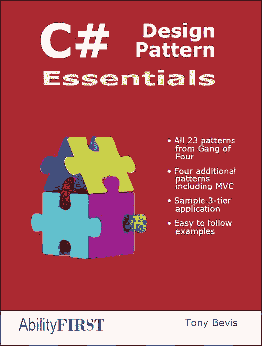


[www.abilityfirst.co.uk/books](http://www.abilityfirst.co.uk/books)


本书献给“四人帮”（The Gang of Four）。

# 前言

本书是面向对象软件设计模式世界的入门指南。示例和代码片段特意保持简单，以便你能够专注于理解每个模式的概念和应用，而不是费费精力阅读无关的源代码。

本书假设你至少具备 `C#` 编程语言的基础知识，包括理解封装、继承和多态等术语的含义，并知道如何编写类和接口。读完本书后，你应该能够将这些知识应用于复杂应用程序的设计中，在这些应用中，多个类的对象需要交互以完成特定目标。

书中描述的模式包含了 Erich Gamma、Richard Helm、Ralph Johnson 和 John Vlissides 的经典巨著《设计模式：可复用面向对象软件的要素》（Addison-Wesley, 1995）中的全部 23 种模式。书中还描述了四个额外的模式，包括模型-视图-控制器（MVC），它现在已成为图形化应用程序的主流。在大多数情况下，每个章节都是独立的，因此你可以按照任何顺序查阅这些模式。不过，建议先阅读第 1 章“什么是设计模式？”，以熟悉共同主题以及这些模式所利用的面向对象原则。

本书还使用了简化的统一建模语言（UML）图来展示构成模式的类是如何结构化的。如果不熟悉 UML 图，可能希望在开始之前参考附录 A。

## 预备知识

为了使用本书，你应该对 `C#` 语言和面向对象原则有基本的理解。特别是，你应该知道如何创建类、接口和枚举，并理解封装、继承、组合和多态等术语。

## 本书的结构

- 第一部分介绍了设计模式的概念，并为贯穿全书共同主题的一些简单核心类奠定了基础。
- 第二部分描述了 5 种创建模式，即有助于管理对象实例化的模式。
- 第三部分描述了 7 种结构模式，即有助于管理类如何组织和相互关系的模式。
- 第四部分描述了 11 种行为模式，即有助于管理类实际执行操作的模式。
- 第五部分描述了四个你在实际应用中会发现的额外模式。
- 第六部分包含一个章节，开发了一个使用了一些常用设计模式的简单 3 层应用程序。
- 第七部分包含附录，包括对不熟悉 UML 的读者提供的统一建模语言（UML）图格式简要说明，以及每个 23 种主要模式的快速参考指南。

## 本书中使用的约定

你需要输入的 `C#` 代码或作为输出显示的结果将以如下的等宽字体所示：

```
anObject.DoSomething();
anotherObject.DoThis();
```

通常会提供额外的或修改的代码，其中新内容或更改的部分用**粗体**表示：

```
anObject.DoSomethingElseInstead();
anObject.AlsoDoThis();
anotherObject.doThis();
```

类、对象或 `C#` 语句的名称将在文中中使用等宽字体显示，例如 `MyClass` 或 `someObject`。

为了简洁起见，书中大多数代码示例都省略了 `using` 和 `namespace` 语句。

## 本书的资源

你也可以从我们的网站下载书中所有的 `C#` 源代码：

[`www.abilityfirst.co.uk/books`](http://www.abilityfirst.co.uk/books)

## 给读者的说明

本书是同一作者的《Java Design Essentials - 第二版》的改编版。部分文本和代码示例可能反映出语言之间的风格和术语差异。非常欢迎读者的反馈。

# 第一部分：引言

本部分介绍了设计模式的概念，并为贯穿全书共同主题的一些简单核心类奠定了基础。

## 1. 什么是设计模式？

想象你刚刚被分配了设计一个软件系统的任务。你的客户告诉你，他需要建模他的工厂制造的小部件（Gadgets），而且每个小部件都由相同的组件组成，但这些组件对于每种类型的小部件有所不同。他还制造小设备（Gizmos），每个小设备都带有一系列可选配件，可以任意组合。他还需要在每件制造的物品上冲上一个唯一的顺序序列号。

你该如何设计这些类呢？

很有可能，无论你处于哪个问题领域，以前都有人设计过类似的解决方案。当然，这不一定是针对 Gadgets 和 Gizmos，但在目标和结构上是概念相似的。换句话说，很有可能已经存在一种通用的解决方案或方法，你只需要应用这种方法来解决你的设计困惑即可。

这就是设计模式的用处。它们描述了软件设计问题的通用解决方案。一旦掌握了模式，你可能会想：“那些 Gadgets 可以使用抽象工厂模式来建模，Gizmos 可以使用装饰器模式来建模，而序列号的生成则可以使用单例模式。”

## 本书如何使用模式

本书涵盖了经典参考书《设计模式：可复用面向对象软件的要素》（Gamma, 1995）中描述的全部 23 种模式的示例，此外还有四个额外的实用模式，包括模型-视图-控制器（MVC）。


本书中的每个示例代码都使用了源自业务世界的共同主题，即一家名为 `Foobar Motor Company` 的虚拟车辆制造商。该公司生产各种汽车和面包车，以及用于驱动车辆的引擎。因此，您应该熟悉本介绍中描述的类。

类层次结构如下：

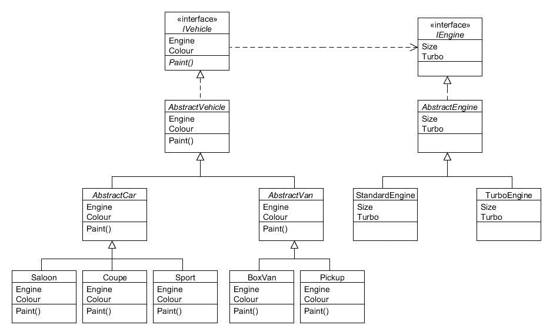

图 1.1：`IVehicle` 和 `IEngine` 类层次结构

`IVehicle` 和 `IEngine` 是这些层次结构的根接口，每个车辆对象都需要一个对 `IEngine` 对象的引用。`AbstractVehicle` 是实现 `IVehicle` 接口的抽象类，`AbstractEngine` 同样实现了 `IEngine` 接口。对于车辆，我们还有 `AbstractCar` 和 `AbstractVan`，以及作为汽车类型的具体子类 `Saloon`、`Coupe` 和 `Sport`。`AbstractVan` 有作为面包车类型的具体子类 `BoxVan` 和 `Pickup`。

`AbstractEngine` 的具体子类是 `StandardEngine` 和 `TurboEngine`。

尽管层次结构中有许多类，但每个类的代码都刻意保持简单，以便您可以专注于理解设计模式，而不是去解析复杂的代码。为了说明这一点，这里是 `IEngine` 接口的源代码：

```csharp
public interface IEngine
{
    int Size { get; }
    bool Turbo { get; }
}
```

这个简单的接口仅要求属性访问器来返回引擎尺寸（立方厘米）以及是否为涡轮增压。`AbstractEngine` 类如下：

```csharp
public abstract class AbstractEngine : IEngine
{
    private int size;
    private bool turbo;
    public AbstractEngine(int size, bool turbo)
    {
        this.size = size;
        this.turbo = turbo;
    }
    public virtual int Size
    {
        get
        {
            return size;
        }
    }
    public virtual bool Turbo
    {
        get
        {
            return turbo;
        }
    }
    public override string ToString()
    {
        return this.GetType().Name + " (" + size + ")";
    }
}
```

这种简化的引擎实现要求在构造函数中提供相应的属性。`ToString()` 方法的实现将产生此类格式的输出：

`StandardEngine (1300)`

`TurboEngine (2000)`

`Equals()` 和 `GetHashCode()` 方法将继承自 `object`，因此使用对象标识性。这是合理的，因为例如，两个独立的 1300cc Standard 引擎在逻辑上是不同的实体，因此应该被这样处理（一个引擎放入一辆车辆，另一个引擎放入另一辆车辆）。

具体子类非常简单：

```csharp
public class StandardEngine : AbstractEngine
{
    public StandardEngine(int size) : base(size, false)
    {
        // 非涡轮增压
    }
}

public class TurboEngine : AbstractEngine
{
    public TurboEngine(int size) : base(size, true)
    {
        // 涡轮增压
    }
}
```

现在您已经了解了 `IEngine` 层次结构，我们可以查看一下 `IVehicle` 接口：

```csharp
public interface IVehicle
{
    IEngine Engine { get; }
    VehicleColour Colour { get; }
    void Paint(VehicleColour colour);
}
```

一个名为 `VehicleColour` 的辅助枚举定义了每个 `IVehicle` 对象可能具有颜色：

```csharp
public enum VehicleColour
{
    Unpainted, Blue, Green,
    Red, Silver, Yellow
}
```

这是 `AbstractVehicle` 类实现 `IVehicle` 的方式：

```csharp
public abstract class AbstractVehicle : IVehicle
{
    private IEngine engine;
    private VehicleColour colour;
    public AbstractVehicle(IEngine engine)
    : this(engine, VehicleColour.Unpainted)
    {
    }
    public AbstractVehicle(IEngine engine, VehicleColour colour)
    {
        this.engine = engine;
        this.colour = colour;
    }
    public virtual IEngine Engine
    {
        get
        {
            return engine;
        }
    }
    public virtual VehicleColour Colour
    {
        get
        {
            return colour;
        }
    }
    public virtual void Paint(VehicleColour colour)
    {
        this.colour = colour;
    }
    public override string ToString()
    {
        return this.GetType().Name + " (" + engine + ", " + colour + ")";
    }
}
```

`AbstractVehicle` 中的重载构造函数需要提供一个 `IEngine` 对象和可选的车辆颜色。调用 `ToString()` 的输出将采用这种格式：

`Saloon (StandardEngine (1300), Red)`

`BoxVan (TurboEngine (2200), White)`

`AbstractCar` 和 `AbstractVan` 类只是简单转发到构造函数（显然，真实的类会定义汽车和面包车之间的任何差异）：

```csharp
public abstract class AbstractCar : AbstractVehicle
{
    public AbstractCar(IEngine engine)
    : this(engine, VehicleColour.Unpainted)
    {
    }
    public AbstractCar(IEngine engine, VehicleColour colour)
    : base(engine, colour)
    {
    }
}

public abstract class AbstractVan : AbstractVehicle
{
    public AbstractVan(IEngine engine)
    : this(engine, VehicleColour.Unpainted)
    {
    }
    public AbstractVan(IEngine engine, VehicleColour colour)
    : base(engine, colour)
    {
    }
}
```

具体子类也只是转发到构造函数：

```csharp
public class Saloon : AbstractCar
{
    public Saloon(IEngine engine)
    : this(engine, VehicleColour.Unpainted)
    {
    }
    public Saloon(IEngine engine, VehicleColour colour)
    : base(engine, colour)
    {
    }
}

public class Coupe : AbstractCar
{
    public Coupe(IEngine engine)
    : this(engine, VehicleColour.Unpainted)
    {
    }
    public Coupe(IEngine engine, VehicleColour colour)
    : base(engine, colour)
    {
    }
}

public class Sport : AbstractCar
{
    public Sport(IEngine engine)
    : this(engine, VehicleColour.Unpainted)
    {
    }
    public Sport(IEngine engine, VehicleColour colour)
    : base(engine, colour)
    {
    }
}

public class BoxVan : AbstractVan
{
    public BoxVan(IEngine engine)
    : this(engine, VehicleColour.Unpainted)
    {
    }
    public BoxVan(IEngine engine, VehicleColour colour)
    : base(engine, colour)
    {
    }
}

public class Pickup : AbstractVan
{
    public Pickup(IEngine engine)
    : this(engine, VehicleColour.Unpainted)
    {
    }
    public Pickup(IEngine engine, VehicleColour colour)
    : base(engine, colour)
    {
    }
}
```


经验表明，某些面向对象的方法比其他方法更灵活。以下是本书中的模式力求遵循的主要原则总结：

1. **面向接口编程，而不是面向实现编程。** 这里的“接口”是指抽象的通用概念，可以指一个 `C#` 接口或抽象类。为了实现这一点，在声明变量、构造函数和方法参数等时，尽可能使用最通用的类型（例如 `interface`）。这样做为运行时使用的实际类型提供了额外的灵活性。

2. **优先使用对象组合而不是继承。** 当一个类与另一个类以某种方式相关联时，你应该区分“是一个”（is a，或“是……的一种类型”）关系和“有一个”（has a）关系。在之前描述的 `IVehicle` 和 `IEngine` 层次结构中，说 `AbstractCar` “是一个” `IVehicle`、`Saloon` “是一个” `AbstractCar` 是正确的。但说 `IVehicle` “是一个” `IEngine` 是错误的，而应该说是 `IVehicle` “有一个”一个 `IEngine`。因此，继承被正当用于用于 `AbstractCar` 和 `Saloon`，而对象组合则用于 `IVehicle` 和 `IEngine` 之间。不要受到为了少写一些方法就使用继承的诱。有时，即使“是一个”关系看起来是自然选择，使用“有一个”关系也更灵活。你将在 `Decorator` 模式中看到这方面的例子。

3. **保持对象松耦合。** 理想情况下，类应该只对某件事建模，并且只由真正需要的其他对象组成（例如一个 `IVehicle` 需要一个 `IEngine`）。问问自己，如果你想在另一个完全不同的应用程序中使用你编写的类，会发生什么？哪些“包袱”（即其他类）也需要被复制？通过将这些减少到最低，你可以让类更具重用性。使用松耦合的模式良好示例是 `Observer`。

4. **封装变化的概念。** 如果你写了一个类，其中某些部分对于每个实例都是相同的，但类的另一部分随每个实例变化，考虑将后者提取到自己的类，并由原类引用该类。使用这一原则的模式示例是 `Strategy`。

## 通用建议

随着我们详细探索这些模式，上述原则将变得更加明显。你还应该注意到，书中描述的模式为特定问题提供了一种通用方法。修改或调整它们以更好地适应你的特定问题是完全可以的。将多个模式结合起来解决复杂问题也是非常常见的。

然而，请记住你应该努力保持简单。在读完像这样的书后，很容易认为你必须找到一个模式来解决特定问题，而实际上可能有更简单的解决方案。极端编程（XP）的格言之一是“你将不需要它”，这个理念是认为你应该避免在需要功能之前添加功能，这种哲学也可以应用于模式；要小心仅仅为了应用某种模式就添加不必要的特征。模式不是“万灵妙药”，它们只是你工具箱中的另一组工具，尽管它们是一组不可或缺的工具。

利用你的知识和经验来判断模式是否适用于你的情况，以及如果适用，你需要调整到什么程度。应用模式可能有益的良好例子是在正在“重构”现有代码时。重构是你改变某些软件的结构但不改变其行为，以提高其可维护性和灵活性。这提供了一个检查代码的好机会，看看模式是否可以提供更好的结构，例如替换条件判断或定义工厂类以辅助对象实例化。

模式除了 C# 之外还应用于许多编程语言，特别是面向对象的语言，事实上还应用于其他领域，其起源于对架构设计的应用。新的模式正在定期地开发和应用，因此你可以将本书仅视为该主题的一个起点。

## 第二部分。创建性模式

本部分描述了五种创建性模式，即有助于管理对象实例化的模式。

* **抽象工厂 (Abstract Factory)**：提供一个接口用于创建一组相关或依赖的对象的族，而不指定它们的具体类；
* **构建器 (Builder)**：将复杂对象的构建与它的表示分离开，使得相同的构建过程可以创建不同的表示；
* **工厂方法 (Factory Method)**：定义一个用于创建对象的接口，但让子类决定实例化哪一个类；
* **原型模式 (Prototype)**：使用原型实例指定要创建的对象的类型，并通过复制原型来创建新对象；
* **单例模式 (Singleton)**：确保一个类只允许创建一个对象，并提供单一的访问点。

### 2. 抽象工厂

**类型**：创建性

**目的**：提供一个接口用于创建一组相关或依赖的对象的族，而不指定它们的具体类。

Foobar 汽车公司生产汽车和面包车，在建造时包括（在许多东西之外）车壳、底盘和窗户玻璃。虽然汽车和面包车都需要所有相同类型的组件，但每种类型的细节取决于它是被作汽车还是面包车。

换句话之：
* 汽车的车壳不同于面包车的车壳；
* 汽车的底盘不同于面包车的底盘；
* 汽车的玻璃不同于面包车的玻璃。

因此，当我们需要建造一辆车辆时，我们可以认为组件是来自不同的“族”；也就是说，当我们制造汽车时，我们使用一组组件；当制造面包车时，我们使用另一组组件。

因此，我们可以将组件建模为简单的层次结构，如图所示：

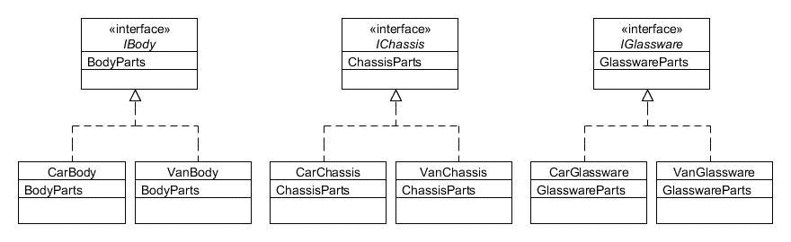

图 2.1 `IBody`、`IChassis` 和 `IGlassware` 类层次结构

你可以看到，接口 `IBody` 包含了 `CarBody` 和 `VanBody` 的实现。同样，我们为 `IChassis` 和 `IGlassware` 有类似的独立的层次结构。

`IBody` 层次结构的代码非常简单：

```csharp
public interface IBody
{
    string BodyParts { get; }
}

public class CarBody : IBody
{
    public virtual string BodyParts
    {
        get
            return "Body shell parts for a car";
        }
    }
}

public class VanBody : IBody
{
    public virtual string BodyParts
    {
        get
            return "Body shell parts for a van";
        }
    }
}
```

`IChassis` 层次结构的代码几乎相同：

```csharp
public interface IChassis
{
    string ChassisParts { get; }
}

public class CarChassis : IChassis
{
    public virtual string ChassisParts
    {
        get
            return "Chassis parts for a car";
        }
    }
}

public class VanChassis : IChassis
{
    public virtual string ChassisParts
    {
        get
            return "Chassis parts for a van";
        }
    }
}
```

同样，`IGlassware` 层次结构的代码如下：

```csharp
public interface IGlassware
{
    string GlasswareParts { get; }
}

public class CarGlassware : IGlassware
{
    public virtual string GlasswareParts
    {
        get
            return "Window glassware for a car";
        }
    }
}

public class VanGlassware : IGlassware
{
    public virtual string GlasswareParts
    {
        get
            return "Window glassware for a van";
        }
    }
}
```


现在我们需要一种方法来获取正确的系列零件（无论是汽车还是面包车），但又不需要在客户端程序每次需要它们时显式地实例化特定类型。为了实现这一目标，我们将定义“工厂”类来为我们完成工作：

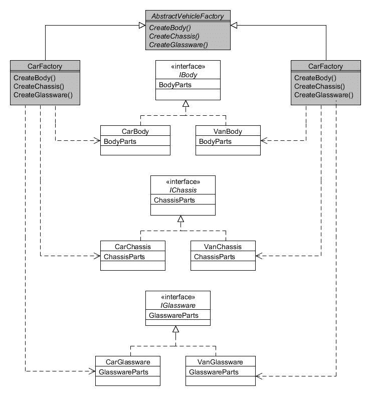
图 2.2 : 抽象工厂模式

`AbstractVehicleFactory` 类是一个抽象类，它定义了抽象方法 `CreateBody()`、`CreateChassis()` 和 `CreateGlassware()`，分别返回一个 `IBody`、`IChassis` 和 `IGlassware` 对象：

```csharp
public abstract class AbstractVehicleFactory
{
    public abstract IBody CreateBody();
    public abstract IChassis CreateChassis();
    public abstract IGlassware CreateGlassware();
}
```

具体子类 `CarFactory` 返回特定于汽车家族的对象：

```csharp
public class CarFactory : AbstractVehicleFactory
{
    public override IBody CreateBody()
    {
        return new CarBody();
    }
    public override IChassis CreateChassis()
    {
        return new CarChassis();
    }
    public override IGlassware CreateGlassware()
    {
        return new CarGlassware();
    }
}
```

具体子类 `VanFactory` 返回特定于面包车家族的对象：

```csharp
public class VanFactory : AbstractVehicleFactory
{
    public override IBody CreateBody()
    {
        return new VanBody();
    }
    public override IChassis CreateChassis()
    {
        return new VanChassis();
    }
    public override IGlassware CreateGlassware()
    {
        return new VanGlassware();
    }
}
```

现在，剩下的只需要客户端程序在实例化相应的“工厂”后，它就可以获取正确的零件，而无需指定它们是用于汽车还是面包车：

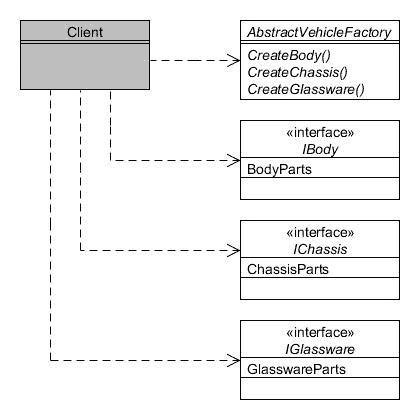
图 2.3 : 客户端如何使用抽象工厂

```csharp
string whatToMake = "car"; // 或 "van"
AbstractVehicleFactory factory = null;
// 创建正确的“工厂”...
if (whatToMake.Equals("car"))
{
    factory = new CarFactory();
}
else
{
    factory = new VanFactory();
}
// 创建车辆的组件部分...
// 这些将全部是汽车零件或全部是面包车零件
IBody vehicleBody = factory.CreateBody();
IChassis vehicleChassis = factory.CreateChassis();
IGlassware vehicleGlassware = factory.CreateGlassware();
// 显示我们创建的内容...
Console.WriteLine(vehicleBody.BodyParts);
Console.WriteLine(vehicleChassis.ChassisParts);
Console.WriteLine(vehicleGlassware.GlasswareParts);
Console.Read();
```

因此，你的客户端程序需要知道它正在制造汽车还是面包车，但一旦实例化了正确的工厂，所有创建零件的方法都可以使用一组相同的方法调用来完成。

抽象工厂模式的主要缺点在于，当你需要添加额外的“产品”时。例如，如果我们现在需要在组件家族中包含灯具，那么除了修改 `AbstractVehicleFactory`、`CarFactory` 和 `VanFactory` 之外，还需要创建一个新的 `ILights` 层级结构（`CarLights` 和 `VanLights`）。

### 3. 构建器 (Builder)

**类型：** 创建型 (Creational)

**目的：** 将复杂对象的构建过程与其表示分离，以便使用相同的构建过程可以创建不同的表示。

Foobar 公司生产汽车和面包车，每种车的构建过程在细节上有所不同；例如，面包车的车壳包含一个驾驶室区域和一个大型加固存储区域，而轿车则包含一个乘客区域和一个行李区域（即后备箱）。而且，无论构建什么类型的车辆，都有许多必须执行的复杂步骤。

构建器模式通过将各个步骤分离到构建器层级结构中的独立方法中促进复杂对象的构建，然后使用指挥器（Director）对象按正确的顺序指定所需的步骤。最后，从构建器中获取成品。

下图显示了这些关系：


图 3.1 : 构建器

我们从 `VehicleBuilder` 类开始：

```csharp
public abstract class VehicleBuilder
{
    public virtual void BuildBody() {}
    public virtual void Boot() {}
    public virtual void BuildChassis() {}
    public virtual void BuildPassengerArea() {}
    public virtual void BuildReinforcedStorageArea() {}
    public virtual void BuildWindows() {}
    public abstract IVehicle Vehicle {get; }
}
```

注意此类如何定义了汽车和面包车的所有“构建”方法，并为每个方法提供了默认的空实现。抽象属性 `Vehicle` 用于返回构建完的车辆。`CarBuilder` 类继承自 `VehicleBuilder` 并重写了相应的方法：

```csharp
public class CarBuilder : VehicleBuilder
{
    private AbstractCar carInProgress;
    public CarBuilder(AbstractCar car)
    {
        carInProgress = car;
    }
    public override void BuildBody()
    {
        Console.WriteLine("building body");
    }
    public override void Boot()
    {
        Console.WriteLine("building boot");
    }
    public override void BuildChassis()
    {
        Console.WriteLine("building chassis");
    }
    public override void BuildPassengerArea()
    {
        Console.WriteLine("building passenger area");
    }
    public override void BuildWindows()
    {
        Console.WriteLine("building windows");
    }
    public override IVehicle Vehicle
    {
        get
        {
            return carInProgress;
        }
    }
}
```

注意 `BuildReinforcedStorageArea()` 方法没有被重写，因为它不适用于汽车。`VanBuilder` 类重写了相应的方法来构建面包车：

```csharp
public class VanBuilder : VehicleBuilder
{
    private AbstractVan vanInProgress;
    public VanBuilder(AbstractVan van)
    {
        vanInProgress = van;
    }
    public override void BuildBody()
    {
        Console.WriteLine("building van body");
    }
    public override void BuildChassis()
    {
        Console.WriteLine("building van chassis");
    }
    public override void BuildReinforcedStorageArea()
    {
        Console.WriteLine("building van storage area");
    }
    public override void BuildWindows()
    {
        Console.WriteLine("building van windows");
    }
    public override IVehicle Vehicle
    {
        get
        {
            return vanInProgress;
        }
    }
}
```

注意 `Boot()` 和 `BuildPassengerArea()` 方法没有被重写，因为它们不适用于面包车。

`VehicleDirector` 抽象类要求将一个 `VehicleBuilder` 对象传递给其 `Build()` 方法，供子类实现：

```csharp
public abstract class VehicleDirector
{
    public abstract IVehicle Build(VehicleBuilder builder);
}
```

`CarDirector` 类继承自 `VehicleDirector` 并提供了构建汽车的逐步过程：

```csharp
public class CarDirector : VehicleDirector
{
    public override IVehicle Build(VehicleBuilder builder)
    {
        builder.BuildChassis();
        builder.BuildBody();
        builder.BuildPassengerArea();
        builder.Boot();
        builder.BuildWindows();
        return builder.Vehicle;
    }
}
```

`VanDirector` 类提供了构建面包车的逐步过程：

```csharp
public class VanDirector : VehicleDirector
{
    public override IVehicle Build(VehicleBuilder builder)
    {
        builder.BuildChassis();
        builder.BuildBody();
        builder.BuildReinforcedStorageArea();
    }
}
```


```csharp
        builder.BuildWindows();
        return builder.Vehicle;
    }
}
```

作为如何使用上述类的示例，假设我们想要构建一辆 `Saloon`（轿车）汽车：

```csharp
AbstractCar car = new Saloon(new StandardEngine(1300));
VehicleBuilder builder = new CarBuilder(car);
VehicleDirector director = new CarDirector();
Vehicle v = director.Build(builder);
Console.WriteLine(v);
Console.Read();
```

你可以看到，所需的 `Builder` 对象被构造并传递给所需的 `Director` 对象，之后我们调用构建构建产品的方法，然后获取成品。输出应该显示为：

```
Building car chassis
Building car body
Building car passenger area
Building car boot
Building car windows
Saloon (StandardEngine (1300), Unpainted)
```

### 4. 工厂方法 (Factory Method)

**类型**：创建型
**目的**：为创建对象定义接口，但由子类来决定实例化哪个类。

你可能从引言中记得 Foobar Motor 公司制造车辆的以下类层次结构：

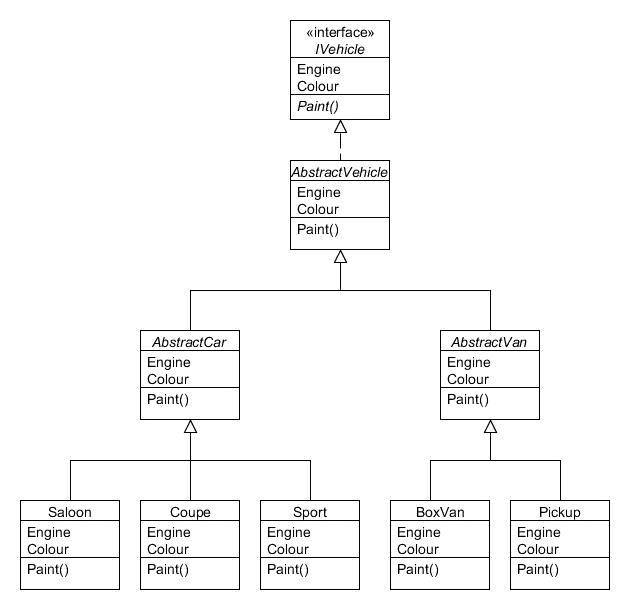
图 4.1 : `IVehicle` 类层次结构

当我们我们需要实例化特定类型的车辆（例如 `Coupe` 跑车）时，定义一个独立的类并由其负责管理实例化通常会更加灵活。这个独立的类被称为工厂（Factory）。

工厂方法模式定义了一个抽象类作为“工厂”，并在其中包含一个抽象方法，用于确定实例化什么产品（在本例中为车辆）。工厂的具体子类负责做出该决定。以下是工厂方法模式如何与 `IVehicle` 类层次结构配合：

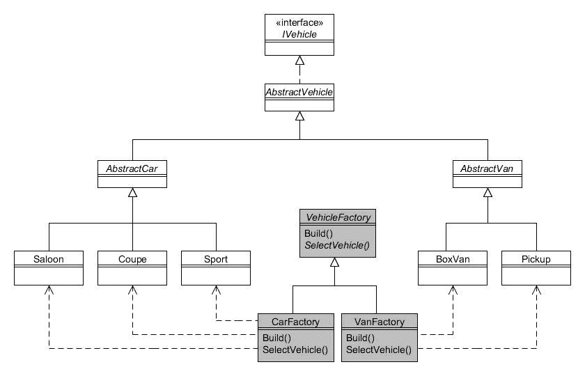
图 4.2 : 工厂方法模式

在上面的图中，我们可以看到我们创建了一个抽象的 `VehicleFactory` 类，它有两个具体的子类：`CarFactory` 和 `VanFactory`。让我们来看 `VehicleFactory` 是如何定义的：

```csharp
public abstract class VehicleFactory
{
    public enum DrivingStyle
    {
        Economical, Midrange, Powerful
    }
    public virtual IVehicle Build(DrivingStyle style, VehicleColour colour)
    {
        IVehicle v = SelectVehicle(style);
        v.Paint(colour);
        return v;
    }
    // 这就是“工厂方法”
    protected internal abstract IVehicle SelectVehicle(DrivingStyle style);
}
```

`VehicleFactory` 包含 `public` 方法 `Build()`，它接收参数为驾驶风格（`Economical` 经济、`Midrange` 中端或 `Powerful` 动力）以及车辆喷漆的颜色。`Build()` 方法调用 `protected` 抽象方法 `SelectVehicle()`，这就是该模式命名的“工厂方法”。因此，`SelectVehicle()` 的实现被委托给子类，使得每个子类都决定实例化具体的车辆类型。该方法被设为 `protected`，是因为我们只希望子类使用它；它不打算供客户端调用。

以下是 `CarFactory` 具体子类：

```csharp
public class CarFactory : VehicleFactory
{
    protected internal override IVehicle SelectVehicle(DrivingStyle style)
    {
        if (style == DrivingStyle.Economical)
        {
            return new Saloon(new StandardEngine(1300));
        }
        else if (style == DrivingStyle.Midrange)
        {
            return new Coupe(new StandardEngine(1600));
        }
        else
        {
            return new Sport(new TurboEngine(2000));
        }
    }
}
```

如你所见，`SelectVehicle()` 方法的实现使得它能够根据提供的参数精确确定应该实例化并返回哪种类型的汽车。

`VanFactory` 类似，它使用参数来决定实例化并返回哪种货厢车：

```csharp
public class VanFactory : VehicleFactory
{
    protected internal override IVehicle SelectVehicle(DrivingStyle style)
    {
        if ((style == DrivingStyle.Economical) || (style == DrivingStyle.Midrange))
        {
            return new Pickup(new StandardEngine(2200));
        }
        else
        {
            return new BoxVan(new TurboEngine(2500));
        }
    }
}
```

客户端程序实例化工厂并调用其 `Build()` 方法：

```csharp
// 我想要一辆经济型汽车
VehicleFactory carFactory = new CarFactory();
Vehicle car = carFactory.Build(DrivingStyle.Economical, VehicleColour.Blue);
Console.WriteLine(car);

// 我是一辆货厢车
VehicleFactory vanFactory = new VanFactory();
Vehicle van = vanFactory.Build(DrivingStyle.Powerful, VehicleColour.White);
Console.WriteLine(van);
```

### 5. 原型 (Prototype)

**类型**：创建型
**目的**：通过拷贝原型实例来指定要创建的对象类型。

在本章中假设实例化汽车和货厢车对象是非常耗时的，因此每当我们需要新对象时，都需要一种加速的方法。以下是 `IVehicle` 类和 `AbstractVehicle` 类的回顾：

```csharp
public interface IVehicle
{
    IEngine Engine { get; }
    VehicleColour Colour { get; }
    void Paint(VehicleColour colour);
}

public abstract class AbstractVehicle : IVehicle
{
    private IEngine engine;
    private VehicleColour colour;
    public AbstractVehicle(IEngine engine) : this(engine, VehicleColour.PAINTED)
    {
    }
    public AbstractVehicle(IEngine engine, VehicleColour colour)
    {
        this.engine = engine;
        this.colour = colour;
        // ... 后面是耗时的操作
    }
    public virtual IEngine Engine
    {
        get
        {
            return engine;
        }
    }
    public virtual VehicleColour Colour
    {
        get
        {
            return colour;
        }
    }
    public virtual void Paint(VehicleColour colour)
    {
        this.colour = colour;
    }
    public virtual object Clone()
    {
        return this.MemberwiseClone();
    }
    public override string ToString()
```

一种改进时间的方法是利用 C# 的克隆功能。因此让 `IVehicle` 接口继承 `ICloneable` 并定义 `Clone()` 方法。它将在 `AbstractVehicle` 中所示定义。一个实用的变体是定义一个静态工厂方法。假设我们在 `VehicleFactory` 中定义了以下 `enum`：

```csharp
public enum Category
{
    Car,
    Van
}
```

现在我们在 `VehicleFactory` 中定义了如下所示的静态方法：

```csharp
public static IVehicle Make(Category category, DrivingStyle style, VehicleColour colour)
{
    VehicleFactory factory = null;
    if (category == Category.Car)
    {
        factory = new CarFactory();
    }
    else
    {
        factory = new VanFactory();
    }
    return factory.Build(style, colour);
}
```

使用静态方法非常简单：

```csharp
// 创建一辆红色的跑车
Vehicle sporty = VehicleFactory.Make(Category.Car, DrivingStyle.Powerful, VehicleColour.Red);
Console.WriteLine(sporty);
```

这应该输出：
```
Sport (TurboEngine (2000), Red)
```


```csharp
return this.GetType().Name + " (" + engine + ", " + colour + ")";
}
}
```

`clone()` 方法调用 C# 的 `MemberwiseClone()` 方法来执行对接收对象的克隆。

`car` 或 `van` 子类都不需要任何更改，因为它们继承自层级根节点的 `IVehicle`。

我们现在将定义一个 `VehicleManager` 类，它将创建初始车辆，我们可以从从中获取克隆：

```csharp
public class VehicleManager
{
    private IVehicle saloon, coupe, sport, boxVan, pickup;
    public VehicleManager()
    {
        // 为了简单起见，所有车辆使用相同的引擎类型...
        saloon = new Saloon(new StandardEngine(1300));
        coupe = new Coupe(new StandardEngine(1300));
        sport = new Sport(new StandardEngine(1300));
        boxVan = new BoxVan(new StandardEngine(1300));
        pickup = new Pickup(new StandardEngine(1300));
    }
    public virtual IVehicle CreateSaloon()
    {
        return (IVehicle)saloon.Clone();
    }
    public virtual IVehicle CreateCoupe()
    {
        return (IVehicle)coupe.Clone();
    }
    public virtual IVehicle CreateSport()
    {
        return (IVehicle)sport.Clone();
    }
    public virtual IVehicle CreateBoxVan()
    {
        return (IVehicle)boxVan.Clone();
    }
    public virtual IVehicle CreatePickup()
    {
        return (IVehicle)pickup.Clone();
    }
}
```

客户端程序可以如下所示使用 `VehicleManager`：

```csharp
VehicleManager manager = new VehicleManager();
Vehicle saloon1 = manager.CreateSaloon();
Vehicle saloon2 = manager.CreateSaloon();
Vehicle pickup1 = manager.CreatePickup();
```

如代码所示，`VehicleManager` 的缺点是它在构造过程中始终会实例化至少一种类型的车辆。如果不需要所有类型的车辆，那么更高效的技术是使用懒加载，仅在第一次需要每种车辆时才实例化。这在下方的修改后的类版本中得到了体现（我们将其称为 `VehicleManagerLazy`）：

```csharp
public class VehicleManagerLazy
{
    private IVehicle saloon, coupe, sport, boxVan, pickup;
    public VehicleManagerLazy()
    {
    }
    public virtual IVehicle CreateSaloon()
    {
        if (saloon == null)
        {
            saloon = new Saloon(new StandardEngine(1300));
        }
        return (IVehicle)saloon.Clone();
    }
    public virtual IVehicle CreateCoupe()
    {
        if (coupe == null)
        {
            coupe = new Coupe(new StandardEngine(1300));
        }
        return (IVehicle)coupe.Clone();
    }
    public virtual IVehicle CreateSport()
    {
        if (sport == null)
        {
            sport = new Sport(new StandardEngine(1300));
        }
        return (IVehicle)sport.Clone();
    }
    public virtual IVehicle CreateBoxVan()
    {
        if (boxVan == null)
        {
            boxVan = new BoxVan(new StandardEngine(1300));
        }
        return (IVehicle)boxVan.Clone();
    }
    public virtual IVehicle CreatePickup()
    {
        if (pickup == null)
        {
            pickup = new Pickup(new StandardEngine(1300));
        }
        return (IVehicle)pickup.Clone();
    }
}
```

在返回克隆之前，会进行检查以确保“原型”对象存在，并在必要时对其实例化。从那时起，它将克隆之前实例化的对象。客户端程序可以像以前一样使用 `VehicleManagerLazy`：

```csharp
VehicleManagerLazy manager = new VehicleManagerLazy();
Vehicle saloon1 = manager.CreateSaloon();
Vehicle saloon2 = manager.CreateSaloon();
Vehicle pickup1 = manager.CreatePickup();
```

# 6. Singleton

**Type**: Creational
**Purpose**: 确保类只有一个实例，并提供一个全局访问点。`Singleton` 模式可以确保只有一个对象被创建，防止其他程序调用 `new`。实现此点的有多种方法，将构造函数设为私有，并提供一个 `static` 访问器方法来返回实例。这看起来如下：

```csharp
public class SerialNumberGenerator
{
    // 静态成员
    private static volatile SerialNumberGenerator instance;
    public static SerialNumberGenerator Instance
    {
        get
        {
            if (instance == null)
            {
                instance = new SerialNumberGenerator();
            }
            return instance;
        }
    }
    // 实例变量
    private int count;
    // 私有构造函数
    private SerialNumberGenerator()
    {
    }
    // 实例方法
    public virtual int NextSerial
    {
        get
        {
            return ++count;
        }
    }
}
```

注意 `Instance` 访问器只会实例化对象，并返回相同的实例。构造函数是私有的，以防止程序调用 `new`。单可以这样使用：

```csharp
Console.WriteLine("next serial: " + SerialNumberGenerator.Instance.NextSerial);
Console.WriteLine("next serial: " + SerialNumberGenerator.Instance.NextSerial);
Console.WriteLine("next serial: " + SerialNumberGenerator.Instance.NextSerial);
```

# 第三部分：结构性模式

本部分描述了七种结构性模式，即那些有助于管理类组织和相互关系的模式。

- **Adapter（适配器）**：将类的接口转换为客户端期望的接口，使不兼容类能够工作。
- **Bridge（桥接）**：将抽象与实现解耦，使其可以独立变化。
- **Composite（组合）**：将对象组合成树形结构以表示整体关系，让客户端统一对待单个对象和组合。
- **Decorator（装饰器）**：动态地为对象附加职责。
- **Facade（外观）**：为子系统中的接口提供统一接口，通过定义更高层次的接口使子系统更容易使用。
- **Flyweight（重量级）**：使用共享高效地支持大量细粒度对象。
- **Proxy（代理）**：为另一个对象提供代理或占位符以控制对它的访问。

### 7. Adapter

**Type**: 结构性
**Purpose**: 将类的接口转换为客户端期望的接口。适配器让不兼容的类能够工作。

你可能从引言中记得，Foobar 汽车公司为他们的车辆制造引擎。这里是 `IEngine` 层级的回顾：

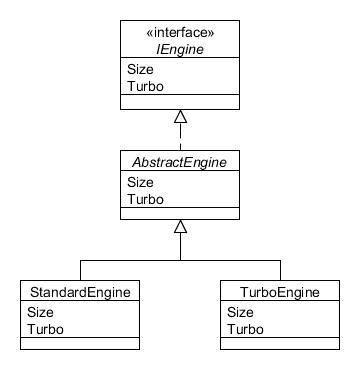
图 7.1：`IEngine` 类层级

这里是抽象类 `AbstractEngine` 代码的回顾：

```csharp
public abstract class AbstractEngine : IEngine
{
    private int size;
    private bool turbo;
    public AbstractEngine(int size, bool turbo)
    {
        this.size = size;
        this.turbo = turbo;
    }
    public virtual int Size
    {
        get
```


```csharp
{
            return size;
        }
    }
    public virtual bool Turbo
    {
        get
        {
            return turbo;
        }
    }
    public override string ToString()
    {
        return this.GetType().Name + " (" + size + ")";
    }
}
```

假设我们的客户端程序从一个集合中获取引擎并逐个遍历它们，显示引擎的大小和类型：

```csharp
IList<IEngine> engines = new List<IEngine>();
engines.Add(new StandardEngine(1300));
engines.Add(new StandardEngine(1600));
engines.Add(new TurboEngine(2000));
foreach (IEngine engine in engines) {
    Console.WriteLine(engine);
}
```

运行上述代码将得到以下显示结果：

`StandardEngine` (1300)
`StandardEngine (1600)`
`TurboEngine (2000)`

在本章中，我们将假设除了两个子类（`StandardEngine` 和 `TurboEngine`）之外，Foobar 还决定使用另一个名为 `SuperGreenEngine` 的引擎类，该类由不同的制造商制造。由于 `SuperGreenEngine` 类由第三方提供，它没有实现我们的 `IEngine` 接口。此外，Foobar 无法访问 C# 源代码，因此无法对其修改，但根据文档已知以下类详细信息：

*   该类继承自 `object`；
*   构造函数接受一个作为引擎大小的参数；
*   有一个 `EngineSize` 属性读取器，返回 `int` 类型的引擎大小；
*   这些类型的引擎从不采用涡轮增压；
*   `ToString()` 方法返回格式为 `SUPER ENGINE nnnn` 的字符串（其中 nnnn 是引擎大小）。

因此，我们可以看到 `SuperGreenEngine` 使用了不同的方法名来访问引擎大小，并且没有与是否为涡轮增压相关的方法，而且它不在 `IEngine` 层次结构中。目前，无法将 `SuperGreenEngine` 的实例添加到报告集合中，即使你可以这样做，方法名也是不同的。

适配器模式提供了一种解决此问题的方法，通过定义一个新类，将我们想要使用的类“适配”为现有类所要求的格式。因此，对于我们的目的，我们将创建一个 `SuperGreenEngineAdapter` 类：

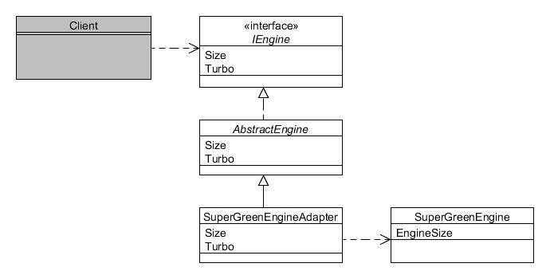

图 7.2：适配器类层次结构

适配器的代码如下：

```csharp
public class SuperGreenEngineAdapter : AbstractEngine
{
    public SuperGreenEngineAdapter(SuperGreenEngine greenEngine)
        : base(greenEngine.EngineSize, false)
    {
}
```

请注意上述代码的以下几：

*   我们扩展了正在适配的类；
*   我们在构造函数中接受了指向被适配类的一个引用；
*   构造函数从引用对象中获取必要的状态，并将其传递给父类构造函数。

现在，我们可以在报告集合中包含 `SuperGreenEngine` 对象了（用加粗表示的额外代码）：

```csharp
IList<Engine> engines = new List<Engine>();

engines.Add(new StandardEngine(1300));
engines.Add(new StandardEngine(1600));
engines.Add(new TurboEngine(2000));
// “适配”新的引擎类型...
SuperGreenEngine greenEngine = new SuperGreenEngine(1200);
engines.Add(new SuperGreenEngineAdapter(greenEngine));
// 与之前保持不变...
foreach (IEngine engine : engines) {
    Console.WriteLine(engine);
}
```

现在的输出应该是：

`StandardEngine (1300)`
`StandardEngine (1600)`
`TurboEngine (2000)`
`SuperGreenEngineAdapter (1200)`

注意输出如何使用了继承自 `AbstractEngine` 的 `ToString()` 方法，而不是 `SuperGreenEngine` 的方法。

#### 适配器的实现变体

我们还算幸运，因为 `AbstractEngine` 和 `SuperGreenEngine` 类的设计使得适配器类很容易在其构造函数内部完成工作。然而，通常情况下，我们需要在适配器的代码内部采取几个额外的步骤，因此这里有一个通用的公式可以使用：

1.  扩展你正在适配的类（如果是接口，则实现它）；
2.  在构造函数中指定你正在适配的类，并将其存储在实例变量中；
3.  对于你正在扩展的类（或实现的接口）中的每个方法，重写它并将其委托给被适配类中的对应方法。

这是一个通用的适配器类：

```csharp
public class ObjectAdapter : AdaptingTo
{
    private AdaptingFrom fromObject;
    public ObjectAdapter(AdaptingFrom fromObject)
    {
        this.fromObject = fromObject;
    }
    // 重写的方法
    public override void MethodInTo()
    {
        fromObject.MethodInFrom();
    }
}
```

#### 桥接

目的：将抽象与其实现解耦，以便每者都可以独立变化。

Foobar 公司为其车辆制造引擎。以下是 `IEngine` 类回顾：

 图 8.1：`IEngine` 类

`AbstractEngine` 类的实现正如引言所示，仅存储引擎大小（例如 1600cc）和是否为涡轮增压。为了本目的，该类将得到增强，以允许引擎启动以及增加或减少功率。

修改后的 `IEngine` 接口和 `AbstractEngine` 类列如下，更改已加粗标记：

```csharp
public interface IEngine
{
    int Size { get; }
    bool Turbo { get; }
    void Start();
    void Stop();
    void IncreasePower();
    void DecreasePower();
}

public abstract class AbstractEngine : IEngine
{
    private int size;
    private bool turbo;
    private bool running;
    private int power;
    public AbstractEngine(int size, bool turbo)
    {
        this.size = size;
        this.turbo = turbo;
        running = false;
        power = 0;
    }
    public virtual int Size
    {
        get
        {
            return size;
        }
    }
    public virtual bool Turbo
    {
        get
        {
            return turbo;
        }
    }
    public virtual void Start()
    {
        running = true;
    }
    public virtual void Stop()
    {
        running = false;
        power = 0;
    }
    public virtual void IncreasePower()
    {
        if ((running) && (power < 10))
        {
            power++;
        }
    }
    public virtual void DecreasePower()
    {
        if ((running) && (power > 0))
        {
            power--;
        }
    }
}
```


## 图 8.2 : 桥接模式

如图所示，有一个抽象类 `AbstractDriverControls`，它包含两个具体的子类：`StandardControls` 和 `SportControls`：

`AbstractDriverControls` 类要求在构造函数中传递一个 `Engine` 对象，然后将其每个方法都委托给该引擎执行：

```csharp
public class AbstractDriverControls
{
    private IEngine engine;
    public AbstractDriverControls(IEngine engine)
    {
        this.engine = engine;
    }
    public virtual void IgnitionOn()
    {
        engine.Start();
    }
    public virtual void IgnitionOff()
    {
        engine.Stop();
    }
    public virtual void Accelerate()
    {
        engine.IncreasePower();
    }
    public virtual void Brake()
    {
        engine.DecreasePower();
    }
}
```

`AbstractDriverControls` 的子类可以直接原样使用父类的方法，也可以定义额外的功能。`StandardControls` 类原样使用了 `AbstractDriverControls`：

```csharp
public class StandardControls : AbstractDriverControls
{
    public StandardControls(IEngine engine) : base(engine) {
    }
    // 没有额外函数
}
```

而 `SportControls` 类则定义了一个额外的方法：

```csharp
public class SportControls : AbstractDriverControls
{
    public SportControls(IEngine engine) : base(engine) {
    }
    public virtual void AccelerateHard()
    {
        Accelerate();
        Accelerate();
    }
}
```

上述需要注意的重要点是，额外的方法是基于父类的“抽象”而非“实现”（引擎）来编写的。因此，在上面的示例中，`AccelerateHard()` 方法调用了 `AbstractDriverControls` 中定义的 `Accelerate()` 方法。正是这种方法允许抽象和实现在需要时能够独立变化。

因此，只要引擎符合 `IEngine` 约，我们就可以在不修改驾驶控制类的情况下引入一种全新类型的引擎。相反，我们也可以开发一套新的驾驶控制控制（例如启用语音激活），而无需修改 `IEngine` 层次结构中的任何内容。

客户端程序可以使用以下方式使用桥接：

```csharp
IEngine engine = new StandardEngine(1300);
StandardControls controls = new StandardControls(engine);
controls1.IgnitionOn();
controls1.Accelerate();
controls1.Brake();
controls1.IgnitionOff();
// 现在使用运动控制
SportControls controls2 = new SportControls(engine);
controls2.IgnitionOn();
controls2.Accelerate();
controls2.AccelerateHard();
controls2.Brake();
controls2.IgnitionOff();
```

###### 9. 组合模式

**类型：** 结构型

**目的：** 将对象组合成树形结构以表示部分与整体的层次结构。组合允许客户端统一地处理单个对象和对象的组合。

在 Foobar 汽车公司的车间里，他们使用螺母、螺栓、面板等组件部件制造各种物品。每个单独的组件项都有相关的描述和单位成本，当物品被组装成更大的物品时，其成本就是各个组件部分成本之和。

组合模式允许我们将单个部件和部件的组合视为相同，从而使它们能够以一致的方式进行处理，并简化代码。类层次结构如下：

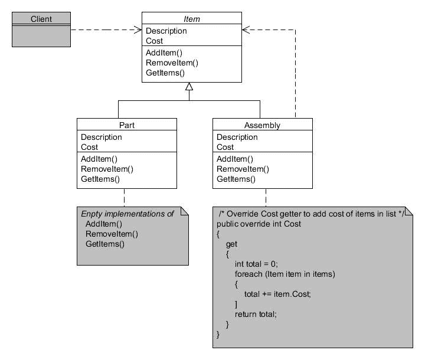

图 9.1 : 组合模式

抽象类 `Item` 定义了针对部件和部件组装的所有可能方法：

```csharp
public abstract class Item
{
    private string description;
    private int cost;
    public Item(string description, int cost)
    {
        this.description = description;
        cost = cost;
    }
    public virtual string Description
    {
        get {
            return description;
        }
    }
    public virtual int Cost
    {
        get {
            return cost;
        }
    }
    public abstract void AddItem(Item item);
    public abstract void RemoveItem(Item item);
    public abstract Item[] Items { get; }
    public override string ToString()
    {
        return description + " (cost " + Cost + ")";
    }
}
```

上述类为 `Description` 和 `Cost` 访问器提供了默认实现，并定义了抽象的 `AddItem()`、`RemoveItem()` 和 `Items` 访问器。单个部件使用 `Part` 子类进行建模：

```csharp
public class Part : Item
{
    public Part(string description, int cost)
    : base(description, cost)
    {
    }
    // 单位...的空实现
    public override void AddItem(Item item) {}
    public override void RemoveItem(Item item) {}
    public override Item[] Items
    {
        get {
            return new Item[0];
        }
    }
}
```

如你所见，与物品组装相关的方法为空空实现，因为“部件”是可能的最小单元，因此无法像“组装”那样拥有子部件。部件的组装使用 `Assembly` 子类进行建模：

```csharp
public class Assembly : Item
{
    private IList<Item> items;
    public Assembly(string description)
    : base(description, 0)
    {
        items = new List<Item>();
    }
    public override void AddItem(Item item)
    {
        items.Add(item);
    }
    public override void RemoveItem(Item item)
    {
        items.Remove(item);
    }
    public override Item[] Items
    {
        get {
            return items.ToArray();
        }
    }
    // 必须重写 Cost 以累加列表中所有项目的成本
    public override int Cost
    {
        get {
            int total = 0;
            foreach (Item item in items)
            {
                total += item.Cost;
            }
            return total;
        }
    }
}
```

现在可以使用统一的方式所有的 Item 对象：

```csharp
Item nut = new Part("Nut", 5);
Item bolt = new Part("Bolt", 9);
Item panel = new Part("Panel", 35);
Item gizmo = new Assembly("Gizmo");
gizmo.AddItem(panel);
gizmo.AddItem(nut);
gizmo.AddItem(bolt);
Item widget = new Assembly("Widget");
widget.AddItem(gizmo);
widget.AddItem(nut);
```

组装已经计算了总成本，而客户端程序不需要知道如何计算。显示这些对象将产生输出：

`Nut (cost 5)`
`Bolt (cost 9)`
`Panel (cost 35)`
`Gizmo (cost 49)`
`Widget (cost 54)`

### 10. 装饰器模式

**类型：** 结构型

**目的：** 动态地为对象添加额外的责任。装饰器为扩展功能提供了比继承更灵活的选择。

你会记得 Foobar 汽车公司的 `IVehicle` 类层次结构：


图 10.1 : `IVehicle` 类层次结构

为了本章，我们将在 `IVehicle` 接口中添加一个名为 `Price` 的额外属性并带有访问器。我们还将修改 `AbstractVehicle` 中的 `ToString()` 方法以包含价格。修改后的接口和类所示，更改部分已加粗标出：

```csharp
public interface IVehicle
{
    IEngine Engine { get; }
    VehicleColour Colour { get; }
    **int Price { get; }**
}
```


```csharp
    void Paint(VehicleColour colour);

    int Price { get; }
}

public abstract class AbstractVehicle : IVehicle
{
    private IEngine engine;
    private VehicleColour colour;
    public AbstractVehicle(IEngine engine)
        : this(engine, VehicleColour.Unpainted)
    {
    }
    public AbstractVehicle(IEngine engine, VehicleColour colour)
    {
        this.engine = engine;
        this.colour = colour;
    }
    public virtual IEngine Engine
    {
        get
        {
            return engine;
        }
    }
    public virtual VehicleColour Colour
    {
        get
        {
            return colour;
        }
    }
    public virtual void Paint(VehicleColour colour)
    {
        this.colour = colour;
    }
    public abstract int Price { get; }
    public override string ToString()
    {
        return this.GetType().Name + " (" + engine + ", " + colour + ", price " + Price + ")";
    }
}
```

每个具体的子类都根据需要实现了 `Price` get 访问器。例如，`Saloon` 类现在看起来如下（**加粗**部分为更改）：

```csharp
public class Saloon : AbstractCar
{
    public Saloon(IEngine engine)
        : this(engine, VehicleColour.Unpainted)
    {
    }
    public Saloon(IEngine engine, VehicleColour colour)
        : base(engine, colour)
    {
    }
    public override int Price
    {
        get
        {
            return 6000;
        }
    }
}
```

其他子类的定义类似，且 `Price` get 访问器返回：

*   `Saloon` 对象返回 6,000；
*   `Coupe` 对象返回 7,000；
*   `Sport` 对象返回 8,000；
*   `Pickup` 对象返回 9,000；
*   `BoxVan` 对象返回 10,000。

当客户购买车辆时，他们可以选择添加任意数量的可选配置。他们可以从空调系统、合金轮毂、真皮座椅、金属漆或卫星导航单元中进行选择。他们可以一个都不选，也可以选择最多五项的任意组合。

装饰器模式（Decorator）的设计是为了方便添加状态和或行为，而无需修改被添加类的继承层次结构。这是通过定义一个新的层次结构来实现的，该结构本身扩展了主树的根节点。

下图展示了这一点：

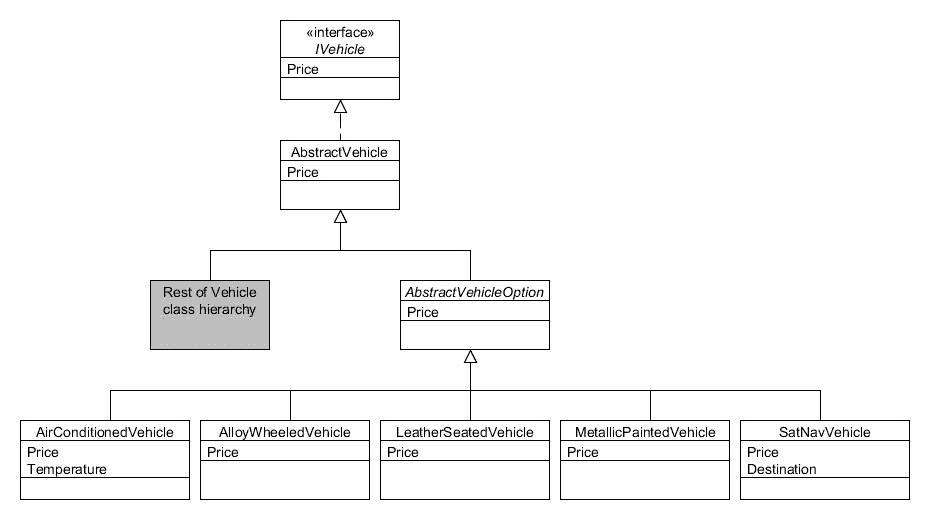

图 10.2：装饰器模式层次结构

从图中可以看到，定义了一个名为 `AbstractVehicleOption` 的新抽象类，它继承自 `AbstractVehicle`。`AbstractVehicleOption` 有五个具体的子类；每个子类对应一个可选选项。`AbstractVehicleOption` 类如下：

```csharp
public abstract class AbstractVehicleOption : AbstractVehicle
{
    protected IVehicle decoratedVehicle;
    public AbstractVehicleOption(IVehicle vehicle)
        : base(vehicle)
    {
        decoratedVehicle = vehicle;
    }
}
```

`AbstractVehicleOption` 是抽象的“装饰器”类，它需要指向被装饰的 `IVehicle` 类的引用。每个选项子类都是简单的。它们都重写了 `Price` get 访问器，以加上被装饰对象的价格。在 `AirConditionedVehicle` 和 `SatNavVehicle` 类中，我们定义了一个额外的方法：

```csharp
public class AirConditionedVehicle : AbstractVehicleOption
{
    public AirConditionedVehicle(IVehicle vehicle)
        : base(vehicle)
    {
    }
    public override int Price
    {
        get
        {
            return decoratedVehicle.Price + 600;
        }
    }
    public virtual int Temperature
    {
        set
        {
            // 设置温度的代码...
        }
    }
}

public class AlloyWheeledVehicle : AbstractVehicleOption
{
    public AlloyWheeledVehicle(IVehicle vehicle)
        : base(vehicle)
    {
    }
    public override int Price
    {
        get
        {
            return decoratedVehicle.Price + 250;
        }
    }
}

public class LeatherSeatedVehicle : AbstractVehicleOption
{
    public LeatherSeatedVehicle(IVehicle vehicle)
        : base(vehicle)
    {
    }
    public override int Price
    {
        get
        {
            return decoratedVehicle.Price + 1200;
        }
    }
}

public class MetallicPaintedVehicle : AbstractVehicleOption
{
    public MetallicPaintedVehicle(IVehicle vehicle)
        : base(vehicle)
    {
    }
    public override int Price
    {
        get
        {
            return decoratedVehicle.Price + 750;
        }
    }
}

public class SatNavVehicle : AbstractVehicleOption
{
    public SatNavVehicle(IVehicle vehicle)
        : base(vehicle)
    {
    }
    public override int Price
    {
        get
        {
            return decoratedVehicle.Price + 1500;
        }
    }
    public virtual string Destination
    {
        set
        {
            // 设置目的的代码
        }
    }
}
```

要使用这些“装饰器”，我们首先实例化汽车或货车，然后将它们“包裹”在所需的装饰器内部。这是一个示例：

```csharp
// 创建一辆蓝色轿车
IVehicle myCar = new Saloon(new Engine(1300));
myCar.Paint(VehicleColour.Blue);
// 为车辆添加空调...
myCar = new AirConditionedVehicle(myCar);
// 现在添加合金轮毂...
myCar = new AlloyWheeledVehicle(myCar);
// 现在添加真皮座椅...
myCar = new LeatherSeatedVehicle(myCar);
// 现在添加金属漆...
myCar = new MetallicPaintedVehicle(myCar);
// 现在添加卫星导航...
myCar = new SatNavVehicle(myCar);
```

如果在每个阶段对 `myCar` 用 `ToString()`，你应该看到如下输出：

`Saloon (Engine, Blue, price 6000)`
`AirConditionedVehicle (Saloon (...), price 6600)`
`AlloyWheeledVehicle (AirConditionedVehicle (Saloon (...), price 6850)`
`LeatherSeatedVehicle (AlloyWheeledVehicle (...)), price 8050)`
`MetallicPaintedVehicle (LeatherSeatedVehicle (...)), price 8800)`
`SatNavVehicle (MetallicPaintedVehicle (...)), price 10300)`

装饰器模式是优于使用对象组合而非继承的绝佳例子。如果我们尝试使用继承来实现各种车辆选项，将需要创建许多不同的类组合来建模每种组合。

### 11. 外观模式 (Facade)

**类型**：结构型

**目的**：为子系统中的一组接口提供统一的接口。外观定义了一个更高层次的接口，使得子系统更易使用。

有时你需要执行一系列步骤来完成特定任务，这通常涉及多个对象。外观模式涉及创建一个单独的对象来简化这些步骤的执行。

例如，当 Foobar 汽车公司准备销售车辆时，他们需要执行多项利用各种对象的步骤。在本章中，我们假设 `IVehicle` 接口在引言定义的方法之外还定义了以下额外方法：

```csharp
// IVehicle 中定义的额外方法...
void CleanInterior();
void CleanExteriorBody();
void PolishWindows();
void TakeForTestDrive();
```

上述方法在 `AbstractVehicle` 中的实现如下：

```csharp
public virtual void CleanInterior()
{
```


```csharp
    Console.WriteLine("Cleaning interior...");
}

public virtual void CleanExteriorBody()
{
    Console.WriteLine("Cleaning exterior body...");
}

public virtual void PolishWindows()
{
    Console.WriteLine("Polishing windows...");
}

public virtual void TakeForTestDrive()
{
    Console.WriteLine("Taking for test drive...");
}
```

我们将引入另外两个简单的类，`Registration` 和 `Documentation`：

```csharp
public class Registration
{
    private IVehicle vehicle;
    public Registration(IVehicle vehicle)
    {
        this.vehicle = vehicle;
    }
    public virtual void AllocateLicensePlate()
    {
        Console.WriteLine("Allocating license plate...");
    }
    public virtual void AllocateVehicleNumber()
    {
        Console.WriteLine("Allocating vehicle number...");
    }
}

public class Documentation
{
    public static void PrintBrochure(IVehicle vehicle)
    {
        Console.WriteLine("Printing brochure...");
    }
}
```

为了实现该模式，我们将创建一个 `VehicleFacade` 类，该类定义了一个方法，代表我们使用上述类来准备指定的车辆：

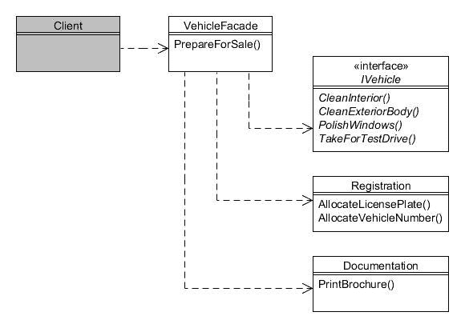

图 11.1 :  Fac 面模式

```csharp
public class VehicleFacade
{
    public virtual void PrepareForSale(IVehicle vehicle)
    {
        Registration reg = new Registration(vehicle);
        reg.AllocateVehicleNumber();
        reg.AllocateLicensePlate();
        Documentation.PrintBrochure(vehicle);
        vehicle.CleanInterior();
        vehicle.CleanExteriorBody();
        vehicle.PolishWindows();
        vehicle.TakeForTestDrive();
    }
}
```

客户端程序只需要在 `VehicleFacade` 实例上调用 `PrepareForSale()` 方法，因此不需要了解需要执行什么以及还需要哪些其他对象。如果在特殊情况下需要不同的操作，各个方法仍然可以根据需要单独调用。

### 12. 享用权重模式 (Flyweight)

**类型：** 结构型  
**目的：** 使用共享来高效地支持大量的细粒度对象。

某些程序需要创建大量特定类型的对象，如果这些对象恰好具有大量状态，那么实例化许多对象会迅速消耗内存。在考虑对象状态时，我们经常注意到，至少部分状态可能可以在一组对象之间共享。

对于 Foobar 汽车公司，`IEngine` 层次结构就是一个很好的例子：


图 12.1 : `IEngine` 类层次结构

我们对 `IEngine` 的简单实现只定义了两个属性读取：`Size` 和 `Turbo`。假设我们如下实例化了两个引擎：

```csharp
Engine engine1 = new StandardEngine(1300);
Engine engine2 = new StandardEngine(1300);
```

上述操作会在内存中创建两个独立的对象，尽管它们的状态是相同的。这可以被视为它的内部状态；即所有 1300cc 的标准引擎都将为引擎尺寸存储 1300，并为是否涡轮增压存储 false。创建数百或数千这样的对象将浪费内存，特别是由于一个更真实的 `Engine` 类需要更多的变量，而这些变量的值也将被共享。

为了本章的目的，`IEngine` 接口将添加另一个方法，称为 `Diagnose()`。这个新方法将一个 `DiagnosticTool` 对象作为其参数，这个参数可以被认为是它的外部状态，因为它的值实际上并没有存储在 `Engine` 对象中；它被使用是为了让引擎可以使用它来运行诊断检查。

`DiagnosticTool` 接口如下：

```csharp
public interface IDiagnosticTool
{
    void RunDiagnosis(object obj);
}
```

`EngineDiagnosticTool` 实现了上述对引擎进行诊断的功能：

```csharp
public class EngineDiagnosticTool : IDiagnosticTool
{
    public virtual void RunDiagnosis(object obj)
    {
        Console.WriteLine("Starting diagnostic tool for " + obj);
        Thread.Sleep(5000);
        Console.WriteLine("Engine diagnosis complete");
    }
}
```

为了模拟长时间运行的过程，该方法暂停了几秒钟。在上述工作的基础上，我们现在可以在 `IEngine` 接口中添加一个合适的方法：

```csharp
public interface IEngine
{
    // 具有内部（即共享）状态的属性
    int Size { get; }
    bool Turbo { get; }
    // 具有外部（即非共享）状态的方法
    void Diagnose(IDiagnosticTool tool);
}
```

`AbstractEngine` 中此新方法的实现简单地向 `IDiagnosticTool` 发出回调：

```csharp
public virtual void Diagnose(IDiagnosticTool tool) {
    tool.RunDiagnosis(this);
}
```

享用权重模式允许你引用大量相同类型且具有相同状态的对象，但通过实例化所需数量的实际对象来实现。这通常通过分配一个可以共享的对象“池”来，这由一个“享用权重工厂”类来决定。客户端程序仅通过工厂访问引擎：


图 12.2 : 享用权重模式

`EngineFlyweightFactory` 类如下：

```csharp
public class EngineFlyweightFactory
{
    private Dictionary<int?, IEngine> standardEnginePool;
    private Dictionary<int?, IEngine> turboEnginePool;

    public EngineFlyweightFactory()
    {
        standardEnginePool = new Dictionary<int?, IEngine>();
        turboEnginePool = new Dictionary<int?, IEngine>();
    }
    public virtual IEngine GetStandardEngine(int size)
    {
        IEngine e = null;
        if (!standardEnginePool.TryGetValue(size, out e))
        {
            e = new StandardEngine(size);
            standardEnginePool[size] = e;
        }
        return e;
    }

    public virtual IEngine GetTurboEngine(int size)
    {
        IEngine e = null;
        if (!turboEnginePool.TryGetValue(size, out e))
        {
            e = new TurboEngine(size);
            turboEnginePool[size] = e;
        }
        return e;
    }
}
```

该类使用了两个字典（一个用于标准引擎，另一个用于涡轮引擎）。每当请求特定类型和尺寸的引擎，如果已经创建了类似的，就会返回而不是实例化一个新的。客户端程序这样使用工厂：

```csharp
// 创建享用权重工厂...
EngineFlyweightFactory factory = new EngineFlyweightFactory();
// 创建诊断工具
IDiagnosticTool tool = new EngineDiagnosticTool();
// 获取权重对象并对其进行诊断
IEngine standard1 = factory.GetStandardEngine(1300);
standard1.Diagnose(tool);
IEngine standard2 = factory.GetStandardEngine(1300);
standard2.Diagnose(tool);
IEngine standard3 = factory.GetStandardEngine(1300);
standard3.Diagnose(tool);
IEngine standard4 = factory.GetStandardEngine(1600);
standard4.Diagnose(tool);
IEngine standard5 = factory.GetStandardEngine(1600);
standard5.Diagnose(tool);

// 显示对象是共享的
Console.WriteLine(standard1.GetHashCode());
Console.WriteLine(standard2.GetHashCode());
Console.WriteLine(standard3.GetHashCode());
Console.WriteLine(standard4.GetHashCode());
Console.WriteLine(standard5.GetHashCode());
```

在上述代码中，变量 `standard1`、standard2` 和 `standard3` 都引用同一个 `IEngine` 对象（因为它们都是 1300cc 的标准引擎）。同样，`standard4` 与 `standard5` 引用同一个对象。当然，在相同对象上多次运行诊断是否值得，取决于具体情况！


如果传递给外部方法（我们示例中的 `IDiagnosticTool`）的参数需要存储，则应该在客户端程序中完成。

### 13. 代理 (Proxy)

**类型：** 结构型

**目的：** 为另一个对象提供代理或位符，以控制对其访问。

某些方法可能是耗时的，例如那些加载复杂图形组件或需要网络连接的方法。在这些情况下，`Proxy` 模式提供了一个“替代”对象，直到耗时资源完成，从而允许应用程序的其他部分进行加载。

在讨论重量类模式的章节中，`IEngine` 层次结构被增强以定义了额外方法 `Diagnose()`。正如你所看到的，`EngineDiagnosticTool` 中 `RunDiagnosis()` 的实现非常缓慢（我们让它睡眠了五秒来模拟这一点），因此我们可能考虑将此运行在独立的线程。

以下是带有额外方法的 `IEngine` 层次结构回顾：

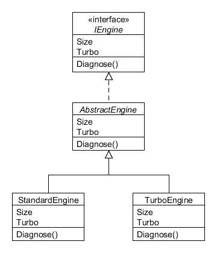

图 13.1 : `IEngine` 类层次结构

`Proxy` 模式涉及创建一个与我们代理的对象相同接口的类，在我们例中是 `IEngine`。代理随后将请求转发到内部存储的“真实”对象。客户端只需访问代理：

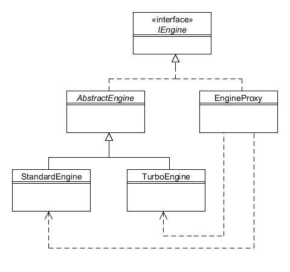

图 13.2 : 代理模式

以下是 `EngineProxy` 类的代码：

```csharp
public class EngineProxy : IEngine
{
    private IEngine engine;
    public EngineProxy(int size, bool turbo)
    {
        if (turbo)
        {
            engine = new TurboEngine(size);
        }
        else
        {
            engine = new StandardEngine(size);
        }
    }
    public virtual int Size
    {
        get
        {
            return engine.Size;
        }
    }
    public virtual bool Turbo
    {
        get
        {
            return engine.Turbo;
        }
    }
    // 此方法是耗时的...
    public virtual void Diagnose(IDiagnosticTool tool)
    {
        Console.WriteLine("(Running tool as thread)");
        Thread t = new Thread(() => RunDiagnosticTool(tool));
        t.Start();
        Console.WriteLine("EngineProxy diagnose() method finished");
    }
    public virtual void RunDiagnosticTool(IDiagnosticTool tool)
    {
        tool.RunDiagnosis(this);
    }
}
```

构造函数创建一个 `StandardEngine` 或 `TurboEngine` 对象并将其引用作为实例变量存储。对 `Size` 和 `Turbo` 访问器的调用简单地转发到所引用的引擎对象。对 `Diagnose()` 的调用将启动一个单独的线程运行实际诊断。如果由于某些原因你无法修改源代码，这可能会非常有用。

# 第四部分 行为模式 (Behavioural Patterns)

此部分描述了十一 种行为模式，即那些帮助管理类实际行为的模式。

- **责任链 (Chain of Responsibility)：** 通过给多个对象一个处理请求的机会，避免请求发送者与接收者之间的耦合；
- **命令 (Command)：** 将请求封装为对象，从而让你能够用不同的请求对客户端进行参数化；
- **解释器 (Interpreter)：** 定义语言语法的表示；
- **迭代器 (Iterator)：** 提供一种顺序访问聚合对象元素的方法，而不暴露其底层表示；
- **中介者 (Mediator)：** 定义一个封装一组对象如何交互的对象；
- **备忘 (Memento)：** 捕获并外部化对象的状态，以便以后可以恢复到该状态；
- **观察者 (Observer)：** 定义对象之间的一对多的依赖关系，当一个对象的状态发生变化时，所有依赖对象都会收到通知并更新；
- **状态 (State)：** 允许对象在内部状态改变时改变其行为，就像是一个不同的类；
- **策略 (Strategy)：** 允许客户端更改对象执行函数时使用的算法；
- **模板方法 (Template Method)：** 在方法中定义算法的骨架，将某些步骤延迟给子类；
- **访问者 (Visitor)：** 模拟在不需要实际更改类的情况下向类添加方法。

# 4. 责任链 (Chain of Responsibility)

**类型：** 行为型

**目的：** 通过给多个对象一个处理的机会，避免请求发送者与接收者之间的耦合。将接收对象链起来并传递请求，直到某个对象处理它为止。

Foobar 公司每天接收大量邮件，包括服务请求、销售，当然还有不可避免的垃圾邮件。与其专门雇人来筛选每封邮件以确定应该转发到哪个部门，我们的任务是尝试通过分析每封邮件的文本并做出“最佳猜测”来实现这一过程自动化。

在我们简化的示例中，我们将在邮件文本中搜索关键词，并根据发现的内容进行相应的处理。以下是我们要搜索的词以及它们的处理方式：

- 如果邮件包含 "viagra"、pills" 或 "medicines"，则应转发到垃圾邮件处理器；
- 如果邮件包含 "buy" 或 "purchase"，则应转发到销售部；
- 如果邮件包含 "service" 或 "repair"，则应转发到服务部；
- 如果邮件包含 "complain" 或 "bad"，则应转发给经理；
- 如果邮件不包含上述任何内容，则应转发到通用咨询处。

请注意，只需要一个对象处理请求，因此如果一封特定的邮件同时包含 "purchase" 和 "repair"，它将只被转发到销售部。检查关键词的顺序取决于应用程序认为合理的顺序；这样我们试图在邮件到达其他部门之前过滤掉垃圾邮件。

现在只需要一个对象来处理请求，所以如果一封特定的邮件同时包含 "purchase" 和 "repair"，它将只被转发到销售部。现在，我们完全可以在检查关键词时使用一系列 `if...else...` 语句，但那样将不面向对象。责任链模式允许我们定义符合 `EmailHandler` 接口的独立“处理器”对象。这使我们能够保持每个处理器的独立性和松耦合。

下图显示了该模式：

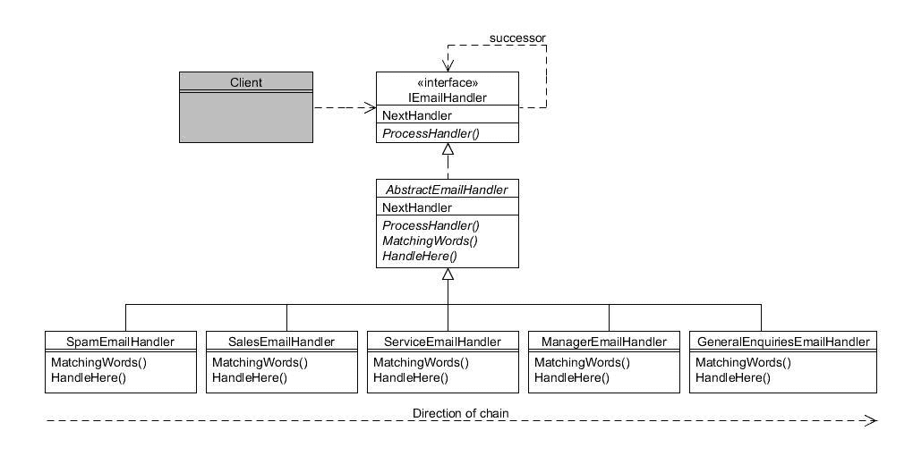

图 14.1 : 责任链模式

`IEmailHandler` 是层次结构顶部的接口：

```csharp
public interface IEmailHandler
{
    IEmailHandler NextHandler { set; }
    void ProcessHandler(string email);
}
```

`NextHandler` 设置器接收另一个 `IEmailHandler` 对象作为参数，代表当当前对象无法处理邮件时调用的处理器。

`ProcessHandler()` 方法接收邮件文本作为参数并判断它是否能够处理（即是否包含我们感兴趣的关键词之一）。如果活动对象可以处理邮件，则进行处理，否则将其转发给链中的下一个。

`AbstractEmailHandler` 类实现了 `IEmailHandler` 接口以提供有用的默认功能：

```csharp
public abstract class AbstractEmailHandler : IEmailHandler
{
    private IEmailHandler nextHandler;
    public virtual IEmailHandler NextHandler
    {
        set
        {
            nextHandler = value;
        }
    }
    public virtual void ProcessHandler(string email)
    {
        bool wordFound = false;
        // 如果没有匹配的词，则此对象可以处理
        if (MatchingWords().Length == 0)
        {
            wordFound = true;
        }
        else
        {
            // 查找任何匹配的词
            foreach (string word in MatchingWords())
            {
                if (email.IndexOf(word) >= 0)
                {
                    wordFound = true;
                    break;
                }
            }
        }
    }
}
```


```csharp
// Can we handle email in this object?
        if (wordFound)
        {
            HandleHere(email);
        }
        else
        {
            // Unable to handle here so forward to next in chain
            nextHandler.ProcessHandler(email);
        }
    }
    protected internal abstract string[] MatchingWords();
    protected internal abstract void HandleHere(string email);
}
```

`NextHandler` 方法简单地将参数存储在实例变量中；决策过程在 `ProcessHandler()` 中完成。该方法利用了两个 `protected` 辅助方法，这些方法必须由具体的子类来实现：

* `MatchingWords()` 将返回一个该处理器感兴趣的字符串对象数组；
* `HandleHere()` 只在当对象实际上能够处理该邮件时被调用，并包含了所需的代码。

具体子类的实现非常简单：

```csharp
public class SpamEmailHandler : AbstractEmailHandler
{
    protected internal override string[] MatchingWords()
    {
        return new string[] { "viagra", "pills", "medicines" };
    }
    protected internal override void HandleHere(string email)
    {
        Console.WriteLine("This is a spam email.");
    }
}

public class SalesEmailHandler : AbstractEmailHandler
{
    protected internal override string[] MatchingWords()
    {
        return new string[] { "buy", "purchase" };
    }
    protected internal override void HandleHere(string email)
    {
        Console.WriteLine("Email handled by sales department.");
    }
}

public class ServiceEmailHandler : AbstractEmailHandler
{
    protected internal override string[] MatchingWords()
    {
        return new string[] { "service", "repair" };
    }
    protected internal override void HandleHere(string email)
    {
        Console.WriteLine("Email handled by service department.");
    }
}

public class ManagerEmailHandler : AbstractEmailHandler
{
    protected internal override string[] MatchingWords()
    {
        return new string[] { "complain", "bad" };
    }
    protected internal override void HandleHere(string email)
    {
        Console.WriteLine("Email handled by manager.");
    }
}

public class GeneralEnquiriesEmailHandler : AbstractEmailHandler
{
    protected internal override string[] MatchingWords()
    {
        return new string[0]; // match anything
    }
    protected internal override void HandleHere(string email)
    {
        Console.WriteLine("Email handled by general.");
    }
}
```

现在我们需要定义处理器被调用的顺序。对于这个示例，在 `AbstractEmailHandler` 中添加了以下 `static` 方法：

```csharp
public static void Handle(string email)
{
    // Create the handler...
    IEHandler spam = new SpamEmailHandler();
    IEHandler sales = new SalesEmailHandler();
    IEHandler service = new ServiceEmailHandler();
    IEHandler manager = new ManagerEmailHandler();
    IEHandler general = new GeneralEnquiriesEmailHandler();
    // Chain together...
    spam.NextHandler = sales;
    sales.NextHandler = service;
    service.NextHandler = manager;
    manager.NextHandler = general;
    // Start the ball...
    spam.ProcessHandler(email);
}
```

现在将消息传递给处理器变得如此简单：

```csharp
String email = "I need my repaired.";
AbstractEmailHandler.handle(email);
```

这应该产生以下输出：Email handled by service department.

### 15. 命令类型：行为型

#### 目的
将请求封装为对象，从而允许用不同的请求对客户端进行参数化、队列请求并支持撤销的操作。Foobar 公司制造的车辆都安装了收音机；这通过以下 `Radio` 类进行建模：

```csharp
public class Radio
{
    public const MinVolume = 0;
    public const MaxVolume = 10;
    public const DefaultVolume = 5;
    private bool switchedOn;
    private int volume;
    public Radio()
    {
        switchedOn = false;
        volume = DefaultVolume;
    }
    public virtual bool On
    {
        get
        {
            return switchedOn;
        }
    }
    public virtual int Volume
    {
        get
        {
            return volume;
        }
    }
    public virtual void SwitchOn()
    {
        switchedOn = true;
        Console.WriteLine("Radio now on, volume level " + Volume);
    }
    public virtual void SwitchOff()
    {
        switchedOn = false;
        Console.WriteLine("Radio now off");
    }
    public virtual void VolumeUp()
    {
        if (On)
        {
            if (Volume < MaxVolume)
            {
                volume++;
                Console.WriteLine("Volume up to level " + Volume);
            }
        }
    }
    public virtual void Down()
    {
        if (On)
        {
            if (Volume > MinVolume)
            {
                volume--;
                Console.WriteLine("Volume down to level " + Volume);
            }
        }
    }
}
```

如你所示，该类允许收音机的开启和关闭，只要处于开启状态，就可以在 1 到 10 的范围内每次增加或减少一级音量。一些车辆还带有带有简单升降按钮的电动窗户，如下 `ElectricWindow` 类所示：

```csharp
public class ElectricWindow
{
    private bool open;
    public ElectricWindow()
    {
        open = false;
        Console.WriteLine("Window is closed");
    }
    public virtual bool Open
    {
        get
        {
            return open;
        }
    }
    public virtual bool Closed
    {
        get
        {
            return (!open);
        }
    }
    public virtual void OpenWindow()
    {
        if (Closed)
        {
            open = true;
            Console.WriteLine("Window is now open");
        }
    }
    public virtual void CloseWindow()
    {
        if (Open)
        {
            open = false;
            Console.WriteLine("Window is now closed");
        }
    }
}
```

每个设备（收音机和电动窗户）都有独立的控制按钮（通常是按钮）来管理其状态。但假设 Foobar 汽车公司现在希望在其旗舰车型上引入语音识别，并执行以下操作：

* 如果语音识别系统处于“收音机”模式，那么当它听到“向上”或“向下”时，它会调整收音机音量；
* 如果语音识别系统处于“窗户”模式，那么当它听到“向上”或“向下”时，它会关闭或打开驾驶员门窗。

因此，我们需要语音识别系统能够处理 `Radio` 对象或 `ElectricWindow` 对象，而这些对象处于完全不同的层级结构中。未来，我们可能还希望它处理其他设备，例如车辆速度或变速箱（例如，听到“向上”时，它将增加 1 英里小时的速度，或者切换到下一个更高的档位）。为了良好的面向对象设计，我们需要将语音识别与它控制的设备隔离离开，使其能够处理任何设备而无需直接知道它们是什么。


命令模式允许我们通过一个被称为“命令对象”的“中间人”对象，将发出请求的对象与接收请求并执行操作的对象解耦。

在最简单的形式下，这我们需要创建一个包含一个方法的接口（我们将其称为 `IVoiceCommand`）：

```csharp
public interface IVoiceCommand {
    void Execute();
}
```

现在，我们需要为我们想要执行的每个操作创建实现该接口的类。例如，为了增大收音机的音量，我们可以创建一个 `VolumeUpCommand` 类：

```csharp
public class VolumeUpCommand : IVoiceCommand
{
    private Radio radio;
    public VolumeUpCommand(Radio radio)
    {
        this.radio = radio;
    }
    public virtual void Execute()
    {
        radio.VolumeUp();
    }
}
```

该类只需在构造函数中获取一个 `Radio` 对象的引用，并在每次调用 `Execute()` 时调用其 `VolumeUp()` 方法。

同样，我们需要在减小音量时创建一个 `VolumeDownCommand` 类：

```csharp
public class VolumeDownCommand : IVoiceCommand
{
    private Radio radio;
    public VolumeDownCommand(Radio radio)
    {
        this.radio = radio;
    }
    public virtual void Execute()
    {
        window.VolumeDown();
    }
}
```

控制电动窗的上升和下降移动同样简单：这次我们创建实现 `IVoiceCommand` 的类，并传入一个 `ElectricWindow` 对象的引用：

```csharp
public class WindowUpCommand : IVoiceCommand
{
    private ElectricWindow window;
    public WindowUpCommand(ElectricWindow window)
    {
        this.window = window;
    }
    public virtual void Execute()
    {
        window.CloseWindow();
    }
}

public class WindowDownCommand : IVoiceCommand
{
    private ElectricWindow window;
    public WindowDownCommand(ElectricWindow window)
    {
        this.window = window;
    }
    public virtual void Execute()
    {
        window.OpenWindow();
    }
}
```

现在，我们将定义一个 `SpeechRecogniser` 类，它只认识 `IVoiceCommand` 对象；它对收音机或电动窗一无所知。

```csharp
public class SpeechRecogniser
{
    private ICommand upCommand, downCommand;
    public virtual void SetCommands(ICommand upCommand, ICommand downCommand)
    {
        this.upCommand = upCommand;
        this.downCommand = downCommand;
    }
    public virtual void HearUpSpoken()
    {
        upCommand.Execute();
    }
    public virtual void HearDownSpoken()
    {
        downCommand.Execute();
    }
}
```

我们可以通过图表查看我们创建的内容：

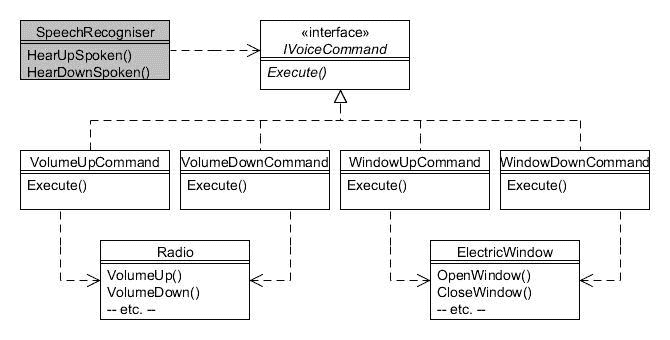

图 15.1 : 命令模式

客户端程序现在可以创建 `Radio` 和 `ElectricWindow` 实例，以及它们各自 `IVoiceCommand` 实例。然后将命令实例传递给 `SpeechRecogniser` 对象，以便它知道该做什么。我们将首先创建一个 `Radio`、一个 `ElectricWindow` 以及它们对应的命令：

```csharp
// 创建一个收音机及其上/下调命令
Radio radio = new Radio();
radio.SwitchOn();
IVoiceCommand volumeUpCommand = new VolumeUpCommand(radio);
IVoiceCommand volumeDownCommand = new VolumeDownCommand(radio);

// 创建一个电动窗及其上/下调命令
ElectricWindow window = new ElectricWindow();
IVoiceCommand windowUpCommand = new WindowUpCommand(window);
IVoiceCommand windowDownCommand = new WindowDownCommand(window);
```

现在创建一个单一的 `SpeechRecogniser` 对象并设置控制收音机：

```csharp
// 创建一个语音识别对象
SpeechRecogniser speechRecogniser = new SpeechRecogniser();
// 控制收音机
speechRecogniser.SetCommands(volumeUpCommand, volumeDownCommand);
Console.WriteLine("Speech recognition controlling the radio");
speechRecogniser.HearUpSpoken();
speechRecogniser.HearUpSpoken();
speechRecogniser.HearDownSpoken();
```

现在设置同一个 `SpeechRecogniser` 对象来控制窗户：

```csharp
// 控制电动窗
speechRecogniser.SetCommands(windowUpCommand, windowDownCommand);
Console.WriteLine("Speech recognition will control the window");
speechRecogniser.HearDownSpoken();
speechRecogniser.HearUpSpoken();
```

如果你运行上述所有语句，你应该看到类似下面的输出：

```
Radio now on, volume level 5
Window is closed
Speech recognition controlling the radio
Volume turned up to level 6
Volume turned up to level 7
Volume turned down to level 7
Speech recognition will control the window
Window is now open
Window is now closed
```

#### 命令模式的典型用途

命令模式最常用的领域之一是 UI 工具包。这些工具包提供了预构建的组件，如图形按钮和菜单项，这些组件不可能知道在什么时候需要做什么，因为那始终取决于具体的应用程序。

图形化应用的另一个常见方面是提供“撤销”机制。命令模式也用于实现这一点；使用本章的示例，我们会在 `IVoiceCommand` 接口中添加如下方法：

```csharp
public interface IVoiceCommand
{
    void Execute();
    void undo();
}
```

实现类随后提供撤销上一个操作的代码，在本例中为 `VolumeUpCommand` 类：

```csharp
public class VolumeUpCommand : IVoiceCommand {
    private Radio radio;
    public VolumeUpCommand(Radio r) {
        radio = r;
    }
    public virtual void execute() {
        radio.VolumeUp();
    }
    public virtual void undo() {
        radio.VolumeDown();
    }
}
```

大多数应用程序会比上面的示例复杂一些，因为需要在执行 `Execute()` 方法之前存储对象的状态，以便在调用 `Undo()` 时恢复该状态。

### 16. 解释器

**类型：** 行为

**目的：** 给定一种语言，定义其语法的表示，以及一个使用该表示来解释语言句子的解释器。

配备在 Foobar Motor 公司车辆上的卫星导航系统有一种特殊功能，允许用户输入多个城市，并让计算最北、最南、最西或最东，取决于输入的命令字符串。示例命令可能如下：

`london edinburgh manchester southerly`

上述命令将返回“London”，它是这三个城市中最靠南的。你甚至这样输入命令字符串：

`london edinburgh manchester southerly aberdeen westerly`

这将首先确定伦敦是最靠南的，然后使用该结果（伦敦）并与 Aberdeen 进行比较，告诉你哪一个是最靠西的。在每个“northerly”、“southerly”、“westerly”和“easterly”方向命令之前都可以输入任意数量的城市。

你可以将上述由城市名称和方向关键词组成的命令字符串看作一种简单的“语言”，它由卫星导航软件进行解释。解释器模式是一种有助于解码这类相对简单语言的方法。

在查看模式本身之前，我们将创建一个名为 `City` 的类，用于建模我们示例中的核心关注点，即城市的名称、经纬度和经度：

```csharp
public class City
{
    private string name;
    private double latitude, longitude;
    public City(string name, double latitude, double longitude)
    {
        this.name = name;
        this.latitude = latitude;
        this.longitude = longitude;
    }
}
```


```csharp
}
    public virtual string Name
    {
        get
        {
            return name;
        }
    }
    public virtual double Latitude
    {
        get
        {
            return latitude;
        }
    }
    public virtual double Longitude
    {
        get
        {
            return longitude;
        }
    }
    public override bool Equals(object otherObject)
    {
        if (this == otherObject)
        {
            return true;
        }
        if (!(otherObject is City))
        {
            return false;
        }
        City otherCity = (City)otherObject;
        return Name.Equals(otherCity.Name);
    }
    public override int GetHashCode()
    {
        return Name.GetHashCode();
    }
    public override string ToString()
    {
        return Name;
    }
}
```

你会注意到，为了简单起见，纬度和经度存储为 `double` 类型。请注意，对于纬度，正值代表北，负值代表南。同样，经度正值代表东，负值代表西。本章的示例仅包含了少数几个英国城市，它们都位于北纬和西经地区，尽管如果你想使用自己的城市，任何城市都可以运行。

解释该语言的类结构如下：

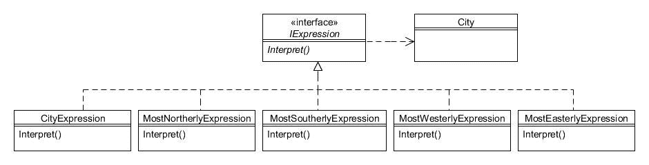

图 16.1：解释器模式

解释器模式（Interpreter pattern）与组合模式（Composite pattern）相似，它包含一个接口（或抽象类）以及两种类型的具体子类：一种类型表示单个元素，另一种类型表示重复元素。我们为语言中的每种类型的元素创建一个子类。

`IExpression` 接口非常简单，仅仅声明了一个返回 `City` 对象的 `Interpret()` 方法：

```csharp
public interface IExpression
{
    City Interpret();
}
```

我们将看到的第一个具体子类是 `CityExpression`，它为命令字符串中识别的每个城市名称创建一个该类的实例。此类需要做的的就是存储对 `City` 对象的引用，并在调用 `Interpret()` 时返回该对象：

```csharp
public class CityExpression : IExpression
{
    private City city;
    public CityExpression(City city)
    {
        this.city = city;
    }
    public virtual City Interpret()
    {
        return city;
    }
}
```

处理每个命令（例如 "northerly"，最靠北）的类要复杂一些：

```csharp
public class MostNortherlyExpression : IExpression
{
    private IList<IExpression> expressions;
    public MostNortherlyExpression(IList<IExpression> expressions)
    {
        this.expressions = expressions;
    }
    public virtual City Interpret()
    {
        City resultingCity = new City("Nowhere", -999.9, -999.9);
        foreach (IExpression currentExpression in expressions)
        {
            City currentCity = currentExpression.Interpret();
            if (currentCity.Latitude > resultingCity.Latitude)
            {
                resultingCity = currentCity;
            }
        }
        return resultingCity;
    }
}
```

传递给构造函数的 `IExpression` 对象列表类型将是 `CityExpression`。`Interpret()` 方法会遍历这些每个对象以确定最靠北的城市。`MostSoutherlyExpression` 类非常相似，仅更改了比较逻辑：

```csharp
public class MostSoutherlyExpression : IExpression
{
    private IList<IExpression> expressions;
    public MostSoutherlyExpression(IList<IExpression> expressions)
    {
        this.expressions = expressions;
    }
    public virtual City Interpret()
    {
        City resultingCity = new City("Nowhere", 999.9, 999.9);
        foreach (IExpression currentExpression in expressions)
        {
            City currentCity = currentExpression.Interpret();
            if (currentCity.Latitude < resultingCity.Latitude)
            {
                resultingCity = currentCity;
            }
        }
        return resultingCity;
    }
}
```

同样，`MostWesterlyExpression` 和 `MostEasterlyExpression` 类计算并返回相应的 `City`：

```csharp
public class MostWesterlyExpression : IExpression
{
    private IList<IExpression> expressions;
    public MostWesterlyExpression(IList<IExpression> expressions)
    {
        this.expressions = expressions;
    }
    public virtual City Interpret()
    {
        City resultingCity = new City("Nowhere", 999.9, 999.9);
        foreach (IExpression currentExpression in expressions)
        {
            City currentCity = currentExpression.Interpret();
            if (currentCity.Longitude < resultingCity.Longitude)
            {
                resultingCity = currentCity;
            }
        }
        return resultingCity;
    }
}

public class MostEasterlyExpression : IExpression
{
    private IList<IExpression> expressions;
    public MostEasterlyExpression(IList<IExpression> expressions)
    {
        this.expressions = expressions;
    }
    public virtual City Interpret()
    {
        City resultingCity = new City("Nowhere", -999.9, -999.9);
        foreach (IExpression currentExpression in expressions)
        {
            City currentCity = currentExpression.Interpret();
            if (currentCity.Longitude > resultingCity.Longitude)
            {
                resultingCity = currentCity;
            }
        }
        return resultingCity;
    }
}
```

虽然解释器模式本身并不涵盖表达式的解析，但在实践中，我们需要定义一个类来遍历命令字符串（例如 "london edinburgh manchester southerly"），并创建相应的 `IExpression` 类。这些 `IExpression` 类被放置在一个“语法树”中，该树通常使用后入先出（LIFO）栈来实现的。因此，我们将定义一个 `DirectionalEvaluator` 类来执行此解析，并设置英国城市的示例：

```csharp
public class DirectionalEvaluator
{
    private IDictionary<string, City> cities;
    public DirectionalEvaluator()
    {
        cities = new Dictionary<string, City>();
        cities["aberdeen"] = new City("Aberdeen", 57.15, -2.15);
        cities["belfast"] = new City("Belfast", 54.62, -5.93);
        cities["birmingham"] = new City("Birmingham", 52.42, -1.92);
        cities["dublin"] = new City("Dublin", 53.33, -6.25);
        cities["edinburgh"] = new City("Edinburgh", 55.92, -3.02);
        cities["glasgow"] = new City("Glasgow", 55.83, -4.25);
        cities["london"] = new City("London", 51.53, -0.08);
        cities["liverpool"] = new City("Liverpool", 53.42, -3.0);
        cities["manchester"] = new City("Manchester", 53.5, -2.25);
        cities["southampton"] = new City("Southampton", 50.9, -1.38);
    }
    public virtual City Evaluate(string route)
    {
        // 定义语法树
        Stack<IExpression> expressionStack = new Stack<IExpression>();
        // 获取每个标记
        IList<string> tokens = new List<string>();
        int fromIndex = 0;
        bool finished = false;
        while (!finished)
        {
            int spaceLocation = route.IndexOf(" ", fromIndex);
            if (spaceLocation >= 0)
            {
                tokens.Add(route.Substring(fromIndex, spaceLocation - fromIndex));
                fromIndex = spaceLocation + 1;
            }
            else
            {
                tokens.Add(route.Substring(fromIndex));
                finished = true;
            }
        }
    }
}
```


```csharp
finished = true;
}
}
// 解析路由字符串中的每个 token
foreach (string token in SplitTokens(route))
{
    // token 是否为识别城市？
    if (cities.ContainsKey(token))
    {
        City city = cities[token];
        expressionStack.Push(new CityExpression(city));
        // token 是否用于寻找最北边的？
    }
    else if (token.Equals("northerly"))
    {
        expressionStack.Push(new MostNortherlyExpression(LoadExpressions(expressionStack)));
        // token 是否用于寻找最南边的？
    }
    else if (token.Equals("southerly"))
    {
        expressionStack.Push(new MostSoutherlyExpression(LoadExpressions(expressionStack)));
        // token 是否用于寻找最西边的？
    }
    else if (token.Equals("westerly"))
    {
        expressionStack.Push(new MostWesterlyExpression(LoadExpressions(expressionStack)));
        // token 是否用于寻找最东边的？
    }
    else if (token.Equals("easterly"))
    {
        expressionStack.Push(new MostEasterlyExpression(LoadExpressions(expressionStack)));
    }
}
// 结果值
return expressionStack.Pop().Interpret();
}
// 从字符串中获取每个独立的 token
private IList<string> SplitTokens(string str)
{
    IList<string> tokens = new List<string>();
    int fromIndex = 0;
    bool finished = false;
    while (!finished)
    {
        int spaceLocation = str.IndexOf(" ", fromIndex);
        if (spaceLocation >= 0)
        {
            tokens.Add(str.Substring(fromIndex, spaceLocation));
            fromIndex = spaceLocation + 1;
        }
        else
        {
            tokens.Add(str.Substring(fromIndex));
            finished = true;
        }
    }
    return tokens;
}
private IList<IExpression> LoadExpressions(Stack<IExpression> expressionStack)
{
    IList<IExpression> expressions = new List<IExpression>();
    while (expressionStack.Count > 0)
    {
        expressions.Add(expressionStack.Pop());
    }
    return expressions;
}
```

在 `Evaluate()` 方法中，当解析器检测到方向命令（例如 "northerly"）时，它会移除栈中的城市并将它们与命令一起传递给栈。

请注意，上述使用的 `if...else...` 语句仅仅是为了让本章节集中于 `Interpreter` 模式。更好的方法是使用单独模式模式处理每个 token，如 `Chain of Responsibility` 模式定义的那样。

现在剩下的就是让我们的客户端程序利用 `DirectionalEvaluator` 并传递要解释的命令了：

```csharp
// 创建评估器
DirectionalEvaluator evaluator = new DirectionalEvaluator();
// 这应该输出 "London"...
Console.WriteLine(evaluator.evaluate("london edinburgh manchester southerly"));
// 这应该输出 "Aberdeen"...
Console.WriteLine(evaluator.evaluate("london edinburgh manchester southerly aberdeen westerly"));
Console.Read();
```

17. 迭代器 (Iterator)

**类型：** 行为型 (Behavioural)

**目的：** 提供一种顺序访问聚合对象元素的方法，而不暴露其底层表示形式。

Foobar 汽车公司想要制作一份列出其销售车辆范围的小册，并将此任务分配给两个不同的程序员，一个提供汽车系列，另一个一个提供货车系列。

编写 `CarRange` 类的程序员决定在内部使用 `IList` 对象存储范围：

```csharp
public class CarRange
{
    private IList<IVehicle> cars;
    public CarRange()
    {
        cars = new List<IVehicle>();
        // 定义可用的车型范围
        cars.Add(new Saloon(new StandardEngine(1300)));
        cars.Add(new Saloon(new StandardEngine(1600)));
        cars.Add(new Coupe(new StandardEngine(2000)));
        cars.Add(new Sport(new TurboEngine(2500)));
    }
    public virtual IList<IVehicle> Range
    {
        get
        {
            return cars;
        }
    }
}
```

从上面可以看出，该程序员提供了一个返回 `IList` 集合对象的 `Range` 访问器。

另一个程序员在编写 `VanRange` 类时决定用数组存储货车，因此他的 `Range` 访问器返回一个数组：

```csharp
public class VanRange
{
    private IVehicle[] vans;
    public VanRange()
    {
        vans = new IVehicle[3];
        // 定义可用的货车范围
        vans[0] = new BoxVan(new StandardEngine(1300));
        vans[1] = new BoxVan(new StandardEngine(1600));
        vans[2] = new Pickup(new TurboEngine(2500));
    }
    public virtual IVehicle[] Range
    {
        get
        {
            return vans;
        }
    }
}
```

这种方法的问题是两个类中的内部表示都被暴露了。更好的方法是让 `CarRange` 和 `VanRange` 类都提供一个 `GetEnumerator()` 方法，这样在保持一致性的同时，就不需要暴露内部表示。

对于 `CarRange`，额外的方法如下：

```csharp
public IEnumerator<IVehicle> GetEnumerator()
{
    return cars.GetEnumerator();
}
```

对于 `VanRange`，额外的方法需要从数组转换：

```csharp
public IEnumerator<IVehicle> GetEnumerator()
{
    return ((IEnumerable<IVehicle>)vans).GetEnumerator();
}
```

现在我们可以用一致的方式处理汽车和货车：

```csharp
Console.WriteLine("=== Our Cars=");
CarRange carRange = new CarRange();
PrintIterator(carRange.GetEnumerator());
Console.WriteLine("=== Our Vans=");
VanRange vanRange = new VanRange();
PrintIterator(vanRange.GetEnumerator());
```

```csharp
private static void PrintIterator(IEnumerator iter)
{
    while (iter.MoveNext())
    {
        Console.WriteLine(iter.Current);
    }
}
```

'foreach' 循环

书中的其他章节章节使用了 `foreach` 语句，为上述操作提供了一种整洁的替代方案，如下：

```csharp
Console.WriteLine("=== Our Cars=");
CarRange carRange = new CarRange();
foreach (IVehicle currentVehicle in carRange.Range)
{
    Console.WriteLine(currentVehicle);
}
Console.WriteLine("=== Our Vans=");
VanRange vanRange = new VanRange();
foreach (IVehicle currentVehicle in vanRange.Range)
{
    Console.WriteLine(currentVehicle);
}
```

18. 中介者 (Mediator)

**类型：** 行为型 (Behavioural)

**目的：** 定义一个封装一组对象如何交互的对象。中介者通过防止对象之间进行显式的相互引用来促进松耦合，并允许你独立地改变它们的交互方式。

Foobar 汽车公司展望未来车辆可以自动驾驶。这当然涉及到各种组件（点火、变速箱、加速器和刹车等）被共同控制并以各种方式交互。例如：

*   在点火之前，变速箱、加速器和刹车不工作（我们假设手刹已生效）；
*   当加速时，应禁用刹车；
*   当刹车时，应禁用加速器；
*   根据车辆速度挂入合适的挡位。


这一切都应该自动发生，这样驾驶员就可以尽情欣赏！（我们假设车辆可以感知自己的位置以避免碰撞等）。

我们自然会创建一些类来建模单个组件，因此将会有一个 `Ignition`（点火）类、`Gearbox`（变速箱）类、`Accelerator`（油门）类和一个 `Brake`（刹车）类。但我们也看到它们之间存在一些复杂的相互作用，而我们的面向对象的设计原则之一就是保持类之间的松耦合。

中者模式通过定义一个独立的类（中者）来帮助解决这个问题，该中者了解各个组件类，并负责管理它们之间的相互作用。每个组件类也知道中者类，但这是它们之间唯一的耦合。在示例中，我们将中者类命名为 `EngineManagementSystem`（发动机管理系统）。

我们可以通过下面的图示看到这些连接：

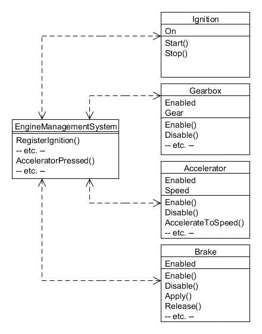

图 18.1：中者模式

双向通信是通过每个组件类的构造函数实现的，每个构造函数都接受一个中者对象的引用（这样它们就可以向其发送消息），并向中者注册自身（这样它们就可以从中者接收消息）。但每个组件类对任何其他组件类一无知；它们只知道中者。

我们可以通过查看 `Ignition` 类看到这一点：

```csharp
public class Ignition
{
    private EngineManagementSystem mediator;
    private bool on;
    // 构造函数接受中者作为参数
    public Ignition(EngineManagementSystem mediator)
    {
        this.mediator = mediator;
        on = false;
        // 向中者注册；
        mediator.RegisterIgnition(this);
    }
    public virtual void Start()
    {
        on = true;
        mediator.IgnitionTurnedOn();
        Console.WriteLine("Ignition turned on");
    }
    public virtual void Stop()
    {
        on = false;
        mediator.IgnitionTurnedOff();
        Console.WriteLine("Ignition turned off");
    }
    public virtual bool On
    {
        get
        {
            return on;
        }
    }
}
```

注意构造函数是如何建立双向通信的，以及执行事件的方法是如何通知中者这些事件的。

`Gearbox` 类应用了相同的原理：

```csharp
public class Gearbox
{
    private EngineManagementSystem mediator;
    private bool enabled;
    private Gear currentGear;
    // 构造函数接受中者作为参数
    public Gearbox(EngineManagementSystem mediator)
    {
        this.mediator = mediator;
        enabled = false;
        currentGear = Gear.Neutral;
        mediator.RegisterGearbox(this);
    }
    public virtual void Enable()
    {
        enabled = true;
        mediator.GearboxEnabled();
        Console.WriteLine("Gearbox enabled");
    }
    public virtual void Disable()
    {
        enabled = false;
        mediator.GearboxDisabled();
        Console.WriteLine("Gearbox disabled");
    }
    public virtual bool Enabled
    {
        get
        {
            return enabled;
        }
    }
    public virtual Gear Gear
    {
        set
        {
            if (Enabled && (Gear != value))
            {
                currentGear = value;
                mediator.GearChanged();
                Console.WriteLine("Now " + Gear + " gear");
            }
        }
        get
        {
            return currentGear;
        }
    }
}
```

`Gearbox` 使用的 `Gear` `enum` 如下：

```csharp
public enum Gear
{
    Neutral,
    First,
    Second,
    Third,
    Fourth,
    Fifth,
    Reverse
}
```

`Accelerator` 和 `Brake` 类遵循相似的过程：

```csharp
public class Accelerator
{
    private EngineManagementSystem mediator;
    private bool enabled;
    private int speed;
    // 构造函数接受中者作为参数
    public Accelerator(EngineManagementSystem mediator)
    {
        this.mediator = mediator;
        enabled = false;
        speed = 0;
        mediator.RegisterAccelerator(this);
    }
    public virtual void Enable()
    {
        enabled = true;
        mediator.AcceleratorEnabled();
        Console.WriteLine("Accelerator enabled");
    }
    public virtual void Disable()
    {
        enabled = false;
        mediator.AcceleratorDisabled();
        Console.WriteLine("Accelerator disabled");
    }
    public virtual bool Enabled
    {
        get
        {
            return enabled;
        }
    }
    public virtual void AccelerateToSpeed(int speed)
    {
        if (Enabled)
        {
            this.speed = speed;
            Console.WriteLine("Speed now " + Speed);
        }
    }
    public virtual int Speed
    {
        get
        {
            return speed;
        }
    }
}
```

```csharp
public class Brake
{
    private EngineManagementSystem mediator;
    private bool enabled;
    private bool applied;
    // 构造函数接受中者作为参数
    public Brake(EngineManagementSystem mediator)
    {
        this.mediator = mediator;
        enabled = false;
        applied = false;
        mediator.RegisterBrake(this);
    }
    public virtual void Enable()
    {
        enabled = true;
        mediator.BrakeEnabled();
        Console.WriteLine("Brakes");
    }
    public virtual void Disable()
    {
        enabled = false;
        mediator.BrakeDisabled();
        Console.WriteLine("Brakes");
    }
    public virtual bool Enabled
    {
        get
        {
            return enabled;
        }
    }
    public virtual void Apply()
    {
        if (Enabled)
        {
            applied = true;
            mediator.BrakePressed();
            Console.WriteLine("Now braking");
        }
    }
    private void Release()
    {
        if (Enabled)
        {
            applied = false;
        }
    }
}
```

现在我们需要 `EngineManagementSystem` 类来担任中者。它将持有每个组件类的引用，并带有允许与中者注册的方法。它还有处理各个组件发生特定事件时的相互作用的方法：

```csharp
public class EngineManagementSystem
{
    private Ignition ignition;
    private Gearbox gearbox;
    private Accelerator accelerator;
    private Brake brake;
    private int currentSpeed;
    public EngineManagementSystem()
    {
        currentSpeed = 0;
    }
    // 与中者注册的方法
    public virtual void RegisterIgnition(Ignition ignition)
    {
        this.ignition = ignition;
    }
    public virtual void RegisterGearbox(Gearbox gearbox)
    {
        this.gearbox = gearbox;
    }
    public virtual void RegisterAccelerator(Accelerator accelerator)
    {
        this.accelerator = accelerator;
    }
    public virtual void RegisterBrake(Brake brake)
    {
        this.brake = brake;
    }
    // 处理对象相互作用的方法
    public virtual void IgnitionTurnedOn()
    {
        gearbox.Enable();
        accelerator.Enable();
        brake.Enable();
    }
    public virtual void IgnitionTurnedOff()
    {
        gearbox.Disable();
        accelerator.Disable();
        brake.Disable();
    }
    public virtual void GearboxEnabled()
    {
    }
}
```


```csharp
Console.WriteLine("EMS now controlling the gearbox");
}

public virtual void GearboxDisabled()
{
    Console.WriteLine("EMS no longer controlling the gearbox");
}

public virtual void GearChanged()
{
    Console.WriteLine("EMS disengaging revs while gear changing");
}

public virtual void AcceleratorEnabled()
{
    Console.WriteLine("EMS now controlling the accelerator");
}

public virtual void AcceleratorDisabled()
{
    Console.WriteLine("EMS no longer controlling the accelerator");
}

public virtual void AcceleratorPressed()
{
    brake.Disable();
    while (currentSpeed < accelerator.Speed)
    {
        currentSpeed++;
        Console.WriteLine("Speed currentlt " + currentSpeed);
        // 根据速度设置档位
        if (currentSpeed <= 10)
        {
            gearbox.Gear = Gear.First;
        }
        else if (currentSpeed <= 20)
        {
            gearbox.Gear = Gear.Second;
        }
        else if (currentSpeed <= 30)
        {
            gearbox.Gear = Gear.Third;
        }
        else if (currentSpeed <= 50)
        {
            gearbox.Gear = Gear.Fourth;
        }
        else
        {
            gearbox.Gear = Gear.Fifth;
        }
    }
    brake.Enable();
}

public virtual void BrakeEnabled()
{
    Console.WriteLine("EMS now controlling the brake");
}

public virtual void BrakeDisabled()
{
    Console.WriteLine("EMS no longer controlling the brake");
}

public virtual void BrakePressed()
{
    accelerator.Disable();
    currentSpeed = 0;
}

public virtual void BrakeReleased()
{
    box.Gear = Gear.First;
    accelerator.Enable();
}
```

#### 常见用途

`Mediator`（中介者）模式的一种常见用途是管理对话框上图形组件之间的交互。这通常涉及按钮、文本字段等何时应该启用或禁用，或者在组件之间传递数据。请注意，可能可以使用 `Observer`（观察者）模式代替 `Mediator` 来进一步降低耦合性。这意味着组件类（例如 `Ignition` 等）不需要持有对中介者的引用，而是触发事件。那么，`EngineSystem` 类将成为组件类的观察者，并能够在它们上调用消息。

# 19. 备 emento（备录者模式）

**类型**：行为型（Behavioral）

**目的**：在不违反封装性的情况下，捕获并外部化对象的内部状态，以便稍后恢复。

Foobar 公司的车辆在仪表盘上自然安装有一个速度表，它不仅记录当前速度，还记录之前的速度。现在需要将状态存储在外部（例如可以将其集成到货车的记录仪中）。然而，`Speedometer` 类中的一个实例变量没有访问器（getter）；为了遵守封装和数据隐藏，它被正确地声明为 `private`。我们还希望遵循一个类不应承担多个职责的原则，因此我们不想在类中内置状态保存机制。我们该如何捕获对象的状态呢？

本章将介绍两种方法，每种方法都有优缺点。在两种情况下，我们都使用一个独立的类来执行状态保存，我们将其命名为 `SpeedometerMemento`。该类接收需要外部化的 `Speedometer` 对象的引用：

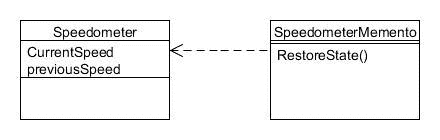

图 19.1：Memento 模式

#### 方法 1：使用内部可见性（internal visibility）

当指定访问修饰符 `internal` 时，意味着它仅对同一程序集中的类可见。因此，我们可以将 `Speedometer` 类及其相关的备录类放在它们自己的程序集中，并将后者命名为 `SpeedometerMemento`。

这是简单的 `Speedometer` 类：

```csharp
namespace AssemblyNamespace
{
    public class Speedometer
    {
        // 正常的私有可见性，但有访问方法...
        private int currentSpeed;
        // 内部可见性且没有访问方法...
        internal int previousSpeed;

        public Speedometer()
        {
            currentSpeed = 0;
            previousSpeed = 0;
        }

        public virtual int CurrentSpeed
        {
            set
            {
                previousSpeed = currentSpeed;
                currentSpeed = value;
            }
        }
    }
}
```

`SpeedometerMemento` 类存在于同一个程序集中。它保存 `Speedometer` 对象的状态：

```csharp
namespace AssemblyNamespace
{
    internal class SpeedometerMemento
    {
        public int currentSpeed;
        public int previousSpeed;

        public SpeedometerMemento(Speedometer speedometer)
        {
            this.currentSpeed = speedometer.CurrentSpeed;
            this.previousSpeed = speedometer.previousSpeed;
        }

        public void Restore(Speedometer speedometer)
        {
            speedometer.CurrentSpeed = this.currentSpeed;
            // 注意：previousSpeed 是内部的，因此在这里可以访问
        }
    }
}
```


```cs
public class Speedometer
{
    private int currentSpeed;
    private int previousSpeed;
    public Speedometer() {
        currentSpeed = 0;
        previousSpeed = 0;
    }
    public virtual int CurrentSpeed {
        set {
            previousSpeed = currentSpeed;
            currentSpeed = value;
        }
        get
        {
            return currentSpeed;
        }
    }
    // Only defined to help testing...
    public virtual int PreviousSpeed {
        get
        {
            return previousSpeed;
        }
    }
}
```

`SpeedometerMemento` 类现在使用对象序列化来实现状态保存和恢复：

```cs
public class SpeedometerMemento
{
    public SpeedometerMemento(Speedometer speedometer)
    {
        // Serialize...
        Stream stream = File.Open("speedometer.ser", FileMode.Create);
        BinaryFormatter formatter = new BinaryFormatter();
        formatter.Serialize(stream, speedometer);
        stream.Close();
    }
    public virtual Speedometer RestoreState()
    {
        // Deserialize...
        Speedometer speedo;
        Stream stream = File.Open("speedometer.ser", FileMode.Open);
        BinaryFormatter formatter = new BinaryFormatter();
        speedo = (Speedometer)formatter.Deserialize(stream);
        stream.Close();
        return speedo;
    }
}
```

我们可以检查发现这与第一种方法相同，唯一的区别是 `RestoreState()` 方法现在返回恢复后的对象引用：

```cs
Speedometer speedo = new Speedometer();
speedo.CurrentSpeed = 50;
speedo.CurrentSpeed = 100;
Console.WriteLine("Current speed: " + speedo.CurrentSpeed);
Console.WriteLine("Previous speed: " + speedo.previousSpeed);
// Save the state of 'speedo'...
SpeedometerMemento memento = new SpeedometerMemento(speedo);
// Change the state of 'speedo'...
speedo.CurrentSpeed = 80;
Console.WriteLine("After setting to 80...");
Console.WriteLine("Current speed: " + speedo.CurrentSpeed);
Console.WriteLine("Previous speed: " + speedo.previousSpeed);
// Restore the state of 'speedo'...
Console.WriteLine("Now restoring state...");
speedo = memento.RestoreState();
Console.WriteLine("Current speed: " + speedo.CurrentSpeed);
Console.WriteLine("Previous speed: " + speedo.previousSpeed);
```

运行上述代码得到的输出与第一种方法相同。这种方法的主要缺点是向磁盘文件写入和从文件中读取的速度要慢得多。请注意，虽然我们能够再次将所有字段设为 `private`，但获取了序列化文件的人仍然可能使用十六进制编辑器来更改数据。

### 20. 观察者模式 (Observer)

类型：行为型

目的：在对象之间定义一种一对多的依赖关系，当一个对象的状态发生变化时，所有依赖者都会自动更新。Foobar 公司决定，每当超过特定速度时，应该向驾驶员发出警报。他们预计根据当前速度可能还需要发生其他事情（例如自动变速箱选择合适的挡位）。但他们意识到需要保持对象的松散耦合，因此自然不希望 `Speedometer` 类对监视器或变速箱（或其他任何对行驶速度感兴趣的类）有直接了解。观察者模式允许在“主体”（感兴趣的对象；我们的示例中为 `Speedometer`）和它的“观察者”（在发生事情时需要通知的任何其他类）之间建立松散耦合。由于这是面向对象系统中非常常见的需求，C# 库包含了能够实现该模式的机制。其中之一是利用 `EventHandler` 类：“主体”（`Speedometer`）可以有多个观察者，每当发生事件时，每个观察者都会收到通知。`Speedometer` 类如下所示：

```cs
public class Speedometer
{
    public EventHandler ValueChanged;
    private int currentSpeed;
    public Speedometer()
    {
        speed = 0;
    }
    public virtual int CurrentSpeed
    {
        set
        {
            currentSpeed = value;
            // 告诉所有观察者，让他们知道值已经改变了...
            OnValueChanged();
        }
        get
        {
            return currentSpeed;
        }
    }
    protected void OnValueChanged()
    {
        if (ValueChanged != null)
        {
            ValueChanged(this, EventArgs.Empty);
        }
    }
}
```

`SpeedMonitor` 类使用了 `ValueChanged`：

```cs
public class SpeedMonitor
{
    public const int SpeedToAlert = 70;
    public SpeedMonitor(Speedometer speedo)
    {
        speedo.ValueChanged += ValueHasChanged;
    }
    private void ValueHasChanged(object sender, EventArgs e )
    {
        Speedometer speedo = (Speedometer)sender;
        if (speedo.CurrentSpeed > SpeedToAlert)
        {
            Console.WriteLine("** 警报 ** 速度太快了！ (" + speedo.CurrentSpeed + ")");
        }
        else
        {
            Console.WriteLine("... 平稳运行 ... (" + speedo.CurrentSpeed + ")");
        }
    }
}
```

客户端程序只需将 `SpeedMonitor` 引用传递给 `Speedometer` 实例：

```cs
// 创建一个速度表......
Speedometer speedo = new Speedometer();
// 创建一个监视器...
SpeedMonitor monitor = new SpeedMonitor(speedo);
// 以不同的速度行驶...
speedo.CurrentSpeed = 50;
speedo.CurrentSpeed = 70;
speedo.CurrentSpeed = 40;
speedo.CurrentSpeed = 100;
speedo.CurrentSpeed = 69;
```

运行上述代码将得到以下输出：
... 平稳运行 ... (50)
** 警报 ** 速度太快了！ (70)
... 平稳运行 ... (40)
** 警报 ** 速度太快了！ (100)
... 平稳运行 ... (69)

观察者模式真正的威力在于，任何类型的类只要实现了 `Observer` 接口现在都可以成为监视器，而无需对 `Speedometer` 进行任何修改。让我们创建一个自动变速箱的模拟：

```cs
public class AutomaticGearbox
{
    public AutomaticGearbox(Speedometer speedo)
    {
        speedo.ValueChanged += ValueHasChanged;
    }
    private void ValueHasChanged(object sender, EventArgs e )
    {
        Speedometer speedo = (Speedometer)sender;
        if (speedo.CurrentSpeed <= 10)
        {
            Console.WriteLine("进入一挡");
        }
        else if (speedo.CurrentSpeed <= 20)
        {
            Console.WriteLine("进入二挡");
        }
        else if (speedo.CurrentSpeed <= 30)
        {
            Console.WriteLine("进入三挡");
        }
        else
        {
            Console.WriteLine("进入四挡");
        }
    }
}
```

我们的客户端程序现在只需只需将其添加为额外的观察者，并同样获得速度变化的通知：

`AutomaticGearbox auto = new AutomaticGearbox(speedo);`

### 21. 状态模式 (State)

类型：行为型

目的：允许对象在其内部状态发生变化时改变其行为。对象看起来改变了它的类。


Foobar 汽车公司的每辆车都配备了数字时钟，显示当前的日期和时间。这些值需要经常重置（例如在更换电池后），通过仪表盘上的特定旋钮来实现。当首次按下旋钮时，可以设置“年份”值。向左旋转旋钮（即逆时针方向）会显示上一个年份，而向右旋转则向向前一年。当再次按下旋钮时，年份值变为“已设置”，随后设置过程会自动允许设置“月份”值，同样通过通过旋钮进行适当的向左或右移动来实现。

这一过程持续日期、小时和分钟。以下是事件流程的总结：

*   当首次按下旋钮时，时钟进入设置年份的“设置”模式；
*   如果向左旋转旋钮，则年份值减 1；
*   如果向右旋转旋钮，则年份值加 1；
*   当按下旋钮时，年份变为已设置，时钟进入设置月份的“设置”模式；
*   如果向左旋转旋钮，则月份值减 1；
*   如果向右旋转旋钮，则月份值加 1；
*   当按下旋钮时，月份变为已设置，时钟进入设置日期的“设置”模式；
*   如果向左旋转旋钮，则日期值减 1；
*   如果向右旋转旋钮，则日期值加 1；
*   当按下旋钮时，日期变为已设置，时钟进入设置小时的“设置”模式；
*   如果向左旋转旋钮，则小时值减 1；
*   如果向右旋转旋钮，则小时值加 1；
*   当按下旋钮时，小时变为已设置，时钟进入设置分钟的“设置”模式；
*   如果向左旋转旋钮，则分钟值减 1；
*   如果向右旋转旋钮，则分钟值加 1；
*   当按下旋钮时，分钟变为已设置，时钟进入“完成设置”模式；
*   如果再次按下旋钮，则显示完整的选定日期和时间。

从上述步骤可以清楚，当旋转或按下旋钮时，日期和时间的不同部分会被设置，并且这些部分之间存在转换。在编写类来实现此功能时，一种简单的方法是使用一个`mode`变量并在每个方法中使用一系列 `if...else...` 语句，看起来可能如下：

```csharp
// 不要这样做！ 

public void RotateKnobLeft()
{
    if (mode == YearMode)
    {
        year--;
    }
    else if (mode == MonthMode)
    {
        month--;
    }
    else if (mode == DayMode)
    {
        day--;
    }
    else if (mode == HourMode)
    {
        hour--;
    }
    else if (mode == MinuteMode)
    {
        minute--;
    }
}
```

上述代码的问题在于，`if...else...` 条件必须在每个动作方法中（例如 ` `RotateKnobRight()`、`PushKnob()` 等）重复出现。除了让代码看起来臃肿之外，它也难以维护，因为如果我们现在需要记录秒，就需要修改类的多个部分。

状态模式允许建立一个层级结构，允许实现我们时钟设置示例所需的状态转换。我们将创建一个 `ClockSetup` 类，通过接口 `IClockSetupState` 初始化状态，该接口为每个单独的状态都有实现类：

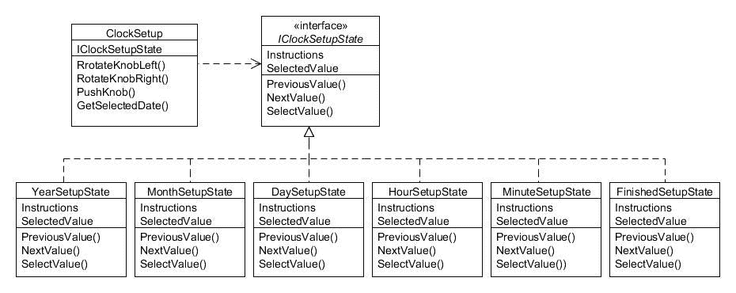

图 21.1：状态模式

`IClockSetupState` 接口定义了处理状态更改的方法，以及可以提供用户指令并返回实际选择值的方法：

```csharp
public interface IClockSetupState
{
    void PreviousValue();
    void NextValue();
    void SelectValue();
    string Instructions { get; }
    int SelectedValue { get; }
}
```

首先查看 `YearSetupState`，你会注意到它在构造函数中接收一个 `ClockSetup` 对象的引用（在设计模式语言中被称为其“上下文”），并管理年份的设置。特别注意 `SelectValue()` 方法中它是如何内部转换到不同状态的：

```csharp
class YearSetupState : ClockSetup
{
    private ClockSetup clockSetup;
    private int year;
    public YearSetupState(ClockSetup clockSetup)
    {
        this.clockSetup = clockSetup;
        year = DateTime.Now.Year;
    }
    public virtual void PreviousValue()
    {
        year--;
    }
    public virtual void NextValue()
    {
        year++;
    }
    public virtual void SelectValue()
    {
        Console.WriteLine("Year to " + year);
        clockSetup.State = clockSetup.MonthState;
    }
    public virtual string Instructions
    {
        get
        {
            return "Please set the year...";
        }
    }
    public virtual int SelectedValue
    {
        get
        {
            return year;
        }
    }
}
```

其他的日期和时间状态遵循类似的过程，每个在需要时转换到下一个状态：

```csharp
class MonthSetupState : ClockSetup
{
    private ClockSetup clockSetup;
    private int month;
    public MonthSetupState(ClockSetup clockSetup)
    {
        this.clockSetup = clockSetup;
        month = DateTime.Now.Month;
    }
    public virtual void PreviousValue()
    {
        if (month > 1)
        {
            month--;
        }
    }
    public virtual void NextValue()
    {
        if (month < 12)
        {
            month++;
        }
    }
    public virtual void SelectValue()
    {
        Console.WriteLine("Month set to " + month);
        clockSetup.State = clockSetup.DayState;
    }
    public virtual string Instructions
    {
        get
        {
            return "Please set the month...";
        }
    }
    public virtual int SelectedValue
    {
        get
        {
            return month;
        }
    }
}

class DaySetupState : ClockSetup
{
    private ClockSetup clockSetup;
    private int day;
    public DaySetupState(ClockSetup clockSetup)
    {
        this.clockSetup = clockSetup;
        day = DateTime.Now.Day;
    }
    public virtual void PreviousValue()
    {
        if (day > 1)
        {
            day--;
        }
    }
    public virtual void NextValue()
    {
        if (day < System.DateTime.DaysInMonth(new DateTime().Year, new DateTime().Month))
        {
            day++;
        }
    }
    public virtual void SelectValue()
    {
        Console.WriteLine("Day set to " + day);
        clockSetup.State = clockSetup.HourSetupState;
    }
    public virtual string Instructions
    {
        get
        {
            return "Please set the day...";
        }
    }
    public virtual int SelectedValue
    {
        get
        {
            return day;
        }
    }
}

class HourSetupState : ClockSetup
{
    private ClockSetup clockSetup;
    private int hour;
    public HourSetupState(ClockSetup clockSetup)
    {
        this.clockSetup = clockSetup;
        hour = DateTime.Now.Hour;
    }
    public virtual void PreviousValue()
    {
        if (hour > 0)
        {
            hour--;
        }
    }
    public virtual void NextValue()
    {
        if (hour < 23)
        {
            hour++;
        }
    }
}
```


```csharp
    public virtual void SelectValue()
    {
        Console.WriteLine("Hour set to " + hour);
        clockSetup.State = clockSetup.MinuteSetupState;
    }
    public virtual string Instructions
    {
        get
        {
            return "Please set the hour...";
        }
    }
    public virtual int SelectedValue
    {
        get
        {
            return hour;
        }
    }
}
public class MinuteSetupState : ClockSetupState
{
    private ClockSetup clockSetup;
    private int minute;
    public MinuteSetupState(ClockSetup clockSetup)
    {
        this.clockSetup = clockSetup;
        minute = DateTime.Now.Minute;
    }
    public virtual void PreviousValue()
    {
        if (minute > 0)
        {
            minute--;
        }
    }
    public virtual void NextValue()
    {
        if (minute < 59)
        {
            minute++;
        }
    }
    public virtual void SelectValue()
    {
        Console.WriteLine("Minute set to " + minute);
        clockSetup.State = clockSetup.FinishedSetupState;
    }
    public virtual string Instructions
    {
        get
        {
            return "Please set the minute...";
        }
    }
    public virtual int SelectedValue
    {
        get
        {
            return minute;
        }
    }
}
```

这只剩下 `FinishedSetupState` 类，它不需要转换到不同的状态：

```csharp
public class FinishedSetupState : ClockSetupState
{
    private ClockSetup clockSetup;
    public FinishedSetupState(ClockSetup clockSetup)
    {
        this.clockSetup = clockSetup;
    }
    public virtual void PreviousValue()
    {
        Console.WriteLine("Ignored...");
    }
    public virtual void NextValue()
    {
        Console.WriteLine("Ignored...");
    }
    public virtual void SelectValue()
    {
        DateTime selectedDate = clockSetup.SelectedDate;
        Console.WriteLine("Date to: " + selectedDate);
    }
    public virtual string Instructions
    {
        get
        {
            return "Press knob to view date...";
        }
    }
    public virtual int SelectedValue
    {
        get
        {
            throw System.NotSupportedException("Clock finished");
        }
    }
}
```

如前提到的，“上下文”类是 `ClockSetup`，它持有对每个状态的引用，并将操作转发给当前状态：

```csharp
public class ClockSetup
{
    // 设置可能处于的各种状态...
    private IClockSetupState yearState;
    private IClockSetupState monthState;
    private IClockSetupState dayState;
    private IClockSetupState hourState;
    private IClockSetupState minuteState;
    private IClockSetupState finishedState;
    // 我们当前处于的状态...
    private IClockSetupState currentState;
    public ClockSetup()
    {
        yearState = new YearSetupState(this);
        monthState = new MonthSetupState(this);
        dayState = new DaySetupState(this);
        hourState = new HourSetupState(this);
        minuteState = new MinuteSetupState(this);
        finishedState = new FinishedSetupState(this);
        // 初始状态设置为年份
        State = yearState;
    }
    public virtual IClockSetupState State
    {
        set
        {
            currentState = value;
            Console.WriteLine(currentState.Instructions);
        }
    }
    public virtual void RotateKnobLeft()
    {
        currentState.PreviousValue();
    }
    public virtual void RotateKnobRight()
    {
        currentState.NextValue();
    }
    public virtual void PushKnob()
    {
        currentState.SelectValue();
    }
    public virtual IClockSetupState YearSetup
    {
        get
        {
            return yearState;
        }
    }
    public virtual IClockSetupState MonthSetup
    {
        get
        {
            return monthState;
        }
    }
    public virtual IClockSetupState DaySetup
    {
        get
        {
            return dayState;
        }
    }
    public virtual IClockSetupState HourSetup
    {
        get
        {
            return hourState;
        }
    }
    public virtual IClockSetupState MinuteSetup
    {
        get
        {
            return minuteState;
        }
    }
    public virtual IClockSetupState FinishedSetupState
    {
        get
        {
            return finishedState;
        }
    }
    public virtual DateTime SelectedDate
    {
        get
        {
            return new DateTime(yearState.SelectedValue, monthState.SelectedValue, dayState.SelectedValue, hourState.SelectedValue, minuteState.SelectedValue, 0);
        }
    }
}
```

我们可以像这样模拟用户的示例操作：

```csharp
ClockSetup clockSetup = new ClockSetup();
// 设置从 'year' 状态开始
clockSetup.RotateKnobRight();
clockSetup.PushKnob(); // 增加 1 年
// 设置现在应该处于 'month' 状态
clockSetup.RotateKnobRight();
clockSetup.RotateKnobRight();
clockSetup.PushKnob(); // 增加 2 个月
// 设置现在应该处于 'day' 状态
clockSetup.RotateKnobRight();
clockSetup.RotateKnobRight();
clockSetup.RotateKnobRight();
clockSetup.PushKnob(); // 增加 3 天
// 设置现在应该处于 'hour' 状态
clockSetup.RotateKnobLeft();
clockSetup.RotateKnobLeft();
clockSetup.PushKnob(); // 减少 2 小时
// 设置现在应该处于 'minute' 状态
clockSetup.RotateKnobRight();
clockSetup.PushKnob(); // 增加 1 分钟
// 设置现在应该处于 'finished' 状态
clockSetup.PushKnob(); // 显示选定的日期
```


有两个实现类：`StandardGearboxStrategy` 和 `SportGearboxStrategy`：

```csharp
public class StandardGearboxStrategy : IGearboxStrategy
{
    public virtual void EnsureCorrectGear(IEngine engine, int speed)
    {
        int engineSize = engine.Size;
        bool turbo = engine.Turbo;
        // 一些复杂的代码来确定正确的齿位
        // 根据 engineSize, turbo & speed 等进行设置
        // ... 省略 ...
        Console.WriteLine("Working out correct gear at " + speed + "mph for a STANDARD gearbox");
    }
}

public class SportGearboxStrategy : IGearboxStrategy
{
    public virtual void EnsureCorrectGear(IEngine engine, int speed)
    {
        int engineSize = engine.Size;
        bool turbo = engine.Turbo;
        // 一些复杂的代码来确定正确的齿位
        // 根据 engineSize, turbo & speed 等进行设置
        // ... 省略 ...
        Console.WriteLine("Working out correct gear at " + speed + "mph for a SPORT gearbox");
    }
}
```

我们的 `AbstractCar` 类被定义为持有对接口类型的引用（即 `IGearboxStrategy`），并提供访问器方法以便切换不同的策略。还有一个 `Speed` 属性设置器，它会将操作委托给当前生效的策略。相关代码已用**粗**标记：

```csharp
public abstract class AbstractCar : AbstractVehicle
{
    private IGearboxStrategy gearboxStrategy;
    public AbstractCar(IEngine engine)
        : this(engine, VehicleColour.Unpainted)
    {
    }
    public AbstractCar(IEngine engine, VehicleColour colour)
        : base(engine, colour)
    {
        // 以标准齿箱模式开始（更省油）
        gearboxStrategy = new StandardGearboxStrategy();
    }
    // 允许更改齿箱策略...
    public virtual IGearboxStrategy IGearboxStrategy
    {
        set
        {
            gearboxStrategy = value;
        }
        get
        {
            return gearboxStrategy;
        }
    }
    public virtual int Speed
    {
        set
        {
            // 委托给当前生效的策略...
            gearboxStrategy.EnsureCorrectGear(Engine, value);
        }
    }
}
```

客户端程序只需要设置所需的策略：

```csharp
AbstractCar myCar = new Sport(new StandardEngine(2000));
myCar.Speed = 20;
myCar.Speed = 40;
Console.WriteLine("Switching on mode gearbox...");
myCar.IGearboxStrategy = new SportGearboxStrategy();myCar.Speed = 20;
myCar.Speed = 40;
```

这应该产生以下输出：
```
Working out correct gear at 20mph for a STANDARD gearbox
Working out correct gear at 40mph for a STANDARD gearbox
Switching on mode gearbox...
Working out correct gear at 20mph for a SPORT gearbox
Working out correct gear at 40mph for a SPORT gearbox
```

### 23. 模板方法 (Template Method)

类型：行为型 (Behavioural)

目的：在方法中定义算法的骨架，并将某些步骤延迟给子类。模板方法允许子类在不改变算法结构的情况下重新定义算法的某些步骤。

Foobar 公司制造的每辆车辆都需要制作少量的小手册并提供给买家，例如《所有手册》和《保养记录》。手册的制作遵循相同的步骤 set，但每种类型的手册可能需要以不同的方式执行每个步骤。

模板方法模式允许定义一个或多个抽象方法，这些方法通过“模板方法”进行调用。简单的层级结构如下：images/0007.jpg

#### 图 23.1：模板方法模式

`AbstractletPrinter` 类定义了几个 `protected` 方法和一个使用这些抽象方法的 `public` “模板方法”：

```csharp
public abstract class AbstractPrinter
{
    protected abstract int PageCount { get; }
    protected abstract void PrintFrontCover();
    protected abstract void PrintOfContents();
    protected abstract void PrintPage(int pageNumber);
    protected abstract void PrintIndex();
    protected abstract void PrintBackCover();
    // 这是模板方法
    public void Print()
    {
        PrintFrontCover();
        PrintOfContents();
        for (int i = 1; i <= PageCount; i++)
        {
            PrintPage(i);
        }
        PrintIndex();
        PrintBackCover();
    }
}
```

每个具体子类现在都需要为抽象方法提供实现，例如下面的 `SaloonBooklet` 类：

```csharp
public class SaloonBooklet : AbstractPrinter
{
    protected override int PageCount
    {
        get
        {
            return 100;
        }
    }
    protected override void PrintFrontCover()
    {
        Console.WriteLine("Printing front cover for Saloon booklet");
    }
    protected override void PrintOfContents()
    {
        Console.WriteLine("Printing table of contents for Saloon booklet");
    }
    protected override void PrintPage(int pageNumber)
    {
        Console.WriteLine("Printing page " + pageNumber + " for Saloon booklet");
    }
    protected override void PrintIndex()
    {
        Console.WriteLine("Printing index for Saloon booklet");
    }
    protected override void PrintBackCover()
    {
        Console.WriteLine("Printing back cover for Saloon booklet");
    }
}
```

`ServiceHistoryBooklet` 非常相似：

```csharp
public class ServiceHistoryBooklet : AbstractPrinter
{
    protected override int PageCount
    {
        get
        {
            return 12;
        }
    }
    protected override void PrintFrontCover()
    {
        Console.WriteLine("Printing front cover for service history booklet");
    }
    protected override void PrintOfContents()
    {
        Console.WriteLine("Printing table of contents for service history booklet");
    }
    protected override void PrintPage(int pageNumber)
    {
        Console.WriteLine("Printing page " + pageNumber + " for service history booklet");
    }
    protected override void PrintIndex()
    {
        Console.WriteLine("Printing index for service history booklet");
    }
    protected override void PrintBackCover()
    {
        Console.WriteLine("Printing back cover for service history booklet");
    }
}
```

虽然从模式的角度来看，抽象方法必须是 `protected` 并不是必需的，但通常这是分配最合适的访问级别，因为它们仅用于被重写，而不是供客户端对象直接调用。

此外注意，从“模板方法”中调用的某些方法不是抽象的但提供了默认实现是完全可以的。但当至少有一个抽象方法被调用时，它就符合模板模式的定义。

客户端程序只需要实例化所需的具体类并调用 `Print()` 方法：

```csharp
Console.WriteLine("About to print a booklet for Saloon cars");
AbstractPrinter saloonBooklet = new SaloonBooklet();
saloonBooklet.Print();

Console.WriteLine("About to print a service history booklet");
AbstractPrinter serviceBooklet = new ServiceHistoryBooklet();
serviceBooklet.Print();

Console.Read();
```

### 24. 访问者 (Visitor)

类型：行为型 (Behavioural)


#### 目的
表示在对象结构元素上执行的方法。访问者模式（Visitor）允许你在不更改操作的元素类的情况下定义一个新方法。

有时，类层次结构及其代码会变得非常庞大，但我们知道未来的需求是不可避免的。Foobar 汽车公司的一个例子是 `IEngine` 层次结构，如下所示：


图 24.1：`IEngine` 类层次结构

实际上，`AbstractEngine` 类中的代码可能由许多单独组件组成，例如 `camshaft`（凸轮）、`piston`（活塞）、一些 `sparkplugs`（火花塞）等。如果我们需要添加遍历这些组件的功能，自然的方法是直接向 `AbstractEngine` 添加一个方法。但也许我们知道将来会有许多此类新需求，而我们并不希望直接向层次结构中不断添加方法？

访问者模式允许我们只向类层次结构中添加一个额外的方法，用以便在不进行任何进一步更改的情况下添加许多不同类型的新功能。这是通过一种被称为“双分派发”（double-dispatch）的技术实现的，其中被调的方法向调用者对象发布一个回调。

该技术首先需要定义一个接口，我们称之为 `IEngineVisitor`：

```csharp
public interface IEngineVisitor
{
    void Visit(Camshaft camshaft);
    void Visit(IEngine engine);
    void Visit(Piston piston);
    void Visit(SparkPlug sparkPlug);
}
```

我们还会定义一个名为 `IVisitable` 的接口，包含一个 `AcceptEngineVisitor()` 方法：

```csharp
public interface IVisitable
{
    void AcceptEngineVisitor(IEngineVisitor visitor);
}
```

你在之前的章节中已经过的 `IEngine` 接口（尽管我们在本章中对其进行了轻微修改）。`Camshaft`、`Piston` 和 `SparkPlug` 类都非常简单，如下：

```csharp
public class Camshaft : IVisitable
{
    public void AcceptEngineVisitor(IEngineVisitor visitor)
    {
        visitor.Visit(this);
    }
}

public class Piston : IVisitable
{
    public void AcceptEngineVisitor(IEngineVisitor visitor)
    {
        visitor.Visit(this);
    }
}

public class SparkPlug : IVisitable
{
    public void AcceptEngineVisitor(IEngineVisitor visitor)
    {
        visitor.Visit(this);
    }
}
```

如你所见，这些类都定义了一个名为 `AcceptEngineVisitor()` 的方法，它接收一个 `IEngineVisitor` 对象作为参数。该方法所做的调用传入的 `IEngineVisitor` 的 `Visit()` 方法，并传回对象实例。

我们修改后的 `IEngine` 接口现在扩展了 `IVisitable`：

```csharp
public interface IEngine : IVisitable
{
    int Size { get; }
    int Turbo { get; }
}
```

因此，`AbstractEngine` 类需要实现这个新方法，在这种情况下，该方法遍历各个组件（凸轮、活塞、火花塞），并在每个组件上调用 `AcceptEngineVisitor()`：

```csharp
public abstract class AbstractEngine : IEngine
{
    private int size;
    private bool turbo;
    private Camshaft camshaft;
    private Piston piston;
    private SparkPlug[] sparkPlugs;
    public AbstractEngine(int size, bool turbo)
    {
        this.size = size;
        this.turbo = turbo;
        // 创建凸轮、活塞和 4 个火花塞...
        camshaft = new Camshaft();
        piston = new Piston();
        sparkPlugs = new SparkPlug[]{new SparkPlug(), new SparkPlug(), new SparkPlug(), new SparkPlug()};
    }
    public virtual int Size
    {
        get
        {
            return size;
        }
    }
    public virtual bool Turbo
    {
        get
        {
            return turbo;
        }
    }
    public virtual void AcceptEngineVisitor(IEngineVisitor visitor)
    {
        // 访问每个组件...
        camshaft.AcceptEngineVisitor(visitor);
        piston.AcceptEngineVisitor(visitor);
        foreach (SparkPlug eachPlug in sparkPlugs)
        {
            eachPlug.AcceptEngineVisitor(visitor);
        }
        // 现在访问接收者...
        visitor.Visit(this);
    }
    public override string ToString()
    {
        return this.GetType().Name + " (" + size + ")";
    }
}
```

现在我们将创建一个 `IEngineVisitor` 的实际实现，这样你就可以看到如何轻松地为引擎添加功能，而无需对任何引擎类进行任何进一步更改。我们要做的第一件事是定义一些附加到引擎上的智能装置，它可以自动检查每个组件并诊断任何故障。因此，我们定义了 `EngineDiagnostics` 类：

```csharp
public class EngineDiagnostics : IEngineVisitor
{
    public virtual void Visit(Camshaft camshaft)
    {
        Console.WriteLine("正在诊断凸轮");
    }
    public virtual void Visit(IEngine engine)
    {
        Console.WriteLine("正在诊断引擎");
    }
    public virtual void Visit(Piston piston)
    {
        Console.WriteLine("正在诊断活塞");
    }
    public virtual void Visit(SparkPlug sparkPlug)
    {
        Console.WriteLine("正在诊断单个火花塞");
    }
}
```

我们还想打印引擎中每种类型组件的数量，因此我们还有一个 `EngineInventory` 类：

```csharp
public class EngineInventory : IEngineVisitor
{
    private int camshaftCount;
    private int pistonCount;
    private int sparkPlugCount;
    public EngineInventory()
    {
        camshaftCount = 0;
        pistonCount = 0;
        sparkPlugCount = 0;
    }
    public virtual void Visit(Camshaft camshaft)
    {
        camshaftCount++;
    }
    public virtual void Visit(IEngine engine)
    {
        Console.WriteLine("引擎有: " + camshaftCount +" 凸轮(s), " + pistonCount + " 活塞(s), 和 " + sparkPlugCount + " 火花塞(s)");
    }
    public virtual void Visit(Piston piston)
    {
        pistonCount++;
    }
    public virtual void Visit(SparkPlug sparkPlug)
    {
        sparkPlugCount++;
    }
}
```

下面的图总结了所有这些类是如何交互的：

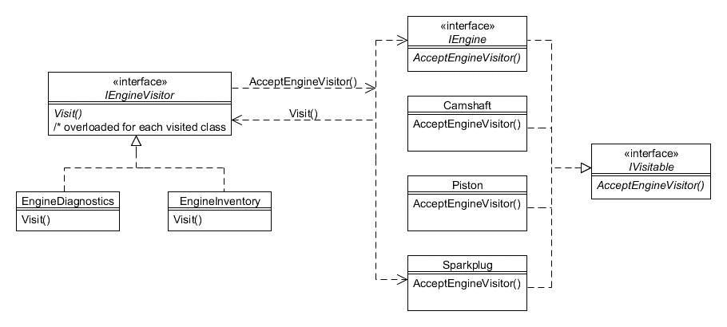

图 24.2：访问者模式

客户端程序现在需要在 `IEngine` 实例上调用 `AcceptEngineVisitor()` 方法，传入适当的 `IEngineVisitor` 对象：

```csharp
// 创建一个引擎...
IEngine engine = new StandardEngine(1300);

// 对引擎运行诊断...
engine.AcceptEngineVisitor(new EngineDiagnostics());
```

上述操作将产生以下输出：

`正在诊断凸轮`
`正在诊断活塞`
`正在诊断单个火花塞`
`正在诊断单个火花塞`
`正在诊断单个火花塞`
`正在诊断单个火花塞`
`正在诊断引擎`

并获取库存（使用相同的 `IEngine` 实例）：

```csharp
// 对引擎运行清单...
engine.AcceptEngineVisitor(new EngineInventory());
```

输出应显示：

`引擎有: 1 凸轮(s), 1 活塞(s), 和 4 火花塞(s)`

# 第五部分 其他实用的模式

本部分介绍了四种你在实际应用中可能会发现非常有用的模式：

- **空对象（Null Object）**：定义一个允许处理空值的类；
- **简单工厂（Simple Factory）**：委托对象的实例化；
- **模型-视图-控制器（Model View Controller）**：将用户界面组件的屏幕表示与其底层数据和功能分离；
- **分层（Layers）**：将应用程序划分为不同的模块级，并按层次级进行通信。

25. 空对象


正如任何 C# 程序员很快发现的，软件测试经常会抛出 `NullReferenceException` 消息。有时，解决此问题的方法是在执行操作之前专门针对 `null` 进行测试，这给程序员增加了额外的负担。

假设一个车辆的仪表盘包含三个警告灯槽位（例如用于机油低位或刹车液低位）。某辆特定的车辆可能只使用其中两盏灯，而第三个槽位为空，在 C# 中用 `null` 表示。遍历这些槽位需要特定的测试以防止抛出 `NullReferenceException`：

```csharp
// OilLevelLight & BrakeFluidLight are each types of IWarningLight
IWarningLight[] lights = new IWarningLight[3];
lights[0] = new OilLevelLight();
lights[1] = new BrakeFluidLight();
lights[2] = null; // empty slot

foreach (IWarningLight currentLight in lights)
{
    if (currentLight != null)
    {
        currentLight.TurnOn();
        currentLight.TurnOff();
        Console.WriteLine(currentLight.On);
    }
}
```

一种可以帮助避免对 `null` 测试的方法是在类层次结构中创建一个“空对象”（null object）类。该类将实现相同的接口，但不执行任何实际功能，如图所示：

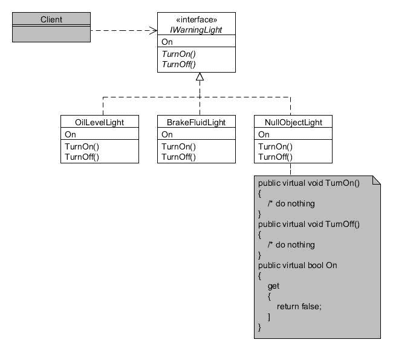
图 25.1 : 空对象模式

`IWarningLight` 接口定义了方法 `TurnOn()`、`TurnOff()` 以及属性 `On` 的 get 访问器：

```csharp
public interface IWarningLight
{
    void TurnOn();
    void TurnOff();
    bool On { get; }
}
```

`OilLevelLevel` 和 `BrakeFluidLevel` 类分别实现 `IWarningLight` 接口，并提供用于开启或关闭指示灯的适当代码：

```csharp
public class OilLevelLight : IWarningLight
{
    private bool on;
    public virtual void TurnOn()
    {
        on = true;
        Console.WriteLine("Oil level light ON");
    }
    public virtual void TurnOff()
    {
        on = false;
        Console.WriteLine("Oil level light OFF");
    }
    public virtual bool On
    {
        get
        {
            return on;
        }
    }
}

public class BrakeFluidLight : IWarningLight
{
    private bool on;
    public virtual void TurnOn()
    {
        on = true;
        Console.WriteLine("Brake fluid light ON");
    }
    public virtual void TurnOff()
    {
        on = false;
        Console.WriteLine("Brake fluid light OFF");
    }
    public virtual bool On
    {
        get
        {
            return on;
        }
    }
}
```

对于空对象模式，我们还创建了一个 `NullObjectLight` 类，它实现了 `IWarningLight` 接口但不执行任何实际处理：

```csharp
public class NullObjectLight : IWarningLight
{
    public virtual void TurnOn()
    {
        // Do nothing...
    }
    public virtual void TurnOff()
    {
        // Do nothing...
    }
    public virtual bool On
    {
        get
        {
            return false;
        }
    }
}
```

现在我们的客户端代码可以被简化了，因为只要我们使用空对象，就不需要测试槽位是否为 `null`：

```csharp
IWarningLight[] lights = new IWarningLight[3];
lights[0] = new OilLevelLight();
lights[1] = new BrakeFluidLight();
lights[2] = new NullObjectLight(); // empty slot

// No need to test for null
foreach (IWarningLight currentLight in lights)
{
    currentLight.TurnOn();
    currentLight.TurnOff();
    Console.WriteLine(currentLight.On);
}
```

注意，对于空 getter 方法，需要返回任何看似合理的值；因此上述 `On` 属性 getget 访问器返回 `false`，因为它代表一个非扩展状态。

## 简单工厂

在本书的主体部分，我们查看了工厂方法模式（Factory Method）和抽象工厂模式（Abstract Factory）。简单工厂模式是将对象的实例化委托给特定类（即“工厂”）的常用手段。我们在此处假设 Foobar 公司生产两种类型的变速箱：自动变速箱和手动变速箱。客户端程序可能需要根据条件创建其中一种，如下代码所示（假设类定义在一个类内部）：

```csharp
Gearbox selectedGearbox = null;
if (typeWanted.Equals("automatic"))
{
    selectedGearbox = new AutomaticGearbox();
}
else if (typeWanted.Equals("manual"))
{
    selectedGearbox = new ManualGearbox();
}
// Do something with selectedGearbox...
```

虽然上面的代码可以工作，但如果有多个客户端程序需要执行类似的选择会怎样？我们必须在每个客户端程序中重复 `if...else...` 语句，如果随后生产了新类型的变速箱，我们必须追踪每一个使用该 `if...else...` 块的地方。

记住封装变化概念的原则，相反我们可以将选择和实例化过程委托给专门为此目的创建的特定类（即“工厂”）。然后客户端程序程序使用工厂的 `Create()` 方法，如下图所示：

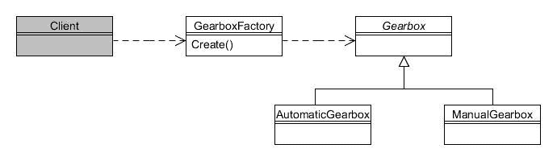
图 26.1 : 简单工厂模式

简单示例中的抽象类 `Gearbox` 定义了一个无参数构造函数：

```csharp
public abstract class Gearbox
{
}
```

`AutomaticGearbox` 和 `ManualGearbox` 类分别扩展了 `Gearbox` 以实现各自类型：

```csharp
public class AutomaticGearbox : Gearbox
{
    public AutomaticGearbox()
    {
        Console.WriteLine("New automatic gearbox created");
    }
}

public class ManualGearbox : Gearbox
{
    public ManualGearbox()
    {
        Console.WriteLine("New manual gearbox created");
    }
}
```

现在我们需要创建一个 `GearboxFactory` 类，它能够实例化相应的 `Gearbox`：

```csharp
public class GearboxFactory
{
    public enum Type
    {
        Automatic, Manual
    }
    public static Gearbox Create(Type type)
    {
        if (type == Type.Automatic)
        {
            return new AutomaticGearbox();
        }
        else
        {
            return new ManualGearbox();
        }
    }
}
```

`Create()` 方法负责选择和实例化，从而隔离了每个客户端程序的重复代码。我们将该方法设置为 `static` 纯是为了方便，并不是该模式的要求。

客户端程序现在通过工厂获取变速箱类型：

```csharp
// Create an automatic gearbox
Gearbox auto = GearboxFactory.Create(GearboxFactory.Type.Automatic);

// Create a manual gearbox
Gearbox manual = GearboxFactory.Create(GearboxFactory.Type.Manual);
```

## 模型视图控制器 (Model View Controller)

Foobar 汽车公司的卫星导航系统包含了当前位置的视觉显示、行驶方向以及当前速度的指示。还有一个输入设备；用于设置目的地等。一个完整的仿真远出了本书的范围，因此我们将使用一个非常简化的界面，仅允许您设置行驶方向（北、南、西、东）和当前速度，而不考虑任何道路等。

用户界面看起来如下：

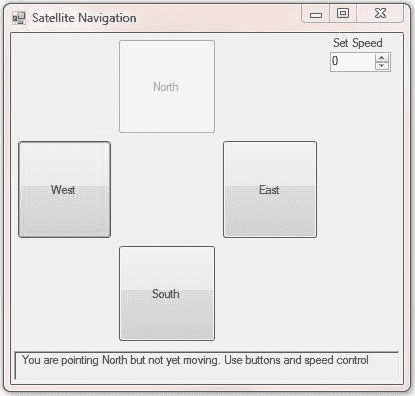
图 27.1 : 卫星导航用户界面


如你所见，上方有改变方向的按钮和一个用于调整速度的旋转器。屏幕底部的“反馈（Feedback）”部分会根据你的选择自动调整。请注意，每当你点击其中一个方向按钮时，该按钮就会被禁用，而之前选中的按钮将重新启用。程序初始时指向北方向，但速度为零。

这是一个非常简单的程序，完全可以在单个类中完成编码。但随着图形应用程序变得越来越复杂，分离程序的各个部分将极大地简化开发和维护。

# 模型-视图-控制器模式 (Model View Controller Pattern)

模型-视图-控制器模式（通常缩写 `MVC`）是实现组成部分之间更松耦合的方法，也是图形应用程序中一种经过验证的方法。在 GUI 应用程序中通常有三个部分在起：

1.  **“模型”（Model）**：这是“数据”（即状态）以及相关的应用程序或“业务”逻辑。在我们的示例中，它包含了当前方向和当前速度的值，以及更新和返回这些值的方法。
2.  **“视图”（View）**：这是图形化显示，如图 27.1 所示，当模型以某种方式改变状态时，它会自动根据需要更新自己。
3.  **“控制器”（Controller）**：这部分响应所有用户输入（按钮点击、控制旋转器等），并与模型和视图建立联系。

上述三个部分中的每一个都将位于一个独立的类中，可以可视化如下：

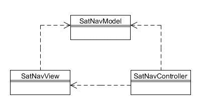

图 27.2：模型-视图-控制器模式

这些类以以下方式相互关联：

*   `SatNavModel` 包含设置和获取方向与速度的方法。它是“可观察的”（参见第 20 章），每当方向或速度发生变化时，它都会通知感兴趣的观察者，但它对任何其他类都没有直接了解；
*   `SatNavView` 定义了图形形状和用户界面显示。它持有对 `SatNavModel` 的引用，以便它可以监听模型的状态变化，并根据需要查询其状态，以保持显示自动更新；
*   `SatNavController` 持有对 `SatNavModel` 和 `SatNavView` 的引用。它处理按钮点击和速度旋转器的移动，更新模型并在需要时与视图建立联系。

正如书中描述的其他模式一样，`MVC` 的结构方式存在多种变体，上述方法可以描述为“经典”方法。C# 通常使用 `MVC` 的一种修改版本，其中视图和控制器合并并在单个类中，但为了本书的目的，我们将使用完整的三类分离法来介绍这种模式。

## 模型：SatNavModel

我们将从模型开始，在我们的案例中，模型是 `SatNavModel` 类。该类被编码为对视图或控制器都不进行直接了解，因此可以在不进行任何更改的情况下，将其插入到各种其他应用程序中。

```cs
public class SatNavModel
{
    // 我们可以移动的方向
    public enum TravelDirection
    {
        Still, North, South, East, West
    }
    // 改变处理器
    public event EventHandler ModelChanged;
    // 当前方向和速度
    private TravelDirection CurrentDirection;
    private int CurrentSpeed;
    public SatNavModel()
    {
        CurrentDirection = TravelDirection.North;
        CurrentSpeed = 0;
    }
    public virtual TravelDirection Direction
    {
        set
        {
            if (value != CurrentDirection)
            {
                CurrentDirection = value;
                if (ModelChanged != null)
                {
                    ModelChanged(this, EventArgs.Empty);
                }
            }
        }
        get
        {
            return CurrentDirection;
        }
    }
    public virtual int Speed
    {
        set
        {
            if (value != CurrentSpeed)
            {
                CurrentSpeed = value;
                if (ModelChanged != null)
                {
                    ModelChanged(this, EventArgs.Empty);
                }
            }
        }
        get
        {
            return CurrentSpeed;
        }
    }
}
```

如你所见，与其他类的唯一联系是通过其观察者实现的（我们使用 `EventHandler` 事件对象来方便这一点）。每当方向或速度被修改时，其观察者（也称为监听器）就会收到通知。

图形显示是由 `SatNavView` 类使用标准组件完成的。它在构造函数中获取 `SatNavModel` 的引用，以便将其注册为模型的观察者。每当检测到模型变化时，就会调用 `HandleModelChanged()` 方法，使视图更新其显示。还有其他方法允许 UI 控件被观察（例如，通过控制器）。

```cs
public partial class SatNavView : Form
{
    private SatNavModel model;
    public event EventHandler ViewControlActivated;
    public SatNavView(SatNavModel model)
    {
        InitializeComponent();
        this.model = model;
        this.model.ModelChanged += HandleModelChanged;
    }
    private void SatNavView_Load(object sender, EventArgs e)
    {
        northButton.Enabled = false;
        feedbackLabel.Text = "你正指向 " + model.Direction + " 但尚未移动。请使用按钮和速度控制";
    }
    public void HandleModelChanged(Object sender, EventArgs args)
    {
        feedbackLabel.Text = "方向: " + model.Direction + ", 速度: " + model.Speed;
    }
    private void eastButton_Click(object sender, EventArgs e)
    {
        if (ViewControlActivated != null)
        {
            ControlEventArgs args = new ControlEventArgs();
            args.direction = SatNavModel.TravelDirection.East;
            ViewControlActivated(this, args);
        }
    }
    private void northButton_Click(object sender, EventArgs e)
    {
        if (ViewControlActivated != null)
        {
            ControlEventArgs args = new ControlEventArgs();
            args.direction = SatNavModel.TravelDirection.North;
            ViewControlActivated(this, args);
        }
    }
    private void southButton_Click(object sender, EventArgs e)
    {
        if (ViewControlActivated != null)
        {
            ControlEventArgs args = new ControlEventArgs();
            args.direction = SatNavModel.TravelDirection.South;
            ViewControlActivated(this, args);
        }
    }
    private void westButton_Click(object sender, EventArgs e)
    {
        if (ViewControlActivated != null)
        {
            ControlEventArgs args = new ControlEventArgs();
            args.direction = SatNavModel.TravelDirection.West;
            ViewControlActivated(this, args);
        }
    }
    private void speedControl_ValueChanged(object sender, EventArgs e)
    {
        if (ViewControlActivated != null)
        {
            ControlEventArgs args = new ControlEventArgs();
            args.speed = (int)speedControl.Value;
            ViewControlActivated(this, args);
        }
    }
    internal void enableAllowedButtons()
    {
        // 所有方向按钮
        eastButton.Enabled = true;
        northButton.Enabled = true;
        southButton.Enabled = true;
        westButton.Enabled = true;
        // 禁用当前方向按钮
        if (model.Direction == SatNavModel.TravelDirection.East)
        {
            eastButton.Enabled = false;
        }
    }
}
```


```csharp
else if (model.Direction == SatNavModel.TravelDirection.North)
{
    northButton.Enabled = false;
}
else if (model.Direction == SatNavModel.TravelDirection.South)
{
    southButton.Enabled = false;
}
else if (model.Direction == SatNavModel.TravelDirection.West)
{
    westButton.Enabled = false;
}

} // 用于改变方向或速度的嵌套类
public class ControlEventArgs : EventArgs
{
    public SatNavModel.TravelDirection direction;
    public int speed;
}
```

`SatNavController` 类负责处理用户输入，在这种情况下，用户输入可以是点击方向按钮之一，也可以移动速度调节旋器。为了响应用户输入，需要更新 Model 状态，因此在构造函数中同时存在对 `SatNavView` 和 `SatNavModel` 的引用。该类设置自己来监听用户输入并做出相应的反应：

```csharp
public class SatNavController
{
    // 需要同时对 model 和 view 的引用
    private SatNavModel model;
    private SatNavView view;
    public SatNavController(SatNavModel model, SatNavView view)
    {
        this.model = model;
        this.view = view;
        this.view.ViewControlActivated += HandleViewControlActivated;
    }
    public void HandleViewControlActivated(Object sender, EventArgs args)
    {
        SatNavView.ControlEventArgs satnavArgs = (SatNavView.ControlEventArgs)args;
        if (satnavArgs.direction != SatNavModel.TravelDirection.Still)
        {
            model.Direction = satnavArgs.direction;
            view.enableAllowedButtons();
        }
        else
        {
            model.Speed = satnavArgs.speed;
        }
    }
}
```

现在运行该应用程序只需从 `Program.cs` 实例化上述类：

```csharp
// 创建 MVC 类
SatNavModel model = new SatNavModel();
SatNavView view = new SatNavView(model);
SatNavController controller = new SatNavController(model, view);
Application.Run(view)
```

### 28. 层 (Layers)

随着应用程序变得越来越大，它们的管理可能会变得困难，大量的互连会导致耦合性增加。层（Layers）模式通过将应用程序划分为层次结构中的两个或多个层来解决这个问题，每层只与其直接下方的层进行通信。这种方法有助于应用程序模块化，并有助于降低类之间的耦合性。

#### 客户端-服务器（2 级）架构

层模式的一个简单示例是客户端-服务器模型，其中“客户端”（例如 Web 浏览器）与“服务器”（例如 Web 服务器）通信以查看网页：

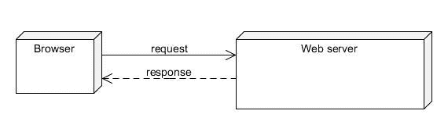

图 28.1：客户端-服务器架构

在图 28.1 中，你可以看到浏览器向 Web 服务器发送请求，服务器返回一个响应（例如网页）。如果你想象客户端和服务器分别位于自己的命名空间中，上述内容将如下所示：

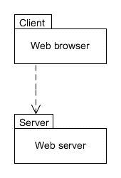

图 28.2：客户端-服务器架构

从图 28.2 中可以推断出 `client` 命名空间持有对 `server` 命名空间的引用。`layer`（层）和 `tier`（级）这两个术通常互换使用，但“layer”更准确地指代逻辑划分，而“tier”指代物理划分。

#### 3 级架构

客户端-服务器架构的一个常见扩展是需要访问数据的情况，因此添加了第三层：

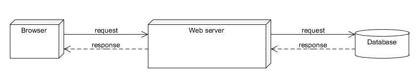

图 28.3：3 级架构

图 28.3 显示了浏览器向服务器发送请求，服务器转而向数据库发送请求。如下所示：

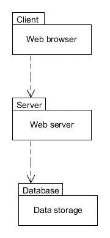

图 28.4：3 级架构

从图 28.4 中你可以看到 `client` 命名空间持有对 `server` 命名空间的引用，服务器转与 `database` 通信。这种方法有助于隐藏每一层的复杂性。

## VI. 实践中的设计模式

这部分由一个章节组成，展示了一个演示书中描述的某些模式的小型应用程序。所示的模式有：

*   层 (Layers)
*   单例 (Singleton)
*   外观模式 (Faade)
*   工厂 (Factory)
*   观察者 (Observer)
*   策略 (Strategy)

### 29. 示例 3 级应用程序

本章开发了一个小型示例 3 级应用程序，该程序使用了常用的设计模式。该应用程序显示了从 Foobar 公司生产线产下的引擎列表（这意味着列表可能会多次显示相同的引擎类型和尺寸），并提供了构建新引擎以及将数据保存/恢复到持久化存储器中的功能。请注意，这并非设计用于生产级软件；为了关注模式，代码已经经过了简化。

完成后的应用程序如下：

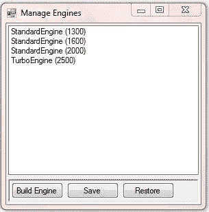

图 29.1：引擎管理表单

每当点击 Build Engine（构建引擎）按钮时，都会出现对话框，允许你创建一个所选类型和尺寸的新引擎并将其添加到列表中：

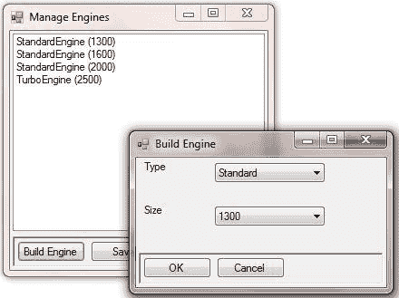

图 29.2：构建引擎对话框

Save（保存）按钮将列表数据存储到磁盘上的文件中，Restore（恢复）按钮将把列表数据替换为最近保存的值。

该应用程序将使用 3 级架构设计，采用层模式，包括用户界面层、业务模型层和数据库层。每层的类将存储在 `Business` 和 `Database` 命名空间中，根命名空间用于用户界面。每层只与其下一层的层进行通信，如下所示：

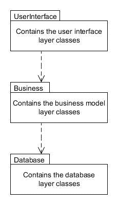

图 29.3：作为命名空间的 3 级层模式

#### 数据库层

从 `Database` 命名空间开始，我们将一个对象称为 `Entity`。由于数据库表通常具有主键，我们将使用单例模式定义 `EntityKeyGenerator` 类：

```csharp
namespace Database
{
    [Serializable]
    class EntityKeyGenerator
    {
        // 静态成员
        private static volatile EntityKeyGenerator instance;
        public static EntityKeyGenerator Instance
    }
}
```


```csharp
{
    get
    {
        if (instance == null)
        {
            instance = new EntityKeyGenerator();
        }
        return instance;
    }
}
// 实例变量
private int nextKey;
// 私有构造函数
private EntityKeyGenerator()
{
}
// 实例方法
virtual int NextKey
{
    return ++nextKey;
}
``````

#### EntityKeyGenerator 和 EntityTable

为任何 `IEngine` 实体生成下一个唯一键，只需要调用：

`EntityKeyGenerator.Instance.NextKey;`

我们现在将定义一个简单的 `EntityTable` 类，它可以存储一个以顺序数字 ID 为键的对象字典：

```csharp
namespace Database
{
    [Serializable]
    public class EntityTable
    {
        private EntityKeyGenerator keyGenerator;
        private IDictionary<int?, object> entities;
        [field:NonSerialized] public event EventHandler EntityTableItemAdded;
        [field:NonSerialized] public event EventHandler EntityTableRestored;
        internal EntityTable(EntityKeyGenerator keyGenerator)
        {
            this.keyGenerator = keyGenerator;
            entities = new Dictionary<int?, object>();
        }
        internal virtual object GetByKey(int? key)
        {
            return entities[key];
        }
        internal virtual ICollection<object> All()
        {
            return entities.Values;
        }
        internal virtual int? AddEntity(object value)
        {
            int? key = keyGenerator.NextKey;
            entities[key] = value;
            EntityAddedEventArgs args = new EntityAddedEventArgs();
            args.objectAdded = value;
            if (EntityTableItemAdded != null)
            {
                EntityTableItemAdded(this, args);
            }
            return key;
        }
        internal virtual void Restore(EntityTable restoredTable)
        {
            entities.Clear();
            foreach (KeyValuePair<int?, object> pair in restoredTable.entities)
            {
                entities.Add(pair.Key, pair.Value);
            }
        }
        // 用于实体添加事件的嵌套类
        public class EntityAddedEventArgs : EventArgs
        {
            public object objectAdded;
        }
    }
}
```

请注意以下几：

- 构造函数需要一个 `EntityKeyGenerator` 对象，它可以使用它为此特定类型生成下一个键；
- 实体存储在以整数（表示主键）为键的字典中，其值将 `object`。这允许该类存储任何对象类型，从而实现松耦合；
- 提供了方法来返回所有实体，或者在提供键时仅返回单个实体；
- `AddEntity()` 方法在将实体添加到字典后，会生成并返回下一个键；
- `Restore()` 方法将数据替换为参数提供的数据

将数据保存到磁盘可以通过对象序列化或通过创建 CSV 格式的文件来实现。这表明可以使用策略模式（Strategy pattern），以便切换不同的处理方法。`AbstractEntityStrategy` 类提供了定义它的基类：

```csharp
namespace Database
{
    abstract class AbstractEntityStrategy
    {
        virtual string GetFileName(EntityTable table)
        {
            return table.GetType().Name;
        }
        internal abstract string FileSuffix { get; }
        internal abstract void Save(EntityTable table);
        internal abstract EntityTable Restore(EntityTable table);
    }
}
```

`EntitySerializationStrategy` 类扩展了上述类以实现所需的方法：

```csharp
namespace Database
{
    class EntitySerializationStrategy : AbstractEntityStrategy
    {
        internal override string FileSuffix
        {
            get
            {
                return ".ser";
            }
        }
        internal override void Save(EntityTable table)
        {
            Stream stream = File.Open(GetFileName(table) + FileSuffix, FileMode.Create);
            BinaryFormatter formatter = new BinaryFormatter();
            formatter.Serialize(stream, table);
            stream.Close();
        }
        internal override EntityTable Restore(EntityTable table)
        {
            Stream stream = File.Open(GetFileName(table) + FileSuffix, FileMode.Open);
            BinaryFormatter formatter = new BinaryFormatter();
            EntityTable restoredTable = (EntityTable)formatter.Deserialize(stream);
            stream.Close();
            return restoredTable;
        }
    }
}
```

`EntityCSVStrategy` 类同样可以编写为使用 CSV 格式的文件，尽管代码在这里省略了：

```csharp
namespace Database
{
    class EntityCSVStrategy : AbstractEntityStrategy
    {
        internal override string FileSuffix
        {
            get
            {
                return ".csv";
            }
        }
        internal override void Save(EntityTable table)
        {
            // 以 CSV 格式保存表数据的代码（省略）
        }
        internal override EntityTable Restore(EntityTable table)
        {
            // 从 CSV 恢复数据
            return table;
        }
    }
}
```

为了简化任何需要数据库的命名空间（在本例中为 `Business` 命名空间）的工作，将有一个单一访问点。这提供了数据库的高级视图，隐藏了内部结构并促进了松耦合。与单例模式（Singleton pattern）结合外观模式（Facade pattern）提供了单一访问点，如下所示：

```csharp
namespace Database
{
    [Serializable]
    public class Facade
    {
        // 静态成员
        private static Facade instance;
        public static Facade Instance
        {
            get
            {
                if (instance == null)
                {
                    instance = new Facade();
                }
                return instance;
            }
        }
        // 实例变量
        private EntityTable engines;
        private AbstractEntityStrategy persistenceStrategy;
        public EventHandler EngineAdded;
        public EventHandler EnginesRestored;
        // 私有构造函数
        private Facade()
        {
            engines = new EntityTable(EntityKeyGenerator.Instance);
            engines.EntityTableItemAdded += HandleAdded;
            engines.EntityTableRestored += HandleinesRestored;
            // 设置使用的持久化策略
            //（可能从某处的配置获取）
            persistenceStrategy = new EntitySerializationStrategy();
        }
        // 实例方法
        public virtual object[] AllEngines
        {
            get
            {
                return engines.All.ToArray();
            }
        }
        public virtual object GetEngine(int? key)
        {
            return engines.GetByKey(key);
        }
        public virtual int? AddEngine(object engine)
        {
            return engines.AddEntity(engine);
        }

        private void HandleAdded(object sender, EntityAddedEventArgs e)
        {
            EngineAdded?.Invoke(this, e);
        }
        private void HandleinesRestored(object sender, EventArgs e)
        {
            EnginesRestored?.Invoke(this, e);
        }
    }
}
``````


```csharp
        public virtual void SaveEngines()
        {
            persistenceStrategy.Save(engines);
        }
        public virtual void RestoreEngines()
        {
            EntityTable restoredEngines = persistenceStrategy.Restore(engines);
            engines.Restore(restoredEngines);
        }
        public void HandleEngineAdded(Object sender, EventArgs args)
        {
            if (EngineAdded != null)
            {
                EngineAdded(sender, args);
            }
        }
        public void HandleEnginesRestored(Object sender, EventArgs args)
        {
            if (EnginesRestored != null)
            {
                EnginesRestored(sender, args);
            }
        }
    }
}
```

注意以下几点：

- 该类是一个单例（Singleton），因为调用它的命名空间应该使用一个 `Facade` 对象；
- 该类持有 `EntityTable` 对象来存储引擎，并提供了获取所有或其中一个引擎的方法，以及添加新引擎的方法。如果你的系统也管理车辆，那么也会有相应的变量和方法；
- 假设使用了序列化持久化策略，但你可以看到使用替代策略是多简单；

现在可以显示包含 `Database` 命名空间类的分层图：

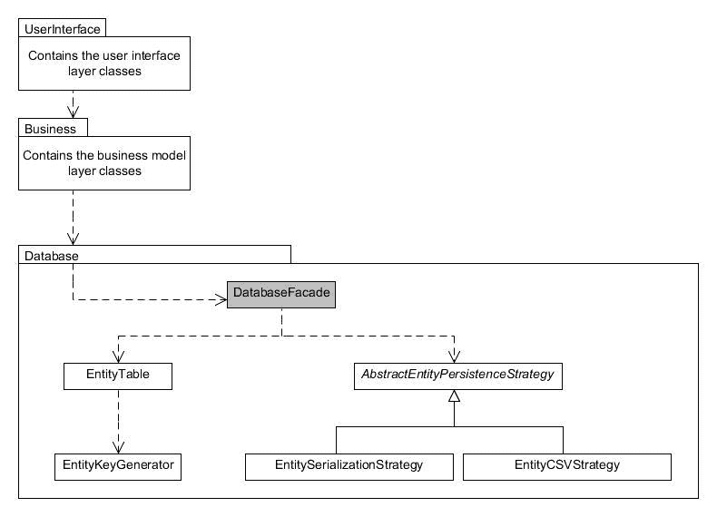

图 29.4 : 带有 Facade 类的 Database 命名空间

注意业务层是如何通过 `DatabaseFacade` 对象进行通信的。这样做的效果是将 `Database` 命名空间的复杂性隐藏在 Facade 之后。

#### 业务层

进入 `Business` 命名空间，它主要由在本书中使用的 `IEngine` 层次结构组成：


图 29.5 : `IEngine` 层次结构

为了方便引擎对象被序列化，`AbstractEngine` 的类定义需要指定对象是可化的：

```csharp
namespace Business
{
    [Serializable]
    public abstract class AbstractEngine : IEngine
    {
... 省略了类的其余部分 ...
    }
```

其他类保持不变，只是它们现在当然位于名为 `Business` 的命名空间中。

由于存在两种类型的引擎（标准型和涡轮型），创建一个工厂类（Factory class）来根据提供的参数创建正确类型的对象将非常有用。为此，在 `Business` 命名空间中定义一个新类 `EngineFactory`：

```csharp
namespace Business
{
    class EngineFactory
    {
        public enum Type
        {
            Standard,
            Turbo
        }
        public static IEngine Create(EngineFactory.Type type, int size)
        {
            if (type == Type.Standard)
            {
                return new StandardEngine(size);
            }
            else
            {
                return new TurboEngine(size);
            }
        }
        public static IEngine Create(int size, bool turbo)
        {
            return EngineFactory.Create(turbo ? Type.Turbo : Type.Standard, size);
        }
        private EngineFactory()
        {
        }
    }
}
```

注意 `Create()` 方法是 `static` 的并且经过重载，因此客户端可以提供 `enum` 值或 `boolean` 值。就像在数据库层所的那样，`Business` 命名空间将有自己的 facade，在此例中为 `BusinessFacade`：

```csharp
namespace Business
{
    [Serializable]
    public class BusinessFacade
    {
        // 静态成员
        private static volatile BusinessFacade instance;
        public static BusinessFacade Instance
        {
            get
            {
                if (instance == null)
                {
                    instance = new BusinessFacade();
                }
                return instance;
            }
        }
        // 实例变量
        public event EventHandler EngineAdded;
        public event EventHandler EnginesRestored;
        // 私有构造函数
        private BusinessFacade()
        {
            DatabaseFacade.Instance.EngineAdded += HandleEngineAdded;
            DatabaseFacade.Instance.EnginesRestored += HandleEnginesRestored;
        }
        // 实例方法
        public virtual string[] EngineTypes
        {
            get
            {
                return Enum.GetNames(typeof(EngineFactory.Type));
            }
        }
        public virtual object[] AllEngines
        {
            get
            {
                return DatabaseFacade.Instance.AllEngines;
            }
        }
        public virtual object AddEngine(object type, int size)
        {
            EngineFactory.Type engineType;
            if (type is string)
            {
                engineType = (EngineFactory.Type)Enum.Parse(typeof(EngineFactory.Type), (string)type);
            }
            else
            {
                engineType = (EngineFactory.Type)type;
            }
            IEngine engine = EngineFactory.Create(size, (engineType == EngineFactory.Type.Turbo));
            DatabaseFacade.Instance.AddEngine(engine);
            return engine;
        }
        public virtual void SaveEngines()
        {
            DatabaseFacade.Instance.SaveEngines();
        }
        public virtual void RestoreEngines()
        {
            DatabaseFacade.Instance.RestoreEngines();
        }
        public void HandleEngineAdded(Object sender, EventArgs args)
        {
            if (EngineAdded != null)
            {
                EngineAdded(sender, args);
            }
        }
        public void HandleEnginesRestored(Object sender, EventArgs args)
        {
            if (EnginesRestored != null)
            {
                EnginesRestored(sender, args);
            }
        }
    }
}
```

注意以下几点：

- 这些方法委托给相应的 `DatabaseFacade` 方法；
- `AllEngines` getter 和 `AddEngine()` 方法的类型是 `object` 而不是 `IEngine`。这意味着 `Business` 层与用户界面层松耦合，使得后者不依赖于前者的实现细节。用户界面可以使用 `object` 类的 `ToString()` 方法获取显示在列表中的信息。

现在可以显示包含 `Business` 命名空间类的分层图：

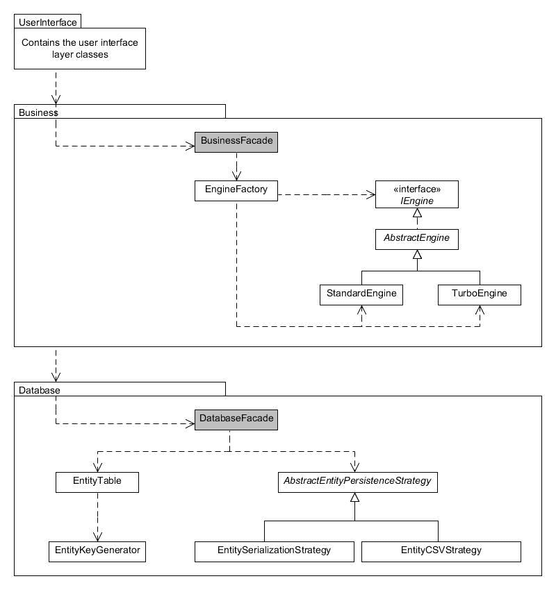

图 29.6 : 带有 Facade 类的 Business 命名空间

#### 用户界面层

用户界面层包含一个 `ManageEngines` 类，它显示了一个可滚引擎列表和一些按钮：

```csharp
public partial class ManageEngines : Form
{
    public ManageEngines()
    {
        InitializeComponent();
        BusinessFacade.Instance.EngineAdded += HandleEngineAdded;
        BusinessFacade.Instance.EnginesRestored += HandleEnginesRestored;
    }
    private void ManageEngines_Load(object sender, EventArgs e)
    {
        // 创建一些示例数据（通过事件添加到列表）
        BusinessFacade.Instance.AddEngine(EngineFactory.Type.Standard, 1300);
        BusinessFacade.Instance.AddEngine(EngineFactory.Type.Standard, 1600);
        BusinessFacade.Instance.AddEngine(EngineFactory.Type.Standard, 2000);
        BusinessFacade.Instance.AddEngine(EngineFactory.Type.Turbo, 2500);
    }
    private void buildEngineButton_Click(object sender, EventArgs e)
    {
        Form buildEngineForm = new BuildEngineForm();
    }
}
```


```csharp
buildEngineForm.ShowDialog(this);

    }
    public void HandleEngineAdded(Object sender, EventArgs args)
    {
        EntityTable.EntityAddedEventArgs entityArgs = (EntityTable.EntityAddedEventArgs)args;
        enginesList.Items.Add(entityArgs.objectAdded.ToString());
    }
    public void HandleEnginesRestored(Object sender, EventArgs args)
    {
        enginesList.Clear();
        foreach (object engine in BusinessFacade.Instance.AllEngines)
        {
            enginesList.Items.Add(engine.ToString());
        }
    }
    private void saveButton_Click(object sender, EventArgs e)
    {
        BusinessFacade.Instance.SaveEngines();
    }
    private void restoreButton_Click(object sender, EventArgs e)
    {
        BusinessFacade.Instance.RestoreEngines();
    }
}
```

`Build Engine` 按钮创建并显示了一个 `BuildEngineForm` 对象，如下所示：

```csharp
public partial class BuildEngineForm : Form
{
    public BuildEngineForm()
    {
        InitializeComponent();
    }
    private void BuildEngineForm_Load(object sender, EventArgs e)
    {
        // 加载引擎类型组合框
        object[] engineTypes = BusinessFacade.Instance.EngineTypes;
        foreach (object obj in engineTypes)
        {
            typeCombo.Items.Add(obj.ToString());
        }
        typeCombo.SelectedIndex = 0;
        // 加载引擎尺寸组合框
        sizeCombo.Items.Add(1300);
        sizeCombo.Items.Add(1600);
        sizeCombo.Items.Add(2000);
        sizeCombo.Items.Add(2500);
        sizeCombo.SelectedIndex = 0;
    }
    private void cancelButton_Click(object sender, EventArgs e)
    {
        this.Close();
    }
    private void okButton_Click(object sender, EventArgs e)
    {
        BusinessFacade.Instance.AddEngine(typeCombo.SelectedItem, (int)sizeCombo.SelectedItem);
        this.Close();
    }
}
```

`OK` 按钮调用适当的 `BusinessFacade` 方法来根据你所选的标准添加引擎。在主列表面板上，`Save` 和 `Restore` 按钮也会对 `BusinessFacade` 对象的方法进行相应的调用，以便保存或恢复当前显示的数据。

# 第 VII 部分附录

本部分包含附录，包括对不熟悉 UML 的读者关于统一建模语言（UML）图格式的简要说明，以及对 23 种主要模式的快速参考。

### 附录 A. UML 图

本书使用简化版的统一建模语言（UML）图来阐述书中书中模式的类层次结构和用法。每个独立的类都显示为一个带有三个水平区域的边界矩形，顶部区域包含类名，中间部分包含任何相关的状态（即实例变量），第三部分包含协议（即方法）。

#### 类型表示

抽象类、接口和抽象方法用斜体文本表示。下图显示了每种类型和方法的示例：

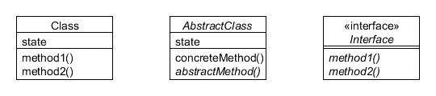

图 A.1：普通类（左侧），抽象类（中间），接口（右侧）

在书中，任何属性和相关的实例变量将显示在“状态”部分。“方法”部分将只显示相关方法，而不是属性的 getter 或 setter。除非另有说明，否则你可以假设所有列出的方法都是 `public` 的。

#### 继承表示

继承通过类之间的线条连接表示，并带有一个空心三角形指向被继承的类或正在实现的接口。实线表示类，虚线表示接口连接：

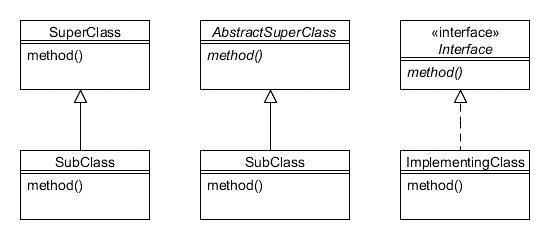

图 A.2：扩展类（左侧和中间），实现接口（右侧）

#### 组合与使用表示

当一个类“使用”另一个类时（即持有它的引用），这通过一个指向被使用类的开放箭头的虚线来表示。使用通常通过作为实例变量，或者通过向使用对象的构造函数或方法传递引用，或者通过实例化被使用的对象来实现。在下面的图中，每个 `ClassA` 实例都持有或获取指向 `ClassB` 实例的引用：

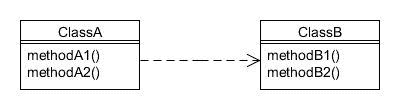

图 A.3：`ClassA` 使用 `ClassB`

#### 代码片段

在有用的地方，代码片段将显示在通过虚线连接到类的灰色框中：


图 A.4：代码片段 'Client' 以及其他类

如果类矩形显示为灰色，这是为了美观考虑将其与其他类分开，以下示例说明了：

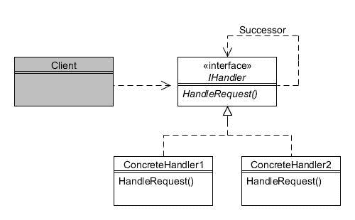

图 A.5：灰色的 Client 类

### 附录 B. 设计模式快速参考

本附录提供了 23 种主要模式的字母顺序快速参考。请注意，许多模式使用了抽象类或接口。在大多数情况下，这些是可交换的，且取决于选择。

#### 抽象工厂 (Abstract Factory)
**类型：** 创建型
**目的：** 提供一个接口用于创建相关或依赖对象的族，而无需指定它们的具体类。
**示例用法：** 通常用于为不同的外观生成“小部件（widgets）”。
**后果：** 隔离了具体类。允许交换族。提高了产品之间的一致性。

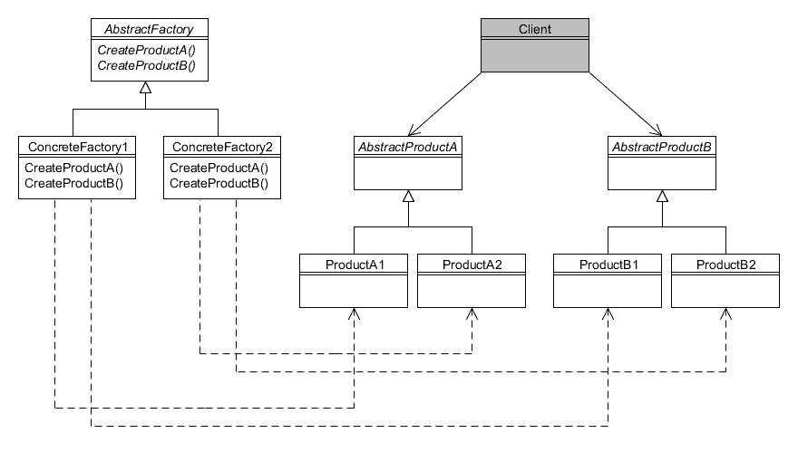

* `AbstractFactory` 定义了一个用于创建抽象对象的方法的接口；
* `ConcreteFactory1` 和 `ConcreteFactory2` 负责实例化产品族（例如，`ConcreteFactory1` 创建 `ProductA1` 和 `ProductB1`）；
* `AbstractProductA` 和 `AbstractProductB` 定义了每个类型产品的接口；
* 客户端程序只使用由 `AbstractFactory` `AbstractProductA` 和 `AbstractProductB` 定义的接口。

#### 适配器 (Adapter)
**类型：** 结构型
**目的：** 将类的接口转换为客户端期望接口。适配器让由于接口不兼容而无法共同工作的类能够工作。
**示例用法：** 独立兼容类的集成。
**后果：** 一个适配器可以与许多适配器工作。

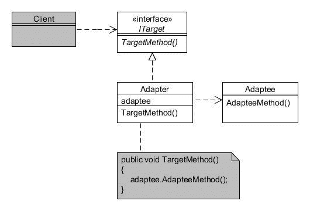

* `IT` 指客户端程序所需的接口；
* `Adapter` 是客户端用于转发请求到 `Adaptee` 的类；
* `Adaptee` 是需要适配的类。

#### 桥接 (Bridge)
**类型：** 结构型
**目的：** 将抽象与其实现解耦，以便它们可以独立变化。
**示例用法：** GUI 框架和持久化框架。
**后果：** 实现没有永久绑定到接口，并且可以在运行时进行切换。

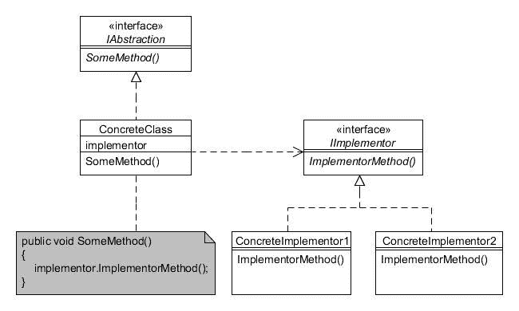

* `IAbstraction` 是接口的抽象；
* `ConcreteClass` 实现 `IAbstraction` 接口并持有 `IImplementor` 的引用。它根据 `IImplementor` 提供实现；
* `IImplementor` 是实现接口，可能与 `IAbstraction` 接口完全不同；
* `ConcreteImplementor1` 和 `ConcreteImplementor2` 实现 `IImplementor` 接口。

#### 构建器 (Builder)
**类型：** 创建型


# 构建模式 (Builder)
**目的**：将复杂对象的构建过程与其表示分离，使得相同的构建过程可以创建不同的表示。

**示例用法**：当创建一个对象需要多个步骤时非常有用用。

**影响**：允许产品内部表示的变化。隔离了构建与表示过程。

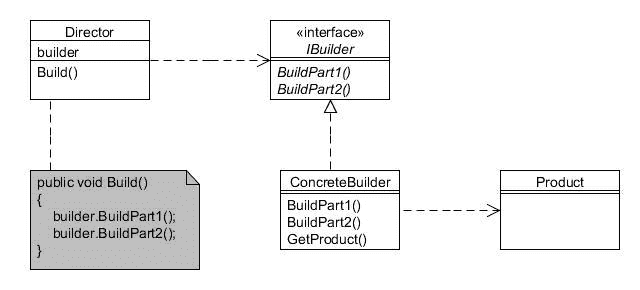

* `IBuilder` 定义了一个用于创建“产品”对象各个部分的接口；
* `ConcreteBuilder` 逐步创建并组装“产品”部分，并提供一个方法在组装期间或之后检索该产品；
* `Director` 控制实际的组装过程。

#### 责任链模式 (Chain of Responsibility)
**类型**：行为型

**目的**：通过赋予多个对象处理请求的机会，避免将请求发送者与其接收者耦合。将接收对象链起来，并将请求沿链传递，直到某个对象处理它为止。

**示例用法**：当有多个对象可以处理请求，且预先不知道处理者时。

**影响**：并不是每个请求都需要被处理，或者某个请求可能需要由多个处理器处理。


* `IHandler` 定义了一个处理请求的接口；
* `ConcreteHandler1` 和 `ConcreteHandler2` 分别决定它们是否可以处理该请求，或者应该将其传递给后继者。

客户端程序将请求发送给链中的第一个对象。

#### 命令模式 (Command)
**类型**：行为型

**目的**：将请求封装为对象，从而允许你对客户端参数化不同的请求、队列或记录请求，并支持撤销操作。

**示例用法**：UI 控制，如菜单项和工具栏按钮。撤销/重做机制。

**影响**：努力将调用操作的对象与执行操作的对象分离。

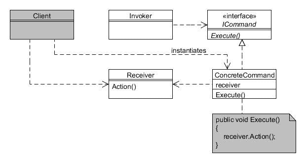

* `ICommand` 是执行操作的接口；
* `ConcreteCommand` 在 `Receiver` 上执行操作；
* `Invoker` 请求执行命令；
* `Receiver` 知道如何执行这些操作。

#### 组合模式 (Composite)
**类型**：结构型

**目的**：将对象组合成树形结构以表示部分与整体的层次结构。组合允许客户端以统一的方式处理单个对象和对象的组合。

**示例用法**：图形组件层次结构等等。

**影响**：简单对象可以组合成复杂的装配，并通过公共接口进行所有处理。添加新组件应该是简单的。

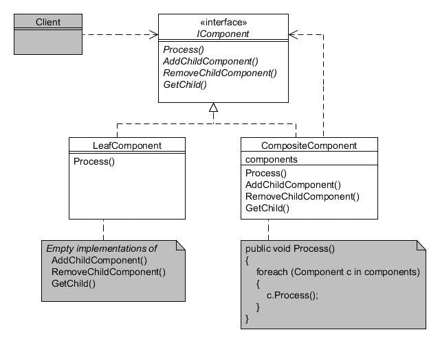

* `IComponent` 是同时用于叶子节点和组合对象的接口；
* `LeafComponent` 定义了没有子对象的对象；
* `CompositeComponent` 定义了可能有子对象的。

#### 装饰器模式 (Decorator)
**类型**：结构型

**目的**：动态地给对象附加额外的职责。装饰器为通过子类扩展功能提供了灵活的替代方案。

**示例用法**：GUI 工具包、文件和对象输入/输出流（例如缓冲）。

**影响**：比直接继承更灵活，并可以减少所需的类数量。

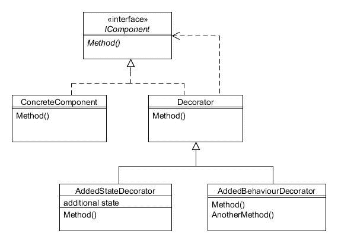

* `IComponent` 定义了可以动态添加职责的对象的接口；
* `ConcreteComponent` 实现 `IComponent` 接口；
* `Decorator` 维护对 `IComponent` 对象的引用，并定义了一个与 `IComponent` 匹配的接口；
* `AddedStateDecorator` 和 `AddedBehaviourDecorator` 分别通过添加额外的实例变量和/或方法来装饰 `IComponent`。

#### Facade 模式 (Facade)
**类型**：结构型

**目的**：为子系统中的一组接口提供统一的接口。门面定义了一个更高层的接口，使得子系统更容易使用。

**示例用法**：通过单个“门面”对象来简化对多个对象的访问。

**影响**：需要创建一个新类作为“门面”。

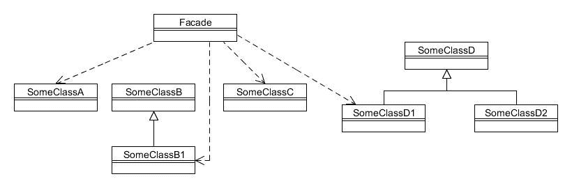

* `Facade` 定义了为其他类提供简化接口的类；
* `SomeClassA` 等是各种类，无论它们是否相关联。

#### 方法工厂模式 (Factory Method)
**类型**：创建型

**目的**：定义一个创建对象的接口，但让子类决定实例化哪一类。

**示例用法**：当你无法预测要创建的特定对象类型时，或者你想要本地化关于创建哪个类的知识时。

**影响**：减少了客户端使用 `new` 来实例化对象的需要。

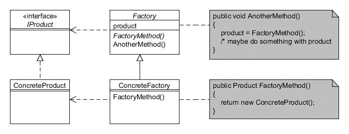

* `IProduct` 定义了要创建的产品的接口；
* `ConcreteProduct` 是特定产品的实现；
* `Factory` 声明了返回 `IProduct` 对象的工厂方法；
* `ConcreteFactory` 实现 `Factory` 中定义的工厂方法，以返回 `IProduct` 的实例。

#### 权重类模式 (Flyweight)
**类型**：结构型

**目的**：使用共享来高效地支持大量的细粒度对象。

**示例用法**：文本/图形编辑器等。

**影响**：通过共享共享状态节省内存。

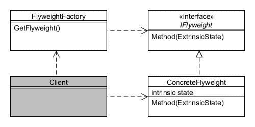

* `IFlyweight` 定义了重量级对象通过其作用于外部状态的接口；
* `ConcreteFlyweight` 实现 `IFlyweight` 并存储内部状态。必须是共享的；
* `FlyweightFactory` 通过“池”机制创建和管理重量对象。

客户端程序维护对通过工厂获取的重量对象的引用。

#### 解释器模式 (Interpreter)
**类型**：行为型

**目的**：给定一种语言，定义其语法的表示方式，以及一个使用该表示来解释语言中句子的解释器。

**示例用法**：简单语法和微语言处理。

**影响**：不适用于复杂的语法和语言处理。

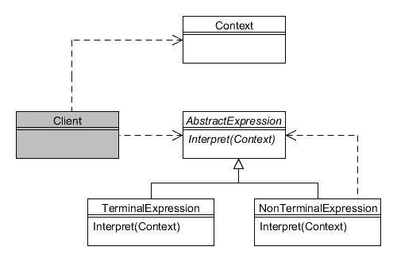

* `AbstractExpression` 定义了解元素的抽象方法；
* `TerminalExpression` 扩展 `AbstractExpression` 用于终止表达式的语言元素；
* `NonTerminalExpression` 扩展 `AbstractExpression` 用于表达式部分的语言元素；
* `Context` 是被解析的对象（例如语法或语言）。

#### 迭代器模式 (Iterator)
**类型**：行为型

**目的**：提供一种在不暴露底层表示的情况下访问聚合对象元素的方法。

**示例用法**：任何需要顺序处理集合或对象值数组的地方。

**影响**：`for-each` 语法简化了用法。

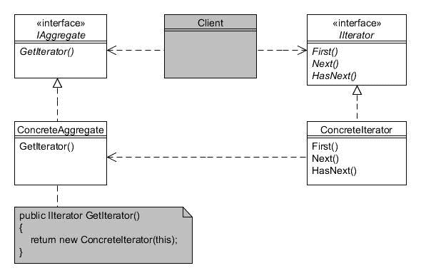

* `IIterator` 定义了迭代器的接口；
* `ConcreteIterator` 实现 `IIterator` 以执行 `IAggregate` 中每个元素的处理；
* `IAggregate` 定义了待处理集合的接口；
* `ConcreteAggregate` 实现实际的集合。

#### 中介者模式 (Mediator)
**类型**：行为型

**目的**：定义一个封装一组对象如何交互的对象。中介者通过保持对象不显式相互引用来促进松耦合，并允许独立地改变它们的交互。

**示例用法**：控制 UI 组件的对话框等。

**影响**：中介者可以定义为使用观察者模式来监控组件。


* `IMediator` 定义了与 `IColleague` 对象通信的接口；
* `ConcreteMediator` 实现 `IMediator` 接口并执行通信；
* `IColleague` 定义了需要与 `IMediator` 通信的组件接口；
* `ConcreteColleague1` 和 `ConcreteColleague2` 实现 `IColleague` 接口，并与 `IMediator` 通信，无需无需任何其他同事。

#### 备忘模式 (Memento)
**类型**：行为型

**目的**：在不违反封装的情况下，捕获并外部化对象的内部状态，以便以后可以恢复到该状态。

**示例用法**：撤销/重做处理、数据库事务等。


### 后果
封装了源对象外部的状态存储，但在内存或性能方面可能代价高昂。


* `Originator`（生成器）创建 `Memento` 对象并使用它恢复自己的状态；
* `Memento`（备备）存储 `Originator` 的状态；
* `Caretaker`（照顾者）保存备备。

### Observer
**类型**：行为型

**目的**：定义对象之间一对多的依赖关系，当一个对象的状态改变时，所有依赖对象都会收到通知并自动更新。

**示例用法**：GUI 控制、事件等。

**后果**：通过通用接口解耦类。


* `Observable`（可观察者）定义了注册观察者并通知事件的机制；
* `ConcreteObservable`（具体可观察者）为特定的主题类扩展 `Observable`；
* `IObserver`为感兴趣的类定义接口；
* `ConcreteObserver`（具体观察者）为特定的感兴趣类实现 `IObserver`。

### Prototype
**类型**：创建型

**目的**：使用原型实例指定要创建的对象类型，并通过复制原型来创建新对象。

**示例用法**：当克隆比实例化更容易或更快时。

**后果**：在某些情况下，克隆可能会变得困难。


* `IPrototype`定义了一个可以“克隆”自的接口；
* `ConcretePrototype`（具体原型）执行自我克隆。

客户端程序通过请求原型进行自我克隆来创建新对象。

### Proxy
**类型**：结构型

**目的**：为另一个对象提供代理或占位符以控制对它的访问。

**示例用法**：网络连接、安全代理等。

**后果**：性能可能下降。


* `ISubject`定义了需要通过代理访问的接口；
* `RealSubject`（真实主体）定义了 `Proxy` 代表的实际对象；
* `Proxy`（代理）维护对 `RealSubject` 的引用，以便代表其执行操作。

### Singleton
**类型**：创建型

**目的**：确保一个类只允许创建一个对象，并为其提供单一访问点。

**示例用法**：日志文件、配置设置等。

**后果**：经常被过度使用、难以子类、可能导致紧耦合。


* `Singleton`（单例）定义了一个 `private` 构造函数以及一个 `public` 类（即 `static`）方法作为获取实例的唯一手段。

注意，此书在大多数情况下建议使用 `enum` 来实现单例模式。

### State
**类型**：行为型

**目的**：允许对象在内部状态改变时改变其行为。对象似乎改变了它的类。

**示例用法**：UI 形状组件等。

**后果**：将特定状态的行为局部化并分离不同状态的行为。


* `IState`定义了在 `Handle()` 方法中处理不同状态的接口；
* `ConcreteStateA` 和 `ConcreteStateB`为每个独立状态实现 `IState` 接口；
* `Context`（上下文）持有 `IState` 对象的引用以请求特定状态。

### Strategy
**类型**：行为型

**目的**：定义一组算法，封装每一个算法并使它们可以互换。策略允许算法独立于使用它的客户端。

**示例用法**：需要更改算法。

**后果**：可能需要向每个策略传递数据。


* `IStrategy`定义了算法的接口；
* `ConcreteStrategyA` 和 `ConcreteStrategyB`为特定算法实现 `IStrategy`；
* `Context`持有正在使用的 `IStrategy` 的引用。

### Template Method
**类型**：行为型

**目的**：在方法中定义算法的骨架，将某些步骤延迟给子类。模板方法允许子类在不改变算法结构的情况下重新定义算法的某些步骤。

**示例用法**：当算法的步骤可以用不同的方式执行时。

**后果**：应该防止模板方法被重写。


* `AbstractClass`（抽象类）定义了不可重写的 `TemplateMethod()`，该方法调用在子类中定义的系列抽象方法；
* `Subclass1` 和 `Subclass2`  `AbstractClass` 以定义由 `TemplateMethod()` 调每个抽象方法的代码。

### Visitor
**类型**：行为型

**目的**：表示在对象结构元素上执行的方法。访问者模式允许你定义一个新方法，而无需更改对其操作的元素类。

**示例用法**：需要在结构中的不同类型上执行相似的操作，或作为一种在不进行大量修改的情况下添加功能的手段。

**后果**：添加新的访问对象可能需要修改访问者。


* `IVisitor`定义了一个接口，声明了访问每种可访问 `IElement` 的方法；
* `ConcreteVisitor1` 和 `ConcreteVisitor2`为每个可以访问的元素实现 `IVisitor` 接口；
* `IElement`定义了所有可访问类类的接口；
* `ConcreteElementA` 和 `ConcreteElementB`为每个可以访问的类实现 `IElement` 接口。
* `ObjectStructure`（对象结构）包含对所有可访问对象的引用，以便对它们进行迭代。

### 附录 C 参考文献

Beck, Kent. Extreme programming explained; Embrace Change. Reading, MA.
Bevis, Kent. Extreme programming explained; Embrace Change. Reading, MA.
Bevis, Kent. Extreme programming explained; Embrace Change. Reading, MA.
Bloch, Joshua. Effective Java: programming language. River, NJ.
Cooper, James. Java patterns: a tutorial. River, NJ.
Cooper, Lindsey, et al. Software development with Java. Corte, CA:
Fowler, Martin. Refactoring: improving the design of existing code. River, NJ.
Fowler, Martin, and Kendall Scott. UML distilled: a brief guide to standard object modeling. River, NJ.
Freeman, Eric, et al. Head first design patterns. Sebastopol, CA:
Gamma, Erich, et al. Design patterns: elements of reusable object-oriented. River, NJ:
Gilbert, Stephen, and Bill McCarty. Software engineering with objects. Milton, The University:
Langr, Jeff. Java style: patterns for implementation. River, NJ.

### 目录

基础

# 前言
##### 先验知识

## 1. 什么是设计模式？
##### 本书如何使用模式](index_split_005.html_filepos10910
##### 如何分类](index_split_005.html_filepos29902
##### 设计模式中的共同原则](index_split_005.html_filepos30820
##### 一些一般建议](index_split_005.html_filepos33860

### 第二部分 创建型模式](index_split_006.html_filepos36012

### 2. 抽象工厂
##### 使用静态工厂方法](index_split_009.html_filepos72664

#### 5. 原型


# 6. 单例模式

## 第三部分 结构型模式

### 7. 适配器模式
#### 实现适配器的变体
#### 8. 桥接模式
###### 9. 组合模式
### 10. 装饰器模式
### 11. 外外观模式
### 12. 享权重模式
### 13. 代理模式

## 第四部分 行为模式

### 14. 责任链模式
### 15. 命令模式
#### 命令模式的典型用途
### 16. 解释器模式
### 17. 迭代器模式
#### 'for-each' 循环
### 18. 中者模式
#### 用途
### 19. 备忘模式
#### 方法 1：使用内部可见性
#### 方法 2：对象序列化
### 20. 观察者模式
### 21. 状态模式
### 22. 策略模式
### 23. 模板方法模式
### 24. 访问者模式

## 第五部分 其他实用模式

### 25. 空对象模式
### 26. 简单工厂模式
### 27. 模型-视图控制器 (MVC)
### 28. 分层架构
#### 客户端-服务器（二层）架构
#### 三层架构

## 第六部分 设计模式的实践

### 29. 三层应用示例
#### 数据库层
#### 业务逻辑层
#### 用户界面层

## 第七部分 附录

### 附录 A UML 图图
#### 表示类型
#### 表示继承
#### 表示组合与使用
#### 代码片段
#### 客户端和其他类

### 附录 B 设计模式参考
#### 抽象工厂
#### 适配器
#### 桥接模式
#### 构建者模式
#### 责任链模式
#### 命令模式
#### 组合模式
#### 装饰器模式
#### 外外观模式
#### 方法工厂
#### 享权重模式
#### 解释器模式
#### 迭代器模式
#### 中者模式
#### 备忘模式
#### 观察者模式
#### 原型模式
#### 代理模式
#### 单例模式
#### 状态模式
#### 策略模式
#### 模板方法模式
#### 访问者模式

### 附录 C 参考文献

