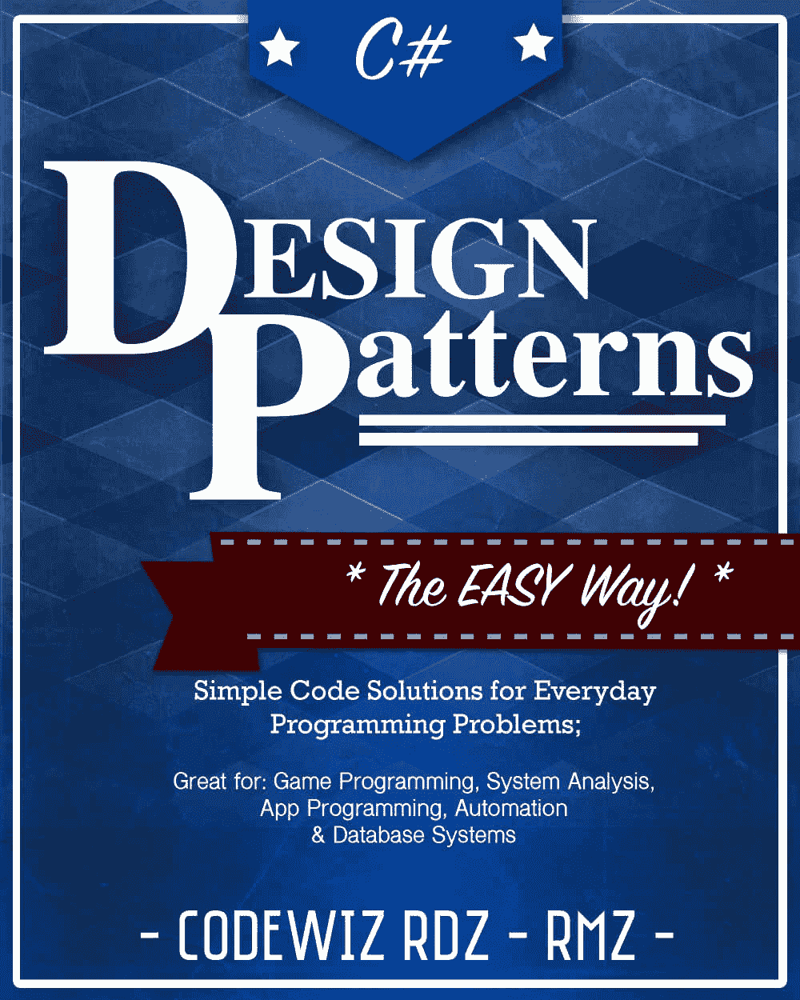
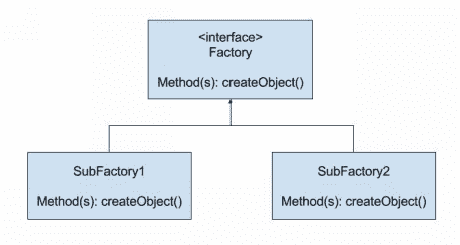
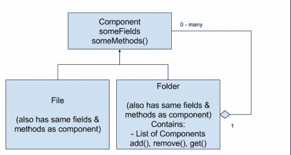
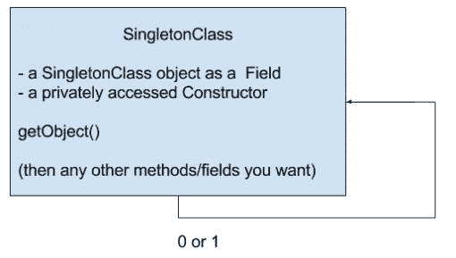
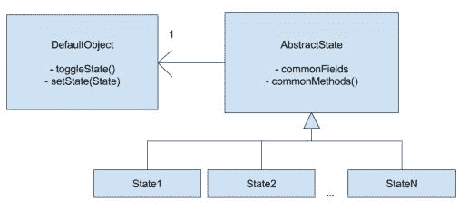

# C#：设计模式：日常编程问题的标准解决方案；适用于：游戏编程、系统管理、应用程序编程……及数据库系统（设计模式系列）





呈现：


Web 应用程序开发的最新信息！

========================= ======
关注我们！
@CodeWizRDZ

|  |  |  |
| [Facebook](https://www.facebook.com/CodeWIzRDZ/) | [Instagram](https://www.instagram.com/codewizrdz) | [Twitter](https://www.twitter.com/codewizrdz) |

关注 EZEE 编程！

========================= ======
@EzeeProgramming

|  |  |  |
| [Facebook](https://www.facebook.com/EzeeProgramming) | [Instagram](https://www.instagram.com/ezeeprogramming) | [Twitter](https://www.twitter.com/ezeeprogramming) |

# 目录
* C# 简介
    * C#-00: 关于 C# 代码的快速重要说明
* 第 1 章：工厂模式
    * C#-1a: C# 中的工厂模式
    * C#-1b: 实现工厂模式
    * C#-工作坊 1:
* 第 2 章：组合模式
    * C#-2a: C# 中的组合模式
    * C#-2b: 实现组合模式
    * C#-工作坊 2:
* 第 3 章：观察者模式
    * C#-3a: C# 中的观察者模式
    * C#-3b: 实现观察者模式
* 第 4 章：单例模式
    * C#-4a: C# 中的单例模式
    * C#-4b: 实现单例模式
* 第 5 章：策略模式
    * C#-5a: C# 中的策略模式
    * C#-5b: 应用策略模式（简单）
* 第 6 章：装饰器模式
    * C#-6a: C# 中的装饰器模式
    * C#-6b: 应用装饰器模式
* 第 7 章：状态模式
    * C#-7a: C# 中的状态模式
    * C#-7b: 应用状态模式
* 第 8 章：外观模式模式
    * C#-8a: C# 中的外观模式模式
    * C#-8b: 应用外观模式模式
* 存档 A1：工厂模式实现
* 存档 A2：组合模式实现
* 存档 A3：观察者模式实现
* 存档 A4：单例模式实现
* 存档 A5：策略模式实现
* 存档 A6：装饰器模式实现
* 存档 A7：状态模式实现
* 存档 A8：外观模式模式实现
* 学习 C# 的简单方法，部分 1
* 学习 C# 的简单方法，部分 2
* 学习面向对象的最简单方法
* 感谢！

# C# 简介
========================= ======
`C#`（读作 C-sharp）是一种专门为微软软件开发开发的编程语言。与主要的编程语言一样，许多 `C#` 代码、特性和其他功能都是基于 `C` 编程语言的。`C#` 相比 `C` 的关键改进可能是当今使用最广泛且最重要的编程范式之一——面向对象编程。

面向对象的程序员程序员在软件开发过程中会遇到许多重复的挑战。重要的是，这些挑战以前已经被遇到过并解决过。

如果你知道自己必须创建某些东西怎么办？重要的是，这些挑战以前已经被遇到过并解决过。

如果你知道自己必须创建某些东西怎么办？重要的是，这些挑战以前已经被遇到过并解决过。

如果你知道自己必须创建某些东西怎么办？重要的是，这些挑战以前已经被遇到过并解决过。

在整本书中，你将发现可以帮助你应用设计的工作坊。

========================= ======
C#-00: 关于 C# 代码的快速重要说明
一个 C# 文件
在我们开始之前，请确保熟悉下面虚线之间所示的 C# 类的结构。

```csharp
using System;
using System.Collections.Generic;
using System.Linq;
using System.Text.RegularExpressions;

// 添加更多库

namespace ___ {
    // 在此处添加类
    public class Program {
        public static void Main(string[] args) {
            // 在此处添加主代码
        }
    }
}
```

第 1 章：工厂模式
==== ==== ==== ==== ====
你是否不确定在何时创建何种数据对象？

在创建数据对象时，是否有很多方面需要考虑？

那么你需要使用`工厂方法`。

其基本原理是：
取决于你所使用的编程语言，创建一个标准的数据对象创建类接口。然而，你将使用子类（扩展或实现你的高级“工厂”接口）来实际创建数据对象。子类为创建数据对象提供了广泛的灵活性。如果你的编程语言没有接口或抽象类，只需将你的“工厂”接口创建为类，然后让子类扩展它即可。

例如，考虑需要制作各种运动球数据对象，如篮球、足球、橄榄球、排球等。你不知道在特定时间应该创建什么。那么你该如何编写代码？创建一个概述球类对象构建的接口。


我们将接口命名为 `BallMaker`。然后，对于我们拥有的每种类型的球，创建一个扩展 `BallMaker` 的子类。这些子类是实际创建球数据对象的类——但它们每一个都有自己的规范。因此，`BasketBallMaker` 子类将制造篮球，而 `FootballMaker` 子类将制造足球。

以下是 UML 图的的样式：



该模式的伪代码实现也包含在归档中。如果你需要在另一种语言中实现此模式，伪代码应该可以为你提供帮助。

接下来，我们将使用工厂模式。

# C#-1a: 工厂模式（在 C# 中实现）

以下是工厂模式在 C# 中的外观形式：

```csharp
// Factory 由任何需要使用它的子类实现

interface Factory {
    // 输入：你的选择
    // 输出：你的选择（默认设置为 Void）
    // 实现此接口的类的构造函数
    void createObject();
}

// SubFactory1:
// 根据 Factory 接口创建不同的对象
class SubFactory1 : Factory {
    // 此方法实现了接口中概述的相同函数
    void Factory.createObject() {
        // 为此创建器类包含任何独特的区别
        // 此处的其他代码
    }
}

// SubFactory2:
// 根据 Factory 接口创建不同的对象
class SubFactory2 : Factory {
    // 此方法实现了接口中概述的相同函数
    void Factory.createObject() {
        // 为此创建器类包含任何独特的区别
        // 此处的其他代码
    }
}
```

在下一章中，我们将对实现此设计模式进行详细演示。

## C#-1b: 实现工厂模式

使用你选择的 IDE 运行以下代码。在线 IDE，如 [codechef.com](http://codechef.com) , [rextester.com](http://rextester.com) , [ideone.com](http://ideone.com) 或 [codpad.org](http://codpad.org) 都是很好的选择。

现在我们将看到工厂模式的运行。你将通过一个示例亲眼看到如何使用此设计模式，并通过一个你继续完成该示例的工作坊。

### 运动球创建器

想象你必须为一个按需定制的 Web 应用编写代码。它专门用于创建许多不同类型的运动球。

一个通用的球类如下所示：

```csharp
// 一个运动球具有：
// - 球的类型
// - 用于制造它的材料数组
// - 它的尺寸，以半径（英寸）表示
// - 任何额外的注释
// - 制造它的公司品牌
// - 产品名称
class SportsBall {
    public String type;
    public String[] materialsUsed;
    public float radius;
    public String comments;
    public String make;
    public String modelName;
}
```

然而，正如你所看到的，在为运动球创建数据对象时涉及到太多的细节。因此，如果你必须创建一个（例如）某个特定的篮球，这个过程与创建一个足球要不同得多。它们具有不同的类型、材料和尺寸。它们还可能由不同的品牌制造，并且具有不同的特征。

那么，我们该如何以更简单的方式创建运动球呢？涉及的代码也更少？你猜对了。工厂模式！因此在本教程中，让我们通过设置该设计模式的步骤。然后，你将有机会通过扩展工作来练习你所学的内容。

### 第一步：工厂接口

首先，我们将创建一个所有创建球的工厂类都将实现的 `Interface（接口）。目前，它将只有一个方法：返回运动球的实例。

```csharp
// BallFactory 接口：
// 关于如何创建球的接口
interface BallFactory {
    /*
    // 输入：无
    // 输出：一个 Ball 对象
    // 效果：创建一个运动球；
    // 实现此接口的类将在制造方面有自己的区别
    */
    SportsBall createBall();
}
```

### 第二步：第一个类

接下来，我们创建一个实现我们做的 `BallFactory` 接口的独特工厂类。目前，它做的只是创建篮球。这些可能是 `SportsBall` 对象的实例，但它们将具有篮球的特征。

```csharp
// 篮球制造器：
// 创建具有不同字段的篮球对象
class BasketballMaker : BallFactory {
    // (方法实现了接口版本)
    // 效果：创建一个篮球类的运动球
    SportsBall BallFactory.createBall() {
        SportsBall b = new SportsBall();
        b.type = "Basketball";
        b.materialsUsed = new String[3];
        b.materialsUsed[0] = "rubber";
        b.materialsUsed[1] = "fiber";
        b.materialsUsed[2] = "synthetic composite";
        b.radius = 4.8f;
        b.make = "Spalding";
        b.modelName = "Series Basketball";
        return b;
    }
}
```

### 第三步：设计任何额外的工厂类

之后，我们根据需要创建尽可能多的工厂类。它们都实现 `BallFactory` 接口，并且它们都创建具有不同特征和属性的运动球对象。让我们设计一个创建棒球的工厂类来实现。

```csharp
// 棒球制造器：
// 创建具有不同字段的棒球对象
class BaseballMaker : BallFactory {
    // (方法实现了接口版本)
    // 效果：创建一个篮球类的运动球（注：原文此处应为棒球）
    SportsBall BallFactory.createBall() {
        SportsBall b = new SportsBall();
        b.type = "Baseball";
        b.materialsUsed = new String[6];
        b.materialsUsed[0] = "cork";
        b.materialsUsed[1] = "wool";
        b.materialsUsed[2] = "poly/cotton";
        b.materialsUsed[3] = "cowhide";
        b.materialsUsed[4] = "yarn";
        b.materialsUsed[5] = "composite rubber";
        b.radius = 1.45f;
        b.make = "Rawlings";
        b.modelName = "MLB Official Baseball";
        return b;
    }
}
```

### 第四步：运行代码

现在你已经设计了工厂类，是时候运行它们了。在你的 `Main` 函数（具有 `public-static-void-main` 方法的主类）或你任何想要运行代码的方式中，为你设计的每个工厂类创建一个实例。你将调用这些工厂来为你创建特定的对象。

在我们的示例中，我们创建了篮球和棒球工厂。我们将使用它们分别创建篮球和棒球对象。

```csharp
// 创建工厂
BallFactory f1 = new BasketballMaker();
BallFactory f2 = new BaseballMaker();

// 创建一个篮球对象：
// 使用篮球工厂制造篮球
SportsBall bb1 = f1.createBall();

// 创建一个棒球对象：
// 使用棒球工厂制造棒球
SportsBall bb2 = f2.createBall();

// 测试：
// 这行应该打印出 "Basketball"
Console.WriteLine(bb1.type);
// 这行应该打印出 "Baseball"
Console.WriteLine(bb2.type);
```

## C#-工作坊 1:

使用你选择的 IDE 运行以下代码。在线 IDE，如 [codechef.com](http://codechef.com) , [rextester.com](http://rextester.com) , [ideone.com](http://ideone.com) 或 [codpad.org](http://codpad.org) 都是很好的选择。

## 足球与排球

现在轮你玩工厂模式了。通过创建两个工厂类来展示你所学的内容。其中一个将创建足球，另一个将创建排球。


随后，编写并运行几行代码，创建每个工厂的实例，并为每个工厂至少创建一个球。

这里是一些可以帮助你起手的代码：

```java
// 足球制造器：
// - 创建具有不同字段的足球类对象
class SoccerballMaker : BallFactory {
    // (方法实现了接口版本)
    // 效果：创建一个作为足球的运动球
    SportsBall BallFactory.createBall() {
        SportsBall b = new SportsBall();
        // 修改对象字段；
        // 它们应该都像足球的样子和特征一样..
        return b;
    }
}

// 排球球制造器：
// - 创建具有不同字段的排球类对象
class VolleyballMaker : BallFactory {
    // (方法实现了接口版本)
    // 效果：创建一个作为排球的运动球
    public SportsBall createBall() {
        SportsBall b = new SportsBall();
        // 修改对象字段；
        // 它们应该都像排球的样子和特征一样..
        return b;
    }
}
```

### 高级编码
注意所有的运动球仍然是同一种类型的对象——运动球。你将如何修改代码，以便每个工厂类都能创建它们应该创建的球对象？例如，你如何让 `BasketballMaker` 创建 `Basketball` 对象，而不是通用的、修改过的 `Sports Balls`？或者让 `BaseballMaker` 创建 `Baseball` 对象？

# 第 2 章：组合模式

想象这样一个场景：你必须以层次分明的方式组织你的数据。它们在某种程度上类似于“文件”和“文件夹”。正如你和其他计算机用户所知的，文件存放在文件夹中，文件夹也可以放在其他文件夹中。你还希望以一种不产生必要的代码的方式来实现。那么你需要什么呢？组合模式。

## 它的基本工作原理：
你有两个不同的类：一个 `File` 类和一个 `Folder` 类。或者是 `Item` 和 `Group`。`Clothing` 和 `Bag`。`Toys` 和 `Box`。任何两个类的组合，其中其中一个类是由这两种类型组成的集合。

然而，这两个类可能拥有太多相似的特征、方法和字段。你意识到你可能需要编写比通常多一倍的代码——一个用于项目，一个用于分组。

解决方案是让它们继承一个公共的超类或抽象类——`component`（组件）。这包含一个关键区别：`Group` 类包含该超类的集合。因为两个类都继承自同一个公共超类，所以 `Group` 类可以拥有项目或分组的集合。

例如，假设你有两个类：`Clothing` 和 `Bag`。一个 `Bag` 可以同时包含衣服和其他包。它们共享相似的特征，如名称、描述等。你意识到，编写分开的代码是多么低效，因为它们实际上应该在同一个代码下（例如，当获取所有名称时，需要分别调用 `Clothing.getName()` 和 `Bag.getName()`）。

因此，你应用了组合模式。`Clothing` 和 `Bag` 类都继承一个新的超类 `Item`。`Bag` 类被修改为拥有一个 `Items` 集合（可以是 `Bags` 或 `Clothing`）。

这里的 UML 图看起来是这样的：


这里要记住的主要点是，项目/容器类继承一个公共超类——组件。容器类将有一个包含组件的列表，这些组件可以是文件也可以是文件夹。

取决于你所使用的编程语言，超类也可能是抽象类、接口或你的编程语言自带的任何类型的抽象。该模式的伪代码实现也包含在存档中。如果你需要在另一种语言中实现此模式，伪代码将对你有所帮助。

接下来，让我们把组合模式用起来。

## C#-2a：C# 中的组合模式

以下是组合模式在 C# 中的样子：

```csharp
/*
// Component 是 File 和 Folder 类继承的超类
// 你可以定义任何两个子类共享的字段和方法
*/
abstract class Component {
    // 根据需要插入任意数量的字段和方法
    String someField;
    void someMethod() {};
}

// 通用项目类（作为 File）：
// 包含了在 Component 中定义的所有字段和方法
class File: Component {}

// 通用分组类（作为 Folder）：
// 包含了在 Component 中定义的所有字段和方法
// 还有：
// -一个 Components 列表
class Folder : Component {
    List<Component> contents = new List<Component>();
}
```

## C#-2b：实现模式
在下一章中，我们将进行演练。

#### 步骤 1：组件超类
首先，我们将创建 `File` 和 `Folder` 类所基于的超类。我们正在使用 C# 编写，所以可以使用抽象类。现在，让我们给超类添加以下字段：名称、创建日期和修改日期。

```csharp
/*
// Component 是 File 和 Folder 类继承的超类
// 它具有：
// Name，类型为字符串
// - 创建日期
// - 修改日期
// 它可以：
// 重命名自己
// - 更新修改日期
*/
abstract class Component {
    String name;
    DateTime dateCreated;
    DateTime dateModified;
}
```

#### 步骤 2：自定义组件构造函数
接下来，我们将为 `Component` 编写一个修改后的构造函数。当创建一个新组件时，它的名称将被设置，日期字段将设置为当前日期。以后继承此超类的 File 和 Folder 将最终使用相同的构造函数。

```csharp
abstract class Component {
    public String name;
    public DateTime dateCreated;
    public DateTime dateModified;

    /*
    // 输入：一个字符串
    // Component 类的自定义构造函数，
    // 创建时，创建日期和最后修改日期
    //将被设置为创建对象的当前日期
    */
    public Component(String n) {
        this.name = n;
        this.dateCreated = new DateTime();
        this.dateModified = new DateTime();
    }
}
```

在这里，你亲眼看到了共享方法如何为程序员节省大量代码行，并在此过程中防止更多的编码错误。`File` 和 `Folder` 类之间的任何基本字段和方法都存在——程序员将不必忍受编写两倍所需代码，也不需要多次更改某些字段和方法。此外，系统的其余部分处理这两个类的数据对象的方式非常相似。

#### 步骤 3：创建 File 类
现在我们创建 `File` 类。


### 简介
如前所述，`File` 类将拥有与 `Folder` 类相同的字段和方法。它甚至有一个非常相似的构造方法。

然而，这里的 `File` 类将具有更具区分性的字段。它将包含文件类型的指示（例如电子表格、字母文档、幻灯片、图片、视频、PDF 等）。构造方法经过进一步修改以包含此内容。

```csharp
/*
// 通用项目类（即 File）：
// 包含在 Component 中定义的所有字段和方法
// 还有：
// - 一个字符串类型的文件类型
*/
class File : Component {
    public String fileType;

    /*
    // 输入：一个字符串
    // File 类的自定义构造函数
    // 遵循与父类相同的步骤
    // 然后设置文件类型
    */
    public File(String n, String f) : base(n) {
        this.fileType = f;
    }
}
```

### 第 3 步：创建 Folder 类

创建 `Folder` 类的过程与创建 `File` 类非常相似。

然而，区别在于 `Folder` 类将有一个其字段 - 一个组件列表，该列表可以是 `Files` 或 `SubFolders`。

```csharp
// 通用分组类（即 Folder）：
// 包含在 Component 中定义的所有字段和方法
// 还有：
// - 一个组件列表，可以包含项目或分组
class Folder : Component {
    public List<Component> contents = new List<Component>();
    public Folder(String n) : base(n){
    }
}
```

### 第 4 步：运行并测试代码

现在我们将通过编写几行代码来测试这些类。我们将创建一些 `Files` 和 `Folders`，然后按照某种层次结构组织它们。

在你的 `Main` 类中的 `Public-Static-Void-Main` 方法（或任何可以运行以下代码的地方）运行这些代码：

```csharp
Folder top = new Folder("Top Folder");
File a = new File("A", "Spreadsheet");
File b = new File("B", "Picture");
Folder mid = new Folder("Mid Folder");
top.contents.Add(a);
top.contents.Add(b);
top.contents.Add(mid);
File c = new File("C", "Video");
File d = new File("D", "Letter Document");
Folder bot = new Folder("Bottom Folder");
mid.contents.Add(c);
mid.contents.Add(d);
mid.contents.Add(bot);
File e = new File("E", "PDF");
bot.contents.Add(e);
```

之后，将这些代码紧放在上述代码之后。然后运行代码：

```csharp
Console.WriteLine(top.name);
foreach (var Component in top.contents) {
    Console.WriteLine("    " + Component.name);
}
foreach (var Component in mid.contents) {
    Console.WriteLine("      " + Component.name);
}
foreach (var Component in bot.contents) {
    Console.WriteLine("        " + Component.name);
}
```

正确实现上述步骤后，输出应该如下：

```text
Top Folder
    A
    B
    Mid Folder
      C
      D
      Bottom Folder
        E
```

如果实现得当，我们就可以创建一个文件、文件夹和子文件夹的层次系统。在下一章节中，你将有一个工作坊来自己实现组合模式。祝你好运！

## C# 工作坊 2

使用你选择的 IDE 运行以下代码。在线 IDE，如 `codechef.com`、`rextester.com`、`ideone.com` 或 `codpad.org` 都是很好的选择。

### MMORPG

你是一款在线角色扮演游戏的开发者。你正在添加将存储和组织游戏内物品（例如剑、书籍、药水、食物等）到 `bags`（背包）中的功能。是的，你将使用组合模式。设计类的方式，使其可以使用背包来存储游戏内物品甚至是其他背包。记住：思考物品和背包将共享的所有字段和方法，以及它们各自独特的字段和方法。

这里是用于帮助你开始的组合模式存代码。祝你好运！

```csharp
abstract class Component {
    //在此处插入字段和方法
}
class Item : Component {
    // Item 拥有 Component 的所有字段和方法
    // 在此处插入唯一的字段和方法
}
class Bag : Component {
    // Bag 拥有 Component 的所有字段和方法
    // 在此处插入唯一的字段和方法
}
```


```java
// (在 Observer 类中添加)

interface Observer {�
    void update();
    //在此处输入任何其他方法
}

/*
// 观察类拥有：
// - 可用的 update() 方法实现
// - 任意数量的额外字段和方法
*/
class ObservingClass : Observer {
    //在此处输入任何关键字段； 
    // 输入：（可选）
    // 输出：无
    // 效果：响应主题更新数据
    void Observer.update() {
        //在此处对观察者的关键字段进行任何更改
    }
}
```

接下来是 Subject 对，包含类和接口。

```java
/*
// 所有 Subject 类都实现 Subject 抽象
// 它可以执行：
// - 通知观察者
// - 在其更新列表中添加/删除观察者
// Subject 类还需要一个 Observer 列表来执行更新
//（在 Subject 类中添加）
*/
interface Subject {
    public void notifyObservers();
    public void addObs(Observer o);
    public void deleteObs(Observer o);
    //在此处输入任何其他方法
}

/*
// Subject 类拥有：
// - 一个用于通知的 Observer 列表
// - 可用的 notifyObservers() 方法实现
// - 任意数量的额外字段和方法
// Subject 类还需要一个 Observer 列表来执行更新
//（在 Subject 类中添加）
*/
class SubjectClass : Subject {
    //在此处输入任何关键字段； 
    private List<Observer> obs = new List<Observer>();
    // 输入：（可选）
    // 输出：无
    // 效果：发生任何更改时更新列表中所有的观察者
    public void notifyObservers(){
        foreach (var o in obs) {
            o.update();
        }
    }
    // 添加/删除方法：
    // 输入：一个 Observer
    // 输出：无
    // 效果：响应主题更新数据   
    public void addObs(Observer o) {
        obs.Add(o);
    }
    public void deleteObs(Observer o) {
        obs.Remove(o);
    }
}
```

在下一章节中，我们将通过演示如何实现这一设计模式。

# C#-3b: 实现观察者模式

使用你选择的 IDE 来运行以下代码。在线 IDE，如 [codechef.com](http://codechef.com) , [rextester.com](http://rextester.com) , [ideone.com](http://ideone.com) 或 [codpad.org](http://codpad.org) 都是很好的选择。

在本章中，我们将根据你在编码时可能会遇到的一个合适场景，逐步添加观察者模式（因为在现实中，你真的可能足够优秀，成为一名为政府情报服务的黑客）。

## 猎捕

想象你自己是一个被 FBI 招募的黑客专家。有一个 FBI 试图抓住的恐怖组织。你可以通过某种方式轻易追踪恐怖分子，但问题是几十名探员立即需要那些追踪信息。因此，你需要修改他们的设备软件。

你的第一个行动是创建一个原型模块，当恐怖分子靠近时向设备发出警报。

### 步骤 1：识别观察者和主题

首先，谁或什么是主题？谁或什么是观察者？

没错。恐怖分子将是你需要关注的 `Subject`。因此，你需要用几行代码（一个类）来表示关于恐怖分子的信息。目前，你需要追踪他们的行踪——换句话说，就是他们的位置。

```java
// 单一恐怖分子拥有：
// - 一个位置，字符串类型
// - 一个 Observer 对象列表
class Terrorist{
    public String location;
}
```

FBI 设备将是 `Observers`。到目前为止，我们为设备 OS 内部一个小模块提供了这些代码。该模块在关键通知时推送警报。

```java
// 一个设备模块拥有：
// - 一个警报状态（布尔值）
// - 通知更新（字符串类型）
// - 一个位置，字符串类型
// 它可以执行：
// - 推送警报
// - 更新警报和通知
class Module{
    public String location;
    public boolean alert;
    public String notifications;
    // 效果：如果 alert 为 true，则打印警报  
    void sendAlert(){
        if (alert) {
            Console.WriteLine("ALERT: " + notifications + " Agents in " + this.location);
        }
    }
}
```

### 步骤 2：设置观察者和主题的抽象

在 C# 中，`Observer` 和 `Subject` 的抽象将是接口。因此，我们将对它们进行建模。

```java
/*
// 观察类实现 Observer
// 它可以执行：
// - 根据主题更新对象
// 观察类可能需要一个 Subject 列表来访问
//（在 Observer 类中添加）
*/
interface Observer {
    void update();
}

/*
// Subject 类实现 Subject
// 它可以执行：
// - 通知观察者
// - 在其更新列表中添加/删除观察者
// Subject 类还需要一个 Observer 列表来执行更新
//（在 Subject 类中添加）
*/
interface Subject {
    void notifyObservers();
    void addObs(Observer o);
    void deleteObs(Observer o);
}
```

### 步骤 3：修改我们的 Subject 类以作为其中之一

代表 `Terrorist` 的数据对象将作为 `Subject`。因此，它将实现 `Subject` 接口。然而，你还需要添加并实现 `Subject` 接口包含的方法。

```java
// 单一恐怖分子拥有：
// - 一个位置，字符串类型
// - 一个 Observer 对象列表
// 观察类实现 Subject 接口；
// 同时也需要实现这些方法。
// 将此字段设为私有——为了防止黑客攻击。
class Terrorist : Subject {
    public String location;
    private List<Observer> obs = new List<Observer>();
    
    public void notifyObservers() {};
    public void addObs(Observer o) {};
    public void deleteObs(Observer o) {};
}
```

对于 `notifyObservers` 方法，它应该遍历观察者列表并更新每一个一个。修改该方法来实现此操作。

```java
// 来自 Subject 接口
public void notifyObservers() {
    foreach (var o in obs) {
        o.update();
    }
}
```

接下来，我们实现 `addObs()` 和 `deleteObs()` 方法。它们的作用是分别从列表中添加和删除 `Observer` 对象。

```java
public void addObs(Observer o) {
    obs.Add(o);
}
public void deleteObs(Observer o) {
    obs.Remove(o);
}
```

在更改后，`Terrorist` 类看起来如下：

```java
class Terrorist : Subject {
    public String location;
    private List<Observer> obs = new List<Observer>();
    // 来自 Subject 接口
    public void notifyObservers() {
        foreach (var o in obs) {
            o.update();
        }
    }
    public void addObs(Observer o) {
        obs.add(o);
    }
    public void deleteObs(Observer o) {
        obs.remove(o);
    }
}
```

### 步骤 4：修改我们的 Observer 类以作为其中之一

`Module` 数据类将作为 `Observer`。因此，它将实现 `Observer` 接口以及所有包含的方法。

```java
// 一个设备模块拥有：
// - 一个警报状态（布尔值）
// - 通知更新（字符串类型）
// - 一个位置，字符串类型
// 同时也实现了 Observer 接口；
//（需要实现这些方法）
class Module : Observer {
    public String location;
    public boolean alert;
    public String notifications;
    public void update() {};
}
```


```cs
    // EFFECT: if alerts is true, print an alert notice             

    void sendAlerts(){

        if (alert) {
            Console.WriteLine("ALERT: "
                                      + notifications
                                      + "Agents in "
                                      + this.location);
        }

    }
}
```

在我们实现 `update()` 之前，你必须理解你所处的处境和背景。

在这种情况下，问问自己：“`Module` 类将如何工作，如何响应 `Terrorist` 类？”

嗯……

### 步骤 5：根据主题类（Subject Classes）修改观察类以更新

每当 `Terrorist` 出现在附近时，`Module` 类都需要更新并发送警报。

`Terrorist` 拥有类型为 `String` 的 `location` 字段。Module 也是如此。

因此，每当模块的 `location` 与 `Terrorist` 的 `location` 相同时，它就会发送警报。

但为了让 `Module` 从 `Terrorist` 类接收数据，你需要更改 `update()` 方法。

你需要它接受一个 `Terrorist` 作为输入。

```cs
    // INPUT: a Terrorist Object
    // OUTPUT: none
    // EFFECT: if Terrorist and this module's locations are the same,
    // set Alert to true and update the notification.
    // Afterwards, send the alerts
    public void update(Terrorist t) { };
```

你还需要对任何包含此方法的其他代码进行相应的更新。因此，你需要修改 `Observer` 接口以包含相同的输入……

```cs
interface Observer {           

                …

    public void update(Terrorist t);

                …
```

同样，`Terrorist` 类中的通知方法也需要具有相同的输入类型。该方法的目的是根据其类数据通知其观察观察者。因此，对于此方法，你将类本身作为输入。

```cs
class Terrorist : Subject{

                …
                public void notifyObservers() {
                        foreach (var o in obs)  {
                            o.update(this);
                        }
                };
                …
```

随后，我们让 `update()` 方法正常工作了。

### 步骤 5：实现 update()

根据上述信息，我们在 `Module` 类中实现 `update()` 方法的功能性代码。

```cs
    // INPUT: a Terrorist Object
    // OUTPUT: none
    // EFFECT: if Terrorist and this module's locations are the same,
    // set Alert to true and update the notification.
    // Afterwards, send the alerts
    public void update(Terrorist t) {
        if (this.location == t.location) {
            this.alert = true;
            this.notifications = "Terrorist Nearby ";
        }
        else {
            this.alert = false;
            this.notifications = "";
        }
        sendAlerts();
    };
```

### 运行代码

根据现有的代码，我们将运行两种场景。

在这两种情况下，观察类类将根据它们正在“观察”的主题发出警报。

一种情况是观察者远多于主题：

（将以下代码复制并粘贴到你的 `Main()` 方法中）

```cs
// - - - - - - - - - - - - - - - - - - - -
// Part 1: Create all Data Objects
    Terrorist t = new Terrorist();
    Module m1 = new Module();
    Module m2 = new Module();
    Module m3 = new Module();
    Module m4 = new Module();
    // Part 2: Add all Observers to Subject's List
    t.addObs(m1);
    t.addObs(m2); 
    t.addObs(m3); 
    t.addObs(m4);
    // Create all locations
    String[] locs = new String[10];
    locs[0] = "Los Angeles";
    locs[1] = "Chicago";
    locs[2] = "New York";
    locs[3] = "Seattle";
    locs[4] = "Cleveland";
    locs[5] = "Boston";
    locs[6] = "San Francisco";
    locs[7] = "Miami";
    locs[8] = "St. Louis";
    locs[9] = "Dallas";    
    // Part 3: Set Observers to their locations
    m1.location = locs[1];
    m2.location = locs[4];
    m3.location = locs[5];
    m4.location = locs[9];
    // As the Terrorist relocates all over the US,
    // it will notify all Device Modules of its location.
    // Modules will trigger when a Terrorist is nearby.
    for(int i = 0; i < 10; i++) {
        t.location = locs[i];
        t.notifyObservers();
    }
// - - - - - - - - - - - - - - - - - - - -
```

如果所有代码运行成功，你得到的打印输出应该是：
ALERT: Terrorist Nearby Agents in Chicago
ALERT: Terrorist Nearby Agents in Cleveland
ALERT: Terrorist Nearby Agents in Boston
ALERT: Terrorist Nearby Agents in Dallas

另一种情况是主题远多于观察者。

（将以下代码复制并粘贴到你的 `Main()` 方法中）

```cs
// - - - - - - - - - - - - - - - - - - - -
// Part 1: Create all Data Objects
    Terrorist t1 = new Terrorist();
    Terrorist t2 = new Terrorist();
    Terrorist t3 = new Terrorist();
    Terrorist t4 = new Terrorist();
    Terrorist t5 = new Terrorist();      
    Module m = new Module();
    // Part 2: Add all Observers to Subject's List
    t.addObs(m1);
    t.addObs(m2);
    t.addObs(m3);
    t.addObs(m4);
    t.addObs(m5);      
    // Create all locations
    String[] locs = new String[10];
    locs[0] = "Los Angeles";
    locs[1] = "Chicago";
    locs[2] = "New York";
    locs[3] = "Seattle";
    locs[4] = "Cleveland";
    locs[5] = "Boston";
    locs[6] = "San Francisco";
    locs[7] = "Miami";
    locs[8] = "St. Louis";
    locs[9] = "Dallas";    
    // Part 3: Set Observers to their locations
    m1.location = locs[1];
    m2.location = locs[4];
    m3.location = locs[5];
    m4.location = locs[9];
    m5.location = locs[5];
    // As the Terrorist relocates all over the US,
    // it will notify all Device Modules of its location.
    // Modules will trigger when a Terrorist is nearby.
    for(int i = 0; i < 10; i++) {
        t1.location = locs[i];
        t1.notifyObservers();
    }
```


`Singleton` 类包含三个关键组件。首先，类的构造函数被设置为某种特定方式，使其无法在类外部使用。这确保了通过移除在类代码之外创建实例的能力，使单例类保持为单例。

其次，类本身将包含一个基于该类的唯一实例。单例类将它的唯一对象作为其自身的字段之一。

最后，第三个组件是获取实际唯一对象的方法。该方法必须在不需要创建类对象的情况下即可访问。在大多数实现中，它会使用第一个组件（仅限类代码的构造函数）在对象尚不存在时创建该对象。

以下是描述 `Singleton` 类的 UML 图：



存档中还包含了该模式的伪代码实现，以备你需要在用另一种语言实现此模式。

接下，我们将在一个场景中应用单例模式。

## C#-4a：C# 中的单例模式

以下是单例模式在 C# 中的外观。

```csharp
/*
// 一个单例类拥有：
// - 一个单例实例 (Singleton Instance)
// - 你需要的任何其他字段 (Fields)
//
// 它不能：
// - 像普通类一样被实例化（就像它是普通类一样）
// （构造函数设置为私有 Private，以确保万无一失）
//
// 它可以：
// - 返回唯一的类实例
*/
class Singleton {
    // 单例组件 #1:
    // 构造函数 (CONSTRUCTOR):
    // - 设置为私有 PRIVATE；无法在类外部访问
    private Singleton() { }

    // 单例组件 #2:
    // 唯一的单例对象 (The Only Singleton Object):
    // - 设置为私有 PRIVATE；无法在类外部访问
    private static Singleton obj = null;

    // 单例组件 #3:
    // 输入 (INPUT)：(你的选择)
    // 输出 (OUTPUT)：一个单例对象
    // 效果 (EFFECT)：返回唯一的单例对象。
    // 如果不存在则创建一个。
    // - 设置为静态 STATIC；调用此方法不需要对象
    public static Singleton getObject() {
        if (obj == null) {
            obj = new Singleton();
            // 在此处初始化任何其他字段
        }
        return obj;
    }
}
```

要访问你的单例对象，只需调用静态方法 `getObject()`。注意，在任何调用该方法的地方，都期望得到单例对象。

将单例赋值给变量 `sg`
`Singleton sg = Singleton.getObject();`

另外注意，你可以将同一个单例赋值给多个变量；它们将指向同一个单例。

将单例赋值给多个变量
`Singleton sg1 = Singleton.getObject();`
`Singleton sg2 = Singleton.getObject();`
`Singleton sg3 = Singleton.getObject();`

## C#-4b：实现单例模式

使用你选择的 IDE 运行下面的代码。在线 IDE 如 [codechef.com](http://codechef.com)、[rextester.com](http://rextester.com)、[ideone.com](http://ideone.com) 或 [codpad.org](http://codpad.org) 都是很好的选择。

在本章中，我们将遇到一个非常适合单例模式实现的情况。

### 锦标赛 (Championship)

想一下任何体育联赛。在一个特定的赛季内，联赛中的每个球队都会与联赛内的其他球队进行一系列比赛。赛季结束时，该赛季表现最好的几支球队将获得单淘汰赛的资格。

在参加比赛的这些球队中，只有一支球队会夺得冠军。

冠军。只有一个。

如果你在编写这个程序，你会意识到，如果一个联赛在同一个赛季内出现了两个或多个决赛冠军球队，你的程序可能会遇到问题。因此，一个只能有一个特定组件的情况需要使用单例模式。

#### 第 1 步：识别 App 中的类和过程

在这种情况下，我们将保持简单，目前只识别并定义两个类：一个运动队队（Sports Team）……

```csharp
// 一个球队（Team）拥有：
// - 一个名称 (String)
// - 你想要的任何其他字段
class Team {
    public String name;
    // 构造函数 (CONSTRUCTOR):
    // 输入：球队名称 (String)
    public Team(String n) {
        this.name = n;
    }
}
```

……以及锦标赛（Championship）。

```csharp
// 一个锦标赛（Championship）拥有：
// - 一支冠军球队 (Championship Team)
//
// 它可以：
// - 运行 8 支球队的季后赛
class Championship {
    public Team champion;
    // 输入：8 支球队
    // 输出：无
    // 效果：季后赛：
    // - 对球队进行配对
    // - 获胜的球队晋级下一轮比赛
    // - 最后剩下的球队成为冠军
    // 注意：如果锦标赛已经有了冠军，
    // playoffs() 将在不模拟季后赛的情况下返回
    public void playoffs(Team t1, Team t2, Team t3, Team t4, Team t5, Team t6, Team t7, Team t8) {
        // 如果存在冠军球队则返回
        if (champion != null) return;
        Random r = new Random();
        // 八分之一决赛 -> 半决赛:
        Team semi1 = match(t1, t8, r.Next());
        Team semi2 = match(t2, t7, r.Next());
        Team semi3 = match(t3, t6, r.Next());
        Team semi4 = match(t4, t5, r.Next());
        Console.WriteLine("");
        // 半决赛 -> 决赛:
        Team finals1 = match(semi1, semi4, r.Next());
        Team finals2 = match(semi2, semi3, r.Next());
        Console.WriteLine("");
        // 决赛 -> 锦标赛:
        Team champ = match(finals1, finals2, r.Next());
        this.champion = champ;
        Console.WriteLine("Team " + chap.name + " WIN THE CHAMPIONSHIP!");
    }

    /*
    // playoffs() 的辅助函数：
    // 输入： - 两支球队：a & b
    //         - 一个整数（用于决定胜负）
    // 输出：一支球队
    // 效果：两支球队 a & b 之间的比赛，
    // 以获胜者作为输出
    */
    private Team match(Team ta, Team tb, int odds) {
        if (odds == 0) {
            Console.WriteLine(ta.name + " deats " + tb.name);
            return ta;
        } else {
            Console.WriteLine(tb.name + " deats " + ta.name);
            return tb;
        }
    }

    public static void main() {
        // 创建 8 支球队：
        Team contender1 = new Team("Archers");
        Team contender2 = new Team("Bobcats");
        Team contender3 = new Team("Centurions");
        Team contender4 = new Team("Danger Zone");
        Team contender5 = new Team("Energy");
        Team contender6 = new Team("Flames");
        Team contender7 = new Team("Guards");
        Team contender8 = new Team("Hunters");

        // 运行锦标赛：
        Championship c = new Championship();
        c.playoffs(contender1, contender2, contender3, contender4, contender5, contender6, contender7, contender8);
    }
}
```

#### 第 2 步：识别哪个类应该是单例

但有一个问题。我们希望每次运行代码时，只想要有一个冠军球队和一次季后赛。如果这几行代码在 `main()` 方法中运行……


```csharp
Championship[] cc = {new Championship(), new Championship(), new Championship(), new Championship(),};

foreach (Championship x in cc) {
    x.playoffs(contender1, contender2, contender3, contender4, contender5, contender6, contender7, contender8);
    Console.WriteLine("");               
}
```
`...` 将会有太多的冠军队伍。

那么，我们可以做什么来限制代码只产生一个冠军队伍呢？

将 `Championship` 类转换为单例（`Singleton`）模式。

我们通过通过向 `Singleton` 类中逐一添加组件来实现此点。除此之外，`Championship` 类的其他所有内容保持不变。

### 组件 #1：私有类构造函数

将 `Constructor` 设置为 `private` 可以确保该类的对象**无法**被创建 - 除非通过类内部的代码创建。

对于单例类，私有的 `constructor`（连同其他单例组件）确保了该对象将是一个 `singleton`。

以下是经过修改后的 `Championship` 构造函数及其解释性注释。请将此代码添加到 `Championship` 类内部：

```csharp
// Singleton Component #1:
// - 私有修饰符的构造函数
// (无法从类外部访问)
private Championship() {};
```

### 组件 #2：唯一的类对象你的你的 `Singleton` 类将包含一个专属字段，该字段将最终是由你的类构造唯一对象。

它是一个 `private` 字段，因此不会在类外部被访问。它也是两个 `static` 单例组件之一 - 它们可以通过类本身进行访问，而不是通过它的对象。

默认情况下，该字段将设置为 `null`。在当第三个组件被调用时，它最终会被赋值。

以下是类对象的字段。请将以下代码添加到 `Championship` 类内部：

```csharp
// Singleton Component #2:
// - 作为字段的类对象
// - 有 Static 修饰符（可以从类本身访问字段）
// - 有 private 修饰符（无法从类外部访问）
private static Championship c = null;
```

### 组件 #3：`getObject()` 方法

`Championship` 类的最后一个单例组件是 `getObject()` 方法。作为两个 `static` 组件之一，该方法旨在从 `Championship` 类访问，而不是从它的某个对象。

它的作用是获取代码中创建的唯一 `Championship` 对象。如果它尚未创建，它将调用 `Component #1`（自定义构造函数）来创建一个。

以下是该方法。只需将代码添加到 `Championship` 类内部：

```csharp
// Singleton Component #3
// - 一个 getObject() 方法 
// 输入：无
// 输出：一个 Championship 对象
// 效果：返回单例 Championship 对象
public static Championship getChamp() {
    if (c == null) {
        c = new Championship();
    }
    return c;
}
```

### 单例 Championship 类

总的来说，`Championship` 类的单例版本应该保持不变，只是你向其中添加了三个单例组件。

### 主代码，现在使用了单例 Championship

现在，我们将在 `main()` 方法中运行这段代码：

```csharp
// 创建 8 支队伍：
Team contender1 = new Team("Archers");
Team contender2 = new Team("Bobcats");
Team contender3 = new Team("Centurions");
Team contender4 = new Team("Danger Zone");
Team contender5 = new Team("Energy");
Team contender6 = new Team("Flames");
Team contender7 = new Team("Guards");
Team contender8 = new Team("Hunters");

// 使用单例：
Championship.getChamp().playoffs(contender1, contender2, contender3, contender4, contender5, contender6, contender7, contender8);
```


# C#-5b: 应用策略模式（简单版）

使用你选择的 IDE 来运行以下代码。在线 IDE 比如 [codechef.com](http://codechef.com)、[rextester.com](http://rextester.com)、[ideone.com](http://ideone.com) 或 [codpad.org](http://codpad.org) 都是很好的选择。

在本章中，我们将有机会针对特定场景应用策略模式。让我们来玩剪刀石头布。为了获胜，我们始终要在石头、布和剪刀之间做出正确的选择。

游戏实例通常基于一个类，设计如下：

```csharp
// 一个剪刀石头布游戏：
// - 石头、布、剪刀的 String 值
// 它可以：
// - 从三个选项中随机生成一个字符串
// - 检查玩家是否胜利
class RPSGame {
    String[] RPSVals = {"Rock", "Paper", "Scissors"};

    /*
    // INPUT: 无
    // OUTPUT: 一个字符串
    // EFFECT: 随机返回石头、布或剪刀
    */
    public String RPSGet() {
        Random rn = new Random();
        int i = rn.Next(1, 4);
        return RPSVals[i];
    }

    /*
    // INPUT: 2 个字符串
    // OUTPUT: 一个布尔值
    // EFFECT: 如果第一个字符串胜过第二个字符串则返回 true，
    // 否则返回 false
    */
    public bool checkWin(String s1, String s2) {
        if (s1 == s2) return false;
        bool c1 = (s1 == "Paper") && (s2 == "Rock");
        bool c2 = (s1 == "Scissors") && (s2 == "Paper");
        bool c3 = (s1 == "Rock") && (s2 == "Scissors");
        return c1 || c2 || c3;
    }
}
```

接下来，是进入 `Main()` 方法执行的代码：

```csharp
RPSGame r = new RPSGame();
String aiPick = r.RPSGet();
// 为变量 myPick 输入 "Paper"、"Scissors" 或 "Rock"
// （通常情况下，玩家会输入一个值）
// 现在默认选择为 Paper
String myPick = "Paper";
Console.WriteLine("AI Pick: " + aiPick);
Console.WriteLine("My Pick: " + myPick);
Console.WriteLine(myPick + " v.s. " + aiPick);
if (r.checkWin(myPick, aiPick)) Console.WriteLine("YOU WIN!");
```

运行时，整段代码模拟了一局剪刀石头布游戏。你必须在石头、布或剪刀之间做出选择。之后，程序将为你的对手生成一个选择，然后检查你是否获胜。

幸运的是，你可以修改这段代码使其**始终**选择获胜选项。这样你就会获胜。这需要一个在当前情况下给出最佳结果的程序。这就需要策略模式了。

## 应用策略模式

回想之前提到的实现策略模式的逐步阶段计划：

### 1) 确定你的流程何时需要根据情况发生变化。在我们的剪刀石头布代码中，我们希望代码能够根据人类玩家的选择始终选择最佳选项。这一事件在玩家做出选择时就会发生。因此，代码将始终选择击败玩家的选项。

- 玩家选石头 -> 代码选布
- 玩家选布 -> 代码选剪刀
- 玩家选剪刀 -> 代码选石头

### 2) 创建你策略算法的抽象形式

回想 `AbstractStrategy` 类的接口。在 Java 中，可以使用接口来实现这种抽象：

```java
// 抽象策略实现：
// 包含：
// - 抽象算法的签名
interface AbstractStrategy {
    // 输入: (你的选择)
    // 输出: (你的选择)
    // (效果取决于子类级别)
    void Algorithm();
}
```

根据先前的代码，我们可以创建剪刀石头布策略算法的抽象版本。该算法可以以 `String` 的形式返回一个供选择的。

```java
// 抽象策略实现：
interface RPSStrategy {
    // 输入: 无
    // 输出: 一个字符串（三个选择之一）
    // (效果取决于子类级别)
    String Algorithm();
}
```

### 3) 在子类中实现你策略算法的变体。

这里是上一章节中的策略变体子类：

```java
class Strategy1 : AbstractStrategy{
    // 抽象算法，作为 Strategy1:
    void AbstractStrategy.Algorithm() {
        // 根据这个 Strategy1 类唯一地实现此算法
    }
}
```

我们为石头、布和剪刀分别创建一个类。每个类在其 `Algorithm` 实现中都有不同的输出。我们首先从石头开始：

**石头的子类实现：**
```csharp
class Rock : RPSStrategy {
    // 抽象算法，作为 Rock:
    void RPSStrategy.Algorithm() {
        // (此处可以是任何代码)
        return "Rock";
    }
}
```

之后，我们继续实现其他选项：

**布的子类实现：**
```csharp
class Paper : RPSStrategy {
    // 抽象算法，作为 Rock:
    void RPSStrategy.Algorithm() {
        // (此处可以是任何代码)
        return "Paper";
    }
}
```

**剪刀的子类实现：**
```csharp
class Scissors : RPSStrategy{
    // 抽象算法，作为 Rock:
    void RPSStrategy.Algorithm() {
        // (此处可以是任何代码)
        return "Scissors";
    }
}
```

### 4) 任何访问你策略算法的操作都通过抽象形式进行

这里是 `main()` 中的原始剪刀石头布代码：

```csharp
RPSGame r = new RPSGame();
String aiPick = r.RPSGet();
// 为变量 myPick 输入 "Paper"、"Scissors" 或 "Rock"
// （通常情况下，玩家会输入一个值）
// 现在默认选择为 Paper
String myPick = "Paper";
Console.WriteLine("AI Pick: " + aiPick);
Console.WriteLine("My Pick: " + myPick);
Console.WriteLine(myPick + " v.s. " + aiPick);
if (r.checkWin(myPick, aiPick)) Console.WriteLine("YOU WIN!");
```

现在我们可以使用策略模式简单实现来实现修改代码，使其**始终**选择获胜选项。变量 `myPick` 将是获胜的选择。首先，我们将升级 `main()` 内部的代码，在初始化变量 `myPick` 之后添加我们策略类的实例：

```csharp
RPSGame r = new RPSGame();
String aiPick = r.RPSGet();
String myPick = "";
// - - - - - - - - -
```


```cs
// (Initialize the Pattern to any pick you want;
// it might be replaced anyway)
RPSStrategy stratPattern = new Rock();
// - - - - - - - - - -
```

通过多态（Polymorphism），可以根据情况选择最佳策略变体。

接下来，我们添加修改策略模式以产生胜利选择的代码。这些代码位于我们添加策略模式实例之后的行：

```cs
// - - - - - - - - - -
// (Initialize the Pattern to any pick you want;
// it might be replaced anyway)
RPSStrategy stratPattern = new Rock();
if (aiPick == "Rock") {
    stratPattern = new Paper();
}
if (aiPick == "Paper") {
    stratPattern = new Scissors();
}
if (aiPick == "Scissors") {
    stratPattern = new Rock();
}
// - - - - - - - - - -
```

最后，变量 `myPick` 将是策略模式中的获胜选择。对 `stratPattern` 调用 `Algorithm()`，无论在三个 `if` 语句之后它呈现了何种形式，都将返回一个胜利选择。

```cs
// - - - - - - - - - - -
// (Initialize the Pattern to any pick you want;
// it might be replaced anyway)
RPSStrategy stratPattern = new Rock();
if (aiPick == "Rock") {
    stratPattern = new Paper();
}
if (aiPick == "Paper") {
    stratPattern = new Scissors();
}
if (aiPick == "Scissors") {
    stratPattern = new Rock();
}
// NEW LINE:
myPick = stratPattern.Algorithm();
// - - - - - - - - - -
```

这里是新修改后的原始代码。在运行剩余代码后，你应该总是赢的。

```cs
Console.WriteLine("AI Pick: " + aiPick);
Console.WriteLine("My Pick: " + myPick); 
Console.WriteLine(myPick + " v.s. " + aiPick);
if (r.checkWin(myPick, aiPick)) Console.WriteLine("YOU WIN!");
```

就是这样。这就是应用策略模式的过程。

***

嘿，让我们先放下内容。坐下来休息一下，消化你目前读到的所有信息。如果你还没有跟上代码进度，甚至还没有开始，请随意现在开始。

如果你喜欢我们目前的工作，可以请在 Amazon 上留个评价吗？

[点击此处发表评价](https://www.amazon.com/review/create-review/ref=cm_cr_dp_wrt_summary?ie=UTF8&asin=B01ESBD0AS&channel=detail-glance&nodeID=133140011&store=digital-text)

我们将不胜感激。你的反馈对于我们随着时间不断改进工作至关重要。

谢谢！

# 第 6 章：装饰器模式（The Decorator Pattern）

在设计类时，所有的字段和方法似乎必须保持原样。换句话说，当你创建类的实例时，它们都将拥有与其类定义的相同的字段和方法。

但如果有一种方法可以在**运行时**为数据对象添加更多功能呢？比如，一个数据对象随着时间的推移获得了更多特征？

这是可能的。

而且，它是可以实现的。

## 工作原理：

装饰器模式的结构与组合模式（Composite Pattern）相似。装饰器模式允许在运行时向数据对象添加功能。这是可能的因为装饰器模式。

装饰器模式允许在运行时向数据对象添加功能。这是可能的因为装饰器模式。

装饰器模式允许在运行时向数据对象添加功能。这是可能的因为装饰器模式。

这是可能的在运行时，装饰器..

装饰器模式允许在运行时向数据对象添加功能。这是可能的因为装饰器模式。

装饰器允许允许被添加到。对象的。运行时。这是可能的，因为装饰器模式。

## 创建装饰器模式：

1. 创建抽象类。
2. 创建子类。
3. 创建子类。
4. 确保子类。
5.. 这里的这里的..
.. 这里的这里的.... 装饰器 at::

. 这里的这里的装饰器 at:

```cs
default = new Decorator();
```

```cs
DecoratorOne a = new Decorator(default)
DecoratorTwo b = new Decorator(a)
DecoratorTwo c = new Decorator(b)
```

这里是装饰器模式的 UML 图：

这是这个。

## C#-6a：C# 中的装饰器模式

以下是装饰器模式在 C# 中的样子。首先，我们从抽象形式开始：

```cs
/*
// 装饰器实现：
// 此抽象形式具有：
// - 适用于所有子类的公共过程、
// 算法和特征的签名（方法签名）
*/

public abstract class DecorativeObject {
    // 输入 & 输出: (你的选择)
    // (由子类完成实现)
    public void procedure() {

    }

    // (根据你的需要包含任何其他公共字段
    // 和过程)
}
```

接下来，我们有了基础（Base）和附加功能（Additional Functionalities）。

基础对象将包含你的抽象类所拥的所有默认过程和特征。


## 应用装饰器模式

在这里，我们遇到了一个需要装饰器模式的场景。

## MMORPG 角色

在大型在线角色扮演游戏（MMORPG）中，可玩家的角色通常属于某些原型——例如 `Healer`（治疗师）、`Wizard`（法师）、`Armoured Knight`（装甲骑士）等。随着游戏时间的推移，你的玩家角色会逐渐提升并变得强大。在代码层面，一个通用的 MMORPG 角色可能是基于类似下面的类的数据对象：

```java
/*
// MMOCharacter 可以：
// - 执行其主技能
*/
class MMOCharacter {
    public void skill(){
        // 此处有一些代码
    }
}
```

遗憾的是，我们遇到了一个问题。角色逐渐提升的特性意味着我们需要在运行时修改这些类。我们不能为每种变体不断创建新类。这不仅繁琐，如果某个变体的行为不符合预期，我们还会增加代码中出错的概率。

```java
// (不要这样做)
class MMOCharacterLV {
    public void skill(){
        // 此处有一些代码
    }
}

// (不要这样做)
class MMOCharacterLV10{
    public void skill(){
        // 此处有一些代码
    }
    public void skill2(){
        // 此处有一些代码
    }
}
```

此外，我们还需要实现一定数量的原型。看起来我们应该为每个可原型重建类。然而，这同样一个明智的决定。这也会像我们之前的问题一样非常繁琐。我们还会增加遇到代码错误的概率。

```java
// (不要这样做)
class MMOCharacterKnight {
    public void attack(){
        // 此处有一些代码
    }
}

// (不要这样做)
class MMOCharacterHealer {
    public void heal(){
        // 此处有一些代码
    }
}
```

解决这个问题的方案是应用装饰器模式。通过多态，我们可以开发数据类，允许数据对象在游戏运行时被修改。为了应用该模式，我们按照之前概述的步骤逐步进行。

### 1) 创建一个涵盖所有子类和变体的通用抽象。

让我们回想一下装饰器模式的抽象形式：

```java
/*
// 装饰器实现：
// 此抽象形式具有：
// - 任何通用过程的签名，
// - 所有子类共有的算法和特性的
*/
abstract class DecorativeObject {
    // 输入 & 输出：（由你选择）
    // (由子类实现)
    public void procedure() {
    }
    // (包含任何其他公共字段)
}
```

这允许我们的数据类即使在运行时也可以发生变化。通过多态，我们可以交换数据类。但是，由于会有不同的字段，我们的抽象将使用：

```java
/*
// 装饰器实现：
// 具有以下属性的角色：
// - 单技能
// - 生命 (int)
// - 攻击 (int)
*/
abstract class Character {
    // 输入：目标
    // 输出：无
    abstract void skill(Character target);
    int hp;
    int atk;
}
```

### 2) 创建默认子类。

这将直接扩展你的通用抽象。再次回想一下装饰器模式中的默认子类：

```java
public class BaseObject : DecorativeObject {
    // 通用过程，作为 Base Object 实现
    public void procedure() {
        base.procedure();
        // (在此处实现此过程)
    }
    // (根据意愿包含任何其他字段
    // 和过程)
}
```

当角色被新创建时，它将是我们默认类的实例。因此，它需要我们主抽象的扩展。

```java
class DefaultChar : Character {
    // 通用过程，作为 Base Object 实现
    override public void skill(Character target) {
        // 包含你想要的代码
    }
}
```

### 装饰类

装饰类将包含你想要应用到装饰对象的任何额外修改。这将使用类似于组合模式的结构。

创建其中一个实例需要将上一个装饰器作为构造函数的输入（如果没有，则使用 `BaseObject`）。这样，你基本上可以在默认的 `BaseObject` 之上链式调用任意数量的装饰器。

```java
public class Decoration : DecorativeObject {
    // 添加了之前应用的装饰器实例： 
    public DecorativeObject prevDeco;        

    // 通用过程，作为 Decoration 实现
    // 包括此装饰器添加的任何额外效果
    public void procedure() {
        base.procedure();
        // (在此处实现此过程，
        // 也添加你想要的任何其他内容)
        prevDeco.procedure();
    }
    // 构造函数：
    public Decoration(DecorativeObject d) {
        this.prevDeco = d;      
    }
    // (根据意愿包含任何其他字段
    // 和过程)
}
```

注意 `procedure()` 方法是如何调用上一个装饰器方法的。这样，一旦调用了 `procedure()`，其实效果将由每一个添加的装饰器交付——加上来自 `BaseObject` 的效果。

最后，你可以拥有任意数量的不同的装饰类。它们都扩展 `Decoration` 类，并可能包含自己的额外字段和过程。

```java
class DecorationOne : Decoration {
    // 通用过程，作为 DecorationOne 实现
    // (也作为父类实现 procedure())
    public void procedure() {
        base.procedure();     
        // (在此处实现此过程)
    }
    // (根据意愿包含任何其他字段
    // 和过程)
    // 构造函数：
    public DecorationOne(DecorativeObject d) : base(d) {
        this.prevDeco = d;
    }
}
```

```java
class DecorationX : Decoration {
    // 通用过程，作为 DecorationX 实现
    // (也作为父类实现 procedure())
    public void procedure() {
        base.procedure();
        // (在此处实现此过程)
    }
    // (根据意愿包含任何其他字段
    // 和过程)
    // 构造函数：
    public DecorationX(DecorativeObject d) : base(d) {
        this.prevDeco = d;
    }
}
```


```java
// (include any other fields
// and procedures as you wish)

// CONSTRUCTOR:  
public DefaultChar() {
    this.hp = 12;    
    this.atk = 1;       
}
```

### 3) 创建装饰器子类
与默认子类一样，这也会直接扩展你的通用抽象。这部分赋予了 `Decorator Pattern` 渐进升级和演进的能力。

首先，让我们回顾一下之前 `Decorator Pattern` 中的默认 `Decoration` 类：

```java
public class Decoration : DecorativeObject{
    // Previously applied Decoration Instance added: 
    public DecorativeObject prevDeco; // 通用过程，由 Decoration 实现
    // 包含此 Decoration 添加的任何额外效果
    public void procedure() {
        base.procedure();
        // (在此处实现此过程，
        // 也可以添加任何你想添加的内容)
        prevDeco.procedure();
    }
    // CONSTRUCTOR:
    public Decoration(DecorativeObject d) {
        this.prevDeco = d;      
    } 
    // (include any other fields
    // and procedures as you wish)
}
```

`Decoration` 类也是一个抽象，它泛化了你应用到对象上的每个增强和装饰。因此，让我们这一概念应用到我们的场景中。我们需要为角色的每种增强创建一个泛化类：

```java
class Decoration : Character {
    // 通用过程，由 Decoration 实现
    override public void skill(Character target) {
        // (由子类实现)
        // 包含任何需要的代码
        prevDeco.skill(target);
    }
    // (include any other fields
    // and procedures as you wish)         
}
```

接下来的几步为 `Decorator` 类提供了关键功能。

### 4) 确保装饰器子类包含上一个装饰器或默认类作为其字段之一
在你的 `Decoration` 类中，创建一个使用抽象类作为数据类型的字段。给该字段起一个合理且相关的名称也会有所帮助。在我们的情况下，抽象类是抽象类 `Character`：

```java
class Decoration : Character {
    public Character prevDeco; // (新行)
    // 通用过程，由 Decoration 实现
    override public void skill(Character target) {
        // (由子类实现)
        // 包含任何需要的代码
        prevDeco.skill(target);
    }
    // (include any other fields
    // and procedures as you wish)  
}
```

为了初始化这个新字段，它将由 `Decorator` 类的构造函数（Constructor）处理。这将在下一步中完成。

### 5) 确保装饰器子类的构造函数输入 Decoration 或基础对象
将此输入设置为上一个装饰器。自定义构造函数的输入将是抽象类型，就像之前创建的字段一样。在我们的情况下，输入将是 `Character` 类的实例（允许其他装饰器或默认类作为输入）。此外，我们将上一步创建的字段赋值为该输入。总的来说，`Decorator` 类现在看起来如下：

```java
class Decoration : Character {
    public Character prevDeco; // (新行)
    // 通用过程，由 Decoration 实现
    override public void skill(Character target) {
        // (由子类实现)
        // 包含任何需要的代码
        prevDeco.skill(target);
    }
    // (include any other fields
    // and procedures as you wish)  
    // (新行) : - - - - -  
    // CONSTRUCTOR:
    public Decoration(Character c) {
        this.prevDeco = c;    
    }
    // - - - - - - - - - - - - -
```

### 6) 创建三级装饰器子类
接下来是有趣的部分。这些类直接扩展你在之前步骤中开发的 `Decoration` 类。我们可以开始实现抽象类概述的更细致细节。在 MMORPG 游戏中，可以“装饰”角色的很好的例子是武器。因此，我们可以开始创建武器和其他装备类，并将它们递归地附加到基础角色上。我们还可以实现 `skill()` 方法来执行实际操作。在我们的情况下，让 `skill()` 方法攻击一个目标。这个 `Greatsword` 类是我们之前开发的 `Decoration` 类的扩展。它拥有 `Decoration` 类的所有字段和方法，加上它自己的特性。

```java
class GreatSword : Decoration {
    // 武器伤害
    int damage = 3;
    // CONSTRUCTOR:
    // (使用 super() 实现，作为其超父类型)
    public GreatSword(Character c) : base(c){
    }
    // 通用过程，由 GreatSword 实现
    // (将是一次攻击)
    override public void skill(Character target) {
        // 攻击目标:
        target.hp -= damage;        
        prevDeco.skill(target);
    }
}
```

为什么不也有其他武器呢？让我们也设计一把火焰战斧（Fiery Battle Axe）。像 `GreatSword` 一样，它也有攻击作为其 `skill()` 方法。

```java
class FieryBattleAxe : Decoration {
    // 武器伤害
    int damage = 2;
    int magicPower = 2;
    // CONSTRUCTOR:
    // (使用 super() 实现，作为其超父类型)
    public FieryBattleAxe(Character c) : base(c){
    }
    // 通用过程，由 FieryBattleAxe 实现
    // (将是一次攻击)
    override public void skill(Character target) {
        // 攻击目标:
        target.hp -= damage + magicPower;        
        prevDeco.skill(target);
    }
}
```

顺便，我们还可以创建一个盾（`Shield`）：

```java
class GoldenShield : Decoration {
    int armorBonus = 10;
    // CONSTRUCTOR:
    // (使用 super() 实现，作为其超父类型)
    public GoldenShield(Character c) : base(c){
    }
    // 通用过程，由 GoldenShield 实现
    override public void skill(Character target) {
        target.hp += armorBonus;        
        prevDeco.skill(target);
    }
}
```

## 使用

现在我们已经准备好了这些类，以下是代码运行时的样子。

### 创建新对象
要创建一个新字符，你将它的数据类型设置为抽象类，但将其初始化为默认类。

```java
Character me = new DefaultChar();
```

### 添加装饰
要为新字符添加装饰，你只需将该字符重新初始化为一个 `Decorator` 对象，并将该字符本身作为输入。

```java
me = new GoldenShield(me);
```

你甚至可以通过在装饰器内部创建装饰器来同时添加更多装饰：

```java
me = new GreatSword(new GoldenShield(me));
```

### 使用通用过程
当你对通用过程进行函数调用时，所有附加的装饰器（Decorators）以及默认对象都会被调用。

假设下面这一行刚刚执行完毕：

```java
me = new GreatSword(new FieryBattleAxe(me));
```

在下面的第二行中，我们调用函数 `skill()` 并指向一个字符：

```java
Character you = new DefaultChar();
me.skill(you);
```

在这种情况下，`skill()` 函数具体会做什么呢？嗯，让我们回顾一下一个装饰器类中的 `skill()` 代码：

```java
override public void skill(Character target) {
    // 攻击目标:
    target.hp -= damage;
}
```


```
target.hp -= damage + magicPower;             

prevDeco.skill(target);

}
```

对于每个 `Decorator` 和 `Default Class`，`skill()` 函数都会执行该类的原始代码，然后为下一个对象再次调用 `skill()`。

并如此循环。这种过程会一直持续，直到所有附加的 `Decorators` 以及 `Default Class` 都被调用了 `skill()`。

在上述代码中，由于我们在原始默认类上附加了两个 `Decorators`，`skill()` 将为这两个都执行。所有对 `skill()` 的函数调用都将具有原始 `target` 作为输入。

```
Character me = new GreatSword(new FieryBattleAxe(me));
```

从对象 `me` 调用 Skill：

- 执行 `GreatSword.Skill()`，随后执行自身的
- 执行 `FieryBattleAxe.Skill()`
- 执行 `DefaultChar.Skill()`

但如果一个没有附加任何 `Decorator` 对象的 `Default Character` 调用了 `skill()` 呢？

```csharp
Character you = new DefaultChar();

you.skill(me);
```

因为没有附加任何 `Decorators`，只有 `Default` 类的 `skill()` 函数会被调用。

# 装饰器模式简述

借用其他设计模式的一些元素，装饰器模式确实是实现起来较为复杂的模式之一。

只需理解它的前提：它提供了一种在运行时动态增强和扩展对象的方法。由于它是游戏以及任何其他需要演进数据对象的场景中核心设计模式之一，以稳健的方式实现这种模式将成为你技术储备中的极佳补充。

# 第 7 章：状态模式

在创建数据类时，所有的字段、方法和其他特征都有一组不同的值集合。这些值可以在创建数据对象时初始化，也可以在需要时随时更改。

但每当出现数据对象需要改变几乎所有特征的场景时，就会遇到问题。特征可能太多了，无法逐个修改，而且可能会出现过错误。

因此，处理这种情况的更好方法是使用类抽象和多态来同时更改数据对象的许多特征。如果数据对象在运行期间持续发生变化，这种方法就会变得更具吸引力。

本质上，这就是状态模式的体现——数据对象可以在运行时根据外部因素或任何需要特定行为的因素来改变其特征。

## 它的基本工作原理：

数据对象将包含一个可交换的状态实例。可以根据需要包含任意数量的不同可交换状态。

如果你更改了状态，就会改变数据对象的特征和行为。你通常这样做是为了适应你的数据类所处的任何情况。

## 状态模式与策略模式的区别：

`State` 和 `Strategy` 模式都实现了适用于不同场景的设计变体。然而，它们之间的主要区别在于场景。

`Strategy` 模式提供了处理算法的不同方式。它的算法变体仅在过程调用时生效。

另一方面，`State` 模式对象在运行期间持续存在。环境的任何变化都可以触发 `State` 模式对象进行适应。

## 创建状态模式：

要实现此设计模式，请遵循以下步骤：

1. 识别哪个类将作为 `handler` 类。该类的部分功能取决于其当前状态。
2. 创建 `State` 抽象。在这里定义所有的公共字段和过程。
3. 创建所有不同的 `State` 子类。在必要的地方实现。
4. 让 `Handler` 包含其当前状态的实例。其数据类型应该是 `Abstract Class`。当用构造函数初始化时，`Handler` 应该有一个默认状态。
5. 在 `Handler` 类中开发更改状态的方法。应该有一个切换方法（toggle）和一个设置方法（set）。
6. 应用所有其他利用 `Handler` 所依赖的各种 `States` 的代码。

总体来说，这里是状态模式的 UML 图：



`State` 模式可能是存在的最常用的设计模式之一。如果实现得当，`State` 模式将赋予数据对象敏锐的适应能力。

现在我们将探索状态模式组成的代码。

## C#-7a：C# 中的状态模式

以下是状态模式在 C# 中的样子。

首先，我们从 `Handler` 类开始。它包含一个可以转换为不同状态的属性——这是一个适用于状态模式的场景。

```csharp
/*
// Handler 类拥有：
// - 一个变换状态类的实例
// 根据你的需要添加任何其他字段或方法
*/
class Handler {
    AbstractState currentState;

    /*
    // 简单实现：
    // (通过 IF-ELSE 语句将 currentState 切换到下一个状态)
    // - 确保覆盖所有可用状态
    // - 必要时重新实现      
    */  
    void toggleState() {
        if (currentState is StateOne) {
            currentState = new StateTwo();
        }
        if (currentState is StateTwo) {
            currentState = new StateN();
        }
        if (currentState is StateN) {
            currentState = new StateOne();
        }
    }

    void setState(AbstractState input) {
        this.currentState = input;
    }

    // 构造函数：
    Handler() {
        currentState = new StateOne();
    }
}
```

接下来是 `State` 抽象。这将是不同类的超类。

```csharp
class AbstractState {
    String commonField;
    // 输入：（你的选择）
    // 输出：（你的选择）
    public void Procedure() {}
}
```

最后，我们实现状态子类。它们的实现是独有的；公共字段是不同的。

```csharp
class StateOne : AbstractState {
    StateOne() {
        commonField = "ONE";
    }
    // 子类对
    // commonProcedure() 的实现
    // 包含了父类的所有特征，
    // 加上任何效果
    public override void Procedure() {
        base.Procedure();
    }
}

class StateTwo : AbstractState {
    StateTwo() {
        commonField = "TWO";
    }
    public override void Procedure() {
        base.Procedure();
    }
}

class StateN : AbstractState {
    StateN() {
        commonField = "N";
    }
    public override void Procedure() {
        base.Procedure();
    }
}
```

# C#-7b：应用状态模式

使用你喜欢的 IDE 运行以下代码。在线 IDE，如 `codechef.com`、`rextester.com`、`ideone.com` 或 `codpad.org` 都是很好的选择。

在这里，我们将遇到一个需要我们应用状态模式的情况。

变形金刚（Transformers）

假设你正在为一台先进的变形车辆编写代码。

```csharp
/*
// 一个变形金刚目前拥有：
// - 一个位置（坐标形式）
// 它可以：
// - 发射主武器
// - 移动其物理位置
*/
class TransformerMech {
    // 坐标
    Coordinates location;
    public void fireMainWeapon(Coordinates target) {} 
    public void move(double degrees) {}
}
```

你的代码还以数据类的形式包含了 X-Y-Z 坐标：


```java
/*
// 坐标包含：
// - 经纬度；
// - 高度，以当前地面以上的米为单位
*/
class Coordinates {
    double lat, longt, height;

    // 构造函数:
    public Coordinates(double lat, double longt, double height){
        this.lat = lat;
        this.longt = longt;
        this.height = height;
    }
}
```

变形机器人（Transformer Mech）的移动和发射武器的能力取决于它所处的状态。作为一个双足机器人，它可以适度移动，但没有主武器。作为一个坦克，它可以移动得更快，拥有更高的护甲等级，并使用标准武器。作为一个不移动的大炮，它将以移动能力为代价拥有极其强大的武器。作为一个空中飞行器，它可以在所有方向上极速移动。

显然，这种情况需要使用`State Pattern`状态模式）。让我们逐步应用它。

### 1) 确定哪个类将作为“处理器”（handler）类
该类的功能关键部分将取决于它的当前状态。

`TransformerMech` 类将作为“处理器”类。因此，我们将以一种利用其不断变化的当前状态的方式来实现它。

### 2) 创建状态抽象
在这里定义所有公共字段和过程。

你的各种`States`的抽象形式将包含每个状态之间共享的所有字段和过程。

早些时候，我们描述了变形机器人将拥有的各种特征：一些主武器和一种移动能力。我们的主武器具有伤害输出速率和火力速率。

让我们也包含某种形式的护甲来减轻攻击。总的来说，我们的机器人将拥有所有这些特征，但它们的值取决于机器人所处的“状态”。

因此，这里是我们的抽象类可能的外所示：

```java
abstract class AbstractMode {
    public int firePower;
    public double firingRate;
    public int moveSpeed;
    public int armor;
}
```

现在，我们可以开始开发机器人可以采取的不同`States`。

### 3) 创建所有不同的状态子类
在需要的地方进行实现。

我们之前描述了变形机器人的四种不同状态。第一种状态是双足机器人，没有主武器且移动速度较慢（通过跑步移动）。

因此，`State`类看起来如下所示：

```java
class RobotMode: AbstractMode {
    // 构造函数:
    public RobotMode(){
        this.firePower = 0;
        this.firingRate = 0;
        this.moveSpeed = 10;
        this.armor = 10;
    }
}
```

我们描述的下一个状态是坦克，拥有具有相当伤害和射击速率的主武器，以及高护甲等级。它的`State`类看起来如下：

```java
class TankMode: AbstractMode {
    // 构造函数:
    public TankMode(){
        this.firePower = 25;
        this.firingRate = 0.75;
        this.moveSpeed = 50;
        this.armor = 50;
    }
}
```

第三种状态是不移动的大炮。它有一把威力极大但速度缓慢的主武器。它具有中等护甲等级。这是它的`State`类看起来的样子：

```java
class BlasterCannonMode: AbstractMode {
    // 构造函数:
    public BlasterCannonMode(){
        this.firePower = 180;
        this.firingRate = 5.0;
        this.moveSpeed = 0;
        this.armor = 30;
    }
}
```

最后，飞行状态赋予了变形机器人飞行的能力。它的武器火力中等，但具有高射击频率。

```java
class FlightMode: AbstractMode {
    // 构造函数:
    public FlightMode(){
        this.firePower = 15;
        this.firingRate = 0.5;
        this.moveSpeed = 105;
        this.armor = 20;
    }
}
```

现在我们已经实现了不同的状态，现在可以在下一步将它们集成到变形机器人中。

### 4) 让处理器包含其当前状态的实例
它的数据类型应该是`Abstract`类。当用构造函数初始化时，处理器应该有一个默认状态。

为了将我们的各种可交换的`States`集成到我们的变形机器人中，我们做了两件事。第一是将当前的`State`作为一个字段包含在机器人中。之后，我们需要初始化这个字段。最好的方法是在`Constructor`（构造函数）中进行，输入之一可以是变形机器人的默认状态。

```java
class TransformerMech {
    // 坐标
    Coordinates location;
    // 当前状态字段:
    AbstractMode currentMode;
    void fireWeapon(Coordinates target) {}
    void move(double degrees) { }
    // 构造函数:
    public TransformerMech(Coordinates c, AbstractMode am) {
        this.location = c;
        this.currentMode = am;
    }
}
```

### 5) 在处理器类中开发状态更改方法
应该有一个切换方法（toggling）和一个设置方法（set）。

我们现在需要创建更改机器人`States`的机制。第一个方法是简单的 setter；它将机器人的`State`切换到给定的任何输入。只需将此代码插入`TransformerMech`类中：

```java
// 输入:一个 State
// 输出: 无
// 效果: 设置机器的状态
void setMode(AbstractMode s) {
    this.currentMode = s;
}
```

下一个方法是`toggle`方法，用于切换机器人的`State`。该方法在大多数情况下是可选的，但有时会很有用。再次，将此代码插入`TransformerMech`类中：

```java
// 输入: 无
// 输出: 无
// 效果: 切换机器的状态到下一个状态
public void toggleMode() {
    if (currentMode is RobotMode)
        currentMode = new TankMode();
    if (currentMode is TankMode)
        currentMode = new BlasterCannonMode();
    if (currentMode is BlasterCannonMode)
        currentMode = new FlightMode();
    if (currentMode is FlightMode)
        currentMode = new RobotMode();
}
```

### 6) 应用其他使用处理器依赖的状态的代码
变形机器人拥有利用`State`类属性的方法。机器人的方法之一是向目标发射主武器。该过程的执行取决于机器人当前状态的火力、射击速率和移动速度。它使用从机器人所处状态获取局部变量。在`TransformerMech`类中，将空的`fireWeapon()`方法替换为下面的代码（为了简单起见，我们暂时不实现完整代码。注释将描述它要做什么）：

```java
void fireWeapon(Coordinates target) {
    int damage = currentMode.firePower;
    double cooldown = currentMode.firingRate;
    double timer = 0;
    /*
    // （某些其他代码：
    // - 对目标造成伤害
    // - 将计时器从 0 增加到冷却时间
    // - 如果计时器达到冷却时间，
    //   武器可以再次向目标发射
    */
}
```

`move()`方法也依赖于变形机器人的当前状态。机器人的速度取决于它当前设置的模式。在`TransformerMech`类中，将空的`move()`方法替换为下面的代码（同样为了简单起见，我们暂时不实现完整代码）：

```java
public void move(double degrees, double dist) {
    int speed = currentMode.moveSpeed;
    /*
    // 某些其他代码
    // 移动这个变形机器人
    // 向给定的方向（degrees）
    // 直到到达指定的距离（dist）。
    //
    // 变形机器人将
    // 以其移动速度移动
    */
}
```


```java
// which depends on its current state
*/
}
```

## 测试状态模式的功能

现在让我们利用已经编写的代码。将以下所有代码放入 `main()` 方法中。

假设我们计划部署几台变形机甲（Mechs）来保护纽约免受外星人入侵。我们将让几台机器人模式的机甲和一台坦克模式的机甲在曼哈顿西侧巡逻：

```java
TransformerMech p1tm1 = new TransformerMech(
    new Coordinates(40.7615576,-73.9940587,0), new RobotMode());
TransformerMech p1tm2 = new TransformerMech(
    new Coordinates(40.7623624,-73.9939141,0), new RobotMode());
TransformerMech p1tm3 = new TransformerMech(
    new Coordinates(40.7617993,-73.9933656,0), new TankMode());
```

我们还会在东侧部署一门激光炮，并让两台飞行模式的机甲在周边巡逻：

```java
TransformerMech p2tm1 = new TransformerMech(
    new Coordinates(40.7720871,-73.963746, 0), new BlasterCannonMode());
TransformerMech p2tm2 = new TransformerMech(
    new Coordinates(40.7549617,-73.969583,180), new FlightMode());
TransformerMech p2tm3 = new TransformerMech(
    new Coordinates(40.7483817,-73.9792723,7990), new FlightMode());
```

如果我们想重新分配机甲以承担不同的角色和状态，可以轻松地做到。例如，让我们第一组转变为空中侦察员而不是地面巡逻。我们还可以在位置上散布它们，以覆盖曼哈顿更大的区域：

```java
p1tm1.setMode(new FlightMode());
p1tm1.move(26.6, 0.00036);
p1tm2.setMode(new FlightMode());
p1tm2.move(-94.3, 0.000012);
p1tm3.setMode(new FlightMode());
p1tm3.move(132, 0.00045);
```

接下来，假设第二组收到了曼哈顿一艘敌母舰的坐标。他们被赋予了尽快消灭它的任务。

```java
Coordinates enemyMothership = new Coordinates(40.8877895, -73.872194, 10000);
```

为了执行命令，第二组快速向敌母舰飞去。但在之前，其中一台机甲必须变换为飞行模式：

```java
p2tm1.setMode(new FlightMode());
p2tm1.move(15.6, 0.00063);
p2tm2.move(15.6, 0.00064);
p2tm2.move(15.6, 0.00062);
```

… 改变它们状态，卸载最强大的武器……

```java
p2tm1.setMode(new BlasterCannonMode());
p2tm2.setMode(new BlasterCannonMode());
p2tm2.setMode(new BlasterCannonMode());
```

… 最后，对敌方威胁火力。

```java
p2tm1.fireMainWeapon(enemyMothership);
p2tm2.fireMainWeapon(enemyMothership);
p2tm3.fireMainWeapon(enemyMothership);
```

总结来说，`状态模式（State Pattern）在运行时提供了巨大的活性。当你遇到需要持续可塑数据对象的场景时，请使用`状态模式`。

# 第 8 章：外观模式（Facade Pattern）

==== ==== ==== ==== ====

如果你以前开过车，你就知道操作它是多简单。启动汽车只需要在点火部位转动钥匙（现在是按按钮）。要开得更快，就踩油门。要减速或停止，就踩刹板。方向盘也有明显的功能。

但汽车也是一个非常复杂的系统。启动汽车需要电池提供充足的功率。之后，它需要油箱提供足够的汽油。火花塞也必须保持完好。必须有足够的新机油来驱动汽车发动机活塞和其他部件。还有其他尚未提到的事情——而且这因车而异。如果一切正常，火花塞会点燃气缸，并在发动机中产生足够的能量来推动汽车。

此外，转向、加速和刹车都需要一组组件协同工作。但我们通常不会考虑这一点，因为从驾驶座来看，我们只能看到可见的组件。换句话说，这就是`外观（Facade）`。

## 外观模式如何工作

`外观模式`为子系统中的一组接口提供统一的接口。这个`外观`定义了一个更高层次的接口，使得子系统更容易使用。

回到我们的汽车类比，`外观`就是驾驶员的界面。操作汽车只需要知道如何使用踏板和方向盘。你不需要知道发动机喷射是如何工作的，或者火花塞是如何点花的。

## 创建外观模式

要实现`外观模式`，我们首先识别子系统组件，然后创建一个封装它们的`外观`类。

```java
// Subsystem components
class Engine {
    void start() { System.out.println("Engine starting..."); }
    void stop() { System.out.println("Engine stopping..."); }
}

class FuelSystem {
    void inject() { System.out.println("Injecting fuel..."); }
}

// The Facade class
class CarFacade {
    private Engine engine = new Engine();
    private FuelSystem fuelSystem = new FuelSystem();

    public void startCar() {
        fuelSystem.inject();
        engine.start();
    }

    public void stopCar() {
        engine.stop();
    }
}
```


在这个系统中，我们需要协调所有的组件。

因此，以下是在 C# 中实现 `Facade Pattern`（外观面模式）的方式。如果将 `Facade` 实现为接口，它看起来像这样：

```csharp
/*
// 接口形式的 Facade
// (包含所有利用
// 环境内组件的主要过程)
*/
interface Facade{
    // 主要过程：
    // 输入与输出：(自定)
    // 效果：(自定)
    //           - 调用所有系统组件的方法
    void activateA();
    void activateB();
}
```

```csharp
/*
// 客户端类
// (实现 Facade 接口中定义的所有过程)
*/
class Client : Facade {
    ComponentOne c1 = new ComponentOne();
    ComponentTwo c2 = new ComponentTwo();
    ComponentN cN = new ComponentN();

    // 来自 Facade 接口的方法:
    void Facade.activateA() {
        c1.distinctMethodOne();
    }
    void Facade.activateB() {
        c2.distinctMethodTwo();
        cN.distinctMethodN();
    }
}
```

在这种情况下，`Client` 类将实现该接口：

```csharp
// 客户端子类：
// (根据需要随时添加)
class ClientA : Client {
}
class ClientB : Client {
}
```

如果将 `Facade` 实现为一个大型超类，它看起来会像这样：

```csharp
/*
// 作为主要类的 Facade
// - 包含环境中每个组件的实例
// - 包含所有利用
// 环境内组件的主要过程
*/
class Facade{
    ComponentOne c1 = new ComponentOne();
    ComponentTwo c2 = new ComponentTwo();
    …
    ComponentN cN = new ComponentN(); 

    // 主要过程：
    // 输入与输出：(自定)
    // 效果：(自定)
    public void activateA() {
        c1.distinctMethodOne();
    }
    public void activateB() {
        c2.distinctMethodTwo();
        cN.distinctMethodN();
    }
}
```

在这种情况下，`Client` 类将拥有 `Facade` 类的实例：

```csharp
// 客户端类：
// (软件的其他访问部分)
class Client {
    Facade f = new Facade();
}

// 客户端子类：
// (根据需要随时添加)
class ClientA extends Client{}
class ClientB extends Client{}
```

## C#-8b: 应用外观面模式

使用你选择的 IDE 运行以下代码。在线 IDE，如 [codechef.com](http://codechef.com)、[rextester.com](http://rextester.com)、[ideone.com](http://ideone.com) 或 [codpad.org](http://codpad.org) 都是很好的选择。

在本章中，我们将遇到一个需要实现 `Facade pattern` 的场景。

## 带有曲速驱动器的星际飞船

在这里，我们有一段来自 `Galactic Starship`（星际飞船）系统的少量代码。每个类部分管理相应的飞船硬件组件。

```csharp
/*
// 星际飞船 GSX2013-A4
// 列出的组件：
// - 正电子引擎
// - 点火晶体
// - 暗物质驱动器
// - 能量预点火器
// - 物质融合反应堆
// - 曲速驱动器
// - 星际导航
// - 坐标
// - 曲速点火器
*/
class PositronEngine {
    IgnitionCrystal igc = new IgnitionCrystal();
    DarkMatterDrive dmd = new DarkMatterDrive();
    public void startEngine() {
        igc.lightUp();
        dmd.activate();
    }
}
class IgnitionCrystal {
    public void lightUp() {
        // (此处为某些实现)
    }
}
class DarkMatterDrive {
    EnergyPreIgniter epi = new EnergyPreIgniter();
    MatterFusionReactor fr = new MatterFusionReactor();
    public void activate() {
        epi.ignite();
        fr.fuse();
    }
}
class EnergyPreIgniter {
    public void ignite(){
        // (此处为某些实现)
    }
}
class MatterFusionReactor {
    public void fuse() {
        // (此处为某些实现)
    }
}
class WarpDrive {
    WarpIgniter wi = new WarpIgniter();
    MatterFusionReactor fr = new MatterFusionReactor();
    public void warpTo(Coordinates c) {
        wi.activate();
        fr.fuse();
        // (飞船跃迁至位置)
    }
}
```

注意：确保行 `using System.Collections;` 位于代码的顶部。

```csharp
class GalacticNavigation {
    ArrayList points = new ArrayList();
}
class Coordinates {
    int x, y, z;
    public Coordinates(int x, int y, int z) {
        this.x = x;
        this.y = y;
        this.z = z;
    }
}
class WarpIgniter {
    public void activate() {
        // (此处为某些实现)
    }
}
```

显然，尽管我们只有它的几个组件，但这仍然是一个非常复杂的系统。假设我们被赋予了任务，协调这些组件以完成几项重要任务：启动主引擎和激活曲速驱动器。我们显然必须在一个通用的句柄下简化这些任务。因此，我们应用了 `Facade pattern`。

### 识别主要过程

给定先前的几个类，我们的任务是实现：
- 启动主引擎
- 激活曲速驱动器

然后我们选择一种实现 `Facade pattern` 的方法。目前，我们将它应用为一个包含所有内容的单一 `Facade` 包装类。

### 1) 创建通用的“Facade”类

我们从创建 `Facade` 包装类开始，如下：

```csharp
class Facade {
}
```

该类应该实现之前提到的所有主要过程。

```csharp
class Facade {
    // 新行：
    // 主要过程：
    public void startEngine() {
        pe.startEngine();
        // (其余的实现)
    }
    public void activateWarpDrive() {
        wd.warpTo(new Coordinates(0, 0, 0));
        // (其余的实现)
    }
}
```

### 包含尽可能多的组件实例

这通常是该过程中棘手的部分。我们只需要包含有助于主要过程的关键类的实例。

如果我们仔细观察代码，会发现某些组件依赖于其他组件才能工作。映射出来，它看起来是这样：

- `PositronEngine` 依赖于：
    - `IgnitionCrystal`
    - `DarkMatterDrive`
- `DarkMatterDrive` 依赖于：
    - `EnergyPreIgniter`
    - `MatterFusionReactor`
- `WarpDrive` 依赖于：
    - `WarpIgniter`
    - `MatterFusionReactor`

查看代码，我们需要 `PositronEngine` 和 `WarpDrive` 的实例。

```csharp
class Facade {
    // 新行：
    // 主要过程：
    PositronEngine pe = new PositronEngine();
    WarpDrive wd = new WarpDrive();

    public void startEngine() {
        pe.startEngine();
        // (其余的实现)
    }
    public void activateWarpDrive() {
        wd.warpTo(new Coordinates(0, 0, 0));
        // (其余的实现)
    }
}
```

### 2) 创建通用的客户端类

它应该包含 `Facade` 类的实例。

客户端类的泛化非常简单。它只是一个包含 `Facade` 实例的类：

```csharp
// 客户端类：
// (软件的其他访问部分)
class Client {
    Facade f = new Facade();
}
```

因此，为了访问系统的功能，我们只需要访问 `Client` 及其底层的 facade：

```csharp
Client c = new Client();
// 启动引擎：
c.f.startEngine();
// 激活曲速驱动器：
c.f.activateWarpDrive();
```

### 4) 需要时为通用客户端类创建子类

你可以通过创建专门的子类和其他更多来进一步开发你的客户端类。

// 客户端子类：


```java
// (add whenever necessary)

class ClientA: Client {

}

class ClientB: Client {

}
```

如果你确实这样做，你的客户端子类将类似于通用客户端一样访问 `Facade` 过程：

```java
Client ca = new ClientA();
Client cb = new ClientB();
// 启动引擎：
ca.f.startEngine();
cb.f.startEngine();

// 激活曲速驱动：
ca.f.activateWarpDrive();
cb.f.activateWarpDrive();
```

总来说，我们现在看到了外观模式（Facade Pattern）如何为功能提供一个简单的纽纽。面对类似的场景时，可以考虑应用这种模式。

### 如果有多个外观

如果该过程引导你创建了多个外观，那么探索这种可能是值得的。如果我们的示例场景是一个需要使用一个以上外观的情况，它看起来是这样的：

```java
class EngineFacade {
    PositronEngine pe = new PositronEngine();
    // 主要过程：
    public void startEngine(){
        pe.startEngine();
        // (实现部分的其余部分)
    }
}

class WarpDriveFacade {
    WarpDrive wd = new WarpDrive();
    // 主要过程：
    public void activateWarpDrive(){
        wd.warpTo(new Coordinates(0, 0, 0));
        // (实现部分的其余部分)
    }
}
```

通用的 `Client` 类将反映这种备选场景：

```java
// 客户端类：
// (软件的其他部分访问此处)
class Client {
    EngineFacade ef = new EngineFacade();
    WarpDriveFacade wdf = new WarpDriveFacade();
}
```

# 存档 A1：工厂模式实现

使用下方的伪代码在你任选择的编程语言中实现工厂模式。

```java
// 工厂由任何需要使用它的子类实现
interface Factory {
    // 输入：自选
    // 输出：自选
    // 实现此接口的类的构造函数
    function CreateObject(<any inputs here>) {
        // 在此处输入任何代码
    }
}

// 子工厂 1:
// 根据 Factory 接口创建不同的对象
class SubFactory1 implements Factory {
    // 这实现了接口中概述的函数
    function CreateObject(<any inputs here>) {
        // 为此创建者类包含任何独特的区别
        // 在此处输入任何其他代码
    }
}

// 子工厂 2:
// 根据 Factory 接口创建不同的对象
class SubFactory2 implements Factory {
    // 这实现了接口中概述的函数
    function CreateObject(<any inputs here>) {
        // 为此创建者类包含任何独特的区别
        // 在此处输入任何其他代码
    }
}
```

# 存档 A2：组合模式实现

使用下方的伪代码在你任选择的编程语言中实现工厂模式。

```java
// Component 是 File 和 Folder 类继承的父类
// 你可以定义两个子类共享的任何字段和方法
high class Component {
    // 在需要时插入任意数量的字段和方法
    String someField;
    public void someMethod()
}

// 通用条项类（作为 File）：
// 包含在 Component 中定义的所有字段和方法
class File extends Component {
}

// 通用组类（作为 Folder）：
// 包含在 Component 中定义的所有字段和方法
// 同时也具有：
// - 一个 Components 列表，可以包含条目或组
class Folder extends Component {
    contents = new List
}
```

# 存档 A3：观察者模式实现

使用下方的伪代码在你任选择的编程语言中实现观察者模式。

```java
// 第一个是观察对，包括类和接口。
// 所有观察者类都实现 Observer 抽象
// 它能：
// - 根据主题更新对象数据
abstract class Observer {
    update()
    // 在此处输入任何其他方法
}

// 观察者类具有：
// - update() 方法的工作版本
// - 任意数量的其他字段和方法
// 观察者类可能需要一个 Subjects 列表来访问
class ObservingClass extends Observer {
    // 在此处输入任何关键字段
    List of Subjects;
    // 输入：（可选）
    // 输出：无
    // 效果：响应主题更新数据
    public void update() {
        // 在此处对观察者的关键字段进行任何更改
    }
}

// 下一个是主题对，包括类和接口。
// 所有主题类都实现 Subject 抽象
// 它能：
// - 通知
// - 移除观察者
// 主题也需要一个 Subjects 列表
class Subject {
    // 它：
    // - update
    // - update

    public delete)(    )
}
```

# 存档 A4：单例模式实现

使用下方的伪代码在你任选择的编程语言中实现单例模式。

```java
// 单例具有：
// - 一个单例实例
// - 你需要的任何字段

// 它不能：
// 像正常一样实例化
// （构造函数被设置为私有）

// 它能：
// 返回唯一的单例实例
// 如果不存在则创建一个。
// - 设置为静态；调用此方法不需要对象。
class Singleton {
    // 单例对象：
    // - 默认置为 null
    private static object = null

    public static synchronized getObject() {
        if (object == null) {
            object = new Singleton()
            // 在此处初始化任何字段
        }
        return object
    }
}
```

# 存档 A5：策略模式实现

使用下方的伪代码在你任选择的编程语言中实现策略模式。

```java
// 抽象策略实现：
// 它具有：
// - 抽象算法的签名
AbstractStrategy {
    IN: (自选)
    OUT: (自选)
    // (根据子类级别产生效果)
    void Algorithm();
}

// 每个策略的类：
// 根据抽象策略使用任意数量的需要类
// 每个类都可以：
// - 实现抽象算法
// （基于来自每个类的独特策略）
class Strategy1, extension of AbstractStrategy{
    // 作为 Strategy1 的抽象算法：
    Algorithm() {
        // ( 独特地实现此算法 )
    }
}

…

class StrategyN, extension of AbstractStrategy{
}
```


# 抽象算法，作为 StrategyN：

```
Algorithm() {
    ( 在此处唯一实现此算法 )
}
```

# 存档 A6：装饰器模式实现

使用下面的伪代码在你选择的编程语言中实现装饰器模式。

## 装饰器实现：

此抽象形式具有：
- 任何通用过程的签名，
- 所有子类共有的算法和特征

```text
abstract class DecorativeObject {
    输入 且 输出: (由你选择)
    (由子类实现)
    procedure()
    (任何其他通用字段和过程)
}

class BaseObject, extension of DecorativeObject {
    通用过程，作为 Base Object 实现:
    procedure() {
        (在此处实现此过程)
    }
    (任何其他通用字段和过程)
}

class Decoration, extension of DecorativeObject{
    添加之前应用的装饰器实例： 
    - DecorativeObject prevDeco;           
    ( 作为 Decoration 实现的通用过程
      包括此装饰器添加的任何额外效果 )
    procedure() {
        (在此处实现此过程，
        同时也添加你想要的任何内容)
        prevDeco’s procedure()
    }
    构造函数:
    Decoration(DecorativeObject d) {
        this.prevDeco = d;      
    } 
    (任何其他通用字段和过程)
}

class DecorationOne, extension of Decoration{
    ( 作为 DecorationOne 实现通用过程 )
    (也作为父类实现 procedure() )
    procedure() {
        Superclass’s procedure();
        (在此处实现此过程)
    }
    (任何其他通用字段和过程)
    (与父类 Decoration 相同的构造函数) 
}

class DecorationX, extension of Decoration{
    ( 作为 DecorationX 实现通用过程 )
    (也作为父类实现 procedure() )
    procedure() {
        Superclass’s procedure();
        (在此处实现此过程)
    }
    (任何其他通用字段和过程)
    (与父类 Decoration 相同的构造函数) 
}
```

# 存档 A7：状态模式实现

使用下面的伪代码在你选择的编程语言中实现状态模式。

`Handler` 类具有：
- 当前状态：一个转换状态类的实例
（根据你的需要插入任何其他字段或方法）

包含的方法：
- `toggleState()`
- `setState()`
- `构造函数`

`toggleState()`：
简单实现：
（通过 IF-ELSE 语句将 `currentState` 切换到下一个状态）
- 确保覆盖所有可用状态
- 有必要时重新实现
如果 `currentState` 是 `StateOne`，`currentState = new StateTwo()`
如果 `currentState` 是 `StateTwo`，`currentState = new StateN()`
如果 `currentState` 是 `StateN`：`currentState = new StateOne()`

`setState(input)`：
`this.currentState = input;`

构造函数：
`Handler()`: `this.currentState = new StateOne()`

`AbstractState` 类具有：
- 选择的通用字段
包含的方法：
- (由你选择)
输入 且 输出: (由你选择)
效果: (由你选择)
`commonProcedure()` : (添加任何所需的实现)

`AbstractState` 的子类：
每个具有：
-用字段的不同值
- 任何地方的额外字段
每个通用方法包含：
- 父类的所有特征
- 任何额外效果
`StateOne`, `StateTwo`, `StateN` 是 `AbstractState` 的子类

# 存档 A8：外观模式实现

使用下面的伪代码在你选择的编程语言中实现外观模式。

`子系统`：
子系统包含：
- 一组互相互连接的类（组件）
- 类层次结构和包含关系可能有所不同

`作为包装类的 FACADE`：
`Facade` 类具有：
- 子系统中任一主要类的实例
包含的方法：
利用子系统的所有主要过程

`客户端类`：
`Client` 类具有：
- `Facade` 类的实例

`作为接口的 FACADE`：
`Facade` 接口具有：
- 利用子系统的所有主要过程

`实现 FACADE 的客户端`：
`Client` 类具有：
- 子系统中任一主要类的实例
包含的方法：
- 与 `Facade` 接口相同，但完全实现

# 学习 C# 的简单方法，第一部分

我们包含了一份学习基础知识的补充指南，帮助你成为一名更好的程序员。为了让你更轻松地理解，我们将它设置得尽可能简单。为了方便运行代码，请选择你喜的 IDE（集成开发环境：你编写和运行代码的地方）。你也可以使用在线 IDE，例如 `rextester.com`、`ideone.com` 或 `codpad.org`。

### 序言：C# 文件的结构

下面是 C# 代码文件的主要组件。如果你要开始一个全新的 C# 项目，最好是复制下面的代码并从那里开始。

```csharp
using System; // A
using System.Collections.Generic;
using System.Linq;
using System.Text.RegularExpressions; // 添加更多库

namespace ___ {
    // 在此处添加类
    public class Program { // B)
        public static void Main(string[] args) { // C
            // 在此处添加主程序代码 // D
        }
    } // E
}
```

### 解释各个部分：

**A) 导入语句**：这些代码行指示计算机包含库——现有数据、预写代码以及其他地方创建的工具。你也可以从 C# 文件导入代码。这些最好放在文件的开头。
**注意**：至少，你需要在 C# 文件中拥有上述四行代码。这些是为了你的代码引入最核心的 C# 库。

**B) 主类**：你的代码文件至少有一个 `Class`。你所有的类中至少一个需要包含 `main()` 方法（见下文）。

**C) `main()` 方法**：这被称为入口。计算机将执行 `main()` 方法中的所有代码。在你的 C# 项目的所有类中，你至少需要一个名为 `main()` 的类方法。目前，确保你的 `main()` 方法具有上方完全相同的行。

**D) `main()` 方法代码**：这是计算机实际执行的代码。

**E) 空格**：在 C# 文件中，你只能包含导入语句、类、接口或枚举。

#### 1) 数据类型。

**布尔值**：
这些本质上是开关值。在代码中，布尔值将是 `true` 或 `false`。

在 C# 中，布尔值只能是小写（即 `true`, `false`）。布尔值不能包含任何大写字母（例如 `TRUE`、`True`）。

示例：
`true`, `false`

**字符串**：


这些是一组键盘字符 - 包括字母、数字和其他符号 - 按照某种顺序排列形成文本短语。它们以双引号开头和结尾。

示例：

" This is a String. "

" This 15 4 &^%$! 5tring t00\. "

### 整数 (Integers)
它们的定义与定义的完全一致 - 即没有任何分数或小数的整数字。这里是一些示例：

`12`

`143`

`19999932`

### 浮点数 (Floats)
也称为浮点数，它们是 `Integers` 的相反 - 它们是带有之后的数字。

在 C# 中，`floats` 在数字后面紧跟着一个字母 ‘f’。

示例：

`0.12f`

`.12f`

在 C# 中，你也可以用 `Double` 类型来表示小数。它们内部不会包含字母 ‘f’。

示例：

`0.12`

`.12`

## 2) 变量 (Variables)

还记得小学数学中你使用诸如 `X` 和 `Y` 等字母来表示数字吗？教科书中有诸如 `let x = 4` 和 `let y = 19` 的短语。这些被称为变量。

变量在编程中也广泛存在。但在编程中，你可以给变量命名。而且除了数字，变量可以是你分配给它们的任何数据。它们可以是 `strings`、`booleans`、`integers` 等。

将变量想象成形式为 `(name) 是一个 ____` 的单句。使用变量来告诉计算机关于你代码的某些事实。这个概念就像告诉我消防栓是红色的或天空是蓝色的一样简单。

在 C# 中，你可以按照以下语法创建变量：

`(数据类型) (变量名) = (初始值) ;`

示例：

```csharp
String a = "This is a String.";
int b = 122;
bool c = true;
float d = 0.1234f;
double e = 0.1234;
```

请记住，C# 中的数据类型必须以特定的方式编写。接下来的几行解释了如何做。

- 字符串 (Strings): `String`
- 整数 (Integers): `int`
- 布尔值 (Booleans): `boolean`
- 浮点型小数 (Decimal Numbers as Floats): `float`
- 双精度型小数 (Decimal Numbers as Double): `double`

注意：你需要按照上述精确的措辞声明数据类型 - 拼写和大小写完全相同。

## 3) 复合数据 (Composite Data)

这个概念意味着一组独立的、较小的数据组合成一个完整的、单一的数据块。最简单地说，如果 `Variables` 是句子，那么 `Composite Data` 就是由句子组成的整个段落。

今天最常用的复合数据概念是 `classes`（类）。一个 `class` 可以由任意数量的变量和函数组成（稍后我们将介绍函数）。

在 C# 中，你可以按照以下语法创建类：

```csharp
class 类名 {
    // 一些代码
}
```

示例：

```csharp
class House {
    // 在此处插入代码
}
```

## 4a) 创建函数 (Making Functions)

如果 `Variables` 是句子，那么 `Functions` 仅仅是动作或动词。

从本质上说，函数是一组概述好的指令。一旦某行代码调用它们的名称，计算机就会执行这些指令。例如，如果一行代码告诉计算机走路，计算机就会按照指令走路（即向前迈一步，身体前倾，用另一只脚走路等）。

在 C# 中创建函数，请遵循此语法：

```csharp
(返回的数据类型) <函数名>(<数据类型 1> 输入 1, .. <额外的输入>) {
    // 在此处编写代码
    // 如果函数输出任何数据，请使用下一行：
    // return (带有数据类型的变量名，或任何数据)
}
```

这里是 C# 中的一些示例函数：

```csharp
// 注意函数的返回数据类型是 String
// 并且有一行返回实际的 String
String functionA(String in1, int in2) {
    return "OKAY";
}

// 注意函数的返回数据类型是 void
// 并且 ‘return’ 行没有返回任何数据
void functionB(boolean in1, float in2 ) {
    return;
}
```

接下来，一个函数要么输出某些数据，要么不输出。

目前，强烈建议你使用注释说明函数是否输出任何内容。当你使用该函数时，你只能在预期数据输出的地方调用该函数。

示例：

```csharp
// 返回一个整数，没有输入：
int functionXYZ() {
    // 在此处编写代码
    return 12;
}

// 不返回数据，有 3 个输入：
void functionABC(int a, int b, int c) {
    // 在此处编写代码
}
```

## 4b) 使用函数 (Using Functions)

要调用函数，只需编写它的名称以及任何输入（如果需要的话）。

如果函数不输出数据（或如果它输出 void），请遵循此语法 - 并确保它单独占一行：

`<函数名>( 输入 1, 输入 2, …, 输入 N);`

如果函数输出某些数据，语法与上述类似。但是，请确保函数位于预期输出数据类型的地方：

`<数据类型> (变量名) = <函数名>( 输入 1, 输入 2, …, 输入 N);`

换句话说，函数的输出数据必须位于“符合逻辑”的地方。例如，如果一个变量期望一个整数，那么函数就需要输出一个整数。

示例：

```csharp
// 无输出：
functionABC(2, 4, 5);

// 输出一个整数：
int varInteger = functionABC(2, 4, 5);
```

# 学习 C# 的简单方法，部分 2

为了方便运行代码，请选择你喜欢的 IDE（集成开发环境：本质上是你编写和运行代码的地方）。你也可以使用在线 IDE，例如 [rextester.com](http://rextester.com) ， [ideone.com](http://ideone.com)

## 5a: C# 中的数组：静态数组 (Static Array)

数组是特定类型的顺序列表。这些数组可以是简单的，也可以是复合的。

要声明数组，请遵循此语法：

`<数据类型>[] (名称)`

要初始化它，只需：

`<数据类型>[] (名称) = <项目>`

示例：

```csharp
int[] aa = {1,2,3,4,5};
```

你也可以根据位置访问单个项目。`0` 是第一个项目；数组大小减一是最后一个。

示例：

```csharp
aa[0]
aa[9]
```

## 5b: C# 中的 List 类

C# 语言包含一个 `List` 类，它可以帮助程序员创建灵活的数组。

使用 `List` 就像声明一个带有数据类型的新变量一样：

`List<数据类型> (名称)`

要初始化变量，你将使用构造函数（注意：我们将介绍构造函数。现在，只需所示创建 List）：

`List<数据类型> (名称) = new List<数据类型>();`

示例：

```csharp
List<String> aa = new List<String>();
```

总体来说，你有两种数组的方法。List 更适用于对象（参见后续章节中的面向对象编程）。

## 5c: 迭代，过程 1

要处理 List 中的每个项目，请使用这些行：

```csharp
foreach (var <X> in <Y>) {
    // 对 <Y> 中的每个 List 项目进行操作
    // 使用 <X>
}
```

`<X>` 将是 List 持有的数据对象类型。`<Y>` 是迭代将遍历的实际 List。

示例：

```csharp
List<String> aaa = new List<String>();
aaa.add("Arthur");
aaa.add("Ben");
aaa.add("Charles");

foreach (var xx in aaa) {
    xx = xx.concat(" is happy");
    Console.WriteLine(xx);
}
```

上述代码将打印下面的文本：

Arthur is happy

Ben is happy

Charles is happy

## 5d: 迭代，过程 2


下面的行是 `##` 中的一个通用迭代循环。它根据你设置的限制次数重复大括号内的代码。

```csharp
int limit = ___;// 设置你想要的限制值

for(int i=0; i<limit;i++) {
    // 在此处插入代码             
}
```

使用上述代码，下方的迭代循环是遍历数组的更传统方式。其执行过程是变量 `i` 将从 0 变到数组长度。名为该数组的每一个项都将被访问并处理。

```csharp
int limit = (list name).Count;

for(int i=0; i<limit;i++) {
    (same list name)[i]               <— 访问数组中的每个项，
    // 然后对其进行操作            
}
```

例如，这段代码遍历了一个整数数组 - 在过程中处理了每个项：

```csharp
int[] zzz = {1,2,3,4,5,6,7,8,9,10};

int limit = zzz.length;

for(int i=0; i<limit;i++) {
    Console.WriteLine(zzz[i]);
}
```

上面的代码应该打印每个数组项，使文本输出计数为 10。

# 第 6 部分：逻辑与运算符

有基础逻辑运算符：`AND`（与）、`OR`（或）和 `NOT`（非）。

`AND` 和 `OR` 用于比较两个或多个为真或假的陈述。它们以 `(x AND y)` 或 `(x OR y)` 的形式使用。

如果 `AND` 之间的所有项均为真，则 `AND` 为真。如果其任一项为真，则 `OR` 为真。

`NOT` 返回其所设置的单一语句的反结果；因此 `NOT true` 为假，而 `NOT False` 为真。

在 C# 中，这些运算符的设置如下：

- `AND` 运算符：`&&`
- `OR` 运算符：`||`
- `NOT` 运算符：`!`

### 示例：

```csharp
// 打印 false:
Console.WriteLine(true && false);

// 打印 true:
Console.WriteLine(true || false);

// 打印 false:
Console.WriteLine(!true);
```

# 第 7 部分：IF-ELSE 语句

这个概念很简单：有一个需要检查的布尔语句。如果它是真的，则执行 `IF` 行之后的程序。如果它是假的，则执行 `ELSE` 行之后的程序。

```csharp
if ( <插入一个可以输出布尔值的内容> ) {
    // 如果为真则执行的代码             
}
else {
    // 如果为假则执行的代码
}
```

注意，条件程序从 `IF` 和 `ELSE` 行之后开始。它们需要 `end` 短语来表示程序的结束。

`IF` 语句也不需要 `ELSE` 语句；它可以独立存在：

```csharp
if ( <插入一个可以输出布尔值的内容> ) {
    // 如果为真则执行的代码             
}
```

### 示例：

```csharp
// IF-ELSE 组合:
if (age > 21) {
    drinkingAge = true;
}
else {
    drinkingAge = false;
}

// 单独的 IF-语句:
if (happy && knowIt) {
    hands.clap();
}
```

# 学习面向对象的最简单方法

我们还包含了一份学习面向对象编程的补充指南 - 这是当今最流行的编程类型之一。

为了方便运行代码，请选择你喜的 `IDE`（集成化开发环境：本质上是你编写和运行代码的地方）。你也可以使用在线 `IDE`，例如 [rextester.com](http://rextester.com)。

## 1) 面向对象

在编程世界中，你会经常听到 `OOP` 这个术语。这是因为面向对象编程（简称 OOP）是一种广泛使用的风格。

`OOP` 的核心是将数据分组到更大的结构中。`Class`（类）充当蓝图，而 `Objects`（对象）是根据该蓝图创建的实例。一旦你创建了蓝图（`Class`），你就可以该 `Class` 设计创建多个 `Objects`。

## 2) 术语

变量和 `Functions`（函数）可以有不同的 `attributes`（属性）。在 `OOP` 中，你可以在 `Class` 内部定义 `attributes`。

```csharp
class Cat {
    public String color;
    public void meow() {
        // 实现
    }
}
```

## 3) 构造函数

`Constructors` 是特殊的 `methods`（方法）。它们根据类创建 `Objects`。要创建一个 `Object`，使用以下语法：

```csharp
(variable name) = new <Class>();
```

示例：

```csharp
House h = new House();
```
