# C# 入学者指南：从零开始学习 C# 编程逐步步进教程


## 引言
尽管学习一门新语言并非易事，但本书的目标是让你尽可能快地上手并理解。其目标是为你提供完整且全面的技能，帮助你记住重要的知识，并引导你在 `c#` 中的编程和实践。为了让你以最高效的学习，我希望你也能进行相应的实践。

本书将介绍 `c#` 的基础描述，并最终提供一些实用的提示和资源，帮助你应对可能需要的地方。尽管这本书并非仅仅是一本向你介绍编程艺术的入门手册，但对于熟悉其他语言的人来说，它将非常有价值。尽管我为你提供了信息和基础技能，但将这些技能付诸实践取决于你自己。我强烈建议你找到一种严格的习惯来帮助自己，包括研究、学习并在自己的环境中练习以熟悉这些技能。俗话说，你可以把马引到水边，但不能迫它喝水！

我可以为你提供知识和资源，但合成并使用它们创建你自己的程序和代码取决于你自己。

对于像 `c#` 这样面向对象且结构化的语言，我认为你会发现它是容易学习且友好的。这种高级语言在某些方面构建并补充了 `c` 和 `java` 语言。然而，即使你是这些语言的大师，这项新任务也有陡峭的学习曲线。对于所有编程语言来说，了解它们在基础和功能层面的运作是有帮助的。在书中，我鼓励你运用你的知识和直觉。

## 第一章：什么是 c#
你来到这里并购买这本书是为了学习如何成为一名 `c#` 程序员。在本书中，你将学习如何在编程项目中应用 `c#` 的基本规则。`C#`（读作 "see sharp"）是一种由微软设计和开发的面向对象的编程语言。

这是一门相当新的语言，被认为具有很强的功能性和面向对象的特性。尽管 `c#` 绝对不是 `c` 或 `c++` 语言，但这些语言之间确实某些相似之处，拥有其中一种或两种语言的见解或经验被认为是有帮助的。对于所有编程语言来说，了解它们在基础和功能层面的运作是有帮助的。在书中，我鼓励你运用你的知识和直觉。


这种特殊的语言源于程序员安德斯·海尔斯伯格（Anders Hejlsberg），他是微软 .net 框架开发团队的成员。尽管有些人倾向于批评 `c#` 是对 Java 的某种“抄袭”，但在本学习手册的课程，你会发现（如果你有 Java 知识的话）该语言的内容和结构上存在明显的区别，这使其与众不同。

它的设计是针对一个能够使用高级语言并由可执行代码组成（也称为通用语言基础设施或 CLI）的环境，因此它吸引了许多对这种易学语言感兴趣的人。

它将效率作为其核心目标之一，因此使用它有许多优势。在本书中，我将向你介绍如何轻松掌握这种面向对象的语言，并将其作为你使用的一门新语言。

作为一种结构化语言，你可以依靠在 `c#` 语言中进行编程和编码来获得高效的结果。我将帮助你优化性能，以便让你投入在该语言中编程和编码的努力能够获得预期的输出。

尽管 `c#` 是使用微软平台开发的，但该语言本身不仅限于它。`c#` 的另一个伟大概念是，这种多功能性允许你将面向对象的语言带到不同的平台，创建多维度且可用的程序和软件。

我确定你熟悉其他语言，语言的某些方面有助于实现某些预期结果。在本学习 `c#` 的指南中将涵盖许多优势，这些优势有助于用户处理可移植性、类型、元编程、属性、内存访问以及方法和函数——以及我们将在后续章节中讨论并展示示例的许多其他积极属性。

这门语言自 2002 年以来才有正式版本，因此可以被认为是一门较新的编程语言。然而，不要让这让你认为它不能且不会与 Java 这样历史稍久一点的语言竞争。

这门语言的开发者确实目标是改进并添加不同的功能，最初专门为 .net 框架设计的许多功能现在得到了扩展，并在许多功能上取得了成功——许多人往往喜欢的是它所使用的语法。这种语言有可能被用于专注于游戏性开发。对于玩家来说，游戏不仅要有趣并吸引人的注意力，他们还希望体验本身是享受的。由于你本身已经算是一个程序员（或者至少欣赏计算机的能力），在读完这本书后，我预计你将非常理解程序员为了创造你作为终端用户所拥有的体验而付出了多少努力。尽管我不认为这本书能让你创造出一个精通的游戏（你还需要大量的练习！）——但我相信你将在更大程度上理解在处理编程和设计的许多组件时至关重要的概念。在整本书中请记住，你正在通过这种语言中的编码和编程技能创建并微调一个可能无尽的世界。面向对象的组件确实有助于强化这一观点。

在接下来的章节中，你将学习 `c#` 如何以及为什么对你非常有用，以及你如何在不到一个月内轻松学会并精通所有基础知识。

凭借一个与其他任何语言竞争的标准库，在本书结束时你将知道如何找到可能需要的源代码并执行它，以产生相当一致且精致的结果。这门语言的另一个优点是环境整洁，这深受许多人的青睐，此外与 Windows 的集成允许你轻松访问这一最流行的操作系统之一。

关于在本章对 `c#` 是什么非常简单解释的最后一点，我只想说明几个在整个过程中良好的记住的编程和编码通用概念。

首先，请记住计算机没有直觉。这意味着它们将完全按照你指示的执行任务。计算机不会像人类那样从你的代码中推断出信息。当你遇到任何困难时，始终记住这一点。

此外，请记住，间距上的微小错误或错误的字母可能会导致很多头疼。如果你遇到了一个看似无法逾越的僵局——也许你需要快速休息一下，然后回来再次查看你的代码。

有时，当我们盯着屏幕看久了，无法看到自己的错误。

最后，请记住，你不是第一个遇到困难的人，也不会是最后一个。本书的最后一章将是关于有用资源和提示的指南，以解决你在未来学习过程中可能遇到的任何问题。

这本书为你学习 `c#` 设定了预期。我鼓励你完全按照这种方式尝试学习。对你来说，不要在短时间内被过多的内容淹没是非常重要的。

相反，不要让在回到工作之前流逝太长的时间。你可能会忘记那些可能让你抓狂的细微差别。

## 第 2 章：详细概述

由于你是一个初学者，我们希望专注于建立一个坚实的基础，让你对 `c#` 的基础知识有一个全面的认识。


本质上，在第一周结束时，你将牢掌握 `c#` 环境、程序结构、基础语法和数据类型、类型转换、变量、常量和操作符。如果你不熟悉所使用的术语或方法，我会尝试对这些术语进行快速、基础的回顾。如果这不能唤起你的记忆，你可能需要通过 Google 或或其他资源寻找快速的复习。我还想推荐一个免费的交互式 Shell 程序供你尝试——[`www.tutorialspoint.com/compile_csharp_online.php`](https://www.tutorialspoint.com/compile_csharp_online.php)，这应该帮助你完成书中包含的任何训练练习。

### 环境

如所示，`c#` 被开发者设计之初是为了与微软和 .net 框架集成。正如人们所料的，这对你在 `c#` 中发现的环境有很大影响。理解 `c#` 的重要部分在于理解它们是如何相互作用的。首先，这里是 net framework 的简要概述，帮助你更好地理解它们之间的相互作用。

正如名称后半部分“framework（框架）”所示，net framework 是一个可以运行应用程序的平台。net framework 是由微软开发的一个软件开发平台。该框架是为了开发可以在 Windows 平台上运行的应用程序而创建的。第一个版本于 2002 年发布，名为 net framework 1.0。从那时起，该框架进行了多次更新以保持最新。

我们可以使用 net framework 创建基于 Web 和基于表单的应用程序。我们还可以用它来开发 Web 服务。除了 `c#` 之外，net framework 还支持可视化编程语言。这意味着程序员可以选择使用哪种语言来开发他们的应用程序。

该框架可以帮助你编写三种不同类型的应用程序——Web 服务、Web 应用程序和 Windows 应用程序。当使用该框架应用程序时，实际上它可以被多种编程语言使用，因为它是一个多平台应用程序。从 Visual Basic、JScript、C++ 到 C#，多种语言都具有框架内相互通信的能力。该框架的另一个伟大特性是广泛的代码库，语言可以利用这些库来实现我们的目的，我们将在文中讨论 `c#`。

任何语言或框架的伟大之处之一在于，你可以利用一个代码库的潜力。对于 net framework 和 `c#`，有一个巨大的库可以让你访问并利用进行编码。我总是给人们的一条建议是：虽然这些库是极好的资源，但要确保理解编码本身的原理和原因，以确保在出现问题时能够修复它。

微软本身还为用户提供了一个很棒的工具来协助他们的 `c#` 编程开发。该公司甚至免费提供两个优秀的工具，是编写从简单到复杂的任何类型应用程序的优质资源。我推荐的两个名称（因为它们是免费的！）是

如果这些选项不是你感到舒适或喜欢的，你始终可以使用文本编辑器来编写可能需要的源代码。我推荐其他选项，是因为我发现它们比简单的代码编辑器更有帮助。然而，许多人倾向于使用那种方法——这完全取决于你以及你对某个程序的熟悉程度。测试一下，看看哪种方法对你更有效。

你可以从一个名为 microsoft visual studio 的网站下载我提到的两个微软程序。

最后，你还可以在 Linux 或 Mac 上运行 `c#`，这是跨平台编码的一项伟大能力。然而，为了实现这一点，你显然需要在非微软的框架在你的不同操作系统上运行。我推荐“mono”，它是一个可以在 Linux 和 Mac 上使用的开源选项。

掌握了环境的基础知识后，去下载或打开你想要熟悉的程序来开始你的编码过程吧。尝试玩玩软件——或者你可以对你的新知识睡一觉，然后在下一阶段开启你的项目！

### IDE（集成开发环境）

IDE 是一个允许你编写程序的程序。大多数 net 开发者倾向于使用 Visual Studio。这个 IDE 允许你创建和运行应用程序。要使用它，你必须下载并安装它。你可以在 https://www.visualstudio.com/ 找到它。

### 程序结构和基础语法

现在我们已经了解了一些环境是如何创建的，让我们看看实际结构。当我们观察 `c#` 是如何构建时，我们看的是组成程序的 7 个基本组件。这些是命名空间声明、类、主方法、注释和表达式。现在，这些在编程和编码方面对你来说是什么样子的？我们为什么不拿这个“hello, world”例子并将其拆分成部分来观察它的实际运行呢。

```csharp
using system;

namespace HelloWorldApplication
{
    class HelloWorld
    {
        static void main(string[] args)
        {
            /* 我用极妙的 c# 写的第一个程序 */
            Console.WriteLine("hello, world");
            Console.ReadKey();
        }
    }
}
```


所以，希望这看起来对你有些熟悉，尽管你可能并不完全理解其含义，但你知道所有的符号和空格都是重要的。


当我们使用 C# 时，第一行总是会包含 `using` 语句，尽管大多数情况下你会看到多个以 `using` 为关键字开头的语句。

C# 的下一行将用作 `namespace`（命名空间）的声明。如果你不熟悉，我们可以认为 `namespace` 术语是特定类组或类集合的描述符。

在我们的 hello world 示例中，我们将该短语视为类 `(helloworld)`。紧接命名空间行之后，你将看到类声明。该类将告知你该类的方法。

方法的一个典型特征是单个类中存在多个方法。熟悉给定类的方法非常重要，因为这样你就能更清楚地了解你正在处理的类的行为。在 hello world 示例中，我们只看了一个术语，即 `main` 方法。

每个类都有一个 `main` 方法，你可以在类声明后的下一行找到它。本质上，当你查看这一行时，可以预期的 `main` 方法会告诉你当代码执行时会发生什么。这一点在 C# 程序中通常也被称为入口点（entry point）。当你看到后续行行中的 `/*...*/` 时，你看到的是会被实际编译器忽略的代码，而是作为注释添加到程序中的。

我们在此示例中查看的最后两个短语是 `Console.WriteLine("hello world")` 和 `Console.ReadKey()`。这两行告诉系统显示你的消息，并控制程序运行和关闭的方式及时间。这些显然都是程序运行和功能作用的重要部分，你想要确保一些可能影响你编码的关键组件，仅仅是因为你可能会在英语语言中发现类似的语法类型错误。

要运行代码，只需点击运行/执行按钮或按 F5 键，项目就会执行。代码应该返回：


代码以 `using` 语句开始。该语句的作用是将 `System` 命名空间添加到程序中。C# 程序通常有多个 `using` 语句。

在下一行中，我们有一个 `namespace` 声明。`namespace` 来说是许多类的集合。在上面，我们有一个 `helloworld` 命名空间，其中包含 `hello` 类。

在下一行中，我们有一个类声明。`hello` 类拥有程序将使用的方法和数据。一个类有许多方法。方法的目的是陈述类的行为。然而，我们上面的 `hello` 类只有一个方法，即 `main` 方法。

在下一行代码中，我们有 `main` 方法的定义，它标记了所有 C# 程序的入口点。是 `main` 方法说明了执行类后发生了什么。接下来，我们有 `/*...*/` 行。这是一个注释，C# 编译器将忽略此行。该行仅用于提高人类读者代码的可读性。

接下来是 `Console.WriteLine(...)`。`WriteLine` 是属于 `System` 命名空间定义的 `Console` 类的方法。这一行将在屏幕上打印“hello world!”。最后，我们有 `Console.ReadKey();` 语句。这一行是为 VS 用户准备的。这一行会让程序等待按键，防止程序从 Visual Studio 启动后屏幕闪过。

除了从 Visual Studio 运行程序，你还可以操作系统的命令提示符运行 C# 程序。遵循以下步骤：

* 打开你的文本编辑器，并将上面的代码添加到其中。文本编辑器的一个示例是记事本（Notepad）。
* 将文件保存为 `helloworld.cs`
* 启动操作系统的命令提示符，然后导航到你保存文件的目录。
* 在提示符上输入命令 `csc helloworld.cs` 然后按回车键编译代码。
* 如果代码没有错误，命令提示符将带你进入下一行，然后生成文件 `helloworld.exe`。该文件包含可执行代码。
* 在提示符上输入 `helloworld` 执行程序。
* 输出 hello world! 将打印在屏幕上。

你需要确保注意一个细微的区别（如果你熟悉 Java 的话），类名和程序文件名可以是不同的。此外，C# 是区分大小写的，而且它们不是用句号或其他符号结束句子，而是使用分号 `;` 结束。此外，始终记住 `main` 方法是程序执行点。

这四个组件对于避免编码时的错误非常重要。

此外，重要的是，在为类命名时，名称中的第一个字符只能是字母而不能是数字。尽管名称不能包含 C# 关键字。

现在我们将稍微讨论一下 C# 的语法以及如何通过虚拟环境运行该示例。

```
using System;

namespace helloworld {
    class hello {
        static void main() {
            /* comment */
            Console.WriteLine("hello world");
            Console.ReadKey();
        }
    }
}
```


重要说明：请确保你的所有程序都经过了代码格式化。这样，你就可以保证代码的可读性。

## C# 中不同关键字的解析

关键字是特殊的预定义保留字，每个关键字都分配了唯一的含义。这些关键字可以被分类，以便更好地理解。以下是按类型分类的关键字列表。

### 1) 用于类、方法、字段和属性的关键字
* `abstract`
* `extern`
* `internal`
* `new`
* `const`
* `override`
* `protected`
* `private`
* `public`
* `sealed`
* `readonly`
* `static`
* `virtual`
* `void`

### 2) 用于类型转换的关键字
* `explicit`
* `implicit`
* `as`
* `is`
* `operator`
* `sizeof`
* `typeof`

### 3) 有助于程序流的关键字
* `if`
* `else`
* `for`
* `foreach`
* `in`
* `case`
* `break`
* `continue`
* `return`
* `while`
* `goto`
* `default`
* `do`
* `switch`

### 4) 用于内置类型和枚举的关键字
* `bool`
* `char`
* `class`
* `byte`
* `decimal`
* `enum`
* `double`
* `float`
* `interface`
* `long`
* `int`
* `object`
* `uint`
* `short`
* `string`
* `uint`
* `struct`
* `ulong`
* `ushort`

### 5) 用于异常处理的关键字
* `try`
* `catch`
* `throw`
* `finally`
* `checked`
* `unchecked`

### 6) 作为字面量、方法传递参数的关键字
* `true`
* `false`
* `null`
* `this`
* `value`
* `out`
* `params`
* `ref`

### 7) 有助于函数指针、对象分配、非托管代码的关键字
* `delegate`
* `event`
* `new`
* `stackalloc`
* `unsafe`

## 如何正确格式化代码

格式化代码时需要遵循的某些规则包括：
* 你可以在类定义内部对方法进行缩进。C# 允许在格式化源代码时使用任意数量的制表符（即按下键盘上的 tab 键后获得的字符）。
* 你应该在方法定义内部对其内容进行缩进。
* 将左括号（即 `{`）放置在它所属的类或方法正下方。此外，如果它是该行的唯一字符，将是。
* 确保右括号（即 `}`）与左括号垂直对齐。
* 你的类名应该以大写字母开头。
* 你的变量名应该以小写字母开头。
* 你的方法名应该以大写字母开头。
* 写在另一个代码内部的代码需要缩进。

### 类名
在 c# 中，每个程序都有一个或多个类定义。程序员通常将每个类定义存储在与类名对应的单独文件中。此外，这些文件的扩展名应该是 `.cs`。你可以将不同的类编译到一个单独文件中，而不会遇到任何技术问题。然而，导航你的代码将变得很困难。

### 关于 c# 的更多信息
c# 编程语言是高级、现代、多用途且面向对象的。它与 c++、java 等其他语言有一些相似之处。主要区别是 c# 提供了更简单的编程和简化的语法。一个 c# 程序有一个或多个 `.cs` 文件，其中存储了数据类型和定义。你需要编译这些 `.cs` 文件来获取可执行代码（即以 `.dll` 或 `.exe` 结尾的文件）。例如，如果你编译 hello 程序，将得到一个名为 `hello.exe` 的可执行文件。

## 创建 c# 所需的内容
在使用 c# 编写程序之前，你需要两个重要的东西——文本编辑器（例如记事本）和框架。文本编辑器将帮助你编写和编辑代码。另一方面，框架将帮助你编译和执行程序。

### 什么是 .net?
从技术上来说，.net 是用于开发和运行计算机程序的框架。大多数现代 Windows 系统都有 .net 作为内置框架。因此，如果你使用的是微软的现代操作系统，就不需要在计算机上安装任何软件。如果你使用的是旧版本的 Windows，你需要先下载框架。你可以访问此[网站](http://microsoft.com) 并获取最新版本的 .net。重要说明：在阅读本书其余部分之前，请确保你的计算机已安装 .net。否则，你将在编译和执行后面看到的示例程序时遇到问题。

### 文本编辑器
你应该使用文本编辑器来编写、编辑和保存源代码。你可以使用计算机上安装的任何文本编辑器。如果你不想下载额外的程序，可以简单地使用“记事本”（即 Windows 预装的文本编辑器）。

### 编译和执行程序
你需要包含的操作包括：
1. 生成一个 `.cs` 文件并将其命名为 `hello.sharp`。
2. 在该 `.cs` 文件中编写源代码。
3. 编译代码以获取 `.exe` 文件。
4. 运行生成的程序。

打开你的计算机，让我们开始编写代码。重要说明：本书假设你使用的是 Windows 。

## 第 3 章：揭秘数据类型
现在我们来谈论数据以及 c# 中看到的不同类型，我们有三个基本类别：值类型和引用类型。如果你熟悉编程，你一定熟悉与数据相关的不同类型。

### 属性
数据类型具有以下属性：
* 名称（例如 `Int`、`char`、`bool` 等）
* 大小（例如 1 字节）
* 默认值（例如 1、2、3 等）

### c# 中的不同数据类型
C# 支持以下数据类型：
* `boolean`
* `字符`
* `object`
* `浮点`
* `decimal`
* `整数`
* `string`

由于这些数据类型预装在 c# 语言中，程序员称之为“原生类型”。

### 值类型
值类型正如其名所示，是由值本身的数据类型。这些术语如 `boolean` 字节或 `int`。在你的虚拟环境中运行的一个良好测试是使用 `sizeof(type)` 术语获取给定数据类型的大小，将 type 替换为你想要知道的数据类型。值类型的完整列表为 `decimal`、`double`、`bool`、`float`、`char`、`byte`、`long`、`system`、`short`、`uint`、`int`、`ushort` 和 `ulong`。

在引用类型数据内部，我们指的是（你可能猜到了！）对数据类型的引用。这些数据类型能够告诉你内存所在的位置。甚至可以有多个引用指向多个变量。这种数据，我们使用 `string`、`dynamic` 和 `object` 作为关键字来描述引用数据类型。


最后一种数据类型是指向另一个变量的指针，用于将你引导到适当的位置。为了强化你确实知道指针是什么，这里有一个指针变量声明的通用示例——

`var-name`

请在在你自己的字典中尝试操作这些变量，看看对这些变量可以得到什么种输出。在编程和编码中，我认为你应该注意的另一个重要的短语。这是当你使用 `/unsafe` 命令时用到的术语——

```
csc /unsafe darkprog.cs
```

在上面的示例中，我们指定为不安全的程序是 `darkprog.cs`。

C# 是一种强类型语言；因此，它要求你在每次声明变量时都要指明数据类型。让我们来探索一些常见的数据类型及其工作原理：

1. `bool`——这是一种简单的数据类型。它只接受两个值：true（真）或 false（假）。你需要使用 `bool`（即一个 C# 关键字）来声明这种数据类型。布尔值的结果只可能是 `true` 或 `false`。在 C# 编程语言中，布尔值会被自动设置为 `false`。程序员使用这种数据类型来存储逻辑语句的结果。在使用像 `if` 语句这样的逻辑运算符时，它非常实用。
2. `Int`——代表整数。它是一种用于存储不带小数数值的数据类型。它是数字中最流行的数据类型。在 C# 中，根据要存储的数字的大小，整数还有好几种不同的数据类型。
3. `String`——这用于存储文本，即字符序列。C# 字符串是不可变的，这意味着一旦创建了字符串，你就无法更改它。如果你使用更改字符串的方法，字符串本身不会发生改变，而是会返回一个新的字符串。
4. `Char`——这用于存储单个字符。你需要使用 `char`（即另一个 C# 关键字）来声明这种类型。在一对单引号内编写你的 `char` 值（例如 'i'）。
5. `Float`——这是一种用于存储带有小数数值的数字的数据类型。

### 对象 (Objects)

程序员将对象视为 C# 语言中是最特殊的数据类型。基本上，对象充当 `.net` 中其他数据类型的父类。这种数据类型在声明时需要 `object` 关键字，它可以接受来自其他数据类型的任何值。你可以将对象视为指向你计算机内存某些部分的地址。

### 实数类型 – 浮点 (Real type – floating points)

在 C# 语言中，“实数类型”指的是你在数学中学过的实际数字。浮点实数类型可以是 `float` 或 `double`。

1. `Float`——程序员将这种子类型称为“单精度实型”。`float` 数字的默认值为 `0.0f`（末尾的 `f` 不区分大小）。字母 `f` 表示该值是一个 `float`。
2. `Double`——程序员在提到这种类型时使用“双精度实型”一术语。它的默认值为 `0.0d`（即末尾的字母 `d` 不区分大小）。系统会自动将实数标记为 `double`，所以你实际上不需要在值的末尾添加 `d`。

### 实数类型 – 小数 (Real type – decimals)

这种编程语言支持“小数运算”，这是一种使用小数来表示数字的数学方法。这种方法无论处理什么数值都能保持其准确性。C# 使用 `decimal` 类型来表示这种实数。这种数据类型为 128 位，并精确到小数点后第 29 位。由于其卓越的准确性，程序员使用这些类型进行财务计算（例如：支付、利息等）。

### 整数 (Integers)

这种数据类型由 8 类型组成，它们是：

- `byte`——字节是一个 8 位的符号整数。这意味着它可以包含多达 256 个值（即 ⁸）。此外，字节可以是负数也可以是正数。
- `byte`——这种类型包含 8 位的无符号整数。它与 `byte` 几乎相同。唯一的区别是 `byte` 永远不会是负数。
- `short`——这些整数是 16 位的符号整数。
- `ushort`——这些是长度为 16 的符号整数。
- `int`——这可能是 C# 中最流行的数据类型。程序员使用这种数据类型是因为它与 32 位处理器完美兼容，并且足够用于计算。它是一个长度为 32 位的符号整数。
- `uint`——这种 32 位整数是无符号的。因此，它只能是正数。
- `long`——这种整数长度为 64 位。它可以是正数也可以是负数。
- `ulong`——这类似于 `long` 整数。唯一的区别是 `ulong` 只能取正值。

字符串 (Strings)

字符串是字符的集合或序列。C# 要求你在声明属于这种数据类型的值时使用 `string`（即一个关键字）。你必须在一对双引号之间编写每个字符串。此种语言允许你对字符串执行各种操作（例如：拼接、字符替换、字符搜索等）。

`sizeof()` 方法允许我们知道变量或数据类型的大小。大小以字节的形式返回。考虑以下示例：

```system;

Namespace typeapp {
Class inttype {
Static void main(string[] args) {
Console.WriteLine("size of int: {0}", sizeof(int));
Console.readline();
}
}
}
```

该代码应该返回：

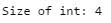

这意味着整数占用 4 字节的空间？

## 第 4 章：使用变量

你可以使用变量来存储、检索和修改更改的数据。作为程序员，你需要使用变量来存储和处理信息。

### 变量的特征

变量具有以下特征：

- 名称（也称为“标识符”）
- 数据类型
- 值（即你想要存储的信息）

变量是具有名称的计算机内存区域。它们存储值并允许计算机程序访问其内容。你可以将变量放在栈（即你计算机程序的工作内存）中，或程序的动态内存中。

如何命名变量


在使用变量之前，你需要对其进行命名。变量名充当标识符：它帮助程序定位和指定变量。C# 允许你自由地选择变量名。然而，与任何其他语言一样，C# 对变量名也有一些规则。这些规则如下：

- 你可以使用下划线（即 `_`）、字母和数字来创建变量名。
- 你不能用数字开头命名。因此，`firstsample` 是有效的，而 `1stsample` 是无效的。局部变量通常使用驼峰命名法（Camelcase），例如 `cost`、`orderdetail`、`dateofirth` 和 `firstname`。
- 在命名变量时不能使用 C# 关键字。这条简单的规则可以防止程序出现编译错误和运行时错误。如果你确实想为变量使用关键字，可以使用 `@` 符号开头名称（例如 `@oal`、`@int`、`@char` 等）。
- 变量名应当具有意义或或描述性，既不能太长也不能太短，以便通过观察就能识别变量中存储的信息。
- 可以包含字母 `a–z` 和 `A–Z`、数字 `0–9` 以及下划线 `_` 字符——不允许其他符号。
- 不允许空格且不能以数字开头。

### 有效名称
- `cost`, `name`, `order`, `order1`, `_order1`, `income`
- `order_detail`, `orderdetail`, `dateofirth`, `hourlyrate`, `firstname`, `first_name`, `isvalid`

### 无效名称
- `1`（数字）
- `class`, `while`, `if`, `protected`（关键字）
- `1order`, `1name`（以数字开头）

### 如何声明变量
你应该在使用变量之前对其进行声明。在声明变量时：

1. 指定变量的数据类型（例如 `Char`）
2. 指定变量的名称（例如 `Sample`）
3. 设置变量的初始值。这一步完全可选的。

变量声明的格式为：
`Data_type name = initial_value;`

以下是一些有效的变量声明示例：

```
Int year = 2000;
String name = username;
Char c = test;
```

重要提示：你需要使用分号结束每个 C# 语句。如果你忘记添加哪怕一个分号字符，你的程序都会产生不良或意料之外的结果。

### 如何赋值
与任何其他计算机语言一样，C# 允许你为变量赋值。这个过程被称为“值赋值”，它要求你使用等号。程序员将此符号称为“赋值运算符”。将变量名写在运算符的左侧，然后在另一侧指定你想要赋值的值。请检查以下示例：

```
Test = x;
username = "john";
```

### 如何初始化变量
在编程中，“初始化”是指为新变量赋值的过程。因此，你在声明变量时会设置这个“初始值”。

### 变量的默认值
如果你没有为变量分配任何值，C# 将执行自动初始化（即它将为空变量分配一个默认值）。下面的表格将显示每个数据类型的默认值：


给出的代码将向你展示如何声明变量并赋值。

```
years = 10;
days = 31;
pi = 3.14;
isempty = true;
sample = x;
animal = "dog";
```

重要提示：以双正斜杠（即 `//`）开头的行是“注释”。在编程中，注释是添加到代码中以提高可读性的描述性文本。语言编译器忽略这些行。因此，注释不会影响程序的功能。

### 创建标识符
如果你查看微软提供的一些建议，你会发现他们建议在处理变量时使用驼峰命名法（camelCase），并建议在处理方法时使用帕斯卡命名法（PascalCase）。使用驼峰命名法意味着你保持名称的第一个字母为小写。如果你创建一个包含复合词的标识符，你需要确保第二个单词的第一个字母大写：：`paymentComplete`。

### 数学
帕斯卡命名法（PascalCase）风格略有不同。这种符号风格要求你使用大写字母开头第一个单词。序列中所有其他单词的首字母也应该大写。使用帕斯卡命名法的示例包括：

```
WriteLine()
readline()
Start()
main()
```

在命名这些标识符时，你也可以使用数字和下划线。但如果由于某些原因你不能以数字开头这些标识符，你可以写像 `sevenooks` 这样的单词，但不能写成 `7ooks`。现在，这些符号并不是强制要求的，你可以根据心意随意更改。但这是一种规范。

### 确定赋值
C# 强制执行确定性赋值。这意味着你在使用变量之前需要为它初始化值。假设有如下内容：

```
Console.WriteLine(name);
```
错误：使用了未赋值的变量 ‘name’

如果你尝试使用未声明的变量，你的代码将无法编译。在这种情况下，编译器会告诉你出错了什么。尝试使用未赋值的变量也会导致错误。

为了给变量初始化值，你只需使用赋值运算符 `=`。变量名位于运算符的左侧，右侧则是如下所示的值：

```
Test = x;
username = "john";
```

在声明类型变量后，不能用新类型重新声明它，也不能赋值与其声明类型不兼容的值。例如，你不能声明一个 int 然后给它赋值布尔值 true/false。

```
Age = true;
```
错误：无法将类型 ‘bool’ 隐式转换为 ‘int’
```


你可以像下面所示，在同一行同时结合声明和初始化语句，这样更方便。

```java
String name = "pirzada"; int age = 35; int weight = 70; bool ismarried = true;
```

你也可以使用数学表达式。

```java
Int wowexp = (3 + 2) * 4; Console.WriteLine(wowexp);
```

输出：
20

右侧会被求值然后赋值给左侧的变量。这意味着 `3+2` 是 `5`，`5 * 4` 是 `20`，这会被赋值给变量 `wowexp`。


你也可以同时给多个不同的变量分配相同的值。

```java
Int a, c; a = c = 786; Console.WriteLine(a); Console.WriteLine(); Console.WriteLine(c);
```

输出：
786
786
786

### 使用类型推断

C# 3.0 通过 `var` 关键字引入了隐式类型变量。现在，你可以在不给出显式或真实类型的情况下声明局部变量。该变量在编译时仍然会接收到一个类型，但该类型是由编译器提供的。

实际上，`var` 关键字指示编译器从初始化语句右侧的表达式推断变量的类型。编译器的任务是确定并分配合适的类型。

```java
Var varialename = variablevalue; // 语法
```

`Var` 是可选的，它只是为了方便。

让我们使用上面相同的变量。

```java
Var name = "pirzada"; var age = 35; var weight = 70; var ismarried = true;
```

现在这些变量是隐式类型局部变量，意味着你不需要显式指定类型。编译器负责确定并分配合适的类型。字符串变量由双引号表示，字符变量由单引号表示，而 `bool` 类型则由 `true` 和 `false` 值表示。

建议：使用 `var` 很方便，但仅当类型从赋值的右侧显而易见时才使用它。

`Double` 用于表示带有小数点的字面量数字，除非你添加 `m/m` 后缀来表示小数变量，或添加 `f/f` 后缀来表示浮点型变量。

```java
Var value = 24899.45m; var numer = 20.8f;
```

为了初始化 `numer`，你需要在 `20.8` 之后添加 `f` 后缀，显式告诉编译器将 `20.8` 转换为 `float`。同样，为了初始化 `value`，你需要添加 `m` 后缀将 `24899.45` 转换为 `decimal` 类型。

你需要遵循以下规则：

* `var` 只能在单条语句中声明和初始化。否则，编译器将无从何处推断类型。
* `var` 不应用于类作用范围内的字段。
* 初始化器不能为 `null` 且必须是一个表达式。
* 多个隐式类型变量不能在同一语句中。
* 除非在初始化器中创建了新对象，否则不能使用对象。

### 默认值表达式

当你不知道给定类型的默认值将会何时，默认值表达式在与泛型结合使用时特别有用。

`default(t)` 返回类型的默认值，其中 `t` 是引用类型或值类型。

```java
T varialename = default(t); // 语法
示例：
Var name = default(string); var age = default(int); var weight = default(int);
```

### 默认字面量：

默认字面量是 C# 7.1 中的新功能，用于在语句执行时获取指定类型的默认值。此功能适用于值类型，也适用于引用类型。注意：默认字面量等于 `default(t)`，其中 `t` 是推断出的类型。

```java
String name = default; int age = default; int weight = default; bool ismarried = default; Console.WriteLine(name); Console.WriteLine(age); Console.WriteLine(weight); Console.WriteLine(ismarried);
```

在输出中，空值将以空行打印。默认字面量和 default(t) 的输出：
00 false

### new 运算符

使用 `new` 运算符会调用值类型的默认构造函数。这允许你使用 `new` 关键字创建变量，这会自动将变量设置为其默认值。注意：C# 中的所有值都是特定类型的实例。

```java
Var age = new int(); var ismarried = new bool(); Console.WriteLine(age); Console.WriteLine(ismarried);
```

输出：
0
False

## 第 5 章：什么是类型转换？

通常，运算符作用于属于相同类型的参数。然而，C# 语言提供了广泛的数据类型，你可以将其用于某些特定情况。要对属于不同类型的变量进行任何处理，你应该先转换其中一个变量。在 C# 中，数据类型转换可以是隐式的也可以是显式的。

每个 C# 表达式都有一个数据类型。该数据类型取决于表达式内部使用的字面量、变量、值和结构。基本上，你可能会使用一个类型与情况不兼容的表达式。当发生这种情况时，你将得到以下结果之一：

* 程序将给你给出一个编译时错误。
* 程序将执行自动转换。这意味着程序将获得正确的表达式。

将“s”类型转换为“t”类型允许你在运行程序时处理“s”。因此，有时此过程需要程序员对类型转换进行验证。查看示例：

* “对象”到“字符串”在程序运行时将需要验证。这种验证确保了你确实想将这些值作为字符串使用。
* “字符串”值到“对象”不需要任何验证，因为“字符串”类型是“对象”类型的派类。你可以将字符串转换为其父类而不会丢失数据或产生任何错误。
* 在将 int 值转换为 long 值时，你不需要执行验证。`long` 数据类型涵盖了 `int` 类型的所有可能值。这意味着数据可以在产生任何错误的情况下进行转换。


如果存在信息丢失的可能性，请使用 `conversion`。例如，在将浮点值转换为整数值时会发生信息丢失（即小数部分将消失）。在将宽范围类型转换为窄范围类型时，你可能会丢失某些数据（例如 `Long-to-int` 转换、`double-to-float` 转换等）。要完成此过程，你需要使用 `type` 运算符。请查看下面的示例：

```
Class example
{
    Static void main()
    {
        double yourdouble = 2.1d;
        System.println(yourdouble);
        long yourlong = (long)yourdouble;
        System.println(yourlong);
        yourdouble = 2e9d;
        System.println(yourdouble);
        int yourint = (int)yourdouble;
        System.println(yourint);
    }
}
```

如果正确编译并执行，该程序将给你以下结果：

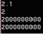

### 隐式转换

只有在不可能发生数据丢失时，你才能执行此类转换。这种转换被称为 `implicit`（隐式），因为它不需要任何运算符。当你将窄范围的值赋值给具有宽范围的变量时，C# 编译器将执行隐式转换。

### 字符串转换

C# 允许你将任何数据类型转换为“string”。如果你使用 `+` 且至少有一个非字符串参数，编译器将自动执行此转换过程。在这里，非字符串参数将变为字符串，`+` 运算符将产生新值。

隐式类型转换用于执行如从基类到派生类的转换的操作。这些转换是以所谓的“类型安全”的方式进行的。另一种类型的转换是显式的（explicit），它需要强制转换运算符来完成其功能。C# 中有 16 种可以作为转换方法的内置类型的不同函数。以下是你应该在 C# 环境中练习并熟悉的一些示例：

* `tochar`-允许你获取一个类型并将其转换为单个 Unicode 字符
* `byte`-允许你从一个类型转换并获取一个字节
* `todetime`-允许你通过转换类型（字符串或整数）获取一个日期时间结构
* `tofloat`-允许你通过转换一个类型获取一个浮点值
* `double`-允许你通过转换一个类型获取一个双精度
* `decimal`-允许从浮点数转换为整数或十进制类型
* `int64`-允许从一个类型转换为一个 64 位整数
* `int32`-允许从一个类型转换为一个 32 位整数
* `int16`-允许从一个类型转换为一个 16 位整数
* `sbyte`-允许从一个类型转换为一个有符号类型
* `string`-允许从一个类型转换为一个字符串
* `single`-允许从一个类型转换为一个小的浮点数
* `uint64`-允许从一个类型转换为一个无符号整数
* `uint32`-允许从一个类型转换为一个无符号长整数类型
* `uint16`-允许从一个类型转换为一个无符号整数类型
* `type`-允许从一个类型转换为一个指定的类型

对于你今天的练习，我鼓励你编写涵盖了上述每一个函数/转换的程序，以便更熟悉它们所包含的内容以及它们如何帮助你的编程。请记住，尽管你的代码可能很长，但你的输出应该始终产生你通过完成编程题想要实现的答案。

## 第 6 章：运算符的需要

在本章中，我们将花一些时间讨论你在 C# 语言内部可以使用运算符。

阅读这些材料后，你将了解这些运算符是如何工作的，以及你如何在源代码中使用它们。这些运算符非常易理解和使用，但这并不意味着它们是没用的；事实上，它们可以帮助确保你的代码执行你要求其完成的任务。如果不使用其中一些运算符，你的程序将缺乏功能且运行不会良好。这些运算符可能易于理解，但它们确实为增强代码的整体能力增加了大量力量。

无论你使用的是哪种类型的编程语言，运算符都是重要的。我们将分别详细介绍不同的运算符，以便你理解每个运算符是如何工作的，以及你如何使用每个运算符来实现各种目的并完成不同的任务。运算符帮助你处理对象和数据类型。它们接受输入并产生结果。C# 语言使用特殊字符（例如 `+` 等）作为运算符。

C# 程序员将运算符分为以下几类：

### 赋值运算符

虽然在赋值时可以使用一些运算符，但最常见的是等号。你可以使用的的一些运算符包括：

* `=` 此运算符的功能是允许你执行简单的赋值。它可以进行赋值，例如编写 `int sample = 100` 会告诉程序你想将 100 赋值给名为 `sample` 的变量。它不对该变量执行任何额外任务。
* `+=` 这是加法赋值运算符。它的功能是将两个操作数的值相加，然后将和赋值给左侧的操作数。
* `-=` 程序员经常将其称为“减法”赋值运算符。它的功能是从左侧的值中减去右侧的值，然后将差赋值给左侧的操作数。
* `*=` 此运算符的功能是乘以每个操作数的值，然后将乘积赋值给左侧的操作数。
* `/=` 此运算符的功能是除以两个变量，然后将结果赋值给左侧的变量。


当你使用赋值运算符时，请确保你的其他操作数属于相同的数据类型。如果你发现所使用的各种操作数不兼容，可能会出现一些问题，导致在尝试执行程序时发生错误，并且需要额外的时间和精力来修复。

在 C# 中，你需要使用等号（即 `=`）来赋值。以下是你在赋值值时需要使用的语法：

`Name_of_operand = expression, literal or second_operand`

这里是一些示例：

```csharp
Int y = 99;
String hello = "good morning.";
Char sample = 'z';
```

**重要说明**：C# 允许你对赋值运算符进行级联操作（即在单个表达式中多次使用）。这意味着如果你正在创建相同数据类型的变量，就不需要输入多个等号了。下面的示例将阐明这一规则：

```csharp
Int d = 1, e = 2, f = 3;
String hi = "good morning.", ye = "farewell.", thanks = "thank you.";
```

### 逻辑运算符

逻辑运算符（也称为“布尔”运算符）接受并返回布尔值（即 True 或 false）。以下是 C# 的四个逻辑运算符：

*   `&&` – 程序员将此运算符称为“逻辑与”。如果两个操作数都为真，它将给你返回“true”。
*   `^` – 这被被称为“异或或”运算符。如果其中一个操作数为真，它将给你返回 true。
*   `||` – 这是“逻辑或”运算符。只要至少有一个运算符为真，你就会得到 true。
*   `!` – 这个运算符被称为“逻辑非”运算符，它会反转操作数的值。

学习以下代码以理解这些运算符的使用(109)：

```csharp
Class test
{
    Static void main()
    {
        bool x = true, y = false;
        Console.WriteLine(x && y);
        Console.WriteLine(x || y);
        Console.WriteLine(!x);
        Console.WriteLine(x ^ y);
        // this is an example.
    }
}
```

一旦你编译并运行这段代码，你将看到以下结果：

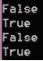

### 算术运算符

这些运算符帮助你执行数学运算。该类别由以下运算符组成：

*   `+` – 使用此运算符对两个操作数进行加法（例如 `Int x = 1 + 1`）。
*   `-` – 此运算符允许你在代码中执行减法。它从左操作数的值中减去右操作数的值（例如 `Int x = 2 – 1`）。
*   `*` – 使用此运算符，你可以乘以两个操作数的值（例如 `Int r = 6 * 6`）。
*   `/` – 使用此运算符在代码中进行除法。它将左操作数的值除以右操作数的值。
*   `++` – 这被称为“递增运算符”。它增加操作数的值。与上述运算符不同，此运算符作用于单个操作数。此外，你也可以写在操作数之前（例如 `99++, ++5` 等）。
*   `--` – 此运算符是递增运算符的相反操作。你可以用它来减少操作数的值。你可以将其写在你想要修改的操作数之后。
*   `%` – 这通常被称为余数或通俗称为“取模”运算符。它的功能是将左操作数除以右操作数并返回余数。

下面的代码将向你展示这些运算符是如何工作的：

```csharp
Class test
{
    Static void main()
    {
        int d = 100, e = 3;
        Console.WriteLine(d + e);
        Console.WriteLine(d - e);
        Console.WriteLine(d / e);
        Console.WriteLine(d * e);
        Console.WriteLine(++d);
        Console.WriteLine(--e);
        // this is an example.
    }
}
```

一旦你编译并执行该代码，你将在命令行提示符上看到：

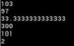

### 二进制运算符

这些运算符作用于二进制数。在 IT 世界，所有的信息都表示为零和一的序列。这意味着如果你想成为一名成功的程序员，就需要掌握二进制运算符。

二进制运算符的工作方式与逻辑运算符完全一样。实际上，你可能会认为二进制运算符和逻辑运算符使用不同的输入但执行相同的处理。逻辑运算符使用布尔值产生结果。而二进制运算符则作用于以二进制位表示的数字。以下是你在 C# 中会遇到的二进制运算符：

*   `&` – 这被称为“二进制与”。它指示两个操作数都具有“1”的位置。
*   `^` – 程序员将此运算符称为“二进制异或”。它在操作数不同时起作用。
*   `|` – 这是“二进制或”运算符。它指示任何一个操作数具有“1”的位置。
*   `~` – 它充当取反。就像 `!` 一样，它会反转值。
*   `<<` – 这是“二进制左移”运算符。它将位向左移动。这种移动取决于你分配的值（例如 `4 << 3`, `4 << 2`）。

### 关系运算符

你可以使用的下一种运算符是关系运算符。这些运算符非常有用，因为它们允许你比较值。每一个此类运算符都给出一个布尔值。正如此，这些运算符被用于创建条件语句。我们将查看一些使用的的关系运算符，假设 e=150 且 d=100：

*   `==` – 这是相等运算符。它检查两个操作数是否相等（例如 `X == y`）。此运算符的功能是检查值的相等性。如果两个值最终相等，运算符将认为它是 true。否则，运算符将认为它是 false。例如，写下 `d == e` 结果将显示为 false。
*   `>` – 此运算符的功能是检查左侧的操作数是否大于右侧的操作数。如果是的话，运算符将认为它是 true。例如，写下 `e > d` 结果将为真。
*   `<` – 这实际上是一个小于运算符，它允许你检查左侧的操作数是否小于右侧的操作数。如果左侧操作数的值小于右侧操作数的值，它将给你返回“true”（例如 `Y < x`）。


- `>=` – 使用此运算符，你可以判断左侧操作数的值是否大于或等于右侧操作数的值。该运算符的作用是它会判断左侧操作数的值确实大于或等于右侧的操作数；否则，它会告诉你该语句为假（false）。例如，`e >= d` 结果为 true。
- `<=` – 如果左侧操作数的值小于或等于右侧操作数的值，则此运算符将返回 true。
- `!=` – 此运算符的功能是允许你测试两个值/操作数之间的不等性。如果两个值不相等，它会告诉你是真的（true）。例如，`e != d` 将导致运算符结果为 true。

当你使用这些关系运算符时，务必记住你每次都会得到一个布尔结果。这意味着你得到的答案要么是 `true`，要么是 `false`。在处理相等运算符时，你还必须检查是否使用了两个等号。如果你不小心将这些运算符与赋值运算符混淆，你可能会收到错误信息，该程序将无法按照你想要的方式运行。

### 条件运算符

C# 用户将 `?` 称为条件运算符。基本上，该运算符使用布尔表达式的结果来确定应该处理哪条语句。这被称为“三元运算符”，因为它作用于三个操作数。在这里，第一个值应该是布尔类型，而其余的值则需要属于相同的数据类型（例如：字符、字符串、数字等）。

该运算符的语法为：

`First_operand ? Second_operand : third_operand;`

其工作原理如下：如果 `first_operand` 为 true，程序将处理 `second_operand`。然而，如果 `first_operand` 为 false，程序将处理 `third_operand`。

## 第 7 章：条件语句

C# 拥有条件语句，主要用于控制执行流。条件语句要求程序员指定一个条件或一组条件，以及当发现条件为真时要执行的相应语句。程序员也可以指定当条件不为真时要执行的语句。让我们讨论一下 C# 支持的各种条件语句。

### If 语句

该语句用于在执行一组语句之前评估布尔表达式。如果条件为真，则执行一组语句，否则将执行另一组语句。以下是其语法：

`If(boolean_expression) { /* 如果 boolean_expression 为真，则执行的语句 */}`

这是一个示例：

```csharp
Using system;

Namespace decisionmaking {
Class ifstatement {
    Static void main(string[] args) {
        /* 定义本地变量 */
        Int x = 5;
        /* 通过 if 检查布尔条件 */
        If (x < 10) {
            /* 如果条件为真，则打印 */
            Console.WriteLine("x is less than 10");
        }
        Console.WriteLine("the value of x is: {}", x);
        Console.readline();
    }
}
```
代码返回以下输出：

条件被发现为真，变量 x 的值小于 10，因此执行了语句。如果条件为假呢？

```csharp
Using system;

Namespace decisionmaking {
Class ifstatement {
    Static void main(string[] args) {
        /* 定义本地变量 */
        Int x = 15;
        /* 通过 if 检查布尔条件 */
        If (x < 10) {
            /* 如果条件为真，则打印 */
            Console.WriteLine("x is less than 10");
        }
        Console.WriteLine("the value of x is: {}", x);
        Console.readline();
    }
}
}
```
代码返回：

条件被发现为假，因此执行了其锁之外的语句。

### If-else 语句

这简单来说是 if 语句与 else 部分的组合。如果条件为真，则执行 if 部分；当条件为假时，执行 else 部分。这两个部分不能同时执行。该语句的语法如下：

`If(boolean_expression)
{
    // 如果条件为真，则执行代码。
}
Else
{
    // 如果条件为假，则执行代码
}`

考虑给出的示例：

```csharp
Using system;

Namespace decisionmaking {
Class ifelsestatement {
    Static void main(string[] args) {
        /* 定义本地变量 */
        Int x = 5;
        /* 检查布尔条件 */
        If (x < 10) {
            /* 如果条件为真，将打印以下内容 */
            Console.WriteLine("x is less than 10");
        } else {
            /* 如果条件为假，将打印以下内容 */
            Console.WriteLine("x is greater than 10");
        }
        Console.WriteLine("the value of x is: {}", x);
        Console.readline();
    }
}
```
代码返回：

条件结果为真，因此执行了锁内部的语句。如果条件为假呢？

```csharp
Using system;

Namespace decisionmaking {
Class ifelsestatement {
    Static void main(string[] args) {
        /* 定义本地变量 */
        Int x = 15;
        /* 检查布尔条件 */
        If (x < 10) {
            /* 如果条件为真，将打印以下内容 */
            Console.WriteLine("x is less than 10");
        } else {
            /* 如果条件为假，将打印以下内容 */
            Console.WriteLine("x is greater than 10");
        }
        Console.WriteLine("the value of x is: {}", x);
        Console.readline();
    }
}
```
代码给出：

条件结果为假，因此执行了 else 锁内部的语句。

### Else…if 语句

在某些情况下，我们可能需要检查多个条件。在这种情况下，我们可以使用 else if 语句。它采用以下语法：

`If(boolean_expression a)
{
    // 如果条件 a 为真，则执行代码。
}
Else if(boolean_expression b)
{
    // 如果条件 b 为真，则执行。
}
Else if(boolean_expression c)
{
    // 如果条件 c 为真，则执行。
} else
{
    // 如果上述所有条件均为假，则执行。
}`

这是一个示例：

```csharp
Using system;

Namespace decisionmaking {
Class elseifstatement {
    Static void main(string[] args) {
        /* 定义本地变量 */
        Int x = 5;
        /* 检查布尔条件 */
        If (x == 1) {
```


```csharp
/*  如果条件为真，打印此语句 */

Console.WriteLine("value of x is 1");

} Else if (x == 2) {

    /*  如果 if else if 条件为真，则打印此语句*/
    Console.WriteLine("value of x is 2");

} Else if (x == 3) {

    /*  如果 if else if 条件为真，则打印此语句  */
    Console.WriteLine("value of x is 3");

} else {

    /*  如果以上条件都不为真，则打印此语句  */
    Console.WriteLine("all conditions are false");
}

Console.WriteLine("exact value of x is: {0}", x);

Console.readline();

}

}
}

代码输出以下结果：

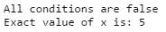

发现所有条件结果均为假；因此，条件之外的代码块被执行。让我们将变量 `x` 的值设置为 2，看看代码会发生什么：

```csharp
Using system;

Namespace decisionmaking {

Class elseifstatement {

    Static void main(string[] args) {
        /*  定义一个局部变量 */
        Int x = 2;
        /*  检查整型条件 */
        If (x == 1) {
            /*  如果条件为真，则打印此语句  */
            Console.WriteLine("value of x is 1");
        } Else if (x == 2) {
            /*  如果 if else if 条件为真，则打印此语句*/
            Console.WriteLine("value of x is 2");
        } Else if (x == 3) {
            /*  如果 if else if 条件为真，则打印此语句  */
            Console.WriteLine("value of x is 3");
        } else {
            /*  如果以上条件都不为真，则打印此语句  */
            Console.WriteLine("all conditions are false");
        }
        Console.WriteLine("exact value of x is: {0}", x);
        Console.readline();
    }

}

```

输出显示所示：

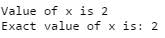

一个 else if 条件求值为真，因此其代码块内的语句被执行。所有条件之外的代码块也被执行了。你可以通过将 x 的值修改为各种值来尝试代码，看看会发生什么。

### 嵌套 if 语句

C# 允许我们嵌套条件语句。我们可以嵌套 if 和 else if 语句，这意味着我们在另一个 if 或 else if 语句内部使用它们。下面的语法演示了如何在 c# 中嵌套 if 语句：

```csharp
If( o,lean_expression a) {
    /* 如果整型表达式 a 为真，则执行此语句  */
    If(o,lean_expression ) {
        /* 如果整型表达式为真，则执行此语句 */
    }
}
```

可以使用给出的语法嵌套 else if 语句。考虑下面的示例：

```csharp
Using system;

Namespace decisionmaking {

Class nestedif {

    Static void main(string[] args) {
        /* 定义局部变量 */
        Int x = 1;
        Int y = 2;
        /* 检查整型条件 */
        If (x == 1) {
            /* 如果条件为真，检查 if 条件 */
            If (y == 2) {
                /* 如果条件为真，打印以下内容 */
                Console.WriteLine("value of x is 1 and is 2");
            }
        }
        Console.WriteLine("exact value of x is: {0}", x);
        Console.WriteLine("exact value of y is: {0}", y);
        Console.readline();
    }

}
```

代码返回：


两个条件均为真，因此嵌套 if 语句内的语句被执行。如果其中任一个条件求值为假，则该语句将无法执行。这里有一个示例：

```csharp
Using system;

Namespace decisionmaking {

Class nestedif {

    Static void main(string[] args) {
        /* 定义局部变量 */
        Int x = 1;
        Int y = 2;
        /* 检查整型条件 */
        If (x == 1) {
            /* 如果条件为真，检查 if 条件 */
            If (y == 3) {
                /* 如果条件为真，打印以下内容 */
                Console.WriteLine("value of x is 1 and is 2");
            }
        }
        Console.WriteLine("exact value of x is: {0}", x);
        Console.WriteLine("exact value of y is: {0}", y);
        Console.readline();
    }

}
```

在上面的代码中，嵌套的 if 条件检查变量 `y` 的值是否为 3，结果为假。该代码块内的语句将不会执行。c# 编译器将跳过此部分并继续执行条件之外的代码。它返回以下：

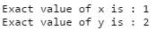

### Switch 语句 (111)

该语句与使用多个 if 语句相同。它的创建包含一组可能性的列表、每种可能性对应的操作，以及一个在任何选项都不求值为真时执行的默认部分。以下是该语句的语法：

```csharp
Switch(expression)
{
    Case <value_1>
        // 代码
        Break;
    Case <value_2>
        // 代码
        Break;
    Case <value_n>
        // 代码
        Break;
    Default
        // 代码
}
```

这里是一个示例：

```csharp
Using system;

Public class switchstatement {

    Static void main(string[] args) {
        Int a = 3;
        Switch (a) {
            Case 1:
                Console.WriteLine("value x is 1");
                Break;
            Case 2:
                Console.WriteLine("value of x is 2");
                Break;
            Case 3:
                Console.WriteLine("value of x is 3");
                Break;
            Default:
                Console.WriteLine("unknown x");
        }
    }

}
```

代码返回：


变量 `x` 被设置为 3。执行代码后，条件为真，因此其代码块内的语句被执行。如果所有条件都不为真，则执行默认部分。演示如下：

```csharp
Using system;

Public class switchstatement {

    Static void main(string[] args) {
        Int a = 5;
        Switch (a) {
            Case 1:
                Console.WriteLine("value of x is 1");
                Break;
            Case 2:
                Console.WriteLine("value of x is 2");
                Break;
            Case 3:
                Console.WriteLine("value of x is 3");
                Break;
            Default:
                Console.WriteLine("unknown x");
        }
    }

}
```

输出：


switch 语句适用于字符串、整数、字符、枚举。以下是如何配合字符串使用：

```csharp
Using system;

Public class switchstatement {

    Static void main(string[] args) {
        String firstname = "nicolas";
        Switch (firstname) {
            Case "samuel":
                Console.WriteLine("your first name is samuel");
                Break;
            Case "nicolas":
                Console.WriteLine("your first name is nicolas");
                Break;
            Case "ismack":
                Console.WriteLine("your first name is ismack");
                Break;
        }
    }

}
```

（注：此处根据原文逻辑翻译）

### switch 中的 Go,to (112)

在使用 switch 语句的某些情况下，我们可能需要跳转到某个分支。可以使用跳转语句或 go,to 语句来实现。考虑下面的示例：

```csharp
Using system;

Public class switchstatement {

    Static void main(string[] args) {
        String firstname = "nicolas";
        Switch (firstname) {
            Case "samuel":
                Console.WriteLine("your first name is samuel");
                Break;
            Case "nicolas":
                Console.WriteLine("your first name is nicolas");
                Go,to, case "text";
            Break;
            Case "ismack":
                Console.WriteLine("your first name is ismack");
                Break;
            Case "text":
                Console.WriteLine("this is text case");
                Break;
        }
    }

}
```


}

代码返回以下输出：

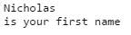

## 嵌套 switch

可以在另一个 `switch` 语句中创建一个 `switch` 语句。这就形成了一个嵌套的 `switch`。这是一个示例：

```csharp
Using system;

Public class nestedswitch
{
    Public static void main()
    {
        Int x = 10;
        Switch (x)
        {
            Case 10:
                Console.WriteLine(10);
                Switch (x - 1)
                {
                    Case 9:
                        Console.WriteLine(9);
                        Switch (x - 2)
                        {
                            Case 8:
                                Console.WriteLine(8);
                                break;
                        }
                        break;
                }
                break;
            Case 20:
                Console.WriteLine(20);
                break;
            Case 125:
                Console.WriteLine(25);
                break;
            Default:
                Console.WriteLine(30);
                break;
        }
    }
}
```

输出如下：

## 第 8 章：循环

作为一名程序员，你将使用循环语句来反复运行某些代码块。循环在 C# 编程中起着重要作用。因此，如果你想在短时间内掌握这门语言，也应该仔细学习这些材料。

## 循环——基础

在创建程序时，你通常需要多次执行代码序列。多次输入相同的代码块会非常疲累。因此，你需要一种快速简单的方法来重复代码。幸运的是，C# 语言支持循环语句。

循环是一种重复运行代码片段的工具。你可以使用它运行特定次数的代码，或者在满足给定条件时一直运行。C# 提供了不同类型的循环语句。让我们详细分析每个类型：

### while 循环

这是 C# 中是最简单的循环语句。它的语法如下：

```csharp
While (the_assigned_condition)
{
    The_loop’s body;
}
```

在此语法中，`the_assigned_condition` 是一个产生布尔值的表达式。该条件决定了 `body` 运行的次数。而 `body` 是你想要执行的语句（或语句组）。

下图将说明 while 循环的工作原理：

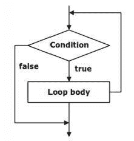

在处理“while”循环时，C# 程序会检查布尔表达式的值。如果该值为“true”，程序将运行循环体内的所有语句。然后，程序将再次检查布尔表达式以查看其值。如果值仍为 true，程序将重新运行循环体并返回第一步（即检查表达式的值）。这个过程将一直持续，直到表达式求值为 false 为止。一旦发生这种情况，程序将处理循环正后的代码。

重要提示：如果条件为假，你的 C# 程序将不会运行 while 循环的体。因此，如果你在启动程序时该值为 false，那么你的语句将永远不会执行。接下来的示例将说明 while 循环是如何运行的：

```csharp
Int timer = 10;
While (timer >= 0)
{
    System.WriteLine("time remaining: " + timer);
    Timer--;
}
```

如果你编译并执行这段代码，你的提示符将打印此内容：


### break 运算符

你可以使用 `break`（一种 C# 运算符）来提前退出循环。如果程序员不想等待循环自然结束，他们就会使用此运算符。因为循环一旦遇到 `break` 就会结束。这种情况会强制程序跳转到循环后的代码。在 C# 中，你只能在循环体内使用此运算符。这意味着 `break` 只有在循环运行时才有效。

### do-while 循环

`do-while` 循环与 `while` 循环几乎相同。这些循环之间的唯一区别是，前者在运行循环体之后分析布尔值。因此，你可以放心，即使布尔表达式为假，你的代码也会运行一次。以下是 do-while 循环的语法：

```csharp
Do
{
    Statements;
} while (boolean expression)
```

do-while 循环按照此模式工作：


程序将执行循环体内的所有语句。然后，它将检查条件（即布尔表达式）。如果条件求值为 true，程序将再次执行循环体并执行“值检查”。这个过程将一直持续，直到条件变为 false。因此，如果赋值的条件始终求值为 true，你的代码可能会永远运行。

### for 循环

通常，`for` 循环比 do-while 和 `while` 循环复杂。然而，`for` 循环可以帮助你用更少的 C# 代码完成困难的任务。`for` 循环的语法为：

```csharp
For (initializer; boolean_expression; update)
{
    The_loop’s body;
}
```

一个 `for` 循环有一个 `initializer`（即赋值值）、一个 `boolean_expression` 和一个更新计数器的语句。`counter`（初始值）是 `for` 循环最显著的特征。计数器增加直到达到最终值（例如 10）。此外，程序员通常知道 `for` 循环将迭代多少次。你可以在单个 `for` 中包含递增和递减变量。在，你可以包含递增和递减变量。

重要提示：`for` 循环的所有部分都是可选的。你可以通过留空来创建一个无限的 `for` 循环。这是一个示例：


此时，你已经准备好学习 `for` 循环的不同部分了。

### initializer

`for` 循环可以拥有一个 `initializer`：

```csharp
For (ule sample = 1; ...)
{
    // 你可以在这里使用 sample。
}
// 在这里不能使用 sample。
```

C# 程序在运行 `for` 循环之前执行此片段。通常，程序员使用初始化器创建一个计数器（也称为循环变量）并为其分配初始值。该计数器在循环体内是可用且可使用的。

### boolean_expression

`for` 循环需要一个 `boolean_expression`：

```csharp
For (...; sample < 5; ...)
{
    // 这是循环体。
}
```

C# 程序在运行循环体之前评估 `boolean_expression`。如果结果为 true，程序将执行循环体；否则，相关程序将跳转到在当前循环之后的语句。

### update 语句

`for` 循环还有一个更新计数器的语句：

```csharp
For (...; ...; sample++)
{
    // 这是循环体。
}
```


这是 “for” 循环的最后部分。基本上，更新语句会更新循环的计数器。让我们使用上面的代码片段：

```c
for (int sample = 10; sample > 1; sample--)
{
    // this is the loop’s body.
}
```

程序在运行循环体后执行此部分。请记住，该语句会更新计数器的值。

### 循环体
这部分由 c# 语句组成。它可以利用你在循环初始化部分声明的变量。查看下例所示：

```c
for (int sample = 10; sample > 1; sample--)
{
    Console.WriteLine(sample);
}
```

### continue 运算符
在某些情况下，你需要停止当前的迭代但不结束循环本身。你可以使用 c# 中名为 “continue” 的运算符完成此任务。下面的示例将说明该运算符是如何幅工作的：

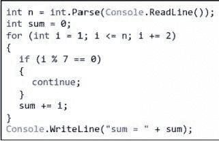

这段代码计算范围（1 到 n）内所有被 7 整除有余数的奇数总和。

### “foreach” 循环 (116)
最近，c# 引入了 “foreach” 循环的概念（即扩展 “for” 循环）。这种循环概念也存在于其他编程语言中，如 c, v, c++, php 等。通过这个编程工具，你可以运行列表、数组或其他值组中的所有元素。“foreach” 循环即使对于非索引数据组，也能获取所有现有的元素。

在编写此类循环时，使用以下语法：

```c
foreach (type name_of_variable in name_of_group)
{
    The_statements;
}
```

如你所见，这种循环比典型的 “for” 循环简单得多。“foreach” 循环可以帮助你快速扫描集合中的所有对象。无数程序员在编写代码时使用这种循环，这并不奇怪。

### 嵌套 for 循环
C# 允许你将一个 “for” 循环放在另一个 “for” 循环内部。代码最内层的循环运行次数最多。而最外层部分的循环重复次数最少。在“嵌套” for 循环时，你应该使用以下语法：

```c
for (initializing_fragment, condition, update_statement)
{
    for (initializing_fragment, condition, update_statement)
    {
        Statements
    }
}
```

在这里，程序运行初始的 “for” 循环，执行其体并触发嵌套循环。程序将检查第二个循环的条件并执行其内部的代码，直到评估为假。然后，程序将对循环计数器进行必要的调整。程序将重复整个过程，直到所有条件都为假。

## 第 9 章：方法
本章将重点介绍方法。在这里，你将学习如何在程序中声明和利用方法。你需要记忆本章包含的课程才能成为一名有效的程序员。

### 方法基础
对于大多数程序员来说，方法是任何程序的核心方面。方法可以解决问题、接受用户输入（称为参数）并产生结果。方法简单来说是为了执行共同任务而组合在一起的一组语句。每个 c# 类至少有一个方法，即主方法。要使用方法，你必须先定义它，然后调用它来执行其预期的操作。方法完成代表程序所执行转换的任务。此外，方法是完成实际的区域区域。程序员将方法视为任何计算机程序的基本单元的主要原因。

### 方法提供的优势
在本节中，你将发现方法提供的主要优势。阅读这些材料后，你将知道为什么在编写程序时应该使用这些工具。

####结构和代码可读性
编程专家声称，在编写计算机程序时应该使用方法。即使是最简单的方法也可以提高你的 c# 代码的结构和可读性。这里有一个你需要知道的重要事实：程序员花费 20% 的时间编写和检查他们的计算机程序。剩下的 80% 时间用于维护和改进软件。显然，如果你的代码具有可读性且结构良好，处理你的程序将变得轻松。

### 防止冗余代码
方法可以帮助你避免程序中的冗余代码。冗余或重复的代码通常会在计算机应用程序中产生不理想的结果。

### 代码重复之后
如果你的程序需要多次使用某个代码片段，将该片段转移到 c# 方法中是一个极好的主意。你可以多次调用方法，这意味着你可以重复代码。

### 声明、实现和调用方法 (17)
方法定义简单来说是对方法的声明。以下是 c# 中方法的语法：

`<access_specifier><data_type_of_the_result><name_of_method>(list_of_parameters)`
{
    method_body;
}

此时，你需要知道你可以执行的过程。这些是：
- **声明**：在此过程中，你把方法链接到程序中。
- **实现**：这涉及输入代码来完成方法。
- **调用**：这是调用方法的过程。在这里，你将使用方法解决问题。

### 方法声明
在 c# 中，你需要在类内部声明方法。此外，不允许“嵌套”方法（即在另一个方法内部编写方法）。此点的完美例子就是使用过多次的 `main()` 方法。

```c
class declaringmethods
{
    static void main()
    {
        Console.WriteLine("hi c#!");
    }
}
```


C# 不需要要求你在声明中包含参数。这意味着你可以让括号保持为空（例如 `Main()`）。

### 方法名称

在声明、调用或实现期间，你需要指定方法的名称。这里是你在为方法命名时需要记住的规则：

*   确保首字母大大写。
*   每个单词的首字母都使用大写字母（例如 `Samplemethod`、`newmethod`、`mainline` 等）。
*   使用动词和名词作为方法的名称。

**重要说明：** 上述讨论的规则完全是可选的。如果你希望你的 C# 代码具有良好的结构和可读性，请遵循这些规则。

### 方法实现

仅声明方法是不够的。如果你想让方法在程序内部运行，你还需要实现这些方法。程序员在指代方法的实现时使用“方法体”（body）这一术语。

### 方法体

你会在大括号内找到方法体。该方法体由你想要执行的命令、表达式和语句组成。因此，方法体是任何方法的重要部分。

**重要说明：** 请记住，你不能在 C# 中嵌套方法。不要在另一个方法内部编写方法。

### 方法调用

基本上，这是运行方法体内语句的过程。调用方法非常简单易用：你只需要指定它的名称，添加一对大括号，并使用分号结束行。以下是你应该使用的语法：

`Name_ofmethod();`

下面提供的示例代码将向你展示如何调用方法：

```csharp
Class animals
{ 
    static void main()
    {
        Console.writeline("i love dogs.");
    }
}
```

如果你编译并执行该代码，你的命令行提示将打印以下消息：

I love dogs.

### 可以调用方法的地方

C# 允许你在以下区域调用方法：

*   程序的主方法内部（即 `Main()`）。
*   在另一个方法内部。
*   在方法自己的体内部。这种技术被称为“递归”。

### 递归方法调用(119)

方法调用自己是可能的。这个过程被称为递归(120)。考虑下面给出的阶乘示例：

```csharp
Using system;

Namespace methodapplication {
    Class numerchecker {
        Pulic int factorial(int x) {
            /* declaring a local variale */
            Int answer;
            If (x == 1) {
                Return 1;
            } else {
                Answer = factorial(x - 1) * x;
                Return answer;
            }
        }
        Static void main(string[] args) {
            Numerchecker n = new numerchecker();
            //let's now call the factorial method
            Console.WriteLine("factorial of 8 is : {0}", n.factorial(8));
            Console.WriteLine("factorial of 9 is : {0}", n.factorial(9));
            Console.readline();
        }
    }
}
```

我们创建了名为 `n` 的函数和类实例。代码将返回下面的结果：

代码能够为我们提供 8 和 9 的阶乘。注意，一个数的阶乘是除 0 以外所有数字的积。例如，8 的阶乘是 1*2*3*4*5*6*7*8，如上述结果所示得到 40320。

## 向方法传递参数(121)

如果定义方法时带有参数，那么在调用时应向其传递参数。可以使用三种方法传递参数。让我们讨论这些方法。

### 值传递 (Pass value)

这种方法涉及将参数的实际值复制到形式参数中。这是传递参数的默认机制。通过这种机制，在调用函数时，内存中为每个值参数创建一个新位置。将实际参数的值复制到这些位置。这意味着在方法内部对参数进行的更改将对参数没有影响。

让我们通过一个示例来演示：

```csharp
Using system;

Namespace methodapplication {
    Class numerchecker {
        Pulic void swap(int a, int ) {
            Int temp;
            Temp = a; /* saving the value of a */
            A = ; /* putting into */
            = temp; /* putting temp into */
        }
        Static void main(string[] args) {
            Numerchecker n = new numerchecker();
            /* defining a local variale */
            Int x = 10;
            Int y = 20;
            Console.writeline("before swapping, value of x is : {0}", x);
            Console.writeline("before swapping, value of y is : {0}", y);
            /* let's swap the values calling the function */
            N.swap(x, y);
            Console.writeline("after swapping, value of x is : {0}", x);
            Console.writeline("after swapping, value of y is : {0}", y);
            Console.readline();
        }
    }
}
```

代码给出了以下输出：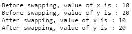

我们所的是了函数内部的值。然而，上面的输出显示此更改没有生效；因此它没有反映出来。

### 引用传递 (Pass reference)

引用参数引用与参数相同的内存。要声明引用参数，我们使用 `ref` 关键字。

```csharp
Using system;

Namespace methodapplication {
    Class numerchecker {
        Pulic void swap(ref int a, ref int ) {
            Int temp;
            Temp = a; /* saving the value of a */
            A = ; /* putting into a */
            = temp; /* putting temp into */
        }
        Static void main(string[] args) {
            Numerchecker n = new numerchecker();
            /* defining a local variale */
            Int x = 10;
            Int y = 20;
            Console.writeline("before swapping, value of x is : {0}", x);
            Console.writeline("before swapping, value of y is : {0}", y);
            /* let's swap the values calling the function */
            N.swap(ref x, ref y);
            Console.writeline("after swapping, value of x is : {0}", x);
            Console.writeline("after swapping, value of y is : {0}", y);
            Console.readline();
        }
    }
}
```

代码返回了以下：

在值传递中，值没有交换。但在这种情况下，值已经交换了，如上所示。上述更改在主函数中得到了反映。

### 输出传递 (Pass output)(122)

return 语句可以帮助我们只从函数返回一个值。然而，通过使用输出参数，可以从函数返回两个值。输出参数与引用参数相同，区别在于它们将数据传输到方法外部，而不是方法内部。

这里有一个演示此点的示例：


```csharp
public void getvalue(out int a) {
    int temp = 20;
    a = temp;
}

static void main(string[] args) {
    numerchecker n = new numerchecker();
    /* defining a local variable */
    int x = 10;
    Console.WriteLine("before calling the method, value of x : {0}", x);
    /* call the function to get value */
    n.getvalue(out x);
    Console.WriteLine("after calling the method, the value of x is : {0}", x);
    Console.readline();
}
```

它返回以下内容：

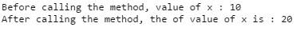

为输出参数提供的变量应该被赋值。当人们想要通过参数从方法返回值而无需为参数分配初始值时，输出参数非常有用。下面的示例将帮助你更好地理解这一点：

```csharp
using system;

namespace methodapplication {
class numerchecker {
    public void getvalues(out int a, out int b) {
        Console.WriteLine("enter in your first value: ");
        a = convert.toInt32(Console.readline());
        Console.WriteLine("enter in your second value: ");
        b = convert.toInt32(Console.readline());
    }

    static void main(string[] args) {
        numerchecker n = new numerchecker();
        /* defining a local variable */
        int x, y;
        /* call a function to obtain the values */
        n.getvalues(out x, out y);
        Console.WriteLine("after calling the method, the value of x is : {0}", x);
        Console.WriteLine("after calling the method, the value of y is : {0}", y);
        Console.readline();
    }
}
}
```

系统会提示你输入两个值，请执行这些操作。你将获得它们在调用方法之前和之后的值。

## 第 10 章：数组世界(123)

我们可以将数组定义为一种特殊的数据类型，它以顺序存储固定数量的值，并使用特殊的语法。所有数组元素必须属于相同的数据类型，例如字符串、整数、双精度浮等。你可以将数组视为存储在连续内存位置中的同类型变量集合。你使用索引来访问数组中的给定元素。

在内存中，最低地址标识数组中的第一个元素，而最高地址标识数组中的最后一个元素。

### 声明数组(125)

在 c# 中，使用以下语法声明数组：

`datatype[] arrayname;`

`datatype` 帮助我们指定存储在数组中的元素的数据类型，不要忘记所有数组元素必须属于相同类型。方括号 `[]` 帮助说明数组的阶（rank），其中阶表示存储在数组中的大小或元素数量。`arrayname` 表示数组名称。以下是有效的数组声明示例：

- `int[] intarray;` // 可用于存储 int 值
- `bool[] boolarray;` // 可用于存储 bool 值
- `string[] stringarray;` // 可用于存储字符串值
- `double[] doublearray;` // 可用于存储 double 值
- `byte[] bytearray;` // 可用于存储 byte 值
- `employee[] departmentarray; // 可用于存储 employee 类的实例

### 初始化

当数组被声明后，并不意味着它已经在内存中初始化了。初始化数组后，可以对其赋值。初始化可以在声明时使用 `new` 关键字完成。当使用此关键字时，会创建一个数组的实例。演示如下：

```csharp
class myarray {
    static void main() {
        int[] intarray_1 = new int[4];
        int[] intarray_2 = new int[4]{10, 20, 30};
        int[] intarray_3 = {10, 20, 30};
    }
}
```

首先，我们声明了一个存储 4 个整数的数组。注意，数组的大小是在方括号内指定的。我们在第二条语句中也做了同样的操作，并将值分配到了大括号 `{}` 中。在第三条语句中，我们声明了一个数组并在未指定大小的情况下对其赋值了值。

延迟初始化

可以在数组声明后对其初始化。这意味着我们不必同时完成数组的声明和初始化。这里有一个示例：

```csharp
using system;
class myarray {
    static void main() {
        string[] array1, array2;
        array1 = new string[4]{ "miles", "john", "clare"};
        array2 = new string[]{"miles", "john", "clare"};
        Console.WriteLine(array1.length);
        Console.WriteLine(array2.length);
    }
}
```

上述机制被称为延迟初始化。在这种情况下，初始化必须使用 `new` 关键字完成。我们不能仅仅通过给数组赋值来初始化它。下面的示例了一个无效的数组初始化：

```csharp
string[] myarray;
myapp = {"miles", "john", "clare"};
```

### 访问数组元素

数组的元素是在初始化期间分配的。然而，我们可以使用单个索引为数组赋值。演示如下：

```csharp
using system;
class myprogram {
    static void main() {
        int[] array1 = new int[5];
        array1[0] = 1;
        array1[1] = 2;
        array1[2] = 3;
        array1[3] = 4;
        array1[4] = 5;
        Console.WriteLine(array1[0]);
        Console.WriteLine(array1[1]);
        Console.WriteLine(array1[2]);
        Console.WriteLine(array1[3]);
        Console.WriteLine(array1[4]);
    }
}
```

代码将返回以下结果：


对数组值的检索或访问也是通过索引完成的。元素的索引放在括号内。考虑下面的示例：

`array1[0];`
`array1[1];`
`array1[2];`
`array1[3];`
`array1[4];`

这就是我们如何访问名为 `array1` 的上方数组的所有元素。

### 使用 for 循环

我们可以使用 `for` 循环访问数组元素。循环将遍历数组元素，同时通过它们的索引访问所需的元素。例如：

```csharp
using system;
namespace arrayapp {
class myarray {
    static void main(string[] args) {
        int[] n = new int[10]; /* n 是一个 10 个整数的数组 */
        int x, y;
        /* 初始化数组 n 的元素 */
        for (x = 0; x < 10; x++) {
            n[x] = x + 50;
        }
        /* 输出每个数组元素的值 */
        for (y = 0; y < 10; y++) {
            Console.WriteLine("element at index[{0}] = {1}", y, n[y]);
        }
    }
}
}
```


## 使用 for, foreach 循环

你已经知道如何使用 `for loop` 来访问数组的所有元素。`foreach loop` 也可以帮助你遍历数组的元素。下面的示例演示了如何使用 `foreach loop` 遍历数组元素：

```csharp
Using system;

Namespace arrayapp {
  Class myarray {
    Static void main(string[] args) {
      Int [] n = new int[10]; /* n 是一个包含 10 个整数的数组 */
      //int x, y;
      /* 初始化数组 n 的元素 */
      For (int x = 0; x < 10; x++) {
        N[ x ] = x + 100;
      }
      /* 输出所有数组元素的值 */
      reach (int y in n ) {
        Int x = y-100;
        Console.readline("element[{0}] = {1}", x, y);
      }
      Console.readline();
    }
  }
}
```

该代码给出了结果：

`for loop` 帮助我们向数组填充了 10 个值，第一个元素是 100，最后一个是 109。`foreach loop` 帮助我们从索引 0 直接访问到最后一个索引的所有元素。注意，变量 `x` 被用于填充数组值，而变量 `y` 用于遍历数组元素。该代码返回了下方的输出：

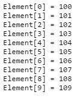

### 多维数组

C# 支持多维数组的概念。这类数组也被称为矩形数组。多维数组是以行和列的形式组织的二维序列体。以下是一个多维数组的示例：

```csharp
Int[,] array1 = new int[3,2]{
  {1, 5},
  {2, 5},
  {5, 7}
};
// or
Int[,] array1 = { {1, 5}, {2, 5}, {5, 7} };
```

如你在上面的示例所示，要初始化多维数组，必须根据行数和列数来定义它。`[3,2]` 意味着数组将有 3 行 2 列。

要访问多维数组的元素，我们使用两个索引。第一个索引标识行，第二个索引标识列。注意，两个索引都从 0 开始。让我们通过示例来演示这一点：

```csharp
Using system;

Pulic class myarray {
  Public static void main() {
    Int[,] array1 = new int[3,2]{
      {1, 5},
      {2, 5},
      {5, 7}
    };
    Console.readline(array1[0, 0]);
    Console.readline(array1[0, 1]);
    Console.readline(array1[1, 0]);
    Console.readline(array1[1, 1]);
    Console.readline(array1[2, 0]);
    Console.readline(array1[2, 1]);
  }
}
```

该代码为我们提供了以下输出：


这就是我们访问元素的方法。`array1[2,1]` 返回数组第 2 行第 1 列的元素。

### 锯齿数组 (Jagged arrays)

锯齿数组简单来说就是数组的数组。这些数组存储的是数组而不是直接的数据类型。要初始化锯齿数组，我们使用方括号 `[][]`。在第一个括号中，我们指定数组的大小，而在第二个括号中，我们指定要作为值的数组维度。这里有一个显示锯齿数组声明和初始化的示例：

```csharp
Using system;

Public class myarray {
  Public static void main() {
    Int[][] jaggedarray = new int[2][];
    Jaggedarray[0] = new int[4]{1, 2, 3, 4};
    Jaggedarray[1] = new int[3]{5, 6, 7};
    Console.readline(jaggedarray[0][0]);
    Console.readline(jaggedarray[0][2]);
    Console.readline(jaggedarray[1][1]);
  }
}
```

我们在上面的代码中声明并初始化了锯齿数组。该代码将给你以下结果：


锯齿数组也可以将多维数组作为值存储。我们可以在第二个括号中使用 `[,]` 来表示多维。这里是一个示例：

```csharp
Using system;

Public class myarray {
  Public static void main() {
    Int[][,] jaggedarray = new int[3][];
    Jaggedarray[0] = new int[3, 2]{ {1, 5}, {2, 6}, {4, 8} };
    Jaggedarray[1] = new int[2, 2]{ {3, 5}, {4, 6} };
    Jaggedarray[2] = new int[2, 2];
    Console.readline(jaggedarray[0][1,1]);
    Console.readline(jaggedarray[1][1,0]);
    Console.readline(jaggedarray[1][1,1]);
  }
}
```

该代码将返回以下内容：


如果增加了额外的括号，这将变成数组的数组的数组。这在下面的示例中进行了演示：

```csharp
Using system;

Public class myarray {
  Public static void main() {
    Int[][][] jaggedarray = new int[2][][] {
      New int[2][] {
        New int[3] {2, 3, 5},
        New int[2] {1, 5}
      },
      New int[1][] {
        New int[3] {7, 6, 8}
      }
    };
    Console.readline(jaggedarray[0][0][0]);
    Console.readline(jaggedarray[0][1][1]);
    Console.readline(jaggedarray[1][0][2]);
  }
}
```

该代码返回以下内容：


注意我们使用了三个方括号 `[][][]`，这意味着数组的数组的数组。`jaggedarray` 将拥有元素。这些数组也都只有一个维度。

## 第 11 章：类 (classes)

类可以被看作对象的蓝图。现实世界中的对象具有形状、速度等特征。例如，`car` 是一个对象。这意味着 `car` 是一个类，而每个对象都是 `car` 类型。

在面向对象编程中（不要忘记 C# 是一种面向对象的语言），类拥有字段、属性、方法等。类应该定义数据的类型以及对象应该的功能。

通过类，你可以创建自定义类型，将其他类型的变量以及方法和事件在一起。

在 C# 中，我们使用 `class` 关键字来定义 `class`。这是一个关于它的简单示例：

```csharp
Public class testclass {
  Public string field1 = string.empty;
  Public testclass() {
  }
  Public void testmethod(int param1, string param2) {
    Console.readline("the first parameter is {0}, and second parameter is {1}", Param1, param2);
  }
  Public int autoimplementedpropertytest { get; set; }
  Private int propertyvar;
  Public int propertytest {
    Get { return propertyvar; }
    Set { propertyvar = value; }
  }
}
```

类前面的 `public` 关键字是一个访问修饰符，指定了类的访问方式。作为 `public`，意味着它可以被同一项目中的所有其他类访问。我们给这个类命名为 `testclass`。


我们还在类中定义了一个名为 `field1` 的字段。此外，我们为该类创建了一个构造函数。注意，构造函数的名称与类名相同，因此构造函数的名称为 `testclass()`。在这个类内部，我们还定义了一个名为 `testmethod()` 的方法，该方法接收两个参数，`param1` 和 `param2`，前者是整数，后者是字符串。

这里是另一个演示如何声明和使用类：

```csharp
Using system;

Namespace cueapplication {

Class cue {

Pulic double length;  // length of the cue

Pulic double readth;  // readth of the cue

Pulic double height;  // height of the cue

}

Class cuetester {

Static void main(string[] args) {

Cue cue1 = new cue();  // declare cue1 of type cue

Cue cue2 = new cue();  // declare cue2 of type cue

Double vo,lume = 0.0;  // store the cue volume here

// cue 1 specification

Cue1.height = 4.0;

Cue1.length = 5.0;

Cue1.readth = 8.0;

// cue 2 specification

Cue2.height = 8.0;

Cue2.length = 12.0;

Cue2.readth = 14.0;

// volume of cue 1

Vo,lume = cue1.height * cue1.length * cue1.readth;

Console.writeline("volume of cue1 : {0}", vo,lume);

// volume of cue 2

Vo,lume = cue2.height * cue2.length * cue2.readth;

Console.writeline("volume of cue2 : {0}", vo,lume);

Console.readkey();

}

}

}
```

代码将返回以下结果：

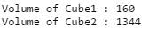

## 封装与成员函数

类的成员函数仅仅是在类定义内部具有定义或原型定义的函数，这与其他任何函数的方式相同。这种函数可以在其所属类的任何对象上进行操作，并且它可以访问该对象的所有类成员。

成员函数仅仅是对象的属性（从设计角度来看），它们被定义为私有（private），以便实现封装的概念。我们只能通过公共成员函数访问此类变量。让我们演示如何在 c# 中设置和访问类的各种成员：：

```csharp
Using system;

Namespace cueapplication {

Class cue {

Private double length;  // length of a cue

Private double readth;  // readth of a cue

Private double height;  // height of a cue

Pulic void setlength( double len ) {

Length = len;

}

Pulic void setreadth( double rea ) {

Readth = rea;
}

Pulic void setheight( double heig ) {

Height = heig;
}

Pulic double getvolume() {

Return length * height;
}

Class cuetester {

Static void main(string[] args) {

Cue cue1 = new cue();  // declare cue1 of type cue

Cue cue2 = new cue();

Double volume;  // declare cue2 of type

// cue 1 specification

Cue1.setlength(4.0);

Cue1.setreadth(6.0);

Cue1.setheight(8.0);

// cue 2 specification

Cue2.setlength(10.0);

Cue2.setreadth(14.0);

Cue2.setheight(12.0);

// volume of cue 1

Volume = cue1.getvolume();

Console.writeline("volume of cue1 is: {0}", volume);

// volume of cue 2

Volume = cue2.getvolume();

Console.writeline("volume of cue2 is: {0}", volume);

Console.readkey();

}

}
```

这里是代码的输出：

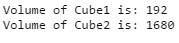

我们使用了 setter 方法（set 方法）来设置两个 cue 的各种属性值。调用了 getvolume() 函数来计算两个 cue 的体积。

## 构造函数

构造函数仅仅是类的一种特殊成员函数，每当我们创建类的新对象时就会运行。构造函数采用类名，并且它不应该有返回值。以下示例演示了如何在 c# 中使用构造函数：

```csharp
Using system;

Namespace constructorapplication {

Class person {

Private double height;  // height of the person

Person() {

Console.writeline("we are creating an object");
}

Pulic void setheight( double heig ) {

Height = heig;
}

Pulic double getheight() {

Return height;
}

Static void main(string[] args) {

Person p = new person();

// set the person's height

P.setheight(7.0);

Console.writeline("the height of the person is: {0}", p.getheight());

Console.readkey();

}

}
```

代码将返回以下内容：

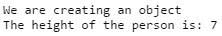

默认构造函数没有参数，但可以向构造函数添加参数。这种构造函数被称为参数化构造函数。通过这种技术，可以在创建对象时为对象分配初始值。这里是一个示例：

```csharp
Using system;

Namespace constructorapplication {

Class person {

Private double height;  // height of the person

Person(double heig) {  //a parameterized constructor

Console.writeline("we are creating an object, height = {0}", heig);

Height = heig;
}

Pulic void setheight( double heig ) {

Height = heig;
}

Pulic double getheight() {

Return height;
}

Static void main(string[] args) {

Person p = new person(8.0);

// set the height

Console.writeline("the height of the person is: {0}", p.getheight());

Console.readkey();

}

}
```

以下是输出：

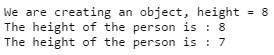

## 析构函数

析构函数是指类的一种特殊成员函数，每当对象超出作用范围时就会运行。析构函数的名称与类名相同，但前面应该有一个波浪号（~）。析构函数不能接受参数，也不能返回值。析构函数在离开程序之前释放资源非常有用。以下示例演示了如何使用：

```csharp
Using system;

Namespace constructorapplication {

Class person {

Private double height;  // height of the person

Person() {

Console.writeline("we are creating an object");
}

~person() { //a destructor

Console.writeline("we are deleting an object");
}

Pulic void setheight( double heig ) {

Height = heig;
}

Pulic double getheight() {

Return height;
}

Static void main(string[] args) {

Person p = new person();

// set the person's height

P.setheight(7.0);

Console.writeline("the height of the person is: {0}", p.getheight());

Console.readkey();

}

}
```


`static` 关键字的使用意味着类中仅存在一个实例。当我们我们需要声明常量时使用此关键字，因为可以在不创建实例的情况下通过调用类来获取它们的值。我们可以在类定义或成员函数之外初始化静态变量。静态变量也可以在类定义内部初始化。

让我们通过一个示例来演示静态变量的使用：

```csharp
Using system;

Namespace staticapp {
    Class staticvariales {
        Public static int x;

        Public void count() {
            X++;
        }

        Public int getx() {
            Return x;
        }
    }

    Class statictester {
        Static void main(string[] args) {
            Staticvariales var1 = new staticvariales();
            Staticvariales var2 = new staticvariales();
            Var1.count();
            Var1.count();
            Var1.count();
            Var2.count();
            Var2.count();
            Var2.count();
            Console.WriteLine("variable x for var1 is: {0}", var1.getx());
            Console.WriteLine("variable x for vars is: {0}", var2.getx());
            Console.readkey();
        }
    }
}
```

代码返回以下结果：

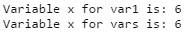

成员函数也可以被声明为静态的。此类函数将能够访问静态变量。静态函数在对象创建之前就已经存在。静态函数的使用如如下示例所示：

```csharp
Using system;

Namespace staticappli {
    Class staticvariale {
        Public static int x;

        Public void count() {
            X++;
        }

        Public static int getx() {
            Return x;
        }
    }

    Class statictester {
        Static void main(string[] args) {
            Staticvariale var = new staticvariale();
            Var.count();
            Var.count();
            Var.count();
            Console.WriteLine("variable x is: {0}", staticvariale.getx());
            Console.readkey();
        }
    }
}
```

代码将返回以下：

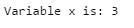

## 第 12 章：结构

C# 中的结构（structure）是一种值类型数据类型。通过结构，你可以使用单个变量持有属于不同数据类型的相关数据。在 C# 中，我们使用 `struct` 关键字创建结构(128)。

结构用于跟踪记录。一个很好的例子是你需要保留所有级学生或所有公司员工的记录。在存储学生记录的情况下，你可能需要跟踪的一些细节包括姓名、年龄、课程、入学日期、毕业日期、已付费用、余额等、监护人地址和手机号码等。所有这些细节都属于不同的数据类型，这意味着你将需要为每一个细节创建一个变量。然而，使用结构，你可以定义单个变量并将这些细节整合在一起。这里是一个声明结构的示例(29)：

```csharp
Struct employee {
    Public string name;
    Public string department;
    Public string title;
    Public int age;
    Public double salary;
};
```

要初始化一个结构体，可以选择使用 `new` 关键字也可以不使用。结构体的成员可以如所示进行赋值：

```csharp
Using system;

Public class mystruct {
    Public static void main() {
        Employee emp = new employee()
        emp.name = "nich samuel";
        emp.department = "computing";
        emp.age = 26;
        emp.salary = 5000;
        Console.WriteLine(emp.name);
        Console.WriteLine(emp.department);
        Console.WriteLine(emp.age);
        Console.WriteLine(emp.salary);
    }
}

Public struct employee {
    Public string name { get; set; }
    Public string department { get; set; }
    Public string title { get; set; }
    Public int age { get; set; }
    Public double salary { get; set; }
}
```

代码给出以下结果：

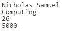

名为 `employee` 的结构使用 `struct` 关键字定义。该结构的各种细节都已在其中声明。在类的顶部，我们创建了该结构的一个实例并将其命名为 `emp`。该实例已用于访问结构体的各种属性以显示在屏幕上。注意，结构是一种值类型，这使得它与类对象相比速度更快。这使得它们在编程中非常好用。然而，人们可以更容易地传输类对象而不是结构体。这意味着当需要将数据传输到其他类时，不应使用结构。这里是 C# 中另一个结构示例：

```csharp
Using system;

Struct cars {
    Public string model;
    Public int cc;
    Public int passengers;
    Public int year;
};

Public class carstructure {
    Public static void main(string[] args) {
        Cars premio; /* declare premio of type car */
        Cars x6; /* declare x6 of type car */
        /* premio, specification */
        premio.model = "salo";
        premio.cc = 1800;
        premio.passengers = 5;
        premio.year = 2010;
        /* x6 specification */
        x6.model = "salo";
        x6.cc = 3500;
        x6.passengers = 5;
        x6.year = 2012;
        /* print premio, info, */
        Console.WriteLine("premio, model: {0}", premio.model);
        Console.WriteLine("premio, cc : {0}", premio.cc);
        Console.WriteLine("premio, passengers : {0}", premio.passengers);
        Console.WriteLine("premio, year :{0}", premio.year);
        /* print x6 info, */
        Console.WriteLine("x6 model: {0}", x6.model);
        Console.WriteLine("x6 cc: {0}", x6.cc);
        Console.WriteLine("x6 passengers: {0}", x6.passengers);
        Console.WriteLine("x6 year: {0}", x6.year);
        Console.readkey();
    }
}
```

代码将返回以下细节：


### 结构的特征

到目前为止，你已经了解如何使用结构以及它们的一些特性。C# 中的结构与 C 和 C++ 支持的结构有很大区别。C# 结构具有以下特征：

- 结构可以拥有字段、索引器、方法、属性和事件。
- 结构可以定义构造函数，但没有析构函数。然而，在结构中，我们不允许定义默认构造函数。这是因为它是自动定义的，且无法更改。
- 结构不能继承另一个结构或类。
- 通过结构，我们可以实现一个或多个接口。
- 结构的成员不能被指定为虚（virtual）、抽象（abstract）或保护（protected）。


- 如果我们不使用 `new` 运算符，字段将不会被赋值，并且在对所有字段完成赋值之前，无法使用该对象。

### 结构体 vs 类

以下是结构体（struct）与类（class）之间的差异：

- `struct` 被解释为值类型。另一方面，`class` 被定义为引用类型。
- 结构体不支持继承。类支持。
- `struct` 不能有默认构造函数。`class` 可以有。

让我们根据上述差异创建一个示例：

```csharp
Using system;

Struct cars {
    Private string model;
    Private int cc;
    Private int passengers;
    Private int year;
    Public void getvalues(string m, int c, int p, int yr) {
        Model = m;
        Cc = c;
        Passengers = p;
        Year = yr;
    }
    Public void show() {
        Console.WriteLine("car model : {0}", model);
        Console.WriteLine("cc : {0}", cc);
        Console.WriteLine("passengers : {0}", passengers);
        Console.WriteLine("year :{0}", year);
    }
};

Public class mystructure {
    Public static void main(string[] args) {
        Cars premio = new cars(); /* declare premio of type cars */
        Cars x6 = new cars(); /* declare x6 of type cars */
        /* premio specification */
        Premio.getvalues("salo", 1800, 5, 2012);
        /* x6 specification */
        X6.getvalues("salo", 3500, 5, 2012);
        /* print premio info, */
        Premio.show();
        /* print x6 info, */
        X6.show();
        Console.readkey();
    }
}
```

代码在执行后将得到以下输出：


## 第 13 章：封装

封装是将项目封装在逻辑或物理包中的过程。在面向对象编程中，封装被用于防止对实现细节的访问。

封装和抽象是面向对象编程中密切相关的特性。抽象的目的是让相关细节对用户可见，而封装的目的是让程序员能够实现所需的抽象级别。

为了实现封装，我们使用访问修饰符。访问修饰符的作用说明类成员的可见性和范围。C# 支持不同类型的访问修饰符，它们包括：

- public
- protected
- private
- protected internal
- internal

### private 访问修饰符

使用 `private` 访问修饰符，类能够向其他对象和函数隐藏其成员和成员变量。只有相似类的函数能够访问其私有成员。类的实例无法访问该类的私有成员。考虑下面的示例：

```csharp
Using system;

Namespace accession {
    Class figure {
        // the class member variables
        Private width;
        Private length;
        Public void getdetails() {
            Console.WriteLine("enter the length: ");
            Length = Convert.ToInt32(Console.readline());
            Console.WriteLine("enter the width: ");
            Width = Convert.ToInt32(Console.readline());
        }
        Public void calculatearea() {
            Return length * width;
        }
        Public void show() {
            Console.WriteLine("the length of the figure is: {0}", length);
            Console.WriteLine("the width of the figure is: {0}", width);
            Console.WriteLine("the area of the figure is: {0}", calculatearea());
        }
    }//end the class figure

    Class runfigure {
        Static void main(string[] args) {
            Figure f = new figure();
            F.getdetails();
            F.show();
            Console.readline();
        }
    }
}
```

以下是代码的输出：

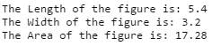

类成员变量 `width` 和 `length` 被声明为 `private`，这意味着在创建类实例后，我们可以从 `main()` 函数访问它们。我们创建了 `figure` 类的实例并将其命名为 `f`。

`calculatearea()` 和 `show()` 成员函数能够在不使用类实例的情况下访问这些成员变量。我们也可以在创建 `figure` 类的实例后，从 `main()` 函数访问它们。该实例已被命名为 `f`。

### public 访问修饰符

使用 `public` 访问修饰符，类能够向其他对象和函数暴露其成员函数和成员变量。任何声明为 `public` 的类成员都可以从该类的外部访问。考虑以下示例：

```csharp
Using system;

Namespace figureapplication {
    Class figure {
        // the class member variables
        Public width;
        Public length;
        Public void calculatearea() {
            Return length * width;
        }
        Public void show() {
            Console.WriteLine("the length of the figure is: {0}", length);
            Console.WriteLine("the width of the figure is: {0}", width);
            Console.WriteLine("the area of the figure is: {0}", calculatearea());
        }
    }//end the figure class

    Class runfigure {
        Static void main(string[] args) {
            Figure f = new figure();
            F.length = 5.4;
            F.width = 3.2;
            F.show();
            Console.readline();
        }
    }
}
```

### protected 访问修饰符

这种 `protected` 访问修饰符使得子类能够访问基类中定义的成员函数和变量。这将在继承中讨论。

### internal 访问修饰符

这种 `internal` 访问修饰符允许在定义它的程序集（assembly）内的任何代码访问该成员。


通过继承，程序员可以根据一个类定义另一个类。这使得我们能够重用代码并缩短实现应用程序的时间。

在创建类过程中，程序员不需要创建完全新的成员函数和数据成员，而是指定新类继承已存在类的成员。现有类被称为基类（base class），而新类被称为派生类（derived class）。

继承简单来说是“是一种”（is-a）关系的实现。例如，牛是一种哺乳动物。

一个类可以继承自多个类或接口，这意味着它可以从许多基接口或类中继承数据和函数。以下示例演示了基类和派生类的概念：

```csharp
Using system;

Namespace inheritanceapp {

Class figure {

    Public void setwidth(int wid) {
        Width = wid;
    }

    Public void setheight(int heig) {
        Height = heig;
    }

    Protected int width;

    Protected int height;
}

// a derived class
Class rectangle: figure {
    Public int calculatearea() {
        Return (width * height);
    }
}

Class testinheritance {
    Static void main(string[] args) {
        Rectangle r = new rectangle();
        R.setwidth(6);
        R.setheight(8);
        // print the rectangle's area.
        Console.writeline("the area is: {0}", r.calculatearea());
        Console.readkey();
    }
}

}
```

代码应返回以下输出：

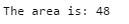

我们定义了 `figure` 类，包含两个属性，即 `width` 和 `height`。该类还有两个方法，`setwidth()` 和 `setheight()`。然后我们定义了一个名为 `rectangle` 的类。注意我们创建此类时所使用的语法：

`Class rectangle: figure {`

使用完整的冒号表示 `rectangle` 类正在继承 `figure` 类。`rectangle` 类仅有一个方法，即 `calculatearea()` 方法。然而，由于它继承了 `figure` 类，意味着它拥有 `figure` 类的所有属性，如 `width` 和 `height`。

随后我们创建了 `testinheritance` 类。在 `main()` 方法中，创建了 `rectangle` 类的实例并将其命名为 `r`。我们使用该实例来访问在 `rectangle` 和 `figure` 类中定义的属性。这就是继承的强大之处！

### 基类初始化

派生类继承基类中定义的方法和变量。这意味着我们应该在创建子类之前创建父类。给出的程序演示了成员列表初始化的继承：

```csharp
Using system;

Namespace inheritanceapp {

Class object {
// the member variables
    Protected double width;

    Protected double length;

    Public object(double len, double wid) {
        Width = wid;
        Length = len;
    }

    Public double calculatearea() {
        Return length * width;
    }

    Public void show() {
        Base.show();
        Console.writeline("the width of the figure is: {0}", width);
        Console.writeline("the length of the figure is: {0}", length);
        Console.writeline("the area of the figure is: {0}", calculatearea());
    }
}//end class figure
Class carpet : object {
    Private double cost;

    Public carpet(double len, double wid) : base(len, wid) { }

    Public double calculatecost() {
        Double cost;
        cost = calculatearea() * 120;
        Return cost;
    }

    Public void show() {
        Base.show();
        Console.writeline("the total cost for the carpet is: {0}", calculatecost());
    }
}

Class run {
    Static void main(string[] args) {
        Carpet c = new carpet(7.5, 9.5);
        C.show();
        Console.readline();
    }
}

}
```

代码将返回以下输出：

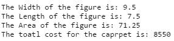

### 多重继承

C# 不支持多重继承。但是通过接口，我们可以实现多重继承。考虑以下示例：

```csharp
Using system;

Namespace inheritanceapp {

Class object {
    Public void setwidth(int wid) {
        Width = wid;
    }

    Public void setheight(int heig) {
        Height = heig;
    }

    Protected int width;

    Protected int height;
}

// paintcost for the base class
Public interface paintcost {
    Int calculatecost(int area);
}

// the derived class
Class o : object,paintcost {
    Public int calculatearea() {
        Return (width * height);
    }

    Public int calculatecost(int area) {
        Return area * 120;
    }
}

Class inheritancetester {
    Static void main(string[] args) {
        O = new o();
        Int area;
        .setwidth(5);
        .setheight(7);
        Area = .calculatearea();
        // show the area of the object
        Console.writeline("the area of the object is: {0}", .calculatearea());
        Console.writeline("the total printing cost is: ${0}", .calculatecost(area));
        Console.readkey();
    }
}

}
```

代码给出以下输出：

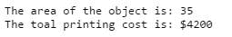

## 第 15 章：多态

多态（Polymorphism）是一个意味着多种形式的术语。在编程中，它表现为“一个接口，多个函数”。多态可以有两种形式：静态或动态。对于静态多态，绑定在编译时确定。它也被称为函数重载。我们可以在同一个作用范围内对同一个函数名有多个定义。这些函数之间的区别在于它们接收的参数类型或数量。函数声明不能通过不同的返回类型来重载。


我们有 `display()` 函数的三种定义。在这种情况下，重载是通过改变函数接收的参数类型来实现的。在一种实例中，函数接收整数值；在另一个实例中接收浮点数，在最后一个实例中接收字符串。

## 运算符重载

运算符重载是指使用单个运算符来执行各种操作。通过运算符重载，可以在 C# 运算符应用于自定义类型时为其添加额外功能。当操作数中的一个或两个属于用户定义的类时，就是这种情况。

这里是一个演示此种点的示例：

```csharp
using system;

namespace polymorphismapp {
    class object {
        private double width; // the width of the ox
        private double length; // the length of the ox
        private double height; // the height of the ox

        public double calculateVolume() {
            return width * length * height;
        }

        public void setLength(double l) {
            length = l;
        }

        public void setWidth(double w) {
            width = w;
        }

        public void setHeight(double h) {
            height = h;
        }

        // overload the + operator to add 2 objects.
        public static object operator+(object oj1, object oj2) {
            object o = new object();
            o.length = oj1.length + oj2.length;
            o.width = oj1.width + oj2.width;
            o.height = oj1.height + oj2.height;
            return o;
        }
    }

    class oxtester {
        static void main(string[] args) {
            object object1 = new object(); // declare object1 of type object
            object object2 = new object(); // declare object2 of type object
            object object3 = new object(); // declare object3 of type object
            double volume = 0.0; // store volume of the object here

            // object 1 dimensions
            object1.setLength(7.0);
            object1.setWidth(8.0);
            object1.setHeight(10.0);

            // object 2 dimensions
            object2.setLength(6.0);
            object2.setWidth(9.0);
            object2.setHeight(11.0);

            // calculate the volume of object 1
            volume = object1.calculateVolume();
            Console.WriteLine("the volume of object1 : {0}", volume);

            // calculate the volume of object 2
            volume = object2.calculateVolume();
            Console.WriteLine("the volume of object2 : {0}", volume);

            // add the two objects
            object3 = object1 + object2;

            // calculate the volume of object 3
            volume = object3.calculateVolume();
            Console.WriteLine("the volume of object3 : {0}", volume);
            Console.ReadKey();
        }
    }
}
```

该代码返回以下输出：

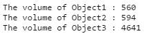

我们重载了 `+` 运算符。该运算符被用于两个数值类型的相加。然而，在上面的示例中，我们使用该运算符将两个对象相加，即 `object1` 和 `object2`。这得到了 `object3`。`object1` 和 `object2` 是自定义类型，意味着我们使用 `+` 运算符来相自定义类型。注意，虽然在 C# 中可以重载运算符，但并不是所有运算符都可以重载。例如，你不能重载如 `==`、`!=`、`>=`、`<=`。对于 `&&` 和 `||` 等逻辑运算符，我们不能直接重载它们。

## 多态

在 C# 中，我们可以创建抽象类来实现接口的部分实现。这种完成是在派生类继承后实现的。抽象类具有抽象方法，派生类实现这些方法。然而，派生类具有更专门的功能。注意，你不能创建任何抽象类的实例。如果一个 C# 类被声明为密封（sealed），意味着该类不能被继承。但是，不允许声明抽象类。这里有一个抽象类的示例：

```csharp
using system;

namespace polymorphismapp {
    abstract class object {
        abstract int area();
    }

    class object1 : object {
        private int width;
        private int length;
        public object1(int x = 0, int y = 0) {
            length = x;
            width = y;
        }
        public override int area() {
            Console.WriteLine("the area of object1 is:");
            return width * length;
        }
    }

    class object2 : object {
        public object2(int x = 0, int y = 0) {
            width = x;
            height = y;
        }
        public override int area() {
            Console.WriteLine("the area of object2 is:");
            return width * height / 2;
        }
    }

    class caller {
        public void callarea(object obj) {
            int x;
            x = obj.area();
            Console.WriteLine("the area is: {0}", x);
        }
    }

    class testerclass {
        static void main(string[] args) {
            caller c = new caller();
            object1 o1 = new object1(10, 7);
            object2 o2 = new object2(10, 5);
            c.callarea(o1);
            c.callarea(o2);
            Console.ReadKey();
        }
    }
}
```

该代码返回以下输出：

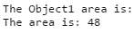

## 第 16 章：正则表达式 (134)

正则表达式被解释为可以与输入文本匹配的模式。在 .net 框架中，有一个正则表达式引擎可以用于这种匹配。模式由一个或多个运算符、字符字面量或结构组成。

### Regex 类

这是一个用于表示正则表达式的类。该类带有许多如下函数：

1. `Match(string input)`：方法指定构造函数中指定的正则表达式是否在输入字符串中匹配项。
2. `Match(string input, int startpos)`：方法指定构造函数中指定的正则表达式是否从输入字符串中的指定位置开始匹配项。
3. `static Match(string input, int pattern)`：静态方法指定指定的正则表达式是否在输入字符串中匹配项。


## 4. `public Collection.matches(string input, string replacement)` - 这会将输入字符串中的匹配项替换为指定的替换字符串。

## 5. `public string[] split(string input)` - 此函数帮助将输入字符串拆分为子字符串数组，拆分的位置由正则 构造函数中指定的正则表达式模式定义的。

考虑下面给出的示例：

```csharp
using system.text.regularexpressions;
using system;

namespace regexpapp {
    class myprogram {
        private static void findmatch(string input, string exp) {
            Console.readline("the expression is: " + exp);
            Collection mc = regex.matches(input, exp);
            foreach (match x in mc) {
                Console.readline(x);
            }
        }

        static void main(string[] args) {
            String s = "splitting an input string into substrings";
            Console.readline("match words that begin with 's': ");
            Findmatch(s, "\s\s*");
            Console.readkey();
        }
    }
}
```

匹配后，代码将返回以下内容：

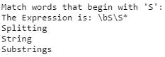

输出显示从输入字符串中匹配了三个单词。我们正在匹配任何以 s 开头的单词，并发现了其中三个。

考虑下一个给出的示例：

```csharp
using system.text.regularexpressions;
using system;

namespace regexpapp {
    class myprogram {
        private static void findmatch(string input, string exp) {
            Console.readline("the input expression is: " + exp);
            Collection mc = regex.matches(input, exp);
            foreach (match x in mc) {
                Console.readline(x);
            }
        }

        static void main(string[] args) {
            String s = "so, she was the same";
            Console.readline("match words beginning with 's' and ending with 'e':");
            Findmatch(s, "\s\s*e");
            Console.readkey();
        }
    }
}
```

代码将给出以下结果：

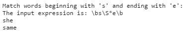

在上面的示例中，我们正在匹配以 s 开头并以 e 结尾的单词。我们成功地匹配了输入字符串中的两个单词。这是另一个示例：

```csharp
using system;
using system.text.regularexpressions;

namespace regexpapp {
    class myprogram {
        static void main(string[] args) {
            String text = "hi learner ";
            String pattern = "\\s+";
            String substitute = "  ";
            Regex r = new regex(pattern);
            String output = r.replace(text, substitute);
            Console.readline("the input string is: {0}", text);
            Console.readline("the string after replacement is: {0}", output);
            Console.readkey();
        }
    }
}
```

代码返回如下：

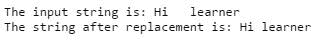

我们在代码中中所做的是替换额外的空格。在 "hi" 和 "learner" 之间有一个空格。多余的那个已经被替换或删除。

## 第 17 章：异常处理过程 (135)

应用程序在执行过程中通常会遇到错误。错误发生后，程序会抛出一个带有更多有关错误信息的异常。应该处理异常以防止程序崩溃。在 c# 中，异常使用 4 个主关键字进行处理：

1. Try- 此关键字标识了激活特定异常的代码块。其后紧跟跟一个或多个 catch 块。
2. Catch- 程序应该在程序内部需要处理问题的地方使用处理器捕获异常。catch 是一个关键字，指示异常将在此处捕获。
3. Finally- finally 块用于无论是否抛出异常都执行一组语句。例如，无论是否抛出异常，文件在打开后都必须关闭。
4. Throw- 异常通常在问题发生后后被抛出。使用 try 和 catch 的组合来捕获异常。try/catch 块必须放置在可能引发异常的代码处。此类代码被称为“受保护的代码”，这里是使用这些关键字的语法：

```
try {
    // 抛出异常的语句
} catch (exception name1) {
    // 错误处理代码
} catch (exception name2) {
    // 错误处理代码
} catch (exception name3) {
    // 错误处理代码
} finally {
    // 要执行的语句
}
```

可以使用许多 catch 语句，目标是捕获 try 块中抛出的许多不同的异常。在 c# 中，异常使用类来表示。`system.exception`充充 c# 中所有异常类的基类，因为所有其他类都直接或间接地派生自它。

### 处理异常

在 c# 中，可以使用 try 和 catch 块来处理异常。通过这些块，我们可以将核心程序语句与处理错误的语句分离。我们可以使用 try、catch 和 finally 关键字来处理错误。例如，除法 y 应该抛出一个异常，因为它在数学上是不支持的。让我们创建一些代码来处理这种情况：

```csharp
using system;

namespace exceptionhandlingapp {
    class divisionclass {
        Int answer;
        divisionclass() {
            Answer = 0;
        }

        public void division(int x, int y) {
            try {
                Answer = x / y;
            } catch (divideyzero,exception exception) {
                Console.readline("exception caught: {0}", exception);
            } finally {
                Console.readline("answer: {0}");
            }
        }

        static void main(string[] args) {
            divisionclass dc = new divisionclass();
            Dc.division(12, 0);
            Console.readkey();
        }
    }
}
```

代码应该返回下方的异常：


我们创建了 `division()` 函数，它接受两个整数参数 x 和 y。然后我们将 12 和 0 传递给该函数，这意味着我们将把 12 除以 0。然而，这产生了一个异常。

### 自定义异常

C# 允许允许程序员定义他们自己的异常。我们从异常类派生出此类自定义异常类。考虑下面给出的示例：

```csharp
using system;

namespace exceptionhandlingapp {
    class temperaturetest {
        static void main(string[] args) {
            temperatureclass tc = new temperatureclass();
            try {
                Tc.displaytemperature();
            } catch (tempiszero,exception exception) {
                Console.readline("tempiszero,exception: {0}", exception.message);
            }
            Console.readkey();
        }
    }
}

public class tempiszero,exception: exception {
    public tempiszero,exception(string msg) : base(msg) {
    }
}

public class temperatureclass {
    int temp = 0;
    public void displaytemperature() {
        if (temp == 0) {
            throw (new tempiszero,exception("we found zero, temperature"));
        } else {
            Console.readline("temperature is: {0}", temp);
        }
    }
}
```

### 嵌套 try-catch


C# 允许我们创建嵌套的 try-catch 块。在这种情况下，异常将在发生异常的 try 块之后的 catch 块中捕获。考虑以下示例：

```csharp
using system;

public class nestedtrycatch
{
    public static void main()
    {
        Employee emp = null;
        Try
        {
            Try
            {
                Emp.employeeename = "";
            }
            Catch
            {
                Console.WriteLine("the inner catch");
            }
        }
        Catch
        {
            Console.WriteLine("the outer catch");
        }
    }
}

public class employee{
    public string employeeename { get; set; }
}
```

代码输出以下内容：


如果没有具有相应异常类型的内部 catch 块，异常将流向传递到外层 catch 块，直到找到合适的异常过滤器。这是一个示例：

```csharp
using system;

public class nestedtrycatch
{
    public static void main()
    {
        Employee emp = null;
        Try
        {
            Try
            {
                // 这将抛出一个 nullreferenceexception
                Emp.employeeename = "";
            }
            Catch (invalidoperationexception innerexception)
            {
                Console.WriteLine("the inner catch");
            }
        }
        Catch
        {
            Console.WriteLine("the outer catch");
        }
    }
}

public class employee{
    public string employeeename { get; set; }
}
```

在上述的示例中，语句 `emp.employeeename` 将生成一个 nullreferenceexception，但我们没有处理 nullreferenceexception 或异常类型的 catch 块。外层块将处理此异常。代码返回以下内容：


## 第 18 章：文件 I/O

文件的特征是名称和目录路径。一旦你打开一个文件，它就变成了一个流。文件通常是为了读取或写入目的而打开的。

流仅仅是经过通信路径的字节序列。流有两种类型：

* 输入流
* 输出流

输入流帮助我们从文件中读取数据，即读取操作；而输出流帮助我们向文件中写入数据，即写入操作。

### 输入/输出类

C# 为我们提供了许多用于处理文件的类。这些类可以用于访问目录、文件，创建新文件，打开现有文件以及将文件从一个目录移动到另一个目录。这些类定义在 `system.io` 空间中。让我们讨论其中一些类：

* binaryreader - 此类帮助我们从二进制流中读取原始数据。
* binarywriter - 此类帮助我们以二进制格式写入原始数据。
* bufferedstream - 此类充当流字节的临时存储器。
* directory - 此类帮助我们操纵目录的结构。
* driveinfo - 此类为我们提供有关驱动器的信息。
* file - 此类用于操作文件。
* fileinfo - 帮助对文件执行操作。
* filestream - 用于在文件的任何位置进行写入和读取。
* memorystream - 帮助访问存储在内存中的数据。
* path - 用于对路径执行操作。
* streamreader - 从流中读取字符。
* streamwriter - 向流中写入字符。
* stringreader - 从字符串读取。
* stringwriter - 写入字符串。

### Filestream 类

此类定义在 `system.io` 命名空间中，它帮助我们读取和写入文件。我们也可以用它来关闭文件。为了能够使用此类，你必须创建它的对象。该实例可以用于创建新文件和打开现有文件。以下是创建 filestream 类实例的方法：

```csharp
Filestream object = new filestream(file, FileMode, FileAccess, FileShare);
```

例如，假设我们需要读取文件 `names.txt`。我们可以创建一个名为 `fs` 的 filestream 对象并将其用于此目的。演示如下：

```csharp
Filestream fs = new filestream("names.txt", FileMode.Open, FileAccess.Read, FileShare.Read);
```

`FileMode` 是一个枚举，定义了可以用于打开文件的许多方法。这些方法包括：

* append - 此方法打开现有文件，然后将光标置于文件末尾，或者如果指定的文件不存在，则创建一个新文件。
* create - 用于创建新文件。
* createnew - 指令操作系统创建一个新文件。
* open - 用于打开现有文件。
* opencreate - 指令操作系统如果文件存在则打开文件，如果不存在则创建一个新文件。（注：文本已清理）

`FileAccess` 是一个枚举，带有许多方法，包括 `read`、`write` 和 `readwrite`。

`FileShare` 枚举带有以下成员：

* inheritable - 帮助文件句柄在传递继承给子进程时。
* none - 它禁用当前文件的共享。
* read - 它打开文件进行读取。
* readwrite - 打开文件进行读取和写入。
* write - 打开文件进行写入。

`filestream` 类可以像下面所示使用：

```csharp
using system.io;
using system;

namespace fileapp {
    Class myprogram {
        Static void main(string[] args) {
            Filestream fs = new filestream("names.dat", FileMode.Opencreate, FileAccess.Write, FileShare.Read);
            for (int x = 1; x <= 10; x++) {
                fs.write((byte)x);
            }
            fs.position = 0;
            for (int x = 0; x <= 10; x++) {
                Console.write(fs.read());
            }
            fs.close();
        }
    }
}
```

### 追加文本行

有时，你可能需要向文件追加多行文本。这可以通过调用 `appendalllines()` 方法来实现。这是一个示例：

```csharp
String multiplelines = "the first line." + environment.newline +
"the second line." + environment.newline +
"the third line.";
// 打开名为 names.txt 的文件并追加上述行。如果文件不存在，将创建一个新的。
File.appendalllines("c:\myfile.txt", multiplelines.split(environment.newline.tochararray()).list<string>());
```

文件将被打开，并将指定的行追加到文件中。

### 追加字符串

`Fileappendalltext()` 方法允许你仅用一行代码即可向文件中追加字符串。演示如下：

```csharp
// 打开名为 myfile.txt 的文件并对其追加文本。如果文件不存在，则创建一个新的并打开写入打开。
File.appendalltext("c:\myfile.txt", "this string will be written into, the file");
```

### 覆盖文本


如果你需要覆盖文件，请使用 `File.WriteAllText()` 方法。该方法将删除文件中的文本并将其替换为你指定的文本。该方法的使用方法如下所示：

```cs
// 以打开文件 myfile.txt 并将文本写入其中。如果文件不存在，将创建一个新文件并打开进行写入。

File.WriteAllText("c:\myfile.txt", "this text will e used for replacing the current text in the file.");
```

通过静态类 `File`，可以执行各种操作。下文所示：

```cs
// 检查指定位置是否存在文件
bool exists = File.Exists("c:\myfile.txt"); // 它将返回 false

// 将 myfile.txt 复制为新文件 newfile.txt
File.Copy("c:\myfile.txt", "d:\newfile.txt");

// 检查文件最后一次访问的时间
DateTime lastAccessTime = File.GetLastAccessTime("c:\myfile.txt");

// 获取文件最后一次写入的时间
DateTime lastWriteTime = File.GetLastWriteTime("c:\myfile.txt");

// 将文件移动到新位置
File.Move("c:\myfile.txt", "d:\myfile.txt");

// 打开文件并返回用于从文件中读取类型的 filestream
FileStream fs = File.Open("d:\myfile.txt", FileMode.OpenCreate);

// 打开文件并返回一个用于从文件中读取字符串的读者
StreamReader sr = File.OpenText("d:\myfile.txt");

// 删除文件
File.Delete("c:\myfile.txt");
```

上述内容表明，通过静态 `File` 类，我们可以轻松地处理物理文件。然而，为了获得更大的灵活性，可以使用 `FileInfo` 类。

### StreamReader 类

此类类帮助我们从文本文件中读取数据。该类继承自 `Stream` 类。它还继承了 `TextReader` 类，该类是一个用于读取一系列字符的抽象类。以下是该类提供的常用方法：

* `public override void Close()` - 该方法关闭 `StreamReader` 对象和流，然后释放读取器使用的任何系统资源。
* `public override int Peek()` - 此方法将返回下一个可用的字符而不消耗它。
* `public override int Read()` - 此方法将读取输入流中的下一个字符，然后将字符位置移动 1。

让我们演示如何使用此类类从名为 `names.txt` 的文件中读取：

```cs
using System.IO;
using System;

namespace io.application {
    class program {
        static void main(string[] args) {
            try {
                // 创建一个读取文件的读取器实例。
                // using 语句将关闭读取器。
                using (StreamReader sr = new StreamReader("c:/names.txt")) {
                    String line;
                    // 从文件中读取行直到文件末尾。
                    while ((line = sr.ReadLine()) != null) {
                        Console.WriteLine(line);
                    }
                }
            } catch (Exception exception) {
                // 告知用户发生了什么
                Console.WriteLine("file couldn't read:");
                Console.WriteLine(exception.message);
            }
            Console.ReadKey();
        }
    }
}
```
该代码将读取 `names.txt` 中编写的文本并将其打印出来。

### StreamWriter 类

此类继承自 `TextWriter` 抽象类，该类表示写入一系列字符的能力。以下是该类的常用方法：

* `public override void Close()` - 此方法将关闭当前的 `writer` 对象以及底层流。
* `public override void Flush()` - 此方法将清除当前写入器的缓冲区，并将任何缓冲数据写入流中。
* `public virtual void Write(long value)` - 此方法将 long 值的表示形式写入文本流。
* `public override void Write(char value)` - 向流写入一个字符。
* `public virtual void Write(decimal value)` - 此方法将 decimal 值的表示形式写入文本流。
* `public virtual void Write(double value)` - 将 8 字节浮点数值的表示形式写入文本流。
* `public virtual void Write(int value)` - 将 4 字节有符号整数的表示形式写入文本流。
* `public override void Write(string value)` - 向流写入一个字符串。
* `public virtual void WriteLine()` - 向文本流写入一个行终止符。

让我们演示如何使用 `StreamWriter` 类写入文本数据：

```cs
using System.IO;
using System;

namespace io.app {
    class program {
        static void main(string[] args) {
            String[] students = new string[]{"nicholas samuel", "michelle oss"};
            using (StreamWriter sw = new StreamWriter("students.txt")) {
                foreach (string x in students) {
                    sw.WriteLine(x);
                }
            }
            // 读取并显示文件中的每一行。
            String text = "";
            using (StreamReader sr = new StreamReader("students.txt")) {
                while ((text = sr.ReadLine()) != null) {
                    Console.WriteLine(text);
                }
            }
            Console.ReadKey();
        }
    }
}
```
该代码执行后将打印以下结果：

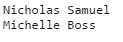

### BinaryReader 类

此类用于从文件中读取二进制数据。我们应该先通过构造函数传递 `FileStream` 对象来创建 `BinaryReader` 对象。该类包含以下方法：

* `public override void Close()` - 关闭 `BinaryReader` 对象以及底层流。
* `public virtual int Read()` - 从底层流读取字符并移动流位置。
* `public virtual bool ReadBoolean()` - 读取布尔值。
* `public virtual byte[] ReadBinaryArray()` - 读取字节到数组。

### BinaryWriter 类

此类帮助向流写入二进制数据。我们通过构造函数传递 `FileStream` 来创建 `BinaryWriter` 对象。该类包含以下方法：

* `public override void Close()` - 关闭 `BinaryWriter` 对象以及底层流。
* `public override void Flush()` - 此方法将清除当前写入器的缓冲区，并将任何缓冲数据写入设备。
* `public virtual void Write(bool value)` - 向当前流写入一个字节的布尔值。1 表示真，0 表示假。
* `public virtual void Write(byte value)` - 向当前流写入一个字节值。
* `public virtual void Write(short value)` - 向当前流写入一个 2 字节整数值。
* `public virtual void Write(int value)` - 向当前流写入一个 4 字节整数值。
* `public virtual void Write(long value)` - 向当前流写入一个 8 字节长型值。
* `public virtual void Write(float value)` - 向当前流写入一个 4 字节浮点数值。
* `public virtual void Write(double value)` - 向当前流写入一个 8 字节浮点数值。
* `public virtual void Write(char value)` - 向当前流写入一个字符。
* `public virtual void Write(string value)` - 向当前流写入一个字符串。


```csharp
Console.WriteLine(exception.message + "\n unable to create the file.");

Return;
}

//write to the file
Try {
    W.write(x);
    W.write(d);
    W.write(l);
    W.write(st);
} catch (io.exception exception) {
    Console.WriteLine(exception.message + "\n unable to write to the file.");
    Return;
}

W.close();

//read from the file
Try {
    R = new BinaryReader(new FileStream("testdata", FileMode.Open));
} catch (io.exception exception) {
    Console.WriteLine(exception.message + "\n unable to open the file.");
    Return;
}

Try {
    X = r.ReadInt32();
    Console.WriteLine("integer data: {0}", x);
    D = r.ReadDouble();
    Console.WriteLine("double data: {0}", d);
    L = r.ReadLine();
    Console.WriteLine("boolean data: {0}", l);
    St = r.ReadString();
} catch (io.exception exception) {
    Console.WriteLine(exception.message + "\n unable to read from the file.");
    Return;
}

R.close();

Console.ReadKey();
}
}
}
```

代码执行后将得到以下结果：

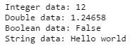

## 第 19 章：委托 (delegates)

我们可以拥有具有多个不同数据类型参数的函数。然而，我们有时可能需要将某个函数作为参数传递。c# 如何处理事件处理程序或回调函数呢？这是通过委托¹⁴² 实现的。

委托被视为函数的指针。它是一种引用数据类型，持有对方法的引用。所有委托都隐式地继承自 `System.Delegate` 类。我们使用委托来实现实事件和回调方法¹⁴³。

### 声明委托

我们声明委托的方式决定了委托可以引用的方法。委托可以引用一个方法，该方法的签名与委托相同¹⁴⁴。我们使用 `delegate` 关键字来声明委托。声明使用以下语法：

`<访问修饰符> delegate <返回类型><委托名称>(<参数>)`

这里是一个示例：

```csharp
public delegate void display(int value);
```

在上面我们声明了一个 `display` 委托。我们可以使用此委托指向一个与 `display` 委托声明的具有相同返回类型和参数的方法。

考虑下面给出的示例：

```csharp
using system;

public class program {
    public delegate void display(int num);
    public static void main() {
        // display 委托指向 displaynumer
        Display displaydel = displaynumer;
        displaydel(100000);
        displaydel(200);
        // display 委托指向 displaymoney
        displaydel = displaymoney;
        displaydel(50000);
        displaydel(20);
    }
    public static void displaynumer(int x) {
        Console.WriteLine("numer: {0,-12:n0}",x);
    }
    public static void displaymoney(int amount) {
        Console.WriteLine("money: {0:c}", amount);
    }
}
```

代码将打印出以下内容：


我们创建了一个名为 `display` 的委托，它接受一个整数类型的参数并返回 `void`。通过 `main()` 方法，我们创建了一个类型为 `display` 的变量，并将名为 `displaynumer` 的方法赋值给它。在调用 `display` 委托后，将调用 `displaynumer` 方法；如果 `display` 委托变量被赋值为 `displaymoney`，将调用 `displaymoney` 方法。此外，我们可以使用 `new` 关键字创建一个委托对象。在这种情况下，我们需要如所示指定方法的名称：

```csharp
displaydel = new display(displaynumer);
```

### 调用委托

委托是对方法的引用；因此我们可以像调用方法一样调用它。当调用委托时，所引用的方法会被调用。我们有两种调用委托的方法：使用 `()` 运算符或使用委托的 `Invoke()` 方法。让我们通过示例来演示这一点：

```csharp
displaydel = displaynumer;
displaydel(5000);
// 或者
displaydel.Invoke(10000);
```

上面展示了调用委托的两种方法。

### 将委托作为参数传递

方法可以有一个委托类型的参数，并且它可以调用该委托参数。这里是一个委托参数的示例：

```csharp
public static void displayhelper(delegate func, int numto) {
    func(numto);
}
```

在上面的示例中，`displayhelper` 函数具有一个 `display` 类型的委托参数，并且通过下面的语句将其作为函数调用：

`func(numto);`

让我们再给出一个示例，演示如何使用 `displayhelper` 方法和委托类型参数：

```csharp
using system;

public class program {
    public delegate void display(int num);
    public static void main() {
        displayhelper(displaynumer, 500);
        displayhelper(displaymoney, 200);
    }
    public static void displayhelper(delegate func, int numto) {
        func(numto);
    }
    public static void displaynumer(int val) {
        Console.WriteLine("numer: {0,-12:n0}",val);
    }
    public static void displaymoney(int amount) {
        Console.WriteLine("money: {0:c}", amount);
    }
}
```

代码将返回以下输出：


### 多路委托 (Multicast delegate)

委托可以指向多个函数。任何指向多个函数的委托被称为多路委托。使用 `+` 运算符向委托对象添加函数，使用 `–` 运算符从委托中移除函数。考虑下面的示例：

```csharp
using system;

public class program {
    public delegate void display(int value);
    public static void main() {
        display displaydel = displaynumer;
        displaydel += hexadecimal;
        displaydel += displaymoney;
        displaydel(1000);
        displaydel -= hexadecimal;
        displaydel(2000);
    }
    public static void displaynumer(int x) {
        Console.WriteLine("numer: {0,-12:n0}",x);
    }
    public static void hexadecimal(int dec) {
        Console.WriteLine("hexadecimal: {0:x}", dec);
    }
    public static void displaymoney(int amount) {
        Console.WriteLine("money: {0:c}", amount);
    }
}
```

在上面的示例中，`displaydel` 指向三个方法 `displaynumer`、`hexadecimal` 和 `displaymoney`。这使其成为多路委托。这意味着当调用 `displaydel` 时，它将顺序调用所有方法。

## 第 20 章：c# 中的多线程 (multithreading)

线程定义了控制流。线程是操作系统分配的执行的基本单位。线程的执行在程序内部是独立的。

单个进程使用一个线程执行。这种进程被称为单线程进程。一次只能执行一个任务。用户必须等待任务完成才能执行新任务。

为了同时执行多个一个线程，会创建多个线程。创建两个或多个线程的过程被称为多线程¹⁴⁵。

### 线程的生命周期


生命周期从 `system.threading.thread` 类对象的创建开始。一旦任务完成，生命周期就会结束。线程的生命周期中有多种状态。

*   **未启动状态 (unstarted state)**：当创建 `thread` 类的实例时，线程进入未启动状态。
*   **就绪状态 (ready state)**：在程序调用 `start()` 方法之前，线程一直处于此状态。
*   **不可运行状态 (not runnable state)**：导致线程处于不可运行状态的元素包括：
    1. **等待 (Waiting)**：调用 `wait()` 方法使线程等待指定的条件。
    2. **锁定 (Locked)**：线程被 I/O 操作锁定。
    3. **睡眠 (Sleeping)**：调用 `sleep()` 方法将线程置于睡眠模式。
*   **死亡状态 (dead state)**：一旦线程完成执行或被中止，就会进入死亡状态。

## 主线程 (Main thread)

在处理线程工作时，我们使用了 `system.threading.thread` 类。主线程在程序开始执行时就会创建。`thread` 类用于创建线程，它们被称为子线程。用户可以通过 `thread` 类的 `currentthread` 属性访问主线程。

示例：

```csharp
Using system;

Namespace thread
{

Class mainthread
{

Static void main(string[] args)
{

Thread t1  =new thread();

T1.name="thread1";

Console.writeline("thread  is:{0}",t1.name);

Console.read();

}

}

}
```

编译并执行代码后，输出为：
`Thread is: thread1`

## thread 类的属性和方法

### 属性 (146):

*   **isalive**：显示当前线程执行状态的值。
*   **currentthread**：获取当前运行线程。
*   **currentcontext**：获取线程执行的当前上下文。
*   **executioncontext**：`executioncontext` 对象包含不同上下文的信息。
*   **name**：获取或设置线程名称。
*   **threadstate**：包含当前线程状态的值。
*   **priority**：获取或设置线程调度优先级。

### 方法:

*   `public static void beginthreadaffinity()`：主机根据当前的物理操作系统线程去执行指令。
*   `public void abort()`：在调用该方法的线程中抛出 `threadexception`。
*   `public void interrupt()`：中断处于 waits、sleep 或 join 状态的线程。
*   `public static appdomain getdomain()`：返回一个唯一的应用程序域标识符。
*   `public static void memorybarrier()`：处理器执行当前线程。指令不能重排序。
*   `public void start()`：启动线程。
*   `public static object yield()`：让调用线程让执行给另一个准备好运行处理器的线程。

## 创建和管理线程

扩展的 thread 类创建一个线程。扩展的 thread 类调用 `start()` 方法来启动子线程的执行。

示例：

```csharp
Using system;

Using system.threading;

Namespace multiplethread
{

Class threadprogram
{

Public static void callchild()
{

Console.writeline("start thread");
}

Static void main(string[] args)
{

Threadstart child1 =new threadstart(callchild);

Console.writeline("creating child thread");

Thread child2 =new thread(child1);

Child2.start();

Console.read();

}

}
}
```
编译并执行代码后，输出为：
`Start thread`
`Creating child thread`

## 管理线程

当需要暂停线程一段时间以便另一个线程执行时，将使用 `sleep()` 方法。该方法接受一个毫秒为单位的参数。

示例：

```csharp
Using system;

Using system.threading;

Namespace threaddemo
{

Class threadprogram
{

Public static void childthread()
{

Try
{

Console.writeline("child thread started");

For(int j = 0; j <= 10; j++)

{

Thread.sleep(1000);

Console.writeline("child thread finished");

}

}
Catch(threadexception e)
{

Console.writeline("exception caught");
}

Finally
{

Console.writeline("exception is not handled");
}
}

Public static void main()
{

Threadstart t1 =new threadstart(childthread);

Console.writeline("creating child thread");

Thread t2 = new thread(t1);

T1.start();

//main thread is stopped
Thread.sleep(2000);

//child thread aborted
Console.writeline("aborting child thread");

T2.abort();

Console.read();

}

}
```
因此，输出为：
`Creating child thread`
`Child thread started`
`0`
`1`
`aborting child thread`
`Exception caught`
`Exception is not handled`

## 第 21 章：事件 (event)

事件是预期会发生的事情。在 C# 中，事件是用户操作，如点击、按键、鼠标移动，或者如系统生成的通知 (148)。应用程序在事件发生后应对其做出响应。一个很好的例子是中断的发生。事件用于促进进程间的通信。

事件在类中声明，并通过通过类类或另一个类中的委托与事件处理程序关联。带有事件的类用于发布事件，这被称为发布者类 (publisher class)。接受事件的类被称为订阅者类 (subscriber class)。这意味着事件依赖于发布者-订阅者模型。

发布者是定义事件和委托的对象。事件与委托之间的关联在该对象中定义。发布者类的实例调用事件，反过来通知其他对象。

### 事件声明 (Event declaration)

为了在类内部声明事件，应先为事件声明一个委托类型。在此之后，你可以使用 `event` 关键字声明事件 (149)。这是一个示例：

```csharp
public delegate void myevent();

public event myevent myevent;
```


```csharp
public class displayhelper
{
    // declare the delegate
    public delegate void eforeisplay();

    //declare an event of type delegate
    public event eforeisplay eoredisplayevent;

    public displayhelper()
    {
    }

    public void displaynumer(int x)
    {
        //call the delegate method moving to display
        if (eredisplayevent != null)
            eredisplayevent();

        Console.WriteLine("numer: {0,-12:n0}", x);
    }

    public void printdecimal(int dec)
    {
        if (eredisplayevent != null)
            eredisplayevent();

        Console.WriteLine("decimal: {0:g}", dec);
    }

    public void displaymoney(int amount)
    {
        if (eredisplayevent != null)
            eredisplayevent();

        Console.WriteLine("money: {0:c}", amount);
    }

    public void displaytemperature(int x)
    {
        if (eredisplayevent != null)
            eredisplayevent();

        Console.WriteLine("temperature: {0,4:n1} f", x);
    }

    public void displayhexadecimal(int dec)
    {
        if (eredisplayevent != null)
            eredisplayevent();

        Console.WriteLine("hexadecimal: {0:x}", dec);
    }
}
```

`displayhelper` 是一个发布者类，负责发布 `eredisplay` 事件。在每个显示方法之后，它会首先检查 `eredisplayevent` 是否不为空，如果不为空，则会调用 `eredisplayevent()` 方法。

现在我们需要创建一个订阅者。请考虑下面的类：

```csharp
using system;

public class myprogram
{
    public static void main()
    {
        numerclass nc = new numerclass(200);
        Nc.displaymoney();
        Nc.displaynumer();
    }
}

class numerclass
{
    private displayhelper _displayhelper;

    public numerclass(int x)
    {
        _value = x;
        _displayhelper = new displayhelper();
        //subscribe to the eredisplayevent event
        _displayhelper.eredisplayevent += displayhelper_eredisplayevent;
    }

    //eredisplayevent handler
    void displayhelper_eredisplayevent()
    {
        Console.WriteLine("eredisplayeventhandler: displayhelper will print a value");
    }

    private int _value;

    public int value
    {
        get { return _value; }
        Set { _value = value; }
    }

    public void displaymoney()
    {
        _displayhelper.displaymoney(_value);
    }

    public void displaynumer()
    {
        _displayhelper.displaynumer(_value);
    }
}
```

```csharp
public class displayhelper
{
    //  declare a delegate
    public delegate void eforeisplay();

    //declare an event of type delegate
    public event eforeisplay eoredisplayevent;

    public displayhelper()
    {
    }

    public void displaynumer(int y)
    {
        //call a delegate method before printing
        if (eredisplayevent != null)
            eredisplayevent();

        Console.WriteLine("numer: {0,-12:n0}", y);
    }

    public void displaydecimal(int dec)
    {
        if (eredisplayevent != null)
            eredisplayevent();

        Console.WriteLine("decimal: {0:g}", dec);
    }

    public void displaymoney(int amount)
    {
        if (eredisplayevent != null)
            eredisplayevent();

        Console.WriteLine("money: {0:c}", amount);
    }

    public void displaytemperature(int y)
    {
        if (eredisplayevent != null)
            eredisplayevent();

        Console.WriteLine("temperature: {0,4:n1} f", y);
    }

    public void displayhexadecimal(int dc)
    {
        if (eredisplayevent != null)
            eredisplayevent();

        Console.WriteLine("hexadecimal: {0:x}", dc);
    }
}
```

代码返回以下内容：


所有订阅者都必须有一个处理函数，该函数会在发布者触发事件后被调用。

## 第 22 章：提示与重要资源

尽管我相信如果你遵循本书的步骤，你将在短时间内牢固地掌握 C#，但无疑你可能仍会有疑问。我们今天所处的这个技术世界的美妙之处在于，这本书并不是学习和精通 C# 编程的唯一资源。当你感到准备就绪，并开始应对许多想要通过代码解决的挑战时，可能会遇到不确定下一步可能步骤是什么的十字路口。本章将作为你的指南，帮助你找到书中未解答的任何疑问的答案。

首先，我鼓励你检查代码是否存在空格或大小写方面的简单错误。有时如果你习惯了用其他语言编写代码，可能会无意中在 C# 中该用分号的地方写了句号，甚至在不该用括号的地方使用了括号。这些是我最令人沮丧的错误类型，通常也是我犯过的错误。基本上，当你遇到一个似乎不断报错的沮丧点时，务必检查你的工作。

此外，如果你尝试了这种方法仍然无效且你准备放弃了——休息一下吧！在让自己放松并暂时忘记项目之后，再回到项目中来。当你用焕然一新的目光重新审视它时，可能会发现错误所在。

我使用的另一种资源也是专门针对 C# 的在线论坛。虽然某些编程论坛可以提供很好的通用建议，但我鼓励你谷歌搜索“C# 帮助论坛”之类的内容，以找到其他可能对解决问题提供明智建议的人。很有可能，你并不是第一个遇到阻碍你完成项目的障碍的人。尽管我已经提到了这些资源，但我想再次强调代码编辑器和库是多么重要的，正如在任何语言中一样，你可以在库中找到无限的答案，这些库将能够


你可能已经有一个喜欢的博主，会在寻找其他语言示例时参考他们——也许可以看看他们订阅的其他用户，看看他们的内容是否对你有所帮助。

千万不要因为你正处于困境就认为你的整个项目已经结束了。从我的个人经验来告诉你，当此类问题出现时，允许自己充分探索并解决问题，将为你在大脑中创造新路径提供机会，这些路径将在你未来的挑战中大有裨益。回想你在生活或编程经验中解决其他问题的方法，并允许自己思考如何以及为何将这些方法应用于当前处境。

在了解自己的思维方式和想要实现的目标方面，你就是自己的主宰。尽所能利用你的资源，尽可能地博学——知识和学习的力量是一项非常非凡的技能。

编程和编码可以被视为一种解决问题的方法，你通过它创建实现特定目的的程序，让自己和他人的生活变得更轻松。始终为你的技能 set 设定一个可以实现的目标，同时不断激励自己学习更多知识，进入能力的下一个水平。

你可以通过以下参考链接获取有关 c# 语言的更详细信息：

* [visual studio 应用](https://www.visualstudio.com/downloads/download-visual-studio-vs) – 用于创建 c# 程序的 IDE。
* [c#（编程指南）](https://en.wikipedia.org/wiki/C_Sharp_(programming_language)) – c# 编程语言概述
* [c# 编程](https://msdn.microsoft.com/en-us/library/67ef8sbd.aspx) – 关于使用 .net framework 的 c# 特性的说明
* [mono](http://www.mono-project.com/) – 使用该软件可以轻松创建跨平台应用程序。

## 结论

现在这本书已经结束了，你已经拥有了成为一名优秀 c# 程序员和编码员所需的所有信息和技能技能。对我来说，你将这本书作为你技能的基础至关重要。我努力提供了一份我认为既全面又易于理解的指南。没有了像 c# 这样的语言，我们就无法在个人和商业生活中拥有这些惊叹的技术。

当你考虑到编程等技术技能为你的生活创造的机遇时，我认为这是一项无价的技能。了解计算机系统的基础知识可以从职业角度为你开启大门，获得更复杂、更高薪的工作。然而，在个人生活中，你可以利用批判性思维和解决问题的能力来提升自己的游戏体验。按照你学习 c# 的速度，你应该对自己的成就感到非常自信和充实！并不是每个人都能在一个月内学会一门全新的语言，而你通过探索一个新世界简单而轻松地做到了。这是一项你应该感到高兴的成就，并应该真正开始创建你渴望的项目了。作为一种面向对象的语言，我确定你对软件社区的贡献有一些非常棒的新想法。又或许你只是想操作一下你现有的窗口！

我在书中拆解的描述和章节应该让你能够理解并连接 c# 的不同部分和部分，以至于当你到达最终结论时，能够将知识传递给他人。我希望这门语言向你展示了它是如何鼓励编程的，通过该语言中许多不同途径来定义和分离可能接触（例如类和语句）但不可互换的不同方面。当你习惯了细微差别时，它们可能像是一团令人崩溃的混乱——你越测试自己的技能并对代码示例进行测试，就越能意识到这些技能为你带来的充分影响和优势。感谢你拿起我的书并给它机会教你新知识！我希望让每个主题的基础都成为任何人都可以快速轻松学习的内容。我希望你将其作为未来项目的参考指南，并希望你在书中示例的帮助下已经掌握了材料和概念。我想用我个人经验中认为重要的几句反复强调的格言来结束这本书。在投入使用之前，务必在测试区域测试你的项目。在投入使用之前，务必在测试区域测试你的项目。在投入使用之前，务必在测试区域测试你的项目。


## 参考文献

- Microsoft.com. (2015). 委托 - C# 编程指南. [online] 可访问：https://docs.microsoft.com/en-us/dotnet/csharp/programming-guide/delegates [访问于 2023 年 5 月 15]。
- Microsoft.com. (2015). goto 语句 - C# 参考文档. [online] 可访问：https://docs.microsoft.com/en-us/dotnet/csharp/language-reference/go-to [访问于 2023 年 5 月 15]。
- Microsoft.com. (2015). 参数传递 - C# 编程指南. [online] 可访问：https://docs.microsoft.com/en-us/dotnet/csharp/programming-guide/classes-and-structs/passing-parameters [访问于 2023 年 5 月 15]。
- Microsoft.com. (2023). 类 - C# 编程指南. [online] 可访问：https://docs.microsoft.com/en-us/dotnet/csharp/programming-guide/classes-and-structs/classes [访问于 2023 年 5 月 15]。
- Microsoft.com. (2023). 默认值 - C# 参考文档. [online] 可访问：https://docs.microsoft.com/en-us/dotnet/csharp/language-reference/default-values [访问于 2023 年 5 月 15]。
- Microsoft.com. (2023). 使用线程与多线程. [online] 可访问：https://docs.microsoft.com/en-us/dotnet/standard/threading/threads-threads-threading [访问于 2023 年 5 月 15]。
- Microsoft.com. (n.d.). BinaryReader 类 (`System.IO`). [online] 可访问：https://docs.microsoft.com/en-us/dotnet/api/system.io.binaryreader?view=netframework-4.7 [访问于 2023 年 5 月 15]。
- Microsoft.com. (n.d.). BinaryWriter 类 (`System.IO`). [online] 可访问：https://docs.microsoft.com/en-us/dotnet/api/system.io.binarywriter?view=netframework-4.7 [访问于 2023 年 5 月 15]。
- Microsoft.com. (n.d.). `File.AppendText(string)` 方法 (`System.IO`). [online] 可访问：https://docs.microsoft.com/en-us/dotnet/api/system.io.appendtext?view=netframework-4.7 [访问于 2023 年 5 月 15]。
- Download.microsoft.com. (n.d.). Microsoft 下载中心：Windows, office 及更多. [online] 可访问：http://download.microsoft.com/ [访问于 2023 年 5 月 15]。
- Wikipedia.org. (2023). C# (编程语言). [online] 可访问：https://en.wikipedia.org/wiki/C_sharp_(programming_language) [访问于 2023 年 5 月 15]。
- GeeksforGeeks. (n.d.). C# | 数组 - geeksforgeeks. [online] 可访问：https://www.geeksforgeeks.org/c-sharp-arrays/ [访问于 2023 年 5 月 15]。
- GeeksforGeeks. (n.d.). C# | 方法 - geeksforgeeks. [online] 可访问：https://www.geeksforgeeks.org/c-sharp-methods/ [访问于 2023 年 5 月 15]。
- Guru99.com. (n.d.). [online] 可访问：https://www.guru99.com/c-sharp-data-types [访问于 2023 年 5 月 15]。
- Heyrick, c. (2014). C# 结构体大小. [online] heyrick:https://chrisheyrick.com/2014/12/17/struct-sizes/ [访问于 2023 年 5 月 15]。
- Jonset.uk. (n.d.). C# 中的参数传递. [online] 可访问：http://jonset.uk/csharp/parameters [访问于 2023 年 5 月 15]。
- Korshidnia, s. (2013). 使用 C# 的递归方法. [online] codproject.com. 可访问：https://www.codproject.com/articles/14292/recursive-methods-in-csharp [访问于 2023 年 5 月 15]。
- Mayo, j. (n.d.). 第 5 ：方法 - C# 符号. [online] csharp-tutorial.com. 可访问：https://csharp-tutorial.com/tutorial/05 [访问于 2023 年 5 月 15]。
- Mkhitaryan, a. (2017). 为什么 C# 是世界上最流行的语言? [online] medium. 可访问：https://medium.com/learn/why-is-c-the-most-popular-languages-in-the-world-cf2684fc [访问于 2023 年 5 月 15]。
- Monoproject.com. (2023). 首页 | Mono. [online] 可访问：http://www.monoproject.com/ [访问于 2023 年 5 月 15]。
- MSDN.microsoft.com. (2017). C# 编程指南. [online] 可访问：https://msdn.microsoft.com/en-us/library/67efsd.aspx [访问于 2023 年 5 月 15]。
- O7planning.org. (n.d.). C# 多线程教程. [online] 可访问：https://o7planning.org/553/csharp-multreading [访问于 2023 年 5 月 15]。
- Programiz.com. (n.d.). C# foreach 循环. [online] 可访问：https://www.programiz.com/csharp/foreach [访问于 2023 年 5 月 15]。
- Programiz.com. (n.d.). C# if-else . [online] 可访问：https://www.programiz.com/csharp/if-else [访问于 2023 年 5 月 15]。
- Programiz.com. (n.d.). C# 运算符. [online] 可访问：https://www.programiz.com/csharp/operators [访问于 2023 年 5 月 15]。
- Programiz.com. (n.d.). C# switch 语句. [online] 可访问：https://www.programiz.com/csharp/switch-statement [访问于 2023 年 5 月 15]。
- Spasovic, m. (2023). C# 类型转换（隐式与显式）. [online] code-maze:https://code-maze.com/csharp-conversions/ [访问于 2023 年 5 月 15]。
- Tutorialspoint.com. (n.d.). C# 编译器 - 编辑 - 执行. [online] 可访问：https://www.tutorialspoint.com/csharp/compiler [访问于 2023 年 5 月 15]。
- Tutorialspoint.com. (n.d.). C# 文件 & 目录. [online] 可访问：https://www.tutorialspoint.com/csharp/file [访问于 2023 年 5 月 15]。
- Tutorialspoint.com. (n.d.). C# for 循环. [online] 可访问：https://www.tutorialspoint.com/csharp/for-loop [访问于 2023 年 5 月 15]。
- Tutorialspoint.com. (n.d.). C# 关键字. [online] 可访问：https://www.tutorialspoint.com/csharp/keywords [访问于 2023 年 5 月 15]。
- Tutorialspoint.com. (n.d.). C# while 循环. [online] 可访问：https://www.tutorialspoint.com/csharp/while-loop [访问于 2023 年 5 月 15]。
- Tutorialspoint.com. (n.d.). C# do-while 循环. [online] 可访问：https://www.tutorialspoint.com/csharp/do-while-loop [访问于 2023 年 5 月 15]。
- Tutorialspoint.com. (n.d.). C# 中的事件. [online] 可访问：https://www.tutorialspoint.com/csharp/event [访问于 2023 年 5 月 15]。
- Tutorialspoint.com. (n.d.). C# 中的结构体. [online] 可访问：https://www.tutorialspoint.com/csharp/struct [访问于 2023 年 5 月 15]。
- Visual Studio.com. (n.d.). 下载 | IDE & 团队基础服务器 | Visual Studio. [online] 可访问：https://www.visualstudio.com/downloads/download-visual-studio-vs [访问于 2023 年 5 月 15]。


- Www.tutorialsp.com. (n.d.). C# 事件。[online] 可访问：https://www.tutorialsp.com/csharp/csharp_events.htm [访问于 2023 年 2 月 15 日]。
- Www.tutorialsp.com. (n.d.). C# 异常处理。[online] 可访问：https://www.tutorialsp.com/csharp/csharp_exception_handling.htm [访问于 2023 年 2 月 15 日]。
- Www.tutorialsp.com. (n.d.). C# 文件 I/O。[online] 可访问：https://www.tutorialsp.com/csharp/csharp_file_io.htm [访问于 2023 年 2 月 15 日]。
- Www.tutorialsp.com. (n.d.). C# 继承。[online] 可访问：https://www.tutorialsp.com/csharp/csharp_inheritance.htm [访问于 2023 年 2 月 15 日]。
- Www.tutorialsp.com. (n.d.). C# 多线程。[online] 可访问：https://www.tutorialsp.com/csharp/csharp_multithreading.htm [访问于 2023 年 2 月 15 日]。
- Www.tutorialsp.com. (n.d.). C# 多态。[online] 可访问：https://www.tutorialsp.com/csharp/csharp_polymorphism.htm [访问于 2023 年 2 月 15 日]。
- Www.tutorialsp.com. (n.d.). C# 正则表达式。[online] 可访问：https://www.tutorialsp.com/csharp/csharp_regular_expressions.htm [访问于 2023 年 2 月 15 日]。
- Www.tutorialsp.com. (n.d.). C# 结构体。[online] 可访问：https://www.tutorialsp.com/csharp/csharp_struct.htm [访问于 2023 年 2 月 15 日]。
