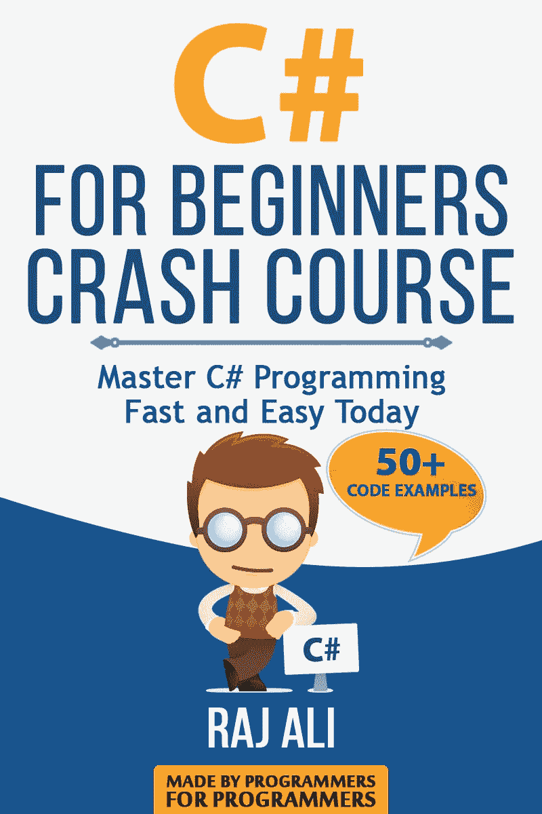
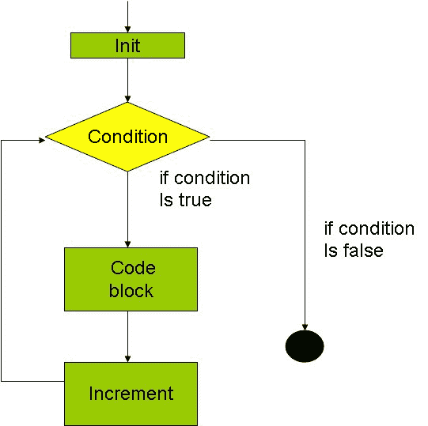
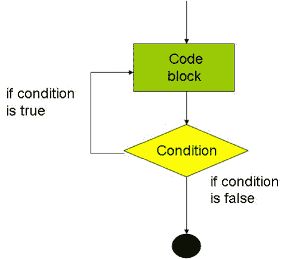
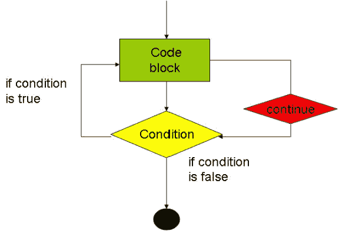
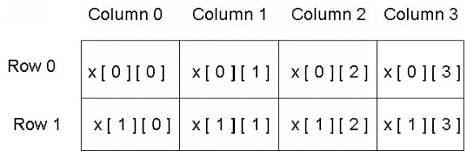

# C# 初学者快速上手指南





using System;
namespace whileloop{
    class Program {
        static void Main(string[] args) {
            int var;
            var=50;
            while(var<150) {
                Console.WriteLine("Value of variable is:{0}",var);
                var=var+10;
            }
        }
    }
}
```

在前面的代码中，变量 `var` 初始化为值 `50`。`while` 循环检查条件。如果条件小于 `150`，则执行循环内部的语句。如果为 `false`，控制将不会进入 `while` 循环。

## 7.2 For 循环

`for` 循环用于按指定次数执行语句块。

#### 语法：

```csharp
for (initialization; condition; increment/decrement)
{
    statements
}
```

其中：

*   `initialization`（初始化）用于声明并初始化循环。
*   `condition`（条件）检查表达式。如果条件为 `true`，则执行循环体。
*   `increment/decrement`（增/减）用于增加或减少变量的值。

### 流程图



### for 循环示例

| 示例 14: |

```csharp
using System;
namespace forloop{
    class Program {
        static void Main(string[] args) {
            int i;
            for(i=1;i<=10;i++) {
                // statements
            }
            Console.WriteLine("Value of variable is:{0}",i);
        }
    }
}
```

在上述代码中，声明了变量 `i`。`for` 循环执行指定次数的语句。

## 7.3 Do while 循环

`do...while` 循环结构与 `while` 循环相似。区别在于 `do...while` 循环在检查条件之前至少执行一次语句。

#### 语法：

```csharp
do
{
    statements
}while(expression);
```

### 流程图



### do while 循环示例

| 示例 15: |

```csharp
using System;
namespace dowhile{
    class Program {
        static void Main(string[] args) {
            int x=1;
            do {
                Console.WriteLine("Value of x is:{0}",x);
                x=x+1;
            }while(x<10);
            Console.ReadLine();
        }
    }
}
```

在上述代码中，变量 `x` 被赋值为 `1`。`do` 循环执行块内的语句。一旦 `while` 条件为 `false`，循环语句将不再执行。

## 7.4 Break 语句

`break` 语句用于退出循环。当遇到此语句时，循环终止，控制恢复到循环后的后续语句。

#### 语法：

```csharp
break;
```

### 流程图


### break 语句示例

| 示例 16: |

```csharp
using System;
namespace break;{
    class Program {
        static void Main(string[] args) {
            int i=11;
            while(i<15) {
                Console.WriteLine("value of i:{0}",i);
                i++;
                if(i>13) { break; }
            }
            Console.ReadLine();
        }
    }
}
```

在代码示例中，变量 `i` 被赋值为 `11`。`while` 循环检查 `i` 的条件。如果条件为 `true`，则执行 `while` 循环语句。`i` 增。

循环检查 `i` 的值。一旦 `i` 的值大于 `13`，就会执行 `break` 语句，控制移出循环。

## 7.5 Continue 语句

`continue` 语句与 `break` 语句相似，但它不是跳出循环，`continue` 强制执行循环的下次迭代，跳过中间的所有代码。

#### 语法：

```csharp
continue;
```

### 流程图




| 示例 17: |

```csharp
using System;
namespace continue{
    class Program {
        int i=45;
        do {
            if(i==50) {
                i=i+1;
                continue;
            }
            Console.WriteLine("Value of i is:{0}",i);
            i++;
        } while(i<60);
        Console.ReadLine();
    }
}
```

因此在上面的代码示例中，我们可以看到 `do-while` 循环和 `continue` 的结合使用。我们可以看到，当 `i` 进入 `do` 内部的语句时，它的初始值被设置为 45。此时，会检查 `i` 是否等于 50，它并不等于，因此在消息中输出 `i` 的值，并将 `i` 加 1。

这个过程会一直持续，直到 `i` 达到 50，此时 `i` 将加 1 并遇到 `continue` 关键字，该关键字将跳过 `do` 部分的剩余代码，直接跳转到 `while` 条件表达式。

一旦 `i` 达到 61，`while` 条件语句将不再匹配，执行程序将离开循环。

# 第 8 章 C# 中的类与方法

## 8.1 类声明

在 C# 中，类是该语言的主要构建模块。它提供了一组预定义的变量和方法。对象被定义为类的实例，因此类内部的方法决定了在对象上可以执行的操作。

### 类定义

类定义以关键字 `class` 开始，后面跟着实际的类名。类变量和方法都包含在花括号之间；该区域称为类体（class body）。

#### 语法：

```text
<access specifier>class class_name
{
    //member variables
    <access specifier> <data type> variable1;
    <access specifier> <data type> variable2;
    ……
    <access specifier><data type> variableN;

    //member methods
    <access specifier><return type>method1(parameter_list)
    {
        //method body
    }
    <access specifier><return type>method2(parameter_list)
    {
        //method body
    }
    ….
    <access specifier><return type>methodN(parameter_list)
    {
        //method body
    }
}
```

*   `Access specifiers`（访问修符）定义了其他方法和成员与给定类的方法及成员交互的权限。如果没有指定访问修符，默认访问修符为 `private`。
*   `date type`（数据类型）指定变量类型，`return type`（返回类型）用于说明方法返回的数据类型，但需要注意的是，方法并不总是需要返回任何内容。
*   点运算符 (`.`) 用于访问类成员。
*   点运算符用于连接对象名和成员名名。

### 类的演示示例

| 示例 18: |

```csharp
using System;
namespace demo{
    class Calculate {
        public int len;
        public int bread;
    }
    class Program {
        static void Main(string[] args) {
            Calculate c1 = new Calculate();
            Calculate c2 = new Calculate();
            int area = 0;
            int area1 = 0;
            c1.len = 10;
            c1.bread = 5;
            area = c1.len*c1.bread;
            Console.WriteLine("area of rectangle1 is:{0}",area);
            area1 = c2.len*c2.bread;
            Console.WriteLine("area of rectangle2 is:{0}",area1);
            Console.ReadLine();
        }
    }
}
```

编译后，该类的结果将是：
area of rectangle1:50
area of rectangle2:150

## C# 构造函数

构造函数是一种特殊的方法，在类实例创建时自动调用。类的成员在构造函数内部进行初始化。构造函数的名称必须与类相同。

### 构造函数示例

| 示例 19: |

```csharp
using System;
namespace construct{
    class Calculate {
        int number1,number2,sum;
        Calculate() {
            number1 = 20;
            number2 = 40;
        }
        void Addition() {
            sum = number1+number2;
        }
        void Show() {
            Console.WriteLine("The total is:{0}",sum);
        }
        static void Main(string[] args) {
            Calculate c1 = new Calculate();
            c1.Addition();
            c1.Show();
        }
    }
}
```

编译后，该类的结果将是：
The total is:60

在上面的示例中，每当实例化类 `Calculate` 时，构造函数都会为 `number1` 和 `number2` 分配固定值。然而，如果你想让 `number1` 和 `number2` 的值不同且动态呢？该如何实现？

嗯，这就是参数构造函数（parameterized constructor）概念用用场的地方。基本上这个高级术语的意思是我们可以直接传入参数。本质上，这个术语的意思意味着我们在实例化类时传入参数。让我们来看一个例子：

### 参数构造函数

| 示例 20: |

```csharp
using System;
namespace construct{
    class Calculate {
        int number1,number2,sum;
        Calculate(int n1, int n2) {
            number1 = n1;
            number2 = n2;
        }
        void Addition() {
            sum = number1+number2;
        }
        void Show() {
            Console.WriteLine("The total is:{0}",sum);
        }
        static void Main(string[] args) {
            Calculate c1 = new Calculate(10, 20);
            c1.Addition();
            c1.Show();
        }
    }
}
```

编译后，该类的结果是：
Enter value a
10
Enter value b
20
The total is:30

C# 析构函数

析构函数是类中的一种特殊函数，通常在退出类之前释放不受管理的资源。它的用法有一定的限制：

*   它不能被继承。
*   它不能重载。
*   任何类中只能有一个析构函数。
*   析构函数不能由程序员直接调用；而是由垃圾回收器调用。

析构函数与类名相同，并以 `~` 为前缀。

### 析构函数示例

| 示例 21: |

```csharp
using System;
namespace destruct{
    class Calculate {
        int number1,number2,sum;
        Calculate() {
            number1 = 15;
            number2 = 4;
        }
        void Addition() {
            sum = number1+number2;
        }
        void Show() {
            Console.WriteLine("The total is:{0}",sum);
        }
        // 析构函数在这里定义，并在类超出作用域时调用
        ~Calculate() {
            Console.WriteLine("Destructor invoked");
        }
        static void Main(string[] args) {
            Calculate c1 = new Calculate();
            c1.Addition();
            c1.Show();
        }
    }
}
```

编译后，该类的结果是：
The total is:19
Destructor invoked

## 8.2 定义方法

方法是一组多个程序语句，可以通过调用方法名来执行。使用方法时，用户首先需要定义方法，然后调用该方法。

定义方法意味着声明其结构。使用以下语法来定义方法：

```text
<Access Specifier> <Return Type> <Method Name> ( Parameter List)
{
    Method Body
}
```

方法的不同元素有：

*   `Access specifier`（访问修符）：检查变量或方法可以被访问的范围。
*   `Return Type`（返回类型）：定义了方法返回值的类型。如果类型设置为 `void`，则意味着该方法不返回任何内容。
*   `Method Name`（方法名）：它是一个唯一的标识符且区分大小写。方法名不能与变量名相同。


- **参数列表**：方法传递和接收的值。它们写在方法名后的括号中。
- **方法体**：用于执行实际方法执行的指令集。

示例：

示例 22：
```csharp
class Average{ 
    public int Number(int no1, int no2) { 
        int output;
        output = no1+no2/2; 
        return output; 
    }
}
```

## 8.3 调用方法

一旦定义了方法，用户就可以使用方法名调用该方法。方法名后跟着括号。

示例：

示例 23：
```csharp
using System;
class Average{ 
    public int Number(int no1, int no2) { 
        int output;
        output = no1+no2/2; 
        return output; 
    }   
    static void Main(string[] args) {
        Average a = new Average();             
        // 从对象类 a 调用方法 Number 
        int value = a.Number(20,30);      
        Console.WriteLine("The result is {0}",value); 
    }
}
```

当代码编译时，结果为：
The result is 25

## 8.5 递归方法调用

方法可以调用自己，这被称为递归。

示例：

示例 24：
```csharp
using System;
namespace recursive{ 
    class recursivecall { 
        public int factorial(int no) { 
            int result; 
            if(no == 1) { 
                return 1; 
            } else {
                result = factorial(no-1)*no; 
                return result; 
            } 
        } 
        static void Main(string[] args) {
            recursivecall r = new recursivecall();              
            Console.WriteLine("Factorial of no is {0}",r.factorial(2));              
            Console.WriteLine("Factorial of no is {0}",r.factorial(3));              
            Console.Read(); 
        } 
    } 
}
```

当代码编译后，结果将是：
Factorial of no is 2
Factorial of no is 6

## 8.4 向方法传递参数

当用户调用方法时，如果该方法接受参数，则在调用方法时必须传递这些参数。传递给方法的参数有三种。

### 值参数

使用值参数时，方法会创建此传入参数的副本作为变量，供方法内部使用。如果该变量的值被更改，它只会在方法自身的作用域内改变，而不会改变作为参数传递给方法的原始变量。

示例：

示例 25：
```csharp
class Program{ 
    void Increaseno(int no) {      
        no++; 
    } 
    public static void Main() {
        Program p = new Program(); 
        int number = 2;      
        p.Increaseno(number);      
        Console.WriteLine(number); 
    } 
}
```

当代码编译后，结果为：
2

### 引用参数

引用参数与值参数相同，不同在于当参数传递给方法时，它不是创建参数值的副本，而是直接指向内存中存储的原始值。因此，如果在方法的作用域内更改了值，它也会更改作为参数传递的原始变量的值。

使用 `ref` 关键字声明引用参数。

示例：

示例 26：
```csharp
class Program{ 
    void Increaseno(int no) {      
        no++; 
    } 
    public static void Main() {
        Program p=new Program(); 
        int number = 2;      
        p.Increaseno(ref number);      
        Console.WriteLine(number); 
    } 
}
```

当代码编译后，结果为：
3

### 输出参数

`return` 语句用于从方法返回值。使用 `return` 语句只能返回一个变量。输出参数提供了此目的。

它们与引用参数相似，不同在于它们将数据传输到方法之外。

示例：

示例 27：
```csharp
class Program{ 
    void Demo(out int no) {      
        no=10; 
    } 
    public static void Main() {
        Program p=new Program(); 
        int number;      
        p.Demo(out number);      
        Console.WriteLine(number); 
    } 
}
```

当代码编译后，结果为：
10

# 第 9 章 C# 数组

## 9.1 数组简介

数组是相似类型取值的集合。数组中的变量被称为元素。使用单个名称和索引来访问数组。

数组有一个阶（rank），决定了与每个元素相关索引的数量。数组的阶也被称为维度（dimensions）。

## 9.2 数组声明

数组在任何程序中使用之前必须声明。使用以下语法声明数组：
`datatype[] ArrayName;`

数组的语法包含以下组件：
- `datatype`：用于指定元素的数据类型。
- `[]`：指定数组的大小。
- `ArrayName`：数组的名称。

## 9.3 数组初始化与赋值

数组在程序中使用之前必须声明。`new` 关键字用于创建数组的实例。数组的阶（rank）决定了与每个元素相关索引的数量。数组的阶也被称为维度（dimensions）。

数组可以在初始化时赋值。使用以下语法初始化数组：
`datatype[] ArrayName = new datatype[size];`

数组可以在初始化时赋值。使用以下语法初始化数组：
`datatype[] ArrayName = new datatype[] {value1, value2, ...};`

数组可以在初始化时赋值。使用以下语法初始化数组：
`datatype[] ArrayName = {value1, value2, ...};`

示例：

示例 28：
```csharp
using System;
namespace arraydeclare{ 
    class Arraydemo { 
        static void Main(string[] args) { 
            int[] a = new int[5]; 
            int x,y; 
            for(int x = 0;x < 5;x++) {      
                a[x] = x + 10; 
            } 
            for(y = 0;y < 5;y++) {      
                Console.WriteLine("Element [{0}]={1}",y,a[y]); 
            }      
            Console.ReadLine(); 
        } 
    } 
}
```

要访问数组中的元素需要使用索引。索引总是从 0 开始。

访问数组中的元素需要使用如下格式：
`array_name[index]`

索引表示数组中的位置。

### 9.4 遍历遍历

这种循环专门设计用于遍历数组中的所有元素。它非常适合高效获取元素。

语法：
`foreach(type identifier in expression) statement – block`

示例：

示例 29：
```csharp
using System;
namespace arraydeclare{ 
    class Arraydemo { 
        static void Main(string[] args) { 
            int[] a = new int[5]; 
            for(int x = 0;x < 5;x++) {      
                a[x] = x + 10; 
            } 
            foreach(int y in a) { 
                int x = y - 10;      
                Console.WriteLine("Element[{0}]",x,y);      
                x++; 
            }      
            Console.ReadLine(); 
        } 
    } 
}
```

## 9.6 不同的 C# 数组

以下是用于代码开发的各种 C# 数组类型。

### 多维数组

多维数组在多个行维度上存储数据。它也被称为矩形数组。用户可以像如下所示声明整数的二维数组：

```csharp
int[,] no;
```


二维数组可以被视为一个表格。它有 `x` 行和 `y` 列。一个二维数组包含 2 行 4 列。



## 初始化二维数组

以下数组有 3 行 3 列。

```csharp
int [ , ] x = int [ 3, 3] = {
    {1, 2, 3},
    {4, 5, 6},
    {7, 8, 9}
};
```

## 访问多维数组的元素

可以使用下标访问多维数组中的元素。下标是数组的行索引和列索引。

示例：

```csharp
int output = a [1, 2];
```

在上述语句中，访问了第二行第三列的元素。

示例：

| 示例 30: |
```csharp
using System;
namespace twodimension{
    class multiarray {
        static void Main(string[] args) {
            int [ , ] x = new int[3,2]{{1,1},{2,2},{3,3}};
            int a,b;
            for(a = 0;a < 3;a++) {
                for(b = 0;b < 2;b++) {
                    Console.WriteLine("x[{0},{1}={2}",a,b,x[a,b]);
                }
            }
            Console.ReadLine();
        }
    }
}
``` |
代码被编译并执行，输出为：
`x[0,0] = 1`
`x[0,1] = 1`
`x[1,0] = 2`
`x[1,1] = 2`
`x[2,0] = 3`
`x[2,1] = 3`

## 锯齿数组 (Jagged Array)

锯齿数组是数组的数组。`int` 锯齿数组声明为：
`int [ ] [] marks;`

数组可以初始化为：
`int [ ] [] marks = new int [3] [] { new int [ ] {45,57,78}, new int [ ] {60,75,86,45}};`

`marks` 数组包含两个整数数组，`marks[0]` 包含 3 个整数，`marks[1]` 包含 5 个整数。

示例：

| 示例 31: |
```csharp
using System;
namespace Jaggedarray{
    class jagged {
        static void Main(string[] args) {
            int[][] x = new int[][]{new int[][]{0,0},new int[][]{2,2},new int[][]{3,4},new int[][]{4,2},new int[][]{1,3}};
            int a,b;
            for(a = 0;a < 5;a++) {
                for(b = 0;b < 2;b++) {
                    Console.WriteLine("x[{0},{1}]={2}",a,b,x[a][b]);
                }
            }
            Console.ReadLine();
        }
    }
}
``` |
代码被编译并执行，输出为：
`x[0,0] = 0`
`x[0,1] = 0`
`x[1,0] = 2`
`x[1,1] = 2`
`x[2,0] = 3`
`x[2,1] = 4`
`x[3,0] = 4`
`x[3,1] = 2`
`x[4,0] = 1`
`x[4,1] = 3`

## 参数数组 (Param Arrays)

在声明方法时，作为参数传递的参数数量是不确。此时使用 `params` 数组。

示例：

| 示例 32: |
```csharp
using System;
namespace ParamArray{
    class ParamArray {
        public int AddValues(params int[] data) {
            int total = 0;
            foreach(int a in data) {
                total += a;
            }
            return total;
        }
    }
    class Test {
        static void Main(string[] args) {
            ParamArray pa = new ParamArray();
            int total=pa.AddValues(2,3,4,5);
            Console.WriteLine("The sum is {0}",total);
            Console.Read();
        }
    }
}
``` |
当代码编译并执行时，输出为：
The sum is 20

## Array 类 (Array Class)

`array` 类是 C# 中所有数组的基类。`System` 命名空间包含了 `array` 类。`array` 类中使用了各种属性和方法。

### Array 类的属性
- `Length`: 返回数组所有维度上的项总数。
- `Rank`: 返回数组的秩（维度）。
- `FixedSize`: 一个表示数组是否具有固定大小的值。
- `IsReadOnly`: 一个表示数组是否为只读的值。

### Array 类的方法
- `Sort`: 对作为参数传递给它的数组进行排序操作。
- `Clear`: 移除数组中的所有项并将范围设置为 0。
- `GetLength`: 返回数组在特定维度上的项数。
- `GetValue`: 数组中指定位置的值。
- `IndexOf`: 返回某个值在一维数组中首次出现的索引。
- `Reverse`: 反转数组的序列。

示例：

| 示例 33: |
```csharp
using System;
namespace Array{
    class Array1 {
        static void Main(string[] args) {
            int[] item = {12,34,23,55,64};
            int[] value = item;
            Console.Write("Original Array:");
            foreach(int x in item) {
                Console.Write(x+" ");
            }
            Console.WriteLine();
            //reverse the array
            Array.Reverse(value);
            Console.Write("Array reversed:");
            foreach(int x in value) {
                Console.Write(x+" ");
            }
        }
    }
}
``` |
代码被编译并执行，输出为：
Original Array: 12 34 23 55 64 
Array reversed: 64 55 23 34 12 


返回指定字符串在实例中首次出现的从 0 开始的索引。

* `public string Remove(int startindex)`
它会删除当前实例中从指定位置开始到最后一个位置的字符。它会返回一个字符串。

* `public char[] ToCharArray()`
返回一个包含当前字符串对象中所有字符的 Unicode 字符数组。

* `public string ToLower()`
返回一个转换为小写形式的字符串副本。

## 10.3 演示字符串功能的示例

### 字符串比较

示例 35: 

```csharp
using System;
namespace string1{
    class Program {
        static void Main(string[] args) {
            string string1 = "A string named as string1";
            string string2 = "A string named as string2";
            if(String.Compare(string1,string2) == 0) {
                Console.WriteLine(string1+"and"+string2+"equal");
            } else {
                Console.WriteLine(string1+"and"+string2+" not equal");
            }
            Console.Read();
        }
    }
}
```

当代码被编译并执行时，输出为：
A string named as string1 and A string named as string2 are not equal

### 字符串连接

示例 36: 

```csharp
using System;
namespace string1{
    class Program {
        static void Main(string[] args) {
            string[] str1 = new string[]{"Set your aims high", "Rome was not built in a day", "Save Time"};
            string str = String.Join("\n",str1);
            Console.WriteLine(str);
            Console.Read();
        }
    }
}
```

当代码被编译并执行时，输出为：
Set your aims high
Rome was not built in a day
Save Time

### 包含特定值的字符串

示例 37: 

```csharp
using System;
namespace string1{
    class Program {
        static void Main(string[] args) {
            string str = "A new user";
            if(str.Contains("user")) {
                Console.WriteLine("The value 'user' is present");
            }
            Console.Read();
        }
    }
}
```

当代码被编译并执行时，输出为：
The value 'user' is present

# 第 11 章 封装与多态

## 11.1 封装简介

封装是将数据和函数封装在物理或逻辑包中的过程。它帮助开发者防止访问应用程序的本质细节。它将代码和数据结合在一起。

抽象是指所有信息都存在，但只向用户提供相关信息。

抽象和封装是相关的特性。封装通过提供隐藏非本质细节的方法辅助抽象。使用封装，某些信息是可见的而另一些是隐藏的。

## 11.2 C# 中的访问修饰符

访问修饰符定义了类成员范围。成员用于引用类的函数和变量。程序由一个或多个类组成。类的某些成员需要被其他类访问。

### 访问修饰符类型

C# 支持以下访问修饰符。

* `public`
* `private`
* `protected`
* `internal`
* `protected internal`

### public 访问修饰符

public 访问允许类与其他类共享成员变量和函数。声明为 `public` 的成员可以从类外部访问。

public 访问修饰符示例

示例 38: 

```csharp
using System;
namespace public1{
    class User {
        //成员变量
        public string name;
        public int age;
        public void AddValue() {
            Console.WriteLine("Enter the user name:");
            name = Console.ReadLine();
            Console.WriteLine("Enter the age:");
            age = Convert.ToInt32(Console.ReadLine());
        }
        public void Show() {
            Console.WriteLine("User name is:{0}",name);
            Console.WriteLine("Age is:{0}",age);
        }
    }
    class Program {
        static void Main(string[] args) {
            User u = new User();
            u.AddValue();
            u.Show();
            Console.Read();
        }
    }
}
```

当代码被编译并执行时，输出为：
Enter the user name:
Mark
Enter the age:
20
User name is:Mark
Age is: 20

### private 访问修饰符

`private` 访问修饰符允许用户向其他类对象和函数隐藏类的成员变量和函数。`private` 成员从类外部不可见。只有类内部的函数可以访问 `private` 实体。类的实例无法访问任何私变量或函数，因为它们被声明为类外部。

示例：

示例 39:

```csharp
using System;
namespace private1{
    class Student {
        //成员变量
        private string name;
        private int age;
        public void AddValue() {
            Console.WriteLine("Enter the student name:");
            name = Console.ReadLine();
            Console.WriteLine("Enter the age:");
            age = Convert.ToInt32(Console.ReadLine());
        }
        public void Show() {
            Console.WriteLine("Student name is:{0}",name);
            Console.WriteLine("Age is:{0}",age);
        }
    }
    class Program {
        static void Main(string[] args) {
            Student s = new Student();
            s.AddValue();
            s.Show();
            Console.Read();
        }
    }
}
```

当代码被编译并执行时，输出为：
Enter the student name:
Harry
Enter the age:
15
Student name is:Harry
Age is: 15

### protected 访问修饰符

`protected` 访问修饰符允许类从其他类对象和函数隐藏成员变量和函数，子类除外。该修饰符在继承实现中非常有用。

示例：

示例 40:

```csharp
using System;
namespace protected1 {
    class Employee {
        //成员变量
        protected string name;
        public void AddValue() {
            Console.WriteLine("Enter the employee name:");
            name = Console.ReadLine();
        }
        public void Show() {
            Console.WriteLine("Employee name is:{0}",name);
        }
    }
    class Program {
        static void Main(string[] args) {
            Employee e = new Employee();
            e.AddValue();
            e.Show();
            Console.Read();
        }
    }
}
```

当代码被编译并执行时，输出为：
Enter the employee name:
Ajay
Employee name is: Ajay### internal 访问修饰符

`internal` 访问修饰符允许类向同一应用程序内的子类或类公开其成员函数和变量。

示例：

示例 41:

```csharp
using System;
namespace internal1{
    class Location {
        //成员变量
        internal string city;
        public void AddValue() {
            Console.WriteLine("Enter the city name:");
            city = Console.ReadLine();
        }
        public void Show() {
            Console.WriteLine("City name is:{0}",city);
        }
    }
    class Program {
        static void Main(string[] args) {
            Location l = new Location();
            l.AddValue();
            l.Show();
            Console.Read();
        }
    }
}
```

当代码被编译并执行时，输出为：
Enter the city name:
London
City name is: London

### protected internal 访问修饰符

`protected internal` 访问修饰符允许类向包含类、子类或同一应用程序内的类公开成员函数和变量。对应用程序外部派生类的访问是允许的。

示例：

示例 42:

```csharp
using System;
namespace protectedinternal1{
    class number {
        //成员变量
        protected internal int no;
        public void AddValue() {
            Console.WriteLine("Enter the number:");
            no = Convert.ToInt32(Console.ReadLine());
        }
        public void Show() {
            Console.WriteLine("Number is:{0}",no);
        }
    }
    class Program {
        static void Main(string[] args) {
            number n = new number();
            n.AddValue();
            n.Show();
            Console.Read();
        }
    }
}
```

当代码被编译并执行时，输出为：
Enter the number:
10
Number is: 10


多态是指函数以不同形式存在的能力。“poly”一词意味着“多”，而“morphos”意味着“形式”。

多态有两种类型：

- **静态多态**：函数的响应在编译时决定。
- **动态多态**：函数的响应在运行时决定。

## 11.4 静态多态

静态多态指的是以不同形式存在的实体。C# 有两种实现多态的方法。

- 函数重载
- 运算符重载

### 函数重载

函数重载帮助用户为两个或多个函数使用相似的名称。函数定义必须在参数列表的类型或数量上有所不同。

示例：

| 示例 43: |

```csharp
using system;
namespace calculate{
    class calculate {
        public int Min(int no1, int no2) {
            if(no1 < no2) {
                return no1;
            } else {
                return no2;
            }
        }
        public float Min(int no1, int no2) {
            if(no1 < no2) {
                return no1;
            } else {
                return no2;
            }
        }
    }
    class Program {
        static void Main(string[] args) {
            Program p = new Program();
            Console.WriteLine("Minimum value is:{0}",p.Min(3,4));
            Console.WriteLine("Minimum value is:{0}", p.Min(3.2F,1.2F));
            Console.ReadLine();
        }
    }
}
```

当代码编译并执行时，输出为：

Minimum value is: 3
Minimum value is: 1.2

## 11.5 动态多态

C# 有两种实现动态多态的方法。它们是：

- **抽象类**：它们是特殊的基类类型，包含抽象类成员。派生自抽象类的类成员必须实现抽象函数和属性。
- **虚函数**：它们并不真实存在。它们似乎存在于某些部分中。

### 抽象类

抽象类提供了类的部分实现。当派生类继承它时，实现就完整了。存在抽象方法通过派生类来实现。

创建抽象类的规则：

- 用户不能在抽象类之外声明抽象方法。
- 不能创建抽象类的实例。
- 派生自抽象类的类必须重写类的所有方法。
- 抽象类不能被声明为密封（sealed）。

示例：

| 示例 44: |

```csharp
using System;
namespace poly{
    abstract class Result {
        public abstract int average();
    }
    class Data: Result {
        private int sub1;
        private int sub2;
        public Data(int x, int y) {
            sub1 = x;
            sub2 = y;
        }
        public override int average() {
            Console.WriteLine("The average is:");
            return (x + y / 2);
        }
    }
    class Program {
        static void Main(string[] args) {
            Data d = new Data(30, 70);
            int a = d.average();
            Console.WriteLine("Average:{0}",a);
            Console.Read();
        }
    }
}
```

当代码编译并执行时，输出为：

The average is:
Average: 50

### 虚函数

如果你需要一个在类中定义并需要派生类实现的函数，则使用虚函数。派生类根据需求修改被继承类的功能。方法的调用是在运行时进行的。

`virtual` 关键字用在函数的返回值之前。

示例：

| 示例 45: |

```csharp
using System;
namespace virtual1{
    class Calculate {
        protected int x, y;
        public Calculate(int l = 0, int m = 0) {
            x = l;
            y = m;
        }
        public virtual int operation() {
            return 0;
        }
    }
    class Multiplication : Calculate {
        public Multiplication (int l = 0, int m = 0):base(l,m) { }
        public override int operation() {
            Console.WriteLine("Multiplication is:");
            return x * y;
        }
    }
    class Addition : Calculate {
        public Addition (int l = 0, int m = 0):base(l,m) { }
        public override int operation() {
            Console.WriteLine("Addition is:");
            return x + y;
        }
    }
    class call {
        public void callvalue(Calculate c) {
            int z;
            z = c.operation();
            Console.WriteLine("Result:{0}",z);
        }
    }
    class Program {
        static void Main(string[] args) {
            call p = new call();
            Multiplication m = new Multiplication(10,2);
            Addition t = new Addition(15,5);
            p.callvalue(m);
            p.callvalue(t);
            Console.Read();
        }
    }
}
```

当代码编译并执行时，输出为：

Multiplication is:
Result: 20
Addition is:
Result: 20

## 12 继承与接口

## 12.1 继承引论

继承概念不仅对于 C#，对于大多数语言都是如此。它允许类继承数据和方法。

## 12.2 基类与派生类

继承可以用几种方式总结，例如，基类（父类）和派生类（子类）。

- 基类是派自的类。
- 派生类是继承另一个类的类。

示例：

| 示例 46: |

```csharp
using System;
namespace inheritance{
    class Demo {
        public void side(int s) {
            side = s;
        }
        protected int side;
    }
    class Area : Demo {
        public int getAreaSquare() {
            return side * side;
        }
    }
    class Program {
        static void Main(string[] args) {
            Area a = new Area();
            a.side(4);
            Console.WriteLine("Area is: {0}",a.getAreaSquare());
            Console.Read();
        }
    }
}
```

## 12.3 基类初始化

在创建继承结构时，用户必须先从基类（父类）开始。下面是一个关于如何设置基类以及派生类如何继承它的示例。

| 示例 47: |

```csharp
using System;
namespace Base1{
    class Square {
        protected int side;
        public Square(int s) {
            side = s;
        }
        public int CalculateArea() {
            return side * side;
        }
        public void Show() {
            Console.WriteLine("The value of side is:{0}",side);
        }
    }
    class Paint : Square {
        private int amount;
        public Paint(int side):base(side) { }
        public int Totalamount() {
            int amount;
            amount = CalculateArea() * 50;
            return amount;
        }
        public void Show() {
            base.Show();
            Console.WriteLine("Total amount is:{0}",Totalamount());
        }
    }
    class Program {
        static void Main(string[] args) {
            Paint p = new Paint(7);
            p.Show();
            Console.Read();
        }
    }
}
```


`side` 的值为: 3

面积为: 9

总额为: 450

## 12.4 C# 中的接口

接口是一种抽象基类，它声明了方法但没有在方法内部声明任何逻辑。本质上，接口可以描述为合同，所有继承该接口的类必须遵循该合同。接口规定了每个派生类必须具备的方法和属性。如果派生类中不存在这些方法，将会发生错误。

### 声明接口

使用 `interface` 关键字声明接口。它们的默认数据类型为 `public`。

#### 接口声明示例

```csharp
public interface IInterface1
{
    void MethodToImplement();
}
```

示例：

| 示例 48: |

```csharp
using System;
namespace interface1{ 
    public interface IStudentInfo 
    { 
        //interface members
        void ShowData(); 
    } 
    public class StudentInfo : IStudentInfo 
    { 
        private int srno; 
        private string name; 
        private string subject; 
        public StudentInfo() 
        {
            srno = "";
            name = "";
            subject = ""; 
        } 
        public StudentInfo(int s, string n, string b) 
        {
            srno = s;
            name = n;
            subject = b; 
        } 
        public void ShowData() 
        { 
            Console.WriteLine("Student no is:{0}",srno); 
            Console.WriteLine("Student name is:{0}",name); 
            Console.WriteLine("Subject is:{0}",subject); 
        } 
    } 
    class Program { 
        static void Main(string[] args) 
        {
            StudentInfo s = new StudentInfo(10,"Alex","Maths");
            StudentInfo s1 = new StudentInfo(20,"Adam","Science"); 
            s.ShowData(); 
            s1.ShowData(); 
            Console.Read(); 
        } 
    } 
}
```

当代码被编译并执行时，输出为：

Student no is: 10
Student name is: Alex
Subject is: Maths
Student no is: 20
Student name is: Adam
Subject is: Science

## 12.5 C# 中的多继承

多继承是派生类继承自两个不相关类的做法。C# 原生并不支持这种做法，但通过使用接口，我们可以在某种程度上模拟多继承的行为。

以下是使用接口模拟多继承的示例：

| 示例 49: |

```csharp
using System;
namespace multiple1{ 
    class Area { 
        protected int base; 
        protected int height; 
        public void setbase(int b) { 
            base = b; 
        } 
        public void setheight(int h) {
            height = h; 
        } 
    } 
    //Base class
    public interface Paint { 
        int amount(int area); 
    } 
    //Derived class
    class Triangle : Area,Paint { 
        public int getValue() { 
            return (1/2 * b * h ); 
        } 
        public int amount(int area) { 
            return area * 50; 
        } 
    } 
    class Program {
        Triangle t = new Triangle(); 
        int area; 
        t.setbase(4); 
        t.setheight(5);
        area = t.getValue(); //Display the area 
        Console.WriteLine("Area is:{0}",t.getValue()); 
        Console.WriteLine("Total Paint cost is:{0}",t.amount()); 
        Console.Read(); 
    } 
} 
```

当代码被编译并执行时，输出为：

Area is: 10
Total Pain cost is: 500

# 第 13 章 运算符重载与异常处理

## 13.1 运算符重载简介

内置运算符可以在 C# 中被重定义或重载。重载的运算符是带有 `operator` 关键字的函数。其后跟着要定义的运算符符号。重载的运算符具有返回类型和参数列表。

示例：

| 示例 50: |

```csharp
using System;
namespace operator1{ 
    class Room { 
        private int length; 
        private int breadth; 
        public int getArea() { 
            return length * breadth; 
        } 
        public void setlen (int len) {
            length = len; 
        } 
        public void setbread(int bread) {
            breadth = bread; 
        } 
        //+ operator is overloaded
        public static Room operator + (Room r, Room s) {
            Room o = new Room(); 
            o.length = r.length + s.length; 
            o.breadth = r.bread + s.bread; 
            return o; 
        } 
    } 
    class Program { 
        public static void Main(string[] args) {
            Room o1 = new Room();
            Room o2 = new Room();
            Room o3 = new Room(); 
            int area = 0; //Room 1 specification 
            o1.setlen(10); 
            o1.setbread(5); //Room 2 specification 
            o2.setlen(5); 
            o2.setbread(10); //area of room 1
            area = o1.getArea(); 
            Console.WriteLine("Area of Room 1 is:{0}",area); //area of room 2
            area = o2.getArea(); 
            Console.WriteLine("Area of Room 2 is:{0}",area);
            o3 = o1 + o2; 
            Console.WriteLine("Area of Room 3 is:{0}",area); 
            Console.Read(); 
        } 
    } 
```

当代码被编译并执行时，输出为：

Area-Area of Room 1 is: 50
Area of Room 2 is: 50
Area of Room 3 is: 100

## 13.2 不同的运算符

在 C# 中可以重载的运算符如下：

| 运算符 | 描述 |
| :--- | :--- |
| +, -, *, /, % | 二元运算符有两个操作数，可以重载 |
| !, ~, ++, -- | 一元运算符有一个操作数，可以重载 |
| &&, \|\| | 条件逻辑运算符（不可重载） |
| ==, !=, <, >, <=, >= | 比较运算符 |
| =, new, is, typeof | 赋值运算符 |
| +=, -=, *= /= %= |

## 13.3 异常处理简介

异常是程序执行过程中发生的错误。当操作无法完成时，系统会抛出异常。C# 异常处理基于四个关键字：`try`、`catch`、`finally` 和 `throw`。

语法：

```csharp
try
{
    // 引起异常的语句
}
catch(ExceptionName e1)
{
    // 处理代码
}
catch(ExceptionName e2)
{
    // 处理代码
}
catch(ExceptionName eN)
{
    // 处理代码
}
finally
{
    // 将执行的语句
}
```

## 13.4 C# 中的异常类

有许多直接或间接派自 `System.Exception` 类的异常。派自 `System.Exception` 类的某些类是 `System.ApplicationException` 和 `System.SystemException`。

对于拥有自定义异常的用户定义应用程序，异常必须继承自 `ApplicationException` 类。

`System.SystemException` 类是所有异常的基类。

| 异常类 | 描述 |
| :--- | :--- |
| System.IO.IOException | 处理 I/O 错误 |
| System.NullReferenceException | 在解引用空对象时生成的错误 |
| System.IndexOutOfRangeException | 当方法引用的数组越界时生成的错误 |
| System.DivideByZeroException | 除以零 |
| System.OutOfMemoryException | 内存分配错误 |
| System.InvalidCastException | 类型转换导致的错误 |
| System.StackOverflowException | 堆栈溢出导致的错误 |

## 13.5 异常处理

C# 提供了 `try` 和 `catch` 块形式的结构化解决方案。核心程序语句与错误处理语句分开。`finally` 块用于处理错误。

示例：

| 示例 51: |


```csharp
using System;
namespace DivNumbers{
    class Divide {
        int output;
        Divide() {
            output = 0;
        }
        public void division(int no1, int no2) {
            try {
                output = no1 / no2;
            } catch(DivideByZeroException e) {
                Console.WriteLine("Exception handled:{0}",e);
            } finally {
                Console.WriteLine("Output is:{0}",output);
            }
        }
        public static void Main(string[] args) {
            Divide d = new Divide();
            d.division(5,0);
            Console.Read();
        }
    }
} 
```

当代码被编译并执行时，输出为：

Exception handled: System.DivideByZeroException: Attempted to divide by zero

Output is: 0

## 13.6 用户自定义异常

当用户需要使用自定义代码特殊地处理异常时，可以创建自己的异常类。这些异常被称为用户自定义异常。

用户自定义异常类派自 `ApplicationException` 类。

示例 52：

```csharp
using System;
namespace userdefined{
    class Average {
        static void Main(string[] args) {
            Perform p = new Perform();
            try {
                p.CalAverage();
            } catch(CountZeroException e) {
                Console.WriteLine("CountZeroException: {0}",e.Message);
            }
            Console.Read();
        }
    }
    public class CountZeroException:ApplicationException{
        public CountZeroException(string message):base(message) {
        }
    }
    public class Perform{
        int no1 = 0;
        int count = 0;
        float average;
        public void CalAverage() {
            if(count == 0) {
                throw(new CountZeroException("Count is zero in calculation"));
            } else {
                average = no1 / count;
            }
        }
    }
}
```

当代码被编译并执行时，输出为：

CountZeroException: Count is zero in calculation

# 第 14 章 多线程

## 14.1 C# 中的线程

线程定义了一个控制流。`Thread` 是操作系统分配线程的 Basic 单元。线程的执行在程序内部是独立的。

单个进程使用一个线程执行。这种进程被称为单线程进程。一次只能执行一个任务。用户必须等待任务完成后才能执行新任务。

为了同时执行多个一个线程，会创建多个线程。创建两个或多个线程的进程被称为多线程。

## 14.2 线程的生命周期

线程的生命周期从创建 `System.Threading.Thread` 类的对象开始。一旦任务完成，线程的生命周期立即结束。线程的生命周期中存在多种状态。

*   **未启动状态（Unstarted State）**：当创建 `Thread` 类的实例时，线程进入未启动状态。
*   **就绪状态（Ready State）**：在程序调用 `Start()` 方法之前，线程一直处于此状态。
*   **不可运行状态（Not Runnable State）**：如果满足以下条件，线程处于不可运行状态：
    1.  **等待（Waiting）**：调用 `Wait()` 方法使线程等待指定的条件
    2.  **阻塞（Blocked）**：线程被 I/O 操作阻塞
    3.  **睡眠（Sleeping）**：调用 `Sleep()` 方法将线程置于睡眠模式
*   **死亡状态（Dead State）**：一旦线程完成执行或被中止，它会被置于死亡状态

## 14.3 主线程

`System.Threading.Thread` 类用于处理线程工作。主线程在程序开始执行时就会被创建。`Thread` 类用于创建线程。它们被称为子线程。用户可以通过使用 `Thread` 类的 `CurrentThread` 属性访问主线程。

示例 53：

```csharp
using System;
namespace thread{
    class MainThread {
        static void Main(string[] args) {
            Thread t1 = new Thread();
            t1.Name="Thread1";
            Console.WriteLine("Thread is:{0}",t1.Name);
            Console.Read();
        }
    }
}
```

当代码被编译并执行时，输出为：

Thread is: Thread1

## 14.4 Thread 类的属性和方法

属性：

*   `IsAlive`：显示当前线程执行状态的值
*   `CurrentThread`：获取当前运行的线程
*   `CurrentContext`：获取线程执行的当前上下文
*   `ExecutionContext`：`ExecutionContext` 对象包含有关上下文的信息
*   `Name`：获取或设置线程的名称
*   `ThreadState`：包含线程状态的值
*   `Priority`：获取或设置显示线程优先级的值

方法：

*   `public static void BeginAffinity()`：主机根据当前操作系统执行指令。
*   `public void Abort()`：在调用它的线程中抛出 `ThreadAbortException`。
*   `public void interrupt()`：中断处于 `Sleep` 状态的线程。
*   `public static AppDomain GetDomain()`：返回一个唯一标识符。
*   `public static void MemoryBarrier()`：处理器执行当前线程。指令不能重排序。
*   `public void Start()`：它启动线程。
*   `public static bool Yield()`：调用线程将执行权让给另一个就绪的线程。

## 14.5 创建和管理线程

线程类创建一个线程。使用 `Start()` 方法启动子线程执行。

示例 54：

```csharp
using System;
using System.Threading;
namespace MultipleThread{
    class Thread {
        public static void Child() {
            Console.WriteLine("Start child thread");
        }
        static void Main(string[] args) {
            ThreadStart child1 = new ThreadStart(Child);
            Console.WriteLine("Creating child thread");
            Thread child2 = new Thread(child1);
            child2.Start();
            Console.Read();
        }
    }
}
```

当代码被编译并执行时，输出为：

Start child thread

当需要暂停线程一段时间以便另一个线程执行时，使用了 `Thread.Sleep()` 方法。该方法接受一个表示毫秒的参数。

示例 5：

```csharp
using System;
using System.Threading;
namespace Multithread{
    class Program {
        public static void ChildThread() {
            Console.WriteLine("Start child thread");
            int sleeptime = 4000;
            Console.WriteLine("Thread sleeping for {0}", sleeptime / 1000);
            Thread.Sleep(sleeptime);
            Console.WriteLine("Resume child thread");
        }
        public static void Main() {
            ThreadStart t1 = new ThreadStart(ChildThread);
            Console.WriteLine("child thread created");
            Thread child1 = new Thread(t1);
            child1.Start();
            Console.Read();
        }
    }
}
```

当代码被编译并执行时，输出为：

Start child thread

Thread sleeping for 4 seconds
Resume child thread
child thread created

## 14.6 销毁线程

使用 `Thread.Abort()` 方法销毁线程。当线程被销毁时会抛出 `ThreadAbortException`。该异常不会被捕获并发送到 `finally` 块。

示例 56：

```csharp
using System;
using System.Threading;
namespace ThreadDemo{
    class Program {
        public static void ChildThread() {
            try {
                Console.WriteLine("Child Thread started");
                for(int j = 0; j <= 10; j ++) {
                    Thread.Sleep(1000);
                    Console.WriteLine("Child thread finished");
                }
            } catch(ThreadAbortException e) {
                Console.WriteLine("Exception caught");
            } finally {
                Console.WriteLine("Exception is not handled");
            }
        }
        public static void Main() {
            ThreadStart t1 = new ThreadStart(ChildThread);
            Console.WriteLine("Creating child thread");
            Thread t2 = new Thread(t1);
            t1.Start(); //主线程停止
            Thread.Sleep(2000); //子线程中止
            Console.WriteLine("Aborting child thread");
            t2.Abort();
            Console.Read();
        }
    }
}
```


当代码编译并执行时，输出如下：

```
Creating child thread
Child Thread started
0
1
Aborting child thread
Exception caught
Exception is not handled
```

# C# 的参考链接

用户可以通过以下参考链接获取关于 C# 语言的详细信息。

- [Visual Studio 应用](https://www.visualstudio.com/downloads/download-visual-studio-vs) – 用于创建 C# 应用程序的集成开发环境（IDE）。
- [C# (编程指南)](https://en.wikipedia.org/wiki/C_Sharp_(programming_language)) – C# 编程语言概述。
- [C# 编程](https://msdn.microsoft.com/en-us/library/67ef8sbd.aspx) – 介绍了使用 .NET 框架的 C# 特性。
- [Mono](http://www.mono-project.com/) – 使用该软件可以轻松跨平台应用程序。
- [C# 完整教程](http://www.csharp-station.com/tutorial.aspx) – 包含了初学者学习 C# 语言的有用课程。

# 结语

这标志着我们这本书的结束。我们希望本指南内容通俗易懂，易于你理解和遵循。这本书不应该是你学习 C# 之旅的终点，而应该仅仅是一个开始。关于 C# 有大量信息供你学习，因此当你读完这本书后，请进一步探索 C# 的边界。

C# 的流行程度日益提高，应用也越来越广泛。许多知名网站和企业级应用程序都由 C# 驱动。你可以在超级计算机上运行的科学计算中找到 C#。包管理和配置等系统管理任务也使用了 C#。无论你的编程兴趣是什么，学习、探索和成长的空间都是无限的。
