# C# 初学者指南：轻松学习 C# 编程


# 第 1 章：什么是 .NET Framework

.Net framework 是微软（Microsoft）开发的一个软件开发平台。该框架旨在创建运行在 Windows 平台上的应用程序。.Net framework 的第一个版本于 2000 年发布。

该版本被称为 `.Net framework 1.0`。从那时以后，.Net framework 取得了巨大的进步，当前版本为 `4.6.1`。

.Net framework 可用于创建`基于表单的 (Form based)` 和 `基于 Web 的 (Web based)` 应用程序。也可以使用 .Net framework 开发 Web 服务。

该框架还支持多种编程语言，如 Visual Basic 和 `C#`。因此，开发者可以根据需求选择语言来开发应用程序。在本章中，你将学习 .Net framework 的基础知识。

## .Net Framework 架构

.Net framework 的基本架构如下所示。

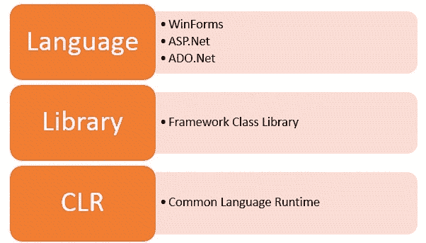.Net framework 的架构基于以下关键组件；1. `Common Language Runtime`（通用语言运行时）——“通用语言体系”或 `CLI` 是执行 .Net 程序的平台。

`CLI` 具有以下关键特性：

异常处理（Exception Handling）——异常是在应用程序执行时发生的错误。异常的示例包括：
- 如果应用程序尝试打开本地机器上的文件，但该文件不存在。
- 如果应用程序尝试从数据库获取某些记录，但与数据库的连接无效。

垃圾回收（`Garbage Collection`）——垃圾回收是在不再需要时移除资源的过程。垃圾回收的示例包括：
- 不再需要的文件句柄。如果应用程序完成了对文件的所有操作，那么该文件句柄可能不再需要了。
- 不再需要的数据库连接。如果应用程序完成了对数据库的所有操作，那么数据库连接可能不再需要了。

与各种编程语言协作工作——

如前面的章节所述，开发者可以使用多种 .Net 编程语言开发应用程序。

1. 语言——第一层是编程语言本身，最常见的有 `VB.Net` 和 `C#`。
2. 编译器——每种编程语言都有一个独立的编译器。因此，在 `VB.Net` 语言下方，有一个独立的 `VB.Net` 编译器。同样，对于 `C#`，你会有另一个编译器。
3. 通用语言解释器（Common Language Interpreter）——这是 .Net 的最后层，用于运行用任何编程语言开发的 .net 程序。因此，后续编译器会将程序发送到 `CLI` 层来运行 .Net 应用程序。

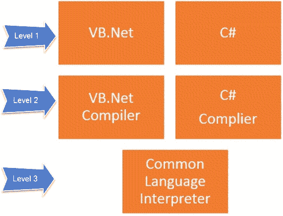

2. 类库（Class Library）——.NET Framework 包含一组标准类库。类库是用于核心用途的方法和函数的集合。

例如，有一个类库包含处理所有文件级操作的方法。因此，有一个方法可以用于从文件中读取文本。同样，有一个方法可以将文本写入文件。

大多数方法都被划分为 `System.*` 或 `Microsoft.*` 命名空间。（星号 `*` 仅表示对 `System` 或 `Microsoft` 命名空间下所有方法的引用）。

命名空间（Namespace）是方法的逻辑隔离。我们将在后续章节中更详细地学习这些命名空间。

3. 语言——在 .Net framework 中可以构建的应用程序类型大致分为以下几类。

`WinForms` —— 用于开发基于表单的应用程序，这些程序运行在终端用户机器上。记事本（Notepad）是客户端应用程序的一个示例。

`ASP.Net` —— 用于开发基于 Web 的应用程序，这些程序旨在运行在任何浏览器上，如 Internet Explorer、Chrome 或 Firefox。Web 应用程序将在安装了 Internet 信息服务（IIS）的服务器上处理。Internet 信息服务或 `IIS` 是微软的一个组件，用于执行 `ASP.net` 应用程序。执行结果随后发送到客户端机器，输出显示在浏览器中。

`ADO.Net` —— 这项技术用于开发与 Oracle 或 Microsoft SQL Server 等数据库交互的应用程序。

## .Net framework 的不同版本

下面是 .Net framework 版本的表格，列出了它们的发布日期。每个版本对框架都有相应的更改。

例如，在框架 3.5 及之后的版本中，发布了一个名为 `Entity framework` 的关键框架。该框架用于改变在处理数据库时开发应用程序的方法。

| 版本号 | CLR 版本 | 发布日期 |
| :--- | :--- | :--- |
| 1.0 | 1.0 | 2002-02-13 |
| 1.1 | 1.1 | 2003-04-24 |
| 2.0 | 2.0 | 2005-11-07 |
| 3.0 | 2.0 | 2006-11-06 |
| 3.5 | 2.0 | 2007-11-19 |
| 4.0 | 4 | 2010-04-12 |
| 4.5 | 4 | 2012-08-15 |
| 4.5.1 | 4 | 2013-10-17 |
| 4.5.2 | 4 | 2014-05-05 |
| 4.6 | 4 | 2015-07-20 |
| 4.6.1 | 4 | 2015-11-17 |

.Net framework 最大的优势是它支持 Windows 平台。几乎所有人都在使用 Windows 机器工作。微软始终确保 .Net frameworks 符合所有支持的 Windows 操作系统。

.Net framework 的以下设计原则使其创建基于 .Net 的应用程序非常有意义。

1. 交互性（Interoperability）——.Net framework 提供了大量的向后支持。假设你有一个基于旧版本 .Net framework（例如 `2.0`）构建的应用程序。如果你尝试在具有较高版本 .Net framework（例如 `3.5`）的机器上运行相同的应用程序，它仍然可以运行。这是因为每次发布，微软都确保旧框架版本与新版本良好融合。
2. 可移植性（Portability）——在 .Net framework 上构建的应用程序可以运行在任何 Windows 平台上。现在微软也设想让微软产品运行在 iOS 和 Linux 等平台上。
3. 安全性（Security）——NET Framework 具有良好的安全机制。内置的安全机制有助于应用程序的验证和确认。每个应用程序都可以显式地定义自己的安全机制。每个安全机制用于授予用户访问代码或运行程序的权限。
4. 内存管理（Memory management）——通用语言运行时负责所有的内存管理工作。.Net framework 有能力识别未被运行程序使用的资源。它随后会相应释放这些资源。这是通过一个名为“垃圾回收器”的程序实现的，它是 .Net framework 的一部分。垃圾回收器定期运行，检查哪些系统资源未被利用并相应释放它们。
5. 简化部署（Simplified deployment）——.Net framework 还拥有工具，用于封装基于 .Net framework 构建的应用程序。这些包可以分发到客户端机器。这些包将自动安装应用程序。

### 总结

.Net 是微软开发的一种编程语言。它旨在构建运行在 Windows 平台上的应用程序。.Net 编程语言可用于开发基于表单的应用程序、基于 Web 的应用程序以及 Web 服务。


Microsoft Visual Studio 是由微软提供的一款集成开发环境（IDE）。它用于为 Microsoft Windows 开发计算机程序。Visual Studio 是基于 `.Net` 平台构建的所有应用程序的一站式解决方案。用户可以使用 Visual Studio 进行开发、调试和运行应用程序。

使用此 IDE 可以设计和开发基于 Forms（窗体）和基于 Web 的应用程序。Visual Studio 具有以下述功能：

1. **使用任何 .Net 语言创建应用程序** – 可以使用 Visual Studio IDE 创建任何 `.Net` 语言的应用程序。因此，开发者可以使用 `C#`、`VB.Net` 甚至 `F#` 来开发应用程序。
2. **创建任何类型的应用程序 –** 可以使用 Visual Studio IDE 创建任何类型的应用程序（基于 Web 的应用程序或基于 Windows Forms 的应用程序）。
3. **即时调试应用程序 –** 可以在构建的同时进行测试。该 IDE 允许用户在开发过程中的任何时间运行程序。因此，开发者可以在开发阶段就检查任何错误。
4. **扩展 –** 该 IDE 具有安装第三方扩展的功能。例如 `Subversion`，它被用于源代码仓库管理。`Subversion` 用于将代码上传到中央仓库。这样做是为了确保始终存在代码副本。Visual Studio 具有从 IDE 本身集成此类软件的功能。因此，开发者可以直接在 IDE 中与代码仓库工作。

让我们来看此 IDE 的安装过程，以便我们在后续章节中创建程序。可以通过以下链接下载 Visual Studio - `https://www.visualstudio.com/en-us/downloads/download-visual-studio-vs.aspx`

一旦你有了 Visual Studio 安装程序，可以按照以下步骤进行安装：

**步骤 1)** 第一步涉及选择安装位置。在这一步中，还必须接受许可条款和条件。

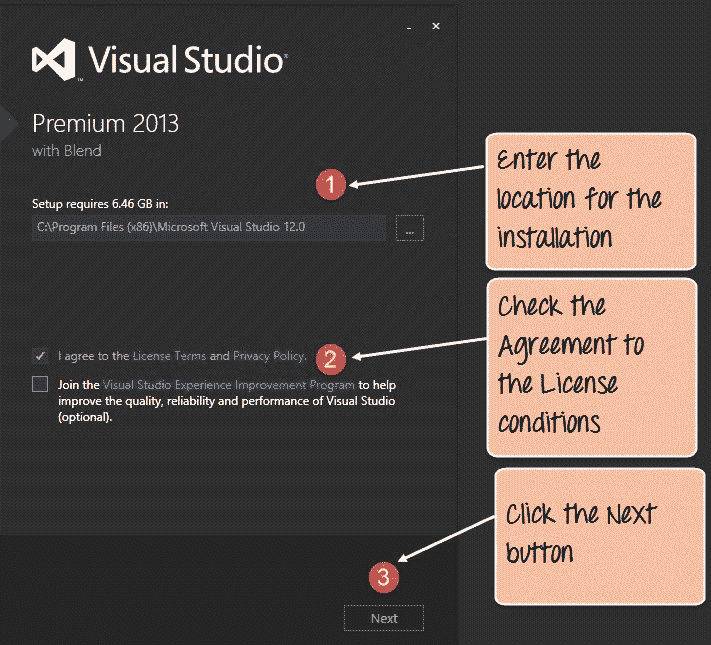

1. 选择 Visual Studio 的安装位置。确保你的机器上有足够的磁盘空间进行安装。
2. 同意许可条款和隐私政策。
3. 点击 Next（下一步）按钮继续。

**步骤 2)** 下一步涉及选择作为安装一部分的所需组件。

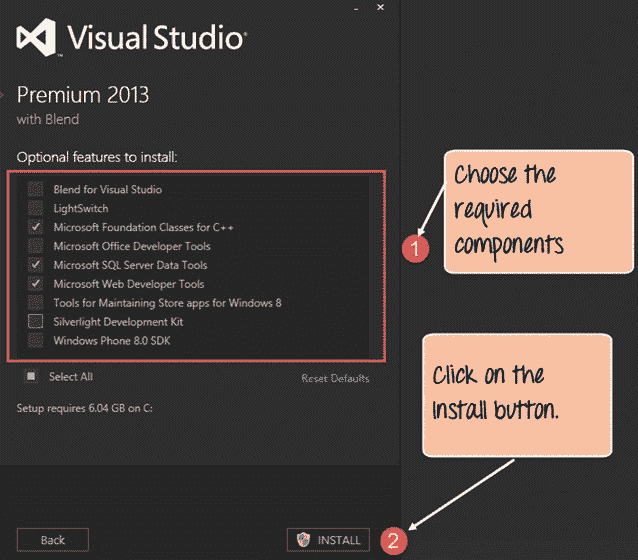

1. 仅选择所需的组件。这可以节省安装所需的空间。以下是应该安装的重要组件：
- Microsoft Foundation Classes for C++
- Microsoft SQL Server Data Tools
- Microsoft Web Developer Tools
2. 之后，点击 Install（安装）按钮开始安装。

安装完成后，你将看到下面显示安装成功的屏幕 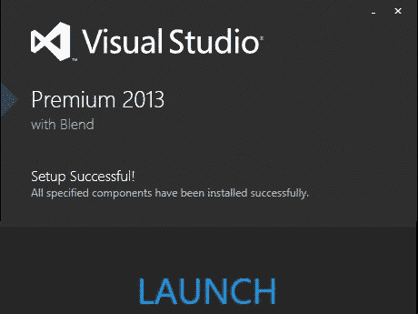

# 第 3 章：数据类型

`C#` 是微软提供的用于处理 `.Net` 的语言之一。这种语言包含了丰富的特征集，允许开发不同类型的应用程序。

`C#` 是一种面向对象的编程语言，在许多方面与 `C++` 语言相似。在本文教程中，我们将学习如何开发第一个应用程序。这将是一个基础控制台应用程序，然后我们将探索 `C#` 语言中提供的不同数据类型以及控制流语句。

## 构建第一个控制台应用程序

控制台应用程序是在 Windows 命令提示符中运行的应用程序。对于任何 `.Net` 初学者来说，构建控制台应用程序理想上是开始的第一步。

在我们的示例中，我们将使用 Visual Studio 创建一个控制台类型的项目。接下来，我们将使用该控制台应用程序显示消息“Welcome to .Net”。然后，我们将查看如何构建和运行该控制台应用程序。

让我们按照以下步骤来实现此示例。

**步骤 1)** 第一步涉及在 Visual Studio 中创建一个新项目。为此，启动 Visual Studio 后，你需要选择菜单选项 `New->Project`。

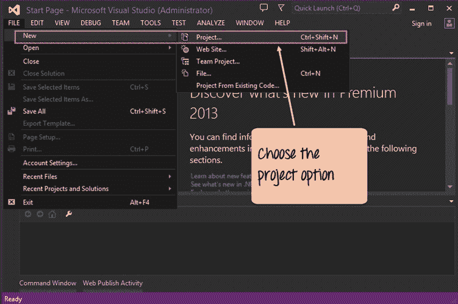**步骤 2)** 下一步是选择项目类型为 Console application（控制台应用程序）。在这里，我们还需要指定项目的名称和位置。

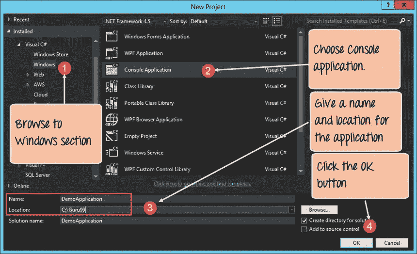

1. 在项目对话框中，我们可以看到在 Visual Studio 中创建不同项目的各种选项。点击左侧的 `Windows` 选项。
2. 当我们在上一步点击 `Windows` 选项时，将看到 `Console Application` 选项。点击此选项。
3. 然后我们为应用程序指定一个名称，在我们的案例中名称为 `DemoApplication`。我们还需要提供一个存储应用程序的位置。
4. 最后，点击 ‘OK’ 按钮让 Visual Studio 创建我们的项目。

如果遵循了上述步骤，你将在 Visual Studio 中得到下面的输出。**输出：**

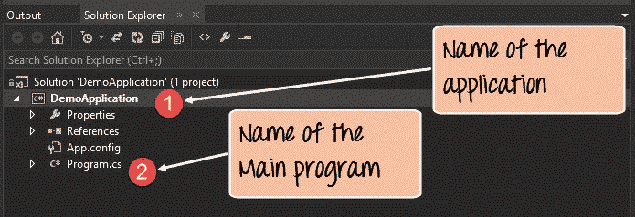

1. Visual Studio 将创建一个名为 `DemoApplication` 的项目。该项目将包含运行控制台应用程序所需的所有 set。
2. 名为 `Program.cs` 的 `Main` 程序是在在 Visual Studio 中创建新应用程序时创建的默认代码文件。此代码将包含我们控制台应用程序所需的代码。

**步骤 3)** 现在让我们编写代码，这些代码将用于在控制台应用程序中显示字符串“Welcome to .Net”。

下面的代码都需要输入到 `Program.cs` 文件中。这些代码将在控制台应用程序运行时写入“Welcome to .Net”。

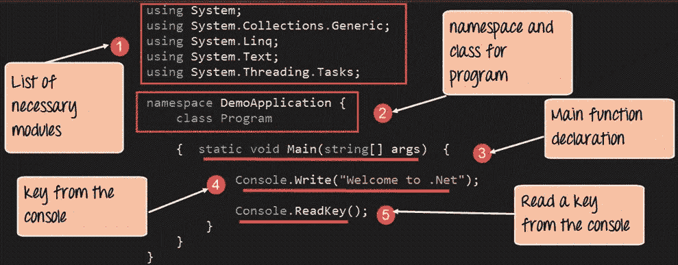**代码解释：**

1. 下方的所有代码都是 Visual Studio 默认输入的。`using` 语句用于导入控制台应用程序中的现有 .Net 模块。任何 .Net 应用程序的运行都需要这些模块。它们包含了使代码运行的最少代码。
2. 每个应用程序都属于一个类。`C#` 是一种面向对象的语言，因此所有代码都需要定义在一个称为类的自持续模块中。反过来，每个类都属于一个命名空间。
3. `Main` 函数是一个在运行时自动调用的特殊函数。在这里你需要确保控制台应用程序中显示所需字符串的代码。
4. `Console` 类在 `.Net` 中可用，允许用户处理控制台应用程序。在这里我们使用一个名为 `Write` 的内置方法在控制台上写入“Welcome to .Net”。
5. 然后我们使用 `Console.ReadKey()` 方法从控制台读取任何键。通过输入此行代码，程序将等待而不会立即退出。程序将在用户输入任何键之前最终退出。如果你不在代码中包含此语句，程序将在运行时立即退出。

**步骤 4)** 运行你的 .Net 程序。要运行任何程序，你需要点击 Visual Studio 中的 Start 按钮。

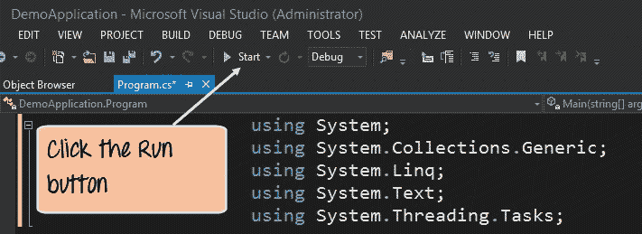如果上述代码输入正确且程序执行成功，将显示以下输出。

**输出：**

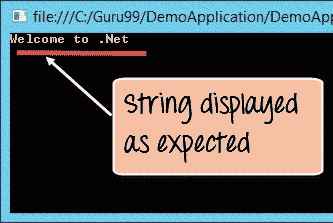

## C# 数据类型

`C#` 语言自带一组基础数据类型。这些数据类型用于构建应用程序内部使用的值。让我们探索 `C#` 中提供的基础数据类型。对于每个示例，我们将仅修改 `Program.cs` 文件中的主函数。


# 1. **整数 (Integer)**
整数数据类型用于处理数字。在这种情况下，数字是像 10、20 或 30 这样的整数。在 C# 中，该数据类型由 `Int32` 关键字表示。下面是如何使用此数据类型的示例。在示例中，我们将定义一个名为 `num` 的 `Int32` 变量。然后为该变量赋值一个 `Integer` 值，并相应地显示它。

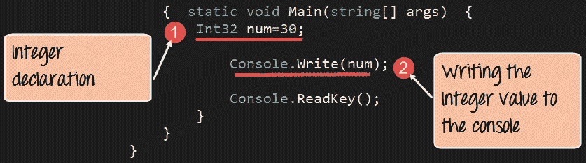
**代码解释：**

1. 指定 `Int32` 数据类型来声明一个名为 `num` 的整数变量。然后给该变量赋值为 30。
2. 最后，使用 `console.write` 函数将数字显示在控制台上。

如果正确输入了上述代码并成功执行程序，将显示以下输出。
从输出中你可以清楚地看到控制台上显示了名为 `num` 的整数变量。

# 2. **双精度浮点数 (Double)**
double 数据类型用于处理小数。在这种情况下，数字是像 10.11、20.22 或 30.33 这样的数字。在 C# 中，该数据类型由关键字 `Double` 表示。下面是此数据类型的示例。

在示例中，我们将定义一个名为 `num` 的 double 变量。然后为该变量赋值一个 `Double` 值，并相应地显示它。


**代码解释：**

1. 指定 double 数据类型来声明一个名为 `num` 的 double 类型变量。然后给该变量赋值为 30.33。
2. 最后，使用 `console.write` 函数将数字显示在控制台上。

如果正确输入了上述代码并成功执行程序，将显示以下输出。
从输出中你可以清楚地看到控制台上显示了名为 `num` 的 double 变量。

# 3. **布尔值 (Boolean)**
布尔数据类型用于处理 `true` 和 `false` 的布尔值。在 C# 中，该数据类型由 Boolean 关键字表示。下面是此数据类型的的使用示例。

在示例中，我们将定义一个名为 `status` 的布尔变量。然后为该变量赋值一个布尔值，并相应地显示它。

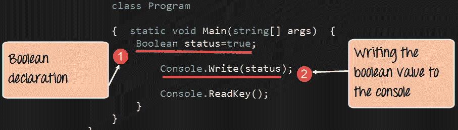
**代码解释：**

1. 指定 boolean 数据类型来声明一个名为 `status` 的布尔变量。然后给该变量赋值 `true/false`。
2. 最后，使用 `console.write` 函数将布尔值显示在控制台上。

如果正确输入了上述代码并成功执行程序，将显示输出。
**输出：**

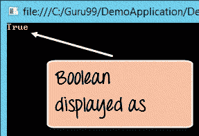
从输出中你可以清楚地看到控制台上显示了等于 `true` 的布尔变量。

# 4. **字符串 (String)**
String 数据类型用于处理字符串值。在 C# 中，该数据类型由关键字 `String` 表示。下面是此数据类型的示例。

在示例中，我们将定义一个名为 `message` 的 String 变量。然后为该变量赋值一个 `String` 值，并相应地显示它。

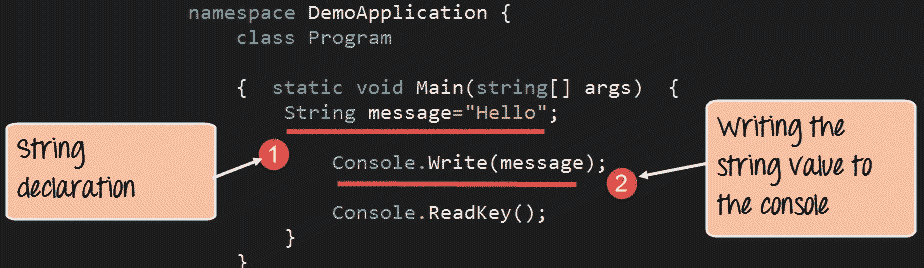
**代码解释：**

1. 指定 `String` 数据类型来声明一个名为 `message` 的字符串变量。然后给该变量赋值为 `"Hello"`。
2. 最后，使用 `console.write` 函数将字符串值显示在控制台上。

如果正确输入了上述代码并成功执行程序，将显示输出。
**输出：**

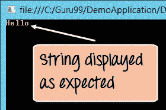
从输出中你可以清楚地看到控制台上显示了名为 `message` 的 String 变量。

## C# 枚举 (Enumeration)
枚举在任何编程语言中用于定义一组常量值。例如，可以将星期的几天定义为枚举并在程序的任何地方使用。在 C# 中，枚举通过关键字 `enum` 的帮助来定义。

让我们一个如何使用 `enum` 关键字的示例。
在示例中，我们将定义一个名为 `days` 的枚举，它用于存储星期的几天。对于每个示例，我们只修改 `Program.cs` 文件中的 main 函数。

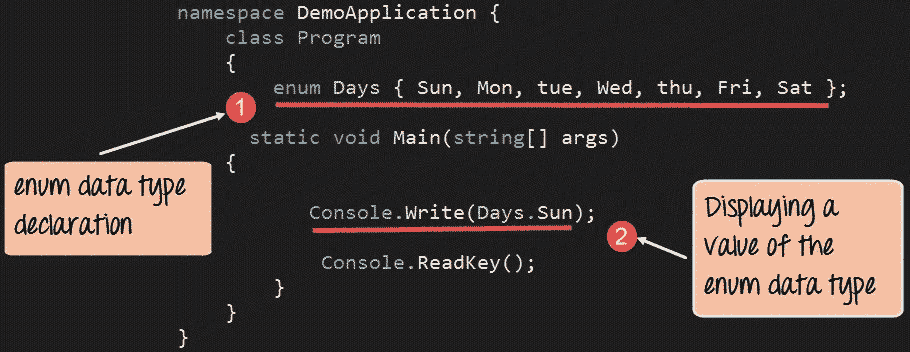
**代码解释：**

1. 指定 `enum` 数据类型来声明一个枚举。枚举名称是 `Days`。星期的所有天都被指定为枚举的值。
2. 最后，使用 `console.write` 函数显示枚举的一个值。

如果正确输入了上述代码并成功执行程序，将显示以下输出。
**输出：**

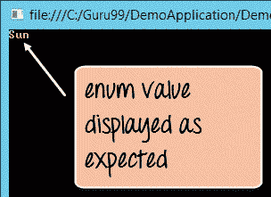
从输出中你可以清楚地看到控制台上显示了枚举的 `'Sun'` 值。

## C# 运算符和变量 (Operators and Variables)
变量是存储区域的名称，用于存储各种数据类型的值。在 C# 中，每个变量都需要一个特定类型，这决定了变量内存的大小和布局。

例如，变量可以是 `String` 类型，这意味着它将用于存储字符串值。根据数据类型，可以在变量上执行特定的操作。
例如，如果我们有一个 `Integer` 变量，那么可以在变量上执行加法和减法等操作。可以在程序中声明多个变量。

让我们来看一个不同数据类型变量定义的快速示例。
在示例中，我们将定义 2 个变量，一个是 `string` 类型，另一个是 `Integer` 类型。我们将这些变量的值显示在控制台上。对于每个示例，我们只修改 `Program.cs` 文件中的 main 函数。

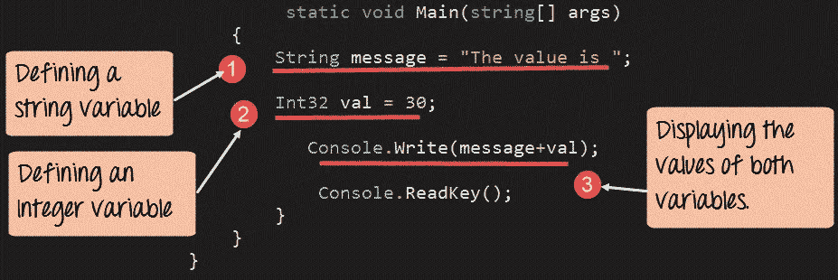
**代码解释：**

1. 声明了一个数据类型为 `String` 的变量。变量名为 `message`。变量的值为 `"The value is "`。
2. 声明了一个数据类型为 `Integer` (`Int32`) 的变量。变量名为 `val`。变量的值为 30。
3. 最后，使用 `Console.write` 语句输出 `String` 和 `Integer` 的值。

如果正确输入了上述代码并成功执行程序，将显示以下输出。
**输出：**

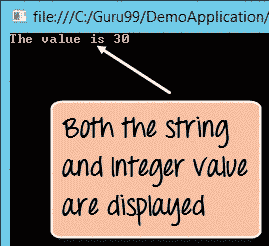
从输出中你可以清楚地看到字符串变量和整数变量的值都显示在控制台上。

运算符用于对各种数据类型的值执行操作。例如，要执行两个数字的加法，使用 `+` 运算符。让我们看看各种数据类型可用的运算符表。

### 1. 算术运算符 (Arithmetic Operators)
这些用于对数字执行数学运算的运算符。下面是 C# 中提供的运算符列表。

| 运算符 | 说明 |
|---|---|
| + | 加两个操作数 |
| - | 从第一个操作数中减去第二个操作数 |
| * | 两个操作数相乘 |
| / | 将分子除以分母 |
| % | 模运算符，和整数除法后的余数 |
| ++ | 递增运算符，将整数值加一 |
| -- | 递减运算符，将整数值减一 |

### 2. 关系运算符 (Relational Operators)
这些用于对数字执行关系运算的运算符。

| 运算符 | 说明 |
|---|---|
| == | 检查两个操作数的值是否相等，如果是，则条件为真。 |
| != | 检查两个操作数的值是否相等，如果不相等，则条件为真。 |
| > | 检查左操作数的值是否大于右操作数的值，如果是，则条件为真。 |
| < | 检查左操作数的值是否小于右操作数的值，如果是，则条件为真。 |
| >= | 检查左操作数的值是否大于或等于右操作数的值，如果是，则条件为真。 |
| <= | 检查左操作数的值是否小于或等于右操作数的值，如果是，则条件为真。 |


## 3. 逻辑运算符

这些是用于对值执行逻辑操作的运算符。以下是 C# 中可用的运算符列表。

### 运算符说明

- `&&`: 这是逻辑与（AND）运算符。如果两个操作数都真，则条件为真。
- `||`: 这是逻辑或（OR）运算符。如果任一操作数为真，则条件为真。
- `!`: 这是逻辑非（NOT）运算符。

让我们来看一个如何在 .Net 中使用运算符的示例。在示例中，我们将定义两个整数（Integer）变量和一个布尔（Boolean）变量。然后我们将执行以下操作：

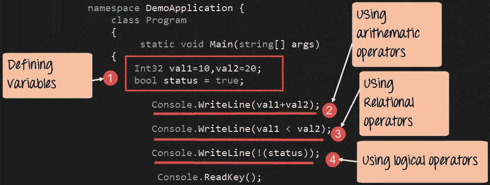

**代码解释：**

1. 定义了两个整数变量，一个为 `val1`，另一个为 `val2`。这些用于展示关系运算和算术运算。定义了一个布尔变量来展示逻辑操作。
2. 显示了一个算术运算的示例，对 `val1` 和 `val2` 执行了加法操作。结果写入控制台。
3. 显示了一个关系运算的示例，对 `val1` 和 `val2` 执行了小于运算符操作。结果写入控制台。
4. 显示了一个逻辑操作的示例，将逻辑运算符 `!` 应用于 `status` 变量。逻辑非运算符会反转任何布尔值的当前值。因此，如果布尔值为‘true’，逻辑非将返回值‘false’，反之亦然。在我们的情况下，由于 `status` 变量的值为‘true’，结果将显示‘false’。结果写入控制台。

如果上述代码输入正确且程序执行成功，将显示输出。

**输出：**

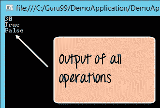

## 流程控制和条件语句

任何编程语言都有流程控制和条件语句，用于改变程序的执行流。

例如，如果有人想根据某些逻辑执行一组特定的语句，那么流程控制和条件语句将非常有用。随着我们学习 C# 中提供的各种语句，你将会有更好的理解。

请注意，以下所有代码均编写在 `Program.cs` 文件中。

### 1. If 语句

`if` 语句用于在执行一组语句之前评估布尔表达式。如果表达式求值为真，则它将运行一组语句，否则将运行另一组语句。

在下方的示例中，对名为 `value` 的变量进行了比较。如果变量的值小于 10，则它将运行一条语句，否则将运行另一条语句。

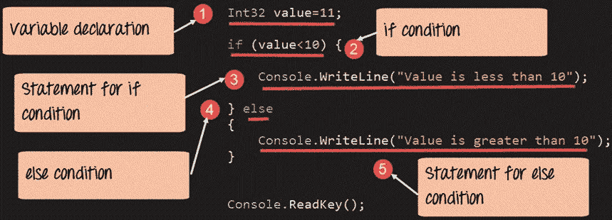

**代码解释：**

1. 我们首先定义了一个名为 `value` 的变量，并将其设置为 11。
2. 随后我们使用 `if` 语句检查变量 `value` 的值是否小于 10。结果将为真或假。
3. 如果 `if` 条件求值为真，我们则向控制台发送消息“Value is less than 10”。
4. 如果 `if` 条件求值为假，我们则向控制台发送消息“Value is greater than 10”。

如果上述代码输入正确且程序执行成功，将显示以下输出。

**输出：**

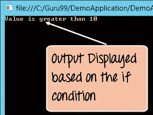 我们可以清楚地看到 `if` 语句的评估结果为假。因此，控制台发送了消息“Value is greater than 10”。

### 2. Switch 语句

`switch` 语句是 `if` 语句的增强版。如果你有多个需要一次性评估的表达式，那么编写多个 `if` 语句就会成为问题。

`switch` 语句用于评估一个表达式并根据表达式的结果运行不同的语句。如果一个条件未评估为真，`switch` 语句将移动到下一个条件，依此类推。

让我们通过下面的示例来看它是如何运作的。在这里，我们再次比较名为 `value` 的变量的值。然后我们检查该值是否等于 1、2 或其他完全不同的值。

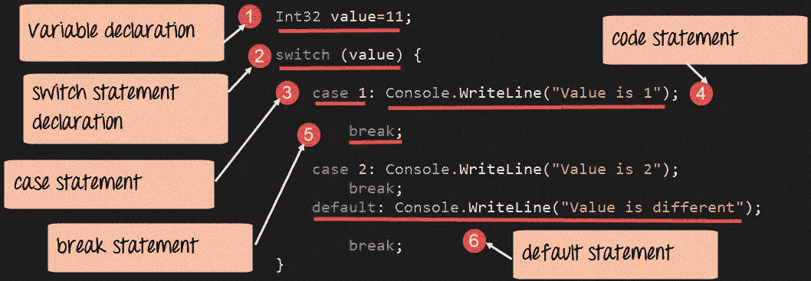

**代码解释：**

1. 我们首先定义了一个名为 `value` 的变量，并将其设置为 11。
2. 随后我们使用 `switch` 语句检查变量 `value` 的值。
3. `case` 语句用于设置不同的条件。根据条件，可以执行一组语句。一个 `switch` 语句可以有多个 `case` 条件。第一个 `case` 语句检查变量的值是否等于 1。
4. 如果第一个 `case` 语句为真，则向控制台写入消息“Value is 1”。
5. `break` 语句用于在条件为真时跳出整个 `switch` 语句。
6. `default` 条件是一个特殊条件。它意味着如果没有一个 `case` 表达式评估为真，则执行 `default` 条件对应的语句组。

如果上述代码输入正确且程序执行成功，将显示以下输出。输出打印了默认值“Value is different”，因为没有条件被满足。

**输出：**

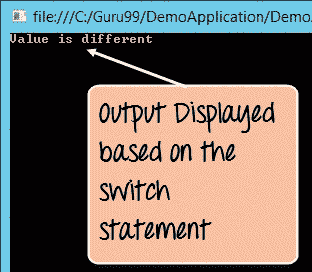

### 3. While 循环

`while` 循环用于迭代目的。假设你想针对特定次数重复执行一组语句，则使用 `while` 循环。

在下方的示例中，我们使用 `while` 语句来显示变量 `i` 的值。`while` 语句被用于显示 3 次。

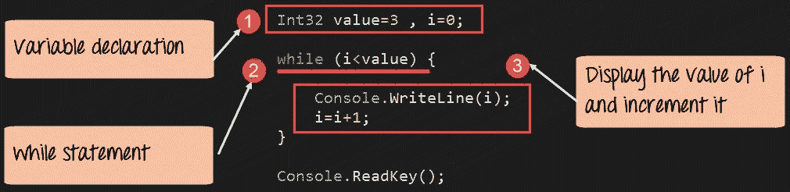

**代码解释：**

1. 定义了两个整数变量，一个为 `value`，另一个为 `i`。`value` 变量被用作我们 `while` 语句迭代的上限。而 `i` 是在迭代过程中处理的变量。
2. 在 `while` 语句中，不断检查 `i` 的值与上限的比较。
3. 在这里向控制台显示 `i` 的值。我们还增加了 `i` 的值。

如果上述代码输入正确且程序执行成功，将显示以下输出。

**输出：**

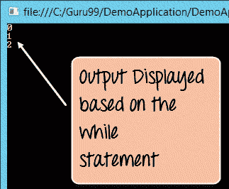 在这里你可以看到 `while` 语句执行了 3 次并同时进行了递增。每次它都会显示变量 `i` 的当前值。

### 4. For 循环

`for` 循环也用于迭代目的。假设你想特定次数重复执行一组语句，则使用 `for` 循环。

在下方的示例中，我们使用 `for` 语句来显示变量 `i` 的值。`for` 语句被用于显示 3 次。

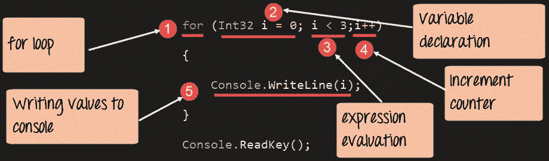

**代码解释：**

1. `for` 关键字用于启动 `for` 循环。
2. 在 `for` 循环中，我们定义了三个。第一个是初始化变量的值，该值将在 `for` 循环中使用。
3. 第二是将 `i` 的值与上限进行比较。在我们的案例中，上限是值 3 (`i<3`)。
4. 最后，相应地增加 `i` 的值。
5. 在这里向控制台显示 `i` 的值。

如果上述代码输入正确且程序执行成功，将显示以下输出。

**输出：**

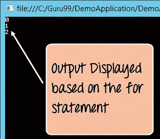 在这里你可以看到 `for` 语句执行了 3 次。每次它都会显示变量 `i` 的当前值。

## C# 数组

数组用于存储一组或一系列元素。这些元素将具有相同的类型。


例如，如果你有一个整数值数组，该数组可以是此类值的集合，如 [1, 2, 3, 4]。在这里，数组中的元素数量为 4。

当你想要存储一组相同类型值的集合时，数组非常有用。因此，你不需要为每个元素声明一个变量，只需声明一个变量即可。


此变量将指向一个元素数组或列表，负责存储数组的元素。

让我们看看如何在 C# 中操作数组。在我们的示例中，我们将声明一个 `Integers` 类型的数组并对其进行相应操作。

请注意，以下所有代码都编写在 `Program.cs` 文件中。

### 步骤 1) 声明数组
第一步是声明数组。让我们看看通过下面的代码示例如何实现这一目标。

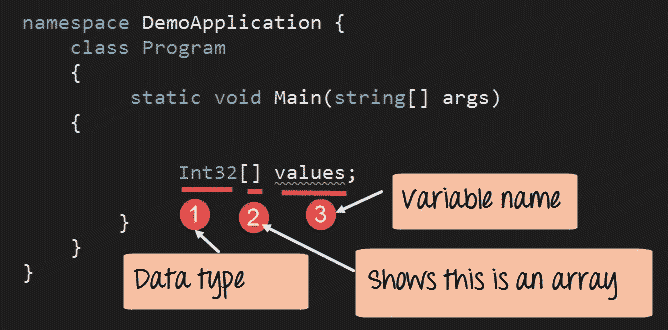
**代码解释：**

1. 第一部分是数据类型。它指定了数组中使用的元素类型。在我们的案例中，我们正在创建一个 `Integers` 数组。
2. 第二部分 `[]`，指定了数组的秩（rank）。秩是一个占位符，指定了数组将包含的元素数量。
3. 接下来是数组的名称，在我们的案例中是 `values`。注意你看到一个绿色的波浪下划线，不用担心。那只是 `.Net` 在提示你已经声明了一个数组，但在任何地方都没有使用它。

### 步骤 2) 初始化数组
下一步是初始化数组。在这里，我们将指定数组将持有的值数量。我们还将为数组的每个元素赋值。

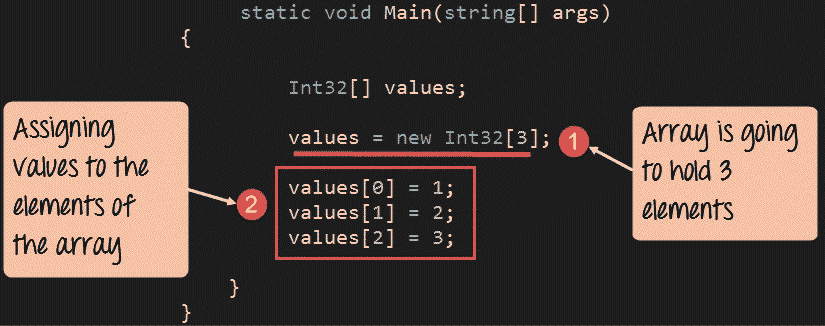
**代码解释：**

1. 首先，我们将设置数组持有的元素数量为 3。因此，在方括号中，我们表示数组将包含 3 个元素。
2. 然后，我们为数组的每个单独元素赋值。我们可以通过指定变量名 + 数组中的索引位置来实现。

因此，`values[0]` 意味着我们正在数组的第一位置存储一个值。同样，要访问第二个位置，我们使用 `values[1]` 的表示法，以此此类推。

**注意**：在数组中，索引位置从 0 开始。

### 步骤 3) 显示元素
现在让我们在控制台（Console）中显示数组的各个元素。添加下面的代码来实现这一目标。

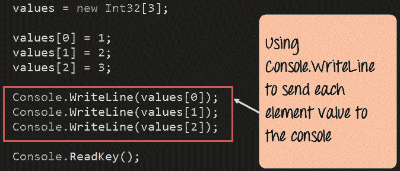
**代码解释：**

这是最简单的部分，我们只需使用 `Console.Write` 方法将每个元素的值发送到控制台。

请注意，我们再次通过数组变量名结合索引位置来访问每个元素。

如果正确输入了上述代码并执行程序，将显示以下输出。

**输出：**

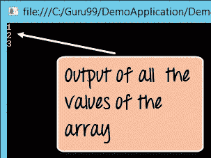从输出中，你可以看到数组的所有值都显示在控制台中。

### 总结

- 控制台应用程序（Console application）可以在 Windows 机器的命令提示符中运行。
- `Console.write` 方法可将内容写入控制台。C# 中可用的基本数据类型有 `Integer`、`Double`、`Boolean` 和 `String`。枚举（Enumerations）用于声明一组常量值。在 C# 中，枚举使用 `enum` 关键字进行声明。
- C# 中可用的各种运算符大致分为算术运算符、关系运算符和逻辑运算符类。
- 变量用于指向包含特定数据类型值的内存位置。
- 数组用于存储相同类型的元素。数组的单个元素可以被赋值。

# 第 4 章：类与对象

C# 基于 C++ 编程语言。因此，C# 编程语言对类（Class）和对象（Object）有内置支持。类本质上是用于表示现实实体的属性和方法的封装。

例如，如果你想在特定的应用程序中处理员工数据。

员工的属性将是员工的 ID 和名称。方法将包括员工数据的输入和修改。所有这些操作都可以在 C# 中表示为一个类。

## 类与对象

C# 基于 C++ 编程语言。因此，C# 编程语言对类和对象有内置支持。类本质上是用于表示现实实体的属性和方法的封装。

例如，如果你想在特定的应用程序中处理员工数据。

员工的属性将是员工的 ID 和名称。方法将包括员工数据的输入和修改。所有这些操作都可以在 C# 中表示为一个类。

## 类与对象

C# 基于 C++ 编程语言。因此，C# 编程语言对类和对象有内置支持。类本质上是用于表示现实实体的属性和方法的封装。

例如，如果你想在特定的应用程序中处理员工数据。

员工的属性将是员工的 ID 和名称。方法将包括员工数据的输入和修改。所有这些操作都可以在 C# 中表示为一个类。

## 类与对象

C# 基于 C++ 编程语言。因此，C# 编程语言对类和对象有内置支持。类本质上是用于表示现实实体的属性和方法的封装。

例如，如果你想在特定的应用程序中处理员工数据。

员工的属性将是员工的 ID 和名称。方法将包括员工数据的输入和修改。所有这些操作都可以在 C# 中表示为一个类。

## 类与对象

C# 基于 C++ 编程语言。因此，C# 编程语言对类和对象有内置支持。类本质上是用于表示现实实体的属性和方法的封装。

例如，如果你想在特定的应用程序中处理员工数据。

员工的属性将是员工的 ID 和名称。方法将包括员工数据的输入和修改。所有这些操作都可以在 C# 中表示为一个类。

## 类与对象

C# 基于 C++ 编程语言。因此，C# 编程语言对类和对象有内置支持。类本质上是用于表示现实实体的属性和方法的封装。

例如，如果你想在特定的应用程序中处理员工数据。

员工的属性将是员工的 ID 和名称。方法将包括员工数据的输入和修改。所有这些操作都可以在 C# 中表示为一个类。

## 类与对象

C# 基于 C++ 编程语言。因此，C# 编程语言对类和对象有内置支持。类本质上是用于表示现实实体的属性和方法的封装。

例如，如果你想在特定的应用程序中处理员工数据。

员工的属性将是员工的 ID 和名称。方法将包括员工数据的输入和修改。所有这些操作都可以在 C# 中表示为一个类。

## 类与对象

C# 基于 C++ 编程语言。因此，C# 编程语言对类和对象有内置支持。类本质上是用于表示现实实体的属性和方法的封装。

例如，如果你想在特定的应用程序中处理员工数据。

员工的属性将是员工的 ID 和名称。方法将包括员工数据的输入和修改。所有这些操作都可以在 C# 中表示为一个类。

## 类与对象

C# 基于 C++ 编程语言。因此，C# 编程语言对类和对象有内置支持。类本质上是用于表示现实实体的属性和方法的封装。

例如，如果你想在特定的应用程序中处理员工数据。

员工的属性将是员工的 ID 和名称。方法将包括员工数据的输入和修改。所有这些操作都可以在 C# 中表示为一个类。

## 类与对象

C# 基于 C++ 编程语言。因此，C# 编程语言对类和对象有内置支持。类本质上是用于表示现实实体的属性和方法的封装。

例如，如果你想在特定的应用程序中处理员工数据。

员工的属性将是员工的 ID 和名称。方法将包括员工数据的输入和修改。所有这些操作都可以在 C# 中表示为一个类。

## 类与对象

C# 基于 C++ 编程语言。因此，C# 编程语言对类和对象有内置支持。类本质上是用于表示现实实体的属性和方法的封装。

例如，如果你想在特定的应用程序中处理员工数据。

员工的属性将是员工的 ID 和名称。方法将包括员工数据的输入和修改。所有这些操作都可以在 C# 中表示为一个类。

## 类与对象

C# 基于 C++ 编程语言。因此，C# 编程语言对类和对象有内置支持。类本质上是用于表示现实实体的属性和方法的封装。

例如，如果你想在特定的应用程序中处理员工数据。

员工的属性将是员工的 ID 和名称。方法将包括员工数据的输入和修改。所有这些操作都可以在 C# 中表示为一个类。

## 类与对象

C# 基于 C++ 编程语言。因此，C# 编程语言对类和对象有内置支持。类本质上是用于表示现实实体的属性和方法的封装。

例如，如果你想在特定的应用程序中处理员工数据。

员工的属性将是员工的 ID 和名称。方法将包括员工数据的输入和修改。所有这些操作都可以在 C# 中表示为一个类。

## 类与对象

C# 基于 C++ 编程语言。因此，C# 编程语言对类和对象有内置支持。类本质上是用于表示现实实体的属性和方法的封装。

例如，如果你想在特定的应用程序中处理员工数据。

员工的属性将是员工的 ID 和名称。方法将包括员工数据的输入和修改。所有这些操作都可以在 C# 中表示为一个类。

## 类与对象

C# 基于 C++ 编程语言。因此，C# 编程语言对类和对象有内置支持。类本质上是用于表示现实实体的属性和方法的封装。

例如，如果你想在特定的应用程序中处理员工数据。

员工的属性将是员工的 ID 和名称。方法将包括员工数据的输入和修改。所有这些操作都可以在 C# 中表示为一个类。

## 类与对象

C# 基于 C++ 编程语言。因此，C# 编程语言对类和对象有内置支持。类本质上是用于表示现实实体的属性和方法的封装。

例如，如果你想在特定的应用程序中处理员工数据。

员工的属性将是员工的 ID 和名称。方法将包括员工数据的输入和修改。所有这些操作都可以在 C# 中表示为一个类。

## 类与对象

C# 基于 C++ 编程语言。因此，C# 编程语言对类和对象有内置支持。类本质上是用于表示现实实体的属性和方法的封装。

例如，如果你想在特定的应用程序中处理员工数据。

员工的属性将是员工的 ID 和名称。方法将包括员工数据的输入和修改。所有这些操作都可以在 C# 中表示为一个类。

## 类与对象

C# 基于 C++ 编程语言。因此，C# 编程语言对类和对象有内置支持。类本质上是用于表示现实实体的属性和方法的封装。

例如，如果你想在特定的应用程序中处理员工数据。

员工的属性将是员工的 ID 和名称。方法将包括员工数据的输入和修改。所有这些操作都可以在 C# 中表示为一个类。

## 类与对象

C# 基于 C++ 编程语言。因此，C# 编程语言对类和对象有内置支持。类本质上是用于表示现实实体的属性和方法的封装。

例如，如果你想在特定的应用程序中处理员工数据。

员工的属性将是员工的 ID 和名称。方法将包括员工数据的输入和修改。所有这些操作都可以在 C# 中表示为一个类。

## 类与对象

C# 基于 C++ 编程语言。因此，C# 编程语言对类和对象有内置支持。类本质上是用于表示现实实体的属性和方法的封装。

例如，如果你想在特定的应用程序中处理员工数据。

员工的属性将是员工的 ID 和名称。方法将包括员工数据的输入和修改。所有这些操作都可以在 C# 中表示为一个类。

## 类与对象

C# 基于 C++ 编程语言。因此，C# 编程语言对类和对象有内置支持。类本质上是用于表示现实实体的属性和方法的封装。

例如，如果你想在特定的应用程序中处理员工数据。

员工的属性将是员工的 ID 和名称。方法将包括员工数据的输入和修改。所有这些操作都可以在 C# 中表示为一个类。

## 类与对象（由于原文存在大量重复，此处已按要求翻译核心内容）

### 让我们看看如何在 C# 中操作数组。在我们的示例中，我们将声明一个 `Integers` 数组并对其进行相应操作。

- 控制台应用程序（Console application）可以在 Windows 机器的命令提示符中运行。
- `Console.write` 方法可将内容写入控制台。C# 中可用的基本数据类型有 `Integer`、`Double`、`Boolean` 和 `String`。枚举（Enumerations）用于声明一组常量值。在 C# 中，枚举使用 `enum` 关键字进行声明。
- C# 中可用的各种运算符大致分为算术运算符、关系运算符和逻辑运算符类。
- 变量用于指向包含特定数据类型值的内存位置。
- 数组用于存储相同类型的元素。数组的单个元素可以被赋值。

## 字段和方法

我们已经看到在之前的主题中如何定义字段和方法。

对于我们的 `Tutorial` 类，我们可以拥有以下属性：

1. **Tutorial ID** – 这将用于存储一个表示教程的唯一数字。
2. **Tutorial Name** – 这将用于存储教程名称的字符串。

我们的 `Tutorial` 类还可以拥有下面提到的方法：

1. **SetTutorial** – 此方法将用于设置 ID 和名称。
2. **GetTutorial** - 此方法将用于获取特定教程的详情。


教程。

现在让我们来看看如何在代码中整合字段和方法。**第 1 )** 第一步是确保 `Tutorial` 类定义了正确的字段和方法。在这一步中，我们将下面的代码添加到 `Tutorial.cs` 文件。

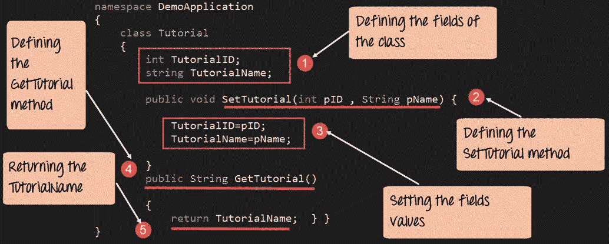 **代码解释：**

1. 第一步是向类文件添加 `TutorialID` 和 `TutorialName` 字段。由于 `TutorialID` 字段将是一个数字，我们将其定义为 `Integer`，而 `TutorialName` 将被定义为 `string`。

2. 接下来，我们定义了 `SetTutorial` 方法。该方法接受 2 个参数。因此，如果 `Program.cs` 调用 `SetTutorial` 方法，它将需要为这些参数提供值。这些值将用于设置 `Tutorial` 对象的字段。

**注意**:- 让我们举个例子，假设我们的 `Program.cs` 文件使用参数“1”和“.Net”调用了 `SetTutorial`。作为结果，将执行以下步骤：

a. `pID` 的值将变为 1

b. `pName` 的值将变为 .Net。

c. 在 `SetTutorial` 方法中，这些值将被传递给 `TutorialID` 和 `TutorialName`。

d. 所以现在 `TutorialID` 的值为 1，`TutorialName` 的值为 “.Net”。

3. 在这里，我们将 `Tutorial` 类的字段相应地设置为参数。因此，我们将 `TutorialID` 设置为 `pID`，并将 `TutorialName` 设置为 `Pname`。

4. 之后我们定义了 `GetTutorial` 方法来返回类型为“String”。此方法将用于将 `TutorialName` 返回给调用程序。同样，你也可以通过方法 `Int GetTutorial` 获取教程 ID。 5. 在这里，我们将 `TutorialName` 字段的值返回给调用程序。

**第 2 )** 现在让我们为我们的 `Program.cs`（我们的控制台应用程序）添加代码。控制台应用程序将用于创建“Tutorial 类”的对象，并相应地调用 `SetTutorial` 和 `GetTutorial` 方法。

( **注意**:- 对象在任何给定时间内类的实例。类和对象之间的区别在于，对象实际上包含了属性的值。)

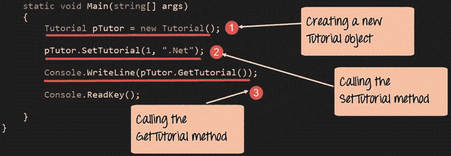 **代码解释：**

1. 第一步是为 `Tutorial` 类创建一个对象。注意，这是通过使用关键字‘new’完成的。在 C# 中，‘new’关键字用于从类中创建对象。然后将该对象赋值给变量 `pTutor`。

2. 接着调用 `SetTutorial` 方法。将参数 1 和 “.Net”传递给 `SetTutorial` 方法。这些参数将随后相应地用于设置类的“TutorialID”和“TutorialName”字段。

3. 之后我们使用 `Tutorial` 类的 `GetTutorial` 方法来获取 `TutorialName`。然后通过 `Console.WriteLine` 方法将其显示在控制台上。

如果正确输入上述代码并运行程序，将显示以下输出。

**输出：**

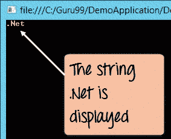 从输出中你可以清楚地看到 `GetTutorial` 方法返回了字符串 “.Net”。

## 访问修饰符

访问修饰符用于定义类属性或或的可见性。在某些情况下，你可能不希望其他程序看到类的属性或方法。在这种情况下，C# 提供了在类属性和方法上放置修饰符的能力。类修饰符具有限制访问的能力，使得其他程序无法看到类的属性或方法。

通常有 3 种访问修饰符。它们解释如下：

1. **Private (私有)** – 当此访问修饰符附加到属性或方法上时，意味着这些成员无法从任何外部程序访问。

让我们举个例子，看看使用私有访问修饰符时会发生什么。

让我们修改 `Tutorial.cs` 文件中的当前代码。在 `SetTutorial` 方法中，我们将 `public` 关键字改为 `private`。

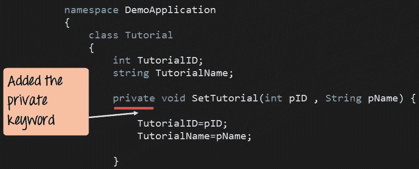

现在切换到我们的 `Program.cs` 文件。你会注意到 `SetTutorial` 方法下方有一个红色波浪线。

由于我们现在在 `Tutorial` 类中将 `SetTutorial` 方法声明为 `private`，Visual Studio 已检测到这一点。它通过高亮显示告诉用户，现在该方法无法从 `Program.cs` 文件中正常工作。

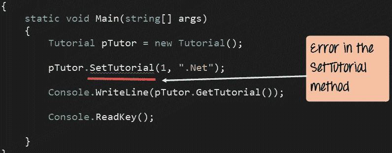

2. **Public (公有)** – 当此访问修饰符附加到属性或方法上时，意味着这些成员可以从任何外部程序访问。我们已经在之前的示例中看到了这一点。

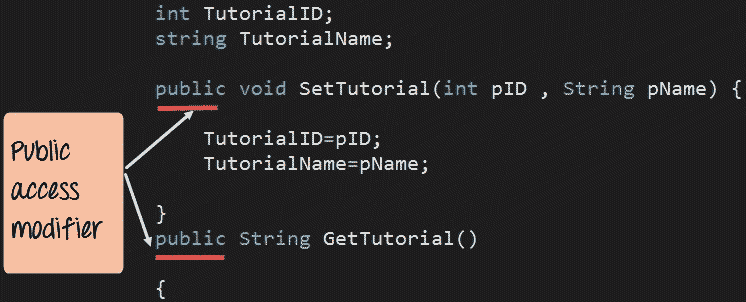 由于我们已经在 `Tutorial` 类中将方法定义为 `public`，因此它们可以从 `Program.cs` 文件访问。

3. **Protected (受保护)** - 当此访问修饰符附加到属性或方法上时，意味着这些成员只能由继承自当前类的类访问。将在继承类中进行更详细解释。

## C# 构造函数

构造函数用于在创建相应对象时初始化类字段的值。构造函数是一个与类名相同的方法。如果类中定义了构造函数，那么它将是对象创建时第一个被调用的方法。假设我们有一个名为 `Employee` 的类。构造函数方法也将命名为 `Employee()`。

关于构造方法需要注意以下关键点：1. 构造函数的访问修饰符需要设为 `public`。2. 构造方法不应有返回值。

现在让我们来看看如何在我们的代码中整合构造函数的使用。我们将使用构造函数在对象创建时将 `TutorialID` 和 `TutorialName` 字段初始化为某些默认值。

**第 1 )** 第一步是为我们的 `Tutorial` 类创建构造函数。在这一步中，我们将下面的代码添加到 `Tutorial.cs` 文件。

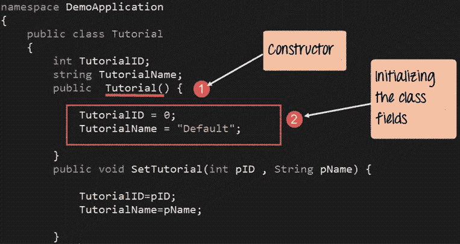 **代码解释：**

1. 我们首先添加了一个与类名相同的新方法。因为与类名相同，C# 将其视为构造方法。因此，现在每当调用方法创建对象时，该方法都会被默认调用。

2. 在 `Tutorial` 构造函数中，我们将 `TutorialID` 的值设置为 0，将 `TutorialName` 设置为“Default”。因此当创建对象时，这些字段将始终具有这些默认值。

现在切换到我们的 `Program.cs` 文件并删除调用 `SetTutorial` 方法的行。这是因为我们只想看看构造函数是如何工作的。

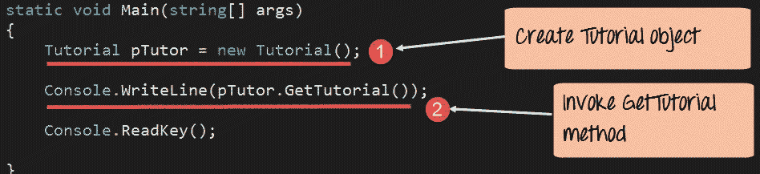 **代码解释：**

1. 第一步是为 `Tutorial` 类创建一个对象。这是通过‘new’关键字完成的。

2. 我们使用 `Tutorial` 类的 `GetTutorial` 方法获取 `TutorialName`。然后通过 `Console.WriteLine` 方法将其显示在控制台上。

如果正确输入上述代码并运行程序，将显示以下输出。

**输出：**

从输出中我们可以看到构造函数确实被调用了，并且 `TutorialName` 的值被设置为“Default”。

**注意：** 这里的默认值是从构造函数获取的。

## C# 继承

继承是 C# 中一个重要的概念。继承是一种定义父类和子类的概念。

子类继承父类的方法和属性，但同时如果需要，它们也可以修改方法的行为。如果需要，子类也可以定义自己的方法。

通过观察这一操作你将获得更好的理解。

现在让我们来看看如何在代码中整合继承的概念。

**第 1 )** 第一步是更改我们 `Tutorial` 类的代码。在这一步中，我们将下面的代码添加到 `Tutorial.cs` 文件。

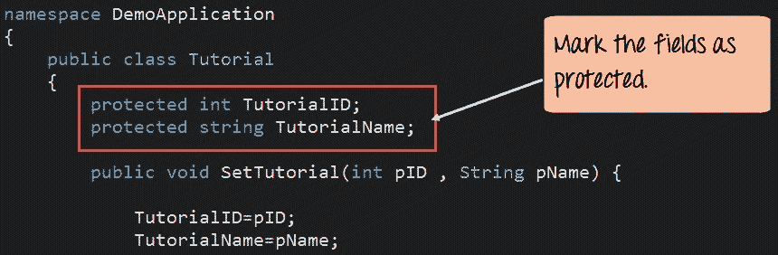 注意，我们现在需要为 `TutorialID` 和 `TutorialName` 字段添加‘protected’访问修饰符。


还记得我们在“访问修饰符”章节中提到过这个访问修饰符吗？在这里，你可以看到使用它的目的。只有当你拥有这个访问修饰符（`protected`）时，子类才能使用父类的字段。

### 步骤 2)
第二步是添加我们的新子类。该类的名称将为 `Guru99Tutorial`。在这一步中，我们将下面的代码添加到 `Tutorial.cs` 文件中。代码应该放置在 `Tutorial` 类定义之后。

#### 代码解释：

1. 第一步是创建 `Guru99Tutorial` 子类。我们还需要说明，该类将成为 `Tutorial` 类的子类。这是通过 `:` 关键字实现的。
2. 接下来，我们定义了一个名为 `RenameTutorial()` 的方法。它将被用于重命名 `TutorialName` 字段。该方法接受一个包含 Tutorial 新名称的字符串变量。
3. 然后，我们将参数 `pNewName` 赋值给 `TutorialName` 字段。

**注意**：- 即使我们没有在 `Guru99Tutorial` 类中定义 `TutorialName` 字段，我们仍然能够访问该字段。这是因为 `Guru99Tutorial` 是 `Tutorial` 类的子类。而且由于我们将 `Tutorial` 类的字段设为 `protected`，因此该类可以访问它们。

### 步骤 3)
最后一步是修改我们的主 `Program.cs` 文件。在我们的控制台应用程序，我们将创建一个 `Guru99Tutorial` 类的对象。通过这个对象，我们将调用 `RenameTutorial()` 方法。然后，我们将通过 `GetTutorial()` 方法显示 `TutorialName` 字段。

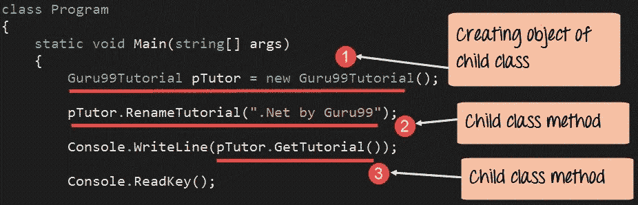**代码解释：**

1. 第一步是为 `Guru99Tutorial` 类创建一个对象。这是通过 `new` 关键字实现的。注意，这次我们没有创建 `Tutorial` 类的对象。
2. 我们使用 `Guru99Tutorial` 类的 `RenameTutorial()` 方法来更改 `TutorialName` 字段。我们将字符串 `".Net by Guru99"` 传递给 `RenameTutorial()` 方法。
3. 然后我们调用了 `GetTutorial()` 方法。注意，尽管该方法没有在 `Guru99Tutorial` 类中定义，但我们仍然能够访问该方法。`GetTutorial()` 方法的输出将通过 `Console.WriteLine()` 方法显示在控制台上。

如果正确输入上述代码并成功运行程序，将显示以下输出。

**输出：**

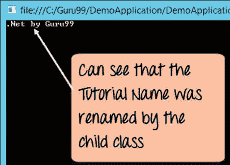

从输出中我们可以清楚地看到 `TutorialName` 字段已被重命名为 `".Net by Guru99"`。这是通过子类调用的 `RenameTutorial()` 方法实现的。

## C# 多态

多态是一个概念，其中一个方法可以被定义多次。但每次，该函数接收的参数集都是不同的。

如果我们观察这一操作，你将会有更好的的理解。

现在让我们看看如何在代码中引入多态的概念。

### 步骤 1)
第一步是修改我们 `Tutorial` 类的代码。在这一步中，我们将下面的代码添加到 `Tutorial.cs` 文件中。

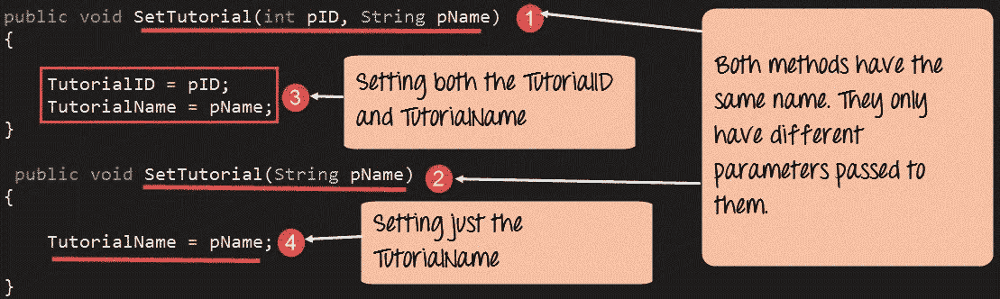**代码解释：**

1 & 2) 第一步与我们之前的示例相同。我们保持 `SetTutorial()` 方法的定义不变。
3) 此方法根据参数 `pID` 和 `pName` 设置了 `TutorialID` 和 `TutorialName`。
4) 在这里我们对类进行了更改，添加了一个与 `SetTutorial` 同名的新方法。只是这次我们只传递了一个参数，即 `pName`。在该方法中，我们只是将 `TutorialName` 字段设置为 `pName`。

### 步骤 2)
最后一步是修改我们的主 `Program.cs` 文件。在我们的控制台应用程序中，我们将创建一个 `Guru99Tutorial` 类的对象。

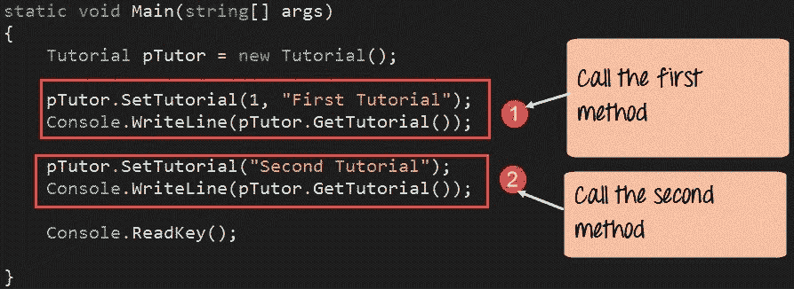**代码解释：**

1. 在第一步中，我们使用了带有 2 个参数的 `SetTutorial()` 方法。我们将 `TutorialID` 和 `TutorialName` 都传递给该方法。
2. 在第二步中，我们现在调用了仅有一个参数的 `SetTutorial()` 方法。我们只将 `TutorialName` 传递给该方法。

如果正确输入上述代码并运行程序，将显示以下输出。如果你想同时获取 Tutorial ID 和 Tutorial 名称，你应该遵循以下步骤：

1. 创建一个名为 `public int GetTutorialID()` 的独立方法。
2. 在该方法中编写代码行 `return TutorialID;`。这可以将 `TutorialID` 返回给调用程序。

**输出：**

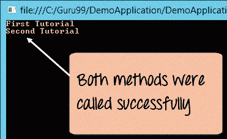

从输出中我们可以清楚地看到两个方法都成功被调用。正因如此，字符串 `"First Tutorial"` 和 `"Second Tutorial"` 被发送到了控制台。

## C# 抽象类

抽象类用于定义所谓的基类（base class）。基类是针对特定需求具有最基本定义的类。

下面是一个抽象类的典型示例。以下是名为 `Animal` 的类的定义。当 `Animal` 类被定义时，关于动物一无所知，无论它是狗还是猫。`description()` 方法只是为该类定义的一个通用方法。

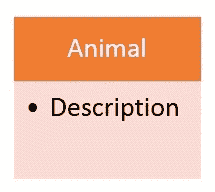

现在，当确定了 `Animal` 具体是什么时，我们创建另一个继承自基类的类。如果我们知道动物是一只狗，我们就创建一个继承基类的 `Dog` 类。这里的关键区别是 `Dog` 类不能更改 `Animal` 类中 `description` 方法的定义。

让我们看看如何修改代码以包含抽象类。注意我们将不会运行代码，因为抽象类是无法直接运行的。

### 步骤 1)
作为第一步，让我们创建一个抽象类。该类将是 `Tutorial` 且只包含一个方法。所有代码都需要写在 `Program.cs` 文件中。

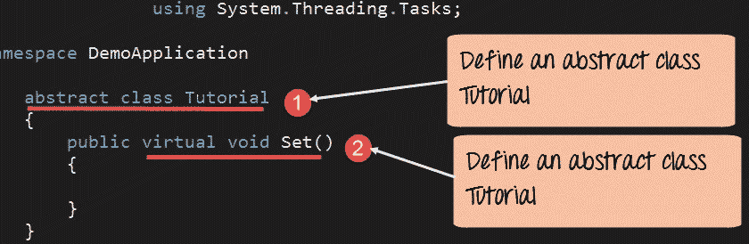**代码解释：**

1. 我们首先定义抽象类。注意 `abstract` 关键字的使用。它用于表示该类是一个抽象类。
2. 接下来，我们定义了一个什么都不做的方法。该方法必须带有 `virtual` 关键字。这意味着该方法不能被子类更改。

### 步骤 2)
现在添加我们的子类。这段代码被添加到 `Program.cs` 文件中。

这段代码没有特别之处。我们只是定义了一个名为 `Guru99Tutorial` 的类，它继承自抽象的 `Tutorial` 类。然后我们定义了与之前使用的相同的方法。

**注意**：在这里我们不能更改在 `Tutorial` 类中定义的 `Set` 方法的定义。在 `Tutorial` 类中，我们定义了一个名为 `public void Set()` 方法。由于该方法是抽象类的一部分，我们不允许在 `Guru99Tutorial` 类中再次定义 `Set` 方法。

C# 接口

接口与类一起使用，用于定义所谓的合同（contract）。合同是关于类将为应用程序提供内容的约定。接口声明属性和方法。具体方法将做什么，由类来定义。

让我们通过修改控制台应用程序中的类来看查看接口的示例。注意我们将不会运行代码，因为接口是无法直接运行的。

让我们创建一个接口类。该类将是 `Guru99Interface`。我们的主类随后将扩展定义的接口。所有代码都需要写在 `Program.cs` 文件中。

**代码解释：**

1. 我们首先定义了一个名为 `Guru99Interface` 的接口。注意 `interface` 关键字用于定义接口。


2. 接下来，我们将定义将供接口使用的方法。在这种情况下，我们定义了与之前所有示例中使用的相同方法。注意，接口只声明了方法，而不定义方法中的代码。

3. 接着，我们让我们的 `Guru99Tutorial` 类继承接口。在这里，我们实际上编写了定义接口中声明的各种方法的代码。这种编码方式实现了以下效果：

它确保了类 `Guru99Tutorial` 只添加了 `SetTutorial` 和 `GetTutorial` 方法所需的代码，而不包含任何其他代码。它还确保了接口表现像一份合同。类必须遵守该合同。因此，如果合同规定它应该有两个名为 `SetTutorial` 和 `GetTutorial` 的方法，那么它就必须是这样。

### 总结

类是数据属性和方法的封装。属性用于定义类中数据的类型。方法定义了可以在数据上执行的操作。

构造函数用于在每次创建对象时初始化类的字段。

构造函数是一个与类本身同名的方法。继承是子类继承父类的字段和方法的过程。子类随后也可以定义它自己的方法。

多态是指一个方法可以定义多次的概念。唯一的区别是传递给方法的参数数量。

抽象类是一个基类，它包含了类应该具备的最基本要求。子类无法继承基类的方法。

接口定义了一个类将遵守的合同。接口定义了类可以执行的操作。

# 第 5 章：C# 集合

在之前的一个章节中，我们学习了如何在 C# 中使用数组。让我们快速回顾一下，编程中的数组被用于组织一组相关的对象。因此，人们可以创建一个 `Integers` 数组或集合，并通过一个变量名进行访问。

集合与数组类似，它提供了一种更灵活的方式来处理一组对象。

在数组中，你可能注意到你需要预先定义数组元素的数量。这必须在声明数组时完成。

但在集合中，你不需要预先定义集合的大小。你可以在任何时候向集合中添加甚至移除元素。本章将重点介绍我们如何使用 C# 中提供的不同集合。

## C# ArrayList

`ArrayList` 集合类似于 C# 中的数组数据类型。最大的区别在于数组列表集合的动态性质。

对于数组，你需要在声明数组时定义该数组可以容纳的元素数量。但在 `ArrayList` 集合的情况下，不需要预先这样做。元素实际上可以在任何时候从 `ArrayList` 集合中添加或删除。让我们详细查看数组列表集合可用的操作。

1. **Array List 的声明** – 下面提供了 `ArrayList` 的声明。通过 `ArrayList` 数据类型创建数组列表。使用 `new` 关键字来创建 `ArrayList` 的对象。然后将该对象赋值给变量 `a1`。现在，变量 `a1` 将被用于访问数组列表的不同元素。

```
ArrayList a1 = new ArrayList()
```

2. **向数组中添加元素** – 使用 `add` 方法向 `ArrayList` 中添加元素。`add` 方法可以用于向数组列表添加任何数据类型的元素。因此，你可以向数组列表添加一个 `Integer`、一个字符串甚至一个 `Boolean` 值。添加方法的通用语法如下所示

```
ArrayList.add(element)
```
下面是如何使用 `add` 方法的一些示例。`add` 方法可以用于向 `ArrayList` 集合添加各种数据类型。

下面你可以看到如何向 `ArrayList` 集合添加 `Integer`、字符串甚至 `Boolean` 值的示例。

`a1.add(1)` – 这将向集合中添加一个 `Integer` 值

`a1.add("Example")` – 这将向集合中添加一个 String 值

`a1.add(true)` – 这将向集合中添加一个 `Boolean` 值

现在让我们在代码层面看看它的运行。下面所有提到的代码都将写入我们的控制台应用程序。代码将写入我们的 `Program.cs` 文件中。在下面的程序中，我们将编写创建新数组列表的代码。我们还将展示如何添加元素以及显示数组列表的元素。

 **代码解释：**

1. 第一步用于声明我们的 Array List。在这里，我们将 `a1` 声明为一个变量，用于存储数组列表的元素。
2. 随后我们使用 `add` 关键字将数字 1、字符串 `"Example"` 和 `Boolean` 值 `true` 添加到数组列表中。
3. 随后我们我们使用 `Console.WriteLine` 方法在控制台上显示每个数组列表元素的值。你会发现，与数组一样，我们可以通过索引位置访问元素。因此，要访问 Array List 的第一个位置，我们使用 `[0]` 索引位置。依此类推。

如果正确输入了上述代码并运行了程序，将显示以下输出。

**输出：**

 从输出中清楚地看到数组列表的所有元素都发送到了控制台。

让我们查看 `ArrayList` 提供的更多方法。

**Count** – 该方法用于获取 `ArrayList` 集合中项的数量。该语句的通用语法如下 `ArrayList.Count()` 该方法返回数组列表包含的元素数量。**Contains** – 该方法用于检查元素是否存在于 `ArrayList` 集合中。该语句的通用语法如下 所示。如果元素存在于列表中，该方法返回 true，否则返回 false。

**RemoveAt** – 该方法用于从 `ArrayList` 集合的特定位置删除元素。该语句的通用语法如下 `ArrayList.RemoveAt(index)`。该方法从 Array List 的特定位置删除一个元素。

现在让我们在代码层面看看它的运行。下面所有提到的代码都将写入我们的控制台应用程序。代码将写入我们的 `Program.cs` 文件中。在下面的程序中，我们将编写代码来查看如何使用上述方法。

 **代码解释：**

1. 所以我们看到的第一个属性是 `Count` 属性。我们获取数组列表 `a1` 的 `Count` 属性并将其写入控制台。
2. 在第二部分，我们使用 `Contains` 方法检查数组列表 `a1` 是否包含元素 2。然后我们通过 `Writeline` 命令将结果写入控制台。
3. 最后，为了演示删除元素方法，我们执行以下步骤：
   a. 首先，我们将数组列表索引位置为 1 的元素值写入控制台。
   b. 然后我们删除数组列表索引位置为 1 的元素。
   c. 最后，我们再次将数组列表索引位置为 1 的元素值写入控制台。这一系列步骤可以让我们判断删除方法是否按预期工作。

如果正确输入了上述代码并运行了程序，将显示以下输出。

**输出：**

 为什么最后一个值是 true？

如果你观察事件发生的顺序，元素 `Example` 从数组中删除，因为它位于位置 1。数组的位置 1 随后被之前在位置 2 的值（即 `true`）所替换。


栈（Stack）是一种特殊的集合，代表了后进先出（LIFO）的概念。为了先理解 LIFO，让我们来看一个例子。想象有一叠书，每本书都堆叠在另一本书上面。

在书堆的情况下，“后进先出”的概念意味着只能从书栈的最顶端移除一本书。无法从中间移除书籍，因为那样会破坏栈的结构。

因此，在 C# 中，栈的工作方式也是完全一样的。元素被添加到栈中，一个堆叠在另一个的上方。向栈中添加元素的过程称为 `push` 操作。要从栈中移除元素，你也可以移除栈的最顶端元素。这种操作被称为 `pop`。

让我们详细查看 `Stack` 集合提供的可用操作。

### 栈的声明
通过 `Stack` 数据类型创建栈。使用 `new` 关键字来创建 `Stack` 对象。然后将该对象赋值给变量 `st`。

```csharp
Stack st = new Stack()
```

### 向栈中添加元素
使用 `push` 方法将元素添加到栈中。该语句的通用语法所示。

```csharp
Stack.push(element)
```

### 从栈中移除元素
使用 `pop` 方法从栈中移除元素。`pop` 操作将返回栈的最顶端元素。该语句的通用语法所示。

```csharp
Stack.pop()
```

### Count
此属性用于获取 `Stack` 中的项目数量。下面是该语句的通用语法。

```csharp
Stack.Count
```

### Contains
此方法用于检查元素是否存在于 `Stack` 中。下面是该语句的通用语法。如果元素存在，语句将返回 true，否则将返回值 false。

```csharp
Stack.Contains(element)
```

现在，让我们在代码层面来看它的运行情况。以下所有提到的代码都将写入我们的控制台应用程序。代码将写入我们的 `Program.cs` 文件中。在下面的程序中，我们将编写代码来查看如何使用上述方法。

在这个示例中，我们将看到：
- 栈是如何创建的。
- 如何显示栈元素，以及使用 `Count` 和 `Contains` 方法。

 **代码解释：**

1. 第一步用于声明 `Stack`。在这里，我们将 `st` 声明为变量，用于保存栈的元素。
2. 接下来，向我们的栈中添加 3 个元素。每个元素都通过 `Push` 方法添加。
3. 现在，由于栈元素不能像列表那样通过索引位置访问，我们需要使用不同的方法来显示栈的元素。`obj` 是一个临时变量，声明用于持有栈的每个元素。然后我们使用 `foreach` 语句遍历栈的每个元素。对于每个栈元素，值被赋值给 `obj` 变量。然后我们使用 `Console.Writeline` 命令将值显示到控制台上。
4. 我们正在使用 `Count` 属性 (`st.count`) 来获取栈中的项目数量。此属性将返回一个数字。然后我们把此值显示到控制台上。
5. 接着，我们使用 `Contains` 方法检查值 3 是否存在于我们的栈中。这将返回 true 或 false 值。然后我们把此返回值显示到控制台上。

如果正确输入上述代码并运行程序，将显示以下输出。

**输出：**


从输出中，我们可以清楚地看到栈的元素已被显示。此外，还显示了 True 值，表示值 3 定义在栈中。

**注意**：你可能注意到最后一个推入栈的元素是第一个显示的。这是栈的最顶端元素。栈元素的计数也显示在输出中。

现在，让我们看看“移除”功能。我们将看到从栈中移除顶端元素所需的代码。

 **代码解释：**

1. 在这里，我们只需调用 `pop` 方法，它用于从栈中移除一个元素。

如果正确输入上述代码并运行程序，将显示以下输出。

**输出：**


我们可以看到元素 3 已经从栈中移除。

## C# Queue
`Queue` 是一种特殊的集合，代表了先进先出（FIFO）的概念。想象有一队等公交的人。通常情况下，第一个进入队列的人将是第一个上车的人。同样，最后一个进入队列的人将是最后一个上车的人。元素被添加到栈中（注：此处原文应为队列）。

向队列添加元素的过程是 `enqueuer` 操作。要从队列中移除元素，你可以使用 `dequeuer` 操作。队列中的操作与我们之前看到的栈类似。

让我们详细查看 `Queue` 集合提供的可用操作。

### 队列的声明
`Queue` 的声明所示。通过 `Queue` 数据类型创建队列。使用 `new` 关键字创建 `Queue` 对象。然后将该对象赋值给变量 `qt`。

```csharp
Queue qt = new Queue()
```

### 向队列中添加元素
使用 `enqueue` 方法将元素添加到队列中。该语句的通用语法所示。

```csharp
Queue.enqueue(element)
```

### 从队列中移除元素
使用 `dequeue` 方法从队列中移除元素。`dequeue` 操作将返回栈的最顶端元素（注：此处原文应为队列）。该语句的通用语法所示。

```csharp
Queue.pop()
```

### Count
此属性用于获取 `Queue` 中的项目数量。下面是该语句的通用语法。

```csharp
Queue.Count
```

### Contains
此方法用于检查元素是否存在于 `Queue` 中。下面是该语句的通用语法。如果元素存在，语句将返回 true，否则将返回值 false。

```csharp
Queue.Contains(element)
```

现在，让我们在代码层面来看它的运行情况。以下所有提到的代码都将写入我们的控制台应用程序。代码将写入我们的 `Program.cs` 文件中。在下面的程序中，我们将编写代码来查看如何使用上述方法。

在这个示例中，我们将看到：
- 栈是如何创建的。
- 如何显示栈元素，以及使用 `Count` 和 `Contains` 方法。

 **代码解释：**

1. 第一步用于声明 `Queue`。在这里我们将 `qt` 声明为变量，用于保存栈的元素。
2. 接下来，向我们的栈中添加 3 个元素。每个元素都通过 `Enqueue` 方法添加。
3. 现在，关于队列需要注意的是，元素不能像列表那样通过索引位置访问。我们需要使用不同的方法来显示栈的元素。所以这就是我们如何显示队列元素。

我们首先声明一个名为 `obj` 的临时变量。这将用于持有队列的每个元素。

然后我们使用 `foreach` 语句遍历栈的每个元素。对于每个栈元素，值被赋值给 `obj` 变量。然后我们使用 `Console.Writeline` 命令将值显示到控制台上。
4. 我们正在使用 `Count` 属性来获取栈中的项目数量。此属性将返回一个数字。然后我们把此值显示到控制台上。
5. 接着，我们使用 `Contains` 方法检查值 3 是否存在于我们的栈中。这将返回 true 或 false 值。然后我们把此返回值显示到控制台上。


从输出中，我们可以清楚地看到 `Queue` 的元素已显示。请注意，与“队列”中的“栈”不同，首先入队列的元素会被首先显示。输出中还显示了队列元素的计数。此外，显示了 `True` 值，表示队列上定义了值 3。

现在让我们来看移除功能。我们将看到用于从队列中移除最后一个元素所需的代码。


**代码解释：**

1. 在这里我们只需调用 `dequeue` 方法，它用于从队列中移除一个元素。该方法将移除队列的第一个元素。

如果正确输入上述代码并运行程序，将显示以下输出。

**输出：**

从输出中，我们可以看到添加到队列的第一个元素（即元素 1）已从队列中移除。

## C# Hashtable

哈希表（Hashtable）是一种特殊的集合，用于存储键值对项。因此，哈希表不像栈、数组列表（array list）和队列那样只存储一个值，它存储 2 个值。这 2 个值构成了哈希表的一个元素。

以下是哈希表值可能的一些示例。{ “001” , “.Net” }

{ “002” , “.C#” }

{ “003” , “ASP.Net” }

上面我们有 3 个键值对。每个元素的键分别为 001、002 和 003。每个键值对的值分别为 “.Net”、“C#”和“ASP.Net”。

让我们更详细地查看 Hashtable 集合可用的操作。

## Hashtable 的声明

下面显示了 Hashtable 的声明。Hashtable 是通过 `Hashtable` 数据类型创建的。使用 `new` 关键字来创建 Hashtable 对象。然后将该对象赋值给变量 `ht`。

```
Hashtable ht = new Hashtable()
```

## 向 Hashtable 添加元素

使用 `Add` 方法向队列中添加元素。该语句的通用语法如下所示：`HashTable.add(“key”,“value”)`。

请记住，哈希表的每个元素都包含 2 个值，一个是键（key），另一个是值（value）。

现在，让我们在代码层面查看此工作。以下提到的所有代码将编写到我们的控制台应用程序中。

代码将写入我们的 `Program.cs` 文件中。在下面的程序中，我们将编写代码查看如何使用上述方法。目前在我们的示例中，我们只需查看如何创建一个 hashtable、向 hashtable 添加元素并相应地显示它们。

1. 首先，我们使用 `New` 关键字使用 `Hashtable` 数据类型声明哈希表变量。变量名定义为 ‘ht’。
2. 然后，我们使用 `Add` 方法向哈希表添加元素。记住，在向哈希表添加内容时，我们需要同时添加键和值元素。
3. 没有直接的方法来显示哈希表的元素。

为了显示 hashtable，我们首先需要从哈希表中获取键列表（001、002 和 003）。这是通过 `ICollection` 接口实现的。这是一种用于存储哈希表集合键的特殊数据类型。然后我们将哈希表集合的键赋值给变量 `keys`。
4. 接下来，对于每个键值对，我们使用语句 `ht[k]` 获取哈希表中关联的值。

如果正确输入上述代码并运行程序，将显示以下输出。

让我们查看哈希表可用的更多方法。

**ContainsKey** - 此方法用于检查键是否存在于 Hashtable 中。下面是该语句的通用语法。如果键存在，该语句将返回 true，否则它将返回值 false。

```
Hashtable.Containskey(key)
```

**ContainsValue** - 此方法用于检查值是否存在于 Hashtable 中。下面是该语句的通用语法。如果值存在，该语句将返回 true，否则它将返回值 false。

```
Hashtable.ContainsValue(key)
```

让我们更改控制台应用程序中的代码，展示我们如何使用“ContainsKey”和“ContainsValue”方法。

1. 首先，我们使用 `ContainsKey` 方法检查键是否存在于哈希表中。如果键存在于哈希表中，该方法将返回 true。由于键确实存在于哈希表中，因此该方法应该返回 true。
2. 然后，我们使用 `ContainsValue` 方法检查值是否存在于哈希表中。由于值确实存在于哈希表中，该方法将返回 ‘true’。

如果正确输入上述代码并运行程序，将显示以下输出。

从输出中，你可以清楚地看到搜索的键和值都于哈希表中。

### 总结

`ArrayList` 集合用于存储一组元素。数组列表集合的优势在于它是动态的。你可以随时向数组列表集合添加或删除元素。

`Stack`（栈）基于后进先出的概念。向栈中添加元素的操作被称为 `push` 操作。从栈中移除元素的操作被称为 `pop` 操作。

`Queue`（队列）基于先进先出的概念。向队列中添加元素的操作被称为 `enqueue` 操作。从队列中移除元素的操作被称为 `dequeue` 操作。`Hashtable` 用于存储由键值对组成的元素。要访问元素的值，你需要知道该元素的键。

# 第 6 章：Windows Forms 应用程序

到目前为止，我们已经学习了如何使用 C# 创建基于控制台的应用程序。但在现实场景中，团队通常使用 Visual Studio 和 C# 来创建 Windows Forms 或基于 Web 的应用程序。

Windows Forms 应用程序是任何设计在计算机上运行的应用程序。它不会在网络浏览器中运行，因为那样就变成了 Web 应用程序。

本章将重点关注我们如何创建基于 Windows 的应用程序。我们还将学习一些关于与 Windows 应用程序各种元素操作的基础知识。

## Windows Forms 基础

Windows Forms 应用程序是运行在桌面计算机上的应用程序。Windows Forms 应用程序通常有一组控件，如标签（labels）、文本框（textboxes）、列表框（list boxes）等。

下面是一个简单的 Windows Forms 应用程序示例。它显示了一个用户可以访问的简单登录界面。用户将输入凭据，然后点击登录按钮继续。

这是上述应用程序中可用控件的示例

1. 这是一个标签（label）控件的集合，通常用于描述相邻的控件。在我们的案例中，我们有 2 个文本框，标签用于告诉用户一个文本框用于输入用户名，另一个用于输入密码。
2. 2 个文本框用于存放用户输入的用户名和密码。
3. 最后，我们有按钮（button）控件。按钮控件通常会附带一些代码以执行特定的操作。例如，在上面的案例中，我们可以让按钮执行验证用户输入的用户名和密码的操作。

# C# Hello World

现在让我们来看如何在 Visual Studio 中实现一个简单的“hello world”应用程序的示例。为了实现这一点，我们需要执行以下步骤

**步骤 1)** 第一步涉及在 Visual Studio 中创建一个新项目。启动 Visual Studio 后，你需要选择菜单选项 New->Project（新建->项目）。

**步骤 2)** 下一步是将项目类型选择为 Windows Forms 。在这里我们还需要指定项目的名称和位置。


1. 在项目对话框中，我们可以看到在 Visual Studio 中创建不同类型项目的各种选项。点击左侧的 `Windows` 选项。

2. 当我们点击上一步中的 `Windows` 选项时，我们将看到 `Windows Forms Application` 选项。点击此选项。

3. 然后我们为应用程序命名，在我们的案例中名称为 `DemoApplication`。我们还需要提供一个存储该应用程序的位置。

4. 最后，我们点击“OK”按钮让 Visual Studio 创建我们的项目。

如果按照上述步骤操作，你将在 Visual Studio 中得到下面的输出。**输出：**


你实际上会在 Visual Studio 中看到一个表单设计器（Form Designer）。你将在这个表单设计器上开始构建你的 Windows Forms 应用程序


在解决方案（Solution explorer）中，你还能看到 `DemoApplication` 解决方案。该解决方案将包含以下两个项目文件：

1. 一个名为 `Forms1.cs` 的表单应用程序。该文件将包含 Windows Form 应用程序的所有代码。

2. 名为 `Program.cs` 的主程序是在 Visual Studio 中创建新应用程序时创建的默认代码文件。此代码将包含整个应用程序的启动代码。

在 Visual Studio 的右侧，你还会看到一个 `ToolBox`。工具箱包含了所有可以添加到 Windows Forms 的控件。像文本框（text box）或标签（label）之类的控件是可以添加到 Windows Forms 的控件的一部分。

下面是工具箱外观截图。


**步骤 3)** 在这一步中，我们现在要在表单上添加一个标签，显示“Hello World.”。从工具箱中，你需要选择 `Label` 控件并简单将其拖到表单上。


一旦你将标签拖到表单，你就可以看到标签已嵌入在表单上，如下所示。


**步骤 4)** 下一步是实际上进入控件的属性并将文本更改为“Hello World”。

要进入控件的属性，你需要右键点击控件并选择 `Properties` 菜单选项。


属性面板也会在 Visual Studio 中出现。因此对于标签控件，在控件属性中，转到 `Text` 部分并输入“Hello World”。每个控件有一组描述该控件的属性。


如果你遵循了所有上述步骤并在 Visual Studio 中运行你的程序，你将获得以下输出

**输出：**

 在输出中，你可以清楚地看到 Windows Form 已经显示。你还可以看到表单上显示了“Hello World”。

## 向表单添加控件

当我们在前面的章节中通过添加标签控件来显示“Hello World”时，已经学习过如何向表单添加控件了。

让我们看看 Windows Forms 可用的其他控件，并查看它们的一些常用属性。

在我们的示例中，我们将创建一个具有以下功能的表单：

1. 用户输入姓名和地址的能力。
2. 选择用户居住城市的选项。
3. 用户输入性别选项的能力。
4. 选择用户想要学习的课程的选项。这部分将有 C# 和 ASP.Net 两种选择。

所以，让我们详细查看每个控件并添加它们，以构建具有上述功能的表单。

**Group Box（分组框）** – 分组框用于将逻辑控件分组到一个区域。举个例子，如果你有一组控件用于输入个人详细信息，如姓名和地址。理想情况下，这些是人的详细信息，因此你希望将这些信息放在表单上的单独区域中。为了这个目的，你可以使用分组框。让我们看看如何通过下所示的示例来实现它。

**步骤 1)** 第一步是从工具箱中将 `Groupbox` 控件拖到 Windows Form 上，如下所示


**步骤 2)** 一旦添加了分组框，点击分组框控件进入属性窗口。在属性窗口中，转到 `Text` 属性并将其更改为“User Details”。


一旦你做了上述更改，你将看到以下输出

**输出：**

 在输出中，你可以清楚地看到表单上添加了分组框。你还可以看到分组框的文本已更改为“User Details”。

**Label Control（标签控件）** – 接下来是标签控件。标签控件用于在表单上向用户显示文本或消息。标签控件通常与其他控件一起使用。常见的例子是标签与文本框（textbox）控件一起添加。

标签向用户指示文本框中预期填入什么内容。让我们看看如何通过下所示的示例来实现。我们将添加两个标签，一个命名为“name”，另一个命名为“address”。它们将与稍后部分添加的文本框控件配合使用。

**步骤 1)** 第一步是从工具箱中将标签控件拖到 Windows Form 上，如下所示。确保你拖动 2 次标签控件，这样你就可以拥有一个用于“name”，另一个用于“address”。

 **步骤 2)** 一旦添加了标签，点击标签控件进入属性窗口。在属性窗口中，转到每个标签的 `Text` 属性。

一旦你做了上述更改，你将看到以下输出

**输出：**

 你实际上可以看到添加到表单上的标签控件。

**Textbox（文本框）** – 文本框用于允许用户在表单上输入某些文本。让我们看看如何通过下所示的示例来实现它。我们将向表单添加 2 个文本框，一个用于姓名，另一个用于用户输入的地址。

**步骤 1)** 第一步是从工具箱中将 textbox 控件拖到 Windows Form 上，如下所示


**步骤 2)** 一旦添加了文本框，点击文本框控件进入属性窗口。在属性窗口中，转到 `Name` 属性并为每个文本框添加一个有意义的名称。例如，将用户的文本框命名为 `txtUser`，将地址的文本框命名为 `txtAddress`。应该为控件制定命名规范和标准，因为这更容易为这些控件添加额外功能，我们稍后会看到。

一旦你做了上述更改，你将看到以下输出

**输出：**

 在输出中，你可以清楚地看到表单上添加了文本框。

**List box（列表框）** – Listbox 用于在 Windows Form 上显示项目列表。让我们看看如何通过下所示的示例来实现它。我们将向表单添加一个列表框来存储一些城市位置。

**步骤 1)** 第一步是从工具箱中将 list box 控件拖到 Windows Form 上，如下所示

 **步骤 2)** 一旦添加了列表框，点击列表框控件进入属性窗口。


1. 首先，更改 Listbox 控件的属性，在我们的案例中，我们将其更改为 `lstCity`。
2. 点击 `Items` 属性。这允许你添加可以在列表框显示的不同项目。在我们的案例中，我们选择了项目“collection”。
3. 在弹出的字符串集合编辑器（String Collection Editor）中输入城市名称。在我们的案例中，我们输入了“Mumbai”、“Bangalore”和“Hyderabad”。
4. 最后，点击“OK”按钮。

一旦你做了上述更改，你将看到以下输出


在输出中，你可以清楚地看到 `Listbox` 已添加到表单中。你还可以看到列表框已经填充了城市值。

### RadioButton（单选按钮）
`RadioButton` 用于展示一组项目，用户可以从中选择一个。让我们通过下面的示例来看我们如何实现它。我们将为男性/女性选项添加一个单选按钮。

**步骤 1)** 第一步是从工具箱中将 `‘radiobutton` 控件拖到 Windows 窗单（Windows Form）上，如下所示。


**步骤 2)** 一旦添加了 `Radiobutton`，点击 `Radiobutton` 控件进入属性窗口。


1. 首先，你需要更改两个 `Radio` 控件的 `text` 属性。进入属性窗口，将一个 `radiobutton` 的 `text` 改为 `male`，将另一个的 `text` 改为 `female`。
2. 同样，更改两个 `Radio` 控件的 `name` 属性。进入属性窗口，将一个 `radiobutton` 的 `name` 改为 `‘rdMale`，另一个更改为 `rdfemale`。

完成上述更改后，你将看到以下输出


你将看到 Windows 窗单上添加了单选按钮。

### Checkbox（复选框）
`checkbox` 用于提供一组选项，用户可以选择其中多个。让我们通过下面的示例来看我们如何实现它。我们将在 Windows 窗单中添加 2 个复选框。这些复选框将为用户提供是否想学习 C# 还是 ASP.Net 的选项。

**步骤 1)** 第一步是从工具箱中将 `checkbox` 控件拖到 Windows 窗单上，如下所示。


**步骤 2)** 一旦添加了 `checkbox`，点击 `Checkbox` 控件进入属性窗口。


在属性窗口中，

1. 首先，你需要更改两个 `checkbox` 控件的 `text` 属性。进入属性窗口，将 `text` 改为 `C#` 和 `ASP.Net`。
2. 同样，更改两个 `Radio` 控件的 `name` 属性。进入属性窗口，将一个 `checkbox` 的 `name` 改为 `chkC`，另一个更改为 `chkASP`。

完成上述更改后，你将看到以下输出。

### Button（按钮）
`button` 用于允许用户点击按钮，从而启动表单的处理。让我们通过下面的示例来看我们如何实现它。我们将添加一个名为 `‘Submit` 的简单按钮，将用于提交表单上的所有信息。

**步骤 1)** 第一步是从工具箱中将 `button` 控件拖到 Windows 窗单上，如下所示。


**步骤 2)** 一旦添加了 `Button`，点击 `Button` 控件进入属性窗口。

1. 首先，你需要更改 `button` 控件的 `text` 属性。进入属性窗口，将 `text` 改为 `‘submit`。
2. 同样，更改控件的 `name` 属性。进入属性窗口，将 `name` 改为 `‘btnSubmit`。

完成上述更改后，你将看到以下输出


恭喜，你现在已经有了第一个基础 Windows 窗单。现在让我们进入下一个主题，看看我们如何对控件进行事件处理。

## C# 控件事件处理
在进行 Windows 窗单开发时，你可以为控件添加事件。事件是在执行某个操作时发生的事情。最常见的操作可能是点击表单上的按钮。在 Windows 窗单中，你可以添加代码，用于在表单上的按钮被按下时执行某些操作。

通常，当表单上的按钮被按下时，意味着应该进行某些处理。

在进入按钮事件场景之前，让我们来看其中一个事件以及如何处理它。

下面的示例将展示 `Listbox` 控件的事件。因此，每当在 `listbox` 控件中选择项目时，应该弹出一个消息框显示选中的项目。执行以下步骤来实现这一目标。

**步骤 1)** 在窗单设计器中双击 `Listbox`。通过这样做，Visual Studio 将自动打开表单的代码文件。它将自动向代码中添加一个事件方法。每当选择 `listbox` 中的任何项目时，该事件方法就会被触发。


上方是双击窗单上的 `list box` 控件时由 Visual Studio 自动添加的代码片段。现在让我们将下面的代码添加到此代码片段中，为 listbox 事件添加所需的功能。


1. 这是 Visual Studio 在双击 `List box` 控件时自动创建的事件处理方法。你不需要担心方法名的复杂性或传递给方法的参数。
2. 这里，我们通过 `lstCity.SelectedItem` 属性获取 `SelectedItem`。记住 `lstCity` 是我们 `Listbox` 的名称。我们将值赋值给 `text` 变量，使用 `GetItemText` 方法获取选中项目的值。
3. 最后，我们使用 `MessageBox` 方法将值显示给用户。

完成上述更改后，运行程序，你将看到以下输出

**输出：**


从输出中你可以清楚地看到，当选择 listbox 中的项目时，会弹出一个消息框。这将显示列表中选中的项目。

现在让我们看看最后一个控件，即按钮点击。再次遵循相同的逻辑。在窗单设计器中双击按钮，它将为按钮事件添加方法。你只需要添加下面的代码。

1. 这是事件处理方法……你不需要担心方法名的复杂性或传递给方法的参数。
2. 这里我们获取名称和地址文本框中的值。这些值可以从文本框的 `text` 属性获取。我们将值赋值给两个变量 `name` 和 `address`。
3. 最后，我们使用 `MessageBox` 方法将 `name` 和 `address` 值显示给用户。

完成上述更改并运行程序，你将看到以下输出

**输出：**

1. 首先，在名称和地址字段中输入值。2. 然后点击 `Submit` 按钮。点击按钮后，会弹出消息框并正确显示你输入的内容。

## 其他控件
我们还可以查看另外两个控件，一个是 `Tree Control`，另一个是 `Image control`。让我们看看实现这些控件的示例。

### TreeControl（树形控件）
`tree control` 用于以树状列列项目。最好的例子就是 Windows 资源管理器。Windows 资源管理器的文件夹结构就像树形结构。

让我们通过下面的示例来看我们如何实现它。**步骤 1)** 第一步是从工具箱中将 `Tree` 控件拖到 Windows 窗单上，如下所示。


**步骤 2)** 下一步是开始向树集合添加节点，以便其相应出现在树中。首先，让我们按照以下子步骤向树集合添加一个根节点。


1. 进入树视图控件的属性工具箱。点击 `Node’s` 属性。这将弹出 `TreeNode Editor`。
2. 在 `TreeNode Editor` 中，点击 `Add Root` 按钮向树集合添加一个根节点。
3. 接下来，更改 `Root` 节点的 `text`，提供文本作为 `Root` 并点击 `‘OK` 按钮。这将添加 `Root` 节点。


### 步骤 3) 下一步是向树集合添加子节点。让我们按照以下子步骤将子根节点添加到树集合。

 1. 来说，点击 `Add child`（添加子）按钮。这将允许你向 `Tree` 集合添加子节点。
2. 对于每个子节点，更改 `text` 属性。重复上一个步骤和此步骤，额外添加 2 个节点。最后，你将像上面所示拥有 3 个节点，文本分别为 `Label`、`Button` 和 `Checkbox`。
3. 点击 `OK` 按钮。

一旦你完成了上述更改，你将看到以下输出。**输出：**


你实际上能够看到 `Tree` 视图已添加到表单中。当你运行 Windows 窗单应用程序时，你可以展开根节点并在列表中查看子节点。

#### `PictureBox` 控件 – 此控件用于向 Windows Forms 中添加图像。让我们通过下面的示例看看我们如何实现它。

##### 步骤 1) 第一步是从工具箱中将 `PictureBox` 控件拖到 Windows Form 上，如下所示


##### 步骤 2) 下一步是实际上将图像附加到图片框控件。可以通过遵循以下步骤来实现。


1. 首先，点击 `PictureBox` 控件的 `Image` 属性。将弹出一个新窗口。
2. 在此窗口中，点击 `Import`（导入）按钮。这将用于将图像附加到 picturebox 控件。
3. 将弹出一个对话框，在其中你可以选择要附加 picturebox 的图像。
4. 点击 `OK` 按钮。

一旦你完成了上述更改，你将看到以下输出

**输出：**

 从输出中，你可以清楚地看到表单上显示了一张图像。

### 总结

Windows 窗单应用程序是一种运行在计算机桌面上的程序。可以使用 Visual Studio 配合 C# 创建 Windows Forms 应用程序。

可以通过 Visual Studio 中的工具箱向 Windows 窗单添加控件。诸如标签（labels）、复选框（checkboxes）、单选按钮（radio buttons）等控件可以通过工具箱添加到表单中。

还可以使用高级控件，如 `treeview` 控件和 `pictureBox` 控件。

事件处理程序用于响应控件生成的事件。最常见的是为 `button clicked`（按钮点击）事件添加的处理器。

# 第 7 章：数据库访问

从数据库访问数据是任何编程语言的重要方面之一。对于任何编程语言来说，具备处理数据库的能力是绝对必要的。C# 如此。

它具有处理不同类型数据库的能力。它可以处理最常见的数据库如 `Oracle` 和 `Microsoft SQL Server`。它还具有处理新形式数据库如 `MongoDB` 和 `MySQL` 的能力。

## 数据库连接的基础

C# 和 .Net 具有处理大多数数据库的能力，最常见的是 `Oracle` 和 `Microsoft SQL Server`。但对于每个数据库，处理所有数据库背后的逻辑大部分是相同的。

在我们的示例中，我们将查看 `Microsoft SQL Server` 作为我们的数据库。为了学习目的，可以下载并使用 `Microsoft SQL Server Express Edition`，这是由微软提供的免费数据库软件。

在与数据库工作时，以下是所有数据库通用的概念。

1. **连接 (Connection)** – 要处理数据库中的数据，第一个显而易见的步骤是连接。数据库的连接通常包含下面的参数。
    a. **数据库名称或数据源 (Database name or Data Source)** – 第一个重要参数是需要连接的数据库名称。每个连接一次只能与数据库工作。
    b. **凭据 (Credentials)** – 下一个重要方面是用于建立数据库连接的用户名和密码。它确保用户名和密码具有连接到数据库所需的权限。
    c. **可选参数 (Optional parameters)** - 对于每种数据库类型，你可以指定可选参数以提供更多关于 `.net` 如何处理到数据库连接的泛。例如，可以指定连接保持活动状态多长时间的参数。如果在一段时间内没有执行操作，则该参数将决定是否必须关闭连接。
2. **从数据库选择数据 (Selecting data from the database)** – 一旦建立了连接，下一个重要方面就是从数据库中获取数据。C# 具有对数据库执行 `SQL` 选择命令的能力。`SQL` 语句可用于从数据库中的特定表中获取数据。
3. **向数据库插入数据 (Inserting data into the database)** – C# 也可以用于向数据库插入记录。对于需要插入数据库的每一行，可以在 C# 中指定值。
4. **向数据库更新数据 (Updating data into the database)** – C# 也可以用于更新数据库中的现有记录。对于需要更新到数据库的每一行，可以在 C# 中指定新值。
5. **从数据库删除数据 (Deleting data from a database)** – C# 也可以用于删除数据库中的记录。可以在 C# 中指定删除哪些行需要删除选择命令。

好了，现在我们已经了解了每个操作的理论，让我们跳转到后续章节，看看我们如何在 C# 中执行数据库操作。

## .Net 中的连接

让我们现在来看代码，这些代码需要放在那里以创建数据库的连接。在我们的示例中，我们将连接到名为 `Demodb` 的数据库。连接数据库使用的凭据如下所示
**用户名：** `sa`
**密码：** `demo123`

我们将看到一个简单的 Windows 窗单应用程序来处理数据库。我们将有一个名为 `Connect` 的简单按钮，将用于连接到数据库。

所以，让我们按照以下步骤来实现它

##### 步骤 1) 第一步涉及创建一个新项目。启动 Visual Studio 后，你需要选择菜单 `New->Project`（新建->项目）。


##### 步骤 2) 下一步是将项目类型选择为 Windows Forms application。在这里，我们还需要提到项目的名称和位置。

1. 在项目对话框中，我们可以看到在 Visual Studio 中创建不同类型项目的各种选项。点击左侧的 `Windows` 选项。
2. 当我们点击上一步中的 `Windows` 选项时，我们将看到 `Windows Forms Application` 选项。点击此选项。
3. 然后我们为应用程序命名，在我们的案例中为 `DemoApplication`。我们还需要提供一个存储应用程序的位置。
4. 最后，点击 `OK` 按钮让 Visual Studio 创建我们的项目。

##### 步骤 3) 现在从工具箱向 Windows Form 添加一个按钮。将按钮的 `text` 属性设置为 `Connect`。它看起来是这样 

##### 步骤 4) 现在双击表单，为 `button click` 事件添加事件处理程序。在事件处理程序中，添加下面的代码。

 **代码解释：**

1. 第一步是创建变量，它们将用于创建连接字符串和到 SQL Server 数据库的连接。
2. 下一步是实际上创建连接字符串。连接字符串需要以正确的方式指定以便 C# 理解连接字符串。连接字符串由以下部分组成：
    a. `Data Source` – 这是数据库所在的服务器名称。在我们的案例中，它位于一个名为 `WIN-50GP30FGO75` 的机器上。
    b. `Initial Catalog` 用于指定数据库名称。


c. `UserID` 和 `Password` 是连接数据库所需的凭据。

3. 接下来，我们将连接字符串赋值给变量 `cnn`。变量 `cnn` 的类型为 `SqlConnection`，实际上用于建立与数据库的连接。

4. 接下来，我们使用 `cnn` 变量的 `Open` 方法打开到数据库的连接。然后我们向用户显示一条消息，说明连接已建立。

5. 一旦操作成功完成，我们就关闭到数据库的连接。如果数据库上不再需要进行其他操作，关闭连接始终是一个良好的习惯。

设置好上述代码并使用 Visual Studio 执行项目后，你将获得下面的输出。表单显示后，点击 Connect（连接）按钮。**输出：**


当你点击“connect”按钮时，从输出可以清楚地看到数据库连接已建立。因此，了消息框。

## 访问数据

为了演示如何使用 C# 访问数据，让我们假设数据库中具有以下构件。

1. 一个名为 `demotb` 的表。该表将用于存储各种教程（Tutorials）的 ID 和名称。
2. 该表将有 2 列，一个称为 `TutorialID`，另一个称为 `TutorialName`。
3. 此时，该表有 2 行，如下所示。

TutorialID | TutorialName
1 C#
2 ASP.Net

让我们修改表单中的代码，以便我们可以查询这些数据并通过 Messagebox（消息框）显示信息。请注意，下面输入的所有代码都是上一节中编写的数据连接代码的延续。

### 步骤 1) 让我们将代码分为部分，以便用户理解。

第一部分是构建我们的“select”语句，它将用于从数据库读取数据。然后我们对数据库执行“select”语句，并据此获取表中所有的行。


1. 第一步是创建以下变量：
    a. `SQLCommand` – `SQLCommand` 是 C# 中定义的一个类。该类用于执行对数据库的读取和写入操作。因此，第一步是确保我们创建该类类型的变量。该变量将在后续从数据库中读取数据的步骤中使用。
    b. `areader` 对象用于获取 SQL 查询指定的所有数据。然后我们可以使用数据读取器逐行读取表的所有行。
    c. 然后我们定义 2 个字符串变量，一个是 `SQL`，用于存储我们的 SQL 命令字符串。另一个是 `Output`，它将包含所有的表值。
2. 下一步是实际定义 SQL 语句，该语句将用于我们的数据库。在我们的情况下，它是 `Select TutorialID, TutorialName from demotb`。这将从 `demotb` 表中获取所有行。
3. 接下来，我们创建一个命令对象，用于对数据库执行 SQL 语句。在 SQL 命令中，你必须传递连接对象和 SQL 字符串。
4. 接下来，我们将执行数据读取器命令，它将从 `demotb` 表获取所有行。
5. 现在我们已经有了表的所有行，我们需要一种机制来逐个访问行。为此，我们将使用 `while` 语句。`while` 语句将用于逐次访问数据读取器中的行。然后我们使用 `GetValue` 方法来获取 `TutorialID` 和 `TutorialName` 的值。

### 步骤 2) 在最后一步，我们将向用户显示输出并关闭所有与数据库操作相关的对象。


1. 我们继续代码，使用 `MessageBox` 显示 `Output` 变量的值。`Output` 变量将包含来自 `demotb` 表的所有值。
2. 我们最后关闭所有与数据库操作相关的对象。记住，这是一个良好的习惯。

设置好上述代码并使用 Visual Studio 运行项目，你将获得下面的输出。表单显示后，点击 Connect（连接）按钮。**输出：**


从输出中，你可以清楚地看到程序能够从数据库获取值。数据显示在消息框中。

## C# 插入数据库

就像访问数据一样，C# 也有能力向数据库中插入记录。为了演示如何向我们的数据库插入记录，让我们使用上面使用的相同表结构。

TutorialID | TutorialName
1 C#
2 ASP.Net

让我们修改表单中的代码，以便我们可以向表中插入以下行：

TutorialID | TutorialName
3 VB.Net

所以让我们将以下代码添加到我们的程序中。下面的代码段将用于向我们的数据库插入现有记录。


**代码解释：**

1. 第一步是创建以下变量：
    a. `SQLCommand` – 此数据类型用于定义用于对数据库执行 SQL 操作的对象。此对象将持有将在我们的 SQL Server 数据库运行的 SQL 命令。
    b. `adapter` 对象用于执行特定的 SQL 操作，如插入、删除和更新命令。
    c. 然后我们定义一个字符串变量，即 `SQL`，用于存储我们的 SQL 命令字符串。
2. 下一步是实际定义 SQL 语句，该语句将用于我们的数据库。在我们的情况下，它是 `Select TutorialID, TutorialName from demotb`。
3. 接下来，我们创建一个命令对象，用于对数据库执行 SQL 语句。在 SQL 命令中，你必须传递连接对象和 SQL 字符串。
4. 在我们的数据适配器命令中，我们现在将插入命令与适配器关联。然后我们调用 `ExecuteNonQuery` 方法，它用于对数据库执行语句。`ExecuteNonQuery` 用于 C# 中执行任何 DML（数据操纵）语句。
5. 我们最后关闭所有与数据库操作相关的对象。记住，这是一个良好的习惯。

设置好上述代码并使用 Visual Studio 执行项目，你将获得下面的输出。表单显示后，点击 Connect（连接）按钮。**输出：**


如果你实际上去 SQL Server Express 查看 `demotb` 表中的行，你将看到插入的行如下所示：


## C# 更新数据库

就像访问数据一样，C# 也有更新数据库中现有记录的能力。为了演示如何更新我们数据库中的记录，让我们使用上面相同的表结构。

TutorialID | TutorialName
1 C#
2 ASP.Net
3 VB.Net

让我们修改表单中的代码，以便我们可以更新以下行。旧行的值是 TutorialID 为“3”，Tutorial Name 为“VB.Net”。我们将将其更新为“VB.Net complete”，而 Tutorial ID 的行值保持不变。

**旧行**
TutorialID 3
TutorialName VB.Net

**新行**
TutorialID 3
TutorialName VB.Net complete


c. 我们接着定义一个字符串变量 SQL，用于存储我们的 SQL 命令字符串。

2. 下一步是实际定义将用于我们数据库的 SQL 语句。在我们的案例中，我们正在发布一个更新语句，这将会将 `Tutorial` 名称更新为“VB.Net Complete”，而 `TutorialID` 保持不变并维持为 3。

3. 接下来，我们将创建命令对象，它用于在数据库上执行 SQL 语句。在 SQL 命令中，你传递了连接对象和 SQL 字符串。

4. 在我们的数据适配器命令中，我们现在将插入 SQL 命令与我们的适配器关联。随后我们调用了 `ExecuteNonQuery` 方法，它用于对我们的数据库执行更新语句。

5. 我们最后关闭所有与数据库操作相关的对象。记住，这始终是一个良好的做法。

设置好上述代码并使用 Visual Studio 执行项目，你将获得下面的输出。表单显示后，点击 Connect 按钮。**输出：**

如果你确实进入 SQL Server Express 并查看 `demotb` 表中的行，你将看到该行已成功更新，如下所示。


## 删除记录

与访问数据一样，C# 同样能够从数据库中删除现有记录。为了演示如何删除数据库中的记录，让我们采用与上面相同的表结构。

| TutorialID | TutorialName |
| :--- | :--- |
| 1 | C# |
| 2 | ASP.Net |
| 3 | VB.Net complete |

让我们让我们更改表单中的代码，以便我们可以删除以下行：

| TutorialID | TutorialName |
| :--- | :--- |
| 3 | VB.Net complete |

因此，让我们向程序中添加以下代码。下面的代码段将用于删除我们数据库中的现有记录。

 **代码解释：**

1. 这段代码中的主要区别在于，我们现在正在发布删除 SQL 语句。该删除语句用于删除 `demotb` 表中 `TutorialID` 值为 3 的行。

2. 在我们的数据适配器命令中，我们现在将插入 SQL 命令与我们的适配器关联。随后我们调用了 `ExecuteNonQuery` 方法，它用于对我们的数据库执行删除语句。

设置好上述代码并使用 Visual Studio 执行项目，你将获得下面的输出。表单显示后，点击 Connect 按钮。

**输出：**

如果你确实进入 SQL Server Express 并查看 `demotb` 表中的行，你将看到该行已成功删除，如下所示。


## 将控件绑定到数据

在早的章节中，我们已经看到了如何使用 `SQLCommand` 和 `SQLReader` 等 C# 命令从数据库获取数据。我们还看到了如何读取表的每一行，并使用 `messagebox` 向用户显示表的内容。

但显然，用户并不希望通过消息框查看数据，而是希望有更好的控件来显示数据。让我们看看表中的以下数据结构：

| TutorialID | TutorialName |
| :--- | :--- |
| 1 | C# |
| 2 | ASP.Net |
| 3 | VB.Net complete |

从上述数据结构来看，用户理想情况下希望在 `textbox` 中显示 `TutorialID` 和 Tutorial Name。其次，他们可能希望有某种按钮控件，允许他们跳转到表中的下一条或上一条记录。这需要开发者在端进行一些额外的编码。

好消息是，C# 允许将控件绑定到数据，从而减少额外的编码工作量。这意味着 C# 可以根据表的特定字段自动填充 `textbox` 的值。

因此，你可以在窗体表单中有两个 textbox。然后你可以将一个 textbox 链接到 `TutorialID` 字段，将另一个 textbox 链接到 `TutorialName` 字段。这种链接是在 Visual Studio 设计器本身完成的，你不需要为此编写额外的代码。

Visual Studio 将确保它实际上为你编写了代码以确保链接有效。然后当你运行应用程序时，textbox 控件将自动连接到数据库，获取数据并将其显示在 textbox 控件中。实现这一点不需要开发者端编写任何代码。

让我们来看一个如何实现控件绑定的代码示例。

在我们的示例中，将在窗体表单上创建 2 个 textbox。它们将分别代表 Tutorial ID 和 Tutorial Name。它们将相应地绑定到数据库的 `TutorialID` 和 `TutorialName` 字段。

按照下述步骤来实现这一目标。

### 步骤 1) 构建基础表单
在表单中拖放 2 个组件——标签（labels）和 textbox。然后执行以下步骤

1. 将第一个 label 的文本值设置为 `TutorialID`
2. 将第二个 label 的文本值设置为 `TutorialName`
3. 将第一个 textbox 的 name 属性设置为 `txtID`
4. 将第二个 textbox 的 name 属性设置为 `txtName`

下面是执行上述步骤后表单的样子。


### 步骤 2) 下一步是在表单中添加绑定导航器（binding Navigator）
绑定导航器控件具有自动在表的每一行导航的能力。要添加绑定导航器，只需进入工具箱将其拖拖到表单上。


### 步骤 3) 下一步是实际为我们的数据库添加绑定
这可以通过点击任何 Textbox 控件并点击 `DataBindings>Text` 属性来实现。Binding Navigator 用于建立从你的应用程序到数据库的链接。

当你执行此步骤时，Visual Studio 将自动向应用程序中添加所需的代码，以确保应用程序连接到数据库。通常，Visual Studio 中的数据库被称为 `Project Data Source`（项目数据源）。因此，为了确保应用程序与数据库之间建立连接，第一步是创建一个项目数据源。

将出现以下屏幕。点击链接“Add Project Data Source”。当你点击项目数据源时，将弹出一个向导，允许你定义数据库连接。

### 步骤 4) 一旦点击 Add Project Data Source 链接
你将看到一个向导，用于创建到 `demotb` 数据库的连接。下面的步骤详细显示了在向导每个步骤中需要配置的内容。

1. 在弹出的窗口中，选择数据源类型为 `Database`，然后点击 next 按钮。
2. 在下一个屏幕中，你需要开始创建到数据库的连接字符串。应用程序需要连接字符串来建立数据库连接。它包含了服务器名称、数据库名称和驱动程序名称等参数。
   a. 点击 `New connection` 按钮
   b. 选择数据源为 `Microsoft SQL Server`
   c. 点击 `Continue` 按钮。

   
3. 接下来，你需要添加连接数据库的凭据：
   a. 选择 SQL Server 所在的服务器名称
   b. 输入连接数据库的的用户 ID 和密码
   c. 选择数据库为 `demotb`
   d. 点击 ‘ok’ 按钮。


4. 在此屏幕中，我们将确认在之前的屏幕上执行的所有设置。
   a. 选择选项“Yes”以在连接字符串中包含敏感数据
   b. 点击“Next”按钮。

   

5. 在下一个屏幕中，点击 `Next` 按钮确认连接字符串的创建

   

6. 在这一步中：
   1. 选择 `Demotb` 的表，它们将在下一个屏幕中显示。
   2. 此表现在将成为 C# 项目中的可用数据源。


当你点击 `Finish` 按钮时，Visual Studio 现在将确保应用程序能够查询 `Demotb` 表中的所有行。

### 步骤 5
现在数据源已经定义，我们现在将 `TutorialID` 和 `TutorialName` 文本框连接到 `demotb` 表。当你点击 `TutorialID` 或 `TutorialName` 文本框的 `Text` 属性时，你现在会看到到 `Demotb` 的绑定源（binding source）可用。

对于第一个文本框，选择 `Tutorial ID`。对第二个文本框重复此步骤，并选择字段 `TutorialName`。下面的步骤显示了我们如何导航到每个控件并相应更改绑定。

1. 点击 `Tutorial ID` 控件。


2. 在 `Properties` 窗口中，你将看到 `TutorialID` 文本框的属性。转到 `text` 属性并点击向下箭头按钮。


3. 当你点击向下箭头时，你将看到 `demotbBinding Source` 选项。在此之下，你将看到 `TutorialName` 和 `TutorialID` 选项。选择 `Tutorial ID`。


对 `Tutorial Name` 文本框重复上述 3 个步骤。

1. 因此点击 `Tutorial Name` 文本框。
2. 转到 `properties` 窗口。
3. 选择 `Text` 属性。
4. 在 `demotbBindingSource` 下选择 `TutorialName` 选项。

### 步骤 6
接下来我们需要更改 `BindingNavigator` 的 `Binding Source` 属性，指向我们的 `Demotb` 数据源。我们这样做是因为 `Binding Navigator` 还需要知道它需要引用哪个表。

`Binding Navigator` 用于选择表中的下一条或上一条记录。因此，尽管数据源已整体添加到项目和文本框控件中，我们仍然需要确保 `Binding Navigator` 也有指向我们数据源的链接。为了做到，我们需要点击 `Binding navigator` 对象，转到 `Binding Source` 属性并选择可用的那个。


接下来，我们需要进入 `Properties` 窗口，以便对 `Binding Source` 属性进行更改。

当所有上述步骤执行成功后，你将获得下面的输出。

**输出：**

现在当项目启动时，你可以看到文本框自动从表中获取值。


当你点击 `Navigator` 上的 `Next` 按钮时，它会自动跳转到表中的下一条记录。下一条记录的值会自动进入文本框。

## 使用数据网格 (DataGrids)

数据格用于以网格格式显示表中的数据。当用户看到表数据时，他们通常更倾向于一次看到所有的表行。如果能在表单上以网格显示数据，就可以实现这一点。

C# 和 Visual Studio 有内置的数据网格，这些可以用于显示数据。让我们来看一个示例。在我们的示例中，将有一个数据格，用于显示 `demotb` 表中的 `Tutorial ID` 和 `Tutorial Name` 值。

### 步骤 1
从工具箱将 `DataGridView` 控件拖动到 Visual Studio 的 `Form` 上。`DataGridView` 控件在 Visual Studio 中用于以网格格式显示表的行。


### 步骤 2
在下一步中，我们需要将数据格连接到数据库。在上一节中，我们创建了一个项目数据源。让我们在示例中使用相同的数据源。

1. 首先，你需要选择网格并点击网格中的箭头。这将弹出网格配置选项。
2. 在配置选项中，只需选择数据源为 `demotbBindingSource`，这是我们在前面的部分创建的数据源。


如果按照所示执行所有上述步骤，你将获得下面的输出。

**输出：**

从输出中，你可以清楚地看到网格已由数据库中的值填充。

### 总结

C# 有能力与 Oracle 和 Microsoft SQL Server 等数据库工作。

C# 拥有处理数据库所需的所有命令。这涉及建立与数据库的连接。你可以使用 C# 中的命令执行 `select`、`update`、`insert` 和 `delete` 等操作。C# 中的 `reader` 对象用于保存数据库返回的所有数据。C# 中的 `While` 循环可以一次读取一次数据行。`data adapter` 对象用于对数据库执行 `insert`、`delete` 和 `update` 等 SQL 操作。

C# 有能力将控件绑定到表中的各种字段。它们通过在 C# 中定义数据源进行绑定。数据源用于从数据库中提取数据并填充到控件中。

`binding navigator` 用于自动在表的行之间导航。

C# 中的 `data grid` 有能力连接到数据库并以网格格式显示表中的所有值。

# 第 8 章：文件操作

C# 拥有广泛的文件操作。这些操作包括打开文件、读取文件或写入文件。

在某些情况下，你可能想要直接处理文件，在这种情况下你将使用 C# 提供的文件操作。

下面列出了一些基本文件操作。

1. `Reading`（读取）—— 此操作是从文件中读取数据的基本操作。
2. `Writing`（写入）—— 此操作是将数据写入文件的基本操作。默认情况下，文件中所有现有内容将被删除，并写入新内容。
3. `Appending`（追加）—— 此操作也涉及向文件写入信息。唯一的区别是文件中的现有数据不会被覆盖。要写入的新数据将添加到文件的末尾。

## 基础文件 I/O 命令

C# 和 .Net 有能力通过几个 File/O 命令来处理文件。让我们来看其中的一些命令。对于我们的示例，我们假设 D 盘中有一个名为 `Example.txt` 的文件。

该文件将是一个简单的文本文件，具有所示的 2 行。

对于我们的示例，我们将创建一个简单的控制台应用程序（Console application）并处理我们的 File/O 命令。控制台应用程序是前面章节创建的基础程序。在控制台应用程序中，所有代码都写在 `Program.cs` 文件中

#### 1. `File.Exists`
`Exists` 方法用于检查特定文件是否存在。现在让我们看看用于检查我们的 `Example.txt` 文件是否真实的代码。在 `program.cs` 文件输入输入代码。


1. 首先，我们设置了一个字符串变量，指向我们的 `Example.txt` 文件的路径。
2. 接下来，我们使用 `File.Exists` 方法检查文件是否真实存在。如果文件存在，将返回 true 值。
3. 如果得到 true 值且文件确实存在，则向控制台写入“File Exists”。

当设置上述代码并使用 Visual Studio 执行项目时，你将获得下面的输出。

**输出：**


从上面的输出，你可以清楚地看到 `File.Exists` 命令执行成功，控制台窗口中显示了正确的消息。

#### 2. `File.ReadAlllines`
该方法用于逐行读取文件中的所有行。这些行随后存储在字符串数组变量中。让我们来看一个示例。在 `program.cs` 文件输入以下代码。


1. 首先，我们声明了一个字符串数组变量。这将用于存储 `File.ReadAllLines` 方法返回的结果。


2. 接下来，我们使用 `File.ReadAllLines` 方法从我们的文本文件中读取所有行。然后将结果传递给 `lines` 变量。

3. 既然我们知道文件只包含 2 行，我们可以通过 `lines[0]` 和 `lines[1]` 命令访问数组变量的值。

当设置好上述代码并使用 Visual Studio 运行项目时，你将得到下面的输出。

**输出：**

从输出中，你可以清楚地看到 `File.ReadAllLines` 命令返回了我们文件 `Example.txt` 中的所有行内容。

3. `File.ReadAllText` – 该方法用于一次性读取文件中的所有行。然后这些行被存储在一个字符串变量中。让我们来看一个例子。在 `program.cs` 文件中输入以下代码。


**代码解释：**

1. 首先，我们声明了一个名为 `Lines` 的字符串变量。这将用于存储由 `File.ReadAllText` 方法返回的结果。
2. 接下来，我们使用 `File.ReadAllText` 方法从我们的文本文件中读取所有行。然后将结果传递给 `lines` 变量。
3. 我们可以直接使用 `Console.Writeline` 方法来显示 `Lines` 变量的值。

当设置好上述代码并使用 Visual Studio 运行项目时，你将得到下面的输出。

**输出：**

从输出中，你可以清楚地看到 `File.ReadAlltext` 命令返回了我们文件 `Example.txt` 中的所有行。

4. `File.Copy` – 该方法用于创建现有文件的副本。让我们来看一个例子。在 `program.cs` 文件中输入以下代码。


**代码解释：**

1. 首先，我们声明了一个名为 `path` 的字符串变量。这将是我们的 `Example.txt` 文件的位置。该文件将作为复制操作的源文件。
2. 接下来，我们声明了一个名为 `copypath` 的字符串变量。这将名为 `ExampleNew.txt` 的新文件的位置。这将是目标文件，将从源文件 `Example.txt` 写入内容。
3. 然后我们调用 `File.Copy` 方法，将 `Example.txt` 文件复制到 `ExampleNew.txt` 文件。

当设置好上述代码并使用 Visual Studio 运行项目时，文件 `Example.txt` 将被复制到 `ExampleNew.txt`。

5. `File.Delete` – 该方法用于删除现有文件。让我们来看一个例子。在 `program.cs` 文件中输入以下代码。


**代码解释：**

1. 首先，我们声明了一个名为 `path` 的字符串变量。这将是我们的 `Example.txt` 文件的位置。这是将被删除的文件。
2. 接下来，我们调用 `File.Delete` 方法来删除文件。

当设置好上述代码并使用 Visual Studio 运行项目时，D 盘上的 `Example.txt` 文件将被删除。

## 流 –Streams – 读取和写入文件

在 C# 文件操作中，通常使用流（streams）来读取和写入文件。流是在应用程序和文件之间创建的额外层。流用于确保对文件进行平滑的读和写操作。

流通常用于从大文件中读取数据。通过使用流，大文件中的数据被分解成小块并发送到流中。这些数据块随后可以从应用程序中读取。

将其分解成小块的原因是因为一次性读取大文件会对性能产生影响。如果你一次性读取例如一个 100 MB 文件的数据，你的应用程序可能会挂起并变得不稳定。此时最佳方法是使用流将文件分解成可管理的数据块。

因此，当对文件执行写操作时，要写入的数据首先被写入流中。然后数据从流写入文件。读取操作也是如此。在读取操作中，数据首先从文件传输到流中。然后通过流从应用程序中读取数据。让我们来看一个如何使用流进行读取和写入的示例。

对于我们的示例，我们假设在 D 盘上有一个名为 `Example.txt` 的文件。该文件将是一个简单的文本文件，并包含如下所示的 2 行 Guru99 - .Net

Guru99-C#

对于我们的示例，我们将创建一个简单的控制台应用程序并处理文件流。

### 1. 读取器 (Stream Reader)
– 流读取器用于使用流从文件中读取数据。文件中的数据首先读取到流中。之后，应用程序从流中读取数据。

让我们来看一个如何使用流从文件中读取数据的示例。在 `program.cs` 文件中输入以下代码。


**代码解释：**

1. 首先，我们声明了一个流读取器对象。C# 中使用流读取器对象定义从文件到应用程序的流。每当从文件中读取数据时，数据就会从文件推送到流中。使用 `File.OpenText` 以只读模式打开 `Example.txt` 文件。然后将该文件的句柄发送给流读取器对象。
2. 接下来，我们定义了一个临时变量 `s`，它将用于从文件中读取所有数据。
3. 然后我们使用流读取器方法 `ReadLine` 从流中读取每一行。当我们执行此操作时，每一行都将从文件传输到缓冲区。然后字符串 `line` 将从缓冲区传输到 `s`。然后我们将该字符串写入控制台。

当设置好上述代码并使用 Visual Studio 运行项目时，你将得到下面的输出。

**输出：**

从输出中，你可以清楚地看到 Stream Reader 读取了文件中的两行。最后，从流中读取的字符串行被发送到控制台。

### 2. 写入器 (Stream Writer)
– 流写入器用于使用流向文件写入数据。来自应用程序的数据首先写入流中。然后流将数据写入文件。让我们来看一个如何使用流向文件写入数据的示例。在 `program.cs` 文件中输入以下代码。


**代码解释：**

1. 首先，我们声明了一个流写入器对象。C# 中使用流写入器对象定义一个流。然后使用该流将数据从应用程序写入文件。每当需要写入数据时，这些数据就会从应用程序推送到流中。使用 `File.AppendText` 命令以追加模式打开 `Example.txt` 文件。然后将该文件的句柄发送给流写入器对象。
2. 我们使用流写入方法 `Weline` 将行 `Guru99 – ASP.Net` 写入流中。从流中，该行随后被写入文件。
3. 然后我们在写入文件后关闭流写入器。通常情况下，当文件不再需要写入时，关闭文件句柄是一个良好的习惯。
4. 最后，我们再次读取文件内容并将其写入控制台日志。这是为了检查该行是否真的写入了文件。

当设置好上述代码并使用 Visual Studio 运行项目时，你将得到下面的输出。

**输出：**

从输出中，你可以看到行 `Guru99 – ASP.Net` 已成功添加到文件中。所有 3 行文本都可以在控制台中清晰地看到。

## C# 序列化 (Serialization)

每当需要将对象数据从一个应用程序发送到另一个应用程序时，就会使用序列化和反序列化的概念。序列化用于将应用程序数据导出到文件中。目标应用程序随后使用反序列化从应用程序中提取数据以供进一步使用。


序列化（Serialization）是一个将 C# 类对象写入或序列化到文件的概念。假设你有一个名为 `Tutorial` 的 C# 类。该类有两个属性：`ID` 和 `Tutorials` 名称（name）。

序列化可用于将 `Tutorial` 类的数据属性直接写入文件。反序列化（Deserialization）则用于从文件中读取数据并重新构建 `Tutorial` 对象。

让我们来看如何实现这一点的示例。

在示例中，我们将在代码中执行以下层级步骤：
1. 创建一个名为 `Tutorial` 的类，它包含 2 个属性，即 `ID` 和 `Name`。
2. 随后我们将从该类创建一个对象，并给 `ID` 属性赋值“1”，给 `name` 属性赋值“.Net”。
3. 接着，我们将使用序列化将上述对象序列化到名为 `Example.txt` 的文件中。
4. 最后，我们将使用反序列化从文件中反序列化对象，并在 `Console` 中显示这些值。

在控制台应用程序的 `program.cs` 文件中输入以下代码。

### 步骤 1) 第一步是添加将用于序列化的类


**代码解释：**
1. 需要序列化的类必须具有 `[Serializable]` 属性。这是 C# 中的一个关键字。该关键字随后附加到 `Tutorial` 类上。如果你没有提及此属性，在尝试序列化该类时将得到错误。
2. 接下来是将被序列化的类的定义。在这里我们定义了一个名为“Tutorial”的类，并提供了 2 个属性，一个是“ID”，另一个是“Name”。

### 步骤 2) 在这一步中，我们首先创建 `Tutorial` 类的对象并将其序列化到名为 `Example.txt` 的文件中


**代码解释：**
1. 首先，我们创建 `Tutorial` 类的对象。然后我们为 `ID` 赋值“1”，为 `name` 属性赋值“.net”。
2. 接着，我们使用 `formatter` 类，该类用于将对象序列化或转换为二进制格式。序列化文件中的数据是以二进制格式处理的。接下来，我们创建一个文件流（file stream）对象。该文件流对象用于以写入目的打开文件 `Example.txt`。关键字 `FileMode.Create` 和 `FileMode.Write` 用于专门指定应以写入目的打开该文件。
3. 最后，我们使用 `Serialize` 方法将二进制数据传输到文件。由于写入操作已完成，我们关闭了流。

### 步骤 3) 最后，为了确保数据存在于，我们使用反序列化从文件中反序列化对象。


**代码解释：**
1. 我们创建对象 `stream` 以只读模式打开文件 `Example.txt`。
2. 接着我们使用 `formatter` 类，该类用于反序列化存储在 `Example.txt` 文件中的对象。返回的对象被设置为对象 `objnew`。
3. 最后，我们使用“ID”和“name”属性向控制台显示对象 `objnew` 的属性。

当设置好代码并使用 Visual Studio 运行项目时，你将得到以下输出。

**输出：**
 你可以从上述输出看到，来自文件的值已已正确反序列化并显示在控制台中。

### 总结

C# 提供了许多可以在文件上执行的文件操作。这些操作大部分都是 `File` 类的一部分。

如果你想从文件中读取数据，可以使用 `File.ReadAlltext` 或 `File.ReadAllLines` 方法。

流（Streams）被用应用程序和文件之间的中间层。

当需要从文件中读取数据时，使用 `StreamReader`。当需要将数据写入文件时，使用 `Streamwriter`。序列化用于将类对象写入文件。反序列化用于从文件中恢复对象。

