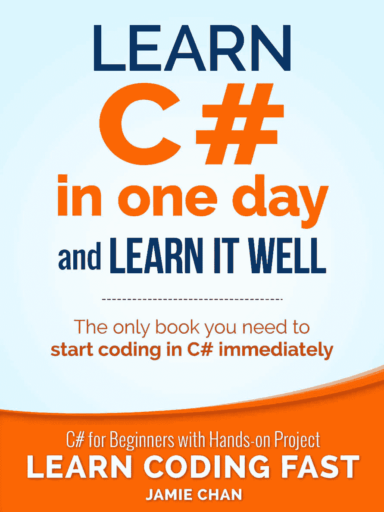
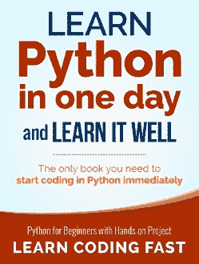
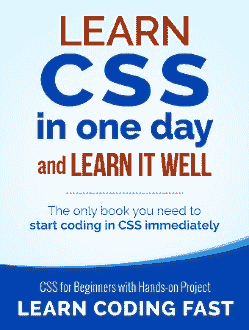

# C#：一天学会并精通 C#。带实战项目的 C# 初学者指南。（通过实战项目快速学习编程指南 3）





[`www.learncodingfast.com/csharp`](http://www.learncodingfast.com/csharp)

版权 © 2015
版权所有。未经出版者许可书面许可，不得以任何形式或通过任何（包括复印、录制或其他电子或机械方法）复制、分发或传输本书的任何部分，但法律允许的评论中的短引用及某些非商业用途除外。

## 前言

本书的编写目的是帮助你**快速**学习 C# 并**精通**它。

本书不假设读者已具备任何编程背景。如果你是一个完全的初学者，你会发现这本书以易于理解的方式解释了复杂的概念。如果你是一个经验丰富的程序员但对 C# 是新手，这本书将为你提供足够的深度，让你立即开始 C# 编程。

书中的所有示例经过精心挑选，旨在演示每个概念，以便你对该语言有更深入的理解。主题经过仔细筛选，以带你广泛接触 C#，同时不会让你因信息过载而感到崩溃。这些主题包括面向对象的编程概念、错误处理技术、文件处理技术等。

此外，正如理查德·布莱森所说：“学习任何东西的最佳方法就是实践。”本书包含一个项目，你将在引导下从零编写一个简单的工资管理软件。该项目使用了书中涵盖的概念，并让你有机会看到所有内容是如何整合在一起的。

你可以在 [`www.learncodingfast.com/csharp`](http://www.learncodingfast.com/csharp) 下载项目的源代码以及书中的所有示例程序。

### 联系方式

我乐意听取你的反馈。

如需反馈或疑问，您可以通过 jamie@learncodingfast.com 与我联系。

### Jamie 的其他书籍


[Python：一天学会 Python 并精通](http://mybook.to/Python)


[CSS：一天学会 CSS 并精通](http://mybook.to/CSS)

### 附录 A – 项目答案

# 第 1 章：C# 简介

欢迎学习 `C#` ，感谢你选择这本书！无论你是一个丰富的程序员还是一个完全的新手，这本书都是为了帮助你快速学习 `C#` 而编写的。主题经过精心挑选，旨在让你广泛接触 `C#` 的同时又不会因信息过载而让你感到压力。

读完本书后，你应该能够毫无问题地编写自己的 `C#` 程序。事实上，我们将作为书末项目的一部分，一起编写一个简单的薪资软件。准备好了吗？

首先，让我们来回答几个问题：

## 什么是 C#？

`C#`（读作 `C Sharp`）是由 Anders Hejlsberg 领导、微软在 21 世纪初开发的一种面向对象的编程语言。它是 `.Net` 框架的一部分，旨在成为一种简单的通用编程语言，可用于开发不同类型的应用程序，包括控制台应用程序、Windows 应用程序、Web 和移动应用程序。

与所有现代编程语言一样，`C#` 代码类似于计算机无法理解的英语。因此，`C#` 代码必须通过被称为 `compiler`（编译器）的工具转换为机器语言（参见脚注）。我们在本书中将使用的编译器是微软提供的免费版 `Visual Studio Community 2015`。

## 为什么要学习 C#？

`C#` 的语法和特征与 `Java` 和 `C++` 等其他编程语言相似。因此，如果你有任何之前的编程经验，你会发现学习 `C#` 非常轻而易举。即使你对编程完全一陌生，`C#` 设计得也很容易学习（不像 `C` 或 `C++`），是一门非常棒的入门语言。

此外，`C#` 是 `.Net` 框架的一部分。该框架包含大量的预写代码库，程序员可以直接使用这些代码，而无需从头开始编写一切。这允许程序员使用 `C#` 快速开发应用程序，使得如果你时间紧迫，`C#` 是你工作的理想语言。

最后，`C#` 是一种面向对象编程（`OOP`）语言。面向对象编程是一种编程方法，它将编程问题分解为相互作用的对象。我们将在本书中介绍各种面向对象的编程概念。一旦你掌握了 `C#`，你就会熟悉这些概念。这将使你未来更容易掌握其他面向对象的编程语言。

准备好涉入 `C#` 编程的世界了吗？让我们开始吧。

脚注：

将一个 `C#` 程序转换为机器语言的过程实际上比这要复杂一些。`Visual Studio Community` 仅仅是将 `C#` 程序转换为 `MIL`，代表 `Microsoft Intermediate Language`（微软中间语言）。然后，这些 `MIL` 代码将由被称为 `Common Language Runtime`（通用语言运行时）的虚拟执行系统转换为机器语言。更多信息，请查看 `https://msdn.microsoft.com/en-us/library/z1zx9t92.aspx`。尽管如此，对于我们的目的，我们不需要知道这些复杂的细节就可以开发自己的 `C#` 程序。

# 第 2 章：为 C# 做好准备

## 安装 Visual Studio Community

在我们开始用 `C#` 开发应用程序之前，我们需要下载 `Visual Studio Community`。正如第 1 章提到的，`Visual Studio Community` (`VSC`) 是微软提供的一个免费 `complier`。

事实上，`VSC` 不仅仅是一个编译器。它是一个集成开发环境（`IDE`），包含了用于编写代码的文本编辑器和一个帮助识别错误的调试器。

要下载 `VSC`，请访问 `https://www.microsoft.com/en-us/visualstudio/community/`。


### 你的第一个程序

为了编写第一个程序，让我们在桌面上创建一个文件夹并命名为 `C# Projects`。接下来，启动 `VSC` 并选择 `File > New > Project`。我们将编写的第一个程序是控制台应用程序。控制台应用程序指的是没有图形界面的程序。

在 `New Project` 对话框中，在左侧选择 `C#`，并在主框中选择 `Console Application`。将此程序重命名为 `HelloWorld` 并将其保存到之前创建的 `C# Projects` 文件夹中。最后，点击 `OK` 创建项目。


你将看到 `VSC` 创建的模板。将模板中的代码替换为下面的代码。注意，添加行号是为了参考，并不是实际代码的一部分。

```csharp
using System;
using System.Collections.Generic;
using System.Linq;
using System.Text;
using System.Threading.Tasks;

namespace HelloWorld
{
//一个用于显示 Hello World 的简单程序
class Program
{
static void Main(string[] args)
{
Console.WriteLine("Hello World");
Console.Read();
}
}
}
```

`VSC` 可以工作。当你输入时，你会注意到光标附近会出现一个框，并偶尔显示一些帮助信息。这被称为 `Intellisense`。例如，当你在单词 `Console` 之后输入点 `.` 时，会出现一个下拉列表，让你知道点之后可以输入什么。这是 `VSC` 的功能之一，旨在帮助程序员更容易编写代码。

完成输入后，可以通过点击顶部菜单上的 `Start` 按钮来执行此程序（请下下图）。


如果你的程序运行失败，`VSC` 会在 `Output Window` 中通知你错误。双击错误会将光标移动到错误所在。将你的代码与上面的代码进行对比，以纠正错误并再次运行程序。


如果一切顺利且你的程序运行成功，将出现一个黑色窗口，上面有白色的“Hello World”字样。这个黑色窗口被称为控制台。按 Enter 键关闭窗口。

就是这样！你已经成功编写了第一个程序。为自己拍拍肩膀吧。

如果你现在导航到你的“C# Projects”文件夹，你会发现一个名为“HelloWorld”的文件夹。在文件夹中，你会找到另一个“HelloWorld”文件夹和一个 `HelloWorld.sln`文件。这个 `.sln` 文件是解决方案文件。每当你需要重新打开项目时，只需打开这个文件。如果打开解决方案文件时编辑器没有显示你的代码，只需双击右侧 `Solution Explorer`（解决方案管理器）中的（参考上图）中的 `Program.cs` 文件即可打开。

你代码的可执行文件 `(.exe)` 可以在 `HelloWorld > HelloWorld > bin > Debug` 文件夹中找到。

## C# 程序的基本结构

现在，让我们快速回顾一下你刚刚编写的基础程序。

### 指令

从第 1 行到第 5 行，我们有几个以 `using` 单词开头的语句。这些语句被称为指令。它们告诉编译器我们的程序使用了某个命名空间。

例如，第一行

```csharp
using System;
```

告诉编译器我们的程序使用了 `System` 命名空间。

### 命名空间

命名空间简单来说是相关代码元素的分组。这些元素包括类、接口、枚举和结构体等（我们将在后续章节中介绍这些每一个元素）。

C# 带有大量的预写代码，这些代码被组织在不同的命名空间中。`System` 命名包含了允许我们与用户交互的方法代码。我们在程序中使用了其中两个方法——`WriteLine()` 和 `Read()` 方法。其他命名空间在我们的程序中是不需要的。但是，由于这些命名空间包含在默认模板中，我们将它们保留在代码中。

除了微软提供的预写命名空间外，我们也可以声明自己的命名空间。

声明命名空间的一个优势是可以防止命名冲突。只要两个或多个代码元素属于不同的命名空间，它们就可以有相同的名称。例如，下面的代码定义了两个命名空间，它们都包含一个名为 `MyClass` 的类。这在 C# 中是允许的，因为这两个类属于不同的命名空间（`First` 和 `Second`）。

```csharp
namespace First
{
    class MyClass
    {
    }
}

namespace Second
{
    class MyClass
    {
    }
}
```

在我们的示例中，我们声明了一个命名空间——`HelloWorld`。

`HelloWorld` 命名空间从第 7 行开始，在第 8 行有一个左大括号。它在第 20 行以一个右大括号结束。大括号在 C# 中被广泛用于表示代码元素的开始和结束。C# 中的所有左括号都必须用相应的右括号关闭。

在 `HelloWorld` 命名空间内，我们有 `Program` 类，它从第 12 行开始，到第 19 行结束。在 `Program` 类中，我们有 `Main()` 方法，它从第 14 行开始，到第 18 行结束。

### Main() 方法

`Main()` 方法是所有 C# 控制台程序的入口。每当启动控制台程序时，`Main()` 方法都是第一个被调用的方法。

在书中，每当你被要求尝试某个代码段时，你应该创建一个新的“Console Application”（控制台应用程序），并将给定的代码段输入到 `Main()` 方法（大括号之间）。你可以运行程序来测试代码。

注意我们 `Main()` 方法括号内的 `string[] args` 单词吗？这意味着 `Main()` 方法可以接受字符串数组作为输入。暂时不要担心这个。我们将在后续章节中介绍这些主题。

在我们的示例中，`Main()` 方法包含两行代码。第一行

```csharp
Console.WriteLine("Hello World");
```

在屏幕上显示“Hello World”行（不带引号）。

第二行

```csharp
Console.Read();
```

在关闭窗口之前等待用户按键。

上述两个语句都以分号结尾。这在 C# 的大多数语句中都是很常的。在 `Console.Read()` 语句之后，我们用三个右括号来结束代码，以关闭早之前的左括号。

就是这样！这个简单程序的所有内容就是。

### 注释

我们在这一章中涵盖了很多内容。你现在应该对 C# 编程有了基本的了解，并且对 VSC 比较熟悉了。在我们结束这一章之前，还有一件事要学习——注释。

如果你回到我们的“HelloWorld”示例并查看第 10 行，你会注意到这一行以两个正斜杠（`//`）开头。

```csharp
//A Simple Program to display the words Hello World
```

这一行实际上并不是程序的一部分。它是我们编写的注释，为了让代码对其他程序员更易读。编译器会忽略注释。

要向我们的程序中添加注释，我们在每行注释的前面输入两个正斜杠（`//`），如下：

```csharp
// This is a comment
// This is another comment
// This is yet another comment
```

或者，我们也可以使用 `/* … */` 进行多行注释，如下：

```csharp
/* This is a comment
This is also a comment
This is yet another comment
*/
```

注释也可以放在语句之后，如下：

```csharp
Console.Read(); // 这是一个注释
```

# 第 3 章：变量与运算符

现在你已经熟悉了 VSC 并编写了第一个程序，让我们进入实际内容。在本章中，你将学习变量和运算符（注：原文为 this chapter, you'll learn about variables and operators）。具体来说，你将学习什么是变量以及如何命名、初始化它们。我们还将学习对它们执行的常用操作。

## 什么是变量？

变量是赋予我们需要存储的数据的名称。例如，假设你的程序需要存储年龄。为了这样做，我们可以使用以下语句声明数据 `userAge`：

```csharp
int userAge;
```

声明首先是变量的数据类型，然后是它的名称。在我们的示例中，数据类型是 `int`，它指的是整数。当你声明变量 `userAge` 后，你的程序将分配特定的存储空间来存储这些数据。然后你可以通过其名称 `userAge` 访问并修改这些数据。

## C# 中的数据类型

C# 中有很多常用的数据类型。

### int

`int` 代表整数（即没有小数或分数部分的数字），范围从 -2,147,483,648 到 2,147,483,647。示例包括 15、407、908、6150 等。

### byte

`byte` 也代表整数，但范围较窄，为 0 到 255。

大多数情况下我们使用 `int` 而不是 `byte`。但如果你是为了为内存空间有限的机器编程，并且确定变量的值不会超过 0 到 255 的范围，你应该使用 `byte`。

例如，如果你需要存储用户的年龄，可以使用 `byte` 数据类型，因为用户的年龄可能会超过 255 岁。

### float

`float` 指浮点数，即带有小数部分的数字，例如 12.43、5.2 和 -9.12。

`float` 可以存储从 -3.4 x 10³⁸ 到 +3.4 x 10³⁸ 的数字。它使用 8 字节存储，精度约为 7 位。这意味着如果你使用 `float` 存储像 1.23456789（10 位）这样的数字，数字将被舍入为 1.234568（7 位）。

### double

`double` 也是浮点数，但它可以存储范围广泛的数字。它可以存储从 (+/-)5.0 x 10^(-324) 到 (+/-)1.7 x 10³⁰⁸ 的数字，精度约为 15 到 16 位。


`double` 是 C# 中默认的浮点数据类型。换句话说，如果你写像 2.34 这样的数字，C# 默认将其处理为 `double`。

### decimal
`decimal` 存储小数，但其范围比 `float` 和 `double` 小。然而，它具有更高的精度，大约有 28-29 位数字。

如果你的程序在存储非整数数字时需要极高的精度，你应该使用 `decimal` 数据类型。例如，当你编写一个对精度至关重要的金融应用程序时。

### char
`char` 代表字符（character），用于存储单个 Unicode 字符，如 ‘A’、‘%’、‘@’和‘p’等。

### bool
`bool` 代表布尔（boolean），只能包含两个值：`true` 和 `false`。它通常用于控制流语句。我们将在第 6 章介绍控制流语句。

### 变量命名
C# 中的变量名只能包含字母、数字或下划线（`_`）。然而，第一个字符不能是数字。因此，你可以将变量命名为 `userName`、`user_name` 或 `userName2`，但不能是 `2userName`。

此外，还有一些保留字是你不能作为变量名的，因为它们在 C# 中已经有了预定义的含义。这些保留字包括 `Console`、`if`、`while` 等词。我们将在随后的章节中学习每一个。

最后，变量名是区分大小大小的。`username` 和 `userName` 是不一样的。

在 C# 中命名变量时有两种约定。我们可以使用驼峰命名法（camel case）或使用下划线。驼峰命名法是使用混合大小写编写复合词的做法，除了第一个单词外，每个单词的首字母都大写（例如 `thisIsAVariableName`）。这是我们在书的其余部分将使用的约定。另一种常见做法是使用下划线（`_`）来分隔单词。如果你愿意，可以这样命名变量：`this_is_a_variable_name`。

### 变量初始化
每当你声明一个新变量时，都需要给它一个初始值。这被称为初始化变量。你稍可以在程序中更改变量的值。

初始化变量有两种方法。你可以在声明时初始化，也可以在单独的语句中初始化。

下面的示例展示了如何在如何在声明时初始化变量：

#### 示例 1
这些示例展示了如何初始化 `byte` 和 `int` 变量。

```cs
byte userAge = 20;
int numberOfEmployees = 510;
```
由于 `byte` 和 `int` 用于没有小数位的数据，如果你编写类似下面的代码，将会得到错误：

```cs
byte userAge2 = 20.0;
```
在 C# 中，20.0 不等于 20。

#### 示例 2
接下来的示例展示了如何用整数初始化 `double`、`float` 和 `decimal` 变量。虽然这些数据类型用于带有小数部分的数字，但我们也可以像下面所示使用它们来存储整数。

```cs
double intNumberOfHours = 5120;
float intHourlyRate = 60;
decimal intIncome = 25399;
```

#### 示例 3
下面的示例展示了如何用非整数初始化 `double`、`float` 和 `decimal` 变量。

```cs
double numberOfHours = 5120.5;
float hourlyRate = 60.5f;
decimal income = 25399.65m;
```
如前所述，带小数数字的默认数据类型是 `double`。

因此，在上面的示例中，当你初始化 `hourlyRate` 时，需要在 60.5 后面添加后缀 ‘f’，以显式告诉编译器将 60.5 转换为 `float`。同样，当你初始化 `income` 时，需要添加后缀 ‘m’ 将 25399.65 转换为 `decimal` 数据类型。

#### 示例 4
`char` 数据类型只能包含单个字符。当我们初始化 `char` 变量时，需要将该字符括在单引号中。例如：

```cs
char grade = ‘A’;
```

#### 示例 5
`bool` 变量只能是 `true` 或 `false`。下面的示例展示了如何初始化 `bool` 变量。

```cs
bool promote = true;
```

#### 示例 6
除了单独初始化变量外，只要它们的数据类型相同，你还可以在同一语句中初始化多个变量。以下示例展示了如何这样做。注意，两个变量用逗号分隔，语句以分号结束。

```cs
byte level = 2, userExperience = 5;
```
上面的六个示例展示了如何在声明时初始化变量。或者，你可以选择在单独的语句中初始化变量。下例所示：

```cs
byte year; // 声明变量
year = 20; // 初始化它
```

### 赋值符号
编程中的 `=` 符号与我们在数学中学习的 `=` 符号含义不同。在编程中，`=` 符号被称为赋值符号。这意味着我们将 `=` 右侧的值赋值给左侧的变量。理解像 `year = 20` 这样的语句的好方法是将其视为 `year <- 20`。

在编程中，语句 `x = y` 是赋值的。

### 基础运算符
除了给变量赋值初始值或将另一个变量赋值给它，我们还可以对变量执行常规操作。C# 中的基础运算符包括 `+`、`-`、`*`、`/` 和 `%`，分别代表加、减、乘、除和取模。

示例
假设 x = 7, y = 2

加法：x + y = 9
减法：x - y = 5
乘法：x*y = 14
除法：x/y = 3（向下取整）
取模：x%y = 1（余数）

在 C# 中，如果 `x` 和 `y` 都是整数，除法得到整数答案。然而，如果 `x` 或 `y` 之一是非整数，我们将得到非整数答案。例如：

```
7 / 2 = 3
7.0 / 2 = 3.5
7 / 2.0 = 3.5
7.0 / 2.0 = 3.5
```
在第一情况下，当整数除以另一个整数时，得到整数答案。答案的小数部分（如果有）会被截断。因此我们得到 3 而不是 3.5。在所有其他情况下，由于至少一个操作数是非整数，结果是非整数。

### 更多赋值运算符
除了 `=` 符号外，C#（以及大多数编程语言）还有一些赋值运算符。这些包括 `+=`、`-=` 和 `*=` 等运算符。

假设我们有一个初始值为 10 的变量 `x`。如果我们想让 `x` 增加 2，可以写：

```cs
x = x + 2;
```
程序将先求右侧表达式（`x + 2`）的值并给左侧。所以上面的语句最终变为 `x <- 12`。

与其写 `x = x + 2`，我们也可以写 `x += 2` 来表达相同的含义。`+=` 符号实际上是赋值符号与加法运算符的简写。因此，`x += 2` 意味着 `x = x + 2`。

同样，如果我们想做减法，可以写 `x = x - 2` 或 `x -= 2`。上述章节中提到的所有 5 个运算符都适用。


大多数编程语言也拥有 `++` 和 `--` 运算符。`++` 运算符用于你想将变量的值增加 1 的情况。例如，假设

```c
int x = 2;
```

如果你编写

```c
x++;
```

`x` 的值将变为 3。

在使用 `++` 运算符时，不需要使用 `=` 符号。语句 `x++;` 等同于

```c
x = x + 1;
```

`++` 运算符可以放在变量名的的前面或后面。这会影响任务执行的顺序。

假设我们有一个名为 `counter` 的整数。如果我们编写

```c
Console.WriteLine(counter++);
```

程序会先打印 `counter` 的原始值，然后再将 `counter` 递加 1。换句话说，它按照以下顺序执行任务：

```c
Console.WriteLine(counter);
counter = counter + 1;
```

另一方面，如果我们编写

```c
Console.WriteLine(++counter);
```

程序会先将 `counter` 递加 1，然后在此之后打印 `counter` 的新值。换句话说，它按照以下顺序执行任务：

```c
counter = counter + 1;
Console.WriteLine(counter);
```

除了 `++` 运算符外，我们还有 `--` 运算符（两个减号）。该运算符将变量的值减少 1。

## C# 中的类型转换

有时在我们的程序中，我们需要从一种数据类型转换为另一种数据类型，例如从 `double` 转换为 `int`。这被称为类型转换（Type Casting）。

要将一种数值数据类型转换为另一种，我们只需要在想要转换的数据前面加上 `(new data type)` 即可。

例如，我们可以这样将非整数转换为整数：

```c
int x = (int) 20.9;
```

当我们将 20.9 转换为整数时，得到的结果是 20，而不是 21。小数部分在转换后会被直接截断。

我们还可以将 `double` 转换为 `float` 或 `decimal`。回想起我们之前提到过，在 C# 中，所有非整数默认被处理为 `double`。如果我们想将像 20.9 这样的数字赋值给 `float` 或 `decimal`，我们需要分别添加 `f` 和 `m` 后缀。另一种方法是使用强制转换，如下：

```c
float num1 = (float) 20.9;
decimal num2 = (decimal) 20.9;
```

`num1` 和 `num2` 的值都将是 20.9。

除了数值类型之间的转换外，我们还可以进行其他类型的转换。我们将在后续章节中探索其中一些转换。

# 第 4 章：数组、字符串和列表

在上一章中，我们涵盖了 C# 中常用的一些基础数据类型。除了这些基础数据类型，C# 还提供了几个高级数据类型。在本章中，我们将涵盖三个高级数据类型：数组、字符串和列表。此外，我们还将讨论值类型（value data type）和引用类型（reference data type）之间的区别。

## 数组

数组简单来说是相互相关的数据集合。假设我们要存储 5 个用户的年龄。与其将它们存储为 `user1Age`、`user2Age`、`user3Age`、`user4Age` 和 `user5Age`，我们可以将它们存储为一个数组。

数组可以这样声明并初始化：

```c
int[] userAge = {21, 22, 23, 24, 25};
```

`int` 表示该变量存储 `int` 值。
`[]` 表示该变量是一个数组而不是普通变量。
`userAge` 是数组名称。
`{21, 22, 23, 24, 25}` 是数组存储的五个整数。

除了在声明时声明并初始化数组外，我们还可以先声明数组稍后初始化它。要做到这一点，我们需要使用 `new` 运算符：

```c
int[] userAge = new int[5];
userAge = new [] {21, 22, 23, 24, 25};
```

第一条语句声明并创建一个存储 5 个整数的数组。第二条语句初始化了该数组。

数组中的单个值可以通过它们的索引（indexes）访问，索引始终从零 开始，而不是从 1。这是几乎所有编程语言（如 Python 和 Java）的共同做法。数组的第一个值的索引为 0，下一个索引为 1，依此类推。

如果我们输入

```c
Console.WriteLine(userAge[0]);
```

屏幕上将显示值 ‘21’。

如果我们输入

```c
userAge[2] = userAge[2] + 20;
```

数组变成了 `{21, 22, 43, 24, 25}`。也就是说，在第三个元素上加了 20。

### 数组属性和方法

C# 提供了许多可以与数组一起使用的有用属性和方法。

我们将在第 7 章讨论类时学习更多关于属性和方法的知识。现在，我们只需要知道，要使用某个属性或方法，我们需要使用点（`.`）运算符。要使用一个属性，我们在点之后输入属性名。要使用一个方法，我们在点运算符之后输入方法名，并在后面紧跟一对括号 `()`。

### Length

数组的 `Length` 属性告诉我们该数组包含多少个项。

例如，如果我们有

```c
int [] userAge = {21, 22, 26, 32, 40};
```

`userAge.Length` 等于 5，因为数组中有 5 个数字。

#### Copy()

`Copy()` 方法允许你将一个数组的内容复制到另一个数组中，从第一个元素开始。

在 C# 中，一个方法可能有许多不同的变体。例如，`Copy()` 方法有四种变体。下面的示例讨论了四种变体中的一种。如果你学会了如何使用一种变体，就可以很容易地学会如何使用其他 `Copy()` 方法。

每当我们使用方法时，都需要方法名后加上一对括号 `()`。某些方法需要特定的数据才能运行。这些数据被称为参数（arguments）。我们将这些参数放在括号中。`Copy()` 方法需要三个参数。

假设你有

```c
int [] source = {12, 1, 5, -2, 16, 14};
int [] dest = {1, 2, 3, 4};
```

你可以通过下面的语句将 `source` 的前三个元素复制到 `dest`：

```c
Array.Copy(source, dest, 3);
```

第一个参数是提供要复制值的数组。第二个是值将被复制入的数组。最后一个参数指定了要复制的项数。

在我们的示例中，我们的 `dest` 数组变成了 `{12, 1, 5, 4}`，而 `source` 数组保持不变。

#### Sort()

`Sort()` 方法允许我们对数组进行排序。它接收数组作为参数。

假设你有

```c
int [] numbers = {12, 1, 5, -2, 16, 14};
```

你可以通过编写对该数组进行排序：

```c
Array.Sort(numbers);
```

数组将按升序排序。因此，`numbers` 变为 `{-2, 1, 5, 12, 14, 16}`。

#### IndexOf()

我们使用 `IndexOf()` 方法来确定某个值是否存在于数组中。如果存在，该方法返回该值第一次出现的索引。如果不存在，方法返回 -1。

例如，如果你有

```c
int [] numbers = {10, 30, 44, 21, 51, 21, 61, 24, 14};
```

你可以通过编写代码来查找值 21 是否存在于数组中：

```c
Array.IndexOf(numbers, 21);
```

该方法返回找到的第一个值的索引，在这种情况下是 3，因为 21 是数组中的第四个元素。然后你可以这样将答案赋值给变量：

```c
int ans = Array.IndexOf(numbers, 21);
```

因此 `ans` 的值是 3。如果你编写

```c
ans = Array.IndexOf(numbers, 100);
```

`ans` 的值是 -1，因为 100 不在 `numbers` 数组中。

我们在本节中涵盖了一些常用的数组方法。如需查看 C# 中所有可用数组方法的列表，请访问此页面：

[`msdn.microsoft.com/en-us/library/system.array_methods(v=vs.110).aspx`](https://msdn.microsoft.com/en-us/library/system.array_methods(v=vs.110).aspx)

## String

接下来让我们看看 `string` 数据类型。字符串是一段文本。字符串的一个示例是文本“Hello World”。

要声明并初始化一个 `string` 变量，你编写

```c
string message = “Hello World”;
```

其中 `message` 是 string 变量的名称，“Hello World”是赋值给它的字符串。注意你需要将字符串包含在双引号（”）中。

你也可以将空字符串赋值给变量，如下：


```c
string anotherMessage = "";
```

最后，我们可以使用连接符号（`+`）连接两个或多个字符串，并将它们赋值给变量。例如，我们可以写：

```c
string myName = “Hello World, ” + “my name is Jamie”;
```

这等同于

```c
string myName = “Hello World, my name is Jamie”;
```

### 字符串属性和方法

和数组一样，字符串包含许多属性和方法。

### Length

字符串的 `Length` 属性告诉我们字符串包含的字符总数。

要找到字符串“Hello World”的长度，我们写：

```c
“Hello World”.Length
```

我们将得到值 `11`，因为“Hello”和“World”都包含 5 个字符。当你加上两个单词之间的空格时，总总长度为 `11`。

### Substring()

`Substring()` 方法用于从较长的字符串中提取子字符串。

它需要两个参数。第一个告诉编译器要提取的起始位置索引，第二个告诉编译器长度。

假设我们声明了一个 `string` 变量 `message` 并给它赋值字符串“Hello World”。

```c
string message = “Hello World”;
```

我们然后可以使用 `message` 来调用 `Substring()` 方法，如下所示。

```c
string newMessage = message.Substring(2, 5);
```

`Substring(2, 5)` 从 `message` 中从索引 2 开始提取 5 个字符的子字符串（由于索引从 0 开始，所以 2 是第三个字母）。

生成的子字符串被赋值给 `newMessage`。

因此，`newMessage` 等于“llo W”。

相反，`message` 没有改变。它仍然保持为“Hello World”。

### Equals()

我们可以使用 `Equals()` 方法比较两个字符串是否相同。

如果我们有两个如下所示的字符串：

```c
string firstString = “This is Jamie”;
string secondString = “Hello”;
firstString.Equals(“This is Jamie”);
```

返回 `true`，而

```c
firstString.Equals(secondString);
```

返回 `false`，因为这两个字符串（`firstString` 和 `secondString`）不等。

### Split()

`Split()` 方法根据用户定义的分隔符数组将字符串拆分为多个子字符串。拆分字符串后，`Split()` 方法返回一个包含结果子字符串的数组。

`Split()` 方法需要两个参数——一个作为分隔符的字符串数组，以及另一个指定是否要从结果中移除空字符串的参数。

假设你想将字符串“Peter, John; Andy, ,David”拆分为子字符串，你可以如下如下操作（添加行号供参考）：

```c
1 string [] separator = {“, ”, “; ”};
2 string names = “Peter, John; Andy, , David”;
3 string [] substrings = names.Split(separator, StringSplitOptions.None);
```

在第 1 行，我们首先声明了一个包含两个字符串的数组作为分隔符。第一个字符串是逗号后加空格，第二个是分号后加空格。

在第 2 行，我们将想要拆分的字符串赋值给 `names` 变量。在第 3 行，我们使用 `names` 变量调用 `Split()` 方法并将结果赋值给 `substrings` 数组。

上述代码的结果是以下数组：

`{“Peter”, “John”, “Andy”, “” , “David”}`

该数组包含一个空字符串，因为在原始字符串中，“Andy”后面的逗号和“David”之前的逗号之间有一个空格。如果你想从结果中移除空字符串，必须将第 3 行改为：

```c
string [] substrings = names.Split(separator, StringSplitOptions.RemoveEmptyEntries);
```

因此 `substrings` 数组变为：

`{“Peter”, “John”, “Andy”, “David”}`

一如既往，我们只涵盖了一些常用的字符串方法。要查看 C# 中所有字符串方法的完整列表，请访问此页面 [`msdn.microsoft.com/en-us/library/system.string_methods(v=vs.110).aspx`](https://msdn.microsoft.com/en-us/library/system.string_methods(v=vs.110).aspx)

## 列表

现在，让我们看看本章的最后数据类型——列表。列表像数组一样存储值，但可以随意添加或删除元素。

数组只能包含固定数量的值。如果你声明：

```c
int [] myArray = new int[10];
```

`myArray` 只能容纳 10 个值。如果你写 `myArray[10]`（由于数组索引从零开始，这指的是第 11 个值），将得到一个错误。

如果你在程序需要更大的灵活性，可以使用列表。

要声明一个整数列表，我们写：

```c
List<int> userAgeList = new List<int>();
```

`userAgeList` 是列表的名字。

`List` 是一个表示你正在声明列表的关键字。

数据类型封装在角括号 `< >` 中。

你可以在声明时像这样选择初始化列表：

```c
List<int> userAgeList = new List<int> {11, 21, 31, 41};
```

要访问列表中的单个元素，我们使用与访问数组元素相同的符号。例如，要访问第一个元素，你写 `userAgeList[0]`。

### 列表属性和方法

列表数据类型也带有许多属性和方法。

### Add

要向列表添加成员，使用 `Add()` 方法。

```c
userAgeList.Add(42);
```

`userAgeList` 现在有 5 个元素。

### Count

要找到列表中的元素数量，使用 `Count` 属性。

```c
int count = userAgeList.Count;
```

`Count` 给了我们列表中的元素数量。

### Insert()

要在特定位置插入成员，使用 `Insert()` 方法。

```c
userAgeList.Insert(2, 22);
```

其中 2 是索引，22 是你想要插入的值。

### Remove()

要从列表中移除成员，使用 `Remove()` 方法。

```c
userAgeList.Remove(21);
```

`Remove()` 方法移除该参数第一次出现的位置。

### RemoveAt()

要在特定位置移除成员，使用 `RemoveAt()` 方法。

```c
userAgeList.RemoveAt(3);
```

其中 3 是要删除的项目的索引。

### Contains()

检查列表是否包含某个成员，使用 `Contains()` 方法。

```c
bool hasAge = userAgeList.Contains(21);
```

我们将得到 `true` 或 `false`。

### Clear()

要移除列表中的项，使用 `Clear()` 方法。

```c
userAgeList.Clear();
```

我们的列表中不再有任何元素。

## 值类型与引用类型

现在我们熟悉了字符串、数组和列表，让我们讨论一下 C# 中数据类型的一个重要概念。

C# 中的所有数据类型都可以分类为值类型或引用类型。第 3 章讨论的数据类型是值类型。本章讨论的是引用类型。

值数据类型是存储自身数据的变量。

当我们写：

```c
int myNumber = 5;
```

`myNumber` 存储实际的值 5。

相反，引用类型并不存储实际数据。相反，它存储对数据的引用。它不告诉编译器数据的值是多少；它告诉编译器去哪里找到实际数据。

引用类型的示例是 `string`。当你编写这样的语句时：

```c
string message = “Hello”;
```

变量 `message` 实际上并没有存储“Hello”。

相反，字符串“Hello”被创建并存储在计算机内存的其他地方。变量 `message` 存储的是该内存位置的地址。


关于引用类型，这就是目前我们需要了解的全部内容。由于这是一本面向初学者的书籍，我们不会详细讨论为什么需要引用类型。只需注意值类型和引用类型之间存在区别：前者存储值，而后者存储地址。

# 第 5 章：让我们的程序交互起来

现在我们已经涵盖了变量和数据类型的基础，让我们来编写一个利用这些内容的程序。在本章中，我们将学习如何接受用户输入、将数据存储在变量以及向用户显示消息。准备好了吗？

## 向用户显示消息

要向用户显示消息，我们使用 C# 提供的 `Write()` 或 `WriteLine()` 方法，这些方法位于 `System` 命名空间中。

`WriteLine()` 和 `Write()` 的区别在于 `WriteLine()` 在显示消息后会将光标移动到下一行，而 `Write()` 则不会。

如果我们写：

```
Console.WriteLine(“Hello ”);
Console.WriteLine(“How are you?”);
```

我们将得到：

```
Hello
How are you?
```

如果我们写：

```
Console.Write(“Hello ”);
Console.Write(“How are you?”);
```

我们将得到：

```
Hello How are you?
```

注意，在上面的示例中，每当我们调用 `WriteLine()` 或 `Write()` 方法时，我们都在方法名前面加上了 `Console`。这是因为这两个方法都是 `Console` 类的静态方法。我们将在第 7 章详细讨论静态方法。

如果你觉得每次使用这两个方法时都添加 `Console` 词很麻烦，可以在程序的开头添加指令：

```
using static System.Console;
```

如果你这样做，那么每你使用 `Console` 类中的任何静态方法时，只需写写：

```
WriteLine(“Hello World”);
```

而不是：

```
Console.WriteLine(“Hellow World”);
```

这是 C# 6 的一个新功能（C# 的最新版本，且仅在你使用最新版本的 IDE（即 Visual Studio 2015）时才可用）。在接后的示例中，为了向后兼容，我们将坚持使用第一种方法。

在第 2 章编写“Hello World”程序时，我们已经见过如何使用 `WriteLine()` 方法的示例了。现在让我们看更多的示例。在下面的示例中，我们将重点关注 `WriteLine()` 方法。`Write()` 方法的工作方式完全相同。

#### 示例 1

显示一个简单的字符串，我们写：

```
Console.WriteLine(“Hello, how are you?”);
```

输出

```
Hello, how are you?
```

#### 示例 2

要显示变量的值，我们将变量名作为参数传递。例如，假设我们有

```
int userAge = 30;
```

我们通过编写以下代码显示 `userAge` 的值：

```
Console.WriteLine(userAge);
```

输出

```
30
```

注意，我们没有将变量名（`userAge`）放在双引号内。如果我们写：

```
Console.WriteLine(“userAge”);
```

我们将得到输出：

```
userAge
```

#### 示例 3

合并两个或多个字符串并显示它们，我们使用上一章中提到的拼接符号（`+`）。

例如，如果我们写：

```
Console.WriteLine(“Hello, ” + “how are you?” + “ I love C#.”);
```

我们将得到：

```
Hello, how are you? I love C#.
```

#### 示例 4

我们也可以使用拼接符号来组合字符串和变量。假设我们有

```
int results = 79;
```

语句

```
Console.WriteLine(“You scored ” + results + “ marks for your test.”);
```

给了我们：

```
You scored 79 marks for your test.
```

再次，我们没有将变量名放在双引号内。否则我们将得到：

```
You scored results marks for your test.
```

#### 示例 5

除了使用拼接符号组合字符串和变量外，我们还可以使用占位符。假设我们有

```
int results = 79;
```

如果我们写：

```
Console.WriteLine(“{0}! You scored {1} marks for your test.”, “Good morning”, results);
```

我们将得到：

```
Good morning! You scored 79 marks for your test.
```

在这个示例中，我们向 `WriteLine()` 方法传递了三个参数，用逗号分隔。

这三个参数是：

1) `“{0}! You scored {1} marks for your test.”`

2) `“Good morning”`
3) `results`

第一个将要显示的字符串。在字符串内部，大括号充当占位符，并将被随后的参数替换。

`{0}` 是下一个参数的占位符，在这种情况下是字符串“Good morning”。

`{1}` 是变量 `results` 的占位符。

因此，输出是：

```
Good morning! You scored 79 marks for your test.
```

如果你写：

```
Console.WriteLine(“{1}! You scored {0} marks for your test.”, “Good morning”, results);
```

你会得到：

```
79! You scored Good morning marks for your test.
```

当然，这样的语句没有意义。但是，它演示了占位符是如何被相应的参数替换的。

在使用占位符时，我们可以指定希望如何显示数值。这是通过使用格式化符实现的，例如 `C` 和 `F` 格式化符。

`F` 格式化符指定小数位数。`C` 格式化符将数字格式化为货币。

#### 示例 6

我们也可以使用拼接符号来组合字符串和变量。假设我们有

```
int results = 79;
```

语句

```
Console.WriteLine(“You scored ” + results + “ marks for your test.”);
```

给了我们：

```
You scored 79 marks for your test.
```


`Read()` 和 `ReadLine()` 方法都将用户输入读取为字符串。因此，在上面的示例中，我们将 `Console.ReadLine()` 的结果赋值给一个名为 `userInput` 的 `string` 变量。

然后我们可以使用：

```sharp
Console.WriteLine(userInput);
```

来打印出用户输入的输入。

## 将字符串转换为数字

有时候，有必要将用户输入的内容转换为数值数据类型，以便能够对其进行计算。C# 为我们提供了许多方法来完成这种转换。我们使用的方法位于 `Convert` 类中，该类也归类在 `System` 命名空间下。

要将字符串转换为整数，我们使用 `ToInt32()` 方法。例如，如果我们有：

```sharp
string userInput = Console.ReadLine();
```

并且用户输入了 20，`userInput` 将等于“20”（由于有双引号，它是一个字符串而不是整数）。

然后我们可以使用：

```sharp
int newUserInput = Convert.ToInt32(userInput);
```

将字符串转换为整数 20 并将其赋值给一个 `int` 变量。现在我们可以对这个新的 `int` 变量进行通常的数学运算了。

除了将字符串转换为整数，我们还可以分别使用 `ToDecimal()`、`ToSingle()` 和 `ToDouble()` 方法将字符串转换为 `decimal`、`float` 或 `double`。

## 整合一切

现在让我们把所学到的知识整合在一起，编写一个完整的程序。我们将修改在第 2 章中写的“Hello World”程序。我们不仅向世界问好，还想让世界知道我们的名字和年龄。

首先，启动 Visual Studio Community 并创建一个新的 Visual C# 控制台应用程序。将项目命名为“HelloWorldAgain”。

在 `Main()` 方法中输入以下代码段（添加了行号供参考）。

```sharp
1 string userName = "";
2 int userAge = 0;
3 int currentYear = 0;
4
5 Console.Write("Please enter your name: ");
6 userName = Console.ReadLine();
7 Console.Write("Please enter your age: ");
8 userAge = Convert.ToInt32(Console.ReadLine());
9 Console.Write("Please enter the current year: ");
10 currentYear = Convert.ToInt32(Console.ReadLine());
11
12 Console.WriteLine("Hello World! My name is {0} and I am {1} years old. I was born in {2}.", userName, userAge, currentYear - userAge);
```

运行程序并输入以下信息：

`Please enter your name: Jamie`
`Please enter your age: 39`
`Please enter the current year: 2015`

程序应该给你以下输出：

`Hello World! My name is Jamie and I am 39 years old. I was born in 1976.`

这个程序应该很好理解。然而，关于这个程序有两点需要说明。

首先，第 10 行展示了我们如何在同一条语句中使用两个方法的示例。当我们写下：

```sharp
userAge = Convert.ToInt32(Console.ReadLine());
```

`Console.ReadLine()` 方法会先执行，因为它位于一对括号 `()` 之中。这与我们在评估数学表达式时，括号内的操作具有更高优先级相似。例如，当我们评估 `3 * (5 + 9)` 时，我们必须先将 5 加 9，然后再将结果乘以 3（即 `3*14`）。

在 `Console.ReadLine()` 执行后，用户输入的值将使用 `Convert.ToInt32()` 转换为整数。

假设用户输入了 39。

```sharp
Convert.ToInt32(Console.ReadLine())
```

变为：

```sharp
Convert.ToInt32(“39”)
```

`Convert.ToInt32(“39”)` 的结果是整数 39。该整数随后被赋值给变量 `userAge`。

关于程序的下一个要点是第 12 行，如下所示：

```sharp
Console.WriteLine(“Hello World! My name is {0} and I am {1} years old. I was born in {2}.”, userName, userAge, currentYear - userAge);
```

注意最后一个参数（`currentYear - userAge`）涉及一个数学运算？这在 C# 中是允许的。`WriteLine()` 将执行减法并显示计算结果。

# 第 6 章：选择与决策

恭喜你走到了这里。我们已经走了很远的路。你现在了解了 C# 中不同的数据类型，并能够编写与用户交互的简单程序。

在本章中，我们将涵盖编程中的另一个基本概念；我们将学习如何使用控制流语句来控制程序的流程。

具体来说，我们将学习 `if` 语句、内联 `if` 语句、`switch` 语句、`for` 循环、`foreach` 循环、`while` 循环和 `do while` 循环。此外，我们还将学习 `try-catch-finally` 语句，用于在发生错误时控制程序的流程。

然而，在使用这些控制工具之前，我们必须先条件语句。

## 条件语句

大多数控制流语句涉及评估条件语句。程序将根据条件是否满足以不同的方式运行。

最常见的条件语句是比较语句。如果我们想比较两个变量是否相同，我们使用相等运算符 `==`。例如，如果你写 `x == y`，你是在检查 `x` 是否等于 `y`。如果相等，则条件为 `true`；如果不相等，则条件为 `false`。

除了判断一个值是否等于另一个，我们还有其他比较运算符可以在条件语句中使用：

**不等于 (!=)**
如果左值不等于右，则返回 `true`。

**大于>)**
如果左大于右，则返回 `true`。

**小于(<)**
如果左小于右，则返回 `true`。

**大于或等于 (>=)**
如果左大于或等于右，则返回 `true`。

**小于或等于 (<=)**
如果左小于或等于右，则返回 `true`。

我们还拥有三个逻辑运算符（`&&`、`||`、`!`），在组合多个条件时非常有用：

**逻辑与 (&&)**
如果所有条件都满足，则返回 `true`。

**逻辑或 (||)**
如果至少有一个条件满足，则返回 `true`。

**逻辑非 (!)**
如果条件不满足，则返回 `true`。

### 控制流语句

在我们熟悉条件语句之后，让我们学习如何使用这些语句来控制程序的流程。

### If 语句

`if` 语句是最常用的控制流语句之一。它允许程序评估某个条件是否满足，并根据评估结果执行相应的操作。`if` 语句的结构如下（添加了行号供参考）：

```sharp
1 if (condition 1 is met)
2 {
3 do Task A
4 }
5 else if (condition 2 is met)
6 {
7 do Task B
8 }
9 else if (condition 3 is met)
10 {
11 do Task C
12 }
13 else
14 {
15 do Task E
16 }
```

第 1 行测试第一个条件。如果条件满足，随后的括号（第 2 到 4 行）内的所有内容将执行。`if` 语句的剩余部分（从 5 到 16 行）将被跳过。

如果第一个条件不满足，可以使用随后的 `else if` 语句测试更多条件（第 5 到 12 行）。可以有多个 `else if` 语句。最后，如果没有任何先前的条件满足，可以使用 `else` 语句（第 13 到 16 行）执行某些代码。

为了完全理解 `if` 语句的工作原理，请将以下代码添加到 VSC 模板的 `Main()` 程序中。

```csharp
int userAge;
```


```csharp
Console.Write("Please enter your age: ");
userAge = Convert.ToInt32(Console.ReadLine());
if (userAge < 0 || userAge > 100)
{
    Console.WriteLine("Invalid Age");
    Console.WriteLine("Age must be between 0 and 100");
}
else if (userAge < 18)
    Console.WriteLine("Sorry you are underage");
else if (userAge < 21)
    Console.WriteLine("You need parental consent");
else
{
    Console.WriteLine("Congratulations!");
    Console.WriteLine("You may sign up for the event!");
}
```

该程序首先提示用户输入其年龄，并将结果存储在 `userAge` 变量中。

接接下来，语句 `if (userAge < 0 || userAge > 100)` 检查 `userAge` 的值是否小于 0 或大于 100。如果任一个条件为 `true`，程序将执行后续大括号内的所有语句。在这个示例中，它将打印“Invalid Age”，然后是“Age must be between 0 and 100”。

另一方面，如果两个条件都为 `false`，程序将测试下一个条件 - `else if (userAge < 18)`。如果 `userAge` 小于 18（但大于或等于 0，因为第一个条件未满足），程序将打印“Sorry you are underage”。

你可能会注意到，我们没有将语句 `Console.WriteLine(“Sorry you are underage”)` 包含在大括号中。这是因为如果只有一个要执行的语句，大括号是可选的。

如果用户没有输入小于 18 的值，而是输入了一个大于或等于 18 但小于 21 的值，则将执行下一个 `else if` 语句。在这种情况下，将打印消息“You need parental consent”。

最后，如果用户输入的值大于或等于 21 且小于或等于 100，程序将执行 `else` 块中的代码代码。在这种情况下，它将打印“Congratulations”，然后是“You may sign up for the event!”。

运行程序五次，并分别输入 -1、8、20、23 和 121。你将得到以下输出：

```
Please enter your age: -1
Invalid Age
Age must be between 0 and 100
Please enter your age: 8
Sorry you are underage
Please enter your age: 20
You need parental consent
Please enter your age: 23
Congratulations!
You may sign up for the event!
Please enter your age: 121
Invalid Age
Age must be between 0 and 100
```

### 内联 If (Inline If)

内联 `if` 语句是 `if` 语句的一种更简单的形式，如果你想根据条件的结果为变量赋值，这种形式非常方便。其语法是：

`condition ? value if condition is true : value if condition is false;`

例如，语句 `3>2 ? 10 : 5;` 返回值 10，因为 3 大于 2（即条件 `3 > 2` 为 `true`）。该值随后可以赋值给变量。

如果我们写 `int myNum = 3>2 ? 10 : 5;`，`myNum` 将被赋值 10。

### Switch 语句 (Switch Statement)

`switch` 语句与 `if` 语句类似，不同之处在于它不支持范围范围。`switch` 语句要求每个 `case` 必须基于单一值。根据用于切换的变量的值，程序将执行正确的代码块。

`switch` 语句的语法如下：

```csharp
switch (variable used for switching)
{
    case firstCase:
        do A;
        break (or other jump statements);
    case secondCase:
        do B;
        break (or other jump statements);
    case default:
        do C;
        break (or other jump statements);
}
```

使用 `switch` 语句时，你可以拥有任意数量的 `case`。`default` 情况是可选的，如果没有其他 `case` 适用，则执行它。

当满足某个 `case` 时，从下一行开始的所有内容都将执行，直到遇到跳转语句。跳转语句是指示编译器跳转到程序中另一行的语句。我们稍后会深入探讨跳转语句。最常用的跳转语句是 `break;` 语句。

让我们来看一个 `switch` 语句如何工作的示例。

```csharp
1 Console.Write("Enter your grade: ");
2 string userGrade = Console.ReadLine();
3
4 switch (userGrade)
5 {
6 case "A+":
7 case "A":
8 Console.WriteLine("Distinction");
9 break;
10 case "B":
11 Console.WriteLine("B Grade");
12 break;
13 case "C":
14 Console.WriteLine("C Grade");
15 break;
16 default:
17 Console.WriteLine("Fail");
18 break;
19 }
```

如果等级是 “A+”（第 6 行），程序执行后续语句直到遇到 `break;` 语句。这意味着它将执行第 7 到 9 行。因此，输出是“Distinction”。

如果等级是 “A”（第 7 行），程序执行后续语句直到遇到 `break;` 语句。这意味着它将执行第 8 行。

如果 grade 是 A+ 或 A，你将得到以下输出：

```
Enter your grade: A+
Distinction
Enter your grade: A
Distinction
Enter your grade: B
B Grade
Enter your grade: C
C Grade
Enter your grade: D
Fail
```

### For 循环 (For Loop)

`for` 循环执行一个代码块直到条件不再满足。`for` 的语法是：

```csharp
for (initial value; test condition; modification)
{
//Task
}
```

为了理解 `for` 循环如何工作，让我们考虑这个示例：

```csharp
1 for (int i = 0; i < 5; i++)
2 Console.WriteLine(i);
```

它有三部分，用分号分隔。第一部分声明并初始化 `int` 变量 `i` 为零。该变量作为循环计数器。

第二部分测试 `i` 是否小于 5。如果是，则执行大括号内的语句。在这个示例中，大括号是可选的。

执行 `WriteLine()` 语句后，程序返回第 1 行。`i++` 将 `i` 的值增加 1。因此，`i` 从 0 增加到 1。

增加后，程序测试 `i` 的新值是否仍然小于 5。如果是，它再次执行 `WriteLine()`。这种测试和增加计数器的过程将重复，直到条件 `i < 5` 不再满足。此时，程序退出 `for` 循环并继续执行后续命令。

该代码的输出为：

```
0
1
2
3
4
```

输出停止在 4，是因为当 `i` 为 5 时，`WriteLine()` 语句不再执行。

`for` 循环通常用于遍历数组。例如，如果我们有

`int[] myNumbers = { 10, 20, 30, 40, 50 };`

我们可以使用 `for` 循环和数组的 `Length` 属性来遍历数组，如下：

```csharp
for (int i = 0; i < myNumbers.Length; i++)
{
    Console.WriteLine(myNumbers[i]);
}
```

由于 `myNumbers.Length` 等于 5，此代码从 `i = 0` 运行到 `i = 4`。如果我们运行代码，我们将得到：

```
10
20
30
40
50
```

### Foreach 循环 (Foreach Loop)

除了 `for` 循环外，在处理数组和列表时，我们还可以使用 `foreach` 循环。如果你想从数组或列表中获取信息而不对其进行任何更改，那么 `foreach` 循环非常有用。

假设你有

`char[] message = { ‘H’, ‘e’, ‘l’, ‘l’, ‘o’ };`

你可以使用以下代码显示数组的元素：

```csharp
foreach (char i in message)
Console.Write(i);
```


在上面的代码中，我们有一个用于循环的 `char` 变量 `i`。每次循环运行时，`message` 数组中的一个元素会被赋值给变量 `i`。例如，当循环第一次运行时，字符‘H’被赋值给 `i`。

接行代码

```
Console.Write(i);
```
随后打印出字母‘H’。

当循环第二次运行时，字符‘e’被赋值给 `i`。接行代码

```
Console.Write(i);
```
打印出字母‘e’。

此过程一直持续，直到数组中的所有元素都被打印完毕。

## While 循环

顾如其名，`while` 循环在特定条件仍然有效时重复执行循环内部的指令。`while` 语句的结构如下：

```
while (condition is true)
{
    do A
}
```

在使用 `while` 循环的大多数情况下，我们需要首先声明一个变量作为循环计数器。让我们把这个变量为 `counter`。下面的代码展示了 `while` 循环如何工作的示例。

```
int counter = 5;
while (counter > 0)
{
    Console.WriteLine("Counter = {0}", counter);
    counter = counter – 1;
}
```

如果你运行这段代码，将得到以下输出

```
Counter = 5
Counter = 4
Counter = 3
Counter = 2
Counter = 1
```

`while` 语句的语法相对简单。只要 `counter > 0`，大括号内部的语句就会执行。

注意我们在大括号内部有 `counter = counter – 1` 这一行吗？这一行至关重要。它在每次循环运行时都会将 `counter` 的值减 1。

我们需要将 `counter` 的值减 1，这样循环条件（`counter > 0`）最终会评估为 `false`。如果我们忘记这样做，循环将无限运行下去，导致死循环。程序将一直打印 `counter = 5`，直到你以某种方式杀死程序。这并不是一种愉快的体验，特别是当你有一个大型程序且不知道是哪段代码导致了死循环时。

## do while

`do while` 循环与 `while` 循环相似，但主要区别在于——`do while` 循环大括号内的代码至少执行一次。这里有一个 `do while` 循环如何工作的示例。

```
int counter = 100;
do {
    Console.WriteLine("Counter = {0}", counter);
    counter++;
} while (counter<0);
```

由于测试条件（`while (counter<0)`）放置在结束大括号之后，因此它在在大括号内的代码至少执行一次后才会进行测试。

如果你运行上面的代码，将得到

```
Counter = 100;
```
在第一次执行 `WriteLine()` 语句后，`counter` 递增 1。现在 `counter` 的值是 101。当程序到达测试条件时，由于 `counter` 不小于 0，测试失败。程序随后退出循环。尽管 `counter` 的原始值不符合测试条件（`counter < 0`），大括号内的代码仍然执行了一次。

注意，对于 `do while` 语句，在测试条件后需要一个分号（`;`）。

## 跳转语句

我们现在涵盖了 C# 中大部分的控制流语句。接下来，让我们来看看跳转语句。

跳转语句是一种指令程序偏离其正常的执行顺序并跳转到另一行代码的语句。跳转语句常用于循环和其他控制流语句中。

### break

`break` 关键字会导致程序在满足特定条件时提前退出循环。我们已经见过 `break` 关键字如何在 `switch` 语句中使用。现在，让我们来看看 `break` 关键字如何在 `for` 循环中的示例。

考虑下面的代码段：

```
1 int i = 0;
3 for (i = 0; i < 5; i++)
4 {
5 Console.WriteLine("i = {0}", i);
6 if (i == 2)
7 break;
8 }
```

在这个示例中，我们在 `for` 循环内部使用了 `if` 语句。在编程中，我们混合使用”各种控制工具是非常常见的，例如在 `if` 语句内部使用 `while` 循环，或在 `while` 语句内部使用 `for` 循环。这被称为嵌套控制语句。

如果你运行上面的代码段，将得到以下输出。

```
i = 0
i = 1
i = 2
```
注意循环在 `i = 2` 处提前结束了吗？

如果没有 `break` 关键字，循环应该从 `i = 0` 运行到 `i = 4`，因为循环条件是 `i < 5`。但有了 `break` 关键字，当 `i = 2` 时，第 6 行的条件评估为 `true`。第 7 行的 `break` 关键字导致循环提前结束。

### continue

另一个常用的跳转关键字是 `continue` 关键字。当我们使用 `continue` 时，该迭代中关键字之后的循环剩余部分将被跳过。一个示例会让它更清晰。

如果你运行下面的代码段

```
for (int i = 0; i<5; i++)
{
    Console.WriteLine("i = {0}", i);
    if (i == 2)
        continue;
    Console.WriteLine("I will not be printed if i=2.\n");
}
```

你将得到以下输出：

```
i = 0
I will not be printed if i=2.
i = 1
I will not be printed if i=2.
i = 2
i = 3
I will not be printed if i=2.
i = 4
I will not be printed if i=2.
```

当 `i = 2` 时，`continue` 关键字之后的行不会被执行。除外，一切按正常情况运行。

## 异常处理

我们现在已经学习了如何在“正常”情况下使用控制流语句和跳转语句来控制程序的流。在结束本章之前，我们需要查看最后一种语句，`try-catch-finally` 语句。`try-catch-finally` 语句控制当发生错误时程序如何进行。语法如下：

```
try
{
    do something
}
catch (type of error)
{
    发生错误时执行其他操作
}
finally
{
    无论是否满足 catch 条件都执行此操作
}
```

你可以有多个 `catch` 块。此外，`finally` 块是可选的。让我们考虑一个示例。

```
int numerator, denominator;
Console.Write("Please enter the numerator: ");
numerator = Convert.ToInt32(Console.ReadLine());
Console.Write("Please enter the denominator: ");
denominator = Convert.ToInt32(Console.ReadLine());

try
{
    Console.WriteLine("The result is {0}.", numerator/denominator);
}
catch (Exception e)
{
    Console.WriteLine(e.Message);
}
finally
{
    Console.WriteLine("--- End of Error Handling ---");
}
```

如果你运行代码并输入 12 和 4，你将得到

```
The result is 3.
--- End of Error Handling ---
```
在这个示例中，`try` 块成功执行。在执行 `try` 块后，执行 `finally` 块。

现在假设你输入 12 和 0。你将得到

```
Attempted to divide by zero.
--- End of Error Handling ---
```
在这种情况下，执行的是 `catch` 块。这是因为当程序尝试执行 `try` 块中的语句时发生了错误，因为你不能除以零。因此，`catch` 块中的语句被执行。此外，`finally` 块也被执行。

`catch` 块允许我们指定它应该捕获的错误类型。在这种情况下，我们正尝试捕获一个通用错误。因此，我们写道

`catch (Exception e)`

其中 `Exception` 指错误所属的类，而 `e` 是赋予给错误的名称。

`Exception` 类处理所有通用错误，并有一个名为 `Message` 的属性来解释异常的原因。为了显示该属性，我们写道

`Console.WriteLine(e.Message);`


除了处理常规错误的 `Exception` 类外，我们还拥有其他可以处理更特定错误的类。如果你想根据捕获到的错误执行特定任务，这将非常有用。例如，你可能想要显示自己的错误消息。

尝试运行以下代码：

```c
int choice = 0;
int[] numbers = { 10, 11, 12, 13, 14, 15 };
Console.Write("Please enter the index of the array: ");
try
{
    choice = Convert.ToInt32(Console.ReadLine());
    Console.WriteLine("numbers[{0}] = {1}", choice, numbers[choice]);
}catch (IndexOutOfRangeException)
{
    Console.WriteLine("Error: Index should be from 0 to 5.");
}catch (FormatException)
{
    Console.WriteLine("Error: You did not enter an integer.");
}catch (Exception e)
{
    Console.WriteLine(e.Message);
}
```

如果你输入 `10`，将得到：
`Index was outside the bounds of the array.`
`Index should be from 0 to 5.`

如果你输入 `Hello`，将得到：
`Input string was not in a correct format.`
`You did not enter an integer.`

第一个错误是 `IndexOutOfRangeException` 异常，由第一个 `catch` 块处理。当你尝试访问超出数组范围的索引元素时，就会发生此异常。

第二个错误是 `FormatException` 异常，由第二个 `catch` 块处理。当参数格式无效时，会发生 `FormatException` 异常。在我们的示例中，`Convert.ToInt32("Hello")` 生成了 `FormatException` 异常，因为参数“Hello”无法转换为整数。相比之下，如果你输入 `4`，`Convert.ToInt32(“4”)` 将不会生成 `FormatException` 异常，因为字符串“4”可以转换为整数。

在两个特定的 `catch` 块之后，我们还有一个 `catch` 块来捕获任何未预先处理的通用错误。

上面的示例展示了 C# 中许多异常中的两种。要查看所有异常的完整列表，请参考 [`msdn.microsoft.com/en-us/library/system.systemexception.aspx`](https://msdn.microsoft.com/en-us/library/system.systemexception.aspx)。

# 第 7 章：面向对象编程基础

到目前为止我们已经涵盖了相当的内容。在接下来的章节中，我们将介绍编程中的另一个重要概念——面向对象编程的概念。

在本章中，我们将学习什么是面向对象编程，以及如何编写自己的类并从类创建对象。此外，我们还将讨论字段、属性、构造函数和方法的概念。

## 什么是面向对象编程？

简单来说，面向对象编程是一种编程方法，它将编程问题分解为相互作用的对象。

对象是根据称为类（classes）的模板创建的。你可以将类比为建筑的蓝图。对象则是我们根据蓝图建造的实际“建筑”。

## 编写我们自己的类

要编写自己的类，我们使用 `class` 关键字，后面跟着类的名。

例如，要创建一个 `Staff` 类，我们写道：

```sharp
class Staff {
    // 类的内容
    // 包括字段、属性和方法
}
```

在命名类时，使用 PascalCasing（大驼峰命名法）是一种常见做法。PascalCasing 指将每个单词的首字母（包括第一个单词）大写的做法（例如 `ThisIsAClassName`）。这是我们将在书中遵循的约定。

类的内容包含在类名后的一对大括号内。类的内容包括构造函数、析构函数、常量、字段、方法、属性、索引器、运算符、事件、委托、接口、结构体（structs）以及其他类。

我们将在本章中介绍类中一些更常见的元素，即字段、方法、属性和构造函数。

为了理解这些是什么，让我们从零开始构建一个类。

首先，在 Visual Studio Community 中创建一个新的控制台应用程序项目，并将项目命名为“ClassDemo”。

学习自动为你生成的代码。注意在 `ClassDemo` 命名空间内部，VSC 已经为你创建了一个名为 `Program` 的类。在 `Program` 类内部，我们有 `Main()` 方法。

默认情况下，`Main()` 方法（所有 C# 应用程序的起点）被放在 VSC 创建的 `Program` 类中。如果我们愿意，可以将 `Program` 类的名称改为其他，但 `Main()` 方法必须命名为 `Main()`。所有的 C# 程序都必须存在 `Main()` 方法。

在本章中，我们将向 `ClassDemo` 命名空间添加第二个类。我们将这个新类命名为 `Staff`，并向类添加字段、属性和方法。本章的完整代码可以在 [`www.learncodingfast.com/csharp`](http://www.learncodingfast.com/csharp) 下载。

让我们先声明类。在自动生成的代码中 `class Program` 行之前添加以下代码：

```sharp
class Staff
{
}
```

现在我们的项目中有两个类：`Staff` 和 `Program`。

### 字段

在 `Staff` 类内部，添加以下行：

```sharp
private string nameOfStaff;
private const int hourlyRate = 30;
private int hWorked;
```

在这里，我们声明了一个 `string` 变量 (`nameOfStaff`) 和两个 `int` 变量 (`hourlyRate` 和 `hWorked`)）。这些变量被称为类的字段（fields）。字段简单就是声明在类内部的变量。和其他任何变量一样，它们被用于存储数据。

注意每个声明语句前面都有一个 `private` 单词吗？这被称为访问修饰符。访问修饰符就像门门员，它们控制谁可以访问该字段（即谁可以读取和修改该字段的值）。

字段可以是 `private`、`public`、`protected` 或 `internal`。在我们的案例中，我们将三个字段都声明为 `private`。这意味着它们只能从 `Staff` 类内部进行访问。

我们不希望这三个字段可以在类外部被访问，有两个原因。

第一个原因是其他类不需要这些字段。在我们的案例中，字段 `hourlyRate` 仅在 `Staff` 类内部需要。我们在 `Staff` 类内部有一个方法，它使用字段 `hourlyRate` 来计算员工的月薪。其他类完全不使用 `hourlyRate` 字段。因此，将 `hourlyRate` 声明为 `private` 以向其他类隐藏此字段是合适的。

这被称为封装（encapsulation）。封装允许对象向不需要了解它们的类隐藏数据和行为。这使得我们在以后必要时修改代码变得更容易。我们可以安全地在 `Staff` 类内部更改 `hourlyRate` 的值，而不会影响其他类。

将字段声明为 `private` 的第二个原因是我们不希望其他类随意地修改它们。这有助于防止字段被破坏。

我们将在下一章详细讨论访问修饰符。

除了 `private` 关键字外，我们在声明 `hourlyRate` 字段时还添加了 `const` 关键字：

```sharp
private const int hourlyRate = 30;
```

`const` 关键字表示值在创建后无法更改。任何声明为 `const` 的变量必须在声明时初始化。在我们的示例中，我们将 `hourlyRate` 初始化为 30。此值在代码的任何地方都无法再更改。

### 属性

接下来，让我们看看属性（properties）。

属性通常用于为私有字段提供访问，当其他类需要该字段时。这听起来像是一个矛盾。早些我们提到使用私有字段是为了让其他类无法访问它们。既然如此，我们为什么通过属性允许访问它们呢？


主要原因之一是，使用属性让我们对其他类在评估这些私有字段时拥有的权限拥有更大的控制。我们稍后会看到如何这样做。

现在，让我们先学习如何声明属性。

在我们的 `Staff` 类中，在 `private int hWorked;` 行之后添加以下代码：

```csharp
public int HoursWorked
{
    get
    {
        return hWorked;
    }
    set
    {
        if (value > 0)
            hWorked = value;
        else
            hWorked = 0;
    }
}
```

我们将属性声明为：

```csharp
public int HoursWorked
{
}
```

访问修饰符为 `public`，因为我们希望其他类能够访问此属性。

数据类型为 `int`，因为该属性被用于提供对私有 `int` 字段 `hWorked` 的访问。`hWorked` 属性的支持字段（backing field）。

属性的名称为 `HoursWorked`。我们通常对属性名称使用大驼命名法（PascalCasing）。

属性包含两个特殊方法，称为访问器（accessors）。第一个访问器是获取器（getter），第二个是设置器（setter）。

基础获取器简单返回私有字段的值。因此，我们写道：

```csharp
get
{
    return hWorked;
}
```

其中 `return` 是一个关键字，`hWorked` 是支持字段的名称。

设置器设置私有字段的值。我们写道：

```csharp
set
{
    if (value > 0)
        hWorked = value;
    else
        hWorked = 0;
}
```

`value` 在设置器内部使用时是一个关键字。它指的是当用户使用属性来设置私有字段的值时，赋值语句右侧的值。我们稍后会学习如何这样做。

在设置器内部，我们使用 `if` 语句进行了一个简单的检查。我们检查了 `value` 是否大于零。如果是，我们就将其赋值给 `hWorked`。否则，我们将 `hWorked` 设置为零。这个设置器演示了我们如何使用属性来控制可以赋值给私有字段的值。

默认情况下，获取器和设置器的访问级别与属性本身相同（在本例中为 `public`）。因此，我们不需要显式指定它们。然而，如果你不希望设置器的访问级别与属性相同，可以将设置器声明为 `private`，这样其他类无法修改你的私有字段：

```csharp
private set
{
}
```

那么，该属性在 `Staff` 类外部就是一个只读属性。它的值只能在 `Staff` 类内部被设置。

### 自动实现属性

注意，在获取器和设置器不需要额外逻辑的情况下，C# 为我们提供了一种声明属性的简写形式。这被称为自动实现属性（auto-implemented property）。

要声明一个自动实现属性，我们写道：

```csharp
public int HoursWorked { get; set; }
```

这等同于：

```csharp
private int hWorked;
public int HoursWorked
{
    get
    {
        return hWorked;
    }
    set
    {
        hWorked = value;
    }
}
```

当你使用这种简写形式时，编译器将为你创建一个支持字段。如果你想让属性变成只读的，可以这样设置设置器：

```csharp
public int HoursWorked { get; }
```

### 方法

接下来，让我们看看方法。方法是执行特定任务的代码块。让我们添加一个简单的方法：

```csharp
public void PrintMessage()
{
    Console.WriteLine("Calculating...");
}
```

`void` 关键字表示此方法不返回任何值。在这里我们使用 `public` 来声明方法的访问性。

```csharp
public void PrintMessage()
{
    Console.WriteLine("Calculating...");
}
```

接下来，我们声明参数。参数是传递给方法的数据。让我们给方法添加一个简单的参数：

```csharp
public void PrintMessage()
{
    Console.WriteLine("Calculating...");
}
```

方法的名称是 `PrintMessage`。在我们向方法中添加参数后：

```csharp
public void PrintMessage()
{
    Console.WriteLine("Calculating...");
}
```

等待，上面的方法没有参数。让我们修复它：

```csharp
public void PrintMessage()
{
    Console.WriteLine("Calculating...");
}
```

实际上，让我们添加一个返回值的方法。方法通常至少有一个 return 语句。让我们看看下面的示例：

```csharp
public int CalculatePay()
{
    int staffPay = hWorked * hourlyRate;
    return staffPay;
}
```

`int` 关键字表示此方法返回一个整数值。

```csharp
public int CalculatePay()
{
    int staffPay = hWorked * hourlyRate;
    return staffPay;
}
```

在我们的示例中，如果 `hWorked` 大于零，程序将执行语句：

```csharp
public int CalculatePay()
{
    int staffPay = hWorked * hourlyRate;
    return staffPay;
}
```

返回值可以赋值给变量 `pay`。例如，如果 `hWorked` 为 10 且 `hourlyRate` 为 20，我们可以使用语句：

```csharp
int pay = CalculatePay();
```

`pay` 的值将是 200。另一方面，如果 `hWorked` 小于等于零，程序将执行语句：

```csharp
public int CalculatePay()
{
    int staffPay = hWorked * hourlyRate;
    return staffPay;
}
```

等待，上面的代码没有处理零的情况。让我们修复它：

```csharp
public int CalculatePay()
{
    if (hWorked > 0)
    {
        int staffPay = hWorked * hourlyRate;
        return staffPay;
    }
    else
    {
        return 0;
    }
}
```

在方法内部，我们使用 `if` 语句来确定方法应该返回什么结果。

```csharp
public int CalculatePay()
{
    if (hWorked > 0)
    {
        int staffPay = hWorked * hourlyRate;
        return staffPay;
    }
    else
    {
        return 0;
    }
}
```

### 方法重载

在 C#（以及大多数其他语言）中，你可以创建两个相同的方法，只要它们的签名不同。这被称为重载（overloading）。方法的签名指的是方法的名以及它所拥有的参数。

在之前的 `CalculatePay()` 方法下方添加以下方法：

```csharp
public int CalculatePay(int bonus, int allowance)
{
    PrintMessage();
    if (hWorked > 0)
    {
        return hWorked * hourlyRate + bonus + allowance;
    }
    else
    {
        return 0;
    }
}
```

### ToString() 方法

最后，在进入下一个节之前，我们需要再写一个方法—— `ToString()` 方法。


`ToString()` 方法是一个特殊方法，它返回一个表示当前类的字符串。在 C# 中，所有类都带有一个预定义的 `ToString()` 方法。然而，按照惯例（也是对我们要求的），我们应该重写这个方法。重写方法简单意味着编写我们自己的该方法版本。

通常情况下，我们写的 `ToString()` 方法会显示类的字段和属性的值。将以下代码添加到 `Staff` 类中：

```csharp
public override string ToString()
{
    return "Name of Staff = " + nameOfStaff + ", hourlyRate = " + hourlyRate + ", hWorked = " + hWorked;
}
```

如你所见，`ToString()` 方法返回一个 `string` 类型。它所返回的字符串包含了关于 `Staff` 类的信息。方法声明中的 `override` 关键字表示此方法重写了默认方法。我们将在下一章中详细讨论 `override` 关键字。

### 构造函数

现在，让我们来看构造函数。

构造函数是一种特殊的方法，用于从类模板中“构造”对象。每当我们从类中创建对象时，它是第一个被调用的方法。构造函数通常用于初始化类的字段。

构造函数的名称始终与类名相同（在本例中为 `Staff`），并且不返回任何值。在声明构造函数时，我们不需要使用 `void` 关键字。

将以下行添加到我们的 `Staff` 类中。

```csharp
public Staff(string name)
{
    nameOfStaff = name;
    Console.WriteLine("\n" + nameOfStaff);
    Console.WriteLine("--------------------------");
}
```

在这个构造函数中，我们首先用传入构造函数的字符串（`name`）初始化字段 `nameOfStaff`。然后我们在屏幕上显示 `nameOfStaff` 的值，并用一系列横线对其进行下划。

像任何其他方法一样，只要签名不同，我们可以有多个构造函数。我们可以为类类添加另一个构造函数。

```csharp
public Staff(string firstName, string lastName)
{
    nameOfStaff = firstName + " " + lastName;
    Console.WriteLine("\n" + nameOfStaff);
    Console.WriteLine("--------------------------");
}
```

这个构造函数有两个参数——`firstName` 和 `lastName`。第一行将两个字符串拼接并将结果字符串赋值给 `nameOfStaff`。接两行在屏幕上打印 `nameOfStaff` 并用一系列横线对其进行下划。

声明构造函数是可选的。如果你不声明自己的构造函数，C# 会自动为你创建一个。默认构造函数简单地将类中的所有字段初始化为默认值，对于数值型字段通常为 0，对于字符串型字段则为空字符串。

## 实例化对象

现在我们已经知道了如何创建类，让我们看看如何利用该类来创建对象。这个过程被称为实例化对象。对象也被称为实例（instance）。

回顾一下，我们的 `Staff` 类包含以下组件：

### 字段
- `private const int hourlyRate`
- `private string nameOfStaff`
- `private int hWorked`

### 属性
- `public int HoursWorked`

### 方法
- `public void PrintMessage()`
- `public int CalculatePay()`
- `public int CalculatePay(int bonus, int allowance)`
- `public override string ToString()`

### 构造函数
- `public Staff(string name)`
- `public Staff(string firstName, string lastName)`

我们将在 `Program` 类内部的 `Main()` 方法中实例化一个 `Staff` 对象。

实例化对象的语法为：
`ClassName objectName = new ClassName(arguments);`

将以下行添加到 `Program` 类中 `Main()` 方法的大括号内。

```csharp
int pay;
Staff staff1 = new Staff("Peter");
staff1.HoursWorked = 160;
pay = staff1.CalculatePay(1000, 400);
Console.WriteLine("Pay = {0}", pay);
```

在这里，我们使用第一个构造函数（带有一个参数的）来创建我们的 `staff1` 对象。

一旦创建了对象，我们就可以在对象名后使用点操作符来访问 `Staff` 类中的任何公共字段、属性或方法。注意，我们需要使用点操作符，因为我们正尝试从 `Program` 类访问 `Staff` 类的成员。当我们想要从另一个类访问字段、属性或方法时，点操作符是必须的。

如果你访问的是同一个类的成员，则不需要使用点操作符。例如，我们之前从 `CalculatePay()` 方法中调用 `PrintMessage()` 方法。我们没有使用点操作符，因为这两个方法都来自同一个类。

在创建我们的 `staff1` 对象后，下一行显示了我们如何使用公共属性 `EmployeeType` 属性给 `hWorked` 字段赋值。

```csharp
staff1.HoursWorked = 160;
```

如果我们尝试通过编写 `staff1.hWorked = 160;` 来直接访问私有字段 `hWorked`，我们将得到错误，因为 `hWorked` 是一个私有字段，因此只能在 `Staff` 类内部访问。

要调用 `CalculatePay()` 方法，我们写：
`staff1.CalculatePay(1000, 400);`

在这个示例中，由于我们在括号内有数字 1000 和 400，我们正在使用第二个 `CalculatePay()` 方法。我们分别将值 1000 和 400 传递给参数 `bonus` 和 `allowance`。我们传递的值被称为参数（arguments）。程序随后使用该方法计算薪资并返回答案。该答案被赋值给变量 `pay`。

最后，我们使用 `Console.WriteLine()` 方法在屏幕上显示 `pay` 的值。

如果你运行上述代码，将得到：
```
Peter
--------------------------
Calculating Pay...
Pay = 6200
```

稍微尝试一下代码，以更好地感受类是如何工作的。尝试添加以下代码：

```csharp
Staff staff2 = new Staff("Jane", "Lee");
staff2.HoursWorked = 160;
pay = staff2.CalculatePay();
Console.WriteLine("Pay = {0}", pay);
```

如果你运行上述代码，将得到：
```
Jane Lee
--------------------------
Calculating Pay...
Pay = 4800
```

最后，让我们创建第三个对象来演示当我们使用属性时验证是如何工作的。添加以下代码：

```csharp
Staff staff3 = new Staff("Carol");
staff3.HoursWorked = -10;
pay = staff3.CalculatePay();
Console.WriteLine("Pay = {0}", pay);
```

在这里，我们尝试将 `HoursWorked` 属性设置为 -10，这是一个无效值。该属性的设置器（setter）将其设置为 0。如果你运行这段代码，将得到：
```
Carol
--------------------------
Calculating Pay...
Pay = 0
```

## static 关键字

在本章中我们涵盖了一些相当复杂的概念。我强烈建议你从 [`http://www.learncodingfast.com/csharp](http://www.learncodingfast.com/csharp) 下载本章的完整程序并尝试。在继续之前，请确保完全理解到目前为止涵盖的主题。

在本节中，我们将另一个有时用于类或类成员（即方法、字段、属性、构造函数等）的关键字。

之前，我们查看了如何使用 `Staff` 类创建我们的 `staff1`、`staff2` 和 `staff3` 对象。然而，有些类或类成员不需要创建对象就可以访问。这些被称为静态类或静态成员，使用 `static` 关键字声明。

考虑以下类：

```csharp
class MyClass
{
    // 非静态成员
    public string message = "Hello World";
    public string Name { get; set; }
    public void DisplayName()
    {
        Console.WriteLine("Name = {0}", Name);
    }

    // 静态成员
    public static string greetings = "Good morning";
    public static int Age { get; set; }
    public static void DisplayAge()
    {
        Console.WriteLine("Age = {0}", Age);
    }
}
```


## 类

`MyClass` 包含一个非静态字段 `message`、一个非静态属性 `Name` 和一个非静态方法 `DisplayName()`（第 4 到 9 行）。

它还包含一个静态字段 `greetings`、一个静态属性 `Age` 和一个静态方法 `DisplayAge()`（第 12 到 17 行）。

要从另一个类访问 `MyClass` 的非静态成员，我们需要像以前一样实例化一个对象：

```csharp
MyClass classA = new MyClass();
Console.WriteLine(classA.message);
classA.Name = “Jamie”;
classA.DisplayName();
```

然而，要访问静态成员，我们不需要创建任何对象。我们只需要使用类名来访问它们，如下所示。

```csharp
Console.WriteLine(MyClass.greetings);
MyClass.Age = 39;
MyClass.DisplayAge();
```

如果你运行上述代码，你将得到以下输出：

```
Hello World
Name = Jamie
Good Morning
Age = 39
```

除了拥有静态方法、字段、属性和构造函数外，我们还可以拥有静态类。静态类只能包含静态成员。示例如下。

```csharp
static class MyStaticClass
{
    public static int a = 0;
    public static int B{get; set;}
}
```

C# 中的一些预写类被声明为静态类。例如 `Console` 类。在使用来自 `Console` 类的方法时，我们不需要创建 `Console` 对象。我们只需要编写 `Console.WriteLine(“Hello World”);` 即可。

## 高级方法概念

现在你已经熟悉了类，让我们继续学习关于类中方法的声明和使用的一些高级概念。这些概念更加复杂，可能需要阅读多遍才能完全理解。

### 使用数组和列表

之前，我们学习了如何使用 `int` 和 `float` 等基本数据类型作为方法的参数。除了使用基本数据类型外，我们还可以使用数组和列表。

要将数组作为参数，我们需要在方法声明中参数的数据类型后添加一个方括号 `[]`。示例如。

```csharp
public void PrintFirstElement(int[] a)
{
    Console.WriteLine("The first element is {0}.\n", a[0]);
}
```

要调用此方法，我们需要声明一个数组并将其作为参数传递给方法：

```csharp
int[] myArray = {1, 2, 3, 4, 5};
PrintFirstElement(myArray);
```

下一个示例显示了我们如何使用列表作为参数。

```csharp
public void PrintFirstListElement(List<int> a)
{
    Console.WriteLine(“The first list element is {0}.\n”, a[0]);
}
```

要调用该方法，我们需要声明一个列表并将其作为参数传递给方法。

```csharp
List<int> myList = new List<int> {1, 2, 3};
PrintFirstListElement(myList);
```

除了使用数组或列表作为方法的参数外，我们还可以从方法返回数组或列表。要从方法返回数组，我们在方法声明的返回类型后添加一个方括号 `[]`。

```csharp
public int[] ReturnUserInput()
{
    int[] a = new int[3];
    for (int i = 0; i < a.Length; i++)
    {
        Console.Write("Enter an integer: ");
        a[i] = Convert.ToInt32(Console.ReadLine());
        Console.WriteLine("Integer added to array.\n");
    }
    return a;
}
```

要使用此方法，我们需要声明一个数组并将方法的赋值赋值给它。

```csharp
int[] myArray2 = ReturnUserInput();
```

要从方法返回列表，我们使用方法声明中使用 `List<>` 关键字作为返回类型。示例如：

```csharp
public List<int> ReturnUserInputList()
{
    List<int> a = new List<int>();
    int input;
    for (int i = 0; i < 3; i++)
    {
        Console.Write("Enter an integer: ");
        input = Convert.ToInt32(Console.ReadLine());
        Console.WriteLine("Integer added to list.\n");
        a.Add(input);
    }
    return a;
}
```

要使用此方法，我们需要声明一个列表并将方法的结果赋值给它。

```csharp
List<int> myList2 = ReturnUserInputList();
```

### 使用 params 关键字

接下来，让我们探索 `params` 关键字。当我们不知道方法会有多少个参数时，`params` 关键字非常有用。例如，我们可能有一个打印一系列名称的方法，但我们并预先知道有多少个名称。在这种情况下，可以使用数组作为参数，并在其前面添加 `params` 关键字。

示例如：

```csharp
public void PrintNames(params string[] names)
{
    for (int i = 0; i < names.Length; i++)
    {
        Console.Write(names[i] + “ ”);
    }
    Console.WriteLine();
}
```

要使用此方法，我们可以传递任意数量的字符串作为参数。

示例：

```csharp
PrintNames(“Peter”);
PrintNames(“Yvonne”, “Jamie”);
PrintNames(“Abigail”, “Betty”, “Carol”, “David”);
```

输出：

```
Peter
Yvonne Jamie
Abigail Betty Carol David
```

注意，在方法声明中 `params` 关键字之后不允许有额外的参数，且方法声明中只允许一个 `params` 关键字。

因此，以下方法声明是允许的：

```csharp
public void PrintNames2(int a, double b, params int[] ages)
```

但以下声明是不允许的：

```csharp
public void PrintNames3(int a, params string[] names, double b)
public void PrintNames4(params string[] names, params int[] ages)
```

`PrintNames3` 不允许，是因为 `double b` 位于 `params string[] names` 之后。

`PrintNames4` 不允许，是因为有两个 `params` 关键字。

### 传递值类型 vs 引用类型

希望你现在对类的工作原理有了良好的理解。在结束这一章之前，我想回顾一下值类型和引用类型的概念。当你将值类型变量传递给方法时，对该变量进行的任何更改只在方法内部有效。另一方面，如果你传递引用类型变量，对它进行的任何更改在方法结束后仍然有效。

考虑下面的类：

```csharp
class MethodDemo
{
    public void PassByValue(int a)
    {
        a = 10;
        Console.WriteLine("a inside method = {0}", a);
    }

    public void PassByReference(int[] b)
    {
        b[0] = 5;
        Console.WriteLine("b[0] inside method = {0}", b[0]);
    }
}
```

在我们的 `Main()` 程序中，假设有以下代码行：

```csharp
int a = 2;
int[] b = { 1, 2, 3 };
MethodDemo obj = new MethodDemo();
Console.WriteLine("a before = {0}", a);
obj.PassByValue(a);
Console.WriteLine("a after = {0}", a);

Console.WriteLine("\n\n");
Console.WriteLine("b[0] before = {0}", b[0]);
obj.PassByReference(b);
Console.WriteLine("b[0] after = {0}", b[0]);
```

如果你运行程序，你将得到：

```
a before = 2
a inside method = 10
a after = 2

b[0] before = 1
b[0] inside method = 5
b[0] after = 5
```


继承是面向对象编程的核心概念之一。简单来说，继承允许我们从一个现有类创建一个新类，从而有效地复用现有代码。

## 编写父类

假设我们正在为一家健身俱乐部编写一个程序，该俱乐部有两个类型的会员：VIP 和普通（Normal）。为了实现这一点，我们先创建一个名为 `Member` 的类。

```csharp
class Member
{
    protected int annualFee;
    private string name;
    private int memberID;
    private int memberSince;
}
```

`Member` 包含一个受保护（protected）字段和三个私有（private）字段。受保护字段在声明它的类以及任何派生自它的类中是可以访问。我们很快就会讨论派生类。

接下来，让我们写一个 `ToString()` 方法来显示这四个字段的值。

```csharp
public override string ToString()
{
    return "\nName: " + name + "\nMember ID: " + memberID + "\nMember Since: " + memberSince + "\nTotal Annual Fee: " + annualFee;
}
```

最后，让我们为 `Member` 类添加两个构造函数。

```csharp
public Member()
{
    Console.WriteLine("Parent Constructor with no parameter");
}
public Member(string pName, int pMemberID, int pMemberSince)
{
    Console.WriteLine("Parent Constructor with 3 parameters");
    name = pName;
    memberID = pMemberID;
    memberSince = pMemberSince;
}
```

第一个构造函数仅仅打印行“Parent Constructor with no parameter”。

第二个构造函数则更有趣。它打印“Parent Constructor with 3 parameters”这一行，并将其参数赋值给 `Member` 类中的三个私有字段。

## 编写子类

现在，让我们学习如何从 `Member` 类派生一个类。派生类被称为子类（child classes），而它们所派生的类被称为父类（parent classes）或基类（base classes）。

派生类继承父类所有的公共（public）和受保护（protected）成员。换句话说，它可以使用这些字段、属性和方法，就像它们是自己代码的一部分一样。

我们的父类（`Member`）包含以下内容：

### 字段
- `protected int annualFee`
- `private string name`
- `private int memberID`
- `private int memberSince`

### 方法
- `public override string ToString()`

### 构造函数
- `public Member()`
- `public Member(string pName, int pMemberID, int pMemberSince)`

我们将从 `Member` 类派生两个类——`NormalMember` 和 `VIPMember`。

首先，让我们声明子类 `NormalMember`。我们使用冒号（`:`）来指示它派生自 `Member` 类，如下所示

```csharp
class NormalMember : Member
{
}
```

现在，我们需要为子类编写构造函数。子类的构造是基于父类的构造函数构建的。当我们创建一个子对象时，父类的构造函数总是会被调用。

创建子构造函数有两种方法。第一种是像声明其他构造函数一样简单地声明它。

```csharp
public NormalMember()
{
    Console.WriteLine("Child constructor with no parameter");
}
```

当我们像上面那样声明构造函数时，C#会在父类中查找无参数构造函数（即没有参数的构造函数），并在执行子构造函数中的代码之前先调用它。如果你使用此构造函数来创建子对象，屏幕上将显示以下两行：

```
Parent Constructor with no parameter
Child constructor with no parameter
```

第一行来自父类构造函数，第二行来自子构造函数。

声明子构造函数的第二种方法是使用冒号（`:`）和 `base` 关键字来调用父类中的非参数构造函数。示下所示：

```csharp
public NormalMember(string remarks) : base (“Jamie”, 1, 2015)
{
    Console.WriteLine("Remarks = {0}", remarks);
}
```

当调用父类中的非参数构造函数时，我们需要向其参数传递值。在上面的示例中，我们将值“Jamie”、1 和 2015 传递给父类构造函数。这些值随后被分别赋值给基类中的字段 `name`、`memberID` 和 `memberSince`。

在例例中，我们将固定值作为参数传递给基类构造函数。然而，更好的方法是通过子构造函数传递参数。下面的示例展示了如何操作。将之前的构造函数替换为下面的构造函数：

```csharp
public NormalMember(string remarks, string name, int memberID, int memberSince) : base (name, memberID, memberSince)
{
    Console.WriteLine("Child Constructor with 4 parameters");
    Console.WriteLine("Remarks = {0}", remarks);
}
```

这个新的子构造函数有四个参数。第一个参数是一个名为 `remarks` 的 `string` 参数。该参数在子构造函数内部使用。

第二、第三和第四个参数在子构造函数未未使用。相反，它们根据名称作为参数传递给父类构造函数。例如，子构造函数中的第二个参数（`string name`）作为第一个参数传递给父类构造函数（`name`）。

当我们使用此构造函数创建子对象时，我们编写如下代码

```csharp
NormalMember myChildMember = new NormalMember(“Special Rate", "James", 1, 2015);
```

带有 3 个参数的基类构造函数首先被调用。值“James”、1 和 2015 被传递给父类构造函数。这些值分别赋值给基类中的字段 `name`、`memberID` 和 `memberSince`。

在执行基类构造函数后，子构造函数将被执行。字符串“Special Rate”被赋值给 `remarks` 并在屏幕上显示。

当你运行代码时，将得到以下输出

```
Parent Constructor with 3 parameters
Child Constructor with 4 parameters
Remarks = Special Rate
```

现在我们已经为子类创建了构造函数，让我们继续创建一个方法来计算普通会员的年费。代码如下：

```csharp
public void CalculateAnnualFee()
{
    annualFee = 100 + 30;
}
```

当我们在上面的代码中编写“annualFee”时，我们正在访问受保护字段。记得子类可以访问父类中所有的公共和受保护字段吗？

我们的子类 `NormalMember` 就这里。该类包含以下内容：

### 字段（继承自父类）
- `protected int annualFee`

### 方法（继承自父类）
- `public override string ToString()`

### 方法（在子类中声明）
- `public void CalculateAnnualFee()`

### 构造函数
- `public NormalMember()`
- `public NormalMember(string remarks, string name, int memberID, int memberSince)`

接下来，让我们再写一个继承自 `Member` 的类。这次，派生类是 `VIPMember`。代码所示：

```csharp
class VIPMember : Member
{
    public VIPMember(string name, int memberID, int memberSince) : base (name, memberID, memberSince)
    {
        Console.WriteLine("Child Constructor with 3 parameters");
    }
    public void CalculateAnnualFee()
    {
        annualFee = 1200;
    }
}
```

该类有一个构造函数（带有 3 个参数）和一个方法 `CalculateAnnualFee()`。这里的 `CalculateAnnualFee()` 方法使用的年费计算公式与 `NormalMember` 类中的 `CalculateAnnualFee()` 方法不同。这两个方法共享相同的名称（和签名）是允许的，因为它们位于不同的类中。

`VIPMember` 类包含以下内容：

### 字段（继承自父类）
- `protected int annualFee`

### 方法（继承自父类）
- `public override string ToString()`

### 方法（在子类中声明）
- `public void CalculateAnnualFee()`


```csharp
public void CalculateAnnualFee()
```

### 构造函数

```csharp
public VIPMember(string name, int memberID, int memberSince)
```

### Main() 方法

现在我们已经写了所需的三个类，让我们来编写 `Main()` 方法的代码吧。

首先，我们将从两个派生类中创建两个对象。

```csharp
NormalMember mem1 = new NormalMember("Special Rate", "James", 1, 2010);
VIPMember mem2 = new VIPMember("Andy", 2, 2011);
```

`mem1` 使用 `NormalMember` 类的 4 个参数构造函数创建。`mem2` 使用 `VIPMember` 类的 3 个参数构造函数创建。

接下来，我们将使用各自类中的 `CalculateAnnualFee()` 方法。

```csharp
mem1.CalculateAnnualFee();
mem2.CalculateAnnualFee();
```

由于 `mem1` 是 `NormalMember` 类的实例，因此将执行该类中的 `CalculateAnnualFee()` 方法。由此得出，`mem1` 的年费为 `100 + 12*30 = 460`。对于 `mem2`，年费为 1200，因为它使用了来自 `VIPMember` 类的方法。

最后，让我们使用父类（`Member`）的 `ToString()` 方法在屏幕上显示信息。我们写：

```csharp
Console.WriteLine(mem1.ToString());
Console.WriteLine(mem2.ToString());
```

由于 `ToString()` 方法属于父类且是公共的，`mem1` 和 `mem2` 都继承了该方法，因此可以在 `Main()` 方法中使用它。这促进了代码的复用，因为我们不需要为两个子类重写 `ToString()` 方法。

运行该程序时，你将得到以下输出：

```
Parent Constructor with 3 parameters
Child Constructor with 4 parameters
Message = Special Rate
Parent Constructor with 3 parameters
Child Constructor with 3 parameters
Name: James
Member ID: 1
Member Since: 2010
Total Annual Fee: 460
Name: Andy
Member ID: 2
Member Since: 2011
Total Annual Fee: 1200
```

### 多态

现在我们已经看到了继承如何工作的示例，让我们来讨论另一个与继承密切相关的话题——多态的概念。多态是指程序根据对象的运行时类型对该对象使用正确方法的能力。

解释多态最好的方法是通过示例。让我们扩展一下上面的健身俱乐部示例。

首先，删除上一个 `Main()` 方法中的所有代码，并添加以下行：

```csharp
Member[] clubMembers = new Member[5];
clubMembers[0] = new NormalMember("Special Rate", "James", 1, 2010);
clubMembers[1] = new NormalMember("Normal Rate", "Andy", 2, 2011);
clubMembers[2] = new NormalMember("Normal Rate", "Bill", 3, 2011);
clubMembers[3] = new VIPMember("Carol", 4, 2012);
clubMembers[4] = new VIPMember("Evelyn", 5, 2012);
```

在这里，我们声明了一个 `Member` 类型的数组并向其添加了 5 个成员。前三个成员是 `NormalMember` 类的实例，而后两个是 `VIPMember` 类的实例。

尽管 `clubMembers` 被声明为 `Member` 类型数组，但我们可以将 `NormalMember` 和 `VIPMember` 的实例赋值给，因为它们是 `Member` 类的子类。我们不需要为 `NormalMember` 和 `VIPMember` 对象分别声明数组。

接下来，我们将使用 `foreach` 循环计算每个成员的年费并显示信息。为了这样做，我们写：

```csharp
foreach (Member m in clubMembers)
{
    m.CalculateAnnualFee();
    Console.WriteLine(m.ToString());
}
```

如果你在此阶段尝试运行程序，将得到一个错误，提示 `Member` 不包含 `CalculateAnnualFee` 的定义。这是因为 `clubMembers` 被声明为 `Member` 类型数组。因此，当我们编写 `m.CalculateAnnualFee()` 时，编译器尝试执行 `Member` 类中的 `CalculateAnnualFee()` 方法。发生错误是因为我们在 `Member` 父类中没有该方法；它只在两个子类中存在。为了纠正这个错误，我们必须向父类添加以下方法。

```csharp
public void CalculateAnnualFee()
{
    annualFee = 0;
}
```

现在运行程序并注意每个成员的“Total Annual Fee”。你发现了什么？它们应该都显示为 $0。这意味着被调用的 `CalculateAnnualFee()` 方法是父类中的。这并不意外，因为 `clubMembers` 被声明为 `Member` 类型。

如果你想调用子类方法，你需要做两个更改。首先，你需要将父方法声明为 `virtual`，如下：

```csharp
public virtual void CalculateAnnualFee()
{
    annualFee = 0;
}
```

接下来，在子类中，你必须使用 `override` 关键字

```csharp
// 在 VIPMember 类
public override void CalculateAnnualFee()
{
    annualFee = 1200;
}

// 在 NormalMember 类
public override void CalculateAnnualFee()
{
    annualFee = 100 + 12*30;
}
```

现在如果你再次运行程序，前三个（`NormalMember`）的年费将分别为 460，后两个（`VIPMember`）为 1200。这就是多态的结果。多态简单来说意味着在运行时，程序足够智能，即使该对象被声明为 `Member` 类型，也能使用来自正确子类的 ``CalculateAnnualFee()` 方法。

### 抽象类和方法

现在我们已经熟悉了继承（以及多态），让我们来讨论 C# 中两种特殊的“父类”类型——抽象类和接口。

首先，让我们看看抽象类。抽象类是一种特殊的类，其创建严格是为了作为其他类派派的基类。它们不能被实例化。换句话说，如果 `FourWheelVehicles` 是一个抽象类，那么语句

```csharp
FourWheelVehicle myVeh = new FourWheelVehicle();
```

将给你一个错误，因为你不能创建抽象类的对象。


抽象类可以像其他类一样拥有字段、属性和方法。然而，它们不能拥有静态成员。此外，抽象类可以拥有一种特殊类型的方法，被称为抽象方法。抽象方法是没有任何方法体的方法，并且**必须**在派生类中被实现。它们只能存在于抽象类中。在某种意义上，抽象方法就像一份合同。如果你想确保任何继承你类的类都实现某个特定方法，你可以将该类声明为抽象类，并将该方法声明为抽象方法。

要声明一个抽象类，只需在 `class` 关键字之前添加 `abstract` 关键字，如下：

```cs
abstract class MyClass
{
}
```

在抽象类内部声明抽象方法，在返回类型之前添加 `abstract` 关键字，如下：

```cs
public abstract void MyAbstractMethod();
```

由于抽象方法没有方法体，因此我们用分号（`;`）结束声明。

在派生类中实现抽象方法，我们使用 `override` 关键字，如下：

```cs
public override void MyAbstractMethod()
{
}
```

下面的代码展示了一个抽象类的示例。

```cs
1 using System;
2 using System.Collections.Generic;
3 using System.Linq;
4 using System.Text;
5 using System.Threading.Tasks;
6
7 namespace AbstractClassDemo
8 {
9 class Program
10 {
11 static void Main(string[] args)
12 {
13 //MyAbstractClass abClass = new MyAbstractClass();
14 ClassA a = new ClassA();
15 a.PrintMessage();
16 a.PrintMessageAbstract();
17 Console.Read();
18 }
19 }
20
21 abstract class MyAbstractClass
22 {
23 private string message = "Hello C#";
24 public void PrintMessage()
25 {
26 Console.WriteLine(message);
27 }
28 public abstract void PrintMessageAbstract();
29 }
30
31 class ClassA : MyAbstractClass
32 {
33 public override void PrintMessageAbstract()
34 {
35 Console.WriteLine("C# is fun!");
36 }
37 }
38 }
```

抽象类位于第 21 行到第 29 行。它包含一个私有字段 `message` 和一个公共方法 `PrintMessage()`。它在第 28 行还包含一个抽象方法 `PrintMessageAbstract()`。第 31 行到第 37 行显示了实现抽象方法的派生类（第 33 行到第 36 行）。

如果你运行上述程序，将得到：

```
Hello C#
C# is fun!
```

注意第 13 行用 `//` 符号注释掉了？如果你移除这两个斜杠，将会得到一个错误，因为抽象类不能被实例化。

### 接口

接下来，让我们来看看接口。接口与抽象类非常相似，它们不能被实例化且必须被继承。然而，接口比抽象类更具概念性。它们只能包含没有方法体的方法。此外，它们不能包含字段但可以包含属性。接口也不能拥有静态成员。当子类继承接口时，我们说它实现了该接口。

抽象类和接口之间的主要区别之一是，一个类只能继承一个抽象类，但可以实现多个接口。我们不会展示多个接口实现的示例，因为那是超出本书范围的高级主题。

下面的代码展示了类如何实现一个接口的示例。接口名称以字母 `I` 开头是常见的。接口中的所有属性和方法都是公共的，因此不需要对它们添加任何访问修饰符。

```cs
1 using System;
2 using System.Collections.Generic;
3 using System.Linq;
4 using System.Text;
5 using System.Threading.Tasks;
6
7 namespace InterfaceDemo
8 {
9 class Program
10 {
11 static void Main(string[] args)
12 {
13 ClassA a = new ClassA();
14 a.MyNumber = 5;
15 a.InterfaceMethod();
16 Console.Read();
17 }
18 }
19
20 interface IShape
21 {
22 int MyNumber
23 {
24 get;
25 set;
26 }
27 void InterfaceMethod();
28 }
29
30 class ClassA : IShape
31 {
32
33 private int myNumber;
34 public int MyNumber
35 {
36 get
37 {
38 return myNumber;
39 }
40 set
41 {
42 if (value < 0)
43 myNumber = value;
44 else
45 myNumber = 0;
46 }
47 }
48
49 public void InterfaceMethod()
50 {
51 Console.WriteLine("The number is " + MyNumber);
52 }
53 }
54 }
```

接口位于第 20 行到第 28 行。`ClassA` 在第 30 行实现 `IShape`。属性 `MyNumber`（第 34-47 行）封装了私有字段 `myNumber`。`InterfaceMethod()` 在第 49 行实现。

### 访问修饰符重温

现在我们已经涵盖了与继承相关的主题，让我们再次观察访问修饰符的概念。之前我们了解到访问修饰符就像守门员。它控制对特定字段、属性或方法的访问。C# 带有 4 种访问修饰符：`private`、`public`、`protected` 和 `internal`。

任何声明为 `internal` 的内容仅在当前程序集中可访问。由于本书不会讲解程序集，因此我们不会演示 `internal` 如何工作。为了理解 `private`、`public` 和 `protected` 如何工作，让我们考虑下面的示例。我们将使用字段来演示这一概念。假设有这样一个类：

```cs
class ClassA
{
private int privateNum = 1;
public int publicNum = 2;
protected int protectedNum = 3;
}
```

如果 `ClassB` 继承自 `ClassA`，

```cs
class ClassB:ClassA
{
public void PrintMessages()
{
// OK
Console.WriteLine(publicNum);
// OK
Console.WriteLine(protectedNum);
// OK
Console.WriteLine(privateNum);
}
}
```

前两个 `WriteLine()` 语句不会产生任何错误，因为派生类可以访问父类中的任何公共和保护字段。然而，第三条语句产生错误，因为 `privateNum` 是私有字段，因此仅在 `ClassA` 内部可访问。

如果一个类没有继承自 `ClassA`，我们需要实例化 `ClassA` 对象以访问其公共字段。然而，即使有了 `ClassA` 对象，我们也无法访问 `ClassA` 的私有和保护字段。在下面的示例中，`ClassC` 没有继承自 `ClassA`。因此，第一个 `WriteLine()` 语句不会产生任何错误，但第二和第三条语句会。

```cs
class ClassC
{
ClassA a = new ClassA();
public void PrintMessages()
{
// OK
Console.WriteLine(a.publicNum);
// 不 OK
Console.WriteLine(a.protectedNum);
// 不 OK
Console.WriteLine(a.privateNum);
}
}
```

简而言之，任何声明为 `public` 的内容随处可用；访问公共成员没有限制。相反，任何声明为 `private` 的内容仅在其声明的类内部可访问。声明为 `protected` 的内容在其声明的类以及任何派生自它的类中可访问。


在第 3 章和第 4 章中，我们查看了 C# 提供的一些内置数据类型。这些包括像 `int`、`float` 和 `double` 等值类型，以及数组、字符串和列表等引用数据类型。此外，我们还在第 7 章和第 8 章学习了如何编写自己的类。`class`（类）可以被视为一种高级的用户定义数据类型，它将一组相关的字段、属性和方法分组到一个逻辑单元中。

在本章中，我们将查看 C# 中的另外两种用户定义数据类型——`enum` 和 `struct`。

## Enum（枚举）

`enum`（枚举 type 的缩写）是一种特殊的数据类型，允许程序员为一组整型常量提供有意义的名字。

要声明一个 `enum`，我们使用 `enum` 关键字，后跟 `enum` 的名称。`enum` 的成员包含在大括号中，并用逗号分隔。

示例如下：

```csharp
enum DaysOfWeek
{
    Sun, Mon, Tues, Wed, Thurs, Fri, Sat
}
```

注意，我们没有在最后一个成员的末尾加分号。

在声明 `DaysOfWeek` 枚举后，我们可以像这样声明并初始化一个 `DaysOfWeek` 变量：

```csharp
DaysOfWeek myDays = DaysOfWeek.Mon;
```

变量的名为 `myDays`。如果我们写

```csharp
Console.WriteLine(myDays);
```

我们将得到

`Mon`

默认情况下，`enum` 中的每个成员都被分配了一个整数值，从零开始。也就是说，在我们的示例中，`Sun` 被赋值为 0，`Mon` 是 1，`Tues` 是 2，依此类推。

由于 `enum` 的成员本质上是整数，我们可以将 `DaysOfWeek` 变量强制类型转换为 `int`，反之亦然。例如，

```csharp
Console.WriteLine((int)myDays);
```

带给我们整数 `1`，而

```csharp
Console.WriteLine((DaysOfWeek)1);
```

带带我们 `Mon`。

如果你想为你的 `enum` 成员分配一组不同的整数，可以采取以下措施：

```csharp
enum Days DaysTwo
{
    Sun = 5, Mon = 10, Tues, Wed, Thurs, Fri, Sat
}
```

现在，`Sun` 被赋值为 5，`Mon` 被赋值为 10。由于我们没有为 `Tues` 到 `Sat` 分配值，10 之后的连续数字将被分配给它们。即 `Tues` = 11，`Wed` = 12，依此类推。

所有的 `enums` 在内部内部都存储为整数（`int`）。如果你想将底层数据类型从 `int` 更改为其他数据类型，可以在枚举名称后添加一个冒号，后跟所需的数据类型。除了 `char` 外，任何整数数据类型都是允许的。例如：

```csharp
enum DaysOfWeekThree : byte
{
    Sun, Mon, Tues, Wed, Thurs, Fri, Sat
}
```

当然，如果你使用 `byte` 数据类型，你无法执行如下操作：

```csharp
enum DaysOfWeekFour : byte
{
    Sun = 300, Mon, Tues, Wed, Thurs, Fri, Sat
}
```

因为 `byte` 的范围是从 0 到 255。

使用 `enums` 有两个主要原因。第一个是提高代码的可读性。语句

`myDays = DaysOfWeek.Mon;`

比语句

`myDays = 1;`

更具自说明性。

第二个原因是限制变量可以取的值范围。如果我们有一个存储星期几的变量，我们可能会无意中给它赋值为 10。当我们使用 `enum` 时，可以防止这种情况，因为我们只能将 `enum` 中预定义的成员赋值给变量。

## Struct（结构体）

现在，让我们来看 `struct` 数据类型。

`struct` 在许多方面与 `class` 相似。像类一样，它们包含属性、构造函数、方法和字段等元素，并允许你将相关的成员分组到单个包中，以便你可以作为一个整体来操作它们。

要声明一个 `struct`，你使用 `struct` 关键字。示例如下：

```csharp
struct MyStruct
{
    //Fields
    private int x, y;
    private AnotherClass myClass;
    private Days myDays;

    //Constructor
    public MyStruct(int a, int b, int c)
    {
        myClass = new AnotherClass();
        myClass.number = a;
        x = b;
        y = c;
        myDays = Days.Mon;
    }

    //Method
    public void PrintStatement()
    {
        Console.WriteLine("x = {0}, y = {1}, myDays = {2}", x, y, myDays);
    }
}

class AnotherClass
{
    public int number;
}

enum Days { Mon, Tues, Wed }
```

`struct` 声明从第 1 行到 23 行。在第 4 行，我们为 `struct` 声明了两个 `private` `int` 字段。在第 5 行，我们声明了另一个名为 `myClass` 的私字段。该字段是 `AnotherClass`。在第 6 行，我们声明了 `Days`。在第 9 行，我们声明了构造函数。在第 11 行，我们初始化了 `myClass = new AnotherClass();`。在第 12 行，我们设置了 `myClass.number = a;`。在第 13 行，我们设置了 `x = b;`。在第 14 行，我们设置了 `y = c;`。在第 15 行，我们设置了 `myDays = Days.Mon;`。在第 19 行，我们声明了方法 `PrintStatement()`。在第 21 行，我们使用了 `Console.WriteLine()`。在第 25 行，我们声明了 `class AnotherClass`。在第 27 行，我们声明了 `public int number;`。在第 30 行，我们声明了 `enum Days`。

# 第十章：LINQ

LINQ 代表语言集成查询（Language-Integrated Query），是 C# 的一个非常有趣的功能，允许你对数据进行查询。在本章中，我们将涵盖 LINQ 的简要介绍，以及如何使用它的示例。

让我们先学习如何编写一个 LINQ 查询。LINQ 查询的典型语法是

`from... where... orderby... select`

假设我们有一个数组，并且从数组中选择所有的偶数。我们可以使用 LINQ 轻松地做到。

首先，让我们声明这个数组。

```csharp
int[] numbers = { 0, 1, 2, 3, 4, 5, 6 };
```

接下来，我们编写如下的 LINQ 查询：

```csharp
var evenNumQuery =
from num in numbers
where (num % 2) == 0
select num;
```

查询从第 2 行到第 4 行。有 SQL 经验的读者可能会觉得这个查询非常熟悉。

创建查询语句后，我们可以通过编写以下代码来执行查询：

```csharp
foreach (int i in evenNumQuery)
{
    Console.WriteLine("{0} is an even number", i);
}
```


如果你运行这段代码，你将得到：

`0 is an even number`
`2 is an even number`
`4 is an even number`
`6 is an even number`

就是这样。使用 `LINQ` 就这么简单。现在，让我们来看一个更复杂的 `LINQ` 示例。

假设你有一个 `Customer` 类，它包含 `Name`、`Phone`、`Address` 和 `Balance` 属性，并有一个用于初始化这些属性的构造函数。

我们可以在 `Main()` 方法中使用以下代码来创建 `Customer` 对象的列表。

```csharp
List<Customer> customers = new List<Customer>();
customers.Add(new Customer("Alan", "80911291", "ABC Street", 25.60m));
customers.Add(new Customer("Bill", "19872131", "DEF Street", -32.1m));
customers.Add(new Customer("Carl", "29812371", "GHI Street", -12.2m));
customers.Add(new Customer("David", "78612312", "JKL Street", 12.6m));
```

现在，假设我们要搜索所有账户余额为负的客户，我们可以使用以下 `LINQ` 查询。

```csharp
var overdue =
from cust in customers
where cust.Balance < 0
orderby cust.Balance ascending
select new { cust.Name, cust.Balance };
```

这个查询与第一个查询相似，有两个主要区别。在这里，我们使用了两个额外的关键字 `orderby` 和 `ascending` 来按升序顺序排列结果。

此外，我们在 `select` 语句中使用了 `new` 关键字。当我们想要从对象中选择多个一个字段时，就需要 `new` 关键字。

要执行并打印结果，我们可以使用下面的 `foreach` 循环：

```csharp
foreach (var cust in overdue)
    Console.WriteLine("Name = {0}, Balance = {1}", cust.Name, cust.Balance);
```

我们将得到：

`Name = Bill, Balance = -32.1`
`Name = Carl, Balance = -12.2`

# 第 11 章：文件处理

太棒了！在项目开始之前，我们来到了书的最后一章。在本章中，我们将学习如何读写外部文件。

在之前的第 5 章中，我们学习了如何使用 `ReadLine()` 方法获取用户输入。然而，在某些情况下，让用户向我们的程序输入数据可能并不实际，特别是当我们的程序需要处理大量数据时。在这种情况下，更方便的方法是将所需信息准备为外部文件，并让程序从文件中读取信息。

C# 为我们提供了许多类来处理文件。我们在本章中将看到的类是 `File`、`StreamWriter` 和 `StreamReader` 类。这三个类都位于 `System.IO` 命名空间。要使用本章中的方法，你必须在代码开头添加指令：

```csharp
using System.IO;
```

## 读取文本文件

要从文本文件中读取数据，我们使用 `StreamReader` 类。

假设我们想从位于 C 盘的“myFile.txt”文件里读取数据。下面的示例展示了如何操作。

```csharp
1 string path = "c:\\myFile.txt";
2 using (StreamReader sr = new StreamReader(path))
3 {
4     while (sr.EndOfStream != true)
5     {
6         Console.WriteLine(sr.ReadLine());
7     }
8
9     sr.Close();
10 }
```

在第 1 行，我们首先声明了一个 `string` 变量 `path`，并将路径赋值给该变量。

```csharp
string path = "c:\\myFile.txt";
```

注意，在编写路径时必须使用双反斜杠 `\\`。这是因为如果我们只使用单斜杠，编译器会认为单斜杠是转义序列的开头，并将 `\m` 解析为转义序列。这会导致错误。

在第 2 行，我们创建了一个 `StreamReader` 实例。`StreamReader` 构造函数接收一个参数——要读取的文件路径。

```csharp
StreamReader sr = new StreamReader(path)
```

注意到我们是在第 2 行 `using` 单词后面的括号对中创建这个 `StreamReader` 实例的吗？

这里的 `using` 关键字与我们编写指令时使用的那个不同。

这里的 `using` 关键字确保了 `Dispose()` 方法始终被调用。`Dispose()` 方法是 `System` 命名空间中的一个预写方法，一旦不再需要这些资源，它就会关闭或释放任何未托管资源（如文件和流）。当我们使用 `using` 关键字时，即使发生异常，我们也能确保 `Dispose()` 方法被调用，并防止我们的代码到达第 9 行手动关闭文件的地方。在处理文件时，始终使用 `using` 关键字是一个良好的习惯。读取和关闭文件的代码包含在 `using` 语句后的大括号 `{ }` 中。

从第 4 行到第 7 行，我们使用 `while` 循环逐行读取文本文件。

```csharp
while (sr.EndOfStream != true)
{
    Console.WriteLine(sr.ReadLine());
}
```

`EndOfStream` 是 `StreamReader` 的一个属性，当到达文件末尾时它返回 `true`。只要没有到达文件结尾，`while` 循环就会继续。

```csharp
Console.WriteLine(sr.ReadLine());
```

最后，在我们完成读取后，关闭文件，这样我们就不再需要它了。

```csharp
sr.Close();
```

然而，上面的代码存在一个问题。如果找不到“myFile.txt”文件，这段代码将产生错误。我们有两种选择。

### 选项 1：try catch

第一种选择是如所示使用 `try…catch`：

```csharp
1 try
2 {
3     using (StreamReader sr = new StreamReader(path))
4     {
5         while (sr.EndOfStream != true)
6         {
7             Console.WriteLine(sr.ReadLine());
8         }
9         sr.Close();
10    }
11 } catch (FileNotFoundException e)
12 {
13     Console.WriteLine(e.Message);
14 }
```

从第 1 行到 11 行，我们在 `try` 块中尝试打开、读取并关闭文件。从 11 到 14 行，如果找不到文件，我们捕获 `FileNotFoundException` 异常。在 `catch` 块中，我们打印错误。

### 选项 2：File.Exists()

处理“找不到文件”场景的第二种方法是使用 `File` 类中的 `Exists()` 方法。正如名称所示，`Exists()` 方法检查文件是否存在。

要使用 `Exists()` 方法，我们在使用 `StreamReader` 打开和读取文件之前，使用 `if` 语句检查文件是否存在。

```csharp
if (File.Exists(path))
{
    using (StreamReader sr = new StreamReader(path))
    {
        while (sr.EndOfStream != true)
        {
            Console.WriteLine(sr.ReadLine());
        }
        sr.Close();
    }
}
else
{
    //执行其他操作
}
```

在 `else` 块中，我们可以编写在找不到文件的代码。你可以看到，两种处理文件缺失的方法非常相似。然而，`File.Exists()` 方法是更好的选择，因为它比 `try…catch` 语句更快。

## 写入文本文件

接下来，让我们看看如何写入文本文件。

写入文本文件，我们使用 `StreamWriter` 类。

如果你想向现有文件添加数据，可以如下创建 `StreamWriter` 实例：

```csharp
StreamWriter sw = new StreamWriter(path, true);
```

其中 `path` 是文件路径，`true` 表示我们想要追加数据。

如果你想覆盖文件中的任何现有数据，可以如下创建 `StreamWriter` 实例：

```csharp
StreamWriter sw = new StreamWriter(path);
```

当我们创建 `StreamWriter` 实例时，构造函数会在给定路径查找文件。如果找不到文件，它将创建该文件。


在我们实例化 `StreamWriter` 对象后，可以像下面所示使用 `WriteLine()` 方法开始向文件写入内容：

```
sw.WriteLine(“It is easy to write to a file.”);
```

在我们完成文件写入后，必须通过写入以下代码来关闭文件：

```csharp
sw.Close();
```

注意，当您写入文本文件时，将代码封装在 `using` 语句中也是良好的做法。下面的代码展示了这些内容如何结合在一起的完整示例。

```csharp
using System;
using System.Collections.Generic;
using System.Linq;
using System.Text;
using System.Threading.Tasks;
using System.IO;

namespace FileDemo
{
    class Program
    {
        static void Main(string[] args)
        {
            //声明文件的路径
            string path = "myfile.txt";
            //向文件写入内容
            using(StreamWriter sw=new StreamWriter(path, true))
            {
                sw.WriteLine("ABC");
                sw.WriteLine("DEF");
                sw.Close();
            }
            // 从文件中读取
            if (File.Exists(path))
            {
                using(StreamReader sr=new StreamReader(path))
                {
                    while (!sr.EndOfStream)
                    {
                        Console.WriteLine(sr.ReadLine());
                    }
                    sr.Close();
                }
            }
            Console.Read();
        }
    }
}
```

在这个示例中，我们在写入文件时选择了将数据追加到文件中。当你第一次运行此程序时，你将得到：

`ABC`
`EFG`

作为文件输出和屏幕显示。如果你运行第二次，你将得到：

`ABC`
`EFG`
`ABC`
`EFG`

由于示例中没有给出“myfile.txt”的完整路径，文本文件将在与 `.exe` 文件相同的文件夹中创建，该文件夹位于 `FileDemo > FileDemo > Debug > Bin` 文件夹。

# 项目 – 一个简单的薪资软件

## 恭喜！

我们现在已经完成了 C# 的核心概念。在最后一个章节中，我们将通过编写一个完整的控制台应用程序来生成一家小公司的工资单，以此开始实践。准备好了吗？

## 概述

首先，让我们创建一个新的控制台应用程序并命名为 `CSProject`。该应用程序由下面的六个类组成：

* `Staff`
* `Manager : Staff`
* `Admin : Staff`
* `FileReader`
* `PaySlip`
* `Program`

`Staff` 类包含公司中每位员工的信息。它还包含一个名为 `CalculatePay()` 的虚拟方法，用于计算每位员工的薪资。

`Manager` 和 `Admin` 类继承自 `Staff` 类并重写了 `CalculatePay()` 方法。

`FileReader` 类包含一个简单的方法，从 `.txt` 文件读取内容并根据 `.txt` 文件的内容创建 `Staff` 对象列表。

`PaySlip` 类生成公司中每位员工的工资单。此外，它还会生成每月工作少于 10 小时的员工的详情摘要。

最后，`Program` 类包含 `Main()` 方法，该方法作为我们应用程序的主入口。

#### Staff 类

首先，让我们从 `Staff` 类开始。`Staff` 类包含了有关员工的基本信息，并提供了一个计算基本薪资的方法。它作为一个父类，另外两个类将派生自它。

### 字段

该类有一个名为 `hourlyRate` 的 `private` `float` 字段和一个名为 `hWorked` 的 `private int` 字段。尝试自己声明这些字段。

### 属性

接下来，为类声明三个 `public` 自动实现属性。这些属性是 `TotalPay`、`BasicPay` 和 `NameOfStaff`。

`TotalPay` 是一个 `float` 属性，有一个 `protected` setter。`BasicPay` 是一个 `float` 属性，有一个 `private` setter。`NameOfStaff` 是一个 `string` 属性，有一个 `private` setter。所有三个属性的 getter 都是 `public` 的。因此，你不需要为这些 getter 声明访问修饰符，因为它们的访问级别与属性相同。

除了这三个自动实现的方法外，`Staff` 类还有一个名为 `HoursWorked` 的 `public` 属性。该属性的备用字段是 `hWorked` 字段。

该属性有一个 getter，简单返回 `hWorked` 的值。setter 检查为 `HoursWorked` 设置的值是否大于 0。如果是，则将 `value` 赋值给 `hWorked`。如果不是，则将 0 赋值给 `hWorked`。尝试自己声明此属性。你可以参考第 7 章寻求帮助。

### 构造函数

`Staff` 类有一个带有两个参数的 `public` 构造函数：`name` (`string`）和 `rate` (`float`）。在构造函数内部，我们将这两个参数分别赋值给属性 `NameOfStaff` 和字段 `hourlyRate`。尝试自己编写这个构造函数。

### 方法

现在，让我们为该类编写方法。

首先，我们将编写一个名为 `CalculatePay()` 的虚拟方法。

`CalculatePay()` 是 `public` 的，没有参数且没有返回值。该方法执行了三件事：

1. 首先，它在屏幕上打印“Calculating Pay…”。
2. 接下来，它将 `hWorked*hourlyRate` 的值赋值给 `BasicPay` 属性。
3. 最后，它将 `BasicPay` 的值赋值给 `TotalPay` 属性。换句话说，BasicPay` 和 `TotalPay` 将具有相同。尝试自己编写这个方法。

最后，编写一个 `ToString()` 方法来显示 `Staff` 类字段和属性的值。这就是 `Staff` 类的全部内容。

下表显示了 `Staff` 类的摘要。

| 类别 | 细节 |
| :--- | :--- |
| **字段 (Fields)** | `private float hourlyRate`<br>`private int hWorked` (HoursWorked 的备用字段) |
| **属性 (Properties)** | `public float TotalPay`<br>`public float BasicPay`<br>`public string NameOfStaff`<br>`public int HoursWorked` |
| **构造函数 (Constructor)** | `public Staff(string name, float rate)` |
| **方法 (Methods)** | `public virtual void CalculatePay()`<br>`public override string ToString()` |

## Manager : Staff 类

接下来，让我们编写 `Manager` 类。

### 字段

`Manager` 类是 `Staff` 类的子类。它有一个名为 `hourlyRate` 的 `private const` 字段，类型为 `float`。尝试声明此字段并将其初始化为 50。

### 属性

`Manager` 还有一个名为 `Allowance` 的 `public` 自动实现属性。`Allowance` 是 `int` 类型并有一个 `private` setter。尝试编写此属性。

### 构造函数

现在，让我们为 `Manager` 声明构造函数。`Manager` 类有一个 `public` 构造函数，带有一个 `string` 参数 `name`。

构造函数的任务是调用基构造函数并将参数 `name` 和字段 `hourlyRate` 传递给基构造函数。除此之外，子构造函数什么都不做。因此，子构造函数的大括号内为空。尝试自己编写此构造函数。如果在编写构造函数时遇到问题，可以参考下面的 `Manager` 类摘要。

### 方法

接下来，让我们编写一个方法来重写 `Staff` 类中的 `CalculatePay()` 方法。由于 `Manager` 派自 `Staff`，它可以访问 `Staff` 类中定义的 `BasicPay`、`TotalPay` 和 `HoursWorked` 属性。

此外，`Manager` 还有自己的属性——`Allowance`。我们将在方法中使用这四个属性。

首先，让我们声明该方法。`CalculatePay()` 是 `public` 的且没有返回值。在声明此方法时，我们需要使用 `override` 关键字，因为它重写了 `Staff` 类中的 `CalculatePay()` 方法。

在 `Manager` 类的 `CalculatePay()` 方法中，我们首先应该调用父类的 `CalculatePay()` 方法，并用它来设置 `BasicPay` 和 `TotalPay` 的值。要调用父类中的虚拟方法，你需要使用 `base` 关键字。为你的 `CalculatePay()` 方法添加以下行：

```csharp
base.CalculatePay();
```

这调用了基类的 `CalculatePay()` 方法，设置了 `BasicPay` 和 `TotalPay` 的值。在设置这两个属性的值后，继续设置 `Allowance` 的值。我们将该值设置为 1000。


接下来，我们想要更改 `TotalPay` 的值。根据基类中的 `CalculatePay()` 方法，`TotalPay` 等于 `BasicPay`，两者都等于 `hWorked` 和 `hourlyRate` 的乘积。

然而，在 `Manager` 子类中，我们想通过添加一个津贴来更新 `TotalPay` 的值。假设如果经理在该月内工作超过 160 小时，将获得 1000 美元的津贴。尝试使用 `if` 语句根据 `HoursWorked` 的值来更新 `TotalPay` 的值。

更新 `TotalPay` 的值后，`CalculatePay()` 方法即编写完成。

最后，我们需要为 `Manager` 类编写 `ToString()` 方法。尝试编写该方法。

完成后，`Manager` 类就写好了。下表显示了 `Manager` 类的摘要。

### 字段
`private const float managerHourlyRate`

### 属性
`public int Allowance`

### 构造函数
`public Manager(string name) : base(name, managerHourlyRate)`

### 方法
`public override void CalculatePay()`
`public override string ToString()`

## Admin 类：Staff 类

下一个类是 `Admin` 类，它也派自 `Staff` 类。

### 字段
`Admin` 类有两个 `private const` 字段：`overtimeRate` 和 `adminHourlyRate`。这两个字段都是 `float` 类型。尝试声明这两个字段并分别将它们初始化为 15.5 和 30。

### 属性
接下来，尝试声明一个 `public` 自动实现属性 `Overtime`。

`Overtime` 是 `float` 类型，并有一个 `private` 访问器。

### 构造函数
现在，让我们声明构造函数。与 `Manager` 类的构造函数类似，`Admin` 类的构造函数是 `public` 的，并且有一个 `string` 类型参数 `name`。它的工作简单地调用基构造函数，并将参数 `name` 和字段 `adminHourlyRate` 传递给基构造函数。

### 方法
最后，我们准备好为 `Admin` 类编写 `CalculatePay()` 方法了。`Admin` 类中的 `CalculatePay()` 方法与 `Manager` 类中的方法非常相似。让我们先声明方法。

接下来，在大括号内，我们使用基类的 `CalculatePay()` 方法来设置管理员人员的 `BasicPay` 和 `TotalPay` 属性。

在设置这两个属性的值后，我们检查 `HoursWorked` 是否大于 160。如果是，我们将更新 `TotalPay` 属性的值。

假设如果管理员人员工作超过 160 小时，他们将在基本工资的基础上获得加班费。尝试使用 `if` 语句来更新管理员人员的 `TotalPay` 属性。

加班费的计算公式如下：

```
Overtime = overtimeRate * (HoursWorked - 160);
```

其中 `overtimeRate` 是 `Admin` 类中的一个 `private` 字段，而 `Overtime` 是同类中的一个属性。`HoursWorked` 是从 `Staff` 类继承的属性。

完成了吗？

太棒了！现在，继续编写 `ToString()` 方法。至此，`Admin` 类就写好了。下表显示了该类的摘要。

### 字段
`private const float overtimeRate`
`private const float adminHourlyRate`

### 属性
`public float Overtime`

### 构造函数
`public Admin(string name) : base(name, adminHourlyRate)`

### 方法
`public override void CalculatePay()`
`public override string ToString()`

#### FileReader 类

现在，我们准备好编写 `FileReader` 类了。`FileReader` 类相对简单。

它包含一个名为 `ReadFile()` 的 `public` 方法，该方法没有参数。该方法返回 `Staff` 对象的列表。方法声明如下：

```
public List<Staff> ReadFile()
{
}
```

`ReadFile()` 方法从 `.txt` 文件读取内容，文件包含员工的名字和职位。格式为：

`Name of Staff, Position of Staff`

例如：

```
Yvonne, Manager
Peter, Manager
John, Admin
Carol, Admin
```

文本名为“staff.txt”，存储在与 `.exe` 文件相同的文件夹中。使用记事本自己创建此文件，并将其存储在 `.exe` 文件所在的 `CSProject > CSProject > Bin > Debug` 文件夹中。

现在，我们可以开始编写 `ReadFile()` 方法了。我们首先按照如下所示声明四个名为 `myStaff`、`result`、`path` 和 `separator` 的局部变量：

```
List<Staff> myStaff = new List<Staff>();
string[] result = new string[2];
string path = "staff.txt";
string[] separator = {", " };
```

接下来，我们使用 `if` 语句和 `File.Exists()` 方法检查文件“staff.txt”是否存在。为了使用 `File.Exists()` 方法，你需要添加指令：

```
using System.IO;
```

如果文件存在，我们使用 `StreamReader` 对象逐行读取文本文件。（如果在此需要帮助，请参考第 11 章）。每当我们读取一行时，我们使用 `Split()` 方法（参考第 4 章）将该行分成两部分，并将结果存储在 `result` 数组中。

假设如果管理员人员工作超过 160 小时，他们将在基本工资的基础上获得加班费。尝试使用 `if` 语句来更新管理员人员的 `TotalPay` 属性。

加班费通过以下公式计算：

```
Overtime = overtimeRate * (HoursWorked - 160);
```

其中 `overtimeRate` 是 `Admin` 类中的一个 `private` 字段，而 `Overtime` 是同类中的一个属性。`HoursWorked` 是从 `Staff` 类继承的属性。

完成了吗？

太棒了！现在，继续编写 `ToString()` 方法。至此，`Admin` 类就写好了。下表显示了该类的摘要。

### 字段
`private const float overtimeRate`
`private const float adminHourlyRate`

### 属性
`public float Overtime`

### 构造函数
`public Admin(string name) : base(name, adminHourlyRate)`

### 方法
`public override void CalculatePay()`
`public override string ToString()`

#### FileReader 类

现在，我们准备好编写 `FileReader` 类了。`FileReader` 类相对简单。

它包含一个名为 `ReadFile()` 的 `public` 方法，该方法没有参数。该方法返回 `Staff` 对象的列表。方法声明如下：

```
public List<Staff> ReadFile()
{
}
```

`ReadFile()` 方法从 `.txt` 文件读取内容，文件包含员工的名字和职位。格式为：

`Name of Staff, Position of Staff`

例如：

```
Yvonne, Manager
Peter, Manager
John, Admin
Carol, Admin
```

文本名为“staff.txt”，存储在与 `.exe` 文件相同的文件夹中。使用记事本自己创建此文件，并将其存储在 `.exe` 文件所在的 `CSProject > CSProject > Bin > Debug` 文件夹中。

现在，我们可以开始编写 `ReadFile()` 方法了。我们首先按照如下所示声明四个名为 `myStaff`、`result`、`path` 和 `separator` 的局部变量：

```
List<Staff> myStaff = new List<Staff>();
string[] result = new string[2];
string path = "staff.txt";
string[] separator = {", " };
```

接下来，我们使用 `if` 语句和 `File.Exists()` 方法检查文件“staff.txt”是否存在。为了使用 `File.Exists()` 方法，你需要添加指令：

```
using System.IO;
```

如果文件存在，我们使用 `StreamReader` 对象逐行读取文本文件。（如果在此需要帮助，请参考第 11 章）。每当我们读取一行时，我们使用 `Split()` 方法（参考第 4 章）将该行分成两部分，并将结果存储在 `result` 数组中。

假设如果管理员人员工作超过 160 小时，他们将在基本工资的基础上获得加班费。尝试使用 `if` 语句来更新管理员人员的 `TotalPay` 属性。

加班费通过以下公式计算：

```
Overtime = overtimeRate * (HoursWorked - 160);
```

其中 `overtimeRate` 是 `Admin` 类中的一个 `private` 字段，而 `Overtime` 是同类中的一个属性。`HoursWorked` 是从 `Staff` 类继承的属性。

完成了吗？

太棒了！现在，继续编写 `ToString()` 方法。至此，`Admin` 类就写好了。下表显示了该类的摘要。

### 字段
`private const float overtimeRate`
`private const float adminHourlyRate`

### 属性
`public float Overtime`

### 构造函数
`public Admin(string name) : base(name, adminHourlyRate)`

### 方法
`public override void CalculatePay()`
`public override string ToString()`

#### PaySlip 类

现在，让我们来编写 `PaySlip` 类。`PaySlip` 类与我们之前看到的类略有不同。除了具有字段、属性、方法和构造函数外，`PaySlip` 类还有一个名为 `MonthsOfYear` 的枚举。

### 字段
首先，让我们声明字段。该类有两个 `private` `int` 字段 `month` 和 `year`。尝试声明它们。

### 枚举
接下来，我们在 `PaySlip` 类内部声明一个名为 `MonthsOfYear` 的枚举。`MonthsOfYear` 代表一年中的月份，其中 `JAN = 1`, `FEB = 2` 等。尝试自己声明这个枚举。你不需要指定访问修饰符。类内部声明的枚举默认是 `private` 的。

### 构造函数
现在，尝试为 `PaySlip` 类添加一个构造函数。构造函数是 `public` 的，有两个 `int` 参数 `payMonth` 和 `payYear`。在构造函数内部，我们将这两个参数分别赋值给 `private` 字段 `month` 和 `year`。

### 方法
接下来，让我们编写 `GeneratePaySlip()` 方法。该方法接收 `Staff` 对象的列表且没有返回值。方法声明为：

```
public void GeneratePaySlip(List<Staff> myStaff)
{
}
```

在方法内部，我们声明一个名为 `path` 的 `string` 变量。接下来，仍在 `GeneratePaySlip()` 方法中，我们使用 `foreach` 循环遍历 `myStaff` 中的元素。可以这样实现：

```
foreach (Staff f in myStaff)
{
}
```

从这里开始 `GeneratePaySlip()` 方法的所有后续内容都要编写在 `foreach` 循环的大括号内。

首先，我们根据员工的名字为 `path` 变量赋值。

记得 `Staff` 类有一个名为 `NameOfStaff` 的属性吗？

假设 `NameOfStaff = “Yvonne”`，我们想要将字符串“Yvonne.txt”赋值给 `path` 变量。

你会怎么做？尝试自己编写代码。（提示：你可以使用 `f.NameOfStaff` 来访问员工的名字，并使用 `+` 运算符拼接“.txt” 扩展名）


在给 `path` 赋值后，我们想要实例化一个 `StreamWriter` 对象，以写入 `path` 变量指定的路径的文件，并覆盖文件上的任何现有内容，这样生成的每份工资单都不会再包含上个月的内容。如果你忘记了如何使用 `StreamWriter` 类，请参考第 11 章。我们将 `StreamWriter` 对象命名为 `sw`。

然后我们可以继续使用一系列 `sw.WriteLine()` 语句来生成每个员工的工资单。

经理的典型工资单如下所示：

```
1 PAYSLIP FOR DEC 2010
2==========================
3 Name of Staff: Yvonne
4 Hours Worked: 1231
5
6 Basic Pay: $61,550.00
7 Allowance: $1,000.00
8
9==========================
10 Total Pay: $62,550.00
11 ==========================
```

左侧的数字仅供参考，并不是实际工资单的一部分。

行政人员的典型工资单也类似，但第 7 行不同。对于行政人员，第 7 行的内容类似于：

`Overtime Pay: $1,286.50`

现在让我们来看如何生成这张工资单。

要写入第 1 行，我们需要访问类中的 `month` 和 `year` 字段。由于 `month` 是整数，我们需要将其强制转换为 `MonthsOfYear` 举值，这样它会被写为 `DEC` 而不是 `12`。下面的语句显示了如何编写第 1 行。

```
sw.WriteLine("PAYSLIP FOR {0} {1}", ((MonthsOfYear)month, year);
```

第 2 行很容易编写。它仅仅由一系列等号（`=`）组成。请尝试自己编写代码。

要写入第 3 行和第 4 行，我们需要访问 `Staff` 类中的 `NameOfStaff` 和 `HoursWorked` 属性。下面的语句显示了如何处理第 3 行。

```csharp
sw.WriteLine("Name of Staff: {0}", f.NameOfStaff);
```

尝试自己编写第 4 行。

接下来，我们使用 `sw.WriteLine("");` 语句来打印一个空行。

要写入第 6 行，我们需要访问 `Staff` 类中的 `BasicPay` 属性。此外，我们还需要使用 `C` 格式说明符以货币符号显示 `BasicPay` 属性（参考第 5 章）。尝试自己试一下。

第 7 行较难，因为我们需要在 `foreach` 循环中确定当前对象的运行时类型。我们在第 8 章学习了如何做到这一点。如果当前实例是 `Manager` 对象，我们就访问并打印 `Manager` 类中的 `Allowance` 属性。为了访问 `Manager` 类中的 `Allowance` 属性，我们需要通过编写代码将 `f` 强制转换为 `Manager` 对象：

```csharp
((Manager)f).Allowance
```

如果当前实例是 `Admin` 对象，我们就访问并打印 `Admin` 类中的 `Overtime` 属性。尝试自己编写第 7 行。

第 8 行是空行，第 9 行由一系列等号组成。第 10 行显示当前员工的总薪，我们可以从 `Staff` 类的 `TotalPay` 属性中获取。最后，第 11 行是另一行由等号组成的行。尝试自己编写这些行。

最后但同样重要的是，在生成每个员工的工资单后，我们需要使用 `sw.Close()` 方法关闭文件。

这标志着 `GeneratePaySlip()` 方法的结束。一旦完成该方法的编码，就可以继续 `PaySlip` 类中的下一个方法。

下一个方法生成在该月工作少于 10 小时的员工摘要。我们将此方法命名为 `GenerateSummary()`。

与 `GeneratePaySlip()` 方法一样，`GenerateSummary()` 方法是 `public` 的，接收一个 `Staff` 对象的列表且不返回任何值。尝试自己声明这个方法。

在 `GenerateSummary()` 方法内部，我们使用 LINQ 来选择所有在该月工作少于 10 小时的员工。我们想知道这些员工的 `NameOfStaff` 和 `HoursWorked` 属性。此外，我们还想根据 `NameOfStaff` 按升序排列结果。尝试自己编写此 LINQ 语句并将结果赋值给名为 `result` 的 `var` 变量。你可以参考第 10 章寻求帮助。

完成了吗？

很好。

接下来，让我们声明一个字符串变量 `path` 并将字符串“summary.txt”赋值给它。

现在我们准备好写入“summary.txt”了。声明一个 `StreamWriter` 实例来写入此文件。典型的“summary.txt”文件如下（左侧数字仅供参考）：

```
1 Staff with less than 10 working hours
2
3 Name of Staff: Carol, Hours Worked: 2
4 Name of Staff: Peter, Hours Worked: 6
```

第 1 行和第 2 行应该很容易编写。尝试自己编写它们。

要打印第 3 行和第 4 行，我们需要使用 `foreach` 循环遍历从 LINQ 语句获取的 `result` 变量中的每个元素。尝试自己编写。

一旦完成了这个 `while` 块，就可以继续编写 `while` 块提示用户输入月份。`month` 变量的 `while` 块与 `year` 变量的相似。然而，我们想对 `month` 变量进行更多的检查。

在编写 `try` 块之后，你可以继续编写 `catch` 块，只需告知用户错误。

显示结果后，你可以关闭“summary.txt”文件。

### 实现细节

#### 要写入第 6 行，我们需要访问 `Staff` 类中的 `BasicPay` 属性。此外，我们还需要使用 `C` 格式说明符以货币符号显示 `BasicPay` 属性（参考第 5 章）。尝试自己试一下。

等待，第 2 行很容易编写。它仅仅由一系列等号（`=`）组成。尝试自己编写代码。

### 代码结构

下面的语句显示了如何编写第 1 行。

```csharp
sw.WriteLine("PAYSLIP FOR {0} {1}", ((MonthsOfYear)month, year);
```

第 2 行很容易编写。它仅仅由一系列等号（`=`）组成。尝试自己编写代码。

要写入第 3 行和第 4 行，我们需要访问 `Staff` 类中的 `NameOfStaff` 和 `HoursWorked` 属性。下面的语句显示了如何处理第 3 行。

```csharp
sw.WriteLine("Name of Staff: {0}", f.NameOfStaff);
```

尝试自己编写第 4 行。

接下来，我们使用 `sw.WriteLine("");` 语句来打印一个空行。

#### Program 类

```csharp
public class Program
{
    private int month;
    private int year;
    private List<Staff> myStaff;

    public Program(int month, int year, List<Staff> myStaff)
    {
        this.month = month;
        this.year = year;
        this.myStaff = myStaff;
    }

    public static void Main(string[] args)
    {
        // ... implementation
    }
}
```

#### Month 枚举

```csharp
public enum MonthsOfYear
{
    JAN, FEB, MAR, APR, MAY, JUN, JUL, AUG, SEP, OCT, NOV, DEC
}
```

#### Staff 类

```csharp
public class Staff
{
    public string NameOfStaff { get; set; }
    public int HoursWorked { get; set; }
    public double BasicPay { get; set; }
    public double TotalPay { get; set; }
}
```

#### Manager and Admin 类

```csharp
public class Manager : Staff
{
    public double Allowance { get; set; }
}

public class Admin : Staff
{
    public double Overtime { get; set; }
}
```

#### PaySlip 类

```csharp
public class PaySlip
{
    private int month;
    private int year;
    private List<Staff> myStaff;

    public PaySlip(int month, int year, List<Staff> myStaff)
    {
        this.month = month;
        this.year = year;
        this.myStaff = myStaff;
    }

    public void GeneratePaySlip()
    {
        // ... implementation
    }

    public void GenerateSummary()
    {
        // ... implementation
    }
}
```

#### FileReader 类

```csharp
public class FileReader
{
    public List<Staff> ReadFile(string path)
    {
        // ... implementation
        return new List<Staff>();
    }
}
```


随后我们可以开始计算每位员工的工资。我们将使用以下 `for` 循环来实现此目标。

```
for (int i = 0; i < myStaff.Count; i++)
{
    try
    {
    }
    catch (Exception e)
    {
    }
}
```

在 `for` 循环内部，我们使用了一个 `try catch` 语句。在 `try` 块中，我们执行以下操作：

首先，提示用户输入每位员工的工作小时数。提示的示例如下：

`Enter hours worked for Yvonne:`

其中“Yvonne”是员工的名字。你需要通过编写 `myStaff[i].NameOfStaff` 来访问每位员工的 `NameOfStaff` 属性。

接下来，读取输入，尝试将其转换为整数，并将其赋值给 `Staff` 对象的 `HoursWorked` 属性。

之后，我们调用 `Staff` 对象的 `CalculatePay()` 方法来计算该员工的工资。

最后，我们使用 `ToString()` 方法获取有关 `Staff` 对象的信息，并使用 `Console.WriteLine()` 方法将这些信息显示在屏幕上。

尝试自己编写这个 `try` 块。

接在 `catch` 块中，我们尝试捕获可能发生的任何错误。在这个 `catch` 块中，我们只需显示错误消息并将 `i` 的值减一（`i--;`），这样 `for` 循环就会再次迭代当前的 `Staff` 对象，而不是移动到 `myStaff` 中的下一个元素。

尝试自己编写这个 `catch` 块。

到此，`for` 循环已经结束。我们现在准备好为每位员工生成工资单了。为了做到，我们首先需要声明并实例化 `PaySlip` 对象。我们将该对象命名为 `ps`。在实例化对象时，我们将变量 `month` 和 `year` 传递给构造函数。

接下来，我们使用 `ps` 对象调用 `GeneratePaySlip()` 和 `GenerateSummary()` 方法，并将 `myStaff` 作为参数传递。最后，我们添加了 `Console.Read();` 语句防止控制台在程序结束后立即关闭。

完成了吗？

如果你成功编写了 `Main()` 程序，请为自己拍拍掌。你刚刚编写了一个完整的 C# 程序！干得好！

如果你在编写时遇到问题，请继续尝试。你可以参考附录 A 中的建议解决方案。

一旦你完成了 `Main()` 方法的编写，就可以运行你的程序了。感到兴奋吗？让我们开始吧！

点击“Start（启动）”按钮运行程序并输入要求的值。生成的工资单可以在 `.exe` 文件相同的文件夹中找到，该文件夹位于 `CSProject > CSProject > Bin > Debug`。尝试制造一些错误，并输入字母而不是数字。玩玩这个程序，看看它是如何运行的。一切都符合预期吗？如果是，太棒了！你做得非常出色！尝试思考改进软件的方法。例如，你可以包含更多的检查以确保用户为 `year` 和 `HoursWorked` 输入了正确的值。

如果你的代码无法运行，请将其与示例答案进行对比，并找出哪里出了问题。通过分析自己的错误，你会学很多。解决问题正是乐趣所在，也是回报最大的地方。享受其中并永不放弃！示例答案可以在附录 A 中找到。

### 感谢

我们已经读到了最后。感谢你阅读这本书，希望你喜欢它。更重要的是，我衷心希望这本书能帮助你掌握 C# 编程的基础知识。

我知道你可以从几十本 C# 编程书籍中进行选择，但你选择了这本。再次感谢你下载这本书并一直读到最后。请尝试练习题和项目。你将在做中学到很多。

现在，我想请你帮个“小”忙。你愿意花一两分钟时间在 Amazon 上给这本书留个评价吗？

这些反馈对我非常有帮助，并将帮助我继续编写更多编程指南。如果你喜欢这本书或有任何改进建议，请告诉我。我将深表感激。 :)

最后但同样重要的是，记得你可以在 `http://www.learncodingfast.com/csharp` 下载项目的源代码。

你也可以通过 `jamie@learncodingfast.com` 与我联系。

### 附录 A – 项目答案

此程序的源代码可以在 `http://www.learncodingfast.com/csharp` 下载。

```c
using System;
using System.Collections.Generic;
using System.Linq;
using System.Text;
using System.Threading.Tasks;
using System.IO;

namespace CSProject
{
class Program
{
    static void Main(string[] args)
    {
        List<Staff> myStaff = new List<Staff>();
        FileReader fr = new FileReader();
        int month = 0, year = 0;
        while (year == 0)
        {
            Console.Write("\nPlease enter the year: ");
            try
            {
                year = Convert.ToInt32(Console.ReadLine());
            }
            catch (Exception e)
            {
                Console.WriteLine(e.Message + " Please try again.");
            }
        }
        while (month == 0)
        {
            Console.Write("\nPlease enter the month: ");
            try
            {
                month = Convert.ToInt32(Console.ReadLine());
            }
            catch (Exception e)
            {
                Console.WriteLine(e.Message + " Please try again.");
            }
        }
        // ... (省略部分实现逻辑以保持结构一致)
    }
}
}
```


```csharp
class FileReader
{
    public List<Staff> ReadFile()
    {
        List<Staff> myStaff = new List<Staff>();
        string[] result = new string[2];
        string path = "staff.txt";
        string[] separator = { ", " };
        if (File.Exists(path))
        {
            using (StreamReader sr = new StreamReader(path))
            {
                while (!sr.EndOfStream)
                {
                    result = sr.ReadLine().Split(separator, StringSplitOptions.RemoveEmptyEntries);
                    if (result[1] == "Manager")
                        myStaff.Add(new Manager(result[0]));
                    else if (result[1] == "Admin")
                        myStaff.Add(new Admin(result[0]));
                }
                sr.Close();
            }
        }else
        {
            Console.WriteLine("Error: File does not exist");
        }
        return myStaff;
    }
}

class PaySlip
{
    private int month;
    private int year;
    enum MonthsOfYear { JAN = 1, FEB = 2, MAR, APR, MAY, JUN, JUL, AUG, SEP, OCT, NOV, DEC }
    public PaySlip(int payMonth, int payYear)
    {
        month = payMonth;
        year = payYear;
    }
    public void GeneratePaySlip(List<Staff> myStaff)
    {
        string path;
        foreach (Staff f in myStaff)
        {
            path = f.NameOfStaff + ".txt";
            using (StreamWriter sw = new StreamWriter(path))
            {
                sw.WriteLine("PAYSLIP FOR {0} {1}", (MonthsOfYear)month, year);
                sw.WriteLine("====================");
                sw.WriteLine("Name of Staff: {0}", f.NameOfStaff);
                sw.WriteLine("Hours Worked: {0}", f.HoursWorked);
                sw.WriteLine("");
                sw.WriteLine("Basic Pay: {0:C}", f.BasicPay);
                if (f.GetType() == typeof(Manager))
                    sw.WriteLine("Allowance: {0:C}", ((Manager)f).Allowance);
                else if (f.GetType() == typeof(Admin))
                    sw.WriteLine("Overtime: {0:C}", ((Admin)f).Overtime);
                sw.WriteLine("");
                sw.WriteLine("====================");
                sw.WriteLine("Total Pay: {0:C}", f.TotalPay);
                sw.WriteLine("====================");
                sw.Close();
            }
        }
    }
    public void GenerateSummary(List<Staff> myStaff)
    {
        var result
        = from f in myStaff
        where f.HoursWorked < 10
        orderby f.NameOfStaff ascending
        select new { f.NameOfStaff, f.HoursWorked };
        string path = "summary.txt";
        using (StreamWriter sw = new StreamWriter(path))
        {
            sw.WriteLine("Staff with less than 10 working hours");
            sw.WriteLine("");
            foreach (var f in result)
                sw.WriteLine("Name of Staff: {0}, Hours Worked: {1}", f.NameOfStaff, f.HoursWorked);
            sw.Close();
        }
    }
    public override string ToString()
    {
        return "month = " + month + "year = " + year;
    }
}
```

