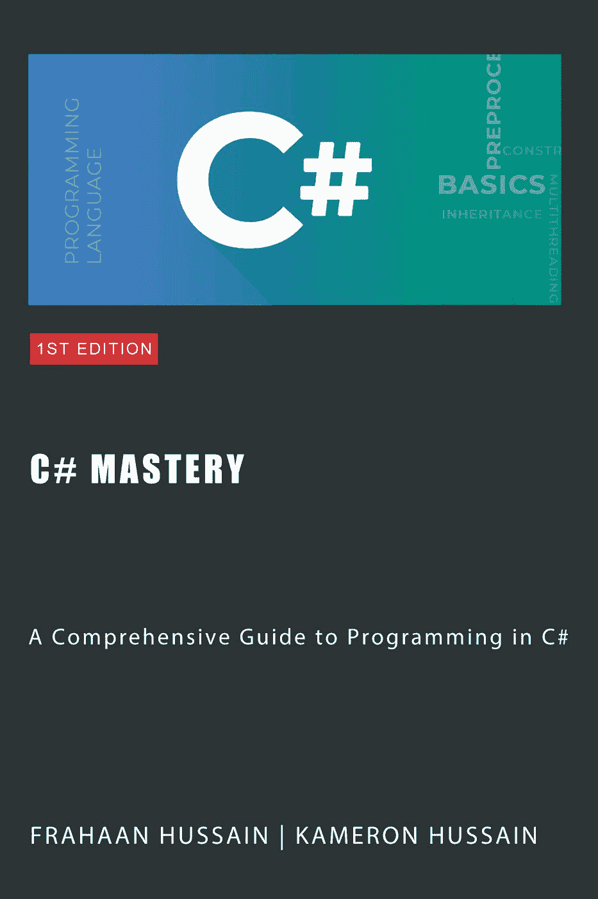

# C# 精通之路：C# 编程全面指南





C# 精通：C# 编程全面指南


## 第 1 章：C# 简介

### 1.1 节：开始学习 C#
- 什么是 C#?
- 为什么要学习 C#?
- 搭建你的开发环境
- 你的第一个 C# 程序
- 探索 .NET Framework

### 1.2 节：搭建你的开发环境
1. 安装 Visual Studio (或 Visual Studio Code
2. 安装 .NET SDK
3. 验证你的安装

### 1.3 节：理解 C# 语言基础
1. 变量与数据类型
2. 注释
3. 控制台输入与输出
4. 算术运算符
5. 控制流与决策
6. 函数与方法

### 1.4 节：编写你的第一个 C# 程序
1. 创建一个新的 C# 项目
2. 编写你的第一段 C# 代码
3. 运行你的程序
4. 进一步实验

### 1.5 节：探索 .NET Framework
- 什么是 .NET Framework?
- .NET Framework 版本
- .NET Core 与 .NET 5+
- 使用 .NET Framework 构建

## 第 2 章：构建你的第一个 C# 项目

### 2.1 节：创建控制台应用
- 什么是控制台应用?
- 创建一个新的控制台应用
- 理解控制台应用模板
- 运行你的控制台应用

### 2.2 节：使用变量与数据类型
- 什么是变量?
- 声明变量
- 初始化变量
- 数据类型
- 类型推断 `var`
- 常量

###  2.3 节：C 中的输入与输出
- 控制台输入
- 控制台输出
- 字符串插值
- 格式化输出
- 控制台转换
- 异常处理

### 2.4 节：控制流与决策
- 条件语句 `if`, `else`, `switch`
- 循环 `for`, `while`, `do-while`, `foreach`

### 2.5 节：调试与异常处理
- 调试你的代码
- 异常处理
- 日志记录
- 测试

## 第 3 章：面向对象编程 (OOP) 基础

### 3.1 节：理解类与对象
- 什么是面向对象编程 (OOP)?
- 类与对象
- 封装
- 构造函数
- 对象初始化

### 3.2 节：封装与访问修饰符
- OOP 中的封装
- 访问修饰符
- 封装与访问修饰符示例

### 3.3 节：继承与多态
- 继承
- 多态
- 抽象类与方法

### 3.4 节：抽象与接口
- 抽象
- 接口
- 抽象的优势

### 3.5 节：OOP 中的异常处理
- 异常处理
- 异常类
- 抛出异常

## 第 4 章：高级 OOP 概念

### 4.1 节：泛型与泛型集合
- 泛型简介
- 泛型类
- 使用泛型类
- 泛型方法
- 泛型约束
- 泛型集合

### 4.2 节：委托与事件
- 委托
- 事件
- 事件处理器与事件参数

### 4.3 节：Lambda 表达式与 LINQ
- Lambda 表达式
- LINQ (语言集成查询)
- Lambda 与 LINQ 的优势

###  4.4 节：C 中的设计模式
- 创建型设计模式
- 结构型设计模式
- 行为型设计模式

### 4.5 节：单元测试与测试驱动开发 (TDD)
- 单元测试
- 测试驱动开发 (TDD)

## 第 5 章：Windows Forms 与 GUI 应用


# 第 5.1 节：Windows Forms 简介

#### 什么是 Windows Forms？
#### 核心概念
#### 创建 Windows Forms 应用程序
#### Windows Forms 示例

# 第 5.2 节：使用 WinForms 设计用户界面

#### WinForms 中的视觉设计
#### 常见的 WinForms 控件
#### WinForms 中的事件处理
#### 布局与锚定 (Anchoring)
#### 本地化与辅助功能
#### 测试与调试
#### 结论

# 第 5.3 节：处理事件与用户输入

#### 事件驱动编程
#### WinForms 中的事件处理
##set 的用户交互
#### 键盘事件
#### 事件处理最佳实践

# 第 5.4 节：使用控件与组件

#### 理解控件
#### 放置与配置控件
#### 容器控件
#### 自定义控件
#### 使用组件
#### 结论

# 第 5.5 节：构建完整的 GUI 应用程序

#### 定义应用需求
#### 创建用户界面
#### 实现功能
#### 数据管理
#### 验证与错误处理
#### 测试
#### 本地化
#### 文档与帮助
#### 部署
#### 用户反馈
#### 维护与更新

## 第 6 章：使用 .NET Core 进行跨平台开发

## 第 6.1 节：理解 .NET Core 和 .NET 5+
#### 1. 跨平台兼容性
#### 2. 提升的性能
#### 3. 支持容器化
#### 4. 并存安装 (Side-by-Side)
#### 5. 开源与社区驱动
#### 6. 迁移路径
#### 7. 统一平台

## 第 6.2 节：构建跨平台控制台应用
#### 创建新的控制台应用程序
#### 编写第一个控制台应用
#### 构建并运行应用
#### 跨平台执行
#### 处理命令行参数

## 第 6.3 节：创建跨平台桌面应用
#### 什么是 .NET Core WPF？
#### 前提
#### 构建简单的 WPF 应用
#### 运行 WPF 应用
#### 跨平台执行

## 第 6.4 节：使用 ASP.NET Core 进行 Web 开发
#### ASP.NET Core 的核心特性
#### 入门 ASP.NET Core
#### 创建简单的网页
#### 添加路由与控制器
#### 运行 ASP.NET Core Web 应用
#### 跨平台 Web 开发

## 第 6.5 节：使用 Xamarin 进行移动应用开发
#### Xamarin 的核心特性
#### 入门 Xamarin
#### 创建简单的 Xamarin.Forms 应用
#### 在模拟器上运行 Xamarin 应用
#### 跨平台移动开发更简单

## 第 7 章：文件处理与序列化

## 第 7.1 节：在 C 中读写文件
#### 读取文本文件
#### 写入文本文件
#### 读写二进制文件
#### 处理文件路径

## 第 7.2 节：使用流 (Streams) 与读取器/写入器
#### 流
#### 读取器与写入器
#### 在流与读取器/写入器之间选择

## 第 7.3 节：序列化与反序列化
#### 二进制序列化
#### XML 和 JSON 序列化

## 第 7.4 节：处理 XML 和 JSON 数据
#### 处理 XML 数据
#### 处理 JSON 数据

## 第 7.5 节：数据库连接与 ADO.NET
#### 连接数据库
#### 执行 SQL 查询
## 参数化查询与安全安全

## 第 8 章：网络与 Web 服务

## 第 8.1 节：C 语言简介
#### 理解网络通信
## 基础网络任务

## 第 8.2 节：创建 TCP 和 UDP 服务器
#### TCP 通信
## UDP 通信

## 第 8.3 节：构建 RESTful 服务
#### RESTful 设计原理
#### 构建简单的 RESTful 服务
## 测试 RESTful 服务

## 第 8.4 节：消费 Web API
## 使用 HttpClient 请求
#### 使用第三方库

## 第 8.5 节：异步编程与网络
#### 异步编程
## 网络异步编程的好处
## 异步 Web 请求
## 基于任务的异步模式 (TAP)
## 异步代码中的错误处理

## 第 9 章：多线程与并行编程

## 第 9.1 节：理解线程与线程安全
#### 什么是线程？
#### 多线程的好处
#### 线程安全
## 线程同步
#### 结论

## 第 9.2 节：创建多线程应用
#### 创建线程
## 线程状态
## 线程优先级
#### 线程池 (ThreadPool)
## 多线程的挑战

## 第 9.3 节：任务并行库 (TPL) 与并行 LINQ
## 任务与任务并行
## 并行 LINQ (PLINQ)
## 收益与考虑

## 第 9.4 节：同步与锁定
## 竞态条件


# 使用锁锁定
#### 死锁
## 其他同步构造结构

# 第 9.5 节：处理并发问题
### 1. 竞态条件
### 2. 死锁
### 3. 线程安全
### 4. 原子操作
### 5. 测试与调试
### 6. 异步编程
### 7. 并发性设计

# 第 10 章：C 的高级主题
## 第 10.1 节：动态编程与 ExpandoObject
#### 动态编程
### ExpandoObject
### 使用场景

## 第 10.2 节：反射与属性
#### 反射
#### 属性
### 使用场景

## 第 10.3 节：与原生代码的互操作性
### P/Invoke（平台调用服务）
### COM 互操作（组件对象模型互操作性）
### C++ 互操作
### .NET Core 和 .NET 5+ 支持
### 使用场景

## 第 10.4 节：高级调试技术
#### 条件断点
#### 跟踪点 (Tracepoints)
### DebuggerDisplay 属性
### DebuggerStepThrough 属性
#### 高级断点功能

## 第 10.5 节：C# 最佳实践与性能优化
### 1. 使用 StringBuilder 进行字符串拼接
### 2. 避免使用异常进行流程控制
### 3. 正善释放资源
### 4. 优化数据库访问
### 5. 性能分析与测量
### 6. 使用异步编程
### 7. 尽量减少垃圾回收

## 第 11 章：使用 WPF 构建桌面应用程序
## 第 11.1 节：Windows Presentation Foundation (WPF) 简介
### WPF 的核心特性
### WPF 应用程序结构
### WPF 中的 MVVM 模式
### WPF 入门

## 第 11.2 节：创建 WPF 窗口和控件
#### 创建 WPF 窗口
###  WPF 控件
#### 向窗口添加控件
#### 运行你的 WPF 应用程序

## 第 11.3 节：WPF 中的数据绑定
#### 理解数据绑定
#### 数据绑定模式
#### 数据绑定语法
#### DataContext 与绑定上下文
#### 集合数据绑定
#### 实现 INotifyPropertyChanged 接口
#### 后置代码中的数据绑定
#### 总结

## 第 11.4 节：WPF 中的样式与模板
#### 理解样式
#### 应用样式
#### 控件模板
#### 复用样式和模板
#### 动态样式化
#### 总结

## 第 11.5 节：WPF 中的 MVVM 模式
#### 理解 MVVM 模式
#### MVVM 的核心原理
#### 创建 ViewModel
#### 绑定 View
#### MVVM 的优势
#### 结论

## 第 12 章：使用 Flutter 开发跨平台移动应用
## 第 12.1 节：Flutter 和 Dart 入门
#### 结论

## 第 12.2 节：构建 Flutter UI 组件
### 理解 Flutter Widget
### 创建 Flutter Widget
#### 使用你的自定义 Widget
#### 结论

## 第 12.3 节：Flutter 中的导航与状态管理
#### Flutter 中的导航
### Flutter 中的状态管理
#### 结论

## 第 12.4 节：在 Flutter 中集成 API 和插件
#### 发起 API 请求
### 使用 Flutter 插件
#### 结论

## 第 12.5 节：将 Flutter 应用部署到 iOS 和 Android
#### 准备部署
#### 部署到 Android
#### 部署到 iOS
#### 结论

## 第 13 章：在 C 中使用数据库
## 第 13.1 节：数据库简介
#### 什么是数据库？
#### 数据库类型
#### 数据库管理系统
#### 数据库交互

## 第 13.2 节：连接数据库
#### 连接字符串
#### 使用 ADO.NET 连接
#### 连接池
#### 错误处理

## 第 13.3 节：SQL 操作
#### 执行查询
#### 执行非查询命令
#### 参数化查询
#### 事务
#### 创建实体模型
#### 使用 Entity Framework
#### 插入数据
#### 更新和删除数据
#### 总结

## 第 13.5 节：NoSQL 与文档数据库
#### 文档数据库
#### 连接 MongoDB
#### MongoDB 的 CRUD 操作
### NoSQL 文档数据库的优缺点


# 在 Razor Pages 和 MVC 之间选择

## 第 14.4 节：身份验证与授权

#### 身份验证
#### 授权
### 身份验证与授权结合

## 第 14.5 节：使用 SignalR 构建实时 Web 应用

#### 什么是 SignalR？
### SignalR 的核心特性
### SignalR 入门
### 使用场景

# 第 15 章：高级 Web 开发主题

## 第 15.1 节：ASP.NET Core 中的依赖注入

#### 什么是依赖注入？
### 设置依赖注入
### 在控制器中注入依赖
### 依赖注入的优势

## 第 15.2 节：使用 ASP.NET Core 构建 RESTful API

#### 什么是 RESTful API？
### 创建 ASP.NET Core Web API
### GET 操作的示例控制器动作
### 测试您的 API

## 第 15.3 节：微服务架构

#### 微服务的核心概念
### 微服务架构的优势
### 微服务的挑战

## 第 15.4 节：使用 Docker 进行容器化

#### 了解 Docker
### Docker 的优势
### Docker 实践

## 第 15.5 节：将 Web 应用部署到云端

### 云端部署的优势
### 云服务模型
### 热门云服务供应商
### 部署策略

## 第 16 章：C# 中的安全

## 第 16.1 节：身份验证与授权技术

### 身份验证 vs 授权
### 身份验证技术
### 授权技术
### 安全最佳实践

## 第 16.2 节：Web 应用安全

### 1. 输入验证
### 2. 防止跨站脚本攻击 (XSS)
### 3. 身份验证与授权
### 4. 安全会话管理
### 5. 全面 HTTPS
### 6. 内容安全策略 (CSP)
### 7. 跨域资源共享 (CORS)
### 8. 定期安全审计
### 9. 错误处理

## 第 16.3 节：处理漏洞

### 1. SQL 注入
### 2. 跨站请求伪造 (CSRF)
### 3. 跨站脚本攻击 (XSS)
### 4. 身份验证与授权问题
### 5. 不安全的文件上传
### 6. 敏感数据泄露
### 7. 定期安全补丁
### 8. 安全响应头
### 9. 安全测试

## 第 16.4 节：身份与访问管理

### 1. 身份验证 vs 授权
### 2. 基于角色的访问控制 (RBAC)
### 3. 基于声明的身份验证
### 4. 单点登录 (SSO)
### 5. 双因子身份验证 (2FA)
### 6. 基于令牌的身份验证
### 7. 访问控制列表 (ACL)
### 8. 审计追踪
### 9. 联邦身份
### 10. 身份提供程序

## 第 16.5 节：安全编码实践

### 1. 输入验证
### 2. 输出编码
### 3. 身份验证与授权
### 4. 密码存储
### 5. 错误处理
### 6. 安全的文件上传
### 7. 会话管理
### 8. 防止跨站请求伪造 (CSRF)
### 9. 数据加密
### 10. 代码审查与测试
### 11. 安全框架与库
### 12. 定期更新
### 13. 威胁建模

## 第 17 章：软件测试与质量保证

## 第 17.1 节：软件测试的类型

### 1. 单元测试
### 2. 集成测试
### 3. 功能测试
### 4. 回归测试
### 5. 性能测试
### 6. 安全测试
### 7. 用户验收测试 (UAT)
### 8. 用性测试
### 9. 兼容性测试
### 10. 本地化测试
### 11. 探索性测试
### 12. 随机测试
### 13. Beta 测试

## 第 17.2 节：编写单元测试

#### 选择框架
#### 编写第一个单元测试
#### 运行单元测试
#### 单元测试的优势

## 第 17.3 节：使用 NUnit 和 xUnit 进行自动化

#### NUnit
#### xUnit

## 第 17.4 节：持续集成与持续交付 (CI/CD)

#### 理解 CI/CD
#### C# 应用程序的 CI/CD 工具
#### C# 应用程序的 CI/CD 工作流
#### CI/CD 对 C# 的优势

## 第 17.5 节：性能测试与分析

#### 性能测试
#### 性能剖析
#### 优化技术
#### 持续监控

## 第 18 章：构建实战项目

## 第 18.1 节：项目 1 - 创建任务管理应用程序

#### 项目概述
#### 项目设置
#### 项目增强想法
#### 结论

## 第 18.2 节：项目 2 - 构建社交媒体仪表板

#### 项目概述
#### 项目设置
#### 项目增强想法
#### 结论

## 第 18.3 节：项目 3 - 开发电子商务平台

#### 项目概述
#### 项目设置
#### 项目增强想法
#### 结论


# 第 18.4 节：项目 4 - 设计游戏应用
#### 项目概述
#### 项目设置
#### 项目增强想法
#### 结论

# 第 18.5 节：项目 5 - 构建财务管理系统
#### 项目概述
#### 项目设置
#### 项目增强想法
#### 结论

## 第 19 章：未来的 C#
## 第 19.1 节：探索最新的 C# 特性
#### C# 9.0 特性
### C# 10.0 特性
## 第 19.2 节：软件开发的未来趋势
### 1. 人工智能与机器学习 (AI/ML)
### 2. 低代码与无代码开发
### 3. DevOps 与持续集成/持续部署 (CI/CD)
### 4. 无服务器计算
### 5. 量子计算
### 6. 道德与负责任 AI
### 7. 远程与分布式工作
### 8. 网络安全与隐私
## 第 19.3 节：C# 在新兴技术中的角色
### 1. 使用 .NET 5+ 和 .NET 6 进行跨平台开发
### 2. 使用 Blazor 进行 Web 开发
### 3. 使用 ML.NET 进行机器学习
### 4. 使用 Azure Functions 进行云原生开发
### 5. 使用 Unity 进行游戏开发
## 第 19.4 节：社区与开源贡献
### 1. 开源倡议
### 2. GitHub 与 .NET 基金
### 3. NuGet 与包管理
### 4. Stack Overflow 与开发者论坛
### 5. 本地用户组与会议
## 第 19.5 节：为你的 C# 开发职业做准备
### 1. 持续学习与技能提升
### 2. 构建强大的作品集
### 3. 人脉建立与协作
### 4. 为开源做贡献
### 5. 掌握版本控制
### 6. 软技能培养
### 7. 求职与面试
### 8. 认证与专业领域
### 9. 保持信息通并适应
### 10. 寻找导师

## 第 20 章：结论与展望
## 第 20.1 节：回顾你的 C# 之旅
## 第 20.2 节：继续你的学习路径
## 第 20.3 节：为 C# 社区做贡献
## 第 20.5 节：你的精通 C# 之路

# 第 1 章：C 语言简介
## 第 1.1 节：接触 C
欢迎来到 C# 的世界！在本节中，我们将迈出 C# 编程语言的第一步，并让你快速进入状态。无论你是完全的初学者还是已经有一些编程经验，本章都将帮助你开启 C# 之之旅。

### 什么是 C#？
C#（读作“C-sharp”）是由微软开发的一种现代面向对象的编程语言。它是一种多功能的语言，用于构建各种应用程序，包括桌面应用程序、Web 应用程序、移动应用和游戏。C# 以其简单性、可读性和健壮性而闻名，是初学者和经验丰富的者的绝选择。

### 为什么要学习 C#？
在深入技术细节之前，让我们简要讨论一下为什么学习 C# 有价值的：
1. **多功能性**：C# 可用于构建各种平台的应用程序，包括 Windows、Web 和移动端。
2. **流行性**：C# 在软件开发行业被广泛使用，确保了学习它能带来就业机会。
3. **强大的生态系统**：C# 是 `.NET` 生态系统的一部分，该系统为开发提供了丰富的库和工具。
4. **出色的工具**：`Visual Studio` 是微软的集成开发环境（`IDE`），为 C# 开发提供了强大的工具。
5. **社区支持**：C# 拥有充满活力的开发者社区，因此你可以找到大量的资源、论坛和教程来帮助你不断进步。

现在你已经理解了 C# 的重要性，让我们进入开发环境的设置。

### 设置你的开发环境
在开始编写 C# 代码之前，你需要设置好开发环境。以下是基本步骤：

#### 1. 安装 Visual Studio（或 Visual Studio Code）
- `Visual Studio` 是一个用于 C# 开发的功能丰富的 `IDE`。你可以从官方网站下载它。
- 如果你偏于更轻量级的选项，`Visual Studio Code` 是 C# 开发的热门选择，并且可以通过 C# 扩展进行扩展。

#### 2. 安装 .NET SDK
- `.NET` 软件开发包（`SDK`）对于构建和运行 C# 程序至关重要。你可以从 .NET 网站下载它。

#### 3. 验证你的设置
- 安装完必要的工具后，打开你的 `IDE`（`Visual Studio` 或 `Visual Studio Code`）并创建一个新的 C# 项目，以确保一切设置正确。

### 你的第一个 C# 程序
让我们不要浪费时间，直接开始编写你的第一个 C# 程序。在 C# 中，一个简单的“Hello, World!”程序如下：

```csharp
using System;

class Program
{
    static void Main()
    {
        Console.WriteLine("Hello, World!");
    }
}
```

在这段代码中：
- `using System;` 包含了 `System` 命名空间，它提供了对标准输入输出功能的访问。
- `class Program` 定义了一个名为 `Program` 的类。
- `static void Main()` 是你 C# 程序的入口。
- `Console.WriteLine("Hello, World!");` 向控制台打印“Hello, World!”。

要运行此程序，只需点击你 `IDE` 中的“运行”按钮即可。

### 探索 .NET 框架
C# 与 .NET 框架紧密相连，这是一个构建各种类型应用程序的综合平台。`.NET` 框架提供了库和服务，使开发变得更加容易。随着 C# 之之旅的深入，你将更加熟悉这些库以及如何利用它们来构建强大的应用程序。

这里结束了对 C# 的介绍。在接下来的章节中，我们将深入探讨该语言的基础、语法和概念。所以，准备好，让我们继续 C# 冒险吧！

## 第 1.2 节：设置你的开发环境
在上一节中，我们简要讨论了为 C# 编程设置开发环境的重要性。现在，让我们深入了解正确配置环境所需的步骤。

### 1. 安装 Visual Studio（或 Visual Studio Code）
正如之前提到的，`Visual Studio` 是一个用于 C# 开发的强大集成开发环境（`IDE`）。以下是安装方法：
- 访问 [Visual Studio 网站](https://visualstudio.microsoft.com/) 并下载适用于你的版本（社区版、专业版或企业版）。
- 按照下载过程中提供的安装说明进行操作。
- 安装完成后，启动 `Visual Studio`，你就可以准备好开始 C# 工作了。


如果你更倾向于轻量级的 IDE，Visual Studio Code 是一个极的选择。你可以按照以下步骤进行安装：

• 从官网下载 [Visual Studio Code](https://code.visualstudio.com/)。
• 按照你操作系统的特定安装说明安装 Visual Studio Code。
• 安装完成后，打开 Visual Studio Code，通过安装相关的扩展来开始进行 C# 开发。

## 2. 安装 .NET SDK

.NET 软件开发工具包（`SDK`）是 C# 开发的基础组件。它提供了构建、测试和运行 C# 所需的工具。以下是安装方法：

• 访问官方[.NET 网站](https://dotnet.microsoft.com/download) 并下载适用于你操作系统的 .NET SDK。

• 按照你平台的安装说明完成安装过程。
• 要验证 .NET SDK 是否安装正确，请打开终端或命令提示符并运行以下命令：

```bash
dotnet--version
```

此 `dotnet--version` 将显示已安装的 .NET SDK 版本，确认你的安装已成功。

## 3. 验证你的设置

一旦你安装了 Visual Studio 或 Visual Studio Code 以及 .NET SDK，验证开发环境是否配置正确至关重要。以下是快速检查：

### Visual Studio

1. 打开 Visual Studio。
2. 点击 `文件` > `新建` > `项目`。
3. 选择一个 C# 项目模板（例如，`控制台应用`）。
4. 点击 `创建` 创建一个新项目。
5. 编写一个简单的 C# 程序并运行它，以确保一切运行正常。

### Visual Studio Code

1. 打开 Visual Studio Code。
2. 如果你还没有安装 C# 扩展，请安装它。你可以在扩展市场中搜索“C#”来实现。
3. 创建一个新的 C# 项目或打开一个现有的项目。
4. 编写一个简单的 C# 程序并运行它，以验证你的设置是否正确。

通过这些步骤，你将拥有一个功能完备的 C# 开发环境供你的项目使用。在接下来的章节中，我们将深入研究 C# 语言，并开始编写代码来构建有趣的应用程序。

### 1.3 节：理解 C# 语言基础

在本节中，我们将探索 C# 编程语言的基础构建块。对于任何开始 C# 开发的人来说，这些基础知识都是必须的，并且构成了有效编写 C# 代码的基础。

### 1. 变量和数据类型

变量用于在 C# 程序中存储数据。C# 是一种静态类型语言，这意味着变量在使用之前必须用特定的数据类型声明。C# 中常见的数据类型包括 `int`、`float`、`string`、`bool` 等。以下是声明和初始化变量的方法：

```csharp
int age = 30; // 一个整数变量
float price = 19.99f; // 一个浮点数变量（注意 'f' 后缀）
string name = "John"; // 一个字符串变量
bool isStudent = true; // 一个布尔变量
```

### 2. 注释

C# 中的注释用于在代码中添加解释性说明。编译器会忽略这些注释，它们仅供人类可读性。单行注释以 `//` 开头，多行注释则包含在 `/* */` 之间。这是一个示例：

```csharp
// 这是一个单行注释

/*
这是一个
多行
注释
*/
```

### 3. 控制台输入与输出

你可以通过从控制台读取输入和显示输出与用户交互。`Console` 类提供了此类目的的方法。要显示文本，请使用 `Console.WriteLine()`：

```csharp
Console.WriteLine("Hello, C#!"); // 打印 "Hello, C#!" 后换行
```

要从用户处读取输入，可以使用 `Console.ReadLine()`。这是一个示例：

```csharp
Console.Write("Enter your name: ");
string userName = Console.ReadLine();
Console.WriteLine($"Hello, {userName}!");
```

### 4. 算术运算符

C# 支持用于执行数学计算的常用算术运算符。包括 `+`（加法）、`-`（减法）、`*`（乘法）、`/`（除法）和 `%`（取模）。以下是使用它们的方法：

```csharp
int a = 10;
int b = 5;
int sum = a + b; // 15
int difference = a - b; // 5
int product = a * b; // 50
int quotient = a / b; // 2
int remainder = a % b; // 0
```

### 5. 控制流与决策

控制流语句允许你做出决策并控制程序的执行流程。常见的控制流结构包括用于条件执行的 `if` 语句、用于迭代的 `for` 和 `while` 循环，以及用于多分支的 `switch` 语句。这是一个 `if` 语句的示例：

```csharp
int num = 10;
if (num > 0)
{
    Console.WriteLine("数字为正数.");
}
else if (num < 0)
{
    Console.WriteLine("数字为负数.");
}
else
{
    Console.WriteLine("数字为零.");
}
```

### 6. 函数与方法

在 C# 中，你可以定义函数（方法）来封装代码块以便重复使用。没有返回值的方法使用 `void` 关键字声明，它们可以接受参数。这是一个示例：

```csharp
void SayHello(string name)
{
    Console.WriteLine($"Hello, {name}!");
}

// 调用方法
SayHello("Alice"); // 输出 "Hello, Alice!"
```

## 1.4 编写你的第一个 C# 程序

现在已经学习了变量、数据类型、注释、输入输出、算术运算符和控制流，是时候通过编写第一个程序来付实践了。

### 1. 创建 C# 项目

在开始编写代码之前，你需要项目。我们将使用 Visual Studio 进行演示。

1. 打开 Visual Studio。
2. 点击 `文件` > `新建` > `项目`。
3. 在“创建新项目”对话框中，搜索“控制台应用 (.NET Core)”或“控制台应用 (.NET)”。
4. 选择相应的模板，为你的项目命名（例如 `MyFirstProgram`），并选择保存位置。
5. 点击 `创建` 按钮。

### 2. 编写你的第一个 C# 代码

一旦有了项目，就可以编写你的第一个 C# 代码了。默认情况下，Visual Studio 会创建一个带有 `Main` 方法的 `Program.cs` 文件。该方法是程序的入口。

这是一个简单的“Hello, World!”程序：

```csharp
using System;

class Program
{
    static void Main()
    {
        Console.WriteLine("Hello, World!");
    }
}
```

在这段代码中：
- 我们包含了 `System` 命名空间，它提供了对 `Console` 访问。
- 我们定义了一个带有 `Main` 方法的 `Program` 类。`Main` 方法是程序开始执行的地方。
- 在 `Main` 方法内部，我们使用 `Console.WriteLine` 在控制台打印“Hello, World!”

### 3. 运行你的程序

要在 Visual Studio 中运行 C# 程序，请按照以下步骤操作：

1. 确保解决方案管理器中选择了 `MyFirstProgram` 项目。
2. 点击“启动”按钮（绿色箭头）或按 `F5` 键构建并运行你的程序。
3. 你会在 Visual Studio IDE 底部的控制台窗口看到输出：“Hello, World!”

恭喜！你刚刚编写并运行了第一个 C# 程序。

### 4. 进一步实验

现在你已经创建了一个简单的程序，请花时间进行实验和学习。尝试：

• 修改“Hello, World!”字符串以打印不同的消息。
• 声明并使用变量进行计算。
• 添加条件语句（例如 `if` 和 `else`）为你的程序创建逻辑。
• 探索不同的控制台输入和输出方法以与用户交互。


随着你的探索和实验，你将对 C# 及其功能有更好的理解。在学习之旅中遇到任何问题或挑战时，请随时查阅文档和在线资源。

这标志着你的第一个 C# 程序的完成。在接下来的章节中，我们将深入探讨 C# 概念，包括面向对象编程和高级语言特性。继续你的构建和探索吧！

## 第 1.5 节：探索 .NET Framework

在本节中，我们将探索 .NET Framework 及其在 C# 开发中的意义。理解 `.NET Framework` 是至关重要的，因为它提供了一个庞大的类和函数库，你可以利用这些库来构建健壮且功能丰富的应用程序。

### 什么是 .NET Framework？

`.NET Framework` 是微软开发的一个综合平台，用于构建、部署和运行各种类型的应用程序，包括桌面应用程序、Web 应用程序和服务。。它为开发者提供了一个公共运行时环境、一个大型类库以及用于创建软件的工具。

`.NET Framework` 的核心组件包括：

• 通用语言运行时 (CLR)：`CLR` 是管理内存、编译和执行代码，并提供自动内存管理（垃圾回收）和异常处理等特性的运行时环境。

• 基类库 (BCL)：`BCL` 是可重用类和类型的集合，提供了广泛的功能，从基础数据类型到文件 I/O、网络和加密等高级特性。

• ASP.NET：对于 Web 开发，`ASP.NET` 是 `.NET Framework` 的一部分，允许开发者使用 `C#` 构建 Web 应用程序和服务。

• Windows Forms 和 WPF：这些是用于构建具有丰富图形界面的 Windows 桌面应用程序的 UI 框架。

• ADO.NET：`ADO.NET` 提供对数据库的数据访问，允许你与 SQL Server、MySQL 等关系型数据库进行交互。

• Web 服务：`.NET Framework` 支持 Web 服务的创建和消费，允许应用程序通过互联网进行通信。

### .NET Framework 版本

多年来，`.NET Framework` 经历了不断演变，并发布了多个版本。最著名的版本包括：

• .NET Framework 1.0：初始版本，于 2002 年引入。

• .NET Framework 2.0：增加了重大改进和新特性。

• .NET Framework 3.0 和 3.5：引入了 Windows 通信基础 (WCF)、Windows 演示基础 (WPF) 和 Windows 工作流基础 (WF)。

• .NET Framework 4.0：带来了对并行编程的增强和支持。

• .NET Framework 4.5：包含了 `async/await` 等改进，增强了对 `ASP.NET` 的支持等。

• .NET Framework 4.6 及后续版本：持续的更新和改进。

### .NET Core 和 .NET 5+

值得注意的是，`.NET Framework` 已经演变为两个不同的路径：`.NET Core` 和 `.NET 5+`。

• .NET Core：作为一个开源、跨平台的框架引入，`.NET Core` 专注于提供一个更小、模块化的运行时和库，它可以在 Windows、Linux 和 macOS 上运行。它是专为现代应用程序开发而设计的，特别适用于微服务和云原生应用程序。

• .NET 5+：微软此后将 `.NET Core` 和 `.NET Framework` 统一成一个名为 `.NET 5` 的单一平台，随后的还有 `.NET 6`、`.NET 7` 等。这个统一平台保留了 `.NET Core` 的跨平台能力，同时结合了 `.NET Framework` 的最佳特性。它是 .NET 开发的未来。

### 使用 .NET Framework 构建

要使用 `.NET Framework` 构建应用程序，你通常会使用 `Visual Studio` 等开发工具。这些工具提供了一个丰富的开发环境，具有代码编辑、调试和项目管理等功能。

此外，你用 `C#` 或其他支持 .NET 的语言编写代码，将其编译为中间语言 (IL) 代码，然后在 `CLR` 上执行。这种架构使得 .NET 应用程序具有平台无关性，从而更容易以不同的操作系统为目标。

在本指南的接下来的章节中，我们将更深层次地探讨 `C#` 编程，探索高级主题、面向对象编程等。理解 `.NET Framework` 及其功能将为你的 `C#` 开发之旅奠定坚实的基础。

 |  |  |


## 第 2 章：构建你的第一个 C# 项目


## 第 2.1 节：创建一个控制台应用程序

在本节中，我们将深入创建你的第一个 `C#` 项目，特别是控制台应用程序。控制台应用程序是基于文本的程序，通过命令行界面 (CLI) 与用户交互。它们是学习 `C#` 的绝佳起点，因为它们允许你专注于语言的基础和逻辑。

### 什么是控制台应用程序？

`C#` 中的控制台应用程序是运行在命令行终端或控制台窗口中的程序。它接受用户的文本输入，对其进行处理，并提供文本输出。控制台应用程序通常用于数据处理、自动化和简单的用户交互等任务。

#### 创建新的控制台应用程序

使用 `Visual Studio` 按以下步骤创建一个新的控制台应用程序：

1.  打开 `Visual Studio`。
2.  点击“文件” > “新建” > “项目...”创建一个新项目。
3.  在“创建新项目”对话框中，搜索“控制台应用 (.NET Core)”或“控制台应用 (.NET)”。
4.  选择合适的模板并为你的项目命名（例如：MyConsoleApp）。
5.  选择保存项目文件的位置，并点击“创建”按钮。

### 理解控制台应用模板

当你创建一个新的控制台应用程序时，`Visual Studio` 会为你生成一些初始代码。让我们来看看组件：

• Program.cs：此文件包含你控制台应用程序的主入口。它包含一个 `Main` 方法。

这里有一个简单的控制台应用程序示例：

```csharp
using System;

class Program
{
static void Main()
{
Console.WriteLine("Hello from MyConsoleApp!");
}
}
```

在此代码中：
- 我们包含了 `System` 命名空间以访问 `Console` 类。
- 我们定义了一个带有 `Main` 方法的 `Program` 类，这是程序的入口。
- 在 `Main` 方法内部，我们使用 `Console.WriteLine` 在控制台上打印“Hello from MyConsoleApp!”。

### 运行控制台应用程序

要在 `Visual Studio` 中运行控制台应用程序，请遵循以下步骤：

1.  在“解决方案管理器”中选中你的控制台应用程序项目。
2.  点击“启动”按钮（绿色箭头）或按 F5 键构建并运行程序。
3.  你将在 `Visual Studio` IDE 底部的控制窗口中看到输出。

恭喜！你已经创建并执行了第一个 `C#` 控制台应用程序。这是你通往 `C#` 编程之路中虽小但重要的一步。

在接下来的章节中，我们将更多地探索如何在 `C#` 中处理变量、数据类型和控制流。这些基础概念将使你能够构建更复杂的交互式控制台应用程序。

## 第 2.2 节：使用变量和数据类型

在本节中，我们将深入探讨 `C#` 中变量和数据类型的核心概念。理解如何处理变量以及了解可用的数据类型是编写高效 `C#` 代码的基础。

### 什么是变量？


变量是程序内存中存储数据的占位符。它们赋予了程序记忆和处理信息的能力。在 C# 中，变量具有数据类型，该类型决定了它们可以存储什么类型的数据，例如整数、浮点数、文本等。

## 声明变量

在 C# 中声明变量，你需要指定其数据类型，后跟一个名称。以下是一些常见的数据类型和变量声明：

```csharp
int age; // 声明一个名为 'age' 的整数变量
double price; // 声明一个名为 'price' 的双精度浮变量
string name; // 声明一个名为 'name' 的字符串变量
bool isStudent; // 声明一个名为 'isStudent' 的布尔变量
```

## 初始化变量

声明变量后，你可以使用赋值运算符 `=` 为其分配一个值。这被称为初始化。以下是初始化变量的方法：

```csharp
age = 30; // 将 'age' 初始化为值 30
price = 19.99; // 将 'price' 初始化为值 19.99
name = "John"; // 将 'name' 初始化为字符串 "John"
isStudent = true; // 将 'isStudent' 初始化为布尔值 'true'
```

你也可以在一行中声明并初始化变量：

```csharp
int age = 30; // 声明并初始化 'age'
double price = 19.99; // 声明并初始化 'price'
string name = "John"; // 声明并初始化 'name'
bool isStudent = true; // 声明并初始化 'isStudent'
```

## 数据类型

C# 提供了各种数据类型来存储不同类型的数据。以下是一些常见的数据类型：

- 数字类型：
  - `int`: 表示 32 位有符号整数。
  - `double`: 表示双精度浮点数。
  - `float`: 表示单精度浮点数。
  - `decimal`: 表示高精度的小数数字。
- 文本类型：
  - `string`: 表示字符序列（文本）。
  - `char`: 表示单个字符。
- 布尔类型：
  - `bool`: 表示布尔值，即真（true）或假（false）。
- 其他类型：
  - `DateTime`: 表示日期和时间。
  - `enum`: 表示一组命名常量。

## 类型推断 (var 关键字)

在 C# 中，你可以使用 `var` 关键字声明变量，而不显式指定数据类型。编译器会根据分配的值推断数据类型：

```csharp
var age = 30; // 'age' 被推断为 int
var price = 19.99; // 'price' 被推断为 double
var name = "John"; // 'name' 被推断为 string
var isStudent = true; // 'isStudent' 被推断为 bool
```

虽然 `var` 可以让你的代码更简洁，但谨慎使用它以保持代码的清晰度和可读性是非常重要的。

## 常量

除了变量，你还可以使用 `const` 关键字在 C# 中声明常量。常量具有固定值，一旦定义就无法更改：

```csharp
const double pi = 3.14159; // 声明常量 'pi'
```

当你的程序中有在执行期间不应改变的值时，常量非常有用。

理解变量和数据类型是 C# 编程的关键第一步。它们为在应用程序中存储和处理数据提供了基础。在接下来的章节中，我们将探索如何通过表达式、操作和控制流更有效地处理这些变量和数据类型。

## 2.3 节：C 中的输入与输出

在本节中，我们将探索如何在 C# 中执行输入输出。输入允许你的程序从外部源（如用户、文件或其他程序）接收数据，而输出允许你的程序通信结果或信息。

## 控制台输入

C# 提供了几种方法从控制台读取用户输入。最常用的方法之一是 `Console.ReadLine()`，它读取用户的一行的文本并将其作为字符串返回：

```csharp
Console.Write("Enter your name: ");
string name = Console.ReadLine();
Console.WriteLine($"Hello, {name}!");
```

在这段代码中：
- `Console.Write("Enter your name: ");` 向用户显示提示。
- `Console.ReadLine()` 等待用户输入文本并将其存储在变量 `name` 中。
- `Console.WriteLine($"Hello, {name}!");` 使用输入的名称打印问候。

你可以使用类似的方法来读取其他类型的数据（如数字或字符），并将它们转换为适当的数据类型。

## 控制台输出

我们已经看到 `Console.WriteLine()` 用于输出，它写入文本后跟一个换行符。你也可以使用 `Console.Write()` 输出不带换行的文本：

```csharp
Console.Write("Hello, ");
Console.Write("World!");
```

这段代码在单行输出“Hello, World!”。

## 字符串插值

字符串插值是一种在字符串中嵌入表达式的方便方法。你可以使用 `$` 符号后跟 `{}` 在字符串中包含变量值或表达式：

```csharp
string name = "Alice";
int age = 25;
Console.WriteLine($"Hello, {name}! You are {age} years old.");
```

字符串插值使得创建动态且可读的消息变得简单。

## 输出格式化

你可以使用各种格式指定符格式化输出。例如，要格式化具有特定小数位的数字，请使用 `F` 规格符：

```csharp
double price = 19.99;
Console.WriteLine($"Price: {price:F2}");
```

这段代码输出两位小数。

## 控制台输入转换

从控制台读取输入时，你可能需要将其转换为数据类型。例如，为了读取整数，可以使用 `Parse()`：

```csharp
Console.Write("Enter your age: ");
string ageInput = Console.ReadLine();
int age = int.Parse(ageInput);
```

在使用 `Parse()` 时要小心，因为如果无法转换会抛出异常。

## 异常处理

为了处理转换错误，可以使用 `TryParse()`。这些方法尝试解析并返回一个表示成功的布尔值：

```csharp
Console.Write("Enter your age: ");
string ageInput = Console.ReadLine();
if (int.TryParse(ageInput, out int age))
{
    Console.WriteLine($"You entered a valid age: {age}");
}
else
{
    Console.WriteLine("Invalid input. Please enter a valid age.");
}
```

这段代码检查输入是否可以解析为整数。

## 文件输入与输出

除了控制台输入输出外，C# 还允许你处理文件。你可以使用 `File` 和 `StreamReader` 从文件读取数据，使用 `File` 和 `StreamWriter` 向文件写入数据。在处理大数据或需要在程序运行之间保存和检索数据时，文件操作是关重要的。

理解输入输出操作至关重要，因为它们使程序能够与用户、外部数据和其他组件交互。在接下来的章节中，我们将探索更高级的主题，包括控制流、决策和循环。

### 2.4 节：控制流与决策

控制流和决策是编程中的基础概念。它们允许你的 C# 程序根据条件做出选择、重复操作并遵循特定路径。在本节中，我们将探索条件语句和循环等控制流结构。

## 条件语句 (if, else 和 switch)

条件语句用于程序中做出决策。C# 提供了多种条件结构，最常见的是 `if`、`else if`、`else` 和 `switch`。

### if 语句

`if` 语句允许在条件为真时执行代码块。这是一个基础示例：

```csharp
if (age >= 18) 
{
    Console.WriteLine("You are an adult.");
}
```

在这段代码中，如果条件 `age >= 18` 为真，将显示“You are an adult.”。

### else 语句

你可以使用 `else` 语句在 `if` 条件为假时提供一个备选代码块：

```csharp
if (age >= 18)
{
    Console.WriteLine("You are an adult.");
}
else
{
    Console.WriteLine("You are a minor.");
}
```


```csharp
Console.WriteLine("You are not yet an adult.");
}
```

在这里，由于 `age` 的值为 15，不符合 `age >= 18` 条件，因此将显示消息“You are not yet an adult”。

#### else if 语句

你可以使用 `else if` 语句在之前的 `if` 条件为假时检查额外的条件：

```csharp
int score = 85;

if (score >= 90)
{
    Console.WriteLine("Excellent!");
}
else if (score >= 70)
{
    Console.WriteLine("Good!");
}
else
{
    Console.WriteLine("Needs improvement.");
}
```

在这段代码中，程序会检查多个条件，并根据 `score` 的值打印不同的消息。

#### switch 语句

`switch` 语句允许你根据表达式的值执行不同的操作：

```csharp
int day = 3;
string dayName;
switch (day)
{
    case 1:
        dayName = "Monday";
        break;
    case 2:
        dayName = "Tuesday";
        break;
    case 3:
        dayName = "Wednesday";
        break;
    default:
        dayName = "Unknown";
        break;
}
Console.WriteLine($"Today is {dayName}");
```

在这里，`switch` 语句根据 `day` 的值分配一个天的名称。在这种情况下，“Wednesday”将被赋值给 `dayName`。

### 循环 (for, while, do-while, and foreach)

循环用于重复执行某块代码。C# 提供了几种循环结构以适应不同的场景。

#### for 循环

`for` 循环允许你执行特定次数的某块代码。它由初始化、条件和迭代器表达式组成：

```csharp
for (int i = 1; i <= 5; i++)
{
    Console.WriteLine($"Iteration {i}");
}
```

这个 `for` 循环会在控制台打印从“Iteration 1”到“Iteration 5”。

#### while 循环

`while` 循环只要指定的条件为真，就会重复执行某块代码：

```csharp
int count = 0;
while (count < 5)
{
    Console.WriteLine($"Count: {count}");
    count++;
}
```

这个 `while` 循环会在控制台打印从“Count: 0”到“Count: 4”。

#### do-while 循环

`do-while` 循环与 `while` 循环类似，但它保证代码块至少执行一次，即使初始条件为假也是：

```csharp
int n = 5;
do
{
    Console.WriteLine($"Iteration {n}");
    n++;
} while (n < 5);
```

在这个示例中，代码块在检查条件之前执行了一次，因此打印了“Iteration 5”。

#### foreach 循环

`foreach` 循环用于遍历数组或列表等集合。它简化了遍历元素的过程：

```csharp
int[] numbers = { 1, 2, 3, 4, 5 };
foreach (int num in numbers)
{
    Console.WriteLine($"Number: {num}");
}
```

这个 `foreach` 循环遍历 `numbers` 数组并向控制台打印每个数字。

控制流和决策对于构建动态且交互式的 C# 程序至关重要。通过有效使用条件语句和循环，你可以创建响应不同情况并执行重复任务的程序。在接下来的章节中，我们将深入探讨更高级的 C# 概念，允许你构建更复杂的应用程序。

## 第 2.5 节：调试与错误处理

调试和错误处理是软件开发的关键方面。在本节中，我们将探索在 C# 代码中识别并修复问题的技术，以及优雅地处理错误。

### 调试你的代码

调试是软件开发中的关键环节。在这一部分，我们将探索在你的 C# 代码中识别并修复问题的方法。Visual Studio 提供了各种调试工具来帮助你。

#### 设置断点

最常用的调试技术之一是设置断点。在 Visual Studio 中，点击代码左侧的边缘即可设置断点，程序会在运行到此处时停止。

#### 逐行执行代码

一旦程序在断点处停止，你可以使用“单步调试”（F11）进入函数调用、“单步执行”（F10）执行当前行或“逐语句跳出”（Shift+F11）出函数。

#### 检查变量

在调试期间，你可以检查变量的值和表达式。在 Visual Studio 中，可以使用“监视”（Watch）窗口监控特定变量。

#### 调试工具

Visual Studio 提供了各种调试工具，例如用于执行代码的“立即”（Immediate）窗口、用于跟踪函数调用的“调用堆栈”（Call Stack）以及查看局部变量的“局部”（Locals）窗口。

#### 错误处理

除了调试，优雅地处理 C# 代码中的错误也至关重要。处理错误确保程序不会崩溃并为用户提供有用的反馈。

#### 异常处理

C# 使用异常处理来处理运行时错误。可以使用 `try`、`catch`、`finally` 和 `throw` 块来管理异常。

```csharp
try
{
    // 可能会抛出异常的代码
    int result = 10 / int.Parse("0");
}
catch (DivideByZeroException)
{
    Console.WriteLine("Division by zero.");
}
catch (FormatException)
{
    Console.WriteLine("Invalid format.");
}
finally
{
    Console.WriteLine("Cleanup code.");
}
```

在这个示例中，如果在除法或解析期间发生异常，将执行相应的 `catch` 块，然后 `finally` 块无论是否发生异常都会执行清理代码。

#### 自定义异常

你可以通过派生 `Exception` 类创建自定义异常类，以处理特定的应用程序错误。自定义异常应该提供有关错误的意义信息以及解决方法。

#### 日志

日志是错误处理的另一个重要方面。你可以使用 `Serilog` 或 `NLog` 等日志库记录应用程序中的错误和事件。日志可以帮助你在生产环境中诊断问题并监控应用程序健康。

```csharp
using Serilog;

Log.Logger = new LoggerConfiguration()
    .WriteTo.Console()
    .WriteTo.File("log.txt")
    .CreateLogger();

try
{
    // 可能会抛出异常
}
catch (Exception ex)
{
    Log.Error(ex, "An error occurred.");
}
finally
{
    Log.CloseAndFlush();
}
```

这个示例演示了如何使用 `Serilog` 将错误和消息记录到控制台和日志文件。

#### 测试

测试是预防错误的重要部分。使用 `NUnit` 或 `xUnit` 等框架编写单元测试有助于在开发早期识别问题。自动化测试确保你的代码按预期运行，并在进行更改时捕获回归问题。


面向对象编程是一种围绕对象结构化代码的编程范式，对象是类的实例。对象将数据（属性或特性）和行为（方法或函数）封装在一个单元中。OOP 促进了封装、继承和多态等概念，使得代码更具模块化、可重用且易于维护。

### 类与对象

在 OOP 中，`class`（类）是创建对象的蓝图或模板。它定义了该类对象将拥有的结构和行为。`class` 封装了数据（属性）和操作这些数据的方法（函数）。

这里有一个 C# 中类的类的简单示例：

```csharp
public class Person
{
    // 属性（属性）
    public string Name { get; set; }
    public int Age { get; set; }

    // 方法（行为）
    public void SayHello()
    {
        Console.WriteLine($"Hello, my name is {Name} and I'm {Age} years old.");
    }
}
```

在这段代码中：
- 我们定义了一个带有两个属性：`Name` 和 `Age` 的 `Person` 类。
- `SayHello` 方法是与 `Person` 类相关的行为，允许 `Person` 对象进行自我介绍。

要创建一个 `Person` 类的对象，你使用 `new` 关键字：

```csharp
Person person1 = new Person();
person1.Name = "Alice";
person1.Age = 30;
person1.SayHello(); // 输出: Hello, my name is Alice and I'm 30 years old.
```

在这里，`person1` 是 `Person` 类的实例，你可以访问它的属性和方法。

### 封装

封装是将数据和操作该数据的方法打包在单个单元（一个 `class`）中的概念。它有助于隐藏对象工作方式的内部细节，只暴露必要的内容。在我们的 `Person` 类中，属性 `Name` 和 `Age` 被封装在类内部，外部代码可以使用访问器（getters）和设置器（setters）来访问它们。

### 构造函数

构造函数是特殊的方法，用于在创建对象时初始化。它们的名称与类名相同，并在使用 `new` 关键字创建对象时被调用。这里是 `Person` 类的构造函数示例：

```csharp
public class Person
{
    public string Name { get; set; }
    public int Age { get; set; }

    // 构造函数
    public Person(string name, int age)
    {
        Name = name;
        Age = age;
    }
    // ...
}
```

你可以使用此构造函数创建一个 `Person` 对象：

```csharp
Person person2 = new Person("Bob", 25);
```

### 对象初始化语法

C# 提供了对象初始化语法，允许你简洁地创建和初始化对象：

```csharp
Person person3 = new Person
{
    Name = "Charlie",
    Age = 40
};
```

这种语法当你想要在创建对象期间设置多个属性时特别有用用。

理解类和对象是 C# 中 OOP 的基础。类定义了对象的蓝图，而对象是这些类的实例，封装了数据和行为。在接下来的章节中，我们将探索高级 OOP 概念，如继承、多态和抽象，这些概念使你能够构建复杂且灵活的 C# 。

## 第 3.2 节：封装与访问修符

在这一节中，我们将深入探讨封装的概念并探索 C# 中的访问修符。封装面向对象编程 (OOP) 的基本原则，允许你控制对对象内部状态和行为的访问。访问修符有助于定义 `class` 内部成员（字段、属性、方法等）的可见性和可访问性。

### OOP 中的封装

封装是将数据（属性或特性）和操作该数据的方法（函数或行为）打包在名为 `class` 的单个单元中的过程。它提供了几处好处，包括：

- **数据隐藏**：封装向外部代码隐藏了 `class` 的内部细节。这意味着对象的内部表示可以改变，而不影响使用该对象的代码。
- **受控访问**：它允许你定义 `class` 的哪些成员可以从外部访问，哪些不可以。这种控制防止了对敏感数据的未经授权的修改或访问。
- **代码重用**：封装的类可以轻松地在代码的不同部分或其他项目中重用，促进了代码的模块化。

### 访问修符

C# 中的访问修符决定了类成员的可见性和可访问性。有几种可用的访问修符，包括：

- `public`：标记为 `public` 的成员可以从代码的任何部分访问，包括 `class` 内部外部。
- `private`：标记为 `private` 的成员仅在同一个类内可访问。它们在 `class` 外部不可见或不可访问。
- `protected`：标记为 `protected` 的成员可以在类内部以及派生类（继承自基类的类）中访问。
- `internal`：标记为 `internal` 的成员可以在同一个程序集内（代码的编译单元，如 DLL 或可执行文件）中访问。
- `protected internal`：标记为 `protected internal` 的成员可以在同一个程序集内以及派生类中访问。
- `private protected`：标记为 `private protected` 的成员可以在同一个程序集内以及派生类中访问，但前提是它们位于同一个程序集内。

### 封装与访问修符示例

让我们考虑一个使用 `BankAccount` 类的示例：

```csharp
public class BankAccount
{
    // 私有字段（封装的数据）
    private string accountNumber;
    private decimal balance;

    // 构造函数
    public BankAccount(string accountNumber)
    {
        this.accountNumber = accountNumber;
        this.balance = 0.0m;
    }

    // 公有方法（封装的行为）
    public void Deposit(decimal amount)
    {
        if (amount > 0)
        {
            balance += amount;
        }
    }

    // 公有方法（封装的行为）
    public bool Withdraw(decimal amount)
    {
        if (amount > 0 && balance >= amount)
        {
            balance -= amount;
            return true;
        }
        return false;
    }

    // 公有属性（封装的数据访问）
    public decimal Balance
    {
        get { return balance; }
    }
}
```

在这个 `BankAccount` 类中：
- `accountNumber` 和 `balance` 是私有字段，封装了数据并向外部代码隐藏。
- `Deposit` 和 `Withdraw` 是公有方法，提供了对行为的受控访问。
- `Balance` 是一个公有属性，允许外部代码读取但不能直接修改。

通过使用封装和访问修符，你可以创建提供清晰接口并保持内部细节隐藏且受类。这促进了代码的可维护性、灵活性和安全性。

## 第 3.3 节：继承与多态

继承和多态是面向对象编程 (OOP) 的核心概念，实现了代码重用、灵活性和扩展性。在本节中，我们将探索这些概念以及它们如何在 C# 中实现。

### 继承

继承是一种机制，通过从现有类（基类或父类）继承属性和行为（字段和方法）来创建新类（派生类或子类）。派生类可以扩展或覆盖基类的功能。

#### 创建派生类

在 C# 中创建派生类，在类声明中使用 `:` 后跟基类名。这里有一个示例：

```csharp
public class Animal
{
    public void Eat()
    {
        Console.WriteLine("Animal is eating.");
    }
}

public class Dog : Animal
{
    public void Bark()
    {
        Console.WriteLine("Dog is barking.");
    }
}
```

在这个示例中，`Dog` 类派生自 `Animal` 类。它继承了 `Animal` 的 `Eat` 方法，并添加了自己的方法 `Bark`。

#### 覆盖基类成员

派生类可以覆盖基类成员以提供自己的实现。要这样做，你需要使用 `override` 关键字。这里有一个包含覆盖方法的示例：

```csharp
public class Shape
{
    public virtual void Draw()
    {
        Console.WriteLine("Drawing a shape.");
    }
}

public class Circle : Shape
{
    public override void Draw()
    {
        Console.WriteLine("Drawing a circle.");
    }
}
```


```csharp
Console.WriteLine("Drawing a circle.");
}
```

在这个示例中，`Circle` 类重写了 `Shape` 类的 `Draw` 方法，以提供自己的实现。

### 多态

多态是指不同类的对象可以被视为共同基类对象的能力。它允许你编写在更高抽象层次上操作的代码，而无论它们具体的派生类型如何。

#### 使用多态

在 C# 中利用多态，你可以声明基类类型的变量和参数，并将派生类的对象赋值给它们。这里有一个示例：

```csharp
Shape shape1 = new Circle();
shape1.Draw(); // 调用 Circle 类中重写的 Draw 方法
```

在这个示例中，`shape1` 变量的类型是 `Shape`，但它指向的是 `Circle` 类的实例。当你调用 `shape1.Draw()` 时，它调用的是 `Circle` 类的 `Draw` 方法，演示了多态。

#### virtual 和 关键字

为了启用多态，你在基类中对可以被重写的方法使用 `virtual` 关键字。在派生类中，你使用 `override` 关键字来指示你正在为该方法提供特定的实现。

```csharp
public class Shape
{
    public virtual void Draw()
    {
        Console.WriteLine("Drawing a shape.");
    }
}

public class Circle : Shape
{
    public override void Draw()
    {
        Console.WriteLine("Drawing a circle.");
    }
}
```

`virtual` 关键字允许派生类重写该方法，而 `override` 关键字则指定了派生类中被重写的方法。

### 抽象类和方法

C# 还支持抽象类和方法，当你想要创建一个带有必须由派生类实现的方法的基类时，就会使用它们。抽象类不能实例化；它们旨在供其他类扩展。

```csharp
public abstract class Shape
{
    public abstract void Draw(); // 抽象方法，必须由派生类实现
}
```

在这个示例中，`Shape` 是一个带有抽象方法 `Draw` 的抽象类。任何派生自 `Shape` 的类都必须为 `Draw` 提供实现。

继承和多态是代码复用以及构建灵活且可扩展软件的强大机制。通过使用这些概念，你可以创建有效地建模现实关系和行为的类层次结构。在接下来的章节中，我们将探索 C# 中更高级的 OOP 概念，如接口和抽象。

## 第 3.4 节：抽象与接口

抽象和接口是面向对象编程 (OOP) 中的核心概念，有助于代码的灵活性、模块性和维护性。在本节中，我们将探索这些概念及其在 C# 中的实现。

### 抽象

抽象是通过根据类的本质属性和行为进行建模来简化复杂系统的过程，同时隐藏不细节。抽象允许你关注对象做什么，而不是它是如何做的。

#### 抽象类

在 C# 中，你可以创建抽象类作为其他类的蓝图，但它们本身不能实例化。抽象类可以包含抽象和非抽象（具体）成员（方法、属性、字段）。派生自抽象类的类必须实现所有的抽象成员。

```csharp
public abstract class Shape
{
    public abstract void Draw(); // 抽象方法，必须由派生类实现
    public void Move(int x, int y)
    {
        // 具体方法
        Console.WriteLine($"Moving to ({x}, {y})");
    }
}
```

在这个示例中，`Shape` 是一个带有抽象方法 `Draw` 和具体方法 `Move` 的抽象类。

#### 抽象方法

抽象类中的抽象方法在基类中没有实现，并标记有 `abstract` 关键字。派生类必须为这些方法提供实现。

```csharp
public abstract class Shape
{
    public abstract void Draw();
}
```

像 `Circle` 和 `Rectangle` 这样的派生类必须实现 `Draw` 方法。

### 接口

接口定义了实现类必须遵守的方法、属性、事件或索引器的合约。与抽象类不同，一个类可以实现多个接口，从而促进代码复用和活性。

#### 创建接口

在 C# 中，你使用 `interface` 关键字定义接口。接口由方法签名和属性声明组成，不包含实现。

```csharp
public interface IDrawable
{
    void Draw(); // 方法签名
    int Width { get; } // 属性声明
}
```

在这个示例中，`IDrawable` 是一个接口，包含一个 `Draw` 方法和一个只读属性 `Width`。

#### 实现接口

类可以通过为接口中定义的所有成员提供具体实现来实现接口。

```csharp
public class Circle : IDrawable
{
    public void Draw()
    {
        Console.WriteLine("Drawing a circle.");
    }
    public int Width
    {
        get { return 10; }
    }
}
```

在这个示例中，`Circle` 类实现了 `IDrawable` 接口，为 `Draw` 方法和 `Width` 属性提供了自己的实现。

#### 使用接口实现多态

接口实现了多态，允许你使用公共接口引用处理实现相同接口的不同类的对象。

```csharp
IDrawable shape1 = new Circle();
IDrawable shape2 = new Rectangle();
shape1.Draw(); // 调用 Circle 的 Draw 方法
shape2.Draw(); // 调用 Rectangle 的 Draw 方法
```

在这个示例中，`shape1` 和 `shape2` 的类型都是 `IDrawable`，但它们指向的是实现接口的不同类的实例。多态允许你统一处理这些对象。

### 抽象和接口的优势

抽象和接口在 OOP 中起着至关重要的作用，允许你：

- 为类定义合约。
- 通过继承和接口实现代码复用。
- 在更高的抽象层次上操作对象，提高灵活性。
- 通过建模本质属性和行为来分离关注。

通过掌握 C# 中的抽象和接口，你可以设计出能够灵活适应需求变化并随应用扩展的软件系统。

## 第 3.5 节：在 OOP 中处理异常

异常处理是面向对象编程 (OOP) 的一个关键方面，允许你优雅地处理运行时错误。在本节中，我们将探索 C# 中的异常处理。

### 异常处理基础

异常处理是响应和管理程序执行过程中可能出现的运行时错误或异常的过程。这些错误可能由于各种原因引起，例如无效输入、找不到文件或网络问题。

在 C# 中，异常处理通过 `try`、`catch`、`finally` 和 `throw` 等关键字来实现。

#### try 和 catch 块

`try` 块用于包含可能抛出异常的代码。如果 `try` 块内部发生异常，程序将跳转到相应的 `catch` 块，由该块处理异常。

```csharp
try
{
    // 可能抛出异常的代码
}
catch (Exception ex)
{
    // 处理异常
    Console.WriteLine($"An error occurred: {ex.Message}");
}
```

在这个示例中，如果 `try` 块内部发生异常，它会被 `catch` 块捕获，你可以通过显示错误信息来处理它。

#### finally 块

`finally` 块用于指定无论是否发生异常都必须执行的代码。它通常用于清理操作。

```csharp
try
{
    // 可能抛出异常的代码
}
catch (Exception ex)
{
    // 处理异常
    Console.WriteLine($"An error occurred: {ex.Message}");
}
finally
{
    // 清理代码
    Console.WriteLine("Cleanup");
}
```


在此示例中，`finally` 块确保即使抛出异常，清理代码也会执行。

### 异常类

在 C# 中，异常表示为派生自 `System.Exception` 类的对象。.NET Framework 提供了一个异常类层次结构，涵盖了各种类型的异常。

- `System.Exception`: 所有异常的基类。
- `System.SystemException`: 系统相关异常的基类。
- `System.ApplicationException`: 由应用程序代码生成的异常的基类。

你也可以通过派生这些基类来创建自定义异常类，以处理应用程序中的特定错误。

```csharp
public class CustomException : ApplicationException
{
    public CustomException(string message) : base(message)
    {
    }
}
```

### 抛出异常

你可以使用 `throw` 语句显式地抛出异常。当你想要在代码中信号异常条件时，这非常有用。

```csharp
public int Divide(int dividend, int divisor)
{
    if (divisor == 0)
    {
        throw new DivideByZeroException("Division by zero is not allowed.");
    }
    return dividend / divisor;
}
```

在此示例中，如果 `divisor` 为 0，`Divide` 方法将抛出 `DivideByZeroException`。

### 自定义异常处理

OOP 中的异常处理允许你创建自定义的错误处理策略。你可以捕获特定类型的异常、记录错误并向用户提供有意义的反馈。这有助于使应用程序更加健壮且友好。

```csharp
try
{
    int result = Divide(10, 0);
    Console.WriteLine($"Result: {result}");
}
catch (DivideByZeroException ex)
{
    Console.WriteLine($"Division error: {ex.Message}");
}
catch (CustomException ex)
{
    Console.WriteLine($"Custom error: {ex.Message}");
}
```

在此示例中，我们捕获了特定的异常并为每种异常提供了自定义的错误消息。

异常处理是 OOP 的一个基本方面，确保你的程序能够从意外错误中优雅地恢复。恰当地处理异常对于创建可靠且用户友应用程序至关重要。通过掌握异常处理技术，你可以提高 C# 应用程序的健壮性和可靠性。

|  | | |  |


## 第 4 章：高级 OOP 概念


## 第 4.1 节：泛型与泛型集合

在本节中，我们将探索 C# 中一种高级的面向对象编程 (OOP) 概念：泛型 (Generics)。泛型允许你创建可以可以处理不同数据类型的类、方法和接口，同时提供类型安全。我们将关注泛型及其在创建泛型集合中的应用。

### 泛型简介

泛型允许你编写能够处理多种数据类型的代码，同时保持编译时的类型安全。它们允许你定义带有占位符类型（类型参数）的类、方法或接口，这些类型是在在使用时指定的。这种灵活性在处理需要适应不同类型数据的集合、算法和数据结构时尤为有价值。

### 泛型类

泛型类是能够处理不同数据类型的类。你在声明类时，通过指定包含在角括号 (`<>`) 中的一个或多个类型参数来定义泛型类。

```csharp
public class GenericList<T>
{
    private T[] items;
    public GenericList(int size)
    {
        items = new T[size];
    }
    public void Add(int index, T item)
    {
        items[index] = item;
    }
    public T Get(int index)
    {
        return items[index];
    }
}
```

在此示例中，`GenericList<T>` 是一个可以存储任何类型 `T` 元素的泛型类。`T` 类型参数是类实例时将使用的实际数据类型的占位符。

### 使用泛型类

要使用泛型类，在创建类实例时指定实际的数据类型。这被称为提供类型参数。

```csharp
GenericList<int> intList = new GenericList<int>(5);
intList.Add(0, 42);
int value = intList.Get(0); // value 为 42

GenericList<string> stringList = new GenericList<string>(3);
stringList.Add(0, "Hello");
string text = stringList.Get(0); // text 为 "Hello"
```

在代码中，我们创建了两个 `GenericList` 实例，一个存储整数，另一个存储字符串。类型参数（`int` 和 `string`）指定了实际的数据类型。

### 泛型方法

泛型也可以应用于方法。泛型方法可以处理不同的数据类型，你类似于定义泛型类的方式为方法定义类型参数。

```csharp
public class Utilities
{
    public T Max<T>(T a, T b) where T : IComparable<T>
    {
        return a.CompareTo(b) > 0 ? a : b;
    }
}
```

在此示例中，`Max` 方法是泛型的，它可以确定实现 `IComparable<T>` 接口的任何类型 `T` 的最大值。

### 泛型约束

你可以使用 `where` 关键字对类型参数施加约束。约束指定类型实现某些接口、派自特定类或具有默认构造函数。

```csharp
public class ExampleClass<T> where T : IComparable<T>
{
    // ...
}
```

在此代码中，`T` 必须实现 `IComparable<T>` 接口。

### 泛型集合

C# 在 `System.Collections.Generic` 命名空间提供了一系列泛型集合类，如 `List<T>`、`Dictionary<TKey, TValue>` 和 `Queue<T>`。这些集合为各种数据类型提供了类型存储，并被广泛使用。

```csharp
List<int> numbers = new List<int>();
numbers.Add(42);
int firstNumber = numbers[0]; // firstNumber 为 42

Dictionary<string, double> grades = new Dictionary<string, double>();
grades["Alice"] = 95.5;
double aliceGrade = grades["Alice"]; // aliceGrade 为 95.5
```

在此示例中，我们分别使用泛型 `List<T>` 和 `Dictionary<TKey, TValue>` 整数和键值对。

## 第 4.2 节：委托与事件

委托和事件是 C# 中强大的机制，允许你将函数函数一等公民处理并实现事件驱动编程。在本节中，我们将探索这些概念及其应用。

### 委托

委托是一种引用类型，可以表示特定参数列表和返回类型的方法的引用。委托允许你将方法视为一等公民，使得将方法作为参数传递给其他方法、存储在数据结构中并在运行时动态调用它们成为可能。

#### 定义委托

定义委托你需要指定其签名，包括它可以引用的方法的返回类型和参数。

```csharp
public delegate void MyDelegate(int x, int y);
```

在此示例中，`MyDelegate` 委托类型可以引用具有两个 `int` 参数且没有返回值 (`void`)的方法。

#### 使用委托

你可以创建委托实例并分配与其签名匹配的方法。然后，你可以调用委托来执行引用的方法。

```csharp
public void Add(int a, int b)
{
    Console.WriteLine($"Sum: {a + b}");
}

MyDelegate addDelegate = Add;
addDelegate(5, 7); // 调用 Add 方法
```

在代码中，`addDelegate` 引用了 `Add` 方法并可以调用以执行 Add。

#### 多路委托

委托还可以组合以创建引用多个方法的多路委托。当多路委托被调用时，它将按照添加的顺序调用所有引用的方法。


```csharp
public void Method1() { Console.WriteLine("Method 1"); }

public void Method2() { Console.WriteLine("Method 2"); }

MyDelegate multicastDelegate = Method1;

multicastDelegate += Method2;

multicastDelegate(); // Calls Method1 and Method2
```

在此示例中，`multicastDelegate` 同时引用了 `Method1` 和 `Method2`，因此调用它会执行这两个方法。

### 事件 (Events)

事件是构建在委托之上的高级抽象，通常用于事件驱动编程。它们允许对象通知其他对象发生了感兴趣的事情。

#### 声明事件

要声明一个事件，你需要定义一个事件处理程序委托类型，并基于该委托类型创建一个事件。

```csharp
public delegate void EventHandler(object sender, EventArgs e);

public class Button

{

public event EventHandler Click;

public void SimulateClick()

{

Click?.Invoke(this, EventArgs.Empty);

}

}
```

在此示例中，`Button` 使用 `EventHandler` 委托类型声明了 `Click` 事件。

#### 订阅事件

要订阅事件并处理事件，你使用 `+=` 运算符向事件添加一个事件处理程序方法。

```csharp
Button button = new Button();

button.Click += ButtonClickHandler;

void ButtonClickHandler(object sender, EventArgs e)

{

Console.WriteLine("Button clicked!");

}
```

在这段代码中，`ButtonClickHandler` 方法订阅了 `button` 对象的 `Click` 事件。

#### 触发事件

要触发（调用）事件，可以像调用方法一样调用它。在调用事件之前，良好的做法是使用空条件运算符（?.`）检查它是否不空，以避免空引用异常。

```csharp
button.SimulateClick(); // 触发 Click 事件
```

在此示例中，在 `button` 对象上调用 `SimulateClick` 会触发 `Click` 事件。

### 事件处理器和事件参数 (Event Handlers and Event Args)

事件处理器是在事件发生时被调用的方法。它们必须具有与事件相关的委托类型匹配特定签名。事件参数（通常派自 `EventArgs`）可以提供有关事件的额外信息。

```csharp
public class MyEventArgs : EventArgs

{

public string Message { get; set; }

}

public class MyEventPublisher

{

public event EventHandler<MyEventArgs> MyEventOccurred;

public void RaiseEvent(string message)

{

var args = new MyEventArgs { Message = message };

MyEventOccurred?.Invoke(this, args);

}

}
```

在此示例中，`MyEventPublisher` 触发了一个带有自定义事件参数（`MyEventArgs`）的事件。

委托和事件是 C# 中实现事件驱动和回调编程的基础。它们实现了组件的解耦，并创建了可扩展且灵活的软件。通过理解这些概念，你可以轻松构建响应式且事件驱动的应用程序。

## 第 4.3 节：Lambda 表达式和 LINQ

Lambda 表达式和 LINQ（语言集成查询）是 C# 中的强大功能，它们简化了集合的操作，并为编写查询和转换提供了简洁的语法。在本节中，我们将深入探讨这些功能以及它们是如何增强你的编码体验的。

### Lambda 表达式 (Lambda Expressions)

Lambda 表达式是匿名函数，允许你为简单操作编写内联、简洁且易读的代码。当你需要将函数作为参数传递或从其他函数返回函数时，它们特别有用。

#### 语法

Lambda 表达式具有以下语法：

`(parameters) => expression`

Lambda 表达式可以有零或多个参数，以及单个表达式。如果没有参数，则使用空括号。

#### 示例

```csharp
// 传统方法
int Square(int x)

{

return x * x;

}

// 等价 lambda 表达式
Func<int, int> square = x => x * x;
```

在此示例中，`square` 是一个计算数字平方的 lambda 表达式。

### LINQ (语言集成查询)

LINQ 是一组语言特性，允许你使用统一的语法对对象集合、数据库、XML 等进行查询。LINQ 通过直接在 C# 代码中提供流式、、类 SQL 的语法，简化了数据的查询和转换。

#### 查询操作符

LINQ 了一了一组操作在序列上的查询操作符（方法），例如 `Where`、`Select`、`OrderBy` 和 `GroupBy`，用于对数据进行过滤、投影、排序和分组。

```csharp
var numbers = new List<int> { 1, 2, 3, 4, 5 };

var evenNumbers = numbers.Where(x => x % 2 == 0); // 过滤偶数

var squaredNumbers = numbers.Select(x => x * x); // 平方每个数字
```

在这段代码中，`Where` 和 `Select` 是 LINQ 查询操作符，分别用于过滤和转换 `numbers` 集合。

#### 方法语法 vs. 查询语法

LINQ 提供了两种语法：方法语法（使用扩展方法）和查询语法（使用类 SQL 关键字）。两者在功能上是等价的，你可以选择适合你编码风格的一种。

##### 方法语法

```csharp
var evenNumbers = numbers.Where(x => x % 2 == 0).ToList();
```

##### 查询语法

```csharp
var evenNumbers = (from num in numbers where num % 2 == 0 select num).ToList();
```

#### LINQ to Objects

LINQ 可用于查询内存中的集合，如数组、列表和字典。它还支持查询 XML 文档、数据库和其他数据源。

```csharp
var books = new List<Book>

{

new Book { Title = "C# in Depth", Author = "Jon Skeet" },

new Book { Title = "Clean Code", Author = "Robert C. Martin" },

// ...

};

var query = from book in books

where book.Author == "Jon Skeet"

select book.Title;
```

在此示例中，我们使用 LINQ 查询一个 `Book` 对象集合，并选择由“Jon Skeet”编写的书籍标题。

### Lambda 表达式和 LINQ 的优势

Lambda 表达式和 LINQ 提供了若干优势：

- 简洁性：它们允许编写更短、更易读的代码，减少模板代码。
- 灵活性：Lambda 表达式允许创建内联函数，使代码更加灵活。
- 表现力：LINQ 提供了一种可读且一致的方法来查询和转换各种来源的数据。
- 类型安全：错误可以在编译时捕获，减少运行时异常。

通过掌握 lambda 表达式和 LINQ，你可以编写更具表现力更高效的代码来查询和处理数据，从而提高生产力和代码的可维护性。

## 第 4.4 节：C# 中的设计模式

设计模式是解决常见软件设计问题的证明解决方案。它们为解决特定问题提供了重用且结构化的方法，改进了代码的可维护性和扩展性。在本节中，我们将探索 C# 中常用的设计模式。

### 创建性模式

#### 单例模式 (Singleton Pattern)

单例模式确保一个类只有一个实例，并为该实例提供全局访问点。

```csharp
public sealed class Singleton

{

private static readonly Singleton instance = new Singleton();

private Singleton() { }

public static Singleton Instance => instance;
}
```

在此示例中，`Singleton` 类保证只有一个实例，并且可以通过 `Instance` 属性进行访问。

#### 工厂模式 (Factory Pattern)

工厂模式用于创建对象而不指定将创建对象的的确切类型。

```csharp
public interface IAnimal

{

void Speak();
}

public class Dog : IAnimal

{

public void Speak() => Console.WriteLine("Woof!");
}

public class Cat : IAnimal

{

public void Speak() => Console.WriteLine("Meow!");
}

public class AnimalFactory

{

public IAnimal CreateAnimal(string animalType)

{

return animalType switch

{

"Dog" => new Dog(),

"Cat" => new Cat(),

_ => throw new ArgumentException("Invalid animal type"),

};

}

}
```

在此示例中，`AnimalFactory` 类创建 `IAnimal` 实例，而不暴露具体的 `Dog` 和 `Cat` 类。

### 结构性设计模式

#### 适配器模式 (Adapter Pattern)

适配器模式允许现有类的接口作为另一种接口使用。它通常用于在不修改源代码的情况下，使现有类与其他类协同工作。


```csharp
public interface ITarget
{
    void Request();
}

public class Adaptee
{
    public void SpecificRequest() => Console.WriteLine("Adaptee's specific request");
}

public class Adapter : ITarget
{
    private readonly Adaptee adaptee;
    public Adapter(Adaptee adaptee) => this.adaptee = adaptee;
    public void Request()
    {
        adaptee.SpecificRequest();
    }
}
```
在这个示例中，`Adapter` 类将 `Adaptee` 类适配了 `ITarget` 接口。

## 组合模式 (Composite Pattern)

组合模式允许你将对象组合成树形结构以表示部分与整体的层次结构。它使客户端能够统一的方式处理单个对象和对象的组合。

```csharp
public abstract class Component
{
    public abstract void Operation();
}

public class Leaf : Component
{
    public override void Operation() => Console.WriteLine("Leaf operation");
}

public class Composite : Component
{
    private readonly List<Component> children = new List<Component>();
    public void Add(Component component) => children.Add(component);
    public override void Operation()
    {
        Console.WriteLine("Composite operation");
        foreach (var child in children)
        {
            child.Operation();
        }
    }
}
```
在这个示例中，`Composite` 类可以同时包含 `Leaf` 和其他 `Composite` 对象，允许你构建复杂的结构。

## 行为设计模式 (Behavioral Design Patterns)

### 观察者模式 (Observer Pattern)

观察者模式定义了对象之间一对多的依赖关系，当一个对象的状态发生改变时，所有的依赖者都会收到通知并自动完成更新。

```csharp
using System;
using System.Collections.Generic;

public interface IObserver
{
    void Update(string message);
}

public class ConcreteObserver : IObserver
{
    private readonly string name;
    public ConcreteObserver(string name)
    {
        this.name = name;
    }
    public void Update(string message)
    {
        Console.WriteLine($"{name} received message: {message}");
    }
}

public class ConcreteSubject
{
    private readonly List<IObserver> observers = new List<IObserver>();
    public void Attach(IObserver observer)
    {
        observers.Add(observer);
    }
    public void Notify(string message)
    {
        foreach (var observer in observers)
        {
            observer.Update(message);
        }
    }
}
```
在这个示例中，`ConcreteSubject` 维护了一个 `observers` 列表并在其状态改变时通知它们。

### 策略模式 (Strategy Pattern)

策略模式定义了一族算法，将每个算法封装起来并使它们可以相互替。它允许算法独立于使用它的客户端变化。

```csharp
public interface IStrategy
{
    void Execute();
}

public class ConcreteStrategyA : IStrategy
{
    public void Execute() => Console.WriteLine("Executing Strategy A");
}

public class ConcreteStrategyB : IStrategy
{
    public void Execute() => Console.WriteLine("Executing Strategy B");
}

public class Context
{
    private readonly IStrategy strategy;
    public Context(IStrategy strategy)
    {
        this.strategy = strategy;
    }
    public void ExecuteStrategy()
    {
        strategy.Execute();
    }
}
```
在这个示例中，`Context` 类可以配置不同的策略，允许它执行不同的算法。

C# 中的设计模式为常见的设计问题提供了解决方案，使你的代码更具可维护性、扩展性和灵活性。通过理解和应用这些模式，你可以提高你的软件设计和开发技能。

## 第 4.5 节：单元测试与测试驱动开发 (TDD)

单元测试和测试驱动开发 (TDD) 是现代软件开发中的基本实践。它们有助于确保代码的正确性、维护性和健壮性。在本节中，我们将深入探讨单元测试的概念，以及 TDD 如何成为 C# 开发中的有效方法。

### 单元测试 (Unit Testing)

#### 什么是单元测试？
单元测试是隔离测试软件应用程序的单个单元或组件的做法，以确保它们按预期工作。一个单元可以是单个方法、函数或类。单元测试是自动化的，并在开发过程中频繁运行，以便尽早发现 Bug。

#### 单元测试的优势
单元测试提供了多个优势：

- **缺陷检测**：单元测试有助于在开发过程早期发现 Bug 和回归，减少后期修复问题的成本。
- **文档**：测试可以作为文档，提供如何使用组件的示例。
- **重构安全**：单元测试赋予了开发者重构代码的信心，因为他们可以快速检测到任何功能是否损坏。
- **改进设计**：编写测试通常会导致更模块化和松耦合的代码，从而改进软件设计。

#### xUnit 和 NUnit
C# 拥有流行的单元测试框架，如 `xUnit` 和 `NUnit`。这些框架为编写和运行单元测试提供了基础设施。

##### xUnit 示例
```csharp
public class Calculator
{
    public int Add(int a, int b) => a + b;
}

public class CalculatorTests
{
    [Fact]
    public void Add_ReturnsCorrectResult()
    {
        // Arrange
        var calculator = new Calculator();
        // Act
        int result = calculator.Add(3, 4);
        // Assert
        Assert.Equal(7, result);
    }
}
```
在这个示例中，我们使用 `xUnit` 为 `Calculator` 类的 `Add` 方法编写了一个测试。`[Fact]` 特性表示一个测试，`Assert` 用于断言。

### 测试驱动开发 (TDD)

#### 什么是 TDD？
TDD 是一种开发方法，你在编写实际代码之前先编写测试。TDD 循环通常包含三个步骤：红、绿、重构。

1. **红 (Red)**：为想要的功能编写一个失败的测试。
2. **绿 (Green)**：编写最少代码使测试通过。
3. **重构 (Refactor)**：在保持测试通过的同时重构代码。

#### TDD 的优势
TDD 提供了许多优势：

- **清晰性**：测试明确了需求和预期行为。
- **安全网**：测试作为安全网，确保更改不会破坏现有功能。
- **增量开发**：TDD 鼓励增量开发，产生更易于管理和不复杂的代码。
- **减少调试**：由于问题被测试尽早发现，调试工作得以减少。

#### TDD 示例
让我们遵循 TDD 流程来实现一个简单的处理逗号分隔数字的 `StringCalculator` 类。

1. **红 (Red)**：编写一个失败的测试。
```csharp
[Fact]
public void Add_EmptyString_ReturnsZero()
{
    // Arrange
    var calculator = new StringCalculator();
    // Act
    int result = calculator.Add("");
    // Assert
    Assert.Equal(0, result);
}
```
2. **绿 (Green)**：编写最少代码以通过测试。
```csharp
public class StringCalculator
{
    public int Add(string input)
    {
        return 0;
    }
}
```
3. **重构 (Refactor)**：如有必要，重构代码。
2. **针对其他功能重复该循环**。

#### TDD 小士
- 从简单的测试开始，逐渐增加复杂度。
- 为边缘情况和边界条件编写测试。
- 重构代码以改进其设计和可读性，同时确保测试保持绿色。


Windows Forms 是 .NET Framework 以及后续 .NET Core 的一部分，它允许你为 Windows 操作系统创建桌面应用程序。与 Web 不同，Windows Forms 应用程序运行在用户的本地机器上，提供了更响应性和交互性的用户体验。

#### 核心概念

### 表单 (Form)
在 Windows Forms 中，表单是主窗口或对话框，作为应用程序的主要用户界面。表单通过继承 `System.Windows.Forms.Form` 类创建。它们可以承载各种控件，如按钮、文本框、标签等。

### 控件 (Controls)
控件是放置在表单上的 UI 元素，用于启用用户交互。Windows Forms 提供了丰富的控件，包括按钮、文本框、复选框、单选按钮、列表框和组合框。你可以自定义控件的外观和行为以满足你的应用程序需求。

### 事件驱动编程 (Event-Driven Programming)
Windows Forms 应用程序是事件驱动的，这意味着它们会对用户交互和系统事件做出响应。你编写事件处理器来定义当用户点击按钮、输入文本或执行其他操作时，应用程序应该如何响应。事件处理器是在响应特定事件（如按钮点击或鼠标移动）时执行的方法。

#### 创建 Windows Forms 应用程序
在 Visual Studio 中创建 Windows Forms 应用程序：

1. 打开 Visual Studio 并选择“创建新项目”。
2. 选择“Windows Forms App (.NET Core)”或类似的模板。
3. Visual Studio 将为你生成一个默认表单，你可以通过添加控件和事件处理器对其进行自定制。

### 简单的 Windows Forms 示例
这是一个简单的 Windows Forms 应用程序示例，包含一个点击时会显示消息的按钮：

```csharp
using System;

using System.Windows.Forms;

namespace MyWinFormsApp

{

public partial class MainForm : Form

{

public MainForm()
{

InitializeComponent();
}

private void button1_Click(object sender, EventArgs e)
{

MessageBox.Show("Hello, WinForms!");

}

}

}
```

在这个示例中，我们创建了一个带有按钮控件的表单。当按钮被点击时，它会触发 `button1_Click` 事件处理器，显示一个消息框。

Windows Forms 为使用 C# 创建具有图形用户界桌面应用程序提供了一个强大的平台。它被广泛用于构建 Windows 业务应用程序、实用程序以及各种其他桌面软件。在接下来的章节中，我们将探索与 Windows Forms 应用程序开发相关的更多高级主题。

## 第 5.2 节：使用 WinForms 设计用户界面
设计用户界面 (UI) 是 Windows Forms (WinForms) 应用程序开发的关键。创建直观且视觉吸引人的 UI 可以增强用户体验。在本节中，我们将探索如何使用 WinForms 设计用户界面。

#### WinForms 中的视觉设计
WinForms 在 Visual Studio 内部提供了一个视觉设计环境，允许你通过拖放控件来设计 UI。以下是入门步骤：

1. 打开表单设计器：在 Visual Studio 中，通过双击表单的设计文件（通常以 `.Designer.cs` 结尾）打开要设计的表单。
2. 工具箱 (Toolbox)：Visual Studio 左侧的工具箱面板包含你可以在 UI 中使用的控件列表。只需将控件从工具箱拖到表单上即可。
3. 属性窗口 (Properties Window)：属性窗口允许你自定义控件和表单的属性。你可以设置控件名称、文本、大小和颜色等属性。
4. 布局 (Layout)：WinForms 提供了如 `TableLayoutPanel` 和 `FlowLayoutPanel` 这样的布局控件来帮助组织你的 UI 元素。这些控件有助于保持一致且响应良好的设计。

#### 常见的 WinForms 控件
WinForms 提供了多种控件来创建各种 UI 元素。一些常用控件包括：

- `Button`：用于点击时触发操作。
- `Label`：用于显示静态文本。
- `TextBox`：接受用户输入。
- `ComboBox`：从下拉列表中选择项目。
- `ListBox`：显示项目列表。
- `CheckBox` 和 `RadioButton`：用于二选一。
- `DataGridView`：显示表格数据。
- `PictureBox`：显示图像。
- `MenuStrip` 和 `ToolStrip`：创建菜单栏和工具栏。
- `TabControl`：创建标签页界面。

#### WinForms 中的事件处理
为了让你的 UI 具有交互，你需要处理由用户操作触发的事件。WinForms 控件生成按钮点击、文本更改和鼠标移动等事件。你可以编写事件处理器来响应这些事件。

```csharp
private void button1_Click(object sender, EventArgs e)
{

// 点击按钮时执行的代码。
}
```

在 Visual Studio 表单设计器中，你可以双击控件来自动生成事件处理器。

### 布局与锚定 (Layout and Anchoring)
正确的布局对于确保 UI 元素在不同屏幕尺寸和分辨率下正确显示至关重要。WinForms 提供了 `TableLayoutPanel` 和 `FlowLayoutPanel` 等布局控件来帮助实现。

此外，控件的 `Anchor` 属性允许你指定控件在父容器调整大时的行为。你可以将控件锚定在左、右、顶部或底部，确保它们能够适当调整大小和位置。

#### 本地化与辅助功能
WinForms 支持本地化，使得创建多种语言应用程序应用程序可能。你可以通过为种语言提供本地化资源文件来轻松翻译应用程序界面。

为了让你的 WinForms 应用程序更易访问，请为控件使用辅助名称和描述，并确保正确的键盘导航和焦点处理。

#### 测试与调试
彻底测试你的 WinForms 应用程序以确保它们按预期工作。Visual Studio 提供了调试工具用于识别和修复代码及 UI 中的问题。

#### 结论
使用 WinForms 设计用户界面是 Windows 桌面应用程序开发中的一项关键技能。通过使用视觉设计工具、处理事件并关注布局和辅助功能，你可以创建精美且用户友好的应用程序。在接下来的章节中，我们将探索 WinForms 开发相关的更多高级主题，包括数据绑定和事件驱动编程。

## 第 5.3 节：处理事件和用户输入
处理事件和用户输入是 Windows Forms (WinForms) 应用程序开发的基础。在本节中，我们将探索如何处理你的 WinForms 应用程序中的各种事件和用户交互。

#### 事件驱动编程
Windows Forms 应用程序是事件驱动的，这意味着它们会对用户操作或系统事件触发的事件响应。事件由控件（如按钮点击、鼠标移动）或系统（如表单加载、窗口调整大小）生成。为了处理事件，你编写事件处理器方法来定义当特定事件发生时应该做什么。

#### WinForms 中的事件处理
以下是在 WinForms 应用程序中处理事件的步骤指南：

1. 选择控件：首先，在 Visual Studio 表单设计器中选择要添加事件处理器的控件（例如按钮、文本框）。
2. 打开属性窗口：在属性窗口中，点击“事件”按钮（通常带有闪电图标）。这列出了所选控件的可用事件。
3. 双击事件：要为特定事件创建事件处理器，请双击属性窗口中的事件名称。Visual Studio 将生成事件处理器方法并打开代码编辑器。
4. 编写事件处理器：在生成的事件处理器方法中，编写在事件触发时应执行的代码。

```csharp
private void button1_Click(object sender, EventArgs e)
{

// 点击按钮时执行的代码。
}
```

### 常见用户交互


## 按钮点击事件

按钮控件通常用于在点击时触发操作。你可以创建一个按钮点击事件处理器，来定义按下按钮时会发生什么。

```csharp
private void button1_Click(object sender, EventArgs e)
{
    // 当按钮被点击时执行的代码。
}
```

## 文本框文本更改事件

当 `textbox` 的文本发生变化时，会触发 `TextChanged` 事件。这对于实时验证或响应用户输入非常有用。

```csharp
private void textBox1_TextChanged(object sender, EventArgs e)
{
    // 当文本框文本更改时执行的代码。
}
```

## 鼠标事件

像按钮和面板（panels）之类的控件可以触发 `MouseEnter`、`MouseLeave` 和 `MouseClick` 等鼠标事件。你可以使用这些事件来增强用户交互。

```csharp
private void button1_MouseEnter(object sender, EventArgs e)
{
    // 当鼠标进入按钮时执行的代码。
}
```

#### 键盘事件

WinForms 还允许你处理 `KeyPress`、`KeyDown` 和 `KeyUp` 等键盘事件。这些事件对于响应键盘输入非常有用。

```csharp
private void Form1_KeyPress(object sender, KeyPressEventArgs e)
{
    // 当按下按键时执行的代码。
}
```

#### 事件处理最佳实践

- 保持事件处理器方法的简洁，并专注于特定事件的功能。
- 为控件和事件使用有意义的名称，以提高代码的可读性。
- 对代码进行注释，以解释复杂事件处理器的用途。
- 确保事件处理器能够优雅地处理意外的输入或情况，以避免崩溃或错误。

有效地处理事件和用户输入对于创建响应迅速且交互性的 WinForms 至关重要。通过理解事件驱动编程模型和各种类型的事件，你可以设计出提供流畅直观用户体验的应用程序。在接下来的章节中，我们将探索更高级的 WinForms 主题，包括数据绑定和控件操作。

## 第 5.4 节：控件与组件

在 Windows Forms (WinForms) 应用程序中，控件和组件是允许你创建用户界面并为表单添加功能的构建块。本节将探索 WinForms 中控件和组件的概念，以及如何有效地与它们工作。

#### 理解控件

控件是你放置在表单上以启用用户交互的 UI 元素。WinForms 提供了大量的控件，每个控件都有特定的用途。常用控件包括：

- `Button`：用于点击时触发操作。
- `Label`：用于显示静态文本。
- `TextBox`：接受用户输入。
- `ComboBox`：从下拉列表中选择项目。
- `ListBox`：显示项目列表。
- `CheckBox` 和 `RadioButton`：用于二选择。
- `DataGridView`：显示表格数据。
- `PictureBox`：显示图像。
- `MenuStrip` 和 `ToolStrip`：创建菜单栏和工具栏。
- `TabControl`：创建标签页界面。

每个控件都有你可以自定义的属性，以定义其外观和行为。例如，你可以设置按钮的文本、大小、颜色和事件处理器。

### 放置和配置控件

要在 Visual Studio 表单设计器中向表单添加控件：

1. 在设计器中打开表单。
2. 打开 `Toolbox`（工具箱）面板，其中包含可用控件的列表。
3. 从 `Toolbox` 将控件拖动到表单上。

一旦控件放置在表单上，你就可以选择它并在 `Properties` 窗口中配置其属性。你还可以通过点击并拖动句柄来调整控件的位置和大小。

#### 容器控件

容器控件是可以托管其他控件的特殊控件。它们帮助你管理表单上控件的布局。常用的容器控件包括：

- `Panel`：分组和组织控件的容器。
- `GroupBox`：带有边框和可选标题的容器。
- `FlowLayoutPanel`：按水平或垂直流方式排列控件的容器。
- `TableLayoutPanel`：按行和列排列控件的容器，提供网格状布局。

容器控件对于创建组织良好且视觉吸引的 UI 特别有用。

#### 自定义控件

虽然 WinForms 提供了许多内置控件，但你也可以通过派生现有控件或创建完全新的控件来创建自定义控件。自定义控件允许你封装复杂的功能并在你的应用程序或不同项目之间复用它。

#### 使用组件

组件是可重用且自包含的功能单元，你可以将其添加到表单中。与控件不同，组件通常对用户不可见，但为你的应用程序提供各种服务。WinForms 中的组件示例包括：

- `Timer`：允许你在指定的间隔执行代码。
- `ToolTip`：为控件提供工具提示以显示额外信息。
- `ErrorProvider`：帮助输入控件进行错误验证和错误显示。
- `ContextMenu`：创建在用户右键点击控件时出现的右键菜单。
- `PrintDocument`：允许打印文档或报告。

组件可以通过从 `Toolbox` 拖动添加到表单中，并通过 `Properties` 窗口配置其属性。

#### 结论

控件和组件是创建 WinForms 应用程序中功能性且交互性用户界的基本构建块。通过理解可用控件、配置它们的属性并利用容器控件进行布局，你可以设计出有效且用户友好的界面。此外，组件提供了增强应用程序功能的宝贵服务。在接下来的章节中，我们将深入探讨与 WinForms 开发相关的高级主题，包括数据绑定和数据网格操作。

## 第 5.5 节：构建完整的 GUI 应用程序

在本节中，我们将讨论使用 Windows Forms (WinForms) 构建完整 GUI 应用程序的过程。我们将涵盖创建功能齐全且用户友好的 WinForms 应用程序的关键步骤和注意事项。

### 定义应用程序需求

在开始构建 WinForms 应用程序之前，定义清晰的需求是至关重要的。理解应用程序应该做什么、目标用户是谁以及需要哪些功能和特性。创建一个用户故事或用例列表来指导你的开发过程。

#### 创建用户界面

使用 Visual Studio 中的 WinForms 可视设计器设计应用程序的用户界面 (UI)。这涉及在表单上放置控件、配置其属性并对其进行组织以提供逻辑且直观的用户体验。确保 UI 符合可用性和设计原则，以获得良好的视觉效果。

#### 实现功能

一旦设计了 UI，就可以实现应用程序的功能。编写代码来响应用户交互、处理事件并根据定义的需求执行任务。这可能涉及创建自定义方法和类来封装特定功能。

#### 数据管理

如果应用程序涉及数据管理，请考虑将如何处理数据的存储和检索。你可能需要连接数据库、读取和写入数据文件或与 Web 服务交互。WinForms 提供了数据绑定工具和组件，使 UI 元素连接数据源变得更容易。

### 验证和错误处理

实现数据验证和错误处理以确保数据完整性并提供健壮的用户体验。使用验证控件、错误提供程序和自定义验证逻辑来防止错误输入，并向用户提供有意义的错误信息。

#### 测试


彻底测试您的应用程序以识别并解决错误和问题。执行功能测试以验证应用程序的行为符合预期，并进行可用性测试以确保 UI 直观且易于使用。Visual Studio 中的调试工具可以帮助您识别并修复代码中的问题。

#### 本地化
如果您的应用程序面向全球观众，请考虑本地化和国际化。为不同的语言和文化提供翻译，使您的应用程序能够更广泛的用户群体。WinForms 支持资源文件来管理本地化内容。

#### 文档与帮助
为您的应用程序创建文档，包括用户指南、手册和在线帮助。清晰简洁的文档可以帮助用户理解如何有效地使用您的应用程序。您还可以使用工具提示或上下文菜单在应用程序中集成上下文相关帮助。

#### 部署
为向最终用户部署应用程序做好准备。创建一个安装程序或对应用程序进行打包发行。考虑部署平台，无论是独立的桌面应用程序还是网络客户端-服务器应用程序。

#### 用户反馈
收集用户反馈，并考虑对您的应用程序进行未来的更新和改进。反馈可以提供关于用户需求和痛点的价值见解，帮助您随着时间的推移完善和增强软件。

#### 维护与更新
在初始发布后，计划进行持续的维护和更新，以解决问题、添加新功能，并确保与不断演变的操作系统和依赖项兼容。定期审查并重构代码库以维护代码质量。

使用 WinForms 构建完整的 GUI 应用程序是有意义的过程，涉及仔细的计划、设计和开发。通过遵循这些步骤并根据用户反馈和不断的需求持续迭代，您可以创建一个成功的以用户为中心的 WinForms 应用程序。

|  |  |  |


## 第 6 章：使用 .NET Core 进行跨平台开发


## 第 6.1 节：理解 .NET Core 和 .NET 5+
在本节中，我们将探索使用 .NET Core 及后续版本（如 .NET 5 及更高版本）进行跨平台开发的世界。.NET Core 是一个强大的框架，允许开发者构建可以在各种平台（包括 Windows、macOS 和 Linux）上运行的应用程序。它是为现代云原生应用程序而设计的，并提供了几个关键特性：

#### 1. 跨平台兼容性
.NET Core 从底层开始就被设计为跨平台。这意味着您可以编写 C# 代码并在 Windows、macOS 或 Linux 上运行它，而无需进行重大修改。这种灵活性对于接触广泛观众和在不同环境中部署应用程序至关重要。

### 2. 改进的性能
与其前身 .NET Framework 相比，.NET Core 提供了更好的性能。它包含了 CoreCLR，这是一种优化性能的现代运行时，使其适用于高性能应用程序。您可以利用 .NET Core 的速度和效率来处理各种类型的项目。

#### 3. 支持容器化
容器化是一种将应用程序及其依赖项封装到隔离容器中的流行技术。.NET Core 支持 Docker 等容器化技术，使其能够轻松创建和部署容器化应用程序。这在微服务和云原生架构中特别有用。

### 4. 并存安装
与可能导致版本冲突的 .NET Framework 不同，.NET Core 允许不同版本的并存安装。这意味着您可以开发并运行针对特定 .NET Core 版本的应用程序，无需担心影响同一系统上的其他应用程序。

#### 5. 开源与社区驱动
.NET Core 是开源的，并由 Microsoft 积极维护。它还受益于活跃社区对其开发做出的贡献。这种开放性允许开发者参与塑造框架的未来，并促进了它的快速演进。

#### 6. 迁移路径
如果您有现有的 .NET Framework 应用程序，.NET Core 提供了迁移路径将它们移动到新平台。.NET 5 及更高版本增加了与现有库和 API 的兼容性，简化了过渡过程。

#### 7. 统一平台
从 .NET 5 开始，Microsoft 的目标是统一 .NET 生态系统，将 .NET Core、.NET Framework 和 Xamarin 整合到一个名为 .NET 5 的单一平台中。这个统一平台简化了开发并减少了碎片化。

要开始使用 .NET Core，您需要安装 SDK 并使用 Visual Studio Code 或 Visual Studio 等工具进行开发。.NET Core 支持各种应用程序类型，包括控制台应用程序、Web 应用程序和云原生微服务。

在本章的后续章节中，我们将深入探讨使用 .NET Core 进行跨平台开发的特定方面，包括构建控制台应用程序、桌面应用程序、使用 ASP.NET Core 进行 Web 开发以及使用 Xamarin 进行移动应用开发。无论您是针对云服务，还是为多个平台创建应用程序，.NET Core 都为您的项目提供了一个坚实的基础。

## 第 6.2 节：构建跨平台控制台应用
在本节中，我们将重点关注使用 .NET Core 构建跨平台控制台应用程序。控制台应用程序是轻量级的基于文本的程序，在命令行界面 (CLI) 中运行。适用于广泛的任务，包括自动化、数据处理和系统管理。

#### 创建新的控制台应用程序
要使用 .NET Core 创建新的控制台应用程序，请遵循以下步骤：

1. 安装 .NET SDK：确保您的系统已安装了 .NET SDK。您可以从 .NET 官方网站下载。
2. 创建新项目：打开终端或命令提示符并导航到您想要创建项目的目录。使用以下命令创建一个新的控制台应用程序：

```bash
dotnet new console -n MyConsoleApp
```
此命令将创建一个名为 MyConsoleApp 的新控制台应用程序。

1. 打开项目：使用您喜欢的代码编辑器（如 Visual Studio Code 或 Visual Studio）打开项目文件夹。您将找到一个名为 Program.cs 的文件，它包含了应用程序的入口点。
2. 编辑代码：在 Program.cs 文件中，您将看到一个 Main 方法。该方法是您的控制台应用程序的起点。您可以在此方法编写应用程序逻辑。

### 编写您的第一个控制台应用
让我们写一个简单的“Hello, World!”程序来开始。将 Main 方法的内容替换为以下代码：

```csharp
using System;

namespace MyConsoleApp
{
    class Program
    {
        static void Main(string[] args)
        {
            Console.WriteLine("Hello, World!");
        }
    }
}
```
此代码导入了 System 命名空间并使用 Console.WriteLine 方法在控制台上打印“Hello, World!”。

#### 构建并运行应用
要构建并运行您的控制台应用程序，请遵循以下步骤：

1. 在终端中，导航到项目根目录。
2. 使用以下命令构建应用程序：

```bash
dotnet build
```
3. 成功构建后，使用以下命令运行应用程序：

```bash
dotnet run
```
您应该会在控制台上看到输出“Hello, World!”。

#### 跨平台执行


`.NET Core` 的之处在于它的跨平台兼容性。你可以在 Windows、macOS 和 Linux 上开发并运行相同的控制台应用程序，无需任何修改。这使得创建跨不同操作系统无缝运行的工具和实用程序变得简单。

#### 处理命令行参数

控制台应用程序通常接受命令行参数。你可以通过 `Main` 方法的 `args` 参数访问命令行参数。例如，如果你使用以下命令运行应用程序：

`dotnet run arg1 arg2`

你可以像这样在代码中访问参数：

```csharp
static void Main(string[] args)
{
    foreach (var arg in args)
    {
        Console.WriteLine($"Argument: {arg}");
    }
}
```

这段代码将打印：
Argument: arg1
Argument: arg2

总而言之，使用 `.NET Core` 构建跨平台控制台应用程序是非常直接的。你可以利用 `C#` 的强大和命令行的多功能性，为各种任务创建高效且可移植的工具。无论你是在自动化系统管理任务还是处理数据，控制台应用程序都是你开发工具箱中宝贵的补充。

## 第 6.3 节：创建跨平台桌面应用程序

在本节中，我们将探索如何使用 `.NET Core` 创建跨平台桌面应用程序。虽然 `.NET Core` 最初是为服务器和控制台应用程序设计的，但它已经进化到支持桌面应用程序。实现这一能力的技术之一是 `.NET Core Windows Presentation Foundation (WPF)` 框架。

#### 什么是 .NET Core WPF？

`.NET Core WPF` 是 Windows Presentation Foundation 的跨平台版本，后者是构建 Windows 桌面应用程序的流行技术。通过 `.NET Core WPF`，你可以创建在 Windows、macOS 和 Linux 上运行的、功能丰富的桌面应用程序。

### 前提条件

在开始构建 `.NET Core WPF` 应用程序之前，请确保你已具备以下前提条件：

1. 安装 `.NET Core SDK`：确保你的开发机器上安装了 `.NET Core SDK`。你可以从官方 `.NET` 网站下载。
2. 选择一个 IDE：你可以使用 `Visual Studio`、`Visual Studio Code` 或你喜欢的任何代码编辑器。`Visual Studio` 为 `WPF` 应用程序提供了丰富的开发体验。
3. 创建新的 WPF 项目：要创建一个新的 `.NET Core WPF` 项目，请使用以下命令：

`dotnet new wpf -n MyWpfApp`

此命令将创建一个名为“MyWpfApp” 的新 WPF 项目。

### 构建简单的 WPF 应用程序

让我们创建一个基础的 `.NET Core WPF` 应用程序来开始。在你选择的 IDE 中打开项目，并导航到 `MainWindow.xaml` 文件。该文件定义了应用程序的用户界面。

这是一个带有按钮的窗口的简单 XAML 代码段：

```xml
<Window x:Class="MyWpfApp.MainWindow"
        xmlns="http://schemas.microsoft.com/winfx/2006/xaml/presentation"
        xmlns:x="http://schemas.microsoft.com/winfx/2006/xaml"
        Title="Hello WPF" Height="350" Width="525">
    <Grid>
        <Button Content="Click Me" HorizontalAlignment="Center" VerticalAlignment="Center" Click="Button_Click"/>
    </Grid>
</Window>
```

这段 XAML 代码定义了一个带有有“Click Me”按钮的窗口。

接下来，导航到 `MainWindow.xaml.cs` 文件以添加代码后的逻辑。在代码后的文件中，为按钮点击事件添加事件处理程序：

```csharp
using System.Windows;

namespace MyWpfApp
{
    public partial class MainWindow : Window
    {
        public MainWindow()
        {
            InitializeComponent();
        }

        private void Button_Click(object sender, RoutedEventArgs e)
        {
            MessageBox.Show("Hello, WPF!");
        }
    }
}
```

这段代码为按钮的点击事件附加了事件处理程序，当点击按钮时，它会显示一个带有“Hello, WPF!”文本的消息框。

### 运行 WPF 应用程序

运行你的 `.NET Core WPF` 应用程序，请遵循以下步骤：

1. 使用以下命令构建应用程序：
`dotnet build`

2. 运行应用程序：
`dotnet run`

你应该能看到一个带有“Click Me”按钮的窗口。当你点击按钮时，会出现一个显示“Hello, WPF!”的消息框。

#### 跨平台执行

`.NET Core WPF` 令人惊叹的一点是它能够在多个平台上运行。你可以在一个平台上开发并测试你的应用程序，然后在无需修改的情况下将其部署到 Windows、macOS 和 Linux。这使得你的桌面应用程序更容易触及更广泛的受众。

总而言之，`.NET Core WPF` 让你能够以熟悉的开发体验创建跨平台桌面应用程序。无论你是在构建实用程序、生产力工具还是更复杂的桌面软件，`.NET Core WPF` 都能赋予你针对广泛范围操作系统并交付高质量桌面应用程序的能力。

## 第 6.4 节：使用 ASP.NET Core 进行 Web 开发

在本节中，我们将探索使用 `ASP.NET Core` 进行 Web 开发，它是 `.NET` 生态系统中另一个多功能的框架。`ASP.NET Core` 允许你构建可以在各种平台上运行的现代高性能 Web 应用程序，是跨平台 Web 开发的强大选择。

### ASP.NET Core Key 特性

`ASP.NET Core` 提供了几个关键特性，使其成为 Web 开发极具吸引力的选择：

1. 跨平台兼容性：`ASP.NET Core` 应用程序可以在 Windows、macOS 和 Linux 上运行，适用于多种服务器环境。
2. 高性能：`ASP.NET Core` 设计高性能，旨在延迟并提高吞吐量。
3. 模块化和轻量级：`ASP.NET Core` 是模块化的，允许你只包含应用程序所需的组件，从而产生更小、更高效的应用。
4. 开源：`ASP.NET Core` 是开源的，由 `Microsoft` 和社区积极维护。这种开放促进了创新。
5. 集成依赖注入：`ASP.NET Core` 包含了内置的依赖注入，便于管理依赖。
6. Razor Pages 和 MVC：`ASP.NET Core` 支持 `Razor Pages` 和 `MVC`，你可以选择最适合项目的方法。

### 开始 ASP.NET Core

要开始 `ASP.NET Core` 开发，请遵循以下步骤：

1. 安装 `.NET SDK`：确保你的系统上安装了 `.NET SDK`。你可以从官方 `.NET` 网站下载。
2. 创建新项目：使用以下命令创建一个新的 `ASP.NET Core` 项目：

`dotnet new web -n MyWebApp`

此命令创建一个名为“MyWebApp”的 Web 应用程序。
3. 打开项目：使用你喜欢的代码编辑器打开项目文件夹。你会发现 `Startup.cs` 文件和其他项目文件。
4. 构建并运行应用程序：使用 `dotnet build` 构建应用程序并使用 `dotnet run` 运行。默认情况下，应用程序运行在 `http://localhost:5000`。

### 创建简单的 Web 页面

在 `ASP.NET Core` 中创建一个简单的 Web 页面，你可以使用 `Razor Pages`，它提供了一种结合 HTML 和 `C#` 代码的简单方法。这是一个在主页显示“Hello, ASP.NET Core!”的 Razor Page 示例：

```html
@page
<!DOCTYPE html>
<html>
<head>
<title>My ASP.NET Core Page</title>
</head>
<body>
    <h1>Hello, ASP.NET Core!</h1>
</body>
</html>
```

此 Razor Page 定义了基础 HTML 结构，并使用 `@page` 表示这是一个 `Razor Page`。`@page` 指令将页面与 URL 路由关联，使其作为首页访问。

### 添加路由和控制器

对于更复杂的 Web 应用程序，你可以定义路由和控制器来处理不同的请求。路由将 URL 映射到控制器操作，允许在用户访问特定 URL 时执行特定代码。在 `ASP.NET Core` 中定义路由和控制器操作示例如下：

```csharp
using Microsoft.AspNetCore.Mvc;

namespace MyWebApp.Controllers
{
```


```cs
public class HomeController : Controller
{
    public IActionResult Index()
    {
        return View();
    }
}
```

在此示例中，`HomeController` 包含一个返回视图的 `Index` 操作。视图通常是 Razor Pages 或模板，用于渲染发送到客户端的 HTML 内容。

## 运行 ASP.NET Core Web 应用程序

要运行您的 ASP.NET Core Web 应用程序，请遵循以下步骤：

1. 使用 `dotnet build` 编译应用程序。
2. 使用 `dotnet run` 运行应用程序。默认情况下，它会启动 Web 服务器，您可以通过 `http://localhost:5000` 访问您的应用程序。
3. 打开浏览器并导航到 `http://localhost:5000` 以查看应用程序的运行情况。

#### 跨平台 Web 开发

ASP.NET Core 的跨平台兼容性意味着您可以在喜欢的平台上开发 Web 应用程序并将其部署到各种服务器环境中，包括 Windows、macOS 和 Linux。这种灵活性使其成为构建面向广泛用户的 Web 应用程序的极佳选择。

总之，ASP.NET Core 赋予开发者构建具有跨平台能力的现代、高性能 Web 应用程序的能力。无论您是在创建简单的网页，还是带有控制器和路由的复杂 Web 应用程序，ASP.NET Core 都提供了交付卓越网络体验所需的工具和灵活性。

## 第 6.5 节：使用 Xamarin 开发移动应用

Xamarin 是一个使用 C# 和 .NET 构建跨平台移动应用的强大框架。它允许您编写一次应用程序业务逻辑并将其部署到 iOS 和 Android 平台，与开发独立的原生应用相比，节省了时间和精力。在本节中，我们将探索使用 Xamarin 进行移动应用开发。

### Xamarin 的关键特性

Xamarin 提供了若干关键特性，使其成为跨平台移动开发的流行选择：

1. **单代码库**：通过 Xamarin，您使用 C# 编写应用程序代码，大部分代码可以在 iOS 和 Android 之间共享。这意味着您为两个平台维护同一个单一代码库。
2. **原生性能**：Xamarin 允许您访问原生 API 和组件，确保您的应用程序性能与原生应用相当。
3. **用于 UI 的 XAML**：Xamarin 使用 XAML 定义用户界面，可以使用熟悉的标记语言更轻松地设计跨平台 UI。
4. **与 Visual Studio 集成**：Xamarin 与微软流行的 IDE Visual Studio 无缝集成，便于开发、调试和测试移动应用。
5. **庞大的生态系统**：Xamarin 受益于 .NET 生态系统，可以访问增强应用程序功能的库和包。

### 开始使用 Xamarin

要开始使用 Xamarin 进行移动应用开发，请遵循以下步骤：

1. **安装 Visual Studio**：如果尚未安装，请安装 Visual Studio，包括 Xamarin 工作负载。
2. **创建新的 Xamarin 项目**：打开 Visual Studio 并创建一个新的 `Xamarin.Forms` 项目。`Xamarin.Forms` 是一个 UI 框架，允许您定义一次应用程序的用户界面并将其部署到多个平台。
3. **设计用户界面**：使用 XAML 设计应用程序的用户界面。`Xamarin.Forms` 提供了各种控件和布局来创建跨平台 UI。
4. **编写应用逻辑**：使用 C# 编写应用程序的业务逻辑。您可以使用共享代码处理通用功能，并在需要时使用特定平台的代码。
5. **测试和调试**：使用 Visual Studio 内置的调试工具在 iOS 和 Android 模拟器上测试您的应用程序。Xamarin 为调试提供了极佳的支持，使更容易发现并修复问题。
6. **发布到应用商店**：一旦应用程序准备就绪，您可以将其发布到 Apple App Store 和 Google Play 商店。Xamarin 简化了部署过程。

#### 创建简单的 Xamarin.Forms 应用

这里是一个带有简单 UI 的 `Xamarin.Forms` 应用的基础示例示例：

```xml
<?xml version="1.0" encoding="utf-8" ?>
<ContentPage xmlns="http://xamarin.com/schemas/2014/forms"
xmlns:x="http://schemas.microsoft.com/winfx/2009/xaml"
x:Class="MyApp.MainPage">
  <StackLayout>
    <Label Text="Welcome to Xamarin.Forms!"
               VerticalOptions="CenterAndExpand"
               HorizontalOptions="CenterAndExpand" />
    <Button Text="Click Me"
            Clicked="Button_Clicked" />
  </StackLayout>
</ContentPage>
```

在段 XAML 代码中，我们定义了一个包含标签和按钮的简单页面。当按钮被点击时，我们将显示一条消息。

接下来，在后台代码文件（`MainPage.xaml.cs`）中，您可以为按钮点击添加事件处理程序：

```cs
using System;
using Xamarin.Forms;
namespace MyApp
{
    public partial class MainPage : ContentPage
    {
        public MainPage()
        {
            InitializeComponent();
        }
        private void Button_Clicked(object sender, EventArgs e)
        {
            DisplayAlert("Hello", "Welcome to Xamarin.Forms!", "OK");
        }
    }
}
```

在段 C# 代码中，我们通过显示带有欢迎消息的警告框来处理按钮点击事件。

#### 在模拟器上运行 Xamarin 应用

要在模拟器上测试您的 Xamarin 应用，请遵循以下步骤：

1. 在 Visual Studio 中，从工具栏中选择目标平台（iOS 或 Android）和模拟器设备。
2. 点击“开始调试”按钮，Visual Studio 将启动带有您的应用程序的模拟器。
3. 您可以像在物理设备上一样在模拟器上与应用程序交互。

## 让跨平台移动开发变得更简单

Xamarin 通过允许您利用 C# 技能共享代码，简化了跨平台移动开发。无论您是构建简单的工具应用，还是带有控制器和路由的应用程序，Xamarin 都提供了所需的工具和框架。

## 第 7 章：文件处理与序列化

## 第 7.1 节：C# 中的读写文件

文件处理是许多应用程序的基础方面。在 C# 中，您可以执行各种文件操作，包括读取和写入文件。本节将探索如何处理文件。

#### 读取文本文件

要在 C# 中读取文本文件的内容，可以使用 `File.ReadAllText` 方法。这里有一个示例：

```cs
using System;
using System.IO;
class Program
{
    static void Main()
    {
        string filePath = "sample.txt";
        try
        {
            string fileContents = File.ReadAllText(filePath);
            Console.WriteLine("文件内容：");
            Console.WriteLine(fileContents);
        }
        catch (FileNotFoundException)
        {
            Console.WriteLine($"找不到文件：{filePath}");
        }
        catch (IOException e)
        {
            Console.WriteLine($"发生错误：{e.Message}");
        }
    }
}
```

在此示例中，我们使用 `File.ReadAllText` 读取 `sample.txt` 文件的内容并将其显示在控制台上。我们还处理了文件操作期间可能发生的异常，例如 `FileNotFoundException` 和 `IOException`。

#### 写入文本文件

要向文本文件写入数据，可以使用 `File.WriteAllText` 方法。这里有一个示例：

```cs
using System;
using System.IO;
class Program
{
    static void Main()
    {
        string filePath = "output.txt";
        string content = "这是一一些示例文本。
        try
        {
            File.WriteAllText(filePath, content);
            Console.WriteLine("文件写入成功！");
        }
        catch (IOException e)
        {
            Console.WriteLine($"发生错误：{e.Message}");
        }
    }
}
```

在此示例中，我们使用 `File.WriteAllText` 将指定的内容写入 `output.txt` 文件。再次，我们处理了文件写入操作期间可能发生的潜在 `IOException`。

### 读取和写入二进制文件

虽然之前的示例侧重于文本文件，但您可以使用 `FileStream` 在 C# 中读取和写入二进制文件。二进制文件用于广泛用途，包括存储图像、音频和其他非文本数据。


这是一个读取和写入二进制文件的简单示例：

```csharp
using System;
using System.IO;

class Program
{
    static void Main()
    {
        string filePath = "binary.dat";
        // 将二进制数据写入文件
        byte[] dataToWrite = { 0x48, 0x65, 0x6C, 0x6C, 0x6F }; // 十六进制格式的 "Hello"
        using (FileStream fs = new FileStream(filePath, FileMode.Create))
        {
            fs.Write(dataToWrite, 0, dataToWrite.Length);
            Console.WriteLine("二进制数据写入成功!");
        }
        // 从文件读取二进制数据
        byte[] dataRead = new byte[dataToWrite.Length];
        using (FileStream fs = new FileStream(filePath, FileMode.Open))
        {
            fs.Read(dataRead, 0, dataRead.Length);
            Console.WriteLine("读取的二进制数据:");
            Console.WriteLine(BitConverter.ToString(dataRead)); // 输出十六进制表示
        }
    }
}
```

在这个示例中，我们使用 `FileStream` 来向文件写入和读取二进制数据。我们以十六进制格式将字符串 “Hello” 写入文件，然后将其读回并显示其十六进制表示形式。

#### 处理文件路径

在处理文件时，正确处理文件路径至关重要，特别是当你的应用程序需要在不同平台上运行时。你可以使用 `Path.Combine` 和 `System.IO` 命名空间中的其他方法来以平台无关的方式构建和操作文件路径。

文件处理是 C# 开发中的一项基础技能，无论你处理的是配置文件、日志文件还是任何其他持久化数据。理解如何读写文件对于构建健壮且以数据为中心的应用非常重要。

## 第 7.2 节：使用流（Streams）和读取/写入器（Readers/Writers）

在 C# 中，在处理文件 I/O 操作时，使用流和读取/写入器提供了更高的灵活性控制力。流是读写数据的基础概念，而读取器和写入器则简化了基于文本的操作。本节将深入探讨 C# 中流和读取/写入器的用法。

### 流 (Streams)

流是一个可以从其读取或向其写入的序列。在 C# 中，`Stream` 类及其派生类（如 `FileStream`、`MemoryStream` 和 `NetworkStream`）提供了处理数据流的各种方法。在处理大文件或需要按字节操作数据时，流特别有用。

这里是一个使用 `FileStream` 从文件读取数据的简单示例：

```csharp
using System;
using System.IO;

class Program
{
    static void Main()
    {
        string filePath = "sample.txt";
        try
        {
            using (FileStream fs = new FileStream(filePath, FileMode.Open))
            {
                byte[] buffer = new byte[1024];
                int bytesRead;
                while ((bytesRead = fs.Read(buffer, 0, buffer.Length)) > 0)
                {
                    // 在此处处理读取的数据
                    Console.Write(Encoding.UTF8.GetString(buffer, 0, bytesRead));
                }
            }
        }
        catch (FileNotFoundException)
        {
            Console.WriteLine($"文件未找到: {filePath}");
        }
        catch (IOException e)
        {
            Console.WriteLine($"发生错误: {e.Message}");
        }
    }
}
```

在这个示例中，我们使用 `FileStream` 逐字节打开并读取文件。我们将数据读入 `buffer` 中并根据需要进行处理。

### 读取器和写入器 (Readers and Writers)

虽然流非常多功能，但在处理基于文本的数据时，它们的级别可能较低。读取器和写入器（如 `StreamReader` 和 `StreamWriter`）提供了更高层次的抽象，使得处理文本数据更加容易。

以下是使用 `StreamReader` 读取文本文件的方法：

```csharp
using System;
using System.IO;

class Program
{
    static void Main()
    {
        string filePath = "sample.txt";
        try
        {
            using (StreamReader reader = new StreamReader(filePath))
            {
                string line;
                while ((line = reader.ReadLine()) != null)
                {
                    Console.WriteLine(line);
                }
            }
        }
        catch (FileNotFoundException)
        {
            Console.WriteLine($"文件未找到: {filePath}");
        }
        catch (IOException e)
        {
            Console.WriteLine($"发生错误: {e.Message}");
        }
    }
}
```

在这个示例中，我们使用 `StreamReader` 逐行从文件读取文本。`ReadLine` 方法简化了基于文本数据的读取。

使用 `StreamWriter` 向文件写入文本数据同样简单：

```csharp
using System;
using System.IO;

class Program
{
    static void Main()
    {
        string filePath = "output.txt";
        try
        {
            using (StreamWriter writer = new StreamWriter(filePath))
            {
                writer.WriteLine("Hello, world!");
                writer.WriteLine("这是写入行.");
            }
        }
        catch (IOException e)
        {
            Console.WriteLine($"发生错误: {e.Message}");
        }
    }
}
```

在处理文件时，应在流和读取/写入器之间做出选择。流适用于二进制数据，而读取器/写入器更适合处理文本数据。

## 第 7.3 节：序列化与反序列化 (Serialization and Deserialization)

序列化是将复杂数据结构（如对象）转换为可以存储或传输的格式的过程。反序列化则是将该格式转换回原始对象形式的过程。

### 二进制序列化 (Binary Serialization)

C# 通过 `System.Serialization.Formatters.Binary` 命名空间提供了二进制序列化的支持。你可以将对象序列化到二进制文件中，之后将其反序列化。以下是二进制序列化的示例：

```csharp
using System;
using System.IO;
using System.Serialization.Formatters.Binary;

[Serializable]
class Person
{
    public string Name { get; set; }
    public int Age { get; set; }
}

class Program
{
    static void Main()
    {
        string filePath = "person.dat";
        Person person = new Person { Name = "Alice", Age = 30 };
        BinaryFormatter formatter = new BinaryFormatter();

        // 序列化
        using (FileStream fs = new FileStream(filePath, FileMode.Create))
        {
            formatter.Serialize(fs, person);
            Console.WriteLine("对象已序列化并保存.");
        }

        // 反序列化
        using (FileStream fs = new FileStream(filePath, FileMode.Open))
        {
            Person deserializedPerson = (Person)formatter.Deserialize(fs);
            Console.WriteLine($"姓名: {deserializedPerson.Name}, 年龄: {deserializedPerson.Age}");
        }
    }
}
```

在这个示例中，我们定义了一个 `Person` 类并将其标记为 `[Serializable]`。然后我们将该类的实例序列化到二进制文件，随后通过反序列化来获取原始对象。（注意：BinaryFormatter 在现代 .NET 版本中已弃用）。

### XML 和 JSON 序列化 (XML and JSON Serialization)

除了二进制序列化外，C# 还支持 XML 和 JSON 序列化，这些通常用于应用程序或平台之间的数据交换。你可以分别使用 `System.Xml.Serialization` 中的 `XmlSerializer` 和 `System.Text.Json` 中的 `JsonSerializer`。

以下是 JSON 序列化反序列化的示例：

```csharp
using System;
using System.IO;
using System.Text.Json;

public class Person
{
    public string Name { get; set; }
    public int Age { get; set; }
}

class Program
{
    static void Main()
    {
        string filePath = "person.json";
        Person person = new Person { Name = "Bob", Age = 25 };

        // JSON 序列化
        string jsonString = JsonSerializer.Serialize(person);
        File.WriteAllText(filePath, jsonString);
        Console.WriteLine("对象已序列化为 JSON.");

        // JSON 反序列化
        string readJson = File.ReadAllText(filePath);
        Person deserializedPerson = JsonSerializer.Deserialize<Person>(readJson);
        Console.WriteLine($"姓名: {deserializedPerson.Name}, 年龄: {deserializedPerson.Age}");
    }
}
```


在这个 XML 序列化示例中，我们使用 `XmlSerializer` 将 `Person` 对象序列化并反序列化到 XML 文件中。

JSON 序列化和反序列化也可以通过 `System.Text.Json` 命名空间中的 `JsonSerializer` 实现实现。这些序列化格式更具可读性，并广泛用于 Web API 和数据交换。

序列化和反序列化是 C# 中保存应用程序数据以及在不同组件和系统之间共享数据的关键技术。选择合适的序列化格式取决于你的使用场景和需求。

## 第 7.4 ：处理 XML 和 JSON 数据

`XML`（可扩展标记语言）和 `JSON`（JavaScript 对象表示法）是两种常用的数据交换格式。在 C# 中，你可以出于各种目的处理 `XML` 和 `JSON` 数据，例如配置文件、Web 服务通信和数据存储。本节将探索如何在 C# 中处理 `XML` 和 `JSON` 数据。

#### 处理 XML 数据

C# 提供了用于解析和操作 `XML` 数据的库。`System.Xml` 命名空间包含了 `XmlDocument`、`XmlReader` 和 `XmlWriter` 等类，用于处理 `XML` 数据。

以下是一个使用 `XmlDocument` 读写 `XML` 数据的示例：

```csharp
using System;
using System.Xml;

class Program
{
    static void Main()
    {
        // 创建 XML 文档
        XmlDocument xmlDoc = new XmlDocument();
        xmlDoc.LoadXml("<book><title>C# Programming</title><author>John Doe</author></book>");

        // 读取 XML 数据
        XmlNode titleNode = xmlDoc.SelectSingleNode("/book/title");
        string title = titleNode.InnerText;
        XmlNode authorNode = xmlDoc.SelectSingleNode("/book/author");
        string author = authorNode.InnerText;
        Console.WriteLine($"Title: {title}");
        Console.WriteLine($"Author: {author}");

        // 修改 XML 数据
        titleNode.InnerText = "Advanced C# Programming";

        // 保存修改后的 XML
        xmlDoc.Save("book.xml");
        Console.WriteLine("XML data saved.");
    }
}
```

在这个示例中，我们创建了一个 XML 文档，从其中读取数据，修改数据，然后将其保存回文件。

#### 处理 JSON 数据

要在 C# 中处理 JSON 数据，可以使用 `System.Text.Json` 命名空间。它提供了如 `JsonSerializer` 等类，用于 JSON 数据的序列化和反序列化。

以下是一个处理 JSON 数据的示例：

```csharp
using System;
using System.Text.Json;

class Program
{
    public class Person
    {
        public string Name { get; set; }
        public int Age { get; set; }
    }

    static void Main()
    {
        // 序列化为 JSON
        Person person = new Person { Name = "Alice", Age = 28 };
        string json = JsonSerializer.Serialize(person);
        Console.WriteLine($"JSON: {json}");

        // 从 JSON 反序列化
        Person deserializedPerson = JsonSerializer.Deserialize<Person>(json);
        Console.WriteLine($"Name: {deserializedPerson.Name}, Age: {deserializedPerson.Age}");
    }
}
```

在这个 JSON 示例中，我们定义了一个 `Person` 类，将其实例序列化为 JSON，然后将其反序列化回 C# 对象。

`XML` 和 `JSON` 都是多功能的数据交换格式。选择最符合你应用程序需求并能与你可能交互的其他系统或服务无缝集的格式。C# 对两种格式都提供了很好的支持，使得处理 XML 和 JSON 数据变得简单。

## 第 7.5 ：数据库连接与 ADO.NET

数据库连接是许多软件应用程序的关键方面。C# 提供了 `ADO.NET`（.NET 的 ActiveX 数据对象）框架用于与关系型数据库交互。`ADO.NET` 允许你连接数据库、执行查询以及检索和操作数据。在本节中，我们将探索如何在 C# 中使用 `ADO.NET` 操作数据库。

#### 连接数据库

要使用 `ADO.NET` 连接数据库，你需要指定包含数据库服务器信息、身份验证凭据和数据库本身信息的连接字符串。以下是一个连接 SQL Server 数据库的示例：

```csharp
using System;
using System.Data.SqlClient;

class Program
{
    static void Main()
    {
        string connectionString = "Server=myServer;Database=myDatabase;User Id=myUser;Password=myPassword;";
        using (SqlConnection connection = new SqlConnection(connectionString))
        {
            connection.Open();
            Console.WriteLine("Connected to the database.");
            // 在此处执行数据库操作
            connection.Close();
            Console.WriteLine("Connection closed.");
        }
    }
}
```

在这个示例中，我们创建了一个 `SqlConnection` 对象并使用指定的 `connectionString` 打开连接。你应该将 `myServer`、`myDatabase`、`myUser` 和 `myPassword` 替换为实际的数据库服务器信息和凭据。

#### 执行 SQL 查询

`ADO.NET` 允许你对数据库执行 SQL 查询。你可以使用 `SqlCommand` 来定义和执行 SQL 命令。以下是一个执行简单的 SQL 查询从 SQL Server 数据库检索数据的示例：

```csharp
using System;
using System.Data.SqlClient;

class Program
{
    static void Main()
    {
        string connectionString = "Server=myServer;Database=myDatabase;User Id=myUser;Password=myPassword;";
        using (SqlConnection connection = new SqlConnection(connectionString))
        {
            connection.Open();
            Console.WriteLine("Connected to the database.");
            // 在此处执行 SQL 查询
            string query = "SELECT FirstName, LastName FROM Employees";
            using (SqlCommand command = new SqlCommand(query, connection))
            {
                SqlDataReader reader = command.ExecuteReader();
                while (reader.Read())
                {
                    Console.WriteLine($"First Name: {reader["FirstName"]}, Last Name: {reader["LastName"]}");
                }
                reader.Close();
            }
            connection.Close();
            Console.WriteLine("Connection closed.");
        }
    }
}
```

在这个示例中，我们执行了一个 `SELECT` 查询从 `Employees` 表中检索数据。

#### 参数化查询与安全

在处理 SQL 查询时，使用参数化查询防止 SQL 攻击至关重要。参数化查询将 SQL 代码与用户输入分离，使其更加安全。以下是一个参数化查询的示例：

```csharp
using System;
using System.Data.SqlClient;

class Program
{
    static void Main()
    {
        string connectionString = "Server=myServer;Database=myDatabase;User Id=myUser;Password=myPassword;";
        using (SqlConnection connection = new SqlConnection(connectionString))
        {
            connection.Open();
            Console.WriteLine("Connected to the database.");
            // 参数化查询
            string query = "SELECT FirstName, LastName FROM Employees WHERE Department = @Department";
            using (SqlCommand command = new SqlCommand(query, connection))
            {
                command.Parameters.AddWithValue("@Department", "HR");
                SqlDataReader reader = command.ExecuteReader();
                while (reader.Read())
                {
                    Console.WriteLine($"First Name: {reader["FirstName"]}, Last Name: {reader["LastName"]}");
                }
                reader.Close();
            }
            connection.Close();
            Console.WriteLine("Connection closed.");
        }
    }
}
```

在这个示例中，我们使用 `@Department` 参数根据参数指定的部门来过滤结果。


#### 理解网络通信

网络通信涉及不同设备或应用程序之间的数据交换。这种通信可以发生在客户端与服务器之间、点对点网络中的两个对节点之间，甚至可以是与外部 Web 服务通信。在 C# 中，你可以使用 `System.Net` 命名空间中的类来处理与网络相关的任务。

以下是网络通信至关重要的常见场景：

1. 客户端-服务器通信：应用程序通常遵循客户端-服务器架构，客户端向服务器请求信息或服务。这在 Web 应用中很常见， 浏览器（客户端）与 Web 服务器通信以获取网页或数据。
2. 点对点通信：在点对点网络中，设备直接相互通信，不需要中心化服务器。这出现在文件共享或在线游戏等应用中。
3. Web 服务集成：许多现代应用程序与 Web 服务集成，访问外部服务提供的数据或功能。这包括使用 API（应用程序接口）与社交媒体平台、支付网关等服务进行交互。

## 基础网络任务

C# 提供了 `TcpClient`、`TcpListener`、`UdpClient` 和 `HttpWebRequest` 等类来处理网络通信的各个方面。以下是可以在 C# 中执行的一些基础网络任务的简单概述：

* TCP 和 UDP 通信：你可以使用 `TcpClient` 和 `TcpListener` 进行 TCP（传输控制协议）通信，使用 `UdpClient` 进行 UDP（用户数据报协议）通信。这些类允许你建立连接、发送和接收数据以及处理网络流。
* HTTP 通信：`HttpWebRequest` 和 `HttpWebResponse` 类提供了发送 HTTP 请求和接收响应的高级抽象。这对于与 RESTful API 和 Web 服务交互非常有用。
* Socket 编程：对于更高级的网络任务，C# 允许使用 `Socket` 类进行低级 Socket 编程。当你需要对网络操作进行细粒度控制时，这特别有用。
* 异步编程：网络操作通常涉及等待响应，这会导致阻塞代码。C# 支持使用 `async` 和 `await` 关键字进行异步编程，允许你在不阻塞主线程的情况下执行网络操作。
* 错误处理：在网络编程中，适当的错误处理至关重要。你需要优雅处理网络过程中可能出现的异常。

在本章接下来的章节中，我们将深入探讨这些主题，并提供 C# 网络编程的实际示例。理解网络通信对于构建与远程服务或设备交互的应用程序至关重要，它是 C# 开发者的一项价值技能。

## 第 8.2 节：创建 TCP 和 UDP 客户端和服务

在本节中，我们将探索如何使用 C# 创建 TCP（传输控制协议）和 UDP（用户数据报协议）客户端和服务器。TCP 和 UDP 是网络通信中最常用的两种传输层协议，各自都有自己的特性和场景。

#### TCP 通信

TCP 是一种面向连接的协议，提供可靠的面向流的通信。它确保从一端发送的数据按正确的顺序被另一端接收且不丢失。TCP 通常用于对数据完整性要求高的应用程序，例如网页浏览、电子邮件和文件传输。

#### 创建 TCP 服务器

在 C# 中创建 TCP 服务器，你可以使用 `TcpListener` 类。这是一个监听传入连接并处理客户端请求的 TCP 服务器的简单示例：

```csharp
using System;
using System.Net;
using System.Net.Sockets;
using System.Text;

class TcpServer
{
    static void Main()
    {
        // 设置要监听的 IP 地址和端口
        IPAddress ipAddress = IPAddress.Parse("127.0.0.1");
        int port = 12345;
        // 创建 TcpListener
        TcpListener server = new TcpListener(ipAddress, port);
        // 开始监听传入连接
        server.Start();
        Console.WriteLine("TCP Server is listening...");

        while (true)
        {
            // 接受客户端连接
            TcpClient client = server.AcceptTcpClient();
            Console.WriteLine("Client connected");
            // 获取客户端用于读写的网络流
            NetworkStream stream = client.GetStream();
            // 从客户端读取数据
            byte[] buffer = new byte[1024];
            int bytesRead = stream.Read(buffer, 0, buffer.Length);
            string dataReceived = Encoding.ASCII.GetString(buffer, 0, bytesRead);
            Console.WriteLine($"Received: {dataReceived}");
            // 向客户端发送响应
            string responseMessage = "Hello from the server!";
            byte[] responseData = Encoding.ASCII.GetBytes(responseMessage);
            stream.Write(responseData, 0, responseData.Length);
            // 关闭客户端连接
            client.Close();
            Console.WriteLine("Client disconnected");
        }
    }
}
```

在此示例中，服务器监听 IP 地址 `127.0.0.1` 和端口 `12345`。它接受传入的客户端连接，从客户端读取数据，发送响应，然后关闭连接。

#### 创建 TCP 客户端

在 C# 中创建 TCP 客户端，你可以使用 `TcpClient` 类。这是一个连接到服务器并发送数据的 TCP 客户端的简单示例：

```csharp
using System;
using System.Net.Sockets;
using System.Text;

class TcpClientExample
{
    static void Main()
    {
        // 设置服务器的 IP 地址和端口
        string serverIp = "127.0.0.1";
        int serverPort = 12345;
        using (TcpClient client = new TcpClient(serverIp, serverPort))
        {
            Console.WriteLine("Connected to the server");
            // 获取用于读写的网络流
            NetworkStream stream = client.GetStream();
            // 向服务器发送数据
            string message = "Hello from the client!";
            byte[] data = Encoding.ASCII.GetBytes(message);
            stream.Write(data, 0, data.Length);
            // 读取服务器的响应
            byte[] buffer = new byte[1024];
            int bytesRead = stream.Read(buffer, 0, buffer.Length);
            string response = Encoding.ASCII.GetString(buffer, 0, bytesRead);
            Console.WriteLine($"Server Response: {response}");
        }
    }
}
```

在此示例中，客户端使用指定的 IP 地址和端口连接服务器，发送消息并接收响应。

### UDP 通信

UDP 是一种无连接协议，提供快速、轻量级的通信。与 TCP 不同，UDP 不保证数据的交付或顺序。它通常用于低延迟和实时通信比可靠性重要的场景，例如在线游戏和流媒体。

#### 创建 UDP 服务器和客户端

在 C# 中创建 UDP 服务器和客户端，你可以使用 `UdpClient` 类。这是一个监听传入数据报的 UDP 服务器以及向服务器发送数据报的 UDP 客户端的简单示例：

```csharp
using System;
using System.Net;
using System.Net.Sockets;
using System.Text;

class UdpServerAndClient
{
    static void Main()
    {
        int port = 12345;
        // UDP 服务器
        using (UdpClient server = new UdpClient(port))
        {
            Console.WriteLine("UDP Server is listening...");
            IPEndPoint clientEndPoint = new IPEndPoint(IPAddress.Any, 0);
            while (true)
            {
                byte[] receivedData = server.Receive(ref clientEndPoint);
                string message = Encoding.ASCII.GetString(receivedData);
                Console.WriteLine($"Received from {clientEndPoint}: {message}");
                // 应客户端
                string responseMessage = "Hello from the UDP server!";
                byte[] responseData = Encoding.ASCII.GetBytes(responseMessage);
                server.Send(responseData, responseData.Length, clientEndPoint);
            }
        }

        // UDP 客户端
        using (UdpClient client = new UdpClient())
        {
            string serverIp = "127.0.0.1";
            IPEndPoint serverEndPoint = new IPEndPoint(IPAddress.Parse(serverIp), port);
            // 向服务器发送消息
            string message = "Hello from the UDP client!";
            byte[] data = Encoding.ASCII.GetBytes(message);
            client.Send(data, data.Length, serverEndPoint);
        }
    }
}
```


```csharp
client.Send(data, data.Length, serverEndPoint);

// 从服务器接收响应

byte[] receivedData = client.Receive(ref serverEndPoint);

string response = Encoding.ASCII.GetString(receivedData);

Console.WriteLine($"Received from server: {response}");

}

}
}
``` 在此示例中，我们创建了一个监听端口 `12345` 的 UDP 服务器，以及一个向服务器 IP 地址和端口发送消息的 UDP 客户端。服务器接收消息，对客户端进行响应，并显示接收到的数据。

理解 `TCP` 和 `UDP` 通信对于构建网络应用程序和服务至关重要。根据您的应用程序的需求，可以选择合适的协议以确保达到预期的可靠性和性能水平。

## 第 8.3 节：构建 RESTful Web 服务

在本节中，我们将深入探讨使用 `C#` 构建 RESTful Web 服务的世界。`REST`（表述状态转移）是一种用于设计网络应用程序的架构风格。RESTful Web 服务使用 `HTTP` 请求对资源执行 `CRUD`（创建、读取、更新、删除）操作，并广泛用于构建实现不同系统间通信的 `APIs`（应用程序接口）。

### RESTful 设计原则

在开始构建 RESTful Web 服务之前，理解 RESTful 设计的关键原则至关重要：

1. **基于资源**：在 `REST` 中，一切都被视为资源，并且每个资源都由一个唯一的 `URI`（统一资源标识符）标识。资源可以表示对象、数据或服务。
2. **HTTP 方法**：RESTful 服务使用 `HTTP` 方法对资源执行操作。`REST` 中最常用的 `HTTP` 方法是 `GET`（检索）、`POST`（创建）、`PUT`（更新）和 `DELETE`（删除）。
3. **无状态**：对 RESTful 服务的每个请求都应该包含理解和处理该请求所需的所有信息。服务器不应该依赖客户端的状态。这实现了可扩展性和可靠性。
4. **表述**：资源可以有多种表示形式，如 `JSON`、`XML` 或 `HTML`。客户端通过内容协商（通常通过 `HTTP` 请求头）请求特定的表示形式。
5. **统一接口**：RESTful 服务具有统一且可预测的接口，使得客户端与其交互更加容易。

#### 构建简单的 RESTful 服务

让我们创建一个管理书籍列表的简单 RESTful 服务。我们将为书籍资源实现 `CRUD` 操作（创建、读取、更新、删除）。

#### 创建 RESTful Web API 项目

1. 打开 `Visual Studio` 并创建一个新项目。
2. 选择“ASP.NET Core Web 应用程序程序”模板。
3. 选择“API”模板，这将建立一个基础的 RESTful API 项目。

#### 实现 CRUD 操作

在生成的项目中，你将找到一个包含 `Controllers` 文件夹，其中包含一个 `ValuesController.cs` 文件。让我们修改它来管理书籍。

以下是控制器的简化示例：

```csharp
using System.Collections.Generic;
using Microsoft.AspNetCore.Mvc;

[Route("api/books")]
[ApiController]
public class BooksController : ControllerBase
{
    private List<Book> _books = new List<Book>
    {
        new Book { Id = 1, Title = "Book 1" },
        new Book { Id = 2, Title = "Book 2" },
        new Book { Id = 3, Title = "Book 3" }
    };

    [HttpGet]
    public ActionResult<IEnumerable<Book>> Get()
    {
        return Ok(_books);
    }

    [HttpGet("{id}")]
    public ActionResult<Book> Get(int id)
    {
        var book = _books.FirstOrDefault(b => b.Id == id);
        if (book == null)
            return NotFound();
        return Ok(book);
    }

    [HttpPost]
    public ActionResult<Book> Post([FromBody] Book book)
    {
        book.Id = _books.Count + 1;
        _books.Add(book);
        return CreatedAtAction(nameof(Get), new { id = book.Id }, book);
    }

    [HttpPut("{id}")]
    public IActionResult Put(int id, [FromBody] Book book)
    {
        var existingBook = _books.FirstOrDefault(b => b.Id == id);
        if (existingBook == null)
            return NotFound();
        existingBook.Title = book.Title;
        return NoContent();
    }

    [HttpDelete("{id}")]
    public IActionResult Delete(int id)
    {
        var bookToRemove = _books.FirstOrDefault(b => b.Id == id);
        if (bookToRemove == null)
            return NotFound();
        _books.Remove(bookToRemove);
        return NoContent();
    }
}

public class Book
{
    public int Id { get; set; }
    public string Title { get; set; }
}
```

在此示例中，我们定义了一个 `BooksController` 来处理针对 `/api/books` 端点的 `GET`、`POST`、`PUT` 和 `DELETE` 请求。为了简单起见，控制器在内存中管理书籍列表。

### 测试 RESTful 服务

你可以使用 `Postman` 等工具或通过从应用程序发送 `HTTP` 请求来测试 RESTful 服务。以下是一些示例请求：

* `GET /api/books`: 获取所有书籍。
* `GET /api/books/1`: 获取 ID 为 1 的书籍。
* `POST /api/books`: 创建一本新书籍。
* `PUT /api/books/2`: 更新 ID 为 2 的书籍。
* `DELETE /api/books/3`: 删除 ID 为 3 的书籍。

构建 RESTful 服务在 `C#` 中允许创建 `APIs` 以供各种客户端、应用程序和服务使用。理解 RESTful 设计原则至关重要。

## 第 8.4 节：消费 Web API

在本节中，我们将探索如何在 `C#` 中消费 Web API。消费 Web API 是软件开发中的常见任务，我们将讨论用于执行 HTTP 请求的方法和库。

### 使用 HttpClient 进行请求

`System.Net.Http.HttpClient` 类是发送 HTTP 请求的强大库。以下是使用 `HttpClient` 进行 `GET` 请求并处理响应的基本示例：

```csharp
using System;
using System.Net.Http;
using System.Threading.Tasks;

class Program
{
    static async Task Main()
    {
        using (HttpClient client = new HttpClient())
        {
            try
            {
                HttpResponseMessage response = await client.GetAsync("https://example.com/data");
                response.EnsureSuccessStatusCode(); // 成功响应
                string responseBody = await response.Content.ReadAsStringAsync();
                Console.WriteLine("Response:");
                Console.WriteLine(responseBody);
            }
            catch (HttpRequestException e)
            {
                Console.WriteLine($"Request Error: {e.Message}");
            }
        }
    }
}
```

在此示例中，我们创建了一个 `HttpClient` 实例，向 `https://example.com/data` 发送 `GET` 请求并读取响应字符串。确保使用 `EnsureSuccessStatusCode` 处理成功响应。

#### 使用第三方库

虽然 `HttpClient` 适用于基础 HTTP 请求，但你可能会遇到需要第三方库来消费 Web API 并处理 `JSON` 场景。流行的库包括：

* **Newtonsoft.Json**: 该库提供了强大的 JSON 序列化和反序列化功能。你可以用它轻松地将 `JSON` 响应转换为 `C#` 对象，反亦然。
```csharp
using Newtonsoft.Json;
// 将 JSON 响应反序列化为 C# 对象
MyDataObject dataObject = JsonConvert.DeserializeObject<MyDataObject>(responseBody);
```
* **RestSharp**: `RestSharp` 是一个流行的库，简化了 RESTful API 请求和响应处理。
```csharp
using RestSharp;
// 创建 RestClient 实例
var client = new RestClient("https://example.com");
// 创建请求并指定资源
var request = new RestRequest("/data", Method.GET);
// 执行请求并处理响应
IRestResponse response = client.Execute(request);
string responseBody = response.Content;
```

### 身份验证与标头

在处理 Web API 时，你可能需要在请求中提供身份验证令牌或设置自定义标头。你可以通过向请求添加标头来完成这一点：

```csharp
using System.Net.Http.Headers;
```


```cs
// Create an HttpClient instance

using (HttpClient client = new HttpClient())
{
    // Set authentication token in the request header
    client.DefaultRequestHeaders.Authorization = new AuthenticationHeaderValue("Bearer", "your-token");
    // Send the request and handle the response
    HttpResponseMessage response = await client.GetAsync("https://api.example.com/data");
    // ...
}
```

#### 结论

消费 Web API 是现代软件开发的关键组成部分，它允许你的应用程序与外部服务交互并检索数据。在 `C#` 中，你有多种选项来发送 HTTP 请求、处理响应以及处理身份验证。请选择最符合项目需求的方法和库。

## 第 8.5 节：异步编程与网络

异步编程在 `C#` 中对于执行非阻塞操作（例如发送网络请求）至关重要，它可以提高应用程序的响应能力和可扩展性。在本节中，我们将探索网络背景下的异步编程。

### 理解异步编程

异步编程允许你并发执行多个任务，而不阻塞主线程。这对于涉及等待外部资源（如网络数据或文件 I/O）的任务来说至关重要。在 `C#` 中，`async` 和 `await` 关键字简化了异步代码的开发。

这是一个异步方法的的基本示例：

```cs
using System;
using System.Net.Http;
using System.Threading.Tasks;

class Program
{
    static async Task Main()
    {
        // 创建一个 HttpClient 实例
        using (HttpClient client = new HttpClient())
        {
            try
            {
                // 异步发送 GET 请求并等待响应
                HttpResponseMessage response = await client.GetAsync("https://api.example.com/data");
                // 确保响应成功
                response.EnsureSuccessStatusCode();
                // 异步读取响应内容
                string responseBody = await response.Content.ReadAsStringAsync();
                // 处理响应数据
                Console.WriteLine("Response:");
                Console.WriteLine(responseBody);
            }
            catch (HttpRequestException e)
            {
                Console.WriteLine($"Request Error: {e.Message}");
            }
        }
    }
}
```

在此示例中，`async` 和 `await` 关键字使得在保持应用程序响应能力的同时，执行非阻塞 I/O 操作成为可能。

### 网络编程中异步编程的优势

在处理网络任务时，异步编程提供了多许多优势：

1. **提高响应能力**：通过不阻塞主线程，你的应用程序可以保持响应状态，确保更流畅的用户体验。
2. **高效的资源利用**：异步操作允许你高效利用系统资源，减少对线程阻塞和上下文切换的需求。
3. **可扩展性**：异步代码可以处理大量的并发请求，使你的应用程序更具可扩展性。

### 异步 Web API 请求

在发送 Web API 请求时，异步方法特别有价值。`C# 的 HttpClient` 类提供了用于发送 `GET`、`POST`、`PUT` 和 `DELETE` 请求的异步方法，如上面的示例所示。你也可以使用 `RestSharp` 等异步库来简化网络操作。

### 基于任务的异步模式 (TAP)

在 `C#` 中，异步编程遵循`基于任务的异步模式 (TAP)`。`Tasks` 代表异步操作，你可以对它们进行组合并等待，以实现并发并保持应用程序的响应。

### 异步代码中的错误处理

适当的错误处理在异步代码中至关重要。使用 `try-catch` 块或传播异常以确保你的应用程序能够优雅地处理异步操作期间可能发生的错误。

总之，在 `C#` 中处理网络工作时，异步编程至关重要。它允许你的应用程序执行非阻塞操作，确保响应能力和可扩展性。在发送 Web API 请求或处理任何网络相关任务时，请拥抱异步编程以增强你应用程序的性能和用户体验。

 |   


## 第 9 章：多线程与并行编程


## 第 9.1 节：理解线程与线程安全

多线程是 `C#` 中的一个强大概念，它允许多个线程（进程的较小单元）并发执行。每个线程独立运行并可以同时执行任务，从而有效利用多核处理器。然而，多线程引入了挑战，包括开发者必须解决的线程安全问题。

#### 什么是线程？

线程是进程中执行的最小单元。在 `C# 程序`中，主线程在应用程序启动时自动创建。开发者还可以创建额外的线程来并发执行任务。线程共享进程内的相同内存空间，允许它们进行通信和协调任务。

### 多线程的优势

多线程提供多个优势：

1. **提高性能**：通过有效利用可用的 CPU 核心，多线程可以带来更好的性能。
2. **响应能力**：它通过防止长时间运行的任务阻塞用户界面 (UI) 线程，帮助应用程序保持响应。
3. **并行处理**：多线程实现了并行处理，这对于数据处理、渲染和网络通信等任务至关重要。

#### 线程安全

当多个线程同时访问共享数据或资源时，可能会导致竞态条件、数据损坏或意外行为。确保线程安全对于避免这些问题至关重要。以下是实现线程安全的常用技术：

- **锁定 (Locking)**：使用`locks`（例如 `lock` 语句或 `Mutex`）来同步对共享资源的访问。这防止了多个线程同时访问资源。

```cs
private readonly object lockObject = new object();

public void ThreadSafeMethod()
{
    lock (lockObject)
    {
        // 安全地访问并修改共享资源
    }
}
```

- **不可变数据**：尽可能使用不可变数据结构。不可变对象在创建后无法修改，从根本上是线程安全的。
- **线程安全集合**：`C#` 提供了专为并发设计的线程安全集合，如 `ConcurrentDictionary`、`ConcurrentQueue` 和 `ConcurrentStack`。

```cs
using System.Collections.Concurrent;

// 创建线程安全的字典
ConcurrentDictionary<string, int> dictionary = new ConcurrentDictionary<string, int>();
dictionary.TryAdd("Key", 42);
```

- **避免共享状态**：尽量减少线程之间的共享状态。如果可能，为每个线程设计独立的数据结构。

### 线程同步

线程同步对于协调多个线程的执行至关重要。同步机制（如 `Monitor`、Semaphore 和 AutoResetEvent`）允许线程在继续之前等待特定条件。

```cs
using System.Threading;

// 使用 Mutex 进行同步
Mutex mutex = new Mutex();

void ThreadMethod()
{
    mutex.WaitOne(); // 等待访问
    // 执行线程安全的操作
    mutex.ReleaseMutex(); // 释放互斥锁
}
```

#### 结论

多线程是提高应用程序性能和响应能力的强大技术。然而，它引入了与线程安全相关的挑战。理解线程、线程安全原理和同步机制对于在 `C#` 中开发健的多线程应用程序至关重要。

## 第 9.2 节：创建多线程应用程序


在上一节中，我们讨论了线程的基础和线程安全。现在，让我们来探索如何在 C# 中创建多线程应用程序。多线程允许你并发执行任务，这对于提高 CPU 密集型或 I/O 密集型操作的非常有价值。

#### 创建线程

C# 提供了几种创建线程的方法。一种常用的方法是使用 `System.Threading` 命名空间下的 `Thread` 类。这是一个创建并启动新线程的简单示例：

```csharp
using System;
using System.Threading;

class Program
{
    static void Main()
    {
        // 创建并启动新线程
        Thread thread = new Thread(DoWork);
        thread.Start();

        // 主线程在这里继续执行
        Console.WriteLine("Main thread is running.");

        // 等待线程完成
        thread.Join();
    }

    static void DoWork()
    {
        // 此方法在独立线程上运行
        Console.WriteLine("Worker thread is running.");
    }
}
```

在这个示例中，我们使用 `Thread` 类创建了一个新线程，并指定了线程应该执行的方法（`DoWork`）。`Start` 方法开始执行该线程。主线程继续运行其他任务，并使用 `Join()` 等待工作线程完成。

### 线程状态

C# 中的线程可以处于各种状态，包括：

* `Running`: 线程正在执行代码。
* `Suspended`: 线程临时暂停。
* `Aborted`: 线程被强制终止。
* `Waiting`: 线程正在等待信号或事件。
* `Dead`: 线程已完成执行。

### 线程优先级

线程可以有不同的优先级，例如 `Lowest`、`BelowNormal`、`Normal`、`AboveNormal` 和 `Highest`。优先级影响操作系统如何调度线程执行。然而，审慎地使用优先级至关重要，因为可能会影响系统性能和公平性。

```csharp
Thread thread = new Thread(DoWork);
thread.Priority = ThreadPriority.AboveNormal;
```

### 线程池

.NET Framework 还提供了一个线程池（`ThreadPool`）来高效地管理和重用线程。与其手动创建线程，可以将任务队列到线程池中，它会自动管理线程的创建和重用。

```csharp
ThreadPool.QueueUserWorkItem(DoWork);
```

### 多线程的挑战

虽然多线程带来了优势，但它也引入了复杂性：

1. **线程安全**: 当多个线程访问共享资源时，确保线程安全变得至关重要。
2. **同步**: 协调线程的执行并防止竞态条件需要仔细的同步。
3. **调试**: 由于非确定性行为，调试多线程应用程序可能具有挑战性。

总之，在 C# 中创建多线程应用程序可以增强性能和并发性。然而，理解线程状态、恰当地分配任务优先级以及解决线程安全问题对于构建健壮且高效的多线程应用程序至关重要。

## 第 9.3 节：任务并行库 (TPL) 和 并行 LINQ (PLINQ)

任务并行库 (TPL) 是 C# 中一个用于简化多线程编程的强大框架。它为管理和协调并行任务提供了更高层次的抽象，使得编写高效且可扩展的并发代码变得更容易。

### 任务与任务并行

`TPL` 中的 `Task` 代表一个可以并发执行的异步操作。你可以将其视为一个运行在独立线程上的工作单元。任务抽象了管理线程的低级细节，让你专注于编写并行代码。

这是一个创建和运行任务的简单示例：

```csharp
using System;
using System.Threading.Tasks;

class Program
{
    static async Task Main()
    {
        Task task1 = Task.Run(() => Console.WriteLine("Task 1 is running."));
        Task task2 = Task.Run(() => Console.WriteLine("Task 2 is running."));
        await Task.WhenAll(task1, task2);
        Console.WriteLine("Both tasks have completed.");
    }
}
```

在这个示例中，我们使用 `Task.Run()` 创建了两个任务。`await Task.WhenAll(task1, task2)` 在继续之前等待两个任务完成。这允许高效地并行执行任务，而无需显式管理线程。

### Parallel LINQ (PLINQ)

并行 LINQ (`PLINQ`) 扩展了 `LINQ`语言集成查询）以实现数据的并行处理。PLINQ 自动对数据进行分区并并发地进行处理，提高了过滤、映射和聚合大型数据集的操作性能。

这是一个使用 PLINQ 执行并行 Select 操作的示例：

```csharp
using System;
using System.Linq;
using System.Threading.Tasks;

class Program
{
    static void Main()
    {
        int[] numbers = Enumerable.Range(1, 1000000).ToArray();
        var result = numbers.AsParallel()
                            .Select(x => x * 2)
                            .ToArray();
        Console.WriteLine($"Result count: {result.Length}");
    }
}
```

在这个示例中，`AsParallel()` 扩展方法将数字集合转换为并行查询，`Select` 操作被并行执行，可能利用了多个 CPU 核心。

### 优势与考虑因素

TPL 和 PLINQ 提供了多个优势：

* **简化的并行性**: TPL 抽象了多线程的许多复杂性，使得编写并行代码变得更容易。
* **自动负载均衡**: TPL 动态将任务分配到可用处理器上以实现高效的负载均衡。
* **取消与异常处理**: TPL 提供了结构化的方式来处理取消和异常。

然而，审慎地使用并行性至关重要。并非所有操作都受益于并行，且过度并行可能会导致开销和性能下降。

总之，任务并行库和并行 LINQ 是 C# 应用程序中实现并行的强大工具。当适当使用时，它们可以极大提高应用程序的可扩展性和响应能力。

## 第 9.4 节：同步与锁定

在多线程环境中，线程可能会并发访问共享资源，导致数据损坏或竞态条件。同步机制对于确保线程正确协调和安全访问至关重要。

### 竞态条件

竞态发生在多个线程并发访问并修改共享数据时，会导致不可预测的结果。考虑以下示例：

```csharp
using System;
using System.Threading;

class Program
{
    static int counter = 0;

    static void Main()
    {
        Thread thread1 = new Thread(IncrementCounter);
        Thread thread2 = new Thread(IncrementCounter);
        thread1.Start();
        thread2.Start();
        thread1.Join();
        thread2.Join();
        Console.WriteLine($"Counter: {counter}");
    }

    static void IncrementCounter()
    {
        for (int i = 0; i < 100000; i++)
        {
            // 模拟竞态条件
            int temp = counter;
            Thread.Sleep(1); // 模拟某些工作
            counter = temp + 1;
        }
    }
}
```

在这个示例中，两个线程增加一个计数器变量。如果没有适当的同步，每次运行程序的结果都可能不同。

### 使用 lock 锁定

C# 中一种常用的同步机制是 `lock` 语句。它确保同一时间只有一个线程可以访问特定的代码段。你可以这样使用它：

```csharp
using System;
using System.Threading;

class Program
{
    static int counter = 0;
    static readonly object lockObject = new object();

    static void Main()
    {
        Thread thread1 = new Thread(IncrementCounter);
        Thread thread2 = new Thread(IncrementCounter);
        thread1.Start();
        thread2.Start();
        thread1.Join();
        thread2.Join();
        Console.WriteLine($"Counter: {counter}");
    }

    static void IncrementCounter()
    {
        for (int i = 0; i < 100000; i++)
        {
            lock (lockObject)
            {
                int temp = counter;
                Thread.Sleep(1); // 模拟某些工作
                counter = temp + 1;
            }
        }
    }
}
```


在这个修改后的示例中，我们使用 `lock` 语句来保护访问 `counter` 的关键代码区域。这确保了在任何时刻只有一个线程可以执行该关键区域，从而防止竞态条件。

#### 死锁

虽然同步至关重要，但如果使用不当，可能会导致死锁。当两个或多个线程无法继续执行，因为每个线程都在等待另一个线程持资源时，就会发生死锁。为了避免死锁，在获取锁时遵循最佳实践并避免循环依赖至关重要。

### 其他同步结构

除了 `lock`，C# 还提供了其他同步结构，如 `Monitor`、`Mutex`、`Semaphore` 和 `AutoResetEvent`。同步机制的选择取决于多线程应用程序的具体需求。

总之，同步和锁定是确保多线程应用程序安全的本质工具。适当同步的代码可以防止竞态条件和数据损坏，使你的应用程序在并发场景下更加健壮可靠。然而，意识到潜在的死锁并根据需求选择合适的同步机制至关重要。

## 第 9.5 节：处理并发问题

并发问题在多线程应用程序中很常见。这些问题可能导致意外行为、崩溃或数据损坏。有效地处理并发问题对于构建可靠软件至关重要。在本节中，我们将探讨常见的并发问题以及如何解决它们。

### 1. 竞态条件

竞态条件发生在多个线程同时访问共享数据时，会导致不可预测的结果。为了缓解竞态条件，可以使用 `lock` 等同步机制确保只有一个线程访问代码的关键区域。这防止了数据损坏并维护了共享资源的完整性。

这是一个使用 `lock` 的简单示例：

```
object lockObject = new object();

int sharedData = 0;

void IncrementSharedData()
{
    lock (lockObject)
    {
        sharedData++;
    }
}
```

### 2. 死锁

死锁发生在两个或多个线程阻塞，每个等待对方持有的资源。为了防止死锁，可以使用超时或其他策略来检测并从死锁。

### 3. 线程安全

处理共享资源时，尽可能避免可变状态，使用不可对象。

### 4. 原子操作

原子操作是作为不可中断单元执行的操作。在 C# 中，可以使用 `Interlocked` 类对数值类型进行原子操作，并使用 `volatile` 确保线程间的内存可见性。

```
int sharedCounter = 0;

void IncrementCounterSafely()
{
    Interlocked.Increment(ref sharedCounter);
}
```

### 5. 测试与调试

充分测试你的多线程代码以发现并发问题。Visual Studio 的 Parallel Stacks（并行栈）和 Concurrency Visualizer（并发可视化）等工具可以识别问题。此外，考虑使用单元测试和压力测试来验证并发场景下的代码正确性。

### 6. 异步编程

使用 `async` 和 `await` 的异步编程可以允许应用程序在执行异步 IO 或 CPU 密集任务时保持响应，从而简化并发管理。这可以提高应用程序的性能和响应能力。

```
async Task<string> FetchDataAsync()
{
    // 执行异步 IO 边界
    return await HttpClient.GetStringAsync("https://example.com/data");
}
```

### 7. 并发设计

在设计软件架构时，从一开始就考虑并发。使用生产者-消费者模式或 Actor 模型等设计模式可以简化并发管理并提高可扩展性。

总结，处理并发问题对于构建健壮的多线程应用程序至关重要。通过理解并解决竞态条件、死锁和线程安全等常见问题，你可以创建出在高并发环境下运行良好并提供可靠用户体验的软件。

# 第 10 章：C 高级主题

## 10.1 节：动态规划与 ExpandoObject

在本节中，我们将深入 C# 中的动态规划和 `ExpandoObject`。当你需要处理在运行时可以更改的数据结构或处理动态数据源时，这些主题提供了灵活性动力。

### 动态规划

动态规划是一种编程技术，通过将问题分解为更小的子问题并存储这些子问题的结果来避免重复计算。虽然它并不是 C# 特有的，但 C# 通过字典和记忆化（memoization）等数据结构提供了动态规划的支持。

以斐波那契数列为例：

```
Dictionary<int, long> memo = new Dictionary<int, long>();

long Fibonacci(int n)
{
    if (n <= 1)
        return n;
    if (memo.TryGetValue(n, out long result))
        return result;
    result = Fibonacci(n - 1) + Fibonacci(n - 2);
    memo[n] = result;
    return result;
}
```

在这里，我们使用字典 (`memo`) 来存储之前计算过的斐波那契数，避免了重复计算。

### ExpandoObject

`ExpandoObject` 是一种动态对象，允许你在运行时向其添加属性和方法。当你处理来自 JSON 等源的数据，或者需要在不定义正式类的情况下创建动态对象时，这非常有用。

```cs
dynamic person = new ExpandoObject();
person.Name = "John";
person.Age = 30;
Console.WriteLine($"Name: {person.Name}, Age: {person.Age}");
```

你也可以向 `ExpandoObject` 添加方法：

```cs
person.SayHello = new Action(() => Console.WriteLine("Hello, I'm " + person.Name));
person.SayHello(); // 调用动态添加的方法
```

这种灵活性使得 `ExpandoObject` 在处理可能没有固定模式的数据结构时成为一个非常有价值的工具。

### 用例

动态规划通常用于算法问题解决以优化递归解决方案，而 `ExpandoObject` 在处理松散结构数据时非常方便。当你需要在 C# 中处理动态数据时，这两种技术都提供了灵活性。

在本节中，我们探讨了动态规划和 `ExpandoObject` 的概念，并提供了它们在 C# 中的应用示例。这些高级主题扩展了你的工具箱，使你能够应对更广泛的编程挑战。

## 10.2 节：反射与特性

在本节中，我们将探索 C# 中的反射和特性。反射允许你在运行时检查和交互类型、方法和其他程序实体的元数据。而特性则是另一种向你的代码元素添加元数据或声明性信息的方式。

#### 反射

反射提供了在运行时检查类型元数据的能力。这些元数据包含了关于方法、属性、字段等信息。反射通常用于以下场景：

• 动态加载和交互程序集。
• 创建编译时未知的类型的实例。
• 根据其元数据枚举并调用对象的方法或属性。

这是一个使用反射获取类型信息的简单示例：

```cs
using System;
using System.Reflection;

class Program
{
    static void Main()
    {
```


```csharp
Type type = typeof(string);

Console.WriteLine("Type Name: " + type.Name);
Console.WriteLine("Full Name: " + type.FullName);
Console.WriteLine("Assembly Qualified Name: " + type.AssemblyQualifiedName);

foreach (MethodInfo method in type.GetMethods())
{
    Console.WriteLine("Method: " + method.Name);
}
```

### 特性 (Attributes)

C# 中的 `Attributes` 是可以应用于各种程序实体的声明性标记。它们为被标记标记的实体提供额外信息。特性通常用于：

- 为代码元素添加元数据（例如类、方法、属性）。
- 控制代码生成（例如：序列化、代码分析）。
- 启用运行时行为（例如自定义验证、安全检查）。

以下是一个定义和使用自定义特性的示例：

```csharp
using System;

[AttributeUsage(AttributeTargets.Class | AttributeTargets.Method)]
public class MyCustomAttribute : Attribute
{
    public string Description { get; }
    public MyCustomAttribute(string description)
    {
        Description = description;
    }
}

[MyCustom("This is a custom attribute")]
class MyClass
{
    [MyCustom("This is a custom method attribute")]
    public void MyMethod() { }
}
```

在这个示例中，我们定义了一个可以应用于类和方法的自定义特性 `MyCustomAttribute`。然后，我们使用该特性为 `MyClass` 及其 `MyMethod` 添加元数据。

### 用例场景

`Reflection` (反射) 和 `attributes` (特性) 是 C# 中强大的工具，能够实现动态行为和元数据驱动的编程。反射在需要在运行时处理类型和对象的场景中特别有用用，而特性则允许你根据各种目的为代码添加自定义元数据，包括代码生成和运行时行为控制。

## 第 10.3 节：与原生代码的互操作性 (Interoperability with Native Code)

C# 与原生代码（使用 `C` 和 `C++` 等语言编写的代码）之间的互操作允许你在 C# 中利用现有的原生库和功能。当你想要重用旧代码、与特定 API 交互或直接访问硬件资源时，这特别有用。在本节中，我们将探索实现 C# 与原生代码之间互操作的不同技术和工具。

### P/Invoke (平台调用服务)

平台调用服务（通常称为 `P/Invoke`）是 C# 中的一项功能，允许你从托管 C# 代码调用原生库（`DLLs`）中定义的函数。`P/Invoke` 依赖于 `DllImport` 特性来声明原生函数的签名及其库。这里是一个示例：

```csharp
using System;
using System.Runtime.InteropServices;

class Program
{
    [DllImport("user32.dll")]
    public static extern int MessageBox(IntPtr hWnd, string text, string caption, uint type);

    static void Main()
    {
        MessageBox(IntPtr.Zero, "Hello from P/Invoke!", "Message Box", 0);
    }
}
```

在这个示例中，我们使用 `P/Invoke` 调用来自 `user32.dll` 库的 `MessageBox` 函数，显示一个消息框。

### COM 互操作 (组件对象模型互操作性)

`COM Interop` 允许 C# 与 `COM` 对象交互，这些对象通常用于 Windows 开发。你可以使用 `COM Interop` 访问由 `COM` 组件的功能，例如 Microsoft Office 应用程序或第三方 `COM` 库。C# 提供了一种从 `COM` 类型库生成互操作程序集（运行时可调用封装器）的方法。

### C++ 互操作

当你需要从 C# 与 `C++` 代码交互时，可以使用 `C++ Interop` 技术。一种常见的方法是创建一个 `C++/CLI` 包装器，它作为 C# 和原生 `C++` 代码之间的中介。`C++/CLI` 允许你编写调用原生 `C++` 函数并使用原生 `C++` 数据类型的托管代码。

### .NET Core 和 .NET 5+ 支持

与原生代码的互操作不仅限于 Windows 平台。`.NET Core` 和 `.NET 5+` 扩展了对跨平台原生交互的支持。你可以使用 `P/Invoke` 和其他技术在不同的操作系统（包括 Linux 和 macOS）上处理原生库。

### 用例场景

在开发需要访问特定平台功能或与现有原生库集成的应用程序时，与原生代码的互操作是至关重要的。常见用例包括：

- 访问 Windows API 执行系统级任务。
- 与用 `C` 或 `C++` 编写的第三方库集成。
- 重用用原生语言编写的旧代码。
- 通过设备驱动程序直接访问硬件资源。

处理原生代码时，确保适当的内存管理、处理异常并考虑特定平台的差异对于维护应用程序的稳定移植性至关重要。

## 第 10.4 节：高级调试技术

调试是软件开发中不可或缺的一部分，C# 提供了一套健强大的工具和技术来帮助你识别并解决代码中的问题。在本节中，我们将探索一些高级调试技术，这些技术可以帮助追踪复杂的 Bug 并改进你的整体调试过程。

### 条件断点 (Conditional Breakpoints)

条件断点允许你仅在满足特定条件时进入调试器。你不需要在每次迭代或函数调用时停止，而是设置条件来过滤断点何时触发。在 Visual Studio 中使用条件断点，请右键点击断点并根据变量或表达式设置其条件。

```csharp
int[] numbers = { 1, 2, 3, 4, 5 };

foreach (int number in numbers)
{
    if (number % 2 == 0)
    {
        Console.WriteLine(number);
    }
}
```

在这个示例中，你可以设置当 `number % 2 == 0` 时触发条件断点，以便在条件满足时检查变量。

#### 跟踪点 (Tracepoints)

跟踪点类似于调试环境中的打印语句。你不需要在调试时添加 `Console.WriteLine` 语句后再删除它们，可以在 Visual Studio 中插入跟踪点。这些跟踪点会在调试输出中输出消息。

### DebuggerDisplay 特性

`DebuggerDisplay` 特性允许你指定对象在调试器中的显示方式，使得检查复杂数据结构变得更容易。

```csharp
[DebuggerDisplay("Name: {Name}, Age: {Age}")]
class Person
{
    public string Name { get; set; }
    public int Age { get; set; }
}
```

在这个示例中，当调试器检查 `Person` 类的实例时，它将按照 `DebuggerDisplay` 特性指定的显示名称和年龄。

### DebuggerStepThrough 特性

有时，你可能在调试时不想跳过某些代码。你可以在方法上使用 `DebuggerStepThrough` 特性来告诉调试器跳过它们。

```csharp
[DebuggerStepThrough]
public void SomeMethod()
{
    // 调试器执行时会跳过此方法
}
```

#### 高级断点功能

Visual Studio 等现代 IDE 提供高级断点功能，例如数据断点（在变量值更改时中断）、命中次数（在达到一定次数后中断）和断点过滤器（仅在满足特定条件时中断）。

这些高级调试技术可以显著提高你识别和修复 C# 代码问题的生产力和效率。学会有效地使用这些工具是任何开发人员的一项基本技能。

## 第 10.5 节：C# 最佳实践与性能优化

在本节中，我们将探索一些优化 C# 应用程序性能的最佳实践和技术。高效不仅不仅提升用户体验，还可以减少资源消耗和运营成本。

### 1. 使用 StringBuilder 进行字符串拼接


当你需要在循环或一系列操作中拼接字符串时，请使用 `StringBuilder` 类而不是 `+` 运算符。`StringBuilder` 在构建字符串时更高效，因为它避免了创建不必要的中间字符串对象的产生。

```cs
StringBuilder stringBuilder = new StringBuilder();

for (int i = 0; i < 10000; i++)
{
    stringBuilder.Append(i.ToString());
}

string result = stringBuilder.ToString();
```

### 2. 避免使用异常进行流程控制

异常不应用于常规流程控制。它们旨在用于处理特殊情况。将异常用于常规控制流可能会导致性能问题。

```cs
// 避免这样做
try
{
    int result = int.Parse(input);
}
catch (FormatException)
{
    // 处理错误
}

// 取而，使用 TryParse
if (int.TryParse(input, out int result))
{
    // 使用结果
}
else
{
    // 处理错误
}
```

### 3. 正确地释放资源

确保实现了 `IDisposable` 的对象（如文件流或数据库连接）在不再需要时被正确释放。你可以使用 `using` 语句在这些资源超出作用范围时自动释放它们。

```cs
using (FileStream fileStream = new FileStream("data.txt", FileMode.Open))
{
    // 读取或写入数据
} // fileStream 在此处自动释放
```

### 4. 优化数据库访问

在处理数据库工作时，请尽量减少查询次数并使用适当的索引来提高查询性能。考虑使用对象关系映射（ORM）框架（如 `Entity Framework`）来实现高效的数据库访问。

```cs
// 避免 N+1 查询问题
var customers = dbContext.Customers.Include(c => c.Orders).ToList();
```

### 5. 性能分析与测量

使用性能分析工具和性能计数器来识别应用程序中的瓶颈。性能分析可以帮助你精确定需要优化的区域，无论是 CPU 密集还是内存密集型的性能问题。

### 6. 使用异步编程

对于 I/O 密集操作，使用带有 `async` 和 `await` 关键字的异步编程。异步代码可以提高应用程序的响应能力，允许它在等待 I/O 操作完成的同时继续处理其他任务。

```cs
public async Task DownloadDataAsync()
{
    HttpClient httpClient = new HttpClient();
    string data = await httpClient.GetStringAsync("https://example.com/data");
    // 处理数据
}
```

### 7. 最小化垃圾回收

过度的垃圾回收会影响应用程序性能。尽量减少短生命周期对象的创建，并对频繁使用的对象使用对象池。

```cs
// 对象池示例
ObjectPool<StringBuilder> pool = new ObjectPool<StringBuilder>(() => new StringBuilder(), 100);
StringBuilder sb = pool.GetObject();
sb.Append("Some text");
pool.PutObject(sb); // 完成后返回池中
```

这些最佳实践和优化技术可以帮助你构建高性能、响应且高效的 C# 应用程序。始终记住，性能优化应该由性能分析和测试来指导，以确保改进出现在最需要的地方。

 |  |  |


## 第 11 章：使用 WPF 构建桌面应用程序


## 第 11.1 节：Windows Presentation Foundation (WPF) 简介

Windows Presentation Foundation (WPF) 是在 Windows 操作系统构建桌面应用程序的强大且灵活的框架。它提供了丰富的工具和库，用于创建现代、视觉上且交互式的用户界面。WPF 是 .NET 生态系统的一部分，通常用于开发 Windows 应用，包括业务软件、多媒体应用和游戏。

### WPF 的关键特性

WPF 提供了许多关键特性，使其成为桌面应用流行的选择：

1. **XAML (可扩展应用程序标记语言)：** WPF 使用 `XAML` 设计用户界面。`XAML` 是一种标记语言，允许你以声明的方式定义应用程序用户界面的布局、控件和样式。这种 UI 与代码的分离简化了设计与开发的协作。
2. **数据绑定：** WPF 提供了强大的数据绑定功能，允许你轻松将 UI 元素绑定到数据源。这实现了用户界面与底层数据模型之间数据的自动同步，减少了手动更新的需求。
3. **样式与模板：** WPF 允许为 UI 控件定义样式和模板。样式实现了一致的视觉外观，而模板允许你自定义控件的结构。这种灵活性有助于创建独特且具有视觉吸引力的界面。
4. **矢量图形与分辨率无关性：** WPF 使用矢量图形进行渲染，确保你的应用程序在不同分辨率和尺寸的屏幕上看起来都很清晰。这使其适用于从传统桌面显示器到高 DPI 显示器等各种设备。
5. **动画与多媒体：** WPF 支持丰富的动画和多媒体功能。你可以创建流畅的动画并将音频视频元素集成到应用程序中。
6. **自定义控件：** 你可以根据应用程序特定需求创建自定义控件和用户界面元素。这种扩展性允许更大的创造力和适应性。

### WPF 应用程序结构

一个典型的 WPF 应用由以下组件组成：

- **MainWindow**：应用程序的主窗口，用于托管用户界面元素。
- **XAML 文件**：这些文件使用 `XAML` 标记定义用户界面的布局和外观。
- **后台代码 (Code-Behind)**：与 `XAML` 文件关联的 C# 或 VB.NET 代码。这些代码处理用户交互和应用程序逻辑。
- **资源 (Resources)**：如样式、模板和图像等用于增强用户面的资源。
- **ViewModels**：在 MVVM 应用中，视图代表应用程序逻辑。

### WPF 中的 MVVM 模式

许多 WPF 应用遵循 MVVM 架构模式，该模式促进关注分离。在 MVVM 中：

- **Model (模型)**：代表应用程序的数据和业务逻辑。
- **View (视图)**：定义用户界面并使用 `XAML` 创建。
- **ViewModel**：作为 View 和 Model 之间的中间环节，提供数据绑定功能并处理用户交互。

### 开始使用 WPF

要开始构建 WPF 应用，你需要 Visual Studio 或兼容的 IDE。Visual Studio 提供了创建 WPF 项目的模板，以及用于使用 `XAML` 设计用户界面的设计表面。

在接下来的章节中，我们将探索 WPF 开发的各个方面，包括创建 WPF 窗口和控件、数据绑定、样式以及实现 MVVM 模式。

WPF 为桌面应用开发提供了一个现代且多功能的平台，允许你创建具有丰富交互用户界面的 Windows 应用。

## 第 11.2 节：创建 WPF 窗口和控件

在 Windows Presentation Foundation (WPF) 中，创建窗口和控件是设计应用程序用户界面的基础方面。WPF 提供了广泛的内置控件，你可以使用它们构建复杂的桌面应用程序。在本节中，我们将探索如何创建 WPF 窗口以及处理常用控件。

#### 创建 WPF 窗口

WPF 窗口是托管用户界面元素的主要容器。要创建一个 WPF 窗口，你通常遵循以下步骤：


1. 在 `Visual Studio` 或你偏好的 IDE 中打开你的 WPF 项目。

2. 打开与窗口关联的 `XAML` 文件。按照惯，WPF 应用程序的主窗口命名为 `MainWindow.xaml`。

3. 在 `XAML` 文件中，使用 `XAML` 标记定义窗口的布局和内容。例如，简单的窗口定义可能如下：

```xml
<Window x:Class="YourNamespace.MainWindow"
xmlns="http://schemas.microsoft.com/winfx/2006/xaml/presentation"
xmlns:x="http://schemas.microsoft.com/winfx/2006/xaml"
Title="My WPF Window" Width="400" Height="300">
<!--在此处添加你的用户界面控件—>
</Window>
```

这段代码创建了一个标题为“My WPF Window”的窗口，宽度为 400 像素，高度为 300 像素。

1. 在 `<Window>`元素内部，你可以添加各种控件，如按钮、文本框、标签等。这些控件定义了应用程序的视觉元素和用户交互。

### 常见的 WPF 控件

WPF 提供了一组丰富的控件，你可以用它们构建应用程序的用户界面。以下是一些常见的控件：

- `Button`：代表可点击的按钮，点击时会执行操作。
- `TextBlock`：以只读格式显示文本。
- `TextBox`：允许用户输入和编辑文本。
- `Label`：为其他控件显示文本标签。
- `RadioButton`：代表一组选项中的选择，只能选择其中一个。
- `CheckBox`：代表可以选中或取消选的二选框。
- `ComboBox`：提供一个用于选择的项目下拉列表。
- `ListView`：以网格格式显示项目列表。
- `ListBox`：以垂直列表形式显示项目列表。
- `Menu`：为应用程序定义菜单结构。
- `TabControl`：将内容组织到选项页中。

### 向窗口中添加控件

要向 WPF 窗口中添加控件，你只需将它们插入到 `XAML` 文件的 `<Window>` 元素中。这里有一个向窗口中添加 `Button` 和 `TextBox` 的示例：

```xml
<Window x:Class="YourNamespace.MainWindow"
xmlns="http://schemas.microsoft.com/winfx/2006/xaml/presentation"
xmlns:x="http://schemas.microsoft.com/winfx/2006/xaml"
Title="My WPF Window" Width="400" Height="300">
<Grid>
  <Button Content="Click Me" Width="100" Height="30" />
  <TextBox Width="200" Height="30" Margin="120,50,0,0" />
</Grid>
</Window>
```

在此示例中，窗口的 `Grid` 布局容器内添加了一个带有文本“Click Me”的 `Button` 和一个 `TextBox`。`Width`、`Height` 和 `Margin` 属性定义了控件的大小和位置。

#### 运行你的 WPF 应用程序

要运行 WPF 应用程序并查看带有控件的窗口，请在项目设置中将主窗口设置为启动对象。然后，只需生成并运行应用程序。

WPF 提供了一种强大且灵活的方式来创建具有丰富用户界面的桌面应用程序。通过理解如何创建窗口和常用控件，你可以开始构建你的 WPF 应用程序用户界面的基础。

## 第 11.3 节：WPF 中的数据绑定

数据绑定是 Windows Presentation Foundation (WPF) 中的一个基本概念，允许你在应用程序的用户界面（UI）元素与底层数据之间建立连接。这一强大功能简化了在 WPF 应用程序中显示和更新数据。在本节中，我们将探索数据绑定以及如何在 WPF 中有效使用它。

#### 理解数据绑定

数据应用的核心是将应用程序中的数据与 UI 中的视觉元素进行同步。它允许你在属性或数据源与 UI 控件（如文本框、标签或列表）之间建立连接。当数据变化时，UI 控件会自动反映这些变化，反之亦然。

当你拥有一个数据项集合（例如从数据库检索的项目列表）并且希望以用户友的方式显示它们而无需手动更新 UI 时，数据绑定尤为有用。

#### 数据绑定模式

WPF 支持不同的数据绑定模式，这些模式决定了数据如何在源和目标 UI 元素之间传输。常见的数据绑定模式有：

1. `OneWay`：在此模式下，数据从源（例如属性）流向目标（例如 UI 控件），但目标的变化不会影响源。这是一种只读绑定。
2. `TwoWay`：此模式启用双向数据绑定。源的变化反映在目标中，目标的变化也会回传到源。
3. `OneTime`：数据仅在最初建立绑定时从源传输到目标。源的后续变化不会反映在目标中。
4. `OneWayToSource`：与 `OneWay` 类似，数据从目标流向源。目标的变化反映在源中，但反过来不会。

#### 数据绑定语法

在 WPF 中，你可以使用简洁且表达性的语法在 `XAML` 中定义数据绑定。这是一个 `TextBlock` 控件数据绑定的基本示例：

```xml
<TextBlock Text="{Binding UserName}" />
```

在此示例中，`TextBlock` 的 `Text` 属性绑定到了 `UserName` 属性。

### DataContext 与绑定

为了启用数据绑定，你通常会将 UI 元素的 `DataContext` 属性设置为一个提供数据的对象。例如，你可能会将窗口的 `DataContext` 设置为模型类的实例。这样，窗口内的 UI 控件就可以绑定到模型的属性。

### 与集合的数据绑定

数据绑定在处理集合（如数据列表或数组）时非常强大。你可以将 UI 控件（如 `ListBox` 或 `DataGrid`）绑定到集合，并使其自动显示项目。

```xml
<ListBox ItemsSource="{Binding Students}" DisplayMemberPath="Name" />
```

在此示例中，`ListBox` 绑定到了学生集合。`Students` 集合中的任何变化都会反映在 `ListBox` 中。

### 实现 INotifyPropertyChanged

为了让数据绑定生效，数据源对象应实现 `INotifyPropertyChanged` 接口。该接口允许对象在属性更改时通知 UI，以便 UI 相应更新。

```csharp
public class Student : INotifyPropertyChanged
{
    private string name;
    public string Name
    {
        get { return name; }
        set
        {
            if (name != value)
            {
                name = value;
                OnPropertyChanged(nameof(Name));
            }
        }
    }
    public event PropertyChangedEventHandler PropertyChanged;
    protected virtual void OnPropertyChanged(string propertyName)
    {
        PropertyChanged?.Invoke(this, new PropertyChangedEventArgs(propertyName));
    }
}
```

### 后台中的数据绑定

虽然在 `XAML` 中进行数据绑定很常见，但必要时你也可以在后台代码（C#）中建立数据绑定。这为动态创建和配置绑定提供了了更大的灵活性。

```csharp
Binding binding = new Binding("UserName")
{
    Source = user,
    Mode = BindingMode.OneWay
};
textBlock.SetBinding(TextBlock.TextProperty, binding);
```

在这里，在后台中创建了一个 `Binding` 对象，指定了源（`user` 对象）、要绑属性（`UserName`）以及绑定模式（`OneWay`）。然后，使用 `SetBinding` 方法将绑定应用于 `TextBlock` 控件。

#### 总结

数据绑定是 WPF 的一项关键功能，简化了应用程序逻辑与数据之间的同步。


样式（Styling）和模板（Templating）是 Windows Presentation Foundation (WPF) 的核心方面，允许你自定义 WPF 应用程序的外观行为。在本节中，我们将探索如何使用样式和模板来创建视觉吸引力且一致的用户界面。

### 了解样式

WPF 中的 `style` 是属性设置的集合，可以应用于多个 UI 元素，以实现统一的外观。样式通过定义一组公共属性值，提升了整个应用程序用户界面的一致性。

以下是在 XAML 中为所有按钮定义样式的示例：

```xml
<Style TargetType="Button">
<Setter Property="Background" Value="LightBlue" />
<Setter Property="Foreground" Value="White" />
<Setter Property="FontWeight" Value="Bold" />
</Style>
```

在这段代码中，我们定义了一个针对 `Button` 类型的样式。我们设置了 `Background`、`Foreground` 和 `FontWeight` 等属性，为应用程序中的所有按钮创建一致的外观。要将此样式应用到按钮，只需在按钮的 `Style` 属性中引用它即可。

#### 应用样式

你可以通过设置单个元素的 `Style` 属性来为该元素应用样式。例如：

```xml
<Button Content="Submit" Style="{StaticResource MyButtonStyle}" />
```

在这种情况下，按钮使用了之前定义的 `MyButtonStyle` 进行样式化。

#### 控件模板

WPF 中的模板允许你重新定义控件的结构和外观。当你需要创建自定义控件或彻底改变标准控件的外时，这特别有用。WPF 提供了两种模板：控制模板（Control Templates）和数据模板（Data Templates）。

#### 控制模板

控制模板定义了自定义控件的视觉结构。通过提供新模板，你可以完全重新设计控件的外观。这是一个定义自定义 `Button` 模板的示例：

```xml
<ControlTemplate x:Key="MyButtonTemplate" TargetType="Button">
<Border Background="LightBlue">
<ContentPresenter />
</Border>
</ControlTemplate>
```

此模板用包含按钮内容的简单 `Border` 替换了按钮的默认外观。

#### 数据模板

数据模板用于定义数据对象在 `ListBox`、`ListView` 或 `ItemsControl` 等控件中的显示方式。它们允许你控制集合中每个项的布局。以下是 `ListBox` 数据模板的示例：

```xml
<ListBox ItemsSource="{Binding Students}">
<ListBox.ItemTemplate>
<DataTemplate>
<StackPanel Orientation="Horizontal">
<Image Source="{Binding ImageUrl}" Width="40" Height="40" />
<TextBlock Text="{Binding Name}" Margin="10,0,0,0" />
</StackPanel>
</DataTemplate>
</ListBox.ItemTemplate>
</ListBox>
```

在此示例中，数据模板指定了每个学生项在 `ListBox` 中的显示方式。

### 重用样式和模板

为了保持一致性并改进代码组织，你可以在资源字典（resource dictionaries）中定义样式和模板，并在整个应用程序重用它们。这允许你轻松地将相同的样式或模板应用于多个元素。

### 动态样式

WPF 还支持动态样式和主题。你可以根据用户偏好或应用程序状态在运行时更改样式和模板，提供更灵活的用户界面。

#### 总结

WPF 中的样式和模板使你能够创建视觉吸引力且一致的用户界面。样式帮助你为控件定义通的外外观，而模板则允许你自定义控件和数据项的视觉结构。这些功能是创建现代且吸引人的 WPF 应用程序的强大工具。

## 第 11.5 ：WPF 中的 MVVM 模式

Model-View-ViewModel (MVVM) 模式是 Windows Presentation Foundation (WPF) 开发中广泛使用的体系模式。它提供了一种结构化的方法来分离应用程序的关注点，并将用户界面（UI）逻辑与业务逻辑实现清晰分离。在本节中，我们将探索 MVVM 模式以及如何将其应用于 WPF 应用程序。

### 了解 MVVM 模式

MVVM 由三个主要部分组成：

1. **Model**：`Model` 代表应用程序的数据和业务逻辑。它封装了应用程序的数据并定义了可以对数据执行的规则和操作。
2. **View**：`View` 代表应用程序的用户界面（UI）。它负责向用户展示数据并接收用户输入。在 WPF 中，`View` 通常使用 XAML 定义。
3. **ViewModel**：`ViewModel`充当 `Model` 和 `View` 之间的媒介。它暴露了 `View` 需要的数据和操作，并确保 `View` 和 `Model` 保持相互独立。`ViewModel` 负责数据绑定、处理用户交互以及更新 `Model`。

### MVVM 的核心原则

#### 数据绑定

MVVM 的核心原则之一是数据绑定。WPF 提供了强大的数据绑定能力，允许你在 `ViewModel` 和 `View` 之间建立连接。数据绑定确保 `ViewModel` 中的更改会自动反映在 `View` 中，反之亦然。

#### 命令（Commands）

在 MVVM 中，用户交互通过命令来处理。`Commands` 是封装了可以从 `View` 触发的操作或过程的对象。`Commands` 允许你以一种解于 UI 的方式实现用户交互，使得应用程序更容易测试和维护。

#### 依赖注入

MVVM 鼓励使用依赖注入（dependency injection）来为 `ViewModel` 提供必要的依赖，例如服务和仓库。依赖注入促进了应用程序的关注点分离和可测试性。

#### 创建 ViewModel

这是一个为学生列表创建 `ViewModel` 的简化示例：

```csharp
public class StudentViewModel : INotifyPropertyChanged
{
private ObservableCollection<Student> students;

public ObservableCollection<Student> Students
{
get { return students; }
set
{
students = value;
OnPropertyChanged(nameof(Students));
}
}

public StudentViewModel()
{
// 初始化 ObservableCollection 并从 Model 加载数据
Students = new ObservableCollection<Student>(DataService.GetStudents());
}

// 实现 INotifyPropertyChanged 用于双向数据绑定
public event PropertyChangedEventHandler PropertyChanged;

protected virtual void OnPropertyChanged(string propertyName)
{
PropertyChanged?.Invoke(this, new PropertyChangedEventArgs(propertyName));
}
}
```

在此示例中，`StudentViewModel` 暴露了学生集合并从 Model 初始化数据。它还实现了 `INotifyPropertyChanged` 接口以通知属性更改。

#### 绑定 View

在 `View`（使用 XAML 定义）中，你可以绑定到 `ViewModel` 中定义的属性和命令。以下是数据绑定的 XAML 代码：

```xml
<ListBox ItemsSource="{Binding Students}">
<ListBox.ItemTemplate>
<DataTemplate>
<TextBlock Text="{Binding Name}" />
</DataTemplate>
</ListBox.ItemTemplate>
</ListBox>
```

在这个 XAML 中，`ListBox` 的 `ItemsSource` 绑定到 `ViewModel` 的 `Students` 属性，`TextBlock` 的 `Text` 属性绑定到每个学生的 `Name` 属性。

#### MVVM 的优势

MVVM 模式具有许多优势：

- **关注点分离**：MVVM 强制了 Model、View 和 ViewModel 之间关注点的清晰分离，使应用程序更易维护和可测试。
- **可测试性**：由于 ViewModel 独立于 View 包含应用程序逻辑，为 ViewModel 编写单元测试变得更容易。
- **灵活性**：MVVM 允许 UI 设计具有更大的灵活性，并通过 ViewModel 促进代码复用。
- **协作开发**：多个开发者可以同时处理 View 和 ViewModel，促进协作开发。


#### 结论

MVVM 是一种用于开发 WPF 应用程序的强大模式。它促进了关注点分离、可测试性和可维护性，使其成为构建现代且健壮的 Windows 应用程序的热选。有效使用时，MVVM 可以简化开发过程并提高你的 WPF 应用程序的整体质量。

## 第 12 章：使用 Flutter 进行跨平台移动应用开发

Flutter 是由 Google 创建的开源 UI 软件开发工具包。它用于通过单一代码库为移动、Web 和桌面构建原生编译应用程序。在本章中，我们将探索 Flutter 的基础知识，以及如何使用这个多功能框架开始移动应用开发。

## 12.1 节：入门 Flutter 和 Dart

Flutter 使用 Dart 编程语言，该语言同样由 Google 开发。Dart 以其速度、生产力以及构建高质量应用程序的能力而闻名。在深入学习 Flutter 之前，让我们先搭建开发环境并理解 Dart 的基础。

### 安装 Flutter

要开始使用 Flutter，请按照以下步骤在系统上安装它：

1. 访问 [Flutter 网站](https://flutter.dev/) 并下载适用于你操作系统的 `Flutter SDK`。
2. 将下载的压缩包提取到计算机上的某个位置。
3. 将 `Flutter bin` 目录添加到系统的 `PATH` 环境变量中。这允许你从任何终端窗口运行 `Flutter` 命令。
4. 打开终端并运行 `flutter doctor`。此命令将检查你的系统是否缺少 Flutter 开发所需的任何依赖项或配置。按照指示解决任何问题。

### 创建你的第一个 Flutter 应用程序

现在你已经安装了 Flutter，让我们创建一个简单的 Flutter 应用程序吧。Flutter 使用声明式语法来构建用户界面，并提供了一系列丰富的组件来构建 UI。

1. 打开终端并导航到你想创建 Flutter 项目的目录。
2. 运行以下命令创建一个新的 Flutter 应用程序：

```bash
flutter create my_first_flutter_app
```

将 `my_first_flutter_app` 替换为你喜欢的项目名称。

3. 一旦项目创建，进入项目目录：

```bash
cd my_first_flutter_app
```

4. 要要在你偏好的编辑器中打开项目，请运行：

```bash
code .
```

将 `code` 替换为对应代码编辑器的命令。

### 理解 Dart 基础

在深入学习 Flutter 的组件和 UI 开发之前，掌握一些 Dart 基础至关重要。Dart 是一种现代的面向对象的语言，具有强类型和异步编程等特性。

这里有一个简单的 Dart 代码示例：

```dart
void main() {
  print('Hello, Dart!');

  int sum(int a, int b) {
    return a + b;
  }
  print('The sum of 3 and 4 is ${sum(3, 4)}.');
}
```

在例例中：
* 我们定义了一个 `main` 函数作为 Dart 程序的入口。
* 在 `main` 函数内部，我们声明了一个 `sum` 函数，它接受两个整数作为参数并返回它们的和。
* 我们使用字符串插值来显示 `sum` 函数的结果。

### 运行你的 Flutter 应用程序

要运行你的 Flutter 应用程序，请确保你的开发环境已连接了模拟器或物理设备。然后，在项目目录中执行以下命令：

```bash
flutter run
```

Flutter 将在连接的设备上编译并启动你的应用程序。你应该能在屏幕上看到应用程序的默认界面。

#### 结论

在本节中，我们迈了开始学习 Flutter 和 Dart 的第一步。你学习了如何设置开发环境、创建 Flutter 项目以及运行一个简单的 Flutter 应用程序。随着你继续你的 Flutter 之之旅，你将探索其强大的基于组件的 UI 开发，并轻松构建跨平台移动应用程序。

### 12.2 节：构建 Flutter UI 组件

Flutter 的强大之处在于能够使用各种组件（Widgets）创建美观且高度自定义的用户界面（UIs）。在本节中，我们将探索一些基本的 Flutter 组件，并学习如何为你的移动应用构建 UI 组件。

### 理解 Flutter 组件

组件（Widgets）是 Flutter 应用程序 UI 的构建块。它们是轻量、自包含的元素，可以表示从按钮到完整屏幕的任何内容。Flutter 提供了大量的内置组件库，让复杂的 UI 创建变得简单。

### 无状态组件与有状态组件

Flutter 组件分为两种：无状态和有状态。
* 无状态组件（Stateless widgets）是不可变的，这意味着一旦创建，它们的属性就不能更改。它们是表示不随时间变化的 UI 元素的理想选择。
* 有状态组件（Stateful widgets）则可以更改并更新它们的属性。它们用于需要响应用户交互或其他动态事件的 UI 元素。

### 创建简单的 Flutter 组件

让我们创建一个基础的 Flutter 组件来说明这个概念：

```dart
import 'package:flutter/material.dart';

class MyWidget extends StatelessWidget {
  @override
  Widget build(BuildContext context) {
    return Container(
      color: Colors.blue,
      child: Center(
        child: Text(
          'Hello, Flutter!',
          style: TextStyle(
            fontSize: 24,
            color: Colors.white,
          ),
        ),
      ),
    );
  }
}
```

在本例中：
* 我们导入了 `flutter/material.dart` 库，它提供了核心 Flutter 组件。
* 我们创建了一个名为 `MyWidget` 的自定义无状态组件，它返回一个带有蓝色背景和居中文本的 `Container`。
* 在 `Container` 内部，我们使用 `Center` 组件来居中显示带有指定样“Hello, Flutter!” `Text` 组件。

### 使用你的自定义组件

现在你已经创建了自定义组件，可以在你的 Flutter 应用程序中使用它。例如，你可以在应用程序主文件的 build 方法中包含 `MyWidget`：

```dart
void main() {
  runApp(MyApp());
}

class MyApp extends StatelessWidget {
  @override
  Widget build(BuildContext context) {
    return MaterialApp(
      home: Scaffold(
        appBar: AppBar(
          title: Text('My Flutter App'),
        ),
        body: MyWidget(), // 使用我们的自定义组件
      ),
    );
  }
}
```

在本例中：
* `MyApp` 组件作为应用程序的根组件。
* 在 `Scaffold` 组件内部，我们使用 `MyWidget()` 将你的自定义组件插入到 UI 中。

#### 结论

Flutter 丰富的组件库让你能够为移动应用程序创建复杂且视觉良好的 UI 组件。理解无状态和有状态组件之间的区别至关重要，因为它们决定了你的 UI 元素如何响应变化。在接下来的章节中，我们将深入探讨处理用户交互和管理 Flutter 应用的状态。

## 12.3 节：在 Flutter 中导航和状态管理

Flutter 的通用性扩展到了导航和状态管理，这是移动应用开发的关键。在本节中，我们将探索如何在屏幕之间导航以及管理 Flutter 应用程序的状态。

#### Flutter 中的导航

导航涉及在 Flutter 应用程序中的不同屏幕或路由（routes）之间移动。Flutter 提供了通过导航器（navigators）和路由处理导航的内置机制。

#### 推入和弹出路由

* 要进入新屏幕，可以使用 `Navigator.push` 方法。例如：

```dart
Navigator.push(
  context,
  MaterialPageRoute(builder: (context) => SecondScreen()),
);
```

* 要返回上一个屏幕，可以使用 `Navigator.pop` 方法：

```dart
Navigator.pop(context);
```

#### 命名路由

命名路由通过为路由分配唯一名称提供了一种更结构化的屏幕导航方式。你在应用程序的 `MaterialApp` 中定义命名路由并使用这些名称进行导航：

```dart
MaterialApp(
  routes: {
    '/second': (context) => SecondScreen(),
  },
)
```

导航到命名路由：

```dart
Navigator.pushNamed(context, '/second');
```


# Flutter 中的状态管理

状态管理对于创建动态且响应迅速的应用程序至关重要。Flutter 提供了多种状态管理方案，每种都适用于不同的场景：

## 有状态的组件 (Stateful Widgets)

如所述，有状态的组件允许你在组件内部维护可变状态。当 UI 的一部分需要响应用户交互而变化时，这种方法非常适用。

```dart
class CounterWidget extends StatefulWidget {
  @override
  _CounterWidgetState createState() => _CounterWidgetState();
}

class _CounterWidgetState extends State<CounterWidget> {
  int _counter = 0;
  void _incrementCounter() {
    setState(() {
      _counter++;
    });
  }

  @override
  Widget build(BuildContext context) {
    return Column(
      children: [
        Text('Counter: $_counter'),
        ElevatedButton(
          onPressed: _incrementCounter,
          child: Text('Increment'),
        ),
      ],
    );
  }
}
```

## Provider

`Provider` 包是 Flutter 应用中管理状态的热门选择。它允许你高效地跨组件共享数据。

## BLoC (业务逻辑组件) 模式

BLoC 是一种将业务逻辑与 UI 分离的架构模式。它是复杂应用的理想选择，并提供了卓越的可测试性。

```dart
class CounterBloc {
  int _counter = 0;
  final _controller = StreamController<int>();
  Stream<int> get counterStream => _controller.stream;
  void increment() {
    _counter++;
    _controller.sink.add(_counter);
  }
  void dispose() {
    _controller.close();
  }
}
```

这些只是 Flutter 状态管理的几种选择。根据你的应用的复杂度和需求，你可以选择不同的方法。

#### 结论

导航和状态管理是 Flutter 应用开发的基础。通过理解如何在屏幕之间导航以及选择正确的状态管理解决方案，你可以创建出响应用户交互并提供无缝体验的交互式移动应用程序。在接下来的章节中，我们将探索 Flutter 开发中更高级的话题。

# 第 12.4 节：在 Flutter 中集成 API 和插件

Flutter 的强大不仅在于其 UI 能力，还在于与各种 API 和插件交互的能力。在本节中，我们将深入探讨如何在 Flutter 应用中集成外部 API 和插件。

#### 发起 API 请求

许多移动应用需要来自外部源（如 Web 服务或数据库）的数据。Flutter 可以轻松发送 HTTP 请求以获取数据。

### 使用 http 包

Flutter 提供了 `http` 包来发送 HTTP 请求。你可以将其添加到 `pubspec.yaml` 文件中：

```yaml
dependencies:
  http: ⁰.13.3
```

以下是一个使用 `http` 包发起 GET 请求的示例：

```dart
import 'package:http/http.dart' as http;

Future<void> fetchData() async {
  final response = await http.get(Uri.parse('https://api.example.com/data'));
  if (response.statusCode == 200) {
    // 数据获取成功，在此处解析
  } else {
    // 处理错误
  }
}
```

### 解析 JSON

在处理 REST API 时，数据通常以 JSON 格式返回。你可以使用 Dart 内置的 `dart:convert` 库来解析 JSON 数据：

```dart
import 'dart:convert';

void parseJson(String jsonString) {
  final parsedData = json.decode(jsonString);
  // 现在，你可以处理解析后的数据
}
```

## 使用 Flutter 插件

Flutter 插件提供了与原生设备功能或第三方服务的预构建集成。你可以在 [Flutter 生态系统](https://pub.dev/) 中找到广泛的插件。

### 添加插件

要使用插件，请将其添加到 `pubspec.yaml` 文件并运行 `flutter pub get`。例如，添加相机插件：

```yaml
dependencies:
  camera: ⁰.10.2
```

### 访问设备功能

像 `camera` 这样的插件允许你访问设备特定功能。以下使用相机插件拍摄照片的示例：

```dart
import 'package:camera/camera.dart';

Future<void> takePicture() async {
  final cameras = await availableCameras();
  final firstCamera = cameras.first;
  final controller = CameraController(firstCamera, ResolutionPreset.medium);
  await controller.initialize();
  final XFile image = await controller.takePicture();
  // 处理拍摄的图像
}
```

#### 结论

集成 API 和插件是移动应用开发的关键方面。Flutter 的灵活性和丰富的包生态系统使得将应用连接到外部数据源、设备功能和第三方服务变得相对简单。无论是从 RESTful API 获取数据还是访问设备相机，Flutter 都提供了创建功能丰富且连接紧的应用所需的工具。在下一节中，我们将探索在 iOS 和 Android 平台上部署 Flutter 应用。

# 第 12.5 节：在 iOS 和 Android 上部署 Flutter 应用

一旦完成 Flutter 移动应用，下一步将其部署到实际设备或应用商店。本节涵盖了 iOS 和 Android 平台的部署流程。

#### 准备部署

在部署 Flutter 应用之前，有几项基本的准备工作：

1. **代码审查和测试**：确保你的应用已经经过充分测试和审查。解决任何 bug、性能问题或用户体验问题。
2. **应用图标和资源**：设置应用图标并确保所有必要的资源（图像、字体等）都包含在项目中。
3. **应用配置**：在 `pubspec.yaml` 文件中配置应用的元数据，如名称、版本和描述。

#### 部署到 Android

### 构建 APK (Android 包)

要在 Android 上部署 Flutter 应用，你需要创建一个 APK 文件。你可以使用以下命令来实现：

```bash
flutter build apk
```

该命令会在 `build/app/outputs/flutter-apk` 目录下生成 APK 文件。你可以直接将此 APK 分发给用户或将其上传到 Google Play Store。

### 准备发布 Google Play Store

如果你计划在 Google Play Store 上发布应用，你需要创建一个开发者账户，支付一次性注册费用，并遵循 Google 的应用提交指南。

1. **创建开发者账户**：访问 [Google Play Console](https://play.google.com/console/)，使用你的 Google 账号登录并支付注册费。
2. **应用发布**：通过提供详情、上传截图和创建列表来准备应用发布。
3. **应用签名**：Google Play 提供使用 Google 应用签名服务的选项，有助于管理签名密钥。或者，你可以使用自己的密钥签名应用。
4. **上传 APK**：将生成的 APK 上传到 Google Play Console。
5. **商店列表**：为应用创建商店列表，包括描述、截图和其他宣传材料。
6. **定价和分发**：选择定价选项并指定应用的可用区域。
7. **发布**：完成所有必要步骤后，你可以将应用发布到 Google Play Store。

#### 部署到 iOS

### 构建 iOS 应用

要在 iOS 上部署 Flutter 应用，你需要构建 iOS 二进制文件。此过程涉及生成 Xcode 项目并进行配置。

1. **生成 Xcode 项目**：使用以下命令生成 Xcode 项目：

```bash
flutter create .
```
2. **用 Xcode 打开**：用 Xcode 打开生成的 Xcode 项目（位于 `ios` 目录）。
3. **配置签名**：在 Xcode 中设置应用的代码签名。这涉及选择开发团队和描述文件。
4. **构建 iOS**：使用 Xcode 构建 iOS Flutter 应用。你可以选择模拟器或物理 iOS 设备。

### App Store Connect 和应用审核

在将应用发布到 Apple App Store 之前，请遵循以下步骤：

1. **创建 App Store Connect 账户**：访问 [App Store Connect](https://appstoreconnect.apple.com/) 并使用你的 Apple ID 登录。为你的应用创建一个新条目。


## App 审核：为 Apple 的审核过程准备您的 App。确保它符合 Apple 的审核指南，并您提供所有必要的信息、截图和 App 描述。

3. App Store 发布：在通过 Apple 审核后，您可以将您的 App 发布到 App Store。

#### 结论

将 Flutter App 部署到 iOS 和 Android 平台涉及多个步骤，从构建 App 二进制文件到准备 App 列表，并遵循特定平台的指南。一旦部署，您的 App 将能够被广泛受众访问，您可以通过相应的应用程序商店门户管理更新和用户互动。这标志着开发和共享您的 Flutter 移动应用程序旅程的最后一步。在接下来的也是最后一个章节中，我们将探索 C# 和 Flutter 开发的未来，并讨论继续学习和为开发者社区做出贡献的方法。

 |  | 


## 第 13 章：在 C 中使用数据库


## 第 13.1 节：数据库系统简介

在现代软件开发中，数据库在管理、存储和检索数据方面起着至关重要的作用。无论您是在构建一个简单的应用程序还是复杂的企业级系统，理解数据库系统都是至关重要的。本节将向您介绍数据库的基础知识及其在 C# 应用开发中的重要性。

#### 什么是数据库？

数据库是结构化的数据集合，为了高效的存储、检索和管理而组织。它充当一个可以存储、更新和查询数据的中心化仓库。数据库是为高效存储、检索和管理而组织的结构化数据。

### 数据库的类型

有许多类型的数据库，根据特定的用例设计。主要类型包括：

1. 关系型数据库：关系型数据库使用表存储数据，并使用结构查询语言（SQL）进行操作。例如 MySQL、PostgreSQL 和 SQL Server。
2. NoSQL 数据库：NoSQL 数据库是无模式的，具有更强的灵活性。常见的示例包括 MongoDB、Cassandra 和 Redis。

### 数据库管理系统 (DBMS)

数据库管理系统（DBMS）是允许用户与数据库交互的软件。它提供了创建、查询和管理数据库的工具。类型包括：

- SQL DBMS：SQL DBMS 使用 SQL 语言。
- NoSQL DBMS：NoSQL DBMS 处理非结构化数据。
- 内存 DBMS：内存 DBMS 在内存中存储数据。
- 列式 DBMS：列式 DBMS 用于分析查询。

### 数据建模

数据建模是定义数据库结构的过程。在 C# 中，这通常涉及到设计数据库的关系。

### 持久化

持久化是指数据库在应用程序关闭或失败后保留数据的能力。这确保了数据在重启后仍然可用。

### C# 中的数据库交互

在 C# 开发中，理解如何与数据库交互是至关重要的。您可以使用应用程序接口（API）或对象关系映射（ORM）来与数据库进行交互。在接下来的章节中，我们将深入探讨连接数据库的各个方面。

## 第 13.2 节：连接数据库

为了在 C# 中处理数据库，您需要建立连接。本节将涵盖连接数据库的基础步骤，使用 SQL Server。

#### 连接字符串

在 C# 中，数据库连接通常使用连接字符串建立。连接字符串是连接数据库所需的字符串，包含了服务器位置、数据库名称、凭据等信息。连接字符串的具体格式取决于您使用的数据库系统。

`string connectionString = "Server=localhost;Database=MyDatabase;User Id=username;Password=password;";`

### 使用 ADO.NET 连接数据库

ADO.NET 是 .NET 中提供数据访问的库。它允许您连接数据库、执行 SQL 命令并检索数据。这是一个使用 ADO.NET 连接 SQL Server 数据库的简单示例：

```csharp
using System;
using System.Data.SqlClient;

class Program
{
    static void Main()
    {
        string connectionString = "Server=localhost;Database=MyDatabase;User Id=username;Password=password;";
        using (SqlConnection connection = new SqlConnection(connectionString))
        {
            try
            {
                connection.Open();
                Console.WriteLine("已连接到数据库。");
                //在此处执行数据库操作
            }
            catch (Exception ex)
            {
                Console.WriteLine($"错误: {ex.Message}");
            }
        }
    }
}
```

在此示例中，我们创建了一个 `SqlConnection` 对象并使用连接字符串连接到 SQL Server 数据库。请确保将连接字符串值替换为您的数据库凭据。

#### 连接池

连接池是一种用于高效管理数据库连接的技术。当连接关闭时，它不会立即终止，而是返回可用连接池。这允许快速重用连接，并减少每次数据库操作打开和关闭连接的开销。

大多数 ADO.NET 数据库提供程序（包括用于 SQL Server 的 `SqlConnection`）默认启用连接池。因此，您不需要代码中显式管理连接池。

### 异常处理

在处理数据库连接时，正确处理异常很重要。在上面的代码示例中，我们使用了 `try-catch` 块来捕获并在数据库连接过程中可能发生的任何异常。适当的错误处理可以确保您的应用程序能够顺利处理数据库问题。

### 异步数据库操作

在现代 C# 开发中，异步编程常用于数据库操作。您可以使用 `async` 和 `await` 关键字异步执行数据库查询，这可以提高应用程序的响应能力，特别是在数据库延迟较高的情况下。


一旦你在 C# 中建立了与数据库的连接，你很可能想要执行各种数据库操作，例如查询、插入、更新和删除数据。在本节中，我们将使用 ADO.NET 探索 SQL 数据库操作的基础，ADO.NET 提供了一种处理数据库的强大方式。

#### 执行 SQL 查询

要对数据库执行 SQL 查询，你需要结合你的数据库连接使用 `SqlCommand` 类。以下是一个从 SQL Server 数据库中查询数据的示例：

```csharp
using System;
using System.Data;
using System.Data.SqlClient;

class Program
{
    static void Main()
    {
        string connectionString = "Server=localhost;Database=MyDatabase;User Id=myUsername;Password=myPassword;";
        using (SqlConnection connection = new SqlConnection(connectionString))
        {
            try
            {
                connection.Open();
                Console.WriteLine("Connected to the database.");
                // SQL query
                string sqlQuery = "SELECT Id, Name FROM Customers";
                using (SqlCommand command = new SqlCommand(sqlQuery, connection))
                {
                    using (SqlDataReader reader = command.ExecuteReader())
                    {
                        while (reader.Read())
                        {
                            int id = reader.GetInt32(0); // Assuming Id is the first column
                            string name = reader.GetString(1); // Assuming Name is the second column
                            Console.WriteLine($"Customer ID: {id}, Name: {name}");
                        }
                    }
                }
            }
            catch (Exception ex)
            {
                Console.WriteLine($"Error: {ex.Message}");
            }
        }
    }
}
```

在此示例中，我们对 `Customers` 表执行了 `SELECT` 查询，使用 `SqlDataReader` 获取结果并处理数据。请确保根据需要将 SQL 查询替换为你自己的查询。

### 执行非查询 SQL 命令

除了查询数据外，你可能还需要执行非查询的 SQL 命令，如 `INSERT`、`UPDATE` 或 `DELETE` 来修改数据库。以下是一个向 SQL Server 数据库插入数据的示例：

```csharp
using System;
using System.Data;
using System.Data.SqlClient;

class Program
{
    static void Main()
    {
        string connectionString = "Server=localhost;Database=MyDatabase;User Id=myUsername;Password=myPassword;";
        using (SqlConnection connection = new SqlConnection(connectionString))
        {
            try
            {
                connection.Open();
                Console.WriteLine("Connected to the database.");
                // SQL INSERT command
                string insertSql = "INSERT INTO Employees (FirstName, LastName) VALUES ('John', 'Doe')";
                using (SqlCommand insertCommand = new SqlCommand(insertSql, connection))
                {
                    int rowsAffected = insertCommand.ExecuteNonQuery();
                    Console.WriteLine($"Rows affected: {rowsAffected}");
                }
            }
            catch (Exception ex)
            {
                Console.WriteLine($"Error: {ex.Message}");
            }
        }
    }
}
```

在此示例中，我们执行了一个 `INSERT` 查询来向 `Employees` 表添加一个新员工。`ExecuteNonQuery` 方法用于执行非查询 SQL 命令，它会返回受影响的行数。

#### 参数化查询

在处理涉及用户输入的 SQL 查询时，使用参数化查询来防止 SQL 注入攻击至关重要。参数化查询确保用户输入被视为数据，而不是可执行的 SQL 代码。以下是一个参数化查询的示例：

```csharp
using System;
using System.Data;
using System.Data.SqlClient;

class Program
{
    static void Main()
    {
        string connectionString = "Server=localhost;Database=MyDatabase;User Id=myUsername;Password=myPassword;";
        using (SqlConnection connection = new SqlConnection(connectionString))
        {
            try
            {
                connection.Open();
                Console.WriteLine("Connected to the database.");
                // Parameterized SQL query
                string sqlQuery = "SELECT Id, Name FROM Products WHERE Category = @Category";
                using (SqlCommand command = new SqlCommand(sqlQuery, connection))
                {
                    // Define and set the parameter
                    command.Parameters.Add(new SqlParameter("@Category", "Electronics"));
                    using (SqlDataReader reader = command.ExecuteReader())
                    {
                        while (reader.Read())
                        {
                            int id = reader.GetInt32(0);
                            string name = reader.GetString(1);
                            Console.WriteLine($"Product ID: {id}, Name: {name}");
                        }
                    }
                }
            }
            catch (Exception ex)
            {
                Console.WriteLine($"Error: {ex.Message}");
            }
        }
    }
}
```

在此示例中，`@Category` 参数被用于 SQL 查询，我们使用 `command.Parameters.Add` 设置了它的值。

#### 事务

事务允许你将一系列 SQL 操作组合成单一的原子单元。事务中的所有操作要么执行，要么都不执行。这确保了数据的一致性。要在 ADO.NET 中使用事务，你可以将代码封装在 `SqlTransaction` 中：

```csharp
using System;
using System.Data;
using System.Data.SqlClient;

class Program
{
    static void Main()
```


## 第 13.4 节：Entity Framework 和 ORM

Entity Framework (EF) 是一个对象关系映射（ORM）框架，通过允许使用面向对象的技术处理数据库，简化了 C# 应用程序中的数据库访问。它抽象了底层的数据库操作，并允许你使用 C# 类和 LINQ 查询与数据库交互。在本节中，我们将探索 Entity Framework 的基础。

### 安装 Entity Framework

在开始使用 Entity Framework 之前，你需要安装 Entity Framework 程序包。你可以使用 Visual Studio 中的 NuGet 包管理器，或者在 NuGet CLI 中运行以下命令来完成：


```shell
Install-Package EntityFramework
```

### 创建实体数据模型

Entity Framework 使用实体数据模型 (EDM) 将数据库表映射到 C# 类。你可以使用 Visual Studio 中的实体数据模型向导创建 EDM。以下是创建 EDM 的基本步骤：

1. 在解决方案资源管理器（Solution Explorer）中右键点击你的项目。
2. 选择“添加”（Add） > “新建项...”（New Item...）。
3. 从左侧菜单选择“数据”（Data），然后选择“ADO.NET 实体数据模型”。
4. 按照向导连接到你的数据库并生成模型。

#### 使用 Entity Framework

一旦创建了 EDM，你就可以在 C# 代码中使用它。这里是一个使用 Entity Framework 查询数据的简单示例：

```csharp
using System;
using System.Linq;

class Program
{
    static void Main()
    {
        using (var context = new YourDbContext())
        {
            var customers = context.Customers.Where(c => c.City == "New York").ToList();
            foreach (var customer in customers)
            {
                Console.WriteLine($"Customer ID: {customer.CustomerId}, Name: {customer.Name}");
            }
        }
    }
}
```

在此示例中，我们假设你的 EDM 中有一个 `Customer` 实体，包含 `CustomerId` 和 `Name` 等属性。我们使用 LINQ 查询来过滤位于“纽约”的客户。

#### 插入数据

要使用 Entity Framework 向数据库插入数据，你可以创建一个新的实体对象，将其添加到上下文中，然后调用 `SaveChanges`：

```csharp
using System;

class Program
{
    static void Main()
    {
        using (var context = new YourDbContext())
        {
            var newCustomer = new Customer { Name = "John Doe", City = "Los Angeles" };
            context.Customers.Add(newCustomer);
            context.SaveChanges();
        }
    }
}
```

在此示例中，我们创建了一个新的 `Customer` 对象，将其添加到上下文，然后调用 `SaveChanges` 将其持久化到数据库。

#### 更新和删除数据

使用 Entity Framework 更新和删除数据非常简单。你可以检索实体，修改其属性，然后调用 `SaveChanges`：

```csharp
using System;
using System.Linq;

class Program
{
    static void Main()
    {
        using (var context = new YourDbContext())
        {
            var customer = context.Customers.FirstOrDefault(c => c.CustomerId == 1);
            if (customer != null)
            {
                customer.City = "Chicago"; // 更新城市
                context.SaveChanges();
            }
        }
    }
}
```

要删除实体，你可以将其从上下文中移除，然后调用 `SaveChanges`：

```csharp
using System;
using System.Linq;

class Program
{
    static void Main()
    {
        using (var context = new YourDbContext())
        {
            var customer = context.Customers.FirstOrDefault(c => c.CustomerId == 1);
            if (customer != null)
            {
                context.Customers.Remove(customer); // 删除客户
                context.SaveChanges();
            }
        }
    }
}
```

#### 总结

Entity Framework 通过提供面向对象的方法来与数据库交互，简化了数据库访问。对于 C# 开发者来说，这是一个强大的工具，允许你使用 C# 类和 LINQ 查询处理数据库，同时抽象了数据库操作的复杂性。无论你是查询数据、插入、更新还是删除记录，Entity Framework 都能简化数据库相关的任务并提高代码的可维护性。

## 第 13.5 节：NoSQL 和文档数据库

在本节中，我们将探索 NoSQL 数据库及其在 C# 应用程序中的应用。NoSQL 数据库是一种数据库管理系统，提供了一种灵活且无模式（schema-less）的数据存储和检索方式。与使用结构化表的传统关系型数据库不同，NoSQL 数据库以 JSON、BSON、XML 或键值对等格式存储数据。NoSQL 数据库的一种流行类别是文档数据库。

#### 文档数据库

文档数据库顾如以文档的形式存储数据。这些文档可以是 JSON 或 BSON 等格式，并且通常是层次级结构，允许嵌套数据结构。MongoDB 是一个著名的文档数据库，经常用于 C# 应用程序。

#### 安装 MongoDB C# 驱动程序

要在 C# 中操作 MongoDB，你需要安装 MongoDB C# 驱动程序。你可以使用 NuGet 包管理器运行以下命令：

```shell
Install-Package MongoDB.Driver
```

### 连接到 MongoDB

这里有一个从 C# 应用程序连接 MongoDB 数据库的示例示例：

```csharp
using MongoDB.Driver;

class Program
{
    static void Main()
    {
        // 将 'your_connection_string' 替换为你的 MongoDB 连接字符串
        var client = new MongoClient("your_connection_string");
        // 访问特定数据库
        var database = client.GetDatabase("your_database_name");
        // 访问数据库内的集合
        var collection = database.GetCollection<BsonDocument>("your_collection_name");
        // 现在你可以操作集合了
        // ...
    }
}
```

### 使用 MongoDB 进行 CRUD 操作

MongoDB 支持基本的 CRUD（创建、读取、更新、删除）操作。以下是在 C# 中执行这些操作的简要概述：

- **插入文档：**
  ```csharp
  var document = new BsonDocument
  {
      { "name", "John Doe" },
      { "age", 30 }
  };
  collection.InsertOne(document);
  ```
- **查询文档：**
  ```csharp
  var filter = Builders<BsonDocument>.Filter.Eq("name", "John Doe");
  var result = collection.Find(filter).ToList();
  ```
- **更新文档：**
  ```csharp
  var filter = Builders<BsonDocument>.Filter.Eq("name", "John Doe");
  var update = Builders<BsonDocument>.Update.Set("age", 31);
  collection.UpdateOne(filter, update);
  ```
- **删除文档：**
  ```csharp
  var filter = Builders<BsonDocument>.Filter.Eq("name", "John Doe");
  collection.DeleteOne(filter);
  ```

### NoSQL 数据库的优缺点

像 MongoDB 这样的文档数据库具有许多优势，例如活性、可扩展性和对嵌套数据结构的支持。它们对于需要存储非结构化或半结构化数据的应用程序是很好的选择。然而，文档数据库可能并不适用于所有场景。它们缺乏对关系数据库中常见的连接（joins）和事务的支持。总之，NoSQL 数据库是 C# 开发者工具箱中的价值补充，提供了一种灵活且可扩展的数据存储和查询方式。但是，在选择数据库类型之前，评估你的项目需求和要求至关重要。

# 第 14 章：使用 ASP.NET Core 构建 Web 应用

## 第 14.1 节：创建 ASP.NET Core Web 应用

ASP.NET Core 是微软开发的一种流行的开源 Web 框架，用于构建 Web 应用。它是一个跨平台框架，允许你构建可以在 Windows、Linux 和 macOS 上运行的 Web 应用在本节中，我们将探索如何使用 C# 创建 ASP.NET Core Web 应用。

### 前提条件

在开始之前，请确保你拥有：

1. Visual Studio：你可以从官方网站下载并安装。
2. .NET SDK：安装 .NET SDK，它包含了 ASP.NET Core 开发所需的工具和库。

### 创建 ASP.NET Core 项目

让我们通过创建一个新的 ASP.NET Core 项目开始。遵循以下步骤：

1. 打开 Visual Studio。
2. 点击`文件`(File) -> `新建`(New) -> `项目...`(Project...)。
3. 在“创建项目”对话框中搜索“ASP.NET Core Web ”并选择它。
4. 点击“下一步”（Next）。
5. 选择项目名称、位置，然后点击“创建”（Create）。
6. 在“新的 ASP.NET Core 应用程序”对话框中，选择适合项目的模板。你可以从“Web ”（Web Application）、“API”等模板中选择。在本示例中，我们将选择“Web ”模板。
7. 如果需要配置其他设置。
8. 点击“创建”（Create）。

### 理解项目结构

ASP.NET Core Web 应用由几个文件夹和文件组成。以下是重要部分的简要概述：

- `wwwroot`：包含直接提供给客户端的静态文件，如 CSS、JavaScript。
- `Controllers`：处理请求并定义应用程序的行为。
- `Views`：包含渲染用户界面的 HTML 模板。
- `Startup.cs`：包含应用程序的配置和中间件设置。
- `appsettings.json`：应用程序的配置。

### 创建基础页面

让我们创建一个基础 Web 页面和控制器来显示“Hello, ASP.NET Core!”

1. 在 `Controllers` 文件夹中创建一个名为 `HomeController.cs` 的控制器。添加以下代码：

```csharp
using Microsoft.AspNetCore.Mvc;

public class HomeController : Controller
{
    public IActionResult Index()
    {
        return View();
    }
}
```

2. 在 `Views` 文件夹中创建一个名为 `Home` 的文件夹，并在其中创建一个名为 `Index.cshtml` 的视图文件。添加以下 HTML 代码：

```html
<!DOCTYPE html>
<html>
<head>
<title>My ASP.NET Core App</title>
</head>
<body>
<h1>Hello, ASP.NET Core!</h1>
</body>
</html>
```

3. 生成并运行你的应用程序。你应该会在浏览器中看到“Hello, ASP.NET Core!”。

恭喜！你创建了一个基础的 ASP.NET Core Web 应用。在接下来的章节中，我们将深入研究 ASP.NET Core 的功能并探索如何构建更复杂的应用程序。

## 第 14.2 节：ASP.NET Core 中的路由和中间件

在 ASP.NET Core 中，路由和中间件在处理 HTTP 请求和塑造应用程序行为方面起着至关重要的作用。在本节中，我们将探索 ASP.NET Core 中的路由和中间件概念。

### ASP.NET Core 中的路由

路由是确定哪个控制器和方法应该处理传入请求的过程。ASP.NET Core 提供了一个强大的路由系统，允许你定义 URL 模式并将其映射到特定的控制器和操作。

以下是路由在 ASP.NET Core 中的工作方式：

1. **路由模板**：使用属性在控制器中定义。例如，`[Route("products/{id}")]` 会匹配类似 `/products/23`。
2. **路由约束**：你可以对路由参数应用约束以限制它们接受的值。例如，指定 `id` 参数必须是整数。
3. **路由参数**：路由模板中的占位符捕捉 URL 值。这些值作为参数传递给方法。
4. **路由名称**：路由可以命名，允许你生成硬编码 URL。

这是一个在控制器中定义路由的示例：

```csharp
[Route("products/{id:int}")]
public IActionResult ProductDetails(int id)
{
    // 处理请求
}
```

### ASP.NET Core 中的中间件

中间件是参与处理 HTTP 请求的软件组件。它们按照添加到管道的顺序执行。以下是管道的简化视图：

1. **HTTP 请求**：HTTP 请求进入管道。
2. **中间件**：管道中的中间件执行各种任务，如身份验证。
3. **路由**：路由决定由哪个控制器和方法来调用。
4. **中间件（再次）**：在操作执行后进行处理。
5. **HTTP 响应**：HTTP 响应生成并发送回客户端。

你可以在 `Startup.cs` 文件的管道中添加中间件。例如：

```csharp
public void Configure(ApplicationBuilder app, IWebHostEnvironment env)
{
    // 其他中间件
    app.UseAuthentication(); // 添加身份验证
}
```

### 整合一切

路由和中间件共同工作处理 HTTP 请求。路由系统根据 URL 决定哪个控制器和方法，这对于构建健壮的应用程序至关重要。

## 第 14.3 节：Razor Pages 和 MVC

在 ASP.NET Core 中，Razor Pages 和模型视图控制器（MVC）模式是构建应用程序的两种基本方法。在本节中，我们将深入这些方法并探索何时使用它们。

### Razor Pages

Razor Pages 是一种关注简单性和生产力的 Web 应用框架。对于结构简单的中小型应用程序，它是理想的选择。

Razor Pages 的关键特性是：

1. **面向页面**：Razor Pages 围绕单个页面组织，每个页面由一个 `.cshtml` 文件表示。每个 Razor 页面都可以包含视图（HTML 标记）和后端代码（C# 代码）。
2. **约定优于配置**：Razor Pages 遵循基于约定的方法。默认情况下，名为 `Index` 的 Razor 页面对应文件夹的根 URL。这简化了路由。
3. **模型绑定**：Razor Pages 内置支持模型绑定，便于处理表单数据和 URL 参数。页面模型负责处理输入并响应请求。
4. **部分页面**：可以创建名为“部分页面”的可重用部分并包含在多个 Razor 页面中，提高代码复用性。

这是一个 Razor 页的基础示例：

```html
<!-- Pages/Index.cshtml -->
@page
@model IndexModel
<h1>Welcome to My Website</h1>
<p>Hello, @Model.UserName!</p>
```

```csharp
// Pages/Index.cs (后端)
public class IndexModel : PageModel
{
    public string UserName { get; set; }
    public void OnGet()
    {
        UserName = "John";
    }
}
```

### 模型视图控制器 (MVC)

MVC 是一种广泛采用的 Web 应用架构模式。它提供了适用于大型复杂应用程序的结构化方法。

MVC 的关键组件有：

1. **模型 (Model)**：代表应用程序的数据和业务逻辑。模型负责检索和存储数据。
2. **视图 (View)**：表示表示层负责渲染用户界面。视图接收模型的数据并显示给用户。
3. **控制器 (Controller)**：作为模型和视图之间的中间人。控制器处理传入请求，与模型交互获取数据，并将数据传递给视图进行渲染。

MVC 提供了关注点分离，应用程序更容易维护和扩展。当你需要对路由进行精确控制以及更模块化的代码结构时，这是一个很好的选择。

这是一个 MVC 的简单示例：

```csharp
// 控制器
public class HomeController : Controller
{
    public IActionResult Index()
    {
        var userName = "Jane";
        return View("Index", userName);
    }
}
```

```html
<!-- Views/Home/Index.cshtml -->
@model string
<h1>Welcome to My Website</h1>
<p>Hello, @Model!</p>
```

### 在 Razor Pages 和 MVC 之间选择

在 Razor Pages 和 MVC 之间选择取决于应用程序的复杂性和要求。以下是一些指南：

- 使用 Razor Pages 用于中小型应用程序、原型，或简单易性和快速开发至关重要的场景。
- 选择 MVC 用于具有更复杂需求的大型应用程序，这些需要清晰的关注点分离、路由灵活性以及对组件的细粒度控制。

Razor Pages 和 MVC 都是 ASP.NET Core 中的一等公民，如果符合需求，你甚至可以在单个应用程序中结合它们。最终，选择应符合你项目的特定目标和约束。

## 第 14.4 节：身份验证和授权

身份验证和授权是 Web 应用安全的关键方面。在本节中，我们将探索这两个概念，以及它们如何在 ASP.NET Core 中实现。

#### 身份验证

身份验证是验证用户或系统身份的过程。它回答“你是谁？”用户通常提供凭据（如用户名和密码）来证明身份。ASP.NET Core 提供了强大的身份验证机制：

1. **基于 Cookie 的身份验证**：这种方法使用加密 Cookie 来跟踪用户。一旦登录，发放 Cookie。
2. **基于 Token 的身份验证**：通常用于 Web API，登录成功后颁发 JSON Web Token (JWT)。
3. **外部身份验证**：ASP.NET Core 支持 Google、Facebook 和 Microsoft 等提供程序。

以下是在 `Startup.cs` 中设置基于 Cookie 的身份验证的简单示例：

```csharp
public void ConfigureServices(IServiceCollection services)
{
    // 其他服务
    services.AddAuthentication(AuthenticationDefaults.AuthenticationScheme)
        .AddCookie(options =>
        {
            options.LoginPath = "/Account/Login";
            options.AccessDeniedPath = "/Account/Denied";
        });
}
```

```csharp
// AccountController.cs
[Anonymous]
public IActionResult Login()
{
    // 逻辑
    return View();
}

[HttpPost]
public async Task<IActionResult> Login(LoginViewModel model)
{
    // 身份验证
    return RedirectToAction("Index");
}
```

#### 授权

授权另一方面确定已验证用户可以做什么。它回答“你被允许做什么？”ASP.NET Core 提供了灵活机制：

1. **基于角色的授权**：用户被分配角色，并使用 `[Authorize(Roles = "Admin")]` 进行装饰。
2. **基于策略的授权**：通过定义策略来实现细粒度控制。策略可以使用声明或自定义标准。

这是一个基于角色的授权示例：

```csharp
// MyController.cs
[Authorize(Roles = "Admin")]
public class MyController : Controller
{
    // 仅管理员可访问
}
```

### 结合身份验证和授权

身份验证和授权通常结合使用。一旦用户通过身份验证，授权规则决定他们可以访问哪些部分。ASP.NET Core 的灵活中间件允许你轻松集成这些过程。总之，身份验证验证用户的身份，而授权定义操作或资源。

## 第 14.5 节：使用 SignalR 构建实时应用

在现代 Web 应用中，客户端和服务器之间的实时通信变得越来越重要。ASP.NET Core 提供了 SignalR，它简化了实时功能的实现。

### 什么是 SignalR?

SignalR 是一个适用于 .NET Core 的开源库，允许客户端和服务器之间的双向通信。它抽象了底层传输机制（WebSockets、服务器 Sent 事件、长轮询等）以提供一致的 API。

SignalR 的关键特性：

1. **实时通信**：SignalR 允许服务器到客户端和客户端到服务器的实时通信。
2. **跨平台支持**：SignalR 适用于各种平台，包括 浏览器、移动设备和桌面应用程序，使其构建跨平台解决方案非常方便。
3. **传输协议**：支持多种传输协议，回退到最合适的一种。
4. **基于 Hub 模型**：SignalR 使用基于 Hub 的模型，通过 Hub 发送和接收消息。
5. **身份验证和授权**：SignalR 无缝集成 ASP.NET Core 的身份验证和授权系统。

### 开始 SignalR

要在 ASP.NET Core 中开始 SignalR，你需要遵循这些步骤：

1. **安装包**：使用 NuGet 包管理器添加 SignalR 包。
2. **创建 Hub**：创建一个定义客户端可以调用的方法的 Hub。
3. **配置 SignalR**：在 `Startup.cs` 文件中，通过将其添加到中间件来配置 SignalR。

以下是设置 Hub 和客户端的简单示例：

```csharp
// Server-Side (Hub)
using Microsoft.AspNetCore.SignalR;

public class ChatHub : Hub
{
    public async Task SendMessage(string user, string message)
    {
        await Clients.All.SendAsync("ReceiveMessage", user, message);
    }
}
```

```javascript
// Client-Side (JavaScript)
const connection = new signalR.HubConnectionBuilder()
    .withUrl("/chatHub")
    .build();

connection.on("ReceiveMessage", (user, message) => {
    // 处理接收的消息
});

connection.start().then(() => {
    // 连接已建立
}).catch(err => {
    console.error(err);
});

// 发送消息
connection.invoke("SendMessage", "User", "Hello!");
```

## 第 15 章：高级 Web 开发

## 第 15.1 节：依赖注入

依赖注入是现代开发中的基本概念。在 ASP.NET Core 中，依赖注入被构建在框架中，允许你以清洁的方式管理依赖。

### 什么是依赖注入?

依赖注入是一种设计模式，帮助你提供依赖（对象或服务），而不是让类自己创建它们。

### 设置依赖注入

要在 ASP.NET Core 中使用依赖注入，首先在 `Startup.cs` 的 `ConfigureServices` 方法中注册你的服务。

```csharp
public void ConfigureServices(IServiceCollection services)
{
    services.AddScoped<IMyService, MyService>();
}
```

在此示例中，`IMyService` 是一个接口，`MyService` 是具体实现。`AddScoped` 指定每个 HTTP 请求创建一个新实例。

### 将依赖注入到控制器

一旦注册了服务，你就可以将其注入控制器或其他组件中。

```csharp
public class MyController : Controller
{
    private readonly IMyService _myService;

    public MyController(IMyService myService)
    {
        _myService = myService;
    }
}
```

### 依赖注入的好处

ASP.NET Core 中的依赖注入具有许多优势：

- **可测试性**：通过注入依赖，可以在单元测试期间将真实实现替换为模拟对象。
- **可维护性**：服务实现的更改是隔离的。
- **灵活性**：你可以在不更改代码的情况下切换实现或配置。
- **可扩展性**：管理服务的生命周期（例如临时、范围或单例）是简单的。

## 第 15.2 节：使用 ASP.NET Core 构建 RESTful API

构建 RESTful API（表述状态传输）是现代 Web 应用的常见。REST 是一种设计网络应用程序的架构风格，ASP.NET Core 为创建 RESTful API 提供了良好的支持。

### 什么是 RESTful API?

RESTful API 是遵循 REST 原则的应用接口。这些原则包括使用标准 HTTP 方法（`GET`、`POST`、`PUT`、`DELETE`）对资源进行操作，将资源表示为 URI 以及使用标准 HTTP 状态码指示 API 请求的结果。

### 创建 ASP.NET Core Web API

要使用 ASP.NET Core 创建 RESTful API，你可以从空项目开始，或者使用如“ASP.NET Core Web API”之类的模板。以下是高级步骤：

1. **创建新项目**：使用你喜欢的开发环境创建一个新的 ASP.NET Core Web API 项目。
2. **定义数据模型**：定义 API 将使用的数据模型（实体）。
3. **创建控制器**：创建定义 API 端点和操作的控制器。
4. **实现 CRUD 操作**：实现创建、读取、更新和删除功能。

### API 控制器示例

```csharp
[ApiController]
[Route("api/[controller]")]
public class ProductsController : ControllerBase
{
    [HttpGet]
    public IEnumerable<Product> GetProducts()
    {
        // 返回产品
    }

    [HttpPost]
    public IActionResult PostProduct(Product product)
    {
        // 添加新产品
        return Ok();
    }
}
```

## 第 15.3 节：微服务架构

微服务架构是一种已流行的软件设计模式。它是一种应用程序由多个小型独立服务组成的架构风格。

### 微服务的关键概念

- **分解**：一个单体应用被分解为一组松耦合的集合。
- **独立性**：微服务可以独立地开发和部署。
### **通信**：微服务之间通过定义的 API 进行通信。
- **可扩展性**：微服务可以根据需要进行扩展。
- **技术多样性**：不同的微服务可以使用不同的技术和语言。

### 微服务的优势

- **可扩展性**：微服务允许你根据需求扩展单个组件。
- **快速开发**：较小的团队可以独立地开发服务。
- **故障隔离**：一个服务中的问题不太可能影响整个应用程序。

### 微服务的挑战

虽然微服务提供了许多优势，但也引入了挑战：

- **复杂性**：管理大量的服务会变得复杂。
- **数据管理**：处理服务之间一致性是挑战性的。
- **部署**：协调多个服务的部署是困难的。

## 第 15.4 节：使用 Docker 进行容器化

Docker 是容器化的强大工具，它改变了应用程序开发、部署和运行的方式。

### 理解 Docker

- **镜像**：Docker 使用镜像作为创建容器的模板。镜像是一个快照。
- **容器**：镜像的实例。
- **Dockerfile**：包含构建镜像说明的文本文件。
- **Docker Hub**：托管镜像的云注册表。

### Docker 的好处

- **一致性**：容器在不同的环境中运行。
- **隔离性**：容器彼此相互隔离。
- **可移植性**：可以在任何支持的系统中运行。
- **资源效率**：与虚拟机相比，容器轻量级。

### Docker 实践

要有效使用 Docker，请遵循以下步骤：

1. **编写 Dockerfile**：定义环境。
2. **构建镜像**：使用 `docker build` 命令。
3. **运行容器**：使用 `docker run` 命令启动容器。
4. **编排**：使用 Kubernetes 等工具管理多个容器。

## 第 15.5 节：将 Web 应用部署到云端

云计算改变了应用程序的开发、部署和管理。它提供了一种可扩展且成本效益的解决方案。

### 云服务模型

- **基础设施即服务 (IaaS)**：租用虚拟化资源如虚拟机。
- **平台即服务 (PaaS)**：允许你专注于开发。
- **无服务器计算 (Serverless)**：完全抽象了服务器，代码执行。

### 热门云提供商

- **Amazon Web Services (AWS)**：最大的提供者。
- **Microsoft Azure**：提供全套服务。
- **Google Cloud Platform (GCP)**：提供广泛的云服务。

### 部署策略

- **CI/CD（持续集成/持续部署）**：自动化构建、测试和部署。
- **负载均衡**：在多个实例之间分配流量。

## 第 16 章：C# 中的安全

## 第 16.1 节：身份验证与授权

身份验证和授权是 Web 应用安全的关键方面。在本节中，我们将探索这两个概念。

### 身份验证 vs 授权

- **身份验证**：验证用户的身份（回答“你是谁？”）。
- **授权**：确定已验证用户可以做什么（回答“你被允许做什么？”）。

### 身份验证技术

- **用户名和密码**：常见的方法。
- **多因素身份验证 (MFA)**：需要两个或更多形式。
- **基于令牌的身份验证**：使用 JSON Web Tokens (JWT)。

### 授权技术

- **基于角色的访问控制 (RBAC)**：将用户分配给角色。
- **基于属性的访问控制 (ABAC)**：根据属性决策。
- **基于声明的访问控制 (Claims-Based)**：使用声明。

## 第 16.2 节：保护 Web 应用

保护 Web 应用至关重要，以保护数据和用户。

### 常见漏洞

在 ASP.NET Core 中的依赖注入具有许多益处：

- **SQL 注入**：通过注入依赖，可以在单元测试期间将真实实现替换为模拟对象。
- **跨站脚本攻击 (XSS)**：通过注入依赖，可以在单元测试期间将真实实现替换为模拟对象。
- **跨站请求伪造 (CSRF)**：通过注入依赖，可以在单元测试期间将真实实现替换为模拟对象。
*(注：此处原文内容似乎存在逻辑重复，已按字面翻译)*

### 安全编码实践

安全编码对于构建弹性的应用至关重要。

1. **验证所有输入**。
2. **输出编码**：通过编码防止 XSS。
3. **身份验证和授权**：使用强机制。
4. **密码存储**：使用盐和哈希密码。

# 第 17 章：软件测试

## 第 17.1 节：软件测试类型

软件测试对于确保质量和可靠性至关重要。

1. **单元测试**：隔离地测试单个组件。
2. **集成测试**：测试模块如何协同工作。
3. **功能测试**：检查软件是否符合需求。
4. **回归测试**：确保更改没有破坏现有功能。
5. **性能测试**：在负载下评估速度。
6. **安全测试**：识别漏洞。
7. **用户验收测试 (UAT)**：由最终用户测试。
8. **可用性测试**：评估应用是否易用。
9. **兼容性测试**：跨设备/操作系统测试。
10. **本地化/国际化**：针对语言/文化测试。
11. **探索性测试**：无脚本的测试。
12. **临时测试**：没有计划的非正式测试。
13. **Alpha 和 Beta 测试**：内部与外部用户测试。

## 第 17.2 节：编写单元测试

单元测试涉及测试代码的单元。

- **框架**：NUnit, xUnit, MSTest。
- **过程**：准备（Arrange）、执行（Act）、断言（Assert）。

## 第 17.3 节：使用 NUnit 和 xUnit 进行测试自动化

自动化测试节省时间并确保一致性。

- **NUnit**：使用 `[Test]`、`[TestCase]`。
- **xUnit**：使用 `[Fact]`、`[Theory]`。

## 第 17.4 节：持续集成和持续交付 (CI/CD)

CI/CD 自动化开发生命周期。

- **CI**：代码的频繁合并和测试。
- **CD**：自动部署到环境。
- **工具**：Azure DevOps, Jenkins, TeamCity, GitLab CI/CD。

## 第 17.5 节：性能测试和分析

性能确保效率。

- **负载测试**：在预期负载下。
- **压力测试**：推送极限。
- **可扩展性测试**：处理增长。
- **分析**：分析执行情况（CPU, 内存）。


```csharp
// Example: Writing a blog post on C# design patterns

public class Singleton
{
    // Implement the Singleton pattern here
}
```

### 3. 创建教育内容

考虑创建专注于 `C` 和 `.NET` 的视频教程、在线课程或 YouTube 频道。提供教育内容有助于新学者和有志向的开发者学习和成长。分享你的专业知识，并在他们的学习旅程提供帮助。

### 4. 在论坛上回答问题

参与 `Stack Overflow` 和 `Microsoft Developer Community` 等在线论坛。回答问题、提供解决方案以及帮助开发者排除故障是一项非常有价值的贡献。确保你的答案清晰且有文档记录。

```csharp
// Example: Providing a code solution on Stack Overflow

public static int Add(int a, int b)
{
    return a + b;
}
```

### 5. 贡献文档

文档对于任何技术都至关重要。贡献官方文档、教程和指南，以改进他人的学习体验。纠正错误、更新内容或翻译文档都是有意义的贡献。

```plaintext
<!—Example: Editing documentation for an open-source project—>

## 安装指南

1. 打开终端。
2. 运行以下命令：

dotnet install my-library
```

### 6. 组织或在聚会和会议上演讲

如果你喜欢公开演讲，可以考虑组织当地的开发者聚会或在会议上演讲。通过线下或虚拟分享你的知识可以启发和教育他人。与开发者社区建立联系并培养人脉机会。

### 7. 指导有志向的开发者

导师是一种贡献的强大方式。为有志向的开发者、实习生或学生提供指导。引导他们度过学习旅程并帮助他们应对挑战可以对他们的职业产生深远影响。

### 8. 在研究和创新上协作

如果你对突破 `C` 和 `.NET` 的边界感兴趣，可以合作开展研究项目，或为该领域的尖端创新做出贡献。探索新兴技术，成为塑造未来社区的一员。

### 9. 组织黑客马拉松和编程挑战

组织或参加专注于 `C` 开发的黑客马拉松和编程挑战。这些活动鼓励创造力和解决问题，并提供了学习和协作的机会。

### 10. 成为支持性的社区成员

最后，成为 `C#` 社区中支持且受尊的成员。鼓励多样性和包容性，帮助新成员感到受欢迎，并营造积极协作的氛围。

为 `C#` 社区做贡献不仅关乎代码，还关于分享知识、促进协作以及建立一个支持性的开发者网络。你的贡献无论大小，都能对 `C#` 生态系统的增长和活力产生重大影响。


## 章节 20.4：跟进 C# 进展

关注 `C#` 的最新进展对每位开发者来说都至关重要。技术行业演变迅速，`C#` 也例外。在本节中，我们将探索保持 `C#` 技能和知识的策略。

### 1. 关注官方 C# 频道

与官方 `C#` 频道保持联系，例如 [C# 博客](https://devblogs.microsoft.com/dotnet/)、[C# 文档](https://docs.microsoft.com/en-us/dotnet/csharp/) 以及微软的[开发者门户](https://developer.microsoft.com/en-us/)。这些来源提供了关于语言特性、工具和最佳实践的更新。

```plaintext
<!—Example: Checking for C# language feature updates—>

**最新 C# 特性：**模式匹配增强 (C# 9)

- 引入了模式匹配的改进。
- 在 `switch` 表达式中使用更灵活的模式。
```

### 2. 阅读书籍和在线资源

继续阅读专注于 `C#` 和 `.NET` 的书籍和在线资源。作者经常发布更新版本以涵盖最新的特性和实践。博客、论坛以及 [Stack Overflow](https://stackoverflow.com/questions/tagged/c%23) 等网站是价值的信息来源。

```plaintext
<!—Example: Reading a C# book for in-depth knowledge—>

**推荐书籍：** Jon Skeet 编写《C# in Depth》

- 涵盖了高级 C# 特性和惯用法。
- 让读者了解语言更新。
```

### 3. 加入 C# 和 .NET 社区

参与在线和线下的 `C#` 和 `.NET` 社区。在 [GitHub Discussions](https://github.com/dotnet/csharplang/discussions)、[Reddit](https://www.reddit.com/r/csharp/) 和开发者论坛等平台参与讨论。参加本地聚会和会议以与同行建立联系。

### 4. 探索 NuGet 包

`NuGet` 是 `.NET` 的包管理器，它托管了庞大的库和工具生态系统。定期搜索并探索可以增强你开发流程的新包。包维护者经常会更新他们的库以利用最新的 `C#` 特性。

```csharp
// Example: Installing a NuGet package with .NET CLI

dotnet add package package-name
```

### 5. 从开源项目学习

在 `GitHub` 等平台上浏览用 `C#` 编写的开源项目。学习代码库、审查拉取请求（pull requests）以及为项目贡献可以帮助你从他人那里学习并跟上编码风格和最佳实践。

```csharp
// Example: Reviewing and learning from open-source code
// in a GitHub repository.
```

### 6. 尝试预览功能

微软偶尔会发布 `C#` 特性的预览版本。这些预览版允许开发者尝试即将推出的语言增强。在非生产环境中使用这些预览版来探索新功能。

```csharp
// Example: Enabling C# preview features in a project.
// 探索 new.
```

### 7. 实践持续学习

将学习视为一个持续的过程。为学习新的 `C#` 特性、尝试不同的开发技术和实验代码分配时间。创建个人项目来应用你的。

### 8. 与同行协作

在项目中与其他开发者协作。同行代码审查和讨论可以让你接触到不同的方法和编码风格。从他人学习是保持更新的一部分。

### 9. 考虑在线课程

Pluralsight、Udemy 和 Coursera 等在线学习平台提供 `C#` 课程。考虑参加涵盖高级主题、设计模式或特定框架（如 ASP.NET Core）的课程。

### 10. 拥抱变化

最后，拥抱变化并对采用新的工具和实践保持开放。技术是为了更高效地解决问题，因此保持适应能力至关重要。

跟进进展不仅是为了获取新技能，还为了保持你的相关性并确保你的工作高效有效。通过遵循这些策略，你可以在不断变化的技术环境中作为 `C#` 开发者不断成长。

## 章节 20.5：你的 C# 精通之路

祝喜你完成了这份全面的 `C#` 指南！你 journey 了基础知识，探索了高级主题，并学习了 `C#` 的实际应用。在最后一个章节中，我们将讨论你精通 `C#` 的路径以及你职业发展的未来。

### 1. 反思你的学习

花点时间思考你的 `C#` 之旅。考虑你探索的主题、构建的项目以及克服的挑战。反映学习经验有助于巩固你的理解。

### 2. 构建作品集

创建一个作品集对于向潜在雇主或客户展示你的技能至关重要。在 `GitHub` 或你的个人网站上分享你开发的项目、代码示例和文档。


<!-- ：任务管理应用的项目条目 -->

# 项目：TaskMe - 任务管理应用

- 描述：一个使用 `C#` 和 `ASP.NET Core` 构建的功能丰富的任务管理应用。
- 功能：用户身份验证、任务调度和数据可视化。
- GitHub 仓库：[GitHub 上的 TaskMe](https://github.com/yourusername/taskme)

## 3. 探索专业领域

`C#` 是一门多功能的语言，你可以选择专注于 Web 开发、移动应用开发、游戏开发或数据科学等领域。识别你的兴趣，并探索相关的技术和框架。

## 4. 贡献开源

为开源项目贡献是获得经验与其他开发者合作的极佳方式。寻找符合你兴趣的项目并做出有意义的贡献。

```csharp
// Example：Fork 并向开源 C# 项目做出贡献。
```

## 5. 考虑认证

证书（例如微软的[认证：Azure 开发者助理](https://docs.microsoft.com/en-us/learn/certifications/azure-developer)）可以验证你的专业知识，并增强你作为 `C#` 开发者的信誉。

## 6. 保持信息灵

持续关注最新的 `C#` 特性、更新和行业趋势。订阅时事、关注科技新闻网站并参加会议，以保持你的知识与时同步。

## 7. 指导他人

如果你已经积累了丰富的经验，考虑指导初级开发者。分享知识不仅能帮助他人，还能加强你对 `C#` 概念的理解。

## 8. 人脉拓展与协作

人脉在科技行业至关重要。参加开发者聚会、会议和在线论坛，与志同道合的专业建立联系。协作项目可以带来令人兴奋的机会。

## 9. 设定目标

为你的 `C#` 之旅设定明确的目标。定义你在短期和长期想要实现的目标。无论是掌握特定的框架还是获得理想的工作，设定目标都能提供方向。

## 10. 持续编码


最终，精通的关键在于实践。继续编码、构建和完善你的技能。持续的努力和对编码的热情将推动你在 `C#` 开发领域取得成功。

你的 `C#` 之旅并没有此结束；这是一条持续成长和探索的道路。随着技术的演进，`C#` 开发者的机会也随之增加。保持好奇心，不断学习，迎接未来那些兴奋的挑战。你已经拥有了在 `C#` 开发职业中脱颖出的工具和知识。祝你在精通 `C#` 的路上好运！

