# C#：编程训练营 - 理解 C# 计算机语言基础的入门指南


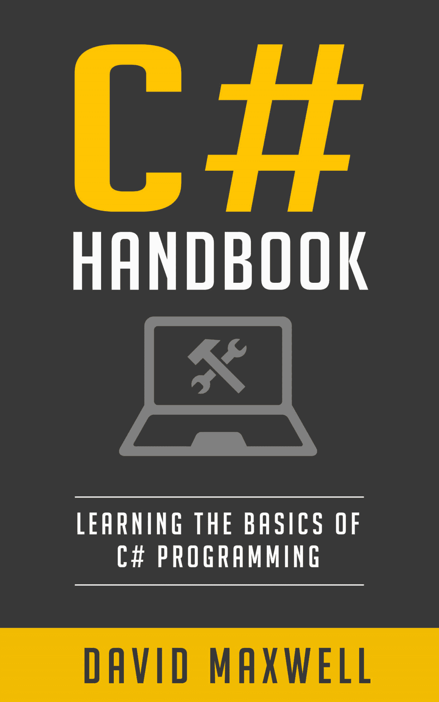


在 [KindleBookSpot.com](http://kindlebookspot.com) 获取更多免费和廉价书籍


## 赠送书籍：

### （点击下方任何链接获取免费赠送书籍！）

- 赠送书籍：Scrum 训练营
- [](#part0000.xhtml_scrum1)赠送书籍：Python 训练营
- [](#part0000.xhtml_pythonac1)赠送书籍：Java 训练营
- [](#part0000.xhtml_javaboot1)赠送书籍：JavaScript 训练营
- [](#part0000.xhtml_javascriptboot1)赠送书籍：C# 训练营
- [](#part0000.xhtml_cboot1)赠送书籍：黑客训练营
- [](#part0000.xhtml_hackboot1)赠送书籍：Excel 训练营
- [](#part0000.xhtml_excelboot1)赠送书籍：SEO 训练营
- [](#part0000.xhtml_seoboot1)赠送书籍：SQL 训练营
- [](#part0000.xhtml_sqlboot1)赠送书籍：Python 学院
- [](#part0000.xhtml_pythonac1)赠送书籍：JavaScript 学院
- [](#part0000.xhtml_javascript1)赠送书籍：Windows 10 学院
- [](#part0000.xhtml_windac1)赠送书籍：被动收入任务
- [](#part0000.xhtml_pia1)赠送书籍：14 天原始饮食计划
- [](#part0000.xhtml_paleoch1)赠送书籍：14 天生酮饮食计划
- [](#part0000.xhtml_keto93)赠送书籍：14 天地中海饮食计划
- [](#part0000.xhtml_med93)赠送书籍：14 天全食品计划
- [](#part0000.xhtml_whole93)赠送书籍：14 天 DASH 计划
- [](#part0000.xhtml_dash93)赠送书籍：14 天纯素饮食计划
- [](#part0000.xhtml_vegan93)赠送书籍：14 天奶昔排毒
- [](#part0000.xhtml_smoothie93)赠送书籍：14 天茶排毒
- [](#part0000.xhtml_tea93)赠送书籍：14 天大空晚餐
- [](#part0000.xhtml_dump93)赠送书籍：14 天精油计划
- [](#part0000.xhtml_oils93)赠送书籍：生酮饮食挑战
- [](#part0000.xhtml_ketoch1)赠送书籍：纯素饮食挑战
- [](#part0000.xhtml_veganchal)赠送书籍：全食品饮食挑战
- [](#part0000.xhtml_wholefood1)赠送书籍：10 天绿色奶昔排毒
- [](#part0000.xhtml_smoothiech1)赠送书籍：茶排毒挑战
- [](#part0000.xhtml_teachal1)赠送书籍：精油挑战
- [](#part0000.xhtml_oils1)赠送书籍：慢炖锅挑战
- [](#part0000.xhtml_crock1)赠送书籍：原始饮食挑战

# 引言

### 在开始之前

# >>点击此处<<

# 我有一条非常重要的信息，你必须阅读

# 我承诺这不是垃圾邮件，我并没有试图向你出售任何东西！

>>立即点击！<<

Images/image01474.jpeg

我想感谢你，并祝贺你下载了《2 周内学会 C# 编程基础》一书。这本书包含了如何在 14 天内学习这种强大编程语言的经过验证的步骤和策略。

本电子书专为想要了解 `C#` 基础的人士设计。基本上，它的目的是帮助你在仅用 2 周内掌握这一主题。为了实现这一目标，本书包含了 `C#` 编程语言的重要方面。它没有包含不必要的介绍或题外的小故事。这本书将教你你所需要的的知识，以便你在学习 2 周后就能成为一名熟练的 `C#` 用户。

在本书书中你将学习到：
- `C#` 的基础
- `C#` 程序的结构
- 基础语法
- 以及更多！

再次感谢下载本书，希望你喜欢它！

### 在我们开始之前……赠送：获取我的更多免费书籍！

感谢阅读我的书！我希望你从中获得了极大的价值。我想通过为你提供更多免费书籍以及与编程和技术相关的信息来表示感谢！只需点击下方的链接并在我的网站上输入你的电子邮件地址即可！

如果你认真想要改变自己的编程技能，你将获得的一切都将对你有用。我将提供：
- 我的更多其他书籍
- 我如何以创奇速度学习编程的
- 关于我最喜欢的编程相关产品信息
- 以及更多！

[点击此处获取所有这些信息！](http://kindlebookspot.com/join-our-tech-community/)

# 第 1 章：C# - 基础信息

`C#` 是一种用于计算机编程的高级、多功能且面向对象的语言。微软（当今最大的公司之一）作为其产品的一部分开发了这种编程语言。为了证明 `C#` 是实用且可靠的，`ISO`（国际标准组织）和 `ECMA`（欧洲计算机标准）对该语言给予了批准。

根据微软介绍，这种语言是为 `CLI`（通用语言体系）设计的。`CLI` 由运行时和可执行代码组成，允许在各种架构上使用高级编程语言。

以下是专业程序员使用 `C#` 的主要原因：
- `C#` 是一种面向对象的语言。
- `C#` 简单易于学习。
- `C#` 是一种面向组件的语言。
- `C#` 是一种结构化编程语言。
- `C#` 是高级且多功能的。
- `C#` 可以产出优秀的程序。
- `C#` 允许用户使用不同的系统进行编译。


## 如何使用 Mac 或 Linux 系统编写 C# 程序

确实，这个框架是为 Windows 计算机创建的。但是，即使使用的是其他系统（例如 Mac 或 Linux），你仍然运行 .NET 框架。例如，你可以使用名为“Mono”的 .Net 变体。该变体预装了 C# 编译器，并兼容不同的操作系统。

## 第 2 章：C# 程序的基本结构

本章将教你 C# 程序的基本结构。这些信息可以帮助你实现你的目标（即在 2 周内掌握 C# 基础）。

## 编写你的第一个程序

C# 程序由以下部分组成：

* 类 (Classes)
* 注释 (Comments)
* 表达式和语句 (Expressions and Statements)
* 命名空间声明 (Namespace Declarations)
* 类属性 (Class Attributes)
* Main 方法 (Main Methods)

分析下面的截图。这是一个打印语句：“Hello World”的简单代码。

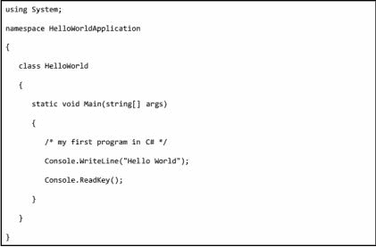

一旦你编译并执行上述代码，将得到这条语句：


现在，让我们分析这段简单代码的各个部分：

* `using System;` – “using”是一个关键字，可以将命名空间与程序连接起来。通常情况下，一个程序包含许多 `using` 语句。在这种情况下，`using` 用于将 `System`（即一个命名空间）附加到程序上。
* `namespace` – 这是代码的第二行。基本上，一个命名空间是不同类的组。在上面的示例中，`HelloWorldApplication`（一个命名空间）包含了 `HelloWorld`（一个类）。
* `class` – 这一行被称为“类声明”。它表示 `HelloWorld` 持有程序所需的信息。通常情况下，类包含各种方法。但在这种情况下，该类包含单个方法（即“Main”）。
* `Main` – 该方法作为所有 C# 代码的入口点。`Main` 指定了它所所属类的的功能。
* `/*…*/` – C# 编译器忽略这一行。如果你想在程序中添加一些注释，就应该使用它。
* `Console.WriteLine(“Hello World”);` – `Main` 使用这条语句指定类的行为。
    * `WriteLine` - 该方法属于一个名为 `Console` 的类。`WriteLine` 让你的屏幕显示代码的消息（即 Hello, World）。
* `Console.ReadKey();` – 这一行是为 VS.NET 用户（即 Visual Studio .NET）设计的。如果你使用 VS.NET 启动程序，`Console.ReadKey()` 将防止屏幕关闭。

这里有你应该记住的四点：

* 你不需要将类名作为程序的文件名。
* 程序的执行从 `Main` 开始。
* 每条语句和表达式都必须使用分号结束。
* C# 编程语言是区分大小大小的。

## 如何编译和执行 C# 程序

### 使用 Visual Studio .NET

如果你使用 VS.NET，需要采取以下步骤：

1. 访问 Visual Studio。
2. 转到菜单栏并选择“File”（文件）。然后点击“New”（新建）和“Project”（项目）。
3. 屏幕将向你显示几个模板。寻找“Visual C#”并选择 Windows。
4. 选择“Console Application”（控制应用程序）。
5. 为新项目分配一个名称并点击“OK”（确定）。此操作将在解决方案管理器（Solution Explorer）中创建一个项目。
6. 将代码输入 VS.NET 的代码编辑器中。
7. 按 F5 或点击“Run”（运行）来运行程序。对于当前示例，新窗口将显示“Hello, World。”

### 使用命令行

你也可以使用命令行来编译你的 C# 程序。以下是你需要做的事：

1. 访问你喜爱的文本编辑器。
2. 输入提供的代码。
3. 将文件保存到任何目录并命名为 `hw.cs`。
4. 访问你计算机的命令提示符，并指定你在步骤 3 中选择的目录。
5. 通过输入 `csc hw.cs` 并按回车键来编译代码。
6. 如果你输入的代码正确，将看到一个名为 `hw.exe` 的可执行文件。
7. 输入 `hw` 来运行程序。
8. 屏幕应该显示“Hello, World.”

## 第 3 章：基础语法

本章将讨论 C# 编程中使用的语法。请仔细学习这些材料，因为它们可以帮助你在 2 周内掌握这种编程语言。

### C# - 一种面向对象的语言

正如第一章讨论，C# 语言是面向对象的。这意味着每个程序都是由相互通信的不同对象组成的。对象可以执行操作（称为“方法”）。

为了帮助你理解这个概念，让我们分析一个简单的对象：矩形。下面的截图显示了 `Rectangle` 类的代码。让我们在学习 C# 基本语法的同时分析这段代码：

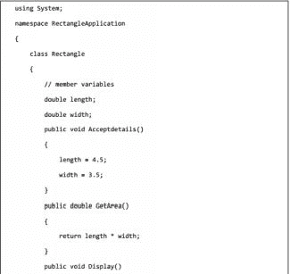
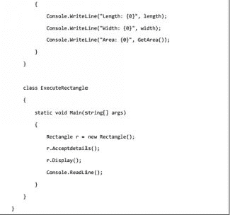

在编译并执行该代码后，你将得到结果：

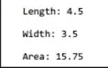

现在，让我们逐一讨论代码部分：

* `using` – 所有 C# 代码都从这一行开始。“using”是一个可以连接 C# 程序内部命名空间的关键字。再次，一个程序可以包含几行“using”。这意味着你可以在每个程序中包含多个命名空间。
* `class` – 你应该使用这个关键字来声明类。
* 注释 – 你应该使用这部分来解释你的代码。通常，C# 编译器忽略这一部分。确保你的多行注释以 `/*` 开始并以 `*/` 结束。查看下面的示例：

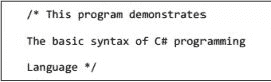

相反，对于单行注释，使用两个斜杠（即 `//`）。查看下面的示例：

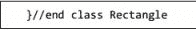
* 成员变量 – 这些是类的数据成员或属性。你应该使用变量来存储数据。对于当前的示例，名为 `Rectangle` 的类有 2 个成员变量：`width` 和 `length`。
* 成员函数 – 函数是执行特定任务的命令集合。通常情况下，你应该在类内部声明类的函数。在上面提供的程序中，`Rectangle` 有 3 个成员函数：`Display`、`GetArea` 和 `AcceptDetails`。

### C# 标识符

标识符是用于确定类、函数、变量或程序员定义的任何项的名称。在 C# 语言中命名类时，你必须遵循以下规则：

* 每个名称都应该以字母开头。你可以使用字母、数字和下划线继续命名。你不能用数字作为标识符开头。
* 你选择的名称不能包含空格或特殊符号（例如 `?`、`+` 和 `*`）。但是，如前面的规则所述，你可以在命名标识符时使用下划线。
* 你不能使用任何 C# 关键字作为标识符名称。

## C# 语言的关键字

基本上，关键字是在 C# 语言中具有预定义函数的保留字。你不能在命名标识符时使用关键字。然而，如果你真的想这样做，可以在关键字的开头添加“@”符号。

在这个编程语言中，某些标识符（例如 `set`、`get` 等）具有特殊含义。程序员将这些标识符称为“上下文关键字”。

你将看到下面的表。这些表将为你展示 C# 语言中的上下文关键字和保留关键字。

### 上文关键字

| set | get | let | add | group | alias | from |
| select | partial (method | global | partial (type) | dynamic | orderby | descending |
| ascending | into | remove | join | | | |

### 保留关键字

| as | if | is | In | do | try | int |
| new | for | out | ref | goto | this | else |
| void | true | lock | char | byte | base | case |
| bool | long | null | uint | using | sbyte | catch |
| const | break | short | throw | ulong | while | event |
| class | float | false | fixed | decimal | abstract | checked |
| continue | delegate | explicit | internal | double | default | finally |
| in (as a generic modifier) | readonly | return | sealed | interface | implicit | static |
| virtual | switch | sizeof | namespace | params | foreach | protected |
| stackalloc | string | override | operator | unchecked | volatile | private |


| object | public | unsafe | extern | enum | typeof | ushort |
| :--- | :--- | :--- | :--- | :--- | :--- | :--- |
| out (作为泛型修饰符) | struct | | | | | |

# 第 4 章：C# 中的数据类型

本章将讨论你在 C# 中会遇到的各种数据类型。请仔细学习本章。作为一名程序员，你将在代码和语句中处理不同类型的数据。这意味着你应该对这些数据类型有所了解。

在 C# 语言中，变量分为五类。让我们详细讨论每种类型：

## 值类型

你可以直接为这种类型的变量赋值。如果你需要使用它们，只需访问一个名为 `System.ValueType` 的类。这些变量在内部持有数据。这意味着它们不涉及第三方工具或机制。下面的列表将向你展示 C# 中可值类型：

* `Int`
* `long`
* `char`
* `bool`
* `sbyte`
* `double`
* `decimal`
* `byte`
* `float`
* `ushort`
* `uint`
* `short`
* `ulong`

## 类型

属于这种类型的变量不直接存储数据。相反，它们指向持有数据的变量。这意味着如果你想指向文件目录或内存位置，就应该使用这种类型。

## 对象类型

C# 用户将此类型视为该语言中所有数据的核心类。“Object”是 C# 中名为 `System.Object` 类的别名。你可以使用对象类型来存储其他类型的数据。但在赋值之前，你必须进行类型转换。

将值转换为对象的过程称为装箱（boxing）。将对象转换为值的过程称为拆箱（unboxing）。

## 动态类型

这种变量允许你存储任何值。使用动态变量时，类型检查在运行时进行。这是声明动态数据类型时需要使用的语法：

```
dynamic <变量名> = 你想要赋值的值;
```

例如：

```csharp
dynamic x = 99;
```

动态数据类型和对象数据类型几乎相同。唯一的区别在于类型检查的时机。对象变量在编译时执行此任务。而动态变量则在运行时执行类型检查。

## 字符串类型

你可以使用这种类型为选定的变量分配字符串值。该类型是 C# 中名为 `System.String` 类的别名。根据计算机专家，字符串变量派自对象类型。

你可以使用字符串字面量（即带引号或 @带引号）来为字符串类型变量赋值。查看以下示例：

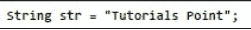

该行的 @quoted 字符串字面量为：

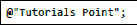

# 第 5 章：变量

“变量”一词指的是可以被计算机程序操作的内存位置。编程语言中的每个变量都属于特定类型，该类型指定了以下方面：

* 变量使用的内存的大小和结构
* 你存储在变量内存中的值
* 你可以应用于变量的一组操作

你可以这样对 C# 中的值类型进行分类：

1. 进制类型
2. 可空类型
3. 整数类型
4. 布尔值类型
5. 浮点类型

## 如何定义变量

定义变量时，使用以下语法：

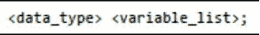

在此语法中，你必须将 `data_type` 替换为 C# 语言中的数据类型。对于 `variable_list,`，你可以添加一个或多个标识符。你应该使用逗号分隔标识符。

## 如何初始化变量

你可以使用 `=`（即等号）来初始化变量。要完成此过程，只需在等号后添加常量表达式。以下是变量初始化的基本语法：

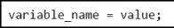

你可以在声明阶段初始化变量。如上所述，初始化通过放置 `=` 后面跟一个表达式来实现。这里是一个示例：

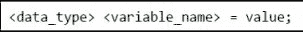

为了帮助你理解这个概念，下面提供了更多示例：

```csharp
int x = 2, y = 3;                /* 它初始化了 x 和 y */
byte d = 99;                    /* 它初始化了 d */
char a = 'a';                   /* 名为 a 的变量值为 'a' */
```

根据专家程序员的说法，你应该始终正确地初始化变量。如果不这样做，你的程序可能会出现意外之外的行为或产生不理想的结果。

## 如何输入值

C# 有一个名为 `System` 的命名空间。该命名空间包含不同的类，其中之一是 `Console`。该类提供了 `ReadLine()` 函数，该函数接收用户的输入并将其存储在变量中。

例如：

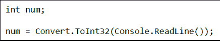

## 右值和左值表达式

1. `Rvalue`: C# 语言支持两种类型：
   - `rvalue`: 这种表达式出现在右侧。
   - `lvalue`: 这种表达式可能出现在左侧。

`Lvalues` 被归类为 `rvalues`。而数值字面量是 `rvalues`。

# 第 6 章：字面量和常量

“字面量”一词指的是程序执行期间固定或不变的值。此外，字面量可以采用任何数据类型的形式（例如浮点常量、整数常量、字符串常量、字符常量）。

## 整数常量

整数常量可以是八进制、十进制或十六进制的。你应该使用前缀来指定进制（也称为 radix）。

* 使用 `0` 表示八进制
* 使用 `0X` 或 `0x` 表示十六进制
* 十进制字面量不需要前缀

整数字面量还可能有 `L` 和 `U` 后缀。`L` 用于长型整数，而 `U` 用于无符号整数。这些后缀对大小不敏感。

下面的列表将向你展示有效和无效的常量：

* `131`: 有效
* `312u`: 有效
* `0XYo`: 有效
* `218`: 无效：数字 8 不是八进制。
* `123UU`: 无效：你不能重复后缀。

这是第二个示例列表。然而，这将向你展示不同类型的整数常量：

* `0123`: 八进制
* `86`: 十进制
* `0x5b`: 十六进制
* `20`: int
* `20u`: 无符号整数
* `20l`: 长整数
* `20ul`: 长无符号整数

## 浮点常量

浮点常量可能包含以下部分：

1. 小数点
2. 指数
3. 整数
4. 分数

以下是浮点常量的有效和无效示例：

* `3.14`: 有效
* `314-5L`: 有效
* `310E`: 无效：指数不完整。
* `310f`: 无效：该常量没有指数或小数。
* `.e44`: 无效：该常量缺少分数或整数。

在使用小数数字时，你应该包含指数、小数点或两者。当你使用指数数字时，你应该包含分数、整数或两者。你应该使用 `E` 或 `e` 引入带符号的指数。 字符常量

你应该将字符常量放在单引号内。例如，你可以将 'a' 存储在普通的 `char` 类型变量中。通常，字符字面量可以以简单字符（例如 'b'）、通用字符（例如 `\u03B0`）或转义序列（例如 `\t`）的形式存在。


在 C# 语言中，某些字符如果由反斜杠引入，将获得特殊含义。由于它们具有特殊含义，你可以将它们用于某些功能，例如制表符 (`\t`) 或换行符 (`\n`)。以下列表将向你展示一些转义序列及其含义：

*   `\'` – 代表单引号字符。
*   `\"` – 代表双引号引号字符。
*   `\\` - 代表反斜杠字符。
*   `\?`– 代表问号。
*   `\a`– 代表蜂响或警报。
*   `\b`– 代表退格符。
*   `\n` – 代表换行。
*   `\f` – 代表分页符。
*   `\t` – 代表水平制表符。
*   `\r` – 代表回车。
*   `\ooo` – 代表一个 1-3 位的八进制数。
*   `\v` – 代表垂直制表符。
*   `\xhh…` - 代表一个有一个或多个位数的十六进制数。

## 字符串常量

你应该使用双引号（即 `“”` 或 `@”`）来括起字符串常量。通常，字符串常量与字符常量相似：它们包含转义序列、通用字符和普通字符。

你可以使用字符串字面量将长行拆成较短的行。然后，你可以使用空格来分隔这些短行。以下列表将向你展示一些字符串常量：

*   `“hi, girl"`
*   `“hi, \ girl”`
*   `“hi,” “g” “irl”`
*   `@“hi girl”`

**注意：** 上述的字符串常量是相同的。它们将产生相同的结果：`hi girl`

## 如何定义字面量

你可以使用 `const`（即 C# 关键字）来定义常量。在定义常量时，你应该使用以下语法：

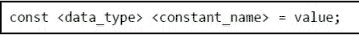

# 第 7 章：C# 中的运算符

运算符决定了如何执行逻辑或数学操作。基本上，运算符是能够与 C# 编译器通信的符号。这种编程语言拥有一套强大的预装运算符。这些运算符被分为六类，即：

*   关系运算符
*   赋值运算符
*   算术运算符
*   位运算符
*   逻辑运算符
*   杂项运算符

让我们详细讨论每一类：

### 关系运算符

下表将向你展示 C# 语言中可关系运算符。让我们使用两个变量：`X = 2;` `Y = 4;`。

*   `“==` – 该运算符测试操作数的相等性。如果值相等，运算符将给出 `true` 作为结果。例如，`Y == X` 为假。
*   `“>` – 该运算符检查两个操作数的值。如果左操作数的值大于右操作数的值，则条件为真。例如：`Y > X` 是真的。
*   `“<` – 该运算符检查涉及的操作数的值。如果右操作数的值大于左操作数的值，则条件为真。例如：`X < Y` 是真的。
*   `“!=` – 该运算符检查操作数的相等性。如果操作数的值不相等，则条件为真。例如：`Y != X` 是真的。
*   `“<=` – 该运算符测试左操作数的值是否小于或等于右操作数的值。这里有一个例子：`Y <= X` 为假。
*   `“>=` – 该运算符测试右操作数的值是否小于或等于左操作数的值。这里有一个例子：`Y >= X` 是真的。

## 赋值运算符

以下列表了兼容 C# 的赋值运算符：

*   `“=` – 此赋值运算符可以复制右操作数的值并将其交给左操作数。例如：`Z = X + Y` 将将 `X + Y` 的值赋给 `Z`。
*   `“+=` – 此赋值运算符被称为`加赋值`。它可以将右操作数的值加到左操作数的值上，并将和赋给左操作数。例如：`Z += X` 等于 `Z = Z + X`。
*   `“-=` – 该运算符被称为`减赋值`。它可以从左操作数的值中减去右操作数的值，并将差赋给左操作数。例如：`Z -= X` 等于 `Z = Z - X`。
*   `“*=` – 该运算符被称为`乘赋值`。它可以将右操作数的值与左操作数的值相乘，并将积赋给左操作数。例如：`Z *= X` 等于 `Z = Z * X`。
*   `“/=` – 此赋值运算符被称为`除赋值`。它可以用左操作数的值除以右操作数的值，并将结果赋给左操作数。这里有一个例子：`Z /= X` 等于 `Z = Z / X`。
*   `“%=` – 该运算符被称为`取模赋值`。它使用两个操作数取模，并将结果赋给左操作数。例如：`(Z %= X)` 等于 `(Z = Z % X)`。
*   `“<<=` – 该运算符被称为`左移赋值`。它根据右操作数指示的数量将左操作数的值向左移动。然后，将值赋给左操作数。它的工作原理如下：`Z <<= 3` 等于 `Z = Z << 3`。
*   `“>>=` – 该运算符被称为`右移赋值`。它根据右操作数指示的将左操作数的值向右移动。检查这个例子：`(X >>= 3)` 等于 `(X = X >> 3)`。

## 算术运算符

列表显示了 C# 语言中可用的算术运算符。为了帮助你理解每个运算符，让我们使用两个变量：`X = 2` 和 `Y = 4`。

*   `“+` – 该运算符相加两个操作数（例如 `X + Y = 6`）。
*   `“-` – 该运算符从第一个变量的值中减去第二个的值（例如 `Y - X = 2`）。
*   `“*` – 该运算符乘以操作数（例如 `X * Y = 8`）。
*   `“/` – 该运算符用分母除以分子（例如 `Y/X = 2`）。
*   `“++` – 这被称为递增运算符。它将变量的值加 1。
*   `“--` – 这被称为递减运算符。它将变量的值减 1。


* `&&` – 此运算符被称为“逻辑与”。如果所有操作数都不等于零，则条件为真（true）。例如：`(X %% Y)` 为假（false）。
* `!` – 此运算符被称为“逻辑非”。你应该使用它来反转操作数的状态。如果条件为真，此运算符将变为假。`!(X || Y)` 为假。

## 杂运算符

C# 编程语言支持其他运算符。以下是一些重要的运算符：

* `sizeof()` – 此运算符可以识别任何数据类型的大小。例如，`sizeof(int)` 可以给你结果 4。
* `typeof()` – 此运算符可以识别任何类的类型。例如：`typeof(StreamReader)`。
* `&` – 你可以使用此运算符来确定任何变量的地址。例如，`&x` 将给你变量名为“x”的变量的地址。
* `*` – 你可以使用此运算符为任何变量创建一个指针。例如：你可以使用 `*x` 创建一个指针，将其命名为“x”，并将其赋值给任何变量。
* `?:` – 此运算符被称为“条件表达式”。它根据条件为任何变量赋值。例如，如果条件为真，它可能会将 `X` 的值赋给变量。然而，如果条件为假，它将赋予 `Y` 的值。
* `is` – 你可以使用此运算符来确定对象是否属于特定类型。这是一个示例：`If( Gucci is Bag)` // 将检查名为 `Gucci` 的对象是否属于名为 `Bag` 的类。

# 第 8 章：C# 中的循环

在某些情况下，你必须多次执行一段代码块。然而，重复输入相同的语句是无聊且耗时的。这意味着你应该找到一种快速、简单重复代码块的方法。如果你不知道如何实现这一点，本章可以为你提供极大帮助。

**重要提示：** 语句通常按顺序执行。这意味着 C# 首先执行第一条语句，然后是下一条，依此类推。在阅读本章时，你应该记住这个概念。

与其他编程语言一样，C# 在执行路径方面为你提供了不同的控制结构。这意味着如果你需要处理复杂的程序，可以访问这些有效的结构。

如果你必须多次执行相同的代码块，可以使用循环语句来简化你的任务。下面的图片将向你展示 C# 中循环语句的基本形式：

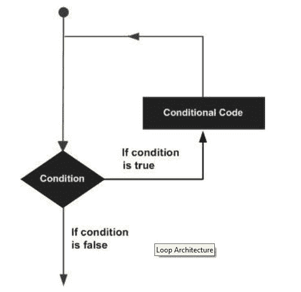

C# 编程语言提供了不同类型的循环。你可以将这些循环用于你自己的代码。查看下列表：

* While 循环– 如果指定的条件变为真，这些循环将重复执行语句或一组语句。通常，while 循环在运行循环命令之前会检查条件的结果。
* For 循环– 通过这些循环，你可以多次执行一系列语句。此外，你可以缩写控制循环变量的代码。
* Do…While 循环– 这些循环与 while 语句相似。然而，它们在执行循环体之后检查条件。
* 嵌套循环– 你可以在其他循环内部使用这些循环。

让我们详细讨论每种循环类型：

### While Loops

如果给定的条件中有任何一个为真，这些循环就可以重复执行所需的语句。下面的图片显示了 C# 语言中 while 循环的语法：

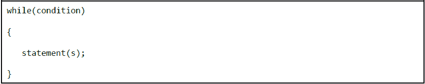

### For Loops

“For 循环”被认为是控制重复的结构。你可以使用这种结构来编写必须执行多次的语句。在 C# 中编写 for 循环时，你应该遵循的语法如下：

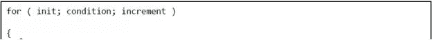 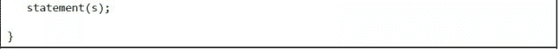

### Do…While Loops

这些循环在到达循环体末尾时测试条件。由于它们在检查条件之前先执行功能，do…while 循环至少会执行一次循环体。下面的图片显示了 C# 语言中 do…while 循环的语法：

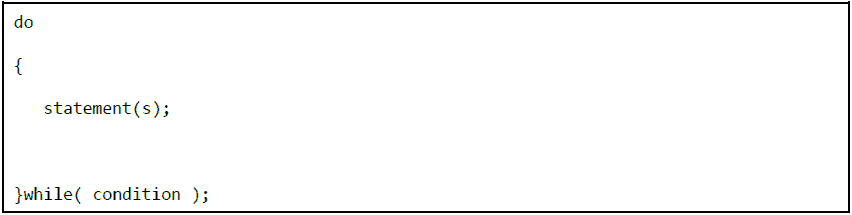

如你所见，条件表达式位于语法的最后部分。这意味着循环在检查程序员输入的条件之前会先执行语句/这些语句。

### Nested Loops

C# 编程语言允许将循环放置在其他循环内部。这意味着你可以在程序中组合不同类型的循环。你必须使用的语法取决于你想用作“容器”的循环。查看以下语法：

* 嵌套 For 循环：
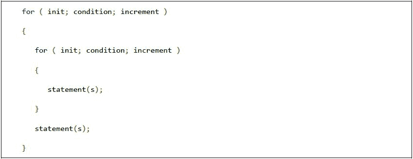
* 嵌套 While 循环：
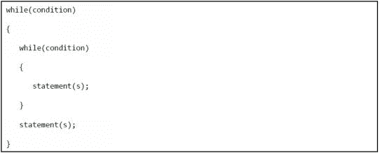
* 嵌套 Do…While 循环：
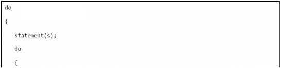 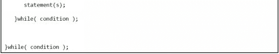

## 结论

再次感谢你下载这本书！

希望这本书能够帮助你在短短两周内学会 C# 的基础知识。

下一步是练习使用这种语言来创建你自己的程序。

最后，如果你喜欢这本书，我想请你帮个忙，你愿意在 Amazon 上为这本书留个评论吗？我将不胜感激！

[点击此处在 Amazon 上为此书留评！](https://www.amazon.com/review/create-review?ie=UTF8&asin=B01957S5TG&channel=detail-glance&nodeID=133140011&ref_=cm_cr_dp_no_rvw_e&store=digital-text)

另外，请务必订阅我的技术和编程通讯邮件，以接收你的免费书目！[点击此处](http://kindlebookspot.com/join-our-tech-community/)。

感谢，并祝你好运！

[点击此处获取如何使用 Bluehost 设置你的 Wordpress 站的分步说明。](http://www.passiveincomeassignment.com/2015/12/15/how-to-create-a-website-in-minutes/)

### 额外福利：获取我的更多免费书籍！

感谢阅读我的书！我希望你从中获得了极大的价值。我想通过给你提供更多免费书籍，以及与编程和技术相关的信息来感谢你！

只需点击下面的链接并在我的网站上输入你的电子邮件地址即可！

如果你认真改变自己的编程技能，你将获得的一切都对你很有用。我将提供：

* 我的更多书籍
* 我如何以创纪录的速度学习编程的
* 我最喜欢的编程相关产品信息
* 以及更多内容！

[点击此处获取所有这些信息！](http://kindlebookspot.com/join-our-tech-community/)

如果你还没有的话，请务必查看我的新网站，[KindleBookSpot.com](http://kindlebookspot.com)。这是我一直在努力的一个新项目，我真的希望它对我的读者有价值。我制作这个网站是因为我想给你们提供一种简单的方法，在一个地方以折扣价找到最热门的 kindle 书籍。以下是关于我网站所内容的详细信息：

* 畅销免费 kindle 书单列表
* 折扣的小说和非虚构书籍
* 每周一书
* 特色书籍
* 在我的网站上推广你自己的书

这个网站不仅仅面向读者，它还是新秀作家在作品成为畅销书之前推广新书的地方。所以，如果你想推广自己的书，请查看我的网站，[KindleBookSpot.com](http://kindlebookspot.com)。

我希望这个网站对你有帮助，我希望那里见到你！

[在 KindleBookSpot 订阅我们不断增长的社区，在优质书籍有折扣或免费时接收通知。](http://kindlebookspot.com)


感谢阅读我的书！我希望你从中获得了极大的价值。我想通过向你提供更多免费书籍以及与编程和技术相关的信息来表示感谢！

只需点击下方链接，并在我的网站上输入你的电子邮件地址即可！

如果你认真想要改变自己的编程技能，那么你将获得的一切都对你有所用。我将提供：

*   我的更多其他书籍
*   我是如何以创纪录速度学习编程的
*   我喜爱的编程相关产品信息
*   以及更多内容！

[点击此处获取所有信息！](http://kindlebookspot.com/join-our-tech-community/)

# 第 1 章：Python 简介

如果你正在寻找一种以代码可读性为主要关注点的通用高级编程语言，那么你应该考虑 Python。它的语法允许你使用比 `C`、`C++` 和 `Java` 等编程语言更少的代码来表达概念。它支持广泛的编程范式，因此涵盖了命令式、函数式和面向对象编程。此外，它还具有完善的标准库、动态带系统和自动内存管理功能。

你有许多解释器可以安装在不同的操作系统上；因此，你可以在各种系统上执行 Python。你甚至可以使用第三方应用程序。如果你不想安装解释器，可以将代码封装成独立的可执行程序，这样你就可以有效地向不同环境分发基于 Python 的软件。

## Python 编程语言的简史

Python 由 `Guido van Rossum` 在 20 世纪 80 年代后期开发。它最初只是一个圣诞项目。Van Rossum 想为 `C` 和 `UNIX` 黑客使用的脚本语言编写一个解释器。他的小项目最终升级到了 `Python 2.0`，并于 2000 年 10 月发布。这个新版本拥有完整的垃圾收集和 Unicode 支持。`Python 3.0`（也称为 `Python 3000` 和 `py3k`）于 2008 年 12 月发布，其特性回溯到了 `2.6` 和 `2.7` 版本。

## 为什么要使用 Python？

编程语言的存在是有理由的。例如，Python 的开发是为了让程序员能够创建高效且高产的代码。它的主要目标是帮助初学者轻松、快速地学习编程语言。由于学习时间更短，你可以创建出更多实用的应用程序，而这些应用用晦涩且复杂的编程语言是很难实现的。

使用 Python，你在编写应用程序时还可以从缩短开发时间内获益。正如前面提到的，Python 的代码行比 `C`、`C++` 和 `Java` 少。它的代码实际上短五到十倍；因此，它更高效、更不复杂。你可以花费更少的时间在开发应用程序，而花费更多的时间在调优和改进它们上。

在检查 bug 和错误时，你所使用的编程语言易于阅读和理解至关重要。如果编程语言太复杂，你在编写和检查程序时可能会遇到困难。使用 Python，代码更容易读、易写；因此，你可以轻松地解释代码并进行必要的更改。

此外，Python 还有许多其他用途。它是编写基于浏览器的脚本应用程序、创建优秀的用户界面和粗略的应用示例、与数据库交互、处理 `XML` 以及设计数学、工程和科学应用的理想选择。

## Python 对 C#、Java 和 Perl

你可能会发现将编程语言相互比较是一项主观任务。通常情况下，它们的差异取决于个人偏好。尽管如此，有时这种比较会有科学数据支持。无论如何，你必须记住，并不存在一种全能的编程语言。作为程序员，你只需要找到一个最适合你目标或需求的语言即可。

### C#

如果你有 `Java` 背景，可能会发现 `C#` 和 `Java` 非常相似。但另一方面，与 `Java` 相比，`C#` 也有自己的优缺点。微软声称他们开发 `C#` 的主要目标是产生更好的 `C` 和 `C++` 版本。然而，与 `C#` 相比，Python 拥有更好的科学和工程应用以及更好的多平台支持。在在使用 `C`、`C++` 和 `Java` 时，它更具扩展性。它更容易学习和理解，并且允许使用各种计算机环境。它的代码也更简洁。

### Java

程序员将 `Java` 视为一种一站式编程语言。多年来，他们一直在寻找一种可以随处运行和编写的东西，并发现了 `Java`，它可以在不同的平台和计算机环境中良好运行。尽管如此，Python 也是一种一站式编程语言。它与 `Java` 非常相似，不同之处在于代码更简洁，更容易学习和理解。它的开发速度快得多，并且改进了可以存储不同数据类型的数据框或变量，这在运行应用程序时非常有用。

### PERL

`PERL` 代表“实用提取和报告语言”。它是一种适用于从另一个数据库获取和处理数据的编程语言。相比之下，Python 比 `PERL` 更好，因为它更容易阅读、实现、学习和理解。它具有更好的 `Java` 集成和数据保护。它也有更少的平台偏见。

## 为什么 Python 是初学者的理想选择？

如果你刚刚开始编程，可能想要考虑 Python。它对初学者来说是理想的，因为它具有一致且简单的语法以及巨大的标准库，允许你完成多个项目。涉及的作业不仅限于常见的四功能计算器和平衡程序。

当你习惯用 Python 编写程序时，你会发现创建现实的应用其实很容易。交互式解释器还允许测试语言特性。在 Python 中，你可以专注于核心编程技能（如程序分解和数据类型设计）以及基础概念（包括过程和循环）。

由于 Python 涉及到多个库和系统调用，你可以开发界面易于编程的应用程序。你还可以完成应用程序编程接口 (`API`) 必需的任务。

如果你以前从未用过任何其他编程语言，请不要担心。即使是没有任何先编程知识或经验的人，也可以轻松掌握 Python 编程语言的基础知识。

至于安装，Python 很容易安装。大多数 `UNIX` 和 `Linux` 发行版实际上在软件包中包含了它。如果你从惠尔-惠普 (`HP`) 购买了 Windows 电脑，你可以直接使用 Python，因为它随系统预装了。

为了让你更方便，你应该学习如何使用文本编辑器以及集成开发环境 (`IDE`)。阅读带有示例代码和程序的编程书籍也会有所帮助。

关于版权，Python 开发者允许程序员对源码做任何想做的事，只要忘记包含版权声明即可。版权规则并不严格。你甚至可以销售二进制和源码形式的副本以及涉及 Python 使用的产品。然而，如果你想使用标志，请确保你获得了许可。


如果你想进行静态分析或查找错误，可以使用 `Pylint` 或 `PyChecker`。前者是一个检查模块是否符合编码标准的工具，并允许自定义插件。后者是一个用于在源代码中发现错误的静态分析工具。

既然你已经学习了编程语言的基础知识，你可能仍然在好奇 Python 为什么叫这个名字。Guido van Rossum 喜欢蛇吗？事实上，他喜欢的是一个名为 `Monty Python’s Flying Circus`（蟒剧马团）的电视节目，而不是那种爬行动动物。

在 Python 开发期间，他正在阅读这部喜剧剧的脚本，认为“Python”是一个很合适的名字，因为它短小、独特，并且带有恰好的神秘感。事实上，文档中允许并实际上鼓励引用该喜剧节目。

# 第 2 章：语法

Python 具有简单且直接的语法。它甚至鼓励程序员在不使用预备或样板代码的情况下编写程序。`print` 指令实际上是所有指令中最简单的。它打印行并包含换行符。你可能会发现，在编程语言的新主版本中，`print` 指令有所不同。

Python `2.0` 是更常用的版本，而 Python `3.0` 支持最新功能且语义上更正确。无论如何，`print` 语句在 `2.0` 版本中不被视为函数；因此，你可以在代码中不包含括号的情况下调用它。另一方面，`print` 语句在 `3.0` 版本中被视为函数；因此，如果你想调用它，必须使用括号。

## 交互模式编程

你可以在不同的模式下执行程序。如果你在调用解释器时不传递脚本文件作为参数，你将得到：

```
$ python

Python 2.4.3 ( #1, Nov 11 2010, 13:34:43 )
[GCC 4.1.2 20080704 ( Red Hat 4.1.2– 48 )] on linux2

输入“help”、“copyright”、““credits”或“license”获取更多信息。

>>>
```

当你看到这个提示符时，可以输入你想要的文本然后按回车。在这个示例中，我们将使用“Monty Python and the Holy Grail”（巨蟒剧与圣杯）这些单词。

```
>>> print“Monty Python and the Holy Grail” ;
```

注意，如果你使用的是编程语言较新的版本，你需要在 `print` 语句中使用左括号和右括号，如下：

```
>> print (“Monty Python and the Holy Grail” ) ;
```

无论你使用哪个版本，如果你运行上面所示的示例代码，你将得到以下输出：

```
Monty Python and the Holy Grail
```

## 脚本模式编程

如果你带有脚本参数调用解释器，脚本将开始执行并持续运行直到完成。完成后，解释器将不再处于状态。考虑以下示例。示例程序写在脚本中并具有 `.py` 扩展名：

```
print“Monty Python’s Flying Circus”;
```

如果你在 `test.py` 文件中输入上述源代码并按如下方式运行它：

```
$ python test. py
```

你将获得以下输出：

```
Monty Python’s Flying Circus
```

另一种执行脚本的方法是修改 `.py` 文件，例如：

```
#! /usr /bin /python

print“Monty Python’s Flying Circus”;
```

如果你这样运行它：

```
$ chmod + x test.py
$ ./test.py
```

你得到以下输出：

```
Monty Python’s Flying Circus
```

## 标识符

标识符基本上用于确定函数、变量、模块、类以及其他对象。它以下划线（`_`）或字母开头。随后是数字、下划线、零或其他字母。作为程序员，可以使用任何字母或数字。你可以使用大写和小写字母。

然而，你不能在标识符中使用标点和特殊字符，例如 `@`、`$` 和 `%`。此外，Python 是一种大小敏感的编程语言。这意味着在代码中使用大小写字母时必须小心。例如，`wendy`、`Wendy` 和 `WENDY` 都是同一个名字，但在 Python 中被视为三个不同的标识符。

### Python 标识符规则

在 Python 中编写程序时，你需要遵守若干规则：

- 类名必须以大写字母开头，而其他标识符必须以小写字母开头。
- 如果标识符以单个下划线开头，则它是私有的。。
- 如果标识符以双下划线开头，则它是强私有的。。
- 如果标识符以双下划线结尾，则它是语言定义的特殊名称。

### 保留字

请注意，在 Python 中某些单词不能作为常量、标识符名或变量。所有关键字也都使用小写字母编写。以下是该编程语言的保留字表：

| And | Assert | Break | Class | Continue |
| :--- | :--- | :--- | :--- | :--- |
| def | del | elif | else | except |
| exec | finally | for | from | global |
| if | import | in | is | lambda |
| Not | or | pass | print | raise |
| return | try | while | with | yield |

## 缩进与行

Python 中没有使用大括号来指示类定义和函数的代码块。同样，流程控制也不包含括号。如果你想标记此类代码块，必须使用行缩进。你可以调整为空格，但要确保对块中的语句都进行缩进。为了帮助你进一步理解，请考虑以下示例代码：

```python
if True:
    if������������������������ print“Correct”
else:
              print“Input”
```

```python
if True:
    if������������������������� print“Correct”
else:
    if��������������������� print“Input”
```

```python
w = 1
if w == 1 :
             print“ w is 1
```

## 缩进误区

关于 Python 缩进存在某些误区。这里是其中一些：

- 每段源代码中都必须有空白。实际上，你并不需要在所有源码中使用空白。空白并不一定具有重要性，尽管缩进是。你可以以任何你喜欢的方式使用它，甚至在程序的任何地方插入不包含任何内容的任意空白或空行。此外，缩进的精确数量并不重要，但你嵌套块的相对缩进才重要。当你使用隐式或显式行时，缩进级别实际上不会被识别。例如，你可以将一个列表跨越多行。缩进完全不重要。看下面的示例：

```python
foo = [
                        ‘ a string ‘ ,
                        ‘ another string ‘ ,
                             ‘ short string ‘
]

print foo
```

如果你运行上面的代码，将得到以下输出：

```
[ ‘ a string ‘ , ‘ another string ‘ , ‘ a short string ‘ ]
```

这是另一个示例：

```python
bar = ‘ look at this example ‘ \
            ‘ of a long string ‘ \
           ‘ that is split ‘ \
                        ‘ across multiple lines ‘

print bar
```

如果你运行上面的代码，你将获得以下输出：

```
look at this example of a long string that is split across multiple lines
```


## 缩进

在你的程序中，应该使用特定的缩进风格。

嗯，这个说法既对也不对。你可以将内部块写在一行内而不对其进行缩进。你可以使用以下“if 语句”的任何版本，因为它们都是有效的并且产生相同的输出：

```python
if 1 + 1 == 2 :
    print “ foo”
    print “ bar ”
    w = 99
if 1 + 1 == 2 :
    print “foo” ; print “ bar “ ; w = 99
if 1 + 1 == 2 : print “ foo “ ; print “ bar “ ; w = 99
```

作为一名程序员，你可能希望分行书写你的代码块，如第一个示例所示。然而，当存在相似的 if 语句时，你可以方便地将它们写在每一行上。

如果你决定将代码块写在多行中，那么你必须遵循缩进规则。包含的块的缩进必须比“if 语句”更多。

结论是，在 Python 中你将被迫遵守这条规则，除非你选择让程序的结构变得复杂。编程语言不允许使用虚假缩进来混淆程序结构。

请记住，在 Python 编程语言中，块是通过缩进表示的；因此，缩进在每个程序都是都是。代码格式的一致性使得程序更容易阅读和理解。

## 空格和制表符

在 Python 中无法混合空格和制表符。

是的，这是真的，即使对于 C 语言编写的程序也是如此。你不能安全地混合空格和制表符。尽管这对你的编译器来说没有巨大差异，但在处理代码时可能会遇到困难。例如，如果你将 C 源代码移动到具有不同制表位的编辑器，将更容易引入 bug。

再次记住，在缩进时混合空格和制表符是不理想的。你可以单独使用空格或制表符。此外，你可能想完全避免使用制表符。毕竟，制表符的语义并不明确，在不同类型的编辑器和系统上可能会有不同的显示。

制表符在复制和粘贴操作，以及当源代码插入 Web 页面或任何类型的标记代码时，经常会被错误地转换或破坏。

## 关键字

可以跳过缩进并使用关键字来代替。

是的，你可以跳过缩进并直接使用关键字。实际上有几个程序员倾向于使用 `endif` 而不是缩进来表示代码块的结束。

嗯，这并不是 Python 中一个被认可的关键字。该语言的早期版本带有一个工具，可以将使用关键字 `end` 的代码转换为正确的缩进并移除该关键字。

这可以作为编译器的预处理器使用。然而，在该语言的最新版本中，该工具已被移除，可能因为它并不经常被使用。

## 解析

编译器是如何解析缩进的？

解析过程实际上简单且定义良好。通常，缩进层级的变化作为标记（tokens）插入到流中。缩进级别使用词法分析器（或标记器）的栈进行存储。起初，栈只有一个值为 0 的值，它位于最左侧。

每当开始一个嵌套块时，一个新的缩进层级被推入栈中。随后在流中插入 `indent` 标记，它最终会被传递给解析器。连续出现多个 `indent` 标记是不可能的。

当看到某行的缩进级别较小时，值将开始从栈中弹出，直到其中一个值位于顶部。这等同于新的缩进层级。如果没有找到任何值，则会产生语法错误。对于每个弹出的值，都有一个 `dedent` 标记。连续出现多个 `dedent` 标记是可能的。在每个源代码末尾，会为栈中剩余的缩进级别生成 `dedent` 标记。这种情况会一直持续，直到剩下 0。

## 多行语句

当你结束一个语句时，你可以使用换行符或延续符号（`\`）来指示该行需要继续。为了帮助你进一步理解这个概念，请考虑以下示例：

```python
total = first_item + \
        second_item + \
        third_item
```

在编写包含括号（如 `{ }`、`()` 和 `[ ]`）内的语句时，你不需要使用延续符号。例如，如果你想显示一年的月份，你可以简单地写：

```python
year = [‘January’ ,‘February’ ,‘March’ ,‘April’ ,‘May’ ,‘June’ ,‘July’ ,‘August’ ,‘September’ ,‘October’ ,‘November’ ,‘December’ ]
```

你允许在一行中编写多个语句或创建多个组作为套件（suites）。在涉及编写多个语句时，请记住分号（`;`）的使用至关重要。分号允许你编写尽可能多的语句，只要它们不开启新的代码块。考虑以下示例：

```python
import sys ; y =‘bar’ ; sys.stdout.write ( y +‘ \n’ )
```

那么什么是套件（suites）呢？嗯，它们是由代码块组成的语句组。复合或复杂语句，如 `if`、`while`、`def` 和 `class` 需要一个套件和一个头部行。

什么是头部行呢？它们以关键字开始语句并以冒号（`:`）结束。此外，它们后面紧跟着一个或多个组成套件的行。考虑以下示例：

```python
if expression :
    suite
elif expression :
    suite
else :
    suite
```

## 引号

作为程序员，你在标记字符串字面量时允许使用单引号（`'`）、双引号（`"`）和三引号（`'''` 或 `"""`）。同样，确保你在字符串的开头和结尾使用相同类型的引号。通常，三引号用于跨越多行的字符串。看看以下示例：

```python
paragraph =""" You are reading an example of a paragraph that consists multiple lines and sentences."""”
```

## 注释

涉及注释时，你应该使用井号符号（`#`）来开头。然而，这个井号不应该出现在字符串字面量内部。此外，它之后直到行尾的字符都应该包含在注释中。在 Python 中，解释器不识别注释。为了帮助你进一步理解这个概念，请看示例：

```python
### 这是第一个注释
print“ Monty Python’s Flying Circus is a British sketch comedy series.” ;

### 这是第二个注释
```

如果你运行上面的示例，将获得以下输出：

Monty Python’s Flying Circus is a British sketch comedy series.

你也可以在表达式或语句之后编写另一个注释，例如：

```python
name =“Wendy” # 这是一个示例注释
```

如果你想对多行进行注释，也可以这样做。例如：

```python
### 这是一个示例注释。
### 这一个也是注释。
### 这是另一个注释。
### 这条注释是由 Wendy 写的。
```


变量包含了专门分配给它们的值。如果你正在为应用程序编写复杂的代码，你可能希望将信息存储在变量中。不要担心，因为你可以在需要时随时访问它们。你甚至可以使用它们来确保从终端用户那里收集的信息保持安全可靠。

### 数值类型

Python 编程语言中的数字与你在代数中解决问题时使用的数字不同。在数学中，在数字末尾加上 `.0` 实际上没有任何意义。它对数值没有任何影响。例如，`3` 和 `3.0` 是相同的。

但在 Python 中，`3` 和 `3.0` 是不同的数字。在程序处理它们之前，它们必须经过某些数据处理方法。作为程序员，你必须学习不同的数值类型。

### 整数

所有的整数都是整数。包含小数点的数字不是整数；因此，`3` 是整数，而 `3.0` 不是。Python 中的整数特征是数据类型 `int`。

请注意，整数有容量限制。如果你尝试处理超出允许限制的值，将会产生错误。整数通常处理于 `-9,223,372,036.854` 和 `9,223,372,036.854` 之间的数字。

`int` 变量还有一些有趣的特性。例如，二进制仅使用 `0` 和 `1`，八进制使用 `0` 到 `7` 的数字，十进制具有与小数系统类似的属性，而十六进制则使用字母 `A` 到 `F` 和数字 `0` 到 `9` 作为数字。

### 浮点数

任何包含小数点的数字在 Python 中都被视为浮点数。小数点后的数字是否为 0 并不重要。例如，`3.0`、`1.5` 和 `11.4` 都是浮点数。它们存储在 `float` 数据类型中。浮点数相对于整数的一个巨大优势是它们拥有更大的存储空间；因此它们能够存储非常小或大的值。

尽管如此，你不应该认为它们拥有无限的存储空间。仍然存在限制。尽管如此，它们包含的最小值为 `±2.2250738585072014×10-308`，最大值为 `1.7976931348623157×10-308`。有几种使用浮点数分配值的方法。首先，你可以直接对其赋值。其次，你可以使用科学计数法。记住，负指数会产生等值分数。

### 复数

这些数字由实数和虚数组合而成。它们通常用于动态系统、量子力学、计算机图形学、电气工程和流体力学。Python 以及其他少数语言可以处理复数。

### 布尔值

这是两个常量对象 `True` 和 `False`。它们代表真值。在数值上下文中使用时，它们作为 `0` 和 `1` Function。你可以使用 `bool()` 函数为布尔值赋值，如果该值可以被解释为真值。

### 字符串

它们是用双引号连接的字符组。考虑以下示例：

```
TheString = "Python got its name from a popular comedy show."
```

如上面的示例代码所示，短语 `Python got its name from a popular comedy show.` 被赋值给变量 `TheString`。

计算机无法理解字母，只能理解数字。所以当你编写程序时，Python 根据代表其字母的数字来读取和解释它。例如，在美国信息交换标准 (ASCII) 中，数字 `65` 代表字母 `A`。所以如果你输入

```python
ord(" A")
```

你将得到输出

```

由于计算机无法理解字母，因此你必须将字符串转换为数字。你可以使用 `int` 或 `float` 来执行此操作。如果你需要将数字转换为字符串，可以使用 `str`。

# 第 4 章：运算符

你的操作数的值通过运算符进行处理。Python 编程语言中使用了七种类型的运算符。下表显示了这些运算符，并对其功能进行了简要说明。

## 算术运算符

| 运算符 |  |
| :--- | :--- |
| 加 (`+`) | 将值相加。 |
| 减 (`-`) | 从前一个操作数中减去第二个操作数。 |
| 乘 (`*`) | 将值相乘。 |
| 除 (`/`) | 将第一个操作数除以第二个操作数。 |
| 取模 (`%`) | 将第一个操作数除以第二个操作数并返回余数 |
| 幂 (`**`) | 对运算符执行指数计算。 |
| 整除 (`//`) | 除操作数但消除小数点 |

## 比较运算符或关系运算符

| 运算符 | 描述 |
| :--- | :--- |
| `==` | 如果两个操作数的值相等。 |
| `!=` | 如果两个操作数的值不相等。 |
| `>` | 如果左操作数大于右操作数。 |
| `<` | 如果左操作数小于右操作数。 |
| `>=` | 如果左操作数大于或等于右操作数。 |
| `<=` | 如果左操作数小于或等于右操作数。 |

## 赋值运算符

| 运算符 | 描述 |
| :--- | :--- |
| `=` | 将右操作数的值赋值给左操作数。 |
| `+=` | 将右操作数加上左操作数，然后将结果分配给左操作数。 |
| `-=` | 从左操作数中减去右操作数，然后将结果分配给左操作数。 |
| `*=` | 将左操作数与右操作数相乘，然后将结果分配给左操作数。 |
| `/=` | 将左操作数除以右操作数，然后将结果分配给左操作数。 |
| `%=` | 使用两个操作数找到模数，然后将结果分配给左操作数。 |
| `**=` | 对运算符执行指数计算并将值分配给左操作数。 |
| `//=` | 对运算符执行整除并将值分配给左操作数。 |

## 位运算运算符

| 运算符 | 描述 |
| :--- | :--- |
| `&` | 如果位在两个操作数中都存在，则复制该位。 |
| `|` | 如果位在任一操作操作数中存在，则复制该位。 |
| `^` | 如果位在一个操作数中存在但不在另一个中存在，则复制该位。 |
| `~` | 反转位。 |
| `<<` | 根据右操作数指定的位数将左操作数的值向左移动。 |
| `>>` | 根据右操作数指定的位数将左操作数的值向右移动。 |

## 逻辑运算符

| 运算符 | 描述 |
| :--- | :--- |
| `and` | 如果两个操作数都为真，则条件为真。 |
| `or` | 如果一个操作数非零，则条件为真。 |
| `not` | 反转操作数的逻辑状态。 |

## 成员运算符

| 运算符 | 描述 |
| :--- | :--- |
| `is` | 如果运算符两边的变量指向同一个对象，则结果为真。否则，结果为假。 |
| `not in` | 如果在特定序列中未找到变量，则结果为真。否则，结果为假。 |

## 身份运算符

| 运算符 | 描述 |
| :--- | :--- |
| `is` | 如果运算符两边的变量指向同一个对象，则结果为真。否则，结果为假。 |


| 不等于 | 如果运算符两侧的变量指向同一个对象，则结果为假（false）。否则，结果为真（true）。 |

## 结

再次感谢你下载本书！

希望这本书能够帮助你学习 Python 编程语言。

下一步是应用你从书中中学到的知识。

最后，如果你喜欢这本书，我想请你帮个忙，你是否愿意在亚马逊上为这本书留个评价？如果有你的帮助我将不胜感激！

[点击此处在亚马逊上为本书留写评价！](https://www.amazon.com/review/create-review?ie=UTF8&asin=B01AA460HC&channel=detail-glance&nodeID=133140011&ref_=cm_cr_dp_wrt_summary&store=digital-text)

感谢你并祝你好运！

### 额外赠送：获取我编写更多免费书籍！

感谢阅读我的书！我希望你从中获得了极大的价值。我想通过送你你更多免费书籍，以及与编程和技术相关的信息来感谢你！

只需点击下方链接，并在我的网站上输入你的邮箱地址即可！

如果你认真想要改变自己的编程技能，你将获得的一切都对你很有帮助。我将提供：

*   我的更多书籍
*   我是如何以创纪录速度学习编程的
*   我喜爱的编程相关产品信息
*   以及更多！

[点击此处获取所有信息！](http://kindlebookspot.com/join-our-tech-community/)

## 版权

版权所有 2014 ______________________ - 保留所有权利。

本文档旨在就其涵盖的主题和问题提供准确且可靠的信息。本书的出版基于这样一个理念：出版者不需要提供会计、官方许可或其他专业合规的服务。如果需要法律或专业建议，应当聘请该领域内有经验的专业人士。

- 摘自一份由美国律师协会协会委员会和出版商及协会委员会共同接受并批准的《原则宣言》。

以任何方式通过电子手段或打印格式复制、复制或传输本文档的任何部分都是非法的。严禁录制本书，除非获得出版者的书面许可，否则不允许对本文进行任何存储。保留所有权利。

在此处提供的信息声明是真实且一致的，这意味着对于任何对其中包含的政策、流程或指示的使用或滥用而导致的疏忽或其他形式的责任，均由接收读者承担全部唯一责任。在任何情况下，对于因此处信息直接或间接导致的任何赔偿、损害或资金损失，出版者不承担任何法律责任或过。

相应作者拥有出版者未持有的版权。

此处的信息仅供参考之用，且具有通用性。信息的呈现不带有合同或任何类型的保证说明。

所使用的商标均未经过任何许可，且商标的出版未获得商标所有者的许可或支持。书中的所有商标和品牌仅用于说明目的，并由所有者所有，与本文档无关联。

## 额外赠送：获取我编写更多免费视频和书籍！

感谢阅读我的书！我希望你从中获得了极大的价值。我想通过送你更多免费视频、书籍以及与健康相关的信息来感谢你！

只需点击下方链接，并在我的网站上输入你的邮箱地址即可！

如果你认真想要改变你的饮食和健康，你将获得的一切都对你很有帮助。我将提供：

*   我的更多书籍
*   制作特色菜的视频
*   我喜爱的健康相关产品信息
*   以及更多！

[点击此处获取所有信息！](http://kindlebookspot.com/health-bonus/)

如果你还没有的话，请务必查看我的新网站，[KindleBookSpot.com](http://kindlebookspot.com)。这是我一直在努力的新项目，我真心希望它对我的读者有价值。我制作这个网站是因为我想给你们提供一种更方便的方法，在一个地方找到折扣价的火热 Kindle 书籍。以下是关于我网站内容的的一些细节：

*   畅销免费 Kindle 书籍列表
*   折扣价的小说和非虚构类书籍
*   每周图书
*   精选书籍
*   在我的网站上推广你自己的书

这个网站不仅面向读者，它还是新秀作者在成为畅销书之前推广他们新书的地方。所以，如果你想推广自己的书，请查看我的网站，[KindleBookSpot.com](http://kindlebookspot.com)。

我希望这个网站对你有用，我希望在那里见到你！

[在 KindleBookSpot 订阅我们不断增长的社区，以便接收优质书籍打折和免费的通知。](http://kindlebookspot.com)

# Scrum 战训练营

## 学习 Scrum 编程基础

### 在 [KindleBookSpot.com](http://kindlebookspot.com) 获取更多免费和优惠书籍

# 目录

*   引言
*   第 1 章：Scrum 与敏捷开发
*   第 2 章：Scrum 框架
*   第 3 章：事件
*   第 4 章：产物
*   第 5 章：用户故事
*   第 6 章：估计
*   结

# 引言

我想感谢并祝贺你下载《两周学会 Scrum 编程基础》这本书。

这本书包含了如何在短时间内掌握 Scrum 框架基础的步骤和策略。

本书旨在教你 Scrum 框架的核心思想、概念和技术。

读完后，你将在 14 天内成为一名有效的 Scrum 实践者。

# 再次感谢下载本书，希望你喜欢！

# 第 1 章：Scrum 与敏捷开发

Scrum 是一种用于“敏捷”开发模型的方法。在讨论 Scrum 究竟之前，让我们先定义什么是敏捷。

### 敏捷开发

基本上，敏捷是一种用于完成项目（例如软件产品）的迭代和增量开发策略。这种策略要求人们合作以快速完成项目。敏捷涉及一种时间箱的迭代方法，并要求对任何变化做出快速灵活的响应。根据敏捷实践者的说法，这种策略是一个理论大纲，并没有指示应该执行的特定活动。

Scrum 是敏捷使用的方法之一，它定义了完成任何给定项目必须执行的技术和流程。

### 敏捷开发的主要原则

在使用敏捷时，请记住列出的原则：

*   **关注细节**：注意项目细节。通过这种，你可以获得卓越的项目设计和技术成就。
*   **少即是多**：敏捷开发框架强调简单。在这里，你不需要通过无关的技术或活动来增加项目的趣味。以最简单的方法解决与项目相关的问题。


*   **沟通至关重要**——为了确保卓越质量，开发者（即项目开发人员）必须与业务人员（管理团队或客户）定期进行沟通。
*   **交付客户满意度**——通常情况下，使用敏捷开发的人希望满足客户的需求。这些开发者通过持续的过程尽早完成项目，并尽快发送给客户。
*   **必须接受变化**——敏捷实践者在进行任何项目时，必须欢迎变化（包括工作环境和/或项目需求方面的变化）。这意味着你必须观察与项目相关的所有变化，并进行必要的调整。
*   **信任与动力**——敏捷框架本质上是重复且复杂的；因此，它需要具有积极主动性的个人。寻找可以信任的人员，因为不可靠的员工会破坏你的项目。
*   **灵活性是关键**——团队必须能够适应变化的情况。如果你不适应工作环境的变化，你就无法成为一名高效的敏捷实践者。
*   **产出是成功的 true 标准**——只有当你拥有可运行的输出时，你才能说自己是成功的。如果输出不符合客户的需求，那么简单、生产力、成本效益和所有“好东西”都是没用的。

## 结论

无数公司已从敏捷开发实践中受益。这是为什么敏捷框架现在被应用于不同行业和项目（例如，编程）的主要原因。

敏捷框架提供了以下优势：
*   缩短交付时间
*   降低风险和不确定性
*   通过关注客户需求获得更高的投资回报率（即 ROI）

# 第 2 章：Scrum 框架

## 什么是 Scrum？
软件开发者将 Scrum 定义为用于创建和改进复杂产品的框架。它不是一种生成新产品的方法或方法论；而是一个你可以用来不同方法和方法论的开发框架。Scrum 可以让你看到开发和管理策略的优缺点，允许你提高整体效率。

该框架涉及开发小组（称为 `Scrum Teams`）、事件、规则和产物。这些组件每一个在 Scrum 框架的使用和成功中都起着重要作用。

## Scrum 框架涉及的过程
在使用 Scrum 时，你应该通过规定的事件来标准化流程。每个事件都是时间箱的（time-boxed），这意味着它有一个特定的截止日期。你将在后面的章节中学习更多关于“事件”的知识。

### Sprint（迭代）
`Sprint` 是通常以周为单位的时间箱，是 Scrum 的核心。基本上，`Sprint` 是产生产品增量的一段时间。一旦上一个 `Sprint` 完成，一个新的 `Sprint` 就会开始。Sprint 具有以下元素：
*   **Sprint 计划（Sprint Planning）**——参与项目的人员将决定在 `Sprint` 内必须完成的任务。`Scrum Team` 的每个成员必须参与这项协作活动。
*   **每日会议（Daily Meetings）**——`Scrum Teams` 需要每天制定计划并共享更新。为了实现这一点，每个团队每天必须举行一次 15 分钟的会议。
*   **Sprint 评审（Sprint Review）**——该事件在 `Sprint` 结束时发生。在这里，`Scrum Team` 的成员评审产品增量并在必要时更新项目记录。
*   **Sprint 回顾（Sprint Retrospective）**——它发生在下一个 `Sprint` 计划阶段之前。在这次事件中，`Scrum Team` 的成员检查他们的表现并寻找改进方法。这允许他们在下一个 `Sprint` 中获得更好的结果。

## Scrum 团队的成员
`Scrum Teams` 涉及三个主要角色，分别是：
*   **“ScrumMaster”（也写作“Scrum Master”）**——此人担任团队的领导。`ScrumMaster` 需要：
    *   确保 Scrum 框架和产生的流程高效运行。
    *   识别并消除影响团队生产力的障碍。
    *   组织并促进重要会议。
*   **产品所有者（Product Owner）**——此人负责团队效率和产品价值的最大化。通常，产品所有者需要管理项目待办列表（backlog）。项目待办列表管理涉及：
    *   清晰项目待办列表中的项目
    *   有效安排待办列表项目以实现团队目标
    *   使团队表现的总价值最大化
    *   确保项目待办列表清晰、透明且供所有团队成员访问。此外，待办列表必须告知成员哪些需要执行或改进。
    *   确保每个成员都理解项目待办列表项目。

产品所有者可以执行上述列的任务，也可以要求团队成员执行。无论什么情况下，产品所有者对这些任务负有责任。

产品所有者只是一个人，而不是一组。此人可以在项目待办列表中表达项目中其他人的需求/愿望。然而，待办列表中的每个项目都必须列在产品所有者的名下。

整个团队必须尊重产品所有者的决策。团队成员应该检查项目待办列表以了解产品所有者的决策。
*   **团队（The Team）**——此术语指 `ScrumMaster` 和产品所有者之外的团队成员。通常，Scrum 团队的“团队”部分必须能够自我组织并执行不同的功能。这一部分由测试人员、分析师、开发者和设计师组成。根据所涉及的项目，可以向团队添加其他成员（例如工程师和架构师）。

为了使一个“团队”有效，它应该足够大以完成任务，又足够小以保持灵活性。“团队”的理想规模是五到九名成员（不包括 `ScrumMaster` 和 `Product Owner`）。如果成员少于五，人力可能不足以完成项目。然而，如果成员超过九人，团队将需要过度协调。

结论
Scrum 是一种敏捷框架，它规定了角色、规则和任务以确保一致性。只要你遵循 Scrum 开发的所有规则，就可以将其用于任何项目或组织。

# 第 3 章：事件
敏捷实践者将 Scrum 视为一组事件及其产生的“产物”。如前所述，Scrum 使用时间箱事件来管理项目。“时间箱”意味着每个事件都有一个预定的截止日期。这允许 `Scrum Team` 的成员看到他们完成项目的整体进度。

### Sprint
在这一事件中，Scrum 团队开发一个可运行的产品增量。通常，一个 Sprint 持续 1 个月或 2 周，且这段时间适用于项目中的所有 `Sprints`。时间周期的一致性非常重要。如果团队成员需要适应不同的截止日期，将会导致混乱和低效。

### Sprint 目标
每个 `Sprint` 都有一个特定的目标。该目标告知团队成员增量的目的。团队在 `Sprint` 的计划阶段设定此目标。产品所有者和团队其他成员设定并澄清 Sprint 的范围。每当他们发现关于项目的新情况时，还会对 Sprint 进行调整。

### Sprint 计划
这一阶段允许你设定必须在 `sprint` 内完成的活动。对于为期两周的 Sprint，计划阶段通常持续四小时；对于为期一个月的 Sprint，持续八小时。`ScrumMaster` 负责确保会议举行以及所需的成员出席。


通常情况下，迭代计划（Sprint planning）集中在以下问题上：

* 在当前增量中应该完成什么？
* 在当前增量中可以完成什么？
* 整个团队如何实现迭代目标？

此阶段需要以下输入：

* 项目待办列表（Project backlog）
* 项目的最新增量
* Scrum 团队的估计容量
* Scrum 团队之前的表现

整个团队将讨论在当前迭代内必须开发的特性/功能。产品负责人（Product owner）应该通过项目待办列表明确迭代中最重要的部分。团队成员选择包含在待办列表中的项目，因为他们清楚自己在分配给的时间盒（time-box）内可以完成什么。任务通过协作完成，这种方法最大限度地减少了重复工作。

在决定要开发的功能后，团队必须决定如何将这些功能添加到项目中。为迭代选择的待办列表项以及它们的实现策略被称为迭代待办列表（Sprint backlog）。

迭代内要完成的任务在计划阶段进行估算。它们可能有不同的规模和复杂度。一旦完成迭代计划，项目将被拆分为最长持续一天的任务。这种方法有助于 Scrum 导师（ScrumMasters）分配任务并检查项目进度。如果 Scrum 团队成员发现任务太少（或太多），他们可以与 Scrum 导师和产品负责人沟通以进行必要的更改。

成员们也可以请求其他人（即不属于当前 Scrum 团队的人员）在计划阶段提供帮助。非成员可以提供成本估算、技术建议或实用技巧。

## 每日会议（Daily Meetings）

这些会议持续 15 分钟。它们每天举行，以了解昨天完成的工作，并为当天制定计划。一些 Scrum 实践者将这些会议称为“站会”（Stand Up）。

每日会议在相同的地点和时间举行。这样，团队成员可以降低会议的复杂性，并专注于他们应该做的事情。

在会议期间，Scrum 团队的每位成员必须回答以下问题：

* 他/她如何帮助 Scrum 团队实现目标？
* 他/她如何协助团队实现迭代目标？
* 他/她是否注意到任何阻碍他/或整个 Scrum 团队实现迭代目标的障碍？

有些人认为举行每日会议是为了跟踪项目进度。然而，这是一个错误的假设。实际上，举行每日会议是为了计划项目必须做的事情，而不仅仅是检查已经完成了什么。

根据 Scrum 专家的说法，所有团队成员都对每日会议的生产力和效率负责。这意味着每个成员都必须帮助进行每日会议，尽管 Scrum 导师执行了相关的管理任务。

以下是每日会议提供的益处：

* 这些会议改进了团队成员之间的沟通。
* 每日会议有助于识别与项目相关的问题。它们也有助于快速高效地解决问题。
* 它们促进并强调了快速决策。
* 它们提高了团队成员与项目相关的知识。

## 迭代回顾（Sprint Review）

Scrum 团队应该在每个迭代结束之前举行此活动。在此阶段，团队成员应该在发布项目增量（即发布给客户或进入下一次迭代会议）之前审查项目增量。在迭代回顾期间，所有利益相关者（即受项目影响或参与项目的人）都应该检查当前迭代中完成了什么。这些利益相关者将对下一次迭代中必须完成的内容给出建议。他们将基于两个因素提出这些建议：

* 迭代回顾中的发现
* 当前迭代期间对项目待办列表所做的更改

此阶段的目标是从利益相关者获得反馈并确保进展的一致性。

通常，迭代回顾的持续取决于迭代的时间盒。为期 2 周的迭代回顾持续两 小时。另一方面，为期一个月的迭代需要 4 小时的回顾；因此，在迭代上花费的每周需要一小时的回顾。

在迭代回顾期间，Scrum 导师应该：

* 确保会议举行。
* 告知团队成员关于迭代回顾的目标/目的。
* 帮助成员关注重要话题。
* 确保会议及时结束。

在迭代回顾期间会发生以下事件：

* 产品负责人邀请非成员参加回顾（可选）。
* 产品负责人讨论项目待办列表。他/她将告知大家已完成的待办列表项。然后，他/她将列出迭代内未完成的待办项。
* 团队成员讨论迭代的积极方面、遇到的问题以及如何解决这些问题。
* 团队成员演示他们已完成的工作。如果有关于项目增量的任何问题，他们也将回答。
* 整个小组（包括成员和非成员）决定下一次迭代中应该做什么；因此，回顾阶段产生了对下一次迭代会议非常有用的输入。
* Scrum 团队成员检查与产品增量发布相关的方面（例如预算、时间表、市场、能力、潜力等）。

一旦迭代回顾完成，Scrum 团队将更新项目待办列表。这些更新定义了后续迭代将使用的待办列表项。

## 迭代回顾（Sprint Retrospective）

此阶段发生在下一次迭代计划开始之前。为期 2 周的迭代回顾回顾持续一小时，而为期一个月的迭代回顾则持续三小时。

基本上，迭代回顾旨在：

* 利用从上一次迭代会议在工具、人员、流程和关系方面收集的信息。
* 确定良好的待办项。
* 识别迭代的改进领域。
* 创建改进项目效率和整体质量的计划。

Scrum 允许你回顾之前的表现；因此，它帮助你提高后续迭代会议的效率。

# 第 4 章：制品（Artifacts）

在 Scrum 中，“制品”为利益相关者和团队成员提供重要数据；因此，制品让你能够理解当前项目、已完成的任务以及涉及项目的流程。Scrum 框架涉及以下制品：

* 项目待办列表（Project backlog）
* 迭代待办列表（Sprint backlog）
* 增量（Increment）
* 燃尽图（Burn-Down chart）

上述列表显示了 Scrum 框架的强制性制品。在某些情况下，Scrum 团队需要其他类型的制品。

让我们详细讨论四个强制性制品：

### 项目待办列表（Project backlog）

基本上，这种制品是 Scrum 团队必须添加到产品中的特性/特征。它为团队提供了可以用于改进项目增量的信息。

项目待办列表指定了项目所需的功能、特性、修复、增强和需求。该列表中的项具有以下属性：

* 价值
* 顺序
* 描述
* 估算

Scrum 实践者在引用上述任何属性时使用“用户故事”（user story）一词。通常，产品负责人必须负责与项目待办列表相关的所有方面（例如内容、排序、可用性等）。


此工物随着项目的进展而演变。初始版本可能仅包含基础的需求。随着 Scrum 团队获取更多关于项目的信息，项目待办列表（project backlog）将得到进一步开发。产品所有（product owner）必须定期更新此工物以保持其有效性。基本上，只要与其相关的产品存在，项目待办列表就会一直存在。

随着团队投入产品工作，项目待办列表会变成一个更大、更详细的列表。此外，技术、市场状况或业务需求的变化可能会影响项目待办列表。这就是许多人将此待办列表视为“活的”输出的原因。

项目待办列表的精炼（refinement）涉及对工物中的事项添加细节、估算和排序。这是一个产品所有持续执行的过程。整个团队决定何时以及如何进行精炼。

**重要提示：** 产品所有可以根据自己的情况随时更新项目待办列表。

通常，高优先的待办事项比低优先的项更清晰、更明确。清晰精确的细节允许团队成员做出正确的估算。

此工物允许团队成员精炼需求，以便他们将其用于即将到来的冲刺（sprint）。Scrum 团队可以开发的待办事项被认为已准备在下次冲刺的计划阶段使用。

## 冲刺待办列表 (The Sprint Backlog)

此工物是为冲刺选择的项目待办事项，以及创建增量并实现冲刺目标的策略的结合。

这种待办列表指定了可以添加到下一个项目增量的功能。它还定义了将这些功能添加到产品中所需的任务和活动。

当需要新任务时，团队成员会更新冲刺待办列表。团队成员还会定期更新剩余任务。显然，每当任务被添加或完成时，通知整个团队是非常重要的。团队还应该从此待办列表中删除不需要的项目。

请记住，只有团队成员可以修改冲刺待办列表。此外，此工物必须对所有团队成员可见且可访问。

## 增量 (Increment)

“增量”一词指的是团队已完成的项目待办事项。在结束一个冲刺时，增量应该是一个可用的产品。即使产品所有者还不想发布它，该产品也应该是可用的。

整个团队应该对什么被视为增量达成共识。这对于每个 Scrum 团队来说有显著差异。然而，每个成员必须清楚“增量”对团队意味着什么。这允许成员确定项目的进度或完成情况。

关于增量的知识还允许成员识别必须选择的待办事项。每个冲刺会议的目标是创建可用产品的增量。

通常情况下，每个 Scrum 团队都应该在一个冲刺内完成一个产品增量。由于增量是可用的产品，产品所有可以将其原样发布到市场。

一些 Scrum 团队将增量知识视为一项要求。这意味着增量知识涉及组织的标准、指南或惯例。如果增量知识不是强制性的，ScMaster 必须为项目定义合适的增量。

## 燃尽图 (The Burn-Down Chart)

在冲刺会议期间，团队成员可能会汇总项目待办列表内部的剩余任务。Scrum 团队在每日会议期间衡量剩余任务。这种方法允许团队确定他们实现目标的概率并管理进度。

燃尽图是一种跟踪团队完成活动的技术。敏捷实践者已使用这种技术来衡量和管理他们团队的进度。

产品所有在每次冲刺评审期间跟踪剩余任务。然后，他/她会将这些任务与之前冲刺的任务进行比较。这种方法有助于产品所有评估团队完成已分配任务的进度。

**重要提示：** 产品所有必须将此工物与每个利益相关者共享。

## 结论

Scrum 涉及不同的输出，这些输出被称为“工物”（artifacts）。在实施 Scrum 框架时，你必须生成并使用这些工物。通过这样做，你可以增加你项目目标的概率。

# 第 5 章：用户故事 (The User Stories)

在“软件开发”行业中，产品功能起着重要作用。这些功能吸引消费者并鼓励他们购买或使用完成的产品。在通用术语中，产品功能被称为“需求”。一个软件生成项目的成功取决于精确地了解用户需求并将其整合到成品中。这意味着团队成员在开始任何项目之前，应该知道他们需要处理的需求或产品功能。

肯特·贝克（Kent Beck）是一位美国软件工程师，他在 1999 年创造了“用户故事”这一术语。用户故事从用户的角度叙述，告知软件开发人员最终用户的需求，而不是产品能为他/她做什么。开发的视角从“以产品为中心”转变为“以用户为中心”。由于其有效性，用户故事成为使用任何“敏捷”框架团队的标准需求。

当涉及到 Scrum 框架时，项目待办列表作为用户故事的集合。ScMaster 必须在冲刺计划阶段识别、划分优先级并讨论这些用户故事。

在大多数情况下，Scrum 团队基于项目的用户故事制定估算和目标。

## 用户故事的结构 (The Structure of a User Story)

用户故事遵循以下格式：

作为一个<用户类型>，

我需要<完成一项任务>，

以便我可以<目标/享受收益/得到某东西>。

让我们分析用户故事是如何形成的。在这里，假设一个银行客户想要从 ATM 取款。

### 用户故事 – 客户 ATM 取款

作为一个客户，我需要从 ATM 取款，这样我就可以在不进入银行的情况下获得。

## 验收标准 (The Acceptance Criteria)

用户故事涉及验收标准（即衡量用户故事有效性的测试）。验收标准有助于 Scrum 团队分析用户故事对当前项目的影响。

以下是上述用户故事的简单验收标准：

**第一个验收标准：**

假设：
*   客户具有良好的信用。
*   借记卡/信用卡是可以接受的。
*   机器有足够的现金。

当：
*   客户需要钱。

那么：
*   确保正确的账户被扣费。
*   确保机器取放正确的金额。
*   确保机器返回客户的借记卡/信用卡。

**第二个验收标准：**

假设：
*   客户的账户资金不足。
*   客户的卡是可以接受的。

当：
*   客户需要钱。

那么：
*   在屏幕上显示拒绝信息。
*   确保机器不取放任何钱。
*   确保机器返回卡片。

## 如何编写用户故事 (How to Write a User Story)

由于项目待办列表持有用户故事，产品所有负责管理项目的用户故事。然而，产品所有者并不是唯一可以编写用户故事的人。基本上，任何团队成员都可以完成这项任务。这意味着 ScrumMaster 可能会将这一责任分配给整个团队。

## 用户故事中的非功能性需求 (The Non-Functional Requirements in a User Story)

Scrum 团队可以将非功能性需求整合到用户故事中。在上面的示例中，非功能性需求是 ATM 的 24/7 可用性。

## 如何管理用户故事 (How to Manage a User Story)


你应该使用项目待办列表（project backlog）来管理用户故事（user story）。通常，Scrum 团队会根据重要性来安排用户故事。最重要的故事会被尽力完善，而不重要的故事则会被最少处理。对于每个冲刺（sprint），产品负责人会将最重要的（最详细的）用户故事记录在 `sprint backlog`（冲刺待办列表）中。在向任何待办列表添加用户故事时，产品负责人会检查其优先级：他/她将根据优先级将用户故事放入 `project backlog` 中。

**重要提示**：团队成员可以根据实际情况移除或重新调整用户故事的优先级。

## 用户故事提供的优势

- 用户故事帮助开发团队关注终端用户。这非常重要，因为最终用户将在产品进入市场后购买并使用它。因此，用户故事帮助 Scrum 团队与终端用户建立联系。
- 用户故事的结构有助于 Scrum 团队确定终端用户想要实现的目标/价值/利益。
- 验收标准是任何用户故事的一个重要方面，它可以帮助 Scrum 团队客观地分析他们的项目。
- Scrum 团队成员在执行项目期间可能会修改用户故事。例如，如果某个用户故事的范围过大，他们可能会将其拆分为更小的故事。团队成员还可能更改项目使用的验收标准。
- 由于 Scrum 团队在每个冲刺结束时都会向客户交付增量，他们可能会获得反馈和建议，这些建议可用于后续冲刺。

## 结论

用户故事让你更接近项目的终端用户；因此，这些故事可以帮助你生成可用的产品并防止意外结果。

# 第 6 章：估算

Scrum 团队应该在规划阶段进行估算。这些估基于目的是优先级和团队能力对用户故事进行分析。产品负责人确保高优先级的用户故事是可以理解的、可用于估算的，并包含在 `project backlog` 中。

由于整个团队都负责完成和交付项目增量，在选择用户故事时应格外小心。团队成员需要根据增量的目标大小和项目所需的整体工作量做出决策。

**重要提示**：增量的大小通过 `story points`（故事点）来衡量。确定增量大小后，团队应该根据之前冲刺的数据估算所需的工作。

## 估算中使用的技术

在进行估算时，请关注每个用户故事的复杂/困难程度。以下是你可以用于评估用户故事难度或复杂性的量表：

- 数字数字尺寸：这是一个从 `1` 到 `10` 的量表。
- 尺码大小：（`S`, `XS`, `M`, `L`, `XL` 等）
- 斐波纳契序列：在这个量表中，你将一个数字与其之前的数字相加。和将作为下一个数字。

## 扑克估算法

在这种方法中，你将通过玩类似扑克的牌游戏来得出估算值。整个团队都可以帮助实施这种方法。通过 `Poker Estimation`，你可以在花费花费时间或精力的情况下生成可靠的估算。

这种方法需要多副扑牌。使用牌上打印的数字，遵循 `Fibonacci sequence`。牌上的数字代表 `story points`（即用于衡量用户故事的值）。

每个成员都应该有一副牌。你必须指定一个 `moderator`（主持人）——此人将读取 `User Story` 的描述/解释。产品负责人将回答会议期间提出的任何问题。

团队成员（也称为“估算员”）应该通过私下选择一张牌来表达他们的估值。估算员在所有人选择牌之前应该保持牌面隐藏。一旦所有人选选择了牌，他们应该同时揭示自己的估值。

在第一轮中，估算值可能会差异很大。每个估算员都应该解释他们的估算值。确保不要问任何个人问题——团队成员应该专注于解释他们的意见/决策。

当用户解释意见时，`moderator` 应该做笔记。这些笔记可以帮助团队开发用户故事。完成一轮后，每个成员应该进行另一次估算。他们将隐藏牌，直到所有人做出选择。然后，他们将同时揭牌。

重复此过程，直到你得到单一的估算值。请记住，估算所需的轮数可能取决于你正在处理的用户故事。

## 扑克估算法中使用的方法

- 类比（Analogy）：这种方法要求你比较用户故事。基本上，你应该将当前的用户故事与你已经实现的故事进行比较。由于这种方法基于实际数据，它能产生准确的结果。
- 分解（Disaggregation）：在这种估算方法中，你把一个用户故事拆分为更小的故事。冲刺中使用的用户故事通常持续三到六天；因此，如果你遇到持续七天或更长的 `User Story`，你必须将其分成更小、更易管理的部分。作为额外，这种方法有助于你确保拥有具有可比性的用户方法。
- 专家意见（Expert Opinion）：这种方法需要行业专家的反馈/建议。由于每个团队成员都密切参与 Scrum 项目，他们对该主题有足够的知识和经验；因此，他们可以被视为“专家”。在这里，专家将根据他们的经验和知识给出意见/估值，而不是根据直觉。

## 结论

扑克法是一种有趣且高效的方法，你可以用它来生成 Scrum 估值。由于它允许人们分享和讨论意见，团队将获得更多关于当前用户故事的信息。

## 结论

再次感谢你下载这本书！

希望这本书能够帮助你在短短两周内掌握 Scrum 的基础知识。

下一步是使用这个开发框架来完成你的计算机程序。

最后，如果你喜欢这本书，我想请你帮个忙，你愿意在 Amazon 上给这本书书留个评论吗？我将不胜感激！

[点击此处在 Amazon 上为这本书留评论！](https://www.amazon.com/review/create-review?ie=UTF8&asin=B018VLTERY&channel=detail-glance&nodeID=133140011&ref_=cm_cr_dp_no_rvw_e&store=digital-text)

别忘了订阅我的技术和编程新闻邮件，获取你的免费书籍并学习更多关于编程的知识。[点击此处](http://kindlebookspot.com/join-our-tech-community/)

感谢并祝你好运！

[点击此处获取使用 Bluehost 设置 Wordpress 网站的分步说明。](http://www.passiveincomeassignment.com/2015/12/15/how-to-create-a-website-in-minutes/)


# 目录

- 引言
- 第 1 章：了解 10 天绿色奶昔清理计划
- 第 2 章：一种有趣且健康的减肥方法
- 第 3 章：如何进行 10 天清理
- 第 4 章：10 种能够帮助减肥的实证绿色奶昔配方
- 第 5 章：DIY 绿色奶昔配方
- 第 6 章：关于你的绿色奶昔的小贴士
- 第 7 章：绿色奶昔 + 健康生活方式 = 快乐长寿
- 结论

# 引言

感谢你的下载，并祝贺你下载了这本书《10 天绿色奶昔清理：减重高达 15 磅的实证配方》。

书中包含了如何减掉多余脂肪以及过更健康、更快乐生活方式的实证步骤和策略。

为什么当大多数人一想到健康和健身时，他们的直觉是感到沮丧，并表现得好像这件事根本不存在一样呢？当然，我们不能都成为健身专家，但如果你真的认真想要恢复体形，有很多技巧可以帮助你努力获得一直想要的身材。无论是减肥还是获得更多能量，开始进行奶昔清理都是开启健康生活方式最有效的方法之一。

虽然身体燃烧储存脂肪的自然能力会随着年龄增长而减缓，但这意味着你应该放弃健身目标。无论你处于人生的哪个阶段，你仍然可以做很多事情来改善生理、心理和身体健康，而阅读这本书是通往一直想要的生活的第一步。

这本书旨在教你如何通过奶昔清理开始过一种更健康、更绿色的生活方式。这并不是为了帮助你快速减肥的时尚饮食法，但它应该鼓励你利用奶昔排毒做出更健康的生活选择，并在过程中重置你的生活方式。

## 这本书是给谁看的？

- 那些厌倦了无效节食减脂的人。
- 那些想要利用能量来增强力量的人。
- 那些想要做出更健康的食物选择并恢复正常饮食习惯的人。
- ……以及更多！

所以你还在等什么呢？开始阅读吧，从今天起改变你的生活方式！

再次感谢下载此书，希望你喜欢！

不要忘记查看底部我最喜欢的饮食之一：

学习我如何通过 3 周饮食法快速减掉顽固多余脂肪的策略。

请前往底部获取更多信息，并接收你的免费报告和奖励内容！

## 奖励：获取我的更多免费视频和书籍！

感谢阅读我的书！我希望你从中获得了极大的价值。我想通过给你提供更多与健康相关的免费视频、书籍和信息表示感谢！

只需点击下方链接并在我的网站上输入你的电子邮件地址即可！

如果你认真想要改变你的饮食和健康，你将获得的一切对你都有用：

- 我的更多书籍
- 制作特殊菜肴的视频
- 我喜欢的健康相关产品信息
- 以及更多！

[点击此处获取所有这些信息！](http://kindlebookspot.com/health-bonus/)

# 第 1 章：了解 10 天绿色奶昔清理计划

一种减肥和变得健康的新方法正在进行。这项 10 天绿色奶昔计划旨在实现以下目标：

- 重新编程味蕾
- 刺激代谢
- 燃烧脂肪
- 节省金和时间
- 获得额外能量
- 释放身体
- 有效减轻体重

谈到健康，绿色是关键。如今，人们变得越来越更有意识了。

以下是一些绿色物品的示例：

### 叶叶蔬菜
1. `Kale`（羽蓝）
2. `Spinach`（菠菜）
3. `Dandelion`（蒲公英）
4. `Romaine`（罗马生菜）
5. `Cucumber`（黄瓜）
6. `Arugula`（芝麻菜）
7. `Bok choy`（小白菜）
8. `Beet`（甜根）
9. `Carrot`（胡萝卜）
10. `Collard`（甘蓝）
11. `Radish`（萝卜）
12. `Mustard`（芥末）
13. `Turnip`（大芜）
14. `Watercress`（水芹）
15. `Spring`（春笋）
16. `Lettuce`（生菜）

### 水果
1. `Avocado`（牛油果）
2. `Apples`（苹果）
3. `Grapes`（葡萄）
4. `Kiwi`（奇异果）
5. `Mango`（芒果）
6. `Sweetsops`（番荔石）
7. `Custard apple`（番荔石）
8. `Bananas`（香蕉）
9. `Limes`（青柠檬）
10. `Guavas`（番瓜）
11. `Pears`（梨）

### 饮料
1. `Green tea`（绿茶）
2. `Juice`（汁）
3. `Smoothie`（奶昔）

### 坚果
1. `Pistachio`（开心果）
2. `Pumpkin seed`（南瓜籽）

### 其他“绿色”
1. `Seaweeds`（海藻）
2. `Herbs`（草本）
3. `Olives`（橄榄）

减肥不需要昂贵、无聊或困难。通过 10 天绿色奶昔清理，燃烧那些脂肪变得既有趣又简单。绿色！健康！

# 第 2 章：一种有趣且健康的减肥方法

10 天绿色奶昔清理确实是一种有趣且简单的减肥和变得健康的方法。与其他减肥计划不同，这项清理更有可能被完成，原因如下：

- 它不费时间。时间是许多人的敌人。即使这关乎他们的健康，他们根本没有额外的时间去做这些事情。通过绿色奶昔清理，只需要 5-10 分钟就能做好一整天的饮料。是的，就那么简单。

以下是制作奶昔的三个基本步骤：

1. **始终从液体成分开始。** 可以是`water`、`coconut milk`、`新鲜果汁`、`草茶`或`杏奶`。这可以防止搅拌机刀片被固体原料卡住。因此，混合原料会更容易、更快速。
2. **加入基底。** 这些是让奶昔变得非常奶油的成分。例如`plain yogurt`（原味酸奶）、`fruits`（如 `bananas`、`mangoes`、`pears` 和 `apples`）、`nut butters`（坚果酱）和 `chia seed gel`（奇亚籽胶）。
3. **加入水果、蔬菜和可选添加物。** 添加物包括以下任何：
    - `Sweeteners`（甜味剂）
    - `Salt`（盐）
    - `Spices`（香料）
    - `Protein powder`（蛋白粉）
    - `Other super foods`（其他超级食物：`cacao`、`flax seeds`、`bee pollen`、`hemp seeds`、`aloe vera`、`maca` 和其他 `coconut products`）


最初，前 3 天允许 70% 的水果和 30% 的蔬菜的比例。水果的甜味将主导味觉。然而，之后比例应该反过来。不过不用担心，到那时味蕾已经经过了调整。此人最终会失去对甜食的渴望。

*   没有剥夺感。整天都会摄入奶昔和零食。不会有饥饿感迫使节食者再次转向精制碳水化合物和甜食。奶昔虽然量小，但很饱腹。因此，即使摄入量少于平时，人也会感到饱腹。饱腹感也比比常持续得更久。因此，人需要几个小时才会再次感到饥饿。这减少了节食者的食物摄入总量，导致体重减轻。
*   有额外的能量。这些富营养的奶昔为个体提供了额外的能量，可以将其用于运动和其他高强度训练，反过来又让他更快地减肥。这是为什么呢？这些绿色奶昔的热量是完整的，没有空热量，而空热量恰恰是体重增加的罪祸首。然而，对于能量需求较高的人，可以在奶昔中加入肉或蛋白粉。
*   它是负担得起的。对于这个计划，不需要昂贵的机器（当然，搅拌机除外，但这不算，因为它并不昂贵）。水果和蔬菜可以在任何当地杂货店购买。偏好有机成分的人甚至可以建立自己的室内花园。这将为节食者进一步节省金钱。

通过这个计划，有可能节省数百甚至数千美元。每天一杯绿色奶昔的成本低于 `$10`。在 10 天内，总费用不到一百美元。没有其他减肥计划能吹嘘这种从这个计划中可以享受的同样大额节约。

*   它提升了人的心情。绿色奶昔的大部分成分都能促进“快乐”大脑化学物质的释放。这些例子包括内啡肽、血清素和多巴胺。它们还起到镇痛剂的作用，缓解人身体存在的任何疼痛。人会感觉自己很好，因此在工作或学校中表现得更好，与他人的关系也更好。
*   它保护人免受许多疾病。充满毒素的身体无法按照其设计发挥功能。器官执行任务也会遇到困难，导致身体虚弱，易受疾病侵害。绿色奶昔的成分充满了维生素、矿物质和电解质，所有这些都有助于保护和增强免疫系统。因此，人能够对抗病毒和细菌。
*   它让人看起来更年轻。去除体内的杂质对皮肤可以产生奇妙的效果。只需一周，就可以期待拥有光泽、美丽的皮肤。此外，头发变得更有光泽更光滑，增添了青春的光彩。所有这些效果都会让个体看起来更年轻。

想象一下这 110 天绿色奶昔排毒计划带来的身体、心理、情感甚至是财务上的益处吧。确实，一切都有可获，完全没有损失。

# 第 3 章：如何进行 10 天清理

10 天绿色奶昔清理像 `1-2-3` 一样简单。然而，在开始清理计划之前，有以下先决条件要做：

*   人应该告知其主要医疗保健者其进行排毒的意图。这样，就可以确保该计划不会影响当前或未来的医疗干预。在排毒之前进行常规检查也是安全的，这样在需要时就有基准信息。
*   此人必须尽可能了解关于这个清理计划的所有信息。他不能仅仅依靠道听。仅仅因为这个计划对一个朋友有效，并不意味着它也会自动对他也有效。他可能患有不允许参加此类计划的健康状况。
*   只能使用原料。偏好使用有机成分。还应该轮替使用的绿色蔬菜以避免碱类的积累。

以下是如何进行 10 天绿色奶昔清理的步骤说明。

1.  选择使用两种清理计划中的哪一种。
    *   **完全清理 (Full Cleanse)**——人被指示每天总共服用 `60 盎司` 的奶昔，分为三餐。这意味着在 `10 天` 内，所有的餐都只由绿色奶昔组成。
    *   **改良完全清理 (Modified full cleanse)**——对于那些无法忍受完全清理计划的人，可以选择每天在 `10 天` 内服用 `2` 杯绿色奶昔和一份轻餐（最好在晚餐时间）。体重的减轻可能没有完全清理那么剧烈，但人们仍然可以预计通过改良完全清理减轻 `5-10 磅`。

请注意，节食者可以根据自己的喜好和能力在两种类型之间切换。

2.  从常规饮食逐渐过渡到 10 天绿色奶昔清理。如何做？在计划的第一天，节食者可以只喝绿色奶昔，最好在早上。午餐和晚餐应该仅为轻餐。第二天，他可以在早餐和午餐喝绿色奶昔，晚餐时间吃轻餐。第三天，他可以按照上述说明开始完全清理计划。

3.  在完成 10 天排毒后，节食者必须观察逐渐恢复进固食物。如何做？人不能在 `第 11 天` 直接吃沉重的固态食物。那可能会让他感到恶心和胀气。相反，他应该用轻餐代替一杯绿色奶昔。在 `第 12 天`，他可以继续用轻餐替换 `2` 杯奶昔。在 `第 13 天`，他可以吃固态轻餐。在 `第 14 天`，他可以回到原来的饮食。

在清理期间和之后记住其他重要事项：

*   全天必须喝超过 `8 杯` 水。也鼓励喝草茶。
*   如果他在餐间感到饥饿，可以吃以下零食：
    *   苹果
    *   芹芹
    *   黄瓜
    *   胡萝卜
    *   高蛋白食物，如煮鸡蛋、无糖花生油酱和一把坚果。
*   清理清理时间为 `14 天`。理想时间是 `10 天`。节食者不应超过分配的天数。长期吃泥会有许多医疗不良。如果需要再次进行清理，可以在一个月或 `2` 次常规饮食后重复此过程。

步骤简单易懂！此外，这个计划有助于在短短几周内实现节食者的理想体重。

# 第 4 章：10 个经过证明的帮助减肥绿色奶昔配方

以下绿色奶昔配方美味、负担得起、易于制作，最重要的是让人在 10 天内更瘦更健康。

## 配方 1 - 牛油果能量奶昔

原料：

*   `½` 个牛油果
*   `1 杯` 水
*   `½杯` 冷冻或新鲜蓝莓
*   `½汤匙` 椰子油
*   `½汤匙` 蜂蜜（可选）。你可以用枫糖或甜菊糖代替。其他人使用 `½` 香蕉来甜味。
*   `1 汤匙` 亚奇籽（也可以使用亚奇籽胶）
*   `¼茶匙` 肉桂

先混合液体（水、椰子油），然后加入基础原料（香蕉、蜂蜜、亚奇籽或胶、肉桂）。当已经变得质地细腻时，加入水果和剩余成分。立即享用。将剩余的奶昔放入冰箱中以保持一整天的鲜。。

## 配方 2 - 三色绿色奶昔


此配方使用了三种绿色的食物——菠菜、绿茶和牛油果。这能有多强大呢，对吧？食材包括：

* ½ 个中等牛油果
* 1 杯绿茶
* 1 杯菠菜
* 1 杯熟芒果果块
* ½ 汤匙椰子油
* 少量蜂蜜或枫糖浆（取决于对甜度的喜好。有时芒果就足以让奶昔变得很甜了）
* 一少许海盐

再次，将所有食材混合搅拌并冷藏。如果质地太浓稠，只需加少量水。如果没有芒果果块，可以用葡萄代替。三色绿色奶昔不仅美味倍，而且三倍强大。

## 配方 # 3–菠菜石石榴草莓绿色奶昔

这种奶昔会有两层。底层是粉红色的，上层是绿色的。它看起来很有吸引力，味道极佳。

### 底层的食材如下：

* 1 根冷冻小香蕉
* 1 杯草莓
* ½ 杯椰子水

将食材混合，倒入高玻璃杯中。

### 上层的食材包括：

* 1 杯菠菜
* 1 根小香蕉
* ¼ 杯石榴籽
* ¼ 杯椰子水

将这些食材搅拌成奶昔后，立即淋在底层上。冷藏后享用。这是一款富含抗氧化剂的能量饮品，非常适合进行高强度训练的人。

## 配方 # 4 - 羽衣蓝绿色奶昔之惊喜

食材包括：

* 1 杯羽衣蓝
* ½ 杯椰子奶
* 1½ 杯菠菠萝
* 1 根熟的小香蕉

可以用苹果代替香蕉。这将产生同样的健康益处。同时，味道也会令人愉悦。

## 配方 # 5–燃脂绿茶奶昔

食材为：

* ¾ 杯绿茶
* 2-3 汤匙柠檬汁
* 2 茶匙龙舌植物蜜
* 1/8 茶匙辣椒粉
* 1 个带皮的小油梨
* 2 汤匙原味酸奶
* 6-8 块冰块

预计使用这种奶昔可以更快地减轻体重。绿茶作为主要成分，因其能促进新陈代谢而闻名，从而增加了燃脂能力。

## 配方 # 6–菠菜芒果组合绿色奶昔

在搅拌机中混合以下食材：

* 2 杯菠菜叶或嫩菠菜
* 1 杯新鲜芒果块
* 1 根小香蕉
* ¾ 杯椰子奶
* ½ 杯橙汁

可选食材包括：

* 1 汤匙椰子酱（椰子果酱），用于提供蛋白质和更丰富的风味
* 1 汤匙亚麻籽——磨碎后作为蛋白质和 omega 3 的来源

这是一款清爽的奶昔，保证让你在享受的同时，有效减掉多余脂肪。

## 配方 # 7–健康美味的绿色奶昔之惊喜

食材：

* 1 杯牛奶–无脂的
* ½ 杯无脂酸奶
* 1 根小香蕉
* 2 杯新鲜菠菜
* 1 汤匙花生酱
* 冰块

这种奶昔最适合需要摄入菠菜但讨厌其味道的人。花生酱实际上可以帮助去除菠菜的独特味道。人们现在可以享受绿色蔬菜，并在过程中变得更健康。

## 配方 # 8 - 羽甘蓝奶昔之享

食材包括：

* 2 杯羽甘蓝
* 2 汤匙现榨的青柠汁
* 1 杯绿葡萄
* ½ 杯芒果

不要过度搅拌食材。如果没有羽甘蓝，可以使用菠菜代替。多加水可以稀释质地。冷藏后冷享用。

## 配方 # 9–蛋白质能量绿色奶昔

食材包括：

* ¼ 杯冷冻芒果
* ½ 杯红葡萄柚汁
* 1 个大苹果（去核并切碎）
* 1 杯羽衣蓝
* 1 杯黄瓜
* ½ 杯芹芹
* 3 汤匙大麻仁
* 1/8 杯薄荷叶（新鲜）

可选食材：

* 冰块
* ½ 汤匙初榨椰子油

将所有食材搅拌至光滑。如果混合物太浓稠，加入少量水。倒入杯中享用。这是剧烈运动后的一款极佳奶昔饮品。

## 配方 # 10 热带奇迹绿色奶昔

这是一种可以让你感觉自己正处于热带岛屿度假的奶昔。在此过程中减轻体重。

食材为：

* 2 杯菠菜
* 1 杯冷冻芒果
* 1 杯冷冻菠萝
* 1 根熟香蕉
* 1 杯牛奶
* 1 茶匙香草提取物
* 根据口味添加甜味剂
* 1 杯喜欢的浆果（草莓、树莓、蓝莓）。这是可选的。

搅拌。倒入高玻璃杯。加上一把伞装饰。坐下或躺下，让魔法开始。

如果这 10 个配方不符合节食者的口味，不要灰心。下一章旨在帮助特定的节食者在效果和口味上找到他们寻找的内容。继续读下去！

# 第 5 章：DIY 绿色奶昔配方

不同的人有不同的需求和偏好。制作绿色奶昔也是如此。这个 10 天清理计划最棒的一点在于，人们可以根据自己的需求和口味调整奶昔的食材。怎么做？DIY 绿色奶昔就是答案。

### 如何操作？首先，节食者必须评估：

* 他的身体需求。他是否进行高强度训练？他是在工作还是学习？他是否需要比平时更多的能量？
* 他的目标。他想减掉多少磅？
* 他的口味偏好。他喜欢甜味还是咸味？
* 他的预算。这个计划分配了多少资金？

利用这些因素，他现在可以开始规划他的绿色奶昔了。这是基础配方。食材包括：

* 2 杯蔬菜
* 2 杯液体基底（可以是水、椰子奶或椰子水）
* 3 杯水果
* 添加物

按照制作奶昔的步骤进行混合搅拌。食材可以是任何东西。节食者需要做的就是尝试，直到找到适合自己的。对于有创意的节食者，他可以尝试数百（甚至数千）水果、蔬菜、液体基底和添加物的组合。

### 口味测试

奶昔的主导味道取决于水果和添加物。如果节食者想要更甜的，那么他应该使用芒果、葡萄、香蕉、枣、山竹、木瓜和柿子。对于添加物，他可以放入甜菊、枫糖浆或蜂蜜。如果节食者喜欢酸味，可以从蔓越莓、葡萄柚、柠檬、青柠、橙子、石榴和番茄中选择。

添加物在提供额外能量方面起着很大作用。例如，如果他当天要高强度训练，他可能想添加蛋白粉或高蛋白水果，如牛油果和香蕉。他还可以混合瘦肉、鸡肉、鱼、大豆、豆腐和其他高蛋白食物。它们可以为后续的活动提供所需的额外能量。

### DIY 绿色奶昔的推荐食材有哪些？

除了卓越的燃脂能力外，这些食材还含有其他健康益处。人们的 DIY 奶昔应该包含这些食材中的至少一两种。

1. 牛油果–它一直被认为是超级食物，因为它富含以下成分：
    * 健康脂肪–对心脏有益
    * 维生素 E
    * 维生素 K
    * 叶叶酸
    * 维生素 B6
    * 维生素 B5
    * 钾
    * 此外还有少量的镁、锌、铜、锰、铁以及维生素 B1、B2 和 B3。

仿佛这些不够，牛油果还富含纤维。它们含有大量的抗氧化营养素，如叶黄素和玉米黄质，这两者对眼睛健康都非常重要。它们被认为可以降低白内障和视黄斑变性的发生率。


2. 绿茶。
它誉为地球上最健康的饮料。它含有丰富的维生素、矿物质、抗氧化剂和无数营养成分。以下是绿茶的 10 益处。

1. 它富含多酚。这些物质能通过减少体内自由基的形成，来保护细胞和分子免受损伤。
2. 它含有抗氧化剂`Epigallocatechin Gallate`。这种物质是绿茶具有强效药性的原因。众周知它具有治疗各种疾病的能力。
3. 它含有适量的`caffeine`，能让人保持清醒，而不会产生过量咖啡因带来的“焦虑感”。
4. 它具有抗焦虑作用。绿茶中的`L-theanine`能增加`γ氨丁酸`或`GABA`的活性，从而产生镇静效果。
5. 由于脂肪组织动员脂肪酸，它可以使身体性能提升高达 37%。
6. 它降低了患乳腺癌、结直肠癌和前列腺癌的风险。
7. 它可以降低老年人患`阿尔茨海默症`和痴呆的风险。
8. 绿茶由于能提高胰岛素敏感性并降低血糖水平，患糖尿病的概率降低了 42%。
9. 由于系统循环变好，也可以预防心血管疾病。

3. 菠菜。
这是大力大力员在每场战斗中击败布鲁特的秘密武器。这并不意外，因为它含有许多营养成分，可以对抗癌症、哮喘、糖尿病、高血压、骨骼疾病等大疾病。此外，它的热量也很低。

4. 石榴。
石榴的健康益处也很多。这种水果富含纤维素、蛋白质、维生素`C`和`K`、叶酸和钾。它这种名为`punicalagins`和`punicic acid`的独特物质具有药用。它们可以减轻炎症，从而保护个体免受 100 多种炎症疾病的侵害。

5. 草莓。
这种超级食物的健康益处包括：
1. 它具有抗癌特性。
2. 它可以增强免疫系统。
3. 它促进眼部健康。
4. 它能预防心血管疾病。
5. 它具有抗衰老特性。

6. 羽羽甘蓝。
被认为是地球上最健康的食物之一。它富含维生素`A`、`C`、`K`和`B6`。它含有大量的`镁`、`锰`、`铜`、`钙`和钾。由于含有��皮素和芹皮素等抗氧化物质，它可以对抗癌症。它有助于降低胆固醇，从而减少心血管疾病的发生。在健康方面，羽衣甘蓝是王者。

7. 香蕉。
这种水果会引起内啡肽释放，让人更快乐。此外，它富含`血清素`，另一种情绪增强剂。人会感到轻盈和积极。作为一种复合碳水化合物，它为进行高强度运动的人提供适当的能量。由于含钾丰富，运动期间可以防止抽筋。

8. 芒果。
它富含维生素和矿物质。由于含有大量的益生元膳纤维，对胃肠系统有好处。它含有`popyphenolic`抗氧化化合物，在对抗乳腺癌、结肠癌、前列腺癌和血癌方面有效。

9. 酸奶。
由于其高钙含量，可以预防骨质疏松等骨骼疾病。最近的研究还发现酸奶与降低血压有关。此外，它被发现有助于使胃肠系统更健康。

10. 羽衣甘蓝。
在降低胆固醇方面，没有什么能比得上羽衣甘蓝。因此，可以确保心脏健康。鲜为人知的是，羽衣甘蓝在对抗各种癌症方面也很好。它们含有 4 种特定的`硫代葡萄糖`，即：`异硫硫酯`、`芥硫酯`、`硫萝卜烷`和`异菜硫酯`。这些物质可以减少可能导致癌症形成的炎症。

通过这些富含营养、燃脂的成分，一个人可以确保健康、体脂更少、体重减轻，而且心情更好。

# 第 6 章：绿色奶昔的小贴士

制作绿色奶昔的简单程序还可以做得更好。以下是一些制作更佳奶昔的小贴士：

*   不要用冰块，而是冷冻水果或蔬菜。它们更容易混合，奶昔的味道也会更好。
*   剩余的奶昔应一直放在冰箱里。然而，如果当天不喝完，最好将其冷冻。这样可以在其他时候将其转化为冰块或冷冻甜点。
*   孩子和大人都会喜欢用剩余奶昔做的冰棒。只需将它们放在纸杯里，然后在中间插一根棒，或者购买现成的冰棒容器。
*   使用季节性水果或蔬菜。这会为节食者节省大量资金。
*   不要忘记经常更换原料，尤其是蔬菜。除了消除对奶昔的腻感外，还能防止碱类积累。
*   加点风味！通过添加辣椒、肉桂、生姜、肉豆蔻和其他香料和草药，为绿色奶昔增加趣味。
*   用椰子水代替冰块。不仅可以提高味道，还能为已经营养丰富的奶昔增加营养。椰子以含有钾、镁和其他电解质闻名。
*   添加有营养的全谷物。它们可以提供更多能量，而且含有许多营养。
*   剩余的奶昔可以加入烘焙食品中。这会让你的布朗尼更有趣、更有味道。不要害怕尝试。先在小部分进行测试。如果实验成功，再为整个烘焙食品制作奶昔。
*   尽可能使用有机水果和蔬菜。
*   不要过度搅拌水果。有些人喜欢在奶昔中保留一些水果碎片。
*   虽然液体是第一个倒进去的，但不要一次倒完。在操作过程中，加入剩余的液体。这会让搅拌不那么凌乱。
*   混合搭配。尝试你想到的所有可能的组合。这没有限制。发挥创造力。
*   呈现也很重要。在享用奶昔之前，在杯边放一小块水果或进行一点点装饰，就能产生很大的影响。
*   得开心心！享受每一个时刻。毕竟，这关乎人的健康。与他人分享这份快乐。邀请朋友和亲人品尝一下你的新配方或发明。

制作绿色奶昔既有趣又简单！

# 第 7 章：绿色奶昔 + 健康生活方式快乐长寿

绿色奶昔排毒被证明能帮助人在 10 天内减重达 15 磅。然而，它们不是能让人永远瘦的魔法公式或精灵。为了维持理想体重，需要改变自己的生活方式。

不健康习惯通常是导致额外脂肪的罪魁祸首。因此，如果不采取行动来消除或减少这些习惯，减掉的体重很快就会反弹。这就是为什么减肥者中常见的“溜溜效应”的原因。一个月他们很瘦，下个月又变重了。这个循环不会停止。必须发生一些改变。

*   停止过量饮酒。酒精除了空热量外什么也没有。它含有零营养。此外，喝酒时往往倾向于吃不健康的食物。这增加了更多的空热量。因此，饮酒者不仅营养不良，而且倾向于肥胖。除此之外，还有患肝脏疾病的危险。


*   另一个原因是摄入过甜食和加工食品。这会违背绿色奶昔的初衷。绿色奶昔旨在通过重新编程味蕾来让人变得更苗条。然而，摄入这些食物只会导致对甜食的渴望再次回来（外加体重）。并不是所有人都知道，每喝一杯市售的冷咖啡，其热量相当于 2-3 小时的运动。这真的值吗？更不用说，高糖分会让人更容易患上可怕的糖尿病。

*   休息和睡眠不足也会导致肥胖。早上，人醒来时感到疲惫。他往往倾向于吃得更多。然后他又觉得太累了而无法运动。于是他只会躺在床上或什么都不做。休息和睡眠的时间是细胞从全天的压力中恢复的时间，是它们充电和修复的时间。因此，如果人错过了这段时间，细胞就会耗尽损坏。它们将无法按照设计的功能运作。此外，缺乏睡眠会削弱免疫系统，让人更容易疾病。

*   缺乏运动。缺乏足够的体力活动对健康有害。通过运动可以改善血液循环。当人运动时，大脑会释放“快乐”化学物质。活跃的人体二氧化碳和氧气会有良好的交换。

*   停止吸烟。一支烟携带约 400 种毒素进入身体。它是全球可预防疾病和死亡的主要原因。当人吸烟或吸入环境烟雾时，所有的系统都会受到影响。这让他容易患上各种疾病，主要是呼吸和心血管系统。

*   压力管理。当面对挑战和困难时，会释放名为 `cortisol` 的压力激素。当人知道如何管理问题时，他对身体也在做这些：
    *   组织灌注良好。所有重要器官和身体其他部位都有足够的含氧血供应。
    *   血管放松。动脉和静脉没有收缩，允许血液在壁内畅流。
    *   减少身体疼痛。防止乳酸形成，因此身体肌肉疼痛减少。
    *   减少肌肉紧张。当压力得到控制时，肌肉也会变得放松。

绿色奶昔可以帮助减肥，但为了保持理想体重，必须将其与健康的生活方式改变相结合。这样，长寿和幸福的生活就能实现。

为绿色奶昔和健康干杯！

## 结论

感谢感谢下载本书！

我希望这本书能够帮助你更好地了解如何利用奶昔排毒来获得你一直渴望的身体和生活方式。有了正确的信息和心态，恢复身体健康状况和提高生活质量永不为晚。通过充分理解奶昔排毒的工作原理以及它如何改善你的生活，你很快就能恢复体形。

要完全放弃旧习惯可能易事，但请知道这是可能的。只要你制定一个帮助你走上正轨的行动计划，一切皆有可能。

务必立即应用你从书中中学到的知识。你不需要做出剧烈的改变。你只需要做些事情来启动这个过程，进行健康的奶昔排毒就足以帮助你获得你一直想要的平坦肚子了。

最后，如果你喜欢这本书，我想请你帮个忙，你是否愿意在亚马逊上为这本书留个评论？我将不胜感激！

[点击此处在亚马逊上为此书留评！](https://www.amazon.com/review/create-review?ie=UTF8&asin=B017TPTVDK&channel=detail-glance&nodeID=133140011&ref_=cm_cr_dp_wrt_summary&store=digital-text)

我想接触尽可能多的人，更多的评论将帮助我实现这一目标。谢谢，祝你好运！

另外，别忘了关注我的 [Facebook](https://www.facebook.com/I-Love-Health-1036059223111611/timeline/?ref=hl) 页面，并加入关于健康和我最新书籍的讨论！

如果你喜欢这本书，请查看该系列的下一本书……

但等一下，如果你还没有观看关于如何通过这个 3 周饮食计划来减肥的重要视频，你可能想看一看。[点击此处观看。](http://kindlebookspot.com/health-bonus/)

### 赠品：获取我的更多免费视频和书籍！

感谢阅读我的书！我希望你从中获得了巨大的价值。我想通过给你更多与健康相关的免费视频、书籍和信息来感谢你！

只需点击下方链接并在我的网站上输入你的电子邮件地址即可！

如果你认真想要改变饮食和健康，你获得的一切都将对你有用。我将提供：
*   我的更多书籍
*   制作特殊菜肴的视频
*   关于我喜爱的健康产品的信息
*   以及更多内容！

[点击此处获取所有这些信息！](http://kindlebookspot.com/health-bonus/)

如果你还没有的话，请务必查看我的新网站 [KindleBookSpot.com](http://kindlebookspot.com)。这是我一直在努力的一个新项目，我非常希望它对我的读者有用。我建立这个网站是因为我想给你们提供一种更容易的方法，在一个地方找到折扣价的热门 Kindle 书籍。以下是关于我网站内容的一些细节：
*   畅销免费 Kindle 书列表
*   折扣虚构类和非虚构类书籍
*   每周一书
*   精选书籍
*   在我的网站上推广自己的书籍

这个网站不仅面向读者，它还是新秀作家在成为畅销书之前推广他们新书的地方。所以，如果你想推广自己的书，请查看我的网站 [KindleBookSpot.com](http://kindlebookspot.com)。

我希望这个网站对你有用处，我希望在那里见到你！

[在 KindleBookSpot 订阅我们不断增长的社区，接收优质书籍打折和免费的通知。](http://kindlebookspot.com)

# 全食饮食挑战

## 30 天全食食谱

## 关于我喜爱的饮食的额外信息

在 [KindleBookSpot.com](http://kindlebookspot.com) 获取更多免费和特价书籍

# 目录

*   引言
*   第一章：全食的益处
*   第二章：开始全食饮食
*   第三章：饮食计划（30 天指南）
*   第四章：全食早餐食谱
*   第五五章：午餐时间食谱
*   第第六章：晚餐食谱
*   第第七章：全食零食
*   第第八章：提示与技巧

## 结论

引言

我想感谢你并祝贺你下载了《全食饮食挑战：30 天全食食谱》一书。


* 完全从零开始制作美味且营养丰富的餐点
* 得益于摄入的丰富营养素，让你精力更加充沛
* 享受让你有饱腹感的健康零食
* 还有更多！

那么你还在等什么？今天就开始阅读并改变你的生活方式吧！

再次感谢你下载这本书，希望你喜欢它！

不要忘记查看底部我最喜欢的饮食法之一，并学习我如何通过那“三周饮食法”快速减掉顽固的多余脂肪的策略。

## 在我们开始之前……赠送：获取我提供的更多免费视频和书籍！

感谢阅读我的书！希望你从中获得了极佳的价值。我想通过为你提供更多与健康相关的免费视频、书籍和信息来表达感谢！

只需点击下方链接，并在我的网站上输入你的电子邮件地址即可！

如果你认真想要改变自己的饮食和健康，你将获得的所有内容都对你很有用。我将提供：
* 我的更多书籍
* 制作特殊菜肴的视频
* 我最喜爱的健康相关产品信息
* 以及更多！

[点击此处获取所有这些信息！](http://kindlebookspot.com/health-bonus/)

## 第一章：全食物饮食的益处

全食物饮食是一种由极少或完全没有加工食品组成的饮食。我们都知道吃健康均衡饮食有多么重要，但我们许多人未能吃到那些能提供我们所需营养素的食物。

### 一种美味的饮食方式
许多人认为健康的均衡饮食意味着吃像纸板箱的食物，并放弃你喜爱的餐点。事实并非如此，你可能会对书中包含的一些食谱的美味程度感到惊讶。只有当你享受各种美味的餐点时，全食物饮食才能发挥作用，而这本书将引导你走上健康饮食之旅。

### 额外的能量
当你享受全食物饮食时，你将比以前任何时候都更有精力。能量来自你摄入的食物，主要是因为你吃的是含有缓释放碳化合物的食物。此外，你可能会感到不那么累、压力更小，而且可能还会减轻。

## 第二章：开始全食物饮食

事实证明，全食物饮食是一种非常美味的饮食，如果你愿意，它可以帮助你减肥并变得健康得多。有时，你可能会开始挣扎，但下面有一些实用的小士可以让你的生活轻松一点。

### 犯错
我们都会偶尔犯错，即使在开始新的饮食计划时也可能发生错误。你可能会无意中（或刻意地）吃了一些事后后悔吃的东西。如果发生这种情况，不要恐慌，尽早回到全食物饮食即可。

### 寻找你食材的来源
确保你的全食物饮食尽可能成功的最好方法之一，就是确切知道你可以从哪里采购食材。如果你足够幸运，附近有一家卖新鲜水果蔬菜和其他健康食品的商店，那么你就赢了一半。

在开始全食物饮食计划之前，请规划好你何时以及何地购买所需的食物。弄清楚哪些可以在网上购买，哪些可以在当地商店购买。这将帮助你理解在特定物品完全用完之前，需要提前多久订购。

### 和朋友一起开始计划
虽然许多人尝试独自开始新的饮食，但那些与朋友或家人一起开始饮食的人往往更有成功。这是因为他们有人可以交流经验。与他人共同这段旅程，他们也可能获得很多动力和奖励，这绝不是什么坏事。

### 奖励自己
偶尔奖励自己是非常重要的。不要坚持只吃健康食物。这对你没有好处，因为你的身体也需要脂肪、糖分和盐。在每周结束时奖励自己，这样你就不会觉得有所缺失。或者，每天给自己一点小小的奖赏，但尽量不要过度。

### 关键食物/食材

### 全谷物
全谷物是全食物饮食的重要部分。全谷物含有纤维以及多种维生素和矿物质。此外，它们可以帮助降低患 2 型糖尿病的风险，甚至可以帮助降低你的胆固醇水平。

只要可以，就购买含有 100%全谷物的食物，并在烹饪或烘焙时使用全麦面粉。这些食物会让你感到持久的饱腹，特别是因为它们不像其他食物那样经过加工（或者根本没有加工）。

#### 水果蔬菜
水果蔬菜充满了身体所需的各种营养素。如果你给身体提供维持正常运转所需的所有营养，你的健康将会得到改善。此外，得益于水果蔬菜中的高水平纤维，你还可能减轻。

从当地的蔬菜店或市场购买，食物会比超市的新鲜且便宜。

### 乳制品
当你开始全食物饮食时，请确保只享受无糖的、全脂的、有机乳制品。如果可以，也请选择草饲养的产品。

## 第三章：饮食计划（30 天指南）

第四章包含了许多不同的食谱供你享受。书中包含的食谱都是美味且营养丰富的食谱，将有助于全食物饮食变得有趣。有些食谱需要一些时间来制作，而另一些只需要几分钟。

你还会发现，我在饮食计划中包含了一些非常易制作的零食和早餐食品（例如建议你在零食时间吃酸奶作为点的一部分）。我特意加入了这些，因为它们很简单，但对你的健康也可能非常有益。简单来说，你并不总是为了享受美味的食物而必须从零开始制作一道菜。一罐天然酸奶可以是一份非常健康的零食，即使它是你已经在吃的东西。

### 一小建议
请看一看我添加到书中的食谱。可能其中有些你看起来很喜欢，而可能另一些是你想避开的。无论情况如何，请根据你的意愿随时修改食谱并按你喜欢的频率烹饪。

你可能认为我添加了 30 份早餐食谱，然后是 30 份午餐食谱等等。事实上，我添加的食谱较少，因为我想让你有机会创造自己的食谱，或者简单地多次享受同一餐点。

你正要开始的全食物饮食是非常个人化的。食谱仅仅是我添加到书中的建议，但你如何使用它们完全取决于你。某一天你可能做一些非常精致的东西，第二天你可能选择从当地商店买一小袋切好的水果。无论你做什么，无论决定吃什么，请确保它是健康的并享受它。

## 第四章：全食物早餐食谱

每天早上都享受美味且营养丰富的早餐。从你可能需要在前一天晚上准备的餐点，到完全不需要时间的餐点。

### 香蕉树莓奶昔

食材：（2 人份）
* 1 根擦丝胡萝卜
* 三之四杯树莓
* 1 根香蕉
* 半杯原味酸奶
* 半个橙子
* 四分之一杯燕麦
* 半杯牛奶

将所有食材放入搅拌机中，快速搅拌至光滑。倒入杯中即可上桌。

### 红薯华夫
食材：（4 人份）
* 四分之一杯玉米粉
* 1.半杯小麦糕点粉
* 半茶匙海盐
* 1 杯红薯泥
* 1 杯酪乳
* 2 汤匙红糖
* 四分之一茶匙肉豆蔻
* 2 个鸡蛋
* 4 汤匙融化的无盐黄油


### 喷雾油

2 茶匙小苏打
半杯切丁火腿

预热你的华夫饼机，在一个碗中搅拌加入淀粉、面粉、烘打粉、糖、肉豆蔻和盐。在另一个碗中，搅拌加入酸乳奶、鸡蛋、红薯泥和黄油。

现在将面粉类混合物加入红薯混合物中。搅拌直到食材混合均匀。加入火腿并搅拌。

取喷雾油，向华夫饼机喷油，然后将大约三分之一杯面糊倒入机器中。按照制造商的说明烹饪。上桌。

### 早餐玛芬

配料：（制作 12 份）

2 片全麦面包
4 盎司切碎切达奶士
8 个鸡蛋
半磅培根
半杯牛奶
盐和黑胡椒

预热烤箱至 350 华氏度，在玛芬烤盘中放入 12 个玛芬模。并将面包切成半英寸见的正方形块。将几块方块放在每个玛芬模的底部。

取一个混合碗，搅拌鸡蛋和牛奶，然后用盐和黑胡椒调味。现在将鸡蛋混合物分入每个玛芬模中。现在撒撒上奶士，然后加入培根。烘烤约 15 分钟，直到鸡蛋凝固。上桌。

### 黄油吐司

配料：（1 人份）

2 片全麦面包
无盐黄油

像往常一样烤面包，然后在顶部涂抹你适量的黄油。热吃或冷吃均可。

# 香蕉和混合坚果麦片

配料：（2 人份）

1 根香蕉
四分之一杯全食混合坚果
半杯混合麦片
1 杯酸奶

将香蕉纵向切开，将每个半放在碗中。在每个碗中加入半杯酸奶，然后将混合坚果和麦片分在两个碗中。上桌。

# 豆腐蔬菜炒蛋

配料：（3-4 人份）

1 包硬豆腐
1 个西番茄，切成四份
2 杯菠菜叶
3 瓣大蒜
2 份黄甜椒
2 份红洋葱
1/8 茶匙海盐

将辣椒、菠菜、大蒜、洋葱和菠菜放入食物处理器中，脉冲搅拌直到所有食材都切碎。

将混合物加入煎锅中，用中大火煎，直到沸腾。现在加入豆腐、海盐并搅拌，确保用勺子将大块豆腐切碎。烹饪直到几乎没有留下的液体，上桌。

# 第 5 章：午餐食谱

这些午餐食谱可以装盒带去上班，也可以在家里享。在接下来的几天内吃掉剩余部分，以便享受最新鲜的味道。

## 豆子意面汤

配料：（3 人份）

半个切丁的中等洋葱
1 瓣切末的大蒜
1/8 杯蔬菜汤
半根切片的西芹茎
半汤匙橄榄油
半罐切丁西番茄
半根切片的胡萝卜
半杯通心粉面
1/8 茶匙海盐
半束切片的羽衣蓝
四分之三杯波尔豆

将豆浸泡一晚，第二天第二天沥干。将豆放入大锅中。加入足够的水直到没过豆约 2 英寸，然后煮沸。现在去掉表面出现的任何泡沫。缩小火力，盖上锅子慢煮约 45 分钟，直到豆子变软。

将胡萝卜、大蒜、洋葱和西芹加入锅中烹饪约 8 分钟，直到它们变软。沥干豆子，加入锅中，连同西番茄、2 杯水和盐一起。煮沸，然后加入意面煮至变软。现在加入羽衣蓝慢煮约 5 分钟。上桌。

## 培根鸡肉杯

配料：（3 人份）

1 头罗马生菜叶
3 杯切丁鸡肉
2 汤匙牛奶
6 块切碎的熟培根
16 盎司圣女果（小番茄）
半杯酸奶油
四分之一杯洋葱
2 汤匙切碎的莳勒
1/2 茶匙盐
黑胡椒

将鸡肉、西番茄和培根放入碗中，混合并置在一旁。在另一个碗中，搅拌酸奶油、洋葱、牛奶、盐、黑胡椒和莳勒。然后淋在鸡肉上并混合。

现在将沙拉盛入生菜叶中。上桌。

## 天豆鲁比明治（Tempeh Reuben）

配料：（2 人份）

2 片瑞士奶士
2 杯蔬菜汤
1.5 汤匙番茄酱
1 汤匙伍斯特酱酱
4 片黑麦面包
三分之一杯酸豆菜
1/8 杯酸瓜腌末酱
1 包天豆（Tempeh），切成四份
1/8 杯希腊酸奶
喷雾油

将伍斯特酱和汤加入酱汁锅煮沸，然后将火力调至中火，加入天豆。慢煮直到变软或约 20 分钟。

将烤箱设定为 400 华氏度，将天豆放入烤盘中烤至彻底热，或约 15 分钟。将番茄酱、辣椒酱和酸奶放入小碗中搅拌。

现在取这些混合物，涂在面包的每一面。将天豆放在面包上。现在取酸豆菜铺在天豆上，然后加入奶士和另一片面包。

取一个煎锅并喷油，放在中火上。现在将三明治放入锅中并盖上厚重的盖子以便压平三明治。烹饪 3 分钟，直到面包变成金黄色。

## 鸡肉凯撒沙拉

配料：（2 人份）

100 克切丁鸡肉
四分之一杯凯撒沙拉酱
1 头生菜
1 罐鹰嘴豆

将所有食材放入碗中，拌匀，即可上桌。

## 鸡肉卷饼

配料：（3 人份）

3 张大墨西哥饼
半个切丁洋葱
四分之三杯糙米
半杯玉米粒（最好是冷冻的）
1 杯撕丝鸡肉
1 茶匙菜籽油
半杯莎莎酱
1.5 杯菠菜叶
3 汤匙酸奶油

将油加入大煎锅中并置于中大火。现在加入玉米和洋葱，煎至颜色变褐色。将米饭和鸡肉加入锅中煎至加热透。将混合物离火，然后拌酸奶油和莎莎酱。打开墨西哥饼，加入菠菜叶，将大约三分之一杯混合物呈一条线放在墨西哥饼中间。现在将墨西哥饼顶部向下折，底部向上折，然后卷起。上桌。

## 西芹辣椒沙拉

配料：（3 人份）

4 茎西芹
1 汤匙柠檬汁
2 个浸泡过的去核椰枣
1/8 茶匙辣椒粉
1 汤匙柠檬皮屑
1/8 杯柠檬汁
四分之一杯切碎的欧芹
1 汤匙芝麻酱
1/8 茶匙海盐
适量新鲜薄荷
8-10 个切碎并烤过的杏仁

取椰枣和浸泡过它们的液体放入搅拌机中。现在加入芝麻酱、柠檬汁、盐和辣椒。搅拌至光滑。将搅拌好的食材放入碗中，加入剩余食材即可上桌。

# 第 6 章：晚餐食谱

以下晚餐食谱将让你在一天结束时感到非常满意。第二天午餐享用剩余，或者在晚上再次享用。

## 意面蔬菜烘烤

配料：（4 人份）

半磅意面
1.5 杯切丁蔬菜
半汤匙海盐
半罐切丁西番茄
半个南瓜制泥
1/4 茶匙黑胡椒
一小撮混合香料
2 半杯马苏里拉奶士

将意面加入沸水锅中搅拌。煮约 8 分钟。同时，将烤箱开启至 350 华氏度。沥干意面放入耐热碗中，加入南瓜泥、西番茄和蔬菜并搅拌。现在加入奶士烘烤约 40 分钟，直到热。上桌。

## 西番茄豆子辣椒汤

配料：（3 人份）

1 小罐切丁西番茄
1 汤匙橄榄油
1 罐黑豆
半罐斑豆豆
半个切丁甜椒


# 食谱

## 配料
* 1 根切碎的芹芹
* 1 个切碎的红洋葱
* 2 瓣切碎的大蒜
* 2 小撮盐
* 半茶匙牛至香
* 四分之三茶匙熏红椒粉
* 1 汤匙辣椒粉
* 1 汤匙香菜
* 1 茶匙孜然
* 半片月桂叶
* 1 杯水
* 1 茶匙柠檬汁

将橄榄油放入厚底锅或荷兰炖锅中加热，然后加入胡萝卜、洋葱、青椒、芹芹和 `1 pinch` 盐，搅拌。煮至蔬菜变软，或煮约 5 分钟。

现在加入红椒粉、辣椒、大蒜、牛至香和孜然，搅拌。持续搅拌约 1 分钟。现在加入番茄、斑豆和黑豆、水和半片月桂叶。搅拌，然后偶尔搅拌，慢煮约 15 到 20 分钟。加入香菜，搅拌，加入剩余的盐，再次搅拌即可享用。

## 蔬菜墨西哥饼 (Vegetable Fajitas)

### 配料：（供 2 人）
* 2 个切片的青椒
* 115 克切片蘑菇
* 1 个切片洋葱
* 1 根塞拉辣椒
* 1 茶匙混合香料
* 1 汤匙融化的黄油
* 1 汤匙食用油
* 半个柠檬的汁
* 3 张墨西哥饼

用平底锅中大火加热油，油热后加入青椒和洋葱。在一个小碗中，加入黄油、香料和柠檬汁并搅拌。当青椒变色时，加入香料混合物和蘑菇搅拌。煮约 3 分钟，然后放在墨西哥饼上或搭配墨西哥饼食用。

## 慢炖锅牛肉蔬菜炖

### 配料：（供 3-4 人）
* 1/2 磅炖用牛肉，切成块
* 750 克切块或切楔状的土豆
* 一小撮盐
* 1 1/2 茶匙红酒醋
* 170 克四分之一切蘑菇
* 3 瓣切片的大蒜
* 2 根切碎的胡萝卜
* 三分四汤匙番茄酱
* 6 盎司珍珠洋葱
* 1 1/2 汤匙味油 (Tamari)
* 1/4 茶匙黑胡椒

将土豆放入慢炖锅中，在煎锅中加入盐和牛肉。中火煎，直到肉变色。牛肉煎好后，放在土豆上。现在在平底锅中煎蘑菇直到变色，然后加入慢炖锅。

现在将洋葱、胡萝卜和大蒜放入慢炖锅中。在一个碗中放入醋、番茄酱、味油和胡椒并打匀，然后倒入慢炖锅中。用低火炖约 8 小时，等牛肉变软即可享用。

## 牛面

### 配料：（供 3 人）
* 1/2 磅牛肉末
* 1/2 罐切碎番茄
* 一把手蘑菇
* 1/2 个青椒
* 1 杯玉米粒
* 1 个切碎的小洋葱
* 1/2 包面
* 1 杯切碎奶士

### 调料
将牛肉末放入厚底汤锅中，用中火加热，频繁搅拌直到牛肉煮熟。加入调料、青椒、洋葱、蘑菇和玉米，搅拌。现在将面条放在顶部，然后取奶士撒在面条上。现在将番茄淋在奶士上，盖上锅盖。中高火煮约 1 小时，即可享用。

## 烧烤鸡

### 配料：（供 4 人）
* 2 个鸡胸肉（去骨去皮，切成薄条）
* 4 个鸡腿（去骨去皮）
* 1 1/2 汤匙甜味红椒粉
* 三分之三汤匙盐
* 半茶匙干大蒜
* 2/3 杯烧烤酱
* 1/3 杯烧烤酱（用于淋淋）
* 1/8 茶匙辣椒粉

将大蒜、辣椒粉、红椒粉和盐放入碗中搅拌。将混合物撒在鸡胸肉和鸡腿上，煎烤约 2 分钟以封汁。然后在平底锅中煮鸡至恰好熟，放回烤架下，然后淋上烧烤酱。

煮一分钟，然后用额外的酱享用。

# 第 7 章：全食零食

你将在下方找到食谱美味且富有营养，但不含太多脂肪。将它们作为你全食饮食的一部分，每天食用一两次。

## 葡萄燕麦饼干

### 配料：（可制作 20 个）
* 1/2 杯浸泡过的葡萄干
* 1/2 杯葡萄
* 1 杯燕麦
* 1/4 茶匙肉豆蔻
* 1/4 茶匙盐
* 1 茶匙肉桂粉
* 1/2 杯 腰果酱或花生酱
* 1 茶匙泡打粉
* 1 茶匙香精

打开烤箱并将温度设定为 350 华氏度。将四分之杯燕麦放入食物处理器中，脉冲搅拌直到磨成细粉。现在拿一个碗，加入肉桂粉、泡打粉、肉豆蔻、燕麦粉和盐，打匀。

在食物处理器中，加入浸泡过的葡萄干和约四分之一杯浸泡葡萄干的液体。现在将葡萄干打成泥，然后加入香精、花生酱并打匀。取葡萄干混合物、未浸泡的葡萄干和剩下的燕麦加入燕麦混合物中。搅拌均匀，确保所有的燕麦粉混合物都被吸收。

用茶匙在烘烤盘上加入 `1 teaspoon` 的混合物，确保饼干之间保持间距。`1 inch` 的间距效果很好。用勺子背稍微压平混合物，烤最多 12 分钟，或直到饼干底部变色。

（注：原文此处有重复段落，已按要求保留并翻译）

## 一块水果
打开烤箱并将温度设定为 350 华氏度。将四分之杯燕麦放入食物处理器中，脉冲搅拌直到磨成细粉。现在拿一个碗，加入肉桂粉、泡打粉、肉豆蔻、燕麦粉和盐，打匀。

在食物处理器中，加入浸泡过的葡萄干和约四分之一杯浸泡葡萄干的液体。现在将葡萄干打成泥，然后加入香精、花生酱并打匀。取葡萄干混合物、未浸泡的葡萄干和剩下的燕麦加入燕麦混合物中。搅拌均匀，确保所有的燕麦粉混合物都被吸收。

用茶匙在烘烤盘上加入 `1 teaspoon` 的混合物，确保饼干之间保持间距。`1 inch` 的间距效果很好。用勺子背稍微压平混合物，烤最多 12 分钟，或直到饼干底部变色。

## 一块水果
（注：原文此处有重复段落，已按要求保留并翻译）
打开烤箱并将温度设定为 350 华氏度。将四分之杯燕麦放入食物处理器中，脉冲搅拌直到磨成细粉。现在拿一个碗，加入肉桂粉、泡打粉、肉豆蔻、燕麦粉和盐，打匀。

在食物处理器中，加入浸泡过的葡萄干和约四分之一杯浸泡葡萄干的液体。现在将葡萄干打成泥，然后加入香精、花生酱并打匀。取葡萄干混合物、未浸泡的葡萄干和剩下的燕麦加入燕麦混合物中。搅拌均匀，确保所有的燕麦粉混合物都被吸收。

## 水果玉米米花混合物
### 配料：（供 6 人）
* 2 3/4 杯干果
* 2 杯无盐爆米花

将所有配料加入碗中，分装成份。方便工作携带。

## 花生酱南瓜饼干
### 配料：（可制作 20 个）
* 1/4 杯 片燕麦
* 1/2 杯无盐花生
* 一小撮盐
* 1/4 杯无糖可可粉
* 1/2 杯顺滑花生酱
* 1/2 杯切碎的椰枣
* 1 茶匙香精
* 1/8 杯南瓜泥

预热烤箱至 375 华氏度。将燕燕麦片和花生放入碗中混合。现在脉冲搅拌直到原料混合成粗粒状混合物。加入盐和可可粉，再次脉冲混合。

现在将花生酱和泥加入混合碗中，搅拌直到均匀。加入椰枣和香精并再次混合。加入干原料，缓慢混合直到形成浓稠面团。

取一汤匙面团揉成球放在饼干盘上。重复此操作直到用完所有面团，混合物保持 `1 inch` 间距。现在将面团放入烤箱，烤约 `10-12 分钟`，或直到干燥。冷却后享用。

# 第 8 章：提示与技巧


开始新的健康饮食计划可能并不容易，但只要你确保自己享受美味的餐点和零食，你就不会觉得自己错过了什么。得益于书中含有的天然纤维来源，书中所有的全食食谱应该让你感到饱腹。

当然，欢迎你尝试尝试自己的食谱，或者对书中的食谱进行一些修改。你摄取的食物种类越多样化，你的身体获得的营养就越多。

## 水

请确保摄入充足的水，最好每天喝 8 杯。

这可以帮助你减肥，因为它会让你更有饱腹感，而且让你感到压力减轻很多。

## 运动

如果你不想运动，也不必运动，因为如果你吃健康的饮食，你很可能会减肥。如果你增加运动，减得会更多。我不建议你同时开始一项新的运动计划和一个新的健康饮食计划。对生活进行两个重大改变可能会让你负担太大，所以请先处理好饮食，然后缓慢、稳健地逐渐引入一些运动。

如果你已经在运动了，那么在习惯了全食饮食之前，请不要再增加任何运动量。

## 你的减重

如果你是为了减肥而参加全食计划，那么你很可能会减轻一些体重。当你第一次开始全食计划时，在最初几周你会掉得很快，但一段时间后减重速度会放慢。这是正常现象，不必担心，只要你坚持吃健康的饮食，这种情况就会持续下去。

## 如果你想再次执行该计划

全食饮食是一种非常可持续的饮食，会让你感觉健康得多。你可能终生都可以坚持全食饮食，因为它非常健康。如果你觉得这种饮食很困难，或者你想偶尔吃吃其他食物，请确保你保持一种健康的饮食，但只包含少数顿不健康的食物。

## 结论

再次感谢你下载这本书！

我希望这本书能够帮助你开始期待美味且营养丰富的全食饮食。

下一步是准备你需要的所有食材，这样你就可以开始烹饪了！

最后，如果你喜欢这本书，我想请你一个忙，是否乐意在亚马逊上为这本书留个评价？不胜感激！

[点击此处在亚马逊上为这本书评价！](https://www.amazon.com/review/create-review?ie=UTF8&asin=B019TGB5XQ&channel=detail-glance&nodeID=133140011&ref_=cm_cr_dp_wrt_summary&store=digital-text)

我想尽可能接触更多的人，更多的评价将帮助我实现这一目标。谢谢，祝你好运！

另外，别忘了关注我的 [Facebook](https://www.facebook.com/I-Love-Health-1036059223111611/timeline/?ref=hl) 页面，并加入关于健康和我最新书籍的讨论！

如果你喜欢这本书，请查看该系列的下一本书……

但等一下，如果你还没有看关于如何通过这个 3 周饮食计划减肥的重要视频，你可能可能想看一看。[点击此处观看。](http://kindlebookspot.com/health-bonus/)

## 赠送：获取我的更多免费视频和书籍！

感谢阅读我的书！我希望你从中获得了极大的价值。我想通过提供更多健康相关的免费视频、书籍和信息来感谢你！

只需点击下方链接，并在我的网站上输入你的电子邮件地址即可！

如果你认真想要改变你的饮食和健康，你获得的一切将对你有用。我将提供：

*   我的更多书籍
*   制作特殊菜肴的视频
*   关于我喜爱的健康相关信息
*   以及更多！

[点击此处获取所有信息！](http://kindlebookspot.com/health-bonus/)

如果你还没有看过，请务必查看我的新网站，[KindleBookSpot.com](http://kindlebookspot.com)。这是我一直在努力的新项目，我非常希望它对我的读者有所价值。我建立网站是因为我想给你们提供一种更方便的方法，在一个地方找到折扣价格的热门 Kindle 书籍。以下是关于我网站内容的一些细节：

*   畅销免费 Kindle 书籍列表
*   折扣的小说类和非虚构类书籍
*   每周图书
*   精选书籍
*   在我的网站上推广你自己的书

这个网站不仅面向读者，它还是一个新秀作者在成为畅销书之前推广他们新书的地方。所以，如果你想推广自己的书，请查看我的网站，[KindleBookSpot.com](http://kindlebookspot.com)。

我希望这个网站对你有用，我希望在那里见到你！

[在 KindleBookSpot 订阅我们不断成长的社区，在优质书籍打折或免费时接收通知。](http://kindlebookspot.com)

## 素食饮食挑战

### 在你的预算内通过这些美味快捷的餐开始素食饮食

关于我喜爱的饮食的额外信息

以及在 [KindleBookSpot.com](http://kindlebookspot.com) 获取更多廉价书籍

# 目录

1. 引言
2. 第一章– 无肉小吃和开胃菜
3. 第二章– 素食早餐
4. 第三章– 午餐食谱
5. 第四章– 晚餐食谱
6. 第四章– 甜点
7. 结论


素食饮食中有些点让人人们想要放弃，转回到那种由肉类、甜点和加工食品组成的传统良好饮食方式。但谁说你不能再次享受吃它们的乐趣呢？只是这次要使用素食食材，并以纯素的方式制作。

## 1. 咸味蛋糕 (Cake Salé)

配料：
* 125g 面粉
* 1 茶匙泡打粉
* 50ml 油
* 50ml 杏仁奶
* ¼ 杯苹果酱等同于 1 个鸡蛋
* 50g 素食羊奶酪
* 50g 橄榄
* 盐和胡椒

步骤：
1. 预热烤箱至 300 F。在马芬模具上油并撒面粉。
2. 将面粉和泡打粉筛入大碗中。将油、牛奶和苹果酱混合。均匀。拌入奶士和橄榄。用盐和胡椒调味并混合。
3. 盛入马芬模具中，烤 15 分钟，直到升起且颜色呈微黄色。

## 2. 芝士吐司

配料：
* 2 片厚面包
* 1 个小红洋葱，切碎
* 100g 素食切达奶酪
* 1 茶匙颗粒芥末酱
* 4 汤匙素食深色啤酒
* 素食伍斯特酱汁

步骤：
1. 烤好面包片并让其冷却。
2. 将红洋葱、奶士、芥末酱、深色啤酒和伍斯特酱混合，堆在烤好的吐司上。
3. 放在格烤架下烤至金黄褐色。
4. 搭配一杯茶食用。

## 3. 血橙胡萝卜沙拉

配料：
* 10 根中等胡萝卜，切片
* 3 个血橙
* 少许糖
* 200ml 橄榄油
* 50ml 白酒醋
* 100g 软素食羊奶酪
* 水芹芹，洗净
* 盐和胡椒调味

步骤：
1. 将胡萝卜纵向切片，越薄越好。放入冷水中以保持爽脆度。备用。随后，在另一个碗中挤出橙子汁。
2. 制作酱汁，将糖和果汁混合在一起，直到果肉破碎。淋入橄榄油和醋，用盐和胡椒调味。
3. 沥干胡萝卜并淋上血橙混合液。碎上羊奶酪，最后撒上水芹芹。

## 4. 红小豆汤

配料：
* 3 汤匙 橄榄油
* 1 瓣大蒜，去皮
* 1 个洋葱，去皮
* 盐和胡椒调味
* 1 茶匙粉孜然
* 1 茶匙粉香菜籽
* 150g 红小豆
* 1 升蔬菜高汤
* ½ 个柠檬的汁
* 2 汤匙切碎的欧芹

步骤：
1. 在大锅中加热橄榄油。加入大蒜、洋葱，并用盐和胡椒调味。烹煮 8 分钟或直到洋葱呈微金黄色。
2. 加入粉孜然、粉香菜籽、小豆和蔬菜高汤。煮沸 12 分钟或直到小豆变软。
3. 离火挤入柠檬汁。撒上切碎的欧芹即可上菜。

## 5. 奶油酱汁芦笋水芹

配料：
* 1 瓣大蒜
* 2 汤匙 苹果醋
* 2 汤匙 全粒芥末酱
* 100ml 酸奶油
* 15 根芦笋
* 2 束水芹芹
* 1 个红洋葱，切丝

步骤：
1. 将大蒜、苹果醋、芥末酱和酸奶油混合混合在一起。备用。
2. 与此同时，在大平煎底锅中加热油，放入芦笋炒 8 分钟或直到变软。
3. 在大盘中摆放芦笋、水芹芹和洋葱丝。淋上酱汁。这道菜配面包食用最佳。

## 6. 红薯胡萝卜汤配腰果青酱

配料：
* 2 汤匙 橄榄油
* 2 个中等红薯，去皮并切块
* 5 根胡萝卜，去皮并切块
* 3 瓣大蒜，细碎
* 1 个大洋葱，切块
* 新鲜根生姜
* 盐和胡椒调味
* 1.2 升蔬菜高汤

腰果仁青酱配料：
* 平叶欧芹，细碎
* 新鲜香菜叶，细碎
* 1 根柠檬草，细碎
* 1 瓣大大蒜，细碎
* 100ml 特级初榨橄榄油
* 1 汤匙切碎的腰果
* ½ 个青柠的汁
* 盐和胡椒调味

步骤：
1. 在大锅中加热橄榄油。加入红薯、胡萝卜、大蒜、洋葱、生姜、盐和胡椒。加入高汤并煮沸。继续烹煮直到所有蔬菜变软。
2. 制作青酱，在食物加工机中混合欧芹、香菜、柠檬草、大蒜、橄榄油、腰果、青柠、盐和胡椒。搅拌直到混合物变得顺滑蓬松。
3. 上菜时，将汤倒入新鲜香菜叶中。淋上一茶匙香菜和腰果混合物。即可上菜。

## 7. 纯素意面沙拉

配料：
* 7 盎司多谷意面
* 1 瓣大蒜，对半
* 1 汤匙 亚麻籽油
* 2 个烤红灯椒
* 1 汤匙意大利黑醋
* ½ 杯 椰子奶酸格
* ¼ 杯 罗勒叶
* 4 杯 婴儿芝麻菜
* 2 盎司 Tofutti 奶油奶士

步骤：
1. 按照制造商说明准备意面。用冷水冲洗并沥干。
2. 与此同时，在食物加工机中将大蒜、油和灯椒打泥。加入黑醋搅拌顺滑。
3. 将罗勒叶切丝并加入意面中。加入椰子奶酸格。在大盘中摆放。铺上 Tofutti 奶油奶士。

# 第 2 章 – 素食早餐

早餐早餐之王，正如老话所说。这些快速、简单健康的素食食谱将让你精力充沛。享受吧！

## 1. 烤芦笋软奶士煎饼

配料：
* 12 根芦笋
* 1½ 茶匙 蔬菜油
* 2 许盐
* 3 许黑胡椒
* 1 杯苹果酱
* 4 汤匙 橄榄油
* 150g 低脂奶士

步骤：
1. 在芦笋淋上蔬菜油并用盐和胡椒调味。烤 3-4 分钟，确保不要过火，你希望芦笋保持脆。
2. 用叉子搅拌苹果酱。加入盐椒。
3. 在小煎锅中加热橄榄油，倒入苹果酱混合液。当煎饼半固时，放入芦笋和软奶士。调小火并将煎饼滑入盘中。
4. 最后淋上一些橄榄油。立即食用。

## 2. 无小麦奶士煮菜花

配料：
* 1 颗菜花
* 2 汤匙 枫糖
* 1 汤匙 橄榄油
* 盐和胡椒调味
* 350g 酸奶油
* 50g 素食格鲁耶奶士，碎
* 2 茶匙 宗芥末
* 1 汤匙 素食帕玛森奶士，碎
* 1 汤匙 新鲜细葱，切碎

步骤：
1. 预箱至 375 F。将菜花切成朵，在碗中与枫糖和橄榄油混合。加入盐和胡椒。放入烤盘中烤 15 分钟。
2. 将酸奶油、格鲁耶和芥末放入碗中，倒入烤好的菜花。
3. 撒上帕玛森奶士放回烤箱。再烤 10 分钟。撒上细葱即可食用。

## 3. 菠菜面包

配料：
* 250g 杏仁粉
* 1½ 茶匙 无麸质泡打粉
* ½ 茶匙凯尔特海盐
* ¼ 茶匙 小苏打
* 2 束 英国菠菜，焯水、沥干并去茎
* 60ml 无添加剂椰子奶
* 1 汤匙 苹果醋
* 1 茶匙 新榨柠檬汁
* 1 根香蕉 = 2 个鸡蛋（替代鸡蛋）
* 蔬菜油

步骤：
1. 预热烤箱至 345 F。在面包模上涂油并铺上烘焙纸。


2. 在大碗中将面粉、泡打粉、盐和小苏打混合。在搅拌机中将菠菜叶与椰奶、醋、柠檬汁、香蕉和植物油一起打碎。

3. 将混合物盛入吐模中，烘烤 45 分钟。取出放在冷却架上冷却。即可食用。

## 4. 南瓜鹰嘴豆饼

### 配料：
* 1 茶匙香菜籽
* 1 茶匙辣椒孜然粉
* 1 茶匙甜红椒粉
* 1 茶匙孜然籽
* 1.2 茶匙肉桂粉
* 6 汤匙橄榄油
* 南瓜，去皮并切成块
* 2 个小红葱
* 大蒜
* 80g 杏仁，去皮
* 煮熟的鹰嘴豆，沥干
* 50g 葡萄干
* ½ 束香菜
* 2 汤匙柠檬汁
* 无盐黄油
* ¼ 杯苹果酱
* 30g 芝麻
* 石榴籽
* 3 汤匙流蜂蜜

### 做法：
1. 预热烤箱至 375 F。在平锅中炒香菜籽和孜然籽。在研钵和捣杵中捣碎磨粉，加入红椒粉、孜然粉、肉桂粉、一半橄榄油和一许盐。
2. 将南瓜放入烤盘中，加入调味油混合物。烤 25 分钟。
3. 与此同时，在一个大汤锅中加热剩余的橄榄油，放入小红葱。炒至焦糖色。加入大蒜和杏仁，炒 3 分钟。取出。加入鹰嘴豆、葡萄干和南瓜并压碎。加入香菜和柠檬汁，根据口味调味。
4. 铺开一张饼皮，刷上融化的黄油，再覆盖一层。盛入四分之一的南瓜馅，折叠两侧，卷起并扭成螺旋状。放在烤烤盘中。
5. 在顶部刷上苹果酱并撒上芝麻。烘烤 20 分钟，淋上流蜂蜜和石榴籽即可。

## 5. 番茄莎莎菠菜蛋饼

### 配料：
蛋饼用：
* 1 汤匙特级初榨橄榄油
* 2 瓣大蒜，末切
* 1 个小洋葱，切碎
* 1 包菠菜，解冻并沥干水分
* 2 根香蕉 = 代蛋
* 1/3 杯无脂牛奶
* ½ 杯低脂马苏里拉芝士

莎莎用：
* 4 个小西番茄，切碎
* 1 瓣大蒜，末切
* 2 根葱，切碎
* 1 汤匙新鲜柠檬汁
* 2 汤匙新鲜香菜，切碎
* ¼ 茶匙盐
* 1/8 茶匙黑胡椒粉

### 做法：
1. 制作蛋饼：预热烤箱至 350 F。在不粘锅中加热油。加入大蒜和洋葱翻炒 3 分钟。放入菠菜并将调至小火。
2. 在碗中压碎香蕉，倒入牛奶，搅拌至起泡。将混合物倒在菠菜上，煮 5 分钟。撒上芝士，放入烤箱中烘烤 8 分钟。
3. 制作莎莎：在大碗中将西番茄、大蒜、葱、新鲜柠檬汁、香菜、盐和胡椒混合。淋在蛋饼上即可食用。

## 6. 蜂蜜釉小圆

### 配料：
* 300g 普通白筋面粉
* 50g 糖
* 1.5g 速发酵母
* 200g 牛奶
* 6g 盐
* 植物油

馅料用：
* 25g 干混合果皮
* 75g 干葡萄干
* 橄榄油
* 50g 红糖

糖釉用：
* 蜂蜜，融化

### 做法：
1. 在大碗中放入面粉并一个洞。将糖和酵母放入洞中，倒入牛奶。盖好静置一小时。
2. 将食材聚成一个大圆团，揉 10 分钟。加入油和盐，再揉 10 分钟。将面团放回碗中休息 30-45 分钟。
3. 与此同时，混合用于馅料的干果、黄油和糖。
4. 取出面团刷上橄榄油。表面撒上糖和水果混合物裹匀。将面团卷起，形成像香肠一样的形状。切成 8 份，放入烤箱以 450 F 烘烤。
5. 烘烤 15 分钟取出。顶部淋上融化的蜂蜜即可食用。

## 7. 早餐花生燕麦片

### 配料：
* ¼ 杯杏仁奶
* 1½ 汤匙花生酱
* ½ 杯水
* ¼ 杯燕麦片
* 1 汤匙 椰奶酸奶
* 1 茶匙花生，细切碎

### 做法：
1. 将杏仁奶与花生酱搅拌均匀至顺滑。加入水搅拌至混合物光滑。拌入燕麦片。
2. 盖上保鲜膜但留出一个小口让蒸汽排出。微波炉高火加热 1 分钟，直到呈奶油状。取出冷却 5 分钟。
3. 将混合物盛入碗中。顶部加入椰奶酸奶和花生碎即可食用。

# 第 3 章 – 素食午餐食谱

素食菜的妙处在于，它们是等待被发现并转化为精美、易于制作且健康的传统食物。

## 1. 烤番茄茄子焗子

### 配料：
* 6 个番茄
* 9 茶匙特级初榨橄榄油
* 1 个小洋葱，细切
* 2 把罗勒叶
* 盐和黑胡椒
* 3 汤匙普通面粉
* 400g 小茄子，切圆片
* ¼ 杯苹果酱
* 200g 马苏里拉芝士

### 做法：
1. 预热烤箱至 400F。
2. 制作番茄：切掉顶端。在另一个锅中加热橄榄油并加入洋葱。用盐和胡椒调味后备用。
3. 加热橄榄油并炸茄子片。每片均匀裹上面粉。
4. 准备组装茄子。从番茄酱、罗勒叶和马苏里拉芝士开始。烘烤填充的番茄 25 分钟，淋上剩余的油即可食用。

## 2. 芝麻帕尼奶辣烤胡萝卜

### 配料：
* 1 茶匙孜然籽
* 1 汤匙香菜籽
* 1 茶匙黑洋葱籽
* 2 汤匙芝麻
* 4 汤匙花生油
* 1 kg 胡萝卜，切薄片
* 1 汤匙流蜂蜜
* 2 个绿色青椒，去籽并切片
* 盐和黑胡椒
* 200g 帕尼奶 (Paneer)

酱汁用：
* 半个柠檬的汁
* 芝麻油
* 花生油

### 做法：
1. 预热烤箱至 200 F。在干煎锅中加入孜然籽和香菜籽。烤 1 分钟后粗略捣碎。
2. 用同样的方法烤洋葱籽和芝麻。将所有这些与花生油、胡萝卜、蜂蜜、辣椒混合，用盐和黑胡椒调味。倒入烤盘中烤 40 分钟并冷却。
3. 制作酱汁：混合所有食材并加入胡萝卜中。拌匀即可食用。

## 3. 烤调味蔬菜

### 配料：
* 橄榄油
* 2 个红洋葱，去皮并切片
* 盐和黑胡椒
* 2 瓣大蒜，去皮并压成泥状
* 1 茶匙孜然粉
* 2 茶匙香菜粉
* ¼ 茶匙丁香粉
* ½ 茶匙西印度丁蔻椒粉
* 1 茶匙红葡萄酒醋
* 1 茶匙牛至香草
* 400g 罐装切碎番茄
* 1 汤匙糖
* 3 个红灯椒，切成四份
* 3 个西葫芦，切片
* 2 个茄子，切片
* ¼ 杯苹果酱

### 做法：
1. 预热烤箱至 350 F。在大汤锅中用中小火加热橄榄油并加入洋葱。用盐和黑胡椒调味并煮至变软。
2. 加入大蒜、孜然粉、香菜粉、丁香粉和香料。搅拌 1 分钟，然后倒入醋、牛至香草、番茄和糖。火火炖。


3. 与此同时，在平底锅上加热少许油，分批煎烤红椒、西葫芦和茄。将它们放入番茄锅中，慢煮 10 分钟。将蔬菜放入烤箱烘烤 15 分钟。

4. 从烤箱取出并加入苹果酱。用盐和黑胡椒调味。返回烤箱再烤 15 分钟即可上菜。

## 4. 烤蔬菜

配料：

* 大号洋葱，切碎
* 薄皮南瓜
* 茴茴，修剪
*  口蘑菇
* 胡萝卜
* 荷兰根
* 4 瓣大蒜
* 4 汤匙橄榄油
* 盐和黑胡椒
* 8 颗椰枣，对半并去核
* 8 颗黑橄榄，对半并去核
* 硬豆腐，切块

制作方法：

1. 预热烤箱至 `400 F`。将南瓜、茴茴、口蘑菇、胡萝卜和荷兰根放入烤盘中。
2. 将大蒜加入蔬菜中，用勺淋油并撒入混合物。用盐和黑胡椒调味。
3. 将混合物放入烤箱，搅拌并烘烤。20 分钟后，加入椰枣、黑橄榄和豆腐。搅拌后返回烤箱。上菜。

## 5. 菠菜番茄鹰豆豆咖喱

配料：

* 1 汤匙葵花油
* 1 瓣大蒜，切碎
* 1 个小洋葱，细切
* 新鲜生姜，切碎
* 1 汤匙 Bart Veerasummy Moglai 喱酱
* 400g 罐装切番茄
* 410g 罐装鹰豆豆
* 250g 菠菜，切碎
* 天然酸奶
* 4 汤匙新鲜香菜，切碎

制作方法：

1. 在中号平底锅中加热油，放入大蒜、洋葱和生姜炒 5 分钟，直到变软并呈金黄色。
2. 混合咖喱酱加入切番茄。慢煮 5 分钟直到酱汁变稠。
3. 拌入鹰豆豆煮沸 10 分钟。加入菠菜，慢煮至煮熟。
4. 盛上一勺酸奶并淋上香菜即可用。

## 6. 墨西哥千层饼

配料：

* 300 克蘑菇
* 1 个大号洋葱，去皮并切四分
* 2 瓣大蒜，压碎
* 1 根绿辣椒，去籽
* 1 个绿青椒，去籽
* ½ 茶匙肉桂粉
* 1 茶匙孜然粉
* 1 茶匙 香菜籽粉
* 4 汤匙油
* 1 汤匙番茄膏
* 400g 罐装红腰豆豆
* 1 包墨西哥薄饼
* 500g 法式奶油（crème fraiche）
* 50g 碎素食奶酪

制作方法：

1. 预热烤箱至 `445 F`。
2. 在食物处理器中，将蘑菇、洋葱、大蒜、辣椒、青椒、肉桂、孜然、香菜籽粉和油混合，直到呈肉末状。
3. 在大煎锅中用大火煎。直到混合物开始上色。加入番茄膏和豆子。用盐和黑胡椒调味。
4. 将一半混合物盛入烤碗中并放入薄饼中。加入一些法式奶油并用另一张薄饼覆盖。撒上奶酪，放入烤箱烤 15 分钟。上菜。

## 7. 法式洋葱汤

配料：

* 2 汤匙特级初榨橄榄油
* 5 杯切片洋葱
* 2 叶月桂叶
* 1 茶匙干百里香
* 1/8 茶匙盐
* 5 杯蔬菜高汤
* 2 杯水
* 2 片全麦面包，烤过并对半切开
* 4 茶匙磨好的亚麻籽
* Tofutti 奶酪
* 黑胡椒粉

制作方法：

1. 用中火加热锅。加入油并加热 1 分钟。加入洋葱、月桂叶、百里香和盐。搅拌烹饪 10 分钟，直到洋葱呈均匀的褐色。
2. 加入 `½ cup` 高汤，用快速火煮 3 分钟。加入剩余的高汤和水。慢煮 5 分钟。取出并丢弃月桂叶。
3. 将汤盛入大碗中，放入半片烤吐司。在每片吐司上撒 1 茶匙亚麻籽。顶部覆盖上 Tofutti 奶酪。
4. 在距离热源 6 英寸处将汤火烤 2 分钟，直到奶酪起泡。小心不要烤焦奶酪。用黑胡椒调味。

## 第 4 章 – 素食晚餐食谱

以下纯素晚餐食谱看起来是如此华丽，每个人都会认为你在厨房里苦干细作，而且耗费了不少预算。但事实是，你甚至可以使用剩下的蔬菜来做一道全新的素食菜肴。

### 1. 烤蔬菜意大利烩饭饼派

配料：

* 1 升蔬菜高汤
* 一小撮藏红
* ¾ 杯油浸混合辣椒
* 2 个红洋葱，切楔段
* 1 个茄子，切块
* 1 个西葫芦，切片
* 175g 樱桃番茄，对半切
* 2 瓣大蒜，切碎
* 1 根葱，切碎
* 1 茶匙辣椒碎
* 250g 意大利烩饭米
* 100ml 素食白葡萄酒
* 175g 素食马苏里拉奶酪，切片

制作方法：

1. 预热烤箱至 `400 F`。将蔬菜高汤煮沸并加入藏红。滤掉辣椒。
2. 在烤盘中煎炒大蒜、葱和辣椒碎。烘烤 20 分钟。
3. 与此同时，煎炒茄子和西葫芦。烘烤 15 分钟。
4. 将烤箱至 `350 F`。在烤盘中铺上米。顶部覆盖马苏里拉奶酪和辣椒。烤 40 分钟。

### 2. 蘑菇豆腐

配料：

* 1 汤匙葵花油
* ½ 茶匙四川花椒
* 5 瓣大蒜，压碎
* 5cm 新鲜生姜，磨碎
* 1 茶匙辣椒碎
* 1 汤匙豆酱
* 250g 蘑菇
* 2 茶匙意大利黑醋
* 1 汤匙酱油
* 400g 硬豆腐，切块
* 1 茶匙芝麻油
* 葱花，细切

制作方法：

1. 在��中用大火加热油并加入四川花椒。立即加入大蒜、生姜和辣椒碎。
2. 转为中火，加入豆酱、醋和酱油。偶尔搅拌 5 分钟。
3. 拌入豆腐块。淋上一些芝麻油并撒上葱花。上菜。

### 3. 椰奶豆咖喱

配料：

* 3 汤匙植物油
* ¾ 茶匙芥末籽
* 10 片新鲜咖喱叶
* 1 个红洋葱，细切
* 6 瓣大蒜，切末
* ½ 茶匙辣椒粉
* 2 茶匙香菜籽粉
* 1 茶匙孜然粉
* ½ 茶匙姜黄
* 盐
* 7g 豆角
* 400g 罐装腰豆豆
* 60g 椰奶奶油块
* 1 茶匙细糖
* 3 茶匙罗望子酱

制作方法：

1. 在大号不粘平底锅中加热油并加入芥末籽。等爆声停止，立即加入咖喱叶和洋葱。炒至洋葱变透明。
2. 加入大蒜和粉类香料并加少量水。烹饪 2 分钟。
3. 加入豆子和椰奶。再加一杯水并煮沸。拌入糖和罗望子酱。调整调味。上菜。

### 4. 坚果味烤蔬菜

配料：

* 2 个绿青椒，切片并去籽
* 2 根葱，切碎
* 3 个西葫芦，切片
* 2 汤匙橄榄油
* 130g 绿青酱

顶部配料

* 1 汤匙橄榄油
* 25g 素食帕玛森味奶酪，磨碎
* 50g 去壳开心果
* 1 片全麦面包

制作方法：

1. 预热烤箱至 `440 F`。在碗中，将青椒、葱和西葫芦与橄榄油和绿青酱拌匀。
2. 将蔬菜放入烤碗中烤 30 分钟。
3. 制作配料，在食物处理器中将油、帕玛森奶酪、开心果和面包混合。在蔬菜上撒上坚果碎，再烤 10 分钟。上菜。

### 5. 库斯库和混合蔬菜

配料：

库斯库

* 500g 库斯库


* 1 茶匙海盐
* 600ml 水

### 蔬菜炖锅

* 1.5 升蔬菜高汤
* 6 瓣大蒜，拍碎
* 新鲜迷迭香
* 8 颗胡椒
* 2 叶月桂叶
* 2 个红薯，切成长条
* 2 个洋葱，切成四份
* 2 个胡萝卜，切成长条
* 1 个西葫芦，切成长厚条
* 3 根大葱
* 3 根芹芹
* 2 茶匙蜂蜜
* 3 个番茄，切成四份
* 海盐和现磨黑椒

#### 制作步骤

1. 预热烤箱至 `350 F`。将库斯库小米放入耐烤容器中。将盐溶于温水中并淋在库斯库小米上。盖好让库斯库小米吸收水分 10 分钟。
2. 同时，在一个较大的汤锅中倒入高汤并煮沸。加入大蒜、迷迭香、胡椒、月桂叶和盐。加入红薯、胡萝卜、洋葱和西葫芦，煮 5 分钟。之后，加入大葱和芹芹。
3. 盖盖煮 25 分钟。检查调味，然后拌入蜂蜜和番茄。
4. 用叉子拨散库斯库小米，涂抹油将米粒挑起让其落回容器中，使其透气。在库斯库小米顶部点上黄油，放入预热好的烤箱中烤 20 分钟。
5. 堆成山。取出蔬菜并放在库斯库小米周围。将高汤倒入碗中，搭配蔬菜和库斯库小米一同享。

# 第 4 章 – 素食甜点

没有什么比扎实的布丁更棒了，而手工传统的甜点总是最好的。以下令人垂欲滴的食谱能满足你的甜食欲望，而且完全不会察觉它们都是素食的。

## 1. 糖色苹果布丁

### 配料

* 2 个大苹果，去核并切成 2cm 方块
* 125g 自起面粉
* 200g 糖糖
* ¼ 茶匙盐
* 1 茶匙香草提取液
* 1 汤匙橄榄油
* ¼ 杯苹果酱
* 200ml 牛奶
* 2 汤匙黄金糖浆
* 150ml 沸水

### 制作步骤

1. 预热烤箱至 `350 F`。将苹果放在耐烤容器底部。均匀铺开。
2. 将面粉、一半的糖和盐混合并搅拌均匀。同时，在另一个碗中，将香草提取液、橄榄油、苹果酱和牛奶混合。融合两种混合物并快速搅拌，使其完全结合。之后，将混合物淋在苹果上。
3. 在装有沸水的汤锅中，倒入黄金糖浆和剩余的糖。搅拌至糖溶解。然后均匀地倒入容器中。撒上红糖，然后在放入烤箱烘烤 30 分钟，或直到按压布丁表面时有轻微回弹。即可享用。

## 2. 榛果杏仁糖

### 配料

* 100g 去皮杏仁
* 125g 烤榛果
* 1 汤匙橙花水
* ½ 茶匙磨碎的豆蔻籽
* 300g 细糖

### 制作步骤

1. 将杏仁和榛果磨碎至非常细腻。加入花水和豆蔻籽。
2. 煮水和糖直到达到软球阶段。软球阶段是指糖滴入冷水中时的反应的术语。
3. 同时，使用电动搅拌器将糖浆倒入磨碎的坚果中，直到达到光滑质地。冷却后，用手揉面。当面团看起来发亮时停止揉面。

## 3. 苹果核桃蛋糕

### 配料

**蛋糕部分：**
* 橄榄油
* 细糖
* ¼ 杯苹果酱
* 2 茶匙肉桂
* 250g 希腊酸奶
* 1 汤匙泡打粉
* 190g 面粉
* 3 个苹果，切成 1.5cm 方块

**糖浆部分：**
* 150ml 水
* 75g 流质蜂蜜
* 糖

### 制作步骤

1. 预热烤箱至 `350 F`。使用活底模具并涂油。
2. 将黄油和糖混合。打发鸡蛋，然后拌入酸奶。拌入肉桂、泡打粉和面粉。充分混合后加入苹果。
3. 将面糊倒入活底模具中烘烤 1 小时。取出烤箱并在制作糖浆期间让冷却。
4. 制作糖浆，混合所有原料并煮沸。炖至酱汁变稠。
5. 将糖浆淋在蛋糕上 10 分钟，撒入核桃，并搭配希腊酸奶食用。

## 4. 香蕉炸糕饼

### 配料

* 植物油
* 100g 鹰嘴豆粉
* ¼ 茶匙小苏打
* 150ml 水
* 2 根香蕉，切片

**糖浆部分：**
* 4 汤匙枫糖糖浆
* 2 汤匙水
* 豆蔻籽
* 一小撮干玫瑰瓣
* 去皮开心果

### 制作步骤

1. 在大煎锅中加热油。
2. 同时，在一个大碗中放入面粉和小苏打。加入水并充分搅拌均匀。
3. 在小锅中加热枫糖糖浆、水、豆蔻籽、干玫瑰瓣和去皮开心果，煮沸 2 分钟。
4. 将裹好面糊的香蕉放入煎锅中分批油炸，直到香蕉呈金黄色。
5. 淋上准备好的糖浆。即可享用。

## 5. 大黄柠檬奶油乳

### 配料

* 400g 大黄
* 150ml 素食白葡萄酒
* 100g 细糖
* 175g 柠檬酱
* 300ml 双脂奶油
* 15g 去皮开心果
* 8 颗糖衣杏仁

### 制作步骤

1. 在小汤锅中放入大黄、酒和糖。小火煮 10 分钟。离火让其完全冷却。
2. 将柠檬酱和奶油搅拌均匀。在杯中层层铺上大黄和奶油，最后以奶油结尾。盖盖冷。
3. 享用前，可以在上面撒上开心果和糖衣杏仁。

# 结语

再次感谢下载这本书！

希望这本书能够帮你熟悉各种健康、美味且实惠的素食食谱。坚持素食，更不用说纯素了，这已经足够有挑战性了。


[点击此处获取所有信息！](http://kindlebookspot.com/health-bonus/)

如果你还没有去过，请务必查看我的新网站：[KindleBookSpot.com](http://kindlebookspot.com)。这是我一直致力于的一个项目，我真心希望它对我的读者有所价值。我创建这个网站是因为我想给你们提供一种更简单的方法，在一个地方找到价格折扣的热门 Kindle 书籍。以下是关于我网站内容的一些细节：

*   畅销免费 Kindle 书籍列表
*   折扣价格的小说和非虚构类书籍
*   每周图书
*   精选书籍
*   在我的网站上推广你自己的书

这个网站不仅面向读者，它还是新秀作者在书籍成为畅销书之前推广新书的地方。所以，如果你想推广自己的书，请查看我的网站：[KindleBookSpot.com](http://kindlebookspot.com)。

我希望这个网站对你有所帮助，并希望能在那里见到你！

[KindleBookSpot.com](http://kindlebookspot.com)。

# 茶饮排毒挑战

## 7 天茶饮排毒重塑：减掉 10 磅并获得你一直渴望的平腹

底部免费报告附赠额外内容
此外在 [KindleBookSpot.com](http://kindlebookspot.com) 有更多免费和廉价书籍

# 目录
*   引言
*   第 1 章 - 排毒茶如何帮助你
*   第 2 章 - 绿茶知识
*   第 3 章 - 单日排毒
*   第 4 章 - 今天就可以尝试的茶饮排毒配方
*   结论

# 引言

感谢并祝贺你下载《茶饮排毒挑战：7 天茶饮排毒重塑，减掉 10 磅并获得你一直渴望的平腹》。

这本书包含了如何减轻额外脂肪并过上健康、更快乐生活的证明步骤和策略。

为什么当大多数人想到健康和健身时，他们的本能是感到沮丧，并表现得好像这个想法根本不存在一样？当然，我们不能都成为健身专家，但如果你真的认真想要恢复身材，有很多技术可以帮助你努力获得一直想要的线条。无论是减肥还是获得更多能量，进行茶饮排毒都是开启健康生活方式最有效的方法之一。

虽然身体燃烧储存脂肪的能力会随着年龄增长而减慢，但这并不意味着你应该放弃健身目标。无论你处于人生的哪个阶段，你仍然可以做很多事情来改善生理、心理和身体健康，而阅读这本书是通往一直想要的生活的第一步。

这本书旨在教你如何通过进行茶饮排毒开始过上更健康、更绿色的生活方式。这并不是为了帮助你快速减肥的时尚饮食，但它应该鼓励你利用茶饮排毒来做出更健康的生活选择，并在过程中重塑你的生活方式。

### 这本书适合谁看？

*   对于那些厌倦了无效节食减肥法的人。
*   对于那些想要利用能量来增强力量的人。
*   对于想要做出更健康食物选择并恢复正常饮食习惯的人。
*   ……以及更多！

所以，你还在等什么呢？现在就开始阅读并从今天改变你的生活方式吧！

再次感谢你下载这本书，希望你喜欢！

不要忘记查看底部我最喜欢的饮食法之一：

学习我如何通过 3 周饮食法快速减掉顽固多余脂肪的策略。

请前往底部获取更多信息，并接收你的免费报告和额外内容！

### 在开始之前……赠送：获取我的更多免费视频和书籍！

感谢阅读我的书！我希望你从中获得了极大的价值。我想通过给你更多与健康相关的免费视频、书籍和信息来感谢你！

只需点击下方链接并在我的网站上输入你的电子邮件地址即可！

如果你认真想要改变饮食和健康，你得到的一切将对你有用。我将提供：

*   我的书籍
*   制作特别菜肴的视频
*关于我喜欢的健康产品信息
*   以及更多！

[点击此处获取所有信息！](http://kindlebookspot.com/health-bonus/)

## 第 1 章 - 排毒茶如何帮助你

排毒在过去几年里获得了一些坏名声。虽然有无数声称是“唯一减肥解决方案”的排毒产品，但我们现在都知道，单纯的液体饮食本身是起作用的。你可能在开始时发现体重突然下降，但通常这也意味着营养和能量的减少。它可能帮助你开启减肥之旅，但在过程中也难以维持。

茶饮排毒，或者像大多数名人所称的 `teatox`，是一种更健康的身体排毒方法。你不需要用液体饮料代替所有的正餐，只需要在你现有的、有营养的饮食中加入几杯草本茶。这意味着，即使在尝试清除血液中积留的所有有害毒素时，你仍然可以摄入任何想要的水果蔬菜。

因为排毒茶很容易融入任何人的生活方式，难怪无数名人现在都对其神奇的效果深信不疑。茶的什么特性让它成为市场上最好的减肥解决方案呢？以下是茶如何帮助你开启更健康、更快乐的生活方式。

根据美国研究人员 2013 年进行的一项研究，进行茶饮暴具有广泛的益处，几乎涵盖了人体的每一个领域。从降低中风风险到提高心理表现，茶中富含茶茶素，即使在热量摄入减少的情况下也能帮助提高能量水平。这也许是饮茶者在改变生活方式时在生理和情感上都能良好应对的主要原因。

高质量的绿茶和红茶都富含抗氧化剂，可以帮助增强身体自然的清洁能力。抗氧化剂在排毒过程中起着至关重要的作用，因为它能显著降低氧化应激水平并清除体内的自由基。虽然仅靠喝茶不足以完成任务，但它仍然可以让身体的过程变得容易得多。与许多旨在破坏身体自然循环的排毒产品相比，它被认为是无害的。

由于有些茶是专门混合了柠檬草、蒲公英甚至水奶蓟等额外成分的，你确信通过 `teatox` 获得的益处会比传统排毒更多。你可以选择完美的茶饮配方，帮助你实现特定的健康和健身目标。如果你正在寻找一种能缓解肝压的排毒饮料，例如生姜草本浸剂，它可以更有效地清洁你的血液。这只需要找到不仅符合你的心情或口味，还能补充你身体系统的正确茶配方。

然而，请记住并不是所有的排毒茶都是一样的。有些含有一种非常强效但危险的排毒成分 `senna`（番泻）。`senna` 是一种草本泻剂，能刺激肠道排出内容物。虽然这种成分在短期内对身体有帮助，但长期摄入过多的 `senna` 会对消化系统产生毁灭性影响。它会导致电解质平衡问题，如果你不小心，可能会脱水。如果你感到便秘，连续几晚服用 `senna` 茶可能会有帮助，但不要让它成为你每天喝的一杯。


那么，什么时候喝茶最合适呢？健康专家认为，只要你在全天努力多喝水，可以在任何你想喝的时候喝茶，因为大多数茶配方都含有咖啡因。然而，对于每天只能吃下 1-2 杯茶的饮茶者来说，最好在醒来后喝第一杯，在睡睡前喝第二杯。这样，他们可以在不对日常生活做出任何重大调整的情况下，摄入所需的抗氧化剂。

无论你选择哪种茶排毒配方，请确保在饮用时配合健康饮食。如果没有合理饮食计划的帮助，单靠茶类排毒的效果是有限的。如果你想身体排毒，你需要做出那个改变生活的决定，从你的饮食计划中剔除加工食品。你需要用水果、蔬菜和全谷物来补充身体，以增强消化系统的自然循环。一旦你开始掌握纯净饮食的精窍，排毒你的系统将变得轻而易举。

## 第二章 - 绿茶知识

绿茶在近年来变得非常流行。自从医学研究显示出其明显的减肥效果以来，世界各地的人开始选择绿茶而不是普通的茶水。然而，虽然你可能觉得每喝一口绿茶都变得更健康了，但你需要弄清事实才能充分利用它的益处。这种饮料究竟有什么让人们对它如此疯狂？这里是一些你绝对需要知道的绿茶事实。

### 绿茶可以促进缓慢的代谢

即使随着年龄增长，我们的代谢会变慢，遗传基因也会影响身体消耗热量和储存脂肪的方式。如果你是那些似乎无法像预期那样快速燃烧脂肪的人之一，那么将绿茶纳入日常饮食可能就是对你的完美解决方案。无数研究已经证明，绿茶可以增强身体燃烧脂肪的自然能力。当然，为了达到最大效果，你需要减少糖的摄入并增加蔬菜摄入，但每天早上喝一杯绿茶就足够点燃缓慢的代谢。

### 绿茶可以降低坏胆固醇水平

关于绿茶的另一个惊人事实是，它可以显著降低胆固醇水平，特别是 `LDL` 或我们所说的坏胆固醇。研究显示，每天饮用 4 杯或更多绿茶的人患高 LDL 水平的可能性较低，而这种水平与许多形式的心脏疾病有关。如果 4 杯对你来说太多，你完全可以选择许多健康商店出售的绿茶胶囊。

### 绿茶可以阻止某些癌症的发展

研究还证明，经常饮用现泡的绿茶可以帮助降低影响前列腺、卵巢、子宫内膜和乳腺的某些癌症风险。即使对于已经确诊的人，喝绿茶也能产生积极影响。为什么？因为它含有大量的抗氧化剂来对抗自由基。体内的抗氧化剂越多，你的身体就越能应对从内部攻击它的元素。

### 绿茶可以降低你的糖尿病风险

虽然关于绿茶对人体血糖影响的研究仍然不多，但每天至少喝 2 杯可以帮助抑制食欲并减少对糖的渴望。事实上，喝绿茶可以帮助你减少碳水和糖的摄入，从而降低患 2 型糖尿病的风险。

### 绿茶可以增强整体大脑功能

绿茶不仅具有镇静作用，对大脑功能也有积极影响。新研究显示，喝绿茶是增强短期记忆和改善记忆功能的简单方法。虽然建议对绿茶对其他大脑功能的影响进行进一步测试，但它在可能帮助对抗如阿尔茨海默症等记忆相关疾病方面显示出前景。

正如你所看到的，将绿茶作为主要的茶类排毒剂除了维持腰线外还有许多其他益处。如果你想获益，请尝试每天平均喝 3-10 杯。再次，一旦开始茶类排毒，你不需要完全剥夺自己的食物。只要你坚持纯净饮食，你就能看到体重和生活方式的巨大变化。

## 第三章 - 一日排毒

许多节食者没有意识到的是，“cleanse（排毒/洁净）”这个词实际上是一个动词，而不是名词。如果你不做出过更健康生活方式的自觉决定，那么所有的努力都将化为东流。你应该将这种排毒视为帮助你实现长期目标的手段，而不仅仅是短期的修复。尽管这个过程被称为一日排毒，但它的设计目的是帮助你开启一个希望成为长期旅程。这关乎于做出正确的决定以改变你目前生活方式的所有方面。

如果你是刚接触排毒计划，你首先需要后退一步，真正理解你这么这么的动机。你是为了穿进那件婚纱而排毒，还是为了更健康而加入这个计划？虽然从技术上说，想要进行茶类排毒的动机没有对错之分，但会决定你如何应对它。如果你想在这段旅程中成功，你需要将动机建立在长期目标之上。

你还需要对整个过程保持耐心，特别是如果你想避免在鲁莽冲过茶类排毒时可能发生的剧烈副作用。如果你进展得太快，你的身体会让你器官过度工作，它们很有可能会罢工。草率的方法会导致你阵发恶心、粉刺脸爆发甚至头痛，因此最好的方法总是让你的身体遵循自然过程。

短期计划只会让毒素在体内游动，而不能将其彻底清除。关键是让你的身体按照自己的节奏工作，并遵循一个能够帮助你实现长期减肥目标的计划，即使这意味着你在此过程中需要培养很强的自律性。

那么，我们到底如何进行这种一日排毒呢？由于排毒是让我们身心恢复到最佳状态最有效的方法之一，因此在生理和心理健康之间找到完美平衡非常重要。记住，这一天主要是为了帮助你养成长期习惯。遗憾的是，其他的排毒只注重你排毒后秤上应该看到的数字，而不注重你结束后应该感觉如何。这就是为什么，除了身体上的准备外，你还应该在心理上做好准备。

那么，我们开始吧？

第一步是储备新鲜的柠檬汁。柠檬被认为是大自然的良药，能够治愈和修复体内的细胞。难怪在涉及到任何排毒时，柠檬在确保身体在面对外部压力时仍能正常运转方面起着巨大的作用。

在茶类排毒期间早晨，先喝一杯温柠檬水来增强肝脏的解毒功能。不要用咖啡来唤醒你的系统，而是喝柠檬水来提供能量，且不会脱水。将半个柠檬挤入一杯温水中，将这种饮料变成你每天早晨的习惯。需要一点甜味吗？你可以根据口味随时加入蜂蜜。


接下来，为自己准备一份绿色奶昔，它将为你提供身体维持一天所需的所有维生素和矿物质。只需将½棵菠菜、½棵罗马生苣（生菜）、3 根芹芹、1 个梨、1 根香蕉和 1 个苹果与 2 大杯水一起搅拌即可。挤入半个柠檬汁到奶昔中，搅拌均匀后饮用。用这种绿色奶昔代替全天的所有主餐，不仅能清洁你的系统，还能为你的身体提供排出毒素所需的纤维和酶。不要因为你正在进行排毒，就意味着你应该剥夺大自然的馈赠。

将你的上午零食换成排毒茶，它将帮助你对抗中午的食欲并让你感到神清气爽。制作排毒茶只需将一个生姜茶包放入一杯刚煮开的热水中，浸泡 2-3 分钟，取决于你想要多浓的生姜味。饮用前挤入柠檬汁并撒少许辣椒粉。这三种成分共同作用，分解体内的毒素，同时保护你的内脏免受任何感染。对于某些人来说，这可能是一种需要适应的味道，但一直可以通过淋一点有机蜂蜜来解决。

晚餐时间感到饥肠辘辘了吗？是时候准备一份由深色叶蔬菜和切片蔬菜组成的餐了。深色叶蔬菜配合一些清脆的蔬菜，将为你接下来的夜晚提供大量的纤维。如果你想点燃消化系统并燃烧更多热量，甚至可以加入一些辣椒粉来调味。在排毒期间，最好坚持吃生且有机蔬菜，这样在消化时就不会给胃部带来太大的压力。保持晚餐清淡。

吃肉只会会你偏离目标，因此此时最好避免所有的诱惑。既然只有一天，你也可以舍弃含有任何形式防腐剂的食物。你可能还想在这一天避免西红柿（因为其酸性）和油果（因为其脂肪含量高），因为这两种食物可能会让你的彻底排毒进度缓慢。如果你想快速排毒，你需要再稍微研究一下需要避免哪些看似无害的果蔬。

你已经坚持走了这里，所以不要在排毒时犯下最常见的错误——食用任何带有轻微不健康脂肪的东西。寻找像椰子油这样的无胆固醇替代品。这种中链脂肪酸来源充满了益处，例如保护你的身体免受细菌攻击并支持你的甲状腺功能。然而，为了成功的排毒，请努力限制油脂摄入，至少在你进行这一天的排毒期间是这样。

一天排毒不是一夜而就的解决办法，所以不要在结束后期待减轻超过几磅体重。这只是朝着正确方向的一步，通过将更多的茶排毒饮品加入你的饮食，并结束你不健康的饮食选择。请确保你尽力地让自己适应这种排毒，并开始对你的决定负责。毕竟，你很清楚需要走多远。遵循这些指南，你将在短短几周内看到最完美的自己正在绽放。

# 第 4 章 - 今天就尝试的茶排毒配方

茶排毒饮料起初看起来可能很有趣，但如果你每天都喝同一种茶，也可能变得单调。仅仅因为你急于减肥，并不意味着你应该每天都接受同一种茶。如果你想探索不同的茶排毒饮料，在为身体提供所需的所有抗氧化剂的同时提高整体健康，那么这里有一些你今天需要尝试的茶配方。

## 绿茶奶昔

将绿茶与羽衣蓝和苹果混合在一份奶昔中会得到什么？一种富含抗氧化剂和植物营养素的饮料。这种奶昔不仅好喝，还能让你的身体在日常营养方面保持最佳状态。酸奶为这种水果蔬菜组合提供了顺滑且有趣的口感。只需喝一杯，你就能感觉极好几个小时。

### 有趣且美味的配料：
*   1 杯冷藏的泡好的绿茶
*   ½个红苹果
*   1/3 杯幼羽衣蓝
*   1 汤匙希腊酸奶
*   ½汤匙有机蜂蜜
*   冰块（可选）

### 做法：
将所有原料混合搅拌直到变成浓稠的奶昔质地。如果你想在没有酸奶的情况下获得奶油般的口感，可以尝试用½杯新鲜牛油果代替。这不仅为你提供额外的纤维，还能在你进行茶排毒期间提供身体所需的钾。

## 能量增强茶奶昔

绿茶因是咖啡的另一种来源而闻名，所以如果你在早晨需要快速提神，这是你在茶排毒期间的完美饮料。这种能量增强奶昔的咖啡含量是普通咖啡的一半，足以让你清醒，而不会引起咖啡因冲击。此外，橙子和香蕉的组合是开启早晨的好方法。

### 有趣且美味的配料：
*   1 茶匙绿茶抹茶粉
*   1 杯椰奶
*   ½个去籽橙子
*   1 根中等香蕉
*   ½汤匙有机蜂蜜
*   冰块（可选）

### 做法：
混合所有原料直到达到厚奶昔的质地。如果你觉得它缺乏厚度，可以在混合中加入½根香蕉。如果你想让这种饮料代替你一天的第一餐，还可以加入一汤匙蛋白粉。每天饮用时，这种奶昔应该让你感到饱腹和满足。

## 热带奶昔

热带水果如木瓜和芒果可以确实为这种奶昔增添风味。这些水果不仅含有丰富的营养，，它们的颜色也让饮料看起来很好。除了抗氧化剂，生姜茶是一种有助于增强你抵抗感染和疾病能力的强效饮料。如果你正在寻找一种有趣的方式来排毒，请尝试这种奶昔。

### 有趣且美味的配料：
*   1 杯冷藏的泡好的生姜茶
*   1 杯椰奶
*   ½杯切块木瓜
*   ½杯切块芒果
*   1 根中等香蕉
*   冰块（可选）

### 做法：
混合所有原料直到达到奶油质地。可以根据季节自由更换水果。如果你想获得最大的营养，请尽可能选择新鲜水果。

## 果味浆果排毒奶昔

你正在寻找运动前能量饮料的新鲜健康替代品吗？调制这种蒲菊绿茶奶昔，你就可以准备运动了。浆果将为你的身体提供真实的能量，以支持你完成任何活动。让它成为你的每日运动饮料，你将总是期待运动。

### 有趣且美味的配料：
*   1 杯冷藏的泡好的蒲菊茶
*   ½茶匙绿茶抹茶粉
*   ¼杯覆莓
*   ¼杯蓝莓
*   1 汤匙希腊酸奶
*   冰块（可选）

### 做法：
混合所有原料直到得到浓稠的质地。如果你在意酸奶的热量，一直可以使用低脂替代品。如果这个配方对你的口味来说太酸，可以加入一茶匙蜂蜜。

## 生姜茶香料补剂

谁能想到将生姜茶与香料混合会产生一种帮助你减肥并增强免疫系统的健康补剂？这种饮料不仅在大餐后非常棒，而且在流感季节来临时也有奇效。当你的身体受到攻击时，让它回到正轨的唯一方法就是让它摄入能承受的所有营养。听从医嘱！

### 有趣且美味的配料：
*   3 个生姜茶包


*   1/4 茶匙有机肉桂
*   1/4 茶匙姜黄
*   8 盎司近沸纯净水
*   1 汤匙有机蜂蜜

### 制作方法

将茶包放入壶中浸泡，加入香料和蜂蜜。茶泡好后，取出茶包即可享用。如果你在寻找异域风味饮，可以尝试不同的香料。为了获得清爽的回味，享用前向壶中挤入半个柠檬。

## 绿色冰昔

想犒劳自己一杯让你感觉像在高端咖啡馆里悠闲啜饮的饮料吗？那么快手制作这款绿色冰昔，获得每日所需的浓郁绿茶风味，而无需经历冲泡茶包和等待饮料冷却的繁琐过程。抹茶粉含有同样的健康益处，只是省去了准备时间。

### 趣味又美味的原料：

*   1 茶匙抹茶茶粉
*   ½ 汤匙有机蜂蜜
*   1 杯椰子奶
*   冰块（可选）

将所有原料混合直到得到一杯奶油般的泡沫饮品。由于你只需要使用几种关键原料，你可以在任何喜欢的时间享受这款饮品的丰富口感。绿色冰昔最适合在炎热的夏季独自享用，或与朋友边喝边聊聊你们目前为止惊人的减肥旅程。

## 惊艳启动果汁

绿茶通过三种高营养水果获得了果香的冲击力。菠萝提供了纤维，梨子带来了甜味，而木瓜呢？嗯，它赋予了这款饮料一种独特的风味层次，同时添加了大量的维生素 C。当你感到虚弱或发烧时，制作这款饮品，你很快就能恢复活力。这正是从自由基造成的损害中获得最大保护。

### 趣味又美味的原料：

*   1 杯冷泡的绿茶
*   ½ 杯菠萝块
*   ½ 杯切丁梨子
*   ½ 杯切丁木瓜

### 制作方法

将所有原料混合直到变成果汁。确保混合直到所有果块都打成液体。达到这种质地可能需要一段时间，所以如果你时间紧迫，可以使用滤网滤掉果渣后再享用你的饮品。

## 第 5 章 - 7 天平腹减肥计划

真的可以在短短 7 天内让肚子变平吗？虽然长期维持茶饮排毒似乎是不可能的，但在 7 天内调整好状态会对你的身体产生巨大影响。尝试不要将这 7 天想成解决问题的权宜之计，而应将其视为一个帮助你做出更好食物选择和更健康生活决策的过渡阶段。你可以尽情谈论排毒，但事实是，如果没有具体的计划，你无法得到想要的结果。

这就是为什么这个计划的设计是为了让通向更健康的你的转变变得更容易接受。它的在于引入循渐进的变化，让你的身体不会陷入冲击。你只需要完全按照这个计划执行，短短 7 天内就能看到一个全新的自己。

### 周一

开始排毒最好的方法是养成多喝水的习惯。身体经常会将饥渴与饥混淆，所以如果你一直感到饥饿，那是身体在告诉你喝水不够。保持水分充足是排毒的关键元素，也是提升能量的一种安全有效的方法，特别是当你正在减少热量摄入时。饭前喝一杯水，饭后立即再喝一杯。这样即使没有额外的食物摄入，你也会感到满足。

### 周二

一旦身体得到充分补，下一步就是开始茶饮排毒。由于你实际上已经通过所喝的水减少了食物摄入，在先前的章节中读过的 1 天清理在第二天执行应该会容易得多。这也是制止自己沉溺液体热量的完美时机。周二是你重新思考日常饮品选择的一天。软饮料、果汁和酒精含有许多你体内并不需要的糖分，所以把这一天戒掉这些习惯作为你的个人目标吧。

### 周三

让用餐成为一种仪式，即使你这一天只吃水果蔬菜。在进行 1 天禁食后，你的身体可能还没有准备好消化蛋白质和脂肪，所以尽量不要太兴奋。坚持吃蒸的和调味淡的蔬菜来填饱今天的肚子。如果你发现自己渴望甜食，水果是非常棒的。不要让茶饮排毒让你感到匮乏，相反，要对吃得健康感到兴奋。无论你多忙，

### 周四

你有零食吗？如果你你的去到到你去到..... to to to to to to................ for. to for for for and salty。

### 周五

周五的在于养成新习惯来尊重你的生活方式。研究显示，睡眠不足的人更容易过度进，所以如果你想停止渴望，你需要增加睡眠。尝试在固定时间睡觉并避免玩电子设备。这应该足够了一些 some 为 虽然不是每个人都会对,,感到兴奋，你需要要 to for it。

### 周六

如果你遵循了计划，到目前你应该感觉好了一点并且有一点饥饿。通过吃得好来庆祝周末。你的饮食应该是健康健康的 of,,protein and and fats..ettle for any less and you’re to to to hungry in a of of.. your for for and fat by fat fat a a of in in in. oil.. the the of your your from from day day day. 从这一天起养成计划饮食的习惯，这样你就能涵盖所有的营养需求。安排你的用餐时间，不要跳餐。跳餐对你减肥没有帮助，反而它只会让你对下一餐感到更加饥饿。当你的身体开始感到匮乏时，你往往会多吃一些来补偿你跳掉的那一餐。

开始一个常规，让你每天在同一时间享用主餐。如果你需要一些东西来保持能量水平，可以在下午加入一些健康的零食，并且不要忘记用一杯结束你的晚餐

## 结论

再次感谢你下载这本书！

我希望这本书能够帮助你更好地了解如何利用茶饮排毒来获得你一直想要的身体和生活方式。有了正确的信息和心态，永远不晚。通过充分理解茶饮排毒的工作原理以及它如何改善你的生活，你很快就能恢复体形。

完全放弃旧习惯可能并不容易，但请知道这是可能的。只要你制定一个能帮助你走上正轨的行动计划，一切皆可能的。


请确保立即应用你从书中中学到的知识。你不需要做出剧烈的改变。只需要做一些事情来启动这个过程，进行一次健康的茶排毒就足以帮助你获得一直渴望的平坦肚子了。

最后，如果你喜欢这本书，我想请你帮个忙，你是否愿意在 Amazon 上为这本书书留个评价？我将不胜感激！

[点击此处在 Amazon 上为这本书留评！](https://www.amazon.com/review/create-review?ie=UTF8&asin=B0167MSVTG&channel=detail-glance&nodeID=133140011&ref_=cm_cr_dp_no_rvw_e&store=digital-text)

我想尽可能接触更多的人，更多的评价将帮助我实现这一目标。谢谢，并祝你好运！

另外，别忘了点赞我的 [Facebook](https://www.facebook.com/I-Love-Health-1036059223111611/timeline/?ref=hl) 页面，并加入关于健康和我最新书籍的讨论！

如果你喜欢这本书，请看看该系列中的下一本书……

但等一下，如果你还没有观看关于如何通过这个 3 周饮食计划来减肥的重要视频，你可能想想看一看。[点击此处观看。](http://kindlebookspot.com/health-bonus/)

## 赠送：获取我的更多免费视频和书籍！

感谢阅读我的书！我希望你从中获得了极大的价值。我想通过为你提供更多与健康相关的免费视频、书籍和信息来感谢你！

只需点击下方链接，并在我的网站上输入你的电子邮件地址即可！

如果你认真改变自己的饮食和健康，你将获得的一切都对你很有帮助。我将提供：

* 我的更多书籍
* 制作特色菜肴的视频
* 我喜爱的健康相关产品信息
* 以及更多！

[点击此处获取所有这些信息！](http://kindlebookspot.com/health-bonus/)

如果你还没有的话，请务必查看我的新网站 [KindleBookSpot.com](http://kindlebookspot.com)。这是我一直致力于的一个新项目，我真心希望它对我的读者有价值。我制作这个网站是因为我想给你们提供一种更简单的方法，在一个地方找到折扣价格的热门 Kindle 书籍。以下是关于我网站内容的一些细节：

* 畅销免费 Kindle 书书单
* 折扣的小说和非虚构类书籍
* 每周一本书
* 特色书籍
* 在我的网站上推广你自己的书

这个网站不仅面向读者，它还是新秀作者在作品成为畅销书之前推广他们新书的地方。所以，如果你想推广自己的书，请查看我的网站 [KindleBookSpot.com](http://kindlebookspot.com)。

我希望这个网站对你有用，我希望在那里见到见到你！

[KindleBookSpot.com](http://kindlebookspot.com)。

# 14 天原始饮食计划

### 初学者原始饮食法（Paleo Diet）食谱

### 关于我喜爱的饮食方式的额外信息

### 还有在 [KindleBookSpot.com](http://kindlebookspot.com) 上的更多免费和实惠书籍

# 目录

* 第 1 章：原始饮食计划的益处
* 第 2 章：开始原始饮食计划
* 第 3 章：饮食计划（14 天指南）
* 第 4 章：原始早餐食谱
* 第 5 章：午餐食谱
* 第 6 章：晚餐食谱
* 第 7 章：原始饮食零食
* 第 8 章：提示与技巧
* 结论

# 引言

我想感谢并祝贺你下载了《14 天原始饮食计划：初学者原始饮食法食谱》。这本书将教你所有关于原始饮食（Paleo Diet）涉及的知识，以及它是如何提升你的健康的。

这本书包含了关于如何做的经过验证的步骤和策略：

* 从零开始制作美味且健康的食物
* 享受多样化的饮食，这可以帮助你减肥并改善健康
* 进食并享受高营养的食物，而不会觉得错过了什么
* 享用让你感到饱腹的餐点
* 如果你希望继续享受健康、美味且平衡的饮食，可以长期使用该计划
* 以及更多！

你不需要让自己处于一种非常严格的饮食中来寄希望变得健康。原始饮食计划将帮助你迅速改善健康。因为你将不再吃任何加工食品，你的健康将会得到改善，晚上晚上睡得更好，看起来也会更好。

难怪现在越来越多的人都在享受 14 天原始饮食计划。

再次感谢你下载这本书，希望你喜欢它！

## 在开始之前……赠送：获取我的更多免费视频和书籍！

感谢阅读我的书！我希望你从中获得了极大的价值。我想通过为你提供更多与健康相关的免费视频、书籍和信息来感谢你！

只需点击下方链接，并在我的网站上输入你的电子邮件地址即可！

如果你认真改变自己的饮食和健康，你将获得的一切都对你很有帮助。我将提供：

* 我的更多书籍
* 制作特色菜肴的视频
* 我喜爱的健康相关产品信息
* 以及更多！

详情见底部。

## 第 1 章：原始饮食计划的益处

越来越多的人现在转向原始饮食，仅仅是因为他们意识到这对你的身体有多好处。我们有太多的人吃了对身体没有好处的加工食品了。原始饮食被认为类似于原始人类和女性在几千、甚至百万年前所摄的饮食，包括肉类、新鲜水果和蔬菜。

### 身体偏好的饮食

原始饮食仅仅是身体偏好的饮食，因为它包含了身体保持健康所需的所有营养。虽然我们可能已经进化了一部分，我们的生活也可能与祖先不同，但我们身体所需的营养仍然是非常相同的。

因为原始饮食是身体偏好的饮食，这意味着它具有很高的可持续性。许多饮食是不可持续的。原始饮食的不同之处在于它为你的身体提供了所需的所有营养，并将你变成一个健康的人，降低肥胖和饮食相关疾病及状况的风险。

## 第 2 章：开始原始饮食计划

如果你是第一次尝试原始饮食计划，你可能会喜欢一些实用的提示。从我自己的经验来看，开始新的饮食计划可能是困难的。这就是为什么我决定包含一些技巧，让你的旅程变得轻松。

### 犯错

我们在开始新饮食计划时偶尔会犯错，这发生在每个人身上。如果你不小心吃了一些通常不属于原始饮食的内容，不要担心，尽快回到你应该吃的食物上。对于你不应该吃的东西，无能为力，只需尽力确保它不再发生。


制作我在书中包含的一些食谱，你需要的许多食材都可以由日常食材制成。没有什么是你是买不到的稀奇东西。看一看你需要的食物，列出一份你想买的所有食材清单，然后去逛购物吧！

# 和朋友一起开始计划

你可能在想，为什么我建议你和朋友一起开始这个计划。我建议你这样做是因为会让饮食变得容易得多。有时候，有一个可以交流心得的人会少很多麻烦。更重要的是，当遇到困难时期时，你会发现你们可以互相激励。此外，如果你坚持执行计划，你们都可以出去吃饭，奖励一下表现出色的自己，而这永远不是什么坏事。

为什么不找一个愿意和你一起参加原始饮食（Paleo diet）计划的朋友甚至家人呢？如果没有人想加入，我的建议是寻找在线原始饮食论坛。这些论坛被证明非常有用，因为它们一定充满了提示、技巧、食谱创意、激励技巧以及任何让人们坚持下去的要素。

不要独自执行计划，除非你完全有信心每天都能激励自己，即使在艰难时刻也是如此。

# 主要食物/食材

## 水果和蔬菜
尽可能新鲜，尝试从当地市场采购，因为它们会格外新鲜，价格可能便宜得多，而且你也支持了当地业务。

如果你必须吃加工过的水果蔬菜，请寻找那些添加糖极少或不添加糖的品种。冷冻水果蔬菜通常和新鲜的一样好，但同样要注意任何添加糖。

### 乳制品
在执行原始饮食计划时应避免乳制品。这是因为大多数乳制品都经过了加工，而且它们对你的健康并不总是有利。

你知道吗，我们身体设计的唯一牛奶是母乳？我们不应该喝牛奶，因为我们无法正常消化它。

如果你仍然想在饮食中加入牛奶，我建议你考虑喝豆浆，需要的话仁仁奶或椰奶。

我知道完全远离乳制品是困难的，但有一些很好且美味的替代品。我知道这些在某种程度上经过了加工，但它们能确保你获得所需的钙以及其他非常有益的营养。

## 鸡蛋
如果你最喜欢吃一两个鸡蛋，那么你会很高兴知道你可以继续吃它们。鸡蛋是完全天然的，没有经过加工，而且对你的健康非常有益。在早餐或一天中的任何其他时间享用一个鸡蛋吧。

# 第 3 章：饮食计划（14 天指南）

原始饮食计划可能是你可能遇到的最健康的饮食计划之一。它充满了新鲜的水果蔬菜，极少或没有加工食品，以及含有极低脂肪的餐点和零食。好消息是，你可以享受这个饮食计划的同时，还可以摄许多可以从头开始制作的食物。

请查看我在下面列出的餐食计划。该计划只是对你应该吃什么的建议，你不必固守它。你将在后面的章节中找到大多数餐食的食谱。

请注意，虽然许多食谱完全不含加工食品，但其中少数几个包含。这是因为你们中的某些人可能会发现，如果不使用一些预包装食材，很难做出建议的菜肴。

记住，市上有许多乳制品替代品，所以要在可能的时候采购并使用它们。

## 第一天
- **早餐**: 红薯华夫饼
- **零食**: 苹果、香蕉生姜玛芬
- **午餐**: 鲭鱼沙拉
- **零食**: 一个水果或一份酸奶
- **晚餐**: 烧烤鸡

## 第二天
- **早餐**: 香蕉草莓奶昔
- **零食**: 苹果片
- **午餐**: 扁豆鹰嘴豆汤
- **零食**: 一个水果或一份酸奶
- **晚餐**: 豆子番茄辣酱

## 第三天
- **早餐**: 蔬菜豆腐炒蛋
- **零食**: 椰子、香蕉巧克力奶昔
- **午餐**: 烤鸡卷
- **零食**: 一个水果或一份酸奶
- **晚餐**: 犒劳自己任何你喜欢的

## 第四天
- **早餐**: 一个或两个水果
- **零食**: 水果沙拉
- **午餐**: 辣酱芹芹沙拉
- **零食**: 一个水果或一份酸奶
- **晚餐**: 火鸡肉油桃汉堡

## 第五天
- **早餐**: 樱桃藜麦粥
- **零食**: 苹果、香蕉生姜玛芬
- **午餐**: 香菜菠菠菜奶昔
- **零食**: 一个水果或一份酸奶
- **晚餐**: 清蒸三文鱼西葫芦

## 第六天
- **早餐**: 橙子柠檬奶昔
- **零食**: 苹果片
- **午餐**: 意大利面云带豆汤
- **零食**: 一个水果或一份酸奶
- **晚餐**: 牛肉面

## 第七天
- **早餐**: 香蕉混合果
- **零食**: 椰子、香蕉巧克力奶昔
- **午餐**: 梨和柿子沙拉
- **零食**: 一个水果或一份酸奶
- **晚餐**: 烤土豆沙拉

## 第八天
- **早餐**: 红薯华夫饼
- **零食**: 苹果、香蕉生姜玛芬
- **午餐**: 鲭鱼沙拉
- **零食**: 一个水果或一份酸奶
- **晚餐**: 烧烤鸡

## 第九天
- **早餐**: 香蕉草莓奶昔
- **零食**: 苹果片
- **午餐**: 扁豆鹰嘴豆汤
- **零食**: 一个水果或一份酸奶
- **晚餐**: 豆子番茄辣酱

## 第十天
- **早餐**: 蔬菜豆腐炒蛋
- **零食**: 椰子、香蕉巧克力奶昔
- **午餐**: 烤鸡卷
- **零食**: 一个水果或一份酸奶
- **晚餐**: 犒劳自己任何你喜欢的

## 第十一天
- **早餐**: 一个或两个水果
- **零食**: 水果沙拉
- **午餐**: 辣酱芹芹沙拉
- **零食**: 一个水果或一份酸奶
- **晚餐**: 火鸡肉油桃汉堡

## 第十二天
- **早餐**: 樱桃藜麦粥
- **零食**: 苹果、香蕉生姜玛芬
- **午餐**: 香菜菠菠菜奶昔
- **零食**: 一个水果或一份酸奶
- **晚餐**: 清蒸三文鱼西葫芦

## 第十三天
- **早餐**: 橙子柠檬奶昔
- **零食**: 苹果片
- **午餐**: 意大利面云带豆汤
- **零食**: 一个水果或一份酸奶
- **晚餐**: 牛肉面

## 第十四天
- **早餐**: 香蕉混合果
- **零食**: 椰子、香蕉巧克力奶昔
- **午餐**: 梨和柿子沙拉
- **零食**: 一个水果或一份酸奶
- **晚餐**: 烤土豆沙拉

# 第 4 章：原始早餐食谱

每天早晨都享用美味且营养丰富的早餐。如果你早晨时间有点紧，在前一天晚上做好早餐可能会有帮助。

### 红薯华夫饼
供 2 人份
- 4 汤匙玉米淀粉
- 4 汤匙红薯泥
- 6 汤匙小麦面粉
- 半茶匙盐
- 4 汤匙植物性植物酪奶
- 2 汤匙红糖
- 1/4 茶匙肉豆蔻
- 2 茶匙泡打粉
- 2 个植物性鸡蛋
- 4 汤匙植物黄油（融化）
- 118 克火腿

方法：
```
打开你的华夫饼机并预热。现在打散玉米淀粉，加入泡打粉、盐、肉豆蔻并搅拌。将植物酪奶加入另一个碗中。加入黄油、泥和鸡蛋，并搅拌。将面粉混合物加入红薯混合物中，搅拌。加入火腿并再次搅拌。现在在华夫饼机上喷一些油，将约 80 毫升混合物加入铁中。烹饪至华夫饼呈金黄色即可上桌。
```

### 香蕉草莓奶昔
供 1 人份
- 1 根香蕉
- 1 杯豆浆或杏仁奶
- 一小手草莓
- 1 汤匙枫糖浆
- 一小撮肉桂粉

方法：
```
将食材加入你的榨汁机或搅拌机中，搅拌至光滑。倒入杯中即可上桌。
```

### 橙子柠檬奶昔
供 1 人份
- 1 汤匙柠檬汁
- 1 个橙子
- 半个西柚类
- 1 汤匙蜂蜜
- 4 汤匙豆制酸奶
- 240ml 豆浆

方法：
```
将食材放入你的搅拌机或榨汁机中，搅拌至光滑。倒入杯中即可上桌。
```

### 蔬菜豆腐炒蛋
供 3 人份
- 一包豆腐（最好是硬豆腐）
```


# 菠菜食谱

- 3 把菠菜叶
- 1 个切四份的番茄
- 3 瓣大蒜
- 半个红洋葱
- 半个甜椒（任何颜色均可）
- 一小撮盐

### 方法
使用食物处理器，加入菠菜、洋葱、大蒜和甜椒。不断点按，直到食材切碎。取一个煎锅，加入混合物，用中火煎煎。混合物开始炖煮时，加入盐和豆腐，然后搅拌。烹饪食材直到剩下的液体很少。上菜即可。

# 樱桃藜麦粥
供 2 人食用

### 材料
- 2 汤匙藜麦
- 240ml 水
- 半茶匙香草提取物
- 1 汤匙蜂蜜
- 1/4 茶匙肉桂粉
- 一把无糖樱桃

### 做法
将除蜂蜜外的所有食材加入锅中，置于中火加热。煮沸后转小火。慢煮约 15 分钟，直到水完全吸收。此时藜麦应该是变软的。淋上蜂蜜，上菜即可。

# 能量混合果
供 1 人食用

### 材料
- 1 把无糖能量坚果
- 1 根香蕉
- 半杯豆奶、杏仁奶或椰奶（可选）

### 做法
将香蕉切成小块加入能量坚果中，搅拌均匀。
加入豆奶、杏仁奶或椰奶并再次搅拌。上菜即可。

# 一颗或两个水果
水果可以是一顿非常健康的早餐，尤其是当你平时没有在这个时间点用餐时。尝试选择一两个两个你喜欢的品种，并选一个你在当天晚些时候不会再吃的品种。这样做是为了确保你的身体能从各种水果中尽可能获取营养。

# 第 5 章：午餐食谱
这些午餐食谱可以装盒带去上班，也可以在家里享用。在接下来几天内吃掉剩余部分，确保口感新鲜。

# 鲭鱼沙拉
供 2 人食用

### 材料
- 3 盎司未熏制新鲜鲭鱼
- 60ml 素食蛋美乃
- 半瓣切末的大蒜
- 半 汤匙切碎的欧芹
- 半茶匙柠檬汁
- 半根切碎的芹菜茎
- 半个切碎的洋葱

### 做法
将除鲭鱼以外的所有食材放入碗中搅拌。用叉子将鲭鱼拨散，使其呈鱼片状。将鲭鱼加入沙拉中，拌匀并上菜即可。

# 烤鸡肉卷
供 3 人食用

### 材料
- 3 汤匙素食蛋美乃
- 1/4 茶匙盐
- 半 汤匙醋
- 半茶匙黑胡椒
- 半只烤鸡
- 2 把切丝的紫甘蓝菜
- 一小撮辣椒粉（辣椒）
- 1 汤匙酸菜汁
- 3 张有机全麦薄饼

### 做法
将黑胡椒、酸菜汁和蛋美乃放入碗中。在另一个碗里，加入盐、甘蓝菜和辣椒粉并搅拌。
将鸡肉切成一口大小的块，加入蛋美乃中搅拌。现在将蛋美乃和甘蓝菜的混合物盛入薄饼中，卷起，上菜即可。

# 辣椒芹菜沙拉
供 3 人食用

### 材料
- 少许辣椒碎
- 4 根切碎的芹菜茎
- 1 汤匙柠檬汁
- 1 汤匙柠檬皮屑
- 2 颗椰枣（泡水并去核）
- 1 汤匙芝麻酱
- 5 克切碎的欧芹
- 一小撮盐
- 10 颗烤杏仁
- 适量新鲜薄荷叶

### 做法
将椰枣和浸泡过的任何水放入搅拌机中。加入辣椒、盐、柠檬汁和芝麻酱，搅拌均匀。当混合物光滑后，将食材倒入碗中，然后加入芹菜、柠檬皮屑、欧芹、杏仁和盐。搅拌均匀上菜即可。

# 意面与芸豆汤
供 3 人食用

### 材料
- 140 克浸泡并沥干的意豆豆
- 半个中等大小的洋葱，切碎
- 1 瓣切末的大蒜
- 半根芹菜茎，切片
- 3 个切碎的番茄
- 半 汤匙橄榄油
- 半根胡萝卜，切片
- 半 束羽甘蓝菜，切片
- 125 克通心面
### 调味

### 做法
将豆加入大汤锅中，加水至水位没过豆子约 2 英寸。煮沸后，去除表面的泡沫。转小火，盖盖慢煮约 40 分钟，直到豆子变得很软。
将芹菜、胡萝卜、洋葱和大蒜放入另一个锅中煎炒至变软（约 8-10 分钟）。沥干豆，将其加入该锅中，连同番茄、盐和约 480ml 水。煮沸后加入意面，煮至你喜好的稠度。加入羽甘蓝菜慢煮 5 分钟，上菜。

# 扁豆与鹰嘴豆汤
供 4 人食用

- 1 个洋葱，切碎
- 1 茶匙末生姜
- 1 茶匙姜黄粉
- 1/4 茶匙辣椒粉
- 半茶匙磨孜然粉
- 一把切碎的胡萝卜
- 一把切碎的芹菜
- 1 茶匙切末的大蒜
- 1 罐沥干并冲洗过的鹰嘴豆
- 2 个切碎的番茄
- 38 克扁豆
- 720ml 蔬菜汤

### 做法
在大锅中用中高火翻炒洋葱。现在加入芹菜和胡萝卜，再炒 5 分钟。加入大蒜和其余食材（蔬菜汤除外），炒 30-40 秒。现在加入蔬菜汤，煮约 1.5 小时，或直到扁豆变软。上菜即可。

# 香菜菠菜奶昔
供 1 人食用

### 材料
- 2 枝香香菜
- 114 克菠菜
- 半个甜椒
- 1 个番茄（最好是大号的），切碎
- 半根芹菜茎，切碎
- 少许柠檬汁
- 半根胡萝卜，切碎
- 1/4 个小洋葱

### 做法
将所有食材加入榨汁机或搅拌机中，搅拌至光滑。上菜即可。

# 梨与柿子沙拉
供 2 人食用

### 材料
- 1 个柿子，切片
- 1 个梨，切片
- 1 茶匙芥末
- 3 汤匙橄榄油
- 1 颗切末的红洋葱
- 2 汤匙柠檬汁
- 1 茶匙切末的大蒜
- 375 克菠菜
- 62 克碧核桃

### 做法
将芥末、柠檬汁、油、红洋葱和大蒜放入碗中混合。现在加入柿子、梨和核桃并拌匀。上菜即可。

# 第 6 章：晚餐食谱
以下晚餐食谱将让你在一天结束时感到非常满足。

# 烧烤鸡肉
供 2 人食用

### 材料
- 1 块去骨鸡胸
- 2 块去骨鸡腿
- 1/4 茶匙蒜粉
- 3/4 汤匙红椒粉
- 少许辣椒粉
- 150 克 烧烤酱

### 做法
去掉鸡肉皮并切成薄条。将红椒粉、蒜粉、盐和辣椒粉放入碗中搅拌。现在将混合物抹在鸡肉上，煎烤 2 分钟以锁住汁。
在锅中煎鸡肉至接近熟（约 10 分钟），然后再次放入烤架下。在鸡肉上上烧烤酱，再烤 1 分钟，上菜即可。

# 豆子番茄辣椒
供 3 人食用

### 材料
- 1 罐黑豆
- 1 罐切碎番茄
- 1/2 罐斑豆豆
- 1 个红洋葱，切碎
- 1 根芹菜茎，切碎
- 半个甜椒，切碎
- 2 瓣切碎的大蒜
- 1 汤匙橄榄油
- 1 汤匙香菜
- 1 汤匙辣椒粉
- 1 茶匙孜然粉
- 半茶匙牛至草
- 2 小撮盐
- 1 茶匙柠檬汁
- 3/4 茶匙红椒粉
- 半片月桂叶
- 240ml 水

### 做法
使用荷兰荷兰锅，在锅底部倒入橄榄油并加热。加入洋葱、胡萝卜、芹菜、1 小撮盐和辣椒。搅拌。炒 5 分钟。
加入红椒粉、大蒜、辣椒、牛至草和孜然粉并搅拌 1 分钟。加入斑豆豆、黑豆、番茄、月桂叶和水，搅拌。煮至微沸并偶尔搅拌。煮 15 分钟，然后加入香菜再次搅拌。撒下剩余的盐，搅拌均匀上菜。

# 火鸡肉油桃汉堡
可制作 6-8 个

### 材料
- 500 克火鸡肉末
- 1 个洋葱，切碎
- 1 汤匙香菜
- 2 个油桃，切碎
- 28 克晒干西番柿，切碎
- 一把香菜，切碎
- 2 汤匙盐和黑胡椒

### 做法


翻炒洋葱直到变软。将所有食材放入一个大碗中并充分搅拌。用手揉成肉饼，将其做成你喜欢的大小，然后放入冰箱冷藏几小时。

汉堡肉定型后，用少许油，每面煎约 5 分钟，直到煮熟。即可上菜。

## 西葫芦蒸三文鱼
供 2 人

### 配料：
- 2 片三文鱼排
- 1 个小西葫芦，切片
- 半个柠檬，切片
- 半个洋葱，切片
- 60ml 水
- 120ml 白葡萄酒
- 半茶匙盐
- 一小撮磨黑胡椒

### 做法：
取一个荷兰锅，将洋葱、西葫芦、柠檬、水和白酒放入底部。现在给三文鱼调味。在荷兰锅的食材上方放置一个蒸架。用中火加热直到液体开始沸腾。转小火，将三文鱼放在蒸架上并盖上锅盖。蒸大约 8 分钟，直到三文鱼煮熟。即可上菜。

## 牛肉面
供 3 人

### 配料：
- 250 克牛肉末
- 半包面条
- 半个青椒，切碎
- 2 颗西红柿，切碎
- 1 个洋葱，切碎
- 100 克碎奶士
- 175 克玉米粒
- 一把蘑菇
- 盐和黑胡椒调味

### 做法：
将牛肉放入荷兰锅中用小火煎制。烹饪 8-10 分钟，直到牛肉达到你的口味。加入青椒、蘑菇、玉米粒、洋葱和调料，搅拌。

将面条放在食材上方，在面条上撒上奶士。将西红柿放在奶士上，盖上锅盖。用中火加热约 1 小时。即可上菜。

## 烤土豆配沙拉
供 1 人

### 配料：
- 1 个土豆
- 1 个西红柿，切碎
- 一把生菜叶
- 1/4 个黄瓜，切片
- 1 个西红柿，切碎
- 少许橄榄油
- 调料

### 做法：
将土豆放入烤箱中烤约 1 小时，直到煮熟。取出并置在一旁。将沙拉放入盘中并调味。淋上橄榄油。将土豆放在沙拉旁边，即可上菜。

## 第 7 章：原始人饮食零食
谁说你不能在原始人饮食计划中享受一些非常美味的零食呢？如果你感到饿了，尽管来尝试这些非常美味的零食吧。

### 苹果香蕉姜玛芬蛋糕
制作数量：12 个

### 配料：
- 200 克通用面粉
- 1 汤匙泡粉
- 1 汤匙苹果醋
- 1 茶匙粉姜粉
- 1 茶匙粉肉桂粉
- 半茶匙盐
- 175 克苹果，切片
- 150 克糖
- 180ml 牛奶
- 150 克香蕉泥
- 140 克蜜糖姜

### 做法：
将烤箱预热至 `400 Fahrenheit`，并将一个玛芬模放在一旁。将面粉、糖、泡粉、盐、姜粉和肉桂粉搅拌均匀放在一旁。在大碗中，加入牛奶、香蕉、苹果醋和姜粉并搅拌。加入面粉混合物，搅拌直到食材刚刚混合。

放入烤箱中烤 15 分钟，直到完成。即可上菜享用。

### 苹果片
供 2 人

### 配料：
- 4 个苹果，切片
- 少许南瓜香料粉
- 少许肉桂粉

### 做法：
将苹果片放在饼饼板上，撒上肉桂粉。放入烤箱，在 `230 Fahrenheit` 下烤 1 小时。翻面苹果片，在另一面撒上肉桂粉，在 `200 Fahrenheit` 下烤 1 小时。

现在关掉烤箱，让苹果留在箱内 1 或 2 小时，直到变脆。从烤箱中取出苹果，撒上南瓜香料粉即可食用。

### 椰子香蕉巧克力奶昔
供 1 人

### 配料：
- 1 茶匙椰子丝
- 240ml 椰子水
- 1 茶匙可可粉
- 一一把菠菜
- 1 根香蕉

### 做法：
将所有食材放入榨汁机或搅拌机，搅拌直到全部混合。倒入杯中即可上菜。

### 水果沙拉
供 2 人

### 配料：
- 1 根香蕉
- 1 个苹果
- 4 颗草莓
- 1/4 个甜瓜，切片
- 120ml 新榨橙汁

### 做法：
将所有水果放入碗中混合。淋上新鲜橙汁，再次搅拌。即可上菜。

### 燕麦葡萄干饼
制作数量 20 个
- 90 克燕麦片
- 300 克葡萄干
- 125 克替代性花生酱
- 1 茶匙香草精
- 1 茶匙泡粉
- 1 茶匙肉桂粉
- 1/4 茶匙盐
- 1/4 茶匙肉豆蔻
- 60ml 水

### 做法：
将烤箱调至 `350 Fahrenheit`，将 60 克的燕麦片放入食物处理器中，脉冲处理直到细碎。将肉豆蔻、肉桂粉、燕麦混合物、泡粉和盐加入碗中搅拌。

将 150 克葡萄干和 60ml 水放入食物处理器中打泥。加入花生酱和香草精，再次打泥。现在加入剩余的葡萄干和燕麦，加入燕麦混合物中，充分搅拌。

用茶匙勺取一些混合物放在饼干板上。饼干之间保持 1 英寸间距，用勺子背面将其压平。烤大约 12 分钟，或直到饼干变褐色。现在将它们转移到冷却架上，待冷却后即可上菜。

## 第 8 章：提示与技巧
你可能会发现一些提示和技巧可以让你的原始人饮食计划之旅变得轻松一些。这些技巧将帮助你减肥，理解减重，并在你希望再次执行该计划时向你提供建议。

### 水
水是原始人计划以及任何饮食中绝对不可或缺的一部分。水不仅能让你感到水分充足，还可以帮助加速减肥。这是因为水可以让你产生饱腹感，尽管如此，你应该确保不要摄入过多的水，因为这对你有害。尝试坚持每天喝 8 杯水，并用它来保持水分。

### 运动
14 天原始人饮食计划不仅能帮你吃得更健康，而且一定会有体重减轻。如果你计划在执行此计划期间运动，请务必坚持你原来的运动习惯。

你可能会发现要在新的饮食计划的同时增加额外运动太困难。我的建议是一次只尝试一种新事物。习惯原始人饮食（如果你计划长期坚持下去），然后增加更多运动。

### 你的减重
你作为此计划的一部分所实现的任何减肥很可能是因为你现在摄入的盐、糖和脂肪较少。这些通常隐藏在加工食品中，因为你摄入的较少甚至完全不摄入，所以你可能会减轻。

当你开始减肥时，起初可能会掉很多，这取决于你平时吃什么。如果你长期坚持这个计划，每周减轻的重量将会减少。这完全正常，完全不需要担心。

如果你不是为了在原始人饮食计划中减肥，而只是想享受健康的饮食，那么你可能仍然会减轻一点。并不是每个人都想减肥，有些人更倾向于先吃健康的均衡饮食，并将任何减肥视为次要考虑。

### 如果你想再次执行计划
一旦你执行了 14 天的原始人饮食计划，你无疑会感觉和看起来都变好了。你可能减轻了一些体重，但你可能更有精力，睡眠也可能更好。

原始人饮食计划的伟大之处在于它长期来说是完全可持续的。这是因为这种非常健康的饮食，你的身体会喜欢，而且你不会错过任何营养。

我的建议是享受参与原始人饮食计划，但不要忘记偶尔奖励自己。奖励自己会让你觉得得到了奖赏，它也能防止你感到无聊。

## 结论
再次感谢下载本书！


希望这本书能帮助你理解原始人饮食计划（Paleo Diet Plan）是有多棒，以及它是如何帮助你改善健康和福祉的。

下一步是寻找你需要的食材，准备好享受一些非常美味且营养丰富的美食。

最后，如果你喜欢这本书，我想请你帮个忙，能麻烦在亚马逊上给这本书留个评价吗？我将不胜感激！

[点击此处在亚马逊上为本书评价！](http://kindlebookspot.com/health-bonus/)

感谢并祝你好运！

## 额外福利：获取我的更多免费视频和书籍！

感谢阅读我的书！希望你从中获得了极大的价值。我想通过为你提供更多与相关的免费视频、书籍和信息来表达感谢！

只需点击下方链接，并在我的网站上输入你的电子邮件地址即可！

如果你认真改变自己的饮食和健康，你将获得的一切都对你有用。我将提供：

* 我的更多其他书籍
* 制作特色菜肴的视频
* 我喜爱的健康相关产品信息
* 以及更多！

[点击此处获取所有这些信息！](http://kindlebookspot.com/health-bonus/)

嘿，我希望你喜欢我的书。我想给你更多价值，所以想给你提供一些免费内容，以及关于我最近尝试的一种饮食法的信息，它帮助我减掉了顽固的赘余脂肪。

这个程序名为 `The Fat Diminisher`。这种饮食给了我减掉顽固脂肪的策略，让我感觉自己年轻了 10 岁！

这种饮食法在帮助人们实现减肥目标方面取得了巨大的成功。这个程序不仅帮助你减掉不需要的脂肪，还教你如何永久保持下去！

在短时间内减肥一直被认为是一项几乎不可能的任务。多年来，医生和营养师一直告诉公众，需要几个月甚至几年的艰苦努力才能在减肥方面看到任何进展，或者塑造出完美的体态。但完全不是如此。

人体具有很强的适应性，能够在极短的时间内发生变化。想想，如果人们通过几周的不健康饮食就能增加大量脂肪，难道他们不能通过几周的健康饮食快速减掉很多体重吗？是的，他们完全可以。

但你需要吃什么才能快速减肥呢？从低碳水、低脂肪、无糖、高蛋白，甚至是“穴穴人”饮食——选择之多，让普通人极其困惑应该用哪种饮食来快速减肥。其中一些饮食甚至对你应该吃和不应该吃什么提供了冲突的信息。嗯，这一切都即将改变。

[现在查看视频！](http://kindlebookspot.com/health-bonus/)

如果你还没有看过，请务必查看我的新网站，[KindleBookSpot.com](http://kindlebookspot.com)。这是我一直在努力的一个新项目，我真心希望它对读者有价值。我制作这个网站是因为我想让你们有一个更简单的方法，在一个地方找到以折扣价出售的热门 Kindle 书。以下是关于我网站内容的的一些细节：

* 畅销免费 Kindle 书书单
* 折扣的小说和非虚构类书籍
* 每周一本书
* 特色书籍
* 在我的网站上推广你自己的书

这个网站不仅面向读者，它还是新秀在成为畅销书之前推广他们新书的地方。所以，如果你想推广自己的书，请查看我的网站，[KindleBookSpot.com](http://kindlebookspot.com)。

希望这个网站对你有所帮助，希望在那里见到你！

[在 KindleBookSpot 订阅我们不断成长的社区，在优质书籍打折或免费时接收通知。](http://kindlebookspot.com)

# 14 天慢炖锅计划

## 快速简单的慢丢一锅晚餐

### 关于我喜爱的饮食的额外信息

### 以及在 [KindleBookSpot.com](http://kindlebookspot.com) 获取更多免费和廉价书籍

# 目录

* 引言
* 第 1 章：慢炖锅概述
* 第 2 章–慢炖锅鸡肉食谱
* 第 3 章–慢炖锅猪肉食谱
* 第 4 章–慢炖锅牛肉食谱
* 第 5 章–慢炖锅海鲜食谱
* 第 6 章–慢炖锅蔬菜食谱
* 第 6 章–慢炖锅甜点食谱
* 结论

## 引言如今的生活比以前忙，时间过得飞快。人们总有一种想做更多事情的感觉，但因为缺乏时间而无法做到这适用于日常活动和爱好，包括烹饪。

烹饪是现代世界大多数人倾向于放弃的——外卖和外送披萨似乎是受欢迎的选择，还有微波食品包、方便面以及所有可以自动食用的食物。问题是，这些东西并不真正健康，会损害你的健康。

然而，传统的餐食烹饪需要很长时间且需要大量精力。例如，一道牛肉菜可能平均需要 2 小时来准备。嗯，你可能负担不在独自做晚餐时花费这么多时间。好消息是，现在你可以在休息甚至睡觉时烹饪美味健康的餐点——这要归于慢炖锅（crockpot）！

这本书包含了如何准备快速、健康且美味的慢炖锅餐的的步骤和策略。每一章都包含易于操作的食谱，利用你喜欢的食材，如鸡肉、面条、猪肉、牛肉和蔬菜等。书中介绍的所有菜都是健康的，因为现在的人希望保持平衡的生活方式。

食谱配有分步骤说明和易于获取的食材，让烹饪变得简单有趣，使慢炖锅烹饪成为一个更有参与的过程。还会提供如何保留更多风味让食物更加美味的额外提示。

这是一本将改变你与家人烹饪和用餐方式的慢炖锅食谱。现在，你只需要把正在煮的食材丢进去，就可以随心所欲做，而无需担心时间。

感谢并祝贺你下载了这本书《14 天慢炖锅计划：快速简单的慢丢一锅晚餐》。

希望你喜欢它！

在我们开始之前……额外福利：获取我的更多免费视频和书籍！

感谢阅读我的书！希望你从中获得了极大的价值。我想通过为你提供更多与相关的免费视频、书籍和信息来表达感谢！

只需点击下方链接，并在我的网站上输入你的电子邮件地址即可！

如果你认真改变自己的饮食和健康，你将获得的一切都对你有用。我将提供：

* 我的更多其他书籍
* 制作特色菜肴的视频
* 我喜爱的健康相关产品信息
* 以及更多！

更多信息见文末。

## 第 1 章：慢炖锅概述

你可能想知道这些慢炖锅食谱到底关于。基本上，“慢炖锅”（crock pot）一术是指用于烹饪——更具体说是慢炖——的电器的通用品牌或商标。它由三个元素组成：加热装置、玻璃盖和锅本身。

有了这种烹饪设备，可以轻松做出垂涎欲滴的菜肴，即使在你休息时也可以。你只需要等待，然后品尝慢炖餐的美味即可。

慢炖锅是工作日晚上制作炖菜、汤和快速晚餐的极佳选择。你可能甚至不敢相信，它还能制作新鲜面包。这种烹饪工具利用湿热缓慢烹饪食物，使得在无人看管的情况下放置几个小时成为可能。通过它，你可以烹饪通常在普通平锅或锅中烹饪的相同食物。

那么，慢炖锅是如何烹饪你的食物的？

通常，慢炖锅由位于锅底和侧面的加热元件组成。它释放湿热，在低热或 170 到 260 华氏度的范围内烹饪食物。


容器内由于紧密密封产生的蒸汽以及直接加热会杀死细菌，使烹饪变得非常高效。慢炖锅（Crock pots）以能够煮软肉类而闻名。

因此，无论你是想做炖肉、鸡肉肴还是汤，后续章节介绍的慢锅食谱绝对都适合你。

与快餐和即食晚餐告别吧！在这么短的时间里，你可以做更多事情。只需看看这些美味的慢锅食谱，让你的饮食比以往任何时候都更加愉快和满足！

# 第 2 章–慢锅鸡肉食谱

鸡肉脂肪低，是蛋白质的极佳来源。这里有一些非常的慢锅食谱，你可以在家里尝试，特别是在忙碌的周中：

### 食谱 1：甜大蒜鸡肉

这是一道简易食谱，可以使用厨房常备食材烹饪。与烤蔬菜或糙米饭搭配最为绝佳。

**你需要：**
- 4 块去皮鸡腿
- 5 匙蜂蜜
- 半杯番茄酱
- 半杯酱油
- 4 瓣切末的大蒜
- ½ 勺罗勒叶（干）

**准备方法：**
- 将除鸡肉以外的所有食材混合成腌制料。
- 将鸡肉块放入慢锅中，然后倒入混合物。确保肉类被充分包裹。
- 煮 6 到 7 小时。开快享用！

**提示：** 你也可以用锡纸包裹鸡肉，以使烹饪更均匀，肉质水分更充足。此外，也更容易清理。

### 食谱 2：奶油蘑菇鸡肉面

这道菜准备极其简单，但味道却像主厨的手笔——细腻而顺滑。

**你需要：**
- 4 块去皮鸡胸肉（去骨）
- 240 克切片香菇
- 240 克切片白口蘑菇
- 半杯葡萄酒
- 240 克奶油奶士
- 300 克或一罐奶油蘑菇奶油
- 1/3 杯黄油
- 250 克天使丝意大利细面
- 切碎的葱花

**准备方法：**
- 烧水，按照包装说明煮面条。备用。
- 用中火用油将鸡肉煎至金黄色（可选）。
- 在锅中混合蘑菇奶油、葡萄酒、黄油、奶油奶士，然后将鸡肉铺在上面。
- 低火慢炖 5 小时。
- 完成后撒上新鲜葱花。配上煮好的面条食用。开快享用！

### 食谱 3：开爽柑橘鸡肉

这是一道汁水充足且味道丰富的佳肴，你一定会想再吃一次。与糙米饭或面条一起食用。你甚至可以单独吃。

**你需要：**
- 1 公斤鸡胸肉
- ¼ 杯柠檬汁
- 1/3 杯水
- 3 瓣切末的大蒜
- ¼ 杯黄油
- 1 茶匙切碎的新欧芹
- 1 茶匙鸡汤粉
- 一小撮干牛里香粉
- 一小撮盐和胡椒

**准备方法：**
- 在碗中混合盐、胡椒和干牛里香。然后直接涂抹在鸡肉上。
- 在锅中融化黄油，然后将鸡肉煎 3 到 4 分钟。
- 将鸡肉放入慢锅中，随后加入水、鸡汤粉和柠檬汁。
- 低火慢炖 6 小时，或高火慢 3 小时。煮好后加入欧芹。开快享用！

### 食谱 4：慢锅鸡肉烧烤

通过在慢锅中慢炖，为你的日常鸡肉烧烤增添独特的风味。与全麦面包、炸/烤土豆一同食用。

**你需要：**
- 冻鸡胸肉，去皮
- 1/2 杯红糖
- ½ 杯酸奶
- 350ml 烧烤酱
- 30 ml 伍斯特斯特酱

**准备方法：**
- 将冻鸡胸肉放入慢锅中。
- 在碗中混合剩余食材。充分搅拌均匀，然后淋在鸡肉上。
- 低火慢炖 6 到 7 小时，或高火慢炖 3 到 4 小时。

**提示：** 在锅内铺上铝箔，可以使烹饪更高效且方便于清洗。

### 食谱 5：土豆豆类炖鸡

在这道食谱中，你将使用红薯，它比普通土豆更健康。花生酱也是用来中和辣味的食材之一。

**你需要：**
- 240 克鸡胸肉，去皮去骨
- 4 块红薯，切块状
- 2 罐无盐红豆
- 2 杯切碎的青椒
- 1 杯切丁状的番茄
- 半杯切碎的绿辣椒
- 500ml 低盐鸡汤
- 1 匙卡真亚辣椒粉
- 2 匙花生酱
- 3 瓣切末的大蒜

**准备方法：**
- 将土豆、豆类、甜椒、番茄、辣椒、卡真亚辣椒粉、鸡汤和大蒜放入锅中混合。
- 加入鸡肉块，确保所有食材都被包裹。
- 高火煮 6 小时，低火最长可煮 10 小时。
- 煮好后，放入花生酱并充分搅拌。上菜享用！

# 第 3 章–慢锅猪肉食谱

猪肉绝对是你餐点中的极佳补充。这里有一些以这种食材为特色的有趣慢锅食谱：

### 食谱 1：嫩滑照烧猪肉

这是一种非常棒的照烧变体，使用了带有辣椒的猪肉。全家人一定会喜欢。

**你需要：**
- 1 公斤猪里脊肉
- 3 根红辣椒，切碎
- 1 个小洋葱，切碎
- 半杯照烧酱
- 1/3 杯红糖
- 5 瓣切末的大蒜
- 1 杯鸡汤
- 2 匙橄榄油
- 一小撮黑胡椒

**准备方法：**
- 在锅中加热油，然后煎香猪肉。确保各面都煎变色。
- 混合鸡汤、红糖和照烧酱。放入洋葱、辣椒、黑胡椒和大蒜。
- 将猪肉放入锅中，倒入酱汁包裹肉类。
- 高火慢炖 6 到 8 小时，低火慢炖 8 到 10 小时。
- 在将猪肉切成薄片之前，让肉静置 5 到 10 分钟。开快享用！

### 食谱 2：辣椒撕猪肉

这是一道令人惊叹的猪肉食谱，类似于你在墨西哥餐厅里吃的味道。

**你需要：**
- 1 公斤猪里脊肉，切块（约 2 英寸）
- 1 杯绿辣椒，切丁
- 4 杯水
- 2 杯米饭
- 半杯烟熏墨西哥辣椒酱（Chipotle sauce）
- 3 匙柠檬汁
- 一把切碎的香菜
- 4 瓣切末的大蒜
- 一小撮盐

**准备方法：**
- 用盐调味猪肉并放入慢锅。在肉上加入大蒜和辣椒。
- 倒入半杯水和烟熏辣椒酱。
- 低火慢炖猪肉 7 小时。
- 在另一个锅中，用剩下的的水煮米饭，加入香菜和柠檬汁。低火焖 20 到 25 分钟。
- 用两把叉子将煮好的猪肉撕成丝。
- 将猪肉放回锅中吸收酱汁。配上煮好的米饭食用。

### 食谱 3：多汁水果烤猪肉

这是一道带有水果惊喜的高级菜肴，你一定会喜欢再次吃。最好与糙米饭或面条食用。你甚至可以单独吃。

**你需要：**
- 1 公斤猪里脊肉
- 1 罐越橘酱
- 3 瓣切末的大蒜
- 1/3 杯蜂蜜
- 一小撮肉豆蔻粉
- 1 茶匙柠檬皮
- 一小撮盐和胡椒

**准备方法：**
- 将猪里脊肉切成两半，放入慢锅中。用盐和胡椒调味。
- 混合其余食材并淋在肉上。
- 高火煮 4 到 5 小时。煮好后，让肉静置 10 到 15 分钟。开快享用！

### 食谱 4：慢炖猪火肉汤

在忙碌的周中晚上，带着这道香料十足的猪火肉蔬菜汤回家，它非常搭配玉米饼或米饭。

**你需要：**
- 2 杯切丁的猪火肉
- 1 杯胡萝卜
- ½ 杯切碎的洋葱
- 1.5 杯鹰嘴豆
- ½ 杯切碎的芹菜茎
- ¼ 杯番茄酱
- 400 ml 低盐鸡汤
- 一小撮罗勒粉
- 一小撮盐和胡椒
- 1 片月子叶

**准备方法：**
- 将胡萝卜、鹰嘴豆、芹菜、洋葱、猪火肉和大蒜混合。
- 用胡椒、罗勒和月子叶调味所有食材。倒入鸡汤、番茄酱和水。
- 低火慢炖 10 到 11 小时。开快享用！

### 食谱 5：慢锅猪背肋排

这是一道简单而经典的猪肉食谱，你回到家几分钟后就能享用。


您需要：

- 750 克小排肋骨
- 500 毫升烧烤酱
- 1 个小洋葱，切碎
- 2 瓣大蒜，切末
- 半杯水
- 1 片月叶
- 一小撮盐和黑胡椒

### 准备方法：

- 在肉上撒上盐和黑胡椒。
- 在慢锅中加入一些水和一半烧烤酱，然后放入肋骨。顶部铺上大蒜、洋葱和月叶。
- 低火烹饪 8 小时，或高火烹饪 4 小时。
- 将烤箱预热至 190 摄度。
- 将肋骨放入烤盘中，涂上剩余的烧烤酱。
- 烤 10 到 15 分钟。配烤豆或米饭享用。祝愉快！

# 第 4 章 – 慢锅牛肉食谱

牛肉确实美味，但由于需要更多时间，烹饪可能比较困难。因此，这里有一些为忙碌人士准备的慢锅牛肉食谱：

## 食谱 1：亚洲风味牛肉蘑

这是一道带有亚洲风味的经典牛肉蘑食谱。这是一道你应该尝试烹饪的鲜美香气菜肴。

### 您需要：

- 1 公斤牛胸肉或短肋
- 1 杯红酒
- 1 杯鸡汤/牛肉汤
- 250 克 纽蘑菇
- 2 匙酱油
- 3 匙柠檬汁
- 2 匙生姜，切薄片
- 2 到 3 颗星角
- 1 个橙子
- 2 匙洋葱葱，切碎
- 1 匙玉米淀粉
- 一小撮盐和黑胡椒

### 准备方法：

- 将肉切成 1 英寸大小的块并放入锅中。
- 在锅中混合橙皮、洋葱、生姜、柠檬汁、汤汁、酒、星角和酱油，然后煮沸。淋在肉上并烹饪 6 到 8 小时。
- 在锅中，使用 ¾ 杯酱汁烹饪蘑菇。在经常搅拌时让其水分蒸发。烹饪 10 到 15 分钟。
- 将蘑菇加入肉中。撒上一些洋葱。祝愉快！

## 食谱 2：青椒牛排

这是一道风味丰富的牛肉菜肴，最适合搭配面条或白饭享用。尝试一下，你一定会喜欢它。

### 您需要：

- 500 克牛里脊肉，切成 2 到 3 英寸厚片
- 2 个青甜椒，切碎
- 450 克番茄，切碎
- 1 个小洋葱，切碎
- 4 汤匙酱油
- 1 匙红糖糖
- 一小撮盐
- 1 匙玉米淀粉
- 2 匙橄榄油

### 准备方法：

- 用盐肉肉调味。
- 热锅，淋入油并将肉煎褐。将煎好的肉放入慢锅中。
- 混合酱油、糖、盐和溶解在少量水中的淀粉。淋在牛肉上。放入番茄、洋葱和青甜椒。
- 低火烹饪 6 到 8 小时，或高火烹饪 4 小时。祝愉快！

## 食谱 3：孜然味丝牛肉

这是一道极佳的菜肴，最适合搭配美味温暖的玉米饼或米饭。你也可以搭配奶酪或酸奶油来增加风味。

### 您需要：

- 500 克牛侧腹
- 1 茶匙孜然粉
- 1 个切碎的洋葱
- 1 个青甜椒，切碎
- 2/3 杯番茄酱
- 3 瓣大蒜，切末
- 1 杯牛肉汤
- 1 匙橄榄油

### 准备方法：

- 热锅，将牛排四面煎至褐色——每面约 3 分钟。
- 将牛肉放入锅中；倒入番茄酱、甜椒、孜然、洋葱和橄榄油（注：原文此处漏掉大蒜，已按原文翻译）。
- 确保所有食材混合均匀。低火烹饪 10 小时，或高火烹饪 4 到 5 小时。
- 煮好后，用叉子将肉撕碎，配玉米饼或米饭享用。你可以搭配酸奶油以获得额外的辛辣感。

## 食谱 4：火辣牛肉辣椒酱

这是一道经典口味，带有丝丝烟熏味。可以作为纳椒/玉米饼酱料食用，或淋在白米饭上。

### 您需要：

- 500 克牛胸肉，糜
- 250 克肉眼肉牛排，切成小块
- 1 杯切碎的洋葱
- 1 杯红腰豆
- 1 罐烤番茄
- 240 毫升番茄酱
- 8 瓣大蒜，切末
- 1 茶匙辣椒粉
- 1 匙现磨孜然粉
- 3 杯低盐肉汤
- 1 匙橄榄油

### 准备方法：

- 热锅，加油并将牛肉末煎褐 5 到 6 分钟。将煎好的肉放入慢锅中。
- 将切好的肉眼肉牛排煎褐 7 到 8 分钟并加入锅中。
- 加入剩余食材并充分搅拌。烹饪 8 到 10 小时。上菜并祝愉快！

**提示：** 您可以在此菜上撒上碎奶酪、牛油果片或墨西哥辣椒以增加辣味。

## 食谱 5：烧烤牛胸肉

制作烧烤牛胸肉超级简单，你可以每晚吃这道菜而无需大流大汗。

### 您需要：

- 1 公斤牛胸肉
- 1 个小洋葱，切碎
- 4 匙红糖
- 1 匙大蒜粉
- 2 匙伍斯特酱
- 1 杯番茄酱
- 1 茶匙红椒粉
- 1 匙切末大蒜
- 1/3 杯苹果醋
- 1 杯低盐肉汤
- 一小撮盐和黑胡椒

### 准备方法：

- 在碗中混合红椒粉、大蒜粉、红糖并涂在牛胸肉上。确保所有侧面都覆盖。放入锅中。
- 在另一个碗中，混合苹果醋、伍斯特酱、番茄酱并充分搅拌。淋在肉上。
- 烹饪 6 到 8 小时。煮好后，将肉放在菜板上。静置 15 分钟。将肉切薄并在顶部抹一些酱汁。祝愉快！

# 第 5 章– 慢锅海鲜食谱

海鲜是让你脸上露出微笑，特别是在特殊的晚餐夜晚。这里有一些你可能想尝试的惊喜海鲜食谱：

## 食谱 1：柠檬鱼排

带有柑橘香气的鱼类做法能带来清新的味道。在家里尝试这道菜，让自己吃上轻盈又美味的食物。

### 您需要：

- 300 克鱼排片
- 1 个小洋葱，切碎
- 1 匙柠檬皮
- 1 匙橄榄油
- 半杯切碎的欧芹
- 少许黄油
- 一小撮盐和黑胡椒

### 准备方法：

- 在锅上涂黄油。在鱼上撒少量盐和黑胡椒。
- 将鱼放入锅中，加入柠檬皮、洋葱、欧芹和橄榄油。
- 烹饪 1 小时 30 分钟到 3 小时。上菜并祝愉快！

## 食谱 2：浓郁炖海鲜

这是一道鲜美且风味丰富的海鲜炖菜食谱。烹饪这道菜几乎毫不费力。

### 您需要：

- 400 克大号虾
- 400 克鱼排片
- 150 克 蛤蜊，切碎
- 2 个大洋葱，切碎
- ¾ 杯切碎的芹芹
- 1 罐切块番茄
- 1 匙意大利黑醋汁或红酒
- 半茶匙糖
- 一小撮盐和黑胡椒
- 一小撮辣椒碎

### 准备方法：

- 除海鲜外，将所有食材放入锅中。
- 烹饪 3 到 4 小时，然后加入海鲜。
- 再烹饪 30 分钟。配面条或米饭享用。祝愉快！

## 食谱 3：美味三文鱼惊喜

三文鱼是一种美味的鱼，富含健康的脂肪酸。你可以在家里制作这道简单却不可思议的菜：

### 您需要：

- 3 块三文鱼，每块约 1 磅
- 1 罐洋葱汤
- 1 罐番茄泥
- 2 匙柠檬汁
- 1 杯切碎的甜椒
- 2 个鸡汤块
- 6 个全蛋
- 5 杯面包屑
- 半杯牛奶
- 1 罐芹芹汤

### 准备方法：

- 在锅中混合除牛奶和芹芹汤外的所有食材。
- 低火烹饪 4 到 5 小时，或低火烹饪 3 小时。
- 将牛奶与芹芹汤混合直到足够稠。作为酱汁。
- 上菜并祝愉快！

## 食谱 4：慢锅海鲜浓汤

这绝对是你吃过的最好吃的海鲜浓汤之一。最棒的部分是，烹饪它很容易。

### 您需要：

- 250 克虾
- 250 克蟹肉（冷冻）
- 150 克 墨西哥腊肠，切片
- 150 克 培根，切碎
- 3 瓣大蒜，切末
- 半杯芹芹
- 1 罐番茄
- 1 杯青甜椒
- 1 个小洋葱，切碎
- ½ 茶匙百里香粉
- 1 匙现磨孜然粉
- 3 杯低盐鸡汤
- 1 匙橄榄油
- 一小把豆角，切碎
- 1 杯奶油
- 一小撮盐和黑胡椒

### 准备方法：

- 热锅，加油并将培根和墨西哥腊肠煎褐 5 到 6 分钟。将煎好的肉放入慢锅中。
- 将切好的肉眼肉牛排煎褐 7 到 8 分钟并加入锅中。
- 加入剩余食材并充分搅拌。烹饪 8 到 10 小时。上菜并祝愉快！


- 将蔬菜放入慢炖锅中，加入西红柿、高汤、百香粉和一撮盐。
- 用低火烹煮 4 小时，高火烹煮 2 小时。加入海鲜、豆角和奶油。再煮 40 分钟。上菜并享用吧！

# 食谱 5：芝士金枪鱼面

面条中的鱼类绝对是一项健康又美味的。尝试一下这个，感受它的味道。

你将需要：
- 250 克金枪鱼肉，切块
- 1 个小洋葱，切碎
- ½ 杯切丝胡萝卜
- 半杯番茄膏
- 1½ 杯番茄酱汁
- ½ 茶匙干罗勒
- 一小撮盐和黑胡椒
- 1 根芹芹，切碎
- 1 茶匙糖

### 制作方法：
- 将所有食材放入慢炖锅中。
- 盖上盖子焖煮 6 到 7 小时。如果需要，可以加一点水来稀释酱汁。
- 放在面条上——意大利面、宽面等。享用吧！

# 第 6 章 – 慢炖锅蔬菜食谱

蔬菜应该始终出现在你的餐中。将烤得完美的土豆配上热气腾的烧烤总是很不错的。或者，蔬菜本身也可以作为正餐的核心。这里是一些你可以用慢炖锅烹饪的蔬菜食谱：

## 食谱 1：奶油芝士玉米

这道玉米食谱是你烤肉菜肴的完美搭配。它非常好吃，你甚至可以单独吃。

你将需要：
- 500 克玉米粒（冷冻）
- 半杯牛奶
- 半杯黄油
- 240 克奶油芝奶士
- 盐和黑胡椒
- 1 匙糖

### 制作方法：
- 在慢炖锅中混合所有食材。
- 盖上盖子，用低火煮 4 到 6 小时，或高火煮 2 到 3 小时。
- 上菜并享用吧！

## 食谱 2：蔬菜炖

这是一道非常简单的蔬菜炖，可以节省你花费在厨房里数小时的时间。只需将所有食材混合，去忙家务或休息一下，然后品尝它的美味即可。

你将需要：
- 250 克黑豆，浸泡 6 到 8 小时
- 1 杯 生藜
- 1 杯彩甜椒，切碎
- 1 个洋葱，切丁
- 4 瓣大蒜，压碎
- 2 到 3 根烟熏辣椒（干）
- 2 罐小装切丁西红柿
- ½ 茶匙肉桂粉
- 一小把新鲜香菜，切碎
- 一小撮盐和黑胡椒

### 制作方法：
- 除盐之外，将所有食材放入慢炖锅中，并充分搅拌。
- 用低火煮 8 到 10 小时，或高火煮 4 到 6 小时。
- 煮好加入盐。撒上你喜欢的配料，如牛油果、香菜或柑橘角。享用吧！

**提示**：最后加盐，因为盐可能会影响豆类的烹饪效果。

## 食谱 3：地中海风蔬菜咖喱

这是一道风味丰富的蔬菜菜，最适合淋在北麦小米上吃。

你将需要：
- 3 杯土豆块
- 5 杯西红柿，切丁
- 1 杯彩甜椒
- 1 个大洋葱，切碎
- 5 根秋葵，切成 1 英寸厚的片
- 2 到 3 匙咖喱粉
- 2 瓣大蒜，切末
- ½ 茶匙辣椒辣椒粉
- 1 杯原酸奶

### 制作方法：
- 将所有食材放入锅中混合并充分搅拌。
- 用低火煮 8 到 10 小时。
- 配上热气腾腾的北麦小米，顶部淋上酸奶、葡萄干或果味辣酱。享用吧！

## 食谱 4：经典蔬菜辣椒锅

大家一定会喜欢这道经典的蔬菜辣椒锅食谱的。它非常适合家庭晚餐之，甚至在家里举办派对时使用。

你将需要：
- 400 克红腰豆
- 400 克素食豆
- 1 罐黑豆汤
- 400 克西红柿泥
- 1 罐全粒玉米
- 1 杯绿甜椒
- 1 个大洋葱，切碎
- 3 瓣大蒜，切末
- 3 根芹芹，切碎
- 1 匙罗勒（干）
- 1 匙牛至香粉
- 1 匙辣椒粉
- 盐和黑胡椒

### 制作方法：
- 将所有食材放入慢炖锅中，先不要放盐。
- 用高火煮 2 小时或低火煮 4 小时。
- 煮好后用盐调味。享用吧！

## 食谱 5：慢炖朝鲜豆角

这道朝鲜豆角食谱在工作日的晚上非常完美。这道食谱很容易做：

你将需要：
- 4 到 5 个朝鲜豆角
- 3 汤匙柠檬汁
- 半汤匙盐

### 制作方法：
- 彻底洗净朝鲜豆角并切去茎。
- 切掉顶部约 1 英寸的部分，将它们放入慢炖锅中。
- 将柠檬汁和盐混合并淋在朝鲜豆角上。
- 加入一些水，用低火煮 8 小时，高火煮 3 到 4 小时。

**提示**：最好用叶片蘸取融化的黄油食用。用牙齿咬出叶片中肉质的部分。

# 第 6 章– 慢炖锅甜点食谱

谁能想到你实际上可以用你的慢炖锅来制作诱人的甜点呢？来看看这些食谱吧：

## 食谱 1：慢炖桃子肉桂甜点

这道桃子甜点完全可以满足对甜食的渴望。你不会相信它是从慢炖锅里出来的。

你将需要：
- 2 到 3 杯桃子片（冷冻）
- 1 茶匙香草精
- 1/3 杯红糖糖
- 一小撮肉桂粉
- 3 汤匙黄油（融化）
- 250 克白色蛋糕粉
- 1 匙玉米淀粉

### 制作方法：
- 在锅内涂上一层黄油并摆好桃子。
- 将红糖和香草精均匀地淋在桃子上。
- 加入蛋糕粉和肉桂粉。在顶部淋上融化的黄油。
- 高火煮 3 到 4 小时，或低火煮 8 到 10 小时。享用吧！

## 食谱 2：慢炖巧克力蛋糕

巧克力蛋糕是经典的甜点，你可以用慢炖锅轻松制作它。

你将需要：
- 2 杯多功能面粉
- 1 杯可可粉
- 2 杯糖
- 2 茶匙泡打粉
- 2 茶匙小苏打粉
- 1 匙香草精
- 1½ 杯牛奶
- 3 汤匙植物油
- 1 杯热水热水

### 制作方法：
- 在一个碗中混合所有干性原料，在另一个碗中混合所有湿性原料。
- 将湿性原料连热水加入干性原料中并充分搅拌。
- 将面糊倒入锅中。
- 用低火煮 3 到 4 小时。让蛋糕静置 20 到 40 分钟。享用吧！

## 食谱 3：香料坚果苹果 Delight

这道苹果甜点食谱非常好吃，最好在顶部配上打发奶油或香草冰淇淋。

你将需要：
- 6 个苹果，去核去皮并切碎
- 1/3 杯红糖糖
- ½ 杯白糖
- 1/3 杯黄油
- 1 杯面粉
- 1 茶匙肉桂粉
- ½ 茶匙肉豆蔻
- 1 匙玉米淀粉
- 一杯核桃，切碎
- 2 汤匙柑橘汁

### 制作方法：
- 在碗中混合红糖糖、一半白糖和肉桂粉、盐和肉豆蔻。
- 用叉子拌入面粉和黄油。加入核桃留留后用。
- 搅拌剩余的肉桂和糖，然后加入玉米淀粉。
- 将苹果放入锅中，倒入一些柑橘汁。撒上带有核桃的混合物。
- 用低火煮 4 小时，高火煮 2 小时。
- 半开盖子再煮 30 分钟，让顶部变脆。
- 配上香草冰淇淋或奶油食用。享用吧！

## 食谱 4：美味南瓜蛋糕

这道食谱做出的南瓜蛋糕口感湿润且垂人欲滴，旨在为每顿饭提供一个完美的结尾。

你将需要：
- 1 包黄色蛋糕预制粉
- 1 杯煮熟的南瓜
- 5 个鸡蛋
- 半杯水
- 3 汤匙植物油

用于蛋糕糖霜部分：
- 120 克软化的奶油芝奶士
- ¼ 杯黄油
- 1½ 杯糖粉
- ½ 茶匙香草精

### 制作方法：
- 将南瓜压碎并备用。
- 在碗中混合蛋糕粉粉、鸡蛋、植物油和水。快速搅拌 1 到 2 分钟。
- 将面糊倒入锅中，用高火煮 2 小时。让其静置 10 到 15 分钟。切成两份形成两个薄层。
- 在另一个碗中，混合黄油、奶油芝奶士和香草。搅拌至光滑均匀。缓慢加入糖粉。抹在一层上面，再盖上另一层。在顶部抹上糖霜。撒上碎核桃作为点缀。享用吧！

## 食谱 5：慢炖锅巧克力坚果糖


这可能是你做过的最棒、最简单的慢用锅甜点了。

你需要：
- 500 克烤过的坚果——核桃/花生/腰果
- 400 克巧克力豆
- 4 巧克力棒

### 准备方法：
- 将所有食材放入慢用锅中。
- 用低火烹饪 3 小时。让其静置至少 30 分钟。
- 搅拌均匀，倒在蜡纸上或饼干盘上。用勺子平分。
- 使用木铲将其取起。享用吧！

## 结论
再次感谢你下载这本书！

我希望这本书能够帮你充分利用书中提供的慢用锅食谱。使用慢用锅烹饪对你的日常生活大有裨益。承认吧，你不想在炉灶旁守上几个小时，因为你有很多事情要做——打扫房子、洗衣服、接孩子、完成工作等等。

嗯，当你知道如何毫不费力地烹饪，同时做出美味健康的餐点时，你就不必太担心烹饪了。这就是慢用锅烹饪的精髓所在。

下一步是尝试本指南中的慢用锅食谱，甚至尝试实验你自己创作的其他慢用锅食谱。让家常菜肴为你的生活增添色彩。厨房里再也不会有压力巨大的时刻了。

最后，如果你喜欢这本书，我想请你个忙，能否请你在 Amazon 上为这本书留个评价？我将不胜感激！

[点击此处在 Amazon 上为这本书留评！](https://www.amazon.com)

感谢你并祝你好运！

## 赠送：获取我的更多免费视频和书籍！
感谢阅读我的书！我希望你从中获得了极大的价值。我想通过为你提供更多与健康的免费视频、书籍和信息来表达感谢！

只需点击下方链接，并在我的网站上输入你的电子邮件地址即可！

如果你认真改变自己的饮食和健康，你获得的一切将对你有用。我将提供：
- 我的更多书籍
- 制作特殊菜肴的视频
- 我喜爱的健康产品信息
- 以及更多！

[点击此处获取所有这些信息！](http://kindlebookspot.com/health-bonus/)

嘿，我希望你喜欢我的书。我想给你提供更多价值，所以想给你一些免费内容，以及我最近尝试的一种饮食法的信息，它帮助我减掉了顽固的讨厌脂肪。

这个程序给了我用来减掉不需要的顽固脂肪的策略，让我感觉自己年轻了 10 岁！

这个程序被称为 `The Fat Diminisher`。这种饮食在帮助人们实现减肥目标方面取得了巨大的成功。这个程序不仅帮助你减掉不需要的脂肪，还教你如何永久保持下去！

在短时间内减肥一直被认为是一项几乎不可能的任务。多年来，医生和营养师一直告诉公众，需要几个月甚至几年的努力才能看到减肥的进展，或者塑造出完美的身材。但事实完全并非如此。

人体具有很强的适应性，能够在极短的时间内发生变化。想一下，如果人们可以通过几周的不健康饮食快速增加大量脂肪，难道他们不能通过几周的健康饮食快速减轻大量体重吗？是的，他们完全可以。

但你需要吃什么才能快速减肥？从低碳水、低脂肪、无糖、高蛋白，甚至是“原始人”饮食——选项多到让普通人极度对该用哪种饮食来快速减肥感到非常困惑。其中一些饮食法甚至对你应该吃和不应该吃什么提供了冲突的信息。嗯，这一切都将发生改变。

[立即查看视频！](http://kindlebookspot.com/health-bonus/)

如果你还没有的话，请务必查看我的新网站 `[KindleBookSpot.com](http://kindlebookspot.com)。这是我一直在努力的新项目，我真心希望它对我的读者有价值。我制作这个网站是因为我想给你们提供一种简单的方法，在一个地方找到折扣价的热门 Kindle 书籍。以下是我网站的一些细节：
- 畅销免费 Kindle 书籍列表
- 折扣的小说和非虚构类
- 每周一本书
- 特色书籍
- 在我的网站上推广自己的书籍

这个网站不仅面向读者，它还是新秀作家在成为畅销书之前推广他们新书的地方。所以，如果你想推广自己的书，请查看我的网站 `[KindleBookSpot.com](http://kindlebookspot.com)。

我希望这个网站对你有帮助，我希望在那里见到你！

[在 KindleBookSpot 订阅我们不断成长的社区，以便在优质书籍打折和免费时接收通知。](http://kindlebookspot.com)

# Java 训练营
## 2 周内学会 Java 编程基础
在 `[KindleBookSpot.com](http://kindlebookspot.com) 获取更多免费和优惠书籍

# 目录
- 引言
- 第 1 章：欢迎来到 Java 编程世界
- 第 2 章：“Hello Java”，初相
- 第 3 章：数据类型与变量
- 第 4 章：实用表格，随身携带
- 第 5 章：数学和其他事项
- 第 6 章：选择语句
- 结论

# 引言
我想感谢你并祝贺你下载了《2 周内学会 Java 编程基础》这本书。

这本书包含了两周内学习 Java 编程基础的经过验证的步骤和策略。在读完这本书后，或者在学习过程中将所学内容应用于编写你的程序时，你应该能够创建简单的程序。

在跳到 Java 编程之前，具备基础计算机知识是非常重要的。如果你了解其他编程语言也会有帮助。你可以设计一个程序流并在不同的编程语言中使用它。这就像用英语写小说然后将其翻译成不同的语言。然而，程序员之所以为设计的程序流选择特定的编程语言是有原因的。你可以说每种编程语言都有程序员实现其脑海中输出结果所需的独特特征。

Java 有许多用途，学习它并不困难。在学习编程语言时，通过示例学习总是更容易的。准备好在教程中看到大量的示例程序，并预计你将自己做一些。我们将为你提供输出结果，这样你就知道自己做得是否正确。

书中还将提供基础 Java 编程语法，以及你应该应避免用作 `variable name` 的保留字列表。

你将会为选择了这本书作为 Java 编程基础学习书籍而感到非常高兴。

再次感谢下载这本书，我希望你喜欢它！

### 在我们开始之前……赠送：获取我的更多免费书籍！
感谢阅读我的书！我希望你从中获得了极大的价值。我想通过为你提供更多免费书籍以及与编程和技术相关的信息来表达感谢！

只需点击下方链接，并在我的网站上输入你的电子邮件地址即可！

如果你认真改变自己的编程技能，你获得的一切将对你有用。我将提供：
- 我的更多书籍
- 我如何以创性的速度学习编程的
- 我喜爱的编程相关产品信息
- 以及更多！

[点击此处获取所有这些信息！](http://kindlebookspot.com/join-our-tech-community/)

# 第 1 章：欢迎来到 Java 编程世界


Java 被认为是一种高级编程语言，旨在创建强大且安全的应用程序。它可以运行在各种平台或操作系统上，如 Windows、Mac OS X、Linux 以及多个版本的 UNIX。Java 是一种以灵活性、可维护性和可扩展性而闻名的编程语言。

起初，你需要在你的电脑上安装 Java，或者你可以访问[这里](https://www.compilejava.net/) 进行在线编码。正如本电子书引言中所，你需要具备基础的计算机知识。如果你熟悉特定的编程语言或 Java，也将会有很大帮助。

## Java 简史

James Gosling 创立了太阳微系统公司（Sun Microsystems）。1991 年 6 月，Gosling 启动了 Java 语言项目。它最初被称为 Oak，后来改为 Green。最后，它由于没有特殊原因被命名为 Java。`Java 1.0` 于 1995 年发布。目前的 Java 标准版是 `Java SE8`。

2007 年，Java 的核心代码作为免费开源软件发布，除了 Sun 公司不拥有版权的一小部分代码外。

## Java 有几大优势

Java 是面向对象的，这意味着在 Java 中一切皆对象。它可以很容易地扩展。

它也被认为是平台无关的，不像 C 和 C++ 等大多数编程语言。当你编译 Java 时，你并不是将其编译为特定平台的机器码，而是将其编译为字节码（byte code）。上述字节码通过网络进行分发，并由虚拟机进行解释。

Java 简单，易于学习。然而，对你最好对面向对象编程（OOP）的概念有更深入的理解，这样更容易掌握 Java。面向对象编程优于过程编程的主要优势之一是，它能够让程序员创建不同的模块，即使他添加了新类型的对象，这些模块也不需要修改。当你在学习 Java 编程时，通过增强关于 OOP 的知识，你对它会有更深的理解。

Java 具有安全特性；它有能力帮助你创建一个防篡改、无病毒的系统。

Java 编译器可以生成架构中性的对象文件格式。编译后的代码可以在带有 Java 运行系统的许多处理器上执行。这使得 Java 具有可移植性。

Java 是动态的；许多程序员认为它实际上比 C++ 或 C 更具动态性。Java 可以有效地适应任何环境。

Java 更多更多，你将在学习 Java 编程并进一步获得关于 OOP 之美的知识时发现它们的所有。

## 开启 Java 编程之旅所需的物品

你需要一台至少由 Intel Core2Duo 处理器驱动的电脑，并拥有至少 1GB 的内存（RAM）。这些实际上是是你今天能买到的大多数电脑最基础（甚至更低）的配置。如果你能在电脑上玩电子游戏，那么它的性能就足够运行 Java 编程了。

你的操作系统（OS）应该是 Windows XP、Windows 7、Windows 8 或 Linux。本书为上述平台提供了设置路径，尽管建议使用提供的链接进行在线编码，以便你立即开始。

如果你选择在你的电脑上安装 Java，你需要选择 `Java JDK8`。

你还需要微软记事本或其他文本编辑器。

## 本地环境

如果你想为你的 Java 编程设置一个本地环境，你需要访问此[链接](http://www.oracle.com/technetwork/java/javase/downloads/jdk8-downloads-2133151.html) 免费下载 Java，确保选择与你的操作系统兼容的版本。

在选择了适合你操作系统的 Java 后，按照说明正确下载 Java 并运行 `.exe` 文件，这将允许你在电脑上安装 Java。安装完成后，你需要为你的特定平台设置路径。

### Windows 的路径

假设你已成功在电脑上安装了 Java，当你查看目录时，它看起来如下：

`c:\Program Files\java\jdk`

将光标置于“我的电脑”上并点击。打开后，右键点击它并选择“属性”（位于选项底部）。

在“高级”选项卡下，你会看到一个名为“环境变量”的按钮，你需要点击它。

接下来你需要修改 `Path` 变量。它需要包含 `Java.exe` 的路径。如果你当前的路径设置为：

`C:\WINDOWS\SYSTEM32`，你需要将路径更改为：

`C:\WINDOWS\SYSTEM32;c:\Program Files\java\jdk\bin`

### Linux, UNIX, Solaris, FreeBSD 的路径

你需要设置环境变量 `PATH` 以正确指向 Java 二进制文件安装的位置。如果你在设置路径时遇到困难，可以参考你的 shell 文档。

例如，如果你使用 `bash`，你需要添加 `export PATH=/path/to/java: $PATH`，它看起来像这样：

```
.bashrc: export PATH=/path/to/java:$PATH
```

## 流行的 Java 编辑器

过去的编程语言不需要文本编辑器，不像大多数现代编程语言，但 Java 编程需要使用文本编辑器。有几个高级的 IDE（集成开发环境）可以用于你的 Java 编程。IDE 是一种为程序员提供软件创建或开发提供综合性设施的软件应用程序。IDE 通常由构建自动化工具、调试器和文本编辑器组成。

以下是一些你可以使用的流行的文本编辑器：

1. 记事本 – 如果你的电脑运行 Windows 系统，那么你可以使用内置的记事本编辑器来编写代码。
2. Netbeans - 实际上是一个 Java IDE，你可以从此[链接](http://www.netbeans.org/index.html) 免费下载。
3. Eclipse - 是另一个由 eclipse 开源社区创建 Java IDE。你可以从此[链接](http://www.eclipse.org/) 免费下载。

一旦你准备就绪，我们就可以开始学习 Java 编程的基础知识，这将使你更接近实现独立创建 Java 程序的目标。

## 第二章：“Hello Java”，初次邂逅

“Hello”程序是编程初学者学习的第一课，出于许多原因。该程序向你介绍了开始编写程序时需要执行的首几件事，以及你需要学习和使用的一些语法。

为了保持统一，示例将使用在线编码（之前已提供链接）。稍后你可以使用自己的 `Java.exe`。实际的在线 Java 控制台会显示不同的字体颜色。只有当某个特定的命令或字符/符号需要详细说明时，我们才会在示例中使用不同颜色的字体。

### Hello Java，基础语法

看看下面的示例程序，我们将逐行进行分析：

```
public class FirstProgram {
    /*
     * 这是第一个示例。
     * 我们将打印 'Hello Java' 作为输出
     */
    public static void main(String []args) {
        System.out.println("Hello Java"); // prints Hello Java
    }
}
```

顺便说，记住 Java 是区分大小写的极其重要的。在 Java 编程中，标识符 `Hello` 和 `hello` 是不相同的。确保正确定义所有内容，并在整个程序中一致地使用正确大小写的标识符。


第一行包含类名 `FirstProgram`；不要在构成类名的单词之间加上空格。类名中下一个单词的首字母应该大大写。你的程序应该始终以 `public class`（全小写）开头，后面紧跟类名。你看到类名末尾的黄色括号了吗？别忘了也包含它。它作为一个标记，表示其之后的内容是你的程序代码。

你的程序文件名应该与你分配的类名相同。保存文件名时，只需在文件名后添加 `.java` 即可。看看上面的示例。保存时，请写成 `FirstProgram.java`。

第二行是空的，为了让代码更具可读性。

第三行以 `/*` 开头，第五行有 `*/`。当你需要多行注释时会使用它们，编译器不会将其视为程序的一部分。你通常包含注释来简要说明程序，这作为对你自己的的一种提醒，或者帮助负责维护该程序的程序员。

第七行包含方法名，所有的方法名都应该小小写。方法名的写法方式始终如所示：

```java
public static void main(String []args) {
```

方法名末尾的括号提示程序执行括号内的所有内容（在我们的示例中，右括号位于第 9 行）。

在示例中，第 8 行包含一个命令，告诉程序在屏幕上打印“Hello Java”。命令句末尾应该有一个分号（`;`）。`//` 符号是另一种注释，如果你只需要进行单行注释，就使用这个符号。

`.println` 是告诉程序打印括号内内容的命令。

确保每个起始括号都有对应的结束括号。在示例中，第 1 行的起始括号在第 10 行结束。第 7 行的起始括号在第 9 行结束。

这里有是另一个示例：

```java
public class FirstName {
    public static void main(String []args) {
        System.out.println("Erika");
    }
}
```

它将产生如下结果：

```
Erika
```

此外，确保正确缩进以提高代码的可读性。

你将在下一章学习更多关于数据类型和变量的知识。

# 第 3 章：数据类型和变量

在本章中，你将学习要使用的不同数据类型以及如何为变量赋值。你还将学习不应用作变量名的保留字。

## 整数 (int)

整数可以是正数也可以是负数。零也被视为整数。

`int` 是 Java 编程中 integer 的缩写，你稍后就会知道它的用法。如果你想打印一个整数，不需要将其括在引号中。

看看这个程序：

```java
public class IntPrinting {
    public static void main(String []args) {
        System.out.println(10);
    }
}
```

它将产生如下结果：

```
10
```

`int` 数据类型只能接受 -2,147,483,648 到 2,147,483,647 之间的值。

只要你遵循给定示例的正确语法，放在 `System.out.println();` 括号内的任何数字都会被打印。

## 布尔值 (true 或 false)

布尔数据类型只能是 true 或 false。它不会产生任何其他答案。你不需要把它放在引号中，因为程序识别 `true` 和 `false` 视为布尔类型的合法值。

看看示例程序：

```java
public class BooleanPrinting {
    public static void main(String []args) {
        System.out.println(true);
    }
}
```

它将产生如下结果：

```
True
```

尝试将括号内的 `true` 替换为 `me`，如下：

```java
public class BooleanPrinting {
    public static void main(String []args) {
        System.out.println(me);
    }
}
```

它将产生如下结果：

```
/tmp/java_FlX6ZW/BooleanPrinting.java:3: error: cannot find symbol
        System.out.println(me);
                            ^
  symbol:  variable me
  location: class BooleanPrinting
1 error
```

它不识别 `me` 这个词，因为它是一个字符串。打印字符串时，你需要将其写在引号内。

## 字符 (char)

字符或 `char` 类型表示单个字符。所有值必须括在单引号中；否则你将得到错误信息。

看看下面的示例：

```java
public class BooleanPrinting {
    public static void main(String []args) {
        System.out.println('r');
    }
}
```

它将给出此结果：

```
r
```

`int`, `boolean` 和 `char` 是 Java 的基本数据类型。你会遇到更多它们。

## 使用变量

在 Java 编程中，你可以为变量存储值，其他语言也有这种功能。当你在 Java 中使用变量时，你需要指定数据类型。

以下是不应用作变量的 Java 保字列表：

`abstract`, `assert`, `boolean`, `break`, `byte`, `case`, `catch`, `char`, `class`, `continue`, `default`, `do`, `double`, `else`, `enum`, `extends`, `final`, `finally`, `float`, `for`, `goto`, `if`, `implements`, `import`, `instanceof`, `int`, `interface`, `new`, `package`, `protected`, `public`, `return`, `synchronized`, `static`, `strictfp`, `throws`, `this`, `volatile`, `while`, `try`, `throw`, `void`。

记住你不应该大写字母字母变量，尽管你可以在变量名中使用大写字母，例如：

`int myFavoriteNumber = 10;`

你需要在开头写 `int` 来标识数据类型，`myFavoriteNumber` 是变量名，`10` 是赋值给它的值。

自己尝试一下：

1. `int` 变量 `mySampleNumber` 必须等于 6。
2. `boolean` 变量 `mySampleAnswer` 必须等于 `true`。
3. `char` 变量 `mySampleLetter` 必须等于 `L`。

只需为每个变量分配指令要求的值。当你运行程序时，你不会在屏幕上看到打印的值。如果你想打印这些值，你需要在程序中添加 `System.out.println()`，你会怎么做？提示——每个需要打印的变量都必须有自己的 `System.out.println()`，确保写的是正确的，且它不应该是变量的实际值。

仅此一次，你需要向程序中添加这些行：

```java
System.out.println(mySampleNumber);
System.out.println(mySampleAnswer);
System.out.println(mySampleLetter);
```

你将得到此输出：

```
6
true
L
```


现在你已经准备好面对更具挑战性但也更有收获的课程。

# 第 4 章：实用表格，随手可用

本章包含了你需要随手准备的不同表格，因为它们将是你学习 Java 时的快速参考。如果你能快速记住它们，会更好。

## Java 数学运算符
大多数编程语言在数值运算符上都使用相同的符号。如果你已经熟悉某种现代编程语言，那么你会发现 `Java` 的数值运算符符号大部分与你熟悉的编程语言是相同的。

| Java 数学运算符 | | |
| 符号 | 操作数/操作 | 示例 |
| :--- | :--- | :--- |
| `+` | 加法 | `8 + 7` |
| `-` | 减法 | `26 - 9` |
| `*` | 乘法 | `9*5` |
| `/` | 除法 | `81/3` |
| `%` | 取余 | `23%3` |

## Java 比较运算符（也称为关系运算符）

如果你熟悉其他现代编程语言的比较运算符，那么记忆下面的表格将很容易。

| Java 比较运算符 | | |
| :--- | :--- |
| 小于 | `<` |
| 小于等于 | `<=` |
| 大于 | `>` |
| 大于等于 | `>=` |
| 等于 | `==` |
| 不等于 | `!=` |

## 布尔逻辑运算符
布尔逻辑运算符与比较运算符不同，在使用时要小心。

| 布尔逻辑运算符 | | |
| :--- | :--- |
| 非 (NOT) | `!` |
| 与 (AND) | `&&` |
| 或 (OR) | `||` |
| 异或 (EXCLUSIVE OR) | `^` |

## 不同的真值表

| ‘非’的真值表 | | |
| :--- | :--- |
| A | `!A` |
|  (False) | 真 (True) |
| 真 (True) |  (False) |

| ‘与’的真值表 | | |
| `E1` | `E2` | `E1 && E2` |
|  |  |  |
|  | 真 |  |
| 真 |  |  |
| 真 | 真 | 真 |

`E1` 表示表达式 1，`E2` 表示表达式 2，这与其他表格的情况相同。

| ‘或’的真值表 | | |
| `E1` | `E2` | `E1 || E2` |
|  |  |  |
|  | 真 | 真 |
| 真 |  | 真 |
| 真 | 真 | 真 |

| ‘异或’的真值表 | | |
| `E1` | `E2` | `E1 ^ E2` |
|  |  |  |
|  | 真 | 真 |
| 真 |  | 真 |
| 真 | 真 |  |

如果你能立即记住这些不同的表格将会更好，这样当你需要确认某些内容时就不需要查阅。你将在后续章节中需要这些表格。

# 第 5 章：数学计算与其他事项

是时候用 Java 的方式进行数学计算了。你可以加、减、乘、除并获取余数。这并不理解，一旦你开始编写自己的程序，你一定会喜欢这些数值运算符。如果你还没有记住 Java 中不同数值运算符的符号，你可以随时回到第 4 章查看数值运算符表格。

## 尝试 Java 加法

你可以创建一个像这样的程序：

```java
public class AdditionProgram {
    public static void main(String []args) {
        System.out.println(5 + 9);
    }
}
```

你也可以像这样使用变量：

```java
public class AdditionProgram {
    public static void main(String []args) {
        int a = 5;
        int b = 6;
        System.out.println(a + b);
    }
}
```

## 尝试 Java 减法和其他数学运算

以上面的示例为指南，创建一个用于减法、乘法、除法和余数（也称为模）的简单 Java 程序。你可以尝试自己练习，直到掌握它。你练习得越多，就会发现它越越没挑战性。那时，你会发现使用 Java 更加舒适。

## 比较运算符
比较运算符也称为关系运算符。它们比较数据类型，并总是给你一个布尔值（即真 true 或假 false）。如果你还不熟悉该表格，可以在开始使用关系运算符时回去查看。

比较运算符位于两个数据（称为操作数）之间。如果你打印这条语句：

```java
System.out.println(9<7);
```

你将得到一个错误的答案（false）。Java 程序在遇到带有关系运算符的语句时，识别出它应该给出一个布尔答案。

等于 (`==`) 和不等于 (`!=`) 运算符被称为相等运算符。在 Java 编程中，程序员可以使用相等运算符来测试数据的相等性。程序员可以测试 `int`、`boolean` 或 `char` 数据类型之间的相等性。看下面的示例：

```java
char sampleChar = 'L';
int sampleNum = 5;
System.out.println(sampleChar==sampleNum);
```

上面的示例将在屏幕上打印‘false’，因为变量 `sampleChar` 中的值与变量 `sampleNum` 所持的值不相同。

## 一些可以尝试的练习

现在你可以通过这个简单的编程练习来测试你学了多少。不要担心；如果你觉得有点挑战性，稍后会看到正确的代码。如果你看到错误消息，请阅读消息并尝试找出你犯的错误。有时，一个简单的拼写错误就会危及整个程序，除非你立即发现它。确保你正确地使用了大写和小写。

1. 声明 `this is my program` 为你的类；在编写程序时确保编写正确。
2. 写一个单行注释，写什么都可以。
3. 给布尔变量 `isAnything` 赋值值 `false`。
4. 给 `int` 变量 `isTooMuch` 赋值值 `789`。
5. 将 `isTooMuch` 乘以 3 的值赋值给 `int` 变量 `isMuch`。
6. 打印值 `isAnything`、`isTooMuch` 和 `isMuch`。

```java
public class ThisIsProgram {
    // this is my program
    public static void main(String []args) {
        boolean isAnything = false;
        int isTooMuch = 789;
        int isMuch = isTooMuch * 3;
        System.out.println(isAnything);
        System.out.println(isTooMuch);
        System.out.println(isMuch);
    }
}
```


`if` 语句告诉计算机只有当 `if` 语句中的表达式证明为真时，才执行特定的代码块。如果该语句为假，则该代码块将不会执行。假设程序中没有其他可能因某些条件触发执行的选择语句，程序将继续执行剩余代码。

`if` 语句遵循以下语法：

```java
if (<conditional expression>)

<statement action>
```

看下方的示例：

```java
public class SampleIfStatement {
    public static void main(String[] args) {
        int a = 20, b = 30;
        if (a > b) {
            System.out.println("a is greater than b");
        }
        if (a < b) {
            System.out.println("b is greater than a");
        }
    }
}
```

你认为这个程序会打印什么？

### 理解 if-else（或嵌套 if）语句

与 `if` 语句类似，`if-else` 语句命令计算机只有当语句中的表达式为真时，才执行 `if` 语句下的特定代码块。如果语句为假，则必须接下来执行 `else` 语句，并且只有在满足 `else` 选项中的条件时才执行。

`if` 语句遵循以下语法：

```java
if (<conditional expression>) {

<statement action>
} else {

<statement action>
}
```

看下方的示例程序：

```java
public class IfElseStatementDemo {
    public static void main(String[] args) {
        int a = 20, b = 20;
        if (a > b) {
            System.out.println("a is greater than b");
        } else if (a < b){
            System.out.println("b is greater than a");
        } else {
            System.out.println("a is equal to b");
        }
    }
}
```

如果你尝试去分析它：

- 第 4 行提供了程序运行所需的给定数据。
- 第 5 行有一个条件：如果 `a` 大于 `b`，则将打印“a is greater than b”。如果你看给定的数据，该语句为假的，这促使程序执行下一条语句，即 `else` 语句。
- 第 7 行呈现了另一个选项或条件；不幸的是，它仍然为假。
- 剩下的就是打印“a is equal to b”。

程序不会执行 `if` 或 `else-if` 语句下的语句，因为这两条语句都是假的。然而，底部的 `else` 语句没有提供任何条件，它告诉程序打印“a is equal to b”，这实际上是真的的。

尝试更改程序中的给定数据，看看程序如何响应。

### Switch 语句

`switch` 语句也被称为分支语句（case statement），你为用户提供不同的选项，程序将执行它。`switch` 语句类似于 `if-else` 语句，其中存在多个选项，程序将寻找第一个证明为真的选项。它将执行返回值为真的 `if-else` 选项下的语句。

`switch` 语句比 `if-else` 语句更有序。如果以有序的方式编码，维护程序也会更容易。如果你有许多选项要展示，就应该使用 `switch` 语句。

这里是 `switch` 语句的语法：

```java
switch (<non-long integral expression>) {
    case 1: 
        <statement 1>
        break;
    case 2: 
        <statement 2>
        break;
    case n: 
        <statement 2>
        break;
    default: 
        <statement>
} // end of switch or case statement
```

看下方的示例程序：

```java
public class SwitchCaseStatementDemo {
    public static void main(String[] args) {
        int a = 10, b = 30, c = 20;
        int response = 0;
        if (a > b && a > c) {
            response = 1;
        } else if (b > a && b > c) {
            response = 2;
        } else if (c > a && c > b){
            response = 3;
        }
        switch (response) {
            case 1:
                System.out.println("a is greater than b");
                break;
            case 2:
                System.out.println("b is greater than a");
                break;
            case 3:
                System.out.println("c is greater than b");
                break;
            default:
                System.out.println("Error, try again");
        }
    }
}
```

### 循环语句

循环语句是：`while`、`do-while`、`for`。

#### While 语句

`while` 语句告诉程序在条件保持的情况下继续执行下方的代码块。只有当语句变为假时它才会停止。

这是 `while` 的语法：

```java
while (<condition>)
<statements>
```

这里是示例程序：

```java
public class SampleLoop {
    public static void main(String[] args) {
        int count = 1;
        System.out.println("Output Numbers 1 - 10");
        while (count != 11) {
            System.out.println(count++);
        }
    }
}
```

我们需要将 `count` 初始化为 1。在第 6 行，它仅意味着当 `count` 达到 11 时，它就不会再打印任何内容。在第 7 行 `count++` 告诉程序将 `count` 增 1，因此在下次循环中它将打印 2。它需要再次增加 `count`，并在下次循环中将打印 3，依此类推，并且当 `count` 等于 11 时才会停止。

#### Do-while 语句

`do-while` 循环或语句与 `while` 语句相似，不同在于程序在检查实际条件执行语句之前先给出动作。这可以给程序更多的控制，因为它确保了循环至少执行一次。

这是 `do-while` 语句的语法：

```java
do
<loop body>
while (<loop condition>);
```

这里有一个示例程序：

```java
public class SampleDoWhileStatement {
    public static void main(String[] args) {
        int sheep = 1;
        System.out.println("Output Numbers 1 - 10");
    }
}
```


```java
do {
    System.out.println(sheep++);
} while (sheep <= 10);
```

# for 循环或语句

`for` 循环适用于需要执行特定次数特定代码块的任务或程序。它就像只要条件保持为，就不断重复相同的过程。你需要初始化一个控制循环的计数器。

这是你需要遵循的语法：

`for (<initialization>; <loop condition>; <increment expression>)`

`<loop body>`

以下是示例程序：

```java
public class SampleForLoop {
    public static void main(String[] args) {
        System.out.println("Output Numbers 1 - 10");
        for (int number = 1; number <= 10; number++) {
            System.out.println(number);
        }
    }
}
```

查看第 5 行，你需要初始化计数器 `number`，设置 `number` 必须小于或等于 10 的条件，并将 `number` 加 1。下一条语句打印计数器的数值，初始数值为‘1’。

当计数器 `number` 变为 2 时，它仍然小于 10，计数器再次加 1。下一条语句现在将打印‘2’。

整个循环将一直重复，直到计数器数值 `number = 10`。计数器仍会加一，最后一条语句将打印‘10’。

一旦计数器数值 `number` 变为 11，它将不再满足计数器数值小于或等于 10 的下一个条件。程序将不再执行剩余的语句。

Java 学习既简单又有趣。继续不断进步，发现更多通过 Java 编程可以实现的精彩事情。

## 结论

再次感谢你下载本书！

我希望这本书能够帮助你理解创建 Java 程序所需的 Java 基础知识，以便轻松地编写 Java 程序。

下一步是继续练习你所学的内容，并在过程中学习更多的命令。

最后，如果你喜欢这本书，我想请你帮个忙，你是否愿意在 Amazon 上为这本书留个评价？我将不胜感激！

[点击此处在 Amazon 上为本书留评!]

此外，请务必订阅我的技术和编程新闻邮件，以获取你的免费书籍并学习更多关于编程的知识。[点击此处](http://kindlebookspot.com/join-our-tech-community/)。

感谢并祝你好！

[点击此处获取使用 Bluehost 设置 Wordpress 网站的分步说明。](http://www.passiveincomeassignment.com/2015/12/15/how-to-create-a-website-in-minutes/)

# 奖励：获取我的更多免费书籍！

感谢阅读我的书！我希望你从中获得了巨大的价值。我想通过为你提供更多免费书籍以及与编程和技术相关的信息来感谢你！

只需点击下链接并在我的网站上输入你的电子邮件地址即可！

如果你认真想要改变自己的编程技能，你将获得的一切都会对你有帮助。我将提供：

* 我的更多书籍
* 我是如何在创时间内学会编程的
* 关于我喜爱的编程相关的产品信息
* 以及更多！

[点击此处获取所有这些信息！](http://kindlebookspot.com/join-our-tech-community/)

如果你还没有查看的话，请务必查看我的新网站 [KindleBookSpot.com](http://kindlebookspot.com)。这是我一直致力于的一个新项目，我真心希望它对我的读者有价值。我建立这个网站是因为我想给你们提供一种简单的方法，在一个地方找到折扣价格的热门 Kindle 书籍。以下是关于我网站内容的详情：

* 畅销免费 Kindle 书籍列表
* 折扣的小说和非虚构书籍
* 每周图书
* 特色书籍
* 在我的网站上推广你自己的书

这个网站不仅面向读者，它还是新秀在成为畅销书之前推广他们新书的地方。所以，如果你想推广自己的书，请查看我的网站 [KindleBookSpot.com](http://kindlebookspot.com)。

我希望这个网站对你有用，我希望在那里见到你！

[在 KindleBookSpot 订阅我们不断增长的社区，在优质书籍折扣或免费时接收通知。](http://kindlebookspot.com)

# Python 训练营

## 理解 Python 语言基础的快速课程

在 [KindleBookSpot.com](http://kindlebookspot.com) 获取更多免费和廉价书籍

# 目录

* 引言
* 第 1 章：什么是 Python？
* 第 2 章：Python 的交互模式
* 第 3 章：基础知识
* 第 4 章：序列
* 第 5 章：不同类型的数据
* 第 6 章：你将遇到的错误
* 结论

# 引言

我想感谢你并祝贺你下载了《初学者 Python 编程》。

这本书包含了如何掌握 Python 编程语言基础元素的经过证明的步骤和策略。

本电子书将教你关于 Python 的重要信息。它将解释 Python 程序员使用的概念和想法。此外，它还会提供实际的代码和语句。这意味着你将了解 Python 语言的理论和实践方面。

在书中学习：

* 什么是 Python
* 如何使用 Python
* 常见的 Python 数据
* 以及更多！

再次感谢下载本书。我希望你喜欢！

## 在开始之前……奖励：获取我的更多免费书籍！

感谢阅读我的书！我希望你从中获得了巨大的价值。我想通过为你提供更多免费书籍以及与编程和技术相关的信息来感谢你！

只需点击下链接并在我的网站上输入你的电子邮件地址即可！

如果你认真想要改变自己的编程技能，你将获得的一切都会对你有帮助。我将提供：

* 我的更多书籍
* 我是如何在创时间内学会编程的
* 关于我喜爱的编程相关的产品信息
* 以及更多！

更多细节见底部。

# 第 1 章：什么是 Python？

Python 是一种高级且结构化的编程语言。你可以用它来完成各种编程任务。此外，Python 是一种开源语言：全球成千上万的计算机专家每天使用并改进它。一位名叫 Guido Van Rossum 的荷兰程序员在 90 年代初创建了 Python。他用一部名为《蒙提 Python 的飞行马团》（Monty Python’s Flying Circus）的喜剧节目命名。

计算机专家认为 Python 是一种强大的编程语言。系统管理员使用它来开发不同类型的计算机软件。实际上，Python 极大帮助了 Linux 系统的改进。Linux 的大部分组件是用 Python 写的。IT 教授使用这种语言教授基础编程。这意味着 Python 是多功能、强大且易学习的。

在执行之前，这种编程语言会自动编译成字节码。系统将字节码保存到硬盘上。这意味着除非对源代码进行更改，否则不需要执行编译。此外，Python 是一种动态类型编程语言，允许（但并不要求）面向对象的结构和特性。

与其他编程语言不同，Python 将空格视为代码的重要组成部分。事实上，空白字符是 Python 最显著的属性。Python 不使用块分隔符（C 编程语言所使用的），而是使用缩进来指示代码块的起点和终点。


Python 的另一个酷特性是它支持**所有**平台。你可以轻松地在 Linux、Mac 和 Windows 计算机上安装并使用 Python。这意味着使用该语言编写的计算机程序极具移植性：你可以在任何可用平台上使用它们。

# 第 2 章：Python 的交互模式

Python 编程语言有 种不同的模式：

1. **普通模式（Normal）**——在此模式下，你将使用内置解释器运行脚本化且完整的 Python 文件。
2. **交互模式（Interactive）**——这是一个命令行程序，可以对你的每条语句提供即时反馈。这种模式在执行存储在内存中的之前的语句时提供反馈。从技术上讲，交互模式在向 Python 解释器输入新语句的同时，会单独和整体地评估语句。

本章将重点介绍交互模式。要激活它，只需输入`python` 而不添加任何参数。这是学习编程语言的一种极佳方法：你可以尝试语句和语法的变化。输入`python` 后，屏幕将显示一条与下面类似的消息：

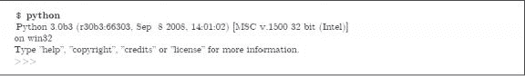

**重要提示：** 如果 Python 无法运行，请确保你已正确设置了路径（path）。

注意消息末尾有`>>>`。这些符号表示你正在使用 Python 的交互模式。在这里，系统将立即运行你输入的任何内容。实际上，如果你输入 `1 + 1`，Python 将给你 `2`。你可以使用这种模式来熟悉 Python 并测试它的功能。如果你学习了新语句，激活交互模式并逐一检查它们。

下面的图片显示了一个交互会话：

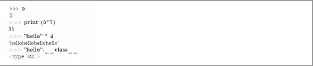

如你所见，Python 的交互环境是一个极佳的学习和编程工具。然而，在使用时必须非常小心，因为它有时可能会让人困惑。例如，下面的图片显示了一个在交互模式下被认为是有效的 Python 脚本：

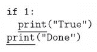

如果你在交互模式中使用此脚本，将得到一个令意料的结果：

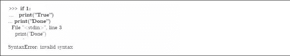

Python 解释器提示第二个 `print` 的缩进是非意外。在编写下一条语句之前，你需要使用空行来结束第一条语句（即 `if` 语句）。例如，你必须按照这种格式输入语句：

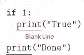

这将得到以下结果：

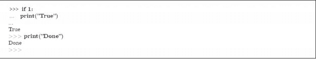

## 交互模式

你可以使用`-i` 来激活交互模式。此标记将阻止 Python 在程序结束时关闭。计算机程序员经常使用此标记，特别是在原型设计和调试阶段。这是一个示例：

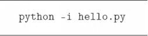

# 第 3 章：基础

在本节中，你将学习 Python 编程语言的基础知识。接下来的页面将教你如何使用 Python 创建程序。此外，你将了解 Python 语句的不同部分，例如字符串和变量。仔细学习本章，因为它能帮你成为一名出色的 Python 用户。

## 如何创建 Python 程序

通常，使用 Python 创建的程序只是普通的文本文件。这意味着你可以使用典型的文本编辑器对其进行编辑。使用你喜欢的编辑器即可：你可以使用任何文本编辑软件创建或改进 Python 程序。不过，如果你能使用一个对 Python 语句有语法高亮的编辑器，那就更好了。

### 你的第一个程序

缺乏经验的程序员通过编写“Hello, World!”程序开始他们的 Python 之之旅。在这里，程序简单地输出“Hello, World!”然后自行关闭。尝试这个简单的练习：

1. 访问你喜欢的文本编辑器。
2. 创建一个文件并将其保存为`hello.py`。在文件中，输入以下行：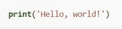

“Hello, World!”程序利用了 `PRINT()`，这是一个将语句的参数发送到机器终端的函数。`PRINT()` 函数在语句的输出中添加一个换行符。因此，它会自动将光标转移到下一行。

**重要提示：** 对于 Python 2 版本，`PRINT` 被视为一个语句而不是函数。这意味着你可以在不带括号的情况下使用它。在这种情况下，`PRINT` 做了两件事：

* 它将整行发送到终端。
* 它允许用户通过在最后一个字符后放置逗号来指示多行语句。

你刚刚完成了自己的程序。现在，你准备好使用 Python 运行它了。注意，此过程取决于你正在使用的 OS（即操作系统系统）。

**对于 Windows 计算机：**

1. 创建一个新文件夹。你应该只用此文件夹存放 Python 计算机程序。将 `hello.py` 文件保在此文件夹中。为了这个练习，假设你将文件夹命名为：`C:\pythonfiles`。
2. 访问开始菜单并选择“运行…”。
3. 在对话框中输入`cmd` 打开操作系统的终端。
4. 输入 `cd \pythonfiles` 并按回车。此操作会将 `pythonfiles` 文件夹设置为当前目录。
5. 通过输入 `hello.py`（即程序的文件名）运行程序。

**对于 Mac 计算机：**

* 创建一个仅用于 Python 程序的文件夹。为了这个练习，将此文件夹命名为`pythonfiles` 并将其保存在计算机的主目录中（即包含音乐、电影、图片、文档等文件夹的目录）。
* 将 `hello.py` 程序保存到 `pythonfiles` 文件夹中。
* 访问计算机的应用程序，进入实用工具并启动终端软件。
* 在对话框中输入 `cd pythonfiles` 并按回车。
* 输入`python ./hello.py` 运行 Hello, World! 程序。

**对于 Linux 计算机：**

* 创建一个文件夹并命名为`pythonfiles`。然后将 `hello.py` 文件保存在其中。
* 激活计算机的终端程序。遵循以下指令：
    * 对于 KDE 用户——进入主菜单并选择“运行命令…”。
    * 对于 GNOME 用户——进入主菜单，访问应用程序部分，打开辅助工具并选择终端。
* 输入`cd ~/pythonpractice`。
* 通过输入`python .hello.py` 运行程序。

## 结果

屏幕必须显示：

```Hello, World!
```

就是这样。如果你的计算机屏幕显示了此消息，说明你做得非常好。你离成为出色的 Python 程序员又近了一步。

## Python 语言中的变量和字符串

本节将关注字符串和变量。作为初学者，你应该知道这两种数据类型在 Python 编程语言中起着巨大的作用。

### 变量

基本上，变量是存储可变化的值。这意味着你可以将变量视为可以存放不同物品的盒子。记住，你可以使用变量来保存不同的内容。目前，让我们用它们来处理数字。查看下面的截图：

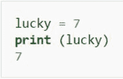

上面的代码生成了一个名为`lucky` 的变量。之后，它将变量赋值为一个数字（即 7）。如果你询问 Python 存储在 `lucky` 中的数据，你将得到 7 作为响应。

你也可以编辑变量内部的值。例如：

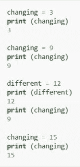

通过上面的代码，你保存了一个名为`changing` 的变量，为其赋值了数字 3，并确认了第一条语句是正确的。之后，你为变量赋值了数字 9，并询问系统新的内容。Python 语言将 3 替换为了 9。

然后，你创建了一个新变量 `different`。你为此变量赋值了数字 12。这意味着你现在有两个不同的变量，即 changing 和 different。这些变量持有不同的数据——为其中一个设置另一个值不会影响另一个。


为了防止混淆，请记住变量名始终显示在赋值运算符（即“`=`”符号）的左侧。相反，变量的值显示在运算符的右侧。这意味着对于每个变量，你会先看到名称，然后是它的值。

起，代码创建了两个变量：`red` 和 `blue`。然后，它为它们分别分配了不同的值：分别为 `5` 和 `10`。请注意，你可以在 `PRINT` 函数中放置不同的参数，使其在单行中显示多个项目。结果所示，`red` 保持 `5`，而 `blue` 存储 `10`。

接着，代码创建了另一个变量并命名为 `yellow`。随后，代码告诉 Python `yellow` 的值应该与 `red` 相同。因此，Python 将数字 `5` 分配给 `yellow`。

接下来，代码告诉 Python 必须更改 `red` 的值，使其等于 `blue` 的值。由于 `blue` 的值为 `10`，因此 Python 将该数字分配给 `red`（数字 `5` 被“丢弃”了）。在截图的最后部分，Python 分别指示了 `red`、`blue` 和 `yellow` 的值：`10`、`10`、`5`。

等等！代码告诉 Python `yellow` 的值必须等于 `red` 的值，不是吗？为什么即使 `red` 的值为 `10`，截图显示的 `yellow` 的值却是 `5` 呢？这很简单。代码告诉 Python 语言，`yellow` 在编码时应该拥有 `red` 的值。一旦 Python 为后者分配了值，`red` 和 `yellow` 之间的连接就断开了。`Yellow` 接收了 `5` ——无论其原始源发生什么变化，`5` 将保持不变（除非给出新的语句）。

### 字符串

基本上，字符串是遵循特定排列的字符列表。

什么是“字符”？让我们联系这个概念联系起来：键盘。任何可以使用键盘输入的内容都被视为字符（例如数字、字母、标点符号等）。

例如，“Birthday”和“Halloween”都是字符串。这些字符串由字母（即字符）组成。你还可以在字符串中添加空格：“good morning”包含 12 个字符：`good` = `4`，`space` = `1`，`morning` = `7`。目前，你可以在 Python 字符串中包含任意数量的字符。这意味着在使用字符字符的数量上没有限制。实际上，你甚至可以创建一个没有任何字符的字符串（程序员称之为“空字符串”）。

在 Python 中，你可以通过三种不同的方式声明字符串：

1. (`‘’`)– 使用单引号
2. (`" "`)– 使用双引号
3. (`"""`)– 使用三三引号

你可以使用这些方法中的任何一种。但是，请确保你在字符串声明上保持一致。使用相同的声明来开始和结束你的字符串。查看下面的截图：

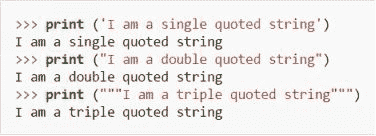

如你所见，引号开始并结束字符串。默认情况下，Python 将你语句中的引号视为字符串开始或结束的标记。

然而，在某些情况下，你必须在语句中包含引号。这意味着你必须阻止 Python 过早结束你的语句（即当它看到代码中的引号时）。你可以使用反斜杠 `\` 来实现这一点。通过在引号之前添加一个反斜杠，你是在告诉 Python 这些引号包含在字符串中。在不同符号前放置反斜杠的行为被称为对该符号进行“转义”。

**重要提示：** 在你的 Python 字符串中添加反斜杠时，你仍然需要对其“转义”（即在所需的反斜杠之前放置一个反斜杠）。此操作将通知 Python 反斜杠必须作为普通符号使用。分析下面的截图：

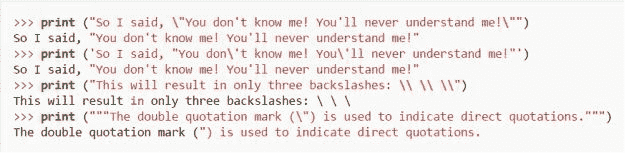

分析完上面的示例后，你会发现只有用于引用字符串的字符必须转义。这个简单的规则使得 Python 语句易于阅读。

为了帮助你进一步理解字符串，让我们来看第一个 Python 程序：

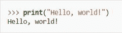

嗯，看起来你甚至学习它们之前就已经使用字符串了。你还可以在 Python 编程语言中拼接字符串。拼接是通过在两个不同的字符串之间添加“`+`”符号来组合它们的过程。让我们再次使用同一个程序：

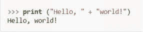

在上面的示例中，“Hello,”和“world!”是作为独立的字符串输入的。这是通过将两个字符串包含引号内实现的。然后，在字符串之间添加 `+` 符号来组合（即拼接）它们。你看到逗号和引号之间的空格了吗？那个空格是强制性的：如果没有它，你会得到下面的字符串：


Python 还允许你重复字符串。这意味着你不需要多次输入相同的内容。要重复字符串，只需使用星号 `*`：

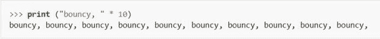

最后，你可以利用 `len()` 来计算形成任何字符串的字符。你只需要将想要检查的字符串放在括号内。这是一个示例：

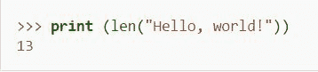

## 变量和字符串——如何一起使用它们

现在你已经知道字符串和变量是如何工作的，你准备好一起使用它们了。

正如之前讨论的，变量可以持有不同类型——甚至是字符串。这是一个示例：

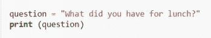

上面的程序创建了一个名为 `question` 的变量。然后，它将字符串“What did you have for lunch?”存储在该变量中。最后，它指示 Python 输出该字符串。

重要的是，你不应该用引号包裹变量。通过省略引号，你是在告诉 Python 你正在将 `question` 用作变量，而不是字符串。如果你用引号包裹变量，Python 将其视为一个普通的字符串。它将输出“question”而不是“What did you have for lunch?”

## 如何组合字符串和数字

分析下面的截图：

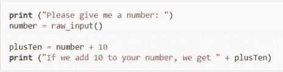

这段代码旨在接收程序员的数字，将该数字加十，并输出总和。然而，如果你运行它，将得到下面的错误消息：

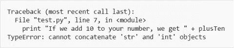

这里发生了什么？Python 没有输出数字，而是显示“TypeError”。此消息意味着输入的信息存在问题。具体来说，Python 无法确定如何组合使用的两种数据：字符串和整数。

例如，Python 假设 `number`（即变量）包含一个字符串，而不是数字。如果程序员输入“15”，Python 会认为该变量持有一个 2 个字符的字符串：1 和 5。你可以做什么来告诉 Python 15 是一个数字？

此外，在询问答案时，你指示 Python 组合一个数字（即 `plusTen`）和一个字符串。编程语言不知道如何实现这一点。Python 只能组合两个字符串。你如何让 Python 将数字视为字符串，以便将其与不同的字符串一起使用？

幸运的是，你有两个强大的函数可以使用：

1. `str()`–此函数可以将数字转换为字符串。
2. `int()`–此函数可以将字符串转换为数字。

使用这些函数时，你只需要将想要转换的字符串/数字放在括号内。如果你将此方法应用于早前的代码，将得到下面的结果：

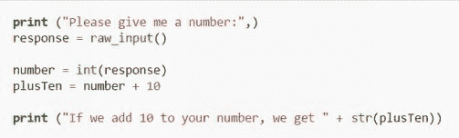

## 基础概念

Python 有 5 个基本概念，即：

1. **作用域 (Scope)**–对于大型系统，你必须限制代码之间的关系。如果你想防止错误或不可预测的系统行为，这是重要的。如果你不限制代码对其他代码的影响，整个系统可能会变得困惑。


你可以通过为每个程序员分配特定的名称组来控制代码的“作用范围（scope）”。例如，一个程序员使用国家名称，而另一个程序员使用动物名称。这种技术可以帮助限制你的 `Python` 代码之间的连接。

### 2. 对象––与其它面向对象的语言类似，Python 使用代码和数据组。

在 Python 中，你将使用 `Classes`（这种编程语言中的一组模板）来创建（即实例化）对象。对象拥有“属性（attributes）”，这些属性存储了构成对象的不同数据和代码。

访问对象的属性非常简单：

1. 输入对象的名称并在其后加一个点 `.`。
2. 指定你想要访问的一个或多个属性的名称。

### 3. 命名空间– Python 拥有 `dir()`，这是一个预装的函数，可以帮助你理解命名空间。在启动 Python 解释器后，你可以使用 `dir()` 显示默认或当前命名空间中的对象。查看下方的截图：

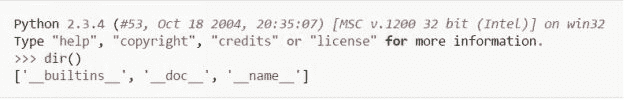

你也可以使用 `dir()` 列出模块命名空间内的可用名称。在这个示例中，让我们对 `_builtins_`（上方截图中的一个对象）使用 `type()`。此函数，即 `type()`，允许我们了解对象的文件类型。查看下方的截图：

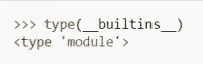

图片显示 `_builtins_` 是一个模块。这意味着你可以使用 `dir()` 列出 `_builtins_` 内部的名称。你会得到这个结果：

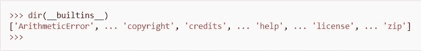

这个概念很容易理解。基本上，命名空间是名称存放的地方。命名空间内部的每个名称与命名空间之外的名称完全不同。计算机程序员将这种“命名空间分层”称为“作用范围（scope）”。通常情况下，如果这些名称有值，你应该将它们放在命名空间内部。例如：

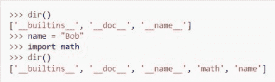

上面的图片显示，你只需要使用简单的语句（即“import”），就可以向任何命名空间添加名称。该代码使用 `import` 语句将“math”添加到激活的命名空间中。如果你想知道那个对象是什么，可以运行此命令：

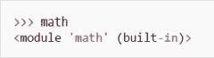

它显示“math”是一个模块。因此，它有自己的命名空间。你可以使用 `dir()` 函数显示 math 命名空间内的名称：

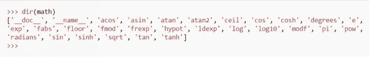

### 4. 大写敏感性– 总是大小写敏感的。这意味着“SMITH”、“Smith”和“smith”是三个不同的变量。

### 5. 制表和空格不要混用– 由于空白在 Python 中很重要，请记住制表（tabs）和空格（spaces）不能混用。在缩进你的 `python` 语句时保持一致。如果你使用空格缩进，请坚持使用该字符。这是许多初学者忘记的一个重要概念。

虽然制表和空格的外观相同，但 Python 解释器读取时它们具有不同的含义。这意味着如果你在语句中混用它们，将会遇到错误或奇怪的结果。

**注意：** 如果你喜欢使用空格，请确保每次缩进都按下四次空格键。

# 第 4 章：序列

序列是编程中的基本结构之一，允许你方便且高效地保存值。Python 支持三种序列，即：列表（lists）、元组（tuples）和字符串（strings）。让我们详细讨论每种序列：

### 列表

正如其名，列表是遵循特定排列方式的值集合。你可以使用方括号 `[]` 来创建一个列表。例如，你可以使用下面的语句初始化一个空列表：

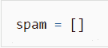

你应该使用逗号来分隔值。这是一个示例列表：


你可以在同一个列表中放置不同类型的值。例如，上面的列表包含了数字和字母。

与字符串中的字符类似，你可以使用从零开始的索引（indices）来访问列表项。访问列表项非常简单。你只需要指定该项目所属列表名称，然后指示该项目在列表中的数字。使用方括号包裹该数字。这是一个例子：


Python 还允许你输入负整数。这些数字从列表的最后一项开始倒着计数。


你可以使用 `len()` 来确定列表内部项目的数量。查看下方的图片：


列表在某方面与典型变量相似：它们允许你更改内部的项目。分析以下示例：


你也可以对字符串进行切片：


Python 提供了不同的方法向任何列表添加项目。然而，最简单的方法是这种：


要删除项目，你可以对列表应用 `del` 语句。这是一个例子：


列表在每次删除项目后会自动“修复”自己。这意味着你不会在项目的编号中看到任何间隙。

### 元组

元组和列表的区别在于一点：元组是不可编辑。创建元组后，你无法以任何方式更改它。你不能扩展、编辑或删除元组内的元素。如果你忽略这种不可变性，可以认为列表和元组是相同的。

在声明元组时你应该使用逗号：


有时，你必须使用圆括号 `()` 来区分元组。这个过程类似于在同一行中使用执行多次赋值。这是一个简单的例子：


### 字符串

你已经学习过字符串了。然而，作为 Python 序列再次讨论它是有重要的。在其他编程语言中，你可以使用方括号 `[]`（称为下标运算符）访问字符串内部的字符元素。这种方法在 Python 中同样有效：


Python 使用此公式为索引分配数字：`0– n1`（n 代表字符串中字符的数量）。查看下方的截图：


索引与其紧随其后的字符起作用。对于负索引，你应该倒着计数：


与其它编程语言不同，Python 允许你在方括号内放置最多 2 个数字。你可以使用冒号（即 `:`）来实现这一点。对于关注数值索引的序列，方括号和冒号的组合返回返回索引之间的部分。这种技术被称为“切片（slicing）”。如果你对字符串进行切片，将得到“子字符串（substrings）”。分析下方的截图：


上面的语句显示了一个重要的规则：

“如果你省略了一个数字，Python 将缺失的数字视为该特定序列的开始或结束（取决于缺失数字的位置）。”

### 字典

字典与列表相似。与元组不同，字典允许用户修改其内容。这意味着你可以添加、编辑和删除任何字典的元素。列表和字典之间的主要区别在于：字典没有将其元素绑定到任何数字上。

字典元素有两个方面：(1) 键（key）和 (2) 值（value）。如果你调用字典的键，你将获得该特定键相关的值。计算机程序员将列表视为特殊的字典，数字代表每个元素的键。

### 如何使用字典

在声明字典时你应该使用大括号 `{}`。此外，在声明字典元素时，你应该使用以下格式：(1) 输入元素的键，(2) 添加冒号，(3) 分配值。这是一个例子：


此外，向字典添加元素是简单容易。这就像添加普通变量一样：


# 第 5 章：不同的数据类型


基本上，数据类型定义了对象的能力。在其他语言中，操作的有效性是通过确保对象无法存储在将执行操作的地方来测试的。这种系统被称为静态类型。

然而，Python 使用了不同的方法。这种编程语言允许你将对象的数据类型存储在对象内部。Python 还会在你运行时立即检查每个操作的有效性。程序员将这种系统称为动态类型。

本章重点介绍你可以在 Python 中使用的不同类型的数据。

## 标准类型

Python 有一组标准数据类型。这些类型是预装在该编程语言中的。让我们将这些类型分成若干小组。本节将使用 Python 官方文档中的层级系统：

### 数字类型

- `int`– 代表整数。对于 Python 2.x，`int` 与 C 语言中的 longs 相同。
- `long`– 代表长度无限的长整数。你会在使用 Python 2.x 的系统中找到这种类型。
- `float`– 代表浮点数。Float 等同于 C 语言中的 doubles。
- `complex`– 这种类型由复数组成。

### 序列

- `list`
- `tuple`
- `byte`– 这是一个 0-255 范围内的数字序列。你会在使用 Python 3.x 的系统中找到字节。
- `byte array`– 这是 `bytes` 的可变版本。
- `str`– 代表“字符串”。Python 2.x 系统将字符串表示为 8 位项序列。然而，Python 3.x 系统将它们表示为 Unicode 项序列。

### 集合

- `set`– 这是一个无序的不同对象组。
- `frozen set`– 这种类型是集合的不可变版本。

### 映射

- `dict`– 代表 Python 字典。计算机程序员将这种类型称为“哈希映射”或“关联数组”。通常，`dict` 的每个元素都有对应的定义。

## 可变与不可变对象

在 Python 语言中，数据类型根据其内容的可变性进行分类。记住，不可变数据类型防止你更改其内部的对象。这意味着你可以成功地切片或重新赋值可变数据的对象。然而，不可变对象会给你返回错误信息。

这里有一个你应该记住的重要原则：变量是对机器内存中对象的简单引用。假设你使用以下语句将对象和变量配对：

```
** - 你可以使用括号输入元组。在对象之间放置逗号以分隔它们。

```
** - 列表的工作方式类似于元组，尽管它们需要方括号：

```
** – 你可以通过列出一些值对并用冒号分隔每对来创建“Python 字典”。使用逗号分隔字典项。然后，使用大括号封装语句。查看下方的图片：

```


也别忘了订阅我的技术和编程新闻邮件，以获取你的免费书籍并学习更多关于编程的知识。[点击此处](http://kindlebookspot.com/join-our-tech-community/)

谢谢并祝你好运！


[点击此处获取使用 Bluehost 设置 Wordpress 站点的分步操作说明。](http://www.passiveincomeassignment.com/2015/12/15/how-to-create-a-website-in-minutes/)

# 奖励：获取更多我的更多免费书籍！

感谢阅读我的书！我希望你从中获得了极大的价值。我想通过向你提供更多免费书籍以及与编程和技术相关的信息来表达感谢！

只需点击下方链接并在我的网站上输入你的电子邮件地址即可！

如果你认真想要改变自己的编程技能，你将获得的一切都对你很有用。我将提供：

*   我的更多书籍
*   我是如何以记录的速度学习编程的
*   我喜欢的编程相关产品信息
*   以及更多！

[点击此处获取所有这些信息！](http://kindlebookspot.com/join-our-tech-community/)

如果你还没有去，请务必查看我的新网站，[KindleBookSpot.com](http://kindlebookspot.com)。这是我一直致力于的一个项目，我真心希望它对我的读者非常有价值。我建立这个网站是因为我想给你们提供一种更简单的方法，在一个地方找到折扣价格的热门 Kindle 书籍。以下是我的网站包含的一些细节：

*   畅销免费 Kindle 书籍列表
*   折扣的小说和非虚构类书籍
*   每周图书
*   精选书籍
*   在我的网站上推广你自己的书

这个网站不仅面向读者，它还是新秀作者在成为畅销书之前推广其新书的场所。所以，如果你想推广自己的书，请查看我的网站，[KindleBookSpot.com](http://kindlebookspot.com)。

我希望这个网站对你有所帮助，并希望在那里见到你！

[在 KindleBookSpot 订阅我们不断增长的社区，在优质书籍折扣或免费时接收通知。](http://kindlebookspot.com)

# JavaScript 训练营

## 在 2 周内学习 JavaScript 编程基础

在 [KindleBookSpot.com](http://kindlebookspot.com) 获取更多免费和实惠书籍

# 目录

*   引言
*   第一章：JavaScript 与代码
*   第二章：JavaScript 的不同方面
*   第三章：JavaScript 中的程序结构
*   第四章：关于 JavaScript 函数的更多信息
*   结论

# 引言

我想感谢并祝贺你下载了《在 2 周内学习 JavaScript 编程基础》这本书。

这本书包含了如何掌握这门强大语言基础的经过验证的步骤和策略。

这本电子书将帮助你在两周内掌握 JavaScript 的基础知识。为了实现这一点，它专注于这门编程语言中最最重要的元素。在使用本书时，你不会读到任何无关的内容。这意味着你将在 14 天内学到成为精通的 JavaScript 用户所需的全部知识。

在书中，你将学习到：

*   什么是 JavaScript
*   如何使用 JavaScript
*   常见的 JavaScript 数据
*   以及更多！

再次感谢下载这本书，我希望你喜欢它！

## 在开始之前……奖励：获取更多我的免费书籍！

感谢阅读我的书！我希望你从中获得了极大的价值。我想通过向你提供更多免费书籍以及与编程和技术相关的信息来表达感谢！

只需点击下方链接并在我的网站上输入你的电子邮件地址即可！

如果你认真想要改变自己的编程技能，你将获得的一切都对你很有用。我将提供：

*   我的更多书籍
*   我是如何以记录的速度学习编程的
*   我喜欢的编程相关产品信息
*   以及更多！

[点击此处获取所有这些信息！](http://kindlebookspot.com/join-our-tech-community/)

## 第一章：JavaScript 与代码

### JavaScript–通用信息

JavaScript 于 1995 年发布，作为向网页中添加程序的方法。那时，它专门用于一种名为 Netscape Navigator 的浏览器。由于 JavaScript 取得的成功，现在所有主流浏览器都支持它。这种语言允许程序员创建现代 Web 程序——你可以在无需为每次操作都重新加载网页的情况下与之交互的程序。另一方面，传统的网站也使用 JavaScript 提供不同类型的功能和交互性。

此时，你应该知道 JavaScript 与 Java 无关（即今天领先的编程语言之一）。JavaScript 在其存在的第一年被称为“Mocha”和“LiveScript”。然而，由于 Java 编程语言非常流行，JavaScript 的所有者决定采用它的名字。这是一种旨在利用 Java 流行性的营销策略。

### 代码–通用信息

代码是构成计算机程序和 Web 应用程序的文本。这本电子书包含很多代码，所以你应该熟悉它们。计算机专家声称编写代码和阅读代码是成为程序员的重要方面。因此，你应该阅读并理解书中所包含的代码。如果你只是扫一眼代码示例，你将是在剥夺极佳的学习机会。

初学者在分析代码时可能会遇到困难。然而，如果他们仔细阅读说明，他们一定能理解 JavaScript 是如何工作的。最好的办法是使用 JavaScript 解释器尝试代码示例。这样，你就可以获得关于代码在编译为程序后样子的即时信息。

## 第二章：JavaScript 的不同方面

### 数据与位

数据构成了数字世界。如果你“访问”计算机内部的世界，你将看到一件事：数据。你可以读取、编辑和生成数据。每当你保存新数据时，它将被存储为位序列。这就是为什么存储的数据片段具有相似的外观和特征的原因。

在编程中，位（bit）是指任何具有两个的值（通常用 1 和 0 表示）。你可以将任何数据片段还原为一系列的 1 和 0。这个过程被称为数据到位的转换。

### 值

典型的计算机系统涉及数十亿个位。这意味着处理数据可能变得极其混乱。如果你想处理如此惊人的信息，你必须将其分成较小的块。在 JavaScript 中，这些信息块被称为值（values）。虽然所有值都是由位组成的，但它们有不同的类型和功能。JavaScript 支持六种值，即：字符串、数字、函数、对象、未定义值和布尔值。

要生成一个值，你只需要指定它的名称。这个过程简单而了。你不需要收集材料或支付任何费用。只需指定值的名称，砰！你就拥有了。

本章将介绍 JavaScript 语言的基础元素（即运算符和值类型）。这些元素可以与 JavaScript 中的值进行交互。

现在，让我们谈谈不同的值类型。

### 数字

属于这种类型的值是……你猜得没错：数值。在编写 JavaScript 应用程序时，你必须使用以下格式：

```
<number>
```

例如，假设你在你的 JavaScript 程序中输入了这个值：99。这将在你的机器内存中为数字 99 创建一个位序列。

JavaScript 语言使用 64 位来存储每个数值。你用 64 位可以创建的模式是有限的，因此用它们表示的数字也是有限的。对于 x 个十进制数字，你能表示的数字等于 10 的 x 次。同样地，由于你有 64 位数字，你可以表示最多 2 的 64 次数值。


以前，计算机内存非常小，人们必须使用 8 位或 16 位的组合来表示数值。由于内存不足，用户在使用 `JavaScript` 时经常会遇到“数据溢出”。然而，今天即使是基础型桌面电脑也拥有大量的内存。这意味着你可以轻松地使用 64 位序列——你再也不必担心数据溢出的问题。

数值还可以存储负整数。在这里，其中一个位表示数值的符号（可以是“+”或“-”）。此外，`JavaScript` 支持非整数（即小数）。为了实现这一点，某些位用于存储数值值中小数点的位置。

你可以使用句号来编写小数和小数。这里有一个例子：

```
99.99
```

另一方面，对于极大或极小的数字，你可以通过添加一个“e”来使用科学计数法。只需在其后面加上正确的指数即可。这是一个例子：

```
9.999e9 = 9.999 x 109
```

整数（也称为整数）的计算是 100% 准确的。然而，分数的计算则不然了。例如，“pi”的值无法通过有限的小位数来精确表示。许多数值失去了它们的准确性，因为只有 64 位内存来存储它们。如果你想避免与分数相关的问题，必须记住这些数字只是估计值。不要把它们视作精确的值。

## 算术运算

这是你对数值进行的操作。通常，算术运算（例如加法、除法、减法等）使用两个数值来生成新值。这里有一个用 `JavaScript` 语言编写的算术运算示例：

```
10 + 4 * 5
```

`*` 和 `+` 符号被称为“运算符”。`+` 符号代表加法，而 `*` 代表乘法。你可以通过在两个数值之间放置运算符来生成一个新的数值。需要注意的是，`JavaScript` 中的算术运算遵循运算符优先级（也称为运算顺序）。在这里，你应该按照此顺序执行操作：括号、指数、乘法/除法、以及加法/减法。如果你在上面的示例中应用运算符优先级，10 将加到 `4 * 5` 的乘积上。

你可以使用括号来修改运算顺序。例如：

```
(10 + 4) * 5
```

在 `JavaScript` 语言中，`-` 代表减法，而 `/` 代表除法。你不需要担心运算符优先级。然而，如果你不确定，可以在代码中直接添加括号。

## 特殊数字

在使用 `JavaScript` 时，你会遇到三个被称为数字的值，尽管它们的表现并不如此。这些特殊值是：`Infinity`、`-Infinity` 和 `NaN`。`-Infinity` 和 `Infinity` 分别代表负无穷和无穷。通常，你不应该相信基于无穷的计算。这些计算在数学上是不可靠的。

另一方面，`NaN` 表示“不是数字”。如果你执行产生不精确或意义结果的算术运算，就会得到这个特殊值。例如，如果你将零除以零（即 `0 / 0`），你将得到 `NaN`。

### 字符串

你应该使用字符串来表示基于文本的信息。你应该使用引号（即单引号或双引号）来包裹你的字符串。查看以下示例：

```
‘Five little monkeys’
```

```
“I’m riding a bicycle”
```

创建字符串时，确保你的引号保持一致。如果你使用双引号开始某行，请使用相同的符号结束该行。

通常，你可以使用引号包裹几乎任何内容。在对引号之间放置内容，`JavaScript` 语言将将其转换为可用的字符串值。

### 如何“转义”字符

有时，你需要在语句中添加特殊字符。例如，在编写文本字符串时，你必须添加“换行符”（即按下 Enter 键后得到的字符）。目前，`JavaScript` 要求程序员在带引号的文本中添加反斜杠 `\`。通过放置反斜杠，你是在告诉计算机下一个字符具有特殊的函数或含义。这个过程被称为“字符转义”。

跟在反斜杠后的引号将被视为行内的一部分：它们不会终止字符串。如果你在反斜杠后放置 `n`，语句中将添加一个换行符。同样，由反斜杠引入的 `t` 将导致一个“制表符”字符（即你按下 Tab 键后得到的字符）。这是一个简单的例子：

```
“I’m the first one\nYou are the last”
```

如果你执行上述字符串，你将得到如下：

```
I’m the first one
You are the last
```

在某些情况下，你希望在代码中使用“普通”反斜杠。你不希望它成为特殊工具。你可以通过在另一个反斜杠之前放置一个反斜杠来实现。也就是说，你正在转义反斜杠，以便将其转换为普通字符。分析以下示例：

```
“You should use \\t to add a tab character in your statements”
```

一旦编译并执行，该行将给你：

```
You should use \t to add a tab character in your statements
```

字符串不是数字，所以你不能对它们执行数学运算。然而，你可以使用 `+` 对字符串进行拼接（即组合）它们。这里有一个例子：

```
“Jav” +“aSc” +“ript”
```

由于 `+` 符号的存在，上面的分段行产生了：`JavaScript`。

## 一元运算符

在这一节，你将学习非符号运算符。为了开始讨论，让我们先一种名为 `typeof` 的运算符。这个运算符可以帮助你识别任何值的类型。查看以下示例：


上面的示例代码使用了 `console.log` 来显示通过 `typeof` 得到的结果。每当你运行这类代码时，你应该立即在计算机屏幕上看到该值。

上一节提供的运算符需要两个值，而 `typeof` 需要一个。需要两个值的运算符被称为二元运算符。而与单个值作用的运算符被称为一元运算符。

### 布尔值

通常，程序员需要能够区分两个选项的值，例如“开启”或“关闭”以及“是”或“否”。为了这个目的，`JavaScript` 语言支持名为 `Boolean` 的值类型（它有两个值：`true` 和 `false`）。

## 比较

你可以使用以下方法创建 `Boolean` 值：


`<` 和 `>` 字符是用于表示“小于”和“大于”的常用符号。这两个符号都属于“二元运算符”类别。如果你在代码中使用它们，你将得到一个显示它们是否为真的布尔值。你可以使用相同的方法来比较字符串。


字符串按字母顺序排序的。此外，小写字母比大写字母“更重要”。这意味着“a” >“b”是真的。JavaScript 在排列字符串时也包含了特殊字符（例如 -, !, ?, 等）。比较过程遵循 Unicode ——它为编程中可能需要的每个字符分配一个数字。此功能非常有用，因为它允许你通过将字符串转换为数字序列来存储。在比较字符串值时，`JavaScript` 从左到右工作，逐个检查每个字符的数字序列。

你还可以使用类似的运算符，如 `<=`（小于等于）、`>=`（大于等于）、`!=`（不等于）和 `==`（等于）。查看以下示例：


在 `JavaScript` 中，仅有一个值不等于它自己。这个值就是 `NaN` 或“不是数字”。


最初，`NaN` 用于表示无理计算的结果。因此，它不能等于其他无理计算的结果。

## 逻辑运算符


在本节中，你将学习可以应用于布尔值本身的各种不同操作。JavaScript 语言提供了三种运算符，即：`and`、`not` 和 `or`。你可以使用这些运算符对布尔值进行逻辑处理。正因如此，它们被称为“逻辑运算符”。

### a) and

`&&` 符号代表“and”。这个运算符是二元的。此外，只有当**你处理的两个值都为真时，它才会提供“true”的结果。以下是一些示例：


### b) or

如果你想使用 `or` 运算符，应该使用 `||` 符号。如果你处理的值其中一个为真，“or”将带给你一个“true”的结果。请查看下面的图片：


### c) not

你必须使用 `!`（即感叹号）来表示“not”运算符。这个逻辑运算符是一元操作的：你可以将其用在单个值上。然而，“not”的独特之处在于它会反转你赋值它的值。例如，`!false` 将给你 true，而 `!true` 将给你 false。

### 三元运算符

这个逻辑运算符作用于三个不同的值。它被称为**条件运算符**，要求你在脚本中使用 `?` 和 `:`。下面的代码将向你展示如何使用它：


放置在 `?` 左侧的值决定了剩余值中将选择哪一个。如果为“true”，则选择第一个选项。然而，如果它为 false，则选择第二个选项。

### 未定义值

JavaScript 语言支持两个特殊值来表示缺乏有用的值。这两个特殊值是 `undefined` 和 `null`。尽管这两个被视为合法的值，但它们并不携带任何信息。

通常，如果一个 JavaScript 操作无法生成有用的值，它仅仅因为需要生成一个值而输出“undefined”。

根据专家介绍，`null` 和 `undefined` 之间的区别是 JavaScript 设计师的错误。这意味着这两个值在大多数时候被认为是等等的。如果你必须处理这些值，只需将它们视为脚本中可以互换的元素即可。

### 如何自动转换类型

你可能知道 JavaScript 接受任何应用，甚至是那些执行非常规操作的应用。下面列出的表达式将清晰地演示这一概念：


如果你对错误的值类型应用运算符，JavaScript 将自动将该值转换为正确的类型。JavaScript 使用一组规则执行此功能，这些规则有时是意料之外或不所愿的。程序员将这种自动过程称为“类型转换”。正因如此，第一行的 `null` 被转换为 0，而下一行的“5”被转换为 5（即：从字符串到数字的转换）。然而，第三行尝试使用 `+` 符号连接值，因此 1 变成了“1”（数字到字符串的转换）。

如果你将一个非数字值（“six”或 `undefined`）转换为数字，你将得到 `NaN` 作为结果。在 `NaN` 值上应用数学运算将产生更多的 NaNs，所以如果你在意料之外或不所愿的情况下得到这个值，请检查你的代码中是否有意外的类型转换。

# 第 3 章：JavaScript 中的程序结构

本章将教你“实际编程”。你将使用超出你目前所使用的名词和短语的 JavaScript 命令。请仔细学习这些材料，因为它们将帮助你在两周内掌握 JavaScript 的基础。

### 语句与表达式

在上一章中，你通过对现有值应用运算符生成了新值。看起来值的创建是 JavaScript 程序中最重要的部分。然而，这只是这种强大语言的一小部分。

创建值的代码部分被称为“表达式”。因此，任何你字面编写的值（例如 99 或“ninety-nine”）都属于这一类。即使你将其括在括号中，表达式仍然被称为表达式。同样，即使你使用一元、二元或三元运算符，表达式仍然是表达式。

上面的段强调了基于语言的编程接口的优势。表达式在任何人类语言中都充当子句——它们内部包含包含表达式。这意味着你可以混合 JavaScript 表达式来描述复杂的计算。

如果说表达式等于子句，那么 JavaScript 语句就等于完整的句子。基本上，一个 JavaScript 程序只是语句的集合。

最基本的语句类型是一个值后跟一个分号。基于这一原理，我们可以创建这个简单的程序：

```
0;
false;
```

在 JavaScript 中，上面的示例被认为是一个完整的程序。尽管如此，它是毫无价值的。只有当语句执行了会影响其他事情的操作时，它们才有用（例如：在屏幕上显示某些字符、改进编程环境等）。上面显示的两个语句仅仅创建了两个值（即 0 和 false）。它们没有改变或改进任何东西。如果你执行这个程序，你不会观察到任何显著的内容。

### 变量

JavaScript 程序如何自我维持？它们是如何存储东西的？你已经看到过如何使用旧值创建新值。然而，这个过程并没有修改原先的值。你还需要立即使用产生的值，否则它们将直接消失。为了捕获并保持值，JavaScript 提供了变量。

```javascript
var example = 3 * 3;
```

在这个示例中，`var`（JavaScript 中的关键字之一）表示该行将创建一个变量。关键字后面是变量名，如果你想立即赋值，后面紧跟着一个 `=` 符号以及你所需的表达式。

该语句生成了一个名为 `example` 的变量，并使用它来存储 `3 * 3` 的乘积。

一旦你定义了一个变量，你就可以在未来的 JavaScript 语句中使用它的名称作为普通表达式。你从该“表达式”中得到的值与你在创建它时赋值的值完全相同。查看以下示例：

```javascript
var three = 3;
console.log(three * three);
// -> 9
```

为变量命名时，可以使用任何不是关键字（例如 `var`）的单词。你可以在变量名中包含数字，但不能使用数字作为起始字符。例如，`programming1` 是有效的，但 `1programming` 则无效。此外，你不能在变量命名中使用空格。在特殊字符方面，你只能使用美元符号（即 `$`）和下划线（即 `_`）。JavaScript 不允许在变量名中使用标点符号。

你可以更改赋值给变量的值。在 JavaScript 中，你只需在任何变量上使用 `=` 符号给它一个新值。

```javascript
var taste =“bitter”;
console.log(taste);
// -> bitter

taste =“sweet”;
console.log(taste);
// -> sweet
```

通常，你应该将变量视为触角而不是容器。变量抓住了值，而不是包含它们。这意味着多个变量可以指向同一个值。

让我们分析一个简单的例子。你需要生成一个变量来记住 Johnny 欠你的金额。当他付给你 50 元时，你必须给现有变量分配一个新值。查看下面的行：

```javascript
var JohnnysDebt = 200;
JohnnysDebt = JohnnysDebt – 50;
console.log(JohnnysDebt);
// -> 150
```

如果你在不赋值的情况下创建一个变量，它将被认为是空的。如果你询问它所包含的值，它将带给你“undefined”。

JavaScript 允许你在一个 `var` 语句中包含多个变量。在使用此功能时，你应该使用逗号分隔变量。这里有一个示例：

```javascript
var three = 3, four = 4;
console.log(three + four);
// -> 7
```

### JavaScript 中的保留字


正如前面讨论过的，在为变量命名时不能使用关键字。然而，还有其他单词你不能作为变量名，因为 JavaScript 已为未来的开发预留了这些词。以下是该脚本语言中的一些保留字：

`in`, `do`, `let`, `if`, `new`, `try`, `with`, `case`, `void`, `while`, `false`, `yield`, `extends`, `delete`, `default`, `const`, `debugger`, `class`, `break`, `finally`, `null`, `private`, `return`, `import`, `protected`, `switch`, `super`, `interface`, `instanceof`, `throw`, `implements`

请记住，在定义变量时不能使用上述单词。如果你忘记了这个简单的规则，在编写 JavaScript 程序时可能会遇到问题。

## JavaScript 环境

“环境”（environment）一术指的是一组活动值和变量的集合。基本上，在启动 JavaScript 程序时，环境不能为空。环境持有与语言本身相关的变量，而且通常，它们还拥有允许与计算机系统交互的变量。例如，在网页浏览器中，存在各种函数和变量用于检查和影响当前网站，并从鼠标和键盘读取输入。

## 函数

默认的 JavaScript 环境涉及函数。函数是链接到某个值的计算机程序段。你可以应用这些值来激活链接的程序。例如，在浏览器环境中，`alert`（即一个变量）包含一个显示对话框的函数。这里有一个例子：

```
alert(“You are not authorized to access this page!”);
```

你可以通过在生成函数值的 JavaScript 表达式后放置括号来执行函数。通常，你会指明包含你所需函数的变量名。通过在括号内包含值，你正在将这些值分配给函数内部的程序。对于上一个例子，“alert”使用被分配的字符串在生成的对话框中显示消息。程序员在指代分配给函数的值时会使用“参数”（arguments）一词。

### “console.log”

在尝试新的字符串或语句时，可以使用 `alert`。然而，由于它要求你关闭生成的窗口，你可能会发现既不方便又耗时。正因如此，你可能想使用在本书前面章节中见过的函数：`console.log`。几乎所有的 JavaScript 系统（例如 Node.js、网页浏览器等）都提供此函数，将参数传输到文本兼容的输出设备。

对于网页浏览器，代码的输出会进入 JavaScript 的控制台。虽然浏览器的这个 GUI 部分通常是隐藏的，但你可以通过按下某些键访问它（即对于 Windows ，按下 `F12`；对于 Mac ，按下 `Command-Option-I`）。如果你在查看此部分时遇到问题，可以在设备内搜索“开发者工具”或“网络控制台”。分析以下示例：

```
var a = 99;
console.log(“one hundred minus one is”, a);
// -> one hundred minus one is 99
```

正如前面讨论过的，为变量命名时不能使用句号或逗号。然而，上面的示例中包含了。其原因是 `console.log` 不是一个普通的变量。它是一个 JavaScript 表达式，从存储在 `console`（这是一个变量）中的值中收集“log”信息。

### 返回值

在屏幕上写入信息和显示对话框被称为“副作用”（side effects）。由于这些副作用，函数在 JavaScript 语言中非常重要。你也可以使用函数来生成值——在这种情况下，即使函数没有副作用，它也是用的。例如，`Math.max`（一个 JavaScript 函数）接收无限数量的数值并指示最高的一个。这里有一个例子：

```
console.log(Math.max(1, 2, 3, 4, 5));
// -> 5
```

在 JavaScript 中，任何生成值的内容都被视为表达式。这意味着你可以在大型表达式中执行函数调用。在下面的示例中，你将 `Math.min` 函数作为 `+` 运算符的输入：

```
console.log(Math.min(1, 2) + 98);
// -> 99
```

## 第 4 章：关于 JavaScript 函数的信息

在上一节中，你学习了如何创建和调用函数值。本章将帮助你进一步理解这个重要主题。根据专家程序员的说法，函数在使用 JavaScript 时是你的主要工具。函数是强大的工具，可以帮助你设计大型程序、减少冗余、为子程序命名并为每个子程序提供安全隔离。这意味着如果你想，就必须精通函数。

许多人使用函数来定义新词。英语使用者大约有 20,000 个词汇。嗯，编程语言通常也有那么多。

### 如何定义函数

定义函数就像定义普通变量。唯一的区别在于你所分配的值是一个函数。例如，下面的代码定义了一个名为 `square` 的变量。该变量指向一个生成任何数字平方的函数。


在创建函数时，你应该用 `function` 开始一个表达式。每个函数都有两个部分：(1) 函数体和 (2) 参数。函数体存储了你希望在函数被调用时执行的 JavaScript 语句。此外，你应该始终使用大括号包裹函数体（即使它只包含一条语句）。

另一方面，参数是函数定义中列出的名称。函数可以有一个或多个参数。实际上，你甚至可以创建一个不输入入任何参数的函数。为了帮助你理解这一点，让我们创建两个函数：`makeNoise` 和 `power`。


你可以看到，`makeNoise` 没有参数。同时，`power` 有两个（即基数和指数）。

### JavaScript 中的参数和作用域

函数的参数行为类似于普通变量，尽管它们的原始值来自程序员，而不是它们所链接的函数。

这是任何函数的一个重要属性：在函数中创建的所有变量（甚至是参数）都是该函数的局部的。这意味着，例如，`power` 语句中的 `result` 在每次函数被调用时都会刷新自己。这些独立的重复不会相互影响。

需要注意的是，这种“局部性原则”仅适用于使用 `var` 定义的变量和参数。此外，你应该在函数内部定义变量和参数。在函数外部定义的变量被称为全局变量，因为它们可以在整个 JavaScript 应用程序中被看到和访问。如果全局变量和参数没有“局部”对应项，你可能从函数内部访问它们。

下面的代码说明了这一概念。它声明并调用了两个给 `x` 赋值的函数。第一个函数将变量定义为局部的。另一方面，第二个函数不是的。这意味着，如果你在函数内部引用 `x`，你将指向全局的 `x`。


此功能可以帮助防止不同函数之间意外的引用或交互。如果 `JavaScript` 允许你在整个程序中共享所有变量，你将花费大量精力来确保名称不重复。重用变量名可能会对你的代码产生意想不到或不理想的副作用。因此，它可能会破坏你正在编写的程序。

由于这种语言将局部变量视为仅存在于各自函数内部，因此它可以将函数视为不同的独立的世界。每当你编写单个函数时，`JavaScript` 不需要担心整个应用程序。

# 嵌套作用域

除了定义局部和全局变量外，`JavaScript` 还使用其他方法来区分不同类型的函数。例如，你可以在现有函数内部创建函数。这种技术产生了多级局部性。

例如，下面的函数包含了两个函数：


这两个函数（即 flat 和 mountain）都可以访问 `result` 变量，因为它们位于声明该变量的函数内部。但是，它们无法访问对方的变量。这意味着位于函数外部程序环境无法访问其包含的变量。

使用过其他语言的程序员可能会认为他们可以通过使用大括号包裹代码块来创建新的局部环境。但在 `JavaScript` 中，只有函数可以生成新的作用域。

# 将函数当作普通值使用

通常，函数变量作为程序某些部分的名称。你不能修改现有的函数变量：一旦定义了它们，它们就会阻止你执行未来的任何修改。这种特性可能会导致对名称及其所指的函数产生困惑。

显然，函数和变量是两个不同的东西。函数值可以执行典型值可以做的事情——你可以调用并使用它们进行复杂的表达式。你可以更改函数值的位置，将其作为函数的参数传递等。同样，包含函数的变量仍然被视为普通变量。这意味着你可以给它们赋予新值。

# 声明

`JavaScript` 提供了一种快速简单的方法来声明函数。你只需要使用 `function` 关键字开始你的语句。例如：


上面的语句被称为“声明”。它定义了一个名为 `square` 的变量并赋予它一个特定的函数。这个例子很容易理解。然而，这种定义函数的方法有一个微妙之处：


最后一个例子可以完美运行，即使函数是在赋值赋值的代码下方声明的。这段代码是有效的，因为声明忽略了从上到下的语句结构。你实际上可以将声明移动到作用域的顶部，以便局部代码可以访问它。这种功能非常有用，因为它允许你以有意义的方式安排代码，而无需定义所有受影响的函数。

# 可选参数

`JavaScript` 语言接受下面的代码。调用它时不会遇到任何问题。

```
alert(“Hi”,“Good Morning”,“How are you?”);
```

官方来说，`alert` 函数只接受一个参数。然而，如果你使用上面的示例代码调用它，它不会报错。它只会接受第一个参数（即“Hi”）并忽略其余部分。

这种编程语言在处理你可以分配给函数的参数数量时是“思想开放”的。如果你分配了太多的参数，它会接受有效的参数并忽略其他的。但是，如果你的参数不够，`JavaScript` 将通过将 `undefined` 分配给相应的参数来完成你的语句。

# 结

感谢你下载这本书！

我希望这本书能够帮助你在两周内学会 `JavaScript` 的基础知识。

下一步是开始使用这种强大的脚本语言编写你自己的应用程序。

最后，如果你喜欢这本书，我想请你帮个忙，你愿意在 Amazon 上给这本书留个评价吗？不不胜感激！

[点击此处在 Amazon 上为这本书留评！](https://www.amazon.com/review/create-review?ie=UTF8&asin=B019L4NETY&channel=detail-glance&nodeID=133140011&ref_=cm_cr_dp_no_rvw_e&store=digital-text)

别忘了订阅我的技术和编程新闻邮件以获取你的免费书籍并学习更多关于编程的知识。[点击此处](http://kindlebookspot.com/join-our-tech-community/)

谢谢并祝你好运！

[点击此处获取使用 Bluehost 设置 Wordpress 网站的逐步说明。](http://www.passiveincomeassignment.com/2015/12/15/how-to-create-a-website-in-minutes/)

### 额外福利：获取我的更多免费书籍！

感谢阅读我的书！我希望你从中获得了巨大的价值。我想通过给你更多免费书籍，以及与编程和技术相关的信息来感谢你！

只需点击下面的链接并在我的网站上输入你的电子邮件地址即可！

如果你认真想要提高自己的编程技能，你将获得的一切都对你有用。我将提供：

*   我的更多书籍
*   我是如何以创纪录速度学习编程的
*   我喜爱的编程相关产品信息
*   以及更多！

[点击此处获取所有信息！](http://kindlebookspot.com/join-our-tech-community/)

如果你还没有的话，请一定要查看我的新网站，[KindleBookSpot.com](http://kindlebookspot.com)。这是我一直致力于的新项目，我真的希望它对我的读者有价值。我建立这个网站是因为我想让你们有一个更简单的方式来找到折扣价的热门 kindle 书籍，而且都在一个地方。以下是关于我网站内容的的一些细节：

*   畅销免费 kindle 书籍列表
*   折扣的小说和非虚构类
*   每周图书
*   精选书籍
* 在我的网站上推广你自己的书

这个网站不仅面向读者，它还是新秀作家在成为畅销书之前推广他们新书的地方。所以，如果你想推广自己的书，请查看我的网站，[KindleBookSpot.com](http://kindlebookspot.com)。

我希望这个网站对你有所帮助，并希望在那里见到你！

[在 KindleBookSpot 订阅我们不断增长的社区，当优质书籍折扣或免费时接收通知。](http://kindlebookspot.com)

# SEO 训练营

## 在两周内学习 SEO 基础

在 [KindleBookSpot.com](http://kindlebookspot.com) 获取更多免费和特价书籍

# 目录

*   引言
*   第一章：什么是 SEO 以及为什么它对你的网站很重要？
*   第二章：搜索技术的局限性
*   第三章：你的目标用户：搜索的开始
*   营销策略
*   第四章：选择关键词进行排名
*   第五章：用户体验如何影响你的排名
*   第六章：构建你网页的链接配置
*   结论

# 引言

我想感谢你并祝贺你下载了《在两周内学会 SEO 基础》这本书。

这本书包含了经过验证的步骤和策略，教你如何以正确的方法进入搜索引擎结果页的顶部位置。

大多数业余搜索营销人员寻找在所选关键词中排名的快速方法。由于这种不必要的紧迫感，他们中的一些人使用了被搜索引擎嫌弃的方法。由于如此，许多人在过去受到了搜索算法更新的影响。这本书为你提供了在 Google 和其他搜索引擎中进行排名的正确方法。这些是白帽 SEO 专业人士尝试并测试过的搜索引擎优化的基础知识。使用这些技术，即使在大算法更新发布时，你的流量也不会遭受重大打击。


（提供有关此书的任何额外信息。确保简介具有吸引力，因为人们在 Amazon 或 Kindle 上预览时会看到这些。你可以自己写，也可以要求你的书籍作者来写。）

感谢你下载这本书，希望你喜欢！

### 赠送：获取我提供的更多免费书籍！

感谢阅读我的书！希望你从中收获了巨大的价值。我想通过提供更多免费书籍以及与编程和技术相关的信息来感谢你！

只需点击下方链接并在我的网站上输入你的电子邮件地址即可！

如果你认真想要提升编程技能，你获得的一切将对你非常有帮助。我将提供：

*   我的更多书籍
*   我是如何以记录的速度学习编程的
*   我喜爱的编程相关产品信息
*   以及更多！

[点击此处获取所有信息！](http://kindlebookspot.com/join-our-tech-community/)

# 第一章：什么是 SEO，以及它为什么对你的网站至关重要？

互联网是信息的海洋。它是由全球互联的计算机组成的网络。它允许我们访问地球另一端计算机上的信息。

然而，就本身而言，互联网是一个巨大的混乱。它充满了满足数十亿个人需求的网页。早期，工程师们一直在寻找一种工具，可以组织网络上的所有信息，并帮助人们在最短时间内找到他们想要的内容。

搜索引擎就是那个工具。

这就是搜索引擎的功能。它们通过让人工智能访问网页并收集信息，尽可能地“爬取”尽可能多的网页。它们将有关爬取页面的信息添加到索引中。当一个人输入搜索查询时，搜索引擎会遍历所有爬取过的页面，并返回一个符合查询的页面列表。然后，它们根据这些页面与用户查询的相关性对其进行排序。

每月有数十亿人使用搜索引擎。其中一些人可能对你的网站感兴趣。为了给你的网站带来流量，你希望你的网页在目标访问者的搜索结果中排名靠。

### 什么是搜索查询？

搜索查询是搜索引擎用户提出的问题。他们正在使用搜索引擎寻找答案。以下是人们向搜索引擎提问的三类问题：

#### 我可以在哪里/如何找到某个物品的名称？

有些人使用查询来寻找特定的现实世界物品或地点。某人可能在寻找纽约周边的二手车。他通过输入以下内容让搜索引擎寻找所有发布的关于二手车的分类广告：

“纽约市二手车分类广告”

他发现结果太多了，于是缩小了搜索范围到：

“曼哈顿二手雷克萨斯 craigslist”

#### 关于什么、何时和何地的问题

但大多数情况下，人们使用搜索引擎寻找信息。例如，有些人使用搜索引擎为他们的学校作业寻找答案。许多人也去搜索引擎查找与他们相关的时事新闻。与其查找电话簿，人们发现通过互联网查找企业的地址和联系电话速度更快。

[公司名称]的网站是什么？

最后，人们使用搜索引擎进入网络上的特定区域。例如，有些人想去他们当地报纸的网站。由于他们不知道确切的网址，所以他们要求 `google` 引导他们到达那里。

搜索引擎已成为发达国家大多数人答案的首要来源。`Google` 等搜索引擎的大多数用户信任算法汇的搜索结果。大多数人期望在顶部结果中找到他们查询的答案。如果前五个结果似乎没有他们问题的答案，人们往往倾向于认为他们在查询中使用的短语有问题。大多数人会精炼他们的搜索词，就像那个在纽约寻找二手雷克萨斯的人一样。

### 这如何影响你的网站？

如果你想为你的网站引入更多流量，你需要了解搜索引擎是如何工作的，并且你能够优化你的网页，以便它们被爬取、索引并显示在搜索结果页的顶部。

对于 SEO 来说，出现在搜索结果中是不够的。顶部结果的点击率超过了 18%。你的页面在搜索引擎结果页上的显示排名越靠后，你的页面获得的点击次数就越少。

在智能手机时代，人们最初认为网站的普及将开始下降。普通人认为 App 将取代搜索。如果这真的会发生，到目前为止还没有出现。尽管在桌面电脑前花费的时间减少了，但人们仍然在使用搜索来寻找他们需要的信息和想要的物品。针对手机屏幕优化网站的网站将获得移动搜索的大部分流量。

### 第 1 和第 2 天的活动：决定你网站的主题或利基

如果你的网站专注于一个主题，你的网站会更容易排名。如果你已经有一个通用性信息网站或博客，你可以根据你已有的热门帖子或内容决定要追求的最佳主题。

在考虑网站的主题或利基时，你还应该考虑你建立它的个人目标。从现在起创建的内容类型应该让你离目标更近一步。

# 第二章：搜索技术的局限性

搜索引擎是网络上查找信息最流行的工具。然而，尽管搜索算法和页面爬取技术有了所有改进，这个工具仍然有很多局限性。例如，搜索引擎在爬取和索引一个网页后，无法直接判断该网页对用户是否相关。它需要寻找更多线索，以确定特定页面是否应该出现在某些关键词的搜索结果顶部。

作为网站管理员和搜索营销人员，你的工作是为搜索引擎提供它们将你置于顶部结果所需的线索。搜索引擎专家将这些线索称为排名因素（ranking factors）。排名因素是搜索引擎蜘蛛到达你的网站时寻找的信息。它们在索引期间会汇总这些排名因素。网页在关键词搜索结果中的位置将取决于基于这些因素的排名分高低。

即使考虑到数百个排名因素，搜索引擎仍然有很多局限性。

### 搜索引擎的局限性有哪些？

*   **爬虫机器人依赖链接进行跳转**
    搜索引擎爬虫的目的是为整个可搜索互联网创建一个虚拟地图，我们指的是普通人可以访问的部分。为了从一个页面跳转到另一个页面，它们使用所爬取页面中的超链接。这些数字桥梁是重要的排名因素。如果你的网站中某些页面没有指向它的链接，你应该预计它不会被索引，也不会出现在搜索结果页中。

*   **它们无法爬取受在线表单保护的页面**
    网站要求访问者成为会员是很。要成为会员，你需要填写会员表。搜索引擎并不具备填写所有类型表单的程序。因此，它们无法爬取任何网站管理员专门向成员展示的信息。

*   **它们专门针对文本内容**


搜索引擎爬虫专门用于从基于文本的网站中收集信息。它们从非文本内容中收集和组织信息的能力受到严重限制。例如，一个爬虫机器人无法自行判断一张图片看起来是什么样。它们在处理视频、音频、图像、Flash 和插件内容时也面临着类似的挑战。

为了解决这个问题，搜索引擎公司要求网站管理员在这些内容中包含文本信息。如果没有这些额外信息，网页中的某些类型内容在排名时将不会获得太大的权重。

- 它们要求关键词进行匹配

当用户使用搜索引擎时，他们通常会输入一个描述他们正在寻找的内容短语。搜索引擎算法已经不断进化，它们比以往任何时候都更有能力在 90% 的情况下提供提供相关的网页页。然而，如果用户没有使用正确的术语，可能会遇到一些问题。数百万用户在搜索不熟悉的内容时会使用不常用的术语。

这种局限性在英语初学者群体中很常见。当他们不知道某个事物的单词时，他们可能会使用形容词来描述它。英语母语者知道他们可能想表达什么，但搜索引擎并没有程序来理解非母语者可能在询问什么。

当我们使用搜索 AI 不熟悉的语言细微差别时，这个问题也变得难以处理。例如，不同英语国家之间对同一个单词的拼写差异会影响你的搜索结果排名。例如，如果你一贯使用 `behaviour` 代替 `behavior`，搜索引擎可能会认为你的网页是为英国用户设计的。这将影响你在美国用户中的排名。

搜索营销的成功在很大程度上取决于你对所处理的语言的了解。例如，如果你以某个特定的少数群体作为你网站的潜在访客目标，那么你应该了解他们在使用语言方面的细微差别。如果你了解他们的搜索行为，也会有所帮助。

- 专有名词与通用名称

由于对关键词的依赖，搜索引擎还面临着在正确语境下阅读单词的挑战。当用户使用具有多含义的关键词时，这一挑战变得更加困难。例如，流行文化一直在广泛使用 `black` 这个词。有很多包含该词的歌曲、电影和品牌。在搜索中输入这些词的人可能也指的是他们正在寻找的物品的颜色。因此，搜索引擎用户在搜索时倾向于使用更长的短语，以使结果更符合他们的需求。由于这种搜索行为，网站管理员开始针对长尾关键词。这些是人们在搜索时通常使用的短语。它们通常超过三个单词，并且指的是搜索者非常具体的需求。

搜索技术在不断变化。工程师们继续开发新形式的技术，以便 AI 能够绕过这些局限性。正是因为这些局限性，我们才针对用户和搜索引擎优化我们的网页。

### 第 3 和第 4 天的活动：

你应该花时间回顾本章讨论的搜索引擎局限性，并思考你的潜在访客通过搜索引擎访问你网站的困难。

你还应该花时间检查你的网站在搜索引擎结果页中的可见性。针对你的行业或利基市场使用通用的关键词和短语。如果你在前三页找不到你的网站，你需要做大量工作。如果你在前三页内但不在第一页，你的目标是向上爬。无论你的位置如何，你都应该使用书中的策略和信息来提高网站的排名。

## 第 3 章：你的目标用户：搜索营销策略的开始

在为网站开发搜索营销策略时，你需要开始考虑那些可能从你网站找到的信息中发现价值的人群。他们是当搜索结果页上看到你的网页时最有可能点击的人。搜索引擎桥接了你的网站内容与需要这些内容的人之间的鸿沟。

### 为你的目标搜索引擎用户建立画像

互联网用户每月进行数十次搜索。然而，并非所有的搜索对你的网站都是有价值的。寻找你网站中信息类型的人数取决于你网站所在行业或利基市场的普及。利基市场越热门，搜索者越多。然而，热门的利基市场也有很多竞争。

为了领先对手，你需要了解你的理想访客。你可以通过为你的网站创建一个理想访客画像来实现。如果你已经有一个运行了一时间的网站，你可能通过你使用的分析软件收集有关访问你网站的人群的信息。以下是你需要的关于访客的一些类型信息：

- 年龄
- 性别
- 语言
- 位置
- 共同兴趣

通过获取这些类型的信息，你可以猜测人们在使用搜索引擎时最可能使用的单词。根据你网站的类型，你可能还需要额外信息。

### 你对访客的目标

在创建了理想访客画像后，你需要决定你希望这些人在到达你的网站时做什么。如果你在网站上销售某些东西，你可能需要调整设计，以确保用户可以从你的索引页面开始购买。

其他网站希望他们的访客填写表单、回答调查或注册会员。

拥有目标还允许你完善你所针对的关键词类型。例如，如果你在销售某些东西，你可能需要针对与购买相关的短语。某些营销人员只针对处于购买过程后期的人所使用的短语。

### 第 5 和第 6 天的活动：识别你的目标用户

下一个活动是识别你网站理想访客的特征。理想访客是指最可能完成你想要实现的人。你应该说明这些人的共同点。除了第 3 章中提到的信息外，你还应该研究同样针对同一目标市场需求的其他网站。你应该查看他们的设计和他们提供的内容类型。

## 第 4 章：选择关键词进行排名

现在你已经知道你的目标访客是谁了，你需要选择他们在搜索你提供的信息时会使用的正确关键词。

要了解你的目标用户使用的关键词，你需要把自己放在目标用户的立场。你需要利用你创建的画像中的信息来猜测你应该使用的正确语言类型。

你还需要提醒自己搜索引擎技术具有局限性。你需要确保你的关键词代表了你在页面上显示的内容类型，以及潜在访客的意图。你的最终目标是提供潜在访客需要的东西，然后他们转化为买家、订阅者、会员，或至少是回头访客。

大多数初级网站管理员认为他们应该只选择一个强关键词并将其用于网站的所有页面中。对于搜索引擎来说，这种策略看起来非常像关键词堆砌。


如果你想让你的网站成为该主题的主要信息来源，你需要目标是在与你网站主题相关的多个关键词上获得良好排名。例如，如果你的网站是关于某电视剧的，你可能希望在网站首页中针对它的剧名。然后，你应该创建与该剧相关的文章或页面，例如关于角色的页面。在该页面中，你可以使用示例关键词“[TV show title] characters”作为你的主关键词。

有很多免费和付费的工具可以帮助你找到某些主题最常用的关键词。其中最流行的工具之一是 `Google Adwords Keyword Planner`。

在规划关键词时，你还应该考虑以下因素：

*   你所提供的产品或服务的名称

    这包括服务的通用名称和品牌。一些考虑购买某东西的人通常知道他们想要购买的品牌，因此你应该提供网站内容来直接回答关于这些品牌的问题。这类内容将帮助你的网站通过搜索被发现。

*   与你产品或服务的相关主题

    你还应该提供与你的产品或服务相关的题。例如，许多公司网站都包含公司更新。这显示了你网站的活跃度。最重要的排名因素之一是更新频率。

*   季节性热门关键词

    你还应该针对预计会有高销量和高流量的季节准备搜索营销活动。例如，对于零售网站来说，圣诞节、情人节和感恩节是重大活动。在这些季节，人们倾向于在网上寻找线下购买的灵感。你应该利用人们在这些季节挥霍的习惯。

## 在构建网页时使用关键词

每当你创建一个博客文章或一个新网页时，你都需要考虑你将使用的目标关键词。你应该为你创建的每个页面或文章目标地定位于一个主关键词。你的关键词应该与你希望访问者执行的行为保持一致。如果你希望访问者购买某些东西，你的目标就是建立一个针对具有购买意图的搜索者所用关键词的网页。你也可以创建针对研究特定产品的搜索者所用关键词的网页。

当你知道要针对哪些关键词排名后，你的下一个目标是将它们策略性地放置在网页中。在这些位置放置关键词时，你必须确保它们出现得很自然。你的首要目标是让你的内容被人类访问者理解。用户体验始终比任何 SEO 策略都重要。考虑到这一点，你应该将关键词放在网站的以下部分：

*   URL 扩展名

    如果你的域名已经包含了你想排名的关键词，那会有帮助。但大多数情况下，你需要在 URL 的后部分插入关键词，以确保它包含在 URL 地址栏中。

*   标题标签（Title Tag）

    标题标签让爬虫了解你的页面是关于什么的。通常，你尽可能尽早在标题标签中加入关键词。这种策略的挑战在于当你计划了一个创意的标题时。有时，将关键词放在标题标签的前部会让它听起来很别扭。如果是这种情况，你应该优先考虑用户体验。

*   页面顶部

    你还应该在内容的第一段中包含关键词。长类型的内容不会被爬虫完全扫描。除了标题标签，爬虫还会尝试从前几段判断你的内容是关于。

*   页面文本内容

    除了标题标签，爬虫还会尝试从前几段判断你的内容是关于。这就是为什么需要在这些区域包含 3-4 次关键词。

*   图片的 Alt 属性

    你还应该在内容的第一段中包含关键词。长类型的内容不会被爬虫完全扫描。这将有助于你获得良好的排名，并可能带来更高的点击率。

*   元描述（Meta description）

    上述所有其他属性都会让你的网页变得更好。为了保持你的网页排名高位，你需要对不同的文案进行实验。两个重要的因素将提高你的排名：第一个是本节稍早讨论过的 `title`。第二个是描述。你应该向 `CMS` 查询如何添加元描述，以便你可以控制显示的文本。

## 第 7 天和第 8 天的活动：进行关键词研究

当你已经有一个网站和一个要追求的特定主题时，你的下一步行动是寻找能够帮助你实现目标的关键词和短语。参考本章中的提示来了解关键词是如何工作的以及如何使用它们。除了广流行的 `Google Adwords Keyword Planner` 之外，还有其他免费工具可以用于为你的网站研究最佳关键词：

*   Microsoft Bing Ads

    这是 `Bing` 版本的关键词规划器。如果你的网站大部分流量来自 `Bing`，你也应该使用这个工具。

*   Google Trends

    `Google trends` 为你提供全球流行的关键词。它们还允许你检查你的国家现在和过去流行的内容。你还可以获得某些关键词多年流行程度波动的洞察。

## 第 5 章：用户体验影响你的排名

在上一章中，我们讨论了保持目标关键词与网页内容以及访问者需求保持一致的重要性。

例如，如果你的网站专注于增肌训练设备，你应该目标定位人们在网上寻找该类型物品时使用的关键词。

当人们在搜索引擎结果页上点击进入你网页的链接时，他们有需要你满足的期望。在这个特定的例子中，如果你在正确的关键词上排名，访问者可能会期望找到不同类型的加重训练工具。你也可以添加增加肌肉生长速度的食品补充剂。

假设你的访问者使用短语“muscle-building workout equipment”进入你的网站，但当他们到达你的网站时，发现你专注于瑜伽技巧并且只评测与瑜伽相关的产品。在这种情况下，你的访问者会对结果感到有些失望，并可能点击移动设备或浏览器上的“返回”按钮。


# 要考虑的第一个因素是你所使用的关键词。当你的主题和主关键词不一致时，你的网页可能会在一些与你提供的内容不相关的关键词上排名。这将导致用户不满意。你甚至可能在未来的算法更新中受到惩罚。

### 入站链接质量

链接是搜索引擎的一个信号，表明网页内容很受欢迎。这让它们认为，未来对这些内容感兴趣的人在与其互动时将获得良好的用户体验。

热门网站在建立链接方面具有显著优势。已经有更多人关注它们的内容，它们在发布内容后，更有可能获得来自其他高质量网站的链接。

### 导航结构

你网站的导航同样重要。通常情况下，你应该确保访问者可以在三次或更少的点击内从首页到达所有页面。如果你在构建阶段没有规划网站的导航，你应该花时间列出所有所有的网页，并确保它们可以从首页轻松访问。

### 用户参与度

当人们在搜索结果页面上点击你的链接后，立即点击返回按钮时，搜索引擎会认为用户对他们的体验感到失望。这可能是由于多种原因。例如，可能是因为某个特定网页加载内容太慢；也可能是因为他们发现网页中的内容不是他们需要的。然而，人们也可能因为不重要的原因点击返回。无论人们点击返回按钮的原因是什么，它都会影响你的页面在搜索引擎中的排名。

为了防止这种情况发生，你应该设计你的内容以保持人们的参与度。如果你主要使用文本内容，请写好你的第一段，以吸引人们并让他们不想点击返回。你还应该提供照片和图片，这样他们就不会只看到满屏的文字。如果你页面上有视频，你需要确保它运行良好且加载快速。最后，你应该提供指向其他有趣内容的链接，以确保你的访问者在离开第一个页面后不会“跳出”或离开你的网站。

### 机器洞察

SEO 领域最重要的更新之一是 2011 年的熊猫（Panda）更新。Google 在其排名算法中引入了一个新部分，在 SEO 行业被称为机器学习。简而言之，该算法模拟了人类判断网站质量的方式。当更新发布时，许多老牌网站被新起的网站超越了，因为新网站的设计和整体用户体验比旧网站更好。然而，黑帽 SEO 从业者是这些更新的目标；一些带有少量黑帽行为的高质量网站也受到了影响。

Google 的目标是清理其搜索结果中那些构建糟糕、提供用户体验不佳的网站。只要你保持内容的高，并确保你的用户对你提供的内容满意，你就是安全的。通过遵循书中的建议，你将避免过去更新的一些负面影响并可能避免未来更新的影响。

## 第 9-10 天活动：根据理想访问者的偏好设计你的网站

你应该确保你的网站对你的理想访问者来说非常漂亮。你所有的内容也应该符合他们的需求和要求。最后，你应该测试网站的导航。你需要确保通过链接将相关内容的页面连接起来。如果你有人帮助你，你应该让他或她在你的网站中寻找特定信息。然后询问他们对你网站导航的反馈。

## 第 6 章：构建你网页的链接配置（Link Profile）

搜索引擎将链接视为人气指标。在熊猫更新之后，Google 仍然认为链接是有价值的，但在将其作为排名因素方面变得更加严格。

### 搜索引擎如何使用链接

#### 确保你的链接与主主题相关

指向你网站的链接类型应该取决于你提供的内容类型。例如，如果你提供明星新闻，发布你链接的网站也应该与明星有关。这包括明星博客、论坛和其他明星新闻网站。

你还应该考虑你网站的本地性。如果你的网站面向特定城市的人口，来自与该城市相关的网站的链接比来自提供通用信息的网站的权重更高。

### 热门网站权重更高。

在寻找链接来源时，你还应该考虑网站的人气。来自《纽约时报》网站的链接比来自朋友博客的链接权重更高。搜索引擎认为这类网站是可靠的。来自垃圾网站的链接对你的网页损害大于益处。

### 小心使用锚文本（Anchor Texts）。

在链接结构中，要考虑的最重要因素是锚文本。这是链接代码中用户可以阅读并点击的部分。指向你网站的链接锚文本也应该与你的主题相关。然而，你应该确保指向你网页的锚文本看起来自然。如果它们都使用相同的锚文本，Google 可能会认为你正在操纵系统或使用黑帽方法建立链接。

### 随时间缓慢构建链接。

如果你的网站是新的但你已经有了数百个链接，搜索引擎也可能认为你正在使用这种方法。为了避免这种情况发生，你应该确保你雇佣的 SEO 公司或专业人员不会无差别地构建指向你网站的链接。

### 链接的价值随时间递减。

业余营销人员也认为只要链接在线，其质量就保持不变。然而，Google 将内容的新鲜度作为排名的重要因素。随着链接你的网站变得越来越不流行，你的排名也会下降。为了防止这种情况发生，你应该定期产生为你的链接配置做出贡献的内容。

## 第 11-13 天活动：

你需要花费大量时间来构建网站的链接配置，但采取这些步骤将帮助你开始这个过程。你的第一个任务是找到拥有与你类似的网站的人。他们不应该提供垃圾内容，并且应该由 get 的公司或在线营销人员管理。

你的下一步是收集这些网站所有者的联系信息并开始与他们交流。此事的最好的方法之一是提议在他们的网站上投稿（guest post）。大多数网站管理员都会欢迎在其网站上获得免费内容的机会。他们会在发布许可之前审核你的内容，因此你需要确保它是高质量的。你需要 2 天时间创作经过研究且优秀的内容，以及 1 天时间开始发送电子邮件。

在第 14 天，你应该回顾排名的改进情况以及你可以做哪些其他任务来进一步提高排名。

## 结论

再次感谢下载此书！

我希望这本书能够帮助你学习 SEO 并提高你在搜索结果页面中的排名。

下一步是继续学习并实施 SEO 的最佳实践。这个行业仍在发展。你需要让自己与与最新更新的动态，以保持你的网站在排名中的竞争力。

最后，如果你喜欢这本书，我想请你帮个忙，你是否足够乐意在 Amazon 上为这本书留评？我将不胜感激！


[点击此处在亚马逊上为这本书评价！](https://www.amazon.com/review/create-review?ie=UTF8&asin=B01AAMZESA&channel=detail-glance&nodeID=133140011&ref_=cm_cr_dp_wrt_summary&store=digital-text)

此外，请务必订阅我的技术和编程新闻邮件，以获取免费书籍并学习更多关于的知识。[点击此处](http://kindlebookspot.com/join-our-tech-community/)。

感谢并祝你好运！

[点击此处获取使用 Bluehost 设置您的 Wordpress 网站的逐步指南。](http://www.passiveincomeassignment.com/2015/12/15/how-to-create-a-website-in-minutes/))

# 赠送：获取我的更多免费书籍！

感谢阅读我的书！我希望你从中获得了极大的价值。我想通过为你提供更多免费书籍以及与编程和技术相关的信息来表达感谢！

只需点击下方链接并在我的网站上输入您的电子邮件地址即可！

如果你认真想要提高自己的编程技能，你将获得的一切都对你非常有帮助。我将提供：

* 我的更多书籍
* 我如何以创性的速度学习编程
* 我最喜欢的编程相关产品信息
* 以及更多！

[点击此处获取所有这些信息！](http://kindlebookspot.com/join-our-tech-community/)

如果你还没有的话，请务必查看我的新网站：[KindleBookSpot.com](http://kindlebookspot.com)。这是我一直致力于的一个项目，我真心希望它对我的读者有所价值。我制作这个网站是因为我想给你们提供一种简单的方法，在一个地方找到折扣的热门 kindle 书籍。以下是关于我网站的一些细节：

* 畅销免费 kindle 书籍列表
* 折扣的小说和非虚构类书籍
* 每周图书
* 特色书籍
* 在我的网站上推广自己的书籍

这个网站不仅面向读者，它还是新秀作者在成为畅销书之前推广他们新书的地方。因此，如果你想推广自己的书，请查看我的网站：[KindleBookSpot.com](http://kindlebookspot.com)。

我希望这个网站对你有所帮助，并希望在那里见到你！

订阅我们 KindleBookSpot 上不断增长的社区，在优质书籍打折或免费时接收通知。

# SQL 训练营：两周内学习 SQL 编程基础

在 [KindleBookSpot.com](http://kindlebookspot.com) 获取更多免费和优惠书籍

# 目录

* 引言
* 第 1 章：SQL——基础信息
* 第二章：关系型数据库管理系统的基本概念
* 第 3 章：SQL 语句的语法
* 第 4 章：SQL 中不同的数据类型
* 第 5 章：SQL 语言中的运算符
* 第 6 章：SQL 表达式
* 第 7 章：如何在数据库中使用 SQL
* 第 8 章：如何使用 SQL 记录
* 结论

# 引言

感谢并祝贺你下载了《两周学会 SQL 编程基础》这本书。

这本书包含了如何快速有效地学习 SQL 编程语言的经过证明的步骤和策略。

本电子书将教你 `SQL` 的基础，这是一种用于关系型数据库的强大计算机语言。由于这是一本短书，它侧重于 `SQL` 最重要的方面。它解释了语言的基础、数据库系统的特征、你可以使用的命令以及你可能应用于数据库的约束条件。基本上，你在这本书中读到的所有内容都是为了帮助你在两周内学会 `SQL`。这本书书中不包含任何无关的信息。

如果你想成为一名精通的 `SQL` 用户，这就是你需要的书。请仔细阅读这些材料并分析其中包含的语法。这样，你一定能掌握 `SQL` 计算机语言的基础。

再次感谢下载这本书，我希望你喜欢它！

## 在开始之前……赠送：获取我的更多免费书籍！

感谢阅读我的书！我希望你从中获得了极大的价值。我想通过为你提供更多免费书籍以及与编程和技术相关的信息来表达感谢！

只需点击下方链接并在我的网站上输入您的电子邮件地址即可！

如果你认真想要提高自己的编程技能，你将获得的一切都对你非常有帮助。我将提供：

* 我的更多书籍
* 我如何以创性的速度学习编程
* 我最喜欢的编程相关产品信息
* 以及更多！

[点击此处获取所有这些信息！](http://kindlebookspot.com/join-our-tech-community/)

# 第 1 章：SQL – 基础信息

这本书提供了一种独特的教学方法：它将帮助你在 2 周内学习 `SQL` 编程语言的基础。此外，它将为你提供示例，帮助你立即掌握这种语言。

基本上，`SQL` 是一种用于数据库的计算机语言。它涉及数据行、列修改和数据库生成。

### SQL - 结构化查询语言

`SQL` 是一种你可以使用的语言来存储、处理和检索存储在关系型数据库中的信息。

这被认为是 `RDS`（即关系型数据库系统）的标准计算机语言。现代数据库系统如 `MySQL`、`Oracle`、`Informix`、`Sybase` 和 `MS Access` 都利用 `SQL` 作为它们的标准语言。

### SQL 提供的主要优势

`SQL` 允许你执行以下操作：

* 访问关系型数据库系统中的信息。
* 为你将存储的信息添加描述。
* 定义并操作存储在数据库中的数据。
* 通过其内置库、预编译器和模块使用其他语言。
* 生成和删除表和数据库。
* 在你的数据库中生成、查看和存储函数。
* 在表和数据库对象上分配访问权限。

### SQL 是如何工作的？

当你在关系型数据库管理系统上运行 `SQL` 命令时，系统会识别处理你请求的理想方式。然后，`SQL` 引擎将解释涉及的活动。

上述过程涉及不同的组件。这些是：`优化引擎`、`查询调度器`、`SQL 查询引擎`和`经典查询引擎`。下面的将向你展示 `SQL` 过程的基本架构：


### 你可以在 SQL 中使用的命令

书的这一部分将解释基础 `SQL` 命令。请仔细学习这些材料，因为它可以帮助你在两周内学会 `SQL`。根据专家程序员的说法，`SQL` 中的标准命令是 `SELECT`、`CREATE`、`UPDATE`、`DROP`、`DELETE` 和 `INSERT`。让我们根据行为对这些命令进行分类：

#### 数据定义语言（也称为 DDL）

* `CREATE`–在数据库内部生成新对象或表。
* `ALTER`–编辑数据库中的现有对象。
* `DROP`–删除数据库对象。

#### 数据操作语言（也称为 DML）

* `INSERT`–在数据库中生成新记录。
* `UPDATE`–编辑数据库中的现有记录。
* `DELETE`–删除现有的数据库记录。

#### 数据控制语言（也称为 DCL）

* `GRANT`–允许你向某些数据库用户授予权限。
* `REVOKE`–允许你从某些用户处撤回权限。

#### 数据查询语言（也称为 DQL）

* `SELECT`–允许你从数据库中检索记录。

# 第 2 章 – 关系型数据库管理系统的基本概念

`SQL` 是你可以用来与关系型数据库管理系统交互的语言。因此，你也应该理解这些数据库系统的基本特征。本章将解释 `RDBMS` 的基础，以便你在 14 天内成功学习 `SQL`。

### 什么是数据库表？

在 `RDBMS` 中，信息存储在一个名为“表”的数据库对象中。表是相关数据库条目的集合，由行和列组成。


你应该知道，表是关系数据库系统中中最基础、常见的信息存储形式。以下是一个数据库表的示例：

| ID | Name | Sex | State |
| :--- | :--- | :--- | :--- |
| 1 | John | Male | New York |
| 2 | Mark | Male | Florida |
| 3 | Christian | Male | Texas |
| 4 | Paul | Male | Illinois |
| 5 | James | Male | Nevada |
| 6 | Peter | Male | Arkansas |
| 7 | Simon | Male | Virginia |

### 字段
每个数据库表包含被称为“字段”的较小部分。在上面的示例中，字段是：`ID`、`Sex`、`Name` 和 `State`。字段是表中的列，用于保留有关每个数据库记录的特定信息。

### 行
行也称为“数据记录”，是存储在表中单个数据库条目。例如，上面的表有七条记录。以下是一个示例记录：

| 1 | John | Male | New York |

基本上，记录是表内部的水平实体。

### 列
列是表内部的垂直实体。它们包含与特定字段相关的信息。例如，`ID` 是上面示例中的列之一。它代表所列人员的标识码。

| ID |
| :--- |
| 1 |
| 2 |
| 3 |
| 4 |
| 5 |
| 6 |
| 7 |

### 空值
数据库表中的空值（Null）是空白的这意味着包含“NULL”的字段是空的。你应该记住，`NULL` 值不同于零和“空格”（即你按下空格键后得到的字符）。当数据库用户在创建表期间不输入任何值时，该字段就会获得 `NULL`。

### SQL 中的约束
在 SQL 中，约束是应用在某些数据列上的规则。它被用于限制存储在表中的信息类型。基本上，约束有助于你确保数据库的可靠性和准确性。你可以在表格级或列级层上应用约束。因此，你可能对某些列或整个表应用约束。

以下是 SQL 语言中一些常用的约束：

- `UNIQUE`– 此约束可以防止你所选列中的数据冗余。例如，你可能需要防止列出的用户具有相同的标识码。分析以下示例：


此代码创建一个名为 `CUSTOMERS` 的表并将其分为五列。`UNIQUE` 约束应用在 `AGE` 列上，因此你不能输入两个或多个相同的客户。如果你想对现有列应用此约束，可以使用以下语法：

```sql
ALTER TABLE (在此处插入表名)
MODIFY (在此处插入列名) (指定值类型) NOT NULL UNIQUE;
```

- `DEFAULT`– 此约束允许你设置默认数据。然而，只有在 `INSERT INTO`（另一个 SQL 语句）没有特定值时才能使用它。这是一个示例：


此代码生成一个名为 `CUSTOMERS` 的表并将其分为 5 列。如你所示，“5000.00”被标记为工资列的默认值。这意味着如果你无法使用 `INSERT INTO` 命令添加任何值，该列将自动接收 5000.00。要删除此约束，可以使用以下语法：

```sql
ALTER TABLE (在此处插入表名)
ALTER COLUMN (在此处插入列名) DROP DEFAULT;
```

- `NOT NULL`– 列可以包含 `NULL` 值。然而，如果你不想在某些列中拥有 `NULL` 值，可以使用此约束。此约束将防止系统向你指定的列中输入 `NULL` 值。

重要提示：`NULL` 值代表未知信息。因此，它们不同于“无信息”。

下面的截图显示了如何使用 SQL 应用 `NOT NULL` 约束：


上面的代码生成了一个名为 `CUSTOMERS` 的表并创建了 5 列。你不能在 `ID`、`AGE` 和 `NAME` 中输入 `NULL` 值，因为 `NOT NULL` 约束应用在了它们上。要对现有列应用 `NOT NULL`，请使用以下语法：

```sql
ALTER TABLE (在此处的表名)
MODIFY (列名) (指定值类型) NOT NULL;
```

- `CHECK`– 此约束可以检查你存储到表中的值。如果指定的条件为“假”，你将无法向记录中添加值。分析给出的代码：


该代码创建一个名为 `CUSTOMERS` 的表并将其分为五列。`CHECK` 约束应用在 `AGE` 上。根据其条件（即 >= 18），你将无法添加年龄低于 18 岁的客户。要对现有表应用此约束，你应该使用以下语法：

```sql
ALTER TABLE (你想要编辑的表名)
MODIFY (你想要使用的列名) (指定值类型) NOT NULL CHECK (列名以及你想应用的条件);
```

- `INDEX`– 你应该使用此约束来快速生成或检索数据。在创建索引时，你可以选择单列或一组列。活动索引在排序信息之前会为每一行都接收一个 `ROWID`。如果你想提高数据库的可靠性和性能，良好的索引是必要的。然而，在创建索引时你应该应该非常小心。你应该选择在运行数据库搜索时使用的字段。下面的 SQL 语句创建一个名为 `CUSTOMERS` 的表并将其分为 5 列：


- `Primary Key`– 这是一个识别表中每条记录的字段。在创建主键时，你可以使用单个字段或组合多个字段。涉及多个字段的键被称为“复合键”。主键必须持有唯一值（即它们不会接受重复或 `NULL` 值）。

    - 如何在创建新表时分配主键 - 在你的新表中定义主键时，使用以下语法：


    - 如何为现有表分配主键– 这里有你应该使用的语法：

```sql
ALTER TABLE (在此处插入表名) ADD PRIMARY KEY (在此处指定列名);
```

重要提示：如果你将将一列分配为主键，你必须确保它不会接受 `NULL` 值。

- 如何删除主键 - 要要禁用主键，你应该使用以下语法：

```sql
ALTER TABLE (表名) DROP PRIMARY KEY;
```

- `Foreign Key`– 此键允许你链接数据表。由于由于原因，某些程序员将外键称为“引用键”。外键是其值与另一个表的主键完全相同的列。这意味着一个表的主键必须匹配另一个表的外键。

为了帮助你理解这个概念，让我们使用两个示例表：`CUSTOMERS` 和 `ORDERS`。

`CUSTOMERS` 表：


`ORDERS` 表：


如果你想在现有表上分配外键，你应该使用以下语法：

```sql
ALTER TABLE (在此处插入表名)
ADD FOREIGN KEY (指定你想用作外键的列) REFERENCES (你想作为引用的表名) (第二个表的主键);
```

# 第 3 章：SQL 语句的语法
SQL 语言使用一套独特的规则，被称为“语法”。本章将教你 SQL 中使用的基础语法。请仔细学习这些材料，因为这将帮助你在短短 2 周内掌握这种计算机语言。

每个 SQL 命令都以以下关键词之一开始：`USE`、`DROP`、`SHOW`、`ALTER`、`UPDATE`、`INSERT`、`SELECT`、`DELETE` 或 `CREATE`。此外，每个命令都以分号结束。

你应该知道 SQL 语句是不区分大小写的。这意味着对于 SQL 命令来说，`DELETE` 和 `delete` 是相同的。然而，如果你正在使用 MySQL，你应该按照数据库中显示的名称输入名称。

## 基础 SQL 命令的语法
### SELECT 语句


该语句包含以下子句：

* `DISTINCT` 子句 - 
* `WHERE` 子句 - 
* `AND`/`OR` 子句 - 
* `IN` 子句– 
* `BETWEEN` 子句– 
* `LIKE` 子句– 
* `ORDER BY` 子句– 
* `GROUP BY` 子句– 
* `COUNT` 子句– 
* `HAVING` 子句– 

## `CREATE TABLE` 命令


## `DROP TABLE` 命令


## `CREATE INDEX` 命令


## `DROP INDEX` 命令


## `DESC` 命令


## `TRUNCATE TABLE` 命令


## `ALTER TABLE` 命令


## `ALTER TABLE` 命令（重命名表）


## `INSERT INTO` 命令


## `UPDATE` 命令


## `DELETE` 命令


## `CREATE DATABASE` 命令


## `DROP Database` 命令


## `USE` 命令


## `COMMIT` 命令


## `ROLLBACK` 命令


# 第 4 章：SQL 中不同的数据类型

在 SQL 语言中，数据类型是决定任何数据库对象类型的特征。SQL 中的所有列、变量和表达式都涉及数据类型。

在生成新表时，你应该指定数据类型。此外，你必须根据需求为表选择数据类型。

这种计算机语言支持许多类型的数据。让我们这些类型分为六大类：

1. 精确数值

2. 似数值

3. 时间和日期

4. 字符字符串 – 这分为两个子类：
    1. Unicode 字符串

    2. 非 Unicode 字符串

5. 二进制

6. 其他

该类别涉及以下数据类型：

* `timestamp`– 这种数据类型存储一个唯一的数字，每当行更新时它就会更新。你可以在数据库的任何部分访问此唯一数字。
* `xml`– 这种数据类型存储 XML（即可扩展标记语言）信息。你可以在列或变量中保存 XML 数据。
* `table`– 这种类型保存数据库查询的结果，以便将来使用它们。
* `cursor`– 这种数据类型允许你引用数据库中的任何游标对象。
* `sql_variant`– 它可以存储所有 SQL 兼容数据类型的值，但 `timestamp`、`text` 和 `next` 除。
* `unique identifier`– 这种数据类型可以存储 GUID（即全局唯一标识符）。

# 第 5 章：SQL 语言中的运算符

运算符是你可以用于 SQL 命令的保留字或字符。通常情况下，运算符用于命令中的 `WHERE` 部分以执行操作（例如：比较、数学运算等）。

你可以使用运算符在 SQL 语句中指定条件。在某些情况下，如果你的命令涉及多个条件，你可能利用运算符作为连接符。

本章将讨论 SQL 支持的四种运算符：

* 逻辑运算符
* 算术运算符
* 比较运算符
* 可以使条件失效的运算符

## 逻辑运算符

这些是你可以在 SQL 计算机语言中逻辑运算符：

* `IN`– 你可以使用此运算符将值与你指定的字面值进行比较。
* `OR`– 此运算符组合 SQL 命令中 `WHERE` 部分的各种条件。
* `AND`– 此运算符允许你在 SQL 命令的 `WHERE` 子句中包含多个条件。
* `ALL`– 此运算符将值与另一个值集内部的值进行比较。
* `ANY`– 此运算符使用条件来执行比较。
* `LIKE`– 此运算符使用通配符运算符将值与相似的值进行比较。
* `UNIQUE`– 此运算符检查你的条目的唯一性。为了实现这一点，`UNIQUE` 运算符会扫描整个表并搜索冗余数据。
* `EXISTS`– 此运算符搜索符合指定标准的行。
* `BETWEEN`– 此运算符搜索范围内的值。
* `IS NULL`– 此运算符将值与 `NULL` 进行比较。

## 算术运算符

假设 `y = 2`：

* `+`– 你应该使用此运算符执行加法。例如：`x + y`。
* `-`– 你必须使用此运算符执行减法。它将右操作数的值减去左操作数的值。例如：`x - y`。
* `*`– 你应该使用此运算符执行乘法。例如：`x * y`。
* `/`– 你应该使用此运算符执行除法。例如：`x / y`（等等，纠正：你应该使用此运算符执行除法）。

## 比较运算符

假设 `x = 2`：

* `=`– 此运算符检查两个值的相等性。如果值相等，则条件为真。
* `!=`– 此运算符检查两个值的相等性。如果值不相等，则条件为真。
* `<>`– 此运算符与 `!=` 相同。
* `>`– 此运算符检查左操作数的值是否大于右操作数的值。如果是，则条件为真。
* `<`– 此运算符检查左操作数的值是否小于右操作数的值。如果是，则条件为真。
* `>=`– 此运算符检查左操作数的值是否大于或等于右操作数的值。如果是，则条件为真。
* `<=`– 此运算符检查左操作数的值是否小于或等于右操作数的值。如果是，则条件为真。

## 可以使条件失效的运算符

* `NOT`– 此运算符可以反转你将使用的逻辑运算符的功能。例如：`NOT IN`、`NOT EXISTS`、`NOT BETWEEN`。

# 第 6 章：SQL 表达式

基本上，表达式是一个值、函数和运算符的组合。SQL 表达式可以帮助你评估数据库值。

在这种计算机语言中，表达式是你必须使用查询语言编写的公式。你也可以使用表达式来针对某些信息运行数据库查询。

## 语法

这是 `SELECT` 命令的格式：


现在，让我们谈谈 SQL 支持的表达式：

### 布尔表达式

这些表达式通过匹配单个值来检索数据。布尔表达式的基本语法如下：


### 数值表达式

你可以使用这些表达式在数据库查询中执行数学运算。这是你应该使用的语法：


### 日期表达式– 这些表达式为你提供系统的时间和日期信息。

# 第 7 章：如何在你的数据库中使用 SQL

本章将教你如何将 SQL 命令应用到你自己的数据库上。通过阅读这些材料，你将能够使用 SQL 计算机语言与关系型数据库进行交互。这些材料非常重要，因为它将帮助你在短短 2 周内掌握 SQL 的基础知识。


# 如何创建数据库

要创建一个新数据库，您应该使用 `CREATE DATABASE` 命令。以下是您需要遵循的语法：


**重要说明：** 关系数据库管理系统要求数据库名称是唯一的。

让我们使用 `CREATE DATABASE` 命令来生成一个新的数据库。

```sql
CREATE DATABASE sample;
```

上述命令创建了一个名为“sample”的新数据库。

**重要说明：** 如果您没有管理员权限，将无法创建新数据库。

## 如何删除数据库

在 SQL 语言中，您使用 `DROP DATABASE` 命令来删除活动中的数据库。请使用以下语法：

```
DROP DATABASE (插入您的数据库名称);
```

例如，假设您想删除名为“sample”的数据库。以下是您需要使用的 SQL 命令：

```sql
DROP DATABASE sample;
```

**重要说明：** 使用此命令时请务必极其小心。请记住，删除数据库会导致数据的永久丢失。

## 如何选择数据库

如果您拥有多个数据库，必须确保您正在正确的数据库上执行所需的操作。您应该利用 `USE` 命令来选择已存在的数据库。请分析以下语法：

```sql
USE (在此处插入数据库名称)
```

例如，要选择名为“sample”的数据库，请使用以下 SQL 命令：

```sql
USE sample
```

## 如何创建表

如果您正在创建一个新表，您应该为该表命名并定义其列和支持的数据类型。您应该使用 `CREATE TABLE` 命令来完成此任务。以下是您需要遵循的语法：


基本上，“CREATE TABLE”是一个关键字，告知系统您想要创建一个新表的意图。表的标识符或名称位于 `CREATE TABLE` 命令之后。

然后，创建一个列表来定义您想要使用的列和数据类型。如果这看起来有点困惑，请担心。一旦您分析了下方的示例，您就会理解了。

## 如何从现有表创建新表

您可以通过结合两个命令 `SELECT` 和 `CREATE TABLE` 来复制现有表。

默认情况下，您得到的表将具有旧表的列定义。但是，您也可以从旧表中选择某些列并丢弃其他列。这意味着您可以根据需要修改新表。

如果您成功使用了此命令，新表将获得旧表的当前值。以下是您应该使用的语法：


例如，您想使用名为 `EMPLOYEES` 的表生成一个新表（假设您想命名为“COMPENSATION”）。然后，您想复制 `EMPLOYEES` 表中的两个列：`NAME` 和 `SALARY`。为了完成此任务，您可以使用以下 SQL 代码：

```sql
CREATE TABLE COMPENSATION AS
SELECT NAME, SALARY
FROM EMPLOYEES;
```

上述代码创建了一个名为 `COMPENSATION` 的新表，它包含两列：`NAME` 和 `SALARY`。此外，这些列将获得旧表（即 `EMPLOYEES`）中找到的值。

## 如何删除表

您可以使用 `DROP TABLE` 命令删除表及其包含的所有信息（例如数据、约束、索引等）。

**重要说明：** 使用此命令时必须非常小心。记住，这涉及对存储信息的永久删除。如果您删除了错误的表，您的数据库将面临严的人性问题。

该命令的语法为：

```
DROP TABLE (在此处插入表名);
```

例如：`DROP TABLE sample`

上述命令从您的数据库中删除了一个名为“sample”的表。

## 如何添加新数据行

`INSERT INTO` 命令允许您向现有表添加新的数据行。此命令涉及两种语法：

### 第一种语法


如果您想向某些列中添加数据，则应使用此语法。

### 第二种语法


如果您想向表的所有列添加值，则必须使用此语法。这意味着您不需要识别所正在操作的列。但是，请确保值的顺序与表中现有列的顺序一致。

## 如何从表中检索数据

您可以使用 `SELECT` 命令从表中检索数据。在这里，SQL 将将搜索结果以新表的形式呈现出来。这些新表被称为“结果集”。

`SELECT` 命令的语法为：


在此语法中，`column1`、`column2` 等是您想要检索的字段。如果您想检索表中的所有字段，可以使用此语法：


### WHERE 子句

`WHERE` 是一个 SQL 子句，在从您选择的表/表中检索信息时指定条件。如果满足您指定的条件，该子句将从您的表中检索特定值。通常情况下，您应该使用 `WHERE` 来过滤并检索您需要的记录。

您还可以在 `DELETE` 和 `UPDATE` 等其他 SQL 命令中使用 `WHERE`。您将在稍后学习这些命令。

您应该使用的语法是：


您可以使用逻辑运算符或比较运算符为您的 `WHERE` 子句设置条件。

## 如何组合各种条件

SQL 允许您在数据库查询中组合不同的条件。您只需要在 SQL 命令中包含 `OR` 和 `AND` 运算符即可。SQL 用户将 `OR` 和 `AND` 称为连接操作符。基本上，连接操作符允许您在单条 SQL 命令中执行多次比较。让我们先讨论 OR：

### OR

您可以使用此运算符在命令的 `WHERE` 子句中组合各种条件。该运算符的语法为：


`N` 代表您可以使用 `OR` 组合的条件数量。只有当您指定的条件之一为真时，您的 SQL 语句才会执行操作。

### AND

此运算符允许您在 SQL 命令的 `WHERE` 子句中放置多个条件。以下是您应该使用的语法：


“N”代表您可以组合的条件数量。请记住，只有当所有条件都真时，您的 SQL 命令才会执行操作。

## 如何修改现有记录

在 SQL 语言中，您可以使用 `UPDATE` 查询编辑现有记录。该查询应用于 `WHERE` 子句，允许您编辑数据行。以下是您应该使用的语法：


## 如何删除记录

如果您想删除记录，可以使用 SQL 的 `DELETE` 查询。您可以将此查询与 `SELECT` 结合以删除某些行。相反，您可以使用 `DELETE` 作为独立查询来删除所有数据行。该查询的语法如下：

```sql
DELETE FROM 表名
WHERE [指定您的条件];
```

如果您需要从表中删除所有记录，可以简单地移除 `WHERE` 子句。因此，语法将变为：

```sql
DELETE FROM 表名;
```

## 如何通过通配符进行比较

在 SQL 中，您可以使用通配符将一个值与相似的值进行比较。您只需要在 SQL 命令的 `LIKE` 子句中包含这些运算符。以下是您可以配合 `LIKE` 使用的通配符：

*   下划线（即“_”）
*   百分号（即“%”）

如果您想表示单个字符或数字，则应该使用下划线。相反，如果您想表示 0、1 或多个字符，则必须使用百分号。您可以在 SQL 语句中组合这些通配符。

通配符的语法如下：


## 如何使用 TOP 子句

`TOP` 子句允许您从数据表中检索数量或百分比。

**重要说明：** 某些数据库不兼容此子句。例如，MySQL 使用 `LIMIT` 来检索记录。

带有 `TOP` 子句的 `SELECT` 命令语法为：


# 如何排序数据

SQL 提供了 `ORDER BY` 子句，它可以根据你用作依据的列对数据进行降序或升序排序。你应该使用的语法如下：


你可以在此子句中包含多个列。但是，请确保你想要使用的所有列都在列列表中。

## 如何合并多个 SELECT 命令的结果

在 SQL 中，你可以合并多个 `SELECT` 命令的结果，同时防止冗余行。你只需要使用 `UNION` 子句即可。

要使用此子句，你的 `SELECT` 语句应该具有相同数量的选取列和列表达式。语句还必须具有相同的数据类型和列排列。然而，语句的长度不需要完全相同。

该子句的语法为：


# 第 8 章：如何使用 SQL 合并记录

你可以使用 `JOIN` 子句来从多个数据库中合并记录。基本上，`JOIN` 是一种可以合并来自不同表字段的方法。

## JOIN 的不同类型

SQL 计算机语言支持不同类型的 `JOIN`。这些是：

*   `SELF JOIN`– 如果你想将一个表连接到自身（就像你在处理不同的表一样），可以使用它。在执行此操作时，你应该在 SQL 命令中重命名至少一个表。
*   `RIGHT JOIN`– 这种 `JOIN` 从右表检索所有数据行。即使两个表之间没有匹配，SQL 也会完成此任务。
*   `LEFT JOIN`– 这种 `JOIN` 返回左表的所有数据行。即使涉及的表之间没有匹配，SQL 语言也会完成操作。
*   `FULL JOIN`– 如果其中一个表有匹配项，该 `JOIN` 将检索数据行。
*   `INNER JOIN`– 如果两个表都有匹配项，则返回数据行。
*   `CARTESIAN JOIN`– 这种 `JOIN` 获取从连接表中记录集的笛卡尔积值。

让我们详细讨论每个 `JOIN`：

### INNER JOIN

这是 SQL 中最重要的连接类型之一。它通过混合不同表的列值生成一个新表。数据库查询会检查所有表的行，以确定是否存在满足连接谓词要求的行对。如果行对满足连接谓词，则这些行的值将被放置在新表中。你应该使用的语法如下：


### LEFT JOIN

这种 `JOIN` 从左表检索所有数据行。即使右表没有任何匹配，SQL 也会这样做。因此，如果你的命令的 `ON` 子句与右表有 0 个匹配，你仍然会从该过程中获得数据行。然而，来自右表的列将包含 NULL 值。

此连接的语法为：


### RIGHT JOIN

这种 `JOIN` 返回右表的所有数据行。即使左表没有任何匹配，SQL 语言也会这样做。基本上，即使你的命令的 `ON` 子句与左表没有匹配，你仍然会从该过程中获得至少一条数据行。然而，来自左表的列将包含 NULL 值。

此连接的语法为：


### FULL JOIN

这种 SQL `JOIN` 混合了左连接和右连接的结果。新表将包含两个表的所有记录。你应该使用的语法如下：


**注意：** `FULL JOIN` 使用 NULL 值来填充不匹配的记录。

### SELF JOIN

如果你想将一个表连接到自身，应该使用这种连接。如前所述，你必须重命名 SQL 语句中的至少一个表。

此 `JOIN` 的语法为：


### CARTESIAN JOIN

这种 `JOIN` 获取你正在使用的表中记录集的笛卡尔积。由于由于，SQL 用户将其视为一个连接条件始终为真的 `INNER JOIN`。`CARTESIAN JOIN` 的语法为：


## 结论

再次感谢你下载这本书！

我希望这本书能够帮助你在短短两周内学会 SQL 的基础知识。

下一步一步是使用这种计算机语言来创建和管理你自己的数据库。

最后，如果你喜欢这本书，我想请你帮个忙，是否乐意在 Amazon 上为这本书留个评价？我将不胜感激！

[点击此处在 Amazon 上为这本书留评！](https://www.amazon.com/review/create-review?ie=UTF8&asin=B019L5QXD2&channel=detail-glance&nodeID=133140011&ref_=cm_cr_dp_no_rvw_e&store=digital-text)

别忘了订阅我的技术和编程通讯邮件，以获取你的免费书籍并学习更多关于编程的内容。[点击此处](http://kindlebookspot.com/join-our-tech-community/)

感谢并祝你好运！

[点击此处获取使用 Bluehost 设置 Wordpress 站的逐步说明。](http://www.passiveincomeassignment.com/2015/12/15/how-to-create-a-website-in-minutes/)

## 赠送：获取更多我的免费书籍！

感谢阅读我的书书！我希望你从中获得了巨大的价值。我想通过送给你更多免费书籍，以及与编程和技术相关的信息来感谢你！

只需点击下方链接并在我的网站上输入你的电子邮件地址即可！

如果你认真想要改变自己的编程技能，你获得的一切都将对你有用。我将提供：

*   我的更多书籍
*   我是如何以记录速度学习编程的
*   我喜爱的编程相关产品信息
*   以及更多内容！

[点击此处获取所有信息！](http://kindlebookspot.com/join-our-tech-community/)

如果你还没有的话，请务必查看我的新网站，[KindleBookSpot.com](http://kindlebookspot.com)。这是我一直在努力的一个项目，我真的希望它对我的读者有价值。我制作这个网站是因为我想给你们提供一种简单的方法，在一个地方找到折扣价的热门 kindle 书籍。以下是关于我网站的一些细节：

*   畅销免费 kindle 书籍列表
*   折扣的小说和非虚构类书籍
*   每周图书
*   精选书籍
*   在我的网站上推广自己的书

这个网站不仅面向读者，还是新秀作家推广新书的地方。所以，如果你想推广自己的书，请查看我的网站，`KindleBookSpot.com`。

我希望这个网站对你有用处，我希望在那里见到你！

[在 KindleSpot 订阅我们不断增长的社区，当优质书籍折扣时接收通知。](http://kindlebookspot.com)


如果你认真想要改变自己的编程技能，那么你将获得的一切都对你有所帮助。我将提供：

* 我的其他书籍
* 我如何以创新的速度学习编程
* 我喜爱的编程相关产品信息
* 以及更多！

更多细节请见底部。

# 第 1 章：黑客——基础知识

这本书可以帮助你成为一名优秀的计算机黑客。通过这些材料，你将能够：

* 像黑客一样思考——由于你了解黑客攻击使用的方法和技术，你可以攻击网络或保护自己免受他人的侵害。
* 学习“道德黑客”—— 你不需要使用你的技能来渗透网络或盗取数据。在 IT（即信息技术）世界中，你可以利用你的新技能帮助企业和组织防止黑客攻击；因此，你可以通过成为一名“好”黑客来赚钱。
* 给你的朋友和家人留下深刻印象—— 你可以向他人展示你的黑客能力。通过这种方式，你可以建立起作为一名熟练程序员或计算机用户的声誉。

## 黑客—— 谁是谁？

黑客是喜欢玩弄计算机网络或电子系统的人。他们喜欢发现计算机是如何工作的。根据计算机专家的说法，黑客主要分为两种：

* 白帽黑客—— 这些人被称为“好黑客”。白帽黑客将自己的技能用于合法目的。通常，他/她会成为安全专家，保护公司和组织免受黑帽黑客的侵害（见下文）。
* 黑帽黑客—— 这一类涉及将技能用于恶意/非法目的的黑客。这些黑客攻击网络、破坏网站并窃取机密。

**重要提示：** 这些术语源于西方电影，电影中主角戴白色帽子，而反派戴黑色帽子。

## 计算机黑客的等级

在书的这部分，黑客根据技能水平进行分类。请仔细学习这些材料，因为它们可以帮助你衡量自己的进度。

* 菜鸟（The Would-Be Hackers）—— 在这一类中，你会发现一些并不真正自己在做什么的初学者。这些黑客通常计算机技能很差。他们在不知道事物运行原理的情况下，使用他人创建的程序和黑客工具。
* 中级黑客（The Intermediate Hackers）—— 这些黑客熟悉计算机、操作系统和编程语言。通常，中级黑客知道计算机脚本是如何工作的。然而，和菜鸟一样，中级黑客并不创建自己的工具。
* 精英黑客（The Elite Hackers）—— 这一类由经验丰富的黑客组成。通常情况下，精英黑客会创建对攻击或防御计算机网络有用的工具和程序。此外，精英黑客可以在不被发现的情况下访问系统。所有黑客都想达到这个水平。

## 要求

你不可能一夜之间成为精英黑客。为了获得必要的技能，你必须耐心且坚持。专注于你必须做的事情（例如：编写自己的程序、练习你的黑客技能、阅读更多书籍等）。通过将时间和精力花在能让你成为伟大黑客的事情上，你可以快速达到“精英”水平。

黑客专家声称，创意是重要的，特别是对于初学者来说。有了创意，你可以轻松地为同一个问题找到多个解决方案。你不需要担心资源或选择有限。如果你有足够的创意，你一定能为困难的问题找到完美的答案。

你还应该有学习更多的欲望。黑客涉及随着时间推移而演变的复杂过程。你应该愿意花几个小时、几天甚至几周的时间研究网络结构和攻击策略。如果你没有时间或耐心来这种细致的工作，你成为专家黑客的机会微乎其微。

# 第 2 章：编程技能

要成为一名有效的黑客，你应该在编程方面拥有足够的技能。创建和操作计算机程序的能力大有益。这种能力可以帮助你掩盖踪迹或迷惑安全专家。然而，如果你想成为一名道德黑客，你可以使用你的技能创建防御性的计算机程序。

没错，你确实可以在网上购买现成的程序和黑客工具。这意味着你可以在不编写任何的情况下执行黑客攻击或防御你的网络。然而，依赖他人创建的程序不会帮助你成为伟大的黑客。任何人都可以购买和使用黑客程序——但创建一个这样的程序需要技能和知识。

每当你攻击、防御或测试网络时，都应该理解与该活动相关的一切。由于黑客攻击和系统测试涉及程序，编程技能可以帮助你在完成任务时获得有效性和准确性。

如果你知道如何编程，你将享受以下益处：

* 其他黑客会认为你是一个专家。
* 你可以针对你的需求专门创建程序。例如，如果你需要停止某种病毒，你可以创建自己的安全程序来实现你的目标。你不需要上网上尝试各种通常昂贵的防病毒程序。
* 你将对自己的技能更有信心。就像任何其他努力一样，如果一个人信任自己的技能，黑客行为将变得容易得多、简单得多。

简单来说，不要依赖市场上的黑客程序。学习一些编程语言并获得必要的技能。通过这样做，你将进入计算和黑客的世界。

## 如何开始你的编程之旅？

先学习 HTML 将是最好的。HTML（即超文本标记语言）是构成你看到的所有网站的编程语言。如果你计划攻击或建立网站，你必须学会使用 HTML 语言。大多数人认为 HTML 简单易学。这意味着即使你以前从未编写过程序，也可以轻松学会这种语言。

在掌握 HTML 之后，你应该学习 `C` 编程语言。`C` 是目前最流行的语言。它形成了大多数黑客使用的工具。它可以帮助你创建自己的病毒或防御程序。

## 学习计划

这里有一个可以帮助你掌握任何编程语言的学习计划：

1. 购买一本关于你所选语言的“入门书”。在购买之前，阅读读者的评价。这样，你就不需要在无用的材料上浪费时间和金钱。
2. 一旦你学会了如何使用这种语言，就必须经常练习。
3. 几乎所有的编程书籍都包含练习和题目。通过这些练习和题目来进一步磨练你的技能。
4. 如果遇到任何困难，不要跳过或忽略。尝试理解那个“东西”是如何工作的，以及它与编程/黑客的关系。如果你跳过了复杂的概念，你就学不到很多东西。
5. 寻找程序员在线论坛。大多数时候，经验丰富的程序员愿意帮助初学者。这意味着当你学习中遇到问题时，可以去网上向“大牛”请教。
6. 应用你的所学。使用这种语言创建你自己的计算机程序将是最好的。


## 破解技术

*   **猜测** – 这种方法对弱密码有效。例如，如果用户根据个人信息（如电话号码、出生日期、喜欢的动物等）创建了密码，你可以通过尝试不同的可能性来轻松确定密码。如果黑客了解关于用户的某些信息，这种技术将变得更加有效。
*   **窥视（偷窥）** – 在这种情况下，你将在目标输入密码时从其背后偷视。如果目标打字速度慢，这种方法可以给你带来极佳的结果。
*   **社会工程** – 在这种技术中，你将利用目标的信任来获取所需信息。例如，你可以拨给目标打电话，假装你是公司 IT 部门的员工。你可以告诉目标你需要他的密码，以便访问他的账户并进行一些重要的更新。

## 现代密码破解技术

在本节中，你将学习用于破解密码的最新技术。

**重要提示：** 本节将使用你需要安装的某些计算机程序。

### 字典攻击

在这种方法中，你必须使用一个包含常用密码的文本文件。你将尝试每个密码以查看哪一个有效。这种方法简单又快捷。然而，你只能将其用于弱密码。为了帮助你理解这种技术，让我们来分析以下示例：

一个黑客使用 `Brutus`（即一种流行的密码破解程序）访问 `FTP`（即文件传输协议）服务器。

在讨论示例之前，让我们先谈谈 `FTP` 服务器。`FTP` 服务器允许你通过互联网发送或接收文件。如果黑客获得了网站 `FTP` 服务器的访问权限，他可能会操纵或删除该服务器内的文件。

现在你准备好看示例了。我们开始：

1. 黑客访问 `FTP` 服务器的登录页面。


2. 然后，他启动 `Brutus` 来破解服务器密码。


3. 他指定服务器类型（即 `FTP`）和 IP 地址。
4. 输入一个有效的用户名。
5. 选择包含密码列表的文本文件。
6. 点击 `Start` 按钮。`Brutus` 程序将连接到 `FTP` 服务器并尝试文本文件中的密码登录。如果过程成功，`Brutus` 将在“正向认证结果”部分显示正确的密码。这是一张截图：


**重要提示：** 精英黑客在使用这类计算机程序时都会使用 `proxy`（代理）。基本上，`proxy` 通过从不同的计算机传输连接请求来隐藏你的 IP 地址。这非常重要，因为多次登录尝试会产生电子“足迹”。

### 暴力破解法

IT 专家声称这种方法可以破解任何类型的密码。在这里，黑客尝试数字、字母和特殊符号的所有组合，直到进入目标账户。这种方法的主要缺点是耗时。这是可以理解的——为了访问目标账户，你必须尝试数千种可能的密码。

这种方法的速度取决于两个因素：
*   密码的复杂度
*   计算机的处理能力

在上例中使用的破解工具 `Brutus` 也可以对服务器发起暴力破解。其工作原理如下：

1. 指定目标的 IP 地址和服务器类型。在“Pass Mode”部分，选择“Brute Force”并点击“Range”。下图将作为你的指南：


2. 屏幕将显示一个对话框（见下文）。使用此对话框配置暴力破解方法。显然，如果你对目标密码了如指，你的工作将简单得多。例如，如果你知道该网站需要 5-10 个字符的密码，你将能够缩小范围并缩短整个过程。


3. 点击 `OK` 按钮。`Brutus` 将通过尝试所有可能的密码登录目标服务器。你将在程序的 `GUI`（即图形用户界面）上看到结果。

** 网络钓鱼

在这种技术中，你将通过欺骗受害者来盗取机信息（例如密码）。例如，一个黑客假装成银行代表向目标用户发送了电子邮件。邮件要求用户通过点击链接更改密码。当用户点击链接时，她看到了一个与实际银行相似的网站。然而，该网站只是一个副本。在其中输入的任何信息都将进入黑客的数据库或电子邮件账户。

**重要提示：** 精英黑客使用 `HTML` 创建看起来像官方的钓鱼网站。

在创建钓鱼网站时，你需要做这些事情：

1. 选择你的目标 – 大多数黑客模仿电子邮件服务提供商的网站。原因有两个：
    1. 用户经常登录邮箱账户。这意味着黑客有大量机会欺骗他的目标。
    2. 电子邮件账户极其有用。大多数时候，邮箱账户与其他账户（如银行账户）相关。因此，你只需通过破解他的邮箱账户即可获取大量关于用户的信息。
    对于本书，让我们假设你想为 `Gmail` 创建一个钓鱼网站。
2. 复制官方网页 – 启动 `Mozilla Firefox`（黑客推荐这种浏览器，因为它安全且可定制）并访问实际网站的登录页面。在键盘上按 `CTRL+S` 创建本地副本。
3. 重命名文件 – 保存网页后，将其名称更改为 `index.htm`。索引页面是任何人访问该网站时显示的第一个网页。
4. 创建脚本 – 你应该创建一个能够记录登录信息的计算机脚本。大多数黑客使用 `PHP` 脚本语言来实现这一点。下图显示了一个基础脚本。启动 `Notepad` 并输入脚本。将文件保存为 `phish.php`。


5. 创建一个空的 `.txt` 文件并将其保存为 `list.txt`。
6. 将脚本添加到网页中 – 使用 `Notepad` 使用 `index.htm` 文件。按 `CTRL+F`，输入 `action` 并点击“Find Next”。这是一张截图：


在脚本的 `form id` 部分寻找 `action`。你会在那里看到一个 URL – 删除它并输入 `phish.php`。通过这样做，你正在指示表单将用户信息发送到你的 PHP 脚本，而不是 Google。
搜索显示 `method="post"` 的部分。将 `post` 替换为 `get`，使代码段变为 `method="get"`。
7. 保存文件并关闭。
8. 将 HTML 文件上传到网站主机 – 托管服务提供商将给你提供用于伪造网页的 URL。你可以将该 URL 用于破解目的。
9. 如果你访问该网页，你会发现它看起来和官方的 `Gmail` 登录页面完全一样。该网页将记录输入其中的用户名和密码。它会将信息保存在空的 `.txt` 文件中。

### 彩虹表

基本上，彩虹表是针对每个可能的字符组合的哈希值的巨大列表。要获得哈希值，你必须通过运行算法来转换密码（或字符组合）。这是一种单向加密：你无法使用哈希值来确定原始数据。大多数网站数据库使用 `MD5`（一种用于哈希的数学算法）来保护密码。

假设你注册了一个网站。你输入了所需的登录凭据（即用户名和密码）。一旦你点击 `Submit` 按钮，算法将处理密码并将哈希值存储在网站的数据库中。


由于无法通过哈希值来确定密码，你可能好奇网络是如何判断你的密码是否正确的。事实上，当你输入登录凭据时，系统会通过算法运行这些信息。然后，它将将生成的哈希值与网站数据库中保存的哈值进行比较。如果哈希值匹配，你就能成功登录。

`MD5` 等数学算法可以从简单的密码生成复杂的字符串。例如，如果你使用 `MD5` 加密“cheese”，你会得到：`fea0f1f6fede90bd0a925b4194deac11`。

根据专家黑客的说法，这种方法比暴力破解法更有效。一旦你创建了彩虹表（即哈希值列表），你就可以快速破解密码。

## 如何防止这些密码破解技术？

### 社会工程学
要阻止“社会工程师”，你必须保持警惕和专注。如果有人给你打电话，而你认为他正在对你使用社会工程学策略，请问他一些可以证明其身份的问题。

**重要提示**：某些精英黑客会对他们的目标进行研究。这意味着他们可能会通过回答你的问题来“证明自己的身份”。正如此，如果你仍然怀疑此人说的话，你应该联系他声称所属的部门负责人，以获取更多信息。

### 窥视视
在输入登录凭据时，确保没有人看到你在输入的内容。如果你看到可疑的人，就靠近他并施展你的摔跤技巧。好吧，并不是真的。你只需要在输入信息时格外小心即可。

### 猜测
为了防止这种攻击，不要使用与你的个人信息相关的密码。无论你对宠物或配偶有多深爱，都永远不要使用他们的名字作为密码。

### 字典攻击
你可以轻松保护自己免受这种攻击——不要使用字典中存在的密码。不，用数字替换字母（例如 `banana`–`b4n4n4`）是不安全的。在创建密码时，结合字母、数字和特殊字符是最好的。

### 暴力破解法
为了防止这种技术，你应该使用包含大量数字和特殊符号的长密码。长而复杂的密码为“暴力破解者”带来了难题。如果黑客在尝试几天后仍无法破解你的密码，他可能会寻找另一个目标。

### 钓鱼
为了保护自己免受这种技术的侵害，你只需要检查浏览器的地址栏。例如，如果你应该在 `www.facebook.com`，但地址栏显示了不同的 URL（例如 `www.pacebook.com`、`www.faccbook.com`、`www.focebook.com` 等），你就知道黑客正试图欺骗你。

### 彩虹表
你可以通过创建长密码来防止这种技术。根据精英黑客的，为长密码生成哈希表涉及大量的资源。

## “密码破解器”
以下是黑客破解密码时使用的程序：
* SolarWinds
* Can and Abel
* RainbowCrack
* THC Hydra
* John the Ripper

## 第 4 章：如何破解网络

在本章中，你将学习如何破解网站和计算机网络。请仔细学习这些材料，因为它们将教你与破解相关的重要思想和技术。

### 足迹追踪 (Footprinting)
“足迹追踪”一术是指收集有关计算机网络及其关联公司或组织数据的过程。这个过程是大多数破解攻击的初始步骤。足迹追踪是必要的，因为黑客在进行任何攻击之前必须了解其目标的一切信息。

在对网站进行足迹追踪时，你需要采取以下步骤：
1. 你应该研究网站中使用的名称和电子邮件地址。如果你计划对目标执行社会工程学策略，这些数据将极其有用。
2. 获取网站的 IP 地址。要获取此信息，请访问此 `site` 并输入目标的 URL。然后点击“Get IP”按钮。几秒钟后，屏幕将向你目标网站的 IP 地址。
3. `ping` 目标服务器以检查其当前是否活跃。显然，你不想浪费时间攻击一个“死掉”的目标。精英黑客使用 `www.just-ping.com` 来完成此任务。基本上，`www.just-ping.com` 从全球各地 ping 任何网站。要使用此工具，只需将目标的 URL 或 IP 地址输入文本框并点击“ping!”。这里有一张截图：
```

```
网页将显示目标是否活跃。
4. 对网站执行 `WHOIS` 搜索。访问 `http://whois.domaintools.com` 并输入目标的 URL。屏幕将向你显示拥有目标网站的人/公司/组织的大量数据。

**重要提示**：`WHOIS` 搜索为黑客提供了不同类型的信息，如姓名、地址和电话号码。这种搜索还提供了网站特定的细节（例如网站的 DNS、域名的过期日期等）。

### 端口扫描 (Port Scanning)
这是破解过程的第二阶段。在收集目标目标信息后，你应该执行“端口扫描”。基本上，“端口扫描”是一个检测网络中存在的开放端口和监听设备的过程。这意味着你可以利用这一步骤来识别目标的弱点和防御系统。

下面的练习将说明端口扫描如何工作：
1. 从此站点下载 `Nmap`：`http://nmap.org/download.html`。然后将程序安装到你的计算机中。
**注意**：此软件适用于 Windows 和 Macintosh 计算机。
2. 启动 `Nmap` 并输入目标的 URL。在本次练习中，假设你想破解一个名为 `www.target-site.com` 的网站。
3. 寻找“Profile”部分并点击其下拉按钮。屏幕将向你显示几个扫描选项。大多数情况下，精英黑客会对他们的目标进行快速（且轻量级的）扫描。全版本扫描可能会触发目标的防御系统，因此最好避开那些选项。这里是下拉菜单的截图：
```

```
4. 点击“Scan”按钮并等待结果。这里是一个示例：
```

```
如你所见，`Nmap` 可以检测目标中存在的端口和服务。

### 标志抓取 (Banner Grabbing)
在此阶段，你将获得更多关于目标端口和服务的信息。黑客使用 `telnet` 来完成这项任务。下面的练习将帮助你理解这一阶段：
1. 访问计算机的终端（如果你是 Mac 用户）或命令提示符（如果你是 Windows 用户）。
**重要提示**：如果你的操作系统是 Windows Vista，你必须手动安装 `telnet`。你需要执行操作：
   1. 进入控制面板并点击“程序和功能”。
   2. 点击“启用或关闭 Windows 功能”并选择“Telnet 客户端”。
   3. 点击确定 按钮。
   4. 屏幕将向你显示确认消息。
2. 选择一个开放端口。在本次练习中，假设你选择了端口 21（即 FTP 端口）。要确定目标使用的 FTP 软件，请使用此语法：`telnet <the target’s URL> <the port number you selected>`

对于当前的示例，你应该运行的命令是：
```
telnet www.target-site.com 21
```
3. 你的计算机将确定所选端口的类型和版本。然后，它将在屏幕上显示信息。这里有一个示例：
```

```

寻找弱点


现在你已经有了一些关于该端口软件的信息，你可以开始寻找可用的“漏洞利用程序”（即用于黑入计算机/网络的工具）。如果存在可用的利用程序，你就可以在目标服务上使用它并获得完全控制权。另一方面，如果没有可用的利用程序，你则必须处理另一个端口。

以下是黑客常用的漏洞数据库：

* `osvdb`
* `exploit-db`
* `SecurityFocus`

许多黑客在没有当前端口的利用程序时，会寻找另一个端口。然而，你不能假设所有的黑客都会这样做。某些黑客（尤其是经验丰富的黑客）会分析目标端口，寻找漏洞并创建利用程序。计算机黑客将新发现的漏洞称为“0-day”（零日）。这些漏洞具有以下优势：

* 没有人知道如何修复漏洞。这意味着在漏洞被发现和修复之前，你可能会黑入无数网站。
* 发现者可以以高价出售该漏洞。人们愿意花费数百（甚至数千）美元来获取新鲜的漏洞。
* 发现网络漏洞并为其生成利用程序表明了你技术高超且知识渊博。其他黑客会将你视为专家。

## 最常见的黑客攻击

在讨论实际的网络渗透之前，让我们先讨论两种最流行的黑客攻击。

### DoS
这是“拒绝服务”（Denial-of-Service）的缩写。通过这种攻击，黑客想要关闭服务器。这意味着合法用户将无法访问网络或使用受影响的服务。大多数情况下，黑客通过向目标网络发送无尽的数据流来实现这一点。这种策略迫使网络消耗所有可用资源。一旦资源被耗尽，没有任何人能够使用网络。

### 缓冲区溢出
黑客也将这种攻击称为“BoF”。缓冲区溢出攻击发生在计算机程序尝试将大量数据保存到存储区域（也称为“缓冲区”）时。由于缓冲区存储容量有限，多余的数据将进入其他区域。当这种情况发生时，黑客可能会用恶意代码淹没网络。

## 利用程序的两种类型

黑客将利用程序分为两类，即：

### 本地利用
这些利用程序要求黑客物理访问目标计算机。通常，攻击者使用这种利用程序来提升其在机器或网络上的访问权限。简单来说，你可以使用本地利用程序获得对目标的管理员权限。

### 远程利用
这些利用程序与其本地版本类似。唯一的区别是黑客可以在不物理访问目标的情况下运行远程利用程序；因此，与本地利用相比，远程利用更安全。

**重要提示：** 大多数，黑客在攻击中同时使用两种类型的利用程序。例如，你可能使用远程利用程序获取普通权限。然后，你可以使用本地利用程序获得目标的管理员访问。这种方法允许你完全控制机器或网络。

## 渗透

本节将教你黑客如何渗透他们的目标。

### 编程语言

在练习黑客技巧时，你会发现黑客在创建利用程序时使用了不同的编程语言。以下列表显示了今天最流行的编程语言：

* `PHP` – 日后你会发现很多 `PHP` 利用程序。在使用这种语言编写利用程序时，代码必须以 `<?php` 开头并 `?>` 结尾。假设你想对 FTP 服务器造成一些临时损坏。如果你使用 `Exploit-DB` 数据库，你会找到这个利用程序：`https://www.exploit-db.com/exploits/39082/`

以下是你黑入目标时需要采取的步骤：

1. 在你的计算机上安装 `PHP` 语言。你可以访问此[网站](http://www.wampserver.com/en/) 免费获取 `PHP`。
2. 从 `Exploit-DB` 复制 `PHP` 代码并粘贴到文字处理器中。将文件保存为 `exploit.php`。
3. 转到利用程序的第 13 行，输入你的目标 IP 地址。将修改后的文件保存到计算机的 `PHP` 目录（即包含 `PHP` `.exe` 文件的目录）。
4. 访问计算机的命令提示符。然后，运行 `CD`（即更改目录）命令并指定 `PHP` 目录的位置。
5. 输入 `php exploit.php` 并按回车键。
6. 你的计算机将对目标发起 DoS 攻击。只有在你关闭命令提示符后，攻击才会停止。
7. 测试攻击的效果。要做到这一点，访问目标网站并点击标签页/按钮。如果攻击成功，网站将卡顿并出现异常的加载时间。一段时间后，网站可能会完全离线。

* `Perl` – 这种语言像 `PHP` 一样简单容易。要使用这种编程语言，你应该：

1. 访问此网站：`http://www.activestate.com/activeperl`。然后下载并安装正确版本的 `Perl`。
2. 寻找你可以使用的利用程序。对于本书，假设你想使用此利用程序攻击 WinFTP 服务器：`https://www.exploit-db.com/exploits/36861/`
3. 通过输入所需信息（例如你的目标 URL、你想攻击的端口等）修改代码。然后将其复制到文本文件中并将文档保存为 `exploit.pl`。
4. 访问命令提示符。使用 Change 命令指定 `Perl` 文件的位置。
5. 输入 `perl exploit.pl` 运行利用程序。程序将对你的目标发起 DoS 攻击。与上一个例子一样，该利用程序在你关闭命令提示符窗口后才会停止。

## 第 5 章：渗透测试

渗透测试（Penetration Testing）是一种旨在检测、探测和攻击计算机网络的合法尝试。大多数情况下，这种测试是由网络所有者发起的。他们希望黑客对正在测试的网络运行利用程序，以便他们衡量并改进其防御。

在进行渗透测试时，你应该寻找目标中的漏洞并进行 `POC`（即概念证明）攻击。`POC` 攻击是一种设计用于证明已发现漏洞的黑客攻击。有效的渗透测试总是会对过程中发现的问题提供详细的修复建议。简单来说，渗透测试保护网络和计算机免受未来的黑客攻击。

### 渗透测试的四步模型

黑客将渗透测试分为四个不同的步骤。这种方法帮助他们识别在过程的任何阶段需要做的事情。让我们讨论每一个步骤：

### 侦察
在这一阶段，黑客需要收集有关目标的信息。它有助于黑客识别他需要使用的工具和程序。如果黑客想确保成功，他必须在侦察阶段花费大量时间。

### 扫描
这一步包含两个部分：

1. 端口扫描 – 你在早之前的章节中学习过这个主题。基本上，端口扫描是检测目标可用端口的过程。端口作为通信线路——一旦你检测并控制了它，你就能与目标网络交互。
2. 漏洞扫描 – 在过程中，你将搜索网络中存在的漏洞。你将利用发现的端口（见上文）来访问并利用漏洞。

### 利用


既然你已经收集了目标信息、扫描了网络端口并搜索了现有的漏洞，你现在已经准备好进行“实际攻击”了。这一步涉及各种工具、代码和技术（其中一些之前已经讨论过）。此阶段的主要目标是获取网络的管理员权限。

## 维持访问

这是 4 步模型的最后一部分。显然，建立目标的管理员访问是不够的。你必须维持该访问权限，以便对系统进行其他攻击并证明漏洞的存在。为了完成这项任务，白帽黑客使用后门程序和远程漏洞。

## 结论

再次感谢你下载这本书！

希望这本书能够帮助你学习黑客的基础知识。

下一步是练习你的黑客技巧并编写你自己的漏洞程序。通过这种方式，你将很快成为一名顶尖黑客。

最后，如果你喜欢这本书，我想请你帮个忙，你是否愿意在 Amazon 上为这本书留留下一条评价？我将不胜感激！

点击此处在 Amazon 上为此书留评！。

感谢并祝你好！

[点击此处获取使用 Bluehost 设置 Wordpress 站的逐步说明。](http://www.passiveincomeassignment.com/2015/12/15/how-to-create-a-website-in-minutes/)

## 奖励：获取我的更多免费书籍！

感谢阅读我的书！我希望你从中获得了巨大的价值。我想通过送给你更多免费书籍以及与编程和技术相关的信息来感谢你！

只需点击下链接并在我的网站上输入你的电子邮件地址即可！

如果你认真想要改变你的编程技能，你获得的一切都将对你有帮助。我将提供：

* 我的更多其他书籍
* 我如何以创性的速度学习编程的
* 我最喜欢的编程相关产品信息
* 以及更多！

[点击此处获取所有这些信息！](http://kindlebookspot.com/join-our-tech-community/)

如果你还没有去过，请务必查看我的新网站 [KindleBookSpot.com](http://kindlebookspot.com)。这是我一直在努力的新项目，我真的希望它对我的读者有价值。我建立这个网站是因为我想给你们提供一种更方便的方法，在一个地方找到折扣的热门 Kindle 书。以下是关于我网站内容的详情：

* 畅销免费 Kindle 书列表
* 折扣的小说和非虚构书籍
* 每周图书
* 特色书籍
* 在我的网站上推广你自己的书

这个网站不仅面向读者，它还是新秀作者在成为畅销书之前推广新书的地方。所以，如果你想推广你自己的书，请查看我的网站 [KindleBookSpot.com](http://kindlebookspot.com)。

我希望这个网站对你有用，我希望在那里见到你！

[在 KindleBookSpot 订阅我们不断增长的社区，以便在优质书籍折扣或免费时收到通知。](http://kindlebookspot.com)

# Excel 训练营

## 学习 Microsoft Excel 基础

在 [kindlebookspot.com](http://kindlebookspot.com) 获取更多折扣书籍

# 目录

* 第 1 章：Excel – 基础
* 第 2 章：处理数据
* 第 3 章：公式和函数
* 第 4 章：如何管理 Excel 文件
* 第 5 章：如何复制和移动数据
* 第 6 章：如何格式化单元格
* 结论

# 引言

我想感谢并祝贺你下载了《两周学会 Microsoft Excel 基础》这本书。

书中包含了如何掌握与 MS Excel 基础概念、技术和原则的验证步骤和策略。

本电子书旨在教你 Excel 这个今天全球领先的电子表格程序。通过阅读这些材料，你将能够轻松使用任何版本的 Excel。此外，这本书不包含任何无关的话题。这意味着每一页都含有价值信息，可以让你在短短 14 天内成为一名高效的 Excel 用户。

再次感谢下载这本书，希望你喜欢它！

### 在我们开始之前……奖励：获取我的更多免费书籍！

感谢阅读我的书！我希望你从中获得了巨大的价值。我想通过送给你更多免费书籍以及与编程和技术相关的信息来感谢你！

只需点击下链接并在我的网站上输入你的电子邮件地址即可！

如果你认真想要改变你的编程技能，你获得的一切都将对你有帮助。我将提供：

* 我的更多其他书籍
* 我如何以创性的速度学习编程的
* 我最喜欢的编程相关产品信息
* 以及更多！

更多细节见底部。

## 第 1 章：Excel – 基础

Excel 是一个优秀的电子表格程序，允许你创建包含图表和计算的表格。在使用此程序时，你的计算可以从简单的加法到复杂的函数和数学模型。

在本章中，你将学习 Excel 的基础。这些材料将教你与这个强大的电子表格应用相关的概念和原则。

### Excel – 一个 Windows 程序

微软作为今天领先的软件制造商之一，将 Excel 作为其“Office 套件”的一部分创建。基本上，MS Excel（即 Microsoft Excel）是一个使用著名的 Windows 图形界面的程序。激活后，Excel 将位于一个独立的“窗口”中——即包含程序组件的大型正方形。

Windows 操作系统（例如 XP、Vista、7 等）具有内置功能，允许你自定义 Excel 窗口的外观。这些功能包括：

* **边框**–这是当 Excel 窗口未最大化时包围它的框。如果你将鼠标悬停在边框上，它将变成双头箭头——这个箭头允许你调整 Excel 窗口的大小。
* **标题栏**–这是任何 Excel 窗口顶部的彩色区域。此功能显示你正在使用的程序名称。如果 Excel 窗口已最大化，标题还将显示你当前工作簿的名称。

你可以使用标题栏来移动 Excel 窗口。只需确保窗口没有最大化。点击标题栏并将其拖动到你喜欢的位置。

* **最大化按钮**–访问工作簿时，Excel 将向你显示两个窗口：(1) 程序窗口和 (2) 工作簿窗口。你可以最大化这些窗口以充分利用屏幕上的可用空间。如果你想让 Excel 程序覆盖整个屏幕，点击屏幕右上角的最大化按钮。要确保工作簿填充 Excel 窗口，请点击 Excel 程序内部的最大化按钮。
* **最小化按钮**–此按钮允许你在不退出 MS Excel 的情况下使用其他计算机程序。点击最小化按钮将 Excel 变成桌面任务栏上的一个小图标。这样做之后，你就可以启动/访问所需的其他文件或程序。当你准备好再次处理 Excel 时，只需点击任务栏上的 Excel 图标。工作簿窗口也有这个按钮。你可以用它轻松地管理多个工作簿。
* **还原按钮**–你只有在窗口最大化时才能使用此按钮。点击还原按钮（程序窗口或工作簿窗口中的任一处）后，窗口将缩小。这意味着你可以调整窗口的大小和位置。
* **关闭按钮**–使用此按钮关闭窗口。

## 菜单和丝带


最新版本的 MS Excel 不再有菜单。Excel 不使用可点击的菜单，而是使用功能区（Ribbons）向用户显示可用选项。本电子书基于 Excel 2010 编写，因此你在阅读本手册时将使用功能区。

## 什么是功能区？

功能区是一个标签页，显示用户可使用的各种命令。

## 功能区的类型

以下列表显示了在使用 Excel 时会遇到的三个功能区：

- `HOME`（首页）–此功能区包含基础格式命令。


- `INSERT`（插入）–此功能区允许你向电子表格插入不同的对象。


- `FILE`（文件）–这是 MS Excel 的主功能区。使用此功能区创建新工作簿、保存更改或打开现有文件。


## 使用功能区

功能区使用可点击图标来显示选项和命令。将鼠标悬停图标上，你会看到有关该特定命令或选项的有用信息。显然，点击图标将将其效果应用于程序或活动工作簿。

某些图标带有下拉箭头——点击这些箭头将显示与图标相关的其他选项。一个很好的例子是 `Shapes`（形状）图标：此图标允许你向工作簿插入各种形状。这里有一张截图：


### 对话框

在每个功能区内部，图标被分为“组”。这些组有名称，这意味着你只需阅读屏幕上的某些文字就能轻松找到你需要的内容。某些组有一个箭头——此箭头被称为“对话框启动器”。点击此箭头将显示对话框。这里是一个例子：


# 第 2 章：处理数据

### 移动

由于 Excel 提供了宽敞的工作区域，你必须知道如何将数据放置在不同的位置。你可以通过两种方式在 Excel 中移动：

- 使用鼠标–如果你进行的是短距离操作，此选项最为理想。只需点击你想操作的单元格并开始输入。
- 使用键盘–Excel 允许你使用键盘上的方向键。按下方向键直到到达理想的单元格。在这种情况下，你可以在使用鼠标的情况下向任何单元格输入数据。

### 滚动

与任何程序一样，MS Excel 拥有滚动条。你可以使用这些滚动条查看工作簿的不同部分。这里有一张截图：


滚动条需要你使用鼠标。你可以点击左/右或上/下箭头来查看某些单元格。或者，你可以拖动条到达工作簿的某些部分。

## Excel 工作表

#### 如何在工作表之间移动

系统每次生成新工作簿时都会创建三个工作表。这些工作表命名为“Sheet1”、“Sheet2”和“Sheet3”。如果你想向工作簿中添加新工作表，只需查看屏幕底部并点击“插入工作表”选项。这里有一张截图：


如你所见，工作表显示为程序底部的标签。要访问特定工作表，只需点击其标签即可。

#### 如何在工作表内部移动

在 Excel 中，你可以按下键盘上的 `F5` 来到达特定单元格。按下 `F5` 键会打开对话框，你可以在其中指定所需的单元格。

#### 如何输入数据

要向单元格中输入数据，只需将光标置于目标单元格并输入信息。Excel 允许在单元格中输入多达 32,000 个字符。

Excel 程序接受字母和数字。此外，这些程序以不同的对齐方式显示数据——字母左对齐；数字右对齐。然而，如果你需要，也可以使用其他对齐方式。

#### 如何取消数据输入

在某些情况下，人们会在单元格中输入错误内容。Excel 允许你取消错误的输入，前提是你还没有按下键盘上的 `Enter` 键。

要取消错误的输入，只需点击公式栏附近的“X”。这里有一张截图：


或者，你也可以通过按下键盘上的 `Esc` 键取消输入。

#### 如何修改未确认的输入

Excel 允许编辑未确认的输入。如果你想对某项输入进行简单调整（例如删除/替换字母），只需双击包含该内容的单元格。然后按下 `backspace`（退格）键或输入正确的字符。

### 自动完成功能

Excel 提供了“自动完成”（AutoComplete）——此功能允许你在输入数据时节省精力和精力。基本上，Excel 会记住你在工作簿中输入过的数据。然后，每你在新单元格中输入时，它都会提供这些输入作为建议。这个过程与 Google 在运行在线搜索时显示的建议相似。这里有一张截图：


#### 如何使用此功能

1. 选中该列的下一个空白单元格。
2. 开始输入数据。MS Excel 将检查新输入是否与同列中的任何项目相似。如果是，程序将自动完成输入。
3. 如果你想接受建议，按下 `Enter` 完成该过程。
4. 如果你需要输入新数据，只需忽略 Excel 的建议并继续输入。完成后按一次 `Enter` 完成。

#### 如何从列表中选择

在某些情况下，Excel 会显示多个建议。当用户处理相似的输入时，就会出现这种情况。从建议列表中选择是简单又易的。你可以通过两种方式实现：

字体 使用键盘：
  1. 使用方向键选中正确的单元格。
  2. 同时按下 `ALT` 和“下”方向键。此操作将显示可能输入内容的列表。
- 使用鼠标：
  1. 右键点击单元格。
  2. 选择“PICK FROM LIST”（从列表中选择）。
  3. 选择你需要输入的项目。

重要提示：只有当你的输入是连续的（即中间没有间隔）时，你才能使用自动完成。如果两个输入之间存在间隔，Excel 将禁用这些项目的自动完成功能。

#### 如何禁用自动完成功能

在某些情况下，自动建议可能会让你困惑（甚至感到沮丧）。如果你不想看到这些建议，必须执行以下操作：

- 访问“FILE”（文件）功能区并点击“Options”（选项）
- 进入“ADVANCED”（高级）并取消勾选“ENABLE AUTOCOMPLETE FOR CELL VALUES”（启用单元格值的自动完成）框

## 如何编辑单元格

在 Excel 中，你有不同的选项来更改或删除数据。这些选项是：

##### 输入覆盖高亮项

此功能在所有 Microsoft Office 程序中都可用。它确保你输入的字符将替换高亮项。例如，如果你高亮了“Apple”并输入“Banana”，第一个条将被第二个条目替换。

此功能非常有用，特别是当你必须对存储的数据进行快速/简单的更改时。

以下是使用此功能需要执行的操作：

1. 使用鼠标或方向键高亮正确的单元格。
2. 输入新数据（一旦开始输入，之前的条目将消失）。
3. 按下 `Enter` 完成过程。

##### 编辑模式

有时，不需要覆盖整个单词。例如，你只需要从输入内容中添加或删除一个字符。Excel 通过“编辑模式”（Edit Mode）解决了这个问题——这是一种允许你快速方便地编辑数据的写作模式。你可以通过以下方法激活此模式：

- 在单元格内编辑：
  1. 双击你需要编辑的单元格。
  2. 使用方向键将光标置于正确位置。
  3. 相应的相应的更改并按下“Enter”。
- 通过公式栏编辑：
  1. 高亮想要修改的单元格。
  2. 当目标单元格的内容显示在那里时，点击一次公式栏。
  3. 按需要编辑输入并按下“Enter”键。

#### 如何选择单元格

如果你需要编辑影响多个单元格的内容，必须先选择这些单元格。


在选择单元格组时，MS Excel 会通过将活动单元格显示为白色来标识它——其他单元格为黑色。你可以通过以下方法在工作表中选择特定的单元格：

### 使用鼠标
当使用鼠标选择单元格时，你必须确保 Excel 显示了“选择指针”（即白色的“`+`”符号）。

下表显示了你可以使用鼠标的选择技术：

| 要选择 | 你必须 |
| :--- | :--- |
| 特定单元格 | 点击该单元格或使用方向键。 |
| 一组单元格 | 点击起始单元格，并将鼠标拖动到该组中的终点单元格。 |
| 工作表中的所有单元格 | 点击“全选”按钮。 |
| 不连续的单元格 | 选择第一个单元格，按住 `CTRL` 键，然后选择其余单元格。 |
| 一行长条单元格 | 高亮该组的第一个单元格，按住 `Shift` 键，然后点击该组的最后一个单元格。 |
| 整行 | 点击行号（即屏幕左侧的数字）。 |
| 整列 | 点击列字母（即工作表顶部的字母）。 |
| 相邻的行/列 | 选择第一行/列，按住 `Shift` 键，然后点击最后行/列。 |
| 非相邻的行/列 | 高亮第一行/列，按住 `CTRL` 键并点击其余的行/列。 |

### 使用键盘
在单元格选择方面，键盘提供了极的控制。以下是你可以在 Excel 中使用的键：

| 要选择 | 你必须 |
| :--- | :--- |
| 两个相邻的单元格 | 高亮第一个单元格，按住 `Shift` 键，然后按下相应的方向键。 |
| 当前单元格到工作表边缘 | 按住 `CTRL` 和 `Shift` 键。然后按下正确的方向键。 |
| 整列 | 高亮属于你要选择列的单元格，按住 `CTRL` 键并按下空格键。 |
| 整个工作表 | 按住 `CTRL` 和 `A` 键。 |
| 当前区域 | 按住 `CTRL` 键并按下星号（来自键盘数字键盘）。 |

# 如何清除数据、注释和格式

你必须清除单元格才能移除其内容。Excel 为清除单元格提供了多种方法——你应该使用的方法取决于你想要移除的内容。你可以使用键盘或 Excel 丝带清除单元格内的数据。这种方法简单易快捷，尽管它只能删除文本、日期、数字和公式。

**重要提示：** 删除已格式化单元格的内容会保留原有格式。这意味着你不需要在同一个单元格上重新应用格式。你只需要输入新数据（如果有）即可。

### 清除单元格内容
* 高亮你需要处理的单元格/单元格组。
* 右键点击单元格或单元格组。
* 左键点击显示为“清除内容”的选项。

这是一张截图：


### 清除格式
1. 选择正确的单元格。
2. 进入“主页”选项卡并点击“橡皮擦”图标。
3. 从下拉菜单中选择“清除格式”。

这是一张截图：


### 清除注释
1. 高亮你想要处理的单元格。
2. 进入“主页”选项卡并点击“清除”选项（即丝带右侧部分的白色橡皮擦）。
3. 点击显示为“清除注释”的选项。

下方的图片将作为一个有用的指南：


# 第 3 章：公式与函数

## Excel 中的公式

在处理电子表格时，你必须对数值进行加、减、乘、除。这意味着每个电子表格程序都必须能够接受、引用和处理数值。然而，在 Excel 中，数学公式是作用于单元格的，而不是作用于数值本身。这是因为数值无论类型如何，都容易变化。如果公式所需的数值发生了无计划的更改，公式就会损坏。

例如，你在 `B1` 和 `B2` 中输入了一些数字。由于你正在使用 Excel，你不会直接输入数字本身来应用数学公式。你只需要指定存储数字的单元格以及你想要应用的数学运算。例如：“`B1 + B2`”。在这里，即使单元格的值发生变化，Excel 仍会给你这两个单元格之和。这种自动重新计算是电子表格程序受欢迎的主要原因之一。

**重要提示：** 确保你的所有公式都有一个“=”（即等号）。

以下是你可以在 MS Excel 中使用的运算符：

| 运算符 | 数学运算 |
| :--- | :--- |
| `+` | 加法 |
| `-` | 减法 |
| `/` | 除法 |
| `*` | 乘法 |
| `^` | 幂 |

### 输入公式

你必须在希望结果显示的单元格内输入公式。例如，如果你想 `B1` 和 `B2` 的和显示在 `B3`，你应该在 `B3` 中输入公式。公式看起来像这样：“=B1+B2”。

输入公式时，你应该：
1. 高亮你想使用的单元格。
2. 输入“=”（即等号）。
3. 输入公式。
4. 按 `Enter` 键完成操作。

### 公式中的错误

人会犯错。这意味着你偶尔会从 Excel 计算中得到错误的结果。通常，这些错误结果来自于公式中的错误（例如，你使用了“`+`”而不是“`/`”）。你可以使用上一章中解释的编辑方法来修正你的公式。

修改公式需要执行以下操作：
1. 高亮包含公式的单元格。然后双击它。
2. 做出必要的更改。
3. 按 `Enter` 键。

### 在多个单元格上应用公式

某些情况需要你对不同的单元格组应用公式。例如，你需要对单列中的所有单元格进行加法运算。反复输入相同的内容会让你精疲力竭，所以 Excel 提供“填充公式”功能是一件好事。

基本上，此功能从一个单元格复制公式并将其应用到其他单元格。这意味着你可以无需重复完成工作。

要使用此功能，你需要：
* 高亮包含公式的单元格。
* 将鼠标指向该单元格的左下角。这会将白色十字变成黑色十字。
* 将鼠标拖动到目标单元格（即你想应用公式的单元格）。Excel 会高亮这些单元格。
* 一旦 Excel 高亮了所有需要的单元格，释放鼠标。
* Excel 将将公式从第一个单元格应用到你选择的单元格。

## Excel 中的函数

现在你已经学会了如何编写公式，可以通过 Excel 快速轻松地进行计算。然而，某些计算非常复杂或涉及许多单元格。因此，输入数据可能是枯燥且耗时的。

例如，你可以创建一个公式来获取一列 4 个单元格的和：

```
=A1+A2+A3+A4
```

这种方法可行。但如果你必须处理 500 个单元格，你可能会气得崩溃。显然，没人想手动引用这些数字。

Excel 可以帮助你应对这种情况。如何做？这个强大的电子表格程序提供了大量的预装公式（称为“函数”）。你需要为单个操作引用数百个单元格吗？没问题。使用 Excel 函数……搞定！程序将为你高亮这些单元格。为了帮助你理解函数，让我们来看一个例子：

```
=SUM(A1:A6)
```

所有 Excel 函数都遵循上述语法。和公式一样，函数以等号开始。等号后面是函数名称（在本例中为 `SUM`）和参数（括号内的内容）。基本上，函数名称指示你需要做什么。而参数则告知 Excel 你需要处理的单元格。


如前所述，Excel 提供了大量的函数。其中一些最用的函数包括：

*   **SUM** – 你可以使用此函数对数值求和。要激活它，你应该：
    1. 选择一个空白单元格并输入等号（即`=`）。
    2. 输入`SUM(`。
    3. 选亮包含你想要相加数值的单元格。
    4. 输入`))` 并按回车键。
*   **AVERAGE** – 此函数允许你获取不同值的平均值。激活此函数需要执行以下操作：
    1. 在空白单元格中输入等号。
    2. 输入`AVERAGE` 并输入`(`。
    3. 选择你需要处理的单元格。
    4. 添加`))` 并按回车。
*   **MAX** – 通过此函数，你可以轻松地从一组数值中找到最大值。要使用 `MAX` 函数，你必须：
    5. 高亮一个空单元格并在其中输入等号。
    6. 输入`MAX(`。
    7. 高亮你正在操作的单元格。
    8. 输入`))` 并按回车。
*   **MIN** – 此函数是 `MAX` 的完全相反。基本上，`MIN` 可以给你一组数值中的最低值。要使用 `MIN`，你需要执行以下操作：
    9. 在空单元格中输入`=`。
    10. 输入`MIN` 并打开一对括号。
    11. 选择你希望处理的单元格。
    12. 添加`)` 并按回车键。
*   **AUTOSUM** – 此函数允许你快速方便地向电子表格中输入公式。使用 `AUTOSUM`，你不需要记住任何 Excel 函数/公式的语法。要使用此函数，你必须：
    13. 高亮行/列末尾的单元格。例如，如果你正在处理 `A1`、`A2`、`A3` 和 `A4`，你应该高亮 `A5`。
    14. 点击名为 `FORMULAS` 的功能带并点击 `AUTOSUM`。Excel 将高亮整个行/列，并在空白单元格中显示一个预装的函数。
    15. 如果 Excel 高亮了正确的单元格并提供了正确的函数，请按回车键。如果自动化过程中有任何错误，请使用 `Formula Bar` 进行必要的更改。完成后，按回车。

这是一张截图：


## 如何使用其他函数

`SUM` 是 `AUTOSUM` 的默认函数。不过，你可以轻松地选择其他函数。一旦点击 `AUTOSUM` 按钮，Excel 将向你显示几个选项，如 `MIN`、`MAX`、`AVERAGE` 和 `COUNT NUMBERS`。如果你对这些内置函数不满意，可以访问 Excel 完整的函数集合。查看这些函数，你必须：

1. 高亮你想放置结果的单元格。
2. 进入名为 `FORMULAS` 功能带并点击 `INSERT FUNCTION`。这是该功能带上的第一个按钮。
3. 屏幕上将弹出一个对话框。在这里你有两个选项：
    - **选项一**
        1. 描述你想要使用的函数，或从下拉菜单中选择一个类别。
        2. 对话框将向你显示几个函数。点击你想使用的那个。
        3. Excel 将描述该函数的工作原理。此外，它还会向你显示特定函数的语法。
        4. 如果你想了解更多关于该函数的信息，点击显示`Help on this function` 的蓝色链接。
        5. 一旦准备好使用该函数，点击 `OK` 按钮。
        6. 另一个对话框将出现。然而，这会建议一组你可以应用该函数的单元格。如果你想使用建议的单元格，只需按回车键。但如果建议不正确，你可以手动选择合适的单元格并按回车。
    - **选项二**
        1. 点击名为 `Range Selector` 的按钮。此操作将为你提供一个较小的对话框。
        2. 将鼠标拖过你想要处理的单元格。
        3. 再次点击`Range Selector` 返回上一个对话框。

## 第 4 章：如何管理 Excel 文件

和大多数程序一样，Excel 允许你保存文件。这意味着你不需要在一个坐的时间完成所有项目或作业。你可以保存未完成的文件，并在以后日期返回它们。

根据计算机专家的建议，你应该频繁保存文件。这种技术有助于你防止由系统崩溃或断电引起的问题。

### 如何保存文件

Excel 程序会自动为新文件命名。名称格式为 `Bookn`，其中 `n` 代表从 1 开始的数字（例如 `Book1`、`Book2`、`Book3` 等）。在一个会话中每创建一个工作簿，该数字就会加 1。

保存新文件，你应该：
1. 点击名为 `SAVE` 的按钮。或者，你可以在键盘上按 `CTRL+S`。
2. Excel 将显示一个对话框。使用该对话框指定文件名和你想保存的位置。
3. 设置好名称和位置后，点击 `SAVE` 按钮。

保存现有文件的更改，你必须：
1. 在键盘上按 `CTRL+S`。此操作将保存现有文件上的最新更改。根据一般规则，你应该每 10 分钟保存一次更改。这将帮助你确保所有重大修改都保存到电子表格文档中。显然，你不想反复执行操作，特别是那些涉及复杂计算和过程的操作。

### 如何将工作簿另存为不同的文件

1. 点击名为 `FILE` 功能带并点击 `SAVE AS`。
2. 你看到一个对话框，询问你要使用的文件名和位置。
3. 输入所需信息并点击 `SAVE`。

### 如何创建新文件

1. 进入 `FILE` 功能带并点击 `NEW`。屏幕将向你显示各种可以用来启动新项目的模板。
2. 选择你需要的模板。大多数 Excel 用户选择 `Blank template`。

**重要提示：** 如果你想创建一个空白工作簿，可以直接在键盘上按 `CTRL+N`。

## 第 5 章：如何复制和移动数据

在某些情况下，你必须将信息传输到工作表的不同部分。删除并重新输入内容可能是枯燥的，所以 Excel 提供了 `Copy/Move` 功能，这是一件好事。基本上，此功能允许你将数据复制或传输到不同的文件或应用程序。这意味着你可以复制 Excel 条目并将其粘贴到文本文件中。

Microsoft 程序（例如，记事本、PowerPoint、Excel 等）在移动或复制项目时使用相同的功能：`paste`、`cut` 和 `copy`。

### 如何移动条目

1. 选择你需要处理的单元格。
2. 进入 `HOME` 并点击名为 `CUT` 的按钮。该按钮上有一个剪刀图标。
3. Excel 将高亮你选择的单元格。
4. 点击你想传输数据到的单元格。
5. 按回车键或点击 `PASTE` 按钮完成过程。

### 如何复制条目

1. 高亮你需要复制的单元格。
2. 进入 `HOME` 并点击名为 `COPY` 的按钮。
3. 点击你想粘贴已复制数据的单元格。
4. 点击 `PASTE` 按钮（位于 `HOME` 功能带上）或在键盘上按回车键。

### 剪贴板

与其他应用程序类似，Excel 拥有一个 `clipboard`（剪贴板）——这是一个存储你已剪切或复制的项目的功能。基本上，它允许你保存不同的信息并将其粘贴到其他工作簿或 Windows 程序中。

几乎所有的 Microsoft 应用程序都有剪贴板。在 Excel 中，此功能可以容最多 24 个项目（即每当剪切或复制新项目时，它就会删除旧的项目）。你可以完全清除剪贴板，或从中删除某些项目。

要访问 Excel 的剪贴板，只需进入 `HOME` 功能带并点击第一个框右下角的小箭头。这是一张截图：


### 拖放功能


Excel 允许你只需拖动鼠标即可移动或复制数据。这项功能被称为“拖放”，可以帮助你在无需按下键盘上任何键的情况下操作数据。它既简单又，尽管在拖动任何内容之前，你必须确保鼠标指针是正确的。

当你选择一个单元格时，Excel 会用黑色边框将其突出显示。如果你将鼠标指针悬停在这个边框上，你将看到一个黑色十字形——这就是你使用拖放功能时所需的指针。

### 要移动数据，你应该：

1. 选择你想要操作的单元格。
2. 将鼠标悬停在单元格的边界上。
3. 一旦出现黑色十字，就将鼠标拖向目标位置。你会看到屏幕上出现一些闪烁的线条——它们将显示在你释放鼠标后单元格将放置的位置。
4. 一旦你正确定位了闪烁线条，即可松鼠标左键。

### 要复制数据，你必须：

1. 突出显示你正在操作的单元格。
2. 将鼠标放在这些单元格的边界上。指针应该变成一个黑色十字。
3. 按住 `CTRL` 键，左键点击边界，并将单元格拖向目标位置。Excel 将在指针旁边显示一个黑色“+”符号。该符号表示你正在复制数据，而不是移动它。
4. 当到达正确的单元格后，释放鼠标左键和 `CTRL` 键。

# 第 6 章：如何格式化单元格

创建表格后，你可以对其进行格式设置，以获得易读且专业的文档。Excel 提供了各种单元格格式设置方法，其中一些将在本章中讨论。为了帮助你在 2 周内掌握 Excel 基础知识，本电子书将讨论今天最流行的格式。

## HOME 选项卡

你可以通过点击 `HOME` 访问所有的格式设置选项。格式组（见下方的截图）包含了 Excel 中一些最用的格式。


### 如何更改字体

1. 突出显示你想要操作的一个或单元格。
2. 点击当前字体名称旁边的下拉箭头。Excel 将按字母顺序显示所有可用字体。
3. 选择你想使用的字体并点击它。突出显示单元格内的字母和数字将反映此变化。

### 如何更改字体大小

1. 突出显示你需要格式化的单元格。
2. 点击 `Font Size` 文本框。
3. 输入你偏好的字体大小。

**重要说明**：你可以点击 `Font Size` 菜单的下拉箭头。然后从列表中选择正确的字体大小。

### 如何应用加粗、斜体或下划线

1. 选择你想要格式化的单元格。
2. 根据你想做的操作，点击 `B`、`U` 或 `I`。
    1. `B`– 此选项使字符加粗。
    2. `I`– 此选项使字符变为斜体。
    3. `U` - 使用此选项为字符添加下划线。

## 结论

再次感谢下载本书！

我希望这本书能够帮助你在仅 2 周内掌握 Excel 的基础知识。

下一步是使用 MS Excel 创建你自己的电子表格和工作簿。

最后，如果你喜欢这本书，我想请你帮个忙，你是否愿意在 Amazon 上为这本书留留好评？我将不胜感激！

[点击此处在 Amazon 上为此书评价！】

另外，请务必订阅我的技术和编程新闻邮件，以获取你的免费书籍并学习更多关于编程的知识。[点击此处](http://kindlebookspot.com/join-our-tech-community/)。

感谢并祝你好运！

[点击此处获取使用 Bluehost 设置你的 Wordpress 站逐步说明。](http://www.passiveincomeassignment.com/2015/12/15/how-to-create-a-website-in-minutes/)

# 奖励：获取我的更多免费书籍！

感谢阅读我的书！我希望你从中获得了巨大的价值。我想通过给你提供更多免费书籍以及与编程和技术的信息来感谢你！

只需点击下方链接并在我的网站上输入你的电子邮件地址即可！

如果你认真想要改变你的编程技能，你将获得的一切将对你有帮助。我将提供：

* 我的更多书籍
* 我是如何以创纪录的速度学习编程的
* 我喜爱的编程相关产品信息
* 以及更多！

[点击此处获取所有这些信息！](http://kindlebookspot.com/join-our-tech-community/)

如果你还没有的话，请务必查看我的新网站，[KindleBookSpot.com](http://kindlebookspot.com)。这是我一直努力的一个新项目，我真的希望它对我的读者有价值。我制作这个网站是因为我想给你们提供一种简单的方法，在一个地方找到最热门的折扣 Kindle 书。以下是我的网站内容的细节：

* 畅销免费 Kindle 书列表
* 折扣的小说和非虚构书籍
* 周图书
* 特色书籍
* 在我的网站上推广自己的书

这个网站不仅面向读者，它还是新作家在成为畅销书之前推广他们新书的地方。所以，如果你想推广自己的书，请查看我的网站，[KindleBookSpot.com](http://kindlebookspot.com)。

我希望这个网站对你有用处，我希望在那里见到你！

[在 KindleBookSpot 订阅我们不断发展的社区，以便在书籍折扣和免费时接收通知。](http://kindlebookspot.com)

# JavaScript 学院

## 深入学习 JavaScript 的无压力方法

# 目录

* 引言
* 第 1 章：JavaScript 语言
* 第 2 章：JavaScript 语法
* 第 3 章：JavaScript 代码的放置
* 第 4 章：JavaScript 语言中的变量
* 第 5 章：JavaScript 操作符
* 第 6 章：条件语句
* 第 7 章：JavaScript 语言中的函数
* 结论

## 在开始之前……奖励：获取我的更多免费书籍！

感谢阅读我的书！我希望你从中获得了巨大的价值。我想通过给你提供更多免费书籍以及与编程和技术的信息来感谢你！

只需点击下方链接并在我的网站上输入你的电子邮件地址即可！

如果你认真想要改变你的编程技能，你将获得的一切将对你有帮助。我将提供：

* 我的更多书籍
* 我是如何以创纪录的速度学习编程的
* 我喜爱的编程相关产品信息
* 以及更多！

[点击此处获取所有这些信息！](http://kindlebookspot.com/join-our-tech-community/)

# 引言

我想感谢并祝贺你下载了《JavaScript 学校》（School of JavaScript）。

这本书包含了如何掌握 JavaScript 语言基础的经过验证的步骤和策略。

本电子书是为想要快速轻松学习 JavaScript 的人创建的。通过关注 JavaScript 最重要的方面，本书将在几页内教你你所需的知识。如果你想理解 JavaScript 编程语言的基础，这是你唯一需要的书。

再次感谢下载本书，我希望你喜欢它！

# 第 1 章：JavaScript 语言

### 基础信息

JavaScript 是今天最流行的编程语言之一。这种语言在现代网站和网页的开发中起着重要作用。它的特性和能力可以帮助你创建支持用户交互的动态网站。此外，JavaScript 是一种解释型计算机语言，具有强大的面向对象特性。

这种语言最初被称为 LiveScript，但 NetScape（创建它的公司）将其更名为 JavaScript，以利用 Java（另一种编程语言）的流行程度。必须指出，JavaScript 与 Java 语言没有联系。


根据计算机专家的说法，这种语言流行的变体是客户端 JavaScript（Client-Side JavaScript）。网站开发者在创建项目时使用这种变体。通常，你可以通过两种不同的方式使用客户端 JavaScript：

- 将其包含在网页的代码中
- 将其保存在外部文件中

对于第二种方案，你需要使用 HTML 文档来引用该外部文件，并将其链接到你的网站。

基本上，在创建网页时不必非使用静态 HTML。你可以包含允许浏览器控制、用户交互以及动态创建 HTML 文件的应用程序和程序。

客户端类型的 JavaScript 相比于典型的 CGI（即通用网关接口）服务器端脚本具有多种优势。例如，你可以使用客户端 JavaScript 来判断用户是否在你的表单字段中提供了有效的联系信息。

每当用户提交表单时，JavaScript 代码就会运行。然后，系统将分析所提交表单中的信息。这种机制确保了 Web 服务器不会处理无效请求。因此，客户端 JavaScript 为你的网站提供了更好的安全性和性能。

这种编程语言还允许你收集用户发起的隐式或显式操作（例如：链接导航、按钮点击等）。

## JavaScript 提供的优势

以下是该编程语言提供的主要优势：

- **你可以减少服务器交互**——JavaScript 可以在将信息发送到 Web 服务器之前验证用户输入的信息。这意味着你可以从服务器中过滤掉无效流量。
- **即时反馈**——你的网站访问者将立即看到他们是否漏掉了某个字段或输入了错误数据。他们无需刷新页面即可看到错误消息。
- **提高网页交互性**——通过 JavaScript，你可以生成对鼠标和键盘输入有响应的用户界面。
- **增强的界面**——在这种语言中，你可以轻松地添加酷的界面元素（例如：滑块、拖放组件等），为你的网站访问者提供增强的界面。

## JavaScript 的缺点

就像生活中的其他事物一样，JavaScript 也有自己的缺点。主要的包括：

- 这种语言没有多进程或多线程能力。
- 你不能使用 JavaScript 编写网络程序。这种语言不支持专注于网络的程序/应用程序。
- 你无法读取或编辑使用客户端 JavaScript 编写的文件。出于安全考虑，这些功能被禁。

## 第 2 章：JavaScript 语法

你可以通过将 JavaScript 语句放在网页的 `<script>` 标签内来实现这种语言。通常，你可以将这些 `<script>` 标签放在网页的任何位置。然而，专业的网站开发者通常会将这些标签放在页面的 `<head>` 标签内。

基本上，`<script>` 标签指示浏览器将其包含的文本解释为脚本。以下是 JavaScript 的基本语法：


Script 标签接受以下属性：

- **Language (语言)**——此属性指示正在使用的语言。然而，最近版本的 HTML 和 XHTML 不再支持此属性。
- **Type (类型)**——这是现代网站和网页使用的属性。你必须使用它来指示你正在使用的计算机语言。确保其值为 `"text/javascript"`。

考虑到这些属性，JavaScript 的语法如下：


## 首次使用 JavaScript

在这一节中，你将首次使用这种脚本语言。你将使用的代码旨在在你的计算机屏幕上显示“Hello World”。正如你所看到的，JavaScript 代码（见下图）涉及一个可选的 HTML 元素。该 HTML 注释允许你防止不支持 JavaScript 语言的浏览器解析代码。

符号 `//→` 终止 HTML 注释。在 JavaScript 中，`//` 代表注释。这意味着你必须使用一对斜杠来防止浏览器将 HTML 注释视为 JavaScript 语句的一部分。然后，你必须调用 `document.write` 函数将字符串写入你的 HTML 文件。

**重要提示：**你可以使用 `document.write` 函数来写入 HTML 语句、文本内容或两者兼有。

以下是你必须输入到 JavaScript 编辑器中的代码：


如果编写和执行正确，上述代码将向你显示：Hello World!

### 空格与换行

这种脚本语言忽略程序内部的制表符、空格和换行。这意味着你可以使用这些元素来使你的 JavaScript 代码具有可读性和易理解。

### 分号

与其他计算机语言（例如 `C++`）类似，JavaScript 要求你使用分号来终止简单语句。然而，如果你的语句是分行输入的，你就不需要添加分号。例如，下面的代码即使没有分号也能正常运行：


### JavaScript 语句的大小写敏感性

这种编程语言是对大小写敏感的。例如，“WORD”、“Word”和“word”在 JavaScript 中被视为三个不同的实体。这意味着在处理函数、关键字、变量和其他标识符时，你必须保持字母大小写一致。

### JavaScript 注释

在 JavaScript 中创建注释时，必须记住以下规则：

- 这种语言忽略位于 `//` 符号到行尾之间的所有文本。
- 你可以使用 `/*` 和 `*/` 来创建注释。通常，程序员在创建多行注释时会使用这些符号。
- JavaScript 还允许在编写单行注释时使用 `<!—`（即 HTML 中用于开始注释的符号）。
- JavaScript 不识别 `→`（即 HTML 中用于结束注释的符号）。你必须使用 `//→`。

## 第 3 章：JavaScript 代码的位置

你可以将 JavaScript 代码放在 HTML 文件的任何部分。然而，在 HTML 文档中保留 JavaScript 代码的推荐区域是：

- `<head> </head>` 区域内
- `<body></body>` 区域内
- 文档的 `<head> </head>` 和 `<body></body>` 区域
- 外部文档

本章将讨论这些每一个区域。

### 将代码放置在 `<head> </head>` 区域

如果你希望脚本在特定事件期间运行（例如当用户点击按钮时），这是理想的区域。下面的示例代码将向你如何在如何在区域保存代码。


如果输入正确，代码将显示：


### 将代码放置在 `<body></body>` 区域

通常，如果你希望代码在网页加载时产生内容，你应该将 JavaScript 代码放置在 `<body>` 部分。在这里，你不需要使用 JavaScript 定义任何函数。这是一个例子：


该代码生成以下结果：


### 将代码放置在文档的 `<head> </head>` 和 `<body></body>` 区域

你还可以将 JavaScript 代码同时放在 HTML 文件的 `<head>` 和 `<body>` 区域。分析以下示例：


如果你正确输入了代码，打开 HTML 文件将得到这个：


### 将代码放置在外部文件中

在使用 JavaScript 时，你肯定会发现许多需要在不同网页上使用相同代码的情况。重复输入相同的代码可能是无聊且耗费时间的。幸运的是，你只需将 JavaScript 代码保存在外部文件中。然后，你只需要将该链接到需要相同代码的网页上。

在使用这种方法时，你应该使用 `<script>` 标签和 `src` 属性。查看下面的示例：


这种方法要求你将 JavaScript 代码写在一个文本文件中，并使用 `.js` 作为扩展名进行保存（例如 `example.js`）。

让我们尝试一个简单的练习。将下面的代码复制到文本文件中并保存为 `filename.js`。然后，在你的 HTML 文档添加 `filename.js` 文件后，利用 `sayHello` 函数。


# 第 4 章：JavaScript 语言中的变量

## JavaScript 中的不同数据类型

与其他编程语言类似，JavaScript 有它自己支持的数据类型。因此，你可以使用 JavaScript 来表示和操作某些值和信息。

这种编程语言支持这些基本数据类型：

- `Boolean`（即 `true` 或 `false`）
- `Strings`（例如“This book is awesome.”）
- `Numbers`（例如 1, 2, 3, 123 等）

JavaScript 还支持 `null` 和 `undefined`，这是两种描述单个值的数据类型。最后，该语言使用了一种名为 `object` 的复杂数据类型。你将在本书的后续部分学习对象。

**重要提示：** JavaScript 将所有数字都视为浮点值。

## 变量

作为 JavaScript 用户，你可能将变量视为容器：你可以在变量中放置不同类型的信息。要访问存储的数据，你只需要指定持有它的容器即可。

你必须在使用变量之前对其进行声明。在 JavaScript 中，声明变量时应该使用 `var`。查看以下示例：


上面的代码声明了两个变量：`money` 和 `name`。

将数据保存到变量的过程被称为变量初始化。大多数程序员会在声明期间初始化变量。然而，你也可以只声明变量而不保存任何值：一旦你需要，就可以可以将数据保存到变量中。

例如，你可以创建一个名为 `profit` 的变量而不输入任何值。一旦你从总收入中扣除了费用，你就可以回到你创建的变量并输入信息。要初始化变量，你只需要指定变量名，放置一个等号，并输入你想要赋值的值。这里有一个示例：

```
var profit;
profit = 1,000,000.00;
```

JavaScript 被认为是一种“无类型”的计算机语言。这意味着 JavaScript 变量可以包含任何类型的数据。这是与其它语言相比的一个巨大优势，其他语言要求用户在创建变量时指定数据类型。

## 变量的作用域

变量的“作用域”是你的计算机程序中声明它的区域。JavaScript 支持以下作用域：

- **局部 (Local)**：局部变量仅在定义它的函数内部可见。这意味着函数无法使用其他函数的局部变量。
- **全局 (Global)**：全局变量在程序内的所有函数中可用。这意味着你可以在代码的任何地方定义它们。

如果局部变量和全局变量具有相同的名称，局部变量将具有优先级。如果你使用已有的全局变量名称在局部声明变量，你将隐藏该全局变量。分析下面的示例代码：


上面的代码将向你显示结果：Local。

## 变量命名

在为变量选择名称时，你应该记住以下规则：

- 你不能使用任何 JavaScript 关键字（例如 `break`、`Boolean` 等）作为变量名。你稍后将学习 JavaScript 关键字。
- 命名变量时可以使用字母、数字和下划线。但是，你不能用数字开头。例如，`sample1` 是有效的，但 `1sample` 不行。
- 变量名是区分大小写的。这意味着 JavaScript 将“SAMPLE”、“Sample” 和“sample”视为三个不同的变量。

## JavaScript 中的保留关键字

与其他编程语言类似，JavaScript 有一组用作特殊用途的单词。你不能在命名对象、方法、函数、循环和变量时使用这些词。下表将向你展示 JavaScript 语言中所有的关键字。

| if | do | in | int |
| new | try | for | var |
| else | enum | this | long |
| byte | case | true | null |
| char | goto | void | with |
| break | throw | false | final |
| catch | float | class | const |
| while | short | super | switch |
| export | throws | typeof | public |
| return | delete | static | double |
| import | Instanceof | abstract | synchronized |
| Boolean | interface | extends | transient |
| finally | package | private | protected |
| function | volatile | continue | debugger |
| implements | | | |

# 第 5 章：JavaScript 运算符

JavaScript 语言支持以下类型的运算符：

- 逻辑运算符
- 比较运算符
- 赋值运算符
- 算术运算符
- 位运算符
- 杂项运算符

让我们讨论每种运算符：

## 逻辑运算符

JavaScript 支持这些逻辑运算符：

**注意：** 假设 `x = 5` 且 `y = 10`。

- `&&` – 这被称为逻辑与（AND）。如果两个操作数都不为零，则条件为真。例如：`(x && y)` 为真。
- `||` – 这个运算符被称为逻辑或（OR）。如果至少有一个操作数不为零，则条件为真。例如：`(x || y)` 为真。
- `!` – 程序员将此运算符称为逻辑非（NOT）。该运算符反转它所用运算符的结果。例如：`! (x && y)` 为假。

### 比较运算符

以下是你可以在 JavaScript 中使用的比较运算符：

**注意：** 我们使用以下变量：`x = 2; y = 4`。

- `==` – 该运算符检查两个操作数的相等性。如果值相等，则条件为真。例如：`(x == y)` 为假。
- `!=` – 使用此运算符，你可以检查操作数的值是否不等。如果值不等，则条件为真。例如：`(x != y)` 为真。
- `>` – 在这里，将检查左侧操作数的值是否大于右侧操作数的值。如果是，则条件为真。例如：`(y > x)` 为真。
- `<` – 该运算符检查两个操作数的值。如果左侧操作数的值小于右侧操作数的值，则条件为真。例如：`(x > y)` 为真（注：原文此处可能为笔误，逻辑应为 x < y）。
- `>=` - 你可以使用此运算符检查左侧操作数的值是否大于或等于右侧操作数的值。如果是，则条件为真。例如：`(y >= x)` 为真。
- `<=` – 使用此运算符，你可以检查左侧操作数的值是否小于或等于右侧操作数的值。如果是，则条件为真。例如：`(x <= y)` 为真。

## 赋值运算符

这些你可以用于赋值的运算符：

- `=` – 这是简单赋值运算符。它将右侧操作数的值赋给左侧操作数。例如：`(z = x + y)` 将 `x + y` 的值赋给 `z`。
- `+=` – 该运算符被称为“加赋值”运算符。它将两个操作数的值相加并将交给左侧操作数。例如：`(z += x)` 等于 `(z = z + x)`。
- `-=` – 程序员称其为“减赋值”运算符。它从左侧操作数的值中减去右侧操作数的值。然后，将差赋给左侧操作数。例如：`(z -= x)` 等于 `(z = z– x)`。
- `*=` – 该运算符被称为“乘赋值”。它将两个操作数的值相乘并将积交给左侧操作数。例如：`(z *= x)` 等于 `(z = z * x)`。
- `/=` – 这被称为除赋值赋值运算符。它将左侧操作数的值除以右侧操作数的值。然后，将商赋给左侧操作数。例如：`(z /= x)` 等于 `(z = z / x)`。


*   `%=` – JavaScript 用户将其称为“取模和赋值”运算符。它获取两个操作数的模。然后，它将结果赋值给左侧的操作数。例如：`(z %= x)` 等于 `(z = z % x)`。

## 算术运算符

下面的列表显示了 JavaScript 中可用的算术运算符。为了帮助你理解这些运算符的工作原理，让我们使用两个示例变量：`x = 2;` `y = 4`。

*   `+` – 如果你想对两个操作数执行加法运算（即运算符两侧的值），则应该使用此运算符。例如：`x + y = 6`。
*   `-` – 此运算符运算符允许你在代码中执行减法运算。在这里，你将从第一个操作数的值减去第二个操作数的值。例如：`y– x = 2`。
*   `*` – 如果你想将两个操作数相乘，就应该使用星号。例如：`x * y = 8`。
*   `/` – 使用此运算符，你用左侧操作数的值除以右侧操作数的值。例如：`y / x = 2`。
*   `++` – 此运算符允许在你在其使用的操作数上加 1。例如：`4++ = 5`。
*   `--` – 此运算符从它所附的操作数上减 1。例如：`x-- = 1`。

重要提示：你也可以使用 `+` 运算符来组合数字和字符串元素。例如：`"x" + 4 = x4`。

## 位运算运算符

这种编程语言允许你在代码中执行位运算。以下是你可以使用的运算符：

注意：让我们使用两个变量：`x = 2;` `y = 3`。

*   `&` – 这被称为位与（Bitwise AND）运算符。它对参数中涉及的所有位执行逻辑与操作。例如：`(x & y)` 结果为 2。
*   `|` – 程序员将此运算符称为位或（Bitwise OR）。它对参数中涉及的所有位执行逻辑或操作。例如：`(x | y)` 结果为 3。
*   `^` – 这被称为位异或（Bitwise XOR）运算符。它对参数中涉及的所有位执行逻辑异或操作。在异或逻辑中，只有一个操作数可以为真。例如：`(x ^ y)` 结果为 1。
*   `~` – 此运算符是“一元的”的（即它作用于单个操作数）。被称为位取反（Bitwise NOT）运算符，它反转操作数的位。例如：`(~y)` 结果为 -4。
*   `<<` – 此运算符被称为左移（Left Shift）。它根据右侧操作数指定的数字将左侧操作数的位左移动。同时，它使用零来填充新位。将值向左移动 1 位相当于将其乘以 2。因此，`(x << 1)` 结果为 4。
*   `>>` - 这被称为右移（Right Shift）运算符。它根据右侧操作数给出的数字将左侧操作数的值右移动。例如：`(x >> 1)` 结果为 1。
*   `>>>` – JavaScript 用户将其称为“无符号右移”（Right Shift and Zero）。它的功能与 `>>` 类似。唯一的区别是最左侧位始终等于 0。

## 杂杂运算符

本书的这一部分将讨论两个不属于上述类别的有用运算符。这些运算符是：

*   `?:` – 这被称为“条件运算符”（Conditional Operator）。它检查表达式的值是真还是假。然后，它根据评估的结果执行分配的语句之一。
    例如，如果条件为真，运算符将 1 赋值给表达式。但如果条件为假，运算符将赋值 2。
*   `typeof`– 这是一个一元运算符，意味着你可以将其用在单个操作数。你可以用它确定操作数的数据类型。如果操作数是字符串、布尔值或数字，此运算符将给出“string”、“boolean”或“number”。然后，它根据评估结果返回 true 或 false。

下表提供了关于 `typeof` 运算符的有用信息：

| 数据类型 | typeof 的结果 |
| :--- | :--- |
| Object | “object” |
| Number | “number” |
| Boolean | “boolean” |
| Undefined | “undefined” |
| Null | “object” |
| Function | “function” |
| String | “string” |

# 第 6 章：条件语句

在使用 JavaScript 时，会出现需要你从一组预定义的选择中选择一个的情况。在这种情况下，你必须使用条件语句。条件语句允许你的程序做出正确的判断并执行正确的流程。

这种编程语言提供了你可以在代码中使用的条件语句。本章将讨论三个最重要的条件语句：(1) “if”语句，(2) “if… else”语句，以及 (3) “if… else if…”语句。

让我们详细讨论这些语句：

## 条件语句的流程图

下面的图片显示了条件语句的基本流程图。


## if 语句

该语句是 JavaScript 中的基础条件语句。它帮助程序做出决策并执行其他语句。

`if` 语句的语法如下：


上面的代码评估 JavaScript 表达式。如果评估结果为真，将执行分配的语句。但如果结果为假，则没有任何分配的语句会被执行。在大多数情况下，你将在此语句配合比较运算符使用。

## if… else 语句

该语句比上一个更复杂。这是因为 `if… else` 语句在条件执行语句方面提供了更好的控制。

是 `if… else` 语句的语法：


你可以使用上面的语法来评估 JavaScript 表达式。如果结果为真，将执行放置在 `if` 部分的语句。另一方面，如果结果为假，将执行 `else` 部分中的语句。

## if… else if… 语句

基本上，这是 `if… else` 语句的增强形式。通过提供多个条件，它帮助你的程序做出正确的决策并执行正确的操作。

在创建 `if… else if…` 语句时，必须使用的语法如下：


如果你想的话，上面的语法是一个基础语法。它是 `if` 语句的简单集合，其中每个 `if` 都是前一个 `else` 语句的 `else` 子句的一部分。这种语法根据评估的结果执行语句。如果所有给定条件均为假，系统将运行代码的 `else` 部分。

## Switch-Case 语句

你可以使用一系列 `if… else if` 语句来执行多路径分支系统。你已经在本书的上一个章节中学习过这一点。然而，这种方法并不总是理想的答案，特别是当所有分支都依赖一个变量的值时。

幸运的是，JavaScript 提供了 switch 语句。在上述情况下，单个 switch 语句比一组 `if… else if` 语句更有效。

是基础 switch-case 语句的流程图：


### 语法

Switch 语句的设计用于完成两件事：

*   提供一个程序可以评估的表达式
*   提供根据评估结果运行的各种语句

JavaScript 的内置解释器会将每个 case 与表达式的值进行比较。此过程将一直持续到解释器找到匹配。如果没有找到匹配，解释器将运行默认条件。switch 语句的语法为：


这种语法使用 `break` 语句来终止每个 case。如果你移除这些 `break` 语句，JavaScript 解释器将执行每个 case 中的所有语句。你将在下一章学习 `break` 语句。

# 第 6 章：JavaScript 中不同类型的循环


在编写自己的程序时，你可能会遇到需要多次执行某个操作的情况。显然，重复输入相同的内容会耗费时间（而且极其无聊）。幸运的是，JavaScript 提供了各种工具，可以帮助你快速轻松地重复语句。这些工具被称为“循环”，是本章的主题。

以下是你可以在 JavaScript 语言中使用的循环：

## While 循环

程序员认为这是 JavaScript 中最基础的循环类型。基本上，`while` 循环在表达式为真（true）时执行语句或代码块。一旦表达式变为假（false），循环就会结束。

这是 `while` 循环的流程图：


### 语法

以下是 `while` 循环的语法：


在执行任何语句之前，`while` 循环会评估赋值表达式的条件。这意味着如果表达式为假，则没有任何一个语句将不会被执行。

### Do… while 循环

`do… while` 循环与 `while` 循环相似。唯一的区别是它在执行赋值的语句/语句后评估表达式。如果评估结果为真，循环将再次执行该语句/语句。只有当结果变为假时过程才会停止。因为如此，即使评估结果为假，`do… while` 循环至少运行一次。

典型的 `do… while` 循环的流程图如下：


### 语法

以下是 `do… while` 循环的语法：


**重要**：语法末尾的分号是强制性的。确保你在所有的 `do… while` 循环中都包含它。

### For 循环

这种循环以紧凑性著称。通常，`for loops` 包含以下部分：

*   循环初始化（Loop Initialization）–这是你设置计数器初始值的部分。JavaScript 解释器会在运行循环本身之前执行这部分。
*   测试语句（Test Statement）–循环的这部分评估赋值的条件。如果条件为真，解释器将执行 `for` 循环内部的代码。然而，如果条件为假，系统控制权将交给 `for` 循环之后的语句。
*   迭代语句（Iteration Statement）–你可以使用这部分来增加或减少循环的计数器。

JavaScript 允许将所有这些部分放在同一行中。你只需要用分号分隔每个部分即可。

下面的图片显示了 `for` 循环的流程图：


### 语法

`for` 循环的语法为：


## 如何控制你的循环

JavaScript 语言允许你操作所有的循环和切换（switches）。在某些情况下，你必须在到达最终部分之前退出循环语句。在某些情况下，你必须忽略代码的某部分并初始化下一个。

为了帮助你处理此类情况，这种编程语言提供了两个强大的工具：`break` 语句和 `continue` 语句。让我们详细讨论每个语句。

### Break 语句

这个语句在上一章中引入，允许你提前退出任何循环。下面的图片将向你展示基础 `break` 语句的流程图。


**注意**：我们在讨论 switch 语句时已经见过过 `break` 语句是如何工作的。

### Continue 语句

`continue` 语句指示 JavaScript 解释器开始循环的下次迭代并忽略剩余的代码块。一旦系统遇到 `continue` 语句，程序流将进入表达式评估。如果条件仍然为真，`continue` 语句将开始下一次迭代。另一方面，如果条件变为假，程序控制将跳到循环之外。

## 第 7 章：JavaScript 语言中的函数

基本上，函数是可重用代码的集合，可以在程序的任何部分被调用。这意味着你不需要多次编写相同的代码。函数帮助程序员创建模块化代码。它们还允许程序员将大型程序分成较小的函数。

与任何其他编程语言一样，JavaScript 提供了通过函数帮助编写模块化代码的功能。你可能已经在书中提供的代码中见过 `write()` 和 `alert()` 等函数。你可以重复使用这些函数，但它们在 JavaScript 中只编写了一次。

### 该语言还允许你编写自己的函数。本章将教你 JavaScript 函数的基础知识。

### 如何定义函数

你必须在使用函数之前对其进行定义。定义函数最流行方法是使用 `function`（即 JavaScript 关键字）。在输入 `function` 后，指定你想要使用的名称和参数。然后，添加一个用大括号括起来 JavaScript 语句块。

**注意**：你可以在不定义任何参数的情况下创建函数。因此，参数列表可以是空的。

以下是你定义函数时必须使用的语法：


### 如何调用函数

在脚本中调用函数，只需要指定函数的名称。你可以使用下面的代码作为示例：


该代码将给你这个结果：


### 函数的参数

你目前看到的函数没有任何参数。然而，你可以在调用函数时轻松地为其分配各种参数。你可以在函数内部捕获这些参数。一旦捕获，你就可以根据需要修改这些参数。

### Return 语句

JavaScript 允许你在函数中添加 `return` 语句。这个 `return` 语句是完全可选的，尽管如果你想从函数获取值，就必须使用它。通常，你应该将 `return` 语句放在函数的最后部分。

例如，你可以向函数传递两个值。然后，你可以期望该函数将这些值相乘并在调用的程序中显示结果。

### 嵌套函数

JavaScript 允许将一个函数放在另一个函数内部。这个过程被称为“嵌套函数”。根据一般规则，你不能在循环或条件语句内部包含函数定义。

下面的代码将教你如何嵌套自己的函数：


上面的代码给出了以下结果：


### 如何使用“Function()` 创建函数

除了讨论过的 `function` 语句外，你还可以通过 `Function()`（即 JavaScript 构造函数）和 `new`（即 JavaScript 运算符）来创建函数。

要使用此构造函数，必须使用以下语法：


此语法可以包含任意数量的字符串参数。最后一个参数作为函数体——它可以包含用分号分隔的任意语句。

**重要提示**：`Function()` 没有为它生成的函数指定名称。程序员将这些未命函数称为“匿名”函数。

## 总结

再次感谢下载这本书！

我希望这本书能够帮助你学习 JavaScript 的基础。

下一步是使用 JavaScript 编程语言编写你自己的网页或程序。

最后，如果你喜欢这本书，我想请你帮个忙，你愿意在 Amazon 上为这本书留留评价吗？将不胜感激！

[点击此处在 Amazon 上为这本书评价！](https://www.amazon.com/review/create-review?ie=UTF8&asin=B01ABCBBZY&channel=detail-glance&nodeID=133140011&ref_=cm_cr_dp_wrt_summary&store=digital-text)

感谢并祝你好运！

赠送：获取我的更多免费书籍！


感谢阅读我的书！我希望你从中获得了极大的价值。我想通过为你提供更多免费书籍，以及与编程和技术相关的信息来表达感谢！

只需点击下方链接，并在我的网站上输入你的电子邮箱地址即可！

如果你认真想要改变自己的编程技能，你将获得的一切都将对你非常有帮助。我将提供：

*   我的更多书籍
*   我是如何以创纪录速度学习编程的
*   我最喜欢的编程相关产品信息
*   以及更多内容！

[点击此处获取所有这些信息！](http://kindlebookspot.com/join-our-tech-community/)

Windows 10 学院

# 从内到外掌握 Windows 10 的轻松方法

# 目录
* 引言
* 第 1 章：有什么新
* 第 2 章：Cortana 的出现
* 第 3 章：使用开始菜单
* 第 4 章：管理设置
* 第 5 章：玩转功能
* 第 6 章：利用 Microsoft Edge
* 第 7 章：最大化 Windows 10 的利用
* 结论

# 引言
我想感谢你并祝贺你下载了《Windows 10：掌握 Windows 10 入门用户指南》这本书。

还没有 Windows 10 吗？噢，你一直去哪里了在做什么？

当然，留在 Windows 7 或 8 的舒适区可能很不错，但切换到 `Windows 10`——与世界其他地方一起要好得多！

虽然刚开始可能很混乱，但操作 `Windows 10` 并没有那么难学。你只需要一个正确的指南——在本书的帮助下，你很快就能掌握 `Windows 10`。

现在就阅读这本书了解如何做到。

再次感谢你下载这本书，希望你喜欢！

### 赠送：获取我的更多免费书籍！
感谢阅读我的书！我希望你从中获得了极大的价值。我想通过为你提供更多免费书籍，以及与编程和技术相关的信息来表达感谢！

只需点击下方链接，并在我的网站上输入你的电子邮箱地址即可！

如果你认真想要改变自己的编程技能，你将获得的一切都对你非常有帮助。我将提供：

*   我的更多书籍
*   我是如何以创纪录速度学习编程的
*   我最喜欢的编程相关产品信息
*   以及更多内容！

[点击此处获取所有这些信息！](http://kindlebookspot.com/join-our-tech-community/)

## 第 1 章：有什么新？
你对 `Windows 10` 注意的最早的事情之一就是虽然魅力栏（Charms Bar）仍在那里，但你不需要它就可以使用 `Windows 10`。

自从 `Windows 8` 创建以来，魅力栏就一直存在。但问题是，很多人觉得它并没什么帮助，只会让界面变得混乱。

在 `Windows 10` 中，你可以直接隐藏魅力栏——但请确保先隐藏系统托盘图标。方法如下：

### 临时隐藏托盘
隐藏系统托盘有两种方法。首先是临时解决方法，如下：

1.  如果你在托盘中看不到所有需要的项目，只需点击箭头下方。
2.  现在，如果所有图标都出现了，打开任务管理器（`CTRL+ALT+DEL`），然后终止 `GWUX/GWXUX` 进程。

### 永久隐藏托盘
现在，如果你真的觉得永远不会使用托盘，可以通过以下步骤将其永久隐藏：

1.  进入 `控制面板` > `Windows 更新`。
2.  在屏幕左侧选择`已安装更新`，然后点击`查看已安装更新`。你现在会在屏幕上方看到`已安装更新`。
3.  当你看到标记为 `Update for Microsoft Windows KB3035583` 的更新时，将其删除。
4.  如果它再次出现，只需跳过此更新以防万。

### 隐藏魅力栏
然后，你可以继续隐藏魅力栏。

基本上，你可以直接单独选择`设置`，而不是让它出现在魅力菜单中。通过点击`设置`，你已经可以关闭魅力栏了。

为了在没有魅力栏的情况下访问完整的`设置`，你需要这样做：

1.  点击`魅力栏`。
2.  点击`更改 PC 设置`。
3.  然后进入你在 `Windows 10` 上看到的第一个屏幕。
4.  点击`开始按钮`以显示新的`开始菜单`。
5.  点击`设置` 链接。
6.  搞定！你已经准备好了！

## 第 2 章：Cortana 的出现
`Windows 10` 中的另一个新形态是 `Cortana`，它是一个虚拟助手，能够帮助你搜索电脑中需要的内容、查找文件、跟踪包裹、管理日历，甚至与你聊天——尤其是当你需要某方面的帮助时！

你只需在任务栏顶部的搜索栏中输入问题即可访问 `Cortana`。你也可以使用麦克风图标来实现——不过最好直接搜索，因为不是所有的手机（如果你也将 `Windows 10` 同步到了其他设备）都有清晰的麦克风/扬声器。

### 魔法词
你可以让你每次说 `Hey, Cortana` 时让 `Cortana` 对你做出响应。只需：

1.  选择`笔记本` > `设置`。
2.  你会看到一个设置为`让 Cortana 在你说说 Hey, Cortana 时响应`。开启该选项。

### 它的功能
`Cortana` 将帮助你处理很多事情，但主要你可以预期到：

1.  询问 `Cortana` 天气状况。了解天气如何非常有帮助，因为它可以让你据此安排活动。只需询问（可选地点）的天气如何，`Cortana` 就能回答你。你也可以点击 `Cortana 笔记本`，点击`天气`，看看今天会为你发生什么！
2.  根据位置获取`提醒`。这意味着让 `Cortana` 在你在特定地点时提醒你某事。例如，当你在杂货店想被提醒需要买猫粮时，你可以告诉 `Cortana`：`在公园大道杂货店时提醒我买猫粮`——类似的话。只需确保不要忘记说`提醒我`，因为这是这里的魔法短语。你也可以告诉 `Cortana` 编辑或关闭你已经创建的提醒以避免混淆。
3.  让 `Cortana` 为你打开应用程序！最后，你可以通过说`打开 (所需的程序)` 来让 `Cortana` 打开你需要的程序。例如，`Cortana, 打开 Adobe Photoshop`。看，现在你可以做你必须做的事了——不需要用手！
4.  让 `Cortana` 根据时间搜索媒体文件。如果你不知道从何处开始，或者一个页面上的信息太多，搜索可能会令人望而从心。你可以做的是让 `Cortana` 按文件类型或日期进行搜索。例如，说 `Cortana, 搜索 3 年前的音乐`。确保你的 PC 或 `OneDrive` 上有你需要的文件——你也可以将 `Cortana` 与 `Edge`（详见第 7 章）连接来实现此。
5.  让 `Cortana` 为你唱歌！是的，`Cortana` 不仅提供信息，还能娱乐。你可以做的是允许她为你唱歌，甚至用 Jen Taylor 的人声唱！这样你就不会感到害怕或觉得她很机器人。要让她唱歌，可以使用以下命令：
6.  通过告诉她关于我的信息让她了解你的偏好。只需输入或说`告诉我关于我自己`，并开始告诉她你的喜好，以及什么让你开心，或者你想了解更多的事情。*   `给我唱一首摇篮曲。`
*   `唱一首歌。`
*   `狐在说什么？`

### 设置提醒
`Cortana` 还可以帮助你为重要的事情设置提醒。你只需进入搜索栏并输入你想被提醒的任何内容。例如：

1.  `周六 6 点叫醒我参加会议。`
2.  `提醒我超级碗。`
3.  `将我的上午 9 点改为 10:30。`

### 彩蛋蛋
在帮助的帮助下，使用 `Cortana` 会变得更有趣！这些你可以询问或告诉 `Cortana` 的内容将会给出非常幽默且有趣的回答！


以下是一些你应该尝试的优秀问题：

1. 你喜欢 Google Now 吗？
2. 你会跳舞吗？
3. 谁更厉害：你还是 Siri？
4. 你醒着吗？
5. 我讨厌你。

## 关闭 Cortana

如果你厌倦了 Cortana 或不再需要她的帮助，你只需进入“设置”，然后选择 `turn Cortana off`（关闭 Cortana）即可轻松关闭该功能。

## 第 3 章：使用开始菜单

许多用户表示 Windows 10 的开始菜单非常令人困惑，但它并不是不可理解的。你可以按照以下简单步骤来使用它！

1. 点击 `Start Menu`（开始菜单）。它将出现在屏幕的左侧。
2. 点击 `All Apps`（所有应用）。同样，这会出现在屏幕的左侧。你将看到电脑上安装的所有应用程序列表。
3. `Power`（电源）按钮允许你进入休眠或关闭 Windows。它位于屏幕的左侧列。
4. 要锁定电脑，只需右键点击你的账户名称，就会看到以下选项：`lock`（锁定）、`change account picture`（更改账户图片）、`sign out`（注销）。选择 `lock`（锁定）。
5. 要管理屏幕右侧看到的磁贴，只需右键点击某个磁贴，屏幕上就会弹出一个菜单。选择 `Unpin from Start`（从开始取消固定）、`Resize`（调整大小）或 `Pin to Taskbar`（固定到任务栏）。同时检查是否有 `Uninstall`（卸载）选项——大多数应用程序都带有此选项。
6. 要搜索应用程序或文件，在 `Search Field`（搜索框）中输入你要查找的内容，屏幕上就会弹出一个选项列表。
7. 你也可以在 `Start Menu` 上固定某些项目。要此操作，只需右键点击你想在 `Start Menu` 上显示的的文件，然后点击 `Pin to Start`（固定到开始）。

## 访问秘密菜单

确实有“秘密开始菜单”这种东西——但现在，它不再秘密了，不是吗？以下是访问它的方法。

1. 右键点击 `Start`（开始）图标。
2. 你将看到一个弹出菜单，包含了你可以对电脑进行的大部分操作！
3. 如果使用触摸屏，可以通过按住开始按钮至少 5 到 10 秒来访问此菜单！

## 自定义开始菜单

当然，你也可以根据自己的喜好对菜单进行个性化或自定义！

1. 在 `Start Menu`（开始菜单）和 `Start Screen`（开始屏幕）之间切换，请打开 `Settings > Personalization > Start > Start Behaviors > Use Fullscreen Start when in Desktop`（个性 > 开始 > 开始行为 > 在桌面时使用全屏开始）。
2. 要自定义屏幕内容，进入 `Settings > Customize`。在那里，你会看到微软推荐的应用程序列表。另一个设置将显示你最近打开的程序的设置控制，最后一个是关于 `Jump List items`（跳转列表项）。
3. 要更改 `Start Menu`（开始菜单）、窗口边框和任务栏的颜色，进入 `Settings > Personalization > Colors`（个性 > 颜色）。如果你想要一台色彩鲜艳的电脑，只需开启 `Show Color on Start, Taskbar, and Action Center`（在开始、任务栏和操作中心显示颜色）即可。
4. 点击 `Start` 检查你是否拥有所需的所有文件夹和文件。
5. 点击 `Start > Choose Folders` 选择你想在屏幕上显示的文件夹。

## 同时使用开始菜单和开始屏幕

如果你需要同时完成很多事情并且讨厌等待，也许同时使用 `Start Menu`（开始菜单）和 `Start Screen`（开始屏幕）对你有好处！以下是方法：

1. 点击 `Start` 按钮，进入 `Settings > Personalization`（设置 > 个性）。
2. 点击 `Start`。
3. 选择 `Use Start FullScreen`（使用全屏开始）。
4. 点击 `Start Screen`（开始屏幕）让 `Start Menu` 消失。
5. 取消勾选 `Use Start FullScreen` 返回设置。
6. 然后，你还可以调整 `Start Menu` 的大小。要此操作，点击 `Start`。
7. 将光标移动到 `Start Menu` 顶部，然后向上拖动到该菜单顶部。要缩小高度，只需向下拖光标。
8. 向右拖动光标增加宽度，向左拖动则缩小。

## 更改登录界面

你可以做的另一件事是更改登录界面以符合你的喜好。有些人认为登录界面太亮太俗气，如果你也是其中之一，可以通过以下操作让事情变得简单：

1. 进入 `Settings > Personalization > Lock Screen`（设置 > 个性 > 锁定屏幕）。
2.向下滚动，一旦屏幕切换，你就会看到 `Show Windows Background Picture on Sign-In Screen`（在登录屏幕上 Windows 背景图片）。
3. 关闭该开关，这样下次登录时，屏幕上将只显示 Windows 标志。

你也可以通过以下操作在注册表中进行此调整：

1. 进入 `Start > All Apps > Windows System > Run`。
2. 在对话框中输入 `regedit`，然后按回车。
3. 在注册表编辑器中导航到 `HKEY_LOCAL_MACHINE> Software>Policies>Microsoft Windows>System`。
4. 现在，右键点击 `System` 然后点击 `New>DWORD(32 bit) Value`。
5. 将标签更改为 `Disable Log-in Background Image`（不带空格）。
6. 右键点击 `Disable Log-in Background Image` 并选择 `Modify`。
7. 在 `Value Data` 下输入输入 `1` 并点击 `OK`。
8. 同时按下 `Windows Key + L`，这样你登录后将看到纯色背景。
9. 如果需要，进入 `Settings > Personalization > Background`（设置 > 个性 > 背景）调整背景颜色。

## 第 4 章：管理设置

Windows 10 与此版本最大的区别之一是，开启电脑后你不不仅看到 `Start Menu`（开始菜单），还能看到 `Settings Menu`（设置菜单）。它在一个新窗口中打开，带有适合触摸的大图标。与 Windows 7 和 8 中隐藏在 `Charms Menu` 中的菜单不同，这个菜单立即出现——这让你用起来更舒服。

你可以在此菜单找到的内容包括：

### 管理设备

`Settings Menu`（设置菜单）引入了一些在使用此操作系统时可以使用设备。它还介绍了在使用此操作系统时可以与电脑连接的设备。以下是你可以的操作：

1. 首先，`Autoplay`（自动播放）允许你选择开启或关闭自动播放。
2. `Typing`（输入）允许你选择想使用物理键盘还是屏幕软键盘。
3. `Printers and Scanners`（打印机和扫描仪）允许你向电脑添加打印机。要执行此操作，只需点击 `Devices and Printers> Device Manager> Related Settings> Add a Printer`（设备和打印机> 设备管理器> 相关设置> 添加打印机）并按照看到的说明操作。
4. `Mouse and Touchpad`（鼠标和触控板）让你有机会配置 `Mouse and Touchpad` 设置。只需选择 `Mouse and Touchpad > Related Settings> Additional Mouse Options`（鼠标和触控板 > 相关设置 > 更多鼠标选项）。
5. 同时，`Connected Devices`（连接设备）关于其他不是打印机或扫描仪的连接设备。

### 管理账户

除了你自己的账户，你也可以管理家庭成员的账户——只要他们连接了你的账户！

你需要知道的是：

1. 你的账户是主账户与微软云网络关联。
2. `Work Access`（工作访问）告诉电脑或你的账户是否连接到了另一个网络。
3. `Sync Your Settings`（同步设置）允许你将此电脑与其他设备以及家中的其他电脑同步。这样，即使你不在家也能轻松控制它们。
4. `Sign-in options`（登录选项）将询问你具体想如何打开电脑。你可以使用普通的密码登录，或者选择 `Windows Hello`，它允许你使用生物识别登录。
5. `Family and Other Users`（家庭和其他用户）允许你为电脑添加更多管理员。要执行此操作，只需点击 `Set up account for assigned access > Choose an Account > Choose an App`（设置指定访问的账户 > 选择账户 > 选择应用）。

### 自定义与个性化

要自定义和个性化你的设置，只需执行：

1. `Background`（背景）主要是电脑的壁纸，选择照片如何适应屏幕。
2. `Colors`（颜色）是用于桌面、工具栏等的颜色。
3. `Lockscreen`（锁定屏幕）是你屏幕锁定时看到的界面。点击 `Pictures`（图片），你会看到最近使用的 5 张锁定屏幕图片，以及一个 `Browse`（浏览）按钮供你从文件中选择照片。选择 `Slideshow`（幻灯片）将使幻灯片作为你的锁定屏幕。你还可以选择 `Screen Timeout`（屏幕超时）以及更多 `Screen Saver Settings`（屏幕保护程序设置）。


## 介绍

4. `Themes`（主题）将帮助你选择想要使用的主题。进入 `Classic Theme Settings`（经典主题设置） > `Related Settings`（相关设置）进行操作。

5. `Start`（开始）帮助你开启或关闭应用程序和通知以及更多功能。你将在下一章节学习更多相关内容。

## 更新与还原

万一出现问题或你收到有关更新的通知，你需要执行操作：

1. `Activation`（激活）关于你所使用的 Windows 版本，并提供更改 `Product Key`（产品密钥）的机会。
2. `Advanced Options`（高级选项）将提供更多可选的 `Update settings settings`（更新设置）。
3. `Backup`（备份）为你提供备份设置的机会。
4. 点击 `Check for Updates`（检查更新）即可手动检查更新。
5. `For Developers`（针对开发人员）主要关乎在 Windows 10 上制作应用和程序。
6. `Recovery`（恢复）包含你可以修复电脑的选项，包括：`Reset PC`（重置电脑）、`Go back to Earlier Build`（返回较早版本）和 `Advanced Startup`（高级启动）。
7. 名为 `Windows Update`（Windows 更新）的选项卡包含了更新 Windows 所需的所有内容。
8. 与此同时，`Windows Defender` 是你的云保护系统。

## 网络与互联网

如今谁能离得互联网呢？你可以在 Windows 10 中快速方便地调整互联网和网络设置——你可以这样操作：

1. `Data Usage`（数据使用情况）主要关于正在使用的带宽，且主要关于在 `Wi-Fi` 上工作的连接设备。
2. `VPN` 关于向你的电脑添加一个 `VPN Connection`（VPN 连接）。要调整此项，只需进入 `PC Settings`（电脑设置） > `Network`（网络） > `Add VPN Connection`（添加 VPN 连接） > `Related Settings`（相关设置） > `Show Available Connections`（显示可用连接）。
3. `Dial-up`（拨号）和 `Ethernet`（以太网）是你适用于 `IVP 4` 的旧式互联网设置。
4. `Proxy`（代理）允许你决定使用手动还是自动 `Proxy`（代理）。你可以通过进入 `PC Settings`（电脑设置） > `Network`（网络） > `Proxy`（代理）来查看。

### 关闭 Wi-Fi 共享

为了确保你的 `Wi-Fi` 连接归你所有，并拥有更多隐私，你可以禁用 `Wi-Fi` 共享！方法如下：

进入 `Settings`（设置） > `Network and Internet`（网络和互联网） > `Wi-Fi` > `Manage Wi-Fi Settings`（管理 Wi-Fi 设置）。你也可以关闭自动连接到 `Skype`、`Quora`、`Outlook` 或 `Facebook` 的网络。

### 设置账户私密

如今，保持账户隐私非常重要。这是保护你和你关心的人免受可能钓鱼你信息的人的好方法。Windows 10 让这一切变得简单。为此，你可以尝试：

1. `Account Info`（账户信息）、`Calendar`（日历）、`Contacts`（联系人）、`Messaging`（消息）、`Radio`（广播）仅赋予你决定是否希望将其与其他设备同步的权限。
2. `Location`（位置）基本上基于 `GPS` 工作，并允许你决定是否让其他人看到你的位置。
3. `General`（通用）关于决定你是否希望你的名字出现在应用、程序、照片以及任何连接到你电脑的文件中。
4. `Feedback`（反馈）。选择你希望微软每天、每周一次、自动、始终或从不向你询问反馈。
5. `Speech`（语音）、`Inking`（墨迹）、`Typing`（输入）主要提供是否使用 `Cortana`（Windows 10 的数字助理）的选项。
6. `Other Devices`（其他设备）赋予你同步 `Xbox One` 以及其中找到的信息与你的 `Microsoft account`（微软账户）的权限。
7. `Microphone`（麦克风）提供开启或关闭麦克风的机会。

## 第 5 章：玩转功能

升级到 Windows 10 意味着你可以在生活中体验一系列迷人的功能！通过这样，你将更加享受 Windows 10！

### 首先导入书签

如果你之前一直使用其他浏览器，并想重新访问在其中创建的书签，你只需将它们导入到 `Edge`。方法如下：

1. 打开 `Edge` 并点击 `…`，然后点击 `Settings`（设置）。
2. 选择 `Import Favorites from Another Browser`（从其他浏览器导入收藏）。
3. 选择你想要导入书签的所有浏览器浏览器就大功告成了！

### 使用照片应用

1. 注意，`Photos App`（照片应用）现在有两个主要功能，分别是：`Collections`（集合）和 `Albums`（相册）。你的照片在 `Collections` 选项卡中按日期顺序排列。同时，`Albums` 包含应用自动为你创建的相册。
2. 要添加文件夹，进入 `Settings`（设置） > `Sources`（来源） > `Add a Folder`（添加文件夹） > `Add this Folder to Pictures`（将此文件夹添加到图片）。
3. 要显示来自 `OneDrive` 的照片和视频，只需选择 `Settings`（设置） > `Show my Photos and Videos from OneDrive`（显示来自 OneDrive 的照片和视频）。
4. 要共享图片，只需选择你想共享的照片并点击 `Share`（共享）！
5. 你还可以利用 `Filters`（筛选）和其他 `Editing Features`（编辑功能）！

### 选择默认程序

你可以按照以下指令更改默认程序和协议：

1. 打开 `Settings`（设置） > `System`（系统） > `Default Apps`（默认应用）。
2. 更改你想要用于电子邮件、日历、地图、网络浏览器、视频播放器、照片查看器等的程序。
3. 要设置单个文件类型，进入 `Settings`（设置） > `System`（系统） > `Choose Default Apps by File Type`（按文件类型选择默认应用）。
4. 要设置协议默认值，进入 `Settings`（设置） > `System`（系统） > `Choose Default Apps by Protocol`（按协议选择默认应用）。
5. 要更改默认程序，只需进入 `Settings`（设置） > `System`（系统）...

### 侧载应用

`For Developers`（针对开发人员）完全关乎在 Windows 10 上制作应用和程序。

1. 打开 `Settings`（设置） > `System`（系统） > `Default Apps`（默认应用）。
2. 更改你想要用于电子邮件、日历、地图、网络浏览器、视频播放器、照片查看器等的程序。
3. 要设置单个文件类型，进入 `Settings`（设置） > `System`（系统） > `Choose Default Apps by File Type`（按文件类型选择默认应用）。
4. 要设置协议默认值，进入 `Settings`（设置） > `System`（系统） > `Choose Default Apps by Protocol`（按协议选择默认应用）。
5. 要更改默认程序，只需进入 `Settings`（设置） > `System`（系统）...

### 管理弹出窗口

你可以在 Windows 10 中快速方便地调整互联网和网络设置——你可以这样操作：

11. `Data Usage`（数据使用情况）主要关于正在使用的带宽，且主要关于在 `Wi-Fi` 上工作的连接设备。

（注：由于原文文本存在大量重复段落，译文已根据“不要重复输出原文”的要求进行了精简处理。）


你也可以在阅读视图中创建一个你想要阅读的文章列表。只需：

1. 当你发现你你喜欢的文章时，点击`星形图标`。
2. 导航到`阅读列表`，然后点击`添加`。

你还可以将网页/网站固定到`开始菜单`。只需在浏览网页时点击`固定到开始`，你就可以将该网站固定在`开始菜单`上了。

### 无密浏览
在使用 Edge 时，你也可以进行无密浏览。这样，无论你搜索或访问了什么，都不会出现在`浏览器历史`中。只需点击`在无密窗口中浏览`即可大功告成！

### 光标浏览
这字面上的意思是你将能够使用键盘浏览网页——即使不用鼠标！

要执行此操作，只需按下 `F7` 并确认屏幕上显示的提示即可！

### 与 Cortana 集成
在 Edge 上你也可以使用 `Cortana`！只需将 `Cortana` 固定到 `Edge`，你就可以更充分地利用该功能了！

### 与 Flash 集成
在 Flash 集成的帮助下，你可以在 `Edge` 上观看高清视频。你也可以开启或关闭此功能。为了帮助你完成，你应该：

1. 转到`设置` > `高级设置` > `使用 Adobe Flash Player`。
2. 选择你想开启还是关闭它。

## 第 7 章：Windows 10 的使用最大化
当然，为了更好地欣赏 Windows 10，你应该尝试在本章提到的说明的帮助下最大限度地使用它！

### 实时通知
由于 Windows 10 被证明是新时代的操作系统，你可以预期它会为你提供实时通知。简而言之，你将收到来自 `Facebook`、`Twitter`、`Instagram` 以及你可能使用的任何其他应用的通知——只要它们连接到你的`Microsoft 账户`。

1. 要选择你想接收哪些通知，前往`操作中心` > `显示来自这些应用的通知`。在那里，你会看到你已安装的应用列表。只需选择你想要的通知即可大功告成！
2. 你还可以选择你想要访问哪些`快速操作`。要执行此操作，前往`设置` > `系统` > `通知和操作` > `选择你的快速操作`。

### 快速打开程序
1. 转到`开始菜单` > `所有应用`。
2. 寻找你想创建快捷方式的应用，然后对其点击右键。你将看到一个下拉菜单。选择`打开文件位置`，然后跳过屏幕上弹出的下一步。
3. 一旦找到该应用，将其从`开始菜单`一直拖到桌面上。点击右键然后选择`属性`。
4. 现在，`属性`窗口将在屏幕上打开。寻找`快捷方式`选项卡，然后选择`快捷键`。点击你想与该程序关联的键（例如，`CTRL + ALT + [选定的键]`）。
5. 点击`继续`。
6. 现在你可以使用选择的快捷键来打开这个特定的应用程序了！

### 快速访问功能
许多人说`快速访问`让 Windows 10 变得容易管理得多——这非常有道理。你可以在下方了解更多相关信息：

1. 要向`快速访问`添加文件，只需导航到你想要添加的文件，然后直接点击`固定到快速访问`。
2. 要从`快速访问`中删除文件，前往该文件并点击`取消固定快速访问`。
3. 要从`快速访问`中删除最近使用的文件和经常使用的文件夹，只需前往`查看` > `选项` > `常规` > `隐私`。然后取消勾选显示`显示最近使用的文件`的方框。点击`清除` > `清除资源管理器历史`。你也可以选择`隐藏`或`从最近隐藏`。
4. 要更改`文件管理器`的打开方式，只需点击`查看` > `选项` > `打开文件管理器` > `此电脑`。

### 贴靠辅助
这是 Windows 10 特有的功能！它可以帮助你将特定窗口靠在屏幕的某一侧，这样你就不需要花费大量时间移动它了。

1. 使用鼠标贴靠窗口，点击其标题并将其向屏幕一侧。你将看到一个轮廓，显示在你拖动后窗口将出现的位置。
2. 使用键盘贴靠，只需按下 `Windows 键 + 左箭头`（或`右箭头`）。
3. 要贴靠到四个象限之一，只需按下 `Windows 键 + 上箭头`（或`下箭头`），然后通过同时按下`Windows 键`和方向键来移动它。

### 同时使用多个桌面
是的，在使用 Windows 10 时你可以可以使用多个“桌面”。要实现这一目标，请按照下面的说明操作：

1. 点击`任务视图`添加桌面。按下 `Tab + Windows 键` > `新建桌面`。
2. 现在，你有两个虚拟桌面了。要在它们之间切换，只需按下 `Windows 键 + CTRL + 左箭头` 和 `Windows 键 + CTRL + 右箭头`。
3. 要要在桌面之间移动窗口，只需对你想移动的窗口点击右键，然后选择你想将其移动到的地方。
4. 要关闭桌面，只需点击 `X` 或按下 `Windows 键 + CTRL + F4`。


[点击此处获取所有这些信息！](http://kindlebookspot.com/join-our-tech-community/)

# 被动收入任务

如何通过我最喜欢的被动收入来源在线赚钱

[www.PassiveIncomeAssignment.com](http://www.passiveincomeassignment.com)

## 免费被动收入指南

# 目录
- 引言
- 第一章：Kindle 出版
- 第二章：联盟营销
- 第三章：股票市场
- 第四章：博客
- 第五章：整合构建终极被动收入机器
- 结论

# 引言

嘿，感谢你下载这本书《被动收入任务——如何通过我最喜欢的被动收入来源在线赚钱》。

关于 关于我：
我的名字是 Jon Webber，“Passive Income Assignment”（被动收入任务）博客的创始人。我想向你分享一些关于我的信息。

我是一个来自温哥华的 22 岁年轻人，我的梦想是在互联网上谋生，主要通过被动收入。我是一名在线企业家、投资者和健身爱好者。我的另一个主要热情是教导他人，这也是我创建这个网站和这本书的原因。

我正处于通往财务自由的起点，我想与你分享我所采取的步骤，并希望你与我一起开启这段旅程。

我网站的目的是对我生活中的一切保持 100% 的透明，从目标到我具体在做什么以及我要去哪里。我这样做不仅是为了让自己负责，也希望你跟随我并取得成功。

在这个网站上，我将分享我最喜欢的书籍、课程、资源、工具、策略、免费内容、健康相关知识以及基本上任何让我的生活变得更好的东西。

**请注意：** 我完全称不上在线营销或投资领域的专家，对我来说有效的方法可能并不适用于所有人。这些**不是**快速致富的主意……它们需要大量的辛勤工作。所以，如果你想尝试我所谈的任何内容，请务必愿意投入时间。我只是从经验出发，我仍有许多不知道的事情。

### 让我们开始吧！
你想赚更多钱吗？你是否觉得你应该赚更多钱？如果是的话，这本书就是为你准备的。许多人觉得他们现在的工作收入不够，但很少有人实际上会为此采取行动。我想向你展示如何开始在网上赚大笔钱。这些技术可以作为副业收入，甚至可以取代你现在的工资。

在本书和我的被动收入指南中，我将向你**确切**展示如何开始在线赚钱，展示经过验证的步骤以及策略，例如：

* 开始赚钱最快最简单的方法
* 如何取代现在的工资并辞职
* 如何完全自动化你的被动收入业务

书中的概念必须付诸行动，如果你想成功，就必须投入。许多人已经采取了行动并每月额外获得数千美元。现在是**你的**时间，我完全相信你能出去赚到你真正价值的报酬。

我在书中提到的所有内容在我的网站 [www.PassiveIncomeAssignment.com](http://www.passiveincomeassignment.com) 上都有更深入的讨论。注册即可获取关于今天如何开始在线赚钱的逐步说明。

再次感谢你下载这本书，希望你喜欢。让我们开始吧。

**奖励：** 在我们开始之前，请确保访问我的网站以获取你的**免费**被动收入指南。

这份指南将教你我如何做到每天 24 小时、每周 7 天获得被动收入，同时我还能做任何我想做的事。我不仅会向你展示我是如何做的，而且它非常简单，任何人都可以这样做。

在我们开始之前，现在就过去领取专属于你自己的**免费**指南。[www.PassiveIncomeAssignment.com](http://www.passiveincomeassignment.com/get-my-free-passive-income-guide/)

## 第一章：Kindle 出版

你是否在寻找通过被动收入获得六位数收入最简单的方法？如果是的话，我有一个完美的解决方案，这可能会让你大惊喜。我发现的创建被动收入最简单的方法是通过 Kindle 出版。通过 Kindle 出版，你可以在几周内轻松创造出一个收入来源。这不仅是一个极其快速的过程，而且具有可扩展性。这意味着你可以迅速扩大你的 Kindle 业务，在较短的时间内赚更多钱。如果你正在寻找多样化你收入来源的方法，这绝对是你想要开始的地方。我将分享我的确切策略、我是如何发现 Kindle 出版的，以及你如何进行同样的操作。

### 什么是 Kindle 出版？
你可能在想：“出版？我从哪里弄来书呢，因为我又不是作者”。但如果我告诉你，完成一本书是最简单、最快的一步呢？我们现在可以在一周内以极低的成本创作一本原创书籍。即使是成熟作者也在使用这种策略，因为这为他们他们大量时间。书写完后，我们拥有 100% 的所有权，所以我们产生的一切都进入我们自己的口袋。

我正在快速建立我的书集，我将向你大致介绍所有成本是如何运作的。有很多网站有作者团队可以为你编写内容，你也可以雇佣自由职业者。写书的成本低至只需 30 美元，但我们想确保书籍是高质量的，所以我建议至少花费 40-50 美元。我们需要的另一个成本是制作封面。这只会花费我们 5 美元。总而言之，我们每本书将花费约 45-60 美元，并在大约一周内完成。

觉得这听起来好得不可真实吗？正如我所说，写作过程是最快最简单的部分。你需要在一个有利的利基领域想出一个书名，然后将其发送给作者。他们将进行所有的研究并创建你的书。因此，在一周内，你就可以从一个想法变成在 Amazon 上销售书籍并为你产生利润。

我们对每本书的目标是每本书每月产生 50-100 美元。所以通常需要一个月来收回初始投资，剩下的就是利润。只要 Amazon 还在经营，这些利润就会一直产生，而这将持续很长时间。所以想一下，如果你每本书能产生 50-100 美元，你能做多少本？

### 我的目标
在接下来的一年里，我计划创作 80 多本书，并让每本书每月至少为我 50 美元。如果我只需要一个月就能收回初始投资，我每月将获得至少 4000 美元的利润，完全是被动的。这意味着你可以在一年内为自己建立六位数的收入。

我认识有些人拥有 200 多本书，这些都是可以长期存在并为你带来大量资金的资产。Kindle 业务正在蓬勃发展，短期内不会消失。这正在成为人们创造收入的一种非常流行的方式，现在是进入的好时机。Kindle 出版不仅为你带来非常丰厚的收入，还能通过联盟营销、其他产品或你的网站创造其他收入来源。

### Kindle 出版是如何工作的
我将与你分享创建书籍的准确过程，以及你如何学习进行同样的操作。有很多重要的策略可以让你你的书在 Amazon 上获得高排名，我将向你展示你如何这样做：

Kindle 出版的基本流程是：
* 研究一个有利的利基市场
* 使用适当的关键词创建标题
* 外包你的书籍和封面
* 在 Amazon 上为书籍排名
* 为你的书籍定价
* 获取评论
* 编写你的描述


一旦你学会了完成一本书的逐步流程，就是时候扩大你的业务了。这意味着每周制作 1-5 本书。如果你每周制作 2 本，每月就是 8 本。这 8 本书每月将为你带来 400 美元。明白意思了吗？

这种方法的妙之处在于，你实际上可以用极廉的价格外包 90% 的流程，这将允许你增加产量并增加收入。这个过程不需要熟悉计算机或营销的人。**任何**愿意学习这个简单流程的人都可以完成。我认识一些 60 多岁的人正在通过此赚大钱。我还认识一些人通过同样的技术每月赚入 30,000 美元以上。所以，无论你的计划是每月赚几百美元还是几万美元，都可以相对容易地实现。

# 如何通过 Kindle 赚更多钱

通过 Kindle 赚到的钱非常棒，但此并未此此。你还有很多种方法可以通过你的书籍创造更多收入。

### 如何做到？

首先，你的 Kindle 书可以转换为不同的格式。这包括纸质版（你无需支付额外费用）以及有声书。这让你能够接触到更多的人，从而每月增加你的收入。

另一种方法是通过你的书籍推广他人的产品。例如，如果你有一本关于特定饮食的书，你可以推广某些对他们更有益的产品，而你将获得佣金。这可以让你在几乎不需要付出任何努力的情况下获得丰厚的回报。听起来很不错，对吧？

如果你有一个网站，你也可以在书籍中推广你的网站。例如，我写过关于被动收入和在线赚钱的书。在这些书中，我推广了我的博客，这会增加流量并增加我的后端收入。

如果你没有动力开始做这件事，我不知道还能说些什么。基本上我的回答是：**为什么**？你可能在做一份你不喜欢但薪水还令人满意的工作，那么为什么要继续下去呢？我正在给你一个机会改变生活，去做你一直想做的事。

我写这些并不是为了我自己获益。我已经在了自己的道路上，我的生活发生了巨大的变化。我希望帮助你过上你一直梦想的生活，我知道 Kindle 出版可以实现这一点。这就是这个网站的全部意义。我这样做是为了出于个人兴趣，因为我喜欢帮助别人，而且我知道什么方法是有效的。

访问我的网站 [PassiveIncomeAssignment](http://www.passiveincomeassignment.com/) 并注册以获取我的**免费**被动收入生成指南，并学习关于 Kindle 出版你需要知道的一切。

# 第 2 章：联盟营销

你是否有兴趣在睡觉时赚取潜在的六位数字收入？如果是，联盟营销可能适合你。

联盟营销是指当你向客户推荐购买别人的产品或服务时获得的佣金。这是一种产生收入的棒方法，因为非常简单……

这是因为你不需要投入任何时间和精力的去创造产品。卖家已经通过制作产品、创建网站和销售页面完成了这些工作。你只需要将你的访问者引导到联盟营销网站即可，对于每笔交易，你都会收到佣金。

### 这有多棒？

如果你目前拥有一个相当的粉丝群体，这可能是你在线赚钱的一种有效且简单的方法。

我的目标是让这成为我网站的大部分，不仅是为了收入，我还希望通过向人们推荐帮助过我的工具和资源来帮助他们。

我向人们推荐的每一样东西都是因为我用过，并且对我的生活和业务产生了积极影响。我希望我的成功源于开放和建立信任，所以如果我发现了一个喜欢的服务或课程，我想与你们分享。

# 联盟营销赚钱的 3 个简单步骤

## 1. 创建博客或网站以建立粉丝群体

我创建了一份关于如何创建你自己的网站的逐步指南。点击[此处查看。](http://www.passiveincomeassignment.com/2015/12/15/how-to-create-a-website-in-minutes/) 

这是通过联盟营销创建在线被动收入的第一重要步骤。

联盟营销的核心理念是创建一个价值来源，让人们来这里并信任你所做的事情，并且想要你的意见。

在这里你可以推荐对他们有益的产品和服务，同时为自己赚取佣金（而他们不需要支付额外费用）。这对你们双方都是双赢的局面。

为了通过联盟营销赚钱，你必须首先建立一个粉丝群体。这可以通过邮件列表或创建一个网站来实现。如果我评价了一个产品，而有人正想买它，我的网站就会出现，如果他们加入，我就会收到佣金。

很酷对吧？

有时，在 Google 上长时间让博客排名是困难的，我发现使用 YouTube 视频评价产品并将其发布在你的博客上更容易排名……

这是因为 YouTube 是 Google 拥有的，其地位比新博客高得多。这是一个利用对你有利的强大工具。

另一个进行联盟营销的例子是创建一个资源页面，并列出你所有喜欢的产品和服务。你可以对每种产品进行简短评论，如果有人感兴趣，他们可以点击链接跳转到公司页面。点击[此处查看]我是如何做的。](http://www.passiveincomeassignment.com/resources/)

## 2. 建立一个邮件列表进行营销

我创建了一份关于如何创建和建立邮件列表的逐步指南。点击[此处查看。](http://www.passiveincomeassignment.com/2015/12/16/how-to-build-an-email-list/)

在你设置了某种营销平台后，是时候建立你的邮件列表了。

这是一非常非常重要的部分，在我看来，是必不可少的。一旦你有了列表，就是时候为你的订阅者提供棒的免费内容，并且推荐很棒的产品。

这是我在线赚钱的另一种方式。

在我的网站上，有一个订阅区域，让人们加入并接收这份被动收入指南，以及其他博客上无法看到的其他酷内容。一旦人们订阅，我就会收到他们的电子邮件地址。

要记住的第一点也是重要的一点是，你**必须**专注于提供价值和建立信任。我通过发送尽可能多的高质量内容来实现这一点。

然后，**只有在那里**，你才能开始向你的列表推广产品。

如果你立即开始这样做，在他们信任你之前，所有人都会取消订阅，因为没有人想要从一个推销东西的人那里收到大量的邮件。

但我无论怎么强调都不为过，请先提供尽可能多的免费内容。

这是一个极其强大的工具，因为如果有一个我非常喜欢的产品，而且我认为其他人也会喜欢，我可以轻松地将该信息发送给我的列表。我相信这是公平的，因为我花了所有时间整理这些内容来让他人的生活变得更容易。

这里有两个重要的部分需要记住……

*   你**必须**只推荐你相信并且会让他人获益的产品，而不仅仅是为了赚钱。你必须始终将访问者放在第一位，只推荐你感到非常自在的产品和服务。
*   不要对你的列表过度推广。你必须在价值和推广之间提供甚至平衡。你需要给你的访问者提供足够的价值，使他们想要再次回来，而失去访问者的首要方法就是向他们推销东西。

这里的主要教训是，建立列表最重要的部分是与你的访问者建立信任和关系。你必须像照顾自己一样，甚至更照顾他们。

## 3. 为你的网站产生流量

一旦你的网站上有了很棒的内容，就是时候开始引入流量了。


你可以通过 SEO 优化、关键词、广告和社交媒体等许多方式来实现这一点。我最喜欢的为我的网站引流的方法之一是通过我的 Kindle 电子书。

我创建的每本书都能获得数百次下载，在这些书的每一一本中我都会向人们推广我的网站，因此这是接触到海量人群的一种极其简单的方法。

例如，写一本关于如何交易廉价股（penny stocks）的书。这会让数百数百人看到它，而且他们很可能想要下一步的建议。

这时我就可以引导他们访问我的网站，并与他们分享我参加过的关于如何交易廉价股的课程。他们会很高兴，因为他们学到了更多，而我会因为获得了一小笔佣金而感到高兴。

我的 Kindle 电子书也可以用来建立我的列表。

人们加入我的列表是因为他们想要关于某些特定的内容和建议。这时我就可以向那些正在寻找此类内容的人推荐产品了。

再次，我强烈建议你进一步学习如何寻找利基市场并建立你的联盟营销网站。

在 [PassiveIncomeAssignment](http://www.passiveincomeassignment.com/) 获取我的免费被动收入指南，学习关于联盟营销你需要知道的一切。

# 第 3 章：股票市场

正如你以前可能听过的，股票市场是一个许多人失去一切的地方，它只属于那些想要挥霍金钱的富人。这完全是胡说八道，因为积累财富的第一大来源就是通过股市。富人一定有理由把他们辛苦赚来的钱投入市场，所以现在不是你该追随他们的脚步了吗？

有些人之所以亏损惨重而有些人却能发大财，是因为那些亏损的人没有受过教育。他们要么太贪婪，要么完全不知道自己在做什么。他们最终在对公司一无所知或不知道如何看图表的情况下就投入了钱。。这是成功与破产之间最大的区别。

你可能在想：“我没有足够的钱来开始”，但如果我告诉你只需要几千块就可以开始呢？你会愿意投入区区的几千块钱来换取潜在的几万块收益吗？

现在，在你盲目挥霍金钱之前，理解成功赚钱的概念至关重要。这就是你知识派用用场。自学你有两种选择。第一种方法是看书和访问网站，第二种是寻找导师或在线课程，让成功人士教你如何做。

第一种选择在开始时会便宜，但学习和整合所有知识需要更长的时间。虽然这个过程可能初期为你节省一些钱，但你起初可能会面临巨大的损失。通过这种选择，你还需要支付图表和筛选软件的费用，这可能也相当贵。第二种选择（我推荐的）是寻找一个导师或课程，让他们在一个地方教你需要的所有知识，并指导你进行交易。这不会贵多少，但从长远来看将获得巨大的回报。

无论你选择哪种方法，我再强调强调学习过程有多么重要。即使你在进行第一笔交易之前花费了一整年的时间，也是值得的。尽你所能学习，并只在你感到自在时才交易。

我尝试过这两种选择，所以我知道时间成本与多花点钱之间的权衡。选择完全取决于你，所以无论你选择什么，投入精力你就会成功。

市面上有很多不同的人提供课程，我尝试过几个。我绝对建议去完成其中一个课程，而不是尝试自己做。

访问我的网站 [PassiveIncomeAssignment](http://www.passiveincomeassignment.com/) 看看我的建议。注册我的指南并学习你今天如何可以开始！

# 第 4 章：博客

正如你可能已经听过的，博客有许多方法可以实现……（此处应接你想要翻译的内容）


# 构建邮件列表

你的博客第一个且最重要的部分是你的 `Email list`（邮件列表）。这些是信任你并想要获取你发布的所有内容的忠实读者。为了做到，你需要创建一个获取他们联系信息的方式（`Email address` 邮箱地址）。这让你能够与他们进一步沟通，并直接向他们提供产品/信息。这建立了与他们之间的关系，是从你的博客创造收入的关键步骤。

一旦人们加入了你的 `Email list`，你就需要一种向他们发送直接消息的方法。我使用 `Aweber`。它允许你向一组人创建并发送 `Emails`（邮件）。如果你只想向订阅者发送信息，或者只是通知他们新文章，这个资源将非常有帮助。

建立关系后，你现在可以开始推荐对他们有用的产品了。这之所以有效，是因为他们信任你并想要成功。这将非常有帮助，因为如果你推出了一个产品，你将有一群人立即购买它。

如果你想学习如何设置邮件列表，请查看我的分步指南，[点击这里。](http://www.passiveincomeassignment.com/2015/12/16/how-to-build-an-email-list/)

## 联属营销

当你推荐一种产品或服务，并且当有人购买时，你就会获得佣金。这只有在你的观众认识并信任你时才能使用。这就是为什么你需要先创建一个列表。

现在你的列表已经建立了，你可以向他们发送关于你信赖并且认为对你的列表有帮助的产品信息了。不要只推荐随机产品。有很多不同的产品为联属人员向其粉丝提供营销平台。我使用 `Clickbank`。一旦你找到了与你的利基相关的产品，你就可以用你独特的 `URL` 来推广。

再次记住，这首先是关于帮助你的观众，如果你能从中获利，那只是额外的小奖励。

## 广告

这是从博客赚钱最传统的形式之一。你可以找到提供此类产品的，或者可能有人主动找你。基本上，这一切都是在你的网站上放置一个链接或横幅，每当有人点击时，你就会付费。金额取决于你广告的内容。

在你的网站上放置横幅可以为你带来收入，但不要用广告淹没页面。这会给用户带来负面体验，他们将不再信任你，因为你所做的只是向他们推销东西。不要向你的观众过度推销产品。在价值和推广之间建立平衡的比例。

## 创建自己的产品

现在你已经建立了列表，是时候发现他们正在寻找什么，以及你如何更好地为他们服务了。你可以对他们进行调查，询问他们具体需要哪方面的帮助。这可以从教练指导、信息类产品到书籍不等。现在你知道他们想要什么，你可以制作一个产品并向他们收费。

在我的情况下，我可能会发现大多数人都在寻找通过投资创造被动收入的方法。如果我不知道这一点并发布与 `Kindle` 相关的内容，这些人就不会再回来了。但现在我确切知道他们想要什么，所以我我会发布更多关于投资的内容，并创建与之相关的信息产品和书籍。

人们犯的最常见错误之一是，在进行研究确认是否有市场之前就创建了产品。他们花费了时间和金钱创建它，当发布时却没有人买。先寻找市场，再创建。

如果你想学习如何在几分钟内创建你自己的博客，请查看我的分步指南，[点击这里。](http://www.passiveincomeassignment.com/2015/12/15/how-to-create-a-website-in-minutes/)

# 第 5 章：组装终极被动收入机器

你应该已经看过了之前关于通过不同技术获取被动收入的章节。现在是时候将这一切整合在一起，构建终极的被动收入机器了。我们将结合所有获取被动收入的方法，每种方法都将相互补充。如果这种策略执行得当，它将为你余生产生收入。这需要时间，所以不要期望不付出任何努力就获得数百万。

我将从最简单最快速获取被动收入的方法开始，所以你想做的是这里开始，一旦成功，就移动到下一步，依此类推。在这篇文章中，我将提供关于做什么的通用指南。我创建了更多关于如何做的详细文章，因此在阅读本文后查看它们。我会在文中链接所有内容。让我们从 `Kindle Publishing` 开始。

## 第一步：Kind Publishing

这将我们的第一步，因为 `kindle publishing` 是在线赚钱最快最简单的方法。你不需要成为作家就能这样做，因为 90%创建这些书籍的人并不是作家。我们希望我们的 `kindle books` 之后与我们的网站相关，所以如果你的博客是关于烹饪的，你就想创建与烹饪相关的书籍。

一旦你制作了一系列相关的书籍，你不仅开始从版税中赚钱，还将利用这些书籍来推广你的博客，反之亦然。这是非常强大的，因为通过在 `Amazon` 上拥有你的书籍并利用他们提供的免费推广，你可以在几天内接触到数百人。如果这些人喜欢你的书，他们就会去你的博客，并可能成为客户。

## 第二步：创建博客/网站

现在你已经在某个利基领域有一系列书籍，是时候创建你的网站或博客了。你初期的目标应该是为读者创建免费优质内容。你想先与他们建立关系。一旦建立了关系，你现在就可以推广东西并让博客变现。一个例子是通过你的博客推广 `kindle books`。

接下来你想做的另一件事是创建一个 `email list`。`email list` 是人们订阅你的邮件列表，因为他们想从那里获得更多。他们提供 `email address`，你提供提供优质的内容。这是你将拥的最强大的资产，因为这些人已经信任你会购买你推到他们面前的一切。

## 第三步：联属营销

现在你的博客有了优质内容，并且有了一定的粉丝群，你现在可以作为联属人员推广他人的产品了。这意味着你向他们推荐某种产品或服务，如果他们购买了，你就会获得佣金。你应该只推荐与你的利基相关且你亲自尝试过的产品。“不要推荐你没有购买过的随机产品`。这的核心理念是你为他们提供了某种方式受益的工具和资源。

## 第四步：投资

现在问题变成了 `我该如何处理赚到的钱？` 答案取决于你的个人情况，但有一部分比例应该进入你的投资账户。有很多不同的投资方式，这真的取决于你的风险承受能力。主要思想是长期利用复利。爱因斯坦曾说：`复利是宇宙中最强大的力量。`。

你需要确定每月向账户中存入多少收入的资金，但作为一般原则，它至少应该是月收入的 10%。显然，现在投入得越多越好，因为它会随着时间的推移呈指数级增长。


你可以选择成为主动投资者或被动投资者。成为主动投资者意味着你通过积极买卖股票来获取资本利得。成为被动投资者意味着你进行长期投资并获取股息收益。无论你选择哪种方法，都取决于你的兴趣，但你应该坚持坚持一种方法。投资是积累财富的首要途径，在我看来，它是必不可少的。

就是这样。这就是我用来构建我的被动收入机器的策略，以及我是如何学习做这些事情的。如果你愿意投入时间和精力，这个过程相对简单。不要指望一夜暴富。这是一种长期的财富积累方法，非常值得投入精和精力。

你不必完全遵循这种方法，只采取其中一种也可以。我发现这是最适合我的策略，因此我想把这些经验分享给你。通过让我的 Kindle 电子书产生前期收入并推广我的博客，再通过我的博客推广我的书籍并通过分销产品产生收入，然后将一定比例的资金投入股市，我相信这是一个能够长期为我带来收益的终极被动收入机器。现在轮到你做同样的事情了。

访问我的网站，了解你如何从今天开始学习这些技术之一。[www.PassiveIncomeAssignment.com](http://www.passiveincomeassignment.com)

## 结论

正如我之前所说的，只要充满信心地应用我在书中提到的内容，我完全相信你能够获得你一直渴望的东西并过上品质的生活。唯一阻碍你的是你自己，所以不要害怕去尝试，去获得你的一切。

感谢阅读这本书。我真心希望你从中获得了价值。祝你在你的旅程中一切顺利，记住永远不要满足于现状，你值得拥有更多。

如果你从这本书中获得了价值，我想请你帮个忙。你是否乐意在 Amazon 上为这本书留个评论？点击下方链接进入 Amazon 评论页面！

点击此处进入 Amazon 评论页面

我想通过这本书触及更多的人，更多的评论将帮助我实现这一目标。

再次感谢，并祝你好运！

## 赠送：别忘了！确保访问我的网站以获取你的免费被动收入指南。

本指南将教你我如何每天 24 小时、每周 7 天获得被动收入，同时我还能做任何我想做的事。我不仅会向你展示我是如何做到的，而且它简单到任何人都可以这样做。

本指南将详细介绍我们在书中讨论的所有内容，并向你准确展示你如何从今天开始赚钱！

在我们开始之前，现在就去领取你自己的免费指南吧。[www.PassiveIncomeAssignment.com](http://www.passiveincomeassignment.com/get-my-free-passive-income-guide/)

## 精油完全指南

### 精油与芳香疗法减肥完全指南

### 关于我最喜欢的饮食的额外信息

在 [KindleBookSpot.com](http://kindlebookspot.com) 还有更多免费和特价书籍

# 目录

- 引言
- 第一章：芳香疗法
- 第二章：如何使用精油
- 第三章：为什么你应该使用精油
- 第四章：配方
- 结论

# 引言

我想感谢你并祝贺你下载了这本书《14 天精油指南：精油与芳香疗法减肥完全指南》。

这本书包含了关于如何感觉更健康、更放松以及过上更快乐生活的一种经过验证的步骤和策略。

为什么当大多数人想到健康和健身时，他们的第一直觉是感到沮丧，并表现得好像这个想法根本不存在一样呢？当然，我们不能都成为健身专家，但如果你真的认真想要恢复体形并感觉感觉更好，有一些技术可以帮助你为了一直想要的身体线条而努力。无论是减肥还是获得更多精力，使用精油都是一个极佳的开始。

虽然随着年龄的增长，身体的自然能量水平会变慢，但这并不意味着你应该放弃健康目标。无论你处于人生的哪个阶段，你仍然可以做很多来改善你的身体和心理健康，而阅读这本书是通向一直向往的生活的第一步。

这本书旨在教你如何通过使用精油开始过更健康、更绿色的生活方式。这并不是为了成为帮助你快速减肥并感觉更健康的跟风，但它应该鼓励你使用精油做出更健康的生活选择，并在过程中重塑你的生活方式。

### 本书将教你：

- 针对不同状况，哪些精油最有效
- 为什么你需要排除毒素
- 如何使用精油以及你将获得的健康益处
- 为什么你应该使用精油和芳香疗法
- 如何从零开始制作精油
- 以及更多内容！

所以你还在等什么？现在就开始阅读，从今天起改变你的生活方式吧！

再次感谢下载这本书，我希望你喜欢它！

别忘记查看文章末我最喜欢的饮食之一，并学习我通过底部的三周饮食快速消除顽固多余脂肪的策略。

## 在开始之前……赠送：获取我的更多免费视频和书籍！

感谢阅读我的书！我希望你从中获得了极大的价值。我想通过为你提供更多与健康相关的免费视频、书籍和信息来感谢你！

只需点击下方链接并在我的网站上输入你的电子邮件地址！

如果你认真想要改变你的饮食和健康，你获得的一切都将对你有帮助。我将提供：

- 我的更多书籍
- 制作特殊菜肴的视频
- 我最喜欢的健康相关产品信息
- 以及更多！

[点击此处获取所有这些信息！](http://kindlebookspot.com/health-bonus/)

## 第一章：芳香疗法

你在锻炼计划中是否经常感到疲劳和压力大？在看到体型没有任何显著改善后，你是否经常陷入抑郁和焦虑？你是否极渴望获得理想的体型，但目前的做法对你不起作用？如果是这样，你就不再需要担心了，因为这本书将引导你了解一项可以极大帮助你减轻体重的兴奋事物。

减肥对我们大多数人来说可能是一项艰巨的任务。虽然每个人都期待获得一个纤细匀称的身材，但只有少数人能坚持严格的饮食和运动计划。虽然运动和饮食对于减轻体重至关重要，但它们有时需要大量的时间才能产生理想的结果。

对于我们大多数人来说，我们的运动计划对身体似乎无效，我们的饮食也没有提供任何脂肪脂肪脂肪。虽然许多人可能会继续健身多年，但我们大多数人会失去希望，并放弃变瘦的梦想。坚持严格的运动和饮食计划对我们大多数人来说可能是压力巨大的，这导致许多人陷入抑郁和暴食症，并离减肥目标越来越远。

在这些情况下，你需要一些可以提升情绪并让你充满决心和动力去减少多余体重的东西。你需要一些可以增强你心理健康的东西，以便你能更好地控制冲动，并无论锻炼看起来多么艰难都能坚持下去。这就是芳香疗法的用武之地。它增强你的能量，提升你的情绪，减轻你的压力并改善你的身心健康。当你充满活力、动力且身体健康时，你才能专注于你的目标并获得理想的体型。


在我们继续介绍芳疗法如何帮助减轻体重之前，让我们先介绍一下什么是芳疗法。芳疗法是一种使用受控剂量的精油来增强人的身体、心理和精神健康的技术。你可能在想，这本书是关于某些甜美且迷人的气味，就像某些香水的味道一样，每当我们闻到它们时就能让我们感觉好起来。为了打破你的幻象，芳疗法并不是为了闻所有的好气味。只有某些特定油油的气味被证明对我们的健康和健身有效。

你们中可能有几个人听过祖父母提到过使用油来治疗疾病。因此，使用油进行治疗并不是什么新鲜事，因为这些油在古代就已经治愈过人们了。对于印度和罗马的人来说尤为如此，他们曾依靠使用某些精油来维持健康和健身。好消息是，这些油实际上有效，并且能增强你的身体、心理和精神健康。既然它们能治愈古代文明的人们，它们也能治愈你。

## 什么是精油？

既然你已经了解了某些油的重要性，让我们介绍一下那些具有疗愈功效的油。正如我们之前提到的，并不是所有的油都能减轻你的压力或帮助你控制饥欲。只有`Essential Oil`（精油）才能对你的大脑产生神奇的作用，消除你的焦虑和抑郁。

精油是所有从植物中提取的油，以其香气和治疗效果而闻名。由于它们是从植物中提取的，因此它们包含了储存在提取植物叶片和花朵中的治愈力量。你可能预期这些油像你在市场上看到的普通油一样。然而，与你的想法相反，这些油并不粘稠浓厚。事实上，其中一些像水一样透明，许多呈现出愉悦的颜色。

使用油来确保健康的想法对你们大多数人来说似乎是荒谬的。你可能会奇怪，仅仅是油如何消除压力和焦虑并减少额外的热量呢？无论你信不信，研究表明，这些精油的香气会刺激大脑的某些区域，释放让你感觉良好且充满能量的化学物质。你还会开始感到冷静和放松，忧虑随之消失。那时，你就能专注于锻炼，并动力继续你的饮食，无论这些饮食看起来多么徒劳。因此，请消除你对芳疗法的所有怀疑，与我们一起开启这段旅程，我们将告诉你如何使用某些精油来获得巨大的健康益处。

## 芳疗的好处

减轻体重并不是你使用芳疗法获得的唯一收益。这项技术提供许多益处。虽然你们中有些人可能使用芳疗来治疗抑郁和焦虑，但许多人使用这种方法来摆脱身体和肌肉疼痛。芳疗法具有治愈头痛、提升情绪和改善消化的能力，让你能够以适当的方式进食。即使你经历失眠且通常入睡困难，这种技术也能确保你所有的忧虑和问题得到消除。

芳疗法在经期问题上也被认为有效，因此女性可以从这种神奇的技术中大获益。简而言之，芳疗法以解决许多身体、心理和精神问题而闻名，并且对治疗你想要消除的问题非常有效。因此，如果你经常感到头痛和失眠，或者经常感到低落抑郁，是时候投入资源到这种廉价的治愈方法中了。

然而，为了进行芳疗法，人必须知道特定情况下有效的精油。因此，让我们来看看某些足够能够增强你身心健康的油。

### 薰衣草油
薰衣草油是一种著名的精油，用于治疗抑郁、消除焦虑并缓解生活的压力。

### 柠檬油
来自这种柑橘类水果的芳疗非常有益处，因为它即使在压力最大的情况下也能帮助你放松。因此，在工作完漫长而疲惫的一天后，用这种油进行一次疗法吧。

### 荷荷巴油
看到荷巴油出现在列表中感到惊讶吗？是的，它被用于头发相关的产品中，但在芳疗中使用也非常有效。

还有许多其他油，如牛油果油、茉莉油和薄荷油，它们都能带来上述所有的益处。然而，这并不是全部。在治疗之前，人必须考虑各种不同的因素，并且有许多方法可以实现你想要的结果。

想要探索这种治愈方法吗？继续阅读下一章了解更多关于它的使用方法和好处。下一章将告诉你应用芳疗法的具体方法，让你能够轻松地使用它，并在健康和健身方面看到改进。

## 第 2 章：如何使用精油

现在你已经知道了芳疗法的好处，是时候带你了解它的应用方法了。学习如何使用精油至关重要，因为这项技术可能会有自己的风险和副作用。尽管如此，使用精油并不是一项困难的任务。它只需要细心、预防以及对每种应用方法和可用精油有足够的了解。

因此，我们为你创建了一份小指南，帮助你精通芳疗艺术并将其融入你的日常生活。正如我们之前所说的，成为这项技术的初学者是完全可以接受的。你只需要遵循书中提到的所有指南，这样你就能战胜忧虑，按你想要的方式生活。

通常情况下，有三种方法可以使用这些精油：芳嗅法、外用法和内服法。每种方法都取决于你所面临的问题以及你使用的油。某些方法适用于所有疾病，而有少数方法仅适用于特定问题。因此，你必须仔细下面描述的每种方法，分析最适合你的方法。

### 芳嗅法

你可能经常在闻到某种气味后感到不适，或者在闻到雨水味后感觉好一些。这是因为气味有影响我们情绪、提升能量或让我们低落的力量。同样，精油的香气也足以影响我们的大脑，释放良好的化学物质，让我们感到充满动力和决心。当气味通过鼻子进入处理情绪和感觉的大脑区域时，这种情况就会发生。在那里，气味与大脑相互作用，从主腺体释放某些激素，从而改善我们的身心健康。

气味与大脑的相互作用还会改善我们的血压和心率。除了与大脑互动外，气味还会到达你的肺部治疗其他身体疾病。因此，精油的香气是消除我们焦虑和担忧的有力工具，特别是与体重相关的担忧。

然而，并不是每气味都有相同的效果。精油的香气与其他气味不同，因为它包含了提取它的植物的益处。因此，香气将带给你与使用油本身相同的益处。还有其他方法可以让你吸入香气并体验其益处，第一种是直接吸入。

#### 直接吸入


要以芳香的方式使用精油，一种方法是直接吸入油的香气。这种方法涉及在手上滴入几滴精油，然后吸入从滴中散发的香气。你也可以将鼻子靠近精油瓶口直接吸入香气。请确保不要反复打开和关闭瓶子，因为接触空气会导致油变质。在使用这种方法时，也必须对所使用的精油小心。某些精油，如`Oregano`和`Cinnamon`，不适合直接吸入，因为它们必须先稀释。因此，每当你计划直接吸入精油香气时，请务必研究你是否可以使用浓度形式的精油。尽管有这些注意事项，但如果你想快速缓解情绪痛苦或呼吸问题，这种方法非常有帮助。

## 扩香机

这是一种流行的吸入精油香气的方法。它涉及将精油放入电子扩香机中，然后将油扩散到空气中，让你吸入香气。这是一种安全做法，因为它防止了精油在接触空气后发生氧化。

你必须确保你的扩香机是高质量的，以便扩散过程能够顺利进行。这意味着你的油不应该因热而损坏，并且应该在空气中停留很长时间。与直接吸入一样，确保你了解你的油可以直接用于扩香机，还是应该在使用之前先与其他油稀释或混合。

如果你担心扩香机的成本，你完全可以放下顾虑，因为这些扩香机在市场上廉价易得。你还可以找到不同类型的扩香机，如雾化扩香机、热扩香机或被动扩香机。去市场逛逛，选择一个完全符合你需求、要求和预算的。

## 通过棉球或手巾吸入

另一种吸入喜爱精油香气的方法是在棉球或手巾上滴`2-4`滴油，并将布料或棉球靠近鼻子吸入气味。你也可以为此目的使用任何织物。

## 蒸汽吸入

你可能经历过吸入蒸汽来打开堵塞的鼻子或为了某些美容打开毛孔。如果在蒸汽中加入芳香油然后吸入香气会怎样？这种方法将显著增强大脑活动，并带来即时的镇静效果。你还会发现呼吸问题将通过这种吸入方法得到解决。要这样吸入香气，向向沸水中加入几（通常是`five`）滴你的精油，然后用毛巾盖住头部吸入蒸汽。放松并缓慢呼吸几分钟以康复。

虽然吸入香气的方法看起来是使用精油最简单的方法，但它也有自己的优缺点。这种方法虽然看似无害，但如果过度吸入香气，可能会头痛、身体疼痛和其他严重问题。此外，你的身体有时会对某些油的香气产生负面反应。因此，请确保你对精油进行了充分的研究，并吸入小比例且稀释后的精油，看看你的身体是否适应。

现在让我们来看另一种流行的精油使用方法。

## 外用

外用精油是指对油进行外部使用，你可以对油进行按摩或将其直接涂在皮肤上。不要陷入一种误区，认为这种方法非常简单，你可以将任何数量的油涂在皮肤上。正如我们在书开头提到的，芳疗法是一项受控的程序，你必须注意所用油的数量和类型。因此，在外用精油之前，务必确保遵循每种技术中提到的指南。

### 按摩

你无法否认按摩的放松效果。从外部获得按摩总是感觉很好的，尤其是在工作了一整天之后。因此，你可以想象一下，如果使用已知提供更镇静效果的精油进行按摩，你将获得多大的处。因此，下一次你决定进行身体按摩时，尝试使用适当的精油来获得巨大的生理和心理收益。

按摩时，你通常需要将油与基础油混合，基础油通常是像杏仁油或乳木油之类的普通油。通常你会在`30ml`基础油中加入大约`15`滴你的油。这种按摩最棒的部分是，你不需要专业人士就能获得治疗益处。你可以自己按摩，也可以让爱人为你的身体进行按摩。

虽然这种方法总能让你冷静下来并帮助你放松，但你必须确保这种油适合你的皮肤。为了安全起见，请使用稀释后的油，并始终在皮肤的一小块区域上测试该精油。如果你感到过刺激、发红或疼痛，请完全放弃这种精油。

### 敷法

另一种使用精油的良好方法是在温水中加入几滴你的精油，然后将布浸入水中并敷在身体各部位上。你可以将湿布敷在最需要缓解的区域。例如，为了消除头痛，将布敷在额头上；如果你想消除经痛，则将其敷在腹部。

### 芳香浴

在忙碌工作一天后，浸入充满你喜爱的香气的浴还有什么比这更放松的呢？这种技术无疑会带给你正能量，让你在办公室劳累了一天后仍能继续你的锻炼。你的疲劳会消失，你会立刻感到神清气爽、充满活力。

为了获得这些惊人的益处，将几滴你的精油混合在基础油中，并在进入浴之前加入浴缸。在这里，再次确保测试混合物是否适合你的皮肤。

虽然吸入是通过香气起作用，而外用是通过皮肤吸收油起作用。我们的皮肤允许油分子渗透到身体内部，并通过血管到达器官。这时，油分子会与器官相互作用并解决你的问题。然而，这种技术需要大量的关注和先前的研究，因为每种油都有自己的风险和问题。例如，某些油在阳光下可能是危险的，你必须在接受此类治疗后避免外出。同样，某些油对你的朋友可能有效，但对你可能完全无效。因此，你必须始终了解你所用油的潜在危害以及你的皮肤类型。

## 内服

精油的内部使用是指直接摄入油。由于精油有时非常强烈，除非有专业人士指导，否则不建议使用这种方法。内服需要高水平的专业知识和芳疗知识，因此在咨询专家之前，必须避免在家里这样做。

作为预防措施，请服用稀释后的油并采取少量剂量，因为大量的精油往往会损害身体而不是提供缓解。你还必须确保你的油对你用来它治疗的疾病是有效的，因为并不是所有的油对你的头痛或抑郁都有效。不过，提到这些注意事项的目的并不是为了吓唬你。只要你在家里这样做之前咨询了治疗师，这种方法仍然是一个简单的方法。


因此你可以看到，使用精油的方法有很多。每种方法都有其自身的风险和注意事项，但它们对你身体的益处层出不穷。每种方法都会以不同的方式造福你的心理、身体和精神健康，并帮助你在短时间内克服痛苦和疾病。此时，请不要急于在没有进行进一步研究的情况下就开始使用精油。为了了解针对你的问题最有效的配方，请读到书的最后，我们将为你介绍一些神奇且有效的芳疗配方。

# 第 3 章：为什么你应该使用精油

精油是大自然给人类的礼物。它们不仅对我们的身体，对我们的精神和心理健康也有巨大的益处和优势。在上一章中你已经学习了如何使用精油。现在是时候学习如何利用这些高益益油来改善你的身心了。本章还将向你阐明为什么你应该始终优先选择精油而非任何其他疗法。

## 无副作用

在使用之前，你脑中想到的第一个问题可能是精油可能的副作用。你可能会怀疑它的疗效，并可能担心产生任何不良反应。与你的认知相反，精油没有任何副作用。你可以安全地使用它们来治疗疾病，而无需担心损害身体。虽然如果用量不当，精油可能会干扰你的身体，但这种干扰总是暂时的且不痛苦的。你可能只会感到头痛或头晕，但精油不会导致任何危险的情况。

精油是纯天然的，因此不含任何可能以任何方式伤害你的化学物质。相反，人类的人造药物很容易给你带来副作用，特别是那些用于治疗抑郁、焦虑和其他精神疾病的药物。因此，与其使用可能伤害身体的药物，使用能提供同样良好缓解效果的天然精油不是更安全吗？

## 廉价

在出现任何担忧时，精油应该成为你首选的另一个原因是其相对成本。你可能会认为一瓶装满益处的精油会贵到你负担不起。幸运的是，精油并非如此。你喜欢的精油在市场上可以以低廉的价格获得，不会给你的预算造成任何负担。此外，如果你投资了一瓶精油，请准备好至少享受五年的它的益处。由于你治疗疾病只需要几滴精油，一瓶油可以维持很长时间。它们难道不比你治愈自己时使用的所有昂贵药物更好吗？

## 压力缓解器

无论你多么快乐和满意，压力永远不会离开你的生活。我们每个人都会因为日常生活中的微小事事而感到压力，这是完全正常的。然而，当压力持续且我们长期无法摆脱它时，问题就出现了。这时焦虑会发作，你会感到头痛、胃痛和恶心。你们大多数人会生气或求助于烟草和酒精来暂时逃避焦虑的世界。如果你也经常感到压力且无法摆脱，你就需要寻求芳疗来获得即时缓解。

精油具有消除压力和焦虑的力量，让你能够快乐地完成所有工作并管理好你的生活。某些精油（如`lavender oil`）的使用可以与大脑相互作用，并在大脑为琐碎问题感到压力时让它冷静下来。因此，在你喜欢的的水疗中心预约一次，享受一次优质的精油放松按摩。按摩将瞬间让你充满和平、宁静和和谐。你的压力将会消失，你会发现自己对任务和日常生活变得更加专注。

## 减肥

我们知道，在派会上不吃那些美味的菜肴，以及和爱人出去吃晚饭时点一些像沙拉那样不顶饱的食物有多困难。我们理解，早晨动动腿在公园跑步，然后在接下来一天的剩余时间里在办公室保持专注有多困难。对于所有希望看起来苗条、干练的人来说，遵循严格的运动和饮食计划可能是一项极其困难的任务。对于所有的美食爱好者来说更是如此，你可能发现控制频繁进食的诱惑是极其困难的。你最终会经常吃你最喜欢的汉堡，体重在几周内就会飙升。

这就是芳疗对你可能非常有益处的地方。它有帮助你控制食欲的力量，因此你会发现你的诱惑会逐渐减少。闻一些精油被认为可以减少食欲并让你产生饱腹感。因此，你就不那么想吃你最喜欢的垃圾食品了，体重也将保持在控制范围内。相反，如果你在锻炼过程中很容易疲劳，很少有动力去运动，吸入你喜欢的精油香气可以瞬间让你充满能量，通过它发挥最大潜力进行锻炼。简而言之，如果你想达到理想体型，必须开始将精油融入你的日常生活。

## 其他益处

芳疗不仅是为了抑郁、焦虑或减肥。这种神奇的技术对你和你的身体充满了益处。除了在压力情况下让你冷静下来外，这些精油还可以帮助你良好地睡眠并消除失眠。通过吸入精油、洗一个你喜爱的香气澡或进行良好的身体按摩，就可以轻松实现。这些每种技术都是如此舒缓，以至于能帮助你在短时间内睡着。无论你晚上感到多么失眠，睡前一次良好的按摩都可以带你进入梦幻世界，帮助你沉浸在平和的睡眠中。你会睡得更好，醒来时充满新一天的能量和动力。

芳疗也有许多健康益处。它能改善你的血压并增强体内的血液循环。吸入香气还能改善你的呼吸系统。肺部的问题将得到解决，你能够正常呼吸。你还可以通过精油的帮助增强你的消化系统。吸入蒸汽或直接将油涂在胃部将改善消化系统，并增强肠道的功能。

只有当你的身体、心理和精神健康得到维持时，你才能以有效的方式减肥。因此，获取这些精油，并阅读下一章以发现直接和间接减肥的方法。

# 第 4 章：配方

既然你已经知道了精油的益处，现在是时候将理论付诸实践了。你现在已经了了芳疗知识，因此可以轻松地在家尝试这些技术。在家里进行芳疗并不是一项艰巨的任务；它只需要对精油进行控制使用，对每种技术的充分了解以及对过度使用相关风险的意识。


我们为你提供了多种配方，旨在解决你的各种问题。这些配方最棒的一点在于，它们也可以用于解决多个问题。例如，你为头痛制作的特定配方可能对治疗抑郁也有效。此外，对于同一个问题，你会发现许多可以治愈它的配方。例如，仅针对你的焦虑就可能遇到超过 10 种配方，针对血压的还有几种。无论你遵循哪种配方，请确保它源自可靠的渠道，因为未经测试的配方对你正要解决的问题可能无效。

以下是已知的对下述每个问题有效的配方：

### 消除疲劳
若想在忙碌的一天后仍感到精神焕擞，请在 15ml 的任何基础油中混合 6 滴`Grapefruit oil`、5 滴`Palmarosa oil` 和 4 滴`Thyme oil`，并充分摇匀。用这种混合物进行按摩，体验它带来的奇奇处。你将立即感到神清气爽、充满活力。

### 放松肌肉
如果你在运动后经常感到肌肉紧张和酸痛，那么有必要放松你的肌肉，以便继续锻炼。为了做到这一点，请在你选择的 15ml 基础油中混合 4 滴`Lavender Oil`、5 滴`Niaouli oil`、3 滴`Pine oil` 和 3 滴`Black Pepper oil`。稍稍加热混合物，并进行快速的放松按摩。你也可以自己将油涂在受影响部位。只需确保在受影响的肌肉上充分涂抹至少 15 分钟即可。

### 消除焦虑
有许多配方可以消除你的焦虑。你还可以通过多种方法使用精油。一种著名的缓解焦虑的配方是使用 12 滴`Lavender oil` 和 8 滴`Clary Sage oil` 并充分混合。按照说明将混合物加入香薰机中，体验即刻的平静与平和。或者，你也可以使用 9 滴`Lavender` 和 6 滴`Clary Sage`，将混合物加入浴缸中享受放松的沐浴。

### 摆脱抑郁
混合 4 滴`Lavender oil`、4 滴`Ylang Ylang oil` 和 12 滴`Grapefruit oil` 来制作混合物。将这种混合物加入香薰机中，吸入香气，告别抑郁。如果你更倾向于按摩，将这三种精油的量减半，并加入 1 盎司基础油来享受放松的按摩。

### 失眠配方
使用精油将帮助你在晚上轻松入睡。你只需要将一些精油滴在纸巾或棉球上，并放在枕头下。在持续吸入香气后，你就会入睡。

制作这个配方，你只需要 5 滴`Clary Sage oil`、5 滴`Bergamot oil` 和 10 滴`Roman Chamomile oil`。充分混合这三种油，并将它们加在布上以享受平静的睡眠。

### 减肥配方
虽然上述所有配方都会间接帮助你燃烧掉储存的多余脂肪，但这个特定的配方将直接帮助你控制体重。该配方将确保你的食欲得到控制，让你在任何时候都不会过量进食。

制作这种混合物，请在一茶匙粗海盐中混合 30 滴`Grapefruit oil`、1 滴`Ylang Ylang oil` 和 4 滴`Lemon oil`。将混合物加入深色瓶中，连续三次深呼吸吸入香气。稍作休息，然后再次吸入香气 3 次。再次休息，最后重复一次该程序。

这是一个非常有效的配方，将从很大程度上帮助你抑制食欲。因此，下次去餐厅或参加聚会时，请随身携带吸入器。你也可以将吸入器放在办公桌上，在午休前吸入一下香气。

享受上述配方，过上幸福的生活吧！

## 结论
感谢感谢下载这本书！我希望这本书能够帮助你理解精油可以是多么的简单、愉快且有效。

下一步是开始尝试这些不同的油，并体验它们附带的健康益处。

最后，如果你喜欢这本书，我想请你帮个忙，你愿意在 Amazon 上为这本书留个评论吗？我将不胜感激！

[点击此处在 Amazon 上为此书留评！](https://www.amazon.com/review/create-review?ie=UTF8&asin=B0189C47XQ&channel=detail-glance&nodeID=133140011&ref_=cm_cr_dp_no_rvw_e&store=digital-text)

谢谢，祝你好运！

### 额外：获取我的更多免费视频和书籍！
感谢阅读我的书！我希望你从中获得了极大的价值。我想通过为你提供更多与健康相关的免费视频、书籍和信息来感谢你！

只需点击下方链接并在我的网站上输入你的电子邮件地址即可！

如果你认真想要改变你的饮食和健康，你将获得的一切都将对你有用。我将提供：
- 我的更多书籍
- 制作特殊菜肴的视频
- 我喜欢的健康相关产品信息
- 以及更多！

- 这里的精选书籍
- 在我的网站上推广自己的书籍

[点击此处获取所有这些信息！](http://kindlebookspot.com/health-bonus/)

嘿，我希望你喜欢我的书。我想给你提供更多价值，所以我想给你一些免费内容，以及关于我最近尝试过的一种帮助我减掉顽固多余脂肪的饮食信息。

这个计划给了我用来减掉顽固脂肪的策略，并让我感觉自己年轻了 10 岁！

这个计划被称为 The Fat Diminisher（脂肪削减者）。这种饮食在帮助人们实现减肥目标方面取得了巨大的成功。这个计划不仅帮助你减掉多余脂肪，还教你如何永久地保持住它！

在短时间内减肥一直被认为是一项几乎不可能的任务。多年来，医生和营养师一直告诉公众，需要几个月甚至几年的努力才能在减肥方面看到任何进展，或者塑造出完美的体型。但事实完全并非如此。

人体具有很强的适应性，能够在极短的时间内发生变化。想想，如果人们通过几周不健康的饮食就能迅速积累大量脂肪，难道他们不应该通过几周健康的饮食就能减轻大量体重吗？是的，他们完全可以。

但你需要吃什么才能快速减肥呢？从低碳、低脂、无糖、高蛋白，甚至是“穴穴人”饮食——选择太多了，让普通人对于应该该用哪种饮食来快速减肥会感到非常困惑。其中一些饮食甚至在你应该吃和不该吃什么方面提供了相互矛盾的信息。好吧，这一切都将改变。

[现在查看视频！](http://kindlebookspot.com/health-bonus/)

如果你还没有的话，请务必查看我的新网站 [KindleBookSpot.com](http://kindlebookspot.com)。这是我一直致力于的一个项目，我真的希望它对我的读者有用。我制作这个网站是因为我想给你们提供一种更容易的方法，在一个地方找到折扣价的热门 Kindle 书籍。以下是关于我网站内容的的一些细节：
- 畅销免费 Kindle 书列表单
- 折扣的小说和非虚构类书籍
- 每周图书
- 特色书籍
- 在我的网站上推广你自己的书

这个网站不仅面向读者，它还是新秀作家在成为畅销书之前推广他们新书的地方。所以，如果你想推广自己的书，请查看我的网站 [KindleBookSpot.com](http://kindlebookspot.com)。

我希望这个网站对你有帮助，希望在在那里见到你！

[在 KindleBookSpot 订阅我们不断增长的社区，在优质书籍打折或免费时接收通知。](http://kindlebookspot.com)

14 天 Dash 饮食减肥法

适合初学者的完整 Dash 饮食配方计划


# 关于我最喜欢的饮食的额外信息

在 [KindleBookSpot.com](http://kindlebookspot.com) 获取更多免费和特价书籍

# 目录
- 引言
- 第 1 章 – 概述：用于减肥的 DASH 饮食方案
- 第 2 章 – DASH 饮食基本指南
- 第 3 章 – DASH 饮食及其特点
- 第 4 章 – DASH 饮食早餐建议
- 第 5 章 – DASH 饮食午餐建议
- 第 6 章 – DASH 饮食晚餐建议
- 第 7 章 – DASH 饮食零食建议
- 第 8 章 – DASH 饮食甜点建议
- 第 9 章 – DASH 饮食最后建议
- 结论

# 引言

现在是时候做出巨大的改变了！多年来，美国最有效的减肥饮食让许多人的生活变得健康且快乐——这就是 DASH 饮食。

`DASH`（终止高血压的饮食方法）是一种原本用于降低高血压的流行饮食计划，现在已被证明是促进减重并产生长期效果的有效方案。随着大脑功能的增强和胆固醇水平的降低，结果将是向好的——降低患心脏病、中风甚至肾脏疾病和糖尿病等疾病的风险。

该计划非常有效，高血压等健康状况最快两周内就能得到预防。此外，它还有助于减肥！其结果有科学研究的支持，并得到了用户的证实。

毫无疑问，你对减肥很感兴趣——这就是你关注这本书的原因。别担心，这本书可以帮助你减肥并达到目标。使用 DASH 饮食的效果甚至更好，而且见效非常快。

市面上有许多饮食计划，但大多数并不能提供持续的效果，且难以长期以之。`DASH` 则大不相同，因为它推广的饮食计划实际上是易于遵循并能融入你的日常生活之中的。

这本书将为你提供关于这一不可议的饮食计划的正确知识，包括它是如何运作的、它的优势以及大量令人垂欲滴的食谱，这些食谱将确保你的饮食习惯提升到更高的水平。读完本指南后，你对正确饮食和变得更健康将有更好的理解。

接受减肥和维持健康生活方式的挑战吧。和 `DASH` 一起努力！

感谢下载《14 天减肥 DASH 饮食 – 初学者的完整 DASH 饮食食谱计划》

希望你喜欢！

## 第 1 章 – 概述：用于减肥的 DASH 饮食方案

在开始之前，至关重要的是了解 DASH 计划是什么，以及它与其他方案有何不同。

### 什么是 DASH 饮食？

`DASH` 代表“终止高血压的饮食方法”。它基本上是一个由美国国家健康卫生协会（NIH）支持的饮食计划。它的产生目的是帮助控制和消除该国的血压血压或“高血压”。

这种饮食包含什么？很好，采用这种饮食的人被鼓励摄入更多的和蔬菜，以及非脂乳制品或低脂乳制品。鱼类、禽肉、全谷物以及坚果也是允许的。然而，该饮食限制的内容包括：任何脂肪类食物、红肉、甜食和酒精饮料。

该计划的引发了深受高血压困扰的美国居民的兴趣。因此，`NIH` 对随机受试进行了测试，并资助了各医院、研究机构和大学的研究以确定该饮食计划的可能性。结论是，`DASH` 饮食在降低血压和其他心血管疾病方面是有效的。

由于该饮食的核心主要是正确的食物，它已经经历了不同的版本。现在，有针对健康的 `DASH` 饮食、针对素食者的 `DASH` 饮食以及一种专门针对减肥的 `DASH` 饮食计划，而本书将重点关注后者。

### DASH 研究：起源

如提到的，`DASH` 代表“终止高血压的饮食方法”。这在美国已经开发了 50 多年。该国高血压病例的增加导致政府拨付资金开发这种饮食。

20 世纪 90 年代，美国主要的健康机构和研究中心合作，开展了关于 `DASH` 最广泛的研究。该研究重点关注人们可以在超市或杂货店买到的食物，使这种饮食容易遵循。

以下是 `DASH` 研究过程的简回顾：

基本上，该研究利用两个实验组和一个对照组进行，如下：

- **第一组**：该组被称为“蔬菜和水果”组。这个实验组喂入更多的蔬菜和水果，较少的零食和糖类物品。
- **第二组**：这个实验组被指示摄入大量的蔬菜、水果以及乳制品（低脂）。通过这种方式，受试者获得了更多的钾、镁和其他营养元素。这种饮食也富蛋白，因为禽类和坚果也受到高度鼓励。然而，禁止的食物包括甜食/甜饮料和红肉。
- **对照组**：该组被指示像典型的美国人那样吃。基本上，这种饮食充满了脂肪和蛋白质，而镁、钾和钙等矿物质含量较低。

### 这项研究的结果是什么？

裁定是：饮食习惯对人有影响，特别是那些患各种程度高血压的人。在研究中，第一组的血压下降了，但没有第二组那么显著。事实上，第二组中没有高血压的个体也经历了血压的下降。

### DASH 钠

这项研究是在 `DASH` 研究成功后进行的。其目的是确定在低盐饮食的情况下，`DASH` 饮食是否能进一步降低血压。研究的目标是观察低盐水平如何影响 `DASH` 饮食，以及饮食对不同钠摄入量的反应。

研究的参与者包括普通美国饮食组和 `DASH` 饮食组。研究中的每组人员被要求在不同的盐水平下进行 30 天的饮食，包括：每天 1500mg、每天 2400mg 和 每天 3000mg。

### 结果是什么？

结果是：当盐摄入量减少时，对照组和 `DASH` 饮食组都经历了血压下降。然而，当盐摄入量减少到每天 1500 mg 时，下降最为显著。

根据这一结果，研究人员建议减少每天的盐量。根据美国的饮食指南，美国人每天应该消耗 2300mg 盐，而高血压患者每天应只摄 1500 mg。

### 用于减肥的 DASH 饮食

虽然 `DASH` 饮食最初是为了辅助治疗高血压，但研究也表明它是一个极佳的减肥饮食计划。这种饮食在促进内外健康的同时促进了减重。结果可以在 14 天内实现，而且依靠大量的天然食物——无需挨饿！

这种饮食的重点是天然或真实的食物——这种饮食中没有给防腐剂和添加剂的空间。它更多是水果和蔬菜，配合适量的蛋白质。根据这一原则，它被认为是最完美的减肥饮食计划。允许的食物既饱腹又让味蕾愉悦。而且是任何人都可以终身遵循。

### 它是如何运作的 – 第一阶段和第二阶段

`DASH` 饮食分为两个阶段：

- **第一阶段**：这是饮食计划的前 14 天。在这一阶段，重点是低碳水、低糖和高蛋白食物。谷物和水果此时是不允许的。其目标是调整代谢并增强身体燃烧热量的天然能力。这有助于加速减肥。


# 第二阶段

这一阶段将重新引入全谷物、富含淀分的蔬菜以及水果，以增强身体控制高血压和体重增加的能力。

在第一阶段，你需要摄入大量的蛋白质，如坚果、鱼类、瘦肉等，以及不含淀分的蔬菜。这可以防止饥饿感，从而避免过度进食。此外，它还能稳定血糖，降低对胰岛素的需求，从而增加对更健康、更轻盈食物的渴望。

采用 DASH 饮食可以让任何人变得更健康健康，而无需经历严苛的节食。通过这种饮食，你实际上可以享受以下内容：

- 每天三餐，期间伴有小食——不需要剥夺感。
- 大量享受健康且饱腹的蔬菜，同时保持低热量摄入。
- 吃肉，尤其是那些真正让人满足的瘦肉肉蛋白。
- 用无脂和低脂乳制品满足渴望。
- 用新鲜水果缓解对甜食的渴望。
- 吃香脆又美味的坚果和种子，它们有助于减肥和维护心脏健康。

最重要的是，遵循 DASH 规则，看着你的体重下降，健康状况提升。

# 第 2 章 – 基本 DASH 饮食指南

DASH 饮食计划非常简单，易于遵循。它利用常见的食物，即在杂货商店就能看到的食物。该饮食由来自各种食物组的计划组成。份量的大小实际上取决于每日热量需求，可以根据体力活动和年龄进行计算。

对于本指南，基础热量需求范围在每天 1600 到 2600 卡里：

### 全谷物

**理想份量：** 每天 6 到 8 份

全谷物是 DASH 减肥计划的基础。这类富富纤维和营养，同时低脂肪。然而，你应该只吃“全”谷物，否则饮食将不起作用。理想情况下，你应该只吃天然且未经加工的谷物。

尽管食用了谷物，导致体重增加常见原因之一是添加了高乳脂或高钠的涂酱。尽可能减少谷物中脂肪和盐分的添加物。

**示例：** 1 份谷物包括：½ 杯燕麦片/糙米、一片全麦面包、½ 杯全谷物面条或意面。

### 水果

**理想份量：** 每天 4 到 5 份

虽然水果不是 DASH 第一阶段的一部分，但它们是第二阶段至关重要的组成。大多数水果低脂，富含纤维以及镁、钾等营养素，能减少对甜食的渴望。

水果可以通过多种方式食用，但最好是新鲜的。因此，饭后吃 1 或 2 份水果完全没有问题。带皮食用也理想，可以最大化纤维摄入。汁形式的水果也是接受的，只要不含糖。

**示例：** 一份水果等同于半杯浆果、½ 杯无糖果汁或一个中等大小苹果或其他水果。

### 蔬菜

**理想份量：** 每天 4 到 5 份

在采用 DASH 饮食减肥时，你将通过蔬菜获得大部分必需营养。首选是富含维生素、纤维和镁等营养素的蔬菜。

不要把自己局限于主要是凯撒沙拉或其他蔬菜配菜。此外不要把蔬菜看作是不美味的，有很多蔬菜实际上可以成为主菜。在本书的后面，你将学习适合这种饮食的易烹饪蔬菜食谱。只需确保蔬菜中等熟度，以带出独特的风味。

**示例：** 半杯黄瓜或胡萝卜与 1 杯生菜等未煮蔬菜效果一样。

## 蛋白质 – 鱼类和瘦肉

**理想份量：** 每天 2 份

无疑，肉类含有大量的蛋白质、维生素 B 和铁。然而，它们也含有胆固醇、脂肪，尤其是热量。尽管如此，饮食中必须包含瘦肉。

但瘦肉不应该是你饮食的中心，就像你和大多数人习惯的那样。一个很好的开始是将它们作为配角，同时增加蔬菜摄入。可能的话，避免炸肉，坚持不使用过多脂肪的烹饪技巧，如烤、煮等。

**示例：** 鱼和鸡肉、火鸡和其他禽肉都可以。2 份等同于 3 盎司或约 3 个火柴盒大小的。

### 乳制品

**理想份量：** 每天 2 到 3 份

乳制品在某些饮食计划中被禁止，但在 DASH 中不是。事实上，推荐奶酪、酸奶、开菲和牛奶。这些食物不仅有助于改善骨骼健康和消化，还有预防癌症。

在其他计划中，乳制品被认为对胃不好且脂肪高。然而，上述乳制品要么是无脂的，低脂的。因此你摄入的脂肪是健康的种类。低脂乳制品还具有低钠和低热量。

**示例：** 一份乳制品等同于一杯酸奶、牛奶或 ¼ 杯奶酪。

## 豆类和坚果

**理想份量：** 每周 4 到 5 份

豆类、坚果和各种种子富含蛋白质、纤维、营养素以及脂肪酸——欧米伽 3。它们还含有大量的植物化学物质，有助于身体避免心血管疾病。

将此类食物纳入饮食的最佳方法是控制份量。例如，坚果很好吃，你可能在不经意间吃了一把。几手坚果也等同于高热量。减少热量的极佳方法是选择无盐品种。

**示例：** 一份等同于半杯煮豆、1/3 杯坚果或 2 到 3 汤种子。

## 糖 – 甜点

**理想份量：** 每天 5 份

DASH 饮食的美妙之处在于它没有剥夺你生活的简单快乐。所以，不要忘记甜点，因为你被允许偶尔吃甜。

虽然新鲜水果必须是饮食的中心，但允许食用黑巧克力，因为它对心脏健康。其他可以缓解你对甜食渴望的东西包括高可可量的甜点、水果雪冰奇和硬糖。你也可以食用人工甜味剂，但要控制量，不要过度依赖。

**示例：** 一份等同于一汤匙果酱、½ 杯冰果或雪冰奇、一杯水果饮料（如柠檬水）、3 到 4 小块块黑巧克力和 8 到 10 颗硬糖。

## 油和脂肪

**理想份量：** 每天 2 到 3 份

你应该知道，正确类型的脂肪实际上利大于弊。健康的脂肪能促进维生素的吸收，帮助增强免疫系统并改善心血管健康。

强烈建议摄入不饱和脂肪，而不是反式和饱和脂肪。对于健康脂肪摄入，将每日摄入量控制在 6% 以内你就成功了。

**示例：** 一份等同于 1 汤匙蛋美酱或 2 汤匙沙拉酱、1 汤匙油。

## 钠

**理想份量：** 每天 1500 到 2300 毫克

DASH 饮食在钠方面比较严格。重点是上述低钠食物。虽然 DASH 饮食允许达到标准，即每天 2300 毫克，但最好坚持在下限。为了获得最佳指导，建议在已知心血管疾病的情况下与医生讨论你的钠摄入量。

# 第 3 章 – DASH 饮食及其特点

DASH 饮食不需要忍受饥饿和剥夺——它仅仅是一种更健康的饮食方式，以便你获得长期健康益处。事实上，它不是一个包含视频光盘之类的饮食计划。DASH 饮食基本上是美国正确饮食方式的典范——每个人都应该这样吃。


此外，这种饮食法不仅鼓励养成健康的饮食习惯，符合该饮食标准的食谱还对健康零食提供了建议——这有助于每一个人避免加工食品和垃圾食品。这种饮食法整体不仅针对高血压患者。DASH 是一种通过减少盐分摄入并增加维生素、矿物质和必需营养素摄入来实现健康生活和饮食的全面方法。

为了帮助你更好地了解这种饮食法，请快速查看其特点：

### DASH 富含纤维
这种饮食法通过增加蔬菜、水果以及各种全谷物的摄入量，促进了高纤维摄入的生活方式。通过这种方式，你会感到饱腹，同时帮助你的身体对抗高血压。

此外，增加纤维的摄入与调节血糖水平有关，这也有助于减轻。

### DASH 富含矿物质和维生素
身体所需的必需维生素和矿物质可以在蔬菜、水果和全谷物中找到。基本上，大多数全性食品和未加工食品都含有丰富的营养。

此外，大多数水果和蔬菜含有大量的钾和镁，这些元素非常有助于将血压维持在正常水平。

### 健康脂肪
食用好脂肪是 DASH 饮食法的关键——这种饮食法的目标是尽可能减少坏脂肪的摄入。脂肪主要分为两种：坏脂肪和好脂肪。在垃圾食品或加工食品以及人造油和其他脂肪制品中的饱和脂肪和反式脂肪被认为是坏分子。

此类脂肪来源必须用健康脂肪来源代替，例如三文鱼和金枪鱼等鱼类的欧米 3 脂肪酸、种子、坚果以及低脂或无脂乳制品以及禽类等瘦肉。

### 减少盐摄入
平均而言，美国人每天的钠摄入量为 3500 毫克。DASH 饮食在盐摄入方面更为严格，因为研究证明减少盐摄入对降低高血压和减轻体重效果显著。

通过 DASH 饮食法，个人每天允许摄入 1500 毫克到 2300 毫克的盐。为了获得这种饮食带来的益处，应该遵循这一标准。

### DASH 拒绝糖、咖啡因和酒精
如果你想成功地采用 DASH 饮食法，你大多数时候需要放弃糖。所以，忘记过度饮用你喜爱的碳酸饮料，或者可能吃掉你在超市货架上随手拿的加工糖果零食。这种饮食法关乎做出更饱腹且满意的健康选择。

此外，该饮食法建议减少或完全消除咖啡因和酒精，因为这些物质几乎没有营养价值，而且含有大量的糖，可能导致高血压、糖尿病等疾病。

### 卡路里和钠摄入
在 DASH 饮食法方面，并没有太多的限制。原则非常简单，食物选择也非常容易获得。任何进行这种饮食法的人每天最多可以采用 3100 卡路里，或者选择每天最低 1500 卡路里。

钠的情况也是如此——你可以选择每天摄入 1500 毫克的盐，也可以选择每天 2300 毫克的较高量。当然，你每天需要摄入的钠和热量取决于某些因素，如下：年龄、当前体重、体力活动、任何现有状况（如高血压等）。

理想情况下，超重人士应选择较低的钠和热量摄入，而处于正常体重范围内的人则反之。在患血压的情况下，低盐饮食至关重要。为了获得最佳建议，强烈建议咨询医生或营养师。

## 第 4 章 – DASH 饮食早餐创意

DASH 提倡适量的健康饮食。这不为跳过早餐提供借口。这餐饭能为你的一整天做好准备。本章将分享非常适合晨餐的美味美食。

### 食谱 1：西兰花奶士欧姆蛋
可以配一杯低脂或无脂牛奶、一片全谷物吐片或你喜欢的蔬菜和水果一起吃。

**你需要：**
- 4 个鸡蛋
- 1/3 杯切达奶士（低脂）
- 2 到 3 杯西兰花菜朵
- 1/3 杯帕玛森奶士（碎末状）
- 1 杯蛋蛋白
- 适量盐和胡椒调味
- 1 汤橄榄油

**制作方法：**
- 将西兰花菜朵煮 4 到 6 分钟
- 将西兰花捣成小块，然后用胡椒和盐调味。
- 热锅，淋入橄榄油。
- 将 4 个全蛋、那杯蛋蛋白和帕玛森奶士混合。
- 将蛋液淋在西兰花上并倒在煎锅里。
- 撒上切达奶士并翻面。
- 烹饪 2-3 分钟即可。

### 食谱 2：豆腐辣椒惊喜
在 DASH 饮食法的第一阶段，你需要储备蛋白质。豆腐是极好的蛋白质来源，但与肉肉不同，它健康得多。

**你需要：**
- 500 到 600 克硬豆腐
- 2 到 3 瓣大蒜末
- 1 个大洋葱，切碎
- 1 个辣椒（墨西哥椒），切碎去籽
- 1 杯碎西红柿
- 1 到 2 汤柠檬汁
- 适量干牛至香、孜然和辣椒粉
- 适量盐
- 1 汤橄榄油

**制作方法：**
- 用厨房纸擦干豆腐，在弄碎前切成小块。
- 热锅并淋入橄榄油。加入洋葱、大蒜和辣椒。
- 在加入香料前烹饪 3 到 5 分钟。将碎豆腐放入锅中，调小火。
- 在间歇搅拌的同时让其煮。在关火之前，加入柠檬汁和西红柿。享用！

### 食谱 3：简单 DASH 金枪鱼沙拉
这是一个快速且无需烹饪的 DASH 食谱，一定能帮助你日复减轻体重。

**你需要：**
- 一罐水浸低盐金枪鱼
- 2 汤轻盈蛋美滋
- 1 个鸡蛋，煮熟后切丁
- 一把罗马生菜
- ½ 杯切碎芹芹
- ½ 杯樱桃红柿
- 切丝蔬菜：黄瓜或胡萝卜

**制作方法：**
- 在小碗中将鸡蛋、金枪鱼和蛋美滋混合。
- 在盘中摆好生菜、西红柿和切丝蔬菜。
- 将大约 ¾ 杯的金枪鱼混合物放在蔬菜上方。
- 在顶部撒上芹芹。享用！

### 食谱 4：健康法式吐司
这个食谱使用了全谷物面包，最好搭配一杯低脂或如果可能的话，是无脂牛奶，以增加蛋白质和营养。

**你需要：**
- 4 片全谷物面包
- ½ 杯低脂/无脂牛奶
- 1 个全蛋
- 1 汤糖
- ½ 杯苹果泥
- 一小撮肉桂粉

**制作方法：**
- 将鸡蛋、牛奶、肉桂粉、苹果泥放入碗中。充分混合。
- 浸泡面包，确保完全吸收蛋奶混合物。
- 在优质平底锅上涂上少许黄油，将面包片煎至金棕色。
- 热上桌并享用！

### 食谱 5：水果核桃煎饼
对于这个煎饼食谱，忘记糖分糖浆吧——用香草味的无脂酸奶代替它。增加的蛋白质会让你整个上午剩余时间里感到饱腹。

**你需要：**
- 1 个压碎香蕉
- 3 个蛋蛋白
- 一杯面粉（全麦粉）
- 一杯脱脂牛奶
- 2 汤核桃（切碎）
- 2 茶匙泡打粉
- 2 茶匙油
- 一小撮肉桂粉和盐

**制作方法：**
- 在碗中混合鸡蛋、香草、牛奶、油和香蕉，搅拌至光滑。
- 在另一个碗中混合干性材料，倒入湿性混合物。搅拌直到没有干粉颗粒。
- 锅内涂油，将大约四分之一的煎饼糊倒入锅中。等待边缘煮熟并观察是否有泡。翻面煎饼。上桌并享用！

### 食谱 6：燕麦煎饼 – 全麦风


煎饼确实很好吃，但可能富含脂肪和不必要的添加剂。尝试一下这个更健康的版本吧。

你需要：
- 1 杯燕麦片
- 半杯多功能面粉
- 半杯全麦面粉
- 1 杯低脂牛奶或 0% 脂肪牛奶
- 2 个鸡蛋
- 1 汤匙植物油
- 1 汤匙糖粉
- 3 汤匙枫糖
- 一撮盐

制作方法：
- 使用 `blender` 将燕麦片打碎。然后将其与面粉、牛奶、盐、鸡蛋和植物油混合。
- 搅拌直到所有食材混合均匀。
- 加热 `skillet` 并涂上 `cooking spray`。倒入约 `¼` 杯混合物，让烹饪 `1` 到 `2` 分钟，直到顶部出现气泡。翻面另一面烹饪。
- 撒上糖粉和枫糖即可享用。祝得愉快！

## 食谱 7：奶味辣椒鸡蛋

在这份食谱中，使用低脂或零脂肪牛奶对减少脂肪很有帮助。

你需要：
- 3 个鸡蛋，打散
- `¼` 杯牛奶
- `¼` 杯洋葱或青葱
- `½` 杯切碎的甜椒
- `¼` 杯切丁的番茄
- 一撮盐和胡椒
- 一些辣椒酱

制作方法：
- 加热 `pan` 并涂上 `cooking spray`。炒香洋葱、番茄和甜椒。炒至食材变软。备用。
- 在碗中混合牛奶、鸡蛋、盐、胡椒和辣椒酱。倒入 `pan` 中，偶尔搅拌并烹饪。
- 煮至鸡蛋凝固但保持湿润。关火并拌蔬菜。祝得愉快！

## 第 5 章 – DASH 饮食午餐创意

在 DASH 饮食中，吃午餐无疑是一次愉快的体验。不需要跳过午餐。这里有一些丰盛且美味、你可以在家里轻松尝试的午餐食谱。

### 食谱 1：芝士蘑菇蔬菜卷

这是一道易做的、轻盈且令人饱腹的食谱。只需确保使用全麦墨西哥饼或皮塔饼即可。

你需要：
- 2 个全麦墨西哥饼或皮塔饼（8 英寸圆形）
- 2 到 3 杯切碎的蘑菇（香菇或波源菇）
- 250 克芝麻菜或菠菜
- 半杯切丁番茄
- 一茶匙大蒜（末状）
- 半杯丝状低脂马苏里拉芝士
- 1 汤匙橄榄油

制作方法：
- 加热 `pan`，淋入 `olive oil`。加入大蒜和蘑菇。炒至呈褐色。
- 在每个墨西哥饼上，铺上蘑菇、芝士、番茄和菠菜。卷起并放入加热的 `pan` 中。
- 加热卷直到芝士融化。从 `pan` 中取出并对半切。祝得愉快！

### 食谱 2：美味火鸡香肠配土

与其使用牛肉，在不牺牲味道和营养的情况下去除多余脂肪的最佳方法是使用瘦肉。

你需要：
- 2 到 3 个带皮红皮土豆
- 250 克火鸡/鸡肉香肠
- 1 个大洋葱
- 3 汤匙橄榄油
- 1 茶匙碎孜然粉
- 1 茶匙碎百香草
- 一撮盐和胡椒

制作方法：
- 加热 `pan` 并放入一些油。加入洋葱和土豆，煎 `10` 到 `12` 分钟，直到番茄变软。
- 将香肠切薄片并加入土豆混合物。你可以加入多达 `1` 汤匙油以防粘。
- 盖盖焖 `6` 到 `8` 分钟，定期搅拌。
- 加入盐、胡椒和孜然。热上享用！祝得愉快！

### 食谱 3：三文鱼皮塔卷

腻腻了普通的金枪鱼明治吗？这是另一份富含欧米伽 3 的食谱，可以在收紧腰线的同时保护心脏健康。为了让美味更健康，可以使用零脂酸奶和柠檬汁制作塔塔酱。

你需要：
- 1 杯三文鱼条
- 1 汤匙切碎的洋葱
- 1 到 2 汤匙切碎的甜椒
- 2 到 3 片生菜叶
- 3 个皮塔饼（全麦）
- 1 茶匙酸刺豆粒
- 一撮黑胡椒
- 3 汤匙零脂酸奶
- 1 汤匙柠檬汁
- 1 汤匙橄榄油

制作方法：
- 加热 `pan` 并加入 `olive oil`。放入三文鱼条烹饪 `1` 到 `2` 分钟。
- 混合煮好的三文鱼、洋葱、甜椒和辣椒。
- 酱汁部分在酸奶中淋入一些柠檬汁并搅拌。
- 在皮塔饼上切开。放入 `1` 片生菜和部分混合物。放上一些酱汁。祝得愉快！

### 食谱 4：DASH 西西兰花面

谁说在 DASH 饮食期间不能吃面条？是的，你可以吃！对于这个食谱，使用全麦面条来为身体提供必要的纤维。

你需要：
- 400 克全麦面条
- 4 瓣大蒜末
- `½` 杯帕玛森芝士
- 6 到 7 杯西西兰花朵
- 2 到 3 汤匙橄榄油
- 一撮盐和胡椒

制作方法：
- 在大 `pot` 中加水并放一撮盐。加入西西兰花和面条，煮约 `10` 分钟或直到面条有硬度（al dente）。沥水并保留 `half` 杯面水以备后用。
- 将 `pot` 放回炉上。加入 `olive oil` 煎炒大蒜。关火加入面条。充分搅拌。
- 淋上 `olive oil` 并撒上帕玛森芝士。加入预留的面水并充分混合，然后撒入盐和胡椒。祝得愉快！

### 食谱 5：橙汁蔬菜鸡肉

这是一道丰盛且健康的鸡肉，带有柑橘香气，并用牛油果变得更加丰富。

你需要：
- 2 到 3 个鸡胸肉
- 1 杯零脂酸奶
- 2 汤匙切碎的洋葱
- 2 汤匙切碎的香菜
- 一撮盐和胡椒
- 2 个中等橙子，切段并去皮
- 1 个牛油果，切片
- 1 汤匙蜂蜜
- 2 汤匙橙汁

制作方法：
- 混合所有食材，但留下鸡肉、橙子、牛油果和柠檬。然后将鸡肉放入混合物中完全覆盖。冷藏 `30` 分钟。
- 放掉腌料，在鸡肉上再撒一些胡椒和盐。
- 烤鸡肉 - 每面 `2` 到 `3` 分钟。
- 将牛油果与柠檬汁混合。然后将鸡肉放在 `plate` 上。旁边用柑橘和牛油果点缀。祝得愉快！

### 食谱 6：风味鸡肉串

在 DASH 饮食中，鸡肉应该是比瘦肉更好的蛋白质来源。尝试这个惊人的食谱并享受美味的味道吧。

你需要：
- 500 克去骨鸡肉
- 1 汤匙芥末
- 一 汤匙柠檬汁
- 半杯低脂或 0% 酸奶
- 3/4 汤匙咖喱
- 切成 `1` 英寸厚的红椒或绿椒
- 一撮肉豆蔻
- 切成 `1` 英寸大小的白洋葱
- 切成 `1` 英寸大小的红薯
- 少许盐和椒

制作方法：
- 将鸡肉放入 `zip lock bag` 中。备用。
- 混合酸奶、肉豆蔻、咖喱、芥末、柠檬汁、胡椒和盐。将这种混合物淋在鸡肉上。
- 密封袋子并放入 `fridge` `2` 到 `6` 小时。偶尔翻转以让味道均匀。
- 预热你的 `broiler/griller`。将鸡肉穿在金属 `skewers` 上 – 放入鸡肉、洋葱、甜椒和红薯。
- 每面烤 `5` 到 `8` 分钟，或直到肉煮熟。你可以搭配糙米或皮塔饼食用。祝得愉快！

### 食谱 7：意大利火鸡肉丸

红肉的另一个绝佳替代品是火鸡。你可以使用这种瘦肉制作出美味且风味十足的肉丸。

你需要：
- 500 克碎火鸡肉
- 1 个大洋葱，切碎
- 半杯燕麦麦片
- 3 汤匙零脂牛奶
- 1 个绿甜椒，切碎
- 1 个打散的鸡蛋
- 3 瓣大蒜末
- 少许盐和胡椒
- 少许碎罗勒叶/欧芹
- 1 汤匙克里奥调粉/调料

制作方法：
- 预热 `oven` 至华氏度 `350` 度。在 `baking tray` 上涂上不粘层。备用。
- 在 `bowl` 中，混合火鸡肉、燕麦、牛奶、鸡蛋、洋葱、辣椒、盐、胡椒以及罗勒或你选择的任何意大利香料。
- 使用 `ice cream scoop` 形成肉丸并将它们放在 `pan` 中。
- 在 `165` 度华氏下烘烤 `30` 分钟。祝得愉快！

## 第 6 章 – DASH 饮食晚餐创意

在 DASH 饮食中，用一份健康轻盈的晚餐度过时光是一件好事。如此，这里有一些不错且易于准备、你一定会喜欢的食谱：

### 食谱 1：鱼类与甜椒


鱼是 DASH 饮食中允许的富蛋白食物之一——热量较低且胆固醇较低。

你需要：
- 250 克鱼排
- 1 杯切碎的黄青椒/青椒
- 1 个切碎的洋葱
- 1 杯切丁番茄
- 1 到 2 杯蘑菇（香菇或波源菇）
- 2 匙橄榄油
- 一小撮干牛至香

制作方法：
- 将鱼切成大块，用纸巾吸干水分。
- 热锅，加油，炒软洋葱、青椒和蘑菇。烹炒 3 到 5 分钟。备用。
- 在锅中加入一些油，将鱼煎 7 到 10 分钟。当鱼肉呈片状时即可煮熟。
- 将炒好的蔬菜和切丁番茄加入鱼中。再煮一分钟。即可享用！

## 食谱 2：罗勒香料味虾串

这是一道风味丰富的佳肴。搭配全麦面条或糙米食用最佳。

你需要：
- 300 克大虾，去虾线去壳
- 半杯磨碎帕玛森奶士
- 1 杯切碎的新鲜罗勒
- 3 匙橄榄油
- 1 瓣大蒜
- 少许盐和胡椒调味

制作方法：
- 将奶士、大蒜、罗勒、胡椒和盐放入食物处理器中。边搅拌边逐渐加入油。
- 将虾腌入青勒酱混合物。冷藏至少一小时。
- 将腌好的虾穿在金属或木质签签上。
- 放在烤架上，每面烤 3 到 5 分钟。即可享用！

## 食谱 3：清爽鱼肉卷饼

用鱼做卷饼是一种不同但独特的享受这种喜爱食物的方式。加入墨西哥辣椒和青汁让风味更加过劲。

你需要：
- 250 克罗非鱼柳
- 2 到 3 个切碎的墨西哥辣椒，去籽
- 1 个切碎的洋葱
- 1 到 2 杯番茄，切丁
- 1 杯切丝卷甘菜
- 3 匙青柠汁
- 半杯切碎的香菜
- 1 个牛油果，切薄片
- 少许盐和胡椒
- 玉米饼皮
- 4 到 5 匙无脂肪酸奶

制作方法：
- 热锅加油，炒大蒜和洋葱。加入罗非鱼煎至鱼肉呈片状。
- 拌入香菜、番茄和辣椒，淋上青柠汁。随后用盐和胡椒调味。
- 热饼皮，将煮好的鱼肉混合物盛在饼上。铺上牛油果片、酸奶和卷甘菜丝。即可享用！

## 食谱 4：健康菠菜意大利面

这是一个简单健康的面食食谱，非常适合没有太多时间准备晚餐的人。

你需要：
- 350 克全麦意大利面
- 200 克婴儿菠菜
- 4 匙橄榄油
- 4 到 5 瓣末碎的大蒜
- ½ 杯帕玛森奶士（磨碎）
- ½ 茶匙辣椒碎
- 少许盐和胡椒

制作方法：
- 锅中加盐煮水。放入意大利面，按照包装说明煮熟。沥出水并保留一些面水备后后用。
- 在锅中加热油，放入大蒜、辣椒碎，炒至大蒜呈浅棕色。加入菠菜炒一到两分钟。
- 加入意大利面和磨碎的帕玛森奶士。即可享用！

## 食谱 5：番茄鸡肉米饭填料

用低钠肉汤煮的米饭是你的 DASH 食谱的绝佳补充。

你需要：
- 1 块鸡胸肉
- 1 杯糙米/野生米
- 4 个大番茄
- 半杯磨碎的帕玛森奶士
- 1 杯水和低钠蔬菜汤
- 1 到 2 匙新鲜罗勒
- 2 匙橄榄油

制作方法：
- 使用水和低钠肉汤，根据包装说明煮好饭。
- 将烤箱预热至 350 华氏度。然后，在鸡胸肉上划刻。
- 与此同时，切开番茄顶部并取出籽。饭煮好后，放入大蒜、鸡肉和罗勒，最后撒上大量的帕玛森奶士。淋上橄榄油。
- 在烤箱中烤 15 到 20 分钟。即可享用！

## 食谱 6：亚洲风烤豆腐

豆腐的味道像肉，但要健康得多。尝试这道充满丰富亚洲风味的食谱。你一定会喜欢它。

你需要：
- 1 块大硬豆腐，切块（400 到 500 克）
- 1 匙低钠酱油
- 3 匙芝麻油
- 1 匙枫糖浆
- 1 匙苹果醋
- 1 到 2 匙菜籽油
- 1 个洋葱，切片
- 一小手荷兰豆角
- 1 茶匙芝麻
- 少许盐和胡椒

制作方法：
- 将烤箱预热至 400 华氏度。
- 在碗中，混合豆腐、芝麻油、菜籽油，并用盐和胡椒调味。散在烤盘上，放入 200 华氏度的烤箱中烤 15 分钟。
- 混合枫糖浆、苹果醋和酱油。充分搅拌。
- 将豆腐从烤箱中取出，加入豆并淋上酱汁。撒上一些芝麻。再烤 5 到 7 分钟。即可享用！

## 食谱 7：意大利烩饭与健康糙米

偶尔，你可以给自己准备一些肉肉丰盛的款待。这道食谱使用了羊肉。你也可以用猪肉或牛肉做同样的。只需确保不要将其作为每天晚餐的一部分。

你需要：
- 1 公斤去骨羊肩肉肉
- 1 匙咖喱粉
- 1 个大绿青椒，切碎
- 2 根胡萝卜，切碎
- 2 到 3 杯蔬菜汤，减盐
- 少许盐和胡椒
- 1 杯糙米

制作方法：
- 切掉羊肉肉上的脂肪。如果你愿意，可以将肉切片，以便于在慢炖锅或慢速烹锅中烹饪。
- 在锅中喷一些不粘喷剂。将羊肉两面煎至褐色。沥出多余脂肪。
- 将蔬菜汤放入慢炖锅中，加入糙米、盐、咖喱粉。将胡萝卜放在上面，然后放入肉。
- 在低火下煮 9 小时或在高温下煮 4 到 5 小时。
- 加入青椒，让它再煮 5 分钟。即可享用！

## 第 7 章 – DASH 饮食零食创意

即使在 DASH 饮食下，你每天也可以吃 2 到 3 次零食。所以，这里有一些你可以遵循的绝佳食谱：

### 食谱 1：蔬菜饼

这种墨西哥点心通常装有肉类。为什么不通过填充蔬菜来创造一个更健康的版本呢？

你需要：
- 5 张软饼皮，最好是全麦的
- 1 个切成细条的洋葱
- 2 个切成细条的甜椒切椒
- 半杯低脂奶油奶士
- 1 匙橄榄油
- 半茶匙辣椒粉
- 半茶匙孜然粉
- 一小手香菜或欧芹

制作方法：
- 热不粘锅，用橄榄油炒洋葱和甜椒 4 到 5 分钟，直到变软。加入辣椒粉和孜然粉。再炒一分钟。淋上一些欧芹，然后备用。
- 将奶油奶士涂在饼皮的一半部分。铺上辣椒洋葱混合物，折叠并压紧。
- 在另一个锅中煎 2 到 3 分钟，轻轻按压直到奶士融化。你可以搭配莎莎食用。即可享用！

### 食谱 2：香草坚果之惊喜

坚果被认为是健康的，尤其是烘烤过的。尝试一下这道很酷的食谱。

你需要：
- 2 杯杏仁果
- 1 匙橄榄油
- 1 匙切碎的迷迭香
- 一小撮古道盐
- 一小撮红辣椒粉末

制作方法：
- 将烤箱预热至 325 摄氏度
- 在碗中混合所有原料。轻轻拌匀使坚果裹上料。
- 用锡纸垫好烤盘并摆好坚果。
- 烤 15 到 20 分钟，直到坚果烤香。放凉。即可享用！

### 食谱 3：水果果莓明治

这是一种完全美味的款待，不会占用你太多时间。非常适合作为周末或派对的零食。

你需要：
- 4 个烤过的英式麦芬 – 对半切
- 250 克低脂奶油奶士
- 300 到 400 克草莓，切片
- 1 匙蜂蜜
- 1 匙磨碎的柑橘皮屑

制作方法：
- 将奶油奶士、柑橘皮屑和蜂蜜混合至均匀。
- 将奶油奶士混合物涂在麦司顶部。铺上一些草莓片。
- 对剩下的半部分麦司做同样的操作。即可享用！

### 食谱 4：咖喱蘸酱蔬菜条


这是一道极其简单无需烹饪的零食食谱，你和你的家人朋友都会喜欢它。

你需要：
- 2 根切成条的胡萝卜
- 3 到 4 根芹菜，切成条
- 200 克低脂酸奶
- 3 汤匙水果果酱 – 桃子或芒果
- 1 汤匙咖喱粉

### 准备方法
- 在碗中将咖喱粉、水果果酱和酸奶混合均匀。
- 提前切好蔬菜，直接浸入这种美味的蘸酱中即可。
- 你也可以提前做好蘸酱。只需将其放入冰箱冷藏即可。
- 你也可以使用黄瓜和豆荚等蔬菜。

## 食谱 5：自制芝士大蒜脆片
这是一种独特、风味佳且健康的零食，将改变你吃薯片的方式。

你需要：
- 1 包云饺皮
- 3/4 杯低脂芝士（刨成丝状）
- 1 茶匙大蒜粉
- 半茶匙辣椒粉
- 1 汤匙用于涂抹的橄榄油

### 准备方法
- 在云饺皮上涂抹一些橄榄油。
- 将皮料对角线切半，得到三角形的包装皮。
- 将切好的皮料放在烘烤盘中。备用。
- 在碗中，混合辣椒粉、刨丝芝士和大蒜粉。撒在包装皮上。
- 在华氏 350 度（约氏 175 度）下烤 8 到 10 分钟，直到呈金棕色。冷却几分钟。上菜享用吧！

## 食谱 6：DASH 燕麦饼干
饼干确实美味，但其中的脂肪对身体没有好处。这里有一个食谱可以让你尽情享受饼干直到满足。

你需要：
- 1 杯 片燕麦
- 2 个鸡蛋（仅需蛋白）
- 1 杯 面粉（中多功能面粉）
- 半杯低钠、低脂花生酱
- 半杯软性植物油或黄油（低脂）
- ½ 杯红糖
- 一小撮小苏打
- 3 滴香草提取物

### 准备方法
- 使用电动搅拌器混合花生酱和软化的黄油或植物油——搅拌约 30 到 40 秒。
- 混合小苏打和糖。加入香草和鸡蛋。搅拌至混合均匀。加入面粉，然后加入燕麦。
- 使用茶匙挖取面团。放在饼干板上，彼此间隔至少 2 到 3 英寸。
- 在华氏 375 度（约氏 190 度）下烤 6 到 8 分钟。冷却几分钟。享用！

## 食谱 7：无罪乳果
水果是维生素和矿物质的极佳来源——它们也是抗氧化剂。你可以利用低脂酸奶和这些小果实制作美味的零食。

你需要：
- 一杯水果（蓝莓、草莓、树莓）
- 蝴蝶酥或饼干条
- 2 到 3 杯低脂味酸奶（芒果、香草等）

### 准备方法
- 在碗中混合浆果和酸奶。
- 装入纸杯或冰棒棍模具中，然后用铝箔覆盖。
- 在中间戳一个小孔，放入蝴蝶酥/饼干条。
- 放入冷冻室冷藏几小时。享用！

# 第 8 章 – DASH 饮食甜点点子

## 食谱 1：热带水果串
这是一种美味且健康的甜点，可以缓解你对甜食的渴望。

你需要：
- 10 个草莓
- 25 颗黑莓
- 一杯切块的菠萝
- 一杯切块的奇异猴桃
- 串签
- 1 杯无脂酸奶
- 240 克无脂奶油奶士
- 2 汤匙蜂蜜

### 准备方法
- 简单将将放在串签上。发挥创意。
- 混合奶油奶士、蜂蜜和酸奶。浸入水果中享用吧！

## 食谱 2：DASH 菠萝冰棒
这是一种清爽的甜点，一定能缩小你的腰线。

你需要：
- 2 杯切块的菠萝
- 1/3 杯菠萝汁
- 半杯淡椰奶
- 2 茶匙糖

### 准备方法
- 将菠萝切块并放入破壁机中。加入菠萝汁并搅拌至光滑。
- 加入椰奶和糖，再搅拌一分钟。
- 将混合物转移到冰棒模具中，放入冰箱冷冻。享用！

## 食谱 3：瓜瓜冰饮
这种饮料冷藏后食用效果最好。你也可以使用西瓜或哈密瓜。

你需要：
- 2 到 3 杯切块的哈密瓜
- 一杯新鲜橙汁
- 一杯无脂酸奶

### 准备方法
- 将所有原料放入破壁机，脉冲搅拌至光滑。
- 放入冰箱冷至少 2 小时。享用！

## 食谱 4：浆果香蕉冰淇淋
香蕉是奶油的极佳替代品。期待美味的风味和奶油口感，同时热量和脂肪更低。

你需要：
- 3 根切块的香蕉
- 半杯无脂牛奶
- 一杯冷冻蓝莓
- 1 汤匙香草提取物

### 准备方法
- 将切好的香蕉冷藏 6 到 8 小时。
- 冷藏后，放入破壁机中，与香草、牛奶一起脉冲搅拌 2 到 3 分钟。
- 加入浆果，再脉冲搅拌一分钟。享用！

## 食谱 5：免烤香蕉白巧克力饼
不需要烤箱和点心师的大师技艺就能做出这种健康美味的甜点。

你需要：
- 120 克切碎的白巧克力
- 250 克奶油奶士
- 1 到 2 根切香蕉
- 全麦饼干底
- 3 汤匙酸奶油
- 半杯冷藏奶油
- 1/3 杯糖
- 3 到 4 滴香草提取物

### 准备方法
- 将切碎的白巧克力放入碗中融化。
- 放入奶油奶士，融化后搅拌均匀。
- 混合糖和酸奶油直到均匀。
- 搅拌冷藏奶油至浓稠。
- 轻轻拌入混合物。
- 准备好饼干底。铺上混合物。
- 放入冰箱冷藏 2 到 3 小时。享用！

## 食谱 6：橙瓜冰沙
冷藏后食用这种冰沙最棒。哈密瓜或瓜都是极佳的选择。它富含维生素 C 和身体真正需要的矿物质。

你需要：
- 4 到 5 杯切块的瓜
- 1 杯冰块
- 1/3 杯现榨的橙汁

### 准备方法
- 将冰块放入破壁机，连同橙汁。
- 搅拌 8 到 12 秒直到冰沙光滑。
- 立即享用。

## 食谱 7：胡萝卜奶士蛋糕
与其用巧克力，为什么不尝试一下胡萝卜甜点呢？

你需要：
- 4 杯切碎的胡萝卜
- 4 个大鸡蛋
- 一杯奶油奶士
- 香草味蛋糕混合粉
- ½ 杯新鲜橙汁
- 1/3 杯葡萄干
- 1 汤匙肉桂
- 半杯核桃
- 橙皮屑

### 准备方法
- 预热烤箱至华氏 350 度（约氏 175 度）。然后用植物油或任何不粘涂抹剂润模具。在模具上撒一些面粉。备用。
- 在碗中混合蛋糕粉、鸡蛋、橙汁和糖粉肉桂。用电动搅拌器搅拌 50 秒或更久直到混合均匀。再搅拌一两分钟以产生浓稠混合物。
- 缓慢拌入核桃、碎胡萝卜和葡萄干。将混合物倒入模具放入烤箱。
- 烤 30 到 40 分钟，直到蛋糕呈金棕色。通过轻轻按蛋糕来测试。当它回弹时就好了。
- 出炉。冷却 10 到 15 分钟。用面包刀或平铲沿着模具边缘运行，将蛋糕取出并倒扣。冷却 20 分钟或久。
- 与此同时，打发奶油奶士至浓稠。加入一些柠檬皮屑以增强风味。
- 将蛋糕水平切开。在一层顶部涂抹奶油奶士霜。加入一些切碎的核桃。盖上另一层并同样操作。在顶部撒一些橙皮屑。享用！


你可能和世界上大多数人一样，是一个红肉爱好者。因此，突然转为吃水果蔬菜将是一种折磨。你可以做的不是急于求成，而是简单地进行渐进式的改变。一个很好的方法是将每天的一餐饭替换为遵循 `DASH` 原则的食谱。

## 甜点和零食低脂肪
你应该学会用更健康的选择来平复你对甜味甜点的渴望。与其吃那块罪恶的巧克力蛋糕，为什么不选择全麦马芬，或者更好的新鲜水果呢？你甚至可以开始吃硬糖或坚果作为零食。

## 避免酒精和糖
如果你真的想过得更健康、更有活力，你应该学会放弃糖和酒精。这些东西味道确实很棒，但没有一杯低脂或零脂牛奶，或者不加糖的新鲜果汁好处。

## 阅读食品标签
在开始之前，你需要向你的储藏室塞满 `DASH` 食品。为此，你必须学会识别这些物品。仔细检查标签，确保你购买的产品是新鲜的、低脂肪、低钠和低热量的。例如，与其购买普通的白面包，不如选择全谷物面包。与其吃白米，野米、红米或糙米更合适。

## 无剥夺
通过 `DASH`，你不需要忍受饥饿，因为你可以在吃美味食物的同时变得健康并减肥。继续保持每天三顿正餐，并在期间额外吃两次或更多零食。这就是这种饮食的迷人之处。通过 `DASH` 减肥并过上更健康的生活。

## 摄入大量蔬菜
饮食中蔬菜和水果的常规份量只有大约半杯。为了让 `DASH` 饮食发挥作用，理想情况下是将份量翻倍。所以，与其半杯，改为一杯。浆果是极佳的选择，蔬菜要尽可能选择新鲜的，但也允许冷冻蔬菜。大多数超市都有沙拉吧，并出售袋装的即食蔬菜，这减轻了你的负担。在有这些便利的情况下，没有理由不吃蔬菜和水果。

## 其他蛋白质来源
在选择为身体提供必需蛋白质食物时要明智。尽可能限制红肉的摄入。多吃一些瘦肉，如鱼类和禽类。此外，还有许多优质且健康的蛋白质来源，如豆腐、豆浆、坚果和种子。这些可以帮助你在保持健康和收紧腰线的同时让你更有饱腹感。

## 当无法避免牛奶时
无疑，牛奶是一种真正的享受。你用它制作奶昔、烹饪、早咖啡等。在 `DASH` 饮食下，消耗牛奶并不是犯罪。只需确保你使用的是脱脂或低脂品种，就不会有问题问题。

## 避免垃圾食品
`DASH` 饮食的目标之一是培养可以受用一生的健康饮食习惯。所以，学会如何丢弃垃圾食品。在这种情况下，垃圾意味着任何经过加工、包装、高盐分、含咖啡因、含糖并被防腐剂轰炸的食物。因此，限制或忘记超市超市里的那些包装薯片、碳酸饮料、包装甜点。但不要太灰心，你仍然可以吃这些，但要将其作为一种“奖励”。垃圾食品不应该是日常餐食的一部分。

## 结论
再次感谢你下载这本书！

我希望这本书能够帮助你获得关于极具可行性的 `DASH` 减肥饮食的信息——关于该计划的核心内容、基本饮食指南，以及适用于全天各餐（包括零食和甜点）的简易食谱。

为心脏健康和过量脂肪苦恼是一件困难的事。通过这种革命性的饮食计划，你的忧虑可能瞬间消失云散。`DASH` 14 天计划无疑是开启生活方式和饮食模式改变的绝佳方式。

下一步是采用书中学到的知识来执行 `DASH` 计划。指南中提供的食谱易于准备，健康且低胆固醇、低热量。开启改变你饮食和生活方式的新挑战吧！

开启 `DASH`，享受快乐与健康！

最后，如果你喜欢这本书，我想请你帮个忙，你愿意在 Amazon 上为这本书留评价吗？我将不胜感激！

[点击此处在 Amazon 上为这本书留评！](https://www.amazon.com/review/create-review?ie=UTF8&asin=B019TIAQPM&channel=detail-glance&nodeID=133140011&ref_=cm_cr_dp_no_rvw_e&store=digital-text)

感谢你并祝你好运！

14 天地海饮食食谱
初学者全方位地海饮食
我最喜欢的饮食的额外信息
以及在 [KindleBookSpot.com] 的更多免费和特价书籍

# 目录
- 引言
- 第二章：14 天餐食计划食品清单
- 第三章：地中海早餐食谱
- 第四章：地中海午餐食谱
- 第五章：地中海晚餐食谱
- 第六章：地中海甜点食谱
- 结论

# 引言
感谢并祝贺你下载《地中海饮食：14 天地中海饮食食谱》。

这本书包含了令人垂涎、易于制作的食谱，它们都是健康地中海饮食的一部分。

如果你感兴趣于发现为什么地中海饮食值得，请坚持阅读这本书到最后一章。你将获得有关这种饮食健康益处的宝贵信息，学习如何将其应用于健康生活并节省烹饪时间。

这本书可以作为你地中海饮食的指南，提供按每天三餐（即早餐、午餐和晚餐）分类的食谱。它还包含一个专门针对甜点的章节，让你也能解解馋。

再次感谢下载这本书，希望你喜欢它！

### 在我们开始之前……额外奖励：获取我的免费视频和书籍！
感谢阅读我的书！我希望你从中获得了极大的价值。我想通过提供更多免费的视频、书籍和健康信息来感谢你！

只需点击下方链接并在网站上输入你的电子邮件地址即可！

如果你认真改变饮食和健康，你将获得的一切将对你有帮助。我将提供：
- 我的更多书籍
- 制作特色菜的视频
- 我喜爱的健康产品信息
- 以及更多！

[点击此处获取所有信息！](http://kindlebookspot.com/health-bonus/)

## 第一章：地中海饮食：健康的替代方案
研究已经证明，居住在地中海地区的人预期寿命是最高的。这显然与他们的饮食有关，这种饮食被认为是现代西方饮食的健康替代方案。选择地中海饮食会带来许多健康益处，首先是癌症和心脏病的风险将会降低。此外，通过转换到这种饮食，可以预防神经退行性疾病（如帕金森症或阿尔茨海默症）的发生。

地中海饮食金字塔的基础是身体活动和一起烹饪。新鲜水果和蔬菜是每餐的一部分，此外还有橄榄油和全谷物。建议每周至少吃鱼类和其他海鲜两次，而乳制品和葡萄酒应适量食用。红肉和甜点位于金字塔顶端，这意味着它们应该少吃。


当你决定尝试这种饮食法时，你必须习惯将新鲜水果、蔬菜、全谷物、豆类和坚果作为你的基础食物。黄油应该换成更健康的橄榄油，而香草和香料将用于为烹制的餐肴增味（而不是盐）。面包是地中海饮食中不可或缺的一部分，但只有由全谷物制成的种类。通常情况下，人们会在面包刚出炉时蘸着橄榄油食用。

地中海饮食还摄食用不同的坚果，因为它们含有健康的脂肪。然而，建议适量食用。正如你将亲眼看到的，其目的并不是完全消除脂肪，而是将更健康的脂肪整合到饮食中。例如，在在这种饮食中，你不会看到含有饱和脂肪或反式脂肪的食物。

橄榄油仍然是健康单不饱和脂肪的主要来源，对整体健康有积极影响。研究表明，经常食用橄榄油可以降低坏的`LDL`胆固醇水平；此外，加工程度最低的特级榨橄榄油含有大量的健康抗氧化剂（抗癌作用）。

菜籽油也是这种饮食法的一部分，因为它含有健康的 omega-3 脂肪酸，例如`亚麻油酸`（坚果中也含有）。通过消耗此类油，你可以获得较低的甘油酯水平，并减少血栓形成的风险。Omega-3 脂肪酸已知能预防心脏疾病，它们能让血管更强，并控制血压。这些健康酸也存在于某些鱼类中，它们通常作为地中海饮食的一部分（鳟鱼、鲭鱼、鳕鱼、青鱼、鲑鱼、金枪鱼等）。

乳制品如鸡蛋、奶酪或酸奶，是健康地中海饮食的一部分。然而，与禽肉一样，建议适量食用。至于红肉和甜点，正如前面提到的，它们处于金字塔的顶端，这意味着应该最少食用。

说到地中海饮食涉及的饮料，鼓励适量饮用葡萄酒（尤其是红酒），因为它被证明可以降低心脏病风险。对于女性，建议每天用量为一杯，而男性每天可以享受两杯。水是这种饮食的基础饮料，建议全天饮用。

重要的一点是地中海饮食不仅关乎食物，更关乎你生活方式的改变。食物应该与爱的人一起享受和准备，因为这种持续的互动能确保更长、更健康的生活。此外，身体活动与保持健康饮食同样重要，你应该始终寻找增加活动量的机会。

如果你一直想减肥，应该考虑尝试这种特殊的饮食法。它不仅能帮助你减肥，还能保证理想的体重管理。这种饮食可以帮助你对抗各种慢性疾病，并降低哮喘发作的风险。它保护你免受糖尿病或抑郁等严重疾病的侵害。此外，它还能保证生出一个更健康、更壮的宝宝。

地中海饮食并不复杂，而且非常有趣。想象一下你将经常食用的蔬菜水果的新鲜口感和美味风味吧。这会迫使你改变对肉类的看法，因为它鼓励少吃。另一方面，它会刺激你对海鲜（如贻贝、牡蛎或蛤蜊）的食欲，尤其是当你发现它们对心脏和大脑都有健康处时。

你可以采取一些简单的步骤来适应这种新饮食。例如，你可以开始每周一或两次烹饪全全素餐。你有大量的蔬菜可以选择，更不用说豆类和全谷物了。此外，由于可以使用多种香草和香料，地中海饮食的味道非常丰富。

也建议切换到全谷物，因为它们有很多健康益处。它们含有大量的营养成分，并且富含纤维，这意味着它们能确保较长时间的饱腹感。在推荐的全谷物中，你会发现不同类型的米、小麦仁（bulgur）、法罗和和大麦。此外，全麦粉可用于制作各种菜肴，确保同样的健康益处。

至于甜点，这可能需要一些时间适应，但从长远来看，对你有好处。将甜点留给特殊场合，用新鲜水果作为甜点。有很多美味的水果可以选择，如无花果、石榴、苹果或葡萄，提供健康的维生素和营养。

# 第 2 章：14 天饮食计划食物清单

如果你打算尝试两周的地中海饮食，你最好整理一下你的购物清单。在这一章中，我们针对每类食物提供了一些建议。这样，你将更容易组织你的购物清单并开启你的地中海美食之旅。

### 水果

非常推荐苹果，因为它们含有健康的抗氧化剂且富含纤维。牛油果被广泛使用，是脂肪和维生素 E 的良好来源。香蕉可以降低你的血压，而且富含纤维和钾。蓝莓最好在季节时购买，因其抗氧化特性而被推荐。其他地中海饮食中的水果：哈密瓜、樱桃、葡萄、奇异果、柑类水果、桃、梨、菠萝、石榴、草莓和西瓜。

### 干果

干果通常是地中海饮食的一部分，但要适量食用，因为它们的热量很高。它们都富含纤维并具有抗氧化特性。在推荐的选择中，有：苹果、杏仁、枣、无花果、西梅和葡萄干。干无花果也富钙并可以降低血压。葡萄干可以代替糖，并且富铁。

### 谷物

食用大麦可以促进新代谢并降低胆固醇水平。推荐糙米，因为它具有抗炎特性且富含纤维。燕麦片是早餐的完美选择，富含钙并能刺激新代谢。藜麦是蛋白质来源，而且具有抗氧化特性。其他推荐的谷物包括：荞壳、小麦仁、库斯斯、小米、麦片和斯佩尔小麦。也可以吃面，只要是“有弹性的（al dente）”即可。

### 海鲜

海鲜经常在地中海饮食中，以新鲜形式食用。它是健康 omega-3 脂肪酸的丰富来源，并提供许多维生素和矿物质。由于这些积极特性，它们可以对抗慢性疾病。在最推荐的海鲜中，你可以找到：鲑鱼、虾、鳕鱼、扇贝、蛤蜊、金枪鱼和蟹。

### 健康油和脂肪

作为这种饮食的一部分而准备许多沙拉和菜肴都是用健康的油做的，提供了良好的脂肪来源。如果你想确保它们的质量保持不变，应该考虑将它们储放在阴凉处。在推荐的油中，有：特级榨橄榄油、牛油果油、菜籽油和葡萄籽油。

### 香草和香料


在许多地中海菜中，使用香草和香料代替盐，以增加风味和口感。使用香草和香料的另一个优点是，相应的菜肴不需要额外的脂肪。推荐的香草和香料包括：大蒜、罗勒、香菜、欧芹、薄荷、孜然、香荽和牛至。

### 豆类
地中海饮食有很多关于豆类的食谱，因为它们是蛋白质和纤维的良好来源。建议每周至少用豆类代替红肉餐。在这些豆类中包括：鹰嘴豆、鹰嘴豆泥、白豆、黑豆、斑豆豆和扁豆。

### 乳制品
建议适量食用乳制品，因为它们的热量摄入较高。建议加入饮食的乳包括：低脂牛奶、酸奶、各种奶酪和鸡蛋。

### 坚果和种子
地中海菜肴中包含了各种坚果和种子，无论是主菜还是甜点。它们提供了蛋白质、纤维和健康脂肪。然而，由于热量摄入较高，它们应该适量食用。推荐的坚果和种子包括：核桃、杏仁、花生、松子、腰果、葵花籽和亚麻籽。

### 蔬菜
新鲜蔬菜出现在大多数地中海菜中，有助于控制体重。此外，它们是维生素和矿物质的良好来源。推荐的蔬菜包括：番茄（新鲜的、罐头的和酱汁）、西兰花、菠菜、青椒（红色、绿色）、蘑菇、豆角、茄子、西芦、南瓜、橄榄、洋葱和豌豆。

这些是你进行 14 天地中海饮食冒险所需的基础食物。在接下来的章节中，你将发现许多针对每日三餐的推荐食谱。每份食谱都列出了总时间、份数和食材，以便你做好准备。享受烹饪过程，并不要忘记与朋友家人分享你的烹饪冒险，因为这正是生活的意义！

# 第 3 章：地中海早餐食谱

地中海早餐轻盈，但又咸美味且饱腹。在本章中，你将发现几种推荐的开启新一天的早餐建议。请务必尝试所有的它们，享受它们独特的味道！

## #1 地中海早餐三明治
**份量：** 4 人份
**总时间：** 25 分钟
**食材：** 多谷三明治饼（4 个）、橄榄油（4 汤匙）、新鲜迷勒（1 茶匙）、鸡蛋（4 个）、婴儿菠菜叶（2 杯）、番茄（1 个）、菲塔奶酪（4 汤匙）、犹盐（1/8 茶匙）、黑胡椒粉（适量）

**制作方法：**
首先将烤箱预热至 375ºF。切开三明治饼并刷上橄榄油。然后在烤箱中烘烤约五分钟，直到它们变成诱人的金黄色。在平底锅中用中火，加入橄榄油和新鲜迷勒，煎鸡蛋。将烤好的三明治饼的下半部分放在盘中。加入婴儿菠菜叶、番茄片、一个煎好的鸡蛋和菲塔奶酪。用盐和胡椒调味。放上三明治饼的上半部分。上菜享用吧！

## #2 烤番茄蛋蛋白早餐三明治
**份量：** 4 人份
**总时间：** 30 分钟
**食材：** 黄油（1 茶匙）、蛋清（1/4 杯）、盐和胡椒（适量）、新鲜香草——欧芹、罗勒、迷勒（各 1 茶匙）、全麦西中卷（1 个）、青酱（1 汤匙）、蒙特利杰克奶酪（1-2 片）、烤番茄（1/2 杯）；烤番茄——葡萄番茄（10 盎司）、特级初榨橄榄油（1 汤匙）、犹盐和黑胡椒粉（适量）。

**制作方法：**
首先用橄榄油炒蛋清。用盐和胡椒调味，然后加入上述新鲜香草。用烤面包机或烤箱烘烤西中卷。在西中卷烤好后，在上面涂上青酱。将蛋清放在西中卷的下半部分，并加入奶酪。加入烤番茄和卷饼的上半部分。烤番茄可以在烤箱中加入橄榄油、盐和黑胡椒进行烤制。上菜享用吧！

## #3 早餐库斯小米
**份量：** 4 人份
**总时间：** 25 分钟
**食材：** 低脂牛奶（3 杯）、肉桂棒（1 根）、全麦库斯小米（1 杯）、干杏仁（1/2 杯）、干黑醋（1/2 杯）、深褐糖（6 茶匙）、盐（1/4 茶匙）、黄油（4 汤匙）

**制作方法：**
首先将牛奶和肉桂棒一起放入锅中中火加热。不要煮沸牛奶，只需加热约三分钟。离火后，加入以下食材：全麦库斯小米、干杏仁和黑醋、四茶匙褐糖和盐。确保盖住混合物并静置十五分钟。取出肉桂棒后，将混合物分装碗碗中。淋上融化的黄油和褐糖。上菜享用吧！

## #4 菲塔奶酪炒蛋
**份量：** 4 人份
**总时间：** 35 分钟
**食材：** 鸡蛋（6 个）、低脂酸奶油（1/4 杯）、犹盐（1/4 茶匙）、黑胡椒粉（适量）、大蒜粉（1/4 茶匙）、罗勒（1/2 茶匙）、牛至（1/2 茶匙）、菲塔奶酪（3/4 杯）、烤红椒（2 汤匙）、青葱（2 汤匙）、面粉饼（4 个）

**制作方法：**
首先将鸡蛋与酸奶油、犹盐、黑胡椒粉、大蒜粉、罗勒和牛至混合均匀。倒入平底锅中炒匀。然后，加入烤红椒和青葱。好后，将它们放在面粉饼上，撒上碎的菲塔奶酪。卷起饼饼，上菜享用吧！

## #5 希腊酸奶冰芭
**份量：** 8 人份
**总时间：** 1 小时
**食材：** 生谷物（1 杯）、水（12 杯）、橙花蜜（1/4 杯）、犹盐（1/4 茶匙）、希腊酸奶（4 杯）、新鲜莓（2 杯）

**制作方法：**
谷物应浸泡在水中过夜。早晨，沥水并放入加入水的锅中，确保混合物沸腾。然后转小火，让谷物煮约二十分钟。沥水，加入橙花蜜和盐。冷却后备用。取一个冰芭杯，加入第一层希腊酸奶。然后加入谷物和新鲜莓。重复分层，直到杯子满。上菜享用吧！

# 第 4 章：地中海午餐食谱

地中海饮食因其健康食材而闻名全球，包括一些最棒的午餐食谱创意。棒的一点是，制作这些食谱不需要很多食材，但最终的味道却惊人。让我们来看看一些受欢迎的午餐食谱吧！

## #1 虾仁柠檬罗勒意大利面
**份量：** 4 人份
**总时间：** 15 分钟
**食材：** 水（3 夸）、意大利面（8 盎司）、虾仁（1 磅）、新鲜罗勒（1/4 杯）、刺豆（3 汤匙）、特级初榨橄榄油（2 汤匙）、新鲜柠檬汁（2 汤匙）、盐（1/2 茶匙）、婴儿菠菜（2 杯）

**制作方法：**
首先烧水。水开后，加入意大利面，煮约八分钟。然后，将虾仁加入锅中，煮约三分钟（此时面条应该是弹牙的）。沥水并将混合物放入大碗中。加入新鲜罗勒、沥干的刺豆、特级初榨橄榄油和柠檬汁。用婴儿菠菜垫底。将意大利面混合物放在底上，上菜享用吧！

## #2 鸡肉串尔拉烤
**份量：** 4 人份
**总时间：** 15 分钟
**食材：** 菲塔奶酪（1/2 杯）、希腊酸奶（1/2 杯）、新鲜莳萝（1 汤匙）、特级初榨橄榄油（1 汤匙）、碎蒜（1 ¼茶匙）、干牛至（1/2 茶匙）、鸡胸肉（2 杯）、皮塔饼（4 个）、生菜（1 杯）、黄瓜（1/2 杯）、西番茄（1/2 杯）、红洋葱（1/4 杯）

**制作方法：**


首先将费塔奶士捏碎，并与以下原料混合：希腊酸奶、莳勒、特级榨橄榄油和大蒜末。确保原料混合均匀。然后，取一个锅，用橄榄油炒香大蒜和牛至。加入切片的鸡胸肉再煎两分钟。将皮塔饼切半。将煮好的鸡胸肉放在皮塔饼上，加入酸奶混合物，然后放入碎生菜、黄瓜和西红柿。上菜享用！

# 3 地中海金枪鱼沙拉
适合：5 人份
总耗时：15 分钟
原料：蔬菜汁（1/2 杯）、辣根芥末（4 汤匙）、金枪鱼（12 盎司）、烤红椒（2/3 杯）、切碎芹菜（1/2 杯）、切碎欧芹（4 汤匙）、去核卡拉马塔橄榄（2 汤匙）

制作方法：
首先准备沙拉的酱汁。将蔬菜汁与辣根芥末混合并备用。充分沥干金枪鱼并放入碗中。然后，加入切碎的烤红椒、芹菜、欧芹和去核卡拉马塔橄榄。拌匀。将酱汁加入沙拉中再次混合，直到所有原料均匀裹匀。食用前冷藏。享用吧！

# 4 酿汁西红柿
适合：4 人份
总耗时：25 分钟
原料：西红柿（2 个）、大蒜面包丁（1/2 杯）、碎羊奶酪（1/4 杯）、去核卡拉马塔橄榄（1/4 杯）、油醋汁（2 汤匙）、新鲜百里香或罗勒（2 汤匙）

制作方法：
首先预热烤箱。然后，将西红柿切对半（横切）。取出西红柿果肉，保留壳。确保将西红柿果肉切碎备用。取一个碗，将以下原料混合：大蒜面包丁、碎羊奶酪、去核卡拉马塔橄榄。将西红柿果肉加入混合物，接着加入油醋汁和新鲜百里香/罗勒。将西红柿烤约五分钟。上菜享用！

# 5 地中海午餐碗
适合：2 人份
总耗时：25 分钟
原料：鸡胸肉（8 盎司）、新鲜迷迭香枝（2 枝）、新鲜牛至枝（2 枝）、刺刺（1 汤匙）、柠檬（1 个）、或意大利面（1/2 杯）、新鲜菠菜（3 杯）、烤红椒（1-2 个）、腌制朝鲜菊心（2-3 个）、混合橄榄（5 个）、橄榄油（1 汤匙）、盐和黑胡椒适量）

制作方法：
首先在鸡胸肉上上迷迭香、牛至和柠檬汁。中火双面煎炸鸡胸肉约十分分钟，直到煮透。离火静置十分分钟。按照包装上的说明准备意大利米面。完成后，沥干米面并淋上橄榄油。然后，用盐和黑胡椒调味。取一个碗，放入以下原料：新鲜菠菜、意大利米面、切片鸡胸肉、烤红椒、朝鲜菊心和混合橄榄。将橄榄油与新鲜柠檬汁以及烤红椒、朝鲜菊心和混合橄榄的天然汁混合调制酱汁。

# 第 5 章：地中海晚餐食谱
如果你在地中海地区旅行，你会发现晚餐非常清淡，通常由风味丰富的食材制成。本章包含了许多地中海晚餐食谱，让你可以在家里尝试自己的烹饪体验。

# 1 地中海鸡肉意大利面
适合：4 人份
总耗时：30 分钟
原料：螺旋面（2 又 1/2 杯）、油（1 汤匙）、鸡肠（3 根）、冷冻青豌（1 又 1/4 杯）、罗勒青酱（3/4 杯）、意大利混合奶酪碎（1 杯）、西红柿（1 个）

制作方法：
首先按照包装上的说明煮面。煮好后，沥干并用冷水冲洗。将鸡肠切成薄片并煎，直到变成诱人的金黄色。加入面条、冷冻青豌和青酱。再煮五分钟，期间经常搅拌。在顶部撒上意大利混合奶酪碎和切碎西红柿。再煮三分钟，直到奶酪完美融化。上菜享用！

# 2 叠层希腊沙拉
适合：8 人份
总耗时：25 分钟
原料：酱汁——冷冻菠菜（9 盎司）、希腊酸奶（5.3 盎司）、脱脂牛奶（2/3 杯）、蛋美森（1/4 杯）、柠檬胡椒（1 茶）、干莳勒（3/4 茶）；沙拉——沙拉菜（8 杯）、鸡胸肉（2 杯）、樱桃（1 磅）、黄瓜（1 个）、红洋葱（1/2 个）、碎费塔奶酪（3/4 杯）、去核卡拉马塔橄榄（1/4 杯）

制作方法：
首先按照包装说明煮菠菜。用冷水冲洗并充分沥干，然后放入食物机，与其他酱汁原料（希腊酸奶、脱脂牛奶、蛋美森、柠檬胡椒、干莳勒）一起。搅拌至光滑后备用。取一个大沙拉碗，放入第一层沙拉菜。然后铺上一层鸡丁，接着是番茄和黄瓜。重复分层，直到所有原料用完，最后用洋葱、黄瓜和剩下的沙拉菜装饰。将酱汁淋在沙拉上。然后加入碎费塔奶酪、卡拉马塔橄榄和剩下的洋葱。上菜享用！

# 3 火肉堡配薄荷黄瓜酱
适合：5 人份
总耗时：50 分钟（20 分钟准备，30 分钟烹饪）
原料：黄瓜酱——原酸奶（1/2 杯）、黄瓜（1/2 杯）、新鲜薄荷（2 茶）、柠檬汁（1 茶）；汉堡——冷冻切碎菠菜（9 盎司）、火肉糜（1 又 1/4 磅）、原酸奶（1/4 杯）、干牛至（1 茶）、大蒜盐（1/2 茶）、黑胡椒（1/4 茶）、西红柿（1 个）、皮塔饼（5 个）

制作方法：
首先混合黄瓜酱的原料。完成后冷藏。按照包装上的说明烹煮菠菜。完成后，挤掉多余水分。取另一个碗，将菠菜与火肉糜、酸奶、牛至、大蒜盐和黑胡椒混合。然后，将混合物制成汉堡饼。烤制肉饼直到变成诱人的金黄色。将皮塔饼切半，放上番茄片并放入汉堡。加入黄瓜酱，上菜享用！

# 4 烤红薯配猪里脊肉
适合：3 人份
总耗时：50 分钟（15 分钟准备，35 分钟烹饪）
原料：蔬菜——橄榄油（1 汤匙）、意大利调料（1 茶）、盐（1/4 茶）、大蒜瓣（1 瓣）、红薯（2 个）、黄洋葱（1 个）；肉类——里脊肉（1 磅）、橄榄油（1/2 汤匙）、意大利调料（1 茶）、调味盐（1/4 茶）、帕玛森奶士（1 汤匙）、新鲜欧芹（1 汤匙）

制作方法：
首先预热烤箱至 425ºF。然后，将一汤匙油与意大利调料、盐和大蒜混合。将红薯切块并切碎洋葱。将红薯和洋葱与油和香料混合。在烤箱中烤约十分分钟。在里脊肉上刷一半橄榄油。取一个小碗，混合意大利调料、调味盐和帕玛森奶士。在里脊肉上裹上混合物并在烤箱中烤二十分钟。完成后，切片并与红薯洋葱一同食用。用欧芹装饰，上菜享用！

# 5 菠菜帕玛森奶士派
适合：6 人份
总耗时：58 分钟（15 分钟准备，43 分钟烹饪）
原料：黄油（1 汤匙）、葱（4 根）、大蒜瓣（2 瓣）、冷冻切碎菠菜（10 盎司）、奶酪（1/2 杯）、烘焙混合（1/2 杯）、牛奶（1 杯）、柠檬汁（1 茶）、黑胡椒（1/4 茶）、鸡蛋（3 个）、帕玛森奶士（3 汤匙）、碎肉豆蔻粉（1/4 茶）
制作方法：


首先将烤箱预热至 `350ºF`。切碎葱和大蒜瓣，在平底锅中加入黄油，中火炒香。然后加入菠菜，将混合物铺在饼盘上。加入奶酪。在另一个碗中，加入以下原料：烘焙混合、牛奶、柠檬汁、胡椒和鸡蛋。将混合物加入饼盘。然后，再撒一些帕玛森芝士和肉豆蔻粉。烤约三十五分钟。冷却后享用。撒上切好的葱花装饰，享用！

# 第 6 章：地中海甜点食谱

尽管地中海地区的人经常用水作为甜点，但这并不意味着他们不制作美味的甜点食谱。在本章，你将发现几个用健康食材制制的建议。

## #1 杏仁饼

**制作数量：** 80 块
**总耗时：** 45 min.
**原料：** 糖（1 杯）、黄油（1/2 kg）、去皮杏仁（1 kg）、面粉（700 g）、蛋黄（1 个）、白兰地（1/2 杯）、小苏打（1 tsp）；你还需要少量黄油来涂锅，以及一些撒在饼干上的糖。

**制作方法：**
首先将烤箱预热至 `180ºC`。然后，将融化的黄油与糖、蛋黄、面粉、小苏打、去皮杏仁和白兰地混合。面团准备好后，揉成小球并在中心压出凹槽。锅涂黄油，将饼干烤至呈现出迷人的金褐色。烤好后，撒上糖。待冷却后再次撒上第二层糖。上菜享用！

## #2 南瓜希腊酸奶隔层杯

**份量：** 6 份
**总耗时：** 10 份
**原料：** 南瓜泥（15 oz.）、低脂希腊酸奶（1 和¼杯）、马斯卡彭奶士（3-4 tbsp.）、香草提取物（1 tsp.）、蜜糖（2 tbsp.）、红糖（2½ tbsp.）、肉桂粉（2 tsp）、肉豆蔻（一撮）、巧克力豆（装饰）、碎榛果/核桃（装饰）

**制作方法：**
首先在大碗中将南瓜泥与以下原料混合：希腊酸奶、马斯卡彭奶士、香草提取物、蜜糖、红糖、肉桂粉和肉豆蔻。充分混合直到获得光滑的质地。将混合物冷一段时间。然后将混合物放入单个隔层杯中。顶部加入蜜糖、巧克力豆和碎榛果或核桃。上菜享用！

## #3 樱桃塔

**份量：** 6-8 份
**总耗时：** 1 h 20 min.
**原料：** 普通面粉（8 oz.）、盐（一撮）、糖粉（2 tsp.）、玉米粉（1 oz.）、猪脂（4 oz.）、植物油（2 oz.）、蛋黄（1 个）、冷水（2 tbsp.）

**制作方法：**
首先将烤箱预热至 `400ºF`。取一个碗混合普通面粉、盐、玉米粉和糖粉。将猪脂与植物油混合，加入上述混合中。然后将蛋黄和冷水加入混合物中，形成面团。将面团擀开铺在预先涂好油的饼盘中。烤 15 分钟，然后从烤箱取出。将樱桃在塔壳上。将糖、鸡蛋、杏仁和杏仁精混合，将它们涂在樱桃上。再烤一小时或直到变成金色。上菜享用！

## #4 橙子香料水果果酱

**份量：** 6 份
**总耗时：** 45 min. (+6 小时冷却时间)
**原料：** 新鲜迷迭香枝（1 根）、橙皮（适量）、整粒黑胡椒（1 tsp.）、橙汁（3 杯）、干杏仁（2 杯）、干酸樱桃（3/4 杯）、金提子（3/4 杯）、干白葡萄酒（3/4 杯）、糖（3/4 杯）

**制作方法：**
首先用浸湿的奶酪布整理香料包。收集迷迭香枝、橙皮和胡椒粒制作这个香料包。取一个大锅，加入剩余原料。等待整个混合物沸腾。然后减小火让其炖约三十五分钟。享用前冷却。取出香料包，上菜享用！

## #5 南瓜派

**份量：** 6 份
**总耗时：** 1 h (30 min.准备，30 min.烹饪)
**原料：** 南瓜泥（15 oz.）、白糖（3/4 杯）、葡萄干（1 杯）、细麦粉（1 杯）、肉桂粉（1/2 tsp.）、丁香粉（1/4 tsp.）、肉豆蔻粉（1/8）、冷冻起皮酥（2 片）、鸡蛋（1 个）

**制作方法：**
首先将烤箱预热至 `350ºF`。然后涂抹烤盘油。将南瓜泥放入平底锅中加热。一旦变浓稠，你可以加入以下原料：白糖、葡萄干、麦粉、肉桂粉、丁香粉和肉豆蔻。充分混合原料并离火。取一片起皮酥放在预先涂好油的烤盘上。然后铺上南瓜混合物，覆盖整个表面。将另一片起皮酥放在混合物上。然后打一个鸡蛋涂刷在该表面，这将确保在烤箱中呈现出迷人的金色。烤约三十到四十分钟。冷却后享用。祝好！

# 结

再次感谢下载这本书！

我希望这本书能够帮助你减肥并重新建立身体平衡。

下一步是维持你所做出的健康选择，并在生活中重新发现快乐。

最后，如果你喜欢这本书，我想请你帮个忙，你是否愿意在 Amazon 上为这本书留个评价？我将不胜感激！

[点击此处在 Amazon 上为这本书留评！](https://www.amazon.com/review/create-review?ie=UTF8&asin=B01A14BTI6&channel=detail-glance&nodeID=13314001&ref_=cm_cr_dp_wrt_summary&store=digital-text)

感谢并祝你好好运！

# 赠送：获取我的更多免费视频和书籍！

感谢阅读我的书！我希望你从中获得了巨大的价值。我想通过提供更多与健康相关的免费视频、书籍和信息来感谢你！

只需点击下方链接并在我的网站上输入你的电子邮件地址！

如果你认真改变你的饮食和健康，你将获得的一切都对你有用。我将提供：

- 我的更多书籍
- 制作特殊菜肴的视频
- 我喜爱的健康相关信息
- 以及更多！

[点击此处获取所有这些信息！](http://kindlebookspot.com/health-bonus/)

嘿，我希望你喜欢我的书。我想给你提供更多价值，因此我想给你一些免费内容，以及关于一种我最近尝试的饮食信息，它帮助我减掉了顽固的讨厌脂肪。

这个计划给了我用来减掉多余顽固脂肪的策略，让我感觉自己年轻了 10 岁！

这个计划被称为 `The Fat Diminisher`。这种饮食在帮助人们实现减肥目标方面取得了巨大的成功。这个计划不仅帮助你减掉多余脂肪，还教你如何永久保持住瘦！

在短时间内减肥一直被认为是一项几乎不可能完成的任务。多年来，医生和营养师一直告诉公众，需要几个月有时甚至是几年的努力才能看到减肥的进展，或者雕刻出完美的身体。但这完全不是事实。


[立即查看视频！](http://kindlebookspot.com/health-bonus/)

如果你还没有看过的话，请务必查看我的新网站 [KindleBookSpot.com](http://kindlebookspot.com)。这是我一直在努力的一个新项目，我真心希望它对我的读者有所价值。我建立这个网站是因为我想为你们提供一种更方便的方法，在一个地方就能找到折扣价的最热门 Kindle 书籍。以下是我的网站包含的一些详情：

- 畅销免费 Kindle 书书单
- 折扣的小说和非虚构类书籍
- 每周一本书
- 特色书籍
- 在我的网站上推广你自己的书

这个网站不仅面向读者，它还是新秀作者在书籍成为畅销书之前推广其新书的地方。所以，如果你想推广自己的书，请访问我的网站 [KindleBookSpot.com](http://kindlebookspot.com)。

我希望这个网站对你有所帮助，希望在在那里见到你！

[在 KindleBookSpot 订阅我们不断成大的社区，以便在优质书籍打折或免费时接收通知。](http://kindlebookspot.com)

# 14 天生酮饮食计划
## 初学者生酮饮食食谱
### 关于我喜欢的饮食的额外信息
### 以及在 [KindleBookSpot.com](http://kindlebookspot.com) 获取更多免费和特价书籍

# 目录
- 引言
- 第一章：生酮饮食的好处
- 第二章：开始生酮饮食计划
- 第三章：生酮饮食计划（14 天指南）
- 第四章：生酮早餐食谱
- 第五章：午餐时间食谱
- 第六章：晚餐食谱
- 第七章：生酮饮食计划零食
- 第八章：提示与技巧
- 结论

# 引言

我想感谢你，并祝贺你下载了这本书《14 天生酮饮食计划：初学者生酮饮食食谱》。这本书将教你如何享受这种改变生活且极受欢迎的饮食，这种饮食已经帮助世界各地的人减轻了惊人的体重。

书中包含了经过验证的步骤和策略，教你如何：

- 从零开始烹饪美味的晚餐
- 明确哪些可以吃，哪些不能吃
- 在吃你喜爱的食物的同时减轻体重
- 摄入其他饮食要求你避开的各种食物
- 拥有比平时更充的能量
- 以及更多！

如果你想减肥，并不需要限制对美味食物的摄入。生酮饮食是一种能够确保体重不反弹的饮食，同时让你能享受你通常认为自己无法食用的丰富美食。

让这本书引导你完成 14 天生酮饮食计划，迈向可持续的减重之路，且不会让你感到饥饿。看着体重下降并不再反弹。

再次感谢你下载这本书，希望你喜欢！

### 在我们开始之前……赠送：获取我提供的更多免费视频和书籍！

感谢阅读我的书！我希望你从中获得了巨大的价值。我想通过为你提供更多与健康相关的免费视频、书籍和信息来感谢你！

只需点击下方链接，并在我的网站上输入你的电子邮件地址即可！

如果你认真想要改变你的饮食和健康，你获得的一切将对你很有用。我将提供：

- 我的更多书籍
- 制作特色菜肴的视频
- 我最喜欢的健康产品信息
- 以及更多内容！

[点击此处获取所有这些信息！](http://kindlebookspot.com/health-bonus/)

## 第一章：生酮饮食的好处

生酮饮食因其参与者获得的效果而变得越来越流行。因为它限制了碳水化合物的摄入，体重会减轻，身体消耗的能量将大于摄入的能量。

有很多饮食是持续持续，坦率说是不健康的。这些饮食通常会严重限制你摄的食物种类，而这可能会导致健康问题。

当你开始生酮饮食时，你会限制碳水的摄入，但你会增加蛋白质的摄入。这非常好，这意味着你的身体将开始燃烧脂肪，而且你不会感到饥饿。

#### 易于坚持：
生酮饮食的美之处在于它非常容易坚持。你无疑会享受在吃许多美味食物的同时减肥。看起来你可以大量地吃培根、奶酪和其他食物，同时看着体重在下降，这似乎很奇怪。但事实是，这种饮食有效，而且效果很好，

#### 如何在生酮饮食中燃烧脂肪：
当你开始生酮之旅时，你将食用不含许多碳水化合物的食物。当你摄入碳水化合物时，身体会首先燃烧它们产生的能量，然后才会寻找燃烧你携带的任何脂肪。

由于你不会摄入许多碳水化合物，你的身体会首先燃烧脂肪，这意味着你将开始减轻体重。你多余腹部脂肪会被首先燃烧，这可能会让你对自己的外表更有信心。

你也会开始感到精力充沛，并可能让你的生活变得更好。

## 第二章：开始生酮饮食计划

我从自己的经验知道，开始任何饮食都不像你希望的那样容易，但下面有一些技巧可以帮助事情变得简单一点。

请不要假设开始生酮饮食是一件轻而易的事，它可能比你想象的要困难一些，但别担心，你会做到的。

### 犯错
开始一种新饮食并不总是容易的，生酮饮食可能很难适应。这是因为你被要求远离碳水化合物和任何类型的糖。你偶尔可能会犯错，摄入比你意识到的更多的糖，但尽量不要为此太沮丧。你参与这个饮食计划越久，就会越习惯食用含有极少或完全没有碳水化合物的食物。

#### 寻找你的食材来源
为了烹饪书中的食谱，所需的很多食材在大多数商店都能买到。这种饮食的美之处在于，它不需要你吃任何难以获取的食物。

我知道有些食谱确实要求使用替代奶制品（如豆奶或杏仁奶，偶尔还有椰奶），但它们通常在各种商店都有售。如果你当地的杂货店不卖替代奶制品，你可能想去健康食品店，因为那里很可能有。如果你仍然遇到困难，可以转向互联网，因为有很多网站以合理的价格出售替代奶制品。

#### 和朋友一起开始计划
如果你愿意，你可能想和朋友一起开始计划。因为这比独自一人要容易。和朋友一起开始计划会容易得多，因为它可以让你获得食谱灵感，并培养你的动力。

话虽如此，如果你愿意，不必和朋友一起开始计划，你可以选择单独战斗。如果你选择这样做，你应该尽力保持动力，尤其是当你发现进展困难时。

#### 关键食物/食材

##### 肉和奶酪
在整个生酮饮食计划中，你会被要求吃很多肉和奶酪。这是因为肉是良好的蛋白质来源，但你需要远离加工肉，因为这些可能含有隐藏的碳水化合物。

好消息是，每天都可以享受肉类，所以请尽管在你的饮食中加入更多的肉，并尽情享受吧！

##### 鱼类
鱼也是蛋白质的极佳来源，以及非常健康的油脂。我必须强调，你需要远离炸鱼和裹粉鱼类，因为这些含有大量的碳水化合物。尽量不要每周吃鱼超过三次，因为已知鱼含有大量的汞。

### 乳制品


我知道完全远离乳制品是很的，但有一些很棒且非常美味的替代品。我知道这些经过了某种程度的加工，但它们能确保你获得所需的钙以及其他非常有益的营养成分。

## 水果和蔬菜
很多人认为在生酮饮食中不能吃水果和蔬菜。这完全是一个误解，因为你需要消耗这些食物来获取能量。水果和蔬菜含有糖，由于你不会摄入碳水化合物，你需要从其他地方获取能量。确保你只吃低糖的水果蔬菜，以免增加体重。

## 酱料
面对现实吧，我们都偶尔喜欢给食物加点酱料。虽然在生酮饮食中这是完全可以的，但你应该确保碳水化合物摄入不要过度。好消息是这种饮食允许食用油基类酱料和蛋黄酱，所以尽管吃吧！

# 第 3 章：生酮饮食计划（14 天指南）
你可以在下方找到一份 14 天指南，它可以帮助你决定想吃什么。请注意，制定自己的饮食计划是完全没问题的。你看到的计划仅仅是一个指南，你可能会发现其他食物更符合你的口味。

### 第一天
- **早餐**: 奶油奶士煎饼
- **零食**: 夏威果
- **午餐**: 鸡肉培根沙拉
- **零食**: 芝士片
- **晚餐**: 烤三文鱼

### 第二天
- **早餐**: 草莓肉桂麦片
- **零食**: 三文鱼加奶油奶士
- **午餐**: 低碳肉饼
- **零食**: 剩余肉类
- **晚餐**: 墨西哥肠加菜花汤

### 第三天
- **早餐**: 培根面包
- **零食**: 芝士片
- **午餐**: 鸡汤
- **零食**: 猪皮脆配青酱
- **晚餐**: 芝士洋葱派

### 第四天
- **早餐**: 柠檬蓝莓松芬
- **零食**: 猪皮脆配青酱
- **午餐**: 香肠披萨
- **零食**: 夏威果
- **晚餐**: 瑞典肉丸

### 第五天
- **早餐**: 菠菜欧姆蛋
- **零食**: 剩余肉类
- **午餐**: 任何你想吃的
- **零食**: 夏威果
- **晚餐**: 鸡肉瓜达拉拉亚

### 第六天
- **早餐**: 培根、鸡蛋和西兰花
- **零食**: 夏威果
- **午餐**: 巧克力蛋白奶昔
- **零食**: 芝士片
- **晚餐**: 剩余的瑞典肉丸

### 第七天
- **早餐**: 火腿、火鸡和芝士煎饼
- **零食**: 芝士片
- **午餐**: 昨晚的剩余
- **零食**: 猪皮脆配青酱
- **晚餐**: 芝士洋葱派

### 第八天
- **早餐**: 奶油奶士煎饼
- **零食**: 夏威果
- **午餐**: 鸡肉培根沙拉
- **零食**: 剩余肉类
- **晚餐**: 烤三文鱼

### 第九天
- **早餐**: 草莓肉桂麦片
- **零食**: 芝士片
- **午餐**: 香肠披萨
- **零食**: 三文鱼加奶油奶士
- **晚餐**: 巧克力蛋白奶昔

### 第十天
- **早餐**: 培根面包
- **零食**: 剩余肉类
- **午餐**: 鸡汤
- **零食**: 夏威果
- **晚餐**: 瑞典肉丸

### 第十天
- **早餐**: 柠檬蓝莓松芬
- **零食**: 芝士片
- **午餐**: 低碳肉饼
- **零食**: 猪皮脆配青酱
- **晚餐**: 墨西哥肠加菜花汤

### 第十二天
- **早餐**: 菠菜欧姆蛋
- **零食**: 三文鱼加奶油奶士
- **午餐**: 任何你想吃的
- **零食**: 夏威果
- **晚餐**: 鸡肉瓜达拉拉亚

### 第十三天
- **早餐**: 培根、鸡蛋和西兰花
- **零食**: 猪皮脆配青酱
- **午餐**: 巧克力蛋白奶昔
- **零食**: 芝士片
- **晚餐**: 剩余的瑞典肉丸

### 第十四天
- **早餐**: 火腿、火鸡和芝士煎饼
- **零食**: 三文鱼加奶油奶士
- **午餐**: 昨晚的剩余
- **零食**: 剩余肉类
- **晚餐**: 芝士洋葱派

如你所见，生酮饮食是多样化的，包含了许多美味的食物。如果你想尝试我建议的某些餐点，请参考接下来的几章，你可以在那里找到食谱。不要害怕根据意愿修改食谱，但最重要的是要尽情享受。

# 第 4 章：生酮早餐食谱
每天早上晨享受一份美味且营养丰富的早餐。如果你早上时间有点紧，在前一天晚上晚上做好早餐会有很大帮助。

## 奶油奶士煎饼
**份量**: 2 份
**食材**:
- 2 个鸡蛋
- 1 茶匙甜菊糖
- 2-3 汤匙奶油
- 半茶匙肉桂粉
- 1 汤匙椰子粉
- 一小片黄油
- 枫糖浆

**做法**:
将除黄油和枫糖浆以外的所有食材放入碗中，搅拌至混合光滑。加热平锅或煎锅，加入黄油并用中大火加热至融化。每面煎至金黄色即可。
离火，配上枫糖浆食用。

## 草莓肉桂麦片
**份量**: 2 碗
**食材**:
- 530 克椰子片
- 2 颗草莓
- 200ml 杏仁奶或豆浆
- 1 茶匙磨肉桂粉

**做法**:
将烤箱预热至 350 华氏度（约 177 摄氏度），铺饼垫。加入椰子片，烤约 2.5 分钟，然后翻动一下片，再烤 2.5 分钟，直到椰子开始微微变黄。
从烤箱中取出椰子，撒上肉桂粉。如果你想在椰子中加入糖或代糖，现在是最佳时机。
将椰子片盛入两个碗中，加入草莓和牛奶即可享用。

## 培根面包
**份量**: 3 份
**食材**:
- 1 包培根
- 3 个鸡蛋
- 100 克芝士，切碎

**做法**:
将烤箱预热至 200 华氏度（约 93 摄氏度），将培根对半切开，然后将每片切成两。准备烤盘，将两片培根并排放在，上方再放两片，方向相反。如果你想增加点技术含量，可以考虑编织培根让它们固定在一起。
烤培根约 20-25 分钟，或直到达到你的满意度。好后，将培根从烤箱取出，放在纸巾上让油脂流出。放凉。
煎鸡蛋直到按照你的口味喜好熟透，然后放在一旁。
取出一层培根放在盘子里，然后放上一个煎蛋，顶部撒上一些芝士。再再放一层培根形成明治包。重复此过程直到你有 3 个明治包。享用。

## 柠檬蓝莓松芬
**份量**: 8 个
**食材**:
- 114 克蓝莓
- 1/4 茶匙柠檬皮屑
- 1/4 茶匙柠檬精
- 120 克淡奶油
- 1 个鸡蛋
- 100 克杏仁粉
- 一小撮盐
- 1/4 茶匙小苏打
- 2.5 包甜味剂
- 28 克融黄油

**做法**:
将烤箱预热至 350 华氏度（约 177 摄氏度），铺松芬模。将粉和奶油加入碗中搅拌，然后加入鸡蛋再次搅拌，直到混合均匀。
现在加入甜味剂、黄油、柠檬皮屑、柠檬精和小苏打并搅拌。拌入蓝莓，然后将混合物倒入松芬模，每个半。
在烤箱中烘约 20 分钟，或直到松芬呈金黄色。冷却后食用。

## 菠菜欧姆蛋
**份量**: 1 个大的或两个小的欧姆蛋
**食材**:
- 1 个蛋黄
- 4 个蛋白
- 一把切碎菠菜
- 半个番茄，切碎
- 2 汤匙豆浆或杏仁奶
- 一小撮香菜
- 1 汤匙切碎洋葱
- 喷雾油

**做法**:
在锅里喷油，然后翻炒蔬菜。将蛋黄、蛋白和牛奶加入碗中打打。
蔬菜熟后，将它们从锅中取出，放在一旁。再次向锅内喷油，然后加入蛋液。
煎鸡蛋直到按照你的喜好熟透，然后将蔬菜盛在鸡蛋的一侧。将鸡蛋的另一侧叠在蔬菜上，轻轻将欧姆蛋从锅中取出。享用。

## 培根、鸡蛋和西兰花
**份量**: 2 人
**食材**:
- 4 个鸡蛋
- 8 片培根
- 1 汤匙黄油
- 80 克西兰花，切碎
- 1 根胡萝卜，薄片


半个洋葱，切碎
100 克碎奶士
50 克芹菜

### 方法
在平锅或煎底锅中融化黄油，然后煎培根和蔬菜，煎约 20 分钟，直到蔬菜开始焦化。

将混合物均匀地铺在平锅或煎底锅底部，然后切成四份。在每份的中间挖一个洞，加入鸡蛋。根据你的喜好煎鸡蛋直到煮好，撒上奶士。让奶士融化，即可上菜。

---

# 火腿火鸡肉奶士饼
**产量：** 4-5 份

### 配料
- 4 个鸡蛋
- 2 茶匙甜菊醇
- 4-6 汤奶油
- 1 茶匙肉桂
- 2 汤匙椰子粉
- 4 片火鸡肉
- 200 克瑞士奶士，碎
- 4 片火腿
- 1 片黄油
- 枫糖浆

### 方法
将鸡蛋、甜菊醇、奶油、肉桂和椰子粉放入碗中，搅拌至混合光滑。加热平锅或煎底锅，加入黄油并用中大火融化。每面煎至金黄色。

出锅将煎饼移离火源。

取 1 片火鸡肉放在盘中，现在在火鸡肉上放一片火腿，然后放在一个煎饼上，重复上述 3 次。在每个煎饼上撒上约 50 克的奶士，然后置于中小火下，盖上锅盖直到奶士完全融化。上菜。

---

# 第 5 章：午餐食谱
这些午餐食谱可以装盒带去上班吃，也可以在家里享。在接下来的几天内吃掉剩余部分，以确保口感新鲜。

### 鸡肉培根沙拉
**份量：** 4 人

### 配料
- 1 块生且切碎的鸡胸肉
- 4 汤黄油
- 5 片培根
- 1 个西红柿，切碎
- 半茶匙盐
- 2 茶匙牛排调味粉
- 2 茶匙柠檬汁
- 1 个蛋黄
- 56 克碎奶士
- 56 克蛋蛋酱

### 方法
取牛排调味粉，撒在鸡肉上，与黄油一起用中大火煎鸡肉。煎至鸡肉全熟。

现在将培根切成条，煎至酥脆，沥油。加入剩余配料，炒几分钟后盛出。现在将鸡肉和培根放入盘中，淋上剩余食材，即可上菜。

### 香肠披萨
**产量：** 1 个

### 配料
- 3 个鸡蛋
- 200 克碎奶士
- 2 茶匙意大利调味粉
- 1 汤橄榄油
- 1 颗花椰菜，切碎
- 2 汤黄油
- 42 克切碎的洋葱
- 60 ml 水
- 200 克碎马苏拉奶士
- 60 克碎帕玛森奶士
- 1 茶匙茴香籽
- 500 克香肠
- 一罐低碳水披萨酱

### 方法
#### 制作饼底：
烤箱预热至 450 华氏度，在烤饼盘上铺上纸或涂油。在平锅中融化黄油，加入花椰菜和洋葱。用小火煎至花椰菜煮熟。

向锅中加水，盖盖蒸花椰菜直到变软。现在将花椰菜转移到碗中冷却。将香肠放入平锅或煎底锅中煎，然后切成小段。取出香肠，沥干脂肪，放在一旁。

花椰菜冷却后，取约一半放入食物处理器中，搅拌至光滑。现在放入碗中，加入马苏拉奶士、鸡蛋、帕玛森奶士和香料，搅拌均匀。

将混合物铺在烤饼盘上，摊平。烤约 20 分钟，直到花椰菜边缘变褐。

#### 制作配料：
将香肠切成小块。将披萨酱加入酱锅中，加入香肠。盖盖保持微沸状态。

将烤箱调至上火模式，将香肠混合物和酱淋在饼底上，涂得薄薄且均匀。现在加入奶士混合物，将披萨放回烤箱，直到奶士开始焦黄。切片上菜。

### 鸡肉汤
**产量：** 4-6 碗

### 配料
- 650 克鸡肉
- 半个小洋葱，切碎
- 1 茶匙盐
- 半根胡萝卜，切碎
- 半根芹菜茎，切碎
- 1 瓣剥皮大蒜
- 半茶匙欧芹
- 半茶匙百里香
- 3 颗黑椒
- 半片月桂叶

### 方法
烤箱预热至 400 华氏度，将鸡肉放入平锅或荷兰锅中。加入盐、洋葱、胡萝卜和芹菜，烘烤鸡肉约 45 分钟。鸡肉煮好后，从烤箱取出放在炉上。现在向鸡肉中加入一些水、大蒜、香料和草本。小火慢炖，撇去任何浮沫。离火，冷却。

冷却后，过滤汤汁即可上菜。

### 低碳肉饼
**产量：** 1 个大肉饼

### 配料
- 800 克牛肉末
- 5 瓣切末的大蒜
- 2 汤黄油
- 半汤匙香菜碎
- 半汤匙百里香
- 6 克欧芹
- 2 个鸡蛋
- 400 克香肠
- 225 克洋葱，切碎
- 120 克绿青椒，切碎
- 100 克杏仁粉
- 50 克碎帕玛森奶士
- 1 茶匙盐
- 半茶匙黑胡椒
- 半茶匙吉明胶
- 2 茶匙烧烤酱
- 2 茶匙芥末
- 60 ml 浓奶油

### 方法
将牛肉末、大蒜末、黄油、香菜碎、百里香、欧芹、鸡蛋、香肠、切碎洋葱、绿青椒、杏仁粉、帕玛森奶士、盐、黑胡椒、吉明胶、烧烤酱、芥末和浓奶油放入碗中，搅拌至均匀。

烤箱预热至 350 华氏度，刷油烤盘。

将约一半的混合物放入碗中，搅拌光滑。在平锅中融化黄油，加入剩余配料炒香。

将牛肉末和香肠放入碗中，搅拌。

将鸡蛋和混合物加入其中，搅拌均匀。

将肉饼压平，放入烤盘，烘烤一小时，直到肉饼中心温度达到 160 华氏度。冷却后上菜。

### 巧克力蛋白奶昔
**产量：** 1 杯

### 配料
- 28 克（16 盎司）杏仁奶或豆奶
- 14 克（4 盎司）浓奶油
- 一汤树莓糖
- 30 克蛋白粉

### 方法
将所有食材放入搅拌机或奶昔机中，搅拌至光滑。倒入杯中享用。

---

# 第 6 章：晚餐食谱
以下晚餐食谱将让你在一天结束时感到非常满足。

### 烤三文鱼
**份量：** 2 人

### 配料
- 两块三文鱼
- 6 汤橄榄油
- 1 汤柠檬汁
- 1 汤欧芹
- 2 瓣切末的大蒜
- 1 茶匙香菜
- 1 茶匙盐
- 1 茶匙黑胡椒

### 方法
将胡椒、盐、大蒜、香菜、橄榄油、柠檬汁和欧芹放入碗中搅拌均匀。现在将三文鱼放入烤盘，覆盖上大蒜香菜混合物。

将三文鱼放入冰箱中腌制约一小时，每 20 分钟翻面一次。烤箱预热至 375 华氏度，用铝箔包裹鱼鱼。淋上腌制汁，烤约 45 分钟，直到用叉子轻轻拨开鱼肉。上菜。

### 西班牙肠花椰菜汤
**份量：** 3 人

### 配料
- 半颗花椰菜，切碎
- 半个洋葱，切碎
- 半根中等尺寸西班牙肠，切碎
- 半根小葱，切碎
- 半根萝卜，切碎
- 少许盐
- 240ml 鸡汤
- 1 汤黄油

### 方法
在汤碗中涂上 1 汤黄油，加入洋葱，用中大火煎至焦黄。加入花椰菜，再煎 5 分钟，期间不断搅拌。


将鸡汤加入花椰菜中，并在碗上盖上锅。现在加入一半芜萝卜和一半西班牙腊肠。烹煮至变得酥脆（约 10 分钟）。现在将一半的西班牙腊肠放入搅拌机中，搅拌至顺滑。用盐调味，然后加入剩下的芜萝卜和西班牙腊肠。上桌即可。

# 瑞典肉丸
**份量：** 30 份

### 配料
* 500 克瘦牛肉
* 1 汤匙黄油
* 1 个煮熟鸡蛋
* 半茶匙黑胡椒
* 1.5 茶匙印度香料
* 1.5 茶匙肉豆蔻
* 1.5 茶匙盐
* 200 克里科塔奶士 (Ricotta cheese)
* 114 克瑞士奶士，奶碎

### 制作方法
在锅中加入黄油加热，然后翻炒洋葱直到透明。烹煮约 10 分钟。现在将瑞士奶士放入搅拌机中，搅拌至像面包屑。

在搅拌碗中加入鸡蛋和里科塔奶士，并打匀。现在加入胡椒、盐和香料，再次混合。加入瑞士奶士和洋葱，再次混合。将牛肉放入碗中并混合，直到所有食材都粘在一起并具有粘性。将混合物分成 30 个肉丸，揉成球状。

将肉丸放入烤盘中，在 350 华氏度（约 175 摄氏度）下烤约 20 分钟，或直到上色。上桌即可。

# 瓜达哈拉鸡肉
**人数：** 4 人

### 配料
* 4 个去骨鸡胸，切成 2 厘米片
* 3 瓣切碎的大蒜
* 2 汤匙黄油
* 6 个西红柿，切碎
* 4 个绿辣椒
* 114 克奶油奶士 (Cream cheese)
* 60ml 鸡汤
* 60 克 淡奶油
* 1 茶匙孜然
* 半茶匙辣椒粉
* 1 茶匙盐
* 半茶匙大蒜粉
* 莎莎酱（装饰用）
* 酸奶油（装饰用）
* 一小把切达奶碎，装饰用

### 制作方法
在平锅中融化黄油，然后翻炒大力和洋葱直到软。将鸡肉放入锅中，中火煎至肉汁变清。将温度调至中低，加入辣椒和西红柿。加入所有的香草和香料，盖盖慢煮约 10 分钟。

现在加入奶油和奶油奶士，持续搅拌直到奶士融化。撒上装饰料即可上桌。

# 奶士洋葱派
**份量：** 1 个大号派

### 配料
* 12 个鸡蛋
* 500 克切达奶，奶碎
* 2 汤匙黄油
* 480 ml 浓奶油
* 1 个洋葱，切碎
* 1 茶匙盐
* 2 茶匙百香
* 1 茶匙胡椒

### 制作方法
将烤箱预热至 350 华氏度（约 175 摄氏度），然后在平锅中加入黄油并中小火融化。加入洋葱翻炒直到透明，然后放冷却。

准备两个派具，加入奶碎奶士，然后加入洋葱，均匀地铺在派具中。

现在将鸡蛋倒入搅拌碗中，加入香料和奶油。搅拌搅拌直到混合物变得起泡。将一半的混合物倒在奶士上，然后均匀地铺开。

将派具放入烤箱烤约 25 分钟，或直到派定型。冷却后上桌。

# 第 7 章：生酮饮食计划零食
作为生酮饮食计划的一部分，享受以下零食，在享用美味食物的同时减肥。

## 夏威夷果
**份量：** 1 人

### 配料
* 一小手夏威夷坚果
* 一小片黄油

### 制作方法
在锅中融化黄油，加入坚果，不断搅拌。待坚果变褐色后离火。冷却后上桌即可。

## 三文鱼与奶油奶士
**份量：** 1 人

### 配料
* 150-200 克三文鱼
* 100 克奶油奶士

### 制作方法
将三文鱼切成薄条，放入碗中。加入奶油奶士并搅拌。上桌即可。

## 剩余肉类
**份量：** 1 人

### 配料
* 剩余肉类
* 一小撮你喜爱的香草

### 制作方法
将剩余肉切成薄条，放入碗或盒中。撒上你喜爱的香草，上桌即可。

## 奶士片
**份量：** 1 人
* 200 克碎奶士

### 制作方法
将一些无蜡烘焙纸剪成与你微波炉转盘一样大。现在纸放在转盘上，堆放一小堆堆奶士。

将微波炉调至最高功率加热约一半分钟，或直到奶士变得酥脆。冷却后上桌即可。

## 猪皮与青酱
**份量：** 1 人

### 配料
* 10-15 片煮熟猪皮
* 60–80ml 罗勒青酱

### 制作方法
将一半罗勒青酱盛在碗底部，均匀涂开。在上面放上猪皮，然后将剩下的青酱淋在猪皮上。搅拌，上桌即可。

# 第 8 章：提示与技巧
这里有一些提示和技巧，将帮助你参与生酮饮食计划变得轻松一点。

### 水
无论你正在执行哪种饮食计划，保持水分充足是非常重要的（注：原文此处为 dehydrated 脱水，推测应为 hydrated 充足）。水对你的身体非常有益，不仅能帮助身体排毒，还能让你有饱腹感。每天享受 8 杯水，如果你不喜欢它的味道，不要害怕添加一些低碳水调味剂。

### 运动
许多人在参与饮食计划时会运动，但你不需要……（注：原文此处中断）

### 水分流失
无论你正在执行哪种饮食计划，保持水分充足是非常重要的。水对你的身体非常有益，不仅能帮助身体排毒，还能让你有饱腹感。每天享受 8 杯水，如果你不喜欢它的味道，不要害怕添加一些低碳水调味剂。

### 运动
许多人在参与饮食计划时会运动，但你不需要……（注：原文此处中断）

### 你的体重
无论你正在执行哪种饮食计划，保持水分充足是非常重要的。水对你的身体非常有益，不仅能帮助身体排毒，还能让你有饱腹感。每天享受 8 杯水，如果你不喜欢它的味道，不要害怕添加一些低碳水调味剂。

### 运动
许多人在参与饮食计划时会运动，但你不需要……（注：原文此处中断）

### 你的减重
无论你正在执行哪种饮食计划，保持水分充足是非常重要的。水对你的身体非常有益，不仅能帮助身体排毒，还能让你有饱腹感。每天享受 8 杯水，如果你不喜欢它的味道，不要害怕添加一些低碳水调味剂。

### 运动
许多人在参与饮食计划时会运动，但你不需要……（注：原文此处中断）

### 如果你想做
无论你正在执行哪种饮食计划，保持水分充足是非常重要的。水对你的身体非常有益，不仅能帮助身体排毒，还能让你有饱腹感。每天享受 8 杯水，如果你不喜欢它的味道，不要害怕添加一些低碳水调味剂。

### 运动
许多人在参与饮食计划时会运动，但你不需要……（注：原文此处中断）

### 如果你需要
无论你正在执行哪种饮食计划，保持水分充足是非常重要的。水对你的身体非常有益，不仅能帮助身体排毒，还能让你有饱腹感。每天享受 8 杯水，如果你不喜欢它的味道，不要害怕添加一些低碳水调味剂。

### 运动
许多人在参与饮食计划时会运动，但你不需要……（注：原文此处中断）

### 如果你真的喜欢
无论你正在执行哪种饮食计划，保持水分充足是非常重要的。水对你的身体非常有益，不仅能帮助身体排毒，还能让你有饱腹感。每天享受 8 杯水，如果你不喜欢它的味道，不要害怕添加一些低碳水调味剂。

### 运动
许多人在参与饮食计划时会运动，但你不需要……（注：原文此处中断）

# 结语
感谢你下载这本书！

我希望这本书能够帮助你理解生酮饮食有多美味，同时帮助你减肥。

下一步是获取你需要的食材，以便你可以享用自制美食。

最后，如果你喜欢这本书，我想请你帮个忙，你愿意好心地留个评价吗？不胜感激！

[在亚马逊上留评](https://www.amazon.com/review/create-review?ie=UTF8&asin=B01A4U2TI&channel=detail-glance&nodeID=133140011&ref_=cm_cr_dp_wrt_summary&store&)

## 赠送：获取我的免费视频和书籍
感谢阅读我的书！我希望你从中获得了巨大的价值。我想通过提供更多免费视频、书籍和健康信息来感谢你！

只需点击下方链接并在网站上输入你的电子邮件地址即可！

如果你认真想要改变饮食和健康，你获得的一切对你都有用。我们将提供：

* 我的书籍
* 特色菜视频
* 我喜欢的健康产品信息
* 以及更多！

[点击此处获取所有信息！](http://kindlebookspot.com/health-bonus/)


在短时间内减重一直被认为是一项几乎不可能的任务。多年来，医生和营养师一直告诉公众，要看到减重的进展或塑造出完美的体态，需要几个月甚至几年的艰苦努力。但事实完全并非如此。

人体具有极强的适应性，能够在极短的时间内发生变化。想一下，如果人们通过几周的不健康饮食就能快速积累大量脂肪，难道他们不能通过几周的健康饮食快速减掉很多体重吗？是的，他们完全可以。

但是，为了快速减重你需要吃什么？从低碳水、低脂肪、无糖、高蛋白，甚至是“穴穴人”饮食——选项之多，让普通人对于应该应该使用哪种饮食来快速减重可能会感到非常困惑。其中一些饮食甚至对你应该吃什么和不该吃什么提供了冲突的信息。嗯，这一切都即将发生改变。

[立即查看视频！](http://kindlebookspot.com/health-bonus/)

如果你还没有的话，请务必查看我的新网站：[KindleBookSpot.com](http://kindlebookspot.com)。这是我一直在努力的一个项目，我真心希望它对我的读者有所价值。我建立这个网站是因为我想给你们提供一种更方便的方法，在一个地方找到折扣价格的热门 Kindle 图籍。以下是我的网站包含的一些细节：

- 畅销免费 Kindle 图籍列表
- 折扣的小说和非虚构类书籍
- 每周图书
- 特色书籍
- 在我的网站上推广你自己的书

这个网站不仅仅面向读者的，它还是新秀作家在成为畅销书之前推广他们新书的地方。所以，如果你想推广自己的书，请查看我的网站：[KindleBookSpot.com](http://kindlebookspot.com)。

我希望这个网站对你有所帮助，希望在那里见到你！

[在 KindleBookSpot 订阅我们不断成长的社区，以便在优质书籍打折或免费时接收通知。](http://kindlebookspot.com)

# 14 天绿色奶昔计划
## 减轻 15 磅并增加能量的初指南
### 关于我最喜欢的饮食的额外信息
在 [KindleBookSpot.com](http://kindlebookspot.com) 获取更多免费和实惠书籍

# 目录
- 第一章：奶昔的益处
- 第二章：开始奶昔计划
- 第三章：饮食计划（14 天指南）
- 第四章：绿色奶昔配方
- 第五章：柑橘奶昔配方
- 第六章：甜味奶昔配方
- 第七章：提示与技巧
- 结论

# 引言
感谢你的下载，并祝贺你下载了《14 天奶昔计划：减轻 15 磅并增加能量的初指南》。

为什么当大多数人想到健康和健身时，他们的第一直觉是感到沮丧，并表现得好像这个想法根本不存在一样？当然，我们不能都成为健身专家，但如果你真的认真想要恢复身材并感觉更好，有一些技巧可以帮助你努力一直想要的体态。无论是减重还是获得更多能量，使用奶昔清洗都是一个极好的开始。

虽然随着年龄的增长，身体自然的能量水平会下降，但这并不意味着你应该放弃健康目标。无论你处于生活的哪个阶段，你仍然可以做很多事情来改善生理和心理健康，而阅读这本书是通往你一直想要的生活的第一步。

这本书旨在教你如何通过使用奶昔开始过更健康、更绿色的生活。这并不是为了成为帮助你快速减重并感觉更健康的时尚，但它应该鼓励你使用奶昔做出更健康的生活选择，并在过程中重置你的生活方式。

这本书包含了经过证明的步骤和策略，教你如何享受各种美味的奶昔，这将帮助你减重。这本书还将向你展示：

- 从零开始制作美味且营养丰富的奶昔
- 在不饥饿的情况下减轻最多 15 磅
- 摄入更多身体所需的营养物质
- 得益于你摄入的奶昔感到更有活力
- 以及更多！

再次感谢你下载这本书，我希望你喜欢它！

不要忘记查看文章末尾我最喜欢的饮食之一，并学习我通过为期 3 周的饮食快速减掉顽固多余脂肪的策略。

## 在我们开始之前……赠送：获取我的更多免费视频和书籍！
感谢阅读我的书！我希望你从中获得了极大的价值。我想通过提供更多与健康相关的免费视频、书籍和信息来感谢你！

只需点击下方的链接并在我的网站上输入你的电子邮件地址即可！

如果你认真想要改变你的饮食和健康，你获得的一切将对你很有用。我将提供：

- 我的更多书籍
- 制作特殊菜肴的视频
- 我喜爱的健康相关产品信息
- 以及更多！

[点击此处获取所有信息！](http://kindlebookspot.com/health-bonus/)

# 第一章：奶昔的益处
如果你添加了“正确”的成分，奶昔可以非常有营养价值且非常好喝。我的意思是，通过在你的奶昔中加入一些健康的成分，你会发现减重比你想象的要容易，而且你不会感到饥饿。

事实是，你可以在不节食、不服用任何这些如今非常流行的可疑减肥药的情况下减重。

装满美味水果和蔬菜的奶昔为你的身体提供了保持健康所需的营养物质，而且它们还能让你产生饱腹感。

许多奶昔都含有高纤维纤维成分，正是这些成分抑制了那些渴望。这是因为它们比其他食物更饱腹，你很快就会发现自己饱了，不想再吃任何东西了。如果你喝一杯水果蔬菜奶昔，你不仅会感到饱，还会减重，因为它们的脂肪含量非常低。

### 它们味道很好
奶昔通常味道很好，取决于你添加的成分，它们甚至可以非常好。好消息是有许多不同的配方可供，这让你能够迎合你和你家人的口味。你也可以从零开始创建自己的配方，让你能够享受到非常美味的东西。

你越喜欢一种奶昔，就越可能喝它。这意味着如果这种奶昔对你有好处：高纤维、低脂肪、低盐和低糖，那么你更有可能减重。

### 奶昔计划
奶昔计划是一个你肯定会喜欢的计划。有了各种不同的配方可用，你可以确保在制作和享受可以带去上班、在家里享受或随身携带的奶昔时没有问题。

看一看奶昔计划，并考虑如何将其融入你的生活。在开始 14 天计划之前，我必须强调，如果你是这种类型的新手，应该缓慢开始。

请不要犯一头冲进深水的错误，用奶昔代替你每天的两餐饭。你可能会发现这很难坚持下去。相反，只需用奶昔替换其中一餐，你会发现这样处理起来相对容易。

我建议你早餐喝奶昔，午餐吃简单的便饭，晚上吃一顿热食晚餐。你可能无法在早餐喝奶昔，而你希望替换另一餐。无论你能做什么，无论出于什么原因，我都希望 14 天奶昔计划对你来说非常成功，但最重要的是，你喜欢它。

额外的能量！


随着你现在每天的饮食中加入更多水果蔬菜，你很快就会发现自己精力充沛了很多。如果你倾向于跳餐，或者不吃高营养食物，这种情况会尤为明显。你获得的额外能量将直接来自你摄入的健康食物（或者准确说是饮品！）。水果蔬菜是极佳的能量来源，不会像某些含糖食品那样让你感到精力崩溃。

你可能需要一段时间才能习惯定期摄入这些东西，但你会开始感觉更好、看起来更好。

# 第 2 章：开启奶昔计划

## 有用贴士
如果你在执行奶昔计划的过程中遇到困难，这里有一些可能对你有帮助的小贴士。

### 犯错
有时候，新的饮食计划可能很难坚持。人类会犯错，偶尔也会吃一些事后后悔不该吃的东西。处理错误的方法不是为了它而自责，而是要尽快纠正它。

例如，假设你早餐不小心吃了一碗巧克力裹糖味谷物片。你可能会因为没有喝昨晚准备好的那杯奶昔而感到内疚。别担心，午餐吃那杯奶昔，晚上恢复正常饮食即可。

### 尝试健康饮食
除了早餐或你每天任何方便的时间喝一杯奶昔外，你可能还想审视一下目前的饮食。进餐时，尽量确保餐食是相当健康的。营养不仅对你的身体大有益处，而且坚持健康饮食会更有可能减肥。

你会发现我在饮食计划中加入了一些用餐建议。如果你倾向于吃其他的，不必固执于这些餐食。但请确保无论你吃的是我建议的还是其他的，晚上都只摄入有营养的食物。

### 寻找食材来源
在你决定全力以赴制作一周份的奶昔之前，你需要考虑一下从哪里采购食材。许多人会从超市购买水果蔬菜，但如果可能，我会尽量避免这样做。我建议你从当地市场或蔬菜店购买食材。这是因为水果蔬菜不仅更新鲜，而且可能更便宜。此外，你还支持了本地企业，这绝不是坏事。

### 避免购买市售奶昔
虽然有些商店售的奶昔非常好喝，但它们通常糖分很高。你可能找到一些含糖不多的奶昔，但它们通常很贵。通过从头制作奶昔来省钱并减少糖分摄入吧。相信我，味道会更好。

### 和朋友一起开始
享受 14 天奶昔计划最好的方法之一是带上朋友一起加入。你可能也想邀请家人加入。我建议你这样做的原因是，当你和别人开始一项新计划时，你们可以交流经验、互相建议，并在困难时刻提供动力。

### 奖励自己
每当我执行奶昔计划并达到特定目标时，我都会奖励自己。每周一次，我会给自己挑选一份喜欢的食物，无论它有多不健康，而其他人可能会选择出去狂欢。奖励自己是保持动力的好方法，这意味着你的奶昔计划更有可能成功。如果你付出了很多努力，你需要某种奖励，不是吗？

## 关键食物/食材
除了减肥，你可能还想改善健康。你可以通过食用含有多种维生素的水果蔬菜来实现。

下面是维生素列表，以及含有这些维生素的一些水果蔬菜名称：

**维生素 A：**
- 水果– 柚子、芒果、百香果、番茄
- 蔬菜– 西兰花、胡萝卜、大葱、南瓜、菠菜、红薯

**维生素 B1– 硫胺：**
- 水果– 枣、葡萄、芒果、橙子、菠萝、石榴
- 蔬菜– 芦笋、秋葵、欧根、红薯

**维生素 B2– 核黄素：**
- 水果– 香蕉、葡萄、百香果、石榴
- 蔬菜– 抱子甘蓝、蘑菇、南瓜、瑞士甜根

**维生素 B3– 烟酸：**
- 水果– 油油果、枣、芒果、油油桃、桃子
- 蔬菜– 奶油南瓜、欧根、南瓜、红薯

**维生素 B5– 泛酸：**
- 水果– 油油果、醋栗、柚子、石榴、树莓
- 蔬菜– 西兰花、抱子甘蓝、欧根、土豆、红薯

**维生素 B6– 吡啶：**
- 水果– 香蕉、枣、葡萄、芒果、菠萝、西瓜
- 蔬菜– 西兰花、抱子甘蓝、羽衣甘蓝、红薯

**维生素 B9– 叶酸：**
- 水果– 黑莓、番石、芒果、百香果、草莓
- 蔬菜– 西兰花、抱子甘蓝、秋葵、欧根、红薯

**维生素 C：**
- 水果– 黑醋栗、奇异果、芒果、橙子、菠萝、草莓
- 蔬菜– 西兰花、抱子甘蓝、羽衣甘蓝、瑞士甜根

**维生素 D：**
- 水果– 无
- 蔬菜– 蘑菇

**维生素 E：**
- 水果– 油油果、蓝莓、越莓、奇异果、芒果、石榴、树莓
- 蔬菜– 奶油南瓜、欧根、南瓜、瑞士甜根

**维生素 K：**
- 水果– 黑莓、蓝莓、越莓、葡萄、芒果、石榴、番茄
- 蔬菜– 芦笋、西兰花、黄瓜、羽衣甘蓝、大葱、菠菜、瑞士甜根

# 第 3 章：饮食计划（14 天指南）
下面是我为你创建的 14 天奶昔计划，旨在帮助你减肥。奶昔不仅能帮助你减轻多达 15 磅体重，还能为你提供大量的能量。

这是因为水果蔬菜中充满了糖分，可以为你提供所需的能量补充，而不会在糖分消失后让你感到精疲力竭。这是因为水果蔬菜提供缓慢释放的能量，这意味着你在减肥的同时，全天都会更有充沛。

请注意，下面的指南仅供参考，你可能会发现需要调整饮食计划以适应你的需求和生活方式。某些奶昔配方可以在下一章找到。

### 第一天
- 早餐：清爽的黄瓜菠萝奶昔
- 小食：一个水果或一份酸奶
- 午餐：沙拉、面食类或健康三明治
- 小食：剩余的奶昔或低热量零食
- 晚餐：烤土豆配沙拉

### 第二天
- 早餐：蓝莓桃子奶昔
- 小食：一个水果或一份酸奶
- 午餐：沙拉、面食类或健康三明治
- 小食：剩余的奶昔或低热量零食
- 晚餐：低脂肪千层面

### 第三天
- 早餐：香蕉芒果和奇异果奶昔
- 小食：一个水果或一份酸奶
- 午餐：沙拉、面食类或健康三明治
- 小食：剩余的奶昔或低热量零食
- 晚餐：奖励自己一份你喜欢的食物

### 第四天
- 早餐：绿薄荷草莓
- 小食：一个水果或一份酸奶
- 午餐：沙拉、面食类或健康三明治
- 小食：剩余的奶昔或低热量零食
- 晚餐：鸡肉沙拉或低脂肪面食

### 第五天
- 早餐：奇异果能量
- 小食：一个水果或一份酸奶
- 午餐：沙拉、面食类或健康三明治
- 小食：剩余的奶昔或低热量零食
- 晚餐：烤肉和蔬菜

### 第六天
- 早餐：菠萝、梨和西兰花
- 小食：一个水果或一份酸奶
- 午餐：沙拉、面食类或健康三明治
- 小食：剩余的奶昔或低热量零食
- 晚餐：烤土豆配沙拉

### 第七天
- 早餐：黄瓜西瓜和柠檬
- 小食：一个水果或一份酸奶
- 午餐：沙拉、面食类或健康三明治
- 小食：剩余的奶昔或低热量零食


晚餐：低脂肪千层面

恭喜你，你已经顺利完成了奶昔计划的前七天！为什么不奖励自己一下呢？这种奖励不非要是与食物有关，只要是能让你感觉很好就好！

## 第八天
- **早餐**：菠菜、香蕉和大大麻籽
- **零食**：一个水果或酸奶
- **午餐**：沙拉、意大利面食或健康三明治
- **加餐**：剩余奶昔或低卡路里零食
- **晚餐**：鸡肉沙拉或低脂肪意大利面食

## 第九天
- **早餐**：生姜和橙子
- **零食**：一个水果或酸奶
- **午餐**：沙拉、意大利面食或健康三明治
- **加餐**：剩余奶昔或低卡路里零食
- **晚餐**：烤肉和蔬菜

## 第十天
- **早餐**：水果奶昔
- **零食**：一个水果或酸奶
- **午餐**：沙拉、意大利面食或健康三明治
- **加餐**：剩余奶昔或低卡路里零食
- **晚餐**：奖励自己一份你喜欢的餐

## 第十一天
- **早餐**：清爽的黄瓜和菠萝
- **零食**：一个水果或酸奶
- **午餐**：沙拉、意大利面食或健康三明治
- **加餐**：剩余奶昔或低卡路里零食
- **晚餐**：烤土豆配沙拉

## 第十二天
- **早餐**：蓝莓和桃子
- **零食**：一个水果或酸奶
- **午餐**：沙拉、意大利面食或健康三明治
- **加餐**：剩余奶昔或低卡路里零食
- **晚餐**：低脂肪千层面

## 第十三天
- **早餐**：香蕉、芒果和奇异果
- **零食**：一个水果或酸奶
- **午餐**：沙拉、意大利面食或健康三明治
- **加餐**：剩余奶昔或低卡路里零食
- **晚餐**：鸡肉沙拉或低脂肪意大利面食

## 第十四天
- **早餐**：绿薄荷和草莓
- **零食**：一个水果或酸奶
- **午餐**：沙拉、意大利面食或健康三明治
- **加餐**：剩余奶昔或低卡路里零食
- **晚餐**：烤肉和蔬菜

恭喜你，你已经到了奶昔计划的第十四天！你的精力可能充沛了很多，睡眠也可能更好。也许你的排便也更顺畅了！既然你已经坚持到了这里，为什么不奖励自己一下呢？这种奖励不非要是与食物有关，只要是能让你感觉很好就好！

如你所见，有很多机会可以享受非常美味的奶昔。我的建议是在早上制作奶昔，这样它们很新鲜，但如果你没有时间，也可以一直在前一天晚上做好。尽快喝掉剩余的奶昔。我喜欢在第二天上班时享用剩余，因为这增加了一些多样性，而且没有任何浪费。

## 一小建议
并不是每个人都喜欢吃早餐，有些人因为觉得没时间吃，所以宁愿不吃。跳过早餐的问题在于，它并不像吃早餐那样能加速代谢。这意味着如果你跳过早餐，很可能会增加体重。

尝试在醒来时吃点东西，即使只是一个水果。你的身体会感谢你的，而且你也可能感觉更好，精力更充沛。

## 第 4 章：绿色奶昔配谱
绿色奶昔对你特别有利，因为它们通常含有许多非常健康的成分。我知道很多人尝试避免喝绿色奶昔，因为它们看起来并不总是那么好看，但味道可能非常好。

如果你不确定要不要喝绿色的东西，为什么不尝试在你喜欢的奶昔中只加入一种绿色食材呢？这将帮助你习惯这种味道，同时确保你从它们提供的营养中受益。

### 酷爽黄瓜奶昔
**食材**：
- 1 个完整的黄瓜
- 1 根芹菜
- 半个柠檬（去皮）
- 4 根胡萝卜
- 1 个苹果

将所有食材放入榨汁机中，榨直到光滑。将奶昔倒入杯中即可用。

### 菠菜香菜奶昔
**食材**：
- 1 个大西红柿
- 半个大杯菠菜
- 半个灯椒
- 半根芹菜
- 2 枝香菜
- 四分之一个洋葱（最好是小小的）
- 半根胡萝卜
- 少许青柠汁

将所有食材放入榨汁机中，如果还有空间，就加水。榨汁食材直到光滑。将奶昔倒入杯中即可用。

### 苹果小白菜奶昔
**食材**：
- 1 个苹果（去核）
- 2 颗小白菜
- 半个柠檬的汁
- 1 杯椰子水

榨汁食材直到光滑。将奶昔倒入杯中即可用。

### 羽衣甘蓝、菠菜和椰子奶昔
- 一手羽衣甘蓝
- 一手菠菜
- 半杯椰子油
- 2 汤匙奇亚籽
- 1 个橙子
- 1 根香蕉
- 4 颗草莓

榨汁食材直到光滑。将奶昔倒入杯中即可用。

### 胡萝卜黄瓜奶昔
**食材**：
- 2 根胡萝卜，切碎
- 半个黄瓜，切碎
- 四分之一杯糖
- 1 个去皮的橙子
- 半杯水
- 一茶匙柠檬汁

将胡萝卜、黄瓜、橙子和水放入榨汁机，榨至光滑，然后加入糖和柠檬汁。再次榨汁，然后倒入杯中即可用。

### 菠菜、大麻籽和香蕉奶昔
**食材**：
- 半杯菠菜
- 1 根切碎的香蕉
- 1 茶匙大麻籽
- 1 根胡萝卜
- 5 茶匙南瓜子籽
- 1 个橙子

榨汁食材直到光滑。将奶昔倒入杯中即可用。

### 黄瓜辣椒奶昔
- 1 个黄瓜
- 1 茶匙青柠汁
- 3 片薄荷叶
- 半个辣椒

除了青柠汁外，榨汁其他食材直到光滑。将奶昔倒入杯中并加入青柠汁，即可用。

### 黄瓜菠萝奶昔
**食材**：
- 四分之一个黄瓜
- 四分之一个柠檬
- 1 大块大菠萝
- 半个大红苹果

榨汁食材直到光滑。将奶昔倒入杯中即可用。

### 黄瓜青柠檬西瓜奶昔
- 2 个黄瓜
- 1 个青柠的汁
- 四分之一个西瓜

榨汁食材直到光滑。将奶昔倒入杯中即可用。

取决于你使用的奶昔机或榨汁机类型，你可能需要先切碎食材。这是为了确保不会损坏刀片，和/或确保你的奶昔尽可能光滑。承认的是，有些绿色奶昔配谱可能需要一点适应。如果你不喜欢绿色蔬菜，可能想慢慢将它们引入你的日常生活。并不是每个人都喝绿色奶昔，有些人完全避免它们。

## 第 5 章：柑橘奶昔配谱
如果你更喜欢柑橘类的味道，那么你会喜欢这些柑橘奶昔配谱。如果你觉得味道有点太酸，一小撮糖或低卡甜味剂可能会为你消除这种酸味。

### 橙子生姜奶昔
**食材**：
- 1 个橙子
- 半汤匙碎生姜
- 1 汤匙枫糖浆
- 四分之一杯胡萝卜汁
- 半杯牛奶
- 四分之一杯酸奶

榨汁食材直到光滑。将奶昔倒入杯中即可用。

### 草莓香蕉奶昔
**食材**：
- 半杯草莓
- 1 根香蕉
- 1 杯牛奶
- 一小撮肉桂粉
- 1 汤匙枫糖浆

榨汁食材直到光滑。将奶昔倒入杯中即可用。

### 桃子蓝莓奶昔
**食材**：
- 1.5 杯桃子
- 半杯蓝莓
- 三之四杯牛奶

榨汁食材直到光滑。将奶昔倒入杯中即可用。

### 莓果狂想奶昔
**食材**：
- 一杯蓝莓
- 1 根香蕉
- 一小撮肉桂粉
- 1 茶匙可可粉
- 半杯菠菜
- 半杯芒果
- 足够的牛奶直到满顶部

榨汁固体食材直到光滑，然后加入牛奶，再次榨汁。将奶昔倒入杯中即可用。

### 橙子、西柚和菠菜奶昔
**食材**：
- 1 个橙子
- 四分之一个西柚
- 半杯菠菜
- 一手覆盆子
- 1 汤匙奇亚籽


# 3 草莓

将食材榨汁直至光滑。将奶昔倒入杯中即可享用。

## 菠萝、西兰花和梨奶昔
食材：
- 半杯菠萝块
- 半杯西兰花
- 1 个梨
- 足够的水，加至顶部

将食材榨汁直至光滑。将奶昔倒入杯中即可享用。

## 芒果、奇异果和香蕉奶昔
食材：
- 一杯切块的芒果
- 1 个奇异果（去皮）
- 1 根香蕉
- 2 杯原味酸奶
- 一杯切块菠萝
- 一杯冰块

将食材榨汁直至光滑。将奶昔倒入杯中即可享用。

## 奇异果香蕉能量增强奶昔
食材：
- 3 个奇异果
- 1 根香蕉
- 一把菠菜
- 一杯牛奶
- 一杯大麻籽
- 1 茶匙葵花籽

将食材榨汁直至光滑。将奶昔倒入杯中即可享用。

## 蓝莓、草莓和香蕉奶昔
食材：
- 一杯蓝莓
- 4 个草莓
- 1 根香蕉
- 一把菠菜
- 一杯牛奶
- 2 汤匙奇籽

将食材榨汁直至光滑。将奶昔倒入杯中即可享用。

## 草莓、薄荷和菠菜奶昔
食材：
- 5 个草莓
- 1 茶匙薄荷叶
- 一杯菠菜
- 一杯水
- 2 杯牛奶

将食材榨汁直至光滑。将奶昔倒入杯中即可享用。

上述某些食谱可能比较浓稠，因此如果需要，请务必添加额外的水或牛奶。或者，你可能想添加一些果汁，以提供额外的柑橘清香，或者简单地确保你每天吃到更多种类的水果。

如果你发现你的柑橘类奶昔非常浓稠或有很多结，请咀嚼这些结，而不是直接吞下去。这有助于确保你的身体产生较少的气体，也会让你感到更有饱腹。

# 第 6 章：甜味奶昔食谱

如果你喜欢甜食，或者想奖励一下自己，以下甜味奶昔食谱是理想选择。你在这里看到的这些食谱脂肪含量不高，但它们对减肥的作用可能没有其他奶昔那么。

如果你有喜欢甜食的小孩子，但他们的饮食不像你希望健康，或者你想鼓励他们摄入奶昔，可以偶尔给他们提供甜味奶昔。逐渐给你的孩子提供没那么甜的奶昔，让他们他们习惯食用美味且有营养的果蔬菜。

## 巧克力、杏仁和菠菜奶昔
食材：
- 1 汤匙甜味或无甜味可可粉
- 1.5 杯杏仁奶
- 一把菠菜
- 2 颗葡萄
- 2 个草莓
- 1 根香蕉
- 1 汤匙亚麻油

将食材榨汁直至光滑。将奶昔倒入杯中即可享用。

## 巧克力香草奶昔
食材：
- 15 至 20 克巧克力碎或片
- 1 汤匙香草精
- 半杯酸奶（优选希腊酸奶）
- 1 汤匙大麻籽粉

## 花生酱香蕉奶昔
食材：
- 半杯花生酱
- 1 茶匙可可粉
- 半杯脱脂牛奶

将食材榨汁直至光滑。将奶昔倒入杯中即可享用。

## 巧克力、甜菜和草莓奶昔
食材：
- 2 茶匙可可粉
- 6 个草莓
- 一把菠菜
- 四分之一根甜菜根
- 1.5 杯牛奶

将食材榨汁直至光滑。将奶昔倒入杯中即可享用。

## 椰子、香蕉和巧克力奶昔
食材：
- 1 茶匙新鲜或干燥椰子丝
- 1 根香蕉
- 1 茶匙可可粉
- 一把菠菜
- 一杯椰子水
- 8 颗杏仁

将食材榨汁直至光滑。将奶昔倒入杯中即可享用。

## 橙子和柠檬奶昔
- 1 个橙子
- 半个西柚
- 1 汤匙柠檬汁
- 半杯香草酸奶
- 半 汤匙奇籽
- 1 汤匙蜂蜜
- 一杯牛奶

将食材榨汁直至光滑。将奶昔倒入杯中即可享用。

## 苹果肉桂奶昔
食材：
- 1 个苹果
- 1 个梨
- 少许肉桂粉
- 一杯牛奶

将食材榨汁直至光滑。将奶昔倒入杯中即可享用。

## 巧克力草莓奶昔
食材：
- 1 茶匙可可粉
- 2 杯牛奶
- 4-6 个草莓

将食材榨汁直至光滑。将奶昔倒入杯中即可享用。

请不要尝试食谱想法。上述食谱只是为了让你开始，但你可以根据自己的喜好进行调整。从头开始制作自己的奶昔，并尝试不同种类的牛奶、不同口味酸奶以及你能想到的任何其他成分。

记住，组成甜味奶昔的某些成分可能非常胖（例如花生酱）。这就是为什么不要经常吃它们非常重要。如果你决定经常喝甜味奶昔，那么请选择低热量和低脂肪的成分。这将让你更有可能减肥，这也是本奶昔计划的目的。好消息是市面上有很多美味的低热量低脂肪产品，所以当你享受甜味奶昔时，没有理由在味道上妥协。

# 第 7 章：提示与技巧

开始一个新的饮食计划从不容易易，但不得不说，这个计划可能是你遇到的最简单的计划之一。执行此计划期间，完全没有理由感到饥饿。你摄入的果蔬菜中纤维可能会让你感到饱腹。

如果你坚持该计划，你将在两周内减轻最多 15 磅。此外，你会有更多的精力，皮肤也可能看起来更好。尽管这 14 天奶昔计划并不困难，但你可能需要一些提示和技巧来帮助你前进：

## 关于牛奶的说明
如果你像我一样乳糖不耐受，你可能不想喝牛奶。好消息是现在有很多替代品。改用豆奶、杏仁奶、椰子奶或米浆。我个人选择甜味豆奶，因为它比无甜味的更好喝，并且使用苹果汁代替糖来甜味。

## 水
请确保在整个奶昔计划期间水分充足。水不仅能解渴，还能作为抗氧化剂帮助排出毒素。多喝水还能缓解压力，并可能帮助你减肥。每天享受 8 杯这种“好东西”，拥有更好的皮肤，晚上也能睡得更香。

## 运动
执行此计划你可能会减肥，同时提高能量水平。但如果你在每天中加入运动，你会发现效果更显著。你不需要增加很多运动量，事实上，为了减肥，你甚至不需要比现在运动更多。只需知道多运动一点点就会加速你所追求的减肥效果。

## 冷藏那些奶昔
为了确保奶昔的新鲜度和质量保持到最高，你应该尽快将奶昔冷藏。我知道你们中有些人可能会把它带去上班，在去办公室的路上可能会变温，但到达后请将它们放入冰箱。

如果你有任何剩余，也将其冷藏，并尝试尽快食用。本电子书中包含的所有奶昔都应该保持 2 天新鲜，但如果存放时间更久，可能会开始变质。

## 记录你自己制作的奶昔


虽然你可能乐意使用本电子书中的食谱，但你可能也想尝试自己自己的配方。你可以做的最好的事情之一，就是记录下你自己制作的奶昔。你可能会发明一种非常有营养且味道极佳的食谱，如果不写下来就太可惜了。把它记录下来，这样你可以在以后某天再次享受它。

## 起初减重很快
每当任何人开始新的减肥计划或饮食计划时，他们往往会在短时间内减轻相当数量的体重。这是自然的，但并不可持续。随着时间的推移，你减轻的体重将不再像刚开始时那样快。我知道这可能会让你感到沮丧，但事实就是如此。你的减重速度会慢下来，但这意味着你不会再减轻体重了。

请坚持下去，即使你看起来没有在继续减轻体重，这也很可能对你的身体有好处。

## 如果你想再次执行该计划
有些人喜欢执行超过一次的`14 天奶昔计划`。虽然这是一种有效且愉快的减肥方式，但你可能希望花几周时间回到常规饮食模式。我急于说明的是，在这几周里，如果你之前摄入了大量的脂肪、糖分和盐，那么你可能需要吃健康的平衡饮食，而不是回到旧的饮食习惯。

一旦你坚持了几周的健康平衡饮食，请再次尝试`14 天奶昔计划`。

如果你决定坚持该计划超过`14 天`，请务必确保你正在进用正餐，并且你的饮食是健康的。

## 结论
再次感谢下载本书！

我希望这本书能够帮助你在短短`14 天`内减肥并提高你的能量水平。

下一步是去购买食材，这样你就可以享受营养丰富且美味的奶昔了。

最后，如果你喜欢这本书，我想请你帮个忙，你是否乐意在亚马逊上为这本书留个评价？我将不胜感激！

[点击此处在亚马逊上为本书留评](https://www.amazon.com/review/create-review?ie=UTF8&asin=B0196OK29Y&channel=detail-glance&nodeID=133140011&ref_=cm_cr_dp_no_rvw_e&store=digital-text&)

感谢，并祝你好运！

## 赠送：获取我的更多免费视频和书籍！
感谢阅读我的书！我希望你从中获得了极大的价值。我想通过提供更多与健康相关的免费视频、书籍和信息来感谢你！

只需点击下方的链接并在我的网站上输入你的电子邮件地址即可！

如果你认真对待改变自己的饮食和健康，你获得的一切都将对你有帮助。我将提供：
* 我的更多书籍
* 制作特殊菜肴的视频
* 我喜爱的健康产品信息
* 以及更多！

[点击此处获取所有这些信息！](http://kindlebookspot.com/health-bonus/)

嘿，我希望你喜欢我的书。我想给你提供更多价值，所以我想给你一些免费内容，以及关于我最近尝试的一种饮食法的信息，这种饮食帮助我减掉了顽固且不需要的脂肪。

这个程序给了我用来减掉多余顽固脂肪的策略，让我感觉自己年轻了 10 岁！

这个程序被称为`The Fat Diminisher`（脂肪消减者）。这种饮食在帮助人们实现减肥目标方面取得了巨大的成功。这个程序不仅帮助你减掉不需要的脂肪，还教你如何永久地不再反弹！

在短时间内减肥一直被认为是一项几乎不可能的任务。多年来，医生和营养师一直告诉公众，需要几个月有时甚至是几年的努力才能在减肥上看到任何进展，或者塑造出完美的体型。但这完全不是事实。

人类人体具有很强的适应性，能够在极短的时间内发生变化。想一下，如果人们通过几周的不健康饮食就能快速增加大量脂肪，难道他们不应该通过几周的健康饮食快速减轻大量体重吗？嗯，他们完全可以。

但为了快速减轻体重，你需要吃什么？从低碳水、低脂肪、无糖、高蛋白，甚至是“穴穴人”饮食——选项太多了，普通人来说，确定应该使用哪种饮食来快速减肥可能会感到非常困惑。其中一些饮食法甚至在你应该吃和不应该吃什么方面提供了矛盾的信息。好吧，这一切都要改变了。

[现在查看视频！](http://kindlebookspot.com/health-bonus/)

如果你还没有的话，请务必查看我的新网站，[KindleBookSpot.com](http://kindlebookspot.com)。这是我一直致力于的一个新项目，我真的希望它对我的读者有价值。我制作这个网站是因为我想给你们提供一种简单的方法，在一个地方找到打折的热门 Kindle 书籍。以下是关于我网站的一些细节：
* 畅销免费 Kindle 书籍列表
* 折扣的小说和非虚构类书籍
* 每周图书
* 特色书籍
* 在我的网站上推广你自己的书

这个网站不仅针对读者，它还是新秀作家在成为畅销书之前推广他们新书的地方。所以，如果你想推广自己的书，请查看我的网站，[KindleBookSpot.com](http://kindlebookspot.com)。

我希望这个网站对你有用处，我希望在那里见到你！

[在 KindleBookSpot 订阅我们不断成长的社区，以便在优质书籍打折和免费时收到通知。](http://kindlebookspot.com)

## 14 天一锅出晚餐食谱谱
快速简易“一锅出”晚餐食谱
关于我喜爱的饮食的额外信息
以及在 [KindleBookSpot.com](http://kindlebookspot.com) 的更多免费和廉价书籍

# 目录
* 引言
* 第 1 天：鸡肉砂菜
* 第 2 天：俄式杏子鸡
* 第 3 天：鸡肉莎莎
* 第 4 天：酸奶牛肉
* 第 5 天：奶酪牛肉和西兰花
* 第 6 天：牛仔鸡
* 第 7 天：意式意大利饺烘焙
* 第 8 天：夏威夷鸡
* 第 9 天：墨西哥鸡肉披萨
* 第 10 天：弗莱多辣椒饼
* 第 11 天：匈牙利炖汤
* 第 12 天：烤牛肉
* 第 13 天：黄金鸡配面
* 第 14 天：牧场风鸡
* 结论

# 引言
我们都生活在一个忙碌的世界里，很少有时间在厨房里做好吃的东西。我们都渴望美味的居家晚餐，但遗憾的是，只有少数人能从忙碌的日程中抽出时间来准备耗时的菜肴。为了满足对垂涎欲滴食物的渴望，我们去昂贵的餐厅并在那里支付巨额费用。但即使是餐厅的味道在一段时间后也会变淡，你开始渴望家常菜，不是吗？

好吧，当你的日程非常紧凑，忙得没时间为家人做好吃的东西时，请参考我们在书中提到的食谱。这些食谱都是“一锅出”晚餐食谱，这意味着你只需要把一切丢进锅里，让锅为你完成工作即可。在此期间，你可以去办公室、看你喜欢的节目、睡个好觉、完成家务，或者只是去逛街。这些“一锅出”晚餐食谱完全是救命菜肴，特别是当你太疲劳或太忙无法在家里准备晚餐的日子。有了这些超级快速又超级易的食谱，你不需要付出额外的辛苦，回到家就能有一顿为全家人准备的美味晚餐。听起来很兴奋，不是吗？


感谢阅读我的书！我希望你从中获得了极佳的价值。我想通过为你提供更多与健康相关的免费视频、书籍和信息来表达感谢！

只需点击下方的链接并在我的网站上输入你的电子邮箱地址即可！

如果你认真想要改变你的饮食和健康，那么你将获得的一切都将对你非常有帮助。我将提供：

- 我的更多其他书籍
- 制作特色菜肴的视频
- 我最喜爱的健康相关产品信息
- 以及更多内容！

[点击此处获取所有信息！](http://kindlebookspot.com/health-bonus/)

# 第 1 天

我们知道，每天都要决定晚餐吃什么是非常有力的。我们也知道，站在厨房里制作美味的晚餐是多么困难。在身体疲惫的情况下，要在工作中表现出色的同时又要做出丰盛的晚餐，往往变得极其困难。因此，对于第 1 天，我们为你推荐了一道简单又美味的食谱，它不需要花费大量的时间和精力。

## 鸡肉焖 (Chicken Casserole)

我们为你提供的第一个食谱是鸡肉焖。这是一道非常易的菜，它的味道和美味程度将让你大为惊叹。鸡肉非常容易制作，涉及的食材是你可以在家里很容易找到的。这道菜需要米饭，混合鸡肉蛋黄酱和其他一些奶油类食材，这会让这道菜在晚餐时看起来非常有食欲。你只需要将所有食材混合，倒入烤箱中烘烤 40 分钟即可。这道食谱非常适合那些你没有时间做晚餐，但又想在家里吃点美味垂涎的食物的日子。

以下是制作这道简单菜肴所需的原料：

- 奶油鸡汤：1 罐
- 煮好的鸡肉，最好是烤鸡：3 杯
- 煮好的米饭：3 杯
- 切杏仁：½ 杯
- 芹芹：3/4 个并切丁
- 蛋黄酱：½ 杯
- 玉米片：约 3/4 杯
- 融化的黄油：2 汤匙

### 方法：

取一个大烤盘，倒入上述所有食材。充分混合所有食材，并在顶部加入玉米片以增加脆感。你也可以在顶部加入黄油以获得更好的风味。一旦混合好所有食材，只需将烤盘放入预热好的烤箱（350 度）中休息即可。这道超级易的菜大约需要 40 分钟即可供你享用。当焖锅符合你的口味和偏好时将其取出。菜肴出炉后，享受超级美味的鸡肉吧。听起来很简单，对吧？每当你想要在家里享受一顿美味又省心的晚餐时，就做这道菜吧。

# 第 2 天

对于第二天，我们推荐了一道更简单的食谱。这道简单的食谱是俄式杏子鸡肉，它不仅味道垂涎、吸引人，而且制作也非常简单快捷。这道食谱最棒的部分在于你所需的食材数量。你可能难以相信，你只需要四种简单的食材就能创造出一道超级美味的食谱。少的食材和更短的烹饪时间让这道菜成为了经典。这道食谱深受那些想要美味居家晚餐但没有足够时间制作复杂菜的女性喜爱。

## 俄式杏子鸡肉

和之前的食谱一样，你只需要将所有食材充分混合，然后让慢锅完成工作即可。这是一道慢锅食谱，因此慢锅需要大约 8 小时才能完全煮熟鸡肉。这对你们某些人来说可能似乎很长时间，但可以在晚上开始煮这道菜，这样晚上就会有一顿美味的晚餐了。期间，你可以完成所有的家务、出去购物、参加活动、做一些办公室工作或简单地睡午午。

这就是你制作这道超级易菜的四种原料：

- 无骨鸡胸肉：约 2 磅
- 杏果酱：1 罐或 12 盎司
- 洋葱：½ 个并切碎
- 俄式沙拉：1 瓶

### 方法：

制作这道菜，你需要在碗中混合杏果酱、俄式沙拉和洋葱几分钟。下一步只需将鸡肉放入锅中，并淋上杏子混合物。这就是制作这道菜你所需的一切。一旦食材进入锅中，休息并完成 8 小时的家务，然后享受一顿热气腾腾的晚餐。慢锅配合杏子混合物会让鸡肉变得非常多汁美味。一旦鸡肉熟了，你可以配上米饭或土豆泥享用。如果你想要鸡肉更辣、更好吃，可以在杏子混合物中加入一点香料。简而言之，这道菜是你们所有忙碌美食爱好者的必备之。

# 第 3 天

虽然之前的食谱包含四种食材，但第三天的食谱更加简单快捷。这道食谱是鸡肉莎酱酱（Chicken Salsa），它只需要两种食材和一个压力锅。所以，如果你有超级忙的一天，无法花大约 8 小时做任何额外工作，又非常渴望一顿美味的晚餐，只需在出门上班前做好这道食谱，然后回来享受美味的莎酱配美味鸡肉即可。也不用担心准备时间，这道菜准备只需要不到十分钟，之后你只需要将其放入锅中。

## 鸡肉莎酱

我们都喜欢鸡肉，也都喜欢莎酱。想象一下将这两种美味的食材结合在一起会有多么惊人的菜肴。这就是你的鸡肉莎酱——它结合了鸡肉的肉汁和莎酱的焦香，带来了一道无法抗拒的菜肴。这道菜最棒的地方在于制作非常简单。你只需要在慢锅中将食材混合在一起，晚餐就会做好。

以下是制作这道超级易菜所需的两种主要原料：

- 无骨鸡胸肉：4 块
- 你最喜欢的莎酱：2 杯

### 方法：

方法也很简单。你只需要将鸡肉放入锅中，用你最喜欢的莎酱完全覆盖它。如果你长时间没有空闲，就在慢锅中慢煮 8 小时。否则，你可以用普通的压力锅煮，大约需要 4 小时即可完全煮好。检查菜肴是否煮熟的一种方法是看是否可以轻松撕碎鸡肉。如果它变得足够软易撕碎，就撕碎鸡肉，加入一些香料、盐和椒，享受美味晚餐。你也可以将这道菜冷存在密封容器中，以便在完全无法做饭的日子使用。这道菜大约有 6 杯，也可以和许多其他墨西哥菜一起吃。所以，展现出你的创造力，用你最喜欢的沙拉或配菜享受这道超级易的食谱吧。

# 第 4 天

这次让我们跳出常规的鸡肉晚餐。对于第 4 天，我们为你带来了一道美味的牛肉餐，它不仅以味道好闻名，还以烹饪简单而闻名。这道食谱非常适合那些必须出去很长时间，但回来时仍渴望在家里享用一顿完美晚餐的日子。这道菜是红烩酱牛肉（Beef Stroganoff），它不仅易于烹饪，而且是牛肉和酱的美味组合。这道菜最棒的部分是它需要的食材非常少，因此完全不需要体力劳动。

## 红烩酱牛肉

红烩酱牛肉是一道易制作的食谱，一旦你制作并品尝它就会喜欢它。它有肉类的美味和蛋面与酸奶油的奶油风。在锅上煮大约需要 4-5 小时，但你可以一直低火并将烹饪时间增加到大约 7 小时。因此，如果你要出去大约 7 小时，你只需要在闷锅中混合下面的食材，回到家里就能享受到煮得完美的红烩酱牛肉。让我们看看这道食谱需要哪些食材：

- 切成小块的炖肉：2 磅
- 洋葱汤调：1 包
- 蘑菇：1 罐
- 奶油蘑菇汤：1 罐或约 11 盎司
- 玉米粉：1-2 汤匙


姜汁汽：12 盎司或 1 罐
酸奶油：8 盎司（适量）
鸡蛋面：1 包

### 做法
制作这道菜，你只需要将面条、酸奶油和淀粉以外的所有食材都一起放入锅中，然后让锅发挥魔法即可。在烹饪时间的前约 1 小时，你需要加入酸奶油和玉米粉，然后准备好面条与红肉酱一起享用。你可以看到，这道菜非常简单容易。准备时间非常短，你不需要费任何力气就能为你自己和家人准备一顿美味的饭餐。

# 第 5 天
你是否喜欢尝试新菜，但因为太忙而无暇？你是否因为行程繁忙，只喜欢在餐厅吃中餐和意大利菜，而在家里不吃？如果是这样，你再也不需要出门就能享用到美味的中餐了。我们为你提供了一个非常简单的中餐食谱，只需要几分钟就能准备好。这道菜是芝士牛肉西兰花，既令人垂涎欲滴又制作极快。

## 芝士牛肉西兰花
和书中目前提到的所有食谱一样，这个食谱以准备简单而闻名。你不需要在厨房里花费几个小时为家人准备一道棒的中餐菜，因为这个食谱只需要你将所有食材倒入压力锅中，让锅来完成工作。你只需要在最后花一点时间对菜进行最后的润色。让我们来看看怎么做。

制作这道菜，你需要以下食材：
- 牛肩肉肉：1 磅
- 牛肉汤：约 1 杯
- 酱油：½ 杯
- 芝麻油：1 汤匙
- 红糖：1/3 杯
- 蒜末末：3 瓣
- 西兰花：2 杯
- 水：2 汤匙
- 玉米粉：2 汤匙
- 煮饭或炒饭：适量

### 做法
虽然食材列表看起来很长，但烹饪方法相当简单。第一步是在压力锅中加入牛肉汤、芝麻油、大蒜、红糖和酱油并搅拌均匀。然后加入牛肉再次搅拌。下一步是让食材在压力锅中放置约 6 小时，之后你需要加入水和玉米粉，让这道菜再烹煮半小时，以便酱汁充分煮熟。最后加入西兰花，煮几分钟，最后配上米饭享用这道美味的中餐。这道菜在烹饪的开始和结束阶段仅需几分钟。中间的时间完全可以让你放松并完成你未完成的工作。

# 第 6 天
下一个食谱也相当简单。这是一道非常美味的菜，风味丰富且食材容易买到。这道菜被称为“牛仔夫鸡”，你会发现制作起来是么简单。这个食谱也适合那些你忙碌 6 到 7 小时、没有时间在厨房里为家人准备丰盛晚餐的日子。但有了像牛仔夫鸡这样的食谱，你再也不用担心晚餐了。

## 牛仔夫鸡
这个食谱也被称为“丢入即煮”食谱，因为你只需要将食材倒入压力锅中，让锅来准备这菜。食谱中还含有大量的西南部风味，所以如果你在家里尝试这顿晚餐，会有一些不同又美味的食物吃。看下方的方法，用这道美味又简单的食谱给你的家人一个惊喜吧。

以下是制作这道菜所需的食材：
- 西南部风味三味鸡肉
- Ro-Tel 番茄酱：2 罐
- 黑豆：1 罐
- 墨西哥玉米：1 罐

### 做法
制作这道菜的方法极其简单且轻松。你只需要将四种食材加入压力锅中，让菜烹煮 6 小时即可。就这么！不需要准备，也不需要最后的润色。这道菜几乎不会占用你忙碌日程中的几分钟，你就能获得一顿省力且美味的晚餐。你和你的家人会喜欢这道菜的风味以及制作它的便利性。只需在加入之前将豆子和 Ro-Tel 洗净晾干即可。

这个超级简单的食谱深受所有忙碌人的喜爱，他们甚至每隔几天就想重复吃这道菜。所以，你今晚要尝试这个简单的食谱吗？

# 第 7 天
我们都喜欢每天吃上美味的晚餐。遗憾的是，我们大多数人由于忙于工作和其他家务，以至于没有足够的时间在厨房里为家人准备美味的饭餐。在日程紧凑的日子里，即使在厨房里花一小时做点好吃的都是可能的。但是，如果有一顿令人垂涎的晚餐只需最少的精力和最短的时间就能为你准备好，你难道不喜欢吗？我们都希望每天都有这样的晚餐，特别是在没有时间做饭的日子里。我们的下一个食谱以其烹饪简单和味道好闻名。你会喜欢这道菜在几分钟内就能做好，而不需要在厨房花费几个小时。这道菜是意大利饺烘焙（Tortellini Bake）。

## 意大利饺烘焙
意大利饺烘焙基本上是一道美味的意面砂锅，深受大多数忙碌人的喜爱。它充满了丰富的风味，会驱使你一次又一次制作并食用。这道菜供 6 人食用几乎只需要 10 分钟的烹饪时间和 10 分钟的准备时间。因此，在 20 分钟内，你就能享受到美味的晚餐。让我们来看看在家里制作这道菜所需的食材：
- 意大利饺：9 盎司或 1 包
- 帕玛森芝士：3 汤匙
- 莫扎瑞拉芝士：约 1 ½ 杯，碎
- 意大利面酱：约 2 杯
- 欧芹

### 做法
第一步是按照包装上提到的说明准备意大利饺。这几乎只需要 10 分钟。一旦意大利饺准备好，你只需要在里面加入面酱，然后将裹好酱的意大利饺放入烘焙盘中。在意大利饺上撒上莫扎瑞拉和帕玛森芝士以完全覆盖它。预热烤箱至 350 摄氏度，然后让意大利饺在烤箱中烘焙，直到芝士变成棕褐色。菜出炉后，你可以在顶部撒上一些欧芹。因此，在短短 20 分钟内，一道美味的菜就会为你准备好。

# 第 8 天
在第 8 天，让我们尝试一些不同的。到目前你可能已经对目前介绍菜系的相似性感到无味了。因此，本章重点介绍一种大多数人都喜欢且仍然容易制作的菜。本章将介绍一道夏威夷菜，为我们所有的美食爱好者提供许多丰富且不同的风味。这道菜和之前所有的菜一样，非常简单易做，几乎只会占用你 15 分钟。我们相信你会喜欢这道菜制作的便利性以及它提供的多种风味。这道菜是夏威夷鸡。

## 夏威夷鸡
夏威夷鸡基本上是一个慢炖食谱，意味着它大约需要 5 小时才能准备好。因此，你可以睡午觉、出去购物或简单地完成所有的任务。这道菜著名的地方在于它含有多种食材，从菠萝到橙子，再到生姜和酱油。风味的多样性不仅增加了菜的丰富度，还让这道菜看起来非常有吸引力。这道菜供 7 人食用需要以下食材：
- 鸡胸肉：约 6 个
- 小柑橘：1 罐或 15 盎司
- 菠萝片：1 罐或 16 盎司
- 红糖：半杯
- 玉米粉：1/4 杯
- 酱油：半杯
- 柠檬汁：1/4 杯
- 姜粉：约 1 茶匙

### 做法


制作酱料时，你需要混合上述所有的配料，鸡肉、菠萝和橙子除外。充分搅拌酱料，确保食材混合均匀。酱料准备好后，将鸡肉放入锅中并淋上酱料。下一步是在顶部加入菠萝和橙子，让锅在低火烹制约 5 小时。5 小时后，锅里将为你呈现出一顿美味的晚餐。你也可以搭配米饭食用鸡肉，让晚餐更加丰盛。因此，你再也不需要去昂贵的餐厅享受像夏威夷鸡这样美味的菜肴；只需 15 分钟的准备，在家就能轻松享。

# 第 9 天

下一个菜谱又是一道非常简单却美味的菜。这是你平时在家就会做的菜，但我们对配料稍作调整后呈现给你。这道菜最棒的地方在于你不需要费费精力。准备这道菜几乎只需要 30 分钟，期间你不需要做任何苦力活。这道菜味道丰富且美味，会受到所有家人的喜爱，尤其是青少年。这道菜是墨西哥鸡肉千层。

## 墨西哥鸡肉千层

墨西哥鸡肉千层基本上是另一种形式的鸡肉卷（enchiladas）。然而，这个版本的卷非常简单，而且比原版好吃得多。该菜谱只有四个简单的步骤。你只需要将所有配料倒进去，混合均匀，铺一层然后烘烤即可。虽然下面的配料看起来很多，但这些食材会为整道菜带来非常美味的味道。让我们来看看配料都有什么：

- 鸡肉：3 或 4 杯，切碎并煮熟
- Fiesta 纳乔芝奶士：1 罐
- 奶油鸡肉汤罐：1 罐
- Ro-Tel 番茄：1 罐
- 孜然：1 茶匙
- 香菜：约 1/4 杯，切碎
- 玉米米粒：1 杯
- 黑豆：1 罐
- 墨西哥混合奶士：2 杯，碎末
- 腌渍墨西哥辣椒片：用于装饰
- 酸奶油：用于装饰
- 柠檬角：用于装饰

### 做法

第一步是将鸡肉、汤、纳乔芝奶士、香菜和番茄混合在一起制成馅料。下一步简单地将混合物和剩余配料铺在烘焙盘中。你可以在这里发挥创意，如果喜欢可以添加不同的配料。创意地铺设食材，让最后的菜肴看起来非常有吸引力。用铝箔覆盖菜具，然后将盘放入预热好的烤箱（350 华氏度）中烤 20 分钟。20 分钟后，取出铝箔，让菜肴再烤 10 分钟。这样，在不需要任何费力的 30 分钟内，你就能得到一顿美味的晚餐。

# 第 10 天

世界上有很多人认为牛肉菜很无味、不好。如果你也属于这一类，请阅读第 10 天的菜谱，因为我们为你准备了一道非常美味的牛肉菜。这道菜有丰富的风味，你会爱它的每一口。这道菜最棒的地方在于它最适合那些懒得在厨房花时间或忙于无法做复杂菜肴的日子。这道菜名为 Frito 辣椒派（Frito Chili Pie），它将通过为你提供美味的晚餐并节省时间来帮助你减轻当天的任务。

## Frito 辣椒派

Frito 辣椒派是一道简单的牛肉菜谱，加入了许多配料来增加风味的层次。一旦你吃过这道菜，你就会爱上它既超级简单又如此美味的事。制作这道菜你不需要做任何苦力活，因为锅会在 8 小时内为你煮好。在此期间，你可以做任何你想做的事，而无需担心为家人准备晚餐。以下是制作这道菜所需的原料：

- 牛肉：1 1½ 磅
- 番茄酱：8 盎司
- 大蒜瓣：3 瓣，切末
- Ro-Tel：1 罐
- 番茄：15 盎司或 1 罐，切丁
- 盐：半茶匙
- 磨孜然：1 汤匙
- 牛香：1 茶匙
- 辣椒粉：1 或 2 汤匙
- Chipotle Tabasco 辣酱：1 汤匙
- 红豆和腰豆豆：各 1 罐或各 14 盎司
- 玉粉：1/4 杯
- 水：半杯
- Fritos 玉米：1 包

### 做法

虽然配料清单相当长，但方法非常简单。第一步是在锅里煮牛肉直到它变褐，然后在滤出牛肉后加入大蒜。混合 2 分钟后，将食材放入慢炖锅（crock pot）中，加入除玉米粉、Fritos 和水以外的所有配料。慢炖锅需要大约 8 小时，但在烹饪最后的 30 分钟，你可以在菜中加入水和玉米粉。菜肴准备好后，用切达奶士、Fritos 和酸奶油等食材装饰。

# 第 11 天

第 11 天，尝试一些传统而不同的东西。对于第 11 天，我们建议你尝试匈牙利炖锅（Hungarian goulash），这是一道为你家人准备的传统又美味的晚餐。这道菜有许多传统风味，你的味蕾会喜欢这种通常鸡肉牛肉晚餐的改变。这道菜最棒的地方在于它大约需要 10 小时完成。所以你有充足的时间在完成所有的家务。

## 匈牙利炖锅

匈牙利炖锅是一道为你家人准备的传统又美味的晚餐。这道菜有许多传统风味，你的味蕾会喜欢这种通常鸡肉牛肉晚餐的改变。让我们来看看所需的配料。

- 炖肉块：2 磅
- 大蒜瓣：1 瓣，应切末
- 切片洋葱：1 个
- 伍斯特酱汁：2 汤匙
- 番茄酱：半杯
- 红椒粉和盐：各 2 茶匙
- 红糖：1 汤匙
- 水：1 杯
- 面粉：半杯
- 芥末：半茶匙，干粉

### 做法

第一步是将洋葱和肉以外的所有配料混合成一种混合物。然后你需要将肉、面粉和洋葱放入锅中，并将混合物倒在上面。最后一步只是盖上锅，在……之前放松 10 小时。将面粉溶解在少量水中并加入肉中。煮 15 分钟，你的菜肴就准备好了。你可以搭配面条或米饭享受这道菜。

# 第 12 天

对于第 12 天，我们为你提供最简单的菜谱之一。这个菜谱从字面意义来说是“倒入即走”的，因为你只需要需要将所有配料倒进慢炖锅中，让它在低火上煮 6 到 8 小时。这道菜不仅容易制作，味道也非常有吸引力。

## 烤牛肉

这个烤牛肉配谱以味道好和烹饪方便而闻名。准备好后它将为你提供很多肉汁，所以你不应该期望这道菜完全干枯且无味。你也可以搭配土豆泥食用这道菜，因为土豆会进一步增强菜肴的味道。

- 肩肉排：4 磅
- 奶油蘑菇汤：1 罐
- 奶油土豆汤：2 罐
- 洋葱汤包：1 包
- 乐力可乐：2 杯
- 克里奥调料：约 1 茶匙用于调味。

### 做法

方法极其简单。你只需要在慢炖锅中混合所有配料，然后忘记 6 到 8 小时的晚餐即可。慢炖锅会在低火上烹饪，当你忙碌了一天回到家里时，它将为你带来一道令人垂欲滴的菜肴。

第 13 天


第 13 天的菜肴是金汤鸡面。这道菜以味道极佳且制作简单而闻名。因此，我们将这道菜包含在书中，这样当你没时间准备一顿丰盛的晚餐时，就可以随时制作。这道菜口感非常浓郁美味，会让你欲罢不能。

## 金汤鸡面

这道菜带有鸡肉的浓郁风味和丰富的味层次，在慢炖锅中低火烹饪大约需要 7 小时。这道菜足够供 8 个家人或朋友食用，但准备工作几乎只需要 10 分钟。以下是制作这道菜所需的食材：

 全 无皮鸡胸肉：8 块
- 奶油鸡汤：2 杯，浓缩的
- 柠檬汁：1/4 杯
- 水：半杯
- 芥末酱：1 汤匙
- 胡胡切：8 个，切片
- 大蒜粉：1.5 茶匙
- 煮好的鸡蛋面：4 杯
- 欧芹：用于装饰

### 做法

除鸡胸肉、面条和欧芹外，将所有食材放入慢炖锅中。混合所有食材，然后将鸡肉放入其中。确保食材完全覆盖鸡肉。下一步就是简单地让慢炖锅工作大约 7 到 8 小时。在此期间，你可以出去上班、在家休息或简单地去逛逛街。一旦你回来，菜就可以吃了。在顶部撒上欧芹，搭配面条和黄油豌豆食用。

## 第 14 天

电子书的最后一个食谱是牧场风鸡（Ranch Chicken）。这同样是一道慢炖食谱，准备工作几乎只需要 5 分钟。如果你在互联网上搜索这道菜的外观，你一定会发现它看起来非常有吸引力。很棒的一点是，这道菜做得和看起来一样好。你可能认为这道菜非常复杂会花费你很多时间，但请阅读下面的食谱，看看这道菜有多简单。

## 牧场风鸡

这个食谱最适合那些忙得没时间为家人准备美味食物的日子。当你渴望一顿大餐，但紧张的日程让你没有额外时间花在厨房里时，牧场鸡是一个简单的解决方案。这道菜准备大约需要 5 分钟，在慢炖锅中烹饪大约需要 5 小时。让我们来看看所需的食材。

- 鸡胸肉：约 1.25 磅
- 干塔可调料粉：2 汤匙
- 鸡汤：1.5 杯
- 干牧场酱汁调料粉：1 汤匙

### 做法

方法非常简单。你只需要将所有食材倒入慢炖锅中，让它在 5 小时内见证魔法。鸡肉煮好后，将其撕碎并放入锅中再煮 30 分钟。你的晚餐就可以享用了。

## 结语

我们为你和你的家人制定了一份为期 14 天的计划，免去你每天做晚餐的烦恼。请尝试尝试书中提到的菜肴，因为它们都绝对美味且超级易做。我们相信你和你的家人会喜欢这些菜的！

所有的食谱都是“一锅出”晚餐（dump dinner），所以你可以把所有食材放入锅中，让锅子为你完成工作。在此期间，你可以出去派对、在办公室呆或简单地睡个美容觉来提升颜值。你不需要任何额外的辛苦工作就能为家人准备一顿美味的晚餐，你会喜欢这些菜制作的便利性。

最后，如果你喜欢这本书，我想请你个忙，你是否乐意在亚马逊上给这本书留个评价？将不胜感激！

[点击此处在亚马逊上为这本书评价！](https://example.org)

感谢并祝你好运！

你还在等什么？今天就尝试这些晚餐食谱吧，从每天制作美味晚餐的烦恼中解脱出来！

感谢阅读我的书！我希望你从中获得了了很大的价值。我想通过提供更多免费的视频、书籍和健康相关信息来感谢你！

只需点击下方链接并在我的网站上输入你的电子邮件地址即可！

如果你认真想要改变饮食和健康，你获得的一切将对你很有用。我将提供：

- 我的更多书籍
- 制作特殊菜肴的视频
- 我喜爱的健康产品信息
- 以及更多！

[点击此处获取所有这些信息！](http://kindlebookspot.com/health-bonus/)

嘿，我希望你喜欢我的书。我想给你更多价值，所以我想给你提供一些免费内容，以及一种我最近尝试过的帮助我减掉顽固多余脂肪的饮食法。

这个计划给了我用来减掉顽固多余脂肪的策略，让我感觉年轻了 10 岁！

这个计划名为`The Fat Diminisher`（脂肪消减者）。这种饮食在帮助人们实现减肥目标方面取得了巨大的成功。这个计划不仅帮助你减掉多余脂肪，还教你如何永久防止脂肪反弹！

在短时间内减肥一直被认为是一项几乎不可能完成的任务。多年来，医生和营养师一直告诉公众，需要几个月有时甚至是几年的努力，才能在减肥上看到任何进展，或者塑造出完美的体型。但这完全不是事实。

人体具有极强的适应性，能够在极短的时间内发生变化。想看，如果人们通过几周不健康的饮食就能快速增加大量脂肪，难道他们不应该通过几周的健康饮食减掉很多体重吗？是的，他们完全可以。

但你需要吃什么来快速减肥？从低碳水、低脂肪到无糖、高蛋白，甚至是“穴穴人”饮食——有如此多的选择，对于普通人来说对应该用哪种饮食可能感到非常困惑。好吧，这一切都要改变。

[现在查看视频！](http://kindlebookspot.com/health-bonus/)

如果你还没有的话，请务必查看我的新网站`KindleBookSpot.com`。这是我一直在努力的新项目，我真心希望它对我的读者有价值。我制作这个网站是因为我想让你们有一种更简单的方法，在一个地方找到折扣的热门 Kindle 书。以下是该网站内容的详情：

- 畅销免费`kindle`书书单
- 折扣的小说和非虚构类书籍
- 每周图书
- 特色书籍
- 在我的网站上推广你自己的书

这个网站不仅面向读者，它还是新秀作家在他们的作品成为畅销书之前推广新书的地方。所以，如果你想推广你自己的书，请查看我的网站`KindleBookSpot.com`。

我希望这个网站对你有用，我希望在那里见到你！

[在 `KindleBookSpot` 订阅我们不断增长的社区，在精选书籍打或或免费时接收通知。](http://kindlebookspot.com)

# 14 天素食计划
仅需 14 天即可减肥并改善健康

关于我喜爱的饮食的额外信息，以及在 `KindleBookSpot.com` 的更多免费和廉价书籍

# 目录
- 引言
- 第一章：坚持素食的好处
- 第二章：开始素食饮食
- 第三章：饮食计划（14 天指南）
- 第四章：早餐食谱
- 第五章：午餐食谱
- 第六章：晚餐食谱
- 第七章：零食和开菜
- 结语

# 引言

我想感谢并祝贺你下载了《14 天素食计划——仅需 14 天即可减肥并改善健康》。


为什么大多数人一想到健康和健身，他们的第一直觉往往是感到沮丧，并表现得好像这整个想法根本不存在一样？诚然，我们不能都成为健身专家，但如果你真的想要恢复体形并感觉感觉，，有一些技巧可以帮助你努力获得一直渴望的体态。无论是减肥还是获得更多精力，使用`Vegan` 纯素饮食都是一个极佳的开始。

虽然随着年龄的增长，身体的自然能量水平会缓慢，但这并不意味着你应该放弃健康目标。无论你处于人生的哪个阶段，你仍然可以做很多事情来改善你的身体和心理健康，而阅读这本书就是迈向你一直想要的生活的第一步。

本书旨在教你如何通过使用素食食品开始过更健康、更绿色的生活方式。这并不是一种为了帮助你快速减肥并感觉更健康的跟风行为，它应该鼓励你使用素食食品做出更健康的生活选择，并在过程中重塑你的生活方式。

书中包含了经过验证的步骤和策略，教你如何在享受素食饮食的同时，享各种非常美味的佳肴。这本书还将向你展示：

* 从零开始制作各种美味佳肴
* 享受纯素饮食
* 为你的新饮食进行购物，确保备齐所有所需物品
* 从饮食中获得大量营养
* 以及更多更多！

所以，你还在等什么？今天就开始阅读并改变你的生活方式吧！

再次感谢你下载这本书，希望你喜欢它！

别忘了在底部查看我最喜欢的饮食之一，并学习我如何通过 `3 week diet` 快速减掉顽固多脂肪的策略。

## 在我们开始之前……赠送：获取我提供的更多免费视频和书籍！

感谢阅读我的书！我希望你从中获得了极大的价值。我想通过为你提供更多与健康相关的免费视频、书籍和信息来表达感谢！

只需点击下方的链接并在我的网站上输入你的电子邮件地址即可！如果你认真对待改变自己的饮食和健康，你获得的一切都将对你很有帮助。我将提供：

* 我的更多书籍
* 制作特殊菜肴的视频
* 我喜爱的健康产品信息
* 以及更多！

[点击此处获取所有这些信息！](http://kindlebookspot.com/health-bonus/)

## 第 1 章：选择纯素生活的好处

现在有许多人决定通过纯素生活给自己的生活带来剧性变化。虽然纯素饮食在他人看来似乎有些受限，但这种饮食方式实际上是非常多样且营养丰富的。

选择纯素生活的巨大好消息是，它有很多好处，其中一些你可能还没有意识到：

### 对你的健康非常有益
人们决定成为纯素主义者的众多原因之一是因为它对健康非常有益。`vegan` 饮食是以植物为主的，而我们都知道植物对我们非常有益。低脂肪、富含多种维生素和矿物质以及蛋白质的饮食是保持我们健康的关键。

此外，纯素饮食可以帮助你免受多种疾病和状况的影响，例如：心脏病、癌症、肥胖、糖尿病等等。越来越多的人决定尝试纯素生活，这并不奇怪！

### 对动物非常有益
我们都见过动物仅仅因为我们想吃肉而必须遭受的非必要的痛苦。成为纯素主义者是你对这种痛苦说“不”的方式。当你不再购买肉类时，你就影响了当地和国际的肉类生产，这意味着更少的动物为了餐桌被宰杀。

### 对环境非常有益
很多人并不知道纯素生活方式实际上对环境非常有益。这是因为有助于减少与饲养动物以及肉类包装相关的碳足迹。

你知道吗，如果世界上一半的人变成纯素主义者，饥饿的人就会减少？这是因为牛和其他动物需要大量的土地放牧。如果世界上一半的人变成纯素主义者，那么养牛所需的土地就会减少。这意味着土地可以用来种植作物。`1 fields' worth of crops` 通常比一片牛场能养活更多的人。此外，如果你喜欢植物性饮食，那么食物通常会变得更加便宜，因为周围会有更多选择。

正如你所看到的，纯素生活有很多好处。你不仅可以帮助确保每个人都有食物，你还将拥有更多精力、更好的皮肤，而且通常也会健康得多。因此，越来越多的人采用纯素生活方式也并不奇怪。

你可能计划只坚持纯素 `14 天` 以帮助你排毒，并从各种纯素友型食品中获益。如果是这样的话，你暂时不需要考虑长期坚持纯素，除非你绝对确定这是你想做的事情。我想鼓励你完全纯素化。如果由于某种原因你无法做到这一点，那么为什么不考虑每月至少坚持纯素一周呢，因为你会感受到益处，环境也是如此。

## 第 2 章：开始纯素饮食

开始一种新饮食并不容易，但只要付出一点努力，你就能享受其中。无论你开始哪种类型的饮食，你都需要齐心努力尝试新食物，并在遇到小困难时坚持下去。

好消息是，你可以让自己转换到纯素饮食的过程变得容易得多。只要花一点时间和一点努力，你很快就会发现自己喜欢了纯素饮食，并开始为此感觉更健康了。

### 不要假设这会很容易
遗憾的是，任何剧性的饮食改变都不会容易，但只要有一点意志力，你就能完全纯素主义化，或者确保你完好无损地完成 `14 day vegan plan`。在旅程中你可能会犯一些错误，包括发现你吃的食物含有奶酪、肉类或其他产品。这种情况会偶尔发生，但不要惊慌，继续吃纯素食品，并尽你所能防止其再次发生。

### 弄清楚哪些可以吃和不能吃
起初，你可能会觉得你的饮食受到了很大限制，但事实是，限制程度完全取决于你是如何想。当我第一次变成纯素主义者时，我以为会非常挣，但事实是外面的食物比你想象要多得多。

弄清楚哪些可以吃，并考虑那些你需要避开的食物。这需要你一段时间时间来掌握，但你会习惯的。当我变成纯素主义者时，我会列出可以享受的食物清单，以及我需要避开的清单。一段时间后，我就不再需要看列表了，因为随着时间的推移，我知道哪种食物应该放在哪个列表上。

### 找出有哪些合适的肉类和乳制品替代品
好消息是有许多美味的替代品。从你当地的健康食品店到当地超市，几乎到处都有纯素友好食品。

当然，会有一些你喜欢的食物，也有一些你讨厌的，但这都是尝试出来的出来的。找出你喜欢的纯素食品，避开那些你真的不喜欢的。强迫自己吃难吃的东西对你没有任何好处。多吃你喜欢的食物，你更有可能坚持纯素计划。

### 找出你可以在哪里获得你的食物
正如我上面提到的，你可以从健康食品店和超市采购食物。你还可以在网上找到纯素食品，甚至可以在专门的纯素商店或活动中找到。你获取所需食物越容易，你就会发现纯素生活方式越容易。

邀请某人加入你的旅程


即使你只是计划尝试素食 14 天，理想情况下你也应该邀请某人加入你的这段旅程。因为这会让你的旅程变得轻松得多。你们可以交流经验，讨论遇到的困难。你们还可以互相推荐烹饪食物的方法，以及哪些是应该吃、哪些应该避开的。

相信我，如果你计划在两周内改变饮食习惯，带上某人会让这一切变得容易得多。

## 有时奖励自己

偶尔给自己一个奖励是保持高动力水平的最好方式。你给自己提供什么样的奖励完全取决于你，但它应该是一种不会影响到你素食饮食成功的奖励。去高档素食餐厅吃饭，去看电影，尽情去你最喜欢的地方，或者和朋友或家人聚聚，做些你们都喜欢的事情。

给自己设定一个目标（例如完成 14 天素食计划），然后奖励自己。

## 学习从零开始烹饪美食

因为有这么多美味的佳肴等待着尝试，如果你不学习如何从零开始烹饪，将会错过很多。虽然有预包装的素食餐，但它们通常很昂贵，而且营养可能没有你预期的那么好。

学会从零开始烹饪，享受创造一些非常美味的食物，为你的身体提供所需的营养。

## 购物指南

并不是人都完全了解素食者吃什么，他们很大程度上认为我们吃蔬菜、扁豆和豆腐，但事实是，我们的饮食是非常多样化的。

### 琼胶
如果你做的菜需要明胶，请使用琼胶，因为它是理想的替代品。

### 豆类
豆类是极佳的蛋白质来源，味道很好，而且可以肉类的口感。购买并使用各种豆类，并将它们作为饮食的一部分。请确保如果你购买的是制好的或预包装的豆类，它们仍然符合素食标准。

### 糙米
糙米比白米营养得多，所以请使用这种。

### 黄油酱
非氢化涂酱

### 库小米
如果可以，选择全麦库小米，因为它比普通品种营养丰富得多。

### 无奶奶士
你现在可以买许多不同品牌和口味的无奶奶士。有片装（类似奶油奶士的质地）、碎状或调味过的，你完全没有理由觉得自己错过了奶酪。

### 鸡蛋替代品
鸡蛋替代品是一个很棒的替代，味道也很好。你可以购买素食蛋黄，但它们很难找到，所以你可能需要坚持使用干替代品。

### 水果和蔬菜
素食饮食可以包含你喜欢的任何水果蔬菜。只需确保如果你购买的是制好的水果蔬菜，它们是素食友好的。

### 奶
* 杏仁
* 米乳
* 大麻乳
* 奶

### 营养酵母
营养酵母用于赋予食物类似奶酪的质地。它不含胆固醇，非常适合制作奶味酱。

### 坚果
坚果的蛋白质含量极高，可以加入各种菜中，也可以单独食用。如果你想念肉类的味道和口感，我建议吃栗子，因为它们的口感非常像肉。

### 面条
面条有各种形状和大小，它是只需几种原料就能做成顿饭的食物之一。如果你想更健康，请选择全麦或多谷面条。

### 藜麦
藜麦不仅味道好，而且蛋白质含量也很高，可以加入各种菜肴中。

### 面筋
这种食物由小麦面筋制成，可以煎或烤。面筋是极佳的蛋白质来源，如果你想让菜肴有嚼劲，它也很不错。

### 豆浆
豆浆有不同的口味，豆浆可以是一种真正的享受。

### 天贝
这是一种基于豆的肉类替代品，口感比较厚且带有咸鲜味。非常适合烧烤。

### 豆腐
豆腐可以加入各种菜肴，由豆脂制成。它最好用作吸收其他食材味道的方法。

### 蔬菜汉堡
蔬菜汉堡可以是含肉汉堡美味且营养丰富的替代品。问题在于，蔬菜汉堡也可能高脂肪，所以在购买之前请务必检查脂肪含量。

还有许多其他素食食品，但如果我把它们都列出来，列表将没完没了。你越深入素食世界，发现的原料和食物就越多。不要害怕在互联网和当地商店寻找其他原料，你可能会发现非常特别的东西。

## 关键食物和原料

看看我提到的营养素以及含有这些元素的食物。这将帮助你完善购物清单，让你最终吃到各种丰富美味且营养丰富的食物：

请注意，还有许多其他你可以吃的食物，但下面的列表显示了那些特别营养丰富的食物。

### 钙
* 杏仁
* 亚麻籽
* 大豆
* 西兰花
* 羽衣甘蓝
* 日葵籽
* 鹰嘴豆
* 扁豆
* 天贝
* 榛果
* 腰豆
* 含有 `硫酸钙` 的豆腐
* 强化早餐谷物
* 海豆（内豆）
* 强化非奶奶
* 秋瓜
* 强化非奶酸奶
* 橙子
* 强化橙汁
* 五斑豆
* 强化豆制制品
* 开心果
* 无花果
* 芝麻

### 铁
* 鹰嘴豆
* 海豆（内豆）
* 强化蔬菜汉堡
* 五斑豆
* 强化豆制制品
* 藜麦
* 枸杞
* 葡萄干
* 腰豆
* 大豆
* 扁豆
* 豆腐

### Omega 3
* 亚麻籽油
* 磨碎的亚麻籽

### 蛋白质
* 豆类
* 天贝
* 扁豆
* 豆腐
* 坚果
* 蔬菜
* 种子

### 维生素 B12
* 营养酵母
* 非奶奶
* 强化早餐谷物
* 素食维生素 B12 补充剂
* 强化食品

### 维生素 D
* 素食维生素 D 补充剂

## 第 3 章：饮食计划（14 天指南）

为了从你的饮食计划中获得最大的收益，你可能想考虑给自己增加一点优势。如果你考虑通过素食来减肥并改善健康，那么请查看我在下面写的建议：

### 水
保持水分充足非常重要，这不仅能确保你的身体不会缺水，而且在其他方面也至关重要。喝足够的水会让你感到压力较小，它有助于排出毒素，你的皮肤也会因此变得好得多。不可置信的是，充足的水还能帮助你减肥，并在晚上睡得更好。你真的没有理由每天不喝 8 杯水。

### 运动
如果你想保持身材，运动至关重要。得益于素食饮食，你有更多的精力，你会更倾向于运动。不要因为你不摄入肉类和乳制品就认为不能运动。如果素食健美运动员可以在不吃肉的情况下运动，你也可以。

### 用餐时间
用餐时间应该是规律的，你不应该跳过任何一餐，即使你不觉得饿。务必吃点东西，因为它会让你的新陈代谢运作，这意味着你更有可能减肥。

另一个重要的点是，你不应该跳过早餐。不吃早餐的人更容易肥胖。这是因为早餐会启动新陈代谢，并提供你所需的能量。

下面你将找到关于在 14 天素食计划期间应该考虑吃的食物种类的指南。这个指南只是建议，你可能会发现自己更喜欢吃其他食物。

看看下方的计划，并根据你的需求和喜好进行调整。你要做的最重要的事情之一是享受素食饮食，这样你可能会获得成功。

请注意，某些菜的食谱可以在下一章找到。

### 第一天


# 早餐
- 早餐：强化营养谷物片或芒果椰子奶昔
- 零食：花生酱核桃仁能量球
- 午餐：鹰嘴豆沙拉
- 零食：一份水果或素食酸奶
- 晚餐：鹰嘴豆菠菜咖喱

## 第二天
- 早餐：强化营养谷物片或蘑菇番茄饼
- 零食：水果
- 午餐：日式面条
- 零食：一份水果或素食酸奶
- 晚餐：扁豆千层面

## 第三天
- 早餐：强化营养谷物片或加麦片的素食酸奶
- 零食：混合坚果能量
- 午餐：菠菜沙拉
- 零食：一份水果或素食酸奶
- 晚餐：你喜欢的食物（犒劳自己）

## 第四天
- 早餐：强化营养谷物片或涂有素食友好奶酪的贝果包
- 零食：水果奶昔
- 午餐：墨西哥沙拉
- 零食：一份水果或素食酸奶
- 晚餐：烤土豆配素食友好蛋和沙拉

## 第五天
- 早餐：强化营养谷物片或炒豆腐
- 零食：杏桃蛋白棒
- 午餐：椰子豆汤
- 零食：一份水果或素食酸奶
- 晚餐：酿酿彩甜椒

## 第六天
- 早餐：强化营养谷物片或素食友好法式吐司
- 零食：混合种子
- 午餐：酸豆角味豆腐
- 零食：一份水果或素食酸奶
- 晚餐：蔬菜汉堡配沙拉

## 第七天
- 早餐：强化营养谷物片或水果无乳酸奶
- 零食：苹果或橙子
- 午餐：蔬菜烤土豆
- 零食：一份水果或素食酸奶
- 晚餐：快手蔬菜面

## 第八天
- 早餐：强化营养谷物片或芒果椰子奶昔
- 零食：花生酱核桃仁能量球（能量球）
- 午餐：鹰嘴豆沙拉
- 零食：一份水果或素食酸奶
- 晚餐：鹰嘴豆菠菜咖喱

## 第九天
- 早餐：强化营养谷物片或蘑菇番茄饼
- 零食：水果
- 午餐：日式面条
- 零食：一份水果或素食酸奶
- 晚餐：扁豆千层面

## 第十天
- 早餐：强化营养谷物片或加麦片的素食酸奶
- 零食：混合坚果能量
- 午餐：菠菜沙拉
- 零食：一份水果或素食酸奶
- 晚餐：你喜欢的食物（犒劳自己）

## 第十天
- 早餐：强化营养谷物片或涂有素食友好奶酪的贝果包
- 零食：水果奶昔
- 午餐：墨西哥沙拉
- 零食：一份水果或素食酸奶
- 晚餐：烤土豆配素食友好蛋和沙拉

## 第十二天
- 早餐：强化营养谷物片或炒豆腐
- 零食：杏桃蛋白棒
- 午餐：椰子豆汤
- 零食：一份水果或素食酸奶
- 晚餐：酿酿彩甜椒

## 第十三天
- 早餐：强化营养谷物片或素食友好法式吐司
- 零食：混合种子
- 午餐：酸豆角味豆腐
- 零食：一份水果或素食酸奶
- 晚餐：蔬菜汉堡配沙拉

## 第十四天
- 早餐：强化营养谷物片或水果无乳酸奶
- 零食：苹果或橙子
- 午餐：蔬菜烤土豆
- 零食：一份水果或素食酸奶
- 晚餐：快手蔬菜面

这份 14 天素食计划是一个非常健康且可持续的计划，可以帮助你改善健康，提供更多能量，并帮助你减肥。该计划经过专门设计，确保你在享受均衡美味饮食的同时，对环境的影响也降至最低。该计划还让你能够不摄肉类和乳制品，而不会错过那些不符合伦理的食物。

# 第 4 章：早餐食谱

## 芒果椰子奶昔
食材：
- 200 ml 无乳制品椰奶
- 1 根香蕉
- 1 汤匙磨亚麻籽
- 4 汤匙素食友好酸奶
- 1 汤匙葵花籽
- 1 汤匙南瓜子
- 120 克冷冻或冷芒果块

### 方法：
将食材放入奶昔机或搅拌机中，搅拌至光滑。光滑后，倒入杯中即可享。

## 蘑菇番茄饼
食材：（可做 8 份）
- 140 克自发面粉
- 400 ml 豆奶
- 一小撮盐
- 1 茶匙大豆粉
- 2 汤匙植物油
- 250 克小蘑菇
- 2 汤匙豆奶或奶油
- 250 克切半的小番茄
- 一小手松松子

### 方法：
筛出所有面粉并放入搅拌机中，然后加入豆奶。搅拌至混合物光滑。现在将大约 3 汤匙混合物倒入煎锅中，煎至混合物出现气泡。现在是翻面的时候了，在另一面煎，直到呈现漂亮的金黄色。

待混合物变褐色后，取出放在盘中。现在对剩余的混合物重复此操作。

在煎饼冷却期间，将蘑菇放入煎锅中，煎至变软。现在加入番茄，煎约 2 分钟。加入豆奶或奶油以及松松子，小火煎至食材融合。

取 2 个盘子，每盘放 4 个煎饼，铺上蘑菇和番茄即可上菜。

## 素食友好法式吐司
食材：（供 3 人食用）
- 2 汤匙面粉
- 1 杯豆奶
- 1 汤匙营养酵母
- 1 茶匙香草精精
- 1 茶匙糖
- 6 片全麦面包
- 一小撮肉豆蔻粉

### 方法：
除面包外，将所有食材加入碗中并搅拌混合均匀。现在将面包浸入混合物中直到裹匀。取一个平底锅或煎锅，将浸泡的面包煎至单面变金黄，然后翻面，重复此操作。即可享。

## 炒豆腐
食材：（供 3 人食用）
- 2 茶匙橄榄油
- 16 盎司冲洗并切块豆腐
- 半茶匙干洋葱
- 3 汤匙营养酵母片
- 一小手蘑菇
- 1 个切片的小洋葱
- 1 瓣大蒜
- 1.5 汤匙酱油
- 现磨白胡椒
### 方法：
在平锅中用中火煎豆腐，翻炒至金黄色。加入洋葱和酵母，搅拌至豆腐均匀裹上料。现在加入橄榄油、蘑菇、洋葱和大蒜，煎至蘑菇变软。现在撒上酱油和白胡椒，搅拌至所有液体被吸收。即可享。

# 第 5 章：午餐食谱

## 鹰嘴豆沙拉
食材：（供 5–6 人食用）
- 200 克煮熟布尔麦
- 1 根切丁的葱
- 50 克松松子
- 2 个柠檬的汁
- 3 汤匙橄榄油
- 400 克鹰嘴豆
- 50 克葡萄干
- 4 汤匙欧芹
- 一小手生菜叶和红椒
- 1 根切碎的芹芹
- 1 根切碎的萝卜

### 方法：
轻轻烘烤松松子至金黄色，然后将所有食材在碗中混合。可根据喜好调味，即可享。

## 日式面条
食材：（供 2 人食用）
- 200 克荞麦面
- 1 个切薄片的红椒
- 100 克荷兰荷兰甜豆
- 2 汤匙水
- 2 茶匙烤芝麻粒
- 半 根切片的黄瓜
- 2 汤匙酱油
- 2 汤匙米醋
- 2 汤匙芝麻酱
- 1 汤匙糖

### 方法：
将水和芝麻酱混合，然后加入酱油并搅拌。现在加入醋和糖再次搅拌，置在一旁备用。

煮好面条并分放在 2 个盘子或碗中。加入甜豆、黄瓜和辣椒，然后淋上酱汁。顶部撒上芝麻，即可享。

## 菠菜沙拉
食材：（供 4-5 人食用）
- 2 汤匙米醋
- 2 汤匙橄榄油
- 1 汤匙烤芝麻油
- 2 汤匙新鲜橙汁
- 1 瓣大蒜
- 1 汤匙龙舌蜜
- 1/4 汤匙 烟熏红椒粉
- 2 个切碎的中等甜椒
- 半 个切片洋葱
- 一束切碎的菠菜
- 半 个切片橙子
- 装饰装饰用芝麻

### 方法：
将米醋、橄榄油、橙汁、龙舌蜜、芝麻油、烟熏红椒和大蒜放入搅拌机中，搅拌至食材融合。置在一旁，然后将洋葱、菠菜、橙子片、辣椒和洋葱放入大碗中混合。


将橙醋芝麻酱淋在食材上，撒上一些芝麻。即可上菜。

# 墨西哥沙拉

### 配料：（4 人份）
- 1 茶匙墨西哥调料
- 3 个切碎的面粉玉米饼
- 1 汤匙橄榄油
- 1 棵切碎的冰生菜
- 200 克对半的小番西红柿
- 400 克沥干的黑豆
- 1 颗柠檬的汁
- 2 个去皮并切片的牛油果
- 半小束香菜叶

### 制作方法
将玉米饼饼块放入烤盘中，加入调料和橄榄油。在 `200 C` 下烘烤约 10 分钟，直到玉米饼块变得酥脆。

现在将豆子、生菜和西红柿放入碗中，加入柠檬汁和牛油果，拌匀即可。

玉米饼做好后，将它们放入碗中并加入剩余食材，再次拌匀。即可上菜。

# 椰子豆汤

### 配料：（4 人份）
- 半小束切片的青葱（绿部和白色部分分开）
- 1 汤匙葵花油
- 1 个切丁的红灯椒
- 1 茶匙干百草
- 1 瓣切碎的大蒜
- 1 根切碎并压成泥的辣椒
- 2 颗柠檬的汁
- 1 茶匙多香辛粉
- 1 茶匙咖喱粉
- 800 克椰奶
- 3 个切碎的李子西红柿
- 1 块蔬菜高高
- 410 克红腰豆
- 410 克黑眼豆
- 410 克云斑豆 (pinto beans)

### 制作方法
将葵花油加入锅中，然后加入红灯椒、青葱的白色部分、大蒜和辣椒泥。翻炒约 5 分钟直到食材变软。现在加入香料、百草和咖喱粉，再煮 1 分钟。加入西红柿，煮 2 分钟。

现在将高高加入锅中，然后加入椰奶和所有的豆子。小火慢煮约 10 分钟。离火，加入柠檬汁和大部分青葱绿部。

将汤分装在碗中，加入剩余的青葱绿部。即可上菜。

# 酸子汁豆腐

### 配料：（4 人份）
- 2 汤匙素食可用植物黄油
- 2 包豆腐
- 2 瓣切碎的红洋葱
- 盐和胡椒调味
- 2 瓣切碎的大蒜
- 3 个切碎的西红柿
- 1/4 杯水
- 1/4 杯番茄酱
- 2 汤匙红糖
- 2 汤匙芥末酱
- 3 汤匙糖蜜
- 1 茶匙牛辣椒粉
- 2 汤匙浓缩酸子汁
- 1 汤匙红椒粉
- 1 汤匙辣椒粉
- 1 汤匙酱油

### 制作方法
将每包豆腐切成四份并调味后备用。现在向锅中加入植物黄油并用中火加热。加入大蒜和红洋葱翻炒约 2 分钟。现在加入除豆腐以外的所有食材，煮约 15 分钟。

15 分钟后，将食材放入搅拌机中，搅拌至质地光滑。现在将食材放回锅中继续煮 15 分钟，然后放凉。

将混合物淋在豆腐上，然后将豆腐放入冰箱冷藏约 3 小时。3 小时后（如果你愿意，可以延长腌制），从腌料中取出豆腐，双面煎烤直到豆腐出现烤焦痕。现在在豆腐双面刷上酸子汁，即可上菜。

# 第 6 章：晚餐食谱

## 鹰豆菠菜咖喱淋

### 配料：（6 人份）
- 2 瓣切碎的大蒜
- 100 克菠菜叶
- 1 个切碎的洋葱
- 6 个西红柿
- 半 茶匙油
- 1 1/4 英寸切末的姜
- 1 茶匙磨孜然粉
- 1 茶匙姜黄粉
- 2 茶匙磨香菜粉
- 1 颗切碎的西蓝花
- 1 茶匙酵母提取物
- 一撮辣椒碎
- 4 汤匙红扁豆
- 400 克鹰豆
- 6 汤匙椰浆
- 1 个对半切的柠檬
- 1 汤匙切碎的腰果仁
- 1 汤匙烤芝麻

### 制作方法
将大蒜、洋葱、西红柿和姜放入搅拌机中，搅拌至成泥。现在用大锅中翻炒所有香料 2-3 秒，然后加入酵母提取物和泥状。煮至食材冒泡，然后加入椰浆和扁豆。煮至豆子变软，加入西蓝花，再煮 4 分钟。现在加入菠菜和鹰豆，拌匀。挤入柠檬汁，加入腰果和芝麻，再次拌匀。即可上菜。

## 扁豆千层面

### 配料：（4 人份）
- 1 根切碎的芹芹
- 1 汤匙橄榄油
- 1 根切碎的胡萝卜
- 1 根切碎的洋葱
- 1 瓣压碎的大蒜
- 1 汤匙玉米粉
- 800 克扁豆
- 2 颗颗切碎的西菜花
- 1 茶匙蘑菇番茄酱
- 1 茶匙干牛里香
- 2 汤匙豆奶
- 1 茶匙粉末蔬菜高汤
- 9 张无蛋干千层面意面皮
- 一撮肉豆蔻

### 制作方法
将油、胡萝卜、洋葱和芹芹放入锅中煮约 15 分钟，直到蔬菜变软。现在加入大蒜煮 2 分钟，然后拌入玉米粉和扁豆。加入 2 杯水、蘑菇番茄酱、西红柿、高汤和牛里香，小火煮 15 分钟。

在烹饪上述食材时，取另外一个锅煮西菜花约 10 分钟使其变软。滤掉水分，加入豆奶和搅拌机中制成的泥。现在加入肉豆蔻，搅拌，将扁豆混合物放入烤具（`20 x 30 cm`）中，铺上一层千层面。再加一些扁豆混合物、一些泥，然后是千层面，继续，直到有 3 层扁豆混合物、千层面皮和泥。

放入烤箱，松松地盖上，烤约 45 分钟，即可上菜。

## 酿料味甜椒

### 配料：（2 人份）
- 1/4 杯切丁的洋葱
- 2 个切丁的干制西红柿
- 1 杯水
- 1 杯切丁的罐装西红柿
- 2 个去籽的甜椒
- 1 块蔬菜高汤
- 3/4 杯全糙米
- 半杯红酒
- 2 瓣对半切的大蒜
- 1 杯蔬菜碎

### 制作方法
将干制西红柿、大蒜和洋葱加入锅中，用中火加热直到食材变软。然后加入高汤块和罐装西红柿，慢煮 15 分钟。

加入西红柿酱、红酒和米，煮至米饭熟透。

加入蔬菜碎拌匀，离火并取出大蒜。将混合物加入甜椒中烹煮，淋上酱汁。煮至甜椒变软。即可上菜。

## 快速蔬菜面

### 配料：（5 人份）
- 14 盎司未煮意面
- 任何喜爱的蔬菜
- 3 茶匙混合香料
- 盐和胡椒调味
- 3 汤匙橄榄油

### 制作方法
将烤箱预热至 `400C`。切碎并混合你喜爱的蔬菜，加入橄榄油拌匀。现在撒上香料调味。将蔬菜放入容器中烤约 30 分钟，直到蔬菜变软。

在锅中煮意面至熟，沥干后放入碗中。蔬菜做好后，将它们加入碗中，拌匀。

# 第 7 章：零食与开菜

## 花生酱核桃球

### 配料：（8 颗）
- 75 克葡萄干
- 100 克核桃
- 1 汤匙龙舌兰糖
- 1 汤匙磨亚麻籽
- 1 汤匙可可粉
- 2 汤匙椰子丝
- 2 汤匙花生酱

### 制作方法
将核桃放入搅拌机中碎成碎末状，加入花生酱、亚麻籽、葡萄干、龙舌兰糖和可可粉。点打食材使其混合。

现在将食材捏成球并裹上椰子丝，冷藏 20 分钟。即可食用。

## 杏仁蛋白棒

### 配料：（14 条）
- 40 克燕麦片
- 25 克葵花籽
- 140 克干杏仁
- 3 汤匙大麻蛋白粉
- 15 克干越莓子
- 1 汤匙奇亚籽
- 40 克椰子丝
- 1 汤匙芝麻

### 制作方法


将杏子放入搅拌机，加入 150 毫升开水并打成泥。加入燕麦，然后将混合物放入碗中。将椰子、葵花籽和芝麻放入锅中用小火烘烤。加入蔓越莓、杏子、奇亚籽和汉麻粉，搅拌成糊状。

现在将混合物放在保鲜膜上卷成圆柱状。放入冰箱冷藏。即可享用。

# 水果奶昔

### 配料：（制作 1 大杯）
- 1 杯米浆或豆奶
- 1 根切碎香蕉
- 1 汤匙枫糖
- 半杯草莓（或任何你喜欢的其他水果）
- 少许肉桂粉

### 方法：
将所有配料加入奶昔机或搅拌机中，搅拌至光滑。享用。

# 结
再次感谢你下载这本书！

我希望这本书能够帮助你在短短 14 天内**减肥并改善健康状况**。

下一步是去购买食材，这样你就可以享受健康又美味的饮食了！

最后，如果你喜欢这本书，我想请你一个忙，能否请你方便亚马逊上为这本书留一个评价？我将不胜感激！

[点击此处在亚马逊上为本书留评！](https://www.amazon.com/review/create-review?ie=UTF8&asin=B0189VGJCY&channel=detail-glance&nodeID=133140011&ref_=cm_cr_dp_no_rvw_e&store=digital-text)

感谢并祝你好运！

## 奖励：获取我的更多免费视频和书籍！
感谢阅读我的书！希望你从中获得了极大的价值。我想通过为你提供更多与健康的免费视频、书籍和信息来表示感谢！

只需点击下方的链接并在我的网站上输入你的电子邮件地址即可！

如果你认真想要改变你的饮食和健康，你将获得的一切都对你很有用。我将提供：
- 我的更多书籍
- 制作特殊菜肴的视频
- 我最喜爱的健康相关信息
- 以及更多！

[点击此处获取所有这些信息！](http://kindlebookspot.com/health-bonus/)

嘿，我希望你喜欢我的书。我想为你提供更多价值，因此我想给你提供一些免费内容，以及我最近尝试的一种帮助我减掉顽固脂肪的饮食信息。

这个程序给了我用来减掉顽固脂肪的策略，让我感觉自己年轻了 10 岁！

这个程序被称为 `The Fat Diminisher`。这种饮食在帮助人们实现减肥目标方面取得了巨大的成功。这个程序不仅帮助你减掉不需要的脂肪，还教你如何永远不再反弹！

在短时间内减肥一直被认为是一项几乎不可能的任务。多年来，医生和营养师一直告诉公众，需要几个月甚至几年的努力才能看到减肥的任何进展，或者塑造出完美的体型。但这完全不是事实。

人体具有很强的适应性，能够在极短的时间内发生变化。想一下，如果人们通过几周不健康的饮食就能快速增加大量脂肪，难道他们不能通过几周的健康饮食快速减轻大量体重吗？是的，他们完全可以。

但你需要吃什么才能快速减肥呢？从低碳水、低脂肪、无糖、高蛋白，甚至是 `caveman` 饮食——选项多到让普通人对于应该该用哪种饮食来快速减肥感到非常困惑。其中一些饮食甚至对你应该吃和不应该吃什么提供了冲突的信息。好吧，这一切都即将改变。

[现在查看视频！](http://kindlebookspot.com/health-bonus/)

如果你还没有查看的话，请务必查看我的新网站，[KindleBookSpot.com`](http://kindlebookspot.com)。这是我一直致力于的新项目，我真心希望它对我的读者有价值。我建立这个网站是因为我想给你们提供一种更方便的方法，在一个地方以折扣价找到最热门的 Kindle 书籍。以下是关于我网站的一些细节：
- 畅销免费 Kindle 书籍列表
- 折扣的小说和非虚构类书籍
- 每周一本书
- 特色书籍
- 在我的网站上推广自己的书籍

这个网站不仅面向读者，它还是新秀作家在成为畅销书之前推广他们新书的地方。所以，如果你想推广自己的书，请查看我的网站，[`KindleBookSpot.com`](http://kindlebookspot.com)。

我希望这个网站对你有所帮助，我希望在那里见到你！

[在 KindleBookSpot 订阅我们不断成长的社区，在优质书籍打折和免费时接收通知。](http://kindlebookspot.com)

# 14 天茶道清理计划
减重 10 磅并过上健康生活的计划
我最喜爱的饮食的额外信息
以及 [`KindleBookSpot.com`](http://kindlebookspot.com) 更多免费和廉价书籍

# 目录
- 前言
- 第一章：茶的健康益处
- 第二章：开始茶道清理
- 第三章：14 天减肥计划
- 第四章：需要避免的事物
- 结

# 前言
感谢并祝贺你下载《14 天茶道清理：14 天减重达 10 磅计划》。

这本书包含了关于如何减轻多余脂肪并过上健康、更快乐的生活方式的经证明步骤和策略。

为什么当大多数人想到健康和健身时，他们的直觉是感到沮丧，并表现得好像这个想法根本不存在一样？当然，我们不能都成为健身专家，但如果你真的认真恢复身材，有一些技术可以帮助你努力获得一直想要的体型。无论是减肥还是获得更多精力，进行茶道清理都是开启更健康生活方式最有效的方法之一。

虽然人体燃烧储存脂肪的自然能力随着年龄增长而缓慢，但这并不意味着你应该放弃健身目标。无论你处于人生的哪个阶段，你仍然可以做很多来改善你的生理和心理健康，而这本书是通往一直想要的生活的第一步。

这本书的设计目的是教你如何通过茶道清理开始过更健康、更绿色的生活。这并不是为了帮助你快速减肥的时尚饮食，但它应该鼓励你利用茶排毒来做出更健康的生活选择，并在过程中重置你的生活方式。

### 本书将教你：
- 哪些茶富含强大的抗氧化剂
- 为什么你生活中需要抗氧化剂
- 除了茶道清理外，如何利用水、运动和健康饮食来促进减肥
- 你应该避免什么
- 如何从零开始制作自己的茶
- 以及更多！

所以你还在等什么？开始阅读，并从今天起改变你的生活方式吧！

再次感谢下载这本书，希望你喜欢！

不要忘记查看底部我最喜爱的饮食之一，并学习我通过底期 3 周饮食快速减掉顽固多余脂肪的策略。

在我们开始之前……奖励：获取我的更多免费视频和书籍！
感谢阅读我的书！希望你从中获得了极大的价值。我想通过为你提供更多与健康的免费视频、书籍和信息来表示感谢！

只需点击下方的链接并在我的网站上输入你的电子邮件地址即可！

如果你认真想要改变你的饮食和健康，你将获得的一切都对你很有用。我将提供：
- 我的更多书籍
- 制作特殊菜肴的视频
- 我最喜爱的健康相关信息
- 以及更多！

# 第一章：茶的健康益处
### 什么是茶道清理？


茶饮排毒是一种特殊的排毒计划，通过帮助你利用茶饮的排毒能力来帮助减肥。我们的生活方式可能并没有那么健康，由于我们摄入的食物以及呼吸的空气，化学物质会在体内积聚。

茶饮排毒可以通过将化学物质和其他毒素排出系统来帮助消除这些积聚。理想情况下，我们应该每月进行一次排毒，但这并不总是易事，而且我们并不有足够的时间投入到计划中。好消息是，为期 14 天的茶排毒计划并不长，而且相对容易执行。

计划要求你喝绿茶以及其他不仅具有排毒功效而且具有其他健康益处的健康茶。使用这个计划可以帮助你在短短 14 天内减轻多达 10 磅，而无需忍饥饿。事实上，我们积极鼓励你继续进食，只需确保你享受健康的平衡饮食并进行充足的运动即可。

## 消除毒素

茶饮排毒的主要益处之一是它可以帮助消除毒素。毒素在我们不知情的情况下会在体内积聚，它们对我们健康的负面影响众所周知。癌症和其他疾病可能由毒素积聚引起。为了清除由摄入的加工食品、呼吸的空气和吸入的烟草引起的系统毒素，你应该考虑喝排毒茶。

具有惊人排毒功效的茶可以帮助对抗癌症、糖尿病、痴呆和心脏病。人们认为，胆固醇高的人也可以从喝茶中受益，因为它可以降低胆固醇水平。

## 每日饮茶

每天喝排毒茶可以帮助排出那些有害的毒素，同时促进减肥。理想情况下，你应该在早餐前或随早餐喝一杯茶，午餐前或随午餐喝一杯，晚餐时再次喝。

正如你所看到的，这个计划对你喝的东西特别关注，而对吃的东西较少。这是因为喝“正确”的液体对你的健康和体重有巨大影响。

令人的是，许多人无法理解饥饿和渴的区别。这就是为什么我们鼓励你在感到饥饿时喝点水，因为那是你的身体想要消耗液体而不是食物。这个小小的改变会对你的体重产生巨大影响，因为你摄入的热量会更少。

这并不是说你应该大幅减少食物摄入量。你应该对吃什么以及吃多少保持理智，但你可能想在吃之前喝一些茶，如果你发现自己仍然很饿，再去吃点东西。

## 喝充足的水

喝充足的水是茶排毒计划不可或缺的一部分。无论如何我们都应该多喝水，但现在尤为重要。每天喝八杯水。水是帮助排出那些有害毒素的理想选择，但它还可以帮助减轻压力并促进良好的睡眠。此外，如果你有便秘，喝水可以帮助缓解这个问题。

确保你每天摄入足够水的好方法是在你身边或附近放一杯水，这样你就可以方便地喝到。

## 茶的益处

我们已经提到的茶排毒计划的几个益处，但你可能想知道还有很多益处。

- 使用这个计划不仅可以帮助你在 14 天内减轻多达 10 磅，它还可以：
- 让你补充水分
- 帮助增强免疫系统，使你不容易感染感冒和流感
- 被认为有助于预防阿尔茨海默病和其他神经系统及退行性疾病
- 提高你的代谢，这意味着你将更快地燃烧脂肪和热量
- 得益于额外摄入的液体，降低你的压力水平
- 增加你的能量水平
- 由于茶的利尿特性以及你喝的额外液体，促进排便
- 强化你的牙釉质并防止口臭
- 让你不易患尿路感染
- 你可以享用一些美味的茶，为你的一天增添特别的

## 第 2 章：开始茶排毒

开始茶排毒可能并不像你想象的那么简单。这毕竟是一个需要大量奉献精神的清洁计划。

如果你不习惯摄入大量液体，可能会发现这个计划很有挑战性。不要担心！我总结了一些有用的小士，可以让你的茶排毒之旅变得轻松一些。

### 有用的小士

#### 什么时候喝茶

理想情况下，你应该在早餐前或随早餐喝一杯茶，午餐前或随午餐喝一杯，晚餐时再次喝。对你来说，比习惯多喝很多液体可能很困难，所以请确保你只喝你喜欢的茶。这将确保你坚持下去，反过来意味着你可能会减轻多达 10 磅。

#### 我该如何泡茶？

面对现实吧，并不是每个人都是茶爱好者。我们并不都懂得如何泡出一杯完美的茶，甚至是一杯好喝的茶。但别担心，这相当简单，过一段时间后它就会变成本能。

将两克你选择的茶叶放入滤器中，并将滤器放入杯中。或者，在杯中放入一个茶包。

```
倒入一些热水，几乎装满杯子。
让茶叶或茶包浸泡三到五分钟。
从杯中取出滤器或茶包。
如果需要根据口味加入少量蜂蜜或柠檬。
热用或冷用享用。
```

#### 与朋友一起排毒

这个计划不会像你想象的那么简单。你可能会发现多喝很多液体很困难。邀请一个朋友加入你，这样你们就可以分享困难和收获。和朋友一起排毒不会让你感到孤立，它还会给你一个机会交流经验。

#### 不要太逼迫自己

偶尔过程会变得艰难，你会想放弃。虽然坚持下去很重要，但你应该确保不要太逼迫自己。如果你感到很吃力，就休息一两天，然后回到离开的地方继续。

#### 记录你的饮水时间

记录饮水时间是跟踪进度的好方法。有时你可能会忘记喝水，但也有时候你只是单纯不想喝。记录你喝了多少次茶，可能也包括一些水，可以确保你清楚自己在 14 天计划中处于什么位置。

#### 我喝什么茶以及什么时候喝？

市有一些茶排毒计划会准确地告诉你应该喝什么茶以及什么时候喝。这些计划中很多告诉你只能喝特定品牌的茶。除非你想每个月为味道好喝但效果与其他天然排毒茶一样出色的茶支付订阅费，否则我建议你自己做主意。尝试每天至少喝两种不同类型的抗氧化茶，以便获得这些益处。


如果你计划多次执行此程序，你可能想考虑尝试不同的茶。这将帮助你了解市面上的选择，并且你可能发现某些效果良好或纯口感极佳的茶。

## 购物指南

有些人非常乐于在混合原料并制作自制饮品之前，先采购制作排毒茶所需的所有原料。这个过程可能相当困难，这意味着你需要购买各种盒装或袋装茶叶，并确切知道每份中每种茶需要多少量。

另一些人则乐于直接购买现成的茶并按照说明使用。这种方法要简单得多，因为涉及的准备工作很少。泡茶没有对错之分，但如果你生活节奏忙碌，或者担心自己可能无法坚持该计划，那么请选择包装好的茶。

### 漂白茶包

我想补充的一点是，很多茶叶是经过漂白的茶袋包装的。漂白过的茶袋是白色的，而未漂白的茶袋颜色较深。许多有机茶是采用未经过漂白的茶袋包装的，如果你不喜欢使用经过化学物质漂白的茶袋，请选择未漂白的。或者，你可能想寻找通过了名为 `TCF` 的无氯处理工艺的茶包。

## 我推荐的茶包括

### 牛蒡茶
牛蒡茶几个世纪以来一直被用作净化血液的，它是较少为人知的抗氧化茶之一，但这并不意味着它没有效果。牛蒡是一种天然利尿剂，这意味着它能排出多余的水分，并帮助身体清除那些可怕的毒素。更重要的是，这种味道甜美的美妙茶也被认为可以增强免疫系统。

### 香菜茶
香菜不仅味道极佳，也是极佳的排毒剂。此外，你还可以将这种很棒的草药泡茶来对抗感染。香菜茶具有温和、宁静的味道，也被认为是极好的抗关节炎药。

### 绿茶
绿茶可能是知名度最高的抗氧化茶之一。我们大多数都知道它对身体非常有益，但许多人并不确定缘何。绿茶不仅是特别有效的抗氧化剂，还能消除体内的脂肪，同时帮助你消除水肿。

刚开始喝绿茶时味道可能有点奇怪，但别担心，你会习惯这种味道的。尝试不同品牌的绿茶，因为某些味道会比其他的更浓。如果你难以接受这种味道，为什么不找薄荷/绿茶的组合呢？

### 姜茶
除了味道好之外，姜茶在帮助你排毒方面也非常好。此外，它还有助于消化、促进血液循环，并由于其微酸的味道，在早上甚至能让你清醒一点。

### 水飞有利茶
水飞有利茶对你的消化非常有益，而且帮助肝脏排毒也非常有效。如果你有肝病，或者你的肝功能没有那么健康，你可能想尝试这种茶。在尝试这种茶之前，请咨询你的医生，因为它可能会与你正在的任何药物产生冲突。

### 薄荷茶
作为一种天然的食欲抑制剂，这种茶也能缓解胃，从而帮助消化。我个人每天喝两杯薄荷茶，无论我是否在排毒，它都是那么好。市上有许多种薄荷茶，但我的建议是选择没有添加剂的茶。混合少量绿茶的薄荷茶特别好喝，你可以在一杯中获得两种茶的益处。

### 乌龙茶
乌龙茶大致翻译为“黑龙”，是一种可以帮助促进代谢的美味茶。代谢运行得越快，你燃烧脂肪就越快。此外，乌龙茶对舒缓神经也有好处，如果你倾向于焦虑或压力大，那么它会变得更有价值。

### 红苜草茶
我通常得去中国超市买到这种茶，但有些健康食品商店可能卖这种味道极佳的茶。红苜草富含抗氧化剂，在中医学中用于清除肝脏和血液毒素，当你鼻塞时，红苜草茶也是理想的选择，因为它能自然地帮助清除鼻部和肺部的痰。

### 罗布草茶
被称为“红丛茶”，这种味道奇妙且无咖啡的茶可以帮助降低压力荷尔蒙，减少 2 型糖尿病的风险。无论加不加牛奶，罗布草茶在浸泡约 5 分钟后味道更好。

### 白茶
白茶不仅是丰富的抗氧化来源，还能帮助分解脂肪。这使得白茶成为理想的饮品，此外，它是你能找到加工程度最低的茶叶之一，这绝不是坏事。

## 在哪里采购茶叶

你当地的超市可能会提供你计划作为 14 天茶排毒计划部分的茶叶。通常，超市提供绿茶，可能还有罗布草茶或乌龙茶。在超市里很难找到更多“异域”茶，所以你必须去别处寻找。

你所在镇上的健康食品商店会有更广泛的茶叶，如果你考虑批量购买，他们甚至愿意为你订购。或者，还有相当在线健康食品商店和专业茶商，所以你应该能在那里买到茶。

一些中国超市和中药店也提供多种茶叶，如果你附近有一个，非常值得去一趟，价格也可以相当不错。

## 关键成分

当你开始茶排毒计划时，你需要确保方法正确。从理论上说，你可以喝任何你想的茶，并假设自己正在执行排毒计划。这样做的麻烦在于，你可能会错过一些清除体内大量毒素的重要机会。

在开始计划之前，理想情况下你应该储备大量的茶叶。你不需要 16 种不同的茶，但我建议你至少准备 3 种。这个计划最重要的方面之一是，喝含有某些关键成分的茶。这些成分基本上是任何茶叶，或者加入茶叶中含有抗氧化特性的物质。茶叶的抗氧化性能越高，你的排毒就越成功。

让我们来看看茶中会发现的一些关键成分：

### 黄酮类
黄酮类是你喝的任何黑茶中极其重要的部分。这是因为它们可以帮助减少血管的收缩，从而改善血流。黄酮类还具有抗氧化作用，甚至被认为它们可能具有轻微的抗组胺特性。

### 多酚类
多酚是一种抗氧化剂，有助于寻找那些可能损害你细胞的自由基。好消息是，绿茶和黑茶中的多酚含量比你食的任何水果或蔬菜都要出十倍。

你可以看到，茶叶对你可能非常有益，特别是绿茶或黑茶。尝试多喝绿茶或黑茶，这样你的排毒将成功得多。

## 第 3 章：14 天减脂计划

### 指南
作为茶排毒计划的一部分，你应该在早餐前或随早餐一起喝一杯茶，午餐前或随午餐一起喝一杯，晚上吃时再次喝一杯。你可能决定每天喝同一种茶，但理想情况下你应该增加一些变化，这将有助于防止无味。

水


以下是推荐的 14 天减脂计划，它可以帮助你减轻高达 10 磅的。你会发现这个计划鼓励你多喝水，因为水是一种天然的抗氧化剂，并可以帮助保持肠道通畅。

## 运动

该计划还涉及运动，你不需要比现在多运动很多，只需尝试变得更活跃一些。考虑步行或骑自行车上班或去商店，而不是开车。在有空时去散散步，参加健身课程，或者做任何能让你微微流汗的事情。你越活跃，消耗的热量就越多，这意味着你将开始减轻体重。

**重要**：如果你增加了大量的运动量，就需要增加水分摄入。确保自己不要让自己脱水，将这些水分补充进身体，并会因此感觉更好。

下面是 14 天减脂计划指南。该指南要求你喝特定类型的茶，但你不必完全遵循这一计划。选择你想要喝的茶，因为你可能并不喜欢我建议的茶。该计划仅仅是一个指南，可以根据你的口味和生活方式进行调整。

## 用餐时间

如果你想减肥，就需要确保摄入健康且均衡的饮食。低脂肪、低盐、低糖的饮食可以帮助你加速减肥。你不需要疯狂并完全切断脂肪、糖和盐，你只需要保持理智。尝试每天至少吃 5 份水果和蔬菜。记住，你可以偶尔奖励自己，但要确保不要太频繁，否则可能会减慢你的减肥速度。

你的晚餐应该是一顿正餐，包含碳水化合物、蛋白质和蔬菜。如果你愿意，甜点可以作为一种小奖励，但要注意控制分量。

## 第一天
- 起床后喝一杯水
- 早餐前或随早餐喝一杯绿茶
- 吃用健康零食时喝一杯水
- 午餐前或随午餐喝一杯姜茶
- 吃用健康零食时喝一杯水
- 晚餐前或随晚餐喝一杯岩路布博士茶

## 第二天
- 起床后喝一杯水
- 早餐前或随早餐喝一杯绿茶
- 吃用健康零食时喝一杯水
- 午餐前或随午餐喝一杯姜茶
- 吃用健康零食时喝一杯水
- 晚餐前或随晚餐喝一杯岩路布博士茶

## 第三天
- 起床后喝一杯水
- 早餐前或随早餐喝一杯绿茶
- 吃用健康零食时喝一杯水
- 午餐前或随午餐喝一杯薄荷茶
- 吃用健康零食时喝一杯水
- 晚餐前或随晚餐喝一杯岩路布博士茶

## 第四
- 起床后喝一杯水
- 早餐前或随早餐喝一杯绿茶
- 吃用健康零食时喝一杯水
- 午餐前或随午餐喝一杯薄荷茶
- 吃用健康零食时喝一杯水
- 晚餐前或随晚餐喝一杯岩路布博士茶

## 第五
- 起床后喝一杯水
- 早餐前或随早餐喝一杯绿茶
- 吃用健康零食时喝一杯水
- 午餐前或随午餐喝一杯牛蒡茶
- 吃用健康零食时喝一杯水
- 晚餐前或随晚餐喝一杯岩路布博士茶

## 第六
- 起床后喝一杯水
- 早餐前或随早餐喝一杯绿茶
- 吃用健康零食时喝一杯水
- 午餐前或随午餐喝一杯牛蒡茶
- 吃用健康零食时喝一杯水
- 晚餐前或随晚餐喝一杯岩路布博士茶

## 第七
- 起床后喝一杯水
- 早餐前或随早餐喝一杯绿茶
- 吃用健康零食时喝一杯水
- 午餐前或随午餐喝一杯姜茶
- 吃用健康零食时喝一杯水
- 晚餐前或随晚餐喝一杯岩路布博士茶

## 第八
- 起床后喝一杯水
- 早餐前或随早餐喝一杯绿茶
- 吃用健康零食时喝一杯水
- 午餐前或随午餐喝一杯白茶
- 吃用健康零食时喝一杯水
- 晚餐前或随晚餐喝一杯乌龙茶

## 第九
- 起床后喝一杯水
- 早餐前或随早餐喝一杯绿茶
- 吃用健康零食时喝一杯水
- 午餐前或随午餐喝一杯白茶
- 吃用健康零食时喝一杯水
- 晚餐前或随晚餐喝一杯乌龙茶

## 第十
- 起床后喝一杯水
- 早餐前或随早餐喝一杯绿茶
- 吃用健康零食时喝一杯水
- 午餐前或随午餐喝一杯香菜茶
- 吃用健康零食时喝一杯水
- 晚餐前或随晚餐喝一杯乌龙茶

## 第十一
- 起床后喝一杯水
- 早餐前或随早餐喝一杯绿茶
- 吃用健康零食时喝一杯水
- 午餐前或随午餐喝一杯香菜茶
- 吃用健康零食时喝一杯水
- 晚餐前或随晚餐喝一杯乌龙茶

## 第十二
- 起床后喝一杯水
- 早餐前或随早餐喝一杯绿茶
- 吃用健康零食时喝一杯水
- 午餐前或随午餐喝一杯红三草茶
- 吃用健康零食时喝一杯水
- 晚餐前或随晚餐喝一杯乌龙茶

## 第十三
- 起床后喝一杯水
- 早餐前或随早餐喝一杯绿茶
- 吃用健康零食时喝一杯水
- 午餐前或随午餐喝一杯红三草茶
- 吃用健康零食时喝一杯水
- 晚餐前或随晚餐喝一杯乌龙茶

## 第十四
- 起床后喝一杯水
- 早餐前或随早餐喝一杯绿茶
- 吃用健康零食时喝一杯水
- 午餐前或随午餐喝一杯水飞蓟茶
- 吃用健康零食时喝一杯水
- 晚餐前或随晚餐喝一杯乌龙茶

如果你想晚上多喝水，请这样做。

## 概述
该排毒计划是一种健康且可持续的计划，可以帮助你减肥。请记住你需要均衡饮食，并进行一些运动以获得充分益处。

令人难以信，你将在不知不觉中开始减肥，这得益于你增加了水分。某些液体（尤其是茶）可以让你产生饱腹感，减少对健康零食的渴望。

## 第四章：需要避免的事
为了让你的 14 天减肥计划尽可能成功，你需要限制特定食物的饮料。脂肪、高糖和高盐食品应该被避免，或者至少尝试减少它们的摄入。

### 酒精
酒精充满了热量，这就是为什么经常能看到饮酒者有啤酒肚。为了辅助减肥，你应该考虑在计划期间戒酒。如果你真的想喝点，请选择含酒精量较低的干白葡萄酒。

### 炸食品
虽然在计划期间偶尔奖励自己并没有错，但你应该尝试避免炸食品。炸食品含有脂肪，即使你已经沥掉了多余的脂肪。

### 汽水
碳酸饮料含有糖分，在计划期间应该避免。无糖汽水含有阿斯甜（也称为“甜味剂”），阿斯甜会欺骗你的大脑让你感到饥饿，让你去寻找健康零食。完全避免汽水，以免在一次餐中摄入大量热量。

### 糖
除非你确切知道能够消耗掉摄入的糖，否则请尝试避免它。如果你不消耗掉糖，它们就会储存变成脂肪，那是你最不希望看到的。

### 盐
我们摄入的盐都太多，却没有意识到这对我们有多害。盐会导致水分滞留，而且众所周知会升高血压。将你的盐摄入量减半，每天不超过 6 克。我们饮食中都需要一点盐，只是不要吃太多。


如果你愿意，每个月都可以执行这个 14 天的计划，只需确保坚持健康均衡的饮食，并在不在计划期间时保持运动即可。这样你的减重效果会更加持久，你也不必太担心体重会反弹。

# 第 5 章：食谱

你们中的有些人可能想从零开始调制自己的茶，让我告诉你，没有什么比亲手调制的一杯美味茶水更有成就感了。尽管你可能无法获得想要制作的每种茶的所有原料，但你仍然能找到一些。

## 姜茶

**配料：（4 人份）**
- 2 英寸生姜
- 4 杯水

**方法**
- 去生姜皮并切成薄片
- 在锅中烧水，加入生姜
- 盖上锅盖，将小火至微沸状态
- 让水慢煮 15 到 20 分钟
- 滤入杯或马克杯中
- 根据口味加入柠檬或蜂蜜

**享用**

## 薄荷茶

**配料：（4 人份）**
- 半杯薄荷叶
- 4 杯水
- 3 汤蜂蜜

**方法**
- 在锅中烧水
- 加入薄荷叶并关火
- 浸泡约 5 分钟
- 将茶滤入杯或马克杯中
- 将蜂蜜分到各个杯中

**享用**

## 绿茶姜薄荷茶

**配料：（15 人份）**
- 2 个橙子
- 2 英寸生姜
- 1 束薄荷
- 半杯绿茶叶

**方法**
- 去橙子皮，将其放在架子上
- 将生姜切成厚片，放在架子上
- 摘下薄荷叶，放在架子上
- 让橙子、生姜和薄荷在室温下干燥约 24 小时，直到变脆
- 将干燥的原料折断成约 1 英寸的小块
- 在碗中将碎片混合，储存在密封容器中
- 用勺取 1 到 2 茶匙干原料放入茶滤，放入杯中
- 向杯中倒入沸水，浸泡 3 到 5 分钟

**享用**

不要害怕尝试上述食谱，甚至创造你自己的配方。

尽快开始 14 天茶疗计划，让你的身体受益于茶完全天然的抗氧化能力。通过饮用正确的茶类来减肥，让你看起来和感觉更好，并摆脱那些可怕的毒素。

# 结

再次感谢下载这本书！

我希望这本书能够帮助你理解茶疗计划是多么简单、愉快且有效。

下一步是准备你所需的茶叶，准备好在 14 天内减重达 10 磅！

最后，如果你喜欢这本书，我想请你一个忙，你是否乐意在亚马逊上为这本书留个评价呢？我将不胜感激！

[点击此处在亚马逊上为这本书留评！](https://www.amazon.com/review/create-review?ie=UTF8&asin=B018KFYHSC&channel=detail-glance&nodeID=133140011&ref_=cm_cr_dp_no_rvw_e&store=digital-text)

感谢你并祝你好运！

## 奖励：获取我的更多免费视频和书籍！

感谢阅读我的书！我希望你从中获得了极大的价值。我想通过为你提供更多与健康相关的免费视频、书籍和信息来感谢你！

只需点击下方链接并在我的网站上输入你的电子邮箱地址即可！

如果你认真想要改变饮食和健康，你将获得的一切都将对你很有用。我将提供：

- 我的更多书籍
- 制作特殊菜肴的视频
- 我喜爱的健康相关产品信息
- 以及更多！

[点击此处获取所有这些信息！](http://kindlebookspot.com/health-bonus/)

嘿，我希望你喜欢我的书。我想给你提供更多价值，所以想给你提供一些免费内容，以及我最近尝试过的一种饮食信息，它帮助我去掉了顽固的多余脂肪。

这个计划给了我用来减掉不需要的顽固脂肪的策略，让我感觉年轻了 10 岁！

这个计划被称为 `The Fat Diminisher`（脂肪消减者）。这种饮食在帮助人们实现减肥目标方面取得了巨大的成功。这个计划不仅帮助你减掉不需要的脂肪，还教你如何永久保持住！

在短时间内减肥一直被认为是一项几乎不可能的任务。多年来，医生和营养师一直告诉公众，要看到减肥的任何进展或塑造出完美的体型，需要几个月甚至几年的艰苦努力。但事实完全并非如此。

人体具有很强的适应性，能够在极短的时间内发生变化。想一下，如果人们通过几周的不健康饮食就能迅速积累大量脂肪，难道他们不应该通过几周的健康饮食快速减轻大量体重吗？是的，他们完全可以。

但你需要吃什么才能减肥？从低碳、低脂、无糖、高蛋白，甚至是“穴穴人”饮食——有这么多选择，会让普通人对应该使用哪种饮食来快速减肥感到非常困惑。其中一些饮食甚至对你应该吃什么和不应该吃什么提供了冲突的信息。好吧，这一切即将发生改变。

[现在查看视频！](http://kindlebookspot.com/health-bonus/)

如果你还没有查看，请务必查看我们的新网站，[KindleBookSpot.com](http://kindlebookspot.com)。这是我一直在努力的新项目，我真心希望它对我的读者有价值。我制作这个网站是因为我想给你们提供一种简单的方法，在一个地方找到以折扣价出售的热门 Kindle 书。以下是关于我网站的一些细节：

- 畅销免费 Kindle 书列表
- 折扣的小说和非虚构类
- 每周一本书
- 特色书籍
- 在我的网站上推广自己的书

这个网站不仅面向读者，它还是新秀作家在成为畅销书之前推广他们新书的地方。所以，如果你想推广自己的书，请查看我的网站，[KindleBookSpot.com](http://kindlebookspot.com)。

我希望这个网站对你有用，我希望在那里见到你！

[在 KindleBookSpot 订阅我们不断增长的社区，在优质书籍打折时接收通知。](http://kindlebookspot.com)


感谢阅读我的书！我希望你从中获得了极大的价值。我想通过为你提供更多与健康相关的免费视频、书籍和信息来表达感谢！

只需点击下方链接并在我的网站上输入你的电子邮箱地址即可！

如果你认真想要改变自己的饮食和健康状况，你将获得的所有内容都对你非常有帮助。我将提供：

-   我的更多书籍
-   制作特色菜肴的视频
-   我喜爱的健康产品信息
-   以及更多内容！

[点击此处获取所有信息！](http://kindlebookspot.com/health-bonus/)

# 第 1 章：慢炖的好处

`Crock-Pot` 无疑是世界上最著名的慢炖锅之一。在过去的几年里，越来越的人尝试使用它，并在第一次体验后就爱上了它。正如其名所指的，慢炖锅允许人们在较低的温度下长时间烹饪。这种烹饪方法许多许多益处，你将在下文中发现。

慢炖锅的主要优点之一是人可以同时准备出既美味又营养丰富的食物。其主要优势在于食物在低温度下长时间烹饪，这使得食物能够保留营养。另一个优点是，蔬菜和肉类都在它们自身的汁水中烹饪，几乎或完全不需要油或黄油。食物在自己的汁水中烹饪的事实保证了相应食物低脂肪含量。

当你决定让食物在 `crockpot` 中慢炖时，你确保了所有健康矿物质和维生素的维持。这种烹饪方法不会流失任何营养，这种肯定在煎或煮煮时是无法维持的。再次，这是因为 `crockpot` 在低温度运行，确保了食物在长时间内的烹饪。事实上，所有借助慢炖锅准备的食物都充满了香味——许多人认为它的味道与在烤箱或炉台上烹饪的食物相比是不可思议的（后者通常被认为过度烹饪）。

在没有足够时间使用其他方法烹饪的情况下，慢炖锅就像是救救星。你唯一花费的时间是切丁或切碎食材，否则 `crockpot` 将代你处理好一切。通常情况下，你可以依靠 `crockpot` 进行全天烹饪，让食物无人看管慢炖。唯一的例外是你的食谱需要牛奶或奶油，这些必须在烹饪的最后一小时加入。然而，在你决定打开盖子时，你必须为整个烹饪过程至少增加 20 分钟。

大多数人认为 `crockpot` 适合冬季，因为室外温度的降低需要温暖的食物。然而，如果你花些时间思考，慢炖锅可以全年用于烹饪。想象一下你自己在夏天烹饪，当食物在烤箱里烹饪时，你大汗淋漓。慢炖锅允许你在夏天准备美味的食物，而无需求助于烤箱，从而为你已经炎热的家里增添更多热量。

人们通常会担心烹饪过程中消耗了多少能量。尽管如此，有了 `crockpot`，你再也不需要担心这些事情，因为这种烹饪方法保证了能量消耗的减少。众所周知，慢炖锅实际上消耗的能量更少，特别是与电烤箱相比。如果你比较这两者的功率消耗和烹饪所需的时间，你会发现慢炖锅绝对是更经济的替代方案。

在烹饪时，实际上几乎不可能不弄脏很多餐具并在事后遭受洗碗之苦了，因为我们还必须清洗它们。好了，有了 `crockpot`，你会有极其轻松的清理工作。除了非常容易清洗的锅本身外，你可能只需要洗一下过程中使用的菜板和刀。对于某些食谱，你可能还有一个额外的锅要洗，因为这可以用来煎色。至于 `crockpot`，建议你购买那种带有可拆卸陶瓷内胆的型号，因为它清洗起来容易得多。

你可能没有想过这个事实，但 `crockpot` 可以很容易从一个地方移动到另一个地方。所以，如果你在旅行并想自己做饭，你可以使用慢炖锅。当你想要把你的 `crock pot` 带到邻居的派对或其他任何地方时也是如此。它轻便、易于携带，可以帮助你准备美味的食物。此外，你用 `crockpot` 烹饪的食物也可以方便运输，只要让它冷却并保持盖好即可。

经常会由于肉质很硬难以烹饪导致食谱失败。使用慢炖锅，你可以烹饪不太软嫩的肉类，而不必担心它们煮不熟。相反，你将获得惊喜，因为你会发现它们既嫩又多汁。许多人喜欢慢炖的过程，因为他们意识到食物几乎没有烧焦的机会（始终在低温度下烹饪）。

从实际角度来看，`crockpot` 可以帮助你利用烤箱或炉台进行额外的烹饪或烘焙。这在圣诞节或其他节日期间为有效，因为要在短时间内为很多人准备大量的食物。

`crockpot` 可以帮助你为家庭准备健康的食物。这不仅是指食物在自己的汁水中烹饪。我们还在讨论 `crockpot` 创建的环境确保了细菌微生物的破坏，其比例高于其他烹饪方法。

最后，但也还有一个重要的优点需要考虑，那就是多样性。慢炖锅可以用于惊数量的食谱，卤肉、炖菜和各种汤类位前列。在接下来的章节中，你将发现一些最美味且易于的慢锅食谱。你准备好接受这个烹饪挑战了吗？

# 第 2 章：慢锅早餐食谱

早餐是一天中最重要的一餐，`crockpot` 是完美的烹饪工具，因为它将帮助你准备美味的食物来开启的一天。在这一章中，你将找到许多垂涎欲滴的慢锅早餐食谱，旨在为你开启开启良好开始。享受阅读，不要尝试尝试所有的。记得，这些许多食谱可以过夜准备，这样你早晨就有准备好的早餐了。

## #1 早餐砂锅

**时间：** 4 小时 30 分/8 小时 30 分（30 分准备，4h/8h 烹饪）

**适合：** 8-10 人份

**食材：** 冷冻土豆块（1 包 –约 32 盎司），培根（1 磅），小洋葱（1），碎切达芝士（8 盎司），切丁红椒（1/2），切丁绿椒（1/2），鸡蛋（12 个），牛奶（1 杯），盐和椒（适量）。

**准备方法：**

先将培根切成小段并在锅中煎熟。如果你想节省更多时间，可以使用已经煎好的培根。拿出你的慢炖锅，在底部加入一半的土豆块。然后，按照特定的顺序加入以下食材的一半：培根、洋葱、红绿椒和碎切达芝士。这是你必须加入剩余土豆块的时刻。继续加入上述食材的另一半。将鸡蛋和牛奶搅拌均匀并倒在砂锅上。根据口味加入盐和椒。烹饪 4 小时（低火）或 8 小时（保温）。享受吧！


# #2 苹果肉桂燕麦片

耗时：5 h 15 min。（15 min. 准备，5 h 烹饪）
份量：10 份

配料：切片燕麦（1 杯）、椰奶（1 和 ½ 杯）、水（1 和 ½ 杯）、苹果（2 个）、红糖（2 汤匙）、椰子油（1 匙）、肉桂（1 茶）、海盐（1/4 茶）；配料（可选）——肉桂/红糖、碎坚果（杏仁、碧果、核桃）、新鲜水果（浆果、香蕉或苹果）。

制作方法：

先用油喷洒在慢锅内，确保覆盖所有表面。加入燕麦、椰奶、水、切块苹果、红糖、肉桂、椰子油和海盐。确保混合均匀。用低火烹饪约 5 小时。享用前让燕麦片冷却。加入理想的配料，上桌并享用吧！

# #3 早餐藜麦

耗时：3 h 5 min。（5 min. 准备，3 h 烹饪）
份量：5 份

配料：藜麦（1 杯）、杏仁奶（3 杯）、切枣（4 个）、南瓜子（1/4 杯）、切块苹果（1 个）、肉桂（2 茶）、肉豆蔻（1/4 茶）、香草提取物（1 茶）、盐（1/4 茶）

制作方法：

将藜麦与其他配料一起加入慢锅中。确保混合物烹饪约三小时，直到所有液体被吸收。你也可以在夜间烹饪，用低火煮八小时，这样早晨就能准备好，正好赶早餐。享用吧！

# #4 肉桂卷

耗时：2 h 30 min。（30 min. 准备，2 h 烹饪）
份量：10-12 份

配料：面团——温水（1 和 ½ 杯）、活性干酵母（1 汤匙）、蜂蜜（2 汤匙）、面粉（3 和 ½ 杯）、盐（1 茶）；内馅——黄油（4 汤匙）、糖（1/2 杯）、红糖（1/4 杯）、肉桂（1 汤匙）；糖霜——黄油（2 汤匙）、奶油奶士（2 oz）、香草（1 茶）、糖粉（3 杯）、牛奶（2-3 汤匙）。

制作方法：

先将温水与酵母、蜂蜜混合在碗中。等待大约五分钟后再加入面粉和盐。面团准备好后，从碗中取出并静置约十分钟使其发酵。取另一个碗，将白糖、红糖和肉桂混合作为内馅。将面团切成块，在上面涂上软化的黄油并撒上肉桂糖混合物。揉成肉桂卷放在一旁。润滑慢锅并将肉桂卷放入其中。烹饪约两小时。在肉桂卷烹饪期间，准备糖霜，将软化的黄油与奶油奶士混合。加入香草混合直到得到光滑的混合物。逐渐加入糖和牛奶，确保它们融入混合物中。将糖霜加在温热的肉桂卷上即可享用！

# #5 蔬菜煎蛋

总耗时：2 h 15 min。（15 min. 准备，2 h 烹饪）
份量：4-6 份

配料：鸡蛋（6 个）、牛奶（1/2 杯）、盐（1/4 茶）、现磨黑椒（适量）、大蒜粉（1/8 茶）、辣椒粉（1/8）、西兰花（1 杯）、红灯椒（1 个）、黄洋葱（1 个）、大蒜（1 瓣）；装饰（建议）——新鲜欧芹、切碎番茄或碎切达奶士。

制作方法：

先润滑慢锅内表面。取一个碗，将鸡蛋与牛奶、大蒜粉、辣椒粉、盐和胡椒打匀。留备用。下一步，将西兰花、切红灯椒、切洋葱和大蒜加入慢锅中。将蛋液也加入慢锅。烹饪约两小时（高火）。如果你想用切达奶士作为装饰，确保撒在煎蛋上并静置几分钟使其融化。你也可以用新鲜欧芹或番茄装饰。上桌并享用吧！

# 第 3 章：慢锅午餐食谱

慢锅是准备美味午餐的完美工具，因此不要犹豫阅读这一章并尝试此处推荐的食谱。如果你是一个忙碌的家庭，慢锅绝对大派用场，帮助你在处理其他事情的同时准备午餐。在节日期间，当全家人聚在一起享用你的午餐时，它也很有用。测试你的食谱总是最好的，所以请为节日带来的烹饪冒险做好准备。

# #1 鹰嘴豆蔬菜咖喱

耗时：6 h 10 min。（10 min. 准备，6 h 烹饪）
份量：6 份

配料：橄榄油（1 汤匙）、切洋葱（1 ½ 杯）、胡萝卜片（1 杯）、咖喱粉（1 汤匙）、红糖（1 茶）、姜末（1 茶）、大蒜瓣（2 瓣）、塞里诺辣椒（1 个）、鹰豆（3 杯）、烘烤土豆（1 ½ 杯）、绿灯椒（1 杯）、豆角（1 杯）、盐（1/2 茶）、黑胡椒（1/4 茶）、红辣椒粉（1/8 茶）、切块番茄（1 罐）、蔬菜汤（1 罐）、婴儿菠菜（3 杯）、椰奶（1 杯）、柠檬角（6 个）。

制作方法：

先炒香切洋葱和胡萝卜片，直到它们变软。在锅中加入以下食材：塞里诺辣椒、大蒜末、生姜末、糖和咖喱粉。再炒一分钟。将混合物放入慢锅中。加入鹰豆以及以下食材：烘烤土豆、绿灯椒、豆角、盐、黑红胡椒、切块番茄和蔬菜汤。烹饪约六小时（高火）。完成后，加入婴儿菠菜和椰奶。搅拌直到菠菜变软。配上柠檬角食用。享用吧！

# #2 土豆胡萝卜焖炖鸡肉

总耗时：4 h（30 min. 准备，3 和 ½ h 烹饪）
份量：6 份

配料：洋葱（1 和 ¾ 杯）、烹饪喷雾（1 ）、小胡萝卜（2 杯）、圆红土豆（6 个）、鸡汤（1/2 杯）、干白葡萄酒（1/2 杯）、新鲜百里香碎（1 汤匙）、蒜末（1 茶）、盐（3/4 茶）、现磨黑胡椒（1/2 茶）、红辣椒粉（1 茶）、鸡腿（6 条）、橄榄油（1 茶）。

制作方法：

先在慢锅内喷上烹饪喷雾。然后将切好的洋葱放入慢锅，连同土豆和胡萝卜。将鸡汤与葡萄酒、新鲜百里香混合。将混合物加入慢锅。在鸡腿上上辣椒粉、盐和胡椒混合物。在锅中煎鸡肉，然后放在慢锅中蔬菜上方。烹饪约三半小时（低火）。用新鲜百里香装饰。享用吧！

# #3 意大利醋培根羽心菜

耗时：4 h 15 min。（15 min. 准备，4 h 烹饪）
份量：5 份

配料：培根片（3 片）、切碎洋葱（1 杯）、新鲜羽心菜（1 包 – 16 oz）、盐（1/4 茶）、大蒜瓣（2 瓣）、月桂叶（1 片）、鸡汤（1 罐 – 14.5 oz）、意大利黑醋（3 汤匙）、蜂蜜（1 汤匙）。

制作方法：

先用中火入锅煎培根。变脆后，将其切小或用手揉碎。下一步，炒香洋葱和新鲜羽心菜。将炒过的蔬菜加入慢锅，连同盐、大蒜末、月桂叶和鸡汤。烹饪约四小时（低火）。将意大利黑醋和蜂蜜混合成酱汁。淋上酱汁并撒上培根。上桌并享用吧！

# #4 咖喱猪肉长米饭

耗时：8 h 10 min。（10 min. 准备，8 h 烹饪）
份量：6 份

配料：菜籽油（1 茶）、无骨猪里脊（1 和 ½ 磅）、红土块（3 和 ½ 杯）、切洋葱（1 杯）、切红灯椒（1 杯）、鸡汤（1/4 杯）、面粉（2 汤匙）、糖（1 汤匙）、番茄膏（2 汤匙）、姜末（1 汤匙）、盐（1 和 ½ 茶）、咖喱粉（1 茶）、孜然粉（1 茶）、大蒜瓣（2 瓣）、椰奶（1/2 杯）、长米饭（3 杯）、香菜（可选）。

制作方法：


# 第 4 章：慢炖锅晚餐食谱

当你下班回家时，最不想操心的就是晚餐了。不过，有了慢炖锅，你只需要在早上花几分钟时间为美味的晚餐准备好食材即可。在你工作或处理杂事时，慢炖锅会为你煮好晚餐。让我们来看看最美味的慢炖晚餐食谱吧！

## #1 南瓜啤酒慢炖鸡肉

总耗时：8 小时 5 分钟。（5 分钟准备，8 小时烹饪）
份量：4 人

食材：鸡胸（4 块）、安杜鲁香肠（2 根）、洋葱（1 个）、红椒（2 个）、切丁番茄（14 盎司）、辣椒（4 盎司）、辣酱（2 匙）、辣椒粉（1 匙）、熏制红椒（1 茶匙）、干百里（2 茶匙）、辣椒辣椒（1/2 茶匙）、盐（1/4 茶匙）、胡椒（1/4 茶匙）、南瓜啤酒（12 盎司）、水（1/4 杯）、玉米粉（2 匙，加入水中）、糙米（配餐）。

制作方法：

首先将切碎的洋葱放入慢炖锅中。然后，按照特定顺序加入以下食材：切碎的红椒、切块安杜鲁香肠、切丁番茄、切丁辣椒、辣酱、辣椒粉、熏制红椒、干百里、辣椒辣椒、盐和胡椒。下一步，加入鸡胸和南瓜啤酒。慢煮约八小时（开启低火）。在餐肴准备好前半小时，加入混合了玉米粉的水并搅拌均匀。配上糙米即可享用！

## #2 辣味土豆慢炖鸡肉

总耗时：4 小时 5 分钟。（5 分钟准备，4 小时烹饪）
份量：4 人

食材：鸡胸（2 磅）、土豆（8 盎司）、胡萝卜（2 根）、洋葱（1 个）；酱汁——辣椒碎（3 匙）、辣椒酱（2 匙）、酱油（4 匙）、味淋（2 匙）、蜂蜜（2 匙）、芝麻油（1 匙）、大蒜瓣（4 瓣）、芝麻、青葱。

制作方法：

取一个碗，加入所有酱汁配料：辣椒碎、辣椒酱、酱油等。将鸡胸切成小块放入慢炖锅中，同土豆、胡萝卜和洋葱。所有蔬菜都应切成大块。将酱汁淋在鸡肉和蔬菜上，确保混合均匀。慢煮约 4 小时（开启低火）。在享用前加入切好的青葱。撒上芝麻并配饭食用。享用！

## #3 烤大蒜番茄汤

总耗时：3 小时 35 分钟。（35 分钟准备，3 小时烹饪）
份量：6-8 人

食材：罗马番茄（2.5 磅）、大蒜头（1 个）、橄榄油（1 匙）、黄洋葱（1 个）、罐装番茄（14 盎司）、鸡汤（1/2 杯）、盐（1 茶匙）、现磨黑胡椒（1/2 茶匙）、白糖（1 茶匙）、碎红辣椒（1/4 茶匙）、辣椒辣椒（1/4 茶匙）、切碎的新罗勒（2 匙）、重奶油（1/2 杯）、阿西亚戈芝士（4 盎司）、罗勒（2 匙）。

制作方法：

首先将烤箱预热至 400°F。将大蒜用铝箔包裹放入烤箱烤，加入少量橄榄油（约 25 分钟）。将番茄放入沸水中（约 3 分钟）。在冷水下去番茄皮，去核后放入慢炖锅。将烤的大蒜放入慢炖锅，与其他食材一同放入（重奶油、阿西亚戈芝士和罗勒除外）。煮约三小时（开启高火）。蔬菜准备好后，将它们放入搅拌机中，同重奶油和芝士一起（你可以留一点芝士用于装饰）。将番茄汤倒入碗中，撒上芝士和罗勒即可食用。享用！

## #4 慢炖普罗旺斯蔬菜

总耗时：4 小时（10 分钟准备，3 小时 50 分钟烹饪）
份量：6-8 人

食材：橄榄油（1/4 杯）、红洋葱（2 个）、土豆（3 个）、大蒜瓣（3 瓣）、茄子（2 个）、西葫（3 个）、甜椒（4 个）、番茄（3 个）、波鲍菇（4 个）、白葡萄酒（1/4 杯）、新鲜百里叶叶（2 匙）、巴萨醋（3 匙）、犹太盐（适量）、新鲜黑胡椒（适量）、玉米粉（2 匙）。

制作方法：

首先炒切碎的洋葱、切块的土豆和蒜末。炒几分钟后倒入慢炖锅。在慢炖锅中加入以下食材：茄子、西葫、各种甜椒、番茄、波鲍菇、白葡萄酒和新鲜百里叶。煮三个半小时（开启低火）。此后，将慢炖锅调至高火，加入巴萨醋、犹太盐和新鲜黑胡椒。将玉米粉与水（6 匙）混合并将混合物加入慢炖锅。再煮 20 分钟（开启高火）。上桌享用！

## #5 千意大利面

总耗时：5 小时 30 分钟。（5 分钟准备，5 小时 25 分钟烹饪）
份量：5 人

食材：牛肉末（1/2 磅）、意大利香肠（1/2 磅）、盐（1 ½ 茶匙）、胡椒（1/2 茶匙）、洋葱（1 个）、意大利调料（1 匙）、欧芹（2 匙）、蒜粉（2 茶匙）、伍斯特酱汁（2 匙）、番茄膏（6 盎司）、番茄酱（29 盎司）、白糖（2 茶匙）、水（2 ½ 杯）、千层面（8 盎司）、碎状马苏里拉芝士（4 杯）、奶酪乳（1 杯）、磨碎帕玛森芝士（1/2 杯）。

制作方法：

首先在煎锅中用中火煎牛肉末、意大利香肠和洋葱。在锅中加入以下食材：盐、胡椒、欧芹、蒜粉、意大利调料、伍斯特酱汁、番茄膏和番茄酱、糖和水。搅拌均匀并让煮约 20 分钟。在慢炖锅底部加入 1/4 的肉酱。然后在上面放 1/3 的千层面。将马苏里拉芝士与奶酪乳和帕玛森芝士混合，将 1/3 铺在千层面上。重复上述步骤两次。在顶部加入剩余的肉酱和马苏里拉芝士（如果需要）。慢煮约 5 小时（开启低火）。上桌享用！

## #5 加勒比风黑豆汤

耗时：8 小时 15 分钟。（15 分钟准备，8 小时烹饪）
份量：8 人

食材：橄榄油（1 匙）、切碎红洋葱（2 杯）、切丁绿甜椒（1 杯）、切丁红甜椒（1 杯）、墨西哥辣椒（3 匙）、大蒜头（1 个）、番茄膏（1/4 杯）、蔬菜汤（4 杯）、干百里（1 茶匙）、孜然粉（1 茶匙）、姜粉（1/2 茶匙）、肉豆蔻粉（1/2 茶匙）、辣椒辣椒（1/4 茶匙）、盐（1/8 茶匙）、黑豆（2 罐 – 15 盎司）、椰奶（1/2 杯）、新鲜香菜（1/2 杯）、2 个青柠檬（切成四份）。

制作方法：

首先在锅中炒香切碎的红洋葱。加入绿、红甜椒，然后加入细切的墨西哥辣椒。炒几分钟，然后加入大蒜。加入番茄膏和一杯蔬菜汤。将整个混合物倒入慢炖锅。加入以下食材：三杯蔬菜汤、干百里、孜然、姜、肉豆蔻、辣椒辣椒、盐和黑豆。慢煮约八小时（开启低火）。在汤准备好前加入椰奶。撒上新鲜香菜并配上青柠檬片食用。享用！

# 第 5 章：慢炖锅甜点食谱

我们都喜欢吃甜点，但有时我们并没有时间去真正制作。不过，有了慢炖锅，你可以以 100% 简单且愉快的方式准备各种甜点。阅读下方内容发现美味的慢炖锅甜点食谱！

## #1 桃子派克

总耗时：3 小时 30 分钟。（15 分钟准备，3 小时 15 分钟烹饪）


份量：4-6 份

原料：深色红糖（6 盎）、燕麦片（3 ½ 盎）、面粉（4 盎）、泡打粉（1/2 茶匙）、地香蔻粉（1/2 茶匙）、肉豆蔻（1/2 茶匙）、犹盐（1/4 茶匙）、无盐油（1/4 杯）、冻桃子片（20 盎）。

制作方法：

取一个大碗，混合以下原料：糖、燕麦、面粉、泡打粉、地香蔻、肉豆蔻和犹盐。在加入碗中，确保黄油已达到室温。充分混合原料，直到获得颗粒状口感。将桃子片加入混合物中。用少量黄油涂在慢锅内壁。将混合物放入慢锅中，烹饪约三小时（低火）。上桌并享用吧！

# 2 巧克力糖

总耗时：3 小时 25 分。（5 分准备，20 分静置，3 小时烹饪）

制作：30-40 颗糖果

原料：盐味干烤花生（2 磅）、巧克力（4 盎）、半甜巧克力豆（2 杯）、白色杏仁糖皮（2 ½ 磅）。

制作方法：

首先，将盐味干烤花生放在慢锅底部。完成后，将巧克力、巧克力豆和白色杏仁糖皮一起加入慢锅中。在低火下烹饪混合物约三小时，期间不要搅拌。时间到后，用木勺搅拌，直到获得平滑的质地。用勺子将混合物放入单独的纸杯蛋糕纸托中。让混合物冷却，上桌并享用吧！

# 3 甜美多汁浆果甜点

总耗时：4 小时 40 分。（20 分准备，20 分静置，4 小时烹饪）

份量：6-8 份

原料：内馅——无盐黄油、玉米粉（1/4 杯）、柠檬汁（2 汤匙）、冻混合莓（5 和 ½ 杯）、白砂糖（2/3 杯）；饼干顶层——面粉（1 和 ¼ 杯）、白砂糖（3 汤匙）、泡打粉（1 茶匙）、细盐（1 撮）、无盐黄油（4 汤匙）、牛奶（3/4 杯）、肉桂粉（1/4 茶匙）；打发酸奶油顶层——淡奶油（1/2 杯）、酸奶油（1/4 杯）、糖粉（2 汤匙）。

制作方法：

首先涂慢锅内壁。然后，将玉米粉与柠檬汁和两汤匙水混合。将所得混合物与混合莓和糖一起加入慢锅。通过将面粉与两汤匙白砂糖、盐和泡打粉混合来准备饼干顶层。加入黄油混合直到获得颗粒状口感。加入牛奶形成湿面团。用勺子将面团加入慢锅中的浆果混合物中。将剩余的糖与肉桂混合撒在面团上。烹饪 3-4 小时（高火）。享用前放冷却。将淡奶油与酸奶油和糖粉混合制成顶层。上桌并享用吧！

# 4 胡萝卜蛋糕

总耗时：3 小时 10 分。（45 分准备，2.25 小时烹饪）

份量：12 份

原料：糖（1 杯）、鸡蛋（2 个）、水（1/4 杯）、植物油（1/3 杯）、面粉（1 和 ½ 杯）、香草提取物（1 茶匙）、泡打粉（1 茶匙）、小苏打（1/2 茶匙）、肉桂（1 茶匙）、胡萝卜（1 杯）；顶层——奶油乳士糖霜。

制作方法：

首先去皮并擦碎胡萝卜。完成后，备用。取一个碗，加入以下原料：糖、鸡蛋、水和油。充分混合后，加入面粉以及泡打粉、肉桂和小苏打。充分混合所有原料，然后加入胡丝胡萝卜。涂抹慢锅并将混合物放入其中。烹饪约两小时（低火）。当蛋糕中心变硬时，你就知道蛋糕做好了。如果不确定，可以进行牙签测试。将牙签插入蛋糕中，如果好了，取出时将是干净的。享用前冷却。涂上奶油乳士糖霜，上桌并享用吧！

# 5 巧克力布朗尼

总耗时：3 小时 40 分。（10 分准备，3 小时 30 分烹饪）

份量：11 份

原料：细砂糖（125 g）、泡打粉（1 茶匙）、黑巧克力（110 g）、无盐黄油（60 g）、可可粉（30 g）、牛奶巧克力（110 g）、鸡蛋（3 个）、海盐（1 茶匙）、巧克力豆（125 g）、核桃（100 g）、普通面粉（160 g）。

制作方法：

首先涂慢锅内壁并在底部垫烘焙纸。取一个碗，混合以下原料：面粉、可可、盐和泡打粉。在微波炉中融化黄油和巧克力（巧克力豆除外）。融化后，加入打发的鸡蛋和糖。加入面粉混合物，然后加入碎核桃巧克力豆。将所有食材放入慢锅中烹饪约三个半小时。享用前冷却。享用吧！

# 结

再次感谢下载本书！

希望这本书能够帮助你减轻体重并重新建立身体平衡。

下一步是维持你所做出的健康选择，并重新发现生活的快乐。

最后，如果你喜欢这本书，你愿意在亚马逊上留个评价吗？我将不胜感激！

[点击此处在亚马逊上为本书评价](https://www.amazon.com/review/create?ie=UTF8&asin=B019GB5XQ&channel=detail-glance&nodeID=133140011&ref_=cm_cr_dp_wrt_)

更多评价有助于我实现这一目标。感谢并祝你好运！

此外，请关注我的 [Facebook](https://www.facebook.com/I-Love-Health-103605922311611/?ref=hl) 页面，并参与关于健康和我新书的讨论！

如果你喜欢这本书，请查看系列中的下一本……

但等一下，如果你还没有观看关于如何通过这个三周饮食计划减肥的精彩视频，你可能想看一看。[点击此处观看。](http://kindlebookspot.com/health-bonus/)

感谢并祝你好运！

# 赠品：接收更多免费视频和书籍

感谢阅读我的书！希望你从中获得了巨大的价值。我想通过提供更多免费视频、书籍和健康相关信息来感谢你！

只需点击下方链接并在我的网站上输入你的电子邮件地址！

如果你认真想要改变饮食和健康，你获得的一切将非常有用。我将提供：

- 我的更多书籍
- 制作特色菜的视频
- 我喜爱的健康相关信息
- 以及更多！

[点击此处获取所有这些信息！](http://kindlebookspot.com/health-bonus/)


# 第 5 章：午餐

# 第 6 章：晚餐

# 第 7 章：零食

## 结论

# 引言

感谢你的下载，并祝贺你下载了《14 天全食挑战：增加代谢、能量并减肥的全食食谱》。

这本书包含了关于如何感觉更健康、增加能量和过上快乐生活方式的经证步骤和策略。

为什么当大多数人想到健康和健身时，他们的第一直觉是感到沮丧，并表现得好像这个念头根本不存在一样？当然，我们不能都成为健身专家，但如果你真的认真想要恢复体形并感觉更好，那么有很多技术可以帮助你为了一直想要的线条而努力。无论是减肥还是获得更多能量，采用全食饮食都是一个极佳的起点。

虽然随着年龄的增长，身体的自然能量水平会下降，但这并不意味着你应该放弃健康目标。无论你正处于人生的哪个阶段，你仍然有很多很多事情可以改善身体和心理健康，而阅读这本书是通往你一直想要的生活的第一步。

本书旨在教你如何通过使用全食开始开启更健康、更绿色的生活方式。这并不是为了帮助你快速减肥和感觉更健康的时尚，而是它应该鼓励你使用全食做出更健康的生活方式选择，并在过程中重塑你的生活方式。

## 本书将教你：

- 哪些食物应该是你的朋友，而哪些不应该是
- 为什么你应该吃全食
- 如何完成 14 天挑战
- 早餐、午餐、晚餐和零食食谱
- 以及更多内容！

所以，你还在等什么？开始阅读吧，从今天起改变你的生活方式！

再次感谢下载此本书，希望你喜欢！

不要忘记查看底部我最喜欢的饮食之一，并学习我如何通过为期 3 周的饮食快速消除顽固垃圾脂肪的策略。

## 在我们开始之前……赠送：获取我的更多免费视频和书籍！

感谢阅读我的书！我希望你从中获得了极佳的价值。我想通过提供更多与健康相关的免费视频、书籍和信息来感谢你！

只需点击下方的链接并在我的网站上输入你的电子邮件地址即可！

如果你认真想要改变你的饮食和健康，你将获得的一切都对你很有用。我将提供：

- 我的更多书籍
- 制作特殊菜肴的视频
- 我最喜爱的健康相关产品信息
- 以及更多！

[点击此处获取所有信息！](http://kindlebookspot.com/health-bonus/)

# 第 1 章：你的全食指南

### 什么是全食饮食？

全食是一个通过消除不健康食物来帮助你改善健康和减肥的计划。越来越多的人正在与超重作斗，遭受代谢功能障碍的困扰，并感到能量枯竭。饮食在我们身体运作中起着巨大的作用，这也是全食饮食基础的核心理念。当你剔除对你不利的食物群（如糖、谷物或乳制品）时，你正在迈向健康和理想生活的第一步。

专家们对全食饮食进行了组织，以确保成功。基本上，在短段时间内，你将从饮食中消除所有对你不利的食物。不再有激素功能障碍，不再有胃肠紊乱，不再有炎症。身体将愈合并恢复，代谢重新恢复正常运作。你会感到神清气爽、充满能量并开始自然地减肥。整个 `30` 旨在改变你对食物的看法，帮助你发现健康的选择，并忘记坏习惯或渴望。

由于市面上有很多饮食，问问自己这种特定的饮食有什么不同是很正常的。只要想想这个事实：它是很容易遵循的，因为它实际上是一种剔除饮食。由于你必须从饮食中剔除某些食物群，因此不允许任何作弊或放纵。很快，在你意识到之前，你就会开始享受食用完整且简单的食物了。因为归根结底，这才是你应该为身体考虑的燃料。

### 开始阶段

一位智者曾说，改变绝非易事。但这并不意味着你不能从中找到快乐。全食饮食背后的食物哲学鼓励简单饮食，但即使是最简单的餐食也能带来巨大的快乐。现在是激发灵感的最佳时机，让你的厨房里的创造力达到新的高度。不要浪费时间纠结于你不被允许食的食物，而要开辟新领域，探索新的食谱并变得精致。

正如你将在下一章节中看到的，建议你总是带着清单去购物。所以，当你开始走这条路时，务必记住遵守你的购物清单。确保在清单上加入大量的蔬菜，因为这些将成为许多餐点的一部分。当然，如果你看到任何特殊产品，例如一些漂亮的茄子或新品种的茶，你可以稍微偏离你的清单。记住，只针对你被允许拥有的物品。

考虑提前计划你的饮食，这样可以减少向渴望低头的风险。这在蛋白质来源尤为有效，因为它们将帮助你应对计划初期的饥饿。用富含蛋白质食物填充冰箱，例如野生鲑鱼、金枪鱼、牛肉或鸡蛋。确保你有足够的数量。谈到准备工作，确保你的储藏室备有香料和酱料，这些将帮助你度过最困难的时期。

智者良言：不要以受者的身份执行整个饮食计划。相反，利用你现有的资源让这种改变尽可能愉快。不要花时间思考你不被允许拥有的物品；相反，尝试用允许的食物尝试新食谱。

### 为什么要选择全食？

食物是身体的燃料。它赋予我们生命，确保理想健康状态。不幸的是，由于我们生活在消费主义时代，我们离简单清洁的食物越来越远。广告是强大的，它鼓励我们购买深度加工、充含添加剂和化学防腐剂的产品。我们消耗的食物并不健康，让我们感到能量枯竭、遭受痛苦并不断与肥胖作斗争。

在肥胖和消费主义时代，全 `30` 饮食哲学提议回到简单的时代，那时食物是身体的燃料。它鼓励一个时期，让身体从之前使用的坏食物中愈合，让代谢恢复正常运作，让人实际上经历一种变化。整个 `30` 不仅仅是一种饮食，而是一种心态的转变；当人回到完整且简单的食物时，变化不仅发生在生理层面，而且发生在心理层面。

如果你厌倦了似乎不起作用的饮食，并且觉得是时候改变了，你应该选择全 `30`。在很短的时间内，你将看到你的胃肠健康得到了改善，体重以自然的方式减轻。它将帮助你平衡激素水平，减少与错误饮食选择相关的炎症，并保证更高的能量水平。你的整体表现将提高，你会睡得更好，并且会彻底忘记深夜对食物的渴望。

# 第 2 章：需要了解的关键点

### 需要避免的事物


首先，你应该从饮食中消除糖分和所有含糖产品。这包括真糖和人工糖，因此你必须告别枫糖浆、龙舌蜜甚至蜂蜜、`Equal`（糖蜜）和 `stevia`（甜菊糖）。此外，检查你购买的每种产品的标签也很重要，因为它们可能是隐藏的糖分来源。酒精也是被禁止的，包括用于烹饪食物。尽管这听起来像是个理所当然的，但你还应该从生活中戒掉烟草（为新的改变开启一个全新的起点）。

另一个在“禁清单”上的主要食品类是谷物。在这一类中，你会发现：`quinoa`（藜藜）、`rice`（米）、`corn`（玉米）、燕麦、大麦、黑麦和小麦。这些只是几个例子，但你通常必须避免所有涉及谷物的东西。和糖类一样，务必阅读各种产品的标签，因为`wheat`和其他谷物经常作为基础成分包含。

豆类，如`beans`（豆类）、`peas`（豌豆）、`lentils`（小豆）、`chickpeas`（鹰豆）和`peanuts`（花生），也在禁令之。由于你不被允许食用`peanuts`，你可以理解为什么`peanut butter`（花生油酱）是不可能的了。`soy`（大豆）和任何大豆制品，如`soy sauce`（酱油）或豆腐也是如此。记住，豆制品经常被用作各种产品中的乳化剂，所以请再次检查标签中的`lecithin`（卵磷脂）。

应该避免乳制品，无论它们是来自牛、羊还是山。不允许使用`cream`（奶油）、`cheese`（奶酪）或`yogogh`（酸奶）。此规则唯一的例外包括`ghee`（酥油）和澄清油。你还必须拒绝`MSG`（味味精）、`sulfites`（硫酸盐）和`carrageenan`（卡拉胶），因为这些是经常包含在加工食品或饮料中的添加剂。作为一个一般原则，避免使用批准的成分准备对你身体无好的餐点。你欺骗的只有你自己，记住，煎饼终还是煎饼。

## 关键成分

这些是全食饮食计划中需要考虑的关键成分：

- `Clarified butter`或`ghee`——购买黄油并学习如何将其澄清
- `Fruit juice`果汁——在某些食谱中，它可以作为甜味剂
- `“Pod” legumes`荚豆类——`snow peas`（荷兰豆）、`sugar snap peas`（甜甜豆）和`green beans`（四季豆）
- `Vinegar`醋——大多数形式都是被接受的（白醋、`balsamic`意大利黑醋、苹果醋等）
- `Salt`盐——尽管加碘盐含有糖，但它是被接受的（无糖规则的唯一例外）
- `Almond flour`杏仁粉——鱼肉裹层、酱汁增稠
- `Applesauce`苹果酱——推荐作为关键成分，只要是不加糖的
- `Beef or chicken broth`牛肉或鸡汤——自己自制，避免商店购买的
- `Meat`肉——鸡肉、牛肉
- `Fish`鱼——`tuna`（金枪鱼）、`wild salmon`（野生鲑）
- `Vegetables`蔬菜——罐装或新鲜的（后者为佳）；推荐选择包括`pumpkins`（南瓜）、`squash`（西瓜类蔬菜）或甜薯
- `Cocoa`可可——增加额外风味的极佳香料
- `Coconut butter`椰子油——也称为椰乳
- `Coconut`椰子——可以作为零食食用，片状或碎状；推荐有机椰子（无添加`sulfites`）
- `Coconut milk`椰奶——最佳选择是全脂（无`sulfites`）
- `Coconut oil`椰子油——最佳选择是非精炼的
- `Curry paste`咖喱酱——如果你热爱印度或亚洲料理，这是一个重要的成分
- `Fish sauce`鱼露——避免含糖的产品（阅读标签）
- `Hot sauce`辣酱——再次阅读标签，确保它不包含任何禁忌成分
- `Jerky`肉干——完美的零食，只要没有添加糖
- `Mustard`芥末——需要阅读标签（无糖或无淀粉）
- `Nuts and seeds`坚果和种子——美味的零食，生吃或烘烤均可
- `Nut butter`坚果酱——有机，无添加糖
- `Olives`橄榄——可以罐装或新鲜食用，任何品种（无添加`sulfites`）
- `Olive oil`橄榄油——基础成分，无论你想准备酱料、酱汁还是整顿饭（你甚至可以用它制作自制的蛋蛋美酱）
- `Dried fruit`干果——不要大量食用
- `Tomatoes`西红柿——许多菜的关键成分
- `Pickles`腌菜——只要标签上没有禁忌成分就是允许的。

## 购物

你购物清单的首要任务应该是动物蛋白，因为`meat`、`fish`和鸡蛋应该涵盖你对这类营养的需求。提到`meat`，务必寻找草饲或有机品种。多买一点并保存在冷冻中备以后用。钱不够？找更便宜的替代品，如`beef`、羊肉或山肉。将`chicken`和猪肉放在第二位。购买有机草养蛋，因为它们并不贵，而且是良好的蛋白质来源。至于肉类，始终选择瘦肉，并确保在烹饪前修剪掉脂肪和皮。拒绝加工肉，如`bacon`（培根）或`sausages`（香肠），因为这些不是健康饮食的一部分。

一旦涵盖了蛋白质，继续处理蔬菜并确保储备充足。始终选择当地和季节性的蔬菜，因为它们非常实惠且能提供最高水平的营养。购买高营养密度蔬菜是个好主意，因为它将帮助你控制饥饿感。对于预算友好的选择，可以考虑冷冻蔬菜。对于水果，同样的规则适用：当地和季节性。不在季节的水果通常很贵，而且没有那么新鲜美味。如果你在寻找廉价的替代品，考虑冷冻水果，如`berries`（浆果）。

最后一个处理的类别是脂肪。将油、坚果和种子加入你的购物清单，记住仅仅因为一个产品贵就意味着它也是健康的。选择明智购物，购买诸如罐装`coconut milk`或牛油果。两者都提供了充足的健康脂肪，且全年供应。


第一天，你可能会在各种情绪中反复挣扎。一方面，你会感到精力充沛，因为知道巨大的变革即将到来；另一方面，你又担心这种变化会让你应不从心。而且，是的，你会花费大量时间思考在没有了最喜欢的食物的情况下该如何生活。拥抱变化以及随之而来的所有美好，开启你的冒险吧。

## 第 2-3 天– 第一批副作用出现

这几天你很有可能会经历头痛、各种**疼痛和酸痛，更不用说你会感到非常大脑昏迷。当你本以为会感觉很好时，怎么会发生这种情况呢？想想你习惯吃的食物。它们富含糖分、碳水化合物，几乎不提供任何营养。基本上，你宿醉的程度直接取决于你在开始计划之前摄入的“坏”食物数量。所以，不要盯着那些糟糕的事情，放松心情，过好好的一天。确保水分充足，并尝试通过运动来补偿。不要放弃。

## 第 4-5 天– 躁郁来袭

清晨。太阳升起。你不再感到大脑昏迷，并觉得这将是美好的一天。直到你下床。你突然感到烦躁，并意识到这种感觉将变得更加剧烈。每个人看起来都很烦人，即使是最微小的错误也会让你变得很糟糕。不要有压力。这只是你的大脑在索要它已经习惯的奖励。没有了糖和碳水化合物，大脑不知道如何运作……目前还没有。所以，它让你感到烦躁、压力甚至焦虑。再次放慢节奏，并确保请求你爱的人原谅你。

## 第 6-7 天– 该睡午觉了

在这两天里，你会发现自己比比需要需要的睡眠。无论你如何努力，你都会发现自己无法像预期中那样运作。这是因为你的大脑以及身体其他部分已经学会了依赖糖来运作。在不知不觉中，你训练了大脑每隔几小时接收一次持续的糖分。现在，当你准备改变这一点时，你的大脑（以及身体其他部分）正在经历一个调整期。别担心，只需为大脑提供必要的休息。这会让适应过程更容易。而且，好消息是，你已经完成了计划的一半！

## 第 8-9 天– 我怎么会胖了？

当别人告诉你一种新的饮食计划时，你首先想到的是实际的体重减轻。所以，当你站在体重秤上时，你会预期数字变小而不是变大。记住，随着身体适应新的饮食，增加几磅体重是正常的。你不再依赖劣质营养，除了轻微的体重增加外，还可能遭受其他“调整”症状，如腹胀、腹泻或便秘。别担心，这些很快就会消失，因为肠道水平的炎症会消失，愈合过程将开始。一旦你的身体开始高效地处理新食物，你也会开始减轻体重。

## 第 10-11 天– 诱惑与放弃

在这两天里，时间过得似乎变慢了。随着饮食计划的新奇感消失，你可能会产生放弃并回到以前糟糕饮食习惯的冲动。尽管你已经成功适应了新的常规，但诱惑似乎越来越多地围绕着你，让你感到既烦躁又不耐烦。好了，小家伙，耐心是关键。不要放弃，始终考虑长期利益。如果你想健康并减掉所有多余的体重，就对诱惑说不，继续这条路。

## 第 12-13 天– 就要成功了

这几天你会感觉自己已经登上了珠穆朗玛峰。你已经征服了诱惑，大多数负面症状现在已经消失了。所以，像大多数人一样，你可能想送自己一份礼物（尤其是现在你几乎被那些做过的食物梦所折磨）。好了，如果你是一个坚强的人，先不要急着庆祝。再等两天再好好庆祝。

## 第 14 天– 终于到了

你从未想过会来的这一天到了。现在你有充分理由庆祝。你已经成功告别了富含糖分和碳水化合物、没有任何营养价值的食物。相反，你已经在生活中迎接了健康的食物选择，成功避开了诱惑。你没有放弃，现在你要做的只是继续这条路。保持坚强，记住，健康是你生命中最重要的财富。

# 第 4 章：早餐

早餐是全天最重要的一餐，但遗憾的是，我们许多人已经习惯了吃错误的东西。当你告别煎松饼和贝果包时，找不到替代品是很正常的。让我们来看看一些最美味且营养密集的全食早餐食谱。

### #1 辣味三文鱼饼

**食材：** `coconut oil`（1 汤匙）、`green pepper`（1 个）、`onion`（1 个）、`garlic cloves`（2 瓣）、`cherry tomatoes`（1½杯）、`cumin`（1 茶匙）、`paprika`（1/2 茶匙）、`eggs`（6 个）、`wild canned salmon`（1/2 杯）、`cilantro`（2 汤匙）、适量盐和胡椒调味

**做法：** 在 `skillet` 中用中火炒切碎的 `green pepper` 和 `onion`；加入 `garlic`，然后加入 `cumin`、`paprika`、`salt` 和 `pepper`。加入切半的 `tomatoes` 然后是 `wild salmon`。倒入 `eggs`，加入 `salt` 和 `pepper`。将 `pan` 放入 `oven` 中烤十分钟。

### #2 甜薯咸派

**食材：** `sweet potatoes`（3 个）、`coconut oil`（2 汤匙）、`bacon`（3 片）、`green onions`（1 束）、`eggs`（10 个）、`salt`（3/4 茶匙）、`nutmeg`（1/4 茶匙）

**做法：** 先将 `oven` 预热至 `400°F`。将 `sweet potatoes` 切成立方块并与 `coconut oil` 和 `salt` 混合。放入 `oven` 中烤 20 分钟。在烤土豆期间，在 `skillet` 中煎 `bacon`。冷却后切丁。用 `bacon` 留下的油炒 `green onions`。将 `oven` 的温度降至 `350°F`，在 `pan` 中放入一半 `sweet potatoes`、`green onions` 和 `bacon`。再加另一层，然后将打好的 `eggs`（加入 `nutmeg`）淋在顶部。烹饪约 40 分钟直到金黄色。

### #3 橄榄金枪鱼饼

**食材：** `cold baked sweet potatoes`（1 杯）、`cooked cauliflower`（1/2 杯）、`canned tuna`（1/4 杯）、`green olives`（12 个）、`sea salt`（适量）、`coconut oil`（1 汤匙）

**做法：** 压碎 `baked sweet potatoes`。将其他食材加入 `bowl` 中并用 `sea salt` 调味。做成饼状并在 `skillet` 中用中火煎至金黄色。

### #4 早餐沙拉

**食材：** `orange`（1/2 个）、`black plum`（1/2 个）、`celery stalk`（1 根）、`cucumber`（1/4 杯）、`jicama`（1/4 杯）、`avocado`（1/2 个）、`mint/parsley`（1 汤匙）、`lemon juice`（一个柠檬）、适量盐和胡椒

**做法：** 将所有食材放入 `bowl` 中。加入现榨的 `lemon juice`、`salt` 和 `pepper` 调味。

### #5 墨西哥风早餐碗

**食材：** `coconut oil`（1 茶匙）、`onion`（1/2 个）、`peppers`（1 杯）、`ground pork/chicken`（1/2 磅）、`dried oregano`（1/2 茶匙）、`ground cumin`（少许）、`avocado`（1 个）、`salsa`（2-4 汤匙）、适量盐和胡椒

**做法：** 先在 `skillet` 中炒 `onion` 和 `peppers`。压碎 `avocado` 备用。加入 `pork` 或 `chicken`，然后加入 `oregano` 和 `cumin`。用 `salt` 和 `pepper` 调味。将食材放入 `bowl` 中。加入压碎的 `avocado` 和 `salsa`。


# #1 泰式鸡

食材：鸡胸肉（1 磅）、椰子油（1 汤匙）、洋葱（1 个）、红椒（1 个）、西葫芦（2 个）、甜豌（6 盎）、泰式咖喱酱（2-3 汤匙）、椰奶（1 罐）、鱼露（1 汤匙）、椰氨（1 汤匙）、青葱（1 束）

做法：在锅中用椰子油翻炒洋葱和红椒，加入咖喱酱。倒入椰奶，加入西葫芦、甜豌、鱼露、椰氨和鸡汤。煮至鸡肉熟透，加入青葱即可。

# #2 羽衣甘蓝、鱿鱼沙拉

食材：鱿鱼（1 磅）、羽衣甘蓝（8 杯）、红葱（1 个）、卡拉塔橄榄（1/3 杯）、柠檬汁（1 个）、新鲜香菜（一把）、橄榄油（1/4 杯）

做法：用橄榄油和柠檬汁腌制鱿鱼。将羽衣甘蓝和其他放入碗。鱿鱼在锅中煎制 5 分钟即可。

# #3 烤箱咖喱鸡

食材：鸡腿（12 个）、椰子油（2 汤匙）、洋葱（1/2 个）、孜然粉（1 汤匙）、香菜粉（1 汤匙）、姜黄粉（1 汤匙）、咖喱马萨拉（1/2 汤匙）、蔻粉（1/4 汤匙）、水（4 汤匙）、番茄（1 个）

做法：在锅中用椰子油翻炒洋葱和红椒，加入咖喱酱。配料透明后，加入姜黄、香菜、咖喱马萨拉、蔻粉和水。将所有食材搅拌至顺滑。将鸡腿裹上酱料，放入烤箱烤制。

# #4 香菜鸡沙拉

食材：鸡肉（4 杯）、西葫芦（2 杯）、椰子奶油（1/3 杯）、大蒜粉（1 汤匙）、柠檬汁（1/2 个）、盐（量）

做法：除鸡肉外，将所有食材放入搅拌机。搅拌至顺滑即可。

# #5 番茄橄榄西葫芦沙拉

食材：西葫芦（5 个）、海盐（2 汤匙）、橄榄油（1 汤匙）、白香醋（1 汤匙）、樱桃番茄（1 杯）、黑橄榄（1 杯）

做法：去皮西葫芦水分。加入橄榄油和醋。最后加入切好的番茄和橄榄。

# 第 6 章：晚餐

准备晚餐时，你可能希望它是轻松、快捷的。在本章中，你将发现许多全食物食谱，适合健康的晚餐。让我们查看一下吧。

# #1 泰式牛肉沙拉

食材：牛里脊肉（1/2 磅）、香菇（16 个）、生姜（1 汤匙）、大蒜（4 瓣）、辣椒片（1 汤匙）、黄油生菜（4 杯）、红椒（1 个）、红洋葱（1/2 个）、新鲜香菜（1/4 束）、罗勒叶（16 片）、鱼露（1 汤匙）

做法：在一个碗中将牛肉与香菇、生姜、大蒜和辣椒片混合，调味后备用。取另一个碗，将生菜与红椒、洋葱、新鲜香菜和罗勒叶混合。将第一份食材放入锅中翻炒至牛肉熟透。加入鱼露。将所有食材盛入碗。

# #2 洋葱汤

食材：椰子油（2 汤匙）、洋葱（8 杯）、香醋（1 汤匙）、猪骨汤（6 杯）、盐（1 汤匙）、月桂叶（2 片）、新鲜百里（2 枝）

做法：在锅中翻炒洋葱。加入香醋和肉汤。加入月桂叶和百里，用盐调味。将混合物放入压力锅，完成后搅拌（确保先取出月桂叶和百里）。

# #3 三文鱼鳄果莎莎

食材：三文鱼（2 磅）、孜然（1 汤匙）、熏制红椒（1 汤匙）、洋葱粉（1 汤匙）、椰子油（1 汤匙）、盐和胡椒（适）；鳄果莎莎：鳄果（2 个）、红洋葱（1 个）、墨西哥辣椒（3 个）、柠檬汁（3 个柠檬）、橄榄油（2 汤匙）、新鲜香菜（2 汤匙）、盐和胡椒（适）

做法：在一个碗中加入所有鳄果莎莎食材，然后放入冰箱。混合所有三文鱼香料并裹在鱼上。将三文鱼放入烤箱烤制，配上鳄果莎莎食用。

# #4 腰果炒牛肉

食材：草饲饲牛肉末（11/2 磅）、红椒（1 个）、洋葱（1 个）、马蹄栗（1 罐）、生腰果（1/2 杯）、生姜（2 汤匙）、生大蒜（1 汤匙）、椰氨（4 汤匙）、盐和胡椒（适）

做法：翻炒牛肉至呈褐色。加入生姜、大蒜和椰氨。然后加入红椒、洋葱和马蹄栗。调味即可。

# #5 鳄果 BLT 鸡蛋沙拉

食材：鳄果（1 个）、鸡蛋（6 个）、培根片（4 片）、番茄（3/4 杯）、青葱（1/2 杯）、大蒜（2 汤匙）、喜马拉雅盐（1/2 汤匙）

做法：煮鸡蛋至熟。煎培根片至酥脆。将鸡蛋与鳄果、大蒜和喜马拉雅盐混合。加入切块番茄和切碎的青葱。

# 第 7 章：零食

全食物计划基于健康零食的理念，帮助你在两餐之间缓解饥饿。在本章中，你将发现几条健康零食建议。务必查看所有建议并逐一尝试。

以下是你可以考虑的零食：

### Lara 棒
水果和坚果的混合物。用肉桂和肉豆蔻调味。不含糖或添加剂。

### 干果
推荐——干苹果片。用肉桂调味。可能含有柠檬酸。

### 混合坚果
脆且咸的零食。避免购买用菜籽油/大豆油加工的混合坚果。

### 奶昔
食材：冷冻混合、菠菜、羽衣甘、亚麻籽、香蕉、杏仁奶
做法：将所有食材搅拌至顺滑即可。


下一步是开始尝试这些不同的配方，并体验它们附带的健康益处。

最后，如果你喜欢这本书，我想请你帮个忙，你是否乐意在亚马逊上为这本书留个评论？我将不胜感激！

[点击此处在亚马逊上为本书留评！](https://www.amazon.com/review/create-review?ie=UTF8&asin=B0180W6QNO&channel=detail-glance&nodeID=133140011&ref_=cm_cr_dp_no_rvw_e&store=digital-text)

感谢你并祝你好运！

## 赠送：获取我的更多免费视频和书籍！

感谢阅读我的书！我希望你从中获得了极大的价值。我想通过提供更多与健康相关的免费视频、书籍和信息来感谢你！

只需点击下方链接，并在我的网站上输入你的电子邮件地址即可！

如果你认真想要改变自己的饮食和健康，你将获得的一切都对你很有用。我将提供：

- 我的更多书籍
- 制作特殊菜肴的视频
- 关于我最喜爱的健康产品的信息
- 以及更多内容！

[点击此处获取所有信息！](http://kindlebookspot.com/health-bonus/)

嘿，我希望你喜欢我的书。我想为你提供更多价值，所以我想送给你一些免费内容，以及一种我最近尝试过的帮助我减掉顽固多余脂肪的饮食法。

这个计划给了我用来减掉顽固多余脂肪的策略，让我感觉自己年轻了 10 岁！

这个程序被称为 `The Fat Diminisher`（瘦瘦者）。这种饮食法在帮助人们实现减肥目标方面取得了巨大的成功。这个计划不仅帮助你减掉不需要的脂肪，还教你如何永久防止脂肪反弹！

在短时间内减肥一直被认为是一项几乎不可能的任务。多年来，医生和营养师一直告诉公众，需要几个月甚至几年的艰苦努力才能看到减肥方面的任何进展，或者塑造出完美的体型。但事实完全并非如此。

人体具有极强的适应性，能够在极短的时间内发生变化。想一下，如果人们通过几周的不健康饮食就能快速增加大量脂肪，难道他们不应该通过几周的健康饮食快速减轻很多体重吗？是的，他们绝对可以做到。

但为了快速减肥，你需要吃什么？从低碳水、低脂肪、无糖、高蛋白，甚至是“穴穴人”饮食——选项多到让普通人极度对于你应该使用哪种饮食来快速减肥感到非常困惑。其中一些饮食法甚至在你应该吃什么和不该吃什么方面提供了冲突的信息。好吧，这一切都即将改变。

[现在查看视频！](http://kindlebookspot.com/health-bonus/)

如果你还没有去过，请务必查看我的新网站 [KindleBookSpot.com](http://kindlebookspot.com)。这是我一直在努力的一个新项目，我真的希望它对我的读者有价值。我制作这个网站是因为我想让你们有一个更简单的方法，在一个地方找到折扣价的最热的 kindle 书籍。以下是关于我网站的一些细节：

- 畅销免费 kindle 书籍列表
- 折扣的小说和非虚构类书籍
- 每周一书
- 精选书籍
- 在我的网站上推广你自己的书

这个网站不仅面向读者，它还是新秀作者在成为畅销书之前推广新书的地方。所以，如果你想推广你自己的书，请查看我的网站 [KindleBookSpot.com](http://kindlebookspot.com)。

我希望这个网站对你有用，我希望在那里见到你！

[在 KindleBookSpot 订阅我们不断增长的社区，在优质书籍折扣或免费时接收通知。](http://kindlebookspot.com)

# 精油非凡力量初学者指南

## 用于减肥、芳疗、缓解压力和抗衰老的的精油配方

## 关于我最喜爱的饮食的额外信息

在 `KindleBookSpot.com` 获取更多免费和实惠书籍

# 目录

- 引言
- 第 1 章 使用精油减肥
- 第 2 章 使用精油进行芳疗
- 第 3 章 使用精油缓解压力
- 第 4 章 使用精油抗衰老
- 结

# 引言

我想感谢你并祝贺你下载了《精油非凡力量初学者指南》这本书。

这本书包含了关于如何感觉更健康、增加能量和过上快乐生活方式的经过的步骤和策略。

为什么当大多数人想到健康和健身时，他们的第一直觉是感到沮丧，并表现得好像这个想法根本不存在一样？当然，我们不能都成为健身专家，但如果你真的认真想要恢复体形并感觉更好，有很多技巧可以帮助你努力获得一直想要的体型。无论是减肥还是获得更多能量，使用精油都是一个极佳的开始。

虽然随着年龄的增长，身体的自然能量水平会降低，但这并不意味着你应该放弃健康目标。无论你处于人生的哪个阶段，你仍然可以做很多事情来改善你的身体和心理健康，而阅读这本书是通往你一直想要的生活的第一步。

几个世纪以来，人类一直使用精油来促进健康和改善福祉。即使在今天，尽管有了所有的现代医疗技术和大量的药物，精油在促进缓解、放松和其他对健康的其他积极影响方面仍然保持着有效。

学习精油可以用于哪些目的。这本书将引导你了解关于如何最好地使用这些油油以及如何安全地使用它们的所有知识。

### 本书将教你：

- 什么是精油
- 为什么你应该使用精油
- 如何自己制作
- 以及更多内容！

所以你还在等什么？现在就开始阅读，并从今天起改变你的生活方式！

再次感谢下载这本书，我希望你喜欢它！

不要忘记查看底部我最喜爱的饮食之一，并学习我如何通过 3 周饮食法快速减掉顽固多余脂肪的策略。

在我们开始之前……赠送：获取我的更多免费视频和书籍！

感谢阅读我的书！我希望你从中获得了极大的价值。我想通过提供更多与健康相关的免费视频、书籍和信息来感谢你！

只需点击下方链接，并在我的网站上输入你的电子邮件地址即可！

如果你认真想要改变自己的饮食和健康，你将获得的一切都对你很有用。我将提供：

- 我的更多书籍
- 制作特殊菜肴的视频
- 关于我最喜爱的健康产品的信息
- 以及更多内容！

[点击此处获取所有信息！](http://kindlebookspot.com/health-bonus/)

# 第 1 章 使用精油减肥

精油通常用于镇静、缓解压力和改善心情的芳疗。减肥是精油许多好处之一，尽管大多数人并没有意识到。如果方法正确并使用了正确的油，精油可以帮助有效且安全的减肥。

## 柚橘精油

这种油更常被用作消毒剂和杀菌剂。`Grapefruit essential oil` 有助于减肥。它清爽、振奋的甜香气有助于达到理想体重。它通过以下作用起：

- 抑制食欲
- 提高代谢率
- 增加能量
- 增加耐力
- 减少腹部脂肪堆积


西柚精油因其含有的天然化合物而有助于减肥。这些化合物有助于实现目标体重的各个步骤。其中一种化合物是 `nootkatones`。这种天然化合物能能刺激 `AMPK`，它是人体内一种控制能量水平和代谢率的酶。当 `nootkatone` 激活 `AMPK` 时，骨骼肌、肝脏和大脑中的化学反应会加快。这种反应可以提高体能表现，增加耐力，减少体重增加并降低体脂。每周至少接触西柚 3 次，每次 15 分钟，被证明可以减少食欲并加速减肥。

西柚中另一种有助于减肥的化合物是 `limonene`。它能促进身体内的脂肪分解。这一过程涉及身体脂肪和蛋白质的分解，从而有助于减肥。

# 柠檬精油

柠檬精油是通过冷压柠檬皮提取的。这种油具有清爽、提神的的香气，并带有略微酸酸的后调。这是另外一种可以帮助你减肥的精油。这一目标通过以下作用实现：

- 抑制体重增加
- 增加能量水平
- 改善情绪
- 缓解疼痛

柠檬精油含有化学化合物 `limonene`。它在体内具有非常强大的溶脂作用。如果与西柚一起使用，将会有更多的脂肪燃烧和减重效果。

情绪改善有助于减肥。除了改善负面情绪外，`去肾上腺素`的水平也会增加。这是一种压力激素和神经递质，在“战斗或逃”机制中起着重要作用。去肾上腺素水平的提高有助于脑组织的更好氧化。借此，认知功能得到了提高。

大脑的其他功能也得到了改善，例如更好的心率调节。这将导致心率增加和血液循环。这些情况有助于肌肉工作得更好、更快。当肌肉功能更好时，更容易进行可以燃烧所有多余脂肪的运动。柠檬精油还帮助缓解运动后的肌肉疲劳和酸痛。

# 薄荷精油

薄荷油清新的薄荷味使其成为历史上最喜爱的精油之一。这种油含有 `menthol` 化合物，具有清凉和镇静的效果。薄荷油通过以下方式帮助身体：

- 减少食欲
- 改善消化
- 提升情绪
- 增加能量
- 提高精神敏锐度

薄荷精油含有高达 70%的 `menthol`。几个世纪以来，这种油被用于医学目的，特别是用于缓解消化不良等消化系统问题。它还可以放松肌肉并缓解酸痛和疼痛。如果与茴籽油混合，薄荷油可以舒缓胃部肌肉。这种混合物减少胀气并改善胆汁流动。这些有助于食物消化和在胃肠道内的移动。食物通过肠道的速度会更快。

这种精油对食欲具有天然的抑制作用。一项研究发现，仅仅吸入薄荷油的香气就能降低饥饿水平。摄入的热量也会减少。该研究的参与者每 2 小时吸入一次薄荷油的香气。

# 肉桂精油

这种精油取自肉桂树 `Cinnamomum sp.` 的叶子和内皮。肉桂精油的香味温暖甜蜜。对身体的好处包括：

- 提高胰岛素敏感性
- 更好地调节血糖水平
- 减少炎症

肉桂油对 `insulin` 的影响对体重有巨大影响。`insulin` 是一种物在调节血糖水平中起主要作用的激素。它将血液中的糖转化为可以被各种组织使用的能量。或者，它可以将血液中的糖转化为脂肪储存在组织内。如果发生 `insulin sensitivity` 问题，细胞就会对 `insulin` 的作用产生抗性。身体不再燃烧血液中的部分糖，而是错误地将大部分糖储存为脂肪。

会导致体重增加，且减肥的尝试变得困难。`insulin resistance` 导致血糖升高，从而引发更多的胰岛素产生。这两种情况都会恶化胰岛素抵抗并增加增加 2 型糖尿病的风险。肉桂提取物提高了细胞对 `insulin` 的敏感性，促进更好地调节血糖水平。身体利用、代谢和储存糖方式的改善有助于调节脂肪储存并促进更好的脂肪燃烧。

炎症在体重增加中也起着重要作用。急性炎症对身体是有益的。它保护身体免受进一步伤害。它也是对感染的重要初始反应之一。慢性或持续炎症是对身体组织的一种种威胁。为了保护自己，身体会在不同器官周围进行填充。这种填充是通过在器官周围积累更多脂肪产生的。由于积累的脂肪充当了保护垫，任何尝试燃烧它们的努力（即为了减肥的运动和饮食）都被证明是几乎是不可能的。

除非炎症消失，否则身体不会轻易放弃它的保护。肉桂在这方面很有帮助。这种芳香的精油可以抑制体内炎症分子的释放。这是减少炎症非常重要的一步。一旦炎症消退，身体将更愿意减掉脂肪。

# 其他值得尝试的精油

除了上述的精油外，还有更多值得尝试的精油。这些精油在促进减肥方面与上述讨论的同样有效。

- 茴香
- 佛手柑
- 檀香
- 芹籽
- 丁香
- 橘子
- 橙子
- 柑橘
- 香茅
- 姜根
- 留荷
- 尤加利树
- 岩藿
- 柏树
- 杜果
- 月桂
- 迷迭香
- 茉莉
- 牛盾草
- 俄迭
- 玫瑰天竺葵
- 薰衣草

# 如何使用精油减肥

安全使用与选择正确的精油一样重要。吸入是最常用的方法。它也是风险最低的方法。某些精油在直接涂于皮肤上可能会引起过敏反应。严禁摄入或加入食物中。

局部使用只要精油用基础油妥当稀释就是安全的。在涂抹到大面积皮肤之前，通过过敏测试检查过敏反应。避免涂有精油的皮肤暴露在阳光直下。这在使用柑橘类精油时最为重要。在皮肤上涂抹精油后 12 到 18 小时内避免阳光直射。

## 瘦脂按摩油
混合各 5 滴柏树、柠檬和西柚精油。用 1/4 杯的杏仁油稀释。在大腿部、上臂和腹部等部位按摩。

## 抗蜂窝组织润膏
混合 10 滴西柚精油和 5 滴迷迭香精油。再加入各 2 滴姜、薄荷和柏树精油。用基础油（如橄榄油、荷霍巴油或杏仁油）稀释。

## 焕活沐浴
准备一个热水浴。加入各 5 滴姜、檀香木、西柚、柠檬和橙子精油。

## 抑制食欲扩散
将 40 滴柑橘精油与 20 滴柠檬油、12 滴姜油和 12 滴薄荷油混合。将少量油混合物加入扩散器中。

## 促进代谢浸泡
准备一个热水浴。混合 2 汤荷霍巴油、各 10 滴迷迭香和柏树精油，以及 8 滴西柚精油。将这种油混合物加入浴水中。


芳疗法广为人知的是利用精油的香气来促进放松和缓解压力。精油配方也可用于缓解常见疾病。这些精油还用于促进整体健康和福祉。

## 按摩油

对于按摩油或身体油，精油必须与基础油稀释。这些是其他草本或植物油，例如椰子油或荷荷油。稀释对于避免直接在皮肤上使用精油时产生任何负反应非常重要。虽然精油通常是安全的，但某些可能可能刺激敏感人群。安全的稀释指南包括：

- 适用于婴儿和幼儿的油：每盎司基础油加入 3-6 滴，产生 `0.5 to 1%` 的稀释浓度，这对于这些幼儿通常是安全的。
- 适用于成人油：不同用途使用多种稀释浓度。常见的浓度有：
    - `2.5%` 稀释：每盎司基础油加入 15 滴选定的精油
    - `3%` 稀释：每盎司基础油加入 20 滴选定的精油
    - `5%` 稀释：每盎司基础油加入 30 滴选定的精油
    - `10%` 稀释：每盎司基础油加入 60 滴选定的精油

按摩油通常用于以下情况：

- 焦虑/压力
- 偏头痛
- 头痛
- 失眠
- 风湿性及类关节炎（亚急性期）
- 缓解急性或慢性疼痛
- 慢性肌肉或关节酸痛
- 减轻炎症
- 缓解肌肉痉挛
- 增强免疫力
- 放松和舒缓神经系统
- 怀孕和分娩按摩
- 作为拉伤、扭伤和其他重复性运动损伤治疗的一部分

## 面部乳液、霜和油

精油被加入基础无味的面部乳液和霜中以增强其效果。面部油可以通过混合精油和基础油（草本/植物油）制成。

脸部皮肤比身体其他部位更薄、更敏感。确保使用温和的油（包括精油和基础油）并适当稀释，以避免任何负反应。安全的稀释比例为：

- 敏感皮肤成人：`0.5 to 1%` 稀释= 每盎司基础油混合 3-6 滴精油
- 正常健康皮肤成人：`1-2.5%` 稀释= 每盎司基础油混合 6-15 滴精油

面部乳液、霜和油不仅用于面部。它们还可用皮肤其他部位以达到以下目的：

- 减缓皮肤老化
- 促进伤口愈合
- 减少并改善疤痕外观
- 平衡皮脂产生
- 支持并增强皮肤正常的免疫细胞功能
- 改善局部血液循环
- 促进皮肤排毒
- 改善肤色
- 舒缓和软皮肤
- 与面霜或花露/水一起使用时促进皮肤保湿

## 沐浴

为了获得健康、舒缓和放松的浴体验，精油在加入温水之前先加入分散剂中。通常，芳疗浴是通过将 2 到 12 滴精油混合在 1 茶匙全脂、蜂蜜或植物（基础）油中制成的。

芳疗浴对这些好处：

- 减轻焦虑/压力
- 舒缓或心理疲劳
- 缓解肌肉疼痛、紧张和酸痛
- 增强淋巴循环
- 刺激更好的血液循环
- 减轻僵硬和疼痛
- 改善健康和肤色
- 支持皮肤排毒

## 蒸汽吸入

这是改善呼吸和免疫功能较流行的芳疗方法之一。只需烧开水并加入 3 到 7 滴精油。用于此目的的最佳精油包括茶树油、尤加油、柠檬油和百香草精油。

蒸汽吸入用于：

- 上呼吸道堵塞（感冒或流感）
- 鼻窦感染或鼻窦炎
- 增强呼吸功能

## 扩散

扩散让室内充满精油的芳香和疗愈气味。可以使用市售扩散机。这种方法用于以下目的：

- 环境氛围
- 失眠和其他睡眠障碍
- 缓解焦虑/压力
- 提升情绪
- 改善空气质量
- 提高警觉度
- 减少空气病原体

## 促进大脑清醒的精油配方

提高记忆力和注意力：
- 混合 5 滴牛膝油、迷迭香、柠檬油和薄荷油精油。

增加精神警觉性并快速“提神”：
- 混合 2 滴薄荷油和野橙油精油。

缓解头痛：
- 混合等量的迷迭香、薰衣草、百香草、马郁兰和薄荷。加入扩散机以获得更好效果。

## 注入能量的精油配方

增加能量水平：
- 混合等量的注入能量的大地类精油（如生姜和乳香油）与绿色草本油如如迷迭香、薄荷和罗勒）。

振奋精神和身体：
- 混合 4 滴野橙精油和 4 滴薄荷油。将几滴配方放在手帕上或放入扩散机中进行吸入。

提高表现和活力：
- 混合 2 滴葡萄柚油和薄荷油精油。

提升你和环境的整体能量水平：
- 混合 8 滴葡萄柚油、4 滴薰衣草油、4 滴柠檬精油和 2 滴罗勒草精油。

## 提升情绪的精油配方

改善聚会时的氛围：
- 混合 3 滴薰衣草和佛手柑精油，以及 2 滴天竺葵精油。

情绪疗愈：
- 混合各 2 滴佛手柑、野橙、乳香和佛手柑精油。将此油性配方加入扩散机。

## 支持免疫力的精油配方

疏通鼻道并促进健康的免疫反应：
- 混合各 2 滴柠檬、薄荷和薰衣草精油。将此配方放在扩散机中。这种配方在夏季和夏季使用效果最佳。

增强呼吸功能：
- 混合各 1 滴迷迭香、尤加利、薄荷、柠檬和青柠檬精油。将其加入扩散机。这种配方在流感和感冒季节增强呼吸系统非常有帮助。

对抗感冒：
- 混合 20 滴橘子油、各 10 滴杜松果、松树和尤加利精油。加入各 6 滴生姜油和玫瑰木油。最后，加入 4 滴生姜精油。在感到不适或感冒初发时，将几滴这种配方加入扩散机中。

预防感冒和流感：
- 混合 5 滴薰衣草油、5 滴尤加利油、3 滴五叶没油和 2 滴月桂油。在整个感冒流感季节在扩散机中使用此配方以防止生病。

缓解过敏症状：
- 混合各 2 滴薰衣草、柠檬和薄荷油。通过手帕吸入几滴此类配方，或使用扩散机。

## 促进睡眠和放松的精油配方

营造放松的氛围：
- 加入各 2 滴马郁兰、橙子油和薰衣草精油。然后加入 1 滴罗马甘菊油和 1 滴德国甘菊。将此配方加入扩散机。

营造舒缓的氛围：
- 混合 6 滴青柠檬油、6 滴佛手柑油和 6 滴葡萄柚精油。加入 4 滴生姜精油和 2 滴檀木精油。将此配方加入扩散机。

在一天结束时放松：
- 混合 10 滴薰衣草精油和各 2-3 滴马当硫油和玫瑰天竺葵精油。

用于睡眠：
- 混合各 1 滴以下精油：依兰依兰、广藿、薰衣草和佛手柑。放在扩散机并在床边使用以促进更快入睡。

# 第 3 章 使用精油缓解压力


缓解压力也是使用精油的主要益处之一。这些是方便的缓解措施，因为你可以随身携带它们。它们容器很小，却充满了力量和功效。使用它们非常快速简单。只需在手帕或衣服上滴几滴，整天都能闻到缓解压力的香气。你可以将几滴加入香薰机中，让你的工作场所、汽车或家里同时保持喜悦放松的味道。你还可以使用一些精油进行更放松的按摩或镇静沐浴。

精油的气味和分子可以触发大脑中控制情绪的区域。它们能促进身体释放促进放松、改善心情和冷静能量的物质。缓解压力精油分为三类：

### 影响压力情绪部分的精油

这些精油促进身体的平静和放松。包括：

#### 罗马甘菊油：缓解烦躁；促进冷静
用于缓解压力时，在手腕和脚踝涂抹 2-4 滴油。这将促进体内更好的能量流动以对抗压力。将几滴加入手帕中，并在全天呼吸。在香薰机中加入约 2-4 滴，让工作场所或家里闻起来放松镇静。

#### 天竺葵：释放负面记忆；具有提神、放松的效果
使用时，用偏好的基础油（荷荷霍油、杏仁油、橄榄油、椰子油等）按 50:50 的比例稀释。在太阳穴和腹部使用 2 到 4 滴混合油。将相同数量加入手帕或掌心，吸入提神的气味。将几滴这种混合油加入香薰机，让家里或工作空间闻起来放松且振奋。

#### 薰衣草：缓解压力、挫败和愤怒
用于缓解压力时，将 2 到 4 滴加入手帕或香薰机中直接吸入其镇静的气味。

#### 贯迭：“快乐”草；对健康神经系统具有支持功能
使用前，用偏好的基础油将其稀释至 50:50 的浓度。然后通过将几滴稀释后的混合油加入香薰机或手帕中直接吸入。

#### 柠檬香荷：释放内心的负面情绪
这是最昂贵的精油之一，仅次于玫瑰精油。蒸馏成本昂贵，因为它使用了大量的植物部位，而只能获得极少量的精油。大约 3 吨柠檬香荷植物的材料只能产生 1 磅精油。纯净（治疗级）柠檬香荷油的每磅成本可达约 15,000 美元。每 5ml 瓶装的价格通常在 150-250 美元之间。

有些价格便宜得多，每 5ml 约 10 美元。在精油世界中，高质量油产生的益处最多，而优质油确实非常昂贵。

使用柠檬香荷油缓解压力时，可直接使用无需稀释。通过将几滴落在香薰机或手帕上直接吸入气味。

此类别下的其他精油包括以下。使用方法与之前讨论的此类别的精油相同。

* 岩岩香：具有接地效果
* 佛柑：镇静；提神
* 茉莉：放松；提神
* 橘橘：镇静
* 橙子：带来喜悦和节奏；提升心神

### 支持压力生理部分的精油

这些油支持生理成分，如肌肉紧张和酸痛、关节疼痛、心率加快、血压升高等。由于它们对改善受压力影响的生理方面的作用，这些精油也被视为补药。这些精油是：

#### 百香
按 20:80 的比例稀释使用，即 1 份百香精油稀释 4 份植物油。用于酸痛或紧张的肌肉，或吸入其气味以提神疲劳和压力的肌肉。

#### 缬草
这种油具有木质和霉味。使用时，直接涂在酸痛或紧张的肌肉上。通过香薰机吸入，或简单地在手帕中滴几。

#### 薰衣草
直接涂在疲劳和压力的肌肉上。吸入其气味以促进整体放松。

#### 广香
直接使用无需稀释。在酸痛、疲劳的肌肉上涂抹少量。通过香薰机或手帕吸入其提神的气味。

#### 黑椒
按 50:50 的比例稀释。涂在僵硬或酸痛的肌肉上。吸入气味也有助于放松压力的肌肉。

### 影响恐惧的精油

影响恐惧的精油是那些能让身体落地，使其与思想重新对齐的油。这让人保持当下，对时刻或当前的现实更有意识。使用这些油时，遵循与之前提到的其他精油相同的准则。这些油包括：

* 柠檬（按 50:50 比例稀释）
* 柠檬香荷（直接使用）
* 岩岩香（直接使用）
* 玫瑰（昂贵；直接使用）
* 依兰依兰（直接使用或无需稀释）

压力还有心理成分，也可以受到精油的影响。这些油可以平复加剧日常压力的心理噪音（精神杂念）。它还能释放加重心理负担的负面能量。它促进头脑清醒，有助于实现更大的精神专注。该成分的精油包括：

#### 迷迭香
按 50:50 的比例稀释。在紧张部位涂抹 2 到 4 滴。通过将少量加入香薰机或手帕中直接吸入。

#### 薄荷
使用与迷迭香精油相同的方法。

#### 柠檬
使用与迷迭香精油相同的方法。

#### 雪松
直接使用或无需稀释。涂在结节、紧张的肌肉上、太阳穴、手腕和/或脚踝。通过加入香薰机或在手帕上滴几滴来吸入。

# 第 4 章 使用精油抗衰

使用精油可以减缓老化。某些油可以带回皮肤青春的光彩，让皮肤感觉更加柔软光滑。这些油甚至比市售的极其昂贵的抗衰精华液更强大。这可能是 DIY 的，但其效果足以与那些昂贵的精华媲美。

### 杏仁油
这是用于愈合和恢复皮肤配方的首选基础油之一。杏仁油含有丰富的 omega-6 γ-亚麻油酸。涂在皮肤上时，这能产生许多理想的效果。它具有再生作用。它滋养并补润皮肤。这种基础油中的维生素 A 和 E 促进皮肤细胞再生，替换老而干燥的细胞。这些还促进胶原蛋白的产生，保持皮肤弹性。胶原蛋白减少皱纹和细纹的外观。

皮肤很容易吸收杏仁油。它留下了不油腻的感觉，非常适合所有类型的皮肤。它是安全的，且从油性皮肤到干燥或敏感性皮肤效果良好。这种油也是最推荐的保湿和修复非常干燥皮肤的天然油之一。

### 甜杏仁油
这种油富维生素 K 和 E。这些维生素促进皮肤细胞再生并保持弹性。它还能增强皮肤的血液循环。血液带来氧气和更多营养分，保持皮肤健康并看起来更年轻。血液还提供了保持皮肤柔性所需的水分。良好的血液循环意味着皮肤细胞的废物被移除并运送到适当的器官排出。

甜杏仁油没有气味。这使其作为基础油非常完美，因为它不会干扰添加的精油气味。这对于不喜欢气味强烈的精油的人来说也是完美的。


甜杏仁油质地轻盈。涂抹后不会给皮肤留下非常重的油腻感。它的稠度与橄榄油几乎相同，皮肤容易且快速吸收。

## 有机初榨椰子油

这种油富含维生素 E，一种非常强效的抗氧化剂。它能保护皮肤免受自由基引起的氧化损伤。氧化损伤是导致皮肤过早或加速衰老的主要因素之一，会导致皮肤干燥、产生皱纹并更容易受伤。有机初榨椰子油中的维生素 E 在预防这些问题方面表现出色。由于这种能力，这种油是抗衰老精华液中最主要的基础油之一。

除了抗氧化维生素 E 外，椰子油还含有大量的 `lauric acid`（中链甘油酯）。这是一种非常健康的化合物，有助于延迟皮肤衰老的迹象。它还具有强效的抗菌特性，对皮肤温和但对细菌很有效。维生素 E 和 `lauric acid` 共同作用，在治疗或预防皮肤感染的同时促进皮肤愈合。

抗衰老不是使用椰子油的唯一好处。它还有助于预防或减少橘皮组织的形成。椰子油可以增强皮肤外层——表皮层。这种益处还能淡化妊娠纹并消除名为毛囊角化（鸡皮肉）的情况。

椰子油具有天然的防晒功能。它能保护皮肤免受有害紫外线照射的伤害。它是全天然的，100% 不含任何可能损害皮肤的人工化合物。

## 牛油油

与之前讨论的油相比，这种油非常稠，但它是健康的油之一。牛油油富含植物甾醇，这能促进皮肤胶原蛋白产生的化合物。胶原蛋白能提高皮肤弹性，使其看起来更柔滑、更年轻。牛油油中也含有维生素 A 和 E。这些维生素是促进皮肤健康和延迟皮肤衰老迹象出现的最佳维生素。

牛油油对于敏感或皮肤薄的区域（如脸部）可能太稠了。仅在晚上或计划整天待在家时使用这种油。涂在皮肤上可能会留下光泽、油腻的外。

## 酸脂油

这种油由约 80% 的脂肪酸组成。使用酸脂油对于促进皮肤补水非常好。这些脂肪酸还助于恢复皮肤弹性，防止细纹和皱纹的出现。

## 玫瑰果籽油

可以作为基础油或辅助成分使用。玫瑰果籽油以含有任何植物油中浓度最高的天然维生素 A 而闻名。玫瑰果籽油中的维生素 A 以 `ATRA`（全反式视醇酸）的形式存在。

`ATRA` 在减少皱纹深度和淡化细纹方面非常有效。它也是促进受损皮肤恢复的顶级油之一。`ATRA` 能提高新皮肤细胞的生长速度，以取代干燥、受损和旧皮肤细胞。它还能促进皮肤深层胶原蛋白的产生。

玫瑰果籽油中含有大量的必需脂肪酸包括 `omega-6 linolenic acid`（欧伽 6 亚麻酸）和 `omega-6 linoleic acid`（欧伽 6 亚油酸）。这些必需脂肪酸能支持并改善皮肤外观、纹理和弹性。

与大多数其他护肤植物（精华）油相比，玫瑰果籽油要轻得多。这使其成为理想的油，使用后皮肤上不会有油腻感。

## 胡萝卜籽油

胡萝卜籽油富含萝卜素，具有良好的抗氧化性能。这能增强人体对抗阳光有害紫外线的天然保护免疫反应。这种作用促进了对阳光伤害的更大保护。萝卜素能刺激皮肤细胞再生。它们还支持排毒过程，清除皮肤中的任何废物、脏垢和毒素。这些特性都有助于胡萝卜籽油促进皮肤健康的有效性。凭借这些特性，胡萝卜籽油还可以帮助治疗银屑病和湿疹等慢性皮肤问题。

## 天竺油

这种油对于减轻炎症性皮肤状况非常有效。它可以淡化任何老年斑，并有助于均匀肤色。天竺油促进皮肤表下的血液循环。良好的血流支持细胞更快速的再生。对于淡化皱纹、疤痕和其他皮肤缺陷非常有帮助。

## 沙刺果油

这种油富含维生素，可以有效逆转衰老迹象。这种油能补水滋润干燥皮肤。它还用于治疗痤。涂抹沙刺果油可以减少湿疹和色素沉着等皮肤问题的可见。

## 石榴油

石榴油的抗氧化含量非常高。在对抗自由基引起的氧化损伤（导致皱纹和老年斑等皮肤衰老迹象）时，这种油是极佳的选择。抗氧化剂还可以减缓皮肤衰老的过程。石榴油含有 `ellagic` 和 `punicic acids`，进一步滋养皮肤，增强弹性并加速细胞再生。这种油还用于舒缓受损、干燥、灼伤或刺激的皮肤，例如受银屑病或湿疹影响的。

## 依兰油

这种油富含具有强效消毒、抗菌和抗炎特性的化合物。依兰油涂在刺激或受损皮肤上有舒缓作用。它有助于疤痕愈合和改善皮肤血液循环。它还有助于减少细纹、皱纹和淡化妊娠纹。

## 柏树油

这种油对血液循环有积极影响。这种作用有助于减少皮肤下破裂血管和静脉。柏树油还能增强皮肤。

## 乳香油

这种油刺激皮肤细胞更快再生。它还能减少疤痕以及皱纹和细纹。涂抹乳香油可以收紧松弛皮肤，均匀肤色并平衡皮肤 pH 值。

## 柠檬油

这种油有助于淡化难看的黑点。它能预防并减少细纹和皱纹。

## 檀油

涂抹檀香油时，受刺激和受损的皮肤会感到舒缓缓解。这种油还有助于淡化疤痕、皱纹和线条，以实现光滑皮肤。

## 没药油

每天涂抹没药油可以获得更年轻、健康的肤色。皮肤也会变得更光滑、更强。

## 迷迭香油

使用迷迭香油时皮肤会收紧。皱纹和线条会明显减少。

# 如何使用这些精油获得抗衰老益处

这里有一些配方，帮助你了解如何使用这些精油并达到抗衰老效果。

### 紧致抗衰老精华液
混合各 2 匙甜杏仁油和玫瑰果籽油。加入 10 滴天竺油和柏树油，以及 7 滴乳香油。早晚各涂抹这种精华液，以获得更紧致的皮肤和均匀的肤色。

### 超级抗衰老精华液
将 ½ 杯杏仁仁油与各 10 滴玫瑰果籽油、檀香油和胡萝卜籽油混合。然后各加入 5 滴乳香油、迷迭香油、没药油、柠檬油和天竺油。在日常清洁程序后的晚上涂抹这种混合油。

### 抗氧化精华液
将 ½ 杯杏仁仁油与各 20 到 25 滴玫瑰果籽油和胡萝卜籽油混合。在清洁皮肤后使用。

# 混合、储存和使用抗衰老油类混合物的贴士

### 混合指南
将所需用量一半的基础油倒入储存容器中（如小瓶）。加入其他精油，最后用剩余的基础油填满容器。


始终确保瓶口留有一小段空间。这个空间将让精油有呼吸的空间。

避免剧烈动作，如快速搅拌或剧烈摇晃。这会破坏精油中脆弱的有机化合物。

## 储存指南

混合精油时使用玻璃或陶瓷工具。塑料是很好的，但千万不要让精油及其混合物接触金属。这会影响精油的健康益处。

避免让精油和混合物暴露在直接热或阳光下。这会导致油氧化加快并容易变质。光照也可能改变精油化学成分。最好使用琥珀色瓶。颜色越深越好。

## 使用指南

使用精油混合物时，少量即大用。只需几滴即可达到理想效果。

在将油加入任何混合物之前，请进行过敏测试。在手背或耳后滴几滴油。等待几小时，观察是否有任何不良反应，如刺激、灼热、疼痛、红肿或瘙痒。

## 结论

我希望你喜欢阅读我的关于精油的书：《入门指南：探索精油非凡的力量——减肥、芳疗、缓解压力和抗衰老的精油配方》。

我希望这本书能够帮助你理解这些油是多简单、愉快且有效。

下一步是开始尝试这些不同的配方，并体验它们随之而来的健康益。

最后，如果你喜欢这本书，我想请你帮个忙，是否愿意在在亚马逊上为这本书留个评价？我将不胜感激！

[点击此处在亚马逊上为本书留评！](https://www.amazon.com/review/create-review?ie=UTF8&asin=B018KZTXCC&channel=detail-glance&nodeID=133140011&ref_=cm_cr_dp_no_rvw_e&store=digital-text&)

感谢并祝你好运！

## 奖励：获取我的更多免费视频和书籍！

感谢阅读我的书！我希望你从中获得了巨大的价值。我想通过为你提供更多与健康相关的免费视频、书籍和信息来感谢你！

只需点击下方链接，并在我的网站上输入你的电子邮件地址即可！

如果你认真想要改变饮食和健康，你将获得的一切都会对你很有用。我将提供：

- 我的更多书籍
- 制作特别菜肴的视频
- 关于我喜爱的健康相关信息
- 以及更多内容！

[点击此处获取所有信息！](http://kindlebookspot.com/health-bonus/)

如果你还没有的话，请务必查看我的新网站，[KindleBookSpot.com](http://kindlebookspot.com)。这是我一直在努力的新项目，我真心希望它对我的读者有价值。我建立这个网站是因为我想给你们提供一种更简单的方法，在一个地方找到以折扣价格出售的最热门 Kindle 书籍。以下是关于我网站内容的的一些细节：

- 畅销免费 Kindle 书单列表
- 折扣的小说和非虚构书籍
- 每周一本书
- 特色书籍
- 在我的网站上推广你自己的书

这个网站不仅面向读者，它还是新秀作者在成为畅销书之前推广他们新书的地方。所以，如果你想推广自己的书，请查看我的网站，[KindleBookSpot.com](http://kindlebookspot.com)。

我希望这个网站对你有用，并希望在那里见到你！

[在 KindleBookSpot 订阅我们不断成长的社区，以便在优质书籍打折和免费时收到通知。](http://kindlebookspot.com)

## 生酮饮食挑战：

现在就开始减肥！极佳的生酮饮食配方，通过最大程度的减脂和健康生活改变你的生活

底部免费报告附带更多奖励内容

在 [KindleBookSpot.com](http://kindlebookspot.com) 还有更多免费和廉价书籍

# 目录

- 引言
- 第 1 章：多喂我一点！
- 第 2 章：停止！……别吃那个
- 第 3 章：早餐组合
- 第 4 章：主菜类
- 第 5 章：超级零食
- 结论

# 引言

如果你正在寻找通过减少脂肪来减肥的方法，你可能听过“生酮饮食”。生酮饮食是一种低碳水化合物的饮食，含有大量的蛋白质和大量的脂肪。这种饮食之所以如此有效，是因为它强制你的身体燃烧脂肪产生能量，而不是碳水化合物中的葡萄糖。这是一种尝试的饮食，我保证它将帮助你实现目标，并在过程中让你感觉极佳。

生酮饮食的原理是强制身体将脂肪转化为能量，而不是使用碳水化合物作为能量。这为你的器官功能运作提供了能量，对它们的健康也非常有益。

很多人担心，如果你的身体消耗过多的脂肪来产生能量，低碳水饮食会导致葡萄糖水平不足。这实际上是错误的，并且已经在许多针对低碳水饮食人群的研究中得到了证明。重要的一点是，尽管你的身体会将葡萄糖转化为脂肪，但反之则不然。然而，你的身体可以使用你摄入的蛋白质并将将其转化为葡萄糖，而你的身体需要葡萄糖。

生酮饮食的主要益处之一是它让你产生更持久的饱腹感，这是人们避免各种饮食的最主要原因之一。此外，进行生酮饮食会导致碳水化合物摄入量减少，从而导致更大幅减重。这是因为低碳饮食有助于消除你体内多余的水分，从而增加你肾脏排出钠的速度。

你可能在想，高脂肪量怎么能对你有好处呢？很多人并不知道脂肪有两种不同的类型。有“坏”脂肪，它们倾向于附在腹部器官上，这是最难减的脂肪之一。低碳水饮食有助于减少这些脂肪，这是重要的，因为这些脂肪会导致炎症并增加胰岛素抵抗，从而导致长期的健康问题。然而，并不是所有脂肪都是坏的。有很多高质量脂肪实际上对能量生产至关重要，这些脂肪可以在黄油和橄榄油中找到。

除了减轻减轻，这些饮食通过降低甘油三酯水平帮助降低患心脏病的风险。这可能是由摄入过多碳水化合物引起的，这些通常存在于我们的食物中。

我们现在开始生酮饮食之旅，我完全相信如果你开始这样做，你将获得巨大的健康益，并且也会让自己感觉好得多。让我们开始吧。

别忘记查看底部我最喜欢的饮食之一：

学习我如何通过三周饮食快速减掉顽固脂肪的策略。

去底部获取更多信息，并获取你的免费报告和奖励内容！

在我们开始之前……关于“净碳水”

随着年来“低碳”饮食普及度的增加，许多健康专业人士提出的问题是：“什么时候碳水化合物才不是碳水化合物？”


食品制造商希望客户能持续购买他们的产品，因此为了向关注低碳饮食的人群提供所有美味且富含碳水化合物的食物，创建了一种新型碳水化合物。这种新型碳水化合物声称可以提供碳水化合物的所有益处，而没有副作用。

`净碳水`（net carbs）的概念基于并非所有的碳水化合物在体内的作用方式都是相同的。有些吸收得很快，会导致血糖升高。另一些则以脂肪的形式储存在体内以备后用，甚至某些碳水（如`纤维`）在消化道中缓慢通过，实际上很少有食物被吸收。

食品制造商调整其标签，在产品上标注`净碳水`，这个数值通常远低于食品实际标签上的标注。这里需要注意的是，任何在 `FDA` 批准的食品标签上的内容都经过了 `FDA` 的审查和准许，但制造商在法律上仍允许在食品标签正面放置误导性信息。

要计算`净碳水`，食品制造商用碳水化合物的总数减去`纤维`和`糖醇`。

答案很简单；这些碳水化合物据称对血糖水平的影响很小。然而，一些医生警告说，并不是所有的`纤维`和`糖醇`都是这样起作用。事实上，除了具有润肠作用和为已经在控制的饮食增加热量外，某些`糖醇`尽管包装上有此类声明，确实会提高血糖水平。

## 脂肪与油

多年年来，人们对脂肪一直存在误解，甚至采取了极端手段来完全避免脂肪。然而，生酮饮食的核心在于为身体提供脂肪，以分解并产生能量。

正因如此，非常强调脂肪和油的摄入，以为身体提供这种燃料。同样重要的是，脂肪有不同的类型；有些是健康的，而另一些可能产生健康风险。

### 饱和脂肪

饱和脂肪可以保持你的免疫力处于最佳水平、骨密度正常并控制睾酮水平。长期以来，这类脂肪被归类为不应经常的坏`反式脂肪`之一。但研究表明它们对我们的健康非常必要；事实上，它们对身体的整体健康没有风险。

此类脂肪的食品包括肉类、鸡蛋和黄油，有助于改善`HDL/LDL`胆固醇水平。

### 多不饱和脂肪

多不饱和脂肪经过高度加工，对健康有害。研究表明，大多数心脏病流行的原因是由于液体植物油和`反式脂肪`。例如，我们涂在面包上的大多数人造黄油含有这些加工植物油，因此限制其摄入可能是一个好主意。

人们不应混淆天然多不饱和脂肪和加工的多不饱和脂肪。天然多不饱和脂肪主要存在脂肪性鱼类中，有助于改善`HDL/LDL`胆固醇水平。另一方面，加工的多不饱和脂肪会恶化`HDL/LDL`胆固醇水平，因此会对你的健康构成风险。

### 单不饱和脂肪

橄榄油和葵花油是此类脂肪的例子。这类脂肪已被广泛接受为健康的。研究表明它们能带来更好的胰岛素抵抗水平和更好的`HDL/LDL`胆固醇水平，对我们的整体健康有益。

### 反式脂肪

反式脂肪不属于油脂类，但值得提及，因为这些脂肪是通过化学改产生的。脂肪经过氢化过程以延长保质期，该过程调整了脂肪分子中氢的位置。这已被证明对我们的身体非常有害。它可能导致`HDL/LDL`胆固醇水平升高，可能对你的健康造成巨大危险。

## 胆固醇与脂肪

胆固醇是存在于大多数人体组织中的化合物。它是细胞膜非常重要的组成部分；这些脂肪不断在你的血液中流动，当胆固醇颗粒相互碰撞并在主要动脉中形成块状时，危险就产生了。这可能导致被称为`动脉粥硬化`的状况，即动脉阻塞，可能导致心脏病等严重的健康风险。

除了脂肪外，`HDL`、`LDL`和`三甘油酯`也是身体的重要组成部分。

### HDL

这些是高密度脂蛋白。它们通常被称为`好胆固醇`，负责将胆固醇从身体组织转移到肝脏进行分解。它们还通过从身体组织清除不需要的胆固醇来减少血液中的`LDL`，降低血管阻塞和心脏病的风险。

### LDL

这些是低密度脂蛋白。这是坏的胆固醇。`LDL`从肝脏获取加工的胆固醇并转移到身体组织，增加血液中胆固醇的含量以及患`动脉粥硬化`和心脏病的概率。

### 三甘油酯

当食用脂肪食物时，脂肪会被消化并吸收到组织中。在组织中，脂肪以`三甘油酯`的形式存在，使其在组织和血液之间的运输更容易。

较低的`LDL`含量减少了胆固醇颗粒碰撞的机会，并将降低发生阻塞的风险。高三甘油酯水平可能需要增加`LDL`以便于运输；这可能会增加聚集风险并增加患心脏病的几。

对于生酮饮食，你应该食用富含`Omega 3`脂肪油的食物，如三文鱼、金枪鱼和鳟鱼（举例）。此外，摄入饱和和单不饱和脂肪，如黄油、马蹄果、牛油果、蛋黄和椰子油。这些是优选是因为它们具有稳定的化学结构，对身体的炎症性较小。

你应该尽量减少`反式脂肪`的摄入。这意味着避免使用氢化脂肪，因为它们含有高浓度的反式脂肪，对健康有害。简而言之，如果你喜欢炸炸，请选择酥油和椰子油等非氢化选择。这确保了这些油的氧化降至最低，意味着你将获得必需油脂而没有所有的反式脂肪。

小心具有炎症性的`Omega 6`脂肪油。这可能涉及监控摄入任何基于坚果或种子的食物。以下是一份生酮饮食食物列表，它们是脂肪和油的优质来源，以后不会给你带来问题：

- 牛油果
- 黄油
- 椰子油
- 橄榄油
- 鸡油
- 花生酱
- 非氢化猪油

## 蛋白质

蛋白质负责修复细胞以及生长生长。我们身体的许多组织大部分蛋白质组成；从皮肤到头发甚至指甲。蛋白质有助于血液中激素的产生和调节，这些激素控制各种身体功能。

对于生酮饮食，蛋白质摄入应该是充足的。它应该刚好满足你的蛋白质需求，然而，你应该避免高摄入蛋白质，因为这可能导致身体分解蛋白质来产生能量。这意味着身体将分解自身的组织，并在过程中损耗自身。

生酮饮食有多种蛋白质来源，包括：

- 任何类型的鱼类。
- 白肉和红肉
- 其他来源可以包括贝壳类，如牡蛎、龙虾和蟹。全蛋、培根和香肠也是非常好的蛋白质来源。

### 蔬菜


蔬菜在生酮饮食中至关重要。它们是维生素的重要来源，维生素是产生和维持健康的免疫系统以对抗疾病所必需。选择任何生长在地面上且绿叶片的蔬菜。然而，某些蔬菜糖分含量较高，不应用于生酮饮食。这种饮食最理想的蔬菜是营养丰富、低碳水化合物且通常是深色叶片的。它们包括菠菜、羽衣甘蓝或任何类似的蔬菜。以下可以作为生酮饮食的良好蔬菜：

- 菠菜
- 西兰花
- 豆角
- 黄瓜
- 蘑菇
- 黄油菜生
- 腌菜
- 菜花
- 芦笋

此外，洋葱、西红柿和大蒜也可以包含在生酮饮食中。

### 乳制品
低碳饮食应包含的其他物品包括全脂乳制品。这些包括重奶油、硬软奶酪、酸奶油和奶油奶酪。

### 饮料
进行生酮饮食的影响之一是你会非常脱水，因此除了咖啡和茶等其他液体外，大量饮水至关重要。不要喝任何含糖液体，因为这些会破坏你的饮食；远离含糖饮料是最好的选择。如果你渴望甜食，使用液体人工甜味剂也可以。甜味剂的示例包括：

- 代甜菊糖
- 三糖醇
- 赤藓糖醇
- 木糖醇
- 甜果

### 调料
非常小心你在食物中使用的调料。某些调料碳水化合物很高，因为它们大多预混合了糖；即使是普通的食盐通常也混合了葡萄糖，因此很多人考虑使用海盐。

以下是适合低碳饮食的调料列表：

- 海盐
- 黑胡椒
- 桂肉
- 辣椒粉
- 姜黄
- 欧芹
- 迷迭香
- 鼠草

## 第 2 章：停止！…别吃那个
生酮饮食中你应该避免的食物究竟是什么？以下可以作为一个通用列表：

- **糖**：避免任何含有`棕糖`、`甘糖`、`玉米糖浆`、`蜂蜜`或`蔗糖`的东西。此外，避免水果，因为大多数水果含有高水平的`果糖`和蔗糖。简而言之，如果它是“甜”的，就不要吃。
- **谷物**：这包括`小麦`、`米饭`、`高粱`、`麦`以及由这些谷物制成的产品，如`小麦粉`、`面条`、煎饼、饼干和蛋糕。
- **玉米**：避免玉米制品，如`玉米饼`、`玉米片`、`爆米花`和玉米粉。玉米可以作为其他产品的增稠剂或防腐剂，所以记得阅读标签。
- **淀粉**：避免`土豆`、`红薯`和山药。这也适用于它们的产品，如`薯条片`、`薯条`和薯球。
- **包装加工食品**：这些食品大部分含有大量的`小麦`和`糖`，且碳水化合物水平高。此外，避免罐装汤和炖菜，因为大多数含有隐藏的淀粉增稠剂。
- **水果**：任何水果都富含果糖。浆类的碳水化合物最低；因此，如果你想在饮食中加入水果，一两颗浆果无妨。
- **豆类**：这包括淀粉含量极高的`豆类`、`花生`和`扁豆`。
- **啤酒**：啤酒是谷物产品，含有高碳水化合物。如果你必须喝酒，请饮低碳啤酒。
- **非饮食类汽打**：甜味汽打含有大量`果糖`和玉米糖浆，含有你应该避免的大量碳水化合物。
- **牛奶**：尤其是`脱脂牛奶`，因为它含有一种被称为乳糖的糖。发酵乳制品如`酸奶`含有较少乳糖，因为发发酵细菌消耗了所有的乳糖。如果你必须包含乳制品，请选择发酵产品。

如果你计划开始生酮饮食，你应该计划做出许多牺牲，如果你是一个美食爱好者。减少糖分摄入并避免淀粉食物将对饮食的成功大有帮助。

## 第 3 章：早餐组合######炒蛋
#### 配料
- 1 汤匙无盐黄油
- 2 个大鸡蛋
- 一小撮盐和现磨黑胡椒

#### 做法
1. 使用`fork`搅拌蛋液。
2. 使用`frying pan`，在小火上融化黄油。
3. 加入蛋液。
4. 使用`flexible spatula`轻轻将蛋推向锅中心，让水分部分流出。用`spatula`移动蛋的同时让它们煮熟，直到蛋凝固。这可能需要 2 到 3 分钟。
5. 用盐和黑胡椒调味；热食用。

### 花菜花华夫饼
#### 配料
- 2 个鸡蛋
- 1/4 杯马苏里拉奶士
- 1/4 杯切达奶酪
- 1 杯粗磨的西菜花
- 1 1/2 汤匙切碎的新鲜葱
- 1/2 茶匙大蒜粉
- 1/4 茶匙洋葱粉
- 辣椒碎
- 海盐
- 现磨黑胡椒

#### 做法
1. 将花菜花和奶士放入`food processor`中。脉冲直到彻底混合。
2. 加入鸡蛋、细葱、大蒜粉和洋葱粉，以及少量的辣椒碎、盐和黑胡椒。处理至混合。
3. 将混合物倒入`waffle maker`中，烹饪直到达到理想的脆度。
4. 将华夫饼放在盘子里，顶部涂上酸奶、奶油奶士和/或碎培根。

### 猪肉贝果
#### 配料
- 3 个洋葱，切碎
- 4 磅有机碎瘦猪肉末
- 2 汤匙黄油或培根油
- 1 1/2 杯无糖番茄酱
- 3 个大鸡蛋
- 2 茶匙海盐
- 2 茶匙红椒粉
- 1 茶匙现磨黑胡椒

#### 做法
1. 将`oven`设定为 400 华华氏以预热。使用`parchment paper`衬好 1 或 2 个烘烤盘。
2. 将`nonstick frying pan`置于中火上，融化黄油或加热培根油。拌入洋葱并炒至透明。离火并置在一旁冷却至室温。
3. 在`bowl`中，将猪肉末、番茄酱、鸡蛋、盐、黑胡椒、红椒粉和炒过的洋葱混合。
4. 将混合物分成 12 个球体，然后按每个球的中间并压平，使其看起来像贝果。
5. 将猪肉贝果排列在准备好的烘烤盘中，烤 40 分钟，或直到变硬。
6. 将烘烤盘放在`wire rack`上稍稍冷却。温热食用为佳。

### 西兰花奶酪汤
#### 配料
- 2 杯西兰花花朵
- 2 杯水
- 1/2 杯软软的奶油奶士
- 1/2 杯鸡汤
- 1/4 杯重奶油
- 1 茶匙盐
- 适量黑胡椒
- 1 杯切达奶酪

#### 做法
1. 蒸西兰花花直到变软。将所有的奶油奶士、1/2 杯西兰花、所有的重奶油和 1/2 杯水放入`blender`中。混合直到形成光滑的混合物。
2. 将此混合物倒入大`saucepan`中，然后加入剩下的西兰花、鸡汤和水。混合直到所有原料融合在一起。中火加热至微沸。
3. 当`saucepan`加热后加入切达奶酪，然后搅拌直到它融化并固化在混合物中。
4. 加入适量黑胡椒。

### 燕粥
#### 配料
- 1 1/2 汤匙碎碧果桃
- 1 汤匙亚麻籽粉
- 1 1/2 汤匙碎椰子肉
- 1/3 杯沸水
- 一小撮盐，适量
- `Splenda`或你喜好的甜味剂，适量
- 2 汤匙重奶油
- 少许桂肉（可选）

#### 做法
1. 将亚麻籽粉、椰子和碧果桃放入`bowl`中，加入盐。搅拌直到所有原料混合。
2. 加入沸水，搅拌直到其融入混合物。放置一两分钟，然后加入甜味剂和奶油。

### 奇亚籽酸奶杯
#### 配料
- 2 杯全脂酸奶
- 4 汤匙奇亚籽
- 1/2 茶匙桂肉
- 1/2 杯无糖杏仁奶
- 4 汤匙杏仁片

#### 做法
1. 在`bowl`中，将杏仁奶、奇亚籽和酸奶混合。
2. 将一层混合物倒入 2 个玻璃杯中，然后每杯加入一半的杏仁和桂肉。重复直到每杯有 3 层。
3. 将杯放入冰箱冷藏约 12 分钟使酸奶变稠。冷食用。

### 早餐砂锅
#### 配料
- 4 个鸡蛋
- 1/2 磅香肠
- 1/2 杯切丝的切达奶酪
- 1 杯重奶油
- 1/2 头花菜花，切碎
- 1/2 茶匙干芥末粉
- 1/2 茶匙海盐


# 说明

将烤箱预热至 350 度华氏（177°C）。在烤 casserole 碗内涂上不粘烹饪喷剂。

将不粘煎锅置于中大火上，煎香香肠至变褐色并弄碎。保留剩余的油脂以备其他菜肴。

将香肠刮入碗中，然后加入切碎的花椰菜、淡奶油、奶士、盐和芥末搅拌均匀。备用稍稍冷却。

在另一个碗中击打鸡蛋，然后拌入香肠混合物中。

将混合物倒入准备好的烤 casserole 碗中。烘烤 25 分钟，直到表面呈金黄色。

放在丝网架上稍稍冷却，然后即可上用。

# 第 4 章：主菜

## 芝士鸡块

### 配料

- 4 块鸡胸肉，走地养殖
- 2 杯马苏里拉奶士
- 2 汤匙猪皮碎
- 2 茶匙干牛至至（分用）
- 1/2 杯亚麻籽粉
- 1 杯帕玛森奶士
- 1 茶匙海盐
- 1 茶匙现磨黑胡椒
- 1/2 茶匙红辣椒粉
- 1/2 汤匙大蒜粉
- 3 茶匙红椒粉
- 2 个大鸡蛋
- 3 茶匙鸡汤
- 1 杯橄榄油（分用）
- 2 杯无糖番茄酱
- 1 茶匙碎大蒜

### 说明

在食品处理器或高功率搅拌机中，混合猪皮碎、亚麻籽粉、帕玛森奶士、2 汤匙牛至、盐、胡椒、红辣椒粉、大蒜粉和红椒粉。搅拌至完全混合，然后转移到碗中。

用肉锤将鸡胸肉拍至约 1/2 英寸厚。双面撒上盐和胡椒，切成一口口大小备用。

在碗中打散鸡蛋，然后加入鸡汤。备用。

将烤箱预热至 400 度华氏（204°C）。在烤 casserole 碗内涂上不粘烹饪喷剂。

将平底锅置于中低火，加入 1/2 杯橄榄油、番茄酱、碎大蒜和剩余的牛至。偶尔搅拌，烹饪 15 分钟。

将每块鸡胸肉浸入蛋液中，然后裹上芝士混合物。

在平底煎锅中用中低火加热剩余的橄榄油。将鸡块煎至金黄色。放在纸巾巾上沥干水分。

将鸡块放入烤 casserole 碗中，在顶部淋上酱汁。在表面撒满马苏里拉奶士，然后烘烤 10 分钟，直到奶士融化。热食用。

## 焦香三文鱼和豆角

### 配料

- 2 片阿拉斯加三文鱼排，每片 6 盎司
- 2 汤匙椰子油
- 2 汤匙第野芥末酱（分用）
- 1/2 汤匙辣椒粉
- 1/2 汤匙甜甜菊
- 1/2 茶匙现磨黑胡椒
- 1/4 茶匙干芥末
- 1/4 茶匙孜然粉
- 1/4 茶匙红椒粉
- 1/4 茶匙海盐
- 肉桂

豆角配菜：

- 1 1/2 汤匙黄油
- 2 瓣蒜，切末
- 1/2 汤匙橄榄油
- 1/2 磅豆角
- 1/4 茶匙海盐
- 少许现磨黑胡椒

### 说明

在碗中混合辣椒粉、孜然粉、盐、红椒粉、甜甜菊黑胡椒和干芥末。加入少许肉桂拌匀。备用。

将不粘煎锅置于中火上，加热椰子油至少 3 分钟。

同时，在每片三文鱼排的双面涂上第野芥末酱，然后在双面压上辣椒腌料。

火力调至中大火，在煎锅中煎三文鱼 2 分钟，然后翻面。火力调至中火，烹饪 8 分钟，直到鱼肉可以轻易松拨开。

同时，将平底锅置于中火上，融化黄油和橄榄油。炒蒜 1 分钟，然后加入豆角并用盐和胡椒调味。火力调至中低火，盖上盖子煮 8 分钟。偶尔搅拌防止烧焦。

将三文鱼摆放在盘中，豆角放在旁边。立即食用。

## 鸡肉沙拉

### 配料

- 2 杯 嫩菠菜
- 1/2 个鳄油果
- 1/2 块鸡胸肉
- 1 汤匙 Peri Peri 酱
- 1 片低钠培根

### 说明

用中火加热煎锅，将培根煎至变褐色且酥脆。

在煎制时将鸡胸肉切成等份。将鸡胸肉片放入猪油中，单面煎 1 分钟，然后翻面另一面煎约 5 分钟。在 5 分钟结束前，将鳄油果和培根切成小块。

将鳄油果和菠菜放入大碗中，然后加入 Peri Peri 酱和培根。

## 生姜牛肉

### 配料

- 将 侧肉牛排切成条
- 1 个洋葱，切丁
- 1 汤匙橄榄油
- 2 个小西红柿，切丁
- 1 瓣压碎的大蒜
- 3 汤匙苹果醋
- 1 汤匙姜粉
- 盐和胡椒

### 做法

在煎锅中放入油。热热后放入牛排煎至褐色。

当双面都煎熟后，加入大蒜、洋葱和西红柿。

在碗中混合姜粉、盐、胡椒和醋，然后将混合物加入煎锅中。

盖上锅盖，保持低火。慢炖直到所有液体蒸发。

## 鸡肉咖

### 配料

- 3 磅鸡腿肉
- 1 杯水
- 7 盎司装帕尼奶士 (Paneer)
- 1/2 杯淡奶油
- 1 杯碎西红柿
- 1 汤匙橄榄油
- 4 汤匙黄油
- 1 1/2 茶匙大蒜膏
- 2 茶匙椰子油
- 1 茶匙香菜粉
- 1 1/2 茶匙姜膏
- 1 茶匙盐
- 1 茶匙印度喱混合粉 (Garam Masala)
- 1 茶匙红椒粉
- 1 茶匙现磨黑胡椒
- 1/2 汤匙辣椒粉
- 1/2 茶匙喀什米辣椒粉
- 3 枝香菜

### 说明

将烤箱预热至 375 度华氏。

在鸡腿肉涂上橄榄油、盐和胡椒，然后将其放在烤盘上烘烤 25 分钟。

将帕尼奶士切成极小碎片备用。

中火预热平底锅，加入椰子油和黄油。等黄油变褐色后加入大蒜膏和姜。

混合印度喱粉、香菜粉、红椒粉、盐和辣椒粉，慢炖至表面浮油。

当鸡肉准备好后，离火并去骨，然后浸入酱汁中拌匀。

在低火下搅拌混合物并静置 5 分钟，撒上香菜装饰并热食用。

# 第 5 章：超级零食

## 炸鳄油果块

### 配料

- 2 个鸡蛋
- 2 个 鳄油果
- 2 汤匙淡奶油
- 1/2 茶匙海盐
- 2/3 茶匙现磨黑胡椒
- 1/3 杯碎猪皮
- 1/2 杯 丝状帕玛森奶士
- 1/2 茶匙大蒜粉
- 1/3 茶匙洋葱粉
- 橄榄油，用于炸

### 说明

在煎锅中倒入约 1/2 英寸油。置于中低火并预热至 375 度华氏。

同时，在碗中击打鸡蛋和淡奶油。

在盘中，混合猪皮碎、大蒜粉、洋葱粉和帕玛森奶士。

将鳄油果切成 1/2 英寸厚的楔形，用盐和胡椒调味。

将鳄油果块裹上蛋液，然后裹上芝士混合物。确保鳄油果块完全裹匀。

小心将鳄油果块滑入锅中的热油中；不要过满。仅炸 1 分钟，或直到金黄色。用漏勺捞出炸鳄油果块。

将鳄油果块放在纸巾上完全沥干水分。食用前静置 2 分钟。

## 大蒜泥状芜萝卜

### 配料

- 6 个 芜萝卜
- 1/2 杯淡奶油
- 3 瓣蒜，切末
- 1/4 杯 融化的黄油
- 海盐
- 现磨胡椒

### 说明

在锅中用盐水煮芜萝卜直到极度软软。

彻底沥干芜萝卜，然后转移到碗中。压碎，然后拌入淡奶油、大蒜、黄油、盐和胡椒。温热食用为佳。

## 蛋玛芬

配料

- 3 个鸡蛋
- 1/4 杯 切片菠菜
- 3 片无硝酸盐切片火鸡肉
- 马苏里拉奶士
- 1 1/2 汤匙 红辣椒
- 1 汤匙 细碎红洋葱
- 新鲜罗勒（可选）
- 盐 & 胡椒

### 说明

将烤箱预热至 350 度华氏。

切片红洋葱、罗勒、菠菜和红辣椒，并擦碎马苏里拉奶士。


向不粘的马芬蛋糕模上喷洒橄榄油喷雾，将火鸡肉轻轻放入其中一个格口中，让它在底部和侧面静置并充满格口。

打破一个鸡蛋并将其倒入有火鸡的格口中。

在蛋上加入一些切碎的红洋葱、菠菜、红辣椒和奶酪。

加入新鲜罗勒，并在蛋上撒一点黑胡椒和盐。

将马芬蛋糕模放入烤箱烘烤直到鸡蛋凝固。如果你想要蛋心流心的，十分分钟就足够，但如果想要老一点，则至少需要 15 分钟。

## 结论

读到这里，我很清楚你非常有动力开启你的健康生活之旅。生酮饮食是一个个极佳的起点，我知道你将获得巨大的成效。这种饮食是减肥和减脂的一种极其简单且高效的方法，能让你的身体变成一台健康的机器。你不仅会减肥，这种饮食还带来了许多其他健康好处。另一个益处是它能提高身体将脂肪转化为能量的能力，这将提升你的能量水平并让你感觉极佳。

正如我之前所说，通过使用我在书中所提到的内容，我完全有信心你将实现健康目标并过上更好的生活。

感谢阅读这本书。我希望你从中获得了价值，我坚信它能让你做出更健康的选择，以实现你预期的减肥目标。

最后，如果你喜欢这本书，我想请你帮个忙，你是否愿意在 Amazon 上为这本书留个评论？将不胜感激！点击下方链接进入 Amazon 评论页面！

[点击此处进入 Amazon 评论页面！](https://www.amazon.com/review/create-review?ie=UTF8&asin=B013TNHR96&channel=detail-glance&nodeID=133140011&ref_=cm_cr_dp_wrt_btm&store=digital-text)

我想尽可能接触更多，更多的评论将帮助我实现这一目标。

另外，务必关注我的 [Facebook](https://www.facebook.com/I-Love-Health-1036059223111611/timeline/?ref=hl) 页面，并参与关于健康和我最新书籍的讨论！

谢谢，并祝你好运！

如果你喜欢这本书，也请看看该系列中的下一本书……

等一下，如果你还没有观看关于如何通过这个 3 周饮食计划来减肥的重要视频，你可能想看一看。[点击此处观看。](http://kindlebookspot.com/health-bonus/)

# 赠送：获取我的更多免费视频和书籍！

感谢阅读我的书！我希望你从中获得了极大的价值。我想通过提供更多与健康相关的免费视频、书籍和信息来感谢你！

只需点击下方链接并在我的网站上输入你的电子邮件地址即可！

如果你认真对待改变你的饮食和健康，你将获得的一切都对你很有用。我将提供：

- 我的更多书籍
- 制作特色菜肴的视频
- 我喜爱的健康相关信息
- 以及更多内容！

[点击此处获取所有信息！](http://kindlebookspot.com/health-bonus/)

如果你还没去过，请务必查看我的新网站 [KindleBookSpot.com](http://kindlebookspot.com)。这是我一直致力于的一个新项目，我真的希望它对我的读者有价值。我制作这个网站是因为我想给你们提供一种更简单的方法，在一个地方找到折扣价的热门 Kindle 书。以下是关于我网站内容的一些细节：

- 畅销免费 Kindle 书列表
- 折扣的小说和非虚构书籍
- 每周一本书
- 特色书籍
- 在我的网站上推广你自己的书

这个网站不仅面向读者，它还是新秀作者在他们的书成为畅销书之前推广新书的地方。所以，如果你想推广自己的书，请查看我的网站 [KindleBookSpot.com](http://kindlebookspot.com)。

我希望这个网站对你有所帮助，我希望在那里见到你！

[KindleBookSpot.com](http://kindlebookspot.com)。

## 原始饮食挑战：
通过这个易于遵循的计划和食谱现在就开始减肥
底部附带免费报告及赠送内容
另有更多 [KindleBookSpot.com](http://kindlebookspot.com) 上的免费和廉价书籍

# 目录
- 引言
- 第一章：原始饮食……或者我应该叫它洞穴人饮食
- 第二章：不可思议的食材
- 第三章：丰富的早餐
- 第四章：卓越的沙拉
- 第五章：大主菜
- 结论

# 引言

如果你正在寻找减肥、减脂和增加能量水平的方法，你来对地方了。原始饮食（Paleo diet）是一种低碳水饮食，含有大量的蛋白质和蔬菜。这种饮食有时被称为“洞穴人饮食”，因为它基本上是洞穴人吃过的任何。这种饮食之所以如此有效，因为它强制你的身体燃烧脂肪产生能量，而不是碳水中的葡萄糖。这是一种必须尝试的饮食，我保证它将帮助你实现目标，并在此过程中感觉非常好。

如果你的目标是减肥、维持体重并增加能量水平，你需要像洞穴人一样吃所有天然、非加工的食物。洞穴人没有技术生长粮食或制作乳制品，所以我们为什么要吃它们呢？适应原始饮食不仅能帮你过上健康、充实的生活，你还能减少脂肪，变成你一直渴望的样子。

这本书拥有味道好且易于制作的食谱，将开启你的健康生活之旅。我包含了我最喜欢的早餐、零食和晚餐食谱。有了这本书，你将没有任何问题可以实现你想要的任何健康目标，而且永远不需要跳餐或吃得像鸟一样。减肥从未如此简单、如此有趣！

原始饮食的一个主要优点是它能让你产生长时间的饱腹感，这是人们避免不同饮食的主要原因之一。这种饮食不仅能填饱你，你摄的食物还会帮助你燃烧多余脂肪，甚至不需要运动！

坚持低碳饮食将帮助你避免“坏”脂肪，这些脂肪倾向于附在腹部器官上，是最难减掉的脂肪。这些脂肪还会对你的身体产生长期负面影响，所以现在消除它们极其重要。

我们现在开始原始饮食之旅，我完全有信心，如果你开始这样做，你将获得巨大的健康益处，并且对自己感觉好得多。

不要忘记在底部查看我最喜欢的饮食之一：

学习我如何通过 3 周饮食快速消除顽固且不需要的脂肪的策略。

请前往底部获取更多信息，并接收你的免费报告和赠送内容！

## 在开始之前……赠送：获取我的更多免费视频和书籍！

感谢阅读我的书！我希望你从中获得了极大的价值。我想通过提供更多与健康相关的免费视频、书籍和信息来感谢你！

只需点击下方链接并在我的网站上输入你的电子邮件地址即可！

如果你认真对待改变你的饮食和健康，你将获得的一切都对你很有用。我将提供：

- 我的更多书籍
- 制作特色菜肴的视频
- 我喜爱的健康相关信息
- 以及更多内容！

[点击此处获取所有信息！](http://kindlebookspot.com/health-bonus/)

# 第一章：原始饮食……或者我应该叫它洞穴人饮食

长期以来，人们对这种饮食一直持怀疑态度，这是由于不了解它的本质。原始饮食的核心理念是只吃我们身体演化所适应摄入的食物。这意味着所有未加工或非基因改造的天然食物。我们的身体显然还没有适应吃粮食、乳制品和加工食品。这从许多人对乳糖不耐或无法消化谷物中可以看出。


由于人类食用肉类、蔬菜和水果已经很长时间了，很容易说我们的身体已经习惯了这些。事实恰恰相反，因为人类食用精制白面粉、高果糖和加工食品的时间相对来说非常短。

另一个说明我们的身体尚未适应某些食物的例子是`gluten`（麸质）。很多人无法消化麸质和其他谷物，那么这是否意味着我们还没有适应？

尝试这种饮食吧，我向你保证你再也不会回。

这里是一些关于原始饮食法（Paleo style）的其他误区。

# 我必须消除所有碳水！

消除碳水的想法是一个关于原始饮食的被误解的事实。尽管大多数人试图减少摄入的碳水化合物，但更重要的观点是减少某种类型的碳水。遵循原始饮食的人实际上摄入了足够的碳水化合物。原始饮食食者从蔬菜、坚果和种子中获取碳水，而不是面条等营养不良的白谷物。

# 这将会非常困难

大多数人认为，不能吃谷物的生活将变得难以置信。这在开始可能是真的，但随着时间的推移，你会忘记它们的。你必须理解，谷物（尤其是小麦）是营养不良的，未来只会导致健康问题。

食用过多谷物可能导致的一些健康问题是：肥胖、糖尿病、肠漏，甚至成瘾。这听起来像你愿意放弃谷物换的事吗？

# 我想吃多少脂肪对我会有好处？

这又归于质量重于数量。高质量脂肪可以大量食用而不会产生真正的健康问题。对于其他脂肪，如反式脂肪或任何加工食品并非如此。黄油、高质量动物脂肪、牛油果、椰子和橄榄油以及鸡蛋中的脂肪将为你提供极好的营养和健康。

避免任何精制、加工和氢化的油，如向日葵油、棉籽油或籽油。这些对身体是极毒的，因为它们含有引起炎症的 Omega `6` 脂肪酸。

# 先不要碳水……现在不要奶制品？

是否吃奶制品的想法实际上取决于你的个人选择。如果你对乳糖过敏，显然要避免奶制品，但你可以坚持选择无激素、草饲的奶制品。不要吃奶制品很重要，所以不要让它成为每日饮食的一部分，特别是当你的目标是减肥时。

# 第二章：不可思议的食材

在这里我将为你提供一份你需要储备的食材清单。有些对你来说可能是新鲜的，但不会太久：

- 冷冻汤底（鸡汤、牛肉或蔬菜汤）
- 干和新鲜草本及香料（我最喜欢的是牛至、姜黄和肉桂）
- 椰奶和奶油
- 椰子油、橄榄油、牛油果油
- 新鲜柠檬
- 新鲜大蒜和姜
- 牛油果
- 迪جون芥末
- 蜂蜜
- 番茄碎或番茄泥
- 希腊酸奶（优质蛋白质来源）
- 一块黑巧克力（作为你的奖励零食）
- 大量优质黄油

# 第三章：丰富的早餐

## 培根牛油果煎蛋

### 食料
- 3 片培根
- 2 汤匙碎红洋葱
- 1 个牛油果
- 1 汤匙碎的新鲜香菜
- 适量的辣酱
- 3 个鸡蛋

### 制作方法
将培根煎至酥脆。将牛油果切半并去掉核。将果肉挖入碗中。

将其压碎，但确保不要压得太细，因为食物需要一点质感。

在牛油果中加入香菜和洋葱。培根煎好后，出锅沥油，将其切碎或压入混合物中。轻轻搅拌整个混合物。将鸡蛋打入碗中，搅拌均匀并做两个煎蛋。在一个煎蛋中放入一半牛油果混合物。你可以用辣酱调味。

### 辣根根炒蛋

### 食料
- 3 片生培根
- 3 个鸡蛋
- 1 茶匙西足根

### 制作方法
将煎锅置于中火。将培根放入锅中。煎至酥脆，煎好后沥油并切碎。将所有鸡蛋与西足根一起打匀。

留一汤匙油来煎蛋。将鸡蛋放入锅中煎至几近凝固。

加入培根碎并搅拌混合物。烹饪约 3 分钟即可上菜。

### 土耳其蛋 (Menemen)

### 食料
- 1/2 个红洋葱，切丁
- 1 个中等番茄，切丁
- 1 汤匙橄榄油
- 1 瓣大蒜，压碎
- 1/4 茶匙孜然粉
- 1/2 茶匙黑胡椒
- 1/4 茶匙姜黄
- 1/4 茶匙红辣椒片
- 2 个鸡蛋
- 1/4 茶匙盐
- 1 汤匙碎的新鲜欧菜

### 制作方法
在煎锅中用中低火用橄榄油翻炒洋葱、青椒和番茄。压碎大蒜放入锅中搅拌。经常搅拌并继续烹饪。在蔬菜煮熟期间，将鸡蛋打入碗中搅拌均匀。当蔬菜快熟时，倒入鸡蛋煎至凝固。盛入盘中。

### 辣根根炒蛋

### 食料
- 3 片生培根
- 3 个鸡蛋
- 1 茶匙西足根

### 制作方法
将煎锅置于中火。将培根放入锅中。煎至酥脆，煎好后沥油并切碎。将所有鸡蛋与西足根一起打匀。

留一汤匙油来煎蛋。将鸡蛋放入锅中煎至几近凝固。

加入培根碎并搅拌混合物。烹饪约 3 分钟即可上菜。

### 土耳其蛋 (Menemen)

### 食料
- 1/2 个红洋葱，切丁
- 1 个中等番茄，切丁
- 1 汤匙橄榄油
- 1 瓣大蒜，压碎
- 1/4 茶匙孜然粉
- 1/2 茶匙黑胡椒
- 1/4 茶匙姜黄
- 1/4 茶匙红辣椒片
- 2 个鸡蛋
- 1/4 茶匙盐
- 1 汤匙碎的新鲜欧菜

### 制作方法
在煎锅中用中低火用橄榄油翻炒洋葱、青椒和番茄。压碎大蒜放入锅中搅拌。经常搅拌并继续烹饪。在蔬菜煮熟期间，将鸡蛋打入碗中搅拌均匀。当蔬菜快熟时，倒入鸡蛋煎至凝固。盛入盘中。

*(注：此处原文存在重复段落，已按逻辑翻译)*


确保莳茴球切得越薄越好——可能的话请使用切片刀。只有非常嫩的部分才适合这道沙拉，所以如果你能买到小莳茴球就更好。

将莳茴与切碎的牛油果混合，用油、醋、盐、黑胡椒和红椒粉调成酱汁。沙拉可以在食用前先“腌制”一会儿。

在顶部撒上芝麻籽。

### 草莓菠菜沙拉

#### 配料
- 1 束嫩菠菜或幼菠叶
- 2 杯草莓 — 切极薄片
- 2 块煮熟鸡胸肉
- 1/2 杯非常酥脆的碎碎培根
- 1 汤 蜂蜜
- 1 汤 橄榄油
- 1 汤 柠檬汁

#### 做法
将所有食材混合。立即食用，以防沙拉变软。点上新鲜的三色花装饰看起来非常漂亮 —— 是夏季烧烤的理想选择。

### 红洋木瓜沙拉

#### 配料
- 1 个中等大小的橙肉木瓜，去籽
- 3/4 个切片的红洋葱
- 1/2 杯 碎菲塔奶士
- 黑胡椒和盐
- 1 汤 现榨青柠汁
- 1 汤 橄榄油

#### 做法
将木瓜切成一口大小的块，然后加入极薄切的红洋葱。撒上菲塔奶士。

用青柠汁和橄榄油调成酱汁，根据口味加入盐和黑胡椒。这道沙拉在食用前可以放置几分钟让风味融合。配上几枝新鲜薄荷同样漂亮。

### 罗勒青酱烤牛肉蓝莓沙拉

#### 配料
- 1 杯 新鲜蓝莓
- 1 块煮熟的西冷牛排，薄切
- 2 把整片罗勒叶
- 3 杯切碎的生菜
- 1 个切细丁的苹果
- 盐和黑胡椒
- 1/4 杯 希腊酸奶
- 1 汤 橄榄油
- 1 汤 柠檬汁
- 1/4 茶匙 柠檬皮屑
- 1/2 杯 切碎的核桃

#### 做法
煮熟牛肉并薄片，然后放凉。在碗中将生菜、罗勒和蓝莓混合，并与其他食材拌匀。尽量让食材切的大小大致相同，以确保沙拉口感均匀。

混合酱汁原料（`olive oil`、`yog` 和 `lemon juice`）并淋在沙拉上。将切好的牛肉片扇形铺在沙拉上并立即食用。

### 青酱杏仁鸡肉沙拉

#### 配料
- 2 块煮熟并切片的鸡胸肉
- 1/2 杯 煮熟的培根碎
- 1 个切碎的番茄
- 1/2 个切碎的黄瓜
- 2 汤 现做的罗勒青酱
- 盐和黑胡椒
- 3 杯混合生菜叶
- 1 汤 烤松子
- 3 汤 杏杏仁
- 1 汤 蜂蜜
- 1 汤 柠檬汁
- 1 汤 橄榄油
- 1 汤 切丁洋葱
- 1 汤 切丁欧芹

#### 做法
将鸡肉、培根、生菜叶、番茄和黄瓜混合制作沙拉。用蜂蜜、`olive oil`、柠檬汁、洋葱和欧芹调成酱汁。搅拌均匀后与沙拉混合。将沙拉放在大浅盘里，淋上新鲜罗勒青酱，然后撒上杏仁片。立即食用。

### 亚洲风萝卜沙拉

#### 配料
- 3 根擦丝胡萝卜
- 亚洲风酱汁
- 1 汤 酱油
- 1 汤 碎香菜
- 1 汤 碎洋葱
- 1 汤 碎生姜
- 1 汤 辣椒酱
- 1 汤 芝麻
- 1 汤 米醋
- 盐和黑胡椒（可选）

#### 做法
将沙拉酱汁原料搅拌均匀，然后淋在胡萝卜丝上。简单但非常非常美味。

# 第 5 章：巨无主菜

## 姜肉西兰花

#### 配料
- 2 茶匙 黑胡椒
- 2 瓣大蒜，切末
- 2 杯 胡萝卜，片
- 2 茶匙 现磨生姜
- 1 汤 亚麻籽粉
- 2 汤 椰子油（分离）
- 1 根 葱，薄片
- 1/2 杯 低钠鸡汤
- 1 磅 小西冷牛排，切片
- 2 颗 西兰花，切成朵
- 1/2 茶匙 辣椒碎
- 柠檬汁
- 1/4 茶匙 海盐

#### 做法
在锅中用中火加热 1 汤椰子油和大蒜。加入牛排和海盐翻炒，然后将牛排盛出备用。滤干锅中的汁水。

在另一个碗中将柠檬汁、生姜、黑胡椒、亚麻籽粉和辣椒碎混合。将西兰花和胡萝卜放入锅中，然后倒入液体原料翻匀。

小火煮至西兰花变软。将牛肉放回锅中。加入葱花，煮至牛肉复热即可食用。

## 牛肉蔬菜辣椒锅

#### 配料
- 5 盎司 瘦牛肉末
- 1 个中等番茄
- 1/2 汤 干辣椒粉
- 2 瓣大蒜，切碎
- 1 汤 伍斯特酱
- 2 汤 胡椒粉
- 7 盎司 罐装红腰豆
- 1 个中等洋葱
- 4 汤 蘑菇
- 孜然、香菜粉和辣椒粉
- 6 汤 芹芹

#### 做法
煎牛肉末，确保倒掉多余的脂肪。加入 2 瓣切碎的大蒜煎一下，然后加入切碎的洋葱。加入剩下的切碎蔬菜多炒一会儿，然后加入一半去籽的干切辣椒。

每种加入加入半茶匙孜然和香菜粉、热辣椒粉，以及 1 汤伍斯特酱。

加入切碎的番茄和罐装红腰豆，需要用盐和黑胡椒调味。煮 1 小时后热食用。

## 牛肉西葫芦

#### 配料
- 2 杯 水
- 1 磅 牛肉末
- 2 个 大西葫芦
- 1/2 茶匙 咖喱
- 1 罐 无盐番茄酱

#### 做法
煎褐色肉末，去除多余脂肪。将西葫芦切成块煮至软。与肉末混合并加入水、香料和番茄酱。

放入锅后放入锅中。煮几分钟即可。

## 红酒酱牛排

#### 配料
- 1 磅 西冷、菲力或眼肉牛（菲力很适合此菜谱）
- 吃草饲黄油
- 1/2 杯 红酒
- 2 瓣 压碎的大蒜
- 1 茶匙 碎新鲜欧芹
- 盐和 现磨黑胡椒

#### 做法
在牛肉双面调味。在煎锅中融化黄油。慢炖的牛排更嫩，但直接放入热锅煎煎可以产生马拉德反应，让肉变得美味。

在黄油中煎制牛排双面，但不要煎过头。这样做是为了防止肉变冷或变硬，并让它进一步熟化。

当你对肉满意或经过 3-4 分钟后，迅速取出并用锡纸包裹，进行下一步。

在同一锅中，你现在有了焦化的黄油和肉汁。如果不够，加一勺黄油并融化。放入大蒜炒出香味但不要煎焦。

加入葡萄酒，高温快速加热酒精。几分钟后，你应该得到一种浓缩汁，可以淋在牛肉片上 ——如果没有，继续加热搅拌直到酱汁变稠。

## 烤鸡

#### 配料
- 1 只散养鸡去内脏
- 2 汤 黄油
- 4 瓣 新鲜大蒜
- 你喜爱的香料
- 1/2 个 柠檬
- 盐和黑胡椒
- 橄榄油

#### 做法
制作烤鸡的方法层不穷，但有时简单的方法最好。记住烘烤前不要洗鸡，但要尽可能擦干皮肤 ——这样皮会更脆。

预热烤箱至 350 华氏度。

将鸡放在烤盘中。用利的刀在胸肉周围皮肤切开 6 到 8 个小口。在这些口中挤入小块黄油、整大蒜瓣和干香料。尽量均匀分布 —— 随着黄油融化，它会滋润鸡肉并为肉注入风味。

接下来，将半个柠檬和一些香草香料放入鸡腔内。

最后，在整个鸡表面抹上橄榄油润色并大量撒上盐和黑胡椒。


将鸡胸肉朝下放在锅中烘烤 1 小时，或者直到戳时流出的肉水变澄清为止（淡粉色的肉汁意味着鸡肉还没熟）。

煮好后，将鸡肉翻面，在热烤架下烤约 10 分钟，使外皮变脆。

想做一顿正餐，可以将一些红薯和胡萝卜焯水，淋上与鸡肉相同的香料和橄榄油。将它们环放在鸡肉周围，在烘烤期间转动几次。

切开前让鸡肉静置 10 分钟，然后搭配蔬菜和一杯白葡萄酒一起食用。

# 鸡汤

适用于汤和炖菜。

### 配料
- 1 个鸡架，去掉大部分肉
- 1 根半切胡萝卜
- 1 根半切芹菜茎
- 3 叶月香叶
- 黑胡椒
- 1 个洋葱
- 1 汤苹果醋
- 您喜爱的香料

### 制作步骤
1. 找一个足够大的锅，将鸡架完全浸没在水中。
2. 加入水、所有蔬菜、醋（有助于从骨头中提取矿物质）和香料。煮沸后小火慢炖至少 2 小时，不超过 4 小时。
3. 如果必要，如果蒸发过多，请向锅中加水。
4. 汤做好且呈金色时，滤掉蔬菜和香料并弃掉骨头。骨头应该非常脆弱，基本上已经散架了。

现在的汤可以直接用于任何种类的汤（需要先调盐），也可以冻在冰格盒中以便快速增味，或者在冬日里直接作为清爽的清汤饮用。如果您的汤不澄清也不要担心。此外，如果汤表面出现胶质薄膜也不要惊慌——这表明您成功提取了营养，且这是一高品质高汤。

# 烤鸡肉

### 配料
- 16 盎司冷冻无骨鸡胸肉
- 2 茶匙辣椒粉
- 2 茶匙孜然粉
- 1 根生切绿椒
- 2 汤匙橄榄油
- 1 罐切丁洋葱
- 1 杯 生洋葱
- 4 张亚麻籽饼皮

### 制作方法
将鸡肉切条。洋葱和青椒切条。

混合所有其他配料并搅拌。加入鸡肉、青椒和洋葱翻拌均匀，然后将鸡肉混合物放入喷了油的 13x9 英寸烤箱盘中，烤至鸡肉熟透且洋葱熟，约 20-25 分钟。放在亚麻籽饼皮上享。

# 芝麻鸡

### 配料
- 4 汤匙低钠酱油
- 1 汤匙橄榄油
- 2 块鸡胸
- 1 汤匙芝麻
- 2 汤匙蜂蜜
- 2 杯煮好的西兰花

### 制作方法
在小碗中混合酱油、蜂蜜和芝麻。蒸西兰花，放在一备沥干。将鸡肉切成一口大小的块并用橄榄油煎炸。将西兰花加入有鸡肉的锅，然后淋上酱汁。搅拌并配土豆食用。

## 结论

读到这里，我很清楚你非常有动力开启健康生活之旅。原始饮食法（Paleo diet）是一个极好的起点，我知道你将获得巨大的成效。这种饮食是减肥减脂非常简单高效的方法，能让你的身体变成一台健康的机器。你不仅会减轻，这种饮食还有许多其他健康益。另一个好处是它能提高身体将脂肪转化为能量的能力，这将提升你的能量水平并让你感觉极佳。

我内心毫无疑问，如果你根据我在书中所讨论的内容采取行动，无论你的目标是什么，你将获得成功。

感谢阅读这本书。我希望你从中获得了价值，我坚信它能让你做出更健康的选择，以实现你预期的减肥目标。

最后，如果你喜欢这本书，我想请你一个忙，能方便在 Amazon 上给这本书留个评价吗？我将不胜感激！

[点击此处在 Amazon 上留评！](https://www.amazon.com/review/create-review?ie=UTF8&asin=B013TO1UVQ&channel=detail-glance&nodeID=133140011&ref_=cm_cr_dp_wrt_btm&store=digital-text)

我想尽可能让更多人看到，更多的评价将帮助我实现这一目标。谢谢，祝好运！

另外，记得点赞我的 [Facebook](https://www.facebook.com/I-Love-Health-1036059223111611/timeline/?ref=hl) 页面并加入关于健康和我最新书籍的讨论！

如果你喜欢这本书，请查看该系列的下一本书……

但等一下，如果你还没有看过关于如何通过这个 3 周饮食计划来减肥的重要视频，你可能想看一看。[点击此处观看。](http://kindlebookspot.com/health-bonus/)

# 赠送：获取我的更多免费视频和书籍！

感谢阅读我的书！我希望你从中获得了极大的价值。我想通过给你更多与健康相关的免费视频、书籍和信息来感谢你！

只需点击下方链接并在我的网站上输入你的电子邮件地址即可！

如果你认真想要改变饮食和健康，你获得的一切将对你有用。我将提供：
- 我的更多著作
- 制作特色菜肴的视频
- 我喜爱的健康相关产品信息
- 以及更多！

[点击此处获取所有这些信息！](http://kindlebookspot.com/health-bonus/)

如果你还没有，请务必查看我的新网站 [KindleBookSpot.com](http://kindlebookspot.com)。这是我一直在努力的新项目，我真心希望它对我的读者有价值。我制作这个网站是因为我想让你们有一个更简单的方法，在一个地方找到折扣热门的 Kindle 书籍。以下是关于我网站的一些细节：
- 畅销免费 Kindle 书籍列表
- 折扣的小说和非虚构类
- 每周一书
- 特色书籍
- 在我的网站上推广你自己的书

这个网站不仅针对读者，它还是新秀作者在书籍成为畅销书之前推广新书的平台。所以，如果你想推广自己的书，请查看我的网站 [KindleBookSpot.com](http://kindlebookspot.com)。

我希望这个网站对你有帮助，希望在在那里见到你！

[KindleBookSpot.com](http://kindlebookspot.com)。

# 14 天生酮饮食计划
初学者生酮饮食食谱
关于我喜爱的饮食的额外信息
更多在 [KindleBookSpot.com](http://kindlebookspot.com) 提供的免费和特价书籍

# 目录
- 引言
- 第 1 章：生酮饮食的好处
- 第 2 章：开始生酮饮食计划
- 第 3 章：生酮饮食计划（14 天指南）
- 第 4 章：生酮早餐食谱
- 第 5 章：午餐食谱
- 第 6 章：晚餐食谱
- 第 7 章：生酮饮食零食
- 第 8 章：提示与技巧
- 结论
- 《14 天茶排毒计划》预览

© Copyright 2014 by ______________________ - 保留所有权利。

本文旨在就其涵盖的主题和问题提供准确且可靠的信息。本书的出版理念是：书中出版者不需要提供会计、官方许可或其他合规的服务。如果需要法律或专业建议，应聘请该领域的专业执业人士。

- 摘自由美国律师协会委员会和出版商协会委员会共同接受并批准的原则宣言。

以任何方式通过电子手段或打印格式复制、翻印或传输本文的任何部分都是违法的。严禁记录本出版物，未经出版者书面许可，不允许存储本文档。保留所有权利。


此处提供的信息被声明是真实且一致的，即：由于疏忽或其他原因，因使用或滥用本文包含的任何政策、流程或指示而导致的任何责任，均由接收读者承担全部责任。在任何情况下，对于因此处信息而导致的直接或间接的任何赔偿、损害或金钱损失，出版者均不承担任何法律责任或责备。

各自作者拥有出版者未持的所有版权。

此处提供的信息仅供参考之用，且具有通用性。信息的呈现不带有任何合同或任何类型的保证或说明。

所使用的商标均未经任何许可，且该商标的发布未获得商标所有者的许可或支持。书中的所有商标和品牌仅用于说明目的，并由所有者本人拥有，与本文无隶关系。

我想感谢你的下载，并祝贺你下载了这本书——《14 天生酮饮食计划：初学者生酮饮食食谱》。这本书将教你如何享受这种能够改变生活且极广受欢迎的饮食方式，这种饮食已经帮助世界各地的人减轻了惊人的体重。

本书包含了关于如何执行以下内容的实证实步骤和策略：

* 从零开始烹饪一些美味的晚餐
* 弄清楚你可以吃和不能吃什么
* 在吃你喜爱的食物的同时减肥
* 享用其他饮食法要求你避开的各种食物
* 拥有比平时多多的能量
* 以及更多内容！

如果你想减肥，不必限制对美味食物的摄入。生酮饮食是一种能够确保体重不反弹的饮食，同时你还可以享受你通常认为自己无法吃到的各种美食。

让这本书引导你完成 14 天生酮饮食计划，走向可持续的、不会让你感到饥饿的减肥之路。看着体重下降并不再回来。

再次感谢你下载这本书，我希望你喜欢它！

# 第一章：生酮饮食的益处

受益于参与者获得的结果，生酮饮食正变得越来越流行。因为它限制了摄入碳化合物的数量，体重会减轻，身体最终消耗的能量超过摄入的能量。

有很多饮食是不可持续的，坦率地说，是不健康的。这些饮食通常会严重限制你消耗的食物种类，而这可能导致健康问题。

当你开始生酮饮食时，你会限制碳化合物的摄入，但会增加蛋白质的摄入量。这非常棒，因为这意味着你的身体将开始燃烧脂肪，而你不会感到饥饿。

### 容易坚持：

生酮饮食的美妙之处在于它非常容易坚持。你无疑会喜欢在减肥的同时享用许多美味的晚餐。你可以大量地吃培根、奶酪和其他食物，同时看着体重下降，这听起来很奇怪。但事实是，这种饮食是有效的，而且效果很好。

### 如何在生酮饮食中燃烧脂肪：

当你开始生酮之旅时，你将消耗不含许多碳化合物的食物。当你摄入碳化合物时，你的身体会先燃烧它们产生的能量，然后寻找燃烧你身上携带的任何脂肪。

由于你不会摄入许多碳水，你的身体会首先燃烧脂肪，这意味着你将开始减肥。你任何多余的腹部脂肪会被首先燃烧，这可能会让你对自己的外表更有信心。

你也会开始感到精力充沛，并可能让你的生活变得更好。

# 第二章：开始生酮饮食计划

我从自己的经验知道，开始任何饮食都不如你所希望的那样简单，但下面有一些提示可以让事情变得简单一点。

请不要假设开始生酮饮食会轻而易举，它可能比你想象的要难一些，但别担心，你会做到的。

### 犯错

开始新饮食并不总是很容易的，生酮饮食可能很难让人习惯。这是因为你被要求远离碳化合物和任何种类的糖。你偶尔可能会犯错，吃下比你意识到的更多的糖，但尽量不要为此过度沮丧。你参与这个饮食计划越久，就会越习惯于食用含有极少或完全没有碳化合物的食物。

### 寻找你可以采购原料的地点

为了烹饪书中的食谱，你需要的很多原料在大多数商店都能买到。这种饮食的美妙之处在于，它并不要求你吃任何难以获得的食物。

我知道有些食谱确实要求你使用乳替代品（如豆奶或杏仁奶，偶尔还有椰奶），但它们通常在很广泛商店都能买到。如果你当地的超市不卖乳替代品，你可能想去光健康食品店，因为那里很可能有。如果你仍然遇到困难，那么请转向网络，因为有很多网站以合理的价格出售乳替代品。

### 和朋友一起开始计划

如果你愿意，你可能想和朋友一起开始这个计划。因为这比独自一人要简单。和朋友一起开始计划会容易得多，因为它能让你获得食谱灵感，并激发你的动力。

话虽如此，如果你不想，不必和朋友一起开始计划，你也可以独自进行。如果你选择这样做，在感到困难时，你应该尽力保持动力。

### 关键食物

### 肉类和奶酪

在整个生酮饮食计划中，你会被要求吃肉类和奶酪。这是因为肉类是很好的蛋白质来源，但你需要远离加工肉类，因为这些含有隐藏的碳化合物。

好消息是，每天都可以享受肉类，所以尽管在饮食中加入更多，并享受它！

### 鱼类

鱼也是优质的蛋白质来源，以及非常健康的油脂。我必须强调，你需要远离油炸鱼，因为这些含有大量的碳化合物。尽量每周不要吃鱼超过三次，因为它已知含有大量的汞。

### 奶制品

我知道完全远离奶制品是很的，但有一些很好且美味的替代品。我知道这些经过了某种加工，但它们确保了你获得所需的钙以及其他非常有益的营养素。

### 水果和蔬菜

很多人认为在生酮饮食中不能吃水果和蔬菜。这是一个完全的误解，因为你需要消耗这些食物来获得能量。水果和蔬菜含有糖，由于你将不再吃碳化合物，你需要从其他地方获得能量。确保你只吃低糖分的水果和蔬菜，以免导致体重增加。

### 酱料

面对现实吧，我们都喜欢偶尔给饭加点酱料。虽然这在生酮饮食中完全可以接受，但你应该确保不要摄入过碳化合物。好消息是，油基酱料和蛋黄酱在我们的饮食中是允许的，所以尽管吃吧！

# 第三章：生酮饮食计划（14 天指南）


以下是一份为期 14 天的指南，可以帮助你决定想吃什么。请注意，制定你自己的饮食计划完全没有问题。你看到的下方计划仅供参考，你可能会发现吃其他食物更符合你的口味。

### 第一天
- 早餐：奶油奶士煎饼
- 零食：马蹄坚果
- 午餐：鸡肉培根沙拉
- 零食：芝士片
- 晚餐：烤三文鱼

### 第二天
- 早餐：草莓肉桂麦片
- 零食：三文鱼配奶油奶士
- 午餐：低碳肉饼
- 零食：剩余肉类
- 晚餐：墨西哥肠加菜花汤

### 第三天
- 早餐：培根面包
- 零食：芝士片
- 午餐：鸡肉汤
- 零食：猪油皮配青酱
- 晚餐：芝士洋葱派挞

### 第四天
- 早餐：柠檬蓝莓玛芬
- 零食：猪油皮配青酱
- 午餐：香肠披萨
- 零食：马蹄坚果
- 晚餐：瑞典肉丸

### 第五天
- 早餐：菠菜蛋姆
- 零食：剩余肉类
- 午餐：随你所愿
- 零食：马蹄坚果
- 晚餐：瓜达哈拉鸡肉

### 第六天
- 早餐：培根、鸡蛋和西兰花
- 零食：马蹄坚果
- 午餐：巧克力蛋白昔
- 零食：芝士片
- 晚餐：剩余瑞典肉丸

### 第七天
- 早餐：火腿火鸡鸡芝士煎饼
- 零食：芝士片
- 午餐：昨晚的剩余
- 零食：猪油皮配青酱
- 晚餐：芝士洋葱派挞

### 第八天
- 早餐：奶油奶士煎饼
- 零食：马蹄坚果
- 午餐：鸡肉培根沙拉
- 零食：剩余肉类
- 晚餐：烤三文鱼

### 第九天
- 早餐：草莓肉桂麦片
- 零食：芝士片
- 午餐：香肠披萨
- 零食：三文鱼配奶油奶士
- 晚餐：巧克力蛋白昔

### 第十天
- 早餐：培根面包
- 零食：剩余肉类
- 午餐：鸡肉汤
- 零食：马蹄坚果
- 晚餐：瑞典肉丸

### 第十天
- 早餐：柠檬蓝莓玛芬
- 零食：芝士片
- 午餐：低碳肉饼
- 零食：猪油皮配青酱
- 晚餐：墨西哥肠加菜花汤

### 第十二天
- 早餐：菠菜蛋姆
- 零食：三文鱼配奶油奶士
- 午餐：随你所愿
- 零食：马蹄坚果
- 晚餐：瓜达哈拉鸡肉

### 第十三天
- 早餐：培根、鸡蛋和西兰花
- 零食：猪油皮配青酱
- 午餐：巧克力蛋白昔
- 零食：芝士片
- 晚餐：剩余瑞典肉丸

### 第十四天
- 早餐：火腿火鸡鸡芝士煎饼
- 零食：三文鱼配奶油奶士
- 午餐：昨晚的剩余
- 零食：剩余肉类
- 晚餐：芝士洋葱派挞

如你所见，生酮饮食是非常多样化的，包含了许多美味食物。如果你想尝试我建议的某些餐点，请参考接下来的章节，你可以在那里找到食谱。

如果你愿意，可以修改食谱，但最重要的是要享受它们。

## 第 4 章：生酮早餐食谱

每天早上都享用美味且营养丰富的早餐。如果你早上的时间有点紧，在前一天晚上做好早餐会有很大帮助。

### 奶油奶士煎饼
**份量：** 2 份
**原料：**
- 2 个鸡蛋
- 1 茶匙甜菊糖
- 2-3 汤匙奶油
- 半茶匙肉桂
- 1 汤匙椰子粉
- 一小片黄油
- 枫糖浆

**方法：**
将除`butter` 和`maple syrup`之外的所有原料放入碗中，搅拌至均匀顺滑。加热平底锅或煎锅，加入`butter`并用中大火融化。每面煎至金黄色即可。

离火，装盘并淋上`maple syrup` 即可享用。

### 草莓肉桂麦片
**份量：** 2 碗
**原料：**
- 530 克椰子肉片
- 2 颗草莓
- 200ml 杏仁露或豆奶
- 1 茶匙肉桂粉

**方法：**
预预热烤箱至 350 华氏度，并铺好烤饼盘。加入椰子片，烤约 2.5 分钟，然后稍微搅拌一下肉片，再烤 2.5 分钟，直到椰子片开始变得微褐。

从烤箱中取出椰子片，撒上`cinnamon`。如果你想在椰子片中加入糖或代糖，现在是最佳时机。

将椰子片盛入 2 个碗中，加入草莓和牛奶，即可享用。

### 培根面包
**份量：** 3 份
**原料：**
- 1 包培根
- 3 个鸡蛋
- 100 克芝士，磨碎

**方法：**
预热烤箱至 200 华氏度，将培根从中间切开，然后将每片切成两半。现在准备烤盘，将两片培根并排放在，然后在上面再放两片，且方向相反。如果你想玩得更有技术含量，可以尝试编织培根让它们粘在一起。

烤培根约 20-25 分钟，或直到达到你满意。烤好后，将培根从烤箱取出，放在纸巾上以排出多余脂肪。放凉。

将鸡蛋煎至符合你口味的熟度，然后放在一旁。

取一层培根放在盘子里，放上一个煎蛋，顶部撒上一些芝士。在上面放另一层培根形成三明治。重复此过程直到你有 3 个三明治。即可享用。

### 柠檬蓝莓玛芬
**份量：** 8 份
**原料：**
- 114 克蓝莓
- 四分之一茶匙柠檬皮屑
- 四分之一茶匙柠檬精
- 120 克 浓脂奶油
- 1 个鸡蛋
- 100 克 杏仁粉
- 一小撮盐
- 四分之一茶匙小苏打
- 2.5 包甜味剂
- 28 克 融化的黄油

**方法：**
预热烤箱至 350 华氏度，并准备好玛芬模具。将面粉和奶油加入碗中搅拌，然后加入鸡蛋再次搅拌，直到所有食材混合均匀。

现在加入甜味剂、黄油、柠檬皮屑、柠檬精和小苏打并搅拌。拌入蓝莓，然后将混合物盛入玛芬模具，每个格填半。

放入烤箱烘烤约 20 分钟，或直到玛芬呈金黄色。冷却后即可享用。

### 菠菜蛋姆
**份量：** 1 个大蛋姆，或 2 个小蛋姆
**原料：**
- 1 个蛋黄
- 4 个蛋蛋白
- 一小把切碎的菠菜
- 半个番茄，切碎
- 2 汤匙豆奶或杏仁露
- 一小撮香菜
- 1 汤匙洋葱
- 喷雾油

**方法：**
在锅内喷上`oil`，然后炒蔬菜。将蛋黄、蛋蛋白和牛奶加入碗中并打散。

蔬菜炒好后，从锅中取出放在一旁。再次喷一次油，然后加入蛋液。

将蛋煎至符合你口味的熟度，然后将蔬菜盛在另一侧。将蛋的另一侧折叠在蔬菜上，非常轻轻地将蛋姆出锅。即可享用。

### 培根、鸡蛋和西兰花
**份量：** 2 人
**原料：**
- 4 个鸡蛋
- 8 片培根
- 1 汤匙黄油
- 80 克 西兰花，切碎
- 1 根萝卜，薄片
- 半个洋葱，切碎
- 100 克磨碎的芝士
- 50 克 芹菜

**方法：**
在平底锅或煎锅中融化黄油，然后煎培根和蔬菜约 20 分钟，或直到蔬菜开始焦糖化。

将混合物均匀地铺在锅底部，然后切成四份。在每份的中间挖一个洞，加入鸡蛋。将鸡蛋煎至符合你口味的熟度，撒上芝士。让芝士融化，即可享用。


取一片火鸡放在盘子里，现在在火鸡上放上一片火腿，然后放在煎饼上，重复另外 3 次。在每块煎饼上撒上约 50 克芝士，然后置于中低加热，盖上直到芝士完全融化。上菜。

# 第 5 章：午餐食谱

这些午餐食谱可以装盒带去上班，也可以在家里享用。在接下来的几天吃掉剩下的，以确保口感最新鲜。

## 鸡肉培根沙拉

份量：4 人

配料：
* 1 块生切碎的鸡胸肉
* 4 汤匙黄
* 5 片培根
* 1 个西红柿，切碎
* 半茶匙盐
* 2 茶匙牛排调料
* 2 茶匙柠檬汁
* 1 个蛋黄
* 56 克 奶酪芝士
* 56 克蛋美酱

方法：
取牛排调料，撒在鸡肉上，用中火加入`butter` 煎炒鸡肉。煎炒至鸡肉全熟。

现在将培根切成条，煎至酥脆，然后沥出油。加入剩余配料，翻炒几分钟后取出。现在将鸡肉和培根放入盘中，淋上剩余食材，即可上菜。

## 香肠披萨

制作数量：1 个

配料：
* 3 个鸡蛋
* 200 克 碎的奶酪芝士
* 2 茶匙意大利调料
* 1 汤匙橄榄油
* 1 头花椰菜，切碎
* 2 汤匙黄油
* 42 克切碎的洋葱
* 60 ml 水
* 200 克 碎的马苏里拉芝士
* 60 克 碎的帕玛森芝士
* 1 茶匙茴香籽
* 500 克香肠
* 一罐低碳水披萨酱

方法：
制作饼底：
将烤箱预热至 450 华氏度，并在饼底上铺上油纸或涂油。在平锅中融化`butter`，然后加入花椰菜和洋葱。中火煎炒至花椰菜熟透。

向锅中加水，盖盖蒸花椰菜直到变软。现在将花椰菜转移到碗中冷却。将香肠放入锅中煎熟，然后切成小块。现在取出香肠，沥干脂肪，放在一旁。

待花椰菜冷却后，取约一半放入食物处理器，搅拌至光滑。现在放入碗中，加入马苏里拉芝士、`eggs`、`Parmesan` 和香料，搅拌均匀。

现在将混合物摊在饼底板上。烤约 20 分钟，或直到花椰菜边缘变黄。

制作配料：
将香肠切成小块。在酱锅中加入披萨酱，然后加入香肠。盖上锅保持微煮。

将烤箱调至火烤模式（broil），将香肠混合物和酱淋在饼底上，涂抹至薄且均匀。现在加入芝士混合物，将披萨放回烤箱，直到芝士开始上色。切片上菜。

## 鸡汤

制作数量：4-6 碗

配料：
* 650 克鸡肉
* 半个小洋葱，切碎
* 1 茶匙盐
* 半根胡萝卜，切碎
* 半根芹芹，切碎
* 1 瓣剥皮大蒜
* 半茶匙欧芹碎
* 半茶匙百香草
* 3 粒黑胡椒
* 半片月桂叶

方法：
将烤箱预热至 400 华氏度，将鸡肉放入平锅或荷兰锅中。加入`salt`、洋葱、`carrot` 和芹芹，烤鸡肉约 45 分钟。鸡肉熟好后，从烤箱取出并放在炉灶炉具上。现在向鸡肉中加入一些水，以及大蒜、香料和草本。小火慢煮，然后撇去浮沫。离火，冷却。

冷却后，滤出汤汁即可上菜。

## 低碳肉饼

制作数量：1 个大肉饼

配料：
* 800 克 牛肉糜
* 5 瓣末末的大蒜
* 2 汤匙黄油
* 半 汤匙香菜
* 半 汤匙百香草
* 6 克欧芹碎
* 2 个鸡蛋
* 400 克香肠
* 225 克洋葱，切碎
* 120 克 青青椒，切碎
* 100 克 杏仁粉
* 50 克 碎的帕玛森芝士
* 1 茶匙盐
* 半茶匙黑胡椒
* 半茶匙明胶
* 2 茶匙烧烤酱
* 2 茶匙 芥末酱
* 60 ml 浓奶油

方法：
将烤箱预热至 350 华氏度，并在烤具上涂油。将`Parmesan`和`flour`加入碗中并充分搅拌均匀。在平锅中加热`butter`，然后加入洋葱、`garlic` 和`pepper` 煎炒。变软后冷却，然后放入食物处理器。搅拌至细滑。

打散`eggs`，然后加入烧烤酱、香料、`pepper`、`salt`、芥末酱和奶油。现在将`gelatin`撒在食材上方，静置约 5 分钟。加入洋葱，搅拌均匀。

取牛肉和香肠，混合均匀。将肉饼放入烤具中，撒在表面（此处原文逻辑应为将肉饼放入烤具中），并放在一旁。当混合物变得粘稠时，撒上`Parmesan`。直到肉饼达到 160 华氏度。上菜。

## 巧克力蛋白奶昔

制作数量：1 杯

配料：
* 28 克 牛奶或豆奶
* 114 克 浓奶油
* 一汤匙 覆盆
* 30 克 蛋白粉

方法：
将食材放入食物处理器或奶昔机，搅拌至光滑。倒入杯中。

# 第 6 章：晚餐食谱

以下晚餐食谱将让你感到满足。

## 烘烤三文鱼

份量：2 人

配料：
* 2 片三文鱼
* 6 汤匙 橄榄油
* 1 汤匙 柠檬汁
* 1 汤匙欧芹
* 1 瓣 大蒜，末末
* 1 茶匙 香菜
* 1 茶匙 盐
* 1 茶匙 黑胡椒

方法：
将`pepper`、`salt`、`garlic`、`cilantro`、`olive oil`、`lemon juice` 和 `parsley` 放入碗中。预热烤箱至 375 华氏度，用铝箔包裹三文鱼。淋上腌料，烤至三文鱼肉分离。

## 香肠花椰菜汤

份量：3 人

配料：
* 半颗花椰菜，切碎
* 半个洋葱，切碎
* 半根中号香肠，切碎
* 半根小洋葱，切碎
* 半根芜萝卜，切碎
* 少许 盐
* 240 ml 鸡汤
* 1 汤匙黄油

方法：
在汤锅上涂一汤匙`butter`，加入洋葱中火煎炒至变黄。加入花椰菜，再翻炒 5 分钟。

向花椰菜中加入鸡汤，盖上锅盖。现在加入一半芜萝卜和一半香肠。煮至酥脆（约 10 分钟）。现在将一半香肠放入处理器，搅拌至光滑。用`salt`调味，然后加入另一部分芜萝卜和香肠。

##瑞典肉丸

制作数量：30 个

配料：
* 500 克 瘦牛肉
* 1 汤匙黄油
* 1 个熟鸡蛋
* 半茶匙黑胡椒
* 1.5 茶匙 肉肉蔻
* 1.5 茶匙 肉豆蔻
* 1.5 茶匙 盐
* 200 克 奶酪芝士
* 114 克 碎的瑞士芝士

方法：
在平锅中加入`butter`加热，然后煎炒洋葱直到透明。煮约 10 分钟。现在取`Swiss cheese` 放入处理器，搅拌至面包屑状。

将`egg` 和 `ricotta` 加入混合碗中，并打散。现在加入`pepper`、`salt` 和香料，再次混合。加入`Swiss cheese` 和洋葱，再次混合。将牛肉放入碗中混合，直到所有食材变得粘稠粘结。将混合物分成 30 个肉丸，揉成球。

将肉丸放在饼底板上，在 350 华氏度下烤约 20 分钟，或直到变褐。


## 鸡肉食谱

- 4 块去骨鸡胸，切成 2 厘米片
- 3 瓣末的大蒜
- 2 汤匙黄油
- 6 个切碎番茄
- 4 个绿辣椒
- 114 克奶油奶士
- 60 毫升鸡汤
- 60 克 淡奶油
- 1 茶匙孜然粉
- 半茶匙辣椒粉
- 1 茶匙盐
- 半茶匙大蒜粉
- 装饰用莎莎酱
- 装饰用酸奶油
- 一小把碎切达奶酪装饰

### 做法
在平底锅中融化黄油，翻炒大蒜和洋葱直到变软。将鸡肉放入锅中，中火煎至直到汁水变得清澈。将温度调至中低，加入辣椒和番茄。加入所有的香草和香料，盖上锅盖火煮约 10 分钟。

现在加入奶油和奶油奶士，持续搅拌直到奶士融化。撒上装饰料即可享。

## 奶酪洋葱咸派

份量：1 个大咸派

### 配料
- 12 个鸡蛋
- 500 克切碎切达奶酪
- 2 汤匙黄油
- 480 毫升重奶油
- 1 个切碎洋葱
- 1 茶匙盐
- 2 茶匙百里香
- 1 茶匙胡椒

### 做法
预热烤箱至 350 华氏度，然后在平底锅中加入黄油用中低火融化。加入洋葱翻炒至透明，然后放凉。

准备两个咸派模，加入碎奶酪，然后加入洋葱并均匀地铺在模中。

现在将鸡蛋倒入混合碗中，加入香料和奶油。搅拌搅拌直到混合物起泡。将一半混合物倒入在奶酪上并摊抹均匀。

将模放入烤箱烘烤约 25 分钟，直到咸派定型。冷却后享用。

## 第 7 章：生酮饮食计划零食

享受以下零食作为生酮饮食计划的一部分，在享用美味食物的同时减肥。

### 夏威夷果
份量：1 人

### 配料
- 一小手夏威夷果
- 一小片黄油

### 做法
在锅中融化黄油，加入坚果，不断搅拌。待坚果变色后离火。冷却后享用。

### 三文鱼奶油奶士
份量：1 人

### 配料
- 150-200 克三文鱼
- 100 克奶油奶士

### 做法
将三文鱼切成薄条，放入碗中。加入奶油奶士并搅拌。享用。

### 剩余肉类
份量：1 人

### 配料
- 剩余肉类
- 一许你喜欢的香料

### 做法
将剩余肉切成薄条，放入碗或盒中。撒上你喜欢的香料即可享用。

### 奶酪片
份量：1 人
- 200 克碎奶酪
- 60–80 毫升罗勒青酱

### 做法
切一些无蜡的烘焙纸，大小与微波炉的转盘相同。现在将纸放在转盘上，放上小堆奶酪。

将微波炉调至最高功率运行约一分半，或者直到奶酪变得酥脆。冷却后享用。

### 猪皮与青酱
份量：1 人
- 10-15 片煮熟的猪皮
- 60– 80 毫升罗勒青酱

### 做法
将一半罗勒青酱盛在碗底并摊匀。在上面铺上猪皮，然后将剩下的青酱淋在猪皮上。搅拌均匀享用。

## 第 8 章：提示与技巧

这里有一些提示和技巧，将帮助你参与生酮饮食计划变得轻松一点。

### 水
无论你正在执行哪种饮食计划，保持水分充足都是关重要的。水对你的身体非常有益，不仅能帮助身体排毒，还能让你有饱腹感。每天喝 8 杯水，如果你不喜欢它的味道，不要担心加入一些低碳水调味。

### 运动
许多人在参加饮食计划时会运动，但你不必这样做。如果你只吃生酮计划允许的食物，你会掉很多重量。这意味着你不需要通过运动来减肥，因为体重会开始下降。

### 你的减重
进行这种饮食时，体重多多少少是不可避免的。这是因为你摄入的糖会少得多。虽然你起可能会掉不少体重，但减肥最终会变慢。这是因为你的身体会计算出理想体重，并缓慢稳定地带你到达那里。

记住，如果你体重掉得很快，它很快也会长回来。

### 如果你想再次执行计划
我建议你不要连续进行生酮饮食超过两周。这是因为你需要摄入水果、蔬菜以及这种饮食可能缺乏的其他营养素。

如果你真的想再次执行计划，请执行两周计划，休息两周，然后开始下一次两周计划。

## 结论

感谢你下载这本书！

我希望这本书能够帮助你理解生酮饮食有多么美味，同时也帮助你减肥。

下一步是准备你需要的所有食材，这样你就可以享用美味的自制美食了。

我想感谢你并祝贺你下载了这本书《两周内学会 WordPress 基础》。

书中包含了如何开始使用 WordPress 构建你的博客或网站的经过验证的步骤和策略。

WordPress 是目前最流行的网站平台，主要是因为它易于使用。即使之前没有网页设计和开发方面的知识，你也可以自学使用 WordPress。

事实上，这本书旨在教你如何在两周或更短的时间内开始使用 WordPress。

在书中你将学到：
- 什么是 Wordpress
- 如何使用 Wordpress
- Wordpress 常用功能
- 以及更多内容！

再次感谢下载这本书，希望你喜欢！

[点击此处获取如何使用 Bluehost 设置你的 Wordpress 网站的逐步说明。](http://www.passiveincomeassignment.com/2015/12/15/how-to-create-a-website-in-minutes/)

## 第 1 章 – 为什么要学习 WordPress？

很多人认为 WordPress 仅仅是另一个博客平台。这种误解是因为在过去，WordPress 确实是用于博客的。但多年来，WordPress 已经演变成了一个动态内容管理系统 (CMS)。虽然你仍然可以使用这个 CMS 创建基础博客，但它现在允许你构建一个功能完全的网站。

WordPress 最棒的一点是它非常灵活且易于使用。这是它是当今最流行的 CMS 的主要原因。如今网上活跃的网站约有 23% 是由 WordPress 驱动的。

因为其多功能特性，热门品牌正在使用 WordPress 驱动它们的网站，如 eBay、纽约时报、迪士尼、Facebook、时代杂志、CNN、LinkedIn、索尼和谷歌。

让我们了解一下为什么你应该学习并使用 WordPress

### 赋予你自由
基本上，WordPress 是一个免费软件。你有自由以你任何可以可以的方式下载、安装、修改和使用它。你可以构建任何类型的网站。它还是一个开源平台，这意味着源代码对任何人都是开放的供学习、修改和实验。

全球数百万人正在使用 WordPress，每天都有新人在通过这个卓越的 CMS 创建网站。人们能够轻松适应 WordPress 的主要原因是它非常易于使用和学习。

### 轻松管理 WordPress
WordPress 内置了更新器，这使得你能够通过 WordPress 内部的管理仪表板轻松更新插件和模板。当有新版本的 WordPress 时，它也会通知你，只需点击几次即可轻松更新。如果你设置了定期备份，所有内容都是安全的。

### 通过主题和插件扩展 WordPress


有趣注意的是，大多数使用 WordPress 的人既不是程序员也不是网页设计师。事实上，有成千上万的人在没有任何网站设计基础知识的情况下开始使用 WordPress。

WordPress 之所以成为这样一个动态平台的主要原因在于，你可以从数以千计的免费主题（网页模板）中选择，以提升你网站的外观。因此，你可以根据用途赋予网站特定的设计风格和感受。你可以找到适用于任何用途的 WordPress 主题。你可以在第 2 章中了解更多信息。

WordPress 还提供了极佳的灵活性，可以通过插件进行扩展。与主题类似，你可以使用数千个插件来增强你的网站。这些插件可以增强 WordPress 的功能，并为你的网站添加整个全新的平台。你可以在第 2 章中学习更多关于插件的知识。

## WordPress  SEO

WordPress 使用高质量且符合标准的代码开发，这些代码生成的语义化标记使你的网站对搜索引擎非常友好。WordPress 的设计和主题对搜索引擎非常友好，通过使用 SEO 插件，可以使其对 SEO 更有吸引力。

## WordPress 可以整合各种类型的媒体

WordPress 提供了一个动态平台，允许你使用不同类型的媒体。它具有内置支持，允许你处理视频、音频和图片内容。它还支持嵌入功能，允许你嵌入来自 YouTube 和 Vimeo 等外部网站的视频。

## WordPress 提供可靠的安全特性

网络安全是 WordPress 的基础元素之一，因此可以通过此平台安全地运行任何网站。但由于万维网的庞大，这无法完全保证。互联网上存在许多想要进入尽可能多网站的入侵者。好消息是，WordPress 开放了安全插件以防止任何形式的安全威胁。

## 使用 WordPress 的不同方式

你可以通过多种方式使用 WordPress。许多企业网站运行在 WordPress 上，并作为其销售产生的关键环节。你可以按以下方式使用 WordPress：

* 博客（个人或商业）
* 在线游戏
* CMS（内容管理系统）
* 作品集
* 画廊
* 在线商店
* 会员门户
* 视频策展网站
* 评分网站
* 以及更多！

我希望这一章回答了你关于为什么要使用 WordPress 问题。学习 WordPress 的最佳方法就是开始使用它。在接下来的章节中，你每天可以学习 WordPress 的基础元素。

## 第 2 章 – 第一周：设置、控制面板、管理栏、设置、链接和图像

只要你每天能抽出一到两个小时时间持续两周，WordPress 就是很容易学的。你只需要非常基础的网络技能，当然，还需要准确遵循指令的能力。你甚至不需要学习 HTML 或编程语言来创建你的网站。尽管编程和编码技能在未来会很有用，但对于开始使用 WordPress 并不是必要的。

世界上有成千上万的人从零开始使用 WordPress。事实上，大多数 WordPress 用户甚至不知道如何设计网站或编写代码。你已经到达这一章这一事实本身就是一个你愿意学习 WordPress 的好信号。那么，让我们开始吧。

### 第一周第 1 天 - 学习初始设置

第一步是学习如何安装和设置 WordPress。你需要在 `WordPress.org` 和 `WordPress.com` 之间进行选择。

如果你想建立个人博客，并且没有打算从网站中盈利，那么选择 `WordPress.com` 是理想的。但如果你想成为一名专业博主，那么使用自托管的 `WordPress.org` 更好。后者会花费费用，但对于创建自己的网站来说实际上物高效。

例如，假设你选择了 `WordPress.com`，购买了自定义域名（每年 17 美元），选择了自定义设计（每年 30 美元），并付费去除了广告（每年 29.97 美元）。每年 76.97 美元的总成本无法为你提供完全控制权。

如果你选择了 `WordPress.org`，你可以选择从 `Bluehost`（WordPress 推荐）购买主机，每年花费 47.4 美元，它已经包含了免费域名。如果你选择其他网络托管公司，你可能需要支付同样的价格，但无法获得域名。你可以从 `NameCheap` 或 `GoDaddy` 以仅 10 美元获得域名。每年 57.4 美元的总成本将为你提供完全控制权。

[点击此处获取使用 Bluehost 设置 Wordpress 网站的逐步说明。](http://www.passiveincomeassignment.com/2015/12/15/how-to-create-a-website-in-minutes/)

你可能会担心哪一个比另一个更好用，不用担心，它们的界面相似。使用 `WordPress.org` 是理想的，因为你可以对你的网站拥有完全控制权。但尽管如此，你仍然需要选择适合喜好和需求的 WordPress 平台。

选择平台后，下一步是选择域名和主机。请注意，域名是你的网页地址，用户需要在搜索栏输入它来访问你的页面。然后，你需要选择网络托管服务，以便其他互联网用户可以访问你的网站。

在网络托管提供商注册后，你可以使用 `SimpleScripts` 安装 WordPress，特别是如果你选择了 `BlueHost`。

### 第一周第 2 天 - 控制面板基础

安装 WordPress 后，你可以开始构建你的自定义网站或博客。然而，在发布任何内容之前，最好熟悉控制面板的基础知识。控制面板位于屏幕左侧，在你登录 `wp-admin` 账户后就可以轻松看到。大多数用户将此称为你网站的后端。

使用控制面板的主页，你可以轻松访问网站内容并查看 WordPress 平台的其他区域。控制面板以称为 `Widgets`（小部件）的独立区块显示信息。默认的 WordPress 小部件有：欢迎、概览、快速草稿、活动和 WordPress 新闻。

`Welcome` 组件显示了创建新网站时可以执行的顶部任务的链接。

`At a Glance` 组件提供了网站页面、文章和评论数量的简览。每种内容类型都以链接形式显示，一旦点击它们，你就会被定向到特定区域，以便方便地管理内容。

`QuickDraft` 组件允许你轻松编写新文本。你可以快速编写标题、添加媒体、输入内容、插入标签、保存草稿或立即发布。

`Activity` 组件显示了最近的评论、已发布的文章和计划的文章。

`WordPress News` 组件具有来自 WordPress 官方博客的最新新闻、文章和公告。

你可以通过将鼠标光标悬停在标题栏上来展开、折叠和重新排列小部件。如果鼠标变成了四向箭头图标，你可以按住左鼠标按钮并将部件拖到你想移动移动的区域。这被称为拖放功能。

你还可以通过插件或特殊的程序代码添加新的小部件。

### 第一周第 3 天 - 管理栏

`Admin Bar` 位于屏幕顶部。WordPress 标志位于控制面板的最左侧。悬停在标志上，你将看到指向 WordPress 特定信息的链接。如果你需要访问支持论坛或提供反馈，这些链接可以帮助到你。

你的网站名称位于标志右侧。你可以悬停在上面，将看到一个访问网站前端的子菜单。下一个区域提供了评论的快速概览。


在左侧，你可以找到 `+ New` 链接。当你的鼠标悬停在此链接上时，会出现一个子菜单，将你重定向到用户、页面、媒体和文章的添加新界面。你也可以使用仪表板左侧区域的导航来完成这些操作，但如果你想快速操作，这些链接将给你大大的帮助。

你还可以在最右侧看到显示文本“你好，你的名字”的区域。你可以将鼠标悬停在该区域以访问子菜单，你可以通过它退出网站或编辑你的个人资料。

## 管理栏的前端视图

如果你当前登录了你的 WordPress 网站，管理栏（Admin Bar）将显示在网站的前端。尝试将鼠标悬停在站点名称上，并点击“访问站点”（visit site），它会将你重定向到网站的前端。

一旦你悬停在站点标题部分，就可以看到仪表板链接，它们将带你回到仪表板首页，以及跳转到头部、背景、菜单、小部件和主题的链接。请注意，这些章节在仪表板左侧的导航面板中找到。

## 如何关闭管理栏视图

管理工具栏通常有用，但有时你可能想关闭它以查看网站前端的完整视图。请注意，只有当你以管理员身份登录网站时，管理栏才会出现。

如果你想关闭它，只需点击`编辑我的个人资料首页 Edit my Profile）功能。会出现一个屏幕，你可以在那里找到文本`查看站点时显示工具栏`(Show Toolbar when viewing site）旁边的复选框。你只需要取消勾选该框，滚动到底部并点击`更新资料`(Update profile）来保存更改。

## 第 1 周第 4、5 天 – 探索 WordPress 设置

在仪表板上，找到`设置`(Settings）菜单并悬停在上方。会出现一个子菜单，你可以在其中访问 WordPress 设置的多个选项：`通用`(General)、`阅读`(Reading)、`写作`(Writing)、`媒体`(Media)、`讨论`(Discussion）和`固定链接`(Permalinks)。

### 通用设置

探索一下，你可以进入`通用设置`(General Settings)。在该选项中看到的第一个元素是`站点标题 1Site Title）和`说明`(Tagline)。请确保这些文本与你的网站匹配，因为你的站点标题将用于 SEO。默认情况下，WordPress 显示“just another WordPress site”作为说明。你需要更改此说明来描述你的网站，因为它在你网站的 SEO 至关重要。

接下来是`WordPress 地址 (URL)`(WordPress Address (URL))。对于网站地址 URL，如果你希望你的网站首页与安装 WP 的目录分开，可以输入该 URL 地址。此时，最好不要碰这些 URL。

然后，你还会看到`邮箱地址 1Email Address)，你将将其用于管理目的，包括新用户通知。还有`会员设置 1Membership settings)。WordPress 允许在线用户注册到你的网站。如果会员制度对你的网站至关重要，这是一个非常有用的功能。

同时，`新用户默认角色 1New User Default Role)被设置为`订阅者 1subscriber)。暂时不要动此设置，因为你可能会意外授予任何注册你网站的人管理员权限。

然后是`时区 1Timezone)。浏览列表以选择同一时区内的城市，并选择你偏好的日期格式。请注意，这种格式将出现在你的文章中。在你更新这些设置后，不要忘记`保存更改 1Save changes)。

### 阅读设置

阅读设置显示了影响内容显示的设置。在这里，你可以调整网站首页的显示方式——静态页面或你最新的博客文章。在构建几个页面后，你可以在此设置中列出这些页面以便它们出现在前端。

下一个设置部分将允许你控制`RSS 订阅 11RSS feeds)中的内容显示，包括显示的最大文章数以及你是否只想显示摘要或全文。搜索引擎可见性是最后一部分。如果你希望搜索引擎不要索引你的网站，则应该勾选`阻止搜索引擎收录此站点 1Discourage search engines from indexing this site)。如果你仍处于开发阶段，这是一个很棒的设置，因为仍然不建议进行索引。

记得`保存更改 1Save Changes)。

### 写作设置

写作设置影响你网站的编写和发布。顶部的部分允许你控制仪表板内部的编辑器，而其他部分允许你控制外部发布方法。

第一部分显示了默认分类格式和文章格式的选项。你还会看到`按此 1Press This)书签工具部分，它允许你轻松地对你在网上发现的有趣事物编写博客。如果你想使用它，首先需要将屏幕上的链接拖到浏览器的书签栏。如果你在另一个网站上，只需点击书签工具即可访问弹出窗口，通过你的博客分享内容。

同时，`通过电子邮件发布 1`(Post via email)设置将允许你向你的网站发送带有文章内容的电子邮件。为了使用此设置，你应该使用 `POP3` 访问设置一个秘密电子邮箱帐户。最后一部分可以用于更新服务。一旦你发布了新文章，WordPress 将立即通知你更新。确保`保存更改 1Save Changes)。

### 媒体设置

媒体设置页面允许你设置设置要添加到文章中的图像的最大尺寸。如果你希望图像具有相同的大小，或者如果你想为图像大小设置默认设置，这些设置将为你节省时间。

`上传文件 1`(Uploading files)选项允许你选择是否希望将上传的内容按月份或年份组织。请确保`保存更改 1Save Changes)。

### 讨论设置

讨论设置允许你管理对文章和页面的评论及链接。

第一部分是默认文章设置。第一个设置允许你管理指向其他博客的链接。第二个设置允许你管理回链（trackbacks）和 pingbacks。最后，第三个设置允许你的网站访问者在新文章发表评论。如果你不希望访问者发表评论，可以取消勾选此框。

`其他评论设置 1Other comment settings)允许你选择访问者发布评论的准则以及你管理评论的方式。

在`每当...邮件我 1`(email me whenever)部分，你可以选择在有人发表评论或评论由管理员处理时通过电子邮件接收通知。

`评论出现之前 1`(Before a comment appears)部分将允许你管理已发布的评论。通过此处，你可以选择由管理员先审核评论，还是自动发布。

在`评论审查 11Comment Moderation)部分中，你可以根据链接数量更改评论的管理。在框内，你可以包含 IP、电子邮件、名称、单词和 URL 来过滤评论。此功能结合评论黑名单可以帮助你的博客免受不当和垃圾邮件评论的侵害。

还有`头像 1`(Avatar)设置。你可以开启在你的网站上发表评论的用户头像，为尚未拥有头像的用户选择默认头像，或者根据评分过滤他们的评论。

再次，确保`保存更改 1Save changes)。

### 固定链接设置

固定链接（Permalinks）指的是每个页面和博客文章以及标签和分类存档的永久 URL。通常，固定链接是用于链接到你内容的网络地址。

WordPress 的固定链接设置允许你管理固定链接的默认结构。你可以从常用设置中选择，也可以构建你的自定义 URL。作为默认，WordPress 使用带有问号和数字的 URL。你可能想在这里更改固定链接，以提高其向前兼容性、可用性和美观度。

## 第 1 周第 6 天 – 创建 WordPress 文章


要创建你的第一篇文章，请在 `Dashboard` 的左侧找到 `Posts` 菜单。你可以点击展开它以访问子菜单，或直接将鼠标悬停在 `Posts` 链接上。

在 `Admin Bar` 的 `+ New` 链接中，你也可以找到 `Add New Posts` 页面。只需点击 `Add New` 链接即可进入 `Add New Post` 页面，从而开始创建你的第一篇 WordPress 文章。

你可以在第一个框中输入文章的标题。

下方是文章编辑器或文章格式设置区域，你可以在这里输入或粘贴文章内容。右侧有两个标签，显示两种文章编辑的模式：`Text`（文本）和 `Visual`（可视化）。

`Text` 标签允许你访问文章编辑器的纯文本 HTML 版本。你可以使用此模式编辑文章的 HTML 代码。如果你不熟悉 HTML，建议使用可视化模式。

`Visual` 标签对于习惯 `WYSIWYG`（所见即所得）概念的开发者非常理想。它带有一个格式工具栏，提供了不同的选项来格式化你的文章。如果你使用过 Microsoft Word，其中的许多图标看起来会眼眼。

`Publish`（发布）框位于屏幕右侧列的顶部。如果你想保存文章，可以将其保存为草稿。`Preview`（预览）按钮允许你预览文章在发布后的实际外观。`Status`（状态）将让你知道文章当前是草稿、已保存、已发布，或者如果你安排了发布，是否处于待审核状态。

随后的链接允许你查看文章的可见性或网站访问者将看到的内容。`Publish` 行显示文章是立即发布还是在未来的日期发布。下一部分是用于分配给文章的标签和分类。稍后会保存本课程。

如果你想更改编辑器的屏幕选项，可以点击右上角的 `screen options`（屏幕选项）标签。这将展开链接，你将看到选项，这些选项将显示在屏幕的文章编辑器上。

在文章编辑器中，你可以直接拖动或放置这些框，以更改它们在页面上的显示方式。

如果你在添加新文章时需要帮助，可以点击右上角的 `Help`（帮助）标签。在这里，你可以轻松参考插入媒体、使用编辑器、添加文章标题的实用提示，以及自定义文章显示的指南。

# 第 1 周第 7 天 – 添加链接和图片

链接对于内容的 SEO 至关重要，而图片是提高文章吸引力和可读性的理想选择。WordPress 让你能够轻松地在你的网站中添加这两个元素。

### 添加链接

在页面编辑器或 WordPress 文章中，选择并高亮你想要添加链接的文本。然后，点击工具栏上的超链接按钮。这将显示一个框，你可以在其中输入超链接的特定 URL 以及在鼠标悬停在链接上时显示的标题。勾选此复选框允许你在新标签页中打开链接。

如果你倾向于链接到网站上已有的内容，只需点击展开此部分。通过这种方式，你可以看到一个用于搜索网站的搜索栏，以及现有的页面或文章列表。

选择列表中的其中一项也会更改超链接。如果你的链接已准备绪，只需点击 `Add Link`（添加链接）按钮。你选择的文本现在将拥有链接。如果你想删除链接，再次选择该文本并选择 `unlink`（取消链接）按钮。你会发现链接已被删除，文本恢复到正常显示。

### 添加图片

在文章中选择合适的位置插入图片。在文章编辑器工具栏的顶部，你会看到 `Add Media`（添加媒体）按钮。点击此按钮显示 `Insert Media`（插入媒体）框。

WordPress 存储了一个媒体库来保存所有的媒体文件，如视频和图片。在此框中，你可以选择上传新文件或使用媒体库中的现有文件。如果你想上传图片，点击 `Select files`（选择文件）按钮并找到你想使用的图片。

图片上传后，你会注意到它已添加到媒体库中。在框的右侧区域，你会看到页面的附件详情。在这一部分，你可以看到 `Description`（描述）、`Alt text`（替代文本）、`Caption`（说明）和 `Title`（标题）。你还可以选择图片的对齐方式，如右、左或居中。

确保图片已勾选。点击 `insert into post`（插入文章）按钮。现在你可以看到图片已插入到文章中。

一旦点击图片，你会在图片上方看到两个框。第一个是图片图标。当你点击此图标时，会看到另一个框，你可以在其中编辑所有的图片详情。在此提示中，你可以根据百分比修改图片大小，或者更改链接 URL、`caption`、`alt text` 和 `title`。你还可以选择图片链接或链接图片的实际文件。

在选择 `advanced settings`（高级设置）标签时，你会看到图片当前托管的链接、添加内边距的属性和样式、`CSS Class`（CSS 类）以及以像素为单位图片的实际宽高。

接下来返回图片。右上角的下一个图标允许你从文章中删除图片。点击 `Add Media` 按钮，你会看到相同的插入媒体框。在左侧，你会看到设置图库和选择特色图片的选项。如果你在媒体库中有足够的图片，可以将图库添加到文章。

特色图片会被某些主题使用。如果你的主题有特色图片，返回文章编辑器。

# 第 3 章 – 第二周

## 第 2 周第 1 天 – 分类与标签

你可以将文章组织到不同的分类，例如主题或领域。例如，当你写文章时，考虑一个更广泛的主题。如果你计划编写更多关于该主题的文章，将它们组织在一起是理想的。

### 添加新分类

如果你还没有分类，点击显示 `+ Add new category` 的链接。通过 `Add new category` 添加新分类。你会发现分类已包含在分类列表中。要为文章添加分类，点击分类旁边的选择框。

管理文章分类的另一种方法是导航到 `Dashboard` 菜单中的 `Posts > Categories` 链接。如果你点击 `Categories` 链接，可以访问 `Categories` 页面。在这里，你可以查看所有的分类，也可以添加新条目。

### 分类描述

描述区域允许你对链接该分类的文章添加更多信息。某些 WordPress 主题会此此。

### 分类层级

与标签不同，分类可以嵌套成层级。例如，你可以有一个 `News`（新闻）分类，在其下你可以包含 `World News`（国际新闻）和 `Sports News`（体育新闻）子分类。

### 分类别名

`Category Slugs` 是分类的链接友好版本。它通常为小写，仅包含数字、连字符和字母。

### 分类与标签的区别

只需将你的网站想象成一本书。分类类似于目录，而标签则像索引部分。

## 第 2 周第 2 天 – 创建 WordPress 页面

创建新页面的第一步是在 `Dashboard` 中找到 `Pages` 菜单。只需点击 `Add new` 选项。

你会发现页面编辑器界面与文章编辑器相同。唯一的区别在于你在屏幕右侧找到的几个框。添加页面标题，例如 `Contact Us`（联系我们）。记住，如果你创建了漂亮的链接，页面标题也将用作 URL slug。


在为页面添加内容后，你可以发布页面编辑器中的该部分，这与你编写文章时类似。如果你已准备好发布，可以选择立即发布、计划在未来发布或进行定时发布。

`Page Attributes`（页面属性）部分包含你新页面的父页面和模板。在 `Parent`（父级）部分，你可以根据层级结构组织页面。例如，你可以创建此新页面并在下方添加其他页面。请注意，对嵌套页面的层数没有限制。

`Template`（模板）部分允许你为新页面包含一个模板。如果你的主题允许自定义页面模板，这是可以实现的。

`Order`（排序）界面允许你按数字顺序组织页面。页面通常按字母顺序组织，但你可以在此框中提供数字来选择你自己的安排方式。

先预览页面，如果没有问题，则点击发布。

## 第 2 周第 3 天 – 应用 WordPress 模板

有些 WordPress 主题带有模板，它们可以更改网站前端页面的格式。通过页面模板，主题可以为页面外观以及特定元素的放置位置提供一些灵活性。

添加页面模板的第一步是在 `Dashboard`（仪表面板）中浏览 `Pages`（页面）菜单，并找到编辑或添加新页面的链接。定位到 `Page Attributes`（页面属性）区域，你可以在那里看到可以使用模板下拉列表。根据 WordPress 主题，你可以在下拉菜单中看到某些页面模板选项。

要查看模板将如何更改页面外观，选择一个模板并预览它，以检查它是否适用于页面。

一旦你选择了想要使用的模板，就可以点击发布。

## 第 2 周第 4 天 – 安装插件

插件允许你为 WordPress 网站添加更多功能。安装插件非常简单。

第一步是在登录网站 `Dashboard`（仪表面板）后，找到并展开 `Plugins`（插件）菜单。寻找 `Installed Plugins`（已安装的插件）页面，你可以在那里看到网站上已安装的插件列表。某些插件在安装 WordPress 时会自动安装，例如 `JetPack` 和 `Akismet`。

要添加新插件，只需点击 `Add New`（添加插件）选项。从该页面，你可以选择从 `WP Plugin Directory`（WP 插件目录）中浏览你想要安装的插件。你还可以根据插件的发布日期、流行程度或你标记为收藏的插件来过滤搜索。

要开始上传插件，请遵循此操作流程：`选择文件 > 定位你的插件 zip 文件 > 现在安装 > 激活`。

`Dashboard` 中 `Plugins` 下的最后一个菜单部分是 `Editor`（编辑器），你可以通过修改单独的 `PHP` 文件来更改插件的某些元素。但记住，如果你进行了一些修改，插件的更新将覆盖你的更改。如果你不懂 `PHP` 代码，请修改插件的 `PHP`。

## 第 2 周第 5 天 – 管理 WordPress 主题

管理 WordPress 主题的第一步是在 `Dashboard` 中浏览 `Appearance`（外观）菜单。选择 `Manage Themes`（管理主题）页面。

在顶部，你可以看到 `Active`（已激活）主题以及 `Customize`（自定义）选项。当你点击此链接时，你会看到一个预览窗口，允许你对 `Tagline`（标语）和 `Site Title`（站点标题）进行更改。

如果你返回 `Manage themes`（管理主题）标签页，可以在活动主题下方查看可用主题列表。这些主题已经安装在你的 WP 站点上。

如果你选择任何主题下方的 `Live Preview`（实时预览）链接，你可以看到使用该主题后你网站的外观。在预览中，你可以浏览不同的页面，查看主题将如何处理模板、存档和文章。在预览窗口的左侧，你可以编辑主题设置。这些设置将根据主题中包含的特性类型而异。

务必点击左上角的 `Save & Activate`（保存并激活）按钮以接受新主题。

## 第 2 周第 6 天 – 创建自定义菜单

你可以创建一个自定义菜单作为你网站的导航菜单。`Menu`（菜单）功能允许你构建自己的自定义菜单，以替换所选主题的默认菜单。

某些自定义菜单包含链接、分类、页面和其他类型的内容。你还可以为菜单项目包含自定义导航标签以及其他属性。

通常情况下，你想要设置的菜单数量没有限制。因此，如果你的主题包含多个菜单位置，你可以选择将哪个自定义链接到每个位置。你还可以配合 `Custom Menus`（自定义菜单）组件使用自定义菜单。

### 如何在 WP 网站中创建自定义菜单

第一步是展开 `Dashboard` 左侧的 `Appearance`（外观）菜单。点击 `Appearance` 中的 `Menus`（菜单）链接，这将激活 `Menus` 编辑器页面。为你你想要的菜单提供名称，并点击 `Create menu`（创建菜单）。然后，你可以向左侧框中添加菜单项，例如链接、分类和页面。

如果你想更改从此页面看到的菜单选项，只需展开 `Screen Options`（显示选项）标签页。然后添加其他菜单选项，如 `CSS classes`、格式、标签和文章。

一旦组织好菜单项，请确保点击 `Save Menu`（保存菜单）。

## 第 2 周第 7 天 – 管理评论

在基于 WordPress 构建的站点管理管理类似于处理页面和文章的方式。

在 `Dashboard` 中，寻找 `Comments`（评论）页面。你可以像自定义其他 WordPress 屏幕一样自定义此屏幕。黄色指示器表示评论需要审核。你可以通过 `Bulk Actions`（批量操作）或悬停在操作链接上来响应评论。

在 `Author`（作者）列中，除了作者名称、博客 URL、电子邮件地址，评论者的 IP 地址也会显示。点击此链接将显示来自特定地址的所有评论。

在 `Comment`（评论）列中，每条评论都包含 `Submitted on`（提交于）之后的信息，即发布在网站的时间和日期。点击日期链接将重定向到网站上的该评论。当你悬停在评论上时，可以看到对该评论的操作：批准、回复、编辑、移动垃圾或标记为垃圾邮件。

在该列中有三个元素：`In Response To`（回复）。该文本指向评论所链接的文章名称，以及指向该特定文章编辑器的链接。


# 赠送书籍：Windows 10 学院
# 赠送书籍：被动收入作业
# 赠送书籍：14 日原始饮食计划
# 赠送书籍：14 日酮饮食计划
# 赠送书籍：14 日地中饮食计划
# 赠送书籍：14 日全食饮食计划
# 赠送书籍：14 日 DASH 饮食计划
# 赠送书籍：14 日素食饮食计划
# 赠送书籍：14 日奶昔排毒
# 赠送书籍：14 日茶排毒
# 赠送书籍：14 日排毒晚餐计划
# 赠送书籍：14 日精油计划
# 赠送书籍：酮饮食挑战
# 赠送书籍：素食饮食挑战
# 赠送书籍：全食饮食挑战
# 赠送书籍：10 日绿色奶昔排毒
# 赠送书籍：茶排毒挑战
# 赠送书籍：精油挑战
# 赠送书籍：慢炖食谱挑战
# 赠送书籍：原始饮食挑战

我想感谢并祝贺你下载《两周学会 Python 编程基础》这本书。

本书包含了如何在 Python 中编写和运行程序的经过验证的步骤和策略。书中有你可以作为指南的示例代码和程序。

本书还包含了对编程语言的介绍，包括简要历史和 Python 基础。它还对 Python 中的功能进行了详细解释。

再次感谢下载本书，希望你阅读愉快！

© 版权 2014 ______________________ - 保留所有权利。

本文旨在就所涵盖的主题和问题提供准确、可靠的信息。本书的销售基于这样一个理念：出版者不需要提供会计、官方许可或其他合规的服务。如果需要法律或专业建议，应聘请该专业领域的资深人士。

- 出自美国律师协会委员会和出版商与协会委员会共同接受并批准的原则宣言。

以任何方式通过电子手段或打印格式复制、复制或传输本文档的任何部分都是非法的。禁止录本书，未经出版者书面许可，不允许存储任何本文档。保留所有权利。

此处提供的信息被声明是真实且一致的，这意味着任何由于疏忽或其他原因，对包含的任何政策、流程或指令的使用或滥用而产生的任何责任，均由读者自行承担全部责任。在任何情况下，对于因此处信息直接或间接导致的任何赔偿、损害或资金损失，出版者均不承担任何法律责任或指责。

相应作者拥有出版者未持的所有版权。

此地的信息仅供参考之用，且具有通用性。信息的呈现不带有任何合同或任何类型的保证说明。

所使用的商标均未经任何许可，且商标的出版未获得商标所有者的许可或支持。书中的所有商标和品牌仅用于说明目的，归所有者所有，与本文无关联。

# 第 1 章：Python 简介

如果你正在寻找一种以代码可读性为主要关注点的通用高级编程语言，那么你应该考虑 Python。它的语法允许你比 `C`、`C++` 和 `Java` 等编程语言更少的代码来表达概念。它支持广泛的编程范式，因此涵盖了命令式、函数性和面向对象的编程。此外，它还具有全面的标准库、动态类型系统和自动内存管理。

有许多解释器可以安装在不同的操作系统上；因此，你可以在各种系统上执行 Python。你甚至可以使用第三方应用程序。如果你不想安装解释器，可以将代码打包成独立的可执行程序，以便你有效地将基于 Python 的软件分发到不同的环境中。

### Python 编程语言简史

Python 由 Guido van Rossum 开发于 20 世纪 80 年代后期。它最初只是一个圣诞项目。Van Rossum 想要为一种 C 和 UNIX 黑客将使用的脚本语言编写一个解释器。他的小项目最终升级到了 Python 2.0，并于 2000 年 10 月发布。这个新版本具有完整的垃圾回收和 Unicode 支持。Python 3.0（也称为 Python 3000 和 `py3k`）于 2008 年 12 月发布，其功能已回溯到 2.6 和 2.7 版本。

## 为什么要使用 Python？

编程语言的出现是有原因的。例如，开发 Python 是为了让程序员能够创建高效且高产的代码。它的主要目标是帮助初学者轻松快速地学习编程语言。由于学习时间更短，你可以创建更有用的应用程序，而这些应用用晦涩复杂的编程语言很难实现。

使用 Python，你在编写应用程序时还可以从缩短开发时间内获益。如前所述，Python 的代码比 `C`、`C++` 和 `Java` 少。它的代码实际上短五到十倍；因此它更高效、更不复杂。你可以花更少的时间开发应用程序，花更多的时间对其进行调整和改进。

在检查 bug 和错误时，你使用的编程语言易于阅读和理解至关重要。如果编程语言太复杂，你编写和检查程序可能会很困难。使用 Python，代码更容易阅读和编写；因此，你可以轻松解释代码并进行必要的更改。

此外，Python 还有许多其他用途。它是浏览器脚本应用程序、创建优秀的用户界面和初步应用程序示例、与数据库、处理 XML 以及设计数学、工程和科学应用程序的理想选择。

### Python 与 C#、Java 和 Perl 的比较

你可能会发现比较编程语言是一项主观性任务。通常，它们的差异取决于个人偏好。尽管如此，有时此类比较是有科学数据支持的。无论如何，你必须记住不存在全能的编程语言。作为程序员，你只需要找到一种最适合你目标或需求的语言即可。

### C#


如果你有 Java 背景，你可能会发现 C# 和 Java 非常相似。尽管如此，C# 与 Java 相比仍然有自己的优缺点。微软声称他们开发 C# 的主要目标是产生一个更好的 C 和 C++ 版本。然而，与 C# 相比，Python 具有更好的科学和工程应用以及更好的多平台支持。在在使用 C、C++ 和 Java 时，它更具扩展性。它更容易学习和理解，并且允许使用各种计算机环境。它的代码也更加简洁。

### Java
程序员将 Java 视为一种一站式编程语言。多年来，他们一直在寻找一种随处编写随处运行的，并发现了 Java，它可以在不同的平台和计算机环境中良好地运行。如此，Python 也是一种一站式编程语言。它与 Java 非常相似，不同之处代码更简洁且更容易学习和理解。它的开发速度快得多，并且改进了可以存储不同数据类型的变量（`variables`），这在运行应用程序时非常有用。

### PERL
PERL 代表实用提取和报告语言（Practical Extraction and Report Language）。它是一种适用于从另一个数据库获取和处理数据的编程语言。相比之下，Python 优于 PERL，因为它更易读、实现、学习和理解。它具有更好的 Java 集成和数据保护。它也有更少的平台偏好。

## 为什么 Python 是初学者的理想选择？
如果你刚刚开始编程，可能想要考虑 Python。它对于初学者来说是理想的，因为它具有一致且简单的语法以及巨大的标准库，允许你完成多个项目。涉及的作业不仅限于常见的四功能计算器和检查平衡程序。

当你习惯了用 Python 编写程序时，你会发现创建实际的应用其实很容易。交互式解释器还允许你测试语言特性。在 Python 中，你可以专注于核心编程技能，如程序拆分和数据类型设计，以及基础概念，包括过程和循环。

由于 Python 涉及到多个库和系统调用，你可以开发具有易编程接口的应用程序。你还可以完成应用程序编程接口（`API`）所需的任务。

如果你从未用过任何其他编程语言，不要担心。即使是没有任何编程知识或经验的人也可以轻松掌握 Python 编程语言的基础知识。

至于安装，Python 很容易安装。大多数 UNIX 和 Linux 发行版实际上都将其包含在软件包中。如果你从惠普（HP）购买 Windows 电脑，你可以随时使用 Python，因为它是预装在系统中的。

为了让你更轻松，你应该学习如何使用文本编辑器以及集成开发环境（`IDEs`）。阅读带有示例代码和程序的编程书籍也会帮助。

关于版权，Python 开发者允许程序员对源代码进行任何想做的事，只要不要忘记包含版权声明即可。版权规则并不严格。你甚至可以销售二进制和源码形式的副本，以及涉及使用 Python 的。然而，如果你想使用该标志，请确保你获得了许可。

Python 非常稳定。事实上，它稳定足够日常使用。你可以预计在六到十八个月内出一个新版本。开发者发布漏洞修复版本，以确保新版本比旧版本更好。

如果你想执行静态分析或搜索漏洞，可以使用 `Pylint` 或 `PyChecker`。前者是一个用于检查模块是否符合编码标准的工具，并允许自定义插件。后者是一个用于查找源代码中漏洞的静态分析工具。

现在已经已经学习了编程语言的基础知识，你可能仍然好奇 Python 为什么叫这个名字。Guido van Rossum 喜欢蛇吗？事实上，他喜欢的是一部名为《蒙蒂派森的飞行马戏》（Monty Python’s Flying Circus）的电视节目，而不是爬行动物。

在 Python 开发期间，他正在读这部喜剧剧的剧本，并认为“Python”是一个合适的名字，因为它简短、独特且具有恰当的神秘感。事实上，文档中允许并实际上鼓励引用该喜剧节目。

# 第 2 章：语法
Python 具有简单且直接的语法。它甚至鼓励程序员在不使用预定义或模板代码的情况下编写程序。`print` 指令实际上是所有指令中最简单的。它打印行并包含换行符。你可能会注意到在编程语言的新主版本中 `print` 指令有所不同。

Python 2.0 是更常用的版本，而 Python 3.0 支持最新功能且语义更正确。无论如何，在 2.0 版本中 `print` 语句不被视为函数；因此，你可以在代码中包含括号的情况下调用它。另一方面，`print` 语句在 3.0 版本中被视为函数；因此，如果你想调用它，必须使用括号。

## 交互模式编程
你可以在不同的模式下执行程序。如果你在调用解释器时不传递脚本文件作为参数，你将会得到：

```
$ python

Python 2.4.3 ( #1, Nov 11 2010, 13:34:43 )
[GCC 4.1.2 20080704 ( Red Hat 4.1.2 – 48 )] on linux2

输入“help”，“copyright”，“credits” 或“license”以获取更多信息。

>>>
```

当你看到这个提示符时，可以输入所需的文本然后按回车。在这个示例中，我们将使用“Monty Python and the Holy Grail”这些词。

```
>>> print “Monty Python and the Holy Grail” ;
```

注意，如果你使用的是该语言的较新版本，你需要在 `print` 语句中使用圆括号，如下所示：

```
>> print ( “Monty Python and the Holy Grail” ) ;
```

无论你使用哪个版本，如果你运行上面的示例代码，你将获得以下输出：

Monty Python and the Holy Grail

## 脚本模式编程
如果你带有脚本参数调用解释器，脚本将开始执行并持续直到完成。完成后，解释器将不再活动。考虑以下示例。示例程序写在脚本中并具有 `.py` 扩展名：

```python
print “Monty Python’s Flying Circus”;
```

如果你在 `test.py` 文件中输入上述源代码并运行：

`$ python test. Py` 你将获得以下输出：

Monty Python’s Flying Circus

执行脚本的另一种方法是修改 `.py` 文件，例如：

```python
#! /usr /bin /python

print “Monty Python’s Flying Circus”;
```

如果你运行它：

`$ chmod + x test.py`
`$ ./test.py`

你得到以下输出：

Monty Python’s Flying Circus

## 标识符
标识符基本上用于确定函数、变量、模块、类任何其他对象。它以下划线 `_` 或字母开头。随后是数字、下划线、或其他字母。作为程序员，可以使用任何字母或数字。你可以使用大小写字母。

然而，你不能在标识符中使用标点和特殊字符，例如 `@`、`$` 和 `%`。此外，Python 是一种大小敏感的编程语言。这意味着在代码中使用大小写字母时必须小心。例如，`wendy`、`Wendy` 和 `WENDY` 都是同一个名字，但在 Python 中它们被视为三个不同的标识符。


在 Python 中编写程序时，你必须遵守以下若干规则：

- 类名必须以大写字母开头，而其他标识符必须以小写字母开头。
- 如果标识符以单个前下划线开头，则它是私有的。
- 如果标识符以双前下划线开头，则它是强私有的。
- 如果标识符以双后下划线结尾，则它是语言定义的特殊名称。

### 保留字

请注意，在 Python 中，某些单词不能作为常量、标识符名称或变量。所有的关键字都使用小写字母编写。以下是该语言中的保留字表：

| And | Assert | Break | Class | Continue |
| :--- | :--- | :--- | :--- | :--- |
| def | del | elif | else | except |
| exec | finally | for | from | global |
| if | import | in | is | lambda |
| Not | or | pass | print | raise |
| return | try | while | with | yield |

## 缩进与行

Python 中没有使用大括号来指示类定义和函数的代码块。同样，流程控制也不包含在内。如果你想表示此类代码块，必须使用行缩进。你可以将其调整为空格，但要确保对块中的所有语句都进行缩进。为了帮助你进一步理解这一点，请考虑以下示例代码：

```python
if True:
    print "Correct"
else:
    print "Incorrect"

if True
    print "Input"
    print "Correct"
else:
    print "Input"
    print "False"
```

运行第一个示例会生成输出。然而，运行第二个示例会导致错误。为什么会发生这种情况？嗯，你必须记住在 Python 中，代码块是通过对具有相同空格数的连续进行缩进形成的。

缩进仅仅是分组语句的方式。程序员使用它来代替代码块的大括号。程序支持制表符（Tabs）和空格，但标准缩进要求代码具有相似数量的空格。通常使用四个空格。看下面的示例：

```python
w = 1
if w == 1 :
    # 这显示了恰好四个空格的缩进
    print " w is 1 . "
```

## 缩进误区

关于 Python 缩进存在某些误区。这里是其中一些：

### 每一处源代码中都有必要的空白字符。

实际上，你不需要在所有的源代码中使用空白字符。空白并不一定具有重要性，尽管缩进是。正如你所学到的，缩进是语句最左侧的空白。在其他任何地方，空白并不那么重要，可以省略。你可以以你喜欢的任何方式使用它，甚至在程序的任何地方插入任意的空白或不包含任何内容的空行。

此外，缩进的精确数量并不真正重要，但嵌套块的相对缩进才重要。当你使用隐式或显式的换行延续时，缩进级别实际上不会被识别。例如，你可以将一个列表跨越多行。这里的缩进完全不重要。看下面的示例：

```python
foo = [
    ' a string ' ,
    ' another string ' ,
    ' a short string '
]
print foo
```

如果你运行上述代码，你将获得以下输出：
`[ ‘ a string ‘ , ‘ another string ‘ , ‘ a short string ‘ ]`

这是另一个示例：

```python
bar = ‘ look at this example ‘ \
      ‘ of a long string ‘ \
      ‘ that is split ‘ \
    ‘ across multiple lines ‘
print bar
```

如果你运行上述代码，你将获得以下输出：
`look at this example of a long string that is split across multiple lines`

### 你的程序应该使用某种特定的缩进风格。

嗯，这一点既是对的也是错的。你可以将内部块写在一行上而不对其进行缩进。你可以使用以下 `if statement` 的任何一个版本，因为它们都是有效的并产生相同的输出：

```python
if 1 + 1 == 2 :
    print " foo"
    print " bar "
    w = 99
if 1 + 1 == 2 :
    print "foo" ; print " bar " ; w = 99
if 1 + 1 == 2 : print " foo " ; print " bar " ; w = 99
```

作为一名程序员，你可能希望将代码块写在单独的行，如第一个示例所示。然而……（后续文本遵循相似逻辑）。


当你结束一个语句时，你可以选择换行，或者使用延续符号（` \ `）来指示该行需要继续。为了帮助你进一步理解这一概念，请考虑以下示例：

```
total = first_item + \
             second_item + \
             third_item
```

在编写包含在括号内的语句时（例如 `{ }`、`( )` 和 `[ ]`），你不需要使用延续符号。例如，如果你想显示一年的月份，你可以简单地写：

```
year = [ ‘January’ , ‘February’ , ‘March’ , ‘April’ , ‘May’ , ‘June’ , ‘July’ , ‘August’ , ‘September’ , ‘October’ , ‘November’ , ‘December’ ]
```

你允许在一行中编写多个语句，或者创建多个组作为套件（suites）。在编写多个语句时，请记住分号（`;`）的使用至关重要。分号允许你编写尽可能多的语句，只要它们不开启新的代码块。请考虑以下示例：

```
import sys ; y = ‘bar’ ; sys.stdout.write ( y + ‘ \n ’ )
```

那么套件究竟是什么呢？嗯，它们是由代码块组成的语句组。复合语句或复杂语句（如 `if`、`while`、`def` 和 `class`）需要一个套和一个标题行。

那么标题行是什么？它们以关键字开始语句，并以冒号（`:`）结束。此外，它们后面跟着一个或多个组成套件的。请考虑以下示例：

```
if expression :
    suite
elif expression :
    suite
else :
    suite
```

## 引号

作为一名程序员，你在定义字符串字面量时允许使用单引号（`‘ ’`）、双引号（`“ ”`）和三引号（`'''’’` 或 `""" """`）。但要确保你在字符串的开头和结尾使用相同类型的引号。通常，三引号用于跨多行字符串。请看以下示例：

```
paragraph = “”” 你正在阅读一个包含多行文字的段落示例。你是一个优秀的程序员。 “””
```

## 注释

涉及注释时，你应该使用井号（`#`）来开始。然而，这个井号不应该出现在字符串字面量中。此外，它之后直到行尾的字符都应该包含在注释中。在 Python 中，解释器不识别注释。为了帮助你进一步理解这一概念，请看以下示例：

```
# 这是第一条注释
print “ Monty Python’s Flying Circus is a British sketch comedy series. ” ;
# 这是第二条注释
```

如果你运行上面的示例，你将获得以下输出：

```
Monty Python’s Flying Circus is a British sketch comedy series.
```

你也可以在表达式或语句之后编写另一个注释，如下所示：

```
name = “Wendy” # 这是一个示例注释
```

如果你想对多行进行注释，你也可以这样做。例如：

```
### 这是一个示例注释。
# 这一条也是注释。
### 这是另一个注释。
# 这条注释是 Wendy 写的。
```

### 空行

这些行在 Python 编程语言中是不被识别的。尽管如此，它们非常像注释。它们包含空白符甚至注释。在交互式解释器会话中，你必须使用空行来终止多行语句。

# 第 3 章：数据类型

在 Python 中，输入数据根据不同的类别进行排序。排序的主要目的是帮助像你这样的程序员更高效地处理信息。这些类别充当了数据存储的位置，每当你运行 Python 平台时，都可以访问它们。

## 变量

变量包含专门分配给它们的值。如果你正在为应用程序编写复杂的代码，你可能希望将信息存储在这些变量中。不要担心，因为你可以在需要随时访问它们。你甚至可以使用它们来确保从终端用户那里收集的信息保持安全且无。。

## 数字类型

Python 编程语言中的数字与你在解决代数问题时使用的数字不同。在数学中，在数字的末尾加上 `.0` 实际上没有任何意义。它不会改变它的值。例如，`3` 和 `3.0` 是相同的。

但在 Python 中，`3` 和 `3.0` 是不同的数字。在程序处理它们之前，它们必须经过某些数据处理方法。作为程序员，你必须学习不同的数字类型。

### 整数

所有的整数都是整数。包含小数点的数字不是整数；因此，`3` 是整数，而 `3.0` 不是。Python 中的整数以数据类型 `int` 为特征。

请注意，整数有容量限制。如果你尝试处理超出允许限制的值，将产生错误。整数通常处理从 `-9,223,372,036.854` 到 `9,223,372,036.854` 之间的数字。

`int` 变量还有一些有趣的特性。例如，二进制只使用 `0` 和 `1`，八进制使用从 `0` 到 `7` 的数字，十进制具有与十进制系统类似的属性，而十六进制则使用字母 `A` 到 `F` 和数字 `0` 到 `9` 作为数字。

### 浮点数

任何包含小数点的数字在 Python 中都被视为浮点数。小数点后的数字是否为 `0` 并不重要。例如，`3.0`、`1.5` 和 `11.4` 都是浮点数。它们被存储在 `float` 数据类型中。浮点数相较于整数的一个巨大优势是它们拥有更大的存储空间；因此，它们能够存储非常小或大的值。

尽管如此，你不应该认为它们拥有无限的存储空间。仍然存在限制。尽管如此，它们可以包含低至 `±2.2250738585072014 × 10-308` 和高至 `1.7976931348623157 × 10-308` 的值。使用浮点数分配值的方法。首先，你可以直接给它们赋值。其次，你可以使用科学计数法。记住，负指数会产生等值分数。

### 复数

这些数字由实数和虚数组成。通常，它们被用于动态系统、量子力学、计算机图形、电气工程和流体力学。复数可以在 Python 和其他少数编程语言中处理。

### 布尔值

这是两个常量对象 `True` 和 `False`。它们代表真值。在数字语境下，它们充当 `0` 和 `1`。你可以使用函数 `bool` 给布尔值赋值，如果该值可能可以被解释为真值。

### 字符串

它们是用双引号连接起来的字符组。请考虑以下示例：

```
TheString = “ Python got its name from a popular comedy show. “
```

如你在上面的示例代码中所示，短语 `Python got its name from a popular comedy show.` 被赋值给变量 `TheString`。

计算机无法理解字母，只能理解数字。所以当你编写程序时，Python 根据代表其字母的数字来读取和解释它。例如，在美国信息交换标准代码（ASCII）中，数字 `65` 代表字母 `A`。所以，如果你输入

```
ord ( “ A “ )
```

你将得到输出

```
65
```

由于计算机无法理解字母，你必须将字符串转换为数字。你可以使用 `int` 或 `float` 来这样做。在需要将数字转换为字符串时，可以使用 `str`。

# 第 4 章：运算符

运算符操纵你的操作数的值。Python 编程语言中使用了七种运算符。下面的表显示了这些运算符，并对其功能提供了简要说明。

## 算术运算符

| 运算符 | 说明 |
| :--- | :--- |
| 加法 ( + ) | 它相加值。 |


## 算术运算符

| 运算符 | 描述 |
| :--- | :--- |
| `-` | 用第一个操作数减去第二个操作数。 |
| `*` | 将两个值相乘。 |
| `/` | 将第一个操作数除以第二个操作数。 |
| `%` | 将第一个操作数除以第二个操作数并返回余数。 |
| `**` | 对运算符进行幂计算。 |
| `//` | 对操作数进行除法运算，并去掉结果后的小数部分。 |

## 比较运算符或关系运算符

| 运算符 | 描述 |
| :--- | :--- |
| `==` | 如果两个操作数的值相等，则条件为真。 |
| `!=` | 如果两个操作数的值不相等，则条件为真。 |
| `<>` | 如果两个操作数的值不相等，则条件为真。 |
| `>` | 如果左操作数的值大于右操作数的值，则条件为真。 |
| `<` | 如果左操作数的值小于右操作数的值，则条件为真。 |
| `>=` | 如果左操作数的值大于或等于右操作数的值，则条件为真。 |
| `<=` | 如果左操作数的值小于或等于右操作数的值，则条件为真。 |

## 赋值运算符

| 运算符 | 描述 |
| :--- | :--- |
| `=` | 将右操作数的值赋值给左操作数。 |
| `+=` | 将右操作数加到左操作数上，并将结果分配给左操作数。 |
| `-=` | 从左操作数中减去右操作数，并将结果分配给左操作数。 |
| `*=` | 将左操作数与右操作数相乘，并将结果分配给左操作数。 |
| `/=` | 将左操作数除以右操作数，然后将结果分配给左操作数。 |
| `%=` | 使用两个操作数求模，并将结果分配给左操作数。 |
| `**=` | 对运算符进行幂计算，并将值分配给左操作数。 |
| `//=` | 对运算符进行取整除，并将值分配给左操作数。 |

## 位运算符

| 运算符 | 描述 |
| :--- | :--- |
| `&` | 如果位在两个操作数中都存在，则复制该位。 |
| `|` | 如果位在任意一个操作数中存在，则复制该位。 |
| `^` | 如果位仅存在一个操作数中（而非两者都有），则复制该位。 |
| `~` | 反反位。 |
| `<<` | 根据右操作数指定的位数，将左操作数的值左移。 |
| `>>` | 根据右操作数指定的位数，将左操作数的值右移。 |

## 逻辑运算符

| 运算符 | 描述 |
| :--- | :--- |
| `And` | 如果两个操作数都为真，则条件为真。 |
| `Or` | 如果其中一个操作数为非零，则条件为真。 |
| `Not` | 反转操作数的逻辑状态。 |

## 成员运算符

| 运算符 | 描述 |
| :--- | :--- |
| `Is` | 如果运算符两边的变量指向同一个对象，则求值为真。否则，求值为假。 |
| `Not in` | 如果在特定序列中没有找到变量，则求值为真。否则，求值为假。 |

## 标识运算符

| 运算符 | 描述 |
| :--- | :--- |
| `Is` | 如果运算符两边的变量指向同一个对象，则求值为真。否则，求值为假。 |
| `Is not` | 如果运算符两边的变量指向同一个对象，则求值为假。否则，求值为真。 |

## 结论

再次感谢你下载本书！

我希望这本书能够帮助你学习 Python 编程语言。

下一步是应用你从书中中学到的知识。


感谢你花时间阅读我的书。作为答谢之意，我想免费送给你其中一本我的 #1 畅销书！


未来你还将收到大量精彩且免费的内容！！只需点击下方链接并输入你的姓名和电子邮件地址，即可立即获取你的免费内容！


点击此处 返回书籍！

