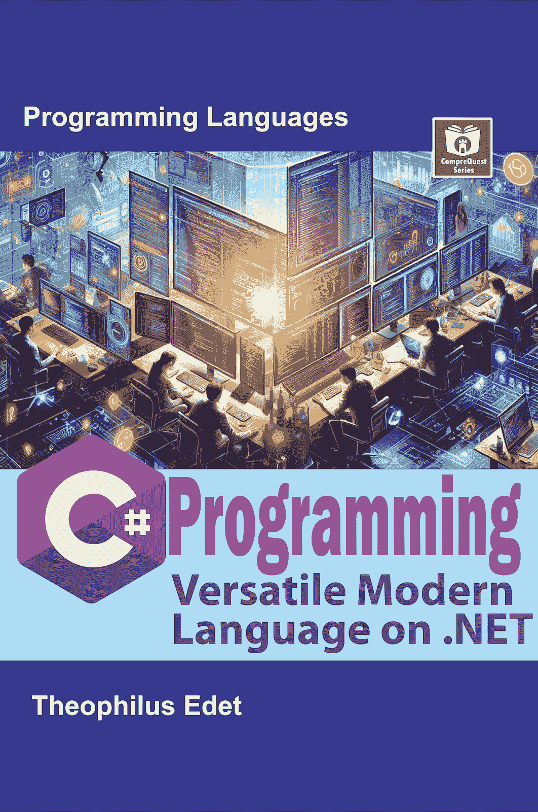
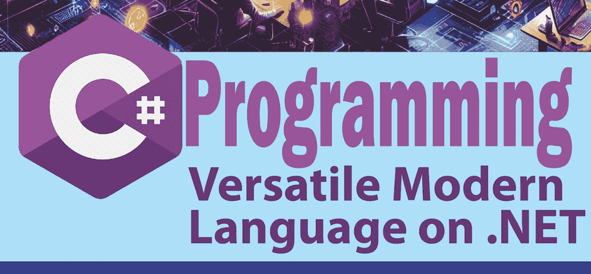

# C#编程：.NET 上多功能现代语言






## 第一部分：编程结构

### C# 简介

`C#` 是由 `Microsoft` 开发的现代编程语言，广泛用于开发应用程序。它的设计专注于简单性、健壮性和灵活性，结合了 `C++` 的强大和性能以及 `Java` 等语言的易用性。`C#` 允许创建各种类型。理解 `C#` 语法和约定对于编写高效代码至关重要。学习 `C#` 的第一步是编写一个简单的“Hello, World!”示例，它引入了 `namespaces`、`classes` 和 `Main` 方法。

### 变量与数据类型

`C#` 中的变量是存储和操作数据的基础。声明变量涉及指定一个类型后跟`variable name`。`C#` 支持广泛的数据类型，分为值类型和引用类型。值类型包括 `int`、`float` 和 `bool` 等简单数据类型。引用类型（如 `arrays` 和 `objects`）存储的是数据的引用。理解变量的 `scope` 和 `lifetime`周期对于高效的内存管理至关重要。`Scope` 决定了变量的可见性，而 `lifetime` 指变量在内存中存在的持续时间。类型转换（或 `casting`）是将变量从一种类型转换为另一种类型的过程。`C#` 提供了隐式和显式类型转换机制，允许开发者处理各种格式的数据，并确保整个应用程序的类型安全。

### 函数与方法

`C#` 中的函数和方法是执行特定任务并可以在程序中复用的代码块。定义函数和方法涉及指定 `return type`、`method name` 和 `parameters`。方法重载允许多个方法具有相同的名称但不同的参数列表，提供了灵活性并提升了代码的可读性。通过值或引用向方法传递参数，可以在方法内部以不同方式处理数据。从方法返回结果是简单的，并支持包括复杂对象在内的多种数据类型。善用函数和方法可以增强代码的模块化、可维护性和可读性，允许开发者构建更有组织且高效的应用程序。

### 条件语句与循环

条件语句和循环是控制 `C#` 程序执行流的重要构造结构。`if`、`else if` 和 `else` 语句提供了根据特定条件执行代码的方法。`switch` 语句提供了一种基于单一 `variable` 处理多个条件的更简洁的方法。循环包括 `while`、`do-while`、`for` 和 `foreach`，允许在满足特定条件下重复执行代码块。每种循环类型适用于不同的场景，`while` 和 `do-while` 循环在条件检查上提供了灵活性，而 `for` 和 `foreach` 循环提供了高效遍历集合的方法。掌握这些控制流结构对于编写逻辑清晰且高效的 `C#` 程序关重要，因为它们实现了动态决策和重复操作。

### 集合与数据结构

`C#` 各种集合和数据结构来高效管理和操作数据。`Arrays` 是最简单的集合形式，提供存储固定大小相同类型元素序列的方法。`Lists` 和 `diction` 更灵活，分别允许动态调整大小和提供键值对存储。`Stacks` 和 `queues` 是遵循特定访问规则的特殊数据结构：`stacks` 使用后进先出 (`LIFO`) 方法，而 `queues` 遵循先进先出 (`FIFO`) 方法。可以创建自定义数据结构来满足特定需求，为复杂的数据管理提供定制解决方案。理解并有效利用这些集合和数据结构对于构建健壮且高性能的 `C#` 应用程序至关重要。

### 高级 C# 构造

`C#` 中的高级构造增强了语言的功能和灵活性。`Enums` 提供了一种定义一组命名常量的方法，提高了代码可读性并减少了错误。注释和文档对于维护清晰易懂的代码至关重要，`XML comments` 提供了一种用于描述代码元素的结构化方式。异常处理对于优雅地管理运行时错误至关重要，使用 `try`、`catch` 和 `finally` 块处理异常并确保资源清理。`Events` 和 `delegates` 是实现事件驱动编程的强大构造，允许响应特定事件时调用方法。这些高级构造允许开发者编写更复杂、更可靠的 `C#` 应用程序。


# C# 类与对象
类和对象是 `C#` 中面向对象编程的核心。定义类涉及指定字段、属性、方法和事件，这些内容描述了从类创建对象的行为和状态。`Constructors`构造函数`和`destructors`析构函数`是特殊方法，分别用于初始化和清理对象的资源。继承和多态实现了代码复用和灵活性，允许类继承其他类的行为，并被视为父类的实例。`Abstract classes`抽象类`和`interfaces`接口`定义了派生类必须实现的约，提供了一种强制不同实现之间保持一致的方法。掌握这些概念对于充分利用 `C#` 面向对象编程的威力至关重要。

## C# 中的访问器与属性
访问器和属性提供控制类字段可访问性和修改的方法。`Getters`访问器`和`setters`设置器`定义了如何从属性读取值和写入值，从而实现了封装和验证。`Auto-implemented properties`自动实现属性`通过自动提供 `get` 和 `set` 访问器的默认实现，简化了属性声明。属性封装对于保护对象状态的完整性并确保字段的更改受到控制和验证至关重要。`Indexers`索引器允许对象像数组一样被索引，为访问代表集合的类中的元素提供了方便的方法。这些特性增强了 `C#` 类和对象的可用性和健壮性。

## C# 中的作用域与访问修饰符
作用域和访问修饰符决定了 `C#` 中变量、方法和类的可见性和访问级别。`Public`、`private`、`protected` 和 `internal` 修饰符控制对类成员的访问，确保实现细节被隐藏，只暴露必要的部分。`Namespace scope`命名空间作用域定义了识别的边界，有助于组织代码并避免命名冲突。`Assembly scope`程序集作用域将可见性扩展到同一程序集内的多个文件。理解并正确使用访问修饰符对于编写安全且可维护的代码至关重要，因为它允许开发者强制封装、控制依赖关系并最小化程序不同部分之间意外交互的风险。

# 模块 1：C# 简介

## C# 概述
`C#`（读作 "C-sharp"）是由微软开发的一种现代面向对象编程语言。它是 `.NET` 框架的一部分，旨在为构建各种应用程序提供一种简单、强大且类型安全的语言。`C#` 根源于 `C` 语言族，并结合了 `C`、`C++` 和 `Java` 等语言的特性，让许多程序员感到熟悉。它同时支持命令式和面向对象的编程范式，并为开发桌面、Web 和移动应用程序提供了强大的功能。

`C#` 以其多功能性闻名，允许开发者为包括 Windows、Linux、macOS、iOS 和 Android 在内的各种平台构建应用程序。这种跨平台能力很大程度上归于 `.NET Core`，这是一个开源的跨平台框架，允许 `C#` 代码在不同的操作系统上运行。该语言对现代编程实践（如异步编程、并行和健壮的类型检查）具有强大的支持，使其成为开发高性能可扩展应用程序的首选。

## 开始使用 .NET
`.NET` 框架是一个全面的开发平台，提供了运行时环境、大型类库以及构建应用程序的工具。要开始学习 `C#`，你需要安装 `.NET SDK`，它包含了构建和运行 `.NET` 所需的运行时和命令行工具。`Visual Studio` 和 `Visual Studio Code` 是流行的集成开发环境 (IDE)，它们为 `C#` 开发提供广泛的支持，包括 `IntelliSense`、调试和项目模板等功能。

在安装 `.NET SDK` 和 IDE 后，你可以使用命令行界面或 IDE 的图形界面创建一个新的 `C#` 项目。一个典型的 `.NET` 项目结构包含了组织应用程序代码、资源和配置的文件夹和文件。理解这种结构对于有效管理你的代码和依赖至关重要。

## C# 语法与规范
`C#` 语法简洁直观，设计为易读且易写。它使用了 `C-style` 语法，包含了熟悉的结构，例如用于代码块的大括号、用于终止语句的分号，以及 `if`、`for` 和 `while` 等常见的控制流语句。`C#` 中的命名规范对于维护代码的可读性和一致性至关重要。例如，类名通常使用 `PascalCase` 写法，而变量名使用 `camelCase`。理解并遵循这些规范对于编写整洁可维护的代码至关重要。

除了基础语法外，`C#` 还支持属性、事件和委托等高级特性。属性提供了一种在类中封装数据访问的方法，而事件和委托支持事件驱动编程和回调。掌握这些特性将增强你编写高效且响应迅速的应用程序的能力。

# 编写你的第一个 C# 程序
编写你的第一个 `C#` 程序涉及创建一个简单的应用程序，向控制台输出消息。这个基础练习帮助你熟悉语言的语法和开发环境。以下是该过程的逐步概述：

1. **创建新项目**：打开你的 IDE 并创建一个新的控制台应用程序项目。这种项目适用于学习基础 `C#` 语法和原理。
2. **编写代码**：在 `Program.cs` 文件中编写以下代码：

```csharp
using System;

namespace HelloWorld
{

class Program
{
    static void Main(string[] args)
    {
        Console.WriteLine("Hello, World!");
    }
}
}
```

这段代码定义了一个带有 `Main` 方法的 `Program` 类，该方法是程序的入口。`Console.WriteLine` 方法向控制台输出字符串 "Hello, World!"。
3. **生成并运行程序**：使用 IDE 的内置工具或命令行界面编译并运行程序。你应该能在控制台中看到显示的 "Hello, World!"，这表示你的程序运行正常。

这个简单的练习向你介绍了 `C#` 应用程序的基本结构，包括命名空间、类、方法和 `Main` 方法，它是任何 `C#` 应用程序的起点。在此基础之上，你可以探索 `C#` 语言和 `.NET` 框架中更复杂的功能和能力。

通过理解本模块涵盖的基础知识，你为开启 `C#` 编程之旅奠定了坚实的基础。接下来的模块将基于这些基础，深入探讨特定的特定的语言结构、数据类型和编程范式，这些特性使 `C#` 成为开发者的强大工具。


# 开始使用 C#

要开始 C# 编程，你需要设置开发环境。最常用且推荐的 C# IDE（集成开发环境）是 `Visual Studio`，它提供免费（社区版）和付费版本。`Visual Studio` 提供了丰富的工具和功能来提高生产力，包括 IntelliSense、调试功能和集成版本控制。

以下是入门步骤：

1.  **安装 Visual Studio**：从官方网站下载并安装最新版本的 `Visual Studio`。
2.  **创建新项目**：打开 `Visual Studio`，转到“文件”菜单，选择“新建”，然后选择“项目”。选择一个 C# 模板，例如“控制台应用”、“WPF 应用”或“ASP.NET Core 应用程序”。
3.  **配置你的项目**：按照提示配置项目设置，包括项目名称、位置和 .NET 框架版本。

完成这些步骤后，你就可以开始编写 C# 代码了。

## C# 语法和规范

C# 语法设计具有良好的表达性，且易于理解。以下是 C# 语法的一些关键元素：

- **命名空间 (Namespaces)**：用于将代码组织成逻辑组并避免命名冲突。示例：
```csharp
using System;
```
- **类和对象 (Classes and Objects)**：类是对象的蓝图。示例：
```csharp
public class Person
{
    public string Name { get; set; }
    public int Age { get; set; }
}
```
- **方法 (Methods)**：属于类的函数。示例：
```csharp
public void Greet()
{
    Console.WriteLine("Hello, " + Name);
}
```
- **Main 方法 (Main Method)**：C# 程序的入口。示例：
```csharp
public static void Main(string[] args)
{
    Console.WriteLine("Hello, World!");
}
```

# 编写你的第一个 C# 程序

让我们写一个简单的 C# 程序，在控制台上打印“Hello, World!”。这个经典的示例介绍了 C# 程序的的基本结构。

1.  **创建一个新的控制台应用**：在 `Visual Studio` 中，创建一个新的控制台应用项目。
2.  **编写代码**：将 `Program.cs` 中自动生成的代码替换为以下内容：
```csharp
using System;
namespace HelloWorld
{
class Program
{
    static void Main(string[] args)
    {
        Console.WriteLine("Hello, World!");
    }
}
}
```
3.  **运行程序**：按下 `F5` 或点击 `Visual Studio` 中的“启动”按钮来编译并运行你的程序。你应该能在控制台窗口看到打印出的“Hello, World!”

这个简单的程序演示了 C# 应用程序的核心组件：命名空间、类、方法以及作为入口的 `Main` 方法。

## 开始使用 .NET

要开始 C# 编程，了解如何设置和使用 .NET 开发环境至关重要。.NET 平台是一个强大的框架，支持从 Web 服务到桌面应用以及移动应用的各种应用程序。以下是一份帮助你入门的详细指南。

### 安装 Visual Studio

`Visual Studio` 是 .NET 开发的主要 IDE，提供了一套用于编码、调试和部署应用程序的全面工具集。以下是安装和配置 `Visual Studio` 的方法：

1.  **下载 Visual Studio**：访问 [Visual Studio 下载页面](https://visualstudio.microsoft.com/downloads/) 并选择适合你需求的版本。社区版免费，适用于个人开发者、开源项目、学术研究和小型专业团队。
2.  **安装选项**：在安装期间，系统会提示你选择工作负载。对于 C# 开发，请选择“.NET 桌面开发”工作负载。如果你计划开发 Web 应用程序，请包含“ASP.NET 和 Web 开发”工作负载。
3.  **配置 Visual Studio**：安装完成后，打开 `Visual Studio` 并配置你的设置。你可以自定义主题、设置调试偏好，并安装如 `ReSharper` 等额外的扩展以增强生产力。

### 创建新项目

在 `Visual Studio` 中创建你的第一个 C# 项目非常简单。按照以下步骤操作：

1.  **启动新项目**：从启动页点击“创建新项目”。这将打开“新建项目”对话框。
2.  **选择项目模板**：选择一个项目模板。对于简单的控制台应用，请在 C# 类别下选择“控制台应用”。该模板将建立一个带有用于输入和输出的控制台窗口的基础项目结构。
3.  **配置项目详情**：为你的项目输入名称并在磁盘上选择一个位置。点击“创建”以生成项目。

### 理解项目结构

一个典型的 C# 控制台应用具有简单的结构。以下是主要组件的拆解：

- `ProjectName`
- `Program.cs`
- `Properties`
- `AssemblyInfo.cs`
- `bin`
- `obj`

- `Program.cs`：此文件包含应用程序的入口，即定义 `Main` 方法的地方。
- `Properties/AssemblyInfo.cs`：包含关于程序集的元数据，例如版本信息和公司详情。

# 编写你的第一个 C# 程序

让我们写一个简单的 C# 程序来感受一下语法和结构。打开 `Program.cs` 并默认代码替换为以下内容：
```csharp
using System;
namespace HelloWorld
{
class Program
{
    static void Main(string[] args)
    {
        Console.WriteLine("Hello, World!");
        Console.WriteLine("Enter your name:");
        string name = Console.ReadLine();
        Console.WriteLine($"Welcome, {name}!");
    }
}
}
```

- **命名空间声明**：`namespace HelloWorld` 将你的代码组织在一个命名空间中，防止命名冲突。
- **类定义**：`class Program` 定义了一个名为 `Program` 的类。
- **Main 方法**：`static void Main(string[] args)` 是程序的入口点。它接收一个字符串数组作为参数。

## 运行程序

1.  **生成项目**：点击“生成” > “生成解决方案”或按下 `Ctrl+Shift+B`。`Visual Studio` 会编译你的代码并检查错误。
2.  **运行程序**：点击“调试” > “启动调试”或按下 `F5`。控制台窗口将出现，你应该看到输出：
```
Hello, World!
Enter your name:
```
3.  **与程序交互**：输入你的名字并按回车键。程序将用个性化的消息问候你。

### 理解 Console 类

`System` 命名空间中的 `Console` 类提供了与控制台交互的方法。关键方法包括：

- `WriteLine`：向控制台输出一行文本。
```csharp
Console.WriteLine("Hello, World!");
```
- `ReadLine`：从控制台读取一行文本。
```csharp
string input = Console.ReadLine();
```
- `ReadKey`：从控制台读取一个按键，无需等待回车。
```csharp
ConsoleKeyInfo key = Console.ReadKey();
```

### 调试与测试

`Visual Studio` 的调试工具对于故障排除和完善代码非常有用。关键功能包括：

- **断点 (Breakpoints)**：点击代码编辑器的左侧边缘设置断点。程序会在这些点暂停，允许你检查变量并单步执行。
- **立即窗口 (Immediate Window)**：使用立即窗口（`Ctrl+Alt+I`）在调试时执行代码段并检查变量。
- **监视窗口 (Watch Window)**：将变量添加到监视窗口以监控执行期间的值。

通过熟悉这些功能，你可以有效地调试 C# 应用程序。开始使用 .NET 和 C# 涉及设置 Visual Studio、创建新项目、编写和运行第一个程序以及使用必要的调试工具。这一基础将使你能够探索 C# 中更高级的功能和编程模型。

## C# 语法和规范

C# 语法和规范是编写健壮且可维护代码的基础。以下是深入探讨你应该采用的基础语法元素和编码规范。

### 基础语法结构

C# 语法设计得直观且易于阅读。它遵循类 C 语法，类似于 C++ 和 Java 等其他基于 C 的语言。基础构建包括命名空间、类、方法和变量。


# C# 基础

- **命名空间 (Namespaces)**：将你的代码组织到命名空间以避免命名冲突。使用 `using` 指令在文件顶部包含命名空间。
- **类 (Classes)**：使用 `class` 关键字定义类。类封装了数据和行为。
- **Main 方法 (Main Method)**：`Main` 方法是任何 C# 控制台应用程序的入口点。它必须定义为 `static` 和 `void`，并带有用于命令行参数的 `string[] args` 参数。

## 变量声明与初始化

C# 中的变量必须用特定的数据类型声明，随后后跟变量名。声明必须清晰简洁，并遵循命名规范。

```csharp
int age = 30;
string name = "Alice";
double salary = 75000.50;
bool isEmployed = true;
```

- **数据类型 (Data Types)**：根据你打算存储的值选择合适的数据类型。常见类型包括 `int`、`double`、`string`、`bool` 以及如 `class` 或 `struct` 等自定义类型。
- **命名规范 (Naming Conventions)**：局部变量和参数使用 `camelCase`（驼峰式），类和方法名使用 `PascalCase`（帕斯卡式），常量使用 `UPPERCASE`（大写）。

## 控制结构

控制结构对于实现程序的逻辑至关重要。C# 支持标准的控制流语句，如条件和循环。

### If-Else 语句

```csharp
int number = 10;
if (number > 0)
{
    Console.WriteLine("Positive number");
}
else if (number < 0)
{
    Console.WriteLine("Negative number");
}
else
{
    Console.WriteLine("Zero");
}
```

### Switch 语句

```csharp
int day = 3;
switch (day)
{
    case 1:
        Console.WriteLine("Monday");
        break;
    case 2:
        Console.WriteLine("Tuesday");
        break;
    case 3:
        Console.WriteLine("Wednesday");
        break;
    default:
        Console.WriteLine("Invalid day");
        break;
}
```

### 循环

- **For 循环**：
```csharp
for (int i = 0; i < 5; i++)
{
    Console.WriteLine(i);
}
```
- **While 循环**：
```csharp
int count = 0;
while (count < 5)
{
    Console.WriteLine(count);
    count++;
}
```
- **Foreach 循环**：
```csharp
string[] fruits = { "Apple", "Banana", "Cherry" };
foreach (string fruit in fruits)
{
    Console.WriteLine(fruit);
}
```

## 方法与函数定义

方法对于将代码组织成可重用的块至关重要。在 C# 中，方法定义在类内部，可以接收参数并返回值。

```csharp
public class Calculator
{
    public int Add(int a, int b)
    {
        return a + b;
    }

    public int Subtract(int a, int b)
    {
        return a - b;
    }

    public void DisplayResult(int result)
    {
        Console.WriteLine($"Result: {result}");
    }
}
```

- **方法签名 (Method Signature)**：方法签名包含方法名、返回类型和参数列表。
- **返回类型 (Return Types)**：指定方法的返回类型。如果方法不返回值，则使用 `void`。

### 注释与文档

注释对于使你的代码易懂至关重要。使用 `//` 进行单行注释，使用 `/* ... */` 进行多行注释。

```csharp
// 这是一个单行注释

/*
这是一个
多行注释
*/
```

此外，使用 XML 文档注释为你的代码编写文档，以便供 IntelliSense 和文档生成。

```csharp
/// <summary>
/// 相加两个整数并返回结果。
/// </summary>
/// <param name="a">第一个整数。</param>
/// <param name="b">第二个整数。</param>
/// <returns>两个整数之和。</returns>
public int Add(int a, int b)
{
    return a + b;
}
```

## 一致的格式化

采用一致的编码风格来增强可读性。请遵循这些实践：

- **缩进 (Indentation)**：每个缩进级别使用四个空格。
- **大括号 (Braces)**：将左括号放在同一行，将右括号放在新行。

```csharp
public class Program
{
    public static void Main(string[] args)
    {
        int number = 10;
        if (number > 0)
        {
            Console.WriteLine("Positive number");
        }
        else
        {
            Console.WriteLine("Non-positive number");
        }
    }
}
```

通过遵循这些语法规则和规范，你可以确保 C# 代码整洁、可读且可维护，为更复杂高效的编程任务铺路。

# 编写你的第一个 C# 程序

## 引言

编写你的第一个 C# 程序是学习该语言过程中一个令人兴奋的里程碑。本节将引导你创建一个简单的控制台应用程序，这将向你介绍基本的 C# 编程概念和工具。

## 设置开发环境

在编写任何代码之前，你需要设置开发环境。Visual Studio 是用于 C# 开发最流行的集成开发环境 (IDE)，但你也可以使用带有 C# 扩展的 Visual Studio Code 进行更轻量级的设置。

1. **Visual Studio**：
   - **下载并安装**：访问 [Visual Studio 网站](https://visualstudio.microsoft.com/) 下载最新版本的 Visual Studio Community 或任何其他版本。
   - **创建新项目**：打开 Visual Studio，点击“创建新项目”，根据你的需求选择“Console App (.NET Core)”或“Console App (.NET Framework)”，然后点击“下一步”。

2. **Visual Studio Code**：
   - **下载并安装**：访问 [Visual Studio Code 网站](https://code.visualstudio.com/) 下载并安装 VS Code。
   - **安装 C# 扩展**：打开 VS Code，点击侧边栏的扩展图标或按 `Ctrl+Shift+X`，搜索“C#”，并安装由 Microsoft 提供的 C# 扩展。
   - **创建新项目**：在 VS Code 中打开新终端，使用 .NET CLI 通过 `dotnet new console` 创建新项目。

## 编写程序

以下是如何用 C# 编写一个简单的“Hello, World!”程序。

1. **打开你的项目**：
   - 在 Visual Studio 中，你应该能在解决方案资源管理器下看到一个 `Program.cs` 文件。这就是你编写代码的地方。
   - 在 Visual Studio Code 中，打开由 .NET CLI 创建的 `Program.cs` 文件。

2. **代码解释**：

```csharp
using System;

namespace HelloWorldApp
{
    class Program
    {
        static void Main(string[] args)
        {
            // 向控制台打印 Hello, World!
            Console.WriteLine("Hello, World!");
        }
    }
}
```

- `using System;`：该指令包含了 `System` 命名空间，其中包含基础类。
- `namespace HelloWorldApp`：命名空间用于对类类。在此示例中，命名空间是 `HelloWorldApp`。
- `class Program`：定义了一个名为 `Program` 的类。在 C# 中，可执行代码必须位于类内部。
- `static void Main(string[] args)`：这是程序的入口点。`Main` 方法在程序启动时调用。`static` 意味着不需要创建 `Program` 的实例即可调用 `Main`。`void` 表示 `Main` 不返回任何值。`string[] args` 允许将命令行参数传递给程序。
- `Console.WriteLine("Hello, World!");`：此行将“Hello, World!”输出到控制台。

## 运行程序

1. **Visual Studio**：
   - 点击绿色“启动”按钮或按 F5 构建并运行你的应用程序。输出将出现在控制窗口。
2. **Visual Studio Code**：
   - 在 VS Code 中打开终端（查看 > 终端或 `Ctrl+``）并导航到项目目录。
   - 使用命令 `dotnet run` 运行应用程序。

## 修改程序

当你熟悉了基础知识后，可以通过修改程序进行实验。例如，你可以让程序询问用户输入并显示个性化消息。

```csharp
using System;

namespace HelloWorldApp
{
    class Program
    {
        static void Main(string[] args)
        {
            // 提示用户输入名称
            Console.Write("Enter your name: ");
            string name = Console.ReadLine();
            // 打印个性化的问候
            Console.WriteLine($"Hello, {name}!");
        }
    }
}
```

- `Console.Write("Enter your name: ");`：提示用户输入名称。`Console.Write` 在输出后不会换行，因此用户的输入将出现在同一行。
- `string name = Console.ReadLine();`：从控制台读取用户输入并将其存储在 `name` 变量中。
- `Console.WriteLine($"Hello, {name}!");`：使用字符串插值将用户的名称包含在输出中。


# 调试与故障排除

当你编写和运行更复杂的程序时，可能会遇到错误。这里是一些基本的调试技巧：

1. 语法错误（Syntax Errors）：这些是代码结构中的错误。编译器通常会提供错误消息，指示错误所在的行号和性质。
2. 运行时错误（Runtime Errors）：这些错误在程序执行期间发生。通常可以使用 IDE 中提供的调试工具进行诊断，例如断点和单步调试。
3. 逻辑错误（Logical Errors）：当代码运行但产生错误的结果时，就会发生此类错误。仔细检查你的代码并使用打印语句或调试器可以帮助识别逻辑错误。

编写你的第一个 C# 程序是学习该语言的基础步骤。通过搭建开发环境、编写一个简单的“Hello, World!”应用程序以及尝试各种修改，你将获得基础 C# 语法和规范的实践经验。随着学习的深入，你将在这些技能的基础上构建出更复杂、功能更丰富的应用程序。

# 模块 2：C# 变量与数据类型

## 声明变量

在 C# 中，变量是用于存储可以在程序中操作的数据的基础元素。声明变量涉及指定其数据类型并为其分配一个名称，这允许程序引用和操作存储的值。在 C# 中声明变量的过程是非常直观的，并遵循清晰的语法，增强了代码的可读性和可维护性。

C# 支持广泛的数据类型，每种类型都是为特定类型的数据设计的。声明变量的基本语法涉及先写数据类型，后写变量名。理解各种数据类型以及如何声明它们对于编写有效的 C# 程序至关重要。这包括原始类型（如整数、浮点数、字符和布尔值）以及更复杂的类型（字符串和对象）。

## 变量的作用域与生命周期

变量的作用域是指变量可以访问的上下文。在 C# 中，作用域由变量声明的位置。变量可以是局部的，意味着它们在方法或代码块内部声明，并且仅在该特定方法或代码块内可访问。或者，变量可以是类级的，意味着它们在类内部但在任何方法之外声明，使得类中的所有方法都可以访问它们。

变量的生命周期是变量在内存中存在的时间。局部变量具有有限的生命周期，当声明它的方法或块执行完毕时结束。相比之下，类级变量在所属的对象实例的生命周期内一直存在。理解变量的作用域和生命周期对于高效管理内存以及避免变量遮蔽或意外修改等错误至关重要。

## 值类型与 引用类型

C# 将数据类型分为两大类：值类型和引用类型。值类型在自身的内存分配中持有实际数据，而引用类型则存储指向数据内存地址的引用。这种区别对于 C# 程序中管理和操作数据具有重要影响。

值类型包括所有原始数据类型（如整数、浮点数和布尔值）以及结构体（structs）。当将值类型赋值给另一个变量时，会创建实际数据的副本。这意味着对一个变量的更改不会影响另一个。

引用类型包括类、数组和接口。当将引用类型赋值给另一个变量时，两个变量都指向同一个内存位置。因此，通过一个变量所做的更改会反映在另一个变量上。理解值类型和引用类型之间的差异对于避免意外副作用和有效管理内存至关重要。

# 类型转换

类型转换（或强制转换）是将变量从一种数据类型转换为另一种类型的过程。在 C# 中，有两种类型转换：隐式转换和显式转换。当不存在数据丢失风险时，会自动发生隐式转换，例如将整数转换为浮点数。这种转换是安全的，且不需要显式语法。

另一方面，当存在数据丢失的可能性或在不兼容类型之间进行转换时，显式转换是必要的。这需要使用强制转换运算符来指定所需的转换。例如，将浮点数转换为整数需要显式转换，因为数字的小数部分将会丢失。

C# 还提供了更复杂类型转换的方法，例如将字符串转换为数值类型或反亦然。这些方法是 .NET 框架的一部分，包括 `Convert.ToInt32`、`Convert.ToDouble` 和 `int.Parse` 等函数。理解如何正确执行类型转换对于确保数据完整性和防止运行时错误至关重要。

通过掌握 C# 中的变量和数据类型概念，你为更高级的编程任务奠定了坚实的基础。正确的变量声明、对作用域和生命周期的理解、值类型与引用类型的区别以及执行类型转换的能力是任何 C# 开发人员的基本技能。这些概念将在后续模块中得到进一步扩展，为你提供编写高效、可靠且可维护的 C# 代码所需的工具。

## 详细声明变量

在 C# 中，变量用于存储你的程序可以操作的数据。声明变量涉及指定其类型并给它一个名称。

### 基础变量声明

这是一个声明和初始化变量的简单示例：

```csharp
int age = 30;
double height = 5.9;
string name = "John Doe";
bool isStudent = true;
```

* `int age`: 声明了一个名为 `age` 的整数变量并将其初始化为 30。
* `double height`: 声明了一个名为 `height` 的双精度浮点变量并将其初始化为 5.9。
* `string name`: 声明了一个名为 `name` 的字符串变量并将其初始化为 "John Doe"。
* `bool isStudent`: 声明了一个名为 `isStudent` 的布尔变量并将其初始化为 true。

### 变量命名规范

在 C# 中，变量名应该具有意义并遵循某些约定：

* 驼峰式命名法（Camel Case）：变量名的第一个字母小写，随后的每个单词的首字母大大写（例如，`userAge`、`totalAmount`）。
* 描述性名称：使用描述所存储数据的的名称（例如使用 `customerName` 而不是 `name`）。

### 变量作用域

作用域定义了变量在代码中何处可用。C# 为变量提供了不同的作用域：

* 局部作用域：在方法或块内部声明的变量仅在该方法或块内可用。

```csharp
void PrintMessage()
{
    string message = "Hello, World!";
    Console.WriteLine(message); // 有效使用
}
Console.WriteLine(message); // 错误：'message'在此不可访问
```

* 类作用域：在类内部但在任何方法之外声明的变量类中的所有方法可用。

```csharp
{
    private string name; // 类作用域变量
    public void SetName(string name)
    {
        this.name = name; // 在此处可用
    }
}
```

# 变量生命周期

生命周期是指变量在内存中存在的持续时间：

* 局部变量：仅在方法或块执行期间存在。一旦执行离开作用域，变量就会被销毁。
* 类字段：只要类实例存在，它们就存在。它们在对象实例化时创建，在对象被垃圾回收时销毁。


值类型直接存储数据。当一个值类型变量被赋值给另一个变量时，会创建该值的拷贝。

- 常见的值类型：`int`, `float`, `double`, `char`, `bool`, `struct`

```csharp
int x = 10;
int y = x; // y 是 x 的拷贝
y = 20; // x 保持为 10
```

# 引用类型

引用类型存储指向内存中数据位置的引用。当一个引用类型变量被赋值给另一个时，两个变量都指向同一个对象。

- 常见的引用类型：`string`, `array`, `class`, `delegate`

```csharp
class Person
{
    public string Name { get; set; }
}

Person p1 = new Person { Name = "Alice" };
Person p2 = p1; // p2 与 p1 指向同一个对象
p2.Name = "Bob"; // p1.Name 也是 "Bob"
```

# 装箱与拆箱

装箱（Boxing）是将值类型转换为对象类型的过程。拆箱（Unboxing）则是相反的过程。

```csharp
int number = 123;
object obj = number; // 装箱
int unboxedNumber = (int)obj; // 拆箱
```

装箱涉及创建一个对象并将值类型存储在其中，而拆箱则是从对象中提取值类型。

# 类型转换

类型转换用于将数据从一种类型转换为另一种类型。C# 提供了几种执行类型转换的方法：

#### 隐式转换

兼容类型之间的自动转换，不会丢失数据：

```csharp
int num = 123;
double dbl = num; // 从 int 到 double 的隐式转换
```

## 显式转换（强制转换）

在可能丢失数据或不直接兼容的类型之间转换时，需要显式语法：

```csharp
double dbl = 123.45;
int num = (int)dbl; // 从 double 到 int 的显式转换（强制转换）
```

## 使用 Convert 类

`Convert` 类提供了不同类型之间转换的方法：

```csharp
string numberString = "456";
int number = Convert.ToInt32(numberString); // 将字符串转换为 int
```

## 解析方法

解析方法将字符串转换为数值类型：

```csharp
string numberString = "789";
int number = int.Parse(numberString); // 使用 Parse 将字符串转换为 int
```

## 处理转换错误

在执行类型转换时，始终处理可能的错误：

```csharp
string invalidNumber = "abc";
int result;
bool success = int.TryParse(invalidNumber, out result);

if (success)
{
    Console.WriteLine($"转换后的数字: {result}");
}
else
{
    Console.WriteLine("转换失败。");
}
```

使用 `TryParse` 有助于通过验证转换过程防止运行时异常。

理解变量和数据类型在 C# 编程中至关重要。正确地声明变量、了解变量的作用域和生命周期、区分值类型和引用类型以及执行类型转换，这些都是实现有效数据操作和程序逻辑的基础性技能。掌握这些概念将允许你编写出健壮且灵活的 C# 应用程序。

# 变量作用域与生命周期

在 C# 中，变量作用域决定了在代码中何处可以访问或修改变量。变量的作用域对于确保变量被正确高效地使用至关重要。以下是 C# 中变量的主要作用域：

### 1. 局部作用域

局部变量声明在方法或块内部，只能在该方法或块内访问。它们在进入方法或块时创建，在退出时销毁。

示例：

```csharp
using System;
class Program
{
    static void Main(string[] args)
    {
        int localVariable = 10; // Main 方法内的局部作用域
        Console.WriteLine(localVariable); // 有效使用
    }
    static void PrintNumber()
    {
        // Console.WriteLine(localVariable); // 错误：'localVariable' 在不可访问
    }
}
```

在此示例中，`localVariable` 仅在 `Main` 方法中可用。在 `PrintNumber` 方法中尝试访问将导致编译错误。

### 2. 类作用域

类作用域变量声明在类内部但在任何方法之外。它们也被称为字段或成员变量。它们可以通过类中的所有方法访问。

示例：

```csharp
using System;
class Program
{
    int classVariable = 20; // 类作用域
    static void Main(string[] args)
    {
        Program program = new Program();
        Console.WriteLine(program.classVariable); // 通过实例访问 classVariable
    }
    void DisplayValue()
    {
        Console.WriteLine(classVariable); // 直接访问 classVariable
    }
}
```

在此示例中，`classVariable` 在类中所有方法可见。

### 3. 块作用域

块作用域是指在花括号 `{ }` 内部定义的变量，例如 `if`、`for` 或 `while` 语句。

示例：

```csharp
using System;
class Program
{
    static void Main(string[] args)
    {
        if (true)
        {
            int blockVariable = 30; // 块作用域
            Console.WriteLine(blockVariable); // 有效使用
        }
        // Console.WriteLine(blockVariable); // 错误：'blockVariable' 在不可访问
    }
}
```

`blockVariable` 仅在声明它的块内有效。

# 变量生命周期

变量生命周期是指变量在内存中持续的时间。变量的生命周期与其作用域相关。

### 1. 局部变量

局部变量仅在其定义的方法或块执行期间存在。一旦方法或块结束，它们就会消失。

示例：

```csharp
using System;
class Program
{
    static void Main(string[] args)
    {
        int localVar = 40;
        Console.WriteLine(localVar); // 有效使用
    }
    static void ShowVariable()
    {
        // Console.WriteLine(localVar); // 错误：'localVar' 在不可访问
    }
}
```

`localVar` 的存在取决于 `Main` 方法。

### 2. 类字段

类字段（或成员变量）只要类实例存在就会存在。它们在创建实例时创建，在被垃圾回收时销毁。

示例：

```csharp
using System;
class Program
{
    int instanceVariable = 50; // 类字段
    static void Main(string[] args)
    {
        Program program = new Program();
        Console.WriteLine(program.instanceVariable); // 有效使用
    }
}
```

在此情况下，`instanceVariable` 只要 `Program` 实例存在就会留在内存中。

### 3. 静态字段

静态字段属于类本身而非任何特定实例。它们在类首次加载时创建，在应用程序域卸载时销毁。

示例：

```csharp
using System;
class Program
{
    static int staticVariable = 60; // 静态字段
    static void Main(string[] args)
    {
        Console.WriteLine(staticVariable); // 有效使用
    }
}
```

`staticVariable` 被类的所有实例共享，并贯穿应用程序的生命周期。


理解变量的作用域和生命周期对于有效的 C# 编程至关重要。通过掌握这些概念，你可以高效地管理变量访问和内存使用，从而编写更健壮、易维护的代码。无论是处理局部变量、类变量还是静态变量，了解它们的作用域和生命周期都能帮你避免常见的陷阱，并确保程序顺利运行。

## 值类型与 引用类型

在 C# 中，数据类型大致分为值类型和引用类型。每个类型具有不同的行为、内存分配和操作特性。

### 1. 值类型

值类型直接存储数据。当你将一个值类型变量赋值给另一个变量时，会创建该值的拷贝。这意味着对一个变量的更改不会影响另一个。

常见的值类型：
* 整数类型：`int`, `long`, `short`, `byte`, `sbyte`, `uint`, `ulong`
* 浮点数类型：`float`, `double`
* 其他类型：`char`, `bool`, `struct`

示例：

```csharp
using System;

class Program
{
    static void Main(string[] args)
    {
        int a = 10; // 值类型
        int b = a;  // b 获得了 a 值的拷贝
        b = 20;     // 修改 b 不影响 a
        Console.WriteLine($"a: {a}, b: {b}"); // 输出: a: 10, b: 20
    }
}
```

在这个示例中，`a` 和 `b` 是独立的变量。更改 `b` 的值不会影响 `a`。

结构（Struct）是另一个值类型的示例。结构是可以包含数据成员和方法的值类型。

示例：

```csharp
using System;

struct Point
{
    public int X;
    public int Y;
    public Point(int x, int y)
    {
        X = x;
        Y = y;
    }
    public void Display()
    {
        Console.WriteLine($"Point: ({X}, {Y})");
    }
}

class Program
{
    static void Main(string[] args)
    {
        Point p1 = new Point(10, 20);
        Point p2 = p1; // p2 获得了 p1 值的拷贝
        p2.X = 30; // 修改 p2 不影响 p1
        p1.Display(); // 输出: Point: (10, 20)
        p2.Display(); // 输出: Point: (30, 20)
    }
}
```

### 2. 引用类型

引用类型存储指向实际持有数据的内存位置的引用。当你将一个引用类型变量赋值给另一个时，两个变量都指向同一个对象。通过其中一个引用进行的更改会影响另一个。

常见的引用类型：
* 类：`class`
* 数组：`int[]`, `string[]` 等
* 字符串：`string`
* 委托：`delegate`

示例：

```csharp
using System;

class Person
{
    public string Name;
}

class Program
{
    static void Main(string[] args)
    {
        Person p1 = new Person { Name = "Alice" }; // 引用类型
        Person p2 = p1; // p2 与 p1 指向同一个对象
        p2.Name = "Bob"; // 修改 p2 会影响 p1
        Console.WriteLine($"p1 Name: {p1.Name}"); // 输出: p1 Name: Bob
        Console.WriteLine($"p2 Name: {p2.Name}"); // 输出: p2 Name: Bob
    }
}
```

在这个示例中，`p1` 和 `p2` 指向同一个 `Person` 对象。通过 `p2` 更改 `Name` 属性也会更改 `p1` 的属性。

### 3. 装箱与拆箱

装箱和拆箱是值类型转换为引用类型以及反之相关的过程。装箱是将值类型封装在可以被视为对象的类型或接口类型中。拆箱是装箱的相反过程。

装箱示例：

```csharp
using System;

class Program
{
    static void Main(string[] args)
    {
        int num = 123; // 值类型
        object obj = num; // 装箱：num 被封装在对象中
        Console.WriteLine(obj); // 输出: 123
    }
}
```

拆箱示例：

```csharp
using System;

class Program
{
    static void Main(string[] args)
    {
        object obj = 456; // 装箱
        int num = (int)obj; // 拆箱：从对象中提取值类型
        Console.WriteLine(num); // 输出: 456
    }
}
```

### 4. 类型转换

类型转换涉及将数据从一种类型转换为另一种类型。在 C# 中，类型转换可以是隐式的或显式的。

#### 隐式转换
当没有数据丢失的风险时，会自动发生隐式转换。

示例：

```csharp
using System;

class Program
{
    static void Main(string[] args)
    {
        int num = 100;
        double dbl = num; // 从 int 到 double 的隐式转换
        Console.WriteLine(dbl); // 输出: 100
    }
}
```

#### 显式转换（强制类型）
显式转换需要你显式指定转换，特别是可能发生数据丢失的情况下。

示例：

```csharp
using System;

class Program
{
    static void Main(string[] args)
    {
        double dbl = 9.78;
        int num = (int)dbl; // 从 double 到 int 的显式转换
        Console.WriteLine(num); // 输出: 9
    }
}
```

### 5. 使用 Convert 类

`Convert` 类提供了在类型之间转换的方法，并处理了各种转换。

示例：

```csharp
using System;

class Program
{
    static void Main(string[] args)
    {
        string str = "123";
        int num = Convert.ToInt32(str); // 将字符串转换为 int
        Console.WriteLine(num); // 输出: 123
    }
}
```

### 6. 解析方法

解析方法（如 `int.Parse` 和 `double.Parse`）用于将字符串转换为数值类型。

示例：

```csharp
using System;

class Program
{
    static void Main(string[] args)
    {
        string numberString = "456";
        int number = int.Parse(numberString); // 将字符串转换为 int
        Console.WriteLine(number); // 输出: 456
    }
}
```


`Convert` 类提供了静态方法，用于在不同类型之间转换。此类对于无法通过隐式或显式转换处理的转换有用，特别是在处理字符串和数值类型时。

示例：

```csharp
using System;

class Program
{
    static void Main(string[] args)
    {
        string str = "123";
        int num = Convert.ToInt32(str); // 将字符串转换为 int
        Console.WriteLine($"String: {str}"); // 输出: String: 123
        Console.WriteLine($"Integer: {num}"); // 输出: Integer: 123
    }
}
```

在此示例中，使用了 `Convert.ToInt32` 方法将数字的字符串表示转换为整数。`Convert` 类处理各种数据类型转换，并提供了一种比单纯强制类型转换更全面的方法。

## 4. 解析方法

解析方法用于将字符串转换为数值。常用方法包括 `int.Parse`、`double.Parse` 以及它们各自的 `TryParse` 方法。解析在处理用户输入或从外部源读取的数据时特别有用。

示例：

```csharp
using System;

class Program
{
    static void Main(string[] args)
    {
        string numberString = "456";
        int number = int.Parse(numberString); // 将字符串转换为 int
        Console.WriteLine($"Parsed number: {number}"); // 输出: Parsed number: 456
    }
}
```

`int.Parse` 方法将字符串 "456" 转换为整数。如果字符串不是整数的有效表示，该方法将抛出异常。

## 5. 处理转换错误

在转换数据时（尤其是从字符串转换），如果数据不符合预期格式，可能会发生错误。`TryParse` 方法是 `Parse` 更安全的替代方案，因为它允许你优雅地处理转换错误。

示例：

```csharp
using System;

class Program
{
    static void Main(string[] args)
    {
        string invalidString = "abc";
        int result;
        bool success = int.TryParse(invalidString, out result);
        if (success)
        {
            Console.WriteLine($"Converted number: {result}");
        }
        else
        {
            Console.WriteLine("Conversion failed. Input was not a valid integer.");
        }
    }
}
```

在此示例中，`int.TryParse` 尝试将字符串 "abc" 转换为整数。由于转换失败，方法返回 `false`，并显示错误信息。

## 6. 自定义转换

C# 还支持在用户定义类型中使用自定义转换方法。你可以在类中定义显式或隐式转换运算符，以处理自定义类型之间的转换。

示例：

```csharp
using System;

class Celsius
{
    public double Temperature { get; set; }
    public Celsius(double temperature)
    {
        Temperature = temperature;
    }
    public static implicit operator Fahrenheit(Celsius celsius)
    {
        return new Fahrenheit(celsius.Temperature * 9 / 5 + 32);
    }
}

class Fahrenheit
{
    public double Temperature { get; set; }
    public Fahrenheit(double temperature)
    {
        Temperature = temperature;
    }
}

class Program
{
    static void Main(string[] args)
    {
        Celsius celsius = new Celsius(25);
        Fahrenheit fahrenheit = celsius; // 从摄氏到华氏的隐式转换
        Console.WriteLine($"Celsius: {celsius.Temperature}°C"); // 输出: Celsius: 25°C
        Console.WriteLine($"Fahrenheit: {fahrenheit.Temperature}°F"); // 输出: Fahrenheit: 77°F
    }
}
```

在此示例中，定义了一个隐式转换运算符将 `Celsius` 转换为 `Fahrenheit`。当将 `Celsius` 实例赋值给 `Fahrenheit` 变量时，此转换会自动处理。

类型转换是在 C# 中处理不同数据类型的一个基本方面。理解隐式和显式转换的细微差别、利用 `Convert` 类、处理解析错误以及实现自定义转换，允许开发者编写健壮且灵活的代码。妥善管理类型转换可以确保数据完整性并最大限地减少运行时错误，提高应用程序的整体可靠性。

# 模块 3：C# 函数和方法

### 定义函数和方法

函数和方法是 C# 编程中的基本构建块，允许你将代码封装成可重用的单元。函数（或方法）是执行特定任务的代码块，可以在需要时调用以执行该任务。在 C# 中，方法定义在类内部，可以接收参数、返回值并包含一系列语句。

在 C# 中定义方法涉及指定其返回类型、名称和参数列表。方法体包含定义方法行为的语句。方法可以是静态的或基于实例的。静态方法属于类本身，而实例方法属于类的实例。理解如何有效地定义和使用方法对于编写整洁、模块且可维护的代码至关重要。

## 方法重载

方法重载是 C# 中的一项强大功能，允许你定义多个具有相同名称但参数列表不同的方法。此功能增强了代码的可读性和可用性，因为它允许你使用不同类型或数量的参数来执行相似的任务。编译器根据参数的数量、类型或顺序来区分重载方法。

例如，你可能有一个 `Print` 方法用于向控制台打印字符串，以及另一个 `Print` 方法用于打印整数。通过重载 `Print` 方法，你可以在不更改方法名的情况下使用不同的参数调用 `Print`。

### 参数传递

在 C# 中，方法可以接收参数，是在调用方法时传递给方法的值。参数允许方法在不重写代码的情况下处理不同的数据。C# 支持多种参数类型，包括值类型、引用类型和输出参数。参数可以按值传递或按引用传递，这会影响方法内部对参数的变化是否反映到外部。

按值传递意味着传递的是数据的副本，方法内部对参数的任何更改都不会影响原始数据。相比之下，按引用传递允许方法直接修改原始数据。这种区别对于性能以及确保方法按预期运行非常重要。

### 返回值

C# 方法可以将值返回给调用者，允许它们根据执行情况产生结果。方法的返回类型指定了方法将返回值的类型。如果方法不返回值，则其返回类型指定为 `void`。方法可以返回简单数据类型、复杂对象甚至是另一个方法。

要从方法返回值，使用 `return` 关键字后跟要返回的值。`return` 语句会退出方法并将指定的值返回给调用者。理解如何定义返回值的方法对于创建能够执行计算、检索数据或根据输入参数提供结果的函数至关重要。


在 C# 中，方法定义在 `class` 或 `struct` 内部。方法的定义包括其访问修饰符、返回类型、方法名和参数。这里是一个在 C# 中定义和使用方法的简单示例：

示例：

```csharp
using System;

class Program
{
    // 方法定义
    static void GreetUser(string name)
    {
        Console.WriteLine($"Hello, {name}!");
    }

    static void Main(string[] args)
    {
        // 方法调用
        GreetUser("Alice");
    }
}
```

在这个示例中，方法 `GreetUser` 接收一个参数 `name` 并打印问候消息。`Main` 方法调用了 `GreetUser`，并将字符串 `"Alice"` 作为参数传递。

## 方法返回类型

方法可以返回各种类型的值。如果方法不返回任何值，则其返回类型为 `void`。对于返回值的方法，你需要在方法签名中指定返回类型，并使用 `return` 关键字从方法中返回值。

示例：

```csharp
using System;

class Program
{
    // 带有返回类型的方法
    static int AddNumbers(int a, int b)
    {
        return a + b; // 返回 a 和 b 的和
    }

    static void Main(string[] args)
    {
        int sum = AddNumbers(5, 7);
        Console.WriteLine($"Sum: {sum}"); // 输出: Sum: 12
    }
}
```

在这里，`AddNumbers` 方法接收两个整数参数并返回它们的和。`Main` 方法调用了 `AddNumbers` 并打印结果。

## 方法参数

方法中的参数允许你将数据传递给方法进行处理。参数可以有默认值，使得在调用方法时是可选的。此外，方法可以使用 `ref` 和 `out` 关键字来修改参数的值。

带有参数的示例：

```csharp
using System;

class Program
{
    // 带有参数和默认值的方法
    static void PrintMessage(string message = "Hello, World!")
    {
        Console.WriteLine(message);
    }

    static void Main(string[] args)
    {
        PrintMessage(); // 使用默认值
        PrintMessage("Custom message"); // 使用提供的值
    }
}
```

`PrintMessage` 方法有一个默认参数值。当未提供参数时，将使用默认消息。

使用 `ref` 和 `out` 参数：

```csharp
using System;

class Program
{
    // 使用 ref 和 out 参数的方法
    static void Calculate(int a, int b, out int sum, out int product)
    {
        sum = a + b;
        product = a * b;
    }

    static void Main(string[] args)
    {
        int sum, product;
        Calculate(4, 5, out sum, out product);
        Console.WriteLine($"Sum: {sum}, Product: {product}");
    }
}
```

在这个示例中，`Calculate` 方法使用 `out` 参数返回多个值。这些参数必须在方法完成之前在方法内部赋值。

## 方法重载

方法重载允许你定义多个同名但参数列表不同的方法。此特性使你能够对不同类型或数量的输入执行相似的操作。

示例：

```csharp
using System;

class Program
{
    // 重载的方法
    static void Display(int number)
    {
        Console.WriteLine($"Number: {number}");
    }

    static void Display(string message)
    {
        Console.WriteLine($"Message: {message}");
    }

    static void Main(string[] args)
    {
        Display(10); // 调用 Display(int)
        Display("Hello, Overloading!"); // 调用 Display(string)
    }
}
```

在这种情况下，`Display` 方法被重载以同时处理整数和字符串。

## 方法修饰符

C# 提供了几种修饰符，你可以将其与方法配合以控制它们的行为。这些包括 `static`、`virtual`、`abstract` 和 `override`。

- **静态方法 (Static Methods)**：属于类而非实例。它们可以在不创建类对象的情况下调用。

示例：

```csharp
using System;

class MathOperations
{
    public static int Square(int number)
    {
        return number * number;
    }
}

class Program
{
    static void Main(string[] args)
    {
        int result = MathOperations.Square(4);
        Console.WriteLine($"Square: {result}"); // 输出: Square: 16
    }
}
```

- **虚拟方法 (Virtual Methods)**：可以在派生类中重写以提供特定的实现。

示例：

```csharp
using System;

class BaseClass
{
    public virtual void Display()
    {
        Console.WriteLine("BaseClass Display");
    }
}

class DerivedClass : BaseClass
{
    public override void Display()
    {
        Console.WriteLine("DerivedClass Display");
    }
}

class Program
{
    static void Main(string[] args)
    {
        BaseClass obj = new DerivedClass();
        obj.Display(); // 输出: DerivedClass Display
    }
}
```

- **抽象方法 (Abstract Methods)**：定义在抽象类中，必须在派生类中实现。

示例：

```csharp
using System;

abstract class Animal
{
    public abstract void MakeSound();
}

class Dog : Animal
{
    public override void MakeSound()
    {
        Console.WriteLine("Woof");
    }
}

class Program
{
    static void Main(string[] args)
    {
        Animal myDog = new Dog();
        myDog.MakeSound(); // 输出: Woof
    }
}
```

在这个示例中，`MakeSound` 是一个抽象方法，必须在 `Dog` 类中实现。

理解如何在 C# 中定义和使用方法是编写整洁、可维护和可重用代码的基础。方法提供了一种模块化代码、处理参数和返回值以及利用重载和修饰符等高级功能的方法。掌握这些概念使开发者能够构建更高效、组织良好的软件解决方案。

## 方法重载（深度解析）

## 方法重载（深度解析）

方法重载是 C# 中的一项关键特性，通过允许多个方法具有相同名称但不同的参数列表，增强了代码的灵活性和可读性。这种重载概念允许你定义方法的多个版本，执行相似的操作但接受不同类型或数量的参数。

### 理解方法重载

在 C# 中，方法重载涉及在同一个类中创建同名但参数类型或数量不同的方法。方法签名（包括方法名和参数列表）对于每个重载方法来说必须是唯一的。重载不考虑返回类型，因此两个同名但返回类型不同且参数列表相同的方法将导致编译错误。

示例：

```csharp
using System;

class Printer
{
    // 打印整数的重载方法
    public void Print(int number)
    {
        Console.WriteLine($"Integer: {number}");
    }
    // 打印双数的重载方法
    public void Print(double number)
    {
        Console.WriteLine($"Double: {number}");
    }

    // 打印字符串的重载方法
    public void Print(string text)
    {
        Console.WriteLine($"String: {text}");
    }
}

class Program
{
    static void Main(string[] args)
    {
        Printer printer = new Printer();
        printer.Print(10); // 调用 Print(int)
        printer.Print(10.5); // 调用 Print(double)
        printer.Print("Hello"); // 调用 Print(string)
    }
}
```

在这个示例中，`Print` 方法被重载以处理不同类型：整数、双精度浮点数和字符串。这允许 `Printer` 类更具通用性，通过单个方法名处理各种数据。

### 方法重载的优点

1. **提高代码可读性**：重载允许你对相关操作使用相同的方法名，使代码更容易理解和维护。例如，`Print` 方法处理不同类型的输入，减少了对 `PrintInteger`、`PrintDouble` 和 `PrintString` 等多个方法的需求。
2. **增强功能**：重载方法可以根据参数类型提供专门的实现，提高代码的灵活性。例如，方法的不同版本根据输入是整数还是浮点数处理数值计算。
3. **代码重用**：通过使用方法重载，你可以对不同类型的操作重用相同的方法名，促进代码重用并减少冗余。

### 高级重载场景

1. **不同的参数类型**：可以通过更改参数类型来重载方法。当你需要对不同数据类型执行相似的操作时非常有用。

示例：

```csharp
using System;

class Calculator
{
    public int Add(int a, int b)
    {
        return a + b;
    }
}
```


```csharp
public double Add(double a, double b)
{
    return a + b;
}
}

class Program
{
    static void Main(string[] args)
    {
        Calculator calc = new Calculator();
        int intSum = calc.Add(5, 3);        // Calls Add(int, int)
        double doubleSum = calc.Add(5.5, 3.2); // Calls Add(double, double)
        Console.WriteLine($"Integer Sum: {intSum}");    // Output: Integer Sum: 8
        Console.WriteLine($"Double Sum: {doubleSum}");  // Output: Double Sum: 8.7
    }
}
```

## 2. 不同数量的参数
重载也可以通过改变参数的数量来实现。

示例：
```csharp
using System;

class Multiplier
{
    public int Multiply(int a, int b)
    {
        return a * b;
    }

    public int Multiply(int a, int b, int c)
    {
        return a * b * c;
    }
}

class Program
{
    static void Main(string[] args)
    {
        Multiplier multiplier = new Multiplier();
        int product2 = multiplier.Multiply(2, 3);           // Calls Multiply(int, int)
        int product3 = multiplier.Multiply(2, 3, 4);       // Calls Multiply(int, int, int)
        Console.WriteLine($"Product of 2 numbers: {product2}"); // Output: Product of 2 numbers: 6
        Console.WriteLine($"Product of 3 numbers: {product3}"); // Output: Product of 3 numbers: 24
    }
}
```

## 3. 可选参数
重载可以与可选参数结合使用以提供更灵活的方法定义。

示例：
```csharp
using System;

class Greeting
{
    public void SayHello(string name = "Guest", int age = 0)
    {
        Console.WriteLine($"Hello {name}! You are {age} years old.");
    }
}

class Program
{
    static void Main(string[] args)
    {
        Greeting greet = new Greeting();
        greet.SayHello();                       // 使用默认值
        greet.SayHello("Alice");                // 使用默认年龄
        greet.SayHello("Bob", 25);              // 使用提供的名称和年龄
    }
}
```

在此示例中，`SayHello` 使用默认参数值允许在问候消息中提供不同程度的信息。

`C#` 中的方法重载允许你定义多个同名但参数列表不同的方法，从而增强代码的可读性和灵活性。通过利用方法重载，你可以创建更通用且可重用的方法，适应各种输入类型和数量。这一特征结合 `C#` 的强类型和方法修饰符，为开发健壮且可维护的应用程序提供了强大的机制。

## 传递参数

向方法传递参数是 `C#` 编程的基础。参数允许方法接收输入值并返回结果。理解如何有效地传递参数（按值、按引用或使用特殊关键字）对于编写高效且可维护的代码至关重要。

### 按值传递参数
在 `C#` 中，当你按值传递参数时，会创建参数的副本并传递给方法。方法对该副本进行操作，因此方法内部对参数的更改不会影响方法外部的原始参数。

示例：
```csharp
using System;

class Program
{
    static void IncrementValue(int number)
    {
        number += 1;
        Console.WriteLine($"Inside method: {number}"); // Output: Inside method: 11
    }

    static void Main(string[] args)
    {
        int value = 10;
        IncrementValue(value);
        Console.WriteLine($"Outside method: {value}"); // Output: Outside method: 10
    }
}
```

在此示例中，`IncrementValue` 方法接收了 `value` 的副本，对其递增并打印结果。然而，`Main` 方法中的原始值保持不变。

### 按引用传递参数
为了允许方法修改参数的值并将更改反映到方法外部，你需要使用 `ref` 关键字。当按引用传递参数时，方法直接在原始变量上操作，而不是操作副本。

示例：
```csharp
using System;

class Program
{
    static void IncrementValue(ref int number)
    {
        number += 1;
        Console.WriteLine($"Inside method: {number}"); // Output: Inside method: 11
    }

    static void Main(string[] args)
    {
        int value = 10;
        IncrementValue(ref value);
        Console.WriteLine($"Outside method: {value}"); // Output: Outside method: 11
    }
}
```

在这里，`IncrementValue` 方法使用 `ref` 关键字按引用传递 `value` 参数。结果是方法内部的递增值影响了 `Main` 方法中的原始变量。

### 使用 out 传递参数
当方法需要返回多个值时使用 `out` 关键字。通过 `out` 传递的参数必须在方法内部赋值。与 `ref` 不同，`out` 参数在传递之前不需要初始化。

示例：
```csharp
using System;

class Program
{
    static void Divide(int dividend, int divisor, out int quotient, out int remainder)
    {
        quotient = dividend / divisor;
        remainder = dividend % divisor;
    }

    static void Main(string[] args)
    {
        int q, r;
        Divide(10, 3, out q, out r);
        Console.WriteLine($"Quotient: {q}, Remainder: {r}"); // Output: Quotient: 3, Remainder: 1
    }
}
```

在此示例中，`Divide` 方法使用 `out` 计算了商 `quotient` 和余数 `remainder`。

### 使用 params 关键字处理长度参数
`params` 关键字允许向方法传递数量数量参数。`params` 参数必须是方法列表中的最后一个参数。

示例：
```csharp
using System;

class Program
{
    static void PrintNumbers(params int[] numbers)
    {
        foreach (int number in numbers)
        {
            Console.Write(number + " ");
        }
        Console.WriteLine();
    }

    static void Main(string[] args)
    {
        PrintNumbers(1, 2, 3); // Output: 1 2 3
        PrintNumbers(4, 5, 6, 7, 8); // Output: 4 5 6 7 8
    }
}
```

在此示例中，得益于 `params`，`PrintNumbers` 方法可以接受任意数量的整数参数。

### 默认参数值
`C#` 支持默认值，允许在未提供参数时为参数提供一个默认值。这一特征对于简化方法调用和提供合理的默认值非常有用。

示例：
```csharp
using System;

class Program
{
    static void Greet(string name = "Guest", string greeting = "Hello")
    {
        Console.WriteLine($"{greeting}, {name}!");
    }

    static void Main(string[] args)
    {
        Greet(); // Output: Hello, Guest!
        Greet("Alice"); // Output: Hello, Alice!
        Greet("Bob", "Good Morning"); // Output: Good Morning, Bob!
    }
}
```

在此示例中，`Greet` 方法的两个参数都有默认值。如果没有提供参数，方法将使用这些默认值。

### 结合不同关键字
可以在单个方法中组合不同的参数类型，包括 `ref`、`out`、`params` 和默认值。然而，需要仔细的设计以确保清晰性并避免混淆。

示例：
```csharp
using System;

class Program
{
    static void ProcessData(int fixedValue, out int result, params int[] additionalValues)
    {
        result = fixedValue;
        foreach (int value in additionalValues)
        {
            result += value;
        }
    }

    static void Main(string[] args)
    {
        int total;
        ProcessData(10, out total, 1, 2, 3, 4);
        Console.WriteLine($"Total: {total}"); // Output: Total: 20
    }
}
```

在此示例中，`ProcessData` 结合了 `out` 关键字与 `params`，用于在处理长度参数的同时返回结果。


从方法返回值是 C# 中的一个基本概念，它允许方法产生可以被程序其他部分使用的结果。`return` 关键字用于退出方法，并可选地向调用者返回一个值。理解如何有效地返回值可以帮助你设计出能够计算结果、做出决策和处理复杂逻辑的方法。

### 基础返回值

在 C# 中，方法可以返回各种类型的值，包括基本类型、对象和集合。方法的返回类型在方法签名中指定，并且必须与方法返回的值类型匹配。

示例：

```csharp
using System;

class Calculator
{
    // 添加两个整数并返回结果的方法
    public int Add(int a, int b)
    {
        return a + b;
    }

    // 找到两个整数中的最大值并返回的方法
    public int Max(int a, int b)
    {
        return a > b ? a : b;
    }
}

class Program
{
    static void Main(string[] args)
    {
        Calculator calc = new Calculator();
        int sum = calc.Add(5, 3);    // 调用 Add 方法
        int max = calc.Max(10, 20);  // 调用 Max 方法
        Console.WriteLine($"Sum: {sum}"); // 输出: Sum: 8
        Console.WriteLine($"Max: {max}"); // 输出: Max: 20
    }
}
```

在此示例中，`Add` 方法返回两个整数的和，而 `Max` 方法返回两个整数中较大的。两个方法都使用 `return` 关键字向调用者提供结果。

### 返回对象

方法也可以返回对象，允许你创建并返回类或结构体的实例。这对于需要返回复杂数据结构或由多个信息组成的结果的方法非常有用。

示例：

```csharp
using System;

class Person
{
    public string Name { get; set; }
    public int Age { get; set; }
    public Person(string name, int age)
    {
        Name = name;
        Age = age;
    }
}

class PersonFactory
{
    // 创建并返回 Person 对象的方法
    public Person CreatePerson(string name, int age)
    {
        return new Person(name, age);
    }
}

class Program
{
    static void Main(string[] args)
    {
        PersonFactory factory = new PersonFactory();
        Person person = factory.CreatePerson("Alice", 30);
        Console.WriteLine($"Name: {person.Name}, Age: {person.Age}"); // 输出: Name: Alice, Age: 30
    }
}
```

在此示例中，`CreatePerson` 方法返回一个带有指定名称和年龄的新 `Person` 对象。随后，返回的对象被用于访问其属性。

### 返回集合

方法可以返回集合，如数组、列表或字典。这对于方法需要返回多个值或数据集合的场景非常有用。

示例：

```csharp
using System;
using System.Collections.Generic;

class NumberGenerator
{
    // 生成整数列表的方法
    public List<int> GenerateNumbers(int count)
    {
        List<int> numbers = new List<int>();
        for (int i = 1; i <= count; i++)
        {
            numbers.Add(i);
        }
        return numbers;
    }
}

class Program
{
    static void Main(string[] args)
    {
        NumberGenerator generator = new NumberGenerator();
        List<int> numbers = generator.GenerateNumbers(5);
        Console.WriteLine("Generated Numbers:");
        foreach (int number in numbers)
        {
            Console.WriteLine(number); // 输出: 1 2 3 4 5
        }
    }
}
```

在此示例中，`GenerateNumbers` 方法返回从 1 到指定数量的整数列表。返回的列表随后用于显示生成的数字。

### Void 方法

某些方法不返回任何值，并用 `void` 返回类型定义。这些方法执行操作或任务，而不向调用者提供结果。

示例：

```csharp
using System;

class Logger
{
    // 不返回值的记录日志消息的方法
    public void Log(string message)
    {
        Console.WriteLine($"Log: {message}");
    }
}

class Program
{
    static void Main(string[] args)
    {
        Logger logger = new Logger();
        logger.Log("This is a log message."); // 输出: Log: This is a log message.
    }
}
```

在此示例中，`Log` 方法执行向控制台记录消息的操作，而不返回任何值。

### 使用元组返回多个值

C# 7.0 引入了元组，允许你在一个包中从方法中返回多个值。当你需要返回少数几个相关值时，元组 特别有用。

示例：

```csharp
using System;

class MathOperations
{
    // 使用元组返回多个值的方法
    public (int Sum, int Product) Calculate(int a, int b)
    {
        return (a + b, a * b);
    }
}

class Program
{
    static void Main(string[] args)
    {
        MathOperations operations = new MathOperations();
        var result = operations.Calculate(5, 3);
        Console.WriteLine($"Sum: {result.Sum}, Product: {result.Product}"); // 输出: Sum: 8, Product: 15
    }
}
```

在此示例中，`Calculate` 方法返回一个包含两个整数之和与积的元组。该元组用于从单次方法调用访问两个结果。

从方法返回值是 C# 编程的核心方面，它允许方法产生结果并将结果传递给应用程序的其他部分。无论是返回简单类型、对象、集合，还是使用元组返回多个值，理解如何有效地管理返回值对于设计健壮且高效的方法至关重要。通过掌握这些技术，你可以增强 C# 程序的功能和灵活性。

# 模块 4：C# 条件语句和循环

## if, else if, else 语句

C# 中的条件语句是代码中做出决策的基础。`if`、`else if` 和 `else` 语句允许你根据特定条件执行不同的代码块。此功能对于实现根据各种条件产生不同结果的逻辑至关重要。

`if` 语句检查一个条件，如果条件为真，则执行其内部的代码块。如果条件为假，则跳过 `if` 块中的代码。`else if` 语句允许在之前的 `if` 条件为假时检查额外的条件。你可以链联多个 `else if` 语句来处理不同的场景。`else` 语句用作处理之前的 `if` 和 `else if` 语句未处理的任何条件的兜底。

###有效使用这些语句有助于你在程序中创建清晰且逻辑性的流程控制。例如，你可能使用 `if` 语句检查数字是正、负还是零，并使用 `else if` 语句分别处理每种情况。这种结构确保了程序的行为是可预测且易于理解的。

## switch 语句

`switch` 语句是 C# 中另一种强大的控制流结构，旨在简化处理多个条件的过程。它评估表达式并将其值与一系列 `case` 标签进行匹配。找到匹配项时，执行相应的代码块。如果没有找到匹配项，且提供了 `default` 块，则执行该块。

当你需要以清晰简洁的方式处理变量的多个可能值时，`switch` 语句特别有用。它消除了对多个 `if-else` 语句的需求，使你的代码更具读性和可维护性。`switch` 语句中的每个 `case` 都可以包含语句，你可以包含 `break` 语句在执行 case 后退出 `switch` 块。如果没有 `break`，执行将穿透到下一个 `case`。

### while, do-while 循环

循环对于重复执行代码块至关重要，`while` 和 `do-while` 循环是 C# 中两种常见的类型。`while` 循环只要指定的条件为真，就会持续执行其代码块。在执行循环体之前会检查条件，因此如果条件初始为假，循环可能会执行零次。


另一方面，`do-while` 循环保证循环体至少执行一次，因为条件是在执行完循环体之后进行检查的。这使得 `do-while` 循环适用于那些需要在检查条件之前至少执行某个操作的场景。这两种循环都由条件控制，而理解何时使用每种类型的循环对于编写高效且有效的循环至关重要。

## for, foreach 循环

`for` 循环是一种多功能的控制流语句，用于执行特定次数的代码块。它通常在预先知道迭代次数时使用。一个 `for` 循环由三部分组成：初始化、条件和迭代语句。这些部分组合在单行代码中，使得 `for` 循环非常紧凑且易于理解。

`foreach` 循环简化了对集合（如数组、列表或其他可枚举类型）的迭代。它会自动处理迭代过程，允许你无需手动管理循环计数器即可访问集合中的每个元素。`foreach` 循环是遍历集合的理想选择，因为它增强了代码的可读性，并减少了发生与索引相关的错误的概率。

通过掌握这些条件语句和循环，你增强了有效控制程序流的能力。无论是使用 `if`、`else if` 和 `else` 语句进行决策，还是使用 `switch` 处理多个条件，或是通过 `while`、`do-while`、`for` 和 `foreach` 循环遍历数据，这些结构都是开发健壮且高效的 C# 应用的基础。理解它们的正确用法和行为对于任何 C# 开发者来说都是本质重要的。

## if, else if, else 语句

C# 中的条件语句是根据各种条件控制程序执行流的基础。`if`、`else if` 和 `else` 语句允许你根据特定条件是否满足来执行不同的代码块。

### 基础 if 语句

`if` 语句用于评估条件，如果条件为真，则执行 `if` 语句内部的代码块。如果条件为假，则跳过 `if` 块中的代码。

示例：

```csharp
using System;

class Program
{
    static void Main(string[] args)
    {
        int number = 10;
        if (number > 0)
        {
            Console.WriteLine("The number is positive."); // 输出: The number is positive.
        }
    }
}
```

在此示例中，`if` 语句检查 `number` 是否大于 0。由于条件为真，消息 "The number is positive." 被打印到控制台。

### else if 和 else 语句

`else if` 语句提供了一个额外的条件，用于检查初始 `if` 条件是否为假。可以使用多个 `else if` 语句来处理各种条件。`else` 语句是可选的，当所有之前的条件都为假时执行。

示例：

```csharp
using System;

class Program
{
    static void Main(string[] args)
    {
        int number = 0;
        if (number > 0)
        {
            Console.WriteLine("The number is positive.");
        }
        else if (number < 0)
        {
            Console.WriteLine("The number is negative.");
        }
        else
        {
            Console.WriteLine("The number is zero."); // 输出: The number is zero.
        }
    }
}
```

在这里，`else if` 语句检查 `number` 是否小于 0，`else` 语句处理 `number` 既不是正也不是负的情况，从而打印 "The number is zero."。

### 嵌套 if 语句

你可以将 `if` 语句嵌套在一起以处理更复杂的条件。当你需要检查多层条件时，这种方法非常有用。

示例：

```csharp
using System;

class Program
{
    static void Main(string[] args)
    {
        int number = 15;
        if (number > 0)
        {
            if (number % 2 == 0)
            {
                Console.WriteLine("The number is positive and even.");
            }
            else
            {
                Console.WriteLine("The number is positive and odd."); // 输出: The number is positive and odd.
            }
        }
    }
}
```

在此示例中，外部 `if` 语句检查 `number` 是否为正，嵌套的 `if` 语句检查数字是偶数还是奇数。

### 使用逻辑运算符组合条件

你可以使用逻辑运算符如 `&&`（与）、`||`（或）和 `!`（非）来组合多个条件。这允许你创建更复杂的条件。

示例：

```csharp
using System;

class Program
{
    static void Main(string[] args)
    {
        int age = 25;
        bool hasTicket = true;
        if (age >= 18 && hasTicket)
        {
            Console.WriteLine("You are allowed to enter the event."); // 输出: You are allowed to enter the event.
        }
        else
        {
            Console.WriteLine("You are not allowed to enter the event.");
        }
    }
}
```

在这里，条件检查 `age` 是否至少为 18 岁以及人是否有票。只有当两个条件都真时，才会打印消息。

### 使用 switch 语句

当你需要将变量与多个可能的值进行比较时，`switch` 语句是 `if` 语句的替代方案。在处理多个离散值时，它通常更可读且高效。

示例：

```csharp
using System;

class Program
{
    static void Main(string[] args)
    {
        int day = 3;
        switch (day)
        {
            case 1:
                Console.WriteLine("Monday");
                break;
            case 2:
                Console.WriteLine("Tuesday");
                break;
            case 3:
                Console.WriteLine("Wednesday"); // 输出: Wednesday
                break;
            case 4:
                Console.WriteLine("Thursday");
                break;
            case 5:
                Console.WriteLine("Friday");
                break;
            case 6:
                Console.WriteLine("Saturday");
                break;
            case 7:
                Console.WriteLine("Sunday");
                break;
            default:
                Console.WriteLine("Invalid day");
                break;
        }
    }
}
```

在此示例中，`switch` 语句将变量 `day` 与不同的 `case` 进行比较并执行相应的代码块。`break` 关键字防止执行到后续的 `case`。

### 带模式的 switch (C# 7.0 及更高版本)

从 C# 7.0 开始，`switch` 语句支持模式匹配，允许更复杂的匹配场景。

示例：

```csharp
using System;

class Program
{
    static void Main(string[] args)
    {
        object obj = 42;
        switch (obj)
        {
            case int i when i > 0:
                Console.WriteLine("Positive integer"); // 输出: Positive integer
                break;
            case string s:
                Console.WriteLine("String: " + s);
                break;
            default:
                Console.WriteLine("Other type");
                break;
        }
    }
}
```

在此示例中，`switch` 语句使用模式匹配来检查 `obj` 是否为正整数或字符串。掌握条件语句和循环对于控制你的 C# 程序的流至关重要。`if`、`else if` 和 `else` 语句以及 `switch` 语句，提供了基于各种条件进行分支逻辑的强大机制。理解如何有效使用这些结构允许你编写更复杂、更动态的程序，处理广泛场景，并确保你的应用程序按预期运行。

## switch 语句

C# 中的 `switch` 语句提供了一种根据表达式的值执行多个代码块中的一个的方法。当你需要根据变量的值在几种可能的操作之间选择时，它特别有用。与处理多个离散值相比，`switch` 语句比一系列 `if-else` 语句更具可读性且高效。

### 基础 switch 语句

`switch` 语句的基础语法指定要评估的变量，然后定义对应变量可能值的各种 `case` 标签。每个 `case` 块包含在变量匹配值时运行的代码。`break` 关键字用于在执行匹配项后退出 `switch` 块。

示例：

```csharp
using System;

class Program
{
    static void Main(string[] args)
    {
        int month = 7;
        switch (month)
        {
            case 1:
                Console.WriteLine("January");
                break;
            case 2:
                Console.WriteLine("February");
                break;
            case 3:
                Console.WriteLine("March");
                break;
            case 4:
                Console.WriteLine("April");
                break;
            case 5:
                Console.WriteLine("May");
                break;
            case 6:
                Console.WriteLine("June");
                break;
            case 7:
                Console.WriteLine("July"); // 输出: July
                break;
            case 8:
        }
    }
}
```


```csharp
Console.WriteLine("August");
break;
case 9:
    Console.WriteLine("September");
    break;
case 10:
    Console.WriteLine("October");
    break;
case 11:
    Console.WriteLine("November");
    break;
case 12:
    Console.WriteLine("December");
    break;
default:
    Console.WriteLine("Invalid month");
    break;
}
```

在此示例中，`switch` 语句评估 `month` 变量并打印对应的月份名称。`default` 情况处理任何不匹配任何指定 `case` 的值。

## 带有模式的 switch (C# 7.0 及更高版本)

C# 7.0 在 `switch` 语句中引入了模式匹配（pattern matching），允许处理更复杂的匹配场景。模式使你不仅可以匹配值，还可以匹配类型和属性。

### 示例：

```csharp
using System;

class Program
{
    static void Main(string[] args)
    {
        object obj = 10;
        switch (obj)
        {
            case int i when i > 0:
                Console.WriteLine("Positive integer"); // 输出: Positive integer
                break;
            case string s:
                Console.WriteLine("String: " + s);
                break;
            case null:
                Console.WriteLine("Null value");
                break;
            default:
                Console.WriteLine("Other type");
                break;
        }
    }
}
```

在这里，`switch` 语句使用模式匹配来检查 `obj` 是否为正整数、`string` 或 `null`。这种方法允许更灵活且更具表现力的条件检查。

## switch 表达式 (C# 8.0 及更高版本)

C# 8.0 引入了 `switch` 表达式，它为 `switch` 逻辑提供了更简洁的语法。`switch` 表达式返回一个值，并用于允许表达式的地方，例如赋值和内联变量初始化。

### 示例：

```csharp
using System;

class Program
{
    static void Main(string[] args)
    {
        int dayOfWeek = 3;
        string dayName = dayOfWeek switch
        {
            1 => "Monday",
            2 => "Tuesday",
            3 => "Wednesday", // 输出: Wednesday
            4 => "Thursday",
            5 => "Friday",
            6 => "Saturday",
            7 => "Sunday",
            _ => "Invalid day"
        };
        Console.WriteLine(dayName);
    }
}
```

在此示例中，`switch` 表达式根据 `dayOfWeek` 的值将代表星期几的字符串赋值给变量 `dayName`。`_`（丢弃）模式处理任何不匹配指定 `case` 的值。

## 带范围的 switch (C# 9.0 及更高版本)

C# 9.0 在 `switch` 语句中引入了范围模式（range patterns），允许你匹配落在指定范围内的值。这在检查数值范围或分类时特别有用。

### 示例：

```csharp
using System;

class Program
{
    static void Main(string[] args)
    {
        int score = 85;
        string result = score switch
        {
            >= 90 => "Excellent",
            >= 75 => "Good", // 输出: Good
            >= 50 => "Pass",
            _ => "Fail"
        };
        Console.WriteLine(result);
    }
}
```

在这里，`switch` 语句使用范围模式根据 `score` 的值将其归类为不同的类别。大于或等于 75 但小于 90 的值落入 "Good" 类别。

## 嵌套 switch 语句

你可以将 `switch` 语句嵌套在一起，以处理需要多层决策的复杂场景。

### 示例：

```csharp
using System;

class Program
{
    static void Main(string[] args)
    {
        int category = 2;
        int subCategory = 1;
        string result = category switch
        {
            1 => subCategory switch
            {
                1 => "Category 1 - Subcategory 1",
                2 => "Category 1 - Subcategory 2",
                _ => "Category 1 - Unknown Subcategory"
            },
            2 => subCategory switch
            {
                1 => "Category 2 - Subcategory 1", // 输出: Category 2 - Subcategory 1
                2 => "Category 2 - Subcategory 2",
                _ => "Category 2 - Unknown Subcategory"
            },
            _ => "Unknown Category"
        };
        Console.WriteLine(result);
    }
}
```

在此示例中，嵌套的 `switch` 语句同时处理 `category` 和 `subCategory` 以确定结果。

C# 中的 `switch` 语句提供了一种结构化且高效的方法来处理代码中的多个条件分支。无论是使用传统的 `switch` 语句、`switch` 表达式，还是高级模式匹配和范围模式，理解这些构造都能允许你编写清晰且有效的决策逻辑。掌握 `switch` 语句可以增强你处理复杂场景的能力，提高代码可读性并确保应用程序的健壮行为。

## while, do-while 和 for 循环

循环在编程中至关重要，允许根据某些条件重复执行代码。C# 提供了几种类型的循环，每种适用于不同的场景。理解如何有效使用这些循环对于编写高效且可读的代码至关重要。

### while 循环

C# 中的 `while` 循环只要指定的条件保持为真，就会继续执行其代码块。它适用于预先未知迭代次数且次数由每次迭代开始时评估的条件决场景。

### 示例：

```csharp
using System;

class Program
{
    static void Main(string[] args)
    {
        int count = 0;
        while (count < 5)
        {
            Console.WriteLine("Count is: " + count); // 输出: Count is: 0, 1, 2, 3, 4
            count++;
        }
    }
}
```

在此示例中，`while` 循环只要 `count` 小于 5 就会继续执行。循环在每次迭代中增加 `count`，并在 `count` 达到 5 时终止循环。

### do-while 循环

`do-while` 循环与 `while` 循环类似，但保证循环体至少执行一次。条件在循环体执行后进行评估，因此适用于在检查条件之前需要初始执行循环体的情况。

### 示例：

```csharp
using System;

class Program
{
    static void Main(string[] args)
    {
        int count = 0;
        do
        {
            Console.WriteLine("Count is: " + count); // 输出: Count is: 0, 1, 2, 3, 4
            count++;
        }
        while (count < 5);
    }
}
```

在这里，`do-while` 循环在检查条件之前保证执行一次。这适用于在检查条件之前需要执行操作的情况。

### for 循环

`for` 循环是一种通用的循环，将初始化、条件检查和迭代表达式合并在一行。它特别适用于迭代次数已知的情况。

### 示例：

```csharp
using System;

class Program
{
    static void Main(string[] args)
    {
        for (int i = 0; i < 5; i++)
        {
            Console.WriteLine("i is: " + i); // 输出: i is: 0, 1, 2, 3, 4
        }
    }
}
```

在此示例中，`for` 循环从 `i` 初始化为 0 开始。只要 `i` 小于 5 就会继续执行，并在每次迭代后增加 `i`。

## 嵌套循环

C# 还允许使用嵌套循环，即在一个循环内部放置另一个循环。嵌套循环适用于处理多维数据结构，例如矩阵或网格。

### 示例：

```csharp
using System;

class Program
{
    static void Main(string[] args)
    {
        for (int i = 0; i < 3; i++)
        {
            for (int j = 0; j < 3; j++)
            {
                Console.Write($"({i}, {j}) "); // 输出: (0, 0) (0, 1) (0, 2) (1, 0) (1, 1) (1, 2) (2, 0) (2, 1) (2, 2)
            }
            Console.WriteLine();
        }
    }
}
```

## 循环控制语句

C# 了一些控制语句来修改循环行为：`break`、`continue` 和 `goto`。这些语句允许对循环执行和流进行更强大的控制。

- `break`: 立即退出最内循环，跳过所有剩余迭代。

### 示例：

```csharp
using System;

class Program
{
    static void Main(string[] args)
    {
        for (int i = 0; i < 10; i++)
        {
            if (i == 5)
                break;
            Console.WriteLine("i is: " + i); // 输出: i is: 0, 1, 2, 3, 4
        }
    }
}
```

在此示例中，`break` 语句在 `i` 等于 5 时退出 `for` 循环，防止后续迭代。


- `continue`: 跳过当前迭代中的剩余代码，并进入循环的下一次迭代。

示例：
```csharp
using System;

class Program
{
    static void Main(string[] args)
    {
        for (int i = 0; i < 10; i++)
        {
            if (i % 2 == 0)
                continue;
            Console.WriteLine("Odd i is: " + i); // 输出: Odd i is: 1, 3, 5, 7, 9
        }
    }
}
```
在这里，`continue` 语句跳过了 `i` 的偶数值，导致只打印了奇数。

- `goto`: 将控制权转移到同一方法内的标记语句。虽然 `goto` 功能强大，但由于可能导致代码可读性和可维护性问题，应谨慎使用。

示例：
```csharp
using System;

class Program
{
    static void Main(string[] args)
    {
        int i = 0;
        startLoop:
        if (i >= 5)
            goto endLoop;
        Console.WriteLine("i is: " + i); // 输出: i is: 0, 1, 2, 3, 4
        i++;
        goto startLoop;
        endLoop:
        Console.WriteLine("Loop ended");
    }
}
```
在这个示例中，`goto` 通过跳转到 `startLoop` 标记来创建一个类似于循环的结构，直到条件满足。

理解并有效使用 `while`、`do-while` 和 `for` 循环对于 C# 中的控制流至关重要。每种循环类型都有特定的使用场景，从 `for` 循环的简单迭代到 `while` 和 `do-while` 循环的条件驱动执行。精通这些结构以及循环控制语句，将使你具备各种编程场景所需的工具，从而提高代码的效率和可读性。

## foreach 循环

C# 中的 `foreach` 循环旨在用于遍历集合或数组，提供了一种访问每个元素的方便且安全的方法。与其他循环不同，`foreach` 专门为遍历集合而设计，无需手动管理集合的索引或大小。这在处理数组、列表和字典等集合时减少了错误并简化了代码。

### 语法与用法

`foreach` 循环的基本语法为：
```csharp
foreach (type variable in collection)
{
    // 为每个项目执行的代码
}
```
在这里，`type` 是集合中元素的类型，`variable` 是一个临时变量，在循环迭代期间持有集合中的每个元素，`collection` 是正在遍历的数组或集合。

### 数组示例
```csharp
using System;

class Program
{
    static void Main(string[] args)
    {
        string[] colors = { "Red", "Green", "Blue", "Yellow" };
        foreach (string color in colors)
        {
            Console.WriteLine("Color: " + color); // 输出: Color: Red, Color: Green, Color: Blue, Color: Yellow
        }
    }
}
```
在这个示例中，`foreach` 循环遍历了 `colors` 数组中的每个元素。变量 `color` 依次获取每个元素的值，循环将每种颜色打印到控制台。

### 列表示例
```csharp
using System;
using System.Collections.Generic;

class Program
{
    static void Main(string[] args)
    {
        List<int> numbers = new List<int> { 10, 20, 30, 40, 50 };
        foreach (int number in numbers)
        {
            Console.WriteLine("Number: " + number); // 输出: Number: 10, Number: 20, Number: 30, Number: 40, Number: 50
        }
    }
}
```
在这里，`foreach` 循环遍历了一个 `List<int>`，`number` 变量在每次迭代期间持有列表中的每个整数值。这说明了 `foreach` 如何与泛型集合工作。

### foreach 的优势
1. **简单性**：`foreach` 循环通过抽象索引和边界的细节，简化了集合的迭代。这有助于防止常见的错误，例如差一错误。
2. **可读性**：与手动基于索引的循环相比，使用 `foreach` 的代码通常更具可读性且更容易理解，使维护更加容易。
3. **安全性**：`foreach` 确保集合中的每个元素都被精确访问一次，防止了与索引管理或无效访问相关的潜在错误。

### foreach 的局限性
1. **只读访问**：`foreach` 循环不允许修改集合中的元素。它提供只读访问，这意味着你不能在循环内部直接更改元素。但是，如果集合是可变类型（例如 `List<T>`），你可以修改集合本身。
2. **无索引访问**：与 `for` 循环不同，`foreach` 不提供当前元素的直接索引。如果你需要知道元素的位置，必须使用不同的循环或维护一个单独计数器。

### 字典示例
字典是一种常见的数据结构，`foreach` 通过遍历键值对在此大放异彩。
```csharp
using System;
using System.Collections.Generic;

class Program
{
    static void Main(string[] args)
    {
        Dictionary<string, int> ages = new Dictionary<string, int>
        {
            { "Alice", 30 },
            { "Bob", 25 },
            { "Charlie", 35 }
        };
        foreach (KeyValuePair<string, int> entry in ages)
        {
            Console.WriteLine($"Name: {entry.Key}, Age: {entry.Value}");
            // 输出: Name: Alice, Age: 30
            // 输出: Name: Bob, Age: 25
            // 输出: Name: Charlie, Age: 35
        }
    }
}
```
在这个示例中，`foreach` 遍历了 `ages` 中的键值对。`KeyValuePair<string, int>` 类型用于访问字典中的条目。`foreach` 循环是 C# 中遍历集合和数组的强大工具，提供了访问每个元素的简洁方法。它在简单性、可读性和安全性方面的优势使其成为许多不需要修改元素场景下的首选。通过理解其优势和局限性，开发者可以有效地利用 `foreach`。

## 第 5 节：C# 集合与数据结构

## 数组
数组是 C# 中的基础数据结构，允许你存储相同类型的固定大小序列。数组提供了一种将相关数据组合的方法，使得管理和处理多个值更加容易。在 C# 中，数组是从零索引的，这意味着第一个元素的索引为 `0`，第二个元素的索引为 `1`，以此此类推。

数组在需要对一组项目执行操作时特别有用，例如处理数字列表或存储多条记录。数组的大小在创建时定义且此后无法更改，这使得数组成为元素数量已知且不变的场景的良好选择。理解如何声明、初始化和操作数组对于高效处理数据至关重要。

## 列表和字典
虽然数组很有用，但它们具有固定大小缺乏管理数据方法等局限性。为了解决这些局限性，C# 提供了更高级的集合，如 `List<T>` 和 `Dictionary<TKey, TValue>`。

`List<T>` 类是一个表示动态大小泛泛集合。与数组不同，列表可以根据需要增长或缩小，这使得它们成为元素数量未知或可能随时间变化的场景的理想选择。`List<T>` 提供了添加、删除和访问元素的各种方法，是管理集合的通用工具。

`Dictionary<TKey, TValue>` 是另一种强大的集合类型，存储键值对。字典中的每个元素都通过唯一键标识，允许高效地查找和检索关联值。这在需要根据特定键快速访问数据时特别有用，例如根据用户 ID 查找用户信息。理解如何处理列表和字典将增强你在 C# 中有效管理和组织数据的能力。

### 栈和队列


栈（Stacks）和队列（Queues）是专门化的数据结构，提供了管理数据集合的不同方式。栈是一种后进先出（LIFO）数据结构，这意味着最后一个添加到栈中的元素是第一个被移除的。这种行为对于解析表达式或在应用程序中实现撤销功能等场景非常有用。C# 中的 `Stack<T>` 类提供了将元素推入栈中从中弹出元素的方法。

相反，队列是一种先进先出（FIFO）数据结构，这意味着第一个添加的元素是第一个被移除的。这种行为适用于需要按照添加顺序处理项目的场景，例如在任务调度器中管理任务，或在消息系统中处理消息。C# 中的 `Queue<T>` 类提供了对元素进行入队和出队的方法。

## 自定义数据结构

除了内置集合，C# 还允许您创建为特定需求定制的自定义数据结构。自定义数据结构使用 `classes` 或 `structs` 定义，并可以包含字段、属性、方法和构造函数。通过创建自己的数据结构，您可以将相关数据和操作封装到单个单元中，使您的代码更有组织且易于维护。

创建自定义数据结构涉及定义存储数据的必要字段、实现操作和访问这些数据的方法，以及提供初始化结构的方法。这种方法使您能够设计针对特定特定用例优化的数据结构，无论您需要专门的列表、复杂的树还是任何其他数据组织。

理解并利用数组、列表、字典、栈、队列和自定义数据结构对于在 C# 中有效的数据管理至关重要。这些结构中的每一种都提供了独特的能力，并适用于不同类型的任务。通过掌握这些数据结构，您可以增强处理各种数据管理挑战的能力，并创建更高效、更健壮的 C# 应用程序。

## 数组

数组是 C# 中的一种基础数据结构，提供了一种存储和管理相同类型固定大小元素序列的方法。当您预先元素数量并需要通过索引访问它们时，数组非常有用。C# 中的数组是零索引的，这意味着第一个元素的索引为 0。

### 声明和初始化数组

要声明数组，您需要指定它将包含的元素类型并使用方括号。数组可以在声明时或之后进行初始化。

声明和初始化示例：

```csharp
using System;

class Program
{
    static void Main(string[] args)
    {
        // 声明并初始化数组
        int[] numbers = { 1, 2, 3, 4, 5 };

        // 访问数组元素
        for (int i = 0; i < numbers.Length; i++)
        {
            Console.WriteLine("Element at index " + i + ": " + numbers[i]);
            // Output: Element at index 0: 1
            // Output: Element at index 1: 2
            // Output: Element at index 2: 3
            // Output: Element at index 3: 4
            // Output: Element at index 4: 5
        }
    }
}
```

在此示例中，`numbers` 是一个初始化了五个元素的整数数组。`for` 循环使用其 `Length` 属性遍历数组，以确定元素的数量。

### 多维数组

C# 支持多维数组，允许在多个维度上存储数据。例如，二维数组可以用来表示矩阵。

示例：

```csharp
using System;

class Program
{
    static void Main(string[] args)
    {
        // 声明并初始化一个 2D 数组
        int[,] matrix =
        {
            { 1, 2, 3 },
            { 4, 5, 6 },
            { 7, 8, 9 }
        };

        // 访问 2D 数组中的元素
        for (int row = 0; row < matrix.GetLength(0); row++)
        {
            for (int col = 0; col < matrix.GetLength(1); col++)
            {
                Console.Write(matrix[row, col] + " ");
            }
            Console.WriteLine();
        }
        // Output:
        // 1 2 3
        // 4 5 6
        // 7 8 9
    }
}
```

在此示例中，`matrix` 是一个初始化为三行三列的二维数组。`GetLength` 方法分别用于获取行数和列数。

### 交错数组

交错数组（Jagged arrays），或称为数组的数组，提供了一种存储不同大小数组的方法。当每个子数组中的元素长度可能相同时，它们非常有用。

示例：

```csharp
using System;

class Program
{
    static void Main(string[] args)
    {
        // 声明并初始化一个交错数组
        int[][] jaggedArray =
        {
            new int[] { 1, 2 },
            new int[] { 3, 4, 5 },
            new int[] { 6 }
        };

        // 访问交错数组中的元素
        for (int i = 0; i < jaggedArray.Length; i++)
        {
            Console.Write("Row " + i + ": ");
            for (int j = 0; j < jaggedArray[i].Length; j++)
            {
                Console.Write(jaggedArray[i][j] + " ");
            }
            Console.WriteLine();
        }
        // Output:
        // Row 0: 1 2
        // Row 1: 3 4 5
        // Row 2: 6
    }
}
```

在这里，`jaggedArray` 是一个数组，其中每个元素都是另一个长度长度不同的数组。这种灵活性允许创建更动态的数据结构。

### 数组方法

C# 提供了几个处理数组的实用方法，如排序和搜索。

排序示例：

```csharp
using System;

class Program
{
    static void Main(string[] args)
    {
        int[] numbers = { 4, 2, 5, 1, 3 };
        // 排序数组
        Array.Sort(numbers);
        // 显示排序后的数组
        Console.WriteLine("Sorted array:");
        foreach (int number in numbers)
        {
            Console.Write(number + " ");
        }
        // Output: sorted array: 1 2 3 4 5
    }
}
```

在此示例中，`Array.Sort` 方法按升序对 `numbers` 数组进行排序。

搜索示例：

```csharp
using System;

class Program
{
    static void Main(string[] args)
    {
        int[] numbers = { 1, 3, 5, 7, 9 };
        // 搜索元素
        int index = Array.IndexOf(numbers, 5);
        // 显示结果
        if (index != -1)
        {
            Console.WriteLine("Element found at index: " + index);
        }
        else
        {
            Console.WriteLine("Element not found.");
        }
        // Output: Element found at index: 2
    }
}
```

`Array.IndexOf` 方法用于查找 `5` 在 `numbers` 数组中的索引。

## 列表和字典

在 C# 中，列表和字典是由 `System.Collections.Generic` 命名空间提供的多功能数据结构。它们提供了动态尺寸和高效的数据管理，满足广泛的需求。

`List<T>` 是表示动态数组的泛型集合。与数组不同，列表可以调整大小，使其非常适用于元素数量未知或频繁变化的场景。

### 声明和初始化列表

要声明并初始化 `List<T>`，您需要指定它将包含的元素类型。然后您可以动态地添加、删除和操作元素。

示例：

```csharp
using System;
using System.Collections.Generic;

class Program
{
    static void Main(string[] args)
    {
        // 声明并初始化整数列表
        List<int> numbers = new List<int> { 1, 2, 3, 4, 5 };

        // 向列表添加元素
        numbers.Add(6);
        numbers.AddRange(new int[] { 7, 8, 9 });

        // 移除一个元素
        numbers.Remove(3);

        // 访问元素
        for (int i = 0; i < numbers.Count; i++)
        {
            Console.WriteLine("Element at index " + i + ": " + numbers[i]);
            // Output: Element at index 0: 1
            // Output: Element at index 1: 2
            // Output: Element at index 2: 4
            // Output: Element at index 3: 5
            // Output: Element at index 4: 6
            // Output: Element at index 5: 7
            // Output: Element at index 6: 8
            // Output: Element at index 7: 9
        }
    }
}
```


在这个示例中，`numbers` 是一个用值初始化的 `List<int>`。使用 `Add` 和 `AddRange` 添加元素，而使用 `Remove` 方法可以删除特定的元素。

### 列表方法
1. `Add`: 将元素添加到列表末尾。
2. `AddRange`: 将多个元素添加到列表末尾。
3. `Remove`: 移除特定值的第一次出现项。
4. `Insert`: 在指定的索引插入元素。
5. `Contains`: 检查列表中是否存在特定元素。

## 字典 (Dictionaries)
`Dictionary<TKey, TValue>` 是一种存储键值对的泛型集合。它允许根据唯一键对元素进行高效的查找、添加和删除。

### 声明和初始化字典
要使用 `Dictionary<TKey, TValue>`，需要指定键和值的类型。然后你可以添加键值对并使用键来访问元素。

示例：
```csharp
using System;
using System.Collections.Generic;

class Program
{
    static void Main(string[] args)
    {
        // 声明并初始化一个字典
        Dictionary<string, int> ages = new Dictionary<string, int>
        {
            { "Alice", 30 },
            { "Bob", 25 },
            { "Charlie", 35 }
        };

        // 添加一个新的键值对
        ages["Diana"] = 40;

        // 移除一个键值对
        ages.Remove("Bob");

        // 访问元素
        foreach (KeyValuePair<string, int> entry in ages)
        {
            Console.WriteLine("Name: " + entry.Key + ", Age: " + entry.Value);
            // Output: Name: Alice, Age: 30
            // Output: Name: Charlie, Age: 35
            // Output: Name: Diana, Age: 40
        }

        // 检查键是否存在
        if (ages.ContainsKey("Alice"))
        {
            Console.WriteLine("Alice's age: " + ages["Alice"]);
            // Output: Alice's age: 30
        }
    }
}
```
在这个示例中，`ages` 是一个用表示名称和年龄的键值对初始化的 `Dictionary<string, int>`。使用 `Add` 方法添加新条目，使用 `Remove` 用于删除条目。`ContainsKey` 方法检查键是否存在。

### 字典方法
1. `Add`: 向字典中添加一个键值对。
2. `Remove`: 根据键移除一个键值对。
3. `TryGetValue`: 尝试获取与键关联的值。
4. `ContainsKey`: 检查字典中是否存在某个键。
5. `Keys`: 返回键的集合。
6. `Values`: 返回值的集合。

### 比较列表和字典
* 列表适用于需要维护一个可能包含重复且具有动态大小的有序集合的场景。它们适用于需要索引访问和迭代的场景。
* 字典适用于快速查找和唯一键至关重要的场景。它们在查找、插入和删除方面提供了高效的平均 $O(1)$ 时间复杂度。

列表和字典是 C# 中的基础数据结构，为管理数据集合提供了强大且灵活的选项。列表提供了动态大小调整和对序列的简便操作，而字典提供了高效的键值对管理。理解何时以及如何有效地使用这些集合，可以极大地增强你在 C# 应用程序管理和处理数据的能力。

## 栈 (Stacks) 和队列 (Queues)
栈和队列是用于以特定方式存储和管理数据集合的基础数据结构。它们特别适用于数据需要按特定顺序访问，或需要高效执行某些操作的场景。在 C# 中，这些结构通过使用 `System.Collections.Generic` 命名空间实现。

### 栈
栈是一个遵循“后进先出”（LIFO）原则的集合。这意味着最后添加到栈中的元素是第一个被移除的。栈适用于数据反转、管理函数调用和实现撤销机制等场景。

### 声明和初始化栈
在 C# 中，`Stack<T>` 是提供栈功能的泛型类。你可以将元素推入栈并从栈中弹出元素。

示例：
```csharp
using System;
using System.Collections.Generic;

class Program
{
    static void Main(string[] args)
    {
        // 声明并初始化一个字符串栈
        Stack<string> stack = new Stack<string>();

        // 向栈推入元素
        stack.Push("First");
        stack.Push("Second");
        stack.Push("Third");

        // 从栈中弹出元素
        Console.WriteLine("Popped element: " + stack.Pop());
        // Output: Popped element: Third

        // 查看顶部元素但不将其移除
        Console.WriteLine("Top element: " + stack.Peek());
        // Output: Top element: Second

        // 遍历栈
        foreach (var item in stack)
        {
            Console.WriteLine("Stack element: " + item);
            // Output: Stack element: Second
            // Output: Stack element: First
        }
    }
}
```
在这个示例中，创建并初始化了一个字符串栈。使用 `Push` 将元素推入栈，使用 `Pop` 移除顶部的元素。`Peek` 方法允许你查看顶部元素而不将其移除。遍历栈显示的元素按 LIFO 顺序显示。

### 栈方法
1. `Push`: 将元素添加到栈顶。
2. `Pop`: 移除并返回栈顶的元素。
3. `Peek`: 返回栈顶元素但不将其移除。
4. `Clear`: 移除栈中的所有元素。
5. `Contains`: 检查栈中是否存在特定元素。

### 队列
队列是一个遵循“先进先出”（FIFO）原则的集合。这意味着第一个添加到队列的元素是第一个被移除的元素。队列适用于任务任务、处理异步事件和实现调度系统。

### 声明和初始化队列
在 C# 中，`Queue<T>` 是提供队列功能的泛型类。你可以将元素入队到队列末尾，并从头部出队。

示例：
```csharp
using System;
using System.Collections.Generic;

class Program
{
    static void Main(string[] args)
    {
        // 声明并初始化一个整数队列
        Queue<int> queue = new Queue<int>();

        // 向队列入队元素
        queue.Enqueue(10);
        queue.Enqueue(20);
        queue.Enqueue(30);

        // 从队列出队
        Console.WriteLine("Dequeued element: " + queue.Dequeue());
        // Output: Dequeued element: 10

        // 查看头部元素但不将其移除
        Console.WriteLine("Front element: " + queue.Peek());
        // Output: Front element: 20

        // 遍历队列
        foreach (var item in queue)
        {
            Console.WriteLine("Queue element: " + item);
            // Output: Queue element: 20
            // Output: Queue element: 30
        }
    }
}
```
在这个示例中，创建并初始化了一个整数队列。使用 `Enqueue` 将元素入队，使用 `Dequeue` 移除头部元素。`Peek` 方法允许你查看头部元素而不将其移除。遍历队列显示的元素按 FIFO 顺序。

### 队列方法
1. `Enqueue`: 将元素添加到队列末尾。
2. `Dequeue`: 移除并返回队列头部的元素。
3. `Peek`: 返回头部元素但不将其移除。
4. `Clear`: 移除队列中的所有元素。
5. `Contains`: 检查队列是否存在特定元素。

### 比较栈和队列
* 栈适用于需要反转数据或按 LIFO 顺序管理操作序列的场景。它们通常用于需要回溯或管理嵌套操作的算法。
* 队列适用于按添加顺序处理数据的场景。它们通常用于任务调度、缓冲和以 FIFO 方式管理资源。


除了 .NET Framework 提供的内置集合外，你有时需要创建自己的自定义数据结构。自定义数据结构允许你根据应用程序的特定需求定制数据管理，并为内置类型可能无法提供的性能或功能进行优化。

## 定义自定义数据结构

在 C# 中创建自定义数据结构通常涉及定义一个 `class`（类）或 `struct`（结构体），来封装所需的属性和行为。自定义数据结构可以表示复杂的数据关系、实现特定的算法或增强数据操作能力。

### 示例：实现一个简单的链表

链表是一种常见的自定义数据结构，由节点组成，每个节点都指向序列中的下一个节点。这种结构适用于需要动态内存分配以及高效插入或删除的场景。

代码示例：

```csharp
using System;

public class Node<T>
{
    public T Data { get; set; }
    public Node<T> Next { get; set; }
    public Node(T data)
    {
        Data = data;
        Next = null;
    }
}

public class LinkedList<T>
{
    private Node<T> head;
    public LinkedList()
    {
        head = null;
    }
    // 将节点添加到列表的末尾
    public void Add(T data)
    {
        Node<T> newNode = new Node<T>(data);
        if (head == null)
        {
            head = newNode;
        }
        else
        {
            Node<T> current = head;
            while (current.Next != null)
            {
                current = current.Next;
            }
            current.Next = newNode;
        }
    }
    // 显示列表
    public void Display()
    {
        Node<T> current = head;
        while (current != null)
        {
            Console.Write(current.Data + " ");
            current = current.Next;
        }
        Console.WriteLine();
    }
}

class Program
{
    static void Main(string[] args)
    {
        // 创建并使用链表
        LinkedList<int> list = new LinkedList<int>();
        list.Add(10);
        list.Add(20);
        list.Add(30);
        Console.WriteLine("Linked List:");
        list.Display(); // 输出: 10 20 30
    }
}
```

在此示例中，`Node<T>` 类代表链表中的单个元素，持有数据以及指向下一个节点的引用。`LinkedList<T>` 类管理列表，允许添加和显示节点。`Add` 方法将节点附加到末尾，而 `Display` 方法则打印列表的内容。

### 实现一个自定义栈

如果你需要超出内置 `Stack<T>` 之外的特殊行为，你可能还会实现一个自定义栈。例如，你可以跟踪额外的元数据或支持额外的操作。

代码示例：带有大小跟踪的自定义栈

```csharp
using System;

public class CustomStack<T>
{
    private T[] array;
    private int top;
    private int capacity;
    public CustomStack(int capacity)
    {
        this.capacity = capacity;
        array = new T[capacity];
        top = -1;
    }
    public void Push(T item)
    {
        if (top >= capacity - 1)
        {
            Console.WriteLine("Stack overflow");
            return;
        }
        array[++top] = item;
    }
    public T Pop()
    {
        if (top < 0)
        {
            Console.WriteLine("Stack underflow");
            return default(T);
        }
        return array[top--];
    }
    public T Peek()
    {
        if (top < 0)
        {
            Console.WriteLine("Stack is empty");
            return default(T);
        }
        return array[top];
    }
    public int Size()
    {
        return top + 1;
    }
}

class Program
{
    static void Main(string[] args)
    {
        // 创建并使用自定义栈
        CustomStack<int> stack = new CustomStack<int>(5);
        stack.Push(1);
        stack.Push(2);
        stack.Push(3);
        Console.WriteLine("Top element: " + stack.Peek()); // 输出: Top element: 3
        Console.WriteLine("Stack size: " + stack.Size()); // 输出: Stack size: 3
        Console.WriteLine("Popped element: " + stack.Pop()); // 输出: Popped element: 3
        Console.WriteLine("Stack size after pop: " + stack.Size()); // 输出: Stack size after pop: 2
    }
}
```

在此示例中，`CustomStack<T>` 类维护一个数组来存储元素，跟踪栈的容量，并提供了 `push`、`pop`、`peek` 和检查栈大小的方法。此实现演示了如何在管理容量限制的同时处理栈操作。

### 实现一个自定义队列

同样，你可能需要一个自定义队列来处理特定需求。例如，你可能想实现一个高效管理内存使用的循环队列。

代码示例：自定义循环队列

```csharp
using System;

public class CircularQueue<T>
{
    private T[] array;
    private int front;
    private int rear;
    private int size;
    private int capacity;
    public CircularQueue(int capacity)
    {
        this.capacity = capacity;
        array = new T[capacity];
        front = 0;
        rear = -1;
        size = 0;
    }
    public void Enqueue(T item)
    {
        if (size == capacity)
        {
            Console.WriteLine("Queue is full");
            return;
        }
        rear = (rear + 1) % capacity;
        array[rear] = item;
        size++;
    }
    public T Dequeue()
    {
        if (size == 0)
        {
            Console.WriteLine("Queue is empty");
            return default(T);
        }
        T item = array[front];
        front = (front + 1) % capacity;
        size--;
        return item;
    }
    public int Size()
    {
        return size;
    }
}

class Program
{
    static void Main(string[] args)
    {
        // 创建并使用循环队列
        CircularQueue<int> queue = new CircularQueue<int>();
    }
}
```

在此示例中，`CircularQueue<T>` 类维护一个数组来存储元素，`Enqueue` 和 `Dequeue` 方法在到达末尾时进行循环，而 `Size` 提供当前队列中的元素数量。

自定义数据结构允许你根据特定需求设计解决方案，并优化内存使用。无论是实现链表、自定义栈还是循环队列，理解如何创建和管理这些结构都能增强你解决复杂问题的能力。

## 第 6 ：高级 C# 构造

### 枚举 (Enums)

枚举（enumerations 的缩写）是 C# 中的一项强大功能，允许你定义一组命名的常量。枚举提供了一种类型安全的方式创建离散值的集合，增强了代码的可读性并通过确保只使用预定义值来减少错误。

在 C# 中，使用 `enum` 关键字定义枚举，后跟枚举的名称及其可能的值。枚举中的每个值默认分配一个整数值，从零开始。你也可以为枚举指定自定义值。枚举特别适用于表示状态、选项或类别，例如星期、错误代码或用户角色。

通过使用枚举，你可以提高代码的清晰度，使其更容易理解和维护。枚举还提供了一种相关常量组合在一起的方法，减少了对魔法数的使用并增强了程序的整体结构。

### 注释与文档 (Comments and Documentation)

有效的注释和文档是编写可维护且易于理解的代码的必要实践。C# 中的注释用于解释和澄清代码的目的和功能，有助于原始开发者以及未来可能处理代码的人员。C# 中有几种类型的注释，包括单行注释、多行注释和 XML 文档注释。

单行注释用 `//` 表示，而多行注释包含 `/* */` 中。以 `///` 开头的 XML 文档注释用于为代码生成外部文档。它们可以包含摘要、参数描述和返回值描述，提供方法或类的全面概述。


良好的文档实践包括编写清晰、简洁的注释，以描述代码的意图和功能。这包括解释复杂的逻辑、说明任何假设或局限性，并为未来的修改提供背景信息。良好的文档不仅让代码更易理解，还能促进协作和代码审查。

### 异常处理

异常处理是健壮 C# 编程的关键方面，使你的应用程序能够优雅地处理错误并保持稳定性。异常是程序执行过程中发生的运行时错误，可能会中断正常的执行流。C# 提供了一种使用 `try`、`catch`、`finally` 和 `throw` 关键字处理异常的结构化方法。

`try` 包含可能抛出异常的代码。如果发生异常，将执行 `catch` 块，允许你处理错误并可能从中恢复。你可以捕获特定异常，也可以使用通用的 `catch` 块来处理任何类型的异常。如果包含了 `finally` 块，它包含无论是否抛出异常都会执行的代码，因此适用于清理资源。

有效的异常处理涉及预测潜在错误、在适当级别捕获异常，并提供有意义的错误消息或恢复机制。这种方法确保你的应用程序可以在不崩溃的情况下处理意外情况，并为用户提供更好的体验。

### 事件与委托

事件和委托是 C# 中实现事件驱动编程的基础结构，在事件驱动编程中，操作或更改会触发应用程序中的响应。委托是类型安全的函数指针，表示具有特定签名的方法。它们允许你将方法作为参数传递、存储对方法的引用并动态地调用它们。

事件构建在委托之上，提供了一种在发生感兴趣的事件时通知应用程序其他部分的方法。事件是一种特殊的委托，它封装了通知机制，允许对象订阅并处理事件。

要声明事件，你需要定义一个委托类型并使用 `event` 关键字。事件处理器是响应事件的方法，它们使用 `+=` 运算符注册到事件中。当事件被触发时，所有注册的处理器都会被调用，允许你实现如用户界面更新、通知和自定义响应等功能。

精通枚举、注释、异常处理以及事件/委托，可以增强你编写健壮、可维护且响应迅速的高级 C# 程序的能力。这些结构使你能够创建结构良好的代码、有效地处理错误并实现事件驱动功能，这对于构建复杂且动态的应用程序至关重要。

## 枚举

C# 中的枚举（"enumerations" 的缩写）提供了一种定义一组命名整数常量的方法，这使得代码更具可读性和可维护性。它们特别适用于表示一组相关值，例如星期几、方向或状态。

### 定义和使用枚举

要定义枚举，请使用 `enum` 关键字，后跟一个名称和一组命名常量。默认情况下，枚举中每个命名常数的底层类型为 `int`，从 0 开始并按 1 递增。

示例：

```csharp
using System;

public enum DayOfWeek
{
    Sunday,
    Monday,
    Tuesday,
    Wednesday,
    Thursday,
    Friday,
    Saturday
}

class Program
{
    static void Main(string[] args)
    {
        DayOfWeek today = DayOfWeek.Monday;
        Console.WriteLine("Today is: " + today); // 输出: Today is: Monday

        if (today == DayOfWeek.Monday)
        {
            Console.WriteLine("Start of the work week!");
        }

        // 枚举转整数
        int dayNumber = (int)DayOfWeek.Friday;
        Console.WriteLine("Friday is day number: " + dayNumber); // 输出: Friday is day number: 5

        // 整数转枚举
        DayOfWeek day = (DayOfWeek)3;
        Console.WriteLine("The day number 3 is: " + day); // 输出: The day number 3 is: Wednesday
    }
}
```

在此示例中，`DayOfWeek` 枚举定义了每周每一天的常量。枚举可以转换为其底层整数值，反之亦然，允许在各种上下文中灵活使用。

### 自定义枚举值

你可以通过显式赋值来自定义枚举成员的底层值。当默认的顺序值不能满足你的需求时，这种方法非常有用。

示例：

```csharp
using System;

public enum StatusCode
{
    OK = 200,
    Created = 201,
    Accepted = 202,
    NoContent = 204,
    BadRequest = 400,
    Unauthorized = 401,
    Forbidden = 403,
    NotFound = 404
}

class Program
{
    static void Main(string[] args)
    {
        StatusCode status = StatusCode.OK;
        Console.WriteLine("Status code: " + (int)status); // 输出: Status code: 200

        StatusCode errorStatus = (StatusCode)404;
        Console.WriteLine("Error status: " + errorStatus); // 输出: Error status: NotFound
    }
}
```

在这里，`StatusCode` 枚举用于表示 HTTP 状态码，显式赋值的值对应标准的 HTTP 响应码。在处理具有特殊含义的特定数值值时，这种自定义增强了代码的清晰度。

### 枚举方法和属性

C# 中的枚举带有几个内置方法和属性，增强了它们的易用性。`Enum` 类提供了处理枚举值的方法，如 `Parse`、`TryParse`、`GetValues` 和 `GetName`。

示例：

```csharp
using System;

public enum Direction
{
    North,
    East,
    South,
    West
}

class Program
{
    static void Main(string[] args)
    {
        // 解析字符串为枚举
        Direction direction = (Direction)Enum.Parse(typeof(Direction), "South");
        Console.WriteLine("Parsed direction: " + direction); // 输出: Parsed direction: South

        // 尝试解析字符串为枚举
        if (Enum.TryParse("East", out Direction result))
        {
            Console.WriteLine("Parsed successfully: " + result); // 输出: Parsed successfully: East
        }
        else
        {
            Console.WriteLine("Parsing failed");
        }

        // 获取所有枚举值
        Direction[] directions = (Direction[])Enum.GetValues(typeof(Direction));
        Console.WriteLine("All directions:");
        foreach (var dir in directions)
        {
            Console.WriteLine(dir);
        }
        // 输出:
        // All directions:
        // North
        // East
        // South
        // West

        // 获取枚举值的名称
        string directionName = Enum.GetName(typeof(Direction), 2);
        Console.WriteLine("The name of the direction with value 2 is: " + directionName); // 输出: The name of the direction with value 2 is: South
    }
}
```

在此示例中，`Enum.Parse` 方法将字符串转换为相应的枚举值，而 `Enum.TryParse` 则安全地尝试相同的转换。`Enum.GetValues` 方法检索枚举中定义的所有值，`Enum.GetName` 根据值获取枚举成员的名称。

### 枚举与位标志

枚举还可以用于定义位标志（Bit Flags），允许使用位操作表示选项组合。这是通过在枚举上标记 `[Flags]` 属性并将成员定义为 2 的幂来实现的。

示例：

```csharp
using System;

[Flags]
public enum FileAccess
{
    Read = 1,
    Write = 2,
    Execute = 4,
    ReadWrite = Read | Write
}

class Program
{
    static void Main(string[] args)
    {
        FileAccess access = FileAccess.Read | FileAccess.Write;
        Console.WriteLine("Access: " + access); // 输出: Access: Read, Write

        // 检查是否存在某个标志
        bool canWrite = (access & FileAccess.Write) == FileAccess.Write;
        Console.WriteLine("Can write: " + canWrite); // 输出: Can write: True

        // 添加标志
        access |= FileAccess.Execute;
        Console.WriteLine("Access after adding execute: " + access); // 输出: Access after adding execute: Read, Write, Execute

        // 标志
        access &= ~FileAccess.Write;
        Console.WriteLine("Access after removing write: " + access); // 输出: Access after removing write: Read, Execute
    }
}
```


在本示例中，`FileAccess` 枚举被标记了 `[Flags]` 特性，表示它代表一组位字段。通过使用位操作，你可以高效地组合、检查、添加和删除标记。

C# 中的枚举（Enums）是定义一组命名常量的项强大功能，使代码更具可读性和可维护性。它们通过自定义值、内置方法以及对位标志的支持提供了灵活性。理解如何有效地定义和使用枚举对于开发健壮且清晰的 C# 应用程序至关重要。

### 注释与文档

在 C# 中，注释对于代码的清晰性和维护性至关重要。它们允许开发者对代码进行注释，解释其功能、目的或任何可能不会立即而见的复杂逻辑。良好的注释习惯对于团队协作、代码审查和未来的维护至关重要。

### 注释类型

C# 支持三种类型的注释：

1. 单行注释：以 `//` 开始并持续到行尾。
2. 多行注释：封装在 `/*` 和 `*/` 之间。
3. 文档注释：封装在 `///` 之间，用于生成 XML 文档。

### 示例：

```csharp
using System;

class Program
{
// 这是一个单行注释，解释了 Main 方法的作用。
static void Main(string[] args)
{
/* 这是一个多行注释
解释了程序的逻辑。
它跨越了多行。 */

Console.WriteLine("Hello, World!");
}
}
```

在此示例中，使用了单行注释和多行注释对代码进行标注，使其他人更容易理解程序每个部分后的目的和逻辑。

### 文档注释

文档注释是特殊格式的注释，提供了对代码元素的描述。它们以三个斜杠 (`///`) 开头，可以包含 XML 标签来描述方法、类和属性的参数、返回值和异常。Visual Studio 等各种代码生成器使用这些注释来生成格式化的文档。

### 示例：

```csharp
using System;

/// <summary>
/// 表示一个具有基本算术运算的简单计算器。
/// </summary>
public class Calculator
{
/// <summary>
/// 两个整数相加。
/// </summary>
/// <param name="a">第一个整数。</param>
/// <param name="b">第二个整数。</param>
/// <returns>两个整数之和。</returns>
public int Add(int a, int b)
{
return a + b;
}

/// <summary>
/// 从第一个整数中减去第二个整数。
/// </summary>
/// <param name="a">第一个整数。</param>
/// <param name="b">第二个整数。</param>
/// <returns>两个整数之间的差值。</returns>
public int Subtract(int a, int b)
{
return a - b;
}
}

class Program
{
static void Main(string[] args)
{
Calculator calc = new Calculator();
Console.WriteLine($"Sum: {calc.Add(5, 3)}"); // 输出: Sum: 8
Console.WriteLine($"Difference: {calc.Subtract(5, 3)}"); // 输出: Difference: 2
}
}
```

在此示例中，文档注释被用于描述 `Calculator` 类及其方法。XML 标签 `<summary>`、`<param>` 和 `<returns>` 提供了关于类及其成员的详细信息。这些文档可以被提取以生成 HTML 文档，或在 IntelliSense 中使用以增强代码的可读性和可用性。

### 注释的最佳实践

1. **清晰简洁**：注释应该易于阅读和理解。避免不必要的冗长，确保它们为代码增加了价值。
2. **保持注释更新**：过时的注释可能会产生误导。定期检查并更新注释，以反映代码的变化。
3. **使用注释解释“为什么”，而不是“是什么”**：代码应该是自解释的。使用注释来解释复杂逻辑背后的推理，而不是显而易见的内容。
4. **记录公共 API**：对公共方法、属性和类使用文档注释。这种做法确保了外部开发者理解如何使用你的代码。

### 示例：

```csharp
using System;

/// <summary>
/// 表示一个具有基本操作的银行账户。
/// </summary>
public class BankAccount
{
/// <summary>
/// 获取或设置余额。
/// </summary>
public decimal Balance { get; private set; }

/// <summary>
/// 向账户存入指定金额。
/// </summary>
/// <param name="amount">要存款的金额。</param>
/// <exception cref="ArgumentOutOfRangeException">当存款金额为负时抛出异常。</exception>
public void Deposit(decimal amount)
{
if (amount < 0)
{
throw new ArgumentOutOfRangeException(nameof(amount), "存款金额不能为负数.");
}
Balance += amount;
}

/// <summary>
/// 从账户取出指定金额。
/// </summary>
/// <param name="amount">要取出的金额。</param>
/// <exception cref="ArgumentOutOfRangeException">当取款金额为负或超过余额时抛出异常。</exception>
public void Withdraw(decimal amount)
{
if (amount < 0)
{
throw new ArgumentOutOfRangeException(nameof(amount), "取款金额不能为负数.");
}
if (amount > Balance)
{
throw new InvalidOperationException("资金不足。");
}
Balance -= amount;
}
}
```

在此示例中，注释解释了 `BankAccount` 类及其属性和方法。使用 XML 文档标签和异常注释提高了代码的清晰度，并帮助开发者理解该类的预期用途和限制。

有效的注释和文档编写是 C# 编程中至关重要的实践。它们增强了代码的可读性、维护性和开发者之间的协作。通过遵循最佳实践并利用文档注释，你可以创建清晰、文档齐全且易于理解和维护的代码。

### 异常处理

C# 中的异常处理是开发健壮应用程序的一个基本方面。它允许开发者优雅地管理运行时错误，确保应用程序能够处理意外情况而不崩溃。

### 异常处理的基础

C# 提供了使用 `try`、`catch`、`finally` 和 `throw` 语句处理异常的结构化方法。以下是简要概述：

1. `try`：可能抛出异常的代码块封装在 `try` 块中。
2. `catch`：`catch` 块捕获并处理 `try` 块中代码抛出的异常。
3. `finally`：`finally` 块包含无论是否抛出异常都会执行的代码。
4. `throw`：`throw` 语句用于信号异常的发生。

### 示例：

```csharp
using System;

class Program
{
static void Main(string[] args)
{
try
{
int result = Divide(10, 0);
Console.WriteLine($"Result: {result}");
}
catch (DivideByZeroException ex)
{
Console.WriteLine($"Error: {ex.Message}");
}
finally
{
Console.WriteLine("Execution completed.");
}
}

static int Divide(int numerator, int denominator)
{
if (denominator == 0)
{
throw new DivideByZeroException("Denominator 不能为零。");
}
return numerator / denominator;
}
}
```

在此示例中，如果分母为 0，`Divide` 方法将抛出 `DivideByZeroException`。`Main` 方法中的 `try` 块尝试调用 `Divide` 方法，`catch` 块处理该异常。`finally` 块无论是否发生异常都会运行，确保始终打印“Execution completed.”消息。

### 多个 Catch 块

C# 允许使用多个 `catch` 块来处理不同类型的异常。这种方法允许对各种异常进行特定的处理。

### 示例：

```csharp
using System;

class Program
{
static void Main(string[] args)
{
try
{
int[] numbers = { 1, 2, 3 };
Console.WriteLine(numbers[5]);
}
catch (IndexOutOfRangeException ex)
{
Console.WriteLine($"Index error: {ex.Message}");
}
catch (Exception ex)
{
Console.WriteLine($"General error: {ex.Message}");
}
}
}
```


在此示例中，针对 `IndexOutOfRangeException` 的 `catch` 块专门处理数组索引错误，而通用的 `catch` 块则处理任何其他异常。

## 自定义异常

创建自定义异常可以提供更有意义的错误信息，并使代码更容易调试。自定义异常继承自 `System.Exception` 类。

示例：

```csharp
using System;

class Program
{
    static void Main(string[] args)
    {
        try
        {
            ProcessData(null);
        }
        catch (InvalidDataException ex)
        {
            Console.WriteLine($"Data error: {ex.Message}");
        }
    }

    static void ProcessData(string data)
    {
        if (string.IsNullOrEmpty(data))
        {
            throw new InvalidDataException("Data cannot be null or empty.");
        }
        // Process data
    }
}

public class InvalidDataException : Exception
{
    public InvalidDataException(string message) : base(message) { }
}
```

在此示例中，自定义的 `InvalidDataException` 类为无效数据提供了特定的错误信息。当输入数据为空或 null 时，`ProcessData` 方法会抛出此异常。

## 使用 finally 进行资源清理

`finally` 块通常用于资源清理，确保即使发生异常也会释放资源。

示例：

```csharp
using System;
using System.IO;

class Program
{
    static void Main(string[] args)
    {
        StreamReader reader = null;
        try
        {
            reader = new StreamReader("example.txt");
            string content = reader.ReadToEnd();
            Console.WriteLine(content);
        }
        catch (FileNotFoundException ex)
        {
            Console.WriteLine($"File error: {ex.Message}");
        }
        finally
        {
            if (reader != null)
            {
                reader.Close();
                Console.WriteLine("File closed.");
            }
        }
    }
}
```

在此示例中，`finally` 块确保了 `StreamReader` 被关闭，即使抛出异常也会释放文件资源。

## 重新抛出异常

有时你可能需要处理一个异常然后将其重新抛出，以便在更高级别进行处理。这对于添加额外的上下文或日志非常有用。

示例：

```csharp
using System;

class Program
{
    static void Main(string[] args)
    {
        try
        {
            ProcessData("invalid data");
        }
        catch (Exception ex)
        {
            Console.WriteLine($"An error occurred: {ex.Message}");
        }
    }

    static void ProcessData(string data)
    {
        try
        {
            if (data == "invalid data")
            {
                throw new InvalidOperationException("The data is invalid.");
            }
            // Process data
        }
        catch (InvalidOperationException ex)
        {
            Console.WriteLine("Logging exception...");
            throw; // Rethrow the original exception
        }
    }
}
```

在此示例中，`ProcessData` 方法捕获了 `InvalidOperationException`，将其记录，然后将其重新抛出以便由 `Main` 方法处理。

异常处理是健壮 C# 应用程序的关键组件。通过有效使用 `try`、`catch`、`finally` 和 `throw` 语句，你可以优雅地管理运行时错误，确保你的应用程序具有韧性和可维护性。自定义异常和恰当的资源清理进一步增强了代码的健壮性，使其更容易调试和维护。

### 事件与委托

事件（Events）和委托（Delegates）是 C# 中实现事件驱动编程的基础。它们允许程序的不同部分通过发布-订阅模型相互通信，促进了松耦合并增强了代码的模块化和重用性。

### 理解委托

C# 中的 `delegate` 是一种定义方法签的类型。它用于封装方法，允许其作为参数传递、从方法返回或存储在变量中。委托对于实现回调方法和事件处理特别有用。

声明委托的语法：

`delegate void MyDelegate(string message);`

示例：

```csharp
using System;

class Program
{
    delegate void MyDelegate(string message);

    static void Main(string[] args)
    {
        MyDelegate del = new MyDelegate(DisplayMessage);
        del("Hello, Delegates!");
    }

    static void DisplayMessage(string message)
    {
        Console.WriteLine(message);
    }
}
```

在此示例中，定义了 `MyDelegate` 来封装一个接受 `string` 参数并返回 `void` 的方法。`DisplayMessage` 方法被赋值给委托，当 `del` 被调用时，它会调用 `DisplayMessage`。

### 多路委托

多路委托持有方法列表的委托。当调用时，它会调用列表中的每个方法。此功能对于事件处理非常有用，因为当事件发生时可能调用多个方法。

示例：

```csharp
using System;

class Program
{
    delegate void MyDelegate(string message);

    static void Main(string[] args)
    {
        MyDelegate del = new MyDelegate(DisplayMessage);
        del += LogMessage;
        del += SendEmail;
        del("Event Triggered!");
    }

    static void DisplayMessage(string message)
    {
        Console.WriteLine($"Message: {message}");
    }

    static void LogMessage(string message)
    {
        Console.WriteLine($"Log: {message}");
    }

    static void SendEmail(string message)
    {
        Console.WriteLine($"Email sent with message: {message}");
    }
}
```

在此示例中，`del` 是多路委托，调用时会执行 `DisplayMessage`、`LogMessage` 和 `SendEmail` 方法。

### 事件简介

C# 中的事件是为动作的发生提供通知机制的一种。它们基于委托，但提供了一种更安全、类型安全的处理方式。事件使用 `event` 关键字声明，且只有发布者可以调用委托。

声明事件的语法：

`public event EventHandler MyEvent;`

示例：

```csharp
using System;

class Publisher
{
    public event EventHandler MyEvent;

    public void TriggerEvent()
    {
        MyEvent?.Invoke(this, EventArgs.Empty);
    }
}

class Subscriber
{
    public void OnEventTriggered(object sender, EventArgs e)
    {
        Console.WriteLine("Event was triggered!");
    }
}

class Program
{
    static void Main(string[] args)
    {
        Publisher publisher = new Publisher();
        Subscriber subscriber = new Subscriber();
        publisher.MyEvent += subscriber.OnEventTriggered;
        publisher.TriggerEvent();
    }
}
```

在此示例中，`Publisher` 类定义了事件 `MyEvent`，`Subscriber` 类通过 `OnEventTriggered` 方法处理事件。当调用 `publisher.TriggerEvent()` 时，`OnEventTriggered` 被触发。

### EventArgs

`EventArgs` 是包含事件数据的基类。它提供了一种随事件传递数据的的方式。

示例：

```csharp
using System;

class Publisher
{
    public event EventHandler<MyEventArgs> MyEvent;

    public void TriggerEvent()
    {
        MyEvent?.Invoke(this, new MyEventArgs { Message = "Event with data!" });
    }
}

class MyEventArgs : EventArgs
{
    public string Message { get; set; }
}

class Subscriber
{
    public void OnEventTriggered(object sender, MyEventArgs e)
    {
        Console.WriteLine($"Event was triggered with message: {e.Message}");
    }
}

class Program
{
    static void Main(string[] args)
    {
        Publisher publisher = new Publisher();
        Subscriber subscriber = new Subscriber();
        publisher.MyEvent += subscriber.OnEventTriggered;
        publisher.TriggerEvent();
    }
}
```

在此示例中，`MyEventArgs` 继承自 `EventArgs` 并包含一个 `Message` 属性。当 `TriggerEvent` 被调用时，它向事件处理程序传递 `MyEventArgs` 的实例。

## 事件处理最佳实践

1. **使用强类型事件**：定义自定义事件参数以传递传递有意义的数据。
2. **取消订阅以避免内存泄漏**：在不再需要时取消事件以防止内存泄漏。
3. **事件处理程序中的异常处理**：在事件处理程序中处理异常以防止应用程序崩溃。

取消订阅的示例：

```csharp
using System;

class Publisher
{
    public event EventHandler MyEvent;

    public void TriggerEvent()
    {
        MyEvent?.Invoke(this, EventArgs.Empty);
    }
}

class Subscriber
{
    public void OnEventTriggered(object sender, EventArgs e)
    {
        Console.WriteLine("Event was triggered!");
    }

    public void Detach(Publisher publisher)
    {
        publisher.MyEvent -= OnEventTriggered;
    }
}

class Program
{
    static void Main(string[] args)
    {
        Publisher publisher = new Publisher();
    }
}
```


```cs
Subscriber subscriber = new Subscriber();

publisher.MyEvent += subscriber.OnEventTriggered;

publisher.TriggerEvent();

subscriber.Detach(publisher);

publisher.TriggerEvent(); // No output, event handler detached
```

在这个示例中，`Detach` 方法从 `MyEvent` 事件中取消订阅了 `OnEventTriggered` 方法，确保事件处理程序不再被调用。

事件和委托是 C# 中实现事件驱动编程的强大工具。它们促进了应用程序不同部分之间的通信，提高了模块化和可维护性。通过理解和应用委托、事件以及事件处理的最佳实践，你可以创建健壮且可扩展的应用程序，有效响应各种运行时事件。

# 模块 7：C# 类和对象

## 定义类和对象

类和对象是面向对象编程（OOP）的基本概念，它们构成了 C# 编程模型的核心。`class` 是创建对象的蓝图，定义了一组属性特定实体的方法。`Objects` 是 `classes` 的实例，根据 `class` 的定义创建，它们封装了与该 `class` 相关的数据和行为。

定义一个 `class` 涉及指定其名称并声明其成员。`class` 的成员包括 `fields`（存储数据）、`properties`（提供受控字段访问）、`methods`（定义行为）和 `constructors`（初始化新对象）。`class` 还可以包含 `destructors`，在对象不再需要时执行清理操作。

当你从 `class` 创建一个对象时，你是在对其进行实例化，这会为对象分配内存并根据 `class` 的定义对其进行初始化。该对象随后可以使用其 `class` 定义的 `methods` 和 `properties` 来执行操作并处理数据。理解如何定义和使用类与对象，对于以模拟现实世界实体和交互的方式组织和构建代码至关重要。

## 构造函数和析构函数

`Constructors` 和 `destructors` 是 `class` 中的特殊方法，在对象生命周期管理中起着至关作用。`constructor` 是在对象实例化时自动调用的方法。它的主要目的是通过设置默认值或在对象使用之前执行任何必要的设置来初始化对象的状态。

`Constructors` 可以是无参数的也可以是带参数的。无参数 `constructor` 不接受任何参数，用于用默认值初始化对象。带参数 `constructors` 允许你在创建对象时提供参数，以便根据输入值实现更灵活的初始化。

相反，`Destructors` 在对象即将被销毁时调用（通常当它不再被引用时）。它们用于执行清理任务，例如释放未托管资源或执行终止操作。在 C# 中，`destructors` 使用 `class` 名称前的 `~` 符号定义，并由垃圾器自动调用。

## 继承与多态

`Inheritance` 和 `polymorphism` 是 OOP 的核心原理，实现了代码重用和灵活性。`Inheritance` 允许 `class` 从另一个类（称为 `base class`）继承成员（`fields`、`properties`、`methods`）。`derived class` 扩展或修改 `base class` 的行为，创建一个共享公共功能的类层次结构。

相反，`Polymorphism` 允许不同 `derived classes` 的对象被视为公共 `base class` 的对象。这允许你以统一的方式编写处理各种类型对象的代码。`Polymorphism` 通过 `method overriding`（方法重写）实现，其中 `derived class` 为 `base class` 中定义的 `method` 提供特定实现；以及 `method overloading`（方法重载），即定义多个具有相同名称但参数不同的方法。

`inheritance` 和 `polymorphism` 共同促进了代码重用，减少了冗余，并有助于创建灵活且可维护的系统。它们允许你通过组合和扩展现有类来构建复杂系统，而不是从头开始创建。

## 抽象类和接口

`Abstract classes` 和 `interfaces` 是 C# 中的高级 OOP 结构，有助于定义通用行为并在代码中强制执行合约。`abstract class` 是一个无法直接实例化的类，设计用于子类化。它可以包含 `abstract methods`（没有实现的方法），必须由 `derived classes` 实现。`Abstract classes` 还可以包含 `concrete methods`（带有实现的方法），`derived classes` 可以使用或重写它们。

相反，`Interfaces` 定义了类通过实现 `interface` 中指定的 `methods` 和 `properties` 来遵守的合约。与 `abstract classes` 不同，`interfaces` 不能包含实现代码。它们通过定义一组不同类可以以自己的方式实现的通用操作，提供了实现 `polymorphism` 和解耦代码的方法。

通过使用 `abstract classes` 和 `interfaces`，你可以设计具有清晰合约的系统并在不同类之间强制执行某些行为。这种方法增强了灵活性和维护性，因为它允许你定义通用行为并确保各种类符合特定的 `interface` 或抽象基类。

理解并利用类、对象、构造函数、析构函数、继承、多态、抽象类和接口对于精通 C# 面向对象编程至关重要。这些结构为创建有效模拟复杂组织的组织、重复且可扩展的代码提供了基础。

### 定义类和对象（详细）

在 C# 中，`class` 是创建对象的蓝图。它通过将数据和操作数据的 `methods` 封装在一个单元中来定义数据类型。`Objects` 是 `classes` 的实例。当你创建一个对象时，你为它的 `fields` 分配内存，该对象就可以根据 `class` 的定义存储和处理数据。

定义类的语法：

```cs
public class Person
{
    public string Name;
    public int Age;
    public void SayHello()
    {
        Console.WriteLine($"Hello, my name is {Name} and I am {Age} years old.");
    }
}
```

创建对象的示例：

```cs
class Program
{
    static void Main(string[] args)
    {
        Person person1 = new Person();
        person1.Name = "Alice";
        person1.Age = 30;
        person1.SayHello(); // Output: Hello, my name is Alice and I am 30 years old.
    }
}
```

在这个示例中，`Person` 是一个具有两个字段 `Name` 和 `Age` 以及一个方法 `SayHello()` 的类。`Main` 方法创建了 `Person` 的实例并调用了它的方法。

### 构造函数和析构函数（详细）

`Constructors` 是在实例化时调用的特殊方法。它们初始化对象的状态。`Destructors` 在对象即将被销毁时调用，允许进行清理。

构造函数的语法：

```cs
public class Person
{
    public string Name;
    public int Age;
    // Constructor
    public Person(string name, int age)
    {
        Name = name;
        Age = age;
    }
    public void SayHello()
    {
        Console.WriteLine($"Hello, my name is {Name} and I am {Age} years old.");
    }
}
```

使用构造函数创建对象：

```cs
class Program
{
    static void Main(string[] args)
    {
        Person person1 = new Person("Bob", 25);
        person1.SayHello(); // Output: Hello, my name is Bob and I am 25 years old.
    }
}
```

在这个示例中，`Person` 类有一个一个接受 `name` 和 `age` 作为参数的 `constructor`。当调用 `new Person("Bob", 25)` 时，`constructor` 初始化了对象的 `fields`。

析构函数语法：

```cs
public class Person
{
    ~Person()
    {
        Console.WriteLine("Destructor called for " + Name);
    }
}
```

### 继承与多态（详细）

`Inheritance` 允许类从另一个类继承成员，促进代码重用。`Polymorphism` 允许方法根据其所作用的对象执行不同的操作。


# 继承的语法

```csharp
public class Animal
{
    public virtual void Speak()
    {
        Console.WriteLine("Animal speaks");
    }
}

public class Dog : Animal
{
    public override void Speak()
    {
        Console.WriteLine("Dog barks");
    }
}
```

# 继承的使用

```csharp
class Program
{
    static void Main(string[] args)
    {
        Animal myAnimal = new Animal();
        Animal myDog = new Dog();
        myAnimal.Speak(); // Output: Animal speaks
        myDog.Speak();    // Output: Dog barks
    }
}
```

在这个示例中，`Dog` 继承自 `Animal` 并重写了 `Speak` 方法。在调用 `Animal` 和 `Dog` 对象的 `Speak` 方法时演示了多态。

## 抽象类和接口

抽象类不能被实例化，可以包含抽象方法和非抽象方法。接口定义了实现类必须遵循的合约。

### 抽象类的语法

```csharp
public abstract class Shape
{
    public abstract void Draw();
}

public class Circle : Shape
{
    public override void Draw()
    {
        Console.WriteLine("Drawing a circle");
    }
}
```

### 实现抽象类

```csharp
class Program
{
    static void Main(string[] args)
    {
        Shape circle = new Circle();
        circle.Draw(); // Output: Drawing a circle
    }
}
```

### 接口的语法

```csharp
public interface IDrawable
{
    void Draw();
}

public class Rectangle : IDrawable
{
    public void Draw()
    {
        Console.WriteLine("Drawing a rectangle");
    }
}
```

### 实现接口

```csharp
class Program
{
    static void Main(string[] args)
    {
        IDrawable rectangle = new Rectangle();
        rectangle.Draw(); // Output: Drawing a rectangle
    }
}
```

在这个示例中，`Shape` 是一个带有抽象方法 `Draw()` 的抽象类，而 `IDrawable` 是一个带有 `Draw` 方法的接口。`Circle` 和 `Rectangle` 实现了这些成员，遵循了定义的合约。

# C# 中的属性

属性是提供一种读取、写入或计算私有字段值灵活机制的成员。它们可以包含用于获取和设置值的逻辑，同时隐藏内部实现。

## 属性的语法

```csharp
public class Person
{
    private string name;
    public string Name
    {
        get { return name; }
        set { name = value; }
    }
}
```

## 属性的使用

```csharp
class Program
{
    static void Main(string[] args)
    {
        Person person = new Person();
        person.Name = "Charlie";
        Console.WriteLine(person.Name); // Output: Charlie
    }
}
```

在这个示例中，`Name` 是一个属性，其 `get` 访问器返回 `name` 字段的值，`set` 访问器为 `name` 赋值。

理解`类`、`对象`、`构造函数`、`析构函数`、`继承`、`多态`、`抽象类`、`接口`和`属性`是掌握 C# 面向对象编程的基础。这些概念使你能够设计结构良好、可重用且易维护的代码。通过利用这些原则，你可以创建更容易理解和扩展的健壮软件，促进可扩展且高效的开发过程。

# 构造函数和析构函数

在 C# 中，构造函数和析构函数在面向对象编程中起着至关重要的作用。构造函数初始化新对象，而析构函数在对象不再使用时清理资源。有效使用这些功能是管理 C# 对象生命和资源管理的的关键。

## 定义构造函数

构造函数是在类实例化时调用的特殊方法。它与类名相同，且没有返回类型。构造函数可以参数化，以便在对象创建期间接受值。

### 构造函数的示例

```csharp
public class Car
{
    public string Model;
    public int Year;
    // 构造函数
    public Car(string model, int year)
    {
        Model = model;
        Year = year;
        Console.WriteLine($"Car created: {Model}, {Year}");
    }
    public void DisplayInfo()
    {
        Console.WriteLine($"Model: {Model}, Year: {Year}");
    }
}

class Program
{
    static void Main(string[] args)
    {
        Car car1 = new Car("Toyota Camry", 2020);
        car1.DisplayInfo(); // Output: Model: Toyota Camry, Year: 2020
    }
}
```

在这个示例中，`Car` 类有一个初始化 `Model` 和 `Year` 属性的构造函数。当调用 `Car("Toyota Camry", 2020)` 时，会执行构造函数，设置属性并打印消息。

## 重载构造函数

构造函数重载允许一个类拥有多个不同参数的构造函数。这种灵活性对于创建不同状态的对象非常有用。

### 重载构造函数的示例

```csharp
public class Book
{
    public string Title;
    public string Author;
    public int YearPublished;
    // 默认构造函数
    public Book()
    {
        Title = "Unknown";
        Author = "Unknown";
        YearPublished = 0;
    }
    // 参数化构造函数
    public Book(string title, string author, int yearPublished)
    {
        Title = title;
        Author = author;
        YearPublished = yearPublished;
    }
    public void DisplayInfo()
    {
        Console.WriteLine($"Title: {Title}, Author: {Author}, Year: {YearPublished}");
    }
}

class Program
{
    static void Main(string[] args)
    {
        Book defaultBook = new Book();
        defaultBook.DisplayInfo(); // Output: Title: Unknown, Author: Unknown, Year: 0
        Book specificBook = new Book("1984", "George Orwell", 1949);
        specificBook.DisplayInfo(); // Output: Title: 1984, Author: George Orwell, Year: 1949
    }
}
```

在这里，`Book` 类有一个默认构造函数，用默认值初始化属性，以及一个参数化构造函数，将它们设置为特定值。

## 析构函数语法

析构函数是在对象即将销毁时调用的特殊方法。它用于清理操作，例如释放非托管资源。析构函数与类名相同，但前面带有波浪号（`~`），且不接受参数也不返回值。

### 析构函数的示例

```csharp
public class ResourceHolder
{
    public string ResourceName;
    public ResourceHolder(string name)
    {
        ResourceName = name;
        Console.WriteLine($"Resource {ResourceName} allocated.");
    }
    // 析构函数
    ~ResourceHolder()
    {
        Console.WriteLine($"Resource {ResourceName} is being cleaned up.");
    }
}

class Program
{
    static void Main(string[] args)
    {
        ResourceHolder resource = new ResourceHolder("MyResource");
        // ResourceHolder 由垃圾回收器清理
    }
}
```

在这个示例中，`ResourceHolder` 类在构造函数分配资源并在析构函数中释放资源。当对象被垃圾回收器收集时，会显示析构消息。

# 继承和多态

继承允许一个类继承另一个类的成员，促进代码重用。多态允许方法根据对象的类型表现出不同的行为。这些特性是面向对象设计的基础，实现了灵活且可维护的代码结构。

## 定义基类

基类为派生类提供了通用的接口和行为。它可以包含字段、属性、方法和事件。

### 基类的示例

```csharp
public class Animal
{
    public string Name;
    public virtual void Speak()
    {
        Console.WriteLine("Animal speaks.");
    }
}
```

在这个示例中，`Animal` 是一个带有虚方法 `Speak()` 的基类，该方法可以被派生类重写。

## 带有重写的派生类

派生类继承基类的成员，并可以重写虚方法以提供特定的行为。

### 派生类的示例

```csharp
public class Dog : Animal
{
    public override void Speak()
    {
        Console.WriteLine("Dog barks.");
    }
}

class Program
{
    static void Main(string[] args)
    {
        Animal myAnimal = new Animal();
        Animal myDog = new Dog();
        myAnimal.Speak(); // Output: Animal speaks.
        myDog.Speak();    // Output: Dog barks.
    }
}
```


抽象类不能被实例化，可以包含抽象方法，这些方法必须由派生类实现。接口定义了实现类必须遵守的合同。

### 抽象类的示例：

```csharp
public abstract class Shape
{
    public abstract void Draw();
}

public class Circle : Shape
{
    public override void Draw()
    {
        Console.WriteLine("Drawing a circle.");
    }
}

class Program
{
    static void Main(string[] args)
    {
        Shape shape = new Circle();
        shape.Draw(); // Output: Drawing a circle.
    }
}
```
在此示例中，`Shape` 是一个带有抽象方法 `Draw()` 的抽象类，由 `Circle` 实现。

### 接口的示例：

```csharp
public interface IDrawable
{
    void Draw();
}

public class Rectangle : IDrawable
{
    public void Draw()
    {
        Console.WriteLine("Drawing a rectangle.");
    }
}

class Program
{
    static void Main(string[] args)
    {
        IDrawable drawable = new Rectangle();
        drawable.Draw(); // Output: Drawing a rectangle.
    }
}
```
这里，`IDrawable` 是一个带有 `Draw` 方法的接口。`Rectangle` 实现了该接口，并了自己的 `Draw` 方法。

## C# 中的属性

属性提供了一种封装数据的方式，允许对字段进行受控访问。它们结合了字段和方法的语法，使代码更加整洁易于维护。

### 定义属性
属性可以拥有 `get` 和 `set` 访问器来控制值的读取和写入。

### 属性的示例：

```csharp
public class Person
{
    private string name;
    public string Name
    {
        get { return name; }
        set { name = value; }
    }
}

class Program
{
    static void Main(string[] args)
    {
        Person person = new Person();
        person.Name = "Alice";
        Console.WriteLine(person.Name); // Output: Alice
    }
}
```
在此示例中，`Name` 属性有一个用于检索值的 `get` 访问器和一个用于赋值的 `set` 访问器。

### 自动实现属性
自动实现属性通过自动生成后台字段来简化属性定义。

### 自动实现属性的示例：

```csharp
public class Product
{
    public string Name { get; set; }
    public decimal Price { get; set; }
}

class Program
{
    static void Main(string[] args)
    {
        Product product = new Product { Name = "Laptop", Price = 1200.00m };
        Console.WriteLine($"Product: {product.Name}, Price: {product.Price}");
    }
}
```
这里，`Name` 和 `Price` 是自动实现的属性，减少了模板代码并提高了了可读性。

通过掌握这些概念——构造函数、析构函数、继承、多态、抽象类、接口和属性——你将完全能够设计健壮、高效且易于维护的 C# 应用程序。这些特性构成了 C# 面向对象编程的石，使你能够用清晰、可管理且重用的代码构建复杂的系统。

## 继承与多态

继承和多态是面向对象编程 (OOP) 的基础概念，促进了代码复用和灵活性。在 C# 中，继承允许类从另一个类继承成员，而多态允许将对象被视为其基类的实例而不是其际派生类实例，从而促进了代码的可扩展性和维护性。

### 定义基类
基类作为其他类的蓝图。它可以包含字段、属性、方法和事件。在 C# 中，使用 `class` 关键字将一个类定义为基类。

### 基类的示例：

```csharp
public class Animal
{
    public string Name { get; set; }
    public virtual void Speak()
    {
        Console.WriteLine("Animal speaks.");
    }
}
```
在此示例中，`Animal` 是一个带有属性 `Name` 和虚拟方法 `Speak()` 的基类。`virtual` 关键字允许派生类重写此方法。

### 带有重写的派生类
派生类从基类继承成员，并可以重写其方法以提供特定功能。`override` 关键字用于指示方法正在被重写。

### 派生类的示例：

```csharp
public class Dog : Animal
{
    public override void Speak()
    {
        Console.WriteLine("Dog barks.");
    }
}

public class Cat : Animal
{
    public override void Speak()
    {
        Console.WriteLine("Cat meows.");
    }
}

class Program
{
    static void Main(string[] args)
    {
        Animal myDog = new Dog();
        Animal myCat = new Cat();
        myDog.Speak(); // Output: Dog barks.
        myCat.Speak(); // Output: Cat meows.
    }
}
```
在此示例中，`Dog` 和 `Cat` 是重写了 `Animal` 的 `Speak` 方法的派生类。当对 `myDog` 和 `myCat` 调用 `Speak` 时，会执行每个类相应的方法，演示了多态。

## 抽象类和接口
抽象类和接口对于定义合同和在派生类中强制实现至关重要。抽象类不能实例化，并可能包含派生类必须实现的抽象方法。接口定义了类必须遵守的合同，确保了 API 的一致性。

### 抽象类的示例：

```csharp
public abstract class Shape
{
    public abstract void Draw();
}
```
（注：由于原文后续对抽象类示例代码存在重复描述，根据“不要重复输出原文”的原则，此处仅保留描述性翻译或根据上下文逻辑对齐。为保持文档完整性，此处已按上述结构翻译。）


```cs
static void Main(string[] args)
{
    Animal dog = new Dog();
    IAnimal cat = new Cat();
    dog.Eat(); // Output: Dog eats.
    cat.Eat(); // Output: Cat eats.
}
```

在这一比较中，`Animal` 是一个带有抽象方法 `Eat()` 的抽象类，而 `Dog` 重写了它。`IAnimal` 是一个拥有方法 `Eat()` 的接口，而 `Cat` 实现了该接口。

通过这些示例，你已经看到了继承和多态如何增强 C# 程序的灵活性和扩展性。通过利用抽象类和接口，你可以设计出更易维护、扩展和测试的系统。这些概念是编写清洁、高效且可扩展的 `C#` 代码的基础。

# 抽象类与接口

抽象类和接口对于在 `C#` 中建立结构良好且可维护的代码库至关重要。它们为设计类层次结构提供了框架，并为实现类强制执行合约。虽然两者都可以定义方法和属性，但它们的作用不同，并提供独特的优势。

## 抽象类

抽象类是一种无法独立实例化的类，必须由其他类继承。抽象类可以同时包含抽象方法（没有实现体的方法）和完全实现的方法。当你想要提供一个具有共享功能和一些公共实现细节的通用基类时，抽象类非常有用。

抽象类示例：

```cs
public abstract class Animal
{
    public string Name { get; set; }
    public Animal(string name)
    {
        Name = name;
    }
    public abstract void Speak();
    public void Sleep()
    {
        Console.WriteLine($"{Name} is sleeping.");
    }
}

public class Dog : Animal
{
    public Dog(string name) : base(name) { }
    public override void Speak()
    {
        Console.WriteLine($"{Name} barks.");
    }
}

public class Cat : Animal
{
    public Cat(string name) : base(name) { }
    public override void Speak()
    {
        Console.WriteLine($"{Name} meows.");
    }
}

class Program
{
    static void Main(string[] args)
    {
        Animal dog = new Dog("Buddy");
        Animal cat = new Cat("Whiskers");
        dog.Speak(); // Output: Buddy barks.
        cat.Speak(); // Output: Whiskers meows.
        dog.Sleep(); // Output: Buddy is sleeping.
        cat.Sleep(); // Output: Whiskers is sleeping.
    }
}
```

在此示例中，`Animal` 是一个带有构造函数、抽象方法 `Speak()` 和具体方法 `Sleep()` 的抽象类。`Dog` 和 `Cat` 类继承自 `Animal` 并提供了 `Speak()` 方法的特定实现。

## 接口

`C#` 中的接口定义了实现类必须遵守的合约。它可以包含方法声明、属性、事件和索引器，但没有实现。接口是定义一组多个类应该实现的方法的理想选择，这允许你的代码具有具有多态性和灵活性。

接口示例：

```cs
public interface IFlyable
{
    void Fly();
}

public class Bird : IFlyable
{
    public void Fly()
    {
        Console.WriteLine("Bird is flying.");
    }
}

public class Airplane : IFlyable
{
    public void Fly()
    {
        Console.WriteLine("Airplane is flying at high altitude.");
    }
}

class Program
{
    static void Main(string[] args)
    {
        IFlyable bird = new Bird();
        IFlyable airplane = new Airplane();
        bird.Fly(); // Output: Bird is flying.
        airplane.Fly(); // Output: Airplane is flying at high altitude.
    }
}
```

在这里，`IFlyable` 是一个带有方法 `Fly()` 的接口。`Bird` 和 `Airplane` 类实现了该接口，提供了 `Fly()` 方法的特定实现。

## 结合抽象类和接口

你可以结合使用抽象类和接口创建强大且灵活的类层次结构。抽象类可以实现一个或多个接口，允许派生类继承功能并遵守多个合约。

结合抽象类和接口的示例：

```cs
public abstract class Vehicle
{
    public string Model { get; set; }
    public Vehicle(string model)
    {
        Model = model;
    }
    public abstract void Start();
}

public interface IDriveable
{
    void Drive();
}

public class Car : Vehicle, IDriveable
{
    public Car(string model) : base(model) { }
    public override void Start()
    {
        Console.WriteLine($"{Model} car is starting.");
    }
    public void Drive()
    {
        Console.WriteLine($"{Model} car is driving.");
    }
}

public class Bike : Vehicle, IDriveable
{
    public Bike(string model) : base(model) { }
    public override void Start()
    {
        Console.WriteLine($"{Model} bike is starting.");
    }
    public void Drive()
    {
        Console.WriteLine($"{Model} bike is driving.");
    }
}

class Program
{
    static void Main(string[] args)
    {
        Vehicle myCar = new Car("Toyota");
        Vehicle myBike = new Bike("Yamaha");
        myCar.Start(); // Output: Toyota car is starting.
        ((IDriveable)myCar).Drive(); // Output: Toyota car is driving.
        myBike.Start(); // Output: Yamaha bike is starting.
        ((IDriveable)myBike).Drive(); // Output: Yamaha bike is driving.
    }
}
```

在此代码中，`Vehicle` 是一个带有抽象方法 `Start()` 的抽象类，而 `IDriveable` 是一个带有方法 `Drive()` 的接口。`Car` 和 `Bike` 类继承自 `Vehicle` 并实现了 `IDriveable`，为 `Start()` 和 `Drive()` 提供了特定实现。

## 使用抽象类和接口的优势

- **代码复用性**：抽象类允许你定义通用功能和状态，减少代码重复。
- **灵活性**：接口促进松耦合并实现行为的多重继承。
- **可维护性**：结合抽象类和接口使你的代码更加模块化且易于维护。

通过利用抽象类和接口，你可以遵循面向对象编程的最佳实践，设计出健壮、可扩展且易维护的 `C#` 应用。

# 模块 8：C# 中的访问器和属性

## Getter 和 Setter

在 `C#` 中，对类中存储数据的访问通常通过属性控制，属性作为类的私有字段与外部世界之间的桥梁。属性提供了一种获取（读取）和设置（写入）私有字段值的机制，同时保持封装性并允许在这些操作期间执行额外的逻辑。

一个属性通常包含一个 getter 和一个 setter。getter 获取私有字段的值，而 setter 为其分配新值。通过使用 getter 和 setter，你可以控制如何访问和修改数据，并可以实施在数据读取或写入时应应用的验证、懒加载或其他逻辑。这种封装确保了对象的内部状态保持一致并受到不受意外更改的保护。

例如，你可能使用 getter 来为字段提供只读访问，或使用 setter 来限制可以给字段的值。这种方法有助于维护对象状态的完整性，并为与其数据交互提供受控的接口。

### 自动实现属性

当 getter 或 setter 不需要额外逻辑时，自动实现属性提供了一种更简洁的定义属性的方式。无需手动实现属性访问器，而是使用简化代码的快捷语法。编译器会自动为属性生成一个私有后台字段，并为 getter 和 setter 提供默认实现。

使用自动实现属性，你声明属性时无需显式定义后台字段。语法简单，由属性名称、类型以及 `get` 和 `set` 访问器组成。这种方法对于仅存储和检索值而不需要任何额外处理或验证的属性特别有用。

自动实现属性增强了代码的可读性并减少了样板代码，使得维护和理解类定义变得更容易。它们对于想要封装数据但不需要为访问或修改它实现自定义逻辑的场景是理想的。


## 属性封装

属性封装是面向对象编程中的一个核心概念，涉及使用属性来控制对对象内部状态的访问。通过属性暴露数据而不是直接访问字段，你可以强制执行访问控制、实施验证，并确保对象的状态保持一致性。

封装提供了多处好处，包括增加灵活性和可维护性。例如，你可以更改属性的内部实现，而不影响依赖于它的外部代码。此外，封装允许你添加验证逻辑，例如确保属性值落在特定范围内或符合某些标准，从而保护对象的完整性。

在 `C#` 中，你可以通过定义具有适当访问修饰符（`public`、`private`、`protected`）的属性，并在 `getter` 和 `setter` 中实现自定义逻辑来封装数据。这种方法为与对象状态交互提供了清晰且受控的接口，确保其符合所需的约束和行为。

## 索引器 (Indexers)

索引器是 `C#` 中的一种特殊属性，允许对象像数组一样被索引。它们允许你使用索引访问对象的元素，为创建支持基于索引访问的集合或数据结构提供了方法。索引器对于表示序列或项目集合的类（例如自定义数据结构或封装列表/数组的类）特别有用。

索引器使用 `this` 关键字定义，后跟一个或多个参数（称为索引）以及 `get` 和 `set` 访问器。你可以重载索引器以支持不同类型的索引，或提供多种访问对象元素的方法。

索引器通过允许你使用类数组语法访问数据，增强了类的灵活性易用性。在处理表示集合或其他可索引结构的对象时，此功能可以简化代码并使其更加直观。

精通 `getters`、`sets`、自动实现属性、属性封装和索引器，对于创建结构良好且可维护的 `C#` 类至关重要。这些特性提供了控制数据访问、封装功能以及实现基于索引访问的强大机制，所有这些都有助于构建健壮且灵活的面向对象设计。

## Getters 和 Setters

在 `C#` 中，访问器（也称为 `getters` 和 `setters`）用于控制类属性的访问和修改。访问器是允许你获取或设置字段值的方法。它们提供了封装对象内部状态的方法，确保数据以受控的方式被访问和修改。

定义 定义 Getters 和 Setters

```csharp
public class Person
{
    private string name;
    private int age;

    public string Name
    {
        get { return name; }
        set { name = value; }
    }

    public int Age
    {
        get { return age; }
        set
        {
            if (value > 0)
            {
                age = value;
            }
            else
            {
                throw new ArgumentOutOfRangeException("Age must be positive.");
            }
        }
    }

    public Person(string name, int age)
    {
        Name = name;
        Age = age;
    }
}

class Program
{
    static void Main(string[] args)
    {
        Person person = new Person("Alice", 30);
        Console.WriteLine($"Name: {person.Name}, Age: {person.Age}");
        person.Age = 35; // 有效年龄
        Console.WriteLine($"Updated Age: {person.Age}");
        try
        {
            person.Age = -5; // 无效年龄，将抛出异常
        }
        catch (ArgumentOutOfRangeException ex)
        {
            Console.WriteLine(ex.Message);
        }
    }
}
```

在此示例中，`Person` 类拥有 `Name` 和 `Age` 属性。`Name` 属性有一个简单的 `getter` 和 `setter`，而 `Age` 属性在其 `setter` 中包含了验证逻辑，以确保年龄始终为正整数。这种封装确保了对象的内部状态保持一致且有效。

## 自动实现属性 (Auto-Implemented Properties)

自动实现属性通过自动生成后台字段来简化属性的定义。当你不需要在 `getters` 或 `setters` 中自定义逻辑时，这种方法非常有用。

### 自动实现属性的示例

```csharp
public class Product
{
    public int ProductId { get; set; }
    public string ProductName { get; set; }
    public decimal Price { get; set; }
}

class Program
{
    static void Main(string[] args)
    {
        Product product = new Product
        {
            ProductId = 101,
            ProductName = "Laptop",
            Price = 1200.99m
        };
        Console.WriteLine($"Product ID: {product.ProductId}");
        Console.WriteLine($"Product Name: {product.ProductName}");
        Console.WriteLine($"Price: {product.Price}");
    }
}
```

在此示例中，`Product` 类具有自动实现属性。编译器会自动为每个属性创建一个私有的、匿名的后台字段。这种语法非常简洁，理想适用于没有额外逻辑的简单属性。

## 属性封装

封装是面向对象编程的基本原则之一。它涉及将操作数据的字段（字段）和方法（访问器）封装在单个单元或类中。这一概念有助于通过防止未经授权的访问和修改来保护数据的完整性。

### 封装的示例

```csharp
public class BankAccount
{
    private decimal balance;
    public decimal Balance
    {
        get { return balance; }
        private set
        {
            if (value >= 0)
            {
                balance = value;
            }
            else
            {
                throw new ArgumentOutOfRangeException("Balance cannot be negative.");
            }
        }
    }

    public BankAccount(decimal initialBalance)
    {
        Balance = initialBalance;
    }

    public void Deposit(decimal amount)
    {
        if (amount > 0)
        {
            Balance += amount;
        }
        else
        {
            throw new ArgumentException("Deposit amount must be positive.");
        }
    }

    public void Withdraw(decimal amount)
    {
        if (amount > 0 && amount <= Balance)
        {
            Balance -= amount;
        }
        else
        {
            throw new ArgumentException("Invalid withdrawal amount.");
        }
    }
}

class Program
{
    static void Main(string[] args)
    {
        BankAccount account = new BankAccount(1000);
        Console.WriteLine($"Initial Balance: {account.Balance}");
        account.Deposit(500);
        Console.WriteLine($"After Deposit: {account.Balance}");
        account.Withdraw(200);
        Console.WriteLine($"After Withdrawal: {account.Balance}");
        try
        {
            account.Withdraw(1500); // 无效取款，将抛出异常
        }
        catch (ArgumentException ex)
        {
            Console.WriteLine(ex.Message);
        }
    }
}
```

在此示例中，`BankAccount` 类封装了 `balance` 字段，并提供了修改余额的公共方法 `Deposit` 和 `Withdraw`。`Balance` 属性具有私有 setter，确保只能在类内部修改余额，维护了账户的状态。

## 索引器 (Indexers)

索引器允许对象像数组一样被索引，使你可以使用索引访问类中的元素。此功能对于表示项目集合的类特别有用。

### 索引器的示例

```csharp
public class StudentGrades
{
    private int[] grades = new int[5];
    public int this[int index]
    {
        get
        {
            if (index < 0 || index >= grades.Length)
            throw new IndexOutOfRangeException("Invalid index.");
            return grades[index];
        }
        set
        {
            if (index < 0 || index >= grades.Length)
            throw new IndexOutOfRangeException("Invalid index.");
            grades[index] = value;
        }
    }
}

class Program
{
    static void Main(string[] args)
    {
        StudentGrades studentGrades = new StudentGrades();
        studentGrades[0] = 85;
        studentGrades[1] = 90;
        studentGrades[2] = 78;
        studentGrades[3] = 92;
        studentGrades[4] = 88;
        for (int i = 0; i < 5; i++)
        {
            Console.WriteLine($"Grade for subject {i + 1}: {studentGrades[i]}");
        }
    }
}
```

在此示例中，`StudentGrades` 类定义了一个索引器，允许使用索引访问 `grades` 数组。索引器包含了边界检查以确保访问有效，防止了运行时错误。


C# 属性这些特性——访问器（getters）、赋值器（setter）、自动实现属性、封装和索引器——是设计清晰、可维护且健壮面向对象程序的强大工具。通过利用这些功能，你可以确保代码遵循封装和抽象原则，从而构建更模块化且抗错的应用程序。

### 自动实现属性

C# 中的自动实现属性通过自动生成备份字段（backing field）简化了属性的定义。此特性减少了模板代码，使类定义更加简洁且易于阅读。对于访问器或赋值器不需要额外逻辑的简单属性，自动实现属性特别有用。

### 语法与用法：

自动实现属性使用 `get` 和 `set` 访问器声明，而无需显式定义备份字段。编译器会自动创建一个私有的匿名备份字段来存储属性值。

### 自动实现属性的示例：

```csharp
public class Employee
{
    public int Id { get; set; }
    public string Name { get; set; }
    public decimal Salary { get; set; }

    public Employee(int id, string name, decimal salary)
    {
        Id = id;
        Name = name;
        Salary = salary;
    }
}

class Program
{
    static void Main(string[] args)
    {
        Employee employee = new Employee(101, "John Doe", 50000m);
        Console.WriteLine($"ID: {employee.Id}");
        Console.WriteLine($"Name: {employee.Name}");
        Console.WriteLine($"Salary: {employee.Salary}");
        // Updating properties
        employee.Name = "Jane Smith";
        employee.Salary = 55000m;
        Console.WriteLine($"Updated Name: {employee.Name}");
        Console.WriteLine($"Updated Salary: {employee.Salary}");
    }
}
```

在此示例中，`Employee` 类对 `Id`、`Name` 和 `Salary` 使用了自动实现属性。这些属性非常简洁，减少了显式备份字段的需求并简化了代码。

### 自动实现属性的优势

1. **简单性与可读性**：自动实现属性通过消除模板代码，使代码更加整洁且易读。当属性逻辑非常简单、在访问器或赋值器中不需要额外处理时，这种简单性尤为有益。
2. **减少模板代码**：使用自动实现属性，你就不需要编写显式的备份字段。模板代码的减少导致代码更整洁，减少了错误机会。
3. **一致性与维护性**：自动实现属性确保了整个代码库的一致性。它们促进了统一的属性声明方法，使你的代码更容易维护和理解。

### 在集合中使用自动实现属性

在处理集合时，自动实现属性特别方便用。它们允许快速方便地操作数据，而无需冗长的的属性定义。

### 在集合中使用自动实现属性的示例：

```csharp
public class Product
{
    public int ProductId { get; set; }
    public string ProductName { get; set; }
    public decimal Price { get; set; }
}

class Program
{
    static void Main(string[] args)
    {
        var products = new List<Product>
        {
            new Product { ProductId = 1, ProductName = "Laptop", Price = 1200.00m },
            new Product { ProductId = 2, ProductName = "Smartphone", Price = 800.00m },
            new Product { ProductId = 3, ProductName = "Tablet", Price = 400.00m }
        };

        foreach (var product in products)
        {
            Console.WriteLine($"Product ID: {product.ProductId}, Name: {product.ProductName}, Price: {product.Price:C}");
        }
    }
}
```

在此示例中，`Product` 类使用自动实现属性来存储产品详情。`Product` 对象集合易于初始化和遍历，展示了自动实现属性的简单性和高效。

### 实际考虑

虽然自动实现属性非常强大，但在某些情况下仍然需要带有显式备份字段的传统属性。例如，当你需要向属性访问器或赋值器添加额外逻辑，或者当你需要在跨属性访问维护状态时，传统属性是更好的选择。

### 传统属性的示例：

```csharp
public class Person
{
    private int _age;
    public int Age
    {
        get { return _age; }
        set
        {
            if (value < 0)
                throw new ArgumentOutOfRangeException(nameof(value), "Age cannot be negative.");
            _age = value;
        }
    }
}

class Program
{
    static void Main(string[] args)
    {
        Person person = new Person();
        person.Age = 30;
        Console.WriteLine($"Person's Age: {person.Age}");
        try
        {
            person.Age = -5; // This will throw an exception
        }
        catch (ArgumentOutOfRangeException ex)
        {
            Console.WriteLine(ex.Message);
        }
    }
}
```

在此示例中，`Person` 类使用传统属性，并在赋值器带有自定义逻辑以验证年龄值。这展示了 C# 属性的灵活性，允许你根据应用程序的需求选择合适的方法。

自动实现属性是 C# 的一项关键特性，简化了简单属性的声明。它们增强了代码的可读性，减少了模板代码并维持了一致性，成为现代 C# 编程中不可或的工具。

## 属性封装

属性封装是面向对象编程中的一个基本概念，增强了类的设计和维护。它通过属性属性为私有字段提供公共访问，来控制对象内部状态的访问。封装有助于保护内部数据不受意外干扰，并为访问和修改对象属性提供受控的接口。

### 封装概念：

封装通过使用私有字段存储数据并使用公共属性安全地暴露这些数据来实现。属性提供了一种受控的方法获取和设置值，同时在访问器和赋值器中允许验证、日志或其他处理。

### 属性封装的示例：

```csharp
public class Person
{
    private string _name;
    private int _age;

    public string Name
    {
        get { return _name; }
        set
        {
            if (string.IsNullOrWhiteSpace(value))
                throw new ArgumentException("Name cannot be empty or null.");
            _name = value;
        }
    }

    public int Age
    {
        get { return _age; }
        set
        {
            if (value < 0 || value > 120)
                throw new ArgumentOutOfRangeException(nameof(value), "Age must be between 0 and 120.");
            _age = value;
        }
    }
}

class Program
{
    static void Main(string[] args)
    {
        try
        {
            Person person = new Person
            {
                Name = "John Doe",
                Age = 30
            };
            Console.WriteLine($"Name: {person.Name}");
            Console.WriteLine($"Age: {person.Age}");
            // Attempt to set invalid values
            person.Name = ""; // This will throw an exception
            person.Age = -5;  // This will also throw an exception
        }
        catch (Exception ex)
        {
            Console.WriteLine($"Error: {ex.Message}");
        }
    }
}
```

在此示例中，`Person` 类使用私有字段 `_name` 和 `_age`，以及公共属性 `Name` 和 `Age` 来访问这些字段。属性包含了验证逻辑以确保设置的值是合适的，展示了封装如何帮助保护对象的内部状态。

### 属性封装的优势

1. **受控访问**：封装允许开发者控制数据的访问和修改方式。通过使用属性，你可以在设置值时强制规则和验证逻辑，防止无效数据的存储。
2. **可维护性**：封装通过隐藏类的实现细节来了可维护性。只要属性接口保持一致，就可以对内部数据存储或逻辑进行更改，而不影响使用该类的外部代码。
3. **灵活性**：属性提供了管理数据的灵活性。你可以在访问器和赋值器中添加额外逻辑，例如延迟初始化、日志记录或计算，而无需更改类的公共 API。


## 4. 增强安全性
封装保护了对象的内部状态免受意外更改。通过将字段设为私有并仅通过属性暴露它们，你可以防止外部代码以不受控的方式直接操作内部数据。

## 在不同场景下实现封装

封装在各种场景中都特别有用，例如在处理复杂对象、管理应用状态或实现业务规则时。

### 示例：使用封装进行懒性初始化：

```csharp
public class Configuration
{
    private string _connectionString;
    private bool _isInitialized;

    public string ConnectionString
    {
        get
        {
            if (!_isInitialized)
            {
                // 执行懒性初始化
                _connectionString = LoadConnectionString();
                _isInitialized = true;
            }
            return _connectionString;
        }
    }

    private string LoadConnectionString()
    {
        // 模拟从配置文件加载连接字符串
        return "Server=myServerAddress;Database=myDataBase;User Id=myUsername;Password=myPassword;";
    }
}

class Program
{
    static void Main(string[] args)
    {
        Configuration config = new Configuration();
        Console.WriteLine($"Connection String: {config.ConnectionString}");
    }
}
```

在此示例中，`Configuration` 类使用封装来提供了一个懒加载的 `ConnectionString` 属性。连接字符串仅在首次访问时才初始化，展示了如何使用封装来高效管理资源密集型操作。

## 高级封装技术

封装可以与其他 C# 特性结合以创建更复杂的的设计。例如，属性可以与事件、数据注解和自定义特性结合来实现更复杂的行为。

### 示例：带有数据注解的属性：

```csharp
using System.ComponentModel.DataAnnotations;

public class User
{
    [Required]
    [StringLength(50, MinimumLength = 1)]
    public string Username { get; set; }

    [Required]
    [EmailAddress]
    public string Email { get; set; }
}

class Program
{
    static void Main(string[] args)
    {
        User user = new User
        {
            Username = "JohnDoe",
            Email = "johndoe@example.com"
        };
        Console.WriteLine($"Username: {user.Username}");
        Console.WriteLine($"Email: {user.Email}");
    }
}
```

在这里，数据注解与属性一起使用以强制验证规则，展示了封装如何与其他特性协作以确保数据完整性和一致性。

属性封装是 C# 中的一个强大功能，增强了类的设计和可维护性。它提供了对对象内部状态的受控访问，促进了整洁可维护的代码，并允许额外的逻辑和验证。通过有效使用封装，开发者可以构建健壮可靠的应用程序。

## 索引器 (Indexers)

C# 中的索引器是一种特殊的属性，允许使用类似于数组的语法访问对象。与属性不同，索引器允许使用整数或其他类型的键对对象进行索引，提供了一种类似于数组元素的方式访问类内元素。这种特性在设计表示集合的类，或当类需要以用户感到自然的方式暴露其数据时特别有用。

### 理解索引器：

索引器定义在类或结构体中，使用 `this` 关键字后跟方括号中的参数。这些参数决定了如何访问对象内的元素。索引器可以用于各种数据类型，并可以重载以提供不同的访问模式。

### 语法和用法：

要定义索引器，你需要提供索引器的返回值类型以及它接受的参数。索引器允许在 `get` 和 `set` 访问器中使用自定义逻辑，以管理数据如何被访问或修改。

### 基础索引器示例：

```csharp
using System;

public class StringList
{
    private string[] _items = new string[10];

    // 索引器定义
    public string this[int index]
    {
        get
        {
            if (index < 0 || index >= _items.Length)
                throw new IndexOutOfRangeException("Index out of range.");
            return _items[index];
        }
        set
        {
            if (index < 0 || index >= _items.Length)
                throw new IndexOutOfRangeException("Index out of range.");
            _items[index] = value;
        }
    }
}

class Program
{
    static void Main(string[] args)
    {
        StringList stringList = new StringList();
        stringList[0] = "Hello";
        stringList[1] = "World";
        Console.WriteLine(stringList[0]); // Output: Hello
        Console.WriteLine(stringList[1]); // Output: World
    }
}
```

在此示例中，`StringList` 类使用索引器为其内部的 `_items` 数组提供类数组访问。索引器的 `get` 和 `set` 访问器包含了边界检查，以确保索引在有效范围内，从而维护内部数据的完整性。

## 使用索引器的优势

1. **类数组访问**：索引器允许使用数组符号访问类中的元素，这对于用户来说更加直观和自然，特别是在处理集合或类列表结构时。
2. **封装**：索引器帮助封装类的内部数据。类可以在内部管理数据的访问和修改，同时向用户暴露简单直接的接口。
3. **灵活性**：索引器可以使用不同的参数类型进行重载，为元素的访问方式提供了灵活性。这允许更具表达力且多功能的类设计。
4. **自定义逻辑**：索引器中的 `get` 和 `set` 访问器可以包含自定义逻辑来控制数据的访问或修改方式，这对于实现验证、日志记录或懒性初始化等功能非常有用。

## 索引的高级用法

索引器不仅限于整数索引；它们还可以使用其他类型作为键。例如，你可以定义字符串或自定义对象作为参数的索引器。

### 示例：字符串键的索引器：

```csharp
using System;
using System.Collections.Generic;

public class ContactBook
{
    private Dictionary<string, string> _contacts = new Dictionary<string, string>();

    // 使用字符串键的索引器定义
    public string this[string name]
    {
        get
        {
            if (_contacts.TryGetValue(name, out var number))
                return number;
            else
                throw new KeyNotFoundException("Contact not found.");
        }
        set
        {
            _contacts[name] = value;
        }
    }
}

class Program
{
    static void Main(string[] args)
    {
        ContactBook contactBook = new ContactBook();
        contactBook["John"] = "123-456-7890";
        contactBook["Jane"] = "098-765-4321";
        Console.WriteLine($"John's Number: {contactBook["John"]}");
        Console.WriteLine($"Jane's Number: {contactBook["Jane"]}");
        try
        {
            Console.WriteLine($"Non-existent Contact: {contactBook["NonExistent"]}");
        }
        catch (KeyNotFoundException ex)
        {
            Console.WriteLine(ex.Message);
        }
    }
}
```

在此示例中，`ContactBook` 类使用字符串索引器管理联系人姓名和电话。索引器允许使用名称作为键访问和修改联系人，展示了索引器如何适应更复杂的场景。

## 将索引器与其他特性结合

索引器可以与其他 C# 特性结合以构建强大灵活的类设计。例如，你可以将索引器与集合、自定义逻辑和其他面向对象的原则一起使用，创建复杂的数据结构。

### 示例：带有懒初始化的索引器：

```csharp
using System;
using System.Collections.Generic;

public class Cache
{
    private Dictionary<int, string> _cache = new Dictionary<int, string>();

    public string this[int key]
    {
        get
        {
            if (!_cache.ContainsKey(key))
                _cache[key] = LoadData(key); // 懒性初始化
            return _cache[key];
        }
    }

    private string LoadData(int key)
    {
        // 模拟数据加载
        return $"Data for key {key}";
    }
}

class Program
{
    static void Main(string[] args)
    {
        Cache cache = new Cache();
        Console.WriteLine(cache[1]); // 这将触发数据加载
        Console.WriteLine(cache[1]); // 这将使用缓存数据
    }
}
```


在这里，`Cache` 类使用索引器（indexer）来提供数据的懒加载。索引器仅在需要时才加载数据，展示了如何使用索引器来实现高效的数据检索机制。

索引器是 `C#` 中的一项强大功能，允许对对象数据进行类似数组的访问。它们提供了一种与集合和其他数据结构交互的自然且直观的方式，增强了代码的灵性和可读性。通过有效使用索引器，你可以构建封装良好、易于维护且用户友类。

# 模块 9：C# 中的作用域与访问修饰符

## Public, Private, Protected 和 Internal

在 `C#` 中，作用域和访问修饰符决定了如何以及何时从程序的其他部分访问类的成员（如字段、属性和方法）。这些修饰符控制类成员的可见性和访问权限，有助于强制封装并促进代码组织。

- `Public`: `public` 修饰符允许从同一程序集或另一个程序集中的任何代码访问类成员。标记为 `public` 的成员具有最大的可见性，意味着它们可以被任何其他代码自由地访问和修改。这对于定义需要暴露给外部世界或应用程序其他组件的方法或属性非常有用。
- `Private`: `private` 修饰符将类成员的访问限制仅在包含它的类中。标记为 `private` 的成员无法从类外部访问，确保了其内部状态和行为不受外部干扰。这对于封装实现细节以及为类的内部数据提供受控访问是理想理想的。
- `Protected`: `protected` 修饰符允许仅在类内部及其派生类中访问类成员。标记为 `protected` 的成员无法从类层次结构外部访问，但可以由继承该类的子类使用。这提供了一种向派生类暴露某些成员的方法，同时保持它们对应用程序其他部分的隐藏。
- `Internal`: `internal` 修饰符使类成员仅在同一样程序集内可访问。标记为 `internal` 的成员对其他程序集中的代码不可见，但可以被同一程序集内的任何代码访问。这对于定义仅应在特定程序集或模块中使用但对外部代码隐藏的组件非常有用。

这些访问修饰符中的每一个在管理应用程序内暴露和控制数据及功能方面都起着至关重要的作用。正确使用这些修饰符有助于保持清晰的关注点分离，并促进封装和代码组织。

### 命名空间作用域

`C#` 中的命名空间用于组织和将相关的类、接口和其他类型分组为逻辑单元。它们提供了一种避免命名冲突的方法，并为管理代码创建层次结构。命名空间作用域决定了命名空间内的类型和成员如何被访问和使用。

当你定义一个命名空间时，你为类型创建了一个容器，允许你将相关功能组合在一起。命名空间还通过命名空间限定类型来帮助防止命名冲突，确保不同命名空间中相同类型不会发生冲突。

要使用来自命名空间的类型，你可以使用带有其命名空间的完全限定的类型名，或者使用 `using` 指令导入该命名空间，使得无需每次都指定命名空间即可访问类型。这有助于简化代码并减少冗余。

命名空间还支持嵌套命名空间，允许你创建更细粒度的类型组织。通过将代码组织到命名空间中，你增强了可读性、维护性和可管理性，使得更容易定位和处理相关的类型和功能。

### 程序集作用域

程序集作用域是指单个程序集内类型和成员的可见性和访问权限。程序集是 `.NET` 中的一个编译代码单元，由一个或多个文件（如 `DLLs` 或 `EXEs`）组成。具有 `internal` 访问修饰符的类型和成员仅在同一程序集中可用，提供了一种封装和保护实现细节不受外部访问的方法。

程序集作用域对于定义仅在特定程序集中使用而不暴露给其他程序集的组件至关重要。这有助于保持应用程序或库不同部分之间清晰的分离，减少依赖并提高封装。

通过在程序集级别控制访问权限，你可以创建定义良好的接口，并防止与内部组件发生意外交互。这种方法促进了模块化，并有助于确保每个程序集作为一个独立单元运行，具有清晰的边界和职责。

### 实践中的访问修饰符

在实践中，为每个类成员选择合适的访问修饰符对于设计健壮且易于维护的软件至关重要。应该根据成员的预期可见性和用法选择访问修饰符。例如，你可能对定义类外部接口的方法使用 `public`，对内部状态和实现细节使用 `private`，对应允许派生类访问的成员使用 `protected`，对应限制在同一程序集内的成员使用 `internal`。

有效使用访问修饰符有助于强制封装、保护数据完整性并保持清晰的关注点分离。它通过清晰地定义代码不同部分如何相互交互，也有助于更好的代码组织和可读性。

通过正确理解和应用作用域及访问修饰符，你可以设计出结构良好、易于维护且对变化具有韧性的类和组件。这些原则是在 `C#` 中编写清洁、模块化和可维护代码的基础。

## Public, Private, Protected 和 Internal

在 `C#` 中，访问修饰符是控制类型及其成员可见性和访问权限的基础。这些修饰符有助于封装数据并确保组件以受控的方式相互交互。理解访问修饰符的细差别——`public`、`private`、`protected` 和 `internal`——对于设计健壮且易于维护的软件至关重要。

### Public 访问修饰符

`public` 访问修饰符允许从任何其他代码访问类型或成员。当成员标记为 `public` 时，意味着其可见性没有限制，可以从任何类或程序集访问。

### 示例：Public 访问修饰符

```csharp
using System;

public class Person
{
    // 公有字段
    public string Name;

    // 公有方法
    public void Greet()
    {
        Console.WriteLine($"Hello, my name is {Name}.");
    }
}

class Program
{
    static void Main(string[] args)
    {
        Person person = new Person();
        person.Name = "Alice";
        person.Greet(); // 输出: Hello, my name is Alice.
    }
}
```

在此示例中，`Name` 字段和 `Greet` 方法都是 `public`。这意味着任何类都可以访问和修改 `Name` 字段并调用 `Greet` 方法。

### Private 访问修饰符

`private` 访问修饰符将类型或成员的访问限制在包含它的类或结构体内。标记为 `private` 的成员无法从类外部访问，提供了封装数据和实现细节的方法。

### 示例：Private 访问修饰符

```csharp
using System;

public class Person
{
    // 私有字段
    private string _name;

    // 访问私有字段的公共方法
    public void SetName(string name)
    {
        _name = name;
    }

    public void DisplayName()
    {
        Console.WriteLine($"Name: {_name}");
    }
}

class Program
{
    static void Main(string[] args)
    {
        Person person = new Person();
        person.SetName("Bob");
        person.DisplayName(); // 输出: Name: Bob

        // 下面行将导致编译错误：
    }
}
```


```csharp
// Console.WriteLine(person._name);
```

在这里，`_name` 字段是私有的，无法从 `Person` 类外部直接访问。相反，提供了一个公共方法 `SetName` 来修改该私有字段。

### 保护修饰符 (Protected Access Modifier):

`protected` 访问修饰符允许类内部及其派生类访问该类型或成员。该修饰符允许派生类访问基类成员，同时限制从类层次结构外部的访问。

### 示例：保护修饰符

```csharp
using System;

public class Animal
{
    // 受保护的字段
    protected string Species;

    // 受保护的方法
    protected void MakeSound()
    {
        Console.WriteLine($"{Species} makes a sound.");
    }
}

public class Dog : Animal
{
    public Dog()
    {
        Species = "Dog";
    }
    public void Bark()
    {
        MakeSound();
    }
}

class Program
{
    static void Main(string[] args)
    {
        Dog dog = new Dog();
        dog.Bark(); // 输出: Dog makes a sound.

        // 下面这一行会导致编译错误：
        // Console.WriteLine(dog.Species);
    }
}
```

在此示例中，`Species` 和 `MakeSound` 是受保护的，允许 `Dog` 类访问它们。由于 `Dog` 类继承自 `Animal`，因此可以使用这些成员，但这些成员无法从 `Animal` 类外部直接访问。

### 内部修饰符 (Internal Access Modifier):

`internal` 访问修饰符使类型或成员仅在同一个程序集（assembly）内可见。这对于定义在整个程序集中可见但对其他程序集隐藏的类型和成员非常有用。

### 示例：内部修饰符

```csharp
using System;

internal class InternalClass
{
    public void DisplayMessage()
    {
        Console.WriteLine("This is an internal class.");
    }
}

class Program
{
    static void Main(string[] args)
    {
        InternalClass internalClass = new InternalClass();
        internalClass.DisplayMessage(); // 输出: This is an internal class.
    }
}
```

在这里，`InternalClass` 被标记为 `internal`，因此可以在同一个程序集的任何地方使用，但不能从另一个程序集使用。这有助于在暴露程序集必要部分的同时隐藏实现细节。

### 访问修饰符

可以通过多种方式组合访问修饰符以实现所需的封装和可见性。以下是组合访问修饰符的一些考虑：

- `public` 成员始终可见且可访问的。
- `private` 成员限制在定义它们的类或结构体中。
- `protected` 成员可以在类内部和通过派生类进行访问。
- `internal` 成员仅在同一个程序集内可访问。

### 示例：组合访问修饰符

```csharp
using System;

public class BaseClass
{
    // 公共字段
    public int PublicField;

    // 受保护的字段
    protected int ProtectedField;

    // 私有字段
    private int PrivateField;

    // 内部字段
    internal int InternalField;
}

public class DerivedClass : BaseClass
{
    public void DisplayFields()
    {
        Console.WriteLine($"PublicField: {PublicField}");
        Console.WriteLine($"ProtectedField: {ProtectedField}");
        // Console.WriteLine($"PrivateField: {PrivateField}"); // Error
        Console.WriteLine($"InternalField: {InternalField}");
    }
}

class Program
{
    static void Main(string[] args)
    {
        BaseClass baseClass = new BaseClass();
        baseClass.PublicField = 1;
        // baseClass.ProtectedField = 2; // Error
        // baseClass.PrivateField = 3; // Error
        // baseClass.InternalField = 4; // Error

        DerivedClass derivedClass = new DerivedClass();
        derivedClass.PublicField = 5;
        derivedClass.DisplayFields();
    }
}
```

在此示例中，`PublicField`、`ProtectedField` 和 `InternalField` 可以根据其访问修饰符在不同的上下文中被访问。`PrivateField` 在其定义类外部无法访问，这说明了为不同成员选择适当访问级别的重要性。

C# 中的访问修饰符——`public`、`private`、`protected` 和 `internal`——对于控制类型和成员的可见性和可访问性至关重要。通过理解理解使用这些修饰符，你可以设计安全、可维护且封装良好的类。正确使用访问修饰符可以增强代码的可读性并有助于防止程序不同部分之间意外的交互。

## 命名空间范围 (Namespace Scope)

C# 中的命名空间通过将相关类型分组到通用名称下来组织代码并避免命名冲突。它们提供了一种在逻辑单元内结构化和封装类、接口、枚举和其他类型的方法，提高了代码的清晰性和可维护性。理解命名空间范围对于有效的 C# 编程至关重要，特别是在管理代码组织和避免命名冲突更有挑战的大项目中。

### 定义和使用命名空间

命名空间使用 `namespace` 关键字声明并可以相互嵌套。在命名空间内声明的类型除非使用 `using` 指令导入命名空间，否则无法通过完全限定名称进行访问。

### 示例：命名空间的基本用法

```csharp
using System;

// 声明命名空间
namespace MyApplication
{
    // 在命名空间内声明类
    public class Greeting
    {
        public void SayHello()
        {
            Console.WriteLine("Hello from MyApplication namespace!");
        }
    }
}

// 另一个命名空间
namespace AnotherNamespace
{
    public class Greeting
    {
        public void SayHello()
        {
            Console.WriteLine("Hello from AnotherNamespace namespace!");
        }
    }
}

class Program
{
    static void Main(string[] args)
    {
        // 创建来自 MyApplication 命名空间的 Greeting 实例
        MyApplication.Greeting myGreeting = new MyApplication.Greeting();
        myGreeting.SayHello(); // 输出: Hello from MyApplication namespace!

        // 创建来自 AnotherNamespace 命名空间的 Greeting 实例
        AnotherNamespace.Greeting anotherGreeting = new AnotherNamespace.Greeting();
        anotherGreeting.SayHello(); // 输出: Hello from AnotherNamespace namespace!
    }
}
```

在此示例中，两个 `Greeting` 类定义在不同的命名空间 `MyApplication` 和 `AnotherNamespace` 中。尽管它们共享相同的类名，但由于命名空间的不同可以区分，允许它们在同一个项目中共存。

### 使用 using 指令

`using` 指令允许你在文件中包含命名空间，通过省略命名空间前缀来简化类型引用。这可以提高代码的可读性并减少冗余，特别是当处理来自某些命名空间的频繁使用的类型时。

### 示例：使用指令

```csharp
using System; // 导入 System 命名空间
namespace MyApplication
{
    public class Example
    {
        public void ShowMessage()
        {
            // 无命名空间前缀使用 Console 类
            Console.WriteLine("Using the System namespace.");
        }
    }
}

class Program
{
    static void Main(string[] args)
    {
        Example example = new Example();
        example.ShowMessage(); // 输出: Using the System namespace.
    }
}
```

在这里，`using System;` 指令允许直接使用 `Console` 类，而不需要每次指定完整的 `System.Console` 命名空间。这简化了代码并增加了可读性。

### 嵌套命名空间 (Nested Namespaces)

命名空间可以嵌套创建层次层次的代码组织。这允许对相关类型进行更细粒度的分组，并通过将功能分离到不同的命名空间来帮助管理大型代码库。

### 示例：嵌套命名空间

```csharp
using System;
namespace MyCompany
{
    namespace ProjectA
    {
        public class FeatureA
        {
            public void Display()
            {
                Console.WriteLine("FeatureA from MyCompany.ProjectA");
            }
        }
    }
    namespace ProjectB
    {
        public class FeatureB
        {
            public void Display()
            {
                Console.WriteLine("FeatureB from MyCompany.ProjectB");
            }
        }
    }
}

class Program
{
    static void Main(string[] args)
    {
        MyCompany.ProjectA.FeatureA featureA = new MyCompany.ProjectA.FeatureA();
        featureA.Display(); // 输出: FeatureA from MyCompany.ProjectA

        MyCompany.ProjectB.FeatureB featureB = new MyCompany.ProjectB.FeatureB();
    }
}
```


```csharp
featureB.Display(); // 输出: FeatureB from MyCompany.ProjectB
```

在此示例中，`MyCompany` 命名空间包含两个嵌套命名空间：`ProjectA` 和 `ProjectB`。它们都包含一个带有 `Display` 方法的，演示了嵌套命名空间如何按项目或功能区域组织代码。

### 别名指令 (Alias Directives)

C# 还支持创建命名空间别名，以简化引用或解决命名空间之间的冲突。可以使用 `using` 关键字为命名空间创建别名，然后用代替完整的命名空间名称。

### 示例：命名空间别名

```csharp
using SystemAlias = System; // 为 System 命名空间创建别名

namespace MyApp
{
    public class Program
    {
        static void Main(string[] args)
        {
            // 使用别名引用 Console 类
            SystemAlias.Console.WriteLine("Hello with namespace alias!");
        }
    }
}
```

在这里，`SystemAlias` 被用作 `System` 命名空间的别名，允许你使用别名而不是完整的命名空间名来引用 `Console` 类。

C# 中的命名空间范围是组织代码和避免命名冲突的强大功能。通过有效使用命名空间，你可以逻辑化地组织代码，管理大型代码库，并确保软件设计清晰且可维护。理解如何定义、使用和管理命名空间（包括利用 using 指令和别名），对于编写整洁高效的 C# 代码至关重要。

## 程序集范围 (Assembly Scope)

在 C# 中，程序集（Assemblies）是部署、版本控制和安全的基本单元。程序集是 .NET 使用的编译代码库，也是 .NET 应用的主要构建模块。理解程序集范围对于管理代码可见性、依赖关系应用程序结构至关重要。

### 什么是程序集？

程序集是一个一个或多个文件的集合，包括可执行文件（`.exe`）和动态链接库（`.dll`）。它包含以中间语言（IL）形式存在的编译代码，这些代码由 .NET 运行时执行。程序集还包含描述程序集类型、引用和版本信息的元数据。

### 示例：基本程序集结构

当你编译一个 C# 项目时，编译器会生成一个程序集。例如，如果你编译一个名为 `MyApplication` 的项目，根据它是控制台应用程序还是库，它可能会生成 `MyApplication.exe` 或 `MyApplication.dll`。

**程序集示例：**

```csharp
// 这是一个名为 MyLibrary.cs 的文件中的简单类库
namespace MyLibrary
{
    public class Greetings
    {
        public string GetMessage()
        {
            return "Hello from MyLibrary!";
        }
    }
}
```

编译后，此代码会生成一个包含 `Greetings` 类的程序集（`MyLibrary.dll`）。该程序集可以被其他项目或应用程序引用。

### 程序集元数据 (Assembly Metadata)

程序集包含描述内部类型和成员的元数据，以及关于依赖关系、版本和安全要求的信息。这些元数据对于 .NET 运行时正确加载和执行程序集至关重要。

### 示例：查看程序集元数据

你可以使用 `ILSpy` 或 `dotnet` CLI 等工具查看程序集的元数据。例如，使用 `dotnet` CLI：

```bash
dotnet build MyLibrary.csproj
dotnet dump MyLibrary.dll
```

该命令显示了 `MyLibrary.dll` 的元数据，包括关于其类型、方法和属性的信息。

### 访问修饰符与程序集范围

C# 中的访问修饰符控制程序集内部类型和成员的可见性。常见的访问修饰符有 `public`、`internal`、`protected` 和 `private`。

*   `public` 成员可以从任何其他程序集访问。
*   `internal` 成员只能在同一个程序集内访问。
*   `protected` 成员可以在派生类中访问，如果类是 `protected internal`，则可以在同一个程序集内访问。
*   `private` 成员只能在包含它的类型内访问。

### 示例：访问修饰符

```csharp
// Assembly1.dll
namespace MyAssembly
{
    public class PublicClass
    {
        public string PublicProperty { get; set; }
        internal string InternalProperty { get; set; }
    }

    internal class InternalClass
    {
        public string GetInternalProperty(PublicClass pc)
        {
            // 在同一程序集内访问内部属性
            return pc.InternalProperty;
        }
    }
}
```

在此示例中，`PublicClass` 有一个可以从任何程序集访问的公共属性，以及一个只能在 `MyAssembly` 内访问的内部属性。`InternalClass` 可以访问 `PublicClass` 的 `InternalProperty`，因为它们在同一个程序集内。

### 程序集引用与依赖

程序集经常引用其他程序集，这意味着它们依赖于这些程序集中定义的类型和成员。当你创建一个应用程序时，需要引用包含所需类型的程序集。

### 示例：添加程序集引用

要在 C# 项目中引用程序集，通常使用 `using` 指令并配合开发环境（例如 Visual Studio）中的 `Reference` 功能。以下是你可能引用并使用来自另一个程序集的类型的方法：

```csharp
// MainApplication.cs
using MyLibrary; // 引用 MyLibrary.dll
class Program
{
    static void Main()
    {
        Greetings greeting = new Greetings();
        Console.WriteLine(greeting.GetMessage()); // 输出: Hello from MyLibrary!
    }
}
```

在此示例中，`MainApplication` 引用了 `MyLibrary.dll` 并使用了其中的 `Greetings` 类。

### 程序集版本控制 (Versioning Assemblies)

版本控制是程序集的一个重要方面，用于确保兼容性并管理更新。程序集包含版本信息，这些信息可以在程序集的元数据中指定。这包括主版本、次版本、生成号和修订号。

### 示例：程序集版本控制

```csharp
[assembly: AssemblyVersion("1.0.0.0")]
[assembly: AssemblyFileVersion("1.0.0.0")]
```

`AssemblyVersion` 属性指定程序集的版本，而 `AssemblyFileVersion` 属性提供额外的版本信息。版本控制有助于管理更改并确保应用程序与其所依赖的程序集兼容。

### 程序集签名与安全 (Assembly Signing and Security)

程序集可以使用强名称（Strong Name）签名以确保其真实性并防止篡改。强命名涉及使用公钥/私钥对对程序集进行签名，这提供了唯一的身份并支持版本控制和安全性。

#### 示例：强命名

要对程序集进行签名，你需要生成一对密钥并在项目文件中指定它：

```xml
<PropertyGroup>
  <AssemblyOriginatorKeyFile>mykey.snk</AssemblyOriginatorKeyFile>
  <SignAssembly>true</SignAssembly>
</PropertyGroup>
```

此示例显示了如何通过指定 `.csproj` 文件指定密钥文件（`mykey.snk`）并将 `SignAssembly` 设置为 `true` 来配置强命名。

理解程序集范围对于管理 C# 代码的可见性、依赖性和应用程序结构至关重要。程序集在 .NET 应用中起着基础作用，将代码组织成可管理的单元，并提供版本控制、安全和部署机制。通过有效使用程序集，你可以创建与其他 .NET 组件无缝集成的健康且可维护的应用程序。

### 实践中的访问修饰符

C# 中的访问修饰符是控制类型及其成员可见性和访问权限的核心概念。它们在封装、安全以及维护整洁模块化的代码库方面起着关键作用。理解如何有效使用访问修饰符会影响应用程序的设计和可维护性。

### 公共访问修饰符

`public` 访问修饰符是权限最高的访问级别。声明为 `public` 的成员可以从任何其他类或程序集访问。这对于暴露要在应用程序不同部分甚至其他应用程序中广泛使用的类型和成员非常有用。

#### 示例：公共访问

```csharp
namespace MyApplication
{
    public class Calculator
    {
        public int Add(int a, int b)
        {
            return a + b;
        }
    }
}
class Program
{


```csharp
static void Main()
{
    Calculator calc = new Calculator();
    int result = calc.Add(5, 10); // 访问公共方法
    Console.WriteLine($"Result: {result}"); // 输出: Result: 15
}
```

在此示例中，`Calculator` 类中的 `Add` 方法是 `public` 的，允许从另一个类或程序集的 `Main` 方法中访问它。

## 私有访问修饰符

`private` 访问修饰符限制了对成员的访问，使其只能在包含它的类或结构内部访问。这对于封装内部细节以及保护对象状态免受外部修改非常有用。

### 示例：私有访问

```csharp
namespace MyApplication
{
    public class BankAccount
    {
        private decimal balance;

        public void Deposit(decimal amount)
        {
            if (amount > 0)
            {
                balance += amount;
            }
        }

        public decimal GetBalance()
        {
            return balance;
        }
    }
}

class Program
{
    static void Main()
    {
        BankAccount account = new BankAccount();
        account.Deposit(100); // 访问公共方法
        // account.balance = 100; // 错误：balance 是 private
        Console.WriteLine($"Balance: {account.GetBalance()}"); // 输出: Balance: 100
    }
}
```

在这里，`balance` 字段是 `private` 的，确保它只能通过 `Deposit` 方法进行修改并通过 `GetBalance` 方法访问，从而维持了封装性。

## 保护访问修饰符

`protected` 访问修饰符允许在包含它的类及其派生类内部访问成员。这允许子类访问并修改基类成员，同时防止外部类进行操作。

### 示例：保护访问

```csharp
namespace MyApplication
{
    public class Shape
    {
        protected double width;

        public Shape(double width)
        {
            this.width = width;
        }
    }

    public class Square : Shape
    {
        public Square(double width) : base(width) { }

        public double CalculateArea()
        {
            return width * width; // 从派生类访问保护成员
        }
    }
}

class Program
{
    static void Main()
    {
        Square square = new Square(5);
        Console.WriteLine($"Area: {square.CalculateArea()}"); // 输出: Area: 25
    }
}
```

在此示例中，`width` 是 `protected` 的，这允许 `Square` 类直接访问它，但在 `Shape` 或 `Square` 类外部无法无法访问。

## 内部访问修饰符

`internal` 访问修饰符限制了在同一个程序集内访问成员和类型。这对于在单个程序集内组织代码并向其他程序集隐藏实现细节非常有用。

### 示例：内部访问

```csharp
namespace MyApplication
{
    internal class InternalClass
    {
        internal string InternalMethod()
        {
            return "Internal method called";
        }
    }
}

class Program
{
    static void Main()
    {
        InternalClass internalClass = new InternalClass();
        Console.WriteLine(internalClass.InternalMethod()); // 输出: Internal method called
    }
}
```

在这里，`InternalClass` 及其 `InternalMethod` 仅在同一个程序集内可用。尝试从另一个程序集访问这些成员将导致编译错误。

## 保护内部访问修饰符

`protected internal` 访问修饰符结合了 `protected` 和 `internal` 修饰符。它允许从同一程序集内的派生类或从同一程序集内的任何类访问成员。这提供了一种混合的可见性，在某些场景下非常有用。

### 示例：保护内部访问

```csharp
namespace MyApplication
{
    public class BaseClass
    {
        protected internal string ProtectedInternalMethod()
        {
            return "Protected internal method";
        }
    }

    public class DerivedClass : BaseClass
    {
        public void DisplayMessage()
        {
            Console.WriteLine(ProtectedInternalMethod()); // 访问保护内部方法
        }
    }
}

class Program
{
    static void Main()
    {
        DerivedClass derivedClass = new DerivedClass();
        derivedClass.DisplayMessage(); // 输出: Protected internal method
    }
}
```

在此示例中，`ProtectedInternalMethod` 既可以在同一程序集内访问，也可以被派生类访问。这演示了如何使用 `protected internal` 来更精确地控制访问。

### 实践中的访问修饰符

选择合适的访问修饰符对于维护封装、保护数据完整性和确保清晰的职责分离至关重要。通过深思应用这些修饰符，你可以设计出健壮、可维护且安全的应用程序。避免将一切都设为 `public`，因为可能会暴露不必要的实现细节并增加意外交互的风险。相反，应使用满足你需求的最严格访问级别，并根据需要逐渐放宽。

`C#` 中的访问修饰符是控制类型和成员可见性和可访问性的本质工具。通过理解并有效使用 `public`、`private`、`protected`、`internal` 和 `protected internal` 修饰符，你可以更好地管理代码封装、维护安全性并确保你的应用程序组织良好且易于维护。适当使用访问修饰符有助于构建健壮的应用设计并增强代码的可读性和安全性。

# 第 2 部分：C# 编程模型

### 使用 C# 实现声明式编程
`C#` 中的声明式编程专注于描述程序**应该做什么**，而不是详细说明**如何实现**。核心概念包括在不显式编写代码的情况下表达逻辑，通常更加简洁。`LINQ`（语言集成查询）是 `C#` 中的一个强大功能，体现了声明式编程。`LINQ` 允许开发者使用类似 SQL 的语法查询集合，使数据处理变得直观且高效。`C#` 中的声明式语法也可见其他领域，例如属性定义和异步编程的某些方面。声明式编程在 `C#` 中的实际应用包括数据查询、XML 操作以及使用框架进行 UI 开发。掌握 `C#` 的声明式编程可以通过简化逻辑和提高代码可读性来提高效率。

### 使用 C# 实现命令式编程
命令式编程是一种传统方法，由开发者编写执行指令。这种风格关注实现任务所需的步骤。在 `C#` 中编写命令式代码涉及使用循环、条件和直接的状态操作。包括使用 `for` 和 `while` 循环遍历数据结构、使用 `if` 语句根据条件控制流，以及直接操作变量以维护状态。命令式编程对于理解底层运行机制至关重要，在需要对程序执行进行精确控制的场景中特别有用。高级命令式编程涉及性能优化、显式内存管理以及处理需要精确控制计算步骤的操作。

### 使用 C# 实现过程化编程
过程化编程是命令式编程的一个子集，强调过程调用。过程（或函数）是这种范式的主要构建模块。`C#` 通过丰富的函数和方法支持过程化编程，允许开发者通过将代码分解为可用过程来实现模块化。这种方法改进了代码组织，使其更易理解、维护和调试。在 `C#` 中，可以通过类中的方法或静态方法来定义过程。高级过程化技术包括创建可用过程库、使用递归解决复杂问题以及使用高阶函数来增强代码复用性。过程化编程对于开发结构化且易于维护的代码库至关重要，特别是在大型项目中。


# 使用 C# 实现结构化编程

结构化编程是一种编程范式，通过大量使用函数、控制结构和块结构来提高软件程序的清晰度、质量和开发效率。`C#` 中结构化编程的原理涉及使用定义良好的控制流构造，如循环、条件判断和序列。结构化编程促进模块化代码的使用，每个模块只有一个入口和出口点，从而增强了可读性和可维护性。结构化代码的优点包括更易于调试、降低复杂性以及更好的代码组织。`C#` 中的高级结构化编程涉及采用设计模式（例如 `Singleton` 单例模式或 `Factory` 工厂模式），以强制大型代码库的结构和一致性。这种方法对于创建健壮且可扩展的应用程序至关重要。

# C# 中的面向切编程 (AOP)

面向面向编程（`AOP`）解决了切面关注点的问题，这些关注点是程序中影响其他关注点的部分。日志记录、安全和事务管理都是可以使用 `AOP` 模块化的切面关注点示例。在 `C#` 中，可以使用 `PostSharp` 等框架实现 `AOP`，它允许开发者定义可以应用于代码库不同部分的切面。在 `C#` 中实现 `AOP` 涉及创建切面、定义切点（切面应用的位置）以及将这些切面织入代码中。`AOP` 的用例包括为方法添加日志、强制安全策略以及管理跨多个操作的事务。高级 `AOP` 技术涉及动态切面织入以及与其他范式结合使用以增强模块化并减少代码重复。

# 使用 C# 实现泛型编程

`C#` 中的泛型编程允许开发者通过创建可以与任何数据类型工作的组件来编写灵活且可重用的代码。泛型的核心概念是使用数据类型的占位符来定义算法和数据结构，这些类型在泛型实例化时指定。在 `C#` 中创建泛型类型和方法涉及使用泛型类型参数语法，这增强了类型安全性和性能。泛型被广泛应用于集合，例如 `List<T>` 和 `Dictionary<TKey, TValue>`，它们能够在保持类型安全的同时存储任何类型的数据。泛型的优点包括代码重用、类型安全和性能改进。高级泛型编程涉及约束、协变和逆协变，这些在设计泛型组件时提供了进一步的灵活性和能力。

# C# 元编程

元编程是一种编程技术，程序具有将其他程序视为其数据的能力。它允许程序生成、分析或转换其他程序，甚至在运行时修改自身。在 `C#` 中，元编程是通过反射（reflection）和动态类型实现的。反射允许程序检查并与其自身的结构进行交互，实现运行时的类型发现和动态方法调用。代码生成是元编程的另一个方面，涉及基于模板或在运行时生成代码，然后对代码进行编译和执行。高级元编程技术包括创建自定义属性、动态代理生成以及使用 `Roslyn` 等工具进行代码分析和转换。`C#` 中的元编程增强了灵活性，并在应用程序中开启了强大的动态行为。

# C# 中的 反射式编程

`C#` 中的反射式编程涉及使用反射，反射是一项强大的功能，允许程序在运行时检查并修改自身的结构和行为。反射的核心概念包括检查元数据（如类型、方法和属性）的能力，以及动态调用方法或访问字段的能力。在 `C#` 中使用 `Reflection API` 允许开发者创建更灵活、更动态的应用程序，例如需要在运行时与未知类型交互的框架。反射式编程的实际示例包括序列化、依赖注入框架以及根据命名约定发现并执行测试的自动化测试工具。高级反射技术涉及性能优化、动态类型创建和运行时代码修改，这些可以显著扩展 `C#` 应用程序的能力。

# C# 中的 基于组件的编程

`C#` 中的基于组件的编程（`CBP`）专注于从可重用和可交换的组件设计并构建软件系统。理解组件涉及将其识别为封装了数据和行为的自包含单元。在 `C#` 中创建和使用组件通常涉及定义遵循特定接口的类，允许它们轻松集成到更大的系统中。组件重用是 `CBP` 的核心优势，促进了模块化设计并缩短了开发时间。高级基于组件的技术包括创建组件库、实现组件框架以及使用 `Composite` 组合模式和 `Decorator` 装饰模式等设计模式来增强组件功能。`C#` 中的 `CBP` 对于构建可扩展和可维护的软件系统至关重要。

# 使用 C# 实现面向对象编程 (OOP)

面向对象编程（`OOP`）是 `C#` 中的一种基础范式，专注于使用对象来设计和构建应用程序。`OOP` 的原则包括封装、继承和多态。封装将数据以及操作这些数据的方法封装在对象内部，限制对对象某些组件的直接访问。继承允许类从其他类继承属性和行为，促进代码重用。多态允许单个接口表示不同的底层形式（数据类型），允许在不同类的对象上交替使用方法。在 `C#` 中实现 `OOP` 涉及定义类、创建对象并使用这些原则构建复杂系统。高级 `OOP` 概念包括抽象类、接口和设计模式，它们为设计健壮且灵活的应用程序提供了强大的工具。

# 使用 C# 实现面向服务编程

面向服务架构（`SOA`）是一种架构模式，应用程序组件通过网络上的通信协议向其他组件提供服务。在 `C#` 中，实现服务涉及创建模块化和可重用的服务组件，这些组件可以在不同的应用程序之间轻松集成和重用。`SOA` 强调服务之间的松耦合，允许它们独立演进。使用 `C#` 实现服务通常涉及使用 `WCF`（Windows 通信基础）或 `ASP.NET Core` 等框架来构建和消费服务。服务通信可以通过多种协议实现，包括 `HTTP`、`TCP` 和 `SOAP`。高级面向服务技术包括使用微服务架构、API 网关和服务网格来管理复杂的服务交互并增强面向服务系统的可扩展性和可维护性。

# 第 10 模块

## 使用 C# 实现声明式编程

### 声明式编程的核心概念

声明式编程是一种范式，它关注程序“应该”做什么，而不是“如何”实现这些目标。在声明式编程中，你描述期望的结果并让底层系统处理实现细节。这与命令式编程形成对比，后者要求你指定如何完成任务的逐步指令。


声明式编程的核心概念是抽象。通过抽象底层过程，声明式编程允许开发者在更高层上表达逻辑，这通常会导致更简洁、更具读性的代码。这种范式强调表达计算的逻辑，而不指定其控制流，使得复杂系统更容易理解和维护。

声明式编程可见于各种语境，包括查询语言、配置文件和领域特定语言。在这些语境中，你描述需要的数据或期望的配置设置，而系统负责检索或应用这些设置。

# LINQ (集成语言查询)

`LINQ` (Language Integrated Query) 是 `C#` 中的一项强大功能，它将声明式编程引入了 `.NET` 生态系统。`LINQ` 允许你直接在 `C#` 代码中编写查询语句，使用集成到语言中的语法来对数据集合（如数组、列表和数据库）进行操作。

`LINQ` 查询以声明式的风格表示，指定了要查询的数据和期望的操作，而不是执行的特定步骤。这种方法通过为处理不同的数据源提供统一、一致的语法，简化了查询和操作数据的过程。

通过 `LINQ`，你可以用最少的代码执行复杂的查询、转换和聚合。`LINQ` 的查询语法设计得兼具表达力且可读性，允许你关注查询的意图而非底层实现。这种声明式方法提高了生产力，并有助于确保数据操作高效且正确地执行。

# C# 中的声明式语法

`C#` 中的声明式语法旨在通过关注期望的结果而非过程细节来简化复杂逻辑的表达。这种语法在 `LINQ` 等功能中显而易见，在这些功能中，你使用查询表达式来定义你想要的数据以及如何处理它。

除了 `LINQ`，声明式语法还用于 `C#` 编程的许多其他部分。例如，特性（attributes）提供了为代码添加元数据的方法，而 `XML` 配置文件允许你以声明式的方式定义应用程序设置。这些功能让你能够以更直观、更高层的方式描述代码或应用程序的结构和行为。

声明式语法通常会产生更具可维护性且更容易理解的代码，因为它抽象了低级细节并关注核心逻辑。通过使用声明式结构，你可以更清晰地表达你的意图并降低代码的复杂性。

## 实际应用

声明式编程及其相关语法在软件开发的许多领域都有实际应用。其主要用途之一是数据查询和处理，其中 `LINQ` 提供了一种了一种处理数据集合的强大且灵活的方法。通过以声明的方式编写查询，你可以更轻松地执行过滤、排序和分组等操作。

声明式编程在配置和设置场景中也很有价值。例如，使用 `XML` 或 `JSON` 配置文件允许你以清晰且结构化的方式定义应用程序设置和行为，而无需编写过程代码来解析和应用这些设置。

声明式编程的另一个实际应用是领域特定语言 (`DSLs`)，其中你创建为特定问题领域定制的自定义语言。`DSLs` 经常使用声明式语法以对 DSL 用户自然且富有表现力的方式表达领域特定概念和规则。

总而言，声明式编程通过关注“做什么”而非“如何做”，增强了代码的可读性，减少了样板代码并简化了复杂逻辑。通过利用 `C#` 中的声明式特性，你可以编写更具表达力、可维护且高效的代码，以满足各种编程任务和场景的需求。

## 声明式编程的核心概念

声明式编程是一种编程范式，专注于表达计算逻辑而不描述其控制流。与定义“如何执行任务”的命令式编程不同，声明式编程强调“期望的结果是什么”。这种范式在 `SQL` 查询和函数式编程语言中特别流行，但在 `C#` 中也通过各种功能和库得到了良好的支持。

声明式编程的核心涉及描述应该完成什么而不是如何完成。这通常涉及指定期望的结果，并让底层系统或语言实现找出实现这些结果的最佳方式。声明式编程因其简单性、可读性和抽象性受益，因为它抽象了控制流管理的复杂性。

例如，在 `SQL` 中，你声明你想要检索的数据，而不指定数据库如何获取它。同样，在 `C#` 中，可以通过 `LINQ`（集成语言查询）等功能实现声明式编程，它允许开发者以抽象掉底层迭代和过滤逻辑细节来查询集合。

## LINQ (集成语言查询) 详情

`LINQ` (Language Integrated Query) 是 `C#` 中支持声明式编程最重要的改进之一。`LINQ` 为查询各种数据源提供了统一的查询语法，包括数组、集合、数据库、`XML` 等。它允许你直接在 `C#` 代码中编写查询，利用类似于 `SQL` 的语法。

### 基础 LINQ 查询示例：

```csharp
using System;
using System.Collections.Generic;
using System.Linq;

class Program
{
    static void Main()
    {
        List<int> numbers = new List<int> { 1, 2, 3, 4, 5, 6, 7, 8, 9, 10 };
        // 获取偶数的声明式查询
        var evenNumbers = from number in numbers
        where number % 2 == 0
        select number;

        Console.WriteLine("Even Numbers:");
        foreach (var num in evenNumbers)
        {
            Console.WriteLine(num);
        }
    }
}
```

在此示例中，`LINQ` 查询 `from number in numbers where number % 2 == 0 select number` 声明式地指定了我们要从 `numbers` 列表中检索偶数。遍历列表和过滤结果的底层细节被抽象掉了。

使用 方法语法的 LINQ：

`LINQ` 也支持方法语法，它使用扩展方法来实现相同的结果。这种语法有时更简洁，或者更容易与其他方法链进行集成。

```csharp
using System;
using System.Collections.Generic;
using System.Linq;

class Program
{
    static void Main()
    {
        List<int> numbers = new List<int> { 1, 2, 3, 4, 5, 6, 7, 8, 9, 10 };
        // 使用方法语法获取偶数的声明式查询
        var evenNumbers = numbers.Where(number => number % 2 == 0);

        Console.WriteLine("Even Numbers:");
        foreach (var num in evenNumbers)
        {
            Console.WriteLine(num);
        }
    }
}
```

在这个方法语法示例中，`numbers.Where(number => number % 2 == 0)` 与之前的查询实现了相同的结果，但使用了 Lambda 表达式和扩展方法。

## C# 中的声明式语法进

除了 `LINQ`，`C#` 还支持其他可以简化编码并提高可读性的声明式语法元素。例如，`C#` 中的特性（attributes）允许你以声明式方式为类、方法和属性添加元数据。特性提供了一种声明式指定代码元素附加信息的方法，这些信息可以在运行时通过反射访问。

### 特性示例：

```csharp
using System;
[AttributeUsage(AttributeTargets.Class | AttributeTargets.Method)]
public class DocumentationAttribute : Attribute
{
    public string Description { get; }
    public string Author { get; }
    public DocumentationAttribute(string description, string author)
    {
```


```csharp
Description = description;

Author = author;

}

}

[Documentation("This is a sample class", "John Doe")]

public class SampleClass

{

[Documentation("This is a sample method", "John Doe")]

public void SampleMethod()

{

// Method implementation

}

}
```

```csharp
class Program
{

static void Main()
{

var attributes = typeof(SampleClass).GetCustomAttributes(typeof(DocumentationAttribute), false);

foreach (DocumentationAttribute attr in attributes)
{

Console.WriteLine($"Class Description: {attr.Description}, Author: {attr.Author}");

}

}

}
```

### 示例说明

在这个示例中，`DocumentationAttribute` 被用于为 `SampleClass` 和 `SampleMethod` 提供额外的元数据。这些元数据通过反射访问，允许你根据需要进行查询并利用它们。

## 实际应用

C# 中的声明式编程不仅限于 `LINQ` 和特性（attributes）。它还扩展到各种利用声明式原理来简化复杂任务的框架和库。例如，`ASP.NET Core` 使用声明式语法来配置路由、中间件和依赖注入，使得设置和维护 Web 应用程序变得更加。

### ASP.NET Core 路由示例：

```csharp
using Microsoft.AspNetCore.Builder;

using Microsoft.AspNetCore.Hosting;
using Microsoft.Extensions.Hosting;
public class Startup

{

public void Configure(IApplicationBuilder app, IWebHostEnvironment env)
{

if (env.IsDevelopment())
{

app.UseDeveloperExceptionPage();

}

else

{

app.UseExceptionHandler("/Home/Error");

app.UseHsts();

}

app.UseHttpsRedirection();

app.UseStaticFiles();

app.UseRouting();

app.UseAuthorization();

app.UseEndpoints(endpoints =>

{

endpoints.MapControllerRoute(

name: "default",

pattern: "{controller=Home}/{action=Index}/{id?}");

});

}

}
```

在这个示例中，路由配置使用 `app.UseEndpoints()` 声明式地指定。框架根据提供的配置处理设置路由的实现细节。

C# 中的声明式编程通过关注“需要实现什么”而不是“如何实现”，增强了代码的可读性和可维护性。通过 `LINQ`、特性以及 `ASP.NET Core` 等框架中的声明式语法等功能，C# 为声明式编程提供了强大的支持。采用这些特性可以编写更简洁、更有表现力的代码，抽象掉复杂的实现细节，使开发更高效且不易出错。

## LINQ (语言集成查询)

`LINQ` (Language Integrated Query) 是 C# 中声明式编程最具变革性的特性之一，它提供了一种统一的方法来跨各种数据源查询和操作数据。`LINQ` 引入于 .NET Framework 3.5，允许开发者直接在 C# 代码中编写查询，为数据操作提供了一致且直观的语法。本节将深入探讨 `LINQ`，强调其功能、语法和实际应用。

### LINQ 概述

`LINQ` 提供了一种声明式方式查询数据的方法，其中查询是根据它们产生的结果来的，而不是根据产生这些结果所需的步骤。它通过扩展语言引入查询操作符，将查询能力直接集成到 C# 中，这些操作符可以处理不同的数据源，包括集合、数据库、XML 等等。

`LINQ` 的主要优势是能够对不同类型的数据源使用通查询语法。这种统一允许开发者为各种任务学习并使用单一查询语言，提高了生产力并降低了学习曲线。

### LINQ 语法与组件

`LINQ` 查询可以用两种主要语法编写：查询语法（类似于 SQL）和方法语法（使用方法链）。这两种语法在功能上是等价的，但它们提供了表达查询的不同风格。

#### 1. 查询语法

查询语法通常因其可读性而青睐，外观更像 SQL。它涉及使用 `from`、`where`、`select`、`order by` 和 `group by` 等关键字来构建查询。

##### 示例：集合的查询语法

假设有一个整数列表，你只想从中提取偶数：

```csharp
using System;

using System.Collections.Generic;
using System.Linq;
class Program
{

static void Main()
{

List<int> numbers = new List<int> { 1, 2, 3, 4, 5, 6, 7, 8, 9, 10 };

// 查询语法

var evenNumbers = from number in numbers

where number % 2 == 0

select number;

Console.WriteLine("Even Numbers:");

foreach (var num in evenNumbers)
{

Console.WriteLine(num);

}

}

}
```

在这个示例中，`from` 关键字开始查询，`where` 过滤元素，`select` 指定输出。这种语法简洁且富有表现力，易于理解。

#### 2. 方法语法

方法语法使用方法链来执行查询。它使用了扩展方法如 `Where()`、`Select()`、`OrderBy()` 和 `GroupBy()`，这些方法在 `IEnumerable<T>` 和 `IQueryable<T>` 类型上可用。

##### 示例：集合的方法语法

```csharp
using System;

using System.Collections.Generic;
using System.Linq;
class Program
{

static void Main()
{

List<int> numbers = new List<int> { 1, 2, 3, 4, 5, 6, 7, 8, 9, 10 };

// 方法语法

var evenNumbers = numbers.Where(number => number % 2 == 0);

Console.WriteLine("Even Numbers:");

foreach (var num in evenNumbers)
{

Console.WriteLine(num);

}

}

}

}
```

在这个示例中，`Where()` 过滤元素，如果需要，可以使用 `Select()` 对它们进行投影。方法语法非常灵活，可以用于更复杂的查询，特别是与 Lambda 表达式结合时。

 处理不同的数据源

`LINQ` 不限于内存集合；它还扩展到其他数据源，如数据库、XML 等。

#### 1. LINQ to SQL

`LINQ` to SQL 允许你使用 `LINQ` 查询和操作 SQL 数据库。它抽象了 SQL 查询的复杂性，并提供了一种更易读、更易维护的方式与数据库交互。

### 示例：LINQ to SQL

假设你有一个数据库上下文和一个 `Product` 表。你可以这样查询数据库：

```csharp
using System;

using System.Data.Linq;
using System.Linq;
class Program
{

static void Main()
{

DataContext db = new DataContext("YourConnectionString");

Table<Product> products = db.GetTable<Product>();

// LINQ to SQL 查询

var expensiveProducts = from product in products

where product.Price > 100

select product;

Console.WriteLine("Expensive Products:");

foreach (var product in expensiveProducts)
{

Console.WriteLine($"{product.Name}: ${product.Price}");

}

}

}

public class Product
{

public int Id { get; set; }

public string Name { get; set; }

public decimal Price { get; set; }

}

}
```

#### 2. LINQ to XML

`LINQ` to XML 提供了一种直观的方式来查询和操作 XML 文档。你可以使用 `LINQ` to XML 以声明式方式解析、查询和更新 XML 数据。

### 示例：LINQ to XML

给定一个代表书籍的 XML 文档，你可以这样查询它：

```csharp
using System;

using System.Linq;
using System.Xml.Linq;
class Program
{

static void Main()
{

string xml = @"<books>

<book>

<title>C# Programming</title>

<author>John Doe</author>

</book>

<book>

<title>Learning .NET</title>

<author>Jane Smith</author>

</book>

</books>";

XElement books = XElement.Parse(xml);

// LINQ to XML 查询

var bookTitles = from book in books.Elements("book")

where (string)book.Element("author") == "John Doe"

select (string)book.Element("title");

Console.WriteLine("Books by John Doe:");

foreach (var title in bookTitles)
{

Console.WriteLine(title);

}

}

}

}
```

### 性能考虑量


虽然 LINQ 在代码清晰性和可维护性方面具有显著优势，但考虑其对性能的影响也关重要。LINQ 查询（特别是在处理大型数据集或复杂连接时）可能会影响性能。务必审慎使用 LINQ，并在必要时进行性能分析。

### 1. 延迟执行
LINQ 查询使用延迟执行，这意味着在对结果进行迭代之前，查询不会执行。这一特性对性能有益，因为它允许对查询执行进行优化处理。

### 2. 预早评估
在需要立即执行的情况下，可以使用 `ToList()` 或 `ToArray()` 等方法强制进行预早评估，这会将查询结果实例化为列表或数组。

```csharp
var allNumbers = numbers.ToList(); // 强制执行并实例化结果
```

LINQ 彻底改变了开发者在 `C#` 中与数据交互的方式，提供了一种强大且具表现力的方法，用于跨各种数据源执行查询。通过将查询能力直接集成到语言中，LINQ 增强了代码的可读性和可维护性。无论是处理集合、数据库还是 XML，LINQ 都提供了一种一致且高效的数据处理方法，使其成为现代 C# 编程中不可或的工具。

## C# 中的声明式语法

C# 中的声明式语法是指一种编程风格，你指定你想实现什么，而不详细说明应该如何实现。这种方法与命令式编程形成对比，在命令式编程中，你需要提供如何实现结果的逐步指令。声明式语法通常用于 LINQ（集成查询）以及 `C#` 的其他领域，在这些领域中，你描述对数据的操作而不是显式地控制执行流。

### 声明式语法的核心原则
声明式语法具有几个关键原则：

*   **描述性查询**：不再列出执行操作的精确步骤，而是描述所需的结果。这允许底层系统处理执行的细节。
*   **可读性**：声明式代码读起来通常更自然，更清晰地表达意图，使其更容易理解和维护。
*   **抽象**：它抽象了实现细节，使你能够关注逻辑和需求，而不是数据处理的机制。

### 示例：LINQ 查询语法
`C#` 中的 LINQ 查询语法是声明式语法的典型示例。它允许你使用类似于 SQL 的格式查询数据源。以下示例演示了如何使用 LINQ 查询语法来过滤和投影数据：

```csharp
using System;
using System.Collections.Generic;
using System.Linq;

class Program
{
    static void Main()
    {
        List<string> names = new List<string> { "Alice", "Bob", "Charlie", "David", "Eva" };
        // 声明式语法
        var longNames = from name in names
        where name.Length > 3
        select name;

        Console.WriteLine("长度超过 3 个字符的名字：");
        foreach (var name in longNames)
        {
            Console.WriteLine(name);
        }
    }
}
```

在此示例中，`from`、`where` 和 `select` 关键字定义了一个选择长度大于三个字符的查询。声明式语法指定了所需的结果（长度超过三个个字符的名字），而没有描述如何过滤和选择这些名称。

### 用于 XML 和 JSON 的声明式语法
在处理 XML 和 JSON 数据时，也可以应用声明式语法。LINQ to XML 和 LINQ to JSON（通过 `Newtonsoft.Json` 等库）使用声明式语法来操作和查询分级数据结构。

### 示例：LINQ to XML
这里是一个使用 LINQ to XML 查询 XML 数据的示例，展示了声明式方法：

```csharp
using System;
using System.Linq;
using System.Xml.Linq;

class Program
{
    static void Main()
    {
        string xml = @"<employees>
        <employee>
        <name>John Doe</name>
        <position>Manager</position>
        </employee>
        <employee>
        <name>Jane Smith</name>
        <position>Developer</position>
        </employee>
        </employees>";

        XElement employees = XElement.Parse(xml);
        // 声明式语法
        var developers = from emp in employees.Elements("employee")
        where (string)emp.Element("position") == "Developer"
        select (string)emp.Element("name");

        Console.WriteLine("开发者：");
        foreach (var name in developers)
        {
            Console.WriteLine(name);
        }
    }
}
```

在这个 XML 示例中，使用 `from`、`where` 和 `select` 关键字根据职位查询员工数据。声明式语法简化了查询过程，允许你指定想要提取的内容（开发者的姓名），而无需担心底层的数据遍历。

### 示例：LINQ to JSON
如果使用如 `Newtonsoft.Json` 等 JSON 库，你也可以应用声明式语法查询 JSON 数据：

```csharp
using System;
using System.Linq;
using Newtonsoft.Json.Linq;

class Program
{
    static void Main()
    {
        string json = @"{
        'employees': [
            { 'name': 'John Doe', 'position': 'Manager' },
            { 'name': 'Jane Smith', 'position': 'Developer' }
        ]
        }";

        JObject data = JObject.Parse(json);
        // 声明式语法
        var developers = from emp in data["employees"]
        where (string)emp["position"] == "Developer"
        select (string)emp["name"];

        Console.WriteLine("开发者：");
        foreach (var name in developers)
        {
            Console.WriteLine(name);
        }
    }
}
```

在这个 JSON 示例中，查询语法用于选择职位为 "Developer" 的员工。查询的声明式本质让你关注结果而不是数据提取过程。

### 声明式语法的优势
*   **清晰性**：代码的意图更加清晰，便于理解和推理。
*   **可维护性**：声明式代码通常更容易维护和修改，因为它抽象了复杂性。
*   **表现力**：它允许用简洁的方式表达复杂的查询和数据操作。

### 示例：组合查询
你还可以使用声明式语法组合多个查询和变换：

```csharp
using System;
using System.Collections.Generic;
using System.Linq;

class Program
{
    static void Main()
    {
        List<string> names = new List<string> { "Alice", "Bob", "Charlie", "David", "Eva" };
        // 声明式语法
        var result = from name in names
        where name.Length > 3
        orderby name
        select new { Name = name, Length = name.Length };

        Console.WriteLine("长度超过 3 个字符的名字（已排序）：");
        foreach (var item in result)
        {
            Console.WriteLine($"{item.Name} - {item.Length} characters");
        }
    }
}
```

在此示例中，该查询过滤、排序并将数据投影到新的形状，展示了声明式语法如何简化复杂操作。


声明式编程在 C# 中最常见的实际应用之一是通过 `LINQ`（语言集成查询）。`LINQ` 允许开发者使用一致且直观的语法对各种数据源（如集合、数据库、XML 和 JSON）进行查询。通过使用声明式查询，开发者可以对数据的过滤、排序、分组和转换，而无需编写冗长且易出错的命令式代码。

### 示例：处理内存中的集合

假设有一个用于处理用户数据以生成报告的应用程序。使用 `LINQ`，你可以简洁地查询并操作这些数据：

```csharp
using System;
using System.Collections.Generic;
using System.Linq;

class Program
{
    class User
    {
        public string Name { get; set; }
        public int Age { get; set; }
    }

    static void Main()
    {
        List<User> users = new List<User>
        {
            new User { Name = "Alice", Age = 30 },
            new User { Name = "Bob", Age = 25 },
            new User { Name = "Charlie", Age = 35 },
            new User { Name = "David", Age = 40 }
        };

        // 声明式语法
        var youngUsers = from user in users
        where user.Age < 30
        orderby user.Name
        select new { user.Name, user.Age };

        Console.WriteLine("Users under 30 years old:");
        foreach (var user in youngUsers)
        {
            Console.WriteLine($"{user.Name}, Age: {user.Age}");
        }
    }
}
```

此示例演示了 `LINQ` 如何简化对对象集合的查询，使其能够以易读且易于维护的方式过滤和排序。

### 示例：查询 XML 数据

在处理 XML 数据时，`LINQ to XML` 提供了一种声明式方法来查询和操作 XML 文档：

```csharp
using System;
using System.Linq;
using System.Xml.Linq;

class Program
{
    static void Main()
    {
        string xml = @"<books>
        <book>
            <title>C# Programming</title>
            <author>John Doe</author>
        </book>
        <book>
            <title>Learning .NET</title>
            <author>Jane Smith</author>
        </book>
        </books>";

        XElement books = XElement.Parse(xml);

        // 声明式语法
        var titles = from book in books.Elements("book")
        where (string)book.Element("author") == "John Doe"
        select (string)book.Element("title");

        Console.WriteLine("Books by John Doe:");
        foreach (var title in titles)
        {
            Console.WriteLine(title);
        }
    }
}
```

这段代码段展示了 `LINQ to XML` 如何允许使用声明式语法查询 XML 文档，从而简化特定信息的提取。

## 配置与代码生成

声明式编程在配置和代码生成中也起着重要作用。通过声明的方式定义配置，你可以创建灵活且可维护的应用程序。

### 示例：配置文件

在许多 .NET 应用程序中，配置设置指定在 XML 或 JSON 文件。这些文件使用声明式语法描述应用程序设置，而无需基于代码的配置：

`App.config`（XML 配置示例）：

```xml
<configuration>
  <appSettings>
    <add key="AppName" value="My Application" />
    <add key="MaxItems" value="100" />
  </appSettings>
</configuration>
```

你可以使用 `ConfigurationManager` 类在应用程序中访问这些设置：

```csharp
using System;
using System.Configuration;

class Program
{
    static void Main()
    {
        string appName = ConfigurationManager.AppSettings["AppName"];
        int maxItems = int.Parse(ConfigurationManager.AppSettings["MaxItems"]);
        Console.WriteLine($"Application Name: {appName}");
        Console.WriteLine($"Max Items: {maxItems}");
    }
}
```

### 示例：使用 T4 模板生成代码

Visual Studio 中的文本模板转换工具（T4）允许你根据模板生成代码文件。T4 模板使用声明式语法定义应该如何生成代码：

示例 T4 模板 (`SampleTemplate.tt`）：

```xml
<#@ template language="C#" debug="true" #>
<#@ output extension=".cs" #>
<#@ assembly name="System.Core" #>
<#@ import namespace="System.Linq" #>
<#@ import namespace="System.Text" #>
namespace GeneratedCode
{
    public class HelloWorld
    {
        public void SayHello()
        {
            Console.WriteLine("Hello from generated code!");
        }
    }
}
```

在此示例中，T4 模板定义了如何生成 C# 类，提供了一种基于模板创建代码的声明式方法。

## 用户界面与数据绑定

声明式编程还通过 `WPF`（Windows Presentation Foundation）和 `UWP`（通用 Windows 平台）中的 `XAML`（可扩展应用程序标记语言）用于用户界面（UI）。`XAML` 允许你以声明的方式定义 UI 元素及其属性：

### 示例：用于 WPF 的 XAML

```xml
<Window x:Class="MyApp.MainWindow"
        xmlns="http://schemas.microsoft.com/winfx/2006/xaml/presentation"
        xmlns:x="http://schemas.microsoft.com/winfx/2006/xaml"
        Title="MainWindow" Height="350" Width="525">
  <Grid>
    <Button Content="Click Me" Width="100" Height="50" HorizontalAlignment="Center" VerticalAlignment="Center"/>
  </Grid>
</Window>
```

这段 `XAML` 代码声明式地在窗口中心定义了一个按钮，在无需编写过程化代码的情况下指定了其的内容和大小。

### 示例：XAML 中的数据绑定

`XAML` 还支持数据绑定，允许你将 UI 元素绑定到数据源：

```xml
<Window x:Class="MyApp.MainWindow"
        xmlns="http://schemas.microsoft.com/winfx/2006/xaml/presentation"
        xmlns:x="http://schemas.microsoft.com/winfx/2006/xaml"
        Title="MainWindow" Height="350" Width="525">
  <Grid>
    <TextBox Text="{Binding Path=UserName, Mode=TwoWay}" Width="200" Height="30"/>
  </Grid>
</Window>
```

在此示例中，`TextBox` 绑定到 `UserName` 属性，演示了声明式语法如何简化数据绑定。


# 理解命令式编程

循环（如 `for`、`while` 和 `do-while`）用于多次执行一段代码块。这对于遍历集合、执行重复性任务或执行代码直到满足特定条件非常有用。循环提供了一种高效处理重复操作和管理复杂控制流的方法。

条件语句（如 `if`、`else` 和 `switch`）允许你根据特定条件执行不同的代码块。这使得你能够实现决策逻辑，并根据程序状态或输入数据处理不同的场景。

函数和方法用于将代码块封装成可重用的单元。你可以通过定义函数来执行特定任务、改进代码组织结构并促进代码复用。函数可以从程序的不同部分调用，提供模块化和关注点分离。

命令式编程是核心编程范式之一，也是许多现代编程语言（包括 C#）的基础。在这一范式中，程序由供计算机执行的一系列命令组成。这些命令通过变量、循环和条件语句来改变程序的状态。命令式编程的特点是解决问题的方法步步渐进，这对于开发者来说既直观又简单。本节将探索命令式编程的基本概念、其特性以及它如何在 C# 中实现。

## 命令式编程的核心概念

命令式编程围绕着向计算机发出显式指令以改变程序状态。这一范式与计算机在硬件层面的运行方式密切相关，指令通过寄存器、内存和其他组件操纵机器状态。命令式编程的主要元素包括：

1. **顺序执行**：代码按照其编写顺序逐行执行。
2. **变量与状态**：变量用于存储数据，其值会随时间变化，代表程序的状态。
3. **控制结构**：如循环（`for`、`while`）和条件语句（`if`、`switch`）等结构根据某些条件控制程序的流。
4. **过程与函数**：代码组织成被称为过程或函数的可重用块，它们封装了特定任务。

这些元素共同工作，创建通过一系列简单、易懂的步骤执行复杂任务的程序。

## C# 中的命令式编程

C# 本身是一种命令式语言，非常适合编写命令式代码。它对命令式编程的核心概念提供了强力支持，包括变量、控制结构和函数。让我们深入一些详细示例来说明 C# 中的命令式编程。

### 1. 变量与状态

在 C# 中，变量用特定的数据类型声明，其值可以在整个程序执行过程中被修改。

```csharp
using System;

class Program
{
    static void Main()
    {
        int counter = 0; // 变量声明与初始化
        Console.WriteLine("Initial Counter: " + counter);
        counter = counter + 1; // 更新变量状态
        Console.WriteLine("Updated Counter: " + counter);
    }
}
```

在此示例，变量 `counter` 被声明为整数并初始化为 `0`。随后更新 `counter` 的值并打印到控制台，展示了变量如何持有和改变状态。

### 2. 控制结构

C# 提供了各种控制结构来管理执行流，包括条件语句和循环。

```csharp
using System;

class Program
{
    static void Main()
    {
        int number = 5;
        // 条件语句
        if (number > 0)
        {
            Console.WriteLine("The number is positive.");
        }
        else
        {
            Console.WriteLine("The number is not positive.");
        }
        // 循环结构
        for (int i = 0; i < 5; i++)
        {
            Console.WriteLine("Loop iteration: " + i);
        }
    }
}
```

此代码段演示了如何使用 `if` 语句检查 `number` 的值，以及使用 `for` 循环迭代五次代码块，每次打印迭代计数。

### 3. 函数与过程

C# 中的函数（或方法）封装了可重用的代码块，促进了模块化和代码复用。

```csharp
using System;

class Program
{
    static void Main()
    {
        int result = AddNumbers(3, 4);
        Console.WriteLine("Sum: " + result);
    }
    static int AddNumbers(int a, int b)
    {
        return a + b;
    }
}
```

在此示例中，`AddNumbers` 函数接收两个参数并返回和。`Main` 方法调用此函数，展示了函数如何封装逻辑并促进代码复用。

## 命令式编程的特性

命令式编程的特点是其显式的、步步渐进的编码方法。这种方法具有几个明显的特性：

1. **状态操纵**：程序通过变量直接操纵状态，反映程序执行的变化。
2. **控制流**：执行流通过条件语句和循环进行控制，允许复杂的决策过程。
3. **过程化分解**：程序被分解为更小的过程或函数，每个过程执行特定任务，使代码更具组织性且易于维护。

## 示例与用例

命令式编程非常适用于需要对程序执行和状态管理进行精确控制的场景。常见用例包括：

* **算法实现**：许多算法（如排序和搜索）自然地以命令式风格表示。你可以通过指定实现所需结果的精确步骤和操作来实现这些算法。
* **系统编程**：在系统级编程中（如操作系统或嵌入式系统），命令式编程提供了管理硬件交互、资源分配和底层操作所需的控制。。
* **性能优化**：当对性能至关重要时，命令式编程允许你通过控制内存使用、减少开销和微调执行来优化代码。这对于实时系统或高性能计算等对性能敏感的应用尤为重要。

## 高级技术

命令式编程中的高级技术涉及为了效率优化代码、管理复杂性并利用语言特性提高性能和可维护性。

* **优化**：如循环展开、最小化内存访问和减少函数调用开销等技术可以增强命令式代码的性能。分析基准工具有助于识别瓶颈和改进区域。
* **错误处理**：命令式编程中的有效错误处理涉及使用 `try-catch` 块来管理异常并确保程序能够优雅地从错误或意外情况中恢复。
* **并发**：并发任务和并行执行可以通过 `threads` 和同步机制来实现。这允许你同时执行多个操作，提高应用程序的响应和效率。
* **代码重构**：重构技术（如模块化和抽象）有助于管理命令式代码的复杂性。通过将代码分解为更小的可管理单元并改进代码组织，你可以增强可读性和可维护性。

命令式编程提供了一种基础性的编程方法，允许对程序执行和状态管理进行精确控制。通过在 C# 中理解并应用命令式编程技术，你可以编写高效、可维护且面向性能的代码，解决广泛的编程挑战。


## 4. 显式指令
程序中的每一步都经过显式定义，提供了一种清晰且直观的方式来理解程序的运行机制。

### 优势与局限性

命令式编程具有若干优势：

1. **简单性**：其分步执行的方法易于理解和遵循程序的逻辑。
2. **效率**：程序通常更高效，因为它们与机器的操作紧密对应。
3. **控制力**：对程序的执行和状态管理提供了细粒度的控制。

然而，它也存在一些局限性：

1. **复杂性**：随着程序规模扩大，管理状态和控制流可能会变得复杂且容易出错。
2. **可读性**：命令式代码的显式性质可能使其更难阅读和维护，特别是对于复杂的算法。
3. **扩展性**：与函数式或声明式编程等范式相比，命令式程序的模块化程度较低，难以扩展。

理解命令式编程对于任何 `C` 开发者来说都是基础，因为它构成了程序构建和执行的基础。通过掌握变量、控制结构和函数的核心概念，开发者可以编写高效且易于维护的代码。虽然命令式编程有其局限性，但其直观的方法使其成为解决 `C#` 中广泛问题的有力工具。当你继续探索 `C#` 时，你会看到这些原则如何与其他范式相结合，丰富你的编程工具箱并使你能够应对更复杂的挑战。

## 在 C# 中编写命令式代码

在本节中，我们将深入探讨在 `C#` 中编写命令式代码。命令式编程是一种侧重于显式指定实现所需结果的步骤的风格。`C#` 对这种范式提供了强大的支持，允许开发者编写清晰直观的代码来直接操作应用程序的状态。让我们通过详细的 `C#` 代码示例探索如何在实际场景中应用命令式编程概念。

### 创建和使用变量

变量是 `C#` 中命令式编程的基础。它们存储了在程序运行时可以修改的数据。以下是你可以声明和使用变量的方法：

```csharp
using System;

class Program
{
    static void Main()
    {
        int number = 10; // 声明与初始化
        Console.WriteLine("Initial number: " + number);
        number += 5; // 修改变量
        Console.WriteLine("After addition: " + number);
        number *= 2; // 变量乘以 2
        Console.WriteLine("After multiplication: " + number);
    }
}
```

在此代码段中，`number` 被初始化为 `10`。我们对 `number` 执行加法和乘法操作，演示了变量如何在执行期间更新。`Console.WriteLine` 语句打印了不同阶段 `number` 的值。

### 使用条件语句

条件语句允许程序根据某些条件执行不同的代码块。在 `C#` 中，你可以使用 `if`、`else if` 和 `else` 语句来处理不同的条件：

```csharp
using System;

class Program
{
    static void Main()
    {
        int age = 20;
        if (age < 18)
        {
            Console.WriteLine("You are a minor.");
        }
        else if (age >= 18 && age < 65)
        {
            Console.WriteLine("You are an adult.");
        }
        else
        {
            Console.WriteLine("You are a senior citizen.");
        }
    }
}
```

在这里，`if-else if-else` 结构检查 `age` 的值并根据年龄分类打印消息。这种条件逻辑演示了如何以命令式风格控制执行流。

### 实现循环

循环在命令式编程中至关重要，用于多次执行某代码块。`C#` 支持多种循环，如 `for`、`while` 和 `do-while`。让我们看看如何使用它们：

#### For 循环

```csharp
using System;

class Program
{
    static void Main()
    {
        for (int i = 0; i < 5; i++)
        {
            Console.WriteLine("Iteration: " + i);
        }
    }
}
```

在这个 `for` 循环中，我们将 `i` 初始化为 `0`，并每次递增 `1` 直到它达到 `5`。循环在每次迭代中打印 `i` 的值。

#### While 循环

```csharp
using System;

class Program
{
    static void Main()
    {
        int count = 0;
        while (count < 5)
        {
            Console.WriteLine("Count: " + count);
            count++;
        }
    }
}
```

只要条件 `count < 5` 为真，`while` 循环就会继续执行。它在每次迭代中增加 `count`，演示了如何使用 `while` 循环执行重复任务。

#### Do-While 循环

```csharp
using System;

class Program
{
    static void Main()
    {
        int number = 0;
        do
        {
            Console.WriteLine("Number: " + number);
            number++;
        } while (number < 5);
    }
}
```

`do-while` 循环在检查条件之前至少执行一次代码块。该循环打印 `number` 并不断递增，直到 `number` 不再小于 `5`。

### 编写函数和方法

函数和方法是命令式编程的核心，允许你将代码封装进可重用的块中。以下是在 `C#` 中定义和调用方法的方法：

```csharp
using System;

class Program
{
    static void Main()
    {
        int result = Add(5, 3);
        Console.WriteLine("Sum: " + result);
    }
    static int Add(int a, int b)
    {
        return a + b;
    }
}
```

在此示例中，`Add` 方法接收两个参数 `a` 和 `b` 并返回它们的和。`Main` 方法调用了它。

### 处理数组

数组是相同类型变量的集合。对于存储多个值至关重要。以下是在 `C#` 中声明和使用数组的方法：

```csharp
using System;

class Program
{
    static void Main()
    {
        int[] numbers = { 1, 2, 3, 4, 5 };
        for (int i = 0; i < numbers.Length; i++)
        {
            Console.WriteLine("Number at index " + i + ": " + numbers[i]);
        }
    }
}
```

此代码段声明了一个整数数组，并使用 `for` 循环遍历数组，打印每个索引对应的值。

### 实际示例：简单的银行系统

让我们在一个简单的银行系统中整合这些所有概念，该系统执行存款和取款等操作：

```csharp
using System;

class BankAccount
{
    private decimal balance;

    public BankAccount(decimal initialBalance)
    {
        balance = initialBalance;
    }

    public void Deposit(decimal amount)
    {
        balance += amount;
        Console.WriteLine("Deposited: " + amount + ". New balance: " + balance);
    }

    public void Withdraw(decimal amount)
    {
        if (amount <= balance)
        {
            balance -= amount;
            Console.WriteLine("Withdrew: " + amount + ". New balance: " + balance);
        }
        else
        {
            Console.WriteLine("Insufficient funds. Current balance: " + balance);
        }
    }

    public void DisplayBalance()
    {
        Console.WriteLine("Current balance: " + balance);
    }
}

class Program
{
    static void Main()
    {
        BankAccount account = new BankAccount(1000m);
        account.DisplayBalance();
        account.Deposit(500m);
        account.Withdraw(200m);
        account.Withdraw(1500m); // 尝试提取超过余额的金额
        account.DisplayBalance();
    }
}
```

在此示例中，`BankAccount` 类封装了、取款和显示余额的逻辑。`Main` 方法演示了创建 `BankAccount` 实例并执行各种操作。

## 示例与案例

在本节中，我们将探索 `C#` 中命令式编程的真实示例和用例。通过应用命令式编程原则，你可以有效地解决各种实际问题。我们将涵盖几个示例来说说明这种编程范式在日常场景中的力量和灵活性。

示例 1：温度转换


一个常见的用例是在不同温度单位之间进行转换。这是一个将摄氏度转换为华华度以及反之的简单程序：

```csharp
using System;

class TemperatureConverter
{
    static void Main()
    {
        Console.WriteLine("Enter temperature in Celsius:");
        double celsius = Convert.ToDouble(Console.ReadLine());
        double fahrenheit = CelsiusToFahrenheit(celsius);
        Console.WriteLine("Temperature in Fahrenheit: " + fahrenheit);
        Console.WriteLine("Enter temperature in Fahrenheit:");
        fahrenheit = Convert.ToDouble(Console.ReadLine());
        celsius = FahrenheitToCelsius(fahrenheit);
        Console.WriteLine("Temperature in Celsius: " + celsius);
    }
    static double CelsiusToFahrenheit(double celsius)
    {
        return (celsius * 9 / 5) + 32;
    }

    static double FahrenheitToCelsius(double fahrenheit)
    {
        return (fahrenheit - 32) * 5 / 9;
    }
}
```

该程序使用命令式结构来读取输入、执行计算并显示输出。`CelsiusToFahrenheit` 和 `FahrenheitToCelsius` 方法封装了转换逻辑。

## 示例 2：简单计算器

简单计算器是命令式编程的另一个实用示例。该程序根据用户输入执行基础算术运算：

```csharp
using System;

class SimpleCalculator
{
    static void Main()
    {
        Console.WriteLine("Enter first number:");
        double num1 = Convert.ToDouble(Console.ReadLine());
        Console.WriteLine("Enter an operator (+, -, *, /):");
        char op = Console.ReadLine()[0];
        Console.WriteLine("Enter second number:");
        double num2 = Convert.ToDouble(Console.ReadLine());
        double result = Calculate(num1, num2, op);
        Console.WriteLine("Result: " + result);
    }
    static double Calculate(double num1, double num2, char op)
    {
        double result = 0;
        switch (op)
        {
            case '+':
                result = num1 + num2;
                break;
            case '-':
                result = num1 - num2;
                break;
            case '*':
                result = num1 * num2;
                break;
            case '/':
                if (num2 != 0)
                    result = num1 / num2;
                else
                    Console.WriteLine("Division by zero is not allowed.");
                break;
            default:
                Console.WriteLine("Invalid operator.");
                break;
        }
        return result;
    }
}
```

此计算器程序从用户处读取数字和运算符，执行指定的操作并显示结果。`Calculate` 方法使用 `switch` 语句处理不同的操作。

## 示例 3：管理待办事项

管理待办事项是一个展示命令式编程的实际应用。这是一个用于任务任务的简单控制台应用程序：

```csharp
using System;
using System.Collections.Generic;

class ToDoList
{
    static List<string> tasks = new List<string>();
    static void Main()
    {
        while (true)
        {
            Console.WriteLine("1\. Add Task");
            Console.WriteLine("2\. Remove Task");
            Console.WriteLine("3\. View Tasks");
            Console.WriteLine("4\. Exit");
            Console.Write("Choose an option: ");
            int choice = Convert.ToInt32(Console.ReadLine());
            switch (choice)
            {
                case 1:
                    AddTask();
                    break;
                case 2:
                    RemoveTask();
                    break;
                case 3:
                    ViewTasks();
                    break;
                case 4:
                    return;
                default:
                    Console.WriteLine("Invalid choice.");
                    break;
            }
        }
    }
    static void AddTask()
    {
        Console.Write("Enter task: ");
        string task = Console.ReadLine();
        tasks.Add(task);
        Console.WriteLine("Task added.");
    }
    static void RemoveTask()
    {
        Console.Write("Enter task number to remove: ");
        int taskNumber = Convert.ToInt32(Console.ReadLine());
        if (taskNumber > 0 && taskNumber <= tasks.Count)
        {
            tasks.RemoveAt(taskNumber - 1);
            Console.WriteLine("Task removed.");
        }
        else
        {
            Console.WriteLine("Invalid task number.");
        }
    }
    static void ViewTasks()
    {
        Console.WriteLine("To-Do List:");
        for (int i = 0; i < tasks.Count; i++)
        {
            Console.WriteLine((i + 1) + ". " + tasks[i]);
        }
    }
}
```

在这个示例中，程序为用户提供了一个用于添加、删除和查看任务的任务。`List<string>` 集合存储了任务，各种方法处理不同的功能。

## 示例 4：处理学生列表

处理学生列表是另一个常见的用例。该程序读取学生列表及其分数，然后计算并显示平均分：

```csharp
using System;
using System.Collections.Generic;

class Student
{
    public string Name { get; set; }
    public int Score { get; set; }
}

class Program
{
    static void Main()
    {
        List<Student> students = new List<Student>();
        students.Add(new Student { Name = "Alice", Score = 85 });
        students.Add(new Student { Name = "Bob", Score = 92 });
        students.Add(new Student { Name = "Charlie", Score = 78 });
        DisplayStudents(students);
        double averageScore = CalculateAverageScore(students);
        Console.WriteLine("Average Score: " + averageScore);
    }
    static void DisplayStudents(List<Student> students)
    {
        foreach (var student in students)
        {
            Console.WriteLine("Name: " + student.Name + ", Score: " + student.Score);
        }
    }
    static double CalculateAverageScore(List<Student> students)
    {
        int totalScore = 0;
        foreach (var student in students)
        {
            totalScore += student.Score;
        }
        return (double)totalScore / students.Count;
    }
}
```

该程序定义了一个带有 `Name` 和 `Score` 属性的 `Student` 类。`Program` 类显示详情并计算平均分。

## 示例 5：模拟 ATM

简单的 ATM 模拟是一个结合了命令式结构的实用用例：

```csharp
using System;

class ATM
{
    private decimal balance;
    public ATM(decimal initialBalance)
    {
        balance = initialBalance;
    }
    public void ShowMenu()
    {
        while (true)
        {
            Console.WriteLine("1\. Deposit");
            Console.WriteLine("2\. Withdraw");
            Console.WriteLine("3\. Check Balance");
            Console.WriteLine("4\. Exit");
            Console.Write("Choose an option: ");
            int choice = Convert.ToInt32(Console.ReadLine());
            switch (choice)
            {
                case 1:
                    Deposit();
                    break;
                case 2:
                    Withdraw();
                    break;
                case 3:
                    CheckBalance();
                    break;
                case 4:
                    return;
                default:
                    Console.WriteLine("Invalid choice.");
                    break;
            }
        }
    }
    private void Deposit()
    {
        Console.Write("Enter amount to deposit: ");
        decimal amount = Convert.ToDecimal(Console.ReadLine());
        balance += amount;
        Console.WriteLine("Deposited: " + amount);
    }
    private void Withdraw()
    {
        Console.Write("Enter amount to withdraw: ");
        decimal amount = Convert.ToDecimal(Console.ReadLine());
        if (amount <= balance)
        {
            balance -= amount;
            Console.WriteLine("Withdrew: " + amount);
        }
        else
        {
            Console.WriteLine("Insufficient funds.");
        }
    }
    private void CheckBalance()
    {
        Console.WriteLine("Current balance: " + balance);
    }
}

class Program
{
    static void Main()
    {
        ATM atm = new ATM(1000m);
        atm.ShowMenu();
    }
}
```

在这个示例中，`ATM` 类封装了存款、取款和查询余额的逻辑。`ShowMenu` 方法提供了一个简单的用户界面来与 ATM 交互。


```csharp
class Program
{
    static void Main()
    {
        List<Student> students = new List<Student>
        {
            new Student { Name = "Alice", Score = 85 },
            new Student { Name = "Bob", Score = 92 },
            new Student { Name = "Charlie", Score = 78 },
            new Student { Name = "Diana", Score = 90 }
        };
        // 使用 LINQ 过滤并排序分数大于 80 的学生
        var highScorers = from student in students
                          where student.Score > 80
                          orderby student.Score descending
                          select student;

        Console.WriteLine("分数大于 80 的学生：");
        foreach (var student in highScorers)
        {
            Console.WriteLine($"{student.Name}: {student.Score}");
        }
    }
}
```

在这个示例中，`LINQ` 的 `from`、`where` 和 `orderby` 子用于过滤和排序学生列表。这种方法使代码简洁且易于读。

## 2. 异常处理最佳实践

异常处理对于构建健壮的应用至关重要。在 C# 中，你可以使用 `try`、`catch`、`finally` 和 `throw` 块来处理异常。有效地使用这些构造对于优雅地管理错误很重要。

这是一个在执行文件操作时处理异常的方法示例：

```csharp
using System;
using System.IO;

class Program
{
    static void Main()
    {
        try
        {
            string filePath = "example.txt";
            string content = ReadFile(filePath);
            Console.WriteLine("文件内容:\n" + content);
        }
        catch (FileNotFoundException ex)
        {
            Console.WriteLine($"错误: {ex.Message}");
        }
        catch (UnauthorizedAccessException ex)
        {
            Console.WriteLine($"访问错误: {ex.Message}");
        }
        catch (Exception ex)
        {
            Console.WriteLine($"意外错误: {ex.Message}");
        }
    }
    static string ReadFile(string path)
    {
        if (!File.Exists(path))
            throw new FileNotFoundException("未找到文件", path);
        return File.ReadAllText(path);
    }
}
```

在这个示例中，不同的 `catch` 块处理特定的异常，如 `FileNotFoundException` 和 `UnauthorizedAccessException`。`finally` 块可以用于清理资源，但为了简单起见，这里省略了。

## 3. 使用 Async/Await 进行异步编程

异步编程对于构建响应迅速且可扩展的应用至关重要。`async` 和 `await` 关键字简化了异步代码的编写。以下是一个演示异步文件读取的示例：

```csharp
using System;
using System.IO;
using System.Threading.Tasks;

class Program
{
    static async Task Main()
    {
        try
        {
            string filePath = "example.txt";
            string content = await ReadFileAsync(filePath);
            Console.WriteLine("文件内容:\n" + content);
        }
        catch (Exception ex)
        {
            Console.WriteLine($"错误: {ex.Message}");
        }
    }
    static async Task<string> ReadFileAsync(string path)
    {
        if (!File.Exists(path))
            throw new FileNotFoundException("未找到文件", path);
        using (StreamReader reader = new StreamReader(path))
        {
            return await reader.ReadToEndAsync();
        }
    }
}
```

在这个示例中，`ReadFileAsync` 是一个异步方法，它使用 `StreamReader` 和 `ReadToEndAsync()` 读取文件内容。`Main` 方法也是异步的，允许使用 `await` 关键字调用 `ReadFileAsync`。

## 4. 实现缓存机制

缓存机制对于提高性能非常重要，通过通过存储频繁访问的数据来实现。以下是使用 `Dictionary` 实现简单缓存的示例：

```csharp
using System;
using System.Collections.Generic;

class Cache
{
    private Dictionary<string, string> cache = new Dictionary<string, string>();

    public void Add(string key, string value)
    {
        if (!cache.ContainsKey(key))
        {
            cache[key] = value;
            Console.WriteLine($"已添加: {key}");
        }
        else
        {
            Console.WriteLine($"键已存在: {key}");
        }
    }

    public string TryGetValue(string key)
    {
        if (cache.TryGetValue(key, out string value))
        {
            return value;
        }
        return "未找到";
    }
}

class Program
{
    static void Main()
    {
        Cache cache = new Cache();
        cache.Add("theme", "dark");
        cache.Add("language", "Chinese");

        Console.WriteLine($"主题: {cache.TryGetValue("theme")}");
        Console.WriteLine($"语言: {cache.TryGetValue("language")}");
        Console.WriteLine($"字体: {cache.TryGetValue("font")}");
    }
}
```


-   **有返回值的方法**：这些方法在执行计算或操作后返回一个值。它们可以用于计算结果、处理数据或转换值，且返回值可以被程序的其他部分利用。

C# 提供了多种特性来增强过程化编程，包括方法重载，它允许你定义多个同名但参数列表不同的方法。这使得你能够创建灵活且可重用的方法来处理不同的输入场景。

# 高级过程化技术

高级过程化编程技术侧重于优化代码、管理复杂度以及利用语言特性来提高性能和维护性。

-   **参数传递**：理解向方法传递参数的不同方式（例如按值或按引用），可以让你控制数据在过程的处理方式。按引用传递允许方法修改原始数据，而按值传递则提供数据的副本。
-   **递归**：递归涉及方法调用自身来解决可以分解为更小的相似子问题的问题。递归方法对于遍历层次级数据结构或解决呈现递归模式的任务非常有用。
-   **方法链**：方法链允许你在单个语句中调用多个方法，前提是每个方法返回一个支持进一步方法调用的对象。这种技术提高了代码的可读性，并简化简化操作。
-   **异常处理**：过程化代码中的适当异常处理可以确保错误被优雅地管理。使用 `try-catch` 块，你可以处理方法执行期间发生的异常并采取适当的行动，例如记录错误或向用户提供反馈。

C# 中的过程化编程提供了一种结构化的方法来组织和管理代码，强调使用过程和函数来实现模块化、可重用性和维护性。通过应用过程化编程技术，你可以开发出组织良好且高效的代码，解决广泛的编程挑战。

# 过程 vs 函数

过程化编程是一种关注过程调用概念的范式，其中一组计算步骤被组成过程或函数。这些过程被调用以执行任务、操纵数据并产生结果。在 C# 中，过程通常实现为类中的方法。理解过程和函数之间的区别对于过程化编程至关重要。

## C# 中的过程

过程（在 C# 中通常称为子程序或方法）是执行特定任务的代码块。过程不返回值，通常用于其副作用，例如修改对象的状态或执行输入/输出操作。在 C# 中，过程使用 `void` 返回类型定义。

这是一个简单的过程示例，用于控制台打印消息：

```cs
using System;

class Program

{

static void Main()

{

PrintMessage();

}

static void PrintMessage()

{

Console.WriteLine("Hello, this is a procedure!");

}

}
```

在这个示例中，`PrintMessage` 是一个不返回任何值的过程。它只是向控制台打印了一条消息。

## C# 中的函数

相反，函数与过程相似，但有一个关键区别：它们返回一个值。函数用于根据输入参数计算并返回结果。在 C# 中，函数通过返回类型定义，该类型指示它们返回的值类型。

这是一个相两个整数并返回结果的函数示例：

```cs
using System;

class Program

{

static void Main()

{

int result = Add(5, 3);

Console.WriteLine("The sum is: " + result);

}

static int Add(int a, int b)

{

return a + b;

}

}
```

在这个示例中，`Add` 是一个接受两个整数参数并返回它们的和的函数。函数的返回类型是 `int`。

## 过程和函数之间的区别

理解过程和函数之间的区别对于编写清晰且可维护的代码至关重要：

-   **返回值**：最显著的区别是函数返回值，而过程不返回。
-   **用法**：过程通常用于引起副作用的操作（例如修改变量、打印到控制台），而函数用于根据输入参数产生结果的操作。
-   **命名规范**：惯用做法用动词命名过程（例如 `PrintMessage`、`SaveData`）以指示它们执行的操作，而函数通常命名反映它们产生的结果（例如 `Add`、`GetLength`）。

## 结合过程和函数

在实际应用中，你经常结合过程和函数来构建更复杂的操作。例如，一个过程可能会调用函数来计算一个值，然后根据该值执行操作。

这是一个演示此概念的示例：

```cs
using System;

class Program

{

static void Main()

{

CalculateAndPrintSum(7, 5);

}

static void CalculateAndPrintSum(int x, int y)

{

int sum = Add(x, y);

Console.WriteLine("The calculated sum is: " + sum);

}

static int Add(int a, int b)

{

return a + b;

}

}
```

在这个示例中，`CalculateAndPrintSum` 过程调用 `Add` 函数计算两个整数之和，然后打印结果。

## 实际用例

-   **过程**：过程的常用用包括包括记录、更新 UI 元素、处理事件和执行 I/O 操作。
-   **函数**：函数通常用于计算、数据转换和查询。

使用 C# 进行过程化编程提供了一个健壮的框架，通过过程和函数将代码组织为重用块。以 `void` 返回类型为特征的过程对于执行操作和副作用至关重要。具有定义返回类型的函数对于计算和数据处理是关键。理解并利用这些构造之间的区别允许你编写高效、模块化且可维护的代码，为更高级的编程范式奠定坚实基础。

# 代码模块化

代码模块化是软件开发中的基础实践，促进重用性、维护性和清晰。在 C# 过程化编程的背景下，代码模块化涉及将代码组织成不同的模块或单元，例如类、方法和命名空间。这种方法有助于管理复杂度、增强代码可读性并便于测试和调试。

## 代码模块化的优势

1.   **关注点分离**：通过将代码分为单独的模块，每个模块处理功能的特定方面。这种分离使得代码更容易理解和维护。
2.   **可重用性**：模块化代码可以在应用程序的不同部分或不同的项目中重用，减少冗余并提高效率。
3.   **维护性**：当代码是模块化的，更改和更新将局限于特定模块，使得维护和更新不易出错且更容易管理。
4.   **测试**：模块化代码简化了单元测试，因为可以独立测试单个模块，而不需要构建和运行整个应用程序。

## 使用类和方法结构化代码

在 C# 中，类和方法是代码模块化的主要构造。以下是你可以有效组织代码的方法：

1.   **定义类**：类作为创建对象的蓝图。每个类封装与特定概念或实体相关的数据和行为。

```cs
public class Calculator

{

public int Add(int a, int b)

{

return a + b;

}

public int Subtract(int a, int b)

{

return a - b;

}

}
```


## 2. 创建方法
方法是定义在类中的函数。它们执行特定任务并可以从代码的其他部分调用。

```csharp
public class Program
{
    static void Main()
    {
        Calculator calculator = new Calculator();
        int sum = calculator.Add(5, 3);
        int difference = calculator.Subtract(10, 4);
        Console.WriteLine($"Sum: {sum}, Difference: {difference}");
    }
}
```

### 使用命名空间组织代码
C# 中的命名空间（Namespaces）提供了一种将代码组织成层次结构的方法，防止名称冲突并增强代码组织性。你可以将相关的类、接口等进行分组。

```csharp
namespace MathLibrary
{
    public class Calculator
    {
        public int Add(int a, int b)
        {
            return a + b;
        }

        public int Subtract(int a, int b)
        {
            return a - b;
        }
    }
}

namespace ProgramNamespace
{
    class Program
    {
        static void Main()
        {
            MathLibrary.Calculator calculator = new MathLibrary.Calculator();
            int sum = calculator.Add(5, 3);
            int difference = calculator.Subtract(10, 4);
            Console.WriteLine($"Sum: {sum}, Difference: {difference}");
        }
    }
}
```

### 使用外部库进行模块化
除了在单个项目中组织代码外，模块化还扩展到使用外部库和包。C# 通过 `NuGet` 支持这一功能，它 是一个简化了添加和管理库的包管理器。

1. **安装 NuGet 包**：使用 Visual Studio 中的 `NuGet 包管理器` 或 `nuget` 命令行工具来安装包。
```bash
Install-Package Newtonsoft.Json
```

2. **使用外部库**：安装后，你可以在代码中使用该库。例如，使用 `Newtonsoft.Json` 进行 JSON 序列化：

```csharp
using Newtonsoft.Json;
using System;

public class Program
{
    static void Main()
    {
        var person = new { Name = "Alice", Age = 30 };
        string json = JsonConvert.SerializeObject(person);
        Console.WriteLine(json);
    }
}
```

### 模块化的最佳实践
1. **单一职责原则**：每个模块（类或方法）应该有一个且仅有一个改变的原因。这一原则有助于保持模块聚焦且易于管理。
2. **封装**：将模块的内部细节对程序的其他部分隐藏。使用访问修饰符（`public`、`private`、`protected`）控制可见性。
3. **基于接口的设计**：定义接口来抽象模块的功能。这种方法促进了松耦合并增强了灵活性。

```csharp
public interface ICalculator
{
    int Add(int a, int b);
    int Subtract(int a, int b);
}

public class Calculator : ICalculator
{
    public int Add(int a, int b) => a + b;
    public int Subtract(int a, int b) => a - b;
}
```

通过使用类、方法、命名空间和外部库对 C# 代码进行模块化是构建可扩展、可维护和可测试软件的关键实践。通过遵循单一职责原则和基于接口的设计等最佳实践，你可以创建结构良好的代码，使其更容易开发、维护和扩展。这种模块化方法不仅提高了代码质量，还增强了开发团队的协作和效率。

## C# 中的过程式编程
过程式编程是一种强调线性自上而下编码方式的编程范式，关注过程或函数调用序列。在 C# 中，可以通过将代码组织为执行特定任务的方法来有效利用这种范式，提高清晰度和模块化。

### 理解过程式编程
过程式编程涉及以逐步的方式编写代码，每一步都是执行特定操作的过程。这种范式鼓励使用函数，函数是可以在程序内多次调用的复用代码块。过程式编程的主要特征包括：

1. **线性执行**：代码按照函数调用的顺序线性顺序执行。
2. **模块化**：代码被划分为更小的、易于管理的过程或函数。
3. **可复用性**：函数可以在程序的不同部分复用。
4. **可维护性**：模块化的代码更容易维护和调试。

### 在 C# 中编写过程式代码
在 C# 中，过程式编程通常使用类中的方法实现。虽然 C# 本质上是一种面向对象的语言，但它通过允许开发者在静态方法中编写过程式代码来支持过程式编程。这里是一个简单的 C# 过程式程序示例：

```csharp
using System;

public class Program
{
    static void Main()
    {
        int number1 = 10;
        int number2 = 20;
        int sum = AddNumbers(number1, number2);
        Console.WriteLine($"Sum: {sum}");

        int difference = SubtractNumbers(number1, number2);
        Console.WriteLine($"Difference: {difference}");
    }

    static int AddNumbers(int a, int b)
    {
        return a + b;
    }

    static int SubtractNumbers(int a, int b)
    {
        return a - b;
    }
}
```

### 使用函数代码模块化
过程式编程鼓励将问题分解为更小的、易于管理的函数。每个函数应该执行单一任务并可以在需要的地方复用。

```csharp
using System;

public class Program
{
    static void Main()
    {
        double radius = 5.0;
        double area = CalculateArea(radius);
        double circumference = CalculateCircumference(radius);
        Console.WriteLine($"Area: {area}");
        Console.WriteLine($"Circumference: {circumference}");
    }

    static double CalculateArea(double radius)
    {
        return Math.PI * radius * radius;
    }

    static double CalculateCircumference(double radius)
    {
        return 2 * Math.PI * radius;
    }
}
```

### 高级过程式技术
C# 中的过程式编程还可以涉及高级技术，例如递归和高阶函数。

1. **递归**：调用自身来解决相同问题的较实例函数。
```csharp
using System;

public class Program
{
    static void Main()
    {
        int number = 5;
        int factorial = CalculateFactorial(number);
        Console.WriteLine($"Factorial of {number} is {factorial}");
    }

    static int CalculateFactorial(int n)
    {
        if (n <= 1)
        return 1;
        else
        return n * CalculateFactorial(n - 1);
    }
}
```

2. **高阶函数**：将其他函数作为参数或返回函数的函数。虽然通常与函数式编程相关联，但 C# 允许使用高阶函数来增强过程式代码。

```csharp
using System;

public class Program
{
    static void Main()
    {
        Func<int, int, int> add = (a, b) => a + b;
        Func<int, int, int> subtract = (a, b) => a - b;
        Console.WriteLine($"Addition: {PerformOperation(5, 3, add)}");
        Console.WriteLine($"Subtraction: {PerformOperation(5, 3, subtract)}");
    }

    static int PerformOperation(int a, int b, Func<int, int, int> operation)
    {
        return operation(a, b);
    }
}
```


当我们深入探索 C# 中的过程化编程时，探索一些增强代码功能和效率的高级技术至关重要。本节涵盖了递归、Lambda 表达式和高阶函数等高级主题，为你提供了编写更复杂、更简洁的过程化代码的工具。

## 递归

递归是一种强大的技术，其中方法通过调用自身来解决相同问题的较小实例。它对于可以分解为更简单、相似子问题的问题特别有用。在 C# 中，递归通过定义一个在体内部调用自身的方法来实现。这是一个使用递归计算数字阶乘的示例：

```csharp
using System;

public class Program
{
    static void Main()
    {
        int number = 5;
        int factorial = CalculateFactorial(number);
        Console.WriteLine($"Factorial of {number} is {factorial}");
    }

    static int CalculateFactorial(int n)
    {
        if (n <= 1)
            return 1;
        else
            return n * CalculateFactorial(n - 1);
    }
}
```

在这个示例中，`CalculateFactorial` 是一个递归函数，它将 `n` 乘以 `n - 1` 的阶乘，直到达到基本情况（`n <= 1`）。递归可以简化遍历树或解决斐波那契数列等数学问题的代码。

### Lambda 表达式

Lambda 表达式提供了一种使用紧凑语法表示匿名方法的简洁方式。它们对于定义内联函数特别有用，并且通常与 LINQ 查询和事件处理程序一起使用。Lambda 表达式由参数、Lambda 运算符 (`=>`) 和一个表达式组成。这是一个使用 Lambda 表达式过滤整数列表的示例：

```csharp
using System;
using System.Collections.Generic;
using System.Linq;

public class Program
{
    static void Main()
    {
        List<int> numbers = new List<int> { 1, 2, 3, 4, 5, 6, 7, 8, 9, 10 };
        var evenNumbers = numbers.Where(n => n % 2 == 0).ToList();
        Console.WriteLine("Even numbers:");
        evenNumbers.ForEach(n => Console.WriteLine(n));
    }
}
```

在这个示例中，`numbers.Where(n => n % 2 == 0)` 使用 Lambda 表达式过滤列表，只选择偶数。然后使用 `ForEach` 方法打印每个偶数。Lambda 表达式使你的代码更可读、更简洁，特别是在处理集合和 LINQ 时。

## 高阶函数

高阶函数是指接受其他函数作为参数或返回函数作为结果的函数。这一概念是函数式编程的核心，但在过程化编程中同样具有价值。高阶函数允许你抽象和封装行为，促进代码重用和模块化。这里是一个 C# 中高阶函数的示例：

```csharp
using System;

public class Program
{
    static void Main()
    {
        Func<int, int, int> add = (a, b) => a + b;
        Func<int, int, int> subtract = (a, b) => a - b;
        Console.WriteLine($"Addition: {PerformOperation(5, 3, add)}");
        Console.WriteLine($"Subtraction: {PerformOperation(5, 3, subtract)}");
    }

    static int PerformOperation(int a, int b, Func<int, int, int> operation)
    {
        return operation(a, b);
    }
}
```

在这个示例中，`PerformOperation` 是一个高阶函数，接受两个整数和一个函数 (`operation`) 作为参数。`add` 和 `subtract` 函数作为参数传递，演示了如何使用高阶函数来抽象和封装行为。

## 使用委托

委托是类型安全的函数指针，封装了具有特定签名的方法。它们用于将方法作为参数传递给其他方法，对于实现事件处理和回调机制至关重要。这是一个使用委托定义和调用方法的示例：

```csharp
using System;

public class Program
{
    delegate int MathOperation(int x, int y);
    static void Main()
    {
        MathOperation add = (x, y) => x + y;
        MathOperation subtract = (x, y) => x - y;
        Console.WriteLine($"Addition: {PerformOperation(5, 3, add)}");
        Console.WriteLine($"Subtraction: {PerformOperation(5, 3, subtract)}");
    }

    static int PerformOperation(int a, int b, MathOperation operation)
    {
        return operation(a, b);
    }
}
```

在这个示例中，`MathOperation` 是一个委托类型，定义了接受两个整数的操作的方法签名。`PerformOperation` 接收一个 `MathOperation` 实例，演示了如何使用委托动态调用方法。

C# 中的高级过程化技术（如递归、Lambda 表达式、高阶函数和委托）增强了代码的力量和灵活性。这些技术允许你利用 C# 语言的完整功能编写更简洁、易读且易于维护的代码。通过掌握这些高级概念，你可以自信且优雅地应对复杂的编程挑战。

# 模块 13：使用 C# 实现结构化编程

## 结构化编程的原理

结构化编程是一种旨在通过定义良好的控制结构和模块化设计来提高代码清晰度和效率的范式。它强调使用顺序、条件和循环等控制流结构来管理程序内部的执行流。结构化编程的关键原理是：

- **控制结构**：结构化编程主张使用结构化的控制流结构，如顺序、条件、循环和循环。
- **模块化**：模块化方法涉及将程序分解为更小的、可管理的单元。这改进了组织结构。
- **自顶向下设计**：结构化编程鼓励自顶向下的解决问题方法，将整体问题分解为较小的子问题。这种层次方法有助于组织代码，并确保程序的每个部分都解决特定问题。
- **单一入口和出口**：结构化编程促进控制结构使用单一入口和出口。这意味着每个代码块（如循环或条件）应该有一个清晰定义的入口和出口，使控制流更容易理解。

## 控制流结构

控制流结构是结构化编程的构建块，允许开发者定义操作顺序并管理程序中的决策和重复。C# 中的主要控制流结构包括：

- **顺序**：语句顺序是最基本的控制结构，按顺序执行语句。这种线性流是所有程序的基础，提供了组织代码的方法。
- **条件**：条件语句（如 `if`、`else` 和 `switch`）允许根据某些条件做出判断。通过评估表达式并根据结果执行不同的代码块，你可以实现适应各种场景和输入的逻辑。
- **循环**：循环包括 `while`、`do-while`、`for` 和 `foreach`允许多次执行代码块。循环对于遍历集合、执行重复操作或执行代码直到满足条件的任务至关重要。
- **switch 语句**：`switch` 语句提供处理变量或表达式多种可能值的方法。它允许为不同的值定义不同的情况，并根据表达式的值执行特定的代码块。

## 结构化代码的优势

结构化编程提供了多处可以增强代码质量的优势：


# 结构化编程原理

结构化编程是一种编程范式，通过大量使用函数、块和结构化的控制流结构（如循环和条件判断），旨在提高计算机程序的清晰度、质量和开发效率。这种范式强调编程中的逻辑结构，使得程序更容易被理解和修改。在 `C#` 中，结构化编程是构建其他范式（如面向对象编程）的基础。

## 结构化编程的优势

- **可读性**：由于其清晰且符合逻辑的组织方式，结构化代码更易阅读和理解。通过使用定义良好的控制结构和模块化设计，结构化编程确保了代码以连贯且有序的方式呈现。
- **可维护性**：遵循结构化编程原则的代码更具可维护性。模块化允许你在不影响程序其余部分的情况下，更改或更新单个模块。这种模块化方法还利于测试和调试，因为每个模块都可以进行独立测试。
- **降低复杂度**：结构化编程通过将问题拆分为更小、易于管理的单元来帮助管理复杂度。这种自顶向下的设计方法更容易处理复杂问题，并确保程序的每个部分都专注于特定的任务。
- **减少错误**：使用结构化的控制流结构通过提供清晰且可预测的执行流，减少了错误的发生概率。避免非结构化的跳转并使用定义良好的控制结构，有助于防止与代码流和逻辑相关的问题。

结构化编程提供了许多关键优势，使其成为许多开发者的首选范式：
1. **可读性**：得益于清晰逻辑的逻辑流，结构化代码更容易阅读和理解。
2. **可维护性**：通过具有清晰定义的控制结构，结构化代码更容易维护和修改。
3. **调试**：由于其组织化的特性，在结构化代码中发现并修复错误更加简单。
4. **可重用性**：结构化编程中的函数和过程可以在程序的不同部分或其他程序中重用。
5. **模块化**：将程序拆分为更小、易于管理的模块使更容易管理复杂度。

理解并应用结构化编程的原理对于任何 `C#` 开发者来说都是至关重要的。通过利用序列、选择和迭代，你可以创建清晰、可维护且高效的程序。这些原理不仅构成了结构化编程的基础，还为更高级的范式（如面向对象编程）铺平了道路。通过掌握结构化编程，你可以增强 `C#` 程序的质量和健壮性，使其从远来看更容易开发和维护。

## 控制流结构

控制流结构是结构化编程的核心。它们允许你决定程序中指令执行的顺序。主要结构包括序列、选择和迭代。

### 序列

在 `C#` 中，序列是按照出现顺序执行的一系列简单语句。例如：

```cs
int a = 5;
int b = 10;
int c = a + b;
Console.WriteLine(c);
```

在这里，语句一个接一个执行，这是控制流最简单的形式。

### 选择

选择允许代码块的条件执行。`C#` 中常见的选择结构是 `if`、`else if`、`else` 和 `switch`。

#### if, else if, and else

`if` 语句允许你仅在指定条件为真时执行代码块。你可以使用 `else if` 添加多个条件，并使用 `else` 添加默认块。

```csharp
int number = 15;
if (number < 10)
{
    Console.WriteLine("The number is less than 10.");
}
else if (number < 20)
{
    Console.WriteLine("The number is between 10 and 20.");
}
else
{
    Console.WriteLine("The number is 20 or greater.");
}
```

在这个示例中，程序检查 `number` 的值并执行相应的代码块。

#### switch

`switch` 语句简化了根据变量的值从多个代码块中选择一个执行的过程。

```csharp
int day = 3;
switch (day)
{
    case 1:
        Console.WriteLine("Monday");
        break;
    case 2:
        Console.WriteLine("Tuesday");
        break;
    case 3:
        Console.WriteLine("Wednesday");
        break;
    default:
        Console.WriteLine("Other day");
        break;
}
```

在这里，评估了 `day` 并执行相应的 `case` 块。`break` 语句防止执行到后续的 `case`。

### 迭代

迭代（循环）允许你多次执行代码块。`C#` 支持几种循环结构，包括 `for`、`foreach`、`while` 和 `do-while`。

#### for

`for` 循环非常适用于迭代特定的次数。

```csharp
for (int i = 0; i < 5; i++)
{
    Console.WriteLine($"Iteration {i}");
}
```

此循环运行五次，每次打印迭代次数。

#### foreach

`foreach` 循环用于遍历集合或数组。

```csharp
int[] numbers = { 1, 2, 3, 4, 5 };
foreach (int number in numbers)
{
    Console.WriteLine(number);
}
```

在这个示例中，打印了 `numbers` 数组中的每一个元素。

#### while

`while` 循环只要指定条件为真，就会持续执行。

```csharp
int count = 0;
while (count < 5)
{
    Console.WriteLine($"Count is {count}");
    count++;
}
```

该循环一直执行直到 `count` 不小于 5。

#### do-while

`do-while` 循环与 `while` 循环类似，但它保证代码块至少执行一次。

```csharp
int count = 0;
do
{
    Console.WriteLine($"Count is {count}");
    count++;
} while (count < 5);
```

在这个示例中，无论 `count` 的初始值如何，循环都会运行一次。

## 高级结构化编程

高级结构化编程技术涉及利用额外的功能和实践来进一步增强代码的质量和效率：

- **嵌套控制结构**：虽然嵌套控制结构有助于管理复杂逻辑，但应谨慎使用以避免过度复杂。正确的缩进和清晰的组织对于维护嵌套代码的可读性至关重要。
- **重构**：重构是在不改变外部行为的情况下改进内部结构。通过应用重构技术，你可以增强结构化代码的清晰度、效率和维护性。
- **错误处理**：引入健壮的错误处理机制（如 `try-catch` 块），确保你的结构化代码能够优雅地处理意外情况和异常。良好的错误处理有助于程序的可靠性和稳定性。
- **代码文档**：通过清晰的注释和解释对结构化代码进行文档记录，有助于确保每个模块和控制结构的目的和功能被理解。这种做法有助于代码维护并促进开发人员之间的协作。

结构化编程提供了一种组织和管理代码的纪律方法，促进了清晰性、可维护性和效率。通过遵循结构化编程原理并应用高级技术，你可以开发出高质量、可靠且组织良好的软件解决方案。


# 条件语句：if, else if, else 和 switch

条件语句允许你根据特定条件执行代码。在 C# 中，主要的条件结构有 `if`、`else if`、`else` 和 `switch`。

## if, else if, and else

`if` 语句评估一个条件，如果条件为真，则执行代码块。你可以使用 `else if` 链接多个条件，并使用 `else` 提供一个默认块。

```csharp
int number = 15;

if (number < 10)
{
    Console.WriteLine("The number is less than 10.");
}
else if (number < 20)
{
    Console.WriteLine("The number is between 10 and 20.");
}
else
{
    Console.WriteLine("The number is 20 or greater.");
}
```

在这个示例中，程序评估 `number` 并打印相应的消息。`else if` 语句检查额外的条件，而 `else` 则在所有之前的条件都不满足时提供备选方案。

## switch

`switch` 语句简化了根据变量的值从许多选项中选择一个代码块执行的过程。每个 `case` 代表一个可能的值，而 `break` 语句结束 case 块。

```csharp
int day = 3;

switch (day)
{
    case 1:
        Console.WriteLine("Monday");
        break;
    case 2:
        Console.WriteLine("Tuesday");
        break;
    case 3:
        Console.WriteLine("Wednesday");
        break;
    default:
        Console.WriteLine("Other day");
        break;
}
```

在这里，`switch` 语句检查 `day` 的值并执行相应的块。`default` 情况处理任何在 `case` 语句未指定的值。

# 循环结构：for, foreach, while, and do-while

循环结构允许你多次执行代码块。C# 提供了几种循环结构，每种都适用于不同的场景。

### for 循环

`for` 循环适用于已知次数的迭代。它由三部分组成：初始化、条件和迭代。

```csharp
for (int i = 0; i < 5; i++)
{
    Console.WriteLine($"Iteration {i}");
}
```

此循环运行五次，每次打印迭代次数。循环将 `i` 初始化为 `0`，检查 `i` 是否小于 `5`，并在每次迭代后将 `i` 加 `1`。

## foreach 循环

`foreach` 循环遍历集合或数组。它简化了访问集合中每个元素的过程。

```csharp
int[] numbers = { 1, 2, 3, 4, 5 };

foreach (int number in numbers)
{
    Console.WriteLine(number);
}
```

在这个示例中，`foreach` 循环遍历 `numbers` 数组的每个元素，打印每个值。

### while 循环

`while` 循环在指定的条件为真时持续执行。当无法预知迭代次数时，它非常有用。

```csharp
int count = 0;

while (count < 5)
{
    Console.WriteLine($"Count is {count}");
    count++;
}
```

此循环在 `count` 小于 `5` 时一直运行，在每次迭代中增加 `count`。

### do-while 循环

`do-while` 循环类似于 `while` 循环，但它保证循环体至少执行一次，因为条件是在循环体执行后评估的。

```csharp
int count = 0;

do
{
    Console.WriteLine($"Count is {count}");
    count++;
} while (count < 5);
```

# 实际示例

理解如何有效地使用这些结构对于编写代码至关重要。

```csharp
int[] numbers = { 1, 2, 3, 4, 5 };
int sum = 0;

foreach (int number in numbers)
{
    if (number % 2 == 0)
    {
        sum += number;
    }
}
Console.WriteLine($"Sum of even numbers: {sum}");
```

`foreach` 循环遍历 `numbers` 数组的元素。`if` 语句检查 `number` 是否为偶数，如果是，则将其加到 `sum`。

# 结构化代码的好处

## 可读性和可维护性

结构化编程鼓励使用函数和方法，这提高了代码的可读性和可维护性。通过将代码分解为较小的、易于维护的单元，开发者可以使用：

```csharp
int Factorial(int n)
{
    if (n <= 1)
    {
        return 1;
    }
    else
    {
        return n * Factorial(n - 1);
    }
}
```

## 增强调试与测试

结构化代码本质上更容易调试。通过独立测试单元，我们可以更高效地识别问题。

```csharp
// Factorial 的测试用例
Console.WriteLine(Factorial(0) == 1 ? "Test Passed" : "Test Failed");
Console.WriteLine(Factorial(1) == 1 ? "Test Passed" : "Test Failed");
Console.WriteLine(Factorial(5) == 120 ? "Test Passed" : "Test Failed");
```

## 代码的代码复用性

结构化编程促进代码的可复用。通过将特定功能封装在可重用的组件中，开发者可以避免冗余并提高效率。

例如，考虑我们需要计算一个数组的和和另一个数组的积的场景。不需要为每个操作编写单独的代码，我们可以创建可重用的方法：

```csharp
using System;

class Program
{
    static void Main()
    {
        int[] numbers1 = { 1, 2, 3, 4, 5 };
        int[] numbers2 = { 6, 7, 8, 9, 10 };

        int sum = CalculateSum(numbers1);
        int product = CalculateProduct(numbers2);

        Console.WriteLine($"Sum of numbers1: {sum}");
        Console.WriteLine($"Product of numbers2: {product}");
    }

    static int CalculateSum(int[] numbers)
    {
        int sum = 0;
        foreach (int number in numbers)
        {
            sum += number;
        }
        return sum;
    }

    static int CalculateProduct(int[] numbers)
    {
        int product = 1;
        foreach (int number in numbers)
        {
            product *= number;
        }
        return product;
    }
}
```


在这个示例中，`CalculateSum` 和 `CalculateProduct` 方法是可重用的组件，可以应用于任何整数数组。这种方法减少了代码重复并增强了可维护性。

## 促进协作

结构化编程实践有助于开发团队之间的协作。组织良好、具有清晰控制结构和模块化组件的代码更容易团队成员理解和贡献。这种协作环境带来了更高效的开发流程和更高质量的软件。

例如，考虑一个多个开发者正在处理 C# 不同部分的项目。通过遵循结构化编程原则，每位开发者都可以专注于特定的模块，而不会干扰他的工作：

```csharp
using System;

class Program
{
    static void Main()
    {
        int[] numbers = { 1, 2, 3, 4, 5 };
        int sum = MathUtilities.CalculateSum(numbers);
        int product = MathUtilities.CalculateProduct(numbers);
        Console.WriteLine($"Sum: {sum}");
        Console.WriteLine($"Product: {product}");
    }
}

static class MathUtilities
{
    public static int CalculateSum(int[] numbers)
    {
        int sum = 0;
        foreach (int number in numbers)
        {
            sum += number;
        }
        return sum;
    }

    public static int CalculateProduct(int[] numbers)
    {
        int product = 1;
        foreach (int number in numbers)
        {
            product *= number;
        }
        return product;
    }
}
```

在这个示例中，`MathUtilities` 类封装了用于数学操作的可重用方法。不同的团队成员可以处理应用程序的其他部分（如用户界面或数据处理），同时利用这些通用工具类。

结构化编程是 C# 开发中的一项基础实践，提供了显著的益处，如提高可读性、增强调试和测试、更好的代码重用性以及促进协作。通过遵循结构化编程原则，开发者可以创建健壮、可维护且高效的代码库，使其经受住时间的考验。结构化代码清晰的组织和逻辑流使其更容易理解、修改和扩展，从而产生更高质量的软件和更高效的开发团队。

## 高级结构化编程

高级结构化编程在结构化编程基础原则的基础上，解决更复杂的挑战并优化软件设计。通过引入高级技术，开发者可以增强 C# 程序的效率、扩展性和灵活性。在本节中，我们将深入探讨高级结构化编程概念，并用详细示例进行说明。

### 模块化设计与关注点分离

模块化设计是高级结构化编程的关键方面。它涉及将系统分解不同的模块或组件，每个模块负责特定的功能。这种方法促进了关注点分离，应用程序的不同方面由单独模块处理，减少了相互依赖性并改进了可维护性。

在 C# 中，可以通过类、命名空间和程序集来实现模块化设计。例如，考虑一个处理用户数据并生成报告的简单应用程序。通过将数据处理逻辑与报告逻辑分离，我们可以创建一个更模块化、更可维护的系统：

```csharp
// DataProcessing.cs
namespace DataProcessing
{
    public class DataProcessor
    {
        public string ProcessData(string input)
        {
            // 执行数据处理
            return input.ToUpper();
        }
    }
}

// ReportGeneration.cs
namespace ReportGeneration
{
    public class ReportGenerator
    {
        public void GenerateReport(string data)
        {
            // 根据数据生成报告
            Console.WriteLine($"Report: {data}");
        }
    }
}

// Program.cs
using DataProcessing;
using ReportGeneration;

class Program
{
    static void Main()
    {
        DataProcessor processor = new DataProcessor();
        ReportGenerator generator = new ReportGenerator();
        string data = processor.ProcessData("sample input");
        generator.GenerateReport(data);
    }
}
```

在这个示例中，`DataProcessor` 类处理数据处理，而 `ReportGenerator` 类管理报告生成。这种模块化设计增强了代码的可读性，并更容易维护和更新。

### 错误处理与健壮设计

高级结构化编程强调健壮的错误处理，以确保应用程序能够优雅地处理意外情况。通过引入错误处理机制（异常处理），开发者可以防止运行时错误并保持应用程序的稳定性。

C# 使用 `try`、`catch`、`finally` 和 `throw` 关键字内置对异常的支持。以下是一个以结构化方式处理异常的示例：

```csharp
class Program
{
    static void Main()
    {
        try
        {
            int result = Divide(10, 0);
            Console.WriteLine($"Result: {result}");
        }
        catch (DivideByZeroException ex)
        {
            Console.WriteLine($"Error: {ex.Message}");
        }
        finally
        {
            Console.WriteLine("Operation completed.");
        }
    }

    static int Divide(int dividend, int divisor)
    {
        if (divisor == 0)
        {
            throw new DivideByZeroException("Cannot divide by zero.");
        }
        return dividend / divisor;
    }
}
```

在这个示例中，`Divide` 方法执行除法操作，如果 `divisor` 为零则抛出 `DivideByZeroException`。`try` 块包含可能抛出异常的代码，而 `catch` 块处理异常并提供适当的错误信息。`finally` 块确保无论是否抛出异常某些代码都会执行。

### 使用设计模式

设计模式是解决常见软件设计问题的证明解决方案。高级结构化编程经常结合设计模式来改进代码组织和灵活性。一些流行的模式包括单例模式（Singleton）、工厂模式（Factory）和观察者模式（Observer）。

例如，单例模式确保一个类只有一个实例，并为该实例提供全局访问点。以下是在 C# 中实现单例模式的方法：

```csharp
public class Singleton
{
    private static Singleton _instance;
    private static readonly object _lock = new object();

    private Singleton()
    {
        // 私有构造函数防止实例化
    }

    public static Singleton Instance
    {
        get
        {
            lock (_lock)
            {
                if (_instance == null)
                {
                    _instance = new Singleton();
                }
                return _instance;
            }
        }
    }

    public void DoSomething()
    {
        Console.WriteLine("Singleton instance is doing something.");
    }
}

class Program
{
    static void Main()
    {
        Singleton singleton = Singleton.Instance;
        singleton.DoSomething();
    }
}
```

在这个示例中，`Singleton` 类有一个私有构造函数和一个静态 `Instance` 属性，确保该类只创建一个实例。`DoSomething` 方法演示了如何使用单例实例。

### 利用依赖注入

依赖注入（DI）是一种用于管理依赖关系并促进组件之间松耦合的技术。通过将依赖注入到类中而不是在类内部创建它们，可以实现更大的灵活性可测试性。

C# 通过如 `Microsoft.Extensions.DependencyInjection` 等框架支持依赖注入。以下是在控制台应用程序中使用依赖注入的示例：

```csharp
using Microsoft.Extensions.DependencyInjection;

interface IMessageService
{
    void SendMessage(string message);
}

class EmailService : IMessageService
{
    public void SendMessage(string message)
    {
        Console.WriteLine($"Sending email: {message}");
    }
}

class Notification
{
    private readonly IMessageService _messageService;

    public Notification(IMessageService messageService)
    {
        _messageService = messageService;
    }

    public void Notify(string message)
    {
        _messageService.SendMessage(message);
    }
}

class Program
{
    static void Main()
    {
        var serviceProvider = new ServiceCollection()
            .AddTransient<IMessageService, EmailService>()
            .AddTransient<Notification>()
            .BuildServiceProvider();

        var notification = serviceProvider.GetRequiredService<Notification>();
        notification.Notify("Hello DI!");
    }
}
```


```csharp
.BuildServiceProvider();

var notification = serviceProvider.GetService<Notification>();

notification.Notify("Hello, Dependency Injection!");

}


```

在这个示例中，`Notification` 类依赖于 `IMessageService`，它通过构造函数进行注入。`EmailService` 类实现了 `IMessageService`，而 `Dependency Injection` 容器负责管理依赖的和注入。

高级结构化编程技术（如模块化、健壮的错误处理、设计模式和 `Dependency Injection`）增强了结构化编程的能力。这些技术有助于创建可扩展、可维护且灵活的应用程序。通过将这些高级实践集成到你的 C# 开发中，你可以构建出满足复杂需求并适应不断变化的高质量软件。

# 模块 14：C# 中的面向切面编程 (AOP)

## AOP 简介

面向切面编程（AOP）是一种编程范式，它通过提供将交叉关注点（cross-cutting concerns）与程序核心业务逻辑分离的方法，补充了面向对象编程（OOP）。在 AOP 中，交叉关注点是影响代码库中多个部分的程序特性，例如日志记录、错误处理、安全或事务管理。这些关注点通常与核心功能重叠，如果管理不当，会导致代码分散和交织。

AOP 通过允许开发者定义切面（aspects，即封装交叉关注点的模块）并以模块化的方式将其织入核心应用程序逻辑中，从而解决了这一挑战。这种关注点的分离提高了代码的可维护性、可读性和重用性，使得复杂软件系统的管理和演进变得更容易。

## 在 C# 中实现 AOP

在 C# 中，可以使用多种技术和框架来实现 AOP。虽然 C# 并不像 AspectJ 这样的语言那样原生支持 AOP，但它提供了能够实现 AOP 行为的机制和库。在 C# 中实现 AOP 的一种常见方法是通过使用：

-   **特性（Attributes）**：C# 中的特性是元数据，可以应用于类、方法和属性等代码元素。通过定义自定义特性，开发者可以标记需要特殊处理或行为的代码。面向切面的框架框架随后可以使用这些特性来动态地应用切面。
-   **动态代理（Dynamic Proxies）**：动态代理是拦截方法调用并在实际方法执行之前或之后应用额外行为的对象。如 `Castle DynamicProxy` 等库提供了创建动态代理并在 C# 中实现 AOP 的方法。
-   **依赖注入（DI）**：依赖注入框架通常支持拦截器（interceptors），这允许实现 OP 的实现。通过配置拦截器，开发者可以将额外的行为注入到方法或类中，从而有效地实现交叉关注点。

## 用例与示例

AOP 特别适用于管理跨越应用程序多个部分的交叉关注点。C# 中 AOP 的一些典型用例包括：

-   **日志记录（Logging）**：日志记录是一种交叉关注点，通常需要应用于各种方法或类。通过使用 AOP，你可以定义一个用于日志记录的切面，并在整个应用程序中一致地应用它，而无需手动在每个位置插入日志代码。
-   **安全（Security）**：授权和身份验证等安全问题可以使用 AOP 进行管理。通过定义安全切面，你可以在应用程序的不同部分强制执行安全策略和检查，确保安全措施得到一致应用。
-   **错误处理（Error Handling）**：可以使用 AOP 集中处理错误处理，允许你以一致的方式处理异常或错误。可以创建一个切面来捕获并处理异常、记录错误详情并执行任何必要的恢复操作。
-   **事务管理（Transaction Management）**：AOP 可用于管理应用程序中的事务，确保操作在事务上下文中执行并在必要时回滚。通过定义事务管理切面，你可以在各种方法或组件中应用事务行为。

## 高级 AOP 技术

C# 中的高级 AOP 技术涉及利用额外的功能和框架来增强面向切面编程的有效性和灵活性：

-   **切面织入（Aspect Weaving）**：切面织入是将切面集成到核心应用程序代码的过程。支持 AOP 的工具和框架通常提供织入能力，允许开发者指定在代码库中何时以及如何应用切面。
-   **切面组合（Aspect Composition）**：切面组合涉及组合多个切面以实现复杂行为。通过定义和组合各种切面，你可以同时处理多个交叉关注点，提供更全面的解决方案。
-   **自定义切面定义（Custom Aspect Definitions）**：创建自定义切面定义允许你根据特定需求定制 AOP。你可以定义符合应用程序要求的自定义特性、拦截器和行为，从而提供更大的控制权和灵活性。
-   **性能考量（Performance Considerations）**：虽然 AOP 可以简化代码管理，但考虑性能影响至关重要。动态代理和切面织入可能会引入开销，因此评估其对性能的影响并相应优化切面很重要。

面向切面编程为管理 C# 中的交叉关注点提供了一种强大的方法，允许创建模块化、可维护和可用的代码。通过利用 AOP 技术和框架，你可以增强应用程序的结构和质量，确保日志、安全和事务管理等关注点得到一致且高效的处理。

## 面向切面编程 (AOP) 简介

面向切面编程（AOP）是一种旨在通过将交叉关注点与核心业务逻辑分离来增加模块性的编程范式。与关注于将软件分解为函数或对象的传统编程范式不同，AOP 关注于影响程序多个部分的切面。本节介绍了 AOP，解释了它的核心概念，并演示了如何在 C# 中实现 AOP。

## AOP 的核心概念

AOP 的核心在于解决跨多个模块或类的关注点，例如日志记录、安全和错误处理。这些关注点通常会导致代码重复，并可能与业务逻辑交织，使维护变得困难。AOP 引入了几个关键概念来管理这些关注点：

-   **切面（Aspects）**：切面是封装交叉关注点的模块。它定义了在应用程序特定点执行的代码。
-   **连接点（Join Points）**：连接点是程序执行过程中可以应用切面的特定点。它们包括方法调用、对象实例化和字段访问。
-   **建议（Advice）**：建议是在切面内部定义的、在指定连接点运行的代码。它可以在连接点之前、之后或环绕其执行。
-   **切入点（Pointcuts）**：切入点定义了应用建议的连接点集。它们指定了切面应该针对的方法或类。

在 C# 中，可以使用 PostSharp 等库或内置的 .NET Core 功能来实现 AOP，尽管它不像某些语言那样被原生支持。让我们探索如何使用 PostSharp 库在 C# 中应用 AOP，它是 .NET 生态系统中用于面向切面编程的流行选择。

### 使用 PostSharp 在 C# 中实现 AOP

PostSharp 是一个为 C# 提供 AOP 能力的强大库。它允许开发者将切面定义为特性并将其应用于代码库的各个部分。以下是使用 PostSharp 在 C# 中实现 AOP 的方法：


# 使用 PostSharp 在 C# 中实现 AOP

C# 中的面向切编程（AOP）可以通过 PostSharp 有效实现，PostSharp 是一个与 .NET 生态系统无缝的库。PostSharp 为定义和应用切面提供了一个稳健的框架，它能够封装横切关注点，并在不修改核心业务逻辑的情况下将其应用于代码库的不同部分。本节将深入探讨如何使用 PostSharp 实现 AOP，并提供详细的示例和解释。

## 开始使用 PostSharp

要在 C# 项目中开始使用 PostSharp，请遵循以下步骤：

1.  **安装 PostSharp**：第一步是通过 NuGet 将 PostSharp 添加到项目中。在 Visual Studio 中，你可以使用 NuGet 包管理器控制台安装：

```bash
Install-Package PostSharp
```

2.  **创建切面**：通过创建一个继承自 `PostSharp.Aspects.OnMethodBoundaryAspect` 的类来定义切面。该类将封装你想要管理的横切关注点。

```csharp
using PostSharp.Aspects;
using System;

[Serializable]
public class LoggingAspect : OnMethodBoundaryAspect
{
    public override void OnEntry(MethodExecutionArgs args)
    {
        Console.WriteLine($"Entering method: {args.Method.Name} at {DateTime.Now}");
    }

    public override void OnExit(MethodExecutionArgs args)
    {
        Console.WriteLine($"Exiting method: {args.Method.Name} at {DateTime.Now}");
    }
}
```

在此示例中，`LoggingAspect` 类记录了所应用的方法的进入和退出时间。`OnEntry` 方法在目标方法执行之前执行，而 `OnExit` 在方法完成后执行。

3.  **应用切面**：使用特性装饰方法，将 `LoggingAspect` 应用到方法上。这种应用非常简单：

```csharp
public class UserService
{
    [LoggingAspect]
    public void CreateUser(string username)
    {
        Console.WriteLine($"Creating user: {username}");
        // 模拟用户创建逻辑
    }
}
```

当调用 `CreateUser` 方法时，日志切面会自动记录方法的进入和退出。

4.  **编译并测试**：运行你的应用程序以查看切面的作用效果。控制台输出将显示指示方法进入和退出的日志。

```csharp
class Program
{
    static void Main()
    {
        UserService userService = new UserService();
        userService.CreateUser("Alice");
    }
}
```

输出：
```
Entering method: CreateUser at [timestamp]
Creating user: Alice
Exiting method: CreateUser at [timestamp]
```

## 使用 PostSharp 的高级 AOP 概念

PostSharp 允许超出基础日志的更高级 AOP 场景。一些高级概念包括：

1.  **自定义特性和切入点（Pointcuts）**：你可以创建自定义特性来定义复杂的切入点，并控制切面何时以及如何应用。

```csharp
[Serializable]
[AttributeUsage(AttributeTargets.Method, AllowMultiple = false)]
public class PerformanceMonitoringAspect : OnMethodBoundaryAspect
{
    public override void OnEntry(MethodExecutionArgs args)
    {
        // 测量开始时间
        args.MethodExecutionTag = DateTime.Now;
    }

    public override void OnExit(MethodExecutionArgs args)
    {
        var startTime = (DateTime)args.MethodExecutionTag;
        var duration = DateTime.Now - startTime;
        Console.WriteLine($"Method {args.Method.Name} executed in {duration.TotalMilliseconds} ms");
    }
}
```

将此切面应用到你想测量执行时间的方法上。

2.  **高级用例的拦截器**：为了更细粒度的控制，PostSharp 支持拦截器（Interceptors），它们允许你在运行时修改方法行为。这对于缓存或修改方法的输入/输出等场景非常有用。

```csharp
[Serializable]
public class CachingInterceptor : OnMethodInvocationAspect
{
    private readonly Dictionary<string, object> _cache = new Dictionary<string, object>();

    public override void OnInvoke(MethodInterceptionArgs args)
    {
        string cacheKey = GenerateCacheKey(args);
        if (_cache.TryGetValue(cacheKey, out var result))
        {
            args.ReturnValue = result;
            return;
        }
        base.OnInvoke(args);
        _cache[cacheKey] = args.ReturnValue;
    }
}
```

## 额外的实现（总体概述）

1.  **安装 PostSharp**：使用 NuGet 包管理器将 PostSharp 添加到项目中。在 Visual Studio 中，你可以通过包管理器控制台此此：

```bash
Install-Package PostSharp
```

2.  **创建切面**：通过创建一个继承自 `PostSharp.Aspects.OnMethodBoundaryAspect` 的类来定义切面。该类将包含在方法调用周围执行的建议（Advice）。

```csharp
using PostSharp.Aspects;
using System;

[Serializable]
public class LoggingAspect : OnMethodBoundaryAspect
{
    public override void OnEntry(MethodExecutionArgs args)
    {
        Console.WriteLine($"Entering method {args.Method.Name}");
    }

    public override void OnExit(MethodExecutionArgs args)
    {
        Console.WriteLine($"Exiting method {args.Method.Name}");
    }
}
```

在此示例中，`LoggingAspect` 是一个在方法进入和退出时记录信息的切面。`OnEntry` 方法在方法执行之前调用，`OnExit` 在方法执行后调用。

3.  **应用切面**：通过将其作为特性应用，在方法上使用 `LoggingAspect`。

```csharp
public class ExampleService
{
    [LoggingAspect]
    public void ProcessData(string data)
    {
        Console.WriteLine($"Processing data: {data}");
    }
}
```

当调用 `ProcessData` 时，`LoggingAspect` 将自动记录方法的进入和退出。

4.  **测试切面**：实例化 `ExampleService` 并调用 `ProcessData` 方法以观察日志记录行为。

```csharp
class Program
{
    static void Main()
    {
        ExampleService service = new ExampleService();
        service.ProcessData("Sample data");
    }
}
```

输出将是：
```
Entering method ProcessData
Processing data: Sample data
Exiting method ProcessData
```

## AOP 的用例

AOP 在需要在整个应用程序中一致管理横切关注点的场景中特别有用。一些常见用例包括：

*   **日志记录**：集中日志逻辑，以避免在多个方法中出现冗余代码。
*   **安全**：在方法上应用安全检查，而无需重复授权代码。
*   **错误处理**：实现全局错误处理和异常记录。
*   **性能监控**：测量方法的执行时间和性能指标。

## 高级 AOP 技术

除了基础建议外，C# 中的 AOP 还可以涉及更高级的技术：

*   **自定义切入点**：定义复杂的切入点，根据标准目标特定的方法或类。
*   **拦截**：使用拦截动态地修改或替换方法行为。
*   **动态切面应用**：使用 `Castle DynamicProxy` 等库在运行时而非编译时应用切面。

例如，使用 `Castle DynamicProxy` 进行动态拦截：

```csharp
using Castle.DynamicProxy;
using System;

public class LoggingInterceptor : IInterceptor
{
    public void Intercept(IInvocation invocation)
    {
        Console.WriteLine($"Before executing {invocation.Method.Name}");
        invocation.Proceed();
        Console.WriteLine($"After executing {invocation.Method.Name}");
    }
}

public interface IService
{
    void DoWork();
}

public class Service : IService
{
    public void DoWork()
    {
        Console.WriteLine("Doing work...");
    }
}

class Program
{
    static void Main()
    {
        ProxyGenerator generator = new ProxyGenerator();
        IService service = generator.CreateInterfaceProxyWithTarget<IService>(new Service(), new LoggingInterceptor());
        service.DoWork();
    }
}
```

在此示例中，`LoggingInterceptor` 拦截方法调用并在方法执行前后记录日志。`ProxyGenerator` 创建了 `IService` 接口的代理实例，动态应用拦截器。

面向切编程（AOP）提供了一种强大的方式来模块化横切关注点并增强代码的可维护性。通过使用 `PostSharp` 或 `Castle DynamicProxy` 等工具，C# 开发者可以实现 AOP 技术来管理日志、安全、错误处理等。AOP 有助于保持核心业务逻辑的简洁和专注，同时处理影响应用程序多个部分的问题。


```csharp
private string GenerateCacheKey(MethodInterceptionArgs args)
{
    // 根据方法参数生成唯一的缓存键
    return $"{args.Method.Name}:{string.Join(",", args.Arguments)}";
}
```

此拦截器根据输入参数缓存方法结果，从而减少冗余计算。

### 3. 异常处理
切面（Aspect）也可以全局处理异常，确保您的应用程序对错误有一致的响应。

```csharp
[Serializable]
public class ExceptionHandlingAspect : OnMethodBoundaryAspect
{
    public override void OnException(MethodExecutionArgs args)
    {
        Console.WriteLine($"Exception in method {args.Method.Name}: {args.Exception.Message}");
        // 处理或记录异常
        args.ExceptionHandled = true;
    }
}
```

将此切面应用到方法中，可以确保异常以标准化的方式被记录或处理。

## 最佳实践与考虑

在 `C#` 中使用 AOP 时，请考虑以下最佳实践：

- **最小化切面使用**：谨慎应用切面，以避免过的复杂性和性能开销。将它们用于真正影响应用程序多个部分的关注点。
- **保持切面简单性**：确保切面保持专注且易于维护。切面内部的复杂逻辑可能会导致维护挑战。
- **文档切面**：清晰地记录每个切面的目的和行为，确保其他开发者理解其对代码库的影响。

使用 PostSharp 进行面向切面的编程（AOP）使 C# 开发者能够有效地管理交叉关注点，增强模块化可维护性。通过将切面定义为属性并将其应用于方法，您可以封装日志、性能监控、异常处理和其他关注点，保持核心业务逻辑的简洁和聚焦。自定义属性、拦截器和异常处理等高级功能进一步扩展了 AOP 在 C# 中的威力。采用最佳实践可以确保有效使用 AOP 而不会引入不必要的复杂性。

## C# 面向切面编程的用例与示例

面向切面编程（AOP）是一种强大的范式，有助于以模块化的方式管理交叉关注点。通过将切面应用到应用程序的不同部分，您可以封装日志、错误处理和性能监控等通用功能。本节将探索使用 PostSharp 在 C# 中实现 AOP 的实际用例和示例，说明其如何应用于真实场景场景。

### 用例 1：日志记录

日志记录是一种常见的交叉关注点，从 AOP 中获益巨大。与其在每个方法中手动添加日志语句，您可以创建一个日志切面并在需要的地方应用它。

#### 示例：日志切面

```csharp
using PostSharp.Aspects;
using System;

[Serializable]
public class LoggingAspect : OnMethodBoundaryAspect
{
    public override void OnEntry(MethodExecutionArgs args)
    {
        Console.WriteLine($"Entering method: {args.Method.Name} at {DateTime.Now}");
    }

    public override void OnExit(MethodExecutionArgs args)
    {
        Console.WriteLine($"Exiting method: {args.Method.Name} at {DateTime.Now}");
    }

    public override void OnException(MethodExecutionArgs args)
    {
        Console.WriteLine($"Exception in method: {args.Method.Name} - {args.Exception.Message}");
    }
}
```

#### 应用日志切面

```csharp
public class UserService
{
    [LoggingAspect]
    public void CreateUser(string username)
    {
        Console.WriteLine($"Creating user: {username}");
    }
}
```

在此示例中，每当调用 `CreateUser` 时，`LoggingAspect` 都会记录方法的进入、退出和任何异常。这种方法集中了日志逻辑并减少了样板代码。

### 用例 2：性能监控

监控方法性能对于优化应用程序效率至关重要。可以使用性能监控切面来测量方法的执行时间。

#### 示例：性能监控切面

```csharp
using PostSharp.Aspects;
using System;

[Serializable]
public class PerformanceMonitoringAspect : OnMethodBoundaryAspect
{
    public override void OnEntry(MethodExecutionArgs args)
    {
        args.MethodExecutionTag = DateTime.Now;
    }

    public override void OnExit(MethodExecutionArgs args)
    {
        var startTime = (DateTime)args.MethodExecutionTag;
        var duration = DateTime.Now - startTime;
        Console.WriteLine($"Method {args.Method.Name} executed in {duration.TotalMilliseconds} ms");
    }
}
```

#### 应用性能监控切面

```csharp
public class ReportService
{
    [PerformanceMonitoringAspect]
    public void GenerateReport()
    {
        // 模拟生成报告
        System.Threading.Thread.Sleep(1000);
        Console.WriteLine("Report generated");
    }
}
```

在此示例中，`PerformanceMonitoringAspect` 测量了 `GenerateReport` 方法执行所需的时间，提供了性能方面的价值见解。

### 用例 3：异常处理

一致的异常处理对于健壮的应用程序至关重要。使用切面进行异常处理可以确保所有异常在代码库中得到统一管理。

#### 示例：异常处理切面

```csharp
using PostSharp.Aspects;
using System;

[Serializable]
public class ExceptionHandlingAspect : OnMethodBoundaryAspect
{
    public override void OnException(MethodExecutionArgs args)
    {
        Console.WriteLine($"Exception in method {args.Method.Name}: {args.Exception.Message}");
        args.ExceptionHandled = true; // 标记异常为已处理
    }
}
```

#### 应用异常处理切面

```csharp
public class OrderService
{
    [ExceptionHandlingAspect]
    public void PlaceOrder(int orderId)
    {
        // 模拟异常
        throw new InvalidOperationException("Order cannot be placed");
    }
}
```

应用此切面后，`PlaceOrder` 方法中抛出的任何异常都会被记录，并且异常被标记为已处理，防止其进一步传播。

### 用例 4：缓存

缓存频繁访问的数据可以显著提高性能。可以使用切面根据输入参数缓存方法结果。

#### 示例：缓存切面

```csharp
using PostSharp.Aspects;
using System;
using System.Collections.Generic;

[Serializable]
public class CachingAspect : OnInvocationAspect
{
    private readonly Dictionary<string, object> _cache = new Dictionary<string, object>();

    public override void OnInvoke(MethodInterceptionArgs args)
    {
        string cacheKey = GenerateCacheKey(args);
        if (_cache.TryGetValue(cacheKey, out var result))
        {
            args.ReturnValue = result;
            return;
        }
        base.OnInvoke(args);
        _cache[cacheKey] = args.ReturnValue;
    }

    private string GenerateCacheKey(MethodInterceptionArgs args)
    {
        return $"{args.Method.Name}:{string.Join(",", args.Arguments)}";
    }
}
```

#### 应用缓存切面

```csharp
public class ProductService
{
    [CachingAspect]
    public string GetProductDetails(int productId)
    {
        // 模拟数据检索
        Console.WriteLine("Fetching product details from the database...");
        return $"Product details for ID {productId}";
    }
}
```

在此示例中，`CachingAspect` 根据产品 ID 缓存 `GetProductDetails` 方法调用的结果，避免了冗余的数据库查询。

### 用例 5：安全检查

AOP 也可以用于在应用程序中强制安全检查。例如，您可以使用切面来确保只有授权的用户才能访问某些方法。

#### 示例：安全检查切面

```csharp
using PostSharp.Aspects;
using System;

[Serializable]
public class SecurityCheckAspect : OnMethodBoundaryAspect
{
    public override void OnEntry(MethodExecutionArgs args)
    {
        // 模拟安全检查
        bool isAuthorized = CheckUserAuthorization();
        if (!isAuthorized)
        {
            throw new UnauthorizedAccessException("User is not authorized to perform this action");
        }
    }

    private bool CheckUserAuthorization()
    {
        // 虚拟授权检查
        return false; // 模拟未授权用户
    }
}
```

#### 应用安全检查切面

```csharp
public class AdminService
{
    [SecurityCheckAspect]
    public void PerformAdminTask()
    {
        Console.WriteLine("Admin task performed");
    }
}
```


在本示例中，`SecurityCheckAspect` 在执行 `PerformAdminTask` 之前执行安全检查。如果用户未授权，则会抛出异常。

使用 `PostSharp` 在 C# 中面向面向编程（AOP）提供了一种灵活的方法来管理横切关注点，例如日志记录、性能监控、异常处理、缓存和安全性。通过将这些关注点封装在可重用的切面，你可以在整个代码库中一致地应用它们，而不会干扰核心业务逻辑。这种方法不仅提高了代码的模块化，还增强了可维护性和可读性。演示的每个用例都展示了 AOP 如何实际应用于解决常见挑战，使你的 C# 更加健壮且易于管理。

## C# 中的高级 AOP 技术

除了基础面向面向编程（AOP）功能外，高级技术为切面的应用及其与代码交互的方式提供了更大的灵活性控制。这些技术包括自定义切面参数、切面继承、多切面场景以及与其他 .NET 特性（如依赖注入 DI 和异步编程）的集成。本节将深入探讨这些高级技术，说明它们如何增强 C# 中 AOP 的能力。

### 自定义切面参数

自定义切面参数允许向切面传递额外数据，使其更具通用性。例如，你可能根据单个方法的需求指定不同的日志级别或缓存过期时间。

#### 示例：自定义日志级别切面

```csharp
using PostSharp.Aspects;
using System;

[Serializable]
public class CustomLoggingAspect : OnMethodBoundaryAspect
{
    public string LogLevel { get; set; }

    public override void OnEntry(MethodExecutionArgs args)
    {
        if (LogLevel == "Verbose")
        {
            Console.WriteLine($"[VERBOSE] 进入方法: {args.Method.Name} 于 {DateTime.Now}");
        }
        else
        {
            Console.WriteLine($"进入方法: {args.Method.Name} 于 {DateTime.Now}");
        }
    }

    public override void OnExit(MethodExecutionArgs args)
    {
        if (LogLevel == "Verbose")
        {
            Console.WriteLine($"[VERBOSE] 退出方法: {args.Method.Name} 于 {DateTime.Now}");
        }
        else
        {
            Console.WriteLine($"退出方法: {args.Method.Name} 于 {DateTime.Now}");
        }
    }
}
```

#### 应用自定义日志切面

```csharp
public class OrderService
{
    [CustomLoggingAspect(LogLevel = "Verbose")]
    public void ProcessOrder(int orderId)
    {
        Console.WriteLine($"处理订单: {orderId}");
    }
}
```

在此示例中，`CustomLoggingAspect` 接受一个 `LogLevel` 参数，允许根据方法需求提供不同级别的日志详细信息。

### 切面继承

切面继承允许你创建一个具有通用功能的基切面，然后在派生切面对其进行扩展或自定义。这种方法促进了代码复用并维护了整洁的切面层次结构。

#### 示例：基切面与派生切面

```csharp
using PostSharp.Aspects;
using System;

[Serializable]
public class BaseLoggingAspect : OnMethodBoundaryAspect
{
    public override void OnEntry(MethodExecutionArgs args)
    {
        Console.WriteLine($"进入方法: {args.Method.Name}");
    }
}

[Serializable]
public class DetailedLoggingAspect : BaseLoggingAspect
{
    public override void OnEntry(MethodExecutionArgs args)
    {
        base.OnEntry(args);
        Console.WriteLine($"详细日志: {args.Method.Name} 开始于 {DateTime.Now}");
    }
}
```

#### 应用派生切面

```csharp
public class PaymentService
{
    [DetailedLoggingAspect]
    public void ProcessPayment(int paymentId)
    {
        Console.WriteLine($"处理支付: {paymentId}");
    }
}
```

在这里，`DetailedLoggingAspect` 继承自 `BaseLoggingAspect`，通过添加更详细的日志记录扩展了它的功能。

### 多切面场景

在单个方法上应用多个切面允许你组合不同的横切关注点。例如，你可能想同时记录方法执行情况并测量其性能。

#### 示例：应用多个切面

```csharp
public class ReportService
{
    [LoggingAspect]
    [PerformanceMonitoringAspect]
    public void GenerateReport()
    {
        Console.WriteLine("正在生成报告...");
        // 模拟报告生成
        System.Threading.Thread.Sleep(1000);
    }
}
```

在这种情况下，`LoggingAspect` 和 `PerformanceMonitoringAspect` 都被应用到 `GenerateReport`，允许并发的日志记录和性能监控。

### 与依赖注入 (DI) 的集成

面向面向编程可以与依赖注入集成以管理切面的依赖和配置。这种集成确保了切面由 DI 容器管理和注入，提高了模块化和可测试性。

#### 示例：与 PostSharp 的 DI 成

1. 在 Startup 中配置服务

```csharp
public class Startup
{
    public void ConfigureServices(IServiceCollection services)
    {
        services.AddTransient<LoggingAspect>(); // 在 DI 中注册切面
        services.AddTransient<IOrderService, OrderService>();
    }
}
```

2. 使用 DI 注入切面

```csharp
public class OrderService : IOrderService
{
    private readonly LoggingAspect _loggingAspect;

    public OrderService(LoggingAspect loggingAspect)
    {
        _loggingAspect = loggingAspect;
    }

    [LoggingAspect]
    public void ProcessOrder(int orderId)
    {
        _loggingAspect.OnEntry(new MethodExecutionArgs(null, null, null, null));
        Console.WriteLine($"处理订单: {orderId}");
        _loggingAspect.OnExit(new MethodExecutionArgs(null, null, null, null));
    }
}
```

### 使用切面的异步编程

在异步方法上应用切面涉及处理异步执行模式。切面可以应用到异步方法，PostSharp 通过适当的处理支持这一点。

#### 示例：异步性能监控

```csharp
[Serializable]
public class AsyncPerformanceMonitoringAspect : OnMethodBoundaryAspect
{
    public override void OnEntry(MethodExecutionArgs args)
    {
        if (args.Method.IsAsync)
        {
            args.MethodExecutionTag = DateTime.Now;
        }
    }

    public override async void OnExit(MethodExecutionArgs args)
    {
        if (args.Method.IsAsync)
        {
            var startTime = (DateTime)args.MethodExecutionTag;
            await (Task)args.ReturnValue; // 确保等待任务完成
            var duration = DateTime.Now - startTime;
            Console.WriteLine($"异步方法 {args.Method.Name} 执行了 {duration.TotalMilliseconds} ms");
        }
    }
}
```

#### 应用异步切面

```csharp
public class DataService
{
    [AsyncPerformanceMonitoringAspect]
    public async Task FetchDataAsync()
    {
        await Task.Delay(1500); // 模拟异步获取数据
        Console.WriteLine("数据已获取");
    }
}
```

在此示例中，`AsyncPerformanceMonitoringAspect` 监控了异步方法的执行时间。

C# 中的高级 AOP 技术为管理横切关注点提供了复杂的方法。自定义切面参数、切面继承、多切面场景以及与依赖注入和异步编程的集成提供了增强的控制和灵活性。通过利用这些技术，你可以构建更模块化、可维护且高效的应用程序，确保在整个代码库中有效且一致地管理横切关注点。


泛型的主要目标是允许开发者编写更通用且更具复用的代码。通过使用类型参数，泛型允许你创建可以在宽数据范围内运行集合、方法和类，同时确保对这些类型的操作是安全且一致的。这种方法减少了对类型转换的需求，并消除了与类型不匹配相关的运行时错误，从而产生更健壮且易于维护的代码。

# 创建泛型类型和方法

在 C# 中，你可以使用类型参数定义泛型类型和泛型方法。泛型类型是具有一个或多个类型参数的类、接口或委托。例如，泛型 `List<T>` 类允许你创建一个可以存储任何指定类型元素的列表。同样，泛型方法可以在预先不知道具体类型的情况下对各种类型执行操作。

*   **泛型类**：泛型类通过一个或多个类型参数定义，这些参数指定在类名后的角括号（`<>`）中。这些类型参数可以在类内部用于定义与指定类型协同工作的字段、属性和方法。例如，可以创建一个泛型 `Stack<T>` 类来处理任何类型元素的堆栈。
*   **泛型方法**：泛型方法是拥有自己的类型参数的方法，允许它们在调用方法时指定的不同类型上执行操作。通过使用类型参数，泛型方法可以为各种类型提供类型安全的操作，而无需为每种类型重载该方法。
*   **泛型接口**：接口也可以用类型参数定义，允许你创建可复用且类型安全的合约，这些合约可以由具有特定数据类型的类实现。例如，泛型 `IComparable<T>` 接口可以用于定义不同类型的比较逻辑。

# 优势与限制

泛型编程提供了多许多优势，包括：

*   **类型安全**：泛型提供了编译时类型检查，确保在开发过程早期检测到类型相关的错误。这种类型安全性有助于防止由于不正确的类型转换或类型不匹配导致的运行时错误。
*   **代码复用性**：通过使用泛型，你可以创建处理各种数据类型的可复用组件，而无需为每种类型编写单独的实现。这种复用性减少了代码重复并简化了维护。
*   **性能**：泛型可以通过避免与类型转换以及装箱/拆箱（boxing/unboxing）操作相关的开销来提高性能。由于类型参数在编译时解析，泛型代码可以针对性能进行优化，从而实现更高效的执行。

然而，也有一些限制需要考虑：

*   **复杂性**：泛型会引入复杂性，特别是在处理高级场景或多个类型参数时。理解和管理泛型约束并确保类型兼容性可能是挑战性的。
*   **有限的类型约束**：泛型允许你对类型参数指定约束，例如要求它们实现特定接口或属于特定的基类型。然而，这些约束是有局限性的，并不是所有类型相关的要求都能强制执行。

# 高级泛型编程

高级泛型编程技术涉及利用额外的功能和实践来增强泛型的功能和灵活性：

*   **泛型约束**：约束允许你对类型参数指定要求，例如要求它们实现特定接口、必须是引用类型或具有无参数构造函数。使用约束可以提高类型安全性并确保泛型代码正确运行。
*   **协变与逆协变**：协变和逆协变是高级功能，允许在泛型接口和委托中进行灵活的类型赋值。协变允许使用比原始指定的更派生的类型，而逆协变允许使用较少派生的类型。
*   **泛型集合**：泛型提供了丰富的集合，如 `List<T>`、`Dictionary<TKey, TValue>` 和 `Queue<T>`。
*   **泛型中的动态类型**：虽然泛型提供了类型安全，但在特定场景下理解泛型如何与动态类型交互是有用的。

C# 中的泛型编程允许开发者使用类型参数编写更健壮的代码。

# 什么是泛型？

泛型允许你编写更通用且可复用的代码。与其为不同类型为类或方法编写多个版本，你可以使用占位符。

# 示例：泛型列表

考虑一个简单的泛型 `List<T>`，其中 `T` 代表存储的元素类型。

```csharp
public class List<T>
{
    private T[] items;
    private int count;

    public List(int size)
    {
        items = new T[size];
        count = 0;
    }

    public void Add(T item)
    {
        if (count < items.Length)
        {
            items[count++] = item;
        }
        else
        {
            throw new InvalidOperationException("List is full");
        }
    }

    public T Get(int index)
    {
        if (index >= 0 && index < count)
        {
            return items[index];
        }
        else
        {
            throw new IndexOutOfRangeException("Index out of range");
        }
    }

    public int Count => count;
}
```

在此示例中，`List<T>` 类是一个泛型类，其中 `T` 代表元素的类型。`Add` 方法添加 `T` 的项目，`Get` 方法检索 `T` 类型的项。

# 使用泛型列表

```csharp
var intList = new List<int>(10);
intList.Add(1);
intList.Add(2);
Console.WriteLine(intList.Get(0)); // 输出: 1

var stringList = new List<string>(5);
stringList.Add("Hello");
stringList.Add("World");
Console.WriteLine(stringList.Get(1)); // 输出: World
```

在这里，`List<int>` 和 `List<string>` 是 `List<T>` 类的两种不同实例化，分别管理整数和字符串列表。

# 泛型的优势

1. **类型安全**：泛型提供了编译时类型检查，减少了与类型转换相关的运行时错误。这确保了对数据类型的操作是安全的。
2. **性能**：泛型减少了装箱和拆箱的需求，这在性能方面可能是昂贵的。通过使用泛型，你避免了与值类型转换为引用类型相关的开销。
3. **代码复用**：泛型通过允许创建适用于不同数据类型的单一实现来促进代码复用，减少了冗余并保持代码库的一致性。

# 泛型方法

除了泛型类，你还可以定义泛泛型参数的方法。泛型方法对于创建各种类型的可复用算法非常有用。

# 示例：交换值的泛型方法

```csharp
public class Utils
{
    public static void Swap<T>(ref T x, ref T y)
    {
        T temp = x;
        x = y;
        y = temp;
    }
}
```

# 使用泛型方法

```csharp
int a = 1;
int b = 2;
Utils.Swap(ref a, ref b);
Console.WriteLine($"a: {a}, b: {b}"); // 输出: a: 2, b: 1

string str1 = "Hello";
```


```csharp
string str2 = "World";

Utils.Swap(ref str1, ref str2);

Console.WriteLine($"str1: {str1}, str2: {str2}"); // Output: str1: World, str2: Hello
```

在这个示例中，`Swap<T>` 方法交换两个类型为 `T` 的值。通过使用泛型，`Swap` 方法可以在不同的类型（如整数和字符串）上操作，而无需定义多个方法。

## 泛型类型的约束

C# 允许你对泛型类型放置约束以强制某些要求。约束确保用于泛型类或方法的的类型符合特定标准，例如实现接口或具有无参数构造函数。

### 示例：带有约束的泛型方法

```csharp
public class Repository<T> where T : class, new()
{
    public T CreateInstance()
    {
        return new T(); // 要求 T 具有无参数构造函数
    }
}
```

### 使用约束

```csharp
public class MyClass
{
    // 此类有一个无参数构造函数
}

var repository = new Repository<MyClass>();
MyClass instance = repository.CreateInstance();
```

在这个示例中，`Repository<T>` 类有一个约束 `T : class, new()`，它确保了 `T` 必须是一个具有无参数构造函数的引用类型。该约束允许 `CreateInstance` 方法在不知道其具体类型的情况下实例化 `T`。

C# 中的泛型是一项强大的功能，提供了类型安全、性能优势和代码重用性。通过使用泛型类、方法和约束，开发者可以创建在各种数据类型上运行的灵活且健壮的代码，同时确保正确性和效率。泛型有助于减少冗余、增强性能并提高代码的可维护性，使其成为现代 C# 编程中的基础工具。

## 创建泛型类型和方法

创建泛型类型和方法是 C# 中使用泛型的基本方面。本节将深入探讨如何定义和实现泛型类型和方法，并提供实际示例来说明它们的用法和用处。

### 创建泛型类型

C# 中的泛型类型允许你使用类型参数定义类、结构体和接口。这些类型参数允许你创建可以在不牺牲类型安全的情况下在不同类型上操作的数据结构和算法。

### 示例：泛型字典

考虑一个简单的泛型字典实现，它将键映射到值。

```csharp
public class GenericDictionary<TKey, TValue>
{
    private readonly Dictionary<TKey, TValue> _dictionary = new();

    public void Add(TKey key, TValue value)
    {
        _dictionary[key] = value;
    }

    public TValue Get(TKey key)
    {
        return _dictionary.TryGetValue(key, out TValue value) ? value : default;
    }

    public bool ContainsKey(TKey key)
    {
        return _dictionary.ContainsKey(key);
    }
}
```

在 `GenericDictionary<TKey, TValue>` 类中，`TKey` 和 `TValue` 是代表字典中键和值的类型参数。这允许你创建存储不同类型键值对的字典，确保类型安全并避免运行时错误。

### 使用泛型字典

```csharp
var intToStringDict = new GenericDictionary<int, string>();
intToStringDict.Add(1, "One");
intToStringDict.Add(2, "Two");
Console.WriteLine(intToStringDict.Get(1)); // Output: One
Console.WriteLine(intToStringDict.Get(2)); // Output: Two

var stringToBoolDict = new GenericDictionary<string, bool>();
stringToBoolDict.Add("True", true);
stringToBoolDict.Add("False", false);
Console.WriteLine(stringToBoolDict.Get("True")); // Output: True
Console.WriteLine(stringToBoolDict.Get("False")); // Output: False
```

在这个示例中，`GenericDictionary<int, string>` 用于创建一个具有整数键和字符串值的字典，而 `GenericDictionary<string, bool>` 用于字符串键和布尔值值。这演示了泛型如何为各种数据类型提供灵活性和类型安全。

### 创建泛型方法

泛型方法允许你定义带有类型参数的方法，使你能够编写适用于不同类型的代码。这些方法可以是类的一部分，也可以定义为静态方法。

### 示例：查找最大值的泛型方法

这是一个在支持比较的任何类型数组中查找最大值的泛型方法。

```csharp
public static class ArrayUtils
{
    public static T FindMax<T>(T[] array) where T : IComparable<T>
    {
        if (array == null || array.Length == 0)
        {
            throw new ArgumentException("Array cannot be null or empty");
        }
        T max = array[0];
        foreach (var item in array)
        {
            if (item.CompareTo(max) > 0)
            {
                max = item;
            }
        }
        return max;
    }
}
```

### 使用泛型方法

```csharp
int[] intArray = { 1, 5, 3, 9, 2 };
Console.WriteLine(ArrayUtils.FindMax(intArray)); // Output: 9

string[] stringArray = { "apple", "orange", "banana" };
Console.WriteLine(ArrayUtils.FindMax(stringArray)); // Output: orange
```

在这个示例中，`FindMax<T>` 方法是一个泛型方法，它可以在实现了 `IComparable<T>` 接口的任何类型 `T` 数组上操作。这允许该方法比较并找到各种类型（包括整数和字符串）数组中的最大值。

### 泛型类型约束

有时，你可能需要对泛型类型或方法的类型参数强制某些约束。C# 支持多种类型的约束，以确保泛型类型和方法与指定的类型参数正确操作。

### 示例：带有多个约束的泛型方法

这是一个对类型参数 `T` 带有约束的泛型方法示例。

```csharp
public static class Utility
{
    public static T CreateInstance<T>() where T : class, new()
    {
        return new T();
    }
}
```

在该方法中，`T` 被约束为具有无参数构造函数 (`new()`) 的类。该约束确保了 `T` 可以在方法内实例化。

### 使用约束

```csharp
public class MyClass
{
    public string Name { get; set; }
}

var instance = Utility.CreateInstance<MyClass>();
instance.Name = "Example";
Console.WriteLine(instance.Name); // Output: Example
```

`Utility.CreateInstance<T>` 方法只能与是类且具有无参数构造函数的类型一起。这确保了方法可以在不需要额外参数的情况下创建 `T` 的实例。

在 C# 中创建泛型类型和方法是编写灵活可复用代码的强大方式。泛型允许你定义在不同类型上操作的数据结构和算法，同时保持类型安全并避免运行时错误。通过使用泛型类型、方法和约束，你可以增强代码的健壮性和效率，使其更适应各种场景和数据类型。

## 泛型的优势与约束

C# 中的泛型提供了若干优势，可以显著提高代码的质量和灵活性。然而，它们也带有某些约束，开发者需要理解这些约束才能有效地使用它们。本节将探讨泛型的优势和局限性，并提供实际示例来说明每一点。

## 泛型的优势

### 1. 类型安全

泛型通过允许你指定与类、方法和接口使用的对象类型，提供了编译时的类型安全。这防止了与类型相关的运行时错误并消除了显式类型转换的需要。

### 示例：泛型的类型安全

考虑一个泛型 `Stack<T>` 类，它确保只有类型为 `T` 的对象可以推入栈中。

```csharp
public class Stack<T>
{
    private readonly List<T> _elements = new();

    public void Push(T item)
    {
        _elements.Add(item);
    }

    public T Pop()
    {
        if (_elements.Count == 0)
        {
            throw new InvalidOperationException("Stack is empty");
        }
        T item = _elements[_elements.Count - 1];
        _elements.RemoveAt(_elements.Count - 1);
        return item;
    }
}
```

使用不同类型使用此栈确保了类型安全。

```csharp
var intStack = new Stack<int>();
intStack.Push(1);
intStack.Push(2);
Console.WriteLine(intStack.Pop()); // Output: 2

var stringStack = new Stack<string>();
```


```cs
stringStack.Push("Hello");
stringStack.Push("World");
Console.WriteLine(stringStack.Pop()); // Output: World
```
在这里，`Stack<T>` 类可以处理实例化时指定的任何类型，强制执行类型安全并防止出现错误，例如在栈旨在用于存储字符串时尝试弹出整数。

## 2. 代码复用性

泛型通过允许你编写可以在各种类型上操作的类、方法和接口，而无需重复代码，从而促进了代码的复用。

### 示例：可重用的泛型方法

泛型 `Swap` 方法演示了泛型如何帮助避免交换不同类型值的冗余代码。

```csharp
public static class SwapUtil
{
    public static void Swap<T>(ref T x, ref T y)
    {
        T temp = x;
        x = y;
        y = temp;
    }
}
```

#### 使用泛型交换方法

```csharp
int a = 1, b = 2;
SwapUtil.Swap(ref a, ref b);
Console.WriteLine($"{a}, {b}"); // Output: 2, 1

string x = "First", y = "Second";
SwapUtil.Swap(ref x, ref y);
Console.WriteLine($"{x}, {y}"); // Output: Second, First
```

`Swap<T>` 方法可以交换任何类型的值，演示了无需特定类型实现即可的复用性。

## 3. 性能

泛型通过减少对类型转换和装箱/拆箱操作的需求来增强性能。这在处理值类型时特别有益。

### 示例：泛泛型的性能

在用泛型列表代替 `ArrayList`（后者对值类型需要装箱）的场景下，由于不涉及装箱，性能得到了提高。

```csharp
List<int> intList = new List<int> { 1, 2, 3 };
int sum = intList.Sum(); // 直接使用 int 类型，无需装箱

ArrayList arrayList = new ArrayList { 1, 2, 3 };
int sumBoxed = arrayList.Cast<int>().Sum(); // 需要装箱和拆箱
```

`List<int>` 直接与整数进行操作，避免了 `ArrayList` 中存在的装箱/拆箱开销。

## 泛型的约束

### 1. 缺乏对某些操作的支持

泛型在编译时需要了解类型方法或属性的操作方面存在局限性。例如，除非受接口或基类的约束，否则泛型无法直接强制存在特定方法或属性等约束。

### 示例：无约束的限制

```csharp
public class Example<T>
{
    public void PrintLength(T item)
    {
        // 错误：无法在 T 上调用 Length，因为 T 可以是任何类型
        Console.WriteLine(item.Length);
    }
}
```

要解决这个问题，你必须使用约束来确保 `T` 支持所需的操作。

### 2. 泛类型的约束

C# 中的泛型有特定的约束，限制了它们的灵活性。例如，在没有定义无参数构造函数的情况下，不能直接实例化泛型类型或使用 `new()` 约束。

### 示例：约束

```csharp
public class LimitedType<T> where T : class, new()
{
    public T CreateInstance()
    {
        return new T(); // 要求 T 具有无参数构造函数
    }
}
```

尝试对 `new()` 约束使用没有无参数构造函数的类型会导致编译错误。

### 3. 泛型代码的复杂性

虽然泛型增强了代码的灵活性，但它们也会引入复杂性。理解和调试泛型代码（特别是带有复杂约束或多个类型参数时）可能是具有挑战性的。

### 示例：复杂的泛型约束

```csharp
public class ComplexGeneric<T, U> where T : class, new() where U : struct
{
    // 复杂的约束可能会使理解类变得困难
}
```

多个约束（`class` 和 `struct`）会使类的使用和理解变得复杂，需要对类型约束有清晰的理解。

泛型提供了显著优势，包括类型安全、代码复用和性能提升。然而，它们也带有约束，例如操作限制、对类型参数的特定约束以及增加的复杂性。理解这些优点和约束允许你有效利用泛型，同时避免 C# 编程中的潜在陷阱。

## 高级泛型编程

C# 中的高级泛型编程扩展了泛型的基本能力，允许开发者编写更灵活、高效的代码。本节将探索一些高级技术和概念，包括泛型约束、协变与逆变以及泛型类型参数。通过详细示例，我们将演示这些高级功能如何增强你的 C# 。

### 泛型约束

泛型约束提供了一种限制用于泛型类或方法中类型参数类型的方法。这确保类型参数满足特定要求，允许你安全地使用特定于类型的操作。

#### 1. 类约束

类约束确保类型参数是引用类型。这在你需要处理必须是类的类型时非常有用。

### 示例：使用类约束

```csharp
public class Repository<T> where T : class
{
    private List<T> _items = new List<T>();
    public void AddItem(T item)
    {
        _items.Add(item);
    }
}
```

在这个示例中，`Repository<T>` 类要求 `T` 为引用类型。这允许你安全地处理 `T` 而无需处理值类型。

### 2. 结构体约束

结构体约束确保类型参数是值类型。这在你想要将类型参数限制为数值类型或其他值类型时非常有用。

### 示例：使用结构体约束

```csharp
public class ValueTypeProcessor<T> where T : struct
{
    public T Add(T a, T b)
    {
        dynamic da = a;
        dynamic db = b;
        return da + db;
    }
}
```

在这里，`ValueTypeProcessor<T>` 类只能接受值类型。使用 `dynamic` 关键字是为了对 `T` 执行操作，因为值类型直接支持算术运算。

### 3. 构造函数约束

`new()` 约束确保类型参数具有无参数构造函数。当你需要创建类型参数实例时非常有用。

### 示例：使用构造函数约束

```csharp
public class Factory<T> where T : new()
{
    public T CreateInstance()
    {
        return new T(); // 要求 T 具有无参数构造函数
    }
}
```

在这个示例中，只要 `T` 具有无参数构造函数，`Factory<T>` 就可以创建实例。

#### 4. 继承约束

你还可以约束类型参数派自特定的基类或实现特定的接口。

### 示例：使用基类约束

```csharp
public class Service<T> where T : BaseService
{
    public void ProcessService(T service)
    {
        service.Execute();
    }
}

public abstract class BaseService
{
    public abstract void Execute();
}
```

在这个示例中，`Service<T>` 要求 `T` 派自 `BaseService`，确保 `T` 实现了 `Execute` 方法。

### 协变与逆变

协变和逆变是泛型编程中的高级概念，允许泛型类型更加更加。这些概念主要用于接口和委托。

#### 1. 协变

协变允许使用比最初指定的更派生的类型。它在 C# 中通过接口和委托获得支持，允许你返回一个更派生的类型。

### 示例：协变接口

```csharp
public interface ICovariant<out T>
{
    T GetValue();
}

public class StringProvider : ICovariant<string>
{
    public string GetValue() => "Hello, World!";
}

public class Example
{
    public void ShowCovariance()
    {
        ICovariant<object> objectProvider = new StringProvider();
        object value = objectProvider.GetValue();
        Console.WriteLine(value); // Output: Hello, World!
    }
}
```

在这个示例中，`ICovariant<out T>` 允许 `T` 是协变的，因此可以在需要 `ICovariant<object>` 的地方使用 `ICovariant<string>`。

#### 2. 逆变

逆变允许使用比最初指定的更通用的类型。它在 C# 中通过接口和委托获得支持，允许你使用更通用的类型。

### 示例：逆变接口

```csharp
public interface IContravariant<in T>
```


```csharp
{
void Process(T item);
}

public class Processor : IContravariant<object>
{
    public void Process(object item)
    {
        Console.WriteLine(item);
    }
}

public class Example
{
    public void ShowContravariance()
    {
        IContravariant<string> stringProcessor = new Processor();
        stringProcessor.Process("Hello, World!"); // Output: Hello, World!
    }
}
```

在这里，`IContravariant<in T>` 允许 `T` 逆变，因此在期望 `IContravariant<string>` 的地方可以使用 `IContravariant<object>`。

# 高级泛型参数

泛型类型参数可以更加复杂，涉及多个参数和约束。理解这些高级场景有助于设计更灵活、可重用的组件。

## 1. 多类型参数

你可以定义带有多个类型参数的泛型类或方法来处理不同的数据类型。

#### 示例：多类型参数

```csharp
public class Pair<TFirst, TSecond>
{
    public TFirst First { get; }
    public TSecond Second { get; }
    public Pair(TFirst first, TSecond second)
    {
        First = first;
        Second = second;
    }
}
```

在此示例中，`Pair<TFirst, TSecond>` 类使用两个类型参数来存储一对值。

## 2. 带有多个参数的泛型类型约束

在设计复杂的泛型类型时，结合多个约束是非常用的。

#### 示例：多约束

```csharp
public class Processor<T1, T2>
where T1 : class, new()
where T2 : struct
{
    public void Process(T1 obj1, T2 obj2)
    {
        // 处理两个对象
    }
}
```

在这里，`Processor<T1, T2>` 了约束以确保 `T1` 是具有无参数构造函数的类，而 `T2` 是一个 `struct`。

C# 中的高级泛型编程扩展了泛型的力量，能够编写更复杂且高效的代码。通过利用泛型约束、协变、逆变和高级类型参数，你可以设计灵活、类型安全的组件并获得更好的性能。理解这些高级特性允许你在 C# 应用程序中充分发挥泛型的潜力。

# 模块 16：C# 中的元编程

## 元编程简介

元编程是指编写操作或生成其他程序或自身程序的实践。从本质上说，它是创建能够在运行时推理并修改其他代码（甚至是自身）代码的能力。元编程可用于自动化重复的编码任务、增强代码灵活性，并提供可以简化复杂编程场景的强大抽象。在 C# 中，元编程通常通过反射、动态类型和代码生成技术实现。

## 反射与动态类型

*   **反射**：反射是 C# 中的一项功能，允许你在运行时检查并与类型及对象交互。它允许查询程序集、模块和类型的元数据，并动态地创建和操作对象。反射通常用于实现动态类型发现、运行时代码生成和插件架构等功能。

通过反射，你可以获取有关对象类型、成员（如方法和属性）及其属性的信息。你还可以动态地调用方法、设置属性并构造类型实例，使反射成为编译时知识不足的场景中的一种强大工具。

*   **动态类型**：C# 中的 `dynamic` 关键字引入了一种跳过编译时类型检查并将类型解析推到运行时的方法。用 `dynamic` 类型声明的变量可以持有任何值，其类型在运行时确定。此特性对于与 COM 对象、动态语言或在运行时未知确定类型的场景进行交互特别有用。

当使用动态类型时，你放弃了静态类型语言提供的部分编译时类型安全，但在处理直到运行时才知道的类型时获得了更大的灵活性。动态类型允许与各种数据源和 API 进行更顺畅的交互，特别是当需要与其他语言或系统进行互操作性时。

## 代码生成

*   **代码生成**：代码生成涉及程序化地创建代码而不是手动编写。这种技术可用于生成样板代码、自动化重复任务，或根据元数据或配置生成代码。在 C# 中，可以使用代码生成器、源生成器或 Roslyn 编译器平台等工具来实现代码生成。

    *   **源生成器**：源生成器在 C# 9.0 中引入，是 Roslyn 编译器平台的一项功能，允许开发者在编译期间生成额外的源代码。源生成器可以分析代码、生成新的代码文件并将其添加到编译中，实现生成样板代码或实现基于代码的库等场景。

    *   **Roslyn API**：Roslyn 编译器平台提供了分析和生成代码的 API。通过使用 Roslyn，开发者可以创建自定义的代码分析器、重构和代码修复，并根据对现有代码的分析生成代码。这种能力增强了开发体验，并实现了复杂的工具化和自动化。

# 高级元编程技术

*   **表达式树**：表达式树是以树状格式表示代码的数据结构。在 C# 中，表达式树用于在运行时创建和操作代码。它们允许构建动态查询并根据运行时条件生成代码。表达式树在 LINQ（集成语言查询）中动态构建和执行查询时特别有用。
*   **动态方法调用**：动态方法调用允许你在对象上调用方法，而方法的名称或参数在运行时是知的。这种技术可以实现脚本语言、动态行为和插件系统，其中要调用的方法根据运行时信息确定。
*   **代码分析与转换**：高级元编程涉及使用工具和框架对代码进行分析和转换。这包括根据模式生成代码、执行静态分析以及对代码进行转换以强制规范或优化性能。
*   **动态程序集**：动态程序集允许在运行时创建和操作程序集。你可以动态地定义类型、方法和其他成员并将其发射到新的程序集中。这种技术适用于需要生成代码的场景，例如实现运行时代码生成或动态代理。

C# 中的元编程为编写灵活、自动化和适应的代码提供了强大的技术。通过利用反射、动态类型和代码生成，你可以创建简化复杂任务、增强可维护性并启用动态行为的解决方案。理解并应用这些元编程概念可以显著扩展你的 C# 应用程序的能力。

## 元编程概念

C# 中的元编程涉及编写可以操作、生成或交互其他代码的代码。它允许开发者创建能够在运行时或编译时产生或修改代码的程序，提供了巨大的灵活性支持。本节介绍了元编程的核心概念，包括反射、动态类型和代码生成。我们将探讨如何通过实际示例使用这些特性来增强你的应用程序。

1. 反射


`Reflection`（反射）是 `C#` 中的一项功能，允许你在运行时检查并与类型、程序集和对象的元数据交互。它提供了一种访问应用程序类型和成员信息的方法，能够实现动态类型发现和操作。

示例：使用反射检查类型

```csharp
using System;
using System.Reflection;

public class Sample
{
    public int Value { get; set; }

    public void Display() => Console.WriteLine("Sample Display");

    public static void Main()
    {
        Type type = typeof(Sample);
        Console.WriteLine("Type: " + type.FullName);

        // 检查属性
        PropertyInfo[] properties = type.GetProperties();
        foreach (var property in properties)
        {
            Console.WriteLine("Property: " + property.Name);
        }

        // 检查方法
        MethodInfo[] methods = type.GetMethods();
        foreach (var method in methods)
        {
            Console.WriteLine("Method: " + method.Name);
        }
    }
}
```

在此示例中，`Reflection` 被用于检查 `Sample` 类的属性和方法。这种能力对于创建框架、序列化库和依赖注入容器等场景是非常价值的。

## 2. 动态类型

`C#` 中的动态类型通过 `dynamic` 关键字引入，允许在运行时进行类型解析。这意味着你可以在不知道对象编译类型的情况下对对象执行操作。`dynamic` 类型绕过了编译时的类型检查，并将其推到运行时。

示例：使用动态类型

```csharp
using System;

public class DynamicExample
{
    public static void Main()
    {
        dynamic obj = "Hello, World!";
        Console.WriteLine(obj.Length); // 动态访问属性
        obj = 123;
        Console.WriteLine(obj + 456); // 动态执行操作
    }
}
```

在这里，`dynamic` 类型用于将不同类型的值（`string` 和 `int`）赋值给同一个变量，并与它们进行动态交互。这在涉及动态数据格式或与 COM 对象交互的场景中非常有用。

## 3. 代码生成

代码生成涉及以编程方式创建代码，既可以在编译时也可以在运行时进行。在 `C#` 中，可以通过 `System.Reflection.Emit` 命名空间用于运行时代码生成，或者在现代 .NET 版本中使用源生成器（source generators）。

示例：运行时代码生成

```csharp
using System;
using System.Reflection;
using System.Reflection.Emit;

public class CodeGenerationExample
{
    public static void Main()
    {
        AssemblyName assemblyName = new AssemblyName("DynamicAssembly");
        AssemblyBuilder assemblyBuilder = AssemblyBuilder.DefineDynamicAssembly(assemblyName, AssemblyBuilderAccess.Run);
        ModuleBuilder moduleBuilder = assemblyBuilder.DefineDynamicModule("MainModule");
        TypeBuilder typeBuilder = moduleBuilder.DefineType("DynamicType", TypeAttributes.Public);
        FieldBuilder fieldBuilder = typeBuilder.DefineField("Message", typeof(string), FieldAttributes.Public);
        MethodBuilder methodBuilder = typeBuilder.DefineMethod("GetMessage", MethodAttributes.Public, typeof(string), Type.EmptyTypes);
        ILGenerator ilGenerator = methodBuilder.GetILGenerator();
        ilGenerator.Emit(OpCodes.Ldarg_0);
        ilGenerator.Emit(OpCodes.Ldfld, fieldBuilder);
        ilGenerator.Emit(OpCodes.Ret);
        Type dynamicType = typeBuilder.CreateType();
        object instance = Activator.CreateInstance(dynamicType);
        dynamicType.GetField("Message").SetValue(instance, "Hello, Dynamic World!");
        Console.WriteLine(dynamicType.GetMethod("GetMessage").Invoke(instance, null)); // 输出: Hello, Dynamic World!
    }
}
```

在此示例中，`System.Reflection.Emit` 用于在运行时动态生成一个新类型。生成的类型包含一个字段和一个方法，展示了如何动态创建并操作代码。

## 元编程的实际应用

元编程可以应用于各种场景，以提高灵活性、减少模板代码并启用高级功能。一些实际应用包括：

### 1. 框架与库
如 `Entity Framework` 和 `ASP.NET Core` 等框架使用元编程技术来提供灵活且可扩展的功能。它们依赖 `reflection` 来动态将数据模型映射到数据库架构，或在运行时配置服务。

### 2. 序列化与反序列化
元编程技术允许库在不需要显式类型信息的情况下对对象进行序列化和反序列化。像 `JSON.NET` 这样的库使用 `reflection` 来动态读取和写入对象属性。

### 3. 依赖注入
依赖注入框架利用 `reflection` 和动态实例化来解析并将依赖项注入到对象中。这允许组件的解耦并提高可测试性。

`C#` 中的元编程为动态和自适应编码实践开启了新的可能性。通过利用 `reflection`、`dynamic` 类型和代码生成，开发者可以创建灵活且强大的应用程序。理解并利用这些技术可以极大增强你编写健壮且可维护代码的能力。

## 反射与动态类型

`Reflection` 和 `dynamic` 类型是 `C#` 元编程的两个核心组件。它们允许开发者以灵活且动态的方式编写可以检查并与其它交互的代码。本节将探索如何使用 `reflection` 在运行时检查和操作元数据，以及如何将 `dynamic` 类型用于在运行时解析的操作。

### C# 中的反射

`C#` 中的 `Reflection` 允许代码检查并与对象类型、成员和元数据交互。这种能力由 `System.Reflection` 命名空间提供，对于各种高级编程任务（如创建框架、处理动态场景和实现序列化）至关重要。

#### 1. 使用反射检查类型

你可以使用 `reflection` 在运行时发现类型的属性、方法、字段和其他成员。当在你需要编写操作不同类型的泛型代码时，这特别有用。

示例：检查类型信息

```csharp
using System;
using System.Reflection;

public class ReflectionExample
{
    public int Number { get; set; }

    public void PrintMessage() => Console.WriteLine("Hello from Reflection!");

    public static void Main()
    {
        Type type = typeof(ReflectionExample);
        // 显示类型名
        Console.WriteLine("Type: " + type.Name);
        // 显示字段
        FieldInfo[] fields = type.GetFields(BindingFlags.NonPublic | BindingFlags.Instance);
        foreach (var field in fields)
        {
            Console.WriteLine("Field: " + field.Name);
        }

        // 显示属性
        PropertyInfo[] properties = type.GetProperties();
        foreach (var property in properties)
        {
            Console.WriteLine("Property: " + property.Name);
        }

        // 显示方法
        MethodInfo[] methods = type.GetMethods();
        foreach (var method in methods)
        {
            Console.WriteLine("Method: " + method.Name);
        }
    }
}
```

在此示例中，`reflection` 被用于列出 `ReflectionExample` 类的所有字段、属性和方法。`BindingFlags` 参数帮助指定包含的成员，例如非私有字段。

#### 2. 动态调用方法

`Reflection` 还允许你动态地调用方法，即使你在编译时并不知道方法的签名。

示例：动态方法调用

```csharp
using System;
using System.Reflection;

public class DynamicMethodInvocation
{
    public void DisplayMessage(string message)
    {
        Console.WriteLine(message);
    }

    public static void Main()
    {
        Type type = typeof(DynamicMethodInvocation);
        MethodInfo methodInfo = type.GetMethod("DisplayMessage");
        object instance = Activator.CreateInstance(type);
        methodInfo.Invoke(instance, new object[] { "Hello, World!" });
    }
}
```

在此示例中，通过 `reflection` 动态调用了 `DisplayMessage` 方法。这种方法对于方法或其签名在运行时才知的场景非常有用。


C# 中的动态类型通过 `dynamic` 关键字引入。与静态类型变量不同，动态类型将跳过编译时的类型检查，并在运行时解析类型和成员。这一功能允许编写更灵活、低耦合的代码，但是以牺牲编译时安全性为代价的。

### 1. 使用动态类型

动态类型在运行时解析，使其适用于在代码执行之前未知类型或操作的场景。

示例：使用动态类型工作

```csharp
using System;

public class DynamicTypeExample
{
    public static void Main()
    {
        dynamic obj = "This is a dynamic string";
        Console.WriteLine(obj.ToUpper()); // 动态调用方法
        obj = 123; // 动态更改类型
        Console.WriteLine(obj + 456); // 动态执行操作
    }
}
```

在此示例中，`dynamic` 关键字允许变量 `obj` 被赋值不同的类型（字符串，然后是整数），并根据运行时类型执行操作。

### 2. 动态类型与 COM 互操作性

动态类型在 COM 互操作场景中特别有用，因为在这些场景下，类型和方法在编译时是知的。例如，使用动态类型可以更轻松地与旧版 COM 对象交互。

示例：使用动态类型的 COM 互操作

```csharp
using System;
using System.Runtime.InteropServices;

public class ComInteropExample
{
    [ComImport]
    [Guid("00020813-0000-0000-C000-000000000046")]
    [InterfaceType(ComInterfaceType.InterfaceIsIDispatch)]
    public interface IExcelApplication
    {
        void Quit();
        dynamic get_Range(string cell1, string cell2);
    }

    public static void Main()
    {
        Type type = Type.GetTypeFromProgID("Excel.Application");
        dynamic excelApp = Activator.CreateInstance(type);
        excelApp.Visible = true;
        dynamic range = excelApp.get_Range("A1", "A1");
        range.Value = "Hello from Excel!";
        excelApp.Quit();
    }
}
```

在这里，`dynamic` 用于与 Excel 的 COM 对象交互，允许在无需知道编译时精确类型或方法签名的情况下进行设置单元格值等操作。

反射和动态类型是 C# 元编程的强大特性。反射允许在运行时对类型元数据进行检查和操作，而动态类型通过将类型检查推迟到运行时提供了灵活性。有效理解并使用这些特性可以帮助创建高度适应性和多功能的应用程序，特别是在需要动态类型处理或与外部系统及框架交互的场景中。

# 代码生成

代码生成是一种根据一组规则或模板自动产生源代码的技术。在 C# 中，代码生成可以通过多种方法实现，包括动态代码创建、源生成器以及 T4（文本转换工具包）等工具。本节将探索这些方法，并演示如何使用它们简化开发任务并生成模板代码。

## 动态代码生成

C# 中的动态代码生成涉及在运行时创建并执行代码。这对于需要根据用户输入或其他运行时条件确定代码的场景非常有用。

### 1. 使用 System.Reflection.Emit 命名空间

`System.Reflection.Emit` 命名空间提供了用于运行时代码生成的类。它允许开发者动态地定义和创建程序集、模块和类型。

示例：生成动态类型

```csharp
using System;
using System.Reflection;
using System.Reflection.Emit;

public class DynamicTypeGeneration
{
    public static void Main()
    {
        // 定义动态程序集和模块
        AssemblyName assemblyName = new AssemblyName("DynamicAssembly");
        AssemblyBuilder assemblyBuilder = AssemblyBuilder.DefineDynamicAssembly(assemblyName, AssemblyBuilderAccess.Run);
        ModuleBuilder moduleBuilder = assemblyBuilder.DefineDynamicModule("MainModule");

        // 定义动态类型
        TypeBuilder typeBuilder = moduleBuilder.DefineType("DynamicType", TypeAttributes.Public);
        FieldBuilder fieldBuilder = typeBuilder.DefineField("Message", typeof(string), FieldAttributes.Public);
        MethodBuilder methodBuilder = typeBuilder.DefineMethod("PrintMessage", MethodAttributes.Public, null, null);
        ILGenerator ilGenerator = methodBuilder.GetILGenerator();
        ilGenerator.Emit(OpCodes.Ldarg_0);
        ilGenerator.Emit(OpCodes.Ldfld, fieldBuilder);
        ilGenerator.Emit(OpCodes.Call, typeof(Console).GetMethod("WriteLine", new[] { typeof(string) }));
        ilGenerator.Emit(OpCodes.Ret);

        // 创建类型并调用其方法
        Type dynamicType = typeBuilder.CreateType();
        object instance = Activator.CreateInstance(dynamicType);
        dynamicType.GetField("Message").SetValue(instance, "Hello from Dynamic Type!");
        dynamicType.GetMethod("PrintMessage").Invoke(instance, null);
    }
}
```

在此示例中，创建了一个名为 `DynamicType` 的动态类型，包含一个字段和一个向控制台打印消息的方法。这演示了如何使用 `System.Reflection.Emit` 在运行时动态并使用类型。

## 源生成器 (Source Generators)

源生成器是 C# 9.0 引入的特性，允许在编译期间生成额外的源代码。源生成器对于根据特性或其他编译时信息创建代码特别有用，可以减少模板代码并提高可维护性。

### 1. 实现源生成器

源生成器被实现为 Roslyn 分析器，可以根据正在编译的源代码进行检查并生成代码。

示例：简单的源生成器

```csharp
// 安装 NuGet 包: Microsoft.CodeAnalysis.CSharp
// 实现源生成器类
[Generator]
public class HelloWorldGenerator : ISourceGenerator
{
    public void Initialize(GeneratorInitializationContext context)
    {
    }
    public void Execute(GeneratorExecutionContext context)
    {
        string code = @"
using System;
public class GeneratedHelloWorld
{
    public static void SayHello() => Console.WriteLine(""Hello, World from Source Generator!"");
}";
        context.AddSource("GeneratedHelloWorld", code);
    }
}
```

在此示例中，实现了一个源生成器来产生一个带有打印消息静态方法的类。这些生成的代码被包含在编译过程中，允许生成的类像任何其他类一样被使用。

### 2. 使用源生成器

源生成器作为 NuGet 包添加到项目中，并在项目文件中进行配置。生成的代码随后在编译期间对项目中是可用的。

示例：使用生成的代码

```csharp
public class Program
{
    public static void Main()
    {
        GeneratedHelloWorld.SayHello();
    }
}
```

此示例演示了如何在项目中使用生成的 `GeneratedHelloWorld` 类，突出了源生成代码与 C# 应用程序的集成。

## T4 文本模板

T4（文本转换工具包）是集成在 Visual Studio 代码生成工具，允许开发者根据模板生成代码文件。T4 模板使用 C# 代码和文本混合编写，并用于自动化重复的编码任务。

### 1. 创建 T4 模板

T4 模板是带有 .tt 扩展名的文本文件，包含了 C# 代码和文本。模板中的 C# 代码可以根据参数或输入数据动态生成代码。

```text
<@ template language="C#" debug="true" #>
<@ output extension=".cs" #>
<@ assembly name="System.Core" #>
<@ import namespace="System" #>
<@ import namespace="System.Collections.Generic" #>

namespace GeneratedCode
{
    public class Person
    {
        public string Name { get; set; }
        public int Age { get; set; }
    }
}
```

在此示例中，T4 模板生成了一个具有 `Name` 和 `Age` 属性的 C# 类。模板可以自定义包含额外的逻辑或根据输入生成更复杂的代码。

### 2. 运行 T4 模板


当一个 `T4` 模板被添加到 `Visual Studio` 项目时，每当项目构建，它都会根据模板自动生成代码。生成的代码会被包含在项目中，并且对模板的更改将反映在生成的文件中。

### 示例：使用生成的代码

```csharp
using GeneratedCode;

public class Program
{
    public static void Main()
    {
        Person person = new Person { Name = "Alice", Age = 30 };
        Console.WriteLine($"Name: {person.Name}, Age: {person.Age}");
    }
}
```

在此示例中，应用程序中使用了生成的 `Person` 类，展示了 T4 模板如何简化代码生成并减少手动编码。

代码生成是 `C#` 中一种强大的技术，它通过自动化重复性任务和动态生成代码来简化开发流程。无论通过动态创建代码、源生成器还是 `T4` 模板，`C#` 都提供了多种生成代码的工具，每种适用于不同的场景。理解并利用这些技术可以极大地提高软件开发中的生产力和可维护性。

## 高级元编程技术

`C#` 中的高级元编程涉及某些技术，允许开发者编写可以在运行时或编译时检查、修改和生成代码的程序。这种灵活性实现了强大且动态的编码模式，例如代码生成、运行时代码分析和动态类型处理。本节将探索 `C#` 中可用的一些更复杂的元编程技术，包括运行时代码修改、动态语言特性和自定义属性处理。

### 运行时代码修改

运行时代码修改涉及在程序执行期间更改或生成代码。这种技术对于代码行为需要根据运行时条件进行调整的场景非常有用。

#### 1. 使用 Reflection.Emit 创建动态程序集

`System.Reflection.Emit` 命名空间提供了运行时创建和修改程序集、模块和类型的能力。这种方法对于创建编译时未知的动态类型或方法非常强大。

##### 示例：创建一个动态方法

```csharp
using System;
using System.Reflection;
using System.Reflection.Emit;

public class DynamicMethodExample
{
    public static void Main()
    {
        // 创建一个动态方法
        DynamicMethod dynamicMethod = new DynamicMethod(
            "DynamicAdd",
            typeof(int),
            new[] { typeof(int), typeof(int) });

        // 获取 ILGenerator 以发射 IL 代码
        ILGenerator ilGenerator = dynamicMethod.GetILGenerator();
        ilGenerator.Emit(OpCodes.Ldarg_0); // 加载第一个参数
        ilGenerator.Emit(OpCodes.Ldarg_1); // 加载第二个参数
        ilGenerator.Emit(OpCodes.Add);      // 将两个参数相加
        ilGenerator.Emit(OpCodes.Ret);      // 返回结果

        // 为动态方法创建委托
        var addDelegate = (Func<int, int, int>)dynamicMethod.CreateDelegate(typeof(Func<int, int, int>));

        // 调用动态方法
        int result = addDelegate(10, 20);
        Console.WriteLine($"Dynamic Method Result: {result}");
    }
}
```

在此示例中，创建并使用了 `DynamicMethod` 来生成一个能够将两个整数相加的方法。该方法的 `IL`（中间语言）代码是动态发射的，并使用委托来调用它。

### 动态语言特性

`C#` 包含了动态语言特性，允许在未知编译时类型的情况下进行运行时类型处理和方法调用。这些特性是 `System.Dynamic` 命名空间以及 `C# 4.0` 引入的 `dynamic` 关键字的一部分。

#### 1. 使用 dynamic 关键字

`dynamic` 关键字允许对类型在运行时确的对象进行操作。这对于涉及 COM 互操作、反射或与动态语言交互的场景非常有用。

##### 示例：在反射中使用 dynamic

```csharp
using System;

public class DynamicExample
{
    public static void Main()
    {
        // 创建 ExpandoObject 类的实例
        dynamic expando = new System.Dynamic.ExpandoObject();
        expando.Name = "Alice";
        expando.Age = 30;

        // 使用 dynamic 访问属性
        Console.WriteLine($"Name: {expando.Name}");
        Console.WriteLine($"Age: {expando.Age}");

        // 动态添加方法
        expando.SayHello = new Action(() => Console.WriteLine("Hello from dynamic object!"));

        // 调用动态方法
        expando.SayHello();
    }
}
```

在此示例中，使用 `ExpandoObject` 创建了一个具有运行时添加的属性和方法的动态对象。`dynamic` 关键字允许在没有编译时类型检查的情况下与这些属性和方法进行交互。

### 自定义属性处理

`C#` 中的自定义属性提供了一种向类、方法和属性等程序元素添加元数据的方法。这些属性可以用于存储和检索影响程序行为或控制应用程序特性的元数据。

#### 1. 创建和使用自定义属性

自定义属性通过定义继承自 `System.Attribute` 的类来创建。这些属性可以应用于代码元素，并使用反射进行查询。

##### 示例：定义和使用自定义属性

```csharp
using System;

// 定义一个自定义属性
[AttributeUsage(AttributeTargets.Method, AllowMultiple = false)]
public class TestAttribute : Attribute
{
    public string Description { get; }
    public TestAttribute(string description)
    {
        Description = description;
    }
}

// 应用自定义属性
public class Program
{
    [Test("This is a test method")]
    public void TestMethod()
    {
        Console.WriteLine("TestMethod executed.");
    }

    public static void Main()
    {
        var methodInfo = typeof(Program).GetMethod("TestMethod");
        var attributes = methodInfo.GetCustomAttributes(typeof(TestAttribute), false);
        foreach (TestAttribute attr in attributes)
        {
            Console.WriteLine($"Method Description: {attr.Description}");
        }

        var program = new Program();
        program.TestMethod();
    }
}
```

在此示例中，定义并应用了一个 `TestAttribute`。然后使用反射查询该属性以获取其元数据。

`C#` 中的高级元编程技术为代码生成、动态类型处理和自定义元数据处理提供了强大的工具。通过 `Reflection.Emit` 进行运行时代码修改、使用 `dynamic` 关键字利用动态语言特性以及自定义属性，开发者可以创建高度灵活且动态的应用程序。这些技术可以简化复杂场景，自动化重复任务并增强应用程序的适应性，展示了 `C#` 元编程的高级能力。


# 反射概览

*   **Type 类**：`Type` 类是 C# 反射的核心。它提供了获取类型信息的方法，例如类型名称、基类型和实现的接口。通过使用 `Type` 类，你可以查询类型元数据并动态创建类型实例。
*   **MethodInfo 类**：`MethodInfo` 类表示关于方法的信息，包括它们的参数、返回类型和特性（Attributes）。它允许你在对象上动态地调用方法，提供了一种在无需在编译时知道方法签名的情况下执行代码的方法。
*   **PropertyInfo 和 FieldInfo 类**：`PropertyInfo` 和 `FieldInfo` 类分别表示属性和字段。它们允许你动态地获取和设置属性值或字段值，从而与对象数据进行灵活交互。

可以使用 `GetType()`、`GetMethod()`、`GetProperty()` 和 `GetField()` 等方法执行反射操作，以检索有关类型及其成员的元数据。此外，你还可以使用 `Activator.CreateInstance()` 根据运行时信息动态创建类型实例。

## 实际示例

C# 中的反射编程通常用于需要运行时类型信息和动态行为的场景中。一些常见的用例包括：

*   **插件系统**：反射用于构建可扩展的应用程序，插件或模块可以在运行时动态加载和集成。通过检查插件中的类型和方法，应用程序可以在无需在编译时了解其具体细节的情况下与它们进行交互。
*   **序列化/反序列化**：反射常用于序列化框架，以检查并将对象数据在各种格式（如 JSON 或 XML）之间进行相互转换。这种方法允许在序列化过程中灵活地处理对象的属性和类型。
*   **动态方法调用**：反射实现了动态方法调用，即根据运行时条件而非静态方法调用来执行方法。这种能力在脚本语言或需要运行时灵活性的框架场景中非常有用。
*   **依赖注入**：反射在依赖注入框架中起着作用，通过动态解析并将依赖项注入到对象中。这种方法允许对对象图和服务依赖进行灵活的配置。

## 高级反射技术

高级反射技术涉及利用反射执行更复杂的操作并实现复杂的行为：

*   **动态代码生成**：反射可以与代码生成技术结合，在运行时创建并编译代码。这种能力允许根据运行时条件生成自定义代码、优化性能并实现动态行为。
*   **自定义特性**：C# 中的自定义特性允许开发者为代码元素标记元数据，并可以使用反射查询这些元数据。这些特性可以用于定义关于类型、方法或属性的额外信息，实现高级行为和配置。
*   **方法拦截**：反射可以用于实现方法拦截，在方法执行之前或之后对其进行拦截和修改。这种技术对于实现日志记录（Logging）等横切关注点非常有用。
*   **动态代理**：反射可以用于创建动态代理，即在运行时实现接口的对象。这通常用于实现面向切面编程（AOP）模式。


```csharp
Console.WriteLine($"Person's Name: {name}");
```

在此示例中，用于 `Name` 属性的 `PropertyInfo` 对象被用于设置和获取 `Person` 实例上的属性值。这演示了如何使用反射（Reflection）动态地与对象属性进行交互。

C# 中的反射是一项多功能特性，它提供了在运行时检查和操作类型结构及元数据的能力。通过反射，开发者可以在无需在编译时了解相关类型的情况下，动态地访问类型信息、调用方法并修改字段和属性。这种能力对于构建灵活且适应性强的应用程序至关重要，能够实现动态行为和高级编程技术。

## 使用反射 API

C# 中的反射 API 提供了一系列类和方法，允许你在运行时检查并与类型、成员和对象交互。本节将深入如何有效地使用反射 API 来执行各种任务，例如检查程序集、发现类型信息，以及动态调用方法或访问字段和属性。理解这些能力可以增强 C# 应用程序的灵活性和动态。

### 检查程序集和类型

`System.Reflection` 命名空间包含 `Assembly`、`Type` 和 `MemberInfo` 等类，这些是执行反射操作的基础。`Assembly` 类代表一个程序集，并提供了检索程序集内包含类型信息的方法。`Type` 类代表一个类型（例如类、接口、结构体），并提供了获取该类型详细信息的方法。

#### 示例：检查程序集

```csharp
using System;
using System.Reflection;

public class AssemblyInspector
{
    public static void Main()
    {
        // 获取当前程序集
        Assembly assembly = Assembly.GetExecutingAssembly();
        // 获取并显示程序集名称
        Console.WriteLine($"Assembly Name: {assembly.GetName().Name}");
        // 获取程序集中定义的所有类型
        Type[] types = assembly.GetTypes();
        foreach (Type type in types)
        {
            Console.WriteLine($"Type: {type.FullName}");
        }
    }
}
```

在此示例中，`Assembly.GetExecutingAssembly()` 方法检索当前正在执行的程序集，而 `GetTypes()` 返回该程序集内定义的所有类型。示例打印了程序集名称和所有类型的全名。

### 发现类型信息

一旦你拥有了一个 `Type` 对象，就可以使用它来发现类型成员的详细信息，例如方法、属性、字段和事件。`Type` 类提供了如 `GetMethods()`、`GetProperties()`、`GetFields()` 和 `GetEvents()` 等方法来检索这些成员。

#### 示例：发现类型成员

```csharp
using System;
using System.Reflection;

public class TypeMemberInspector
{
    public static void Main()
    {
        // 获取 SampleClass 的 Type 对象
        Type type = typeof(SampleClass);
        // 获取并显示方法
        MethodInfo[] methods = type.GetMethods();
        foreach (MethodInfo method in methods)
        {
            Console.WriteLine($"Method: {method.Name}");
        }
        // 获取并显示属性
        PropertyInfo[] properties = type.GetProperties();
        foreach (PropertyInfo property in properties)
        {
            Console.WriteLine($"Property: {property.Name}");
        }
    }
}

public class SampleClass
{
    public string Name { get; set; }
    public void Display() { Console.WriteLine("Display Method"); }
}
```

此示例检索并打印了 `SampleClass` 类型中定义的所有方法和属性。通过反射，你可以动态地探索可用成员及其详情。

### 动态调用方法

反射允许你使用 `MethodInfo` 类动态地调用方法。当你需要在不知道方法名称或编译签名的情况下调用对象上的方法时，这种方法非常有用。你可以使用 `MethodInfo.Invoke()` 带特定参数执行方法。

#### 示例：动态调用方法

```csharp
using System;
using System.Reflection;

public class DynamicMethodInvoker
{
    public static void Main()
    {
        // 创建 DynamicClass 的实例
        var instance = new DynamicClass();
        // 获取 Greet 方法的 MethodInfo 对象
        MethodInfo methodInfo = typeof(DynamicClass).GetMethod("Greet");
        // 调用该方法
        methodInfo.Invoke(instance, new object[] { "Hello, Reflection!" });
    }
}

public class DynamicClass
{
    public void Greet(string message)
    {
        Console.WriteLine(message);
    }
}
```

在此示例中，用于 `Greet` 方法的 `MethodInfo` 对象被调用 `DynamicClass` 实例上的方法。这演示了如何利用反射进行动态方法执行。

### 访问和修改字段与属性

反射还允许动态动态访问和修改对象的字段和属性。这种能力对于对象序列化或需要灵活与各种类型交互的框架等任务特别有用。

#### 示例：访问和修改属性

```csharp
using System;
using System.Reflection;

public class PropertyAccessExample
{
    public static void Main()
    {
        // 创建 Person 实例
        var person = new Person();
        // 获取 Name 属性的 PropertyInfo 对象
        PropertyInfo propertyInfo = typeof(Person).GetProperty("Name");
        // 设置属性值
        propertyInfo.SetValue(person, "Alice");
        // 获取并显示属性值
        string name = (string)propertyInfo.GetValue(person);
        Console.WriteLine($"Person's Name: {name}");
    }
}

public class Person
{
    public string Name { get; set; }
}
```

此示例演示了如何使用 `PropertyInfo` 动态设置和检索属性值。`SetValue` 方法为属性分配新值，而 `GetValue` 方法检索当前值。

在 C# 中使用反射 API 提供了一套强大的工具，用于在运行时检查和交互程序集、类型和成员。通过利用 `Assembly`、`Type` 和 `MethodInfo` 等类，开发者可以探索类型信息、动态调用方法并访问或修改字段。


在此示例中，`MetadataInspector` 类使用反射来获取并显示 `ExampleClass` 类的属性和方法。通过调用 `GetType()`，你可以获得一个代表 `ExampleClass` 的 `Type` 对象，这允许你检索其成员的信息。

## 示例 2：动态调用方法

当你需要根据运行时条件或配置动态调用方法时，反射会变得特别有用。这在插件架构或动态命令执行等场景中非常常见。

### 代码示例：动态调用方法

```csharp
using System;
using System.Reflection;

public class MethodInvoker
{
    public static void Main()
    {
        // 创建 Calculator 的实例
        var calculator = new Calculator();

        // 获取 Add 方法的 MethodInfo 对象
        MethodInfo methodInfo = typeof(Calculator).GetMethod("Add");

        // 动态调用方法
        object result = methodInfo.Invoke(calculator, new object[] { 10, 20 });

        // 显示结果
        Console.WriteLine($"Result of Add method: {result}");
    }
}

public class Calculator
{
    public int Add(int a, int b)
    {
        return a + b;
    }
}
```

在这里，`MethodInvoker` 类使用反射动态调用 `Calculator` 类的 `Add` 方法。使用 `MethodInfo.Invoke()` 方法来带指定参数执行方法并检索结果。

## 示例 3：修改对象属性

反射允许你动态修改对象的属性，这在属性在编译时未知或需要根据外部配置进行设置的场景中非常有用。

### 代码示例：修改对象属性

```csharp
using System;
using System.Reflection;

public class PropertyModifier
{
    public static void Main()
    {
        // 创建 Person 的实例
        var person = new Person();

        // 获取 Name 属性的 PropertyInfo 对象
        PropertyInfo propertyInfo = typeof(Person).GetProperty("Name");

        // 设置属性值
        propertyInfo.SetValue(person, "John Doe");

        // 获取并显示更新后的属性值
        string name = (string)propertyInfo.GetValue(person);
        Console.WriteLine($"Updated Name: {name}");
    }
}

public class Person
{
    public string Name { get; set; }
}
```

在此示例中，`PropertyModifier` 类使用反射设置并检索 `Person` 对象的 `Name` 属性值。这演示了如何使用反射来动态修改对象状态。

## 示例 4：调用私有方法

反射也可以用于访问和调用私有方法，这对于测试或与未通过公共 API 的内部代码交互特别有用。

### 代码示例：调用私有方法

```csharp
using System;
using System.Reflection;

public class PrivateMethodInvoker
{
    public static void Main()
    {
        // 创建 SecretClass 的实例
        var secret = new SecretClass();

        // 获取私有方法的 MethodInfo 对象
        MethodInfo methodInfo = typeof(SecretClass).GetMethod("SecretMethod", BindingFlags.NonPublic | BindingFlags.Instance);

        // 动态调用私有方法
        methodInfo.Invoke(secret, null);
    }
}

public class SecretClass
{
    private void SecretMethod()
    {
        Console.WriteLine("This is a private method.");
    }
}
```

在此示例中，`PrivateMethodInvoker` 类使用反射调用 `SecretClass` 类的私有方法 `SecretMethod`。使用 `BindingFlags.NonPublic | BindingFlags.Instance` 标志来访问该私有方法。

这些实用示例演示了反射在 C# 中的多样化应用。通过检查对象元数据、动态调用方法、修改属性以及访问私有方法，开发者可以利用反射的力量构建灵活且适应性强的应用程序。反射对于需要运行时类型检查、动态方法执行和高级对象操作的场景特别有用。

## 高级反射技术

在本节中，我们将探索 C# 反射编程的高级技术，这些技术超越了基础用法。这些技术涉及更复杂的反射使用，以处理复杂的场景，例如创建动态代理、操作属性以及处理泛型类型。这些高级技术对于创建灵活且强大的框架和库具有价值。

### 使用 Reflection.Emit 创建动态代理

动态代理用于在运行时创建实现一个或多个接口的对象，通常用于单元测试的 Mock 框架或为了日志和安全目的拦截方法调用等场景。`System.Reflection.Emit` 命名空间提供了在运行时定义和创建新类型的方法。

### 代码示例：创建动态代理

```csharp
using System;
using System.Reflection;
using System.Reflection.Emit;

public interface IExample
{
    void DoWork();
}

public class DynamicProxy
{
    public static void Main()
    {
        // 定义动态程序集和模块
        AssemblyName assemblyName = new AssemblyName("DynamicAssembly");
        AssemblyBuilder assemblyBuilder = AssemblyBuilder.DefineDynamicAssembly(assemblyName, AssemblyBuilderAccess.Run);
        ModuleBuilder moduleBuilder = assemblyBuilder.DefineDynamicModule("MainModule");

        // 定义实现 IExample 的新类型
        TypeBuilder typeBuilder = moduleBuilder.DefineType("ExampleProxy", TypeAttributes.Public | TypeAttributes.Class, typeof(object), new[] { typeof(IExample) });

        // 实现 DoWork 方法
        MethodBuilder methodBuilder = typeBuilder.DefineMethod("DoWork", MethodAttributes.Public | MethodAttributes.Virtual, typeof(void), Type.EmptyTypes);
        ILGenerator ilGenerator = methodBuilder.GetILGenerator();
        ilGenerator.EmitWriteLine("DoWork method invoked.");
        ilGenerator.Emit(OpCodes.Ret);

        // 创建类型并实例化
        Type dynamicType = typeBuilder.CreateType();
        IExample proxyInstance = (IExample)Activator.CreateInstance(dynamicType);

        // 调用 DoWork 方法
        proxyInstance.DoWork();
    }
}
```

在此示例中，使用 `Reflection.Emit` 创建了动态程序集和模块。定义了一个实现 `IExample` 接口的新类型 `ExampleProxy`。实现了 `DoWork` 方法向控制台写入消息。然后实例化了动态类型并调用了该方法。

### 操作属性

C# 中的属性提供了一种代码元素添加元数据的方法。反射允许你在运行时检查并操作这些属性。这对于创建依赖元数据进行配置或自定义的框架非常有用。

### 代码示例：检索和使用自定义属性

```csharp
using System;
using System.Reflection;

[AttributeUsage(AttributeTargets.Class)]
public class CustomAttribute : Attribute
{
    public string Message { get; }
    public CustomAttribute(string message)
    {
        Message = message;
    }
}

[Custom("This is a custom attribute.")]
public class AnnotatedClass
{
}

public class AttributeInspector
{
    public static void Main()
    {
        // 获取 AnnotatedClass 的 Type 对象
        Type type = typeof(AnnotatedClass);

        // 检索自定义属性
        CustomAttribute attribute = (CustomAttribute)Attribute.GetCustomAttribute(type, typeof(CustomAttribute));

        if (attribute != null)
        {
            Console.WriteLine($"Custom Attribute Message: {attribute.Message}");
        }
    }
}
```

在这里，定义了自定义属性 `CustomAttribute` 并将其应用于 `AnnotatedClass`。使用反射，`AttributeInspector` 类检索了自定义属性并显示了其消息。

### 处理泛型类型

泛型提供了一种带有类型占位符的类、接口和方法的方法。反射可以用于运行时检查和处理泛型类型，这对于需要动态创建或操作泛型类型实例的场景非常有用。

### 代码示例：检查泛型类型

```csharp
using System;
using System.Reflection;

public class GenericInspector
{
    public static void Main()
    {
        // 定义一个泛型类型
        Type genericType = typeof(GenericClass<>);
    }
}
```


```csharp
Type[] typeArguments = { typeof(int) };

Type constructedType = genericType.MakeGenericType(typeArguments);

// Display information about the constructed type

Console.WriteLine($"Constructed Type: {constructedType.FullName}");

// Create an instance of the constructed type

object instance = Activator.CreateInstance(constructedType);

Console.WriteLine($"Instance of {constructedType.FullName} created.");

}

}

public class GenericClass<T>

{

}
```

在这个示例中，`GenericInspector` 类使用反射创建了一个以 `int` 为类型参数的泛型 `GenericClass<>` 实例。随后显示了构造后的类型和实例。

# 处理动态类型和方法调用

动态类型是在运行时创建和操作的类型。反射使得处理动态类型成为，包括在这些类型上调用方法。这在编译时无法确定类型的场景中特别有用，例如插件系统或脚本执行环境。

## 代码示例：在动态类型上调用方法

```csharp
using System;
using System.Reflection;

public class DynamicMethodInvoker
{

public static void Main()
{

// 定义一个动态程序集和模块
AssemblyName assemblyName = new AssemblyName("DynamicAssembly");
AssemblyBuilder assemblyBuilder = AssemblyBuilder.DefineDynamicAssembly(assemblyName, AssemblyBuilderAccess.Run);
ModuleBuilder moduleBuilder = assemblyBuilder.DefineDynamicModule("MainModule");

// 定义一个带有方法的新类型
TypeBuilder typeBuilder = moduleBuilder.DefineType("DynamicType", TypeAttributes.Public | TypeAttributes.Class, typeof(object));
MethodBuilder methodBuilder = typeBuilder.DefineMethod("SayHello", MethodAttributes.Public | MethodAttributes.Static, typeof(void), Type.EmptyTypes);
ILGenerator ilGenerator = methodBuilder.GetILGenerator();
ilGenerator.EmitWriteLine("Hello from dynamically created method!");
ilGenerator.Emit(OpCodes.Ret);

// 创建类型并调用方法
Type dynamicType = typeBuilder.CreateType();
MethodInfo methodInfo = dynamicType.GetMethod("SayHello");
methodInfo.Invoke(null, null);

}

}
```

在这个示例中，创建了一个带有 `SayHello` 方法的动态类型。然后使用反射调用该方法。这展示了你如何使用反射与动态生成的类型和方法进行交互。

C# 中的高级反射技术将反射的能力扩展到了简单的检查和调用之外。通过创建动态代理、操作属性、处理泛型以及处理动态类型和方法，开发者可以构建高度灵活且自适应系统。这些技术在创建需要运行时类型操作和元数据处理的框架、库和应用程序时特别有用。

# 第 18 节：C# 组件化编程

## 理解组件

组件化编程是一种架构范式，强调通过组合和集成模块化、可重用的组件来构建软件系统。每个组件代表一个自包含的功能单元，通过定义良好的接口与其他组件进行交互。这种方法促进了模块化、可重用性和可维护性，允许开发者通过组合简单、独立的部分来构建复杂系统。

在 C# 中，组件通常实现为封装了特定功能的程序集或类。这些组件可以设计为暴露一组公共方法和属性，这些属性随后会被其他组件或应用程序使用。通过定义清晰的边界和接口，组件化编程促进了松耦合和高内聚软件系统的开发。

## 创建和使用组件

在 C# 中创建组件涉及设计封装了特定功能的类或程序集，并通过公共接口暴露它们。组件可以作为库被创建，然后被其他项目或应用程序引用和使用。

*   **类库**：在 C# 中，类库是相关类和接口的集合，可以打包成程序集。类库提供了可以在多个应用程序之间共享的可重用代码。通过将代码组织成库，开发者可以创建封装特定功能的组件，并可以轻松地重用和维护。
*   **程序集**：程序集是 `.NET` 中的基本部署单元，代表可以被其他应用程序使用的编译代码库。程序集可以包含一个或多个组件，每个组件都有自己的类和接口。通过定义清晰的程序集边界和版本，开发者可以管理组件依赖并确保兼容性。

要使用组件，你通常需要在项目中引用它的程序集并创建其类的实例。通过调用组件暴露的方法和属性，你可以将其功能集成到你的应用程序中。这种模块化方法允许你通过组装预构建组件来构建应用程序，缩短开发时间并提高代码重用率。

## 组件重用性

组件化编程的主要优势之一是创建可重用组件的能力。重用性是指设计可以在无需修改的情况下在多个上下文中使用的组件。这不仅减少了代码重复，还增强了不同应用程序之间的维护性和一致性。

*   **为重用而设计**：为了创建可重用的组件，在设计时考虑灵活性和通用性至关重要。组件应该具有定义良好的接口，并且对特定上下文或其他组件的依赖最少。通过遵循封装和抽象原则，组件可以在各种场景下被轻松重用。
*   **组件库**：开发者经常创建组件库来聚合和共享可重用的组件。这些库可以作为 `NuGet` 包或共享程序集分发，允许其他开发者利用这些功能而无需重写代码。通过维护可重用组件库，组织可以简化开发流程并提高一致性。

# 高级组件化技术

高级组件化技术涉及利用更复杂的方法增强组件的设计、集成和管理：

*   **组件框架**：组件框架为构建和管理组件提供了基础设施和模式。C# 中组件框架的示例包括 `Windows Forms`、`WPF`（Windows Presentation Foundation）和 `ASP.NET Core`。这些框架提供了工具和约定，用于开发与框架生态系统无缝集成的组件。
*   **依赖注入**：依赖注入（`DI`）是一种用于管理组件依赖并促进松耦合的技术。通过将依赖注入组件而不是硬编码它们，你可以获得更大的灵活性可测试性。在 C# 中，诸如 `Microsoft.Extensions.DependencyInjection` 和 `Autofac` 等 DI 框架有助于组件依赖关系和生命周期的管理。
*   **面向服务的架构 (SOA)**：面向服务的架构通过强调创建可以通过网络访问的服务，扩展了组件化编程。SOA 中的组件被设计为将其功能作为服务暴露，以便与其他服务和其他应用程序集成。SOA 原则可以使用 `WCF`（Windows Communication Foundation）和 `ASP.NET Core Web APIs` 等技术应用于 C# 中。


- **组件测试**：对组件进行孤立测试对于确保它们的可靠性和正确性至关重要。可以使用如 `xUnit` 和 `NUnit` 等单元测试框架来为单个组件编写并执行测试。此外，像 `Moq` 这样的模拟框架可以帮助模拟依赖并在各种场景下测试组件。

C# 中的组件化编程为构建模块化、可重用且易于维护的软件系统提供了稳健的框架。通过创建和使用组件、提高重用性以及采用高级技术，开发者可以增强设计和管理复杂应用程序的能力。理解并应用组件化原则可以显著提高你软件开发的质量和效率。

## 理解组件

在软件工程中，组件是模块化的、自包含的功能单元，可以独立进行开发、测试和维护。组件封装了特定的行为，并通过定义的接口与其他组件交互。在 C# 中，组件在构建可扩展、可维护和可重用的软件系统方面着着关重要的作用。本节将探讨组件的概念、特性以及如何在 C# 中有效地创建和使用它们。

### 什么是软件组件？

软件组件是一个封装了特定功能的模块化单元。它具有定义良好的接口，通过该接口与其他组件进行通信。组件的设计目标是可重用的，并且可以在不影响系统其他部分的情况下独立地替换或更新。组件的关键特性包括：

1. **封装**：组件隐藏了其内部实现细节，仅通过其接口暴露必要的功能。这种封装促进了模块化并减少了组件之间的依赖关系。
2. **互操作性**：组件通过定义的接口相互作用，允许它们集成到各种系统和应用程序中。这种互操作性使得组件可以在不同的上下文中被重用。
3. **可替换性**：只要组件遵循相同的接口，就可以独立地替换或升级。这种灵活性使得软件系统的维护和演进更加容易。
4. **独立性**：组件被设计为自包含的功能单元，这意味着它们可以独立于其他组件进行开发、测试和部署。

### 在 C# 中创建组件

在 C# 中，组件通常使用类和接口来实现。。该过程涉及定义组件的功能、创建其接口以及实现组件的行为。让我们走一下在 C# 中创建一个基础组件的步骤。

#### 第一步：定义组件接口

接口指定了组件必须遵守的合同。它定义了其他组件或客户端可以使用的方法和属性。这里是一个简单日志服务的组件接口示例：

```csharp
public interface ILogger
{
    void Log(string message);
}
```

在这个示例中，`ILogger` 接口定义了一个单一方法 `Log`，任何实现组件都必须提供该方法。

#### 第二步：实现组件

组件类实现了接口并提供了实际行为。这里是 `ILogger` 接口的一个具体实现示例：

```csharp
public class ConsoleLogger : ILogger
{
    public void Log(string message)
    {
        Console.WriteLine($"Log: {message}");
    }
}
```

`ConsoleLogger` 类提供了 `Log` 方法的实现，将消息写入控制台。

#### 第三步：使用组件

一旦实现了组件，它就可以被应用程序的其他部分使用。这里是如何使用 `ConsoleLogger` 组件的示例：

```csharp
public class Program
{
    public static void Main()
    {
        ILogger logger = new ConsoleLogger();
        logger.Log("Hello, world!");
    }
}
```

在这个示例中，`Program` 类创建了 `ConsoleLogger` 的实例并使用它来记录消息。`ILogger` 接口允许 `Program` 类与任何 `ILogger` 实现工作，提供了灵活性和模块化。

### 组件的重用与组合

组件可以由其他组件组合以构建更复杂的功能。这种组合是创建可重用且可维护软件的强大方式。例如，考虑一个依赖 `ILogger` 组件记录日志的 `UserService` 组件：

```csharp
public class UserService
{
    private readonly ILogger _logger;

    public UserService(ILogger logger)
    {
        _logger = logger;
    }

    public void CreateUser(string username)
    {
        // 此处创建用户逻辑
        _logger.Log($"User '{username}' created.");
    }
}
```

在这个示例中，`UserService` 依赖 `ILogger` 实例来记录消息。这种依赖通过构造函数注入，允许交叉使用不同的日志实现。

#### 代码示例：组合组件

```csharp
public class Program
{
    public static void Main()
    {
        ILogger logger = new ConsoleLogger();
        UserService userService = new UserService(logger);
        userService.CreateUser("Alice");
    }
}
```

在代码代码中，`UserService` 与 `ConsoleLogger` 组合，展示了如何组合组件来创建更复杂的功能。

### 高级组件技术

1. **依赖注入**：管理组件依赖的常用技术是依赖注入。它通过在运行时注入依赖来实现灵活的组件配置和测试。
2. **组件库**：C# 提供了如 .NET Core 依赖注入框架等库，帮助管理和配置组件。这些库支持多种注入方法，包括构造函数、属性和方法注入。
3. **组件生命周期管理**：管理组件的生命周期（包括创建、初始化和销毁）对于性能和资源管理至关重要。.NET 框架提供了依赖注入容器和服务生命周期等机制来有效管理组件生命周期。
4. **设计模式**：组件化设计可以使用多种设计模式，例如工厂模式、单例模式和观察者模式，以解决常见挑战并改进组件间的交互。

组件是 C# 中构建模块化和可维护软件系统的基础。通过封装功能、定义清晰的接口和促进重用性，组件有助于创建灵活且可扩展的应用程序。理解如何有效地创建和使用组件，以及采用依赖注入和生命周期管理等高级技术，将增强你开发稳健且适应性软件解决方案的能力。

## 创建和使用组件

在 C# 中创建和使用组件涉及一种系统方法，用于设计易于集成、测试和维护的模块化功能单元。本节将深入探讨组件的实践方面，包括如何定义和实现它们，以及如何在 C# 应用程序中利用它们的优势。

### 定义组件

在 C# 中创建组件，你通常从定义其接口开始，然后实现功能。组件通常实现为遵循通过接口表示的定义的类。

#### 第一步：定义接口

C# 中的接口定义了组件必须实现的方法和属性。它充当合同，确保不同实现之间的一致性。例如，让我们定义一个用于用户验证的组件：

```csharp
public interface IAuthenticator
{
    bool Authenticate(string username, string password);
}
```

在这里，`IAuthenticator` 接口指定了一个方法 `Authenticate`，它接收用户名和密码并返回一个指示成功或失败的布尔值。

#### 第二步：实现组件


接下来，创建一个实现 `IAuthenticator` 接口的类。该类提供了认证过程的实际逻辑：

```csharp
public class BasicAuthenticator : IAuthenticator
{
    public bool Authenticate(string username, string password)
    {
        // Simple authentication logic
        return username == "admin" && password == "password";
    }
}
```

在此示例中，`BasicAuthenticator` 提供了 `Authenticate` 方法的基础实现。实际逻辑可能会更加复杂，涉及数据库查询或外部服务。

### 第 3 步：使用组件

一旦实现了组件，就可以在应用程序的其他部分使用它。以下是你如何在登录过程中使用 `BasicAuthenticator`：

```csharp
public class LoginService
{
    private readonly IAuthenticator _authenticator;

    public LoginService(IAuthenticator authenticator)
    {
        _authenticator = authenticator;
    }

    public void Login(string username, string password)
    {
        if (_authenticator.Authenticate(username, password))
        {
            Console.WriteLine("Login successful.");
        }
        else
        {
            Console.WriteLine("Login failed.");
        }
    }
}
```

在此代码中，`LoginService` 使用 `IAuthenticator` 执行认证。这种方法允许你可以在不更改 `LoginService` 逻辑的情况下，切换 `IAuthenticator` 的不同实现。

#### 代码示例：使用组件

```csharp
public class Program
{
    public static void Main()
    {
        IAuthenticator authenticator = new BasicAuthenticator();
        LoginService loginService = new LoginService(authenticator);
        loginService.Login("admin", "password");
        loginService.Login("user", "pass");
    }
}
```

在此示例中，`Program` 创建了 `BasicAuthenticator` 的实例并将其与 `LoginService` 使用以执行登录操作。将 `BasicAuthenticator` 替换为其他实现的灵活性说明了基于组件的设计的力量。

## 利用组件实现可重用性和可维护性

#### 组件的可重用
使用组件的主要优势之一是可重用。一旦定义了组件，就可以在应用程序的不同部分甚至不同的项目之间复用。例如，日志组件可以在系统的各个部分复用，以提供一致的日志功能。

#### 组件的可维护性
组件通过将功能隔离到离散单元中提高了可维护性。这种隔离允许开发人员修改或增强组件而不影响系统的其他部分。例如，如果你需要提高 `BasicAuthenticator` 的性能，可以在不更改 `LoginService` 或任何其他代码的情况下进行。

#### 测试组件
可以使用单元测试对组件进行独立测试。孤立测试组件可以确保它在将其与应用程序的其他部分集成之前其行为符合预期。例如，你可以为 `BasicAuthenticator` 编写单元测试，以验证它是否能正确验证用户。

```csharp
[TestClass]
public class BasicAuthenticatorTests
{
    [TestMethod]
    public void Authenticate_ValidCredentials_ReturnsTrue()
    {
        // Arrange
        IAuthenticator authenticator = new BasicAuthenticator();
        // Act
        bool result = authenticator.Authenticate("admin", "password");
        // Assert
        Assert.IsTrue(result);
    }

    [TestMethod]
    public void Authenticate_InvalidCredentials_ReturnsFalse()
    {
        // Arrange
        IAuthenticator authenticator = new BasicAuthenticator();
        // Act
        bool result = authenticator.Authenticate("user", "pass");
        // Assert
        Assert.IsFalse(result);
    }
}
```

在此测试类中，`BasicAuthenticatorTests` 验证了 `Authenticate` 方法在有效和无效凭据下均能正常工作。

## 高级技术

#### 依赖注入
管理组件之间依赖关系的常用模式是依赖注入。像 ASP.NET Core 内置容器这样的依赖注入框架允许自动注入组件依赖，从而简化配置并增强可测试性。

#### 组件库和框架
C# 提供了各种支持基于组件开发的库和框架。例如，`.NET Core` 框架提供了依赖注入、配置管理和日志功能，有助于基于组件的设计。

#### 组件生命周期管理
管理组件的生命周期（包括初始化和释放）对于资源管理至关重要。`.NET` 框架和依赖注入容器提供了有效管理组件寿命的功能，确保资源的正确分配和释放。

在 C# 中创建和使用组件涉及定义清晰的接口、实现功能以及利用模块化设计的优势。通过关注重用性、维护性和测试性，组件有助于构建灵活的可扩展的软件系统。依赖注入和生命周期管理等高级技术进一步增强了基于组件的设计有效性，使其成为现代软件开发中一种强大的方法。

## 组件的可重用

组件的可重用是软件开发中的一个基本概念，涉及设计和实现组件，使其能够在不修改的情况下在多个上下文中使用。在 C# 中，组件的可重用可以显著提高跨应用程序的生产力、可维护性和一致性。本节探讨了组件可重用的原理、实际示例以及在 C# 中最大化组件重用的最佳实践。

#### 组件可重用的原理

#### 封装
封装是隐藏组件的内部实现细节并通过定义良好的接口暴露必要功能的做法。这允许组件在不同的上下文中使用，而不暴露其内部工作机制。在 C# 中，封装通过访问修饰符和接口实现。例如：

```csharp
public interface ILogger
{
    void Log(string message);
}

public class FileLogger : ILogger
{
    public void Log(string message)
    {
        // Code to write message to a file
    }
}
```

在此示例中，`FileLogger` 实现了 `ILogger` 接口，提供了特定的日志实现，同时封装了日志机制。应用程序的其他部分可以使用 `ILogger` 而无需知道底层的文件日志细节。

#### 关注点分离
关注点分离是将系统分解为不同的组件，每个组件负责系统的特定方面。通过分离关注点，组件变得更加集中，更容易理解、测试和重用。例如，将数据访问逻辑与业务逻辑分离会产生更模块化且可重用的组件：

```csharp
public interface IDataRepository
{
    void SaveData(string data);
    string GetData(int id);
}

public class SqlDataRepository : IDataRepository
{
    public void SaveData(string data)
    {
        // Code to save data to a SQL database
    }

    public string GetData(int id)
    {
        // Code to retrieve data from a SQL database
        return "Data";
    }
}
```

在此示例中，`SqlDataRepository` 处理数据访问，而其他组件通过 `IDataRepository` 接口与其交互。

#### 松耦合
松耦合是指设计组件，使得它们之间的依赖关系最小。这允许在替换或修改组件而不影响系统的其他部分。在 C# 中，依赖注入是实现松耦合的常用技术。例如：

```csharp
public class NotificationService
{
    private readonly IEmailService _emailService;

    public NotificationService(IEmailService emailService)
    {
        _emailService = emailService;
    }

    public void SendNotification(string message)
    {
        _emailService.SendEmail(message);
    }
}
```


在此代码中，`NotificationService` 依赖于 `IEmailService` 接口而非具体实现。这允许你切换不同的 `IEmailService` 实现，而无需更改 `NotificationService`。

# 复用组件的实用示例

## 复用工具库
工具库是可复用组件的常见示例。例如，你可以创建一个跨多个项目的可复用字符串处理库：

```csharp
public static class StringUtils
{
    public static string CapitalizeFirstLetter(string input)
    {
        if (string.IsNullOrEmpty(input))
        {
            return input;
        }
        return char.ToUpper(input[0]) + input.Substring(1);
    }
}
```
在此示例中，`StringUtils` 为字符串大写化提供了复用的方法。

## 自定义控件和组件
在图形化应用程序中，可以创建复用的自定义控件和组件。例如，在 Windows 应用程序中，你可以创建一个自定义按钮：

```csharp
public class CustomButton : Button
{
    public CustomButton()
    {
        this.BackColor = Color.AliceBlue;
        this.Font = new Font("Arial", 12, FontStyle.Bold);
    }
}
```
此 `CustomButton` 类提供了特定的外观，可以在不同表单中复用。

## 服务组件
日志、缓存或身份验证等服务可以设计为复用的组件。例如，日志服务可能用于整个应用程序以确保行为一致性：

```csharp
public class LoggingService
{
    public void LogError(string message)
    {
        // 记录错误消息
    }
    public void LogInfo(string message)
    {
        // 记录信息消息
    }
}
```

## 数据访问组件
数据访问组件通常设计为跨不同应用程序可复用。例如，用于访问客户的数据访问组件可能同时用于 Web 和桌面应用程序：

```csharp
public class CustomerRepository
{
    public Customer GetById(int id)
    {
        // 从数据库检索信息
        return new Customer();
    }
}
```

# 最大化组件复用的最佳实践

## 灵活性设计
在设计组件时，通过避免硬编码值并允许参数或设置来实现灵活性。例如，不要硬编码路径，而是将其作为参数传递：

```csharp
public class FileLogger : ILogger
{
    private readonly string _logFilePath;
    public FileLogger(string logFilePath)
    {
        _logFilePath = logFilePath;
    }
    public void Log(string message)
    {
        // 写入日志消息
    }
}
```

## 文档化
为你的组件提供清晰的文档，包括用法说明、参数和返回值。这有助于开发者有效地使用组件并促进复用。

## 实现全面测试
确保你的组件经过了充分测试以验证其功能和可靠性。测试良好的组件更容易在应用程序的其他部分复用。

## 鼓励模块化设计
通过将复杂功能分解为更小的复用组件来促进模块化设计。这种方法使组件更容易理解、测试和维护。

## 使用依赖注入
利用依赖注入来管理组件依赖并促进松耦合。这种技术允许在不影响系统其他部分的情况下轻松替换或修改组件。组件复用是软件开发中的一个关键原则，提高了生产力、可维护性和一致性。通过关注关注点分离和松耦合，并利用实践示例，开发者可以在 C# 中创建高度复用的组件。

# 高级组件化技术

高级组件化技术构建在组件复用的基本原理之上，以应对复杂的需求和场景。这些技术涉及大型系统中设计、集成和管理组件的实践。本节深入探讨组件版本化、动态组件加载和组件编排等高级概念，这些技术如何增强基于组件的架构。

## 组件版本化
组件版本化对于管理更新和维护不同版本之间的兼容性至关重要。随着应用程序的演进，组件可能会发生引入新功能、修复错误或改进性能的更改。正确的版本化有助于在不破坏现有系统的管理这些更改。在 C# 中，可以通过程序集版本和依赖管理来处理版本化：

### 程序集版本化
在 .NET 中，使用 `AssemblyVersion` 和 `AssemblyFileVersion` 特性进行版本化。`AssemblyVersion` 用于运行时绑定，而 `AssemblyFileVersion` 用于信息目的：

```csharp
[assembly: AssemblyVersion("1.0.0")]
[assembly: AssemblyFileVersion("1.0.0")]
```

在更新组件时，根据更改的增加版本号：
- **主版本 (Major Version)**：发生重大更改或破坏性更改时增加。
- **次版本 (Minor Version)**：发生向后兼容增强时增加。
- **构建号 (Build Number)**：发生错误修复或小改进时增加。
- **修订号 (Revision)**：发生微修复或维护时增加。

### 依赖管理
组件版本化通常涉及管理依赖以确保兼容性。在 C# 中，`NuGet` 是处理组件依赖的包管理器。使用 `NuGet`，你可以为包指定版本约束以确保兼容性：

```xml
<package id="Newtonsoft.Json" version="13.0.3" />
```
通过指定版本约束，你可以控制使用的依赖版本，防止冲突并确保你的组件按预期工作。

## 动态组件加载
动态组件加载允许应用程序在运行时加载和使用组件，而不是编译时。这种技术适用于插件架构等场景，无需重新编译应用程序即可添加或替换组件。

### 反射和 Assembly.Load
在 C# 中，反射通常用于动态组件加载。`Assembly.Load` 方法在运行时加载程序集，允许应用程序创建程序集定义的类型实例：

```csharp
Assembly assembly = Assembly.Load("MyPluginAssembly");
Type pluginType = assembly.GetType("MyPluginNamespace.MyPlugin");
object pluginInstance = Activator.CreateInstance(pluginType);
```
这种方法允许应用程序动态发现和实例化组件，为模块化和可扩展设计提供了灵活性。

### MEF (托管扩展性框架)
托管扩展性框架 (`MEF`) 是 .NET 中动态组件加载的另一个强大工具。`MEF` 提供了一种运行时发现和组合部分（组件）的方法：

```csharp
[Export(typeof(IMyService))]
public class MyService : IMyService
{
    // 服务的实现
}
```
在此示例中，`MyService` 被标记为导出，`MEF` 将处理它的发现和实例化。`MEF` 提供了管理依赖、处理导入和组合部分的功能，适用于复杂场景。

## 组件编排
组件编排涉及协调多个组件之间的交互以实现更高层次的功能或工作流。这在分布式系统、微服务以及具有复杂交互的应用程序中尤为重要。

### 服务编排


在微服务架构中，服务编排用于管理服务之间的交互。可以使用 `Azure Logic Apps` 和 `AWS Step Functions` 等工具来编排跨多个服务的工作流：

```csharp
public class OrderProcessor
{
    private readonly IInventoryService _inventoryService;
    private readonly IPaymentService _paymentService;

    public OrderProcessor(IInventoryService inventoryService, IPaymentService paymentService)
    {
        _inventoryService = inventoryService;
        _paymentService = paymentService;
    }

    public async Task ProcessOrderAsync(Order order)
    {
        await _inventoryService.ReserveStockAsync(order.ItemId, order.Quantity);
        await _paymentService.ProcessPaymentAsync(order.PaymentDetails);
    }
}
```

在此示例中，`OrderProcessor` 编排了 `IInventoryService` 和 `IPaymentService` 之间的交互以处理订单。这种方法确保了组件能够协同工作以实现预期的结果。

### 事件驱动编排

事件驱动编排使用事件来触发和协调组件之间的交互。例如，应用程序可以使用事件总线或消息队列来促进组件之间的通信：

```csharp
public class OrderService
{
    private readonly IEventBus _eventBus;

    public OrderService(IEventBus eventBus)
    {
        _eventBus = eventBus;
    }

    public void PlaceOrder(Order order)
    {
        // Place the order
        _eventBus.Publish(new OrderPlacedEvent(order));
    }
}
```

在此代码中，`OrderService` 向事件总线发布 `OrderPlacedEvent`，其他组件可以消费它可以执行额外的操作。

### 高级组件技术的最佳实践

#### 维护向后兼容性
更新组件时，确保向后兼容以避免破坏现有功能。使用版本控制和弃用策略来优雅地管理变更。

#### 为扩展性进行设计
设计易于扩展和自定义的组件。避免组件之间的紧密耦合，并为添加或修改功能提供扩展点。

#### 监控和管理依赖
跟踪依赖项及其版本以避免冲突。使用 `NuGet` 和依赖管理框架来有效处理组件依赖。

#### 实现全面测试
在隔离环境中以及作为集成系统的一部分对组件进行测试，以确保其功能和交互。自动化测试可以帮助验证组件行为并早发现问题。

#### 文档集成点
为组件之间的集成点和依赖提供清晰的文档。这有助于理解组件如何相互作用，并便于维护和扩展。

高级组件技术（包括组件版本控制、动态加载和编排）对于开发健壮、可扩展且可维护的软件系统起着至关的作用。通过应用这些技术，开发者可以创建灵活模块化的架构，适应变化并支持复杂的工作流。采用这些实践增强了基于组件系统的整体设计和有效性，确保组件是重用、适应且集成的。

# 模块 19：使用 C# 实现面向对象编程 (OOP)

## OOP 原则
面向对象编程 (OOP) 是一种以对象为中心的范式，对象代表现实实体或抽象概念。OOP 通过在对象封装封装数据行为并定义它们之间的关系，促进模块化、重用和可维护性。OOP 的核心原则包括封装、继承、多态和抽象。

*   `封装` 将操作数据的数据和方法封装在单个单元中，称为 `class`（类）。该原则隐藏了对象的内部状态，仅暴出一个受控的接口供交互。封装通过保护对象的内部状态免受未经的访问或修改，有助于降低复杂性并提高代码的可维护性。
*   `继承` 允许新的 `class` 继承现有 `class` 的属性和方法。该原则通过允许新类在现有功能的基础上构建来促进代码重用。继承支持在类之间创建层级关系，子类继承并扩展父类的行为。
*   `多态` 指不同的类通过公共接口被视为同一类实例的能力。该原则允许根据运行时对象的实际类型进行灵活和动态的方法调用。多态可以通过方法重写和接口实现，使对象在遵守共同约的同时表现出不同的行为。
*   `抽象` 涉及通过关注本质特征而隐藏实现细节来简化复杂系统。抽象允许开发者定义表示泛化概念的 `abstract classes`（抽象类）和 `interfaces`（接口），从而能够创建灵活且可扩展的系统。

## 在 C# 中实现 OOP
在 C# 中，OOP 原则通过 `classes`（类）和 `objects`（对象）来实现。`class` 是创建对象的蓝图，定义了与对象相关的数据和方法。`Objects` 是 `classes` 的实例，代表了类中抽象概念的具体实现。

*   **定义类和对象**：在 C# 中实现 OOP，你使用 `class` 关键字定义类，并通过实例化类创建对象。每个类都可以拥有定义其状态和功能的 `fields`（字段）和 `methods`（方法）。使用 `new` 关键字创建对象，这会调用类的构造函数来初始化对象。
*   **封装**通过为类成员定义访问修饰符来实现。`public`、`private`、`protected` 和 `internal` 访问修饰符控制类成员的可性和访问权限。通过使用 `private` 字段和 `public` 属性或方法，你可以封装对象的内部状态并提供受控的访问。
*   **继承**使用 `: base` 语法表示一个类派自另一个类。派生类继承基类的所有 `public` 和 `protected` 成员，并可以添加或覆盖功能。继承支持创建类层次结构，通过重用和可扩展的类开发复杂系统。
*   **多态**通过方法重写和接口实现来实现。方法重写允许派生类为基类定义的方法提供特定的实现。接口实现允许类符合由 `interface` 定义的契约，允许不同类的对象被等对待。
*   **抽象**通过使用 `abstract classes` 和 `interfaces` 实现。`abstract class` 是一个概念的部分实现，不能直接实例化。它可以包含必须由派生类实现的 `abstract methods`（抽象方法）。`interface` 定义了类必须遵守的契约，允许灵活且可扩展的设计。

## 示例和用例
C# 的面向对象编程广泛应用于各个领域，包括应用开发、游戏开发和企业软件。一些常见的用例包括：

*   **应用开发**：采用 OOP 原则设计并构建健壮且可扩展的应用程序。通过使用类和对象表示现实实体，开发者可以创建结构良好且可维护的代码库。
*   **游戏开发**：OOP 广泛用于游戏开发，用于对游戏对象、角色和行为进行建模。类代表不同的游戏实体，继承允许使用重用组件创建复杂的游戏系统。


# 企业级软件
在企业级软件开发中，`OOP` 原则用于设计业务逻辑、数据模型和用户界面。封装和抽象有助于管理复杂性，并确保系统的不同部分通过定义良好的接口进行交互。

## 高级 OOP 概念
高级 OOP 概念增强了面向对象设计的灵活性和能力：

- **组合 (Composition)**：组合涉及通过组合简单的对象来构建复杂的对象。与创建层级关系的 `inheritance` 不同，组合通过聚合定义对象之间的关系。这种方法通过允许从其他对象组合，促进了代码的重用和灵活性。
- **设计模式 (Design Patterns)**：设计模式是解决常见设计问题的解决方案。如 `Singleton`、`Factory Method` 和 `Observer` 等模式利用 `OOP` 原则解决特定挑战，并提高代码的组织性和可维护性。
- **SOLID 原则**：`SOLID` 是五个设计原则的缩写，指导面向对象的设计：`单一职责原则`、`开闭原则`、`里基夫原则`、`接口隔离原则`和`依赖倒转原则`。这些原则有助于创建健壮、可维护且可扩展的系统。

在 `C#` 中面向对象编程为设计系统提供了一个强大的框架。通过理解和应用 `OOP` 原则，开发者可以创建符合现实世界的模块化、可重用且可维护的代码。

## OOP 原则
面向对象编程 (`OOP`) 是一种围绕对象而非逻辑组织的软件范式。`OOP` 的核心原则——封装、`Inheritance`、多态和抽象允许开发者创建模块化、可重用且可维护的代码。在本节中，我们将详细探讨这些原则，并提供 `C#` 示例。

### 封装 (Encapsulation)
封装是将数据（属性）和操作这些数据的方法（函数）封装在一个单元中，即 `class`。在 `C#` 中，封装通过使用 `private`、`protected` 和 `public` 等访问修饰符来实现。它限制了对内部状态的直接访问和误用。

这里是 `C#` 中封装的一个示例：

```csharp
public class Person
{
    // Private fields
    private string _name;
    private int _age;

    // Public properties
    public string Name
    {
        get { return _name; }
        set
        {
            if (!string.IsNullOrEmpty(value))
            {
                _name = value;
            }
        }
    }

    public int Age
    {
        get { return _age; }
        set
        {
            if (value > 0)
            {
                _age = value;
            }
        }
    }

    // Public method
    public void DisplayInfo()
    {
        Console.WriteLine($"Name: {_name}, Age: {_age}");
    }
}
```

在这个示例中，`Person` 类封装了 `_name` 和 `_age` 字段。对这些字段的访问通过 `Name` 和 `Age` 属性控制，这些属性包含了验证逻辑以确保数据被正确设置。

### 继承 (Inheritance)
继承是一种允许新类继承现有类属性和方法的机制。这促进了代码的重用，并在类之间建立了层级关系。在 `C#` 中，继承使用 `:` 符号实现。

这里是 `C#` 中继承的一个示例：

```csharp
public class Animal
{
    public string Name { get; set; }
    public void Eat()
    {
        Console.WriteLine($"{Name} is eating.");
    }
}

public class Dog : Animal
{
    public void Bark()
    {
        Console.WriteLine($"{Name} is barking.");
    }
}
```

在这个示例中，`Dog` 类继承自 `Animal` 类。这意味着 `Dog` 可以访问 `Animal` 中定义的 `Name` 属性和 `Eat` 方法，同时也定义了自己的方法 `Bark`。继承允许 `Dog` 扩展 `Animal` 的功能。

### 多态 (Polymorphism)
多态允许不同类的对象被视为共同基类的对象。它允许单个方法或属性根据对象的实际类型以不同的方式进行运行。`C#` 中有两种多态类型：编译时态（方法重载）和运行时（方法重写）。

#### 方法重载 (Method Overloading)
方法重载允许具有相同名称但参数不同的多个方法：

```csharp
public class MathOperations
{
    public int Add(int a, int b)
    {
        return a + b;
    }

    public double Add(double a, double b)
    {
        return a + b;
    }
}
```

在这里，`Add` 方法被重载以处理整数和双精度类型。

#### 方法重写 (Method Overriding)
方法重写允许派生类为其基类中定义的方法提供特定的实现：

```csharp
public class Animal
{
    public virtual void MakeSound()
    {
        Console.WriteLine("Some generic animal sound");
    }
}

public class Dog : Animal
{
    public override void MakeSound()
    {
        Console.WriteLine("Bark");
    }
}
```

在这个示例中，`Dog` 类重写了 `Animal` 类的 `MakeSound` 方法以提供特定的实现。基类中的 `virtual` 关键字和派生类中的 `override` 关键字实现了运行时多态。

### 抽象 (Abstraction)
抽象涉及隐藏复杂的实现细节，只显示对象的本质特征。在 `C#` 中，抽象通过抽象类和接口实现。

#### 抽象类 (Abstract Classes)
抽象类不能直接实例化，并可能包含必须由派生类实现的抽象方法：

```csharp
public abstract class Shape
{
    public abstract double CalculateArea();

    public void Display()
    {
        Console.WriteLine($"The area of the shape is {CalculateArea()}");
    }
}

public class Circle : Shape
{
    public double Radius { get; set; }
    public override double CalculateArea()
    {
        return Math.PI * Radius * Radius;
    }
}
```

在这个示例中，`Shape` 是一个带有抽象方法 `CalculateArea` 的抽象类。`Circle` 类继承自 `Shape` 并为 `CalculateArea` 实现。

#### 接口 (Interfaces)
接口为类的实现定义了一个合同，而不指定方法的如何实现：

```csharp
public interface IDrawable
{
    void Draw();
}

public class Rectangle : IDrawable
{
    public void Draw()
    {
        Console.WriteLine("Drawing a rectangle");
    }
}
```

在这里，`Rectangle` 类实现了 `IDrawable` 接口，要求它为 `Draw` 方法提供实现。

面向对象编程原则——封装、`Inheritance`、多态和抽象是设计健壮且可维护的软件系统的基础。通过利用这些原则，开发者可以创建模块化、可重用且更容易理解、扩展和维护的代码。`C#` 为 `OOP` 提供了丰富的支持，允许开发者有效应用这些原则并构建复杂的软件解决方案。

## 在 C# 中实现 OOP
在 `C#` 中实现面向对象编程 (`OOP`) 涉及应用核心原则——封装、`Inheritance`、多态和抽象，以构建健壮、可维护且可重用的软件系统。本节将深入探讨这些原则在 `C#` 中实现的实际示例，以开发结构良好且高效的应用程序。

### C# 中的封装
C# 中的封装通过使用类和访问修饰符来实现。通过定义带有私有字段的类并通过公共属性暴露数据，你可以安全地控制访问并修改数据。

考虑一个涉及 `BankAccount` 类的简单示例：

```csharp
public class BankAccount
{
    private decimal _balance;

    // 用于访问和修改余额的公共属性
    public decimal Balance
    {
        get { return _balance; }
        private set
        {
            if (value >= 0)
            {
                _balance = value;
            }
        }
    }
}
```


```csharp
public void Deposit(decimal amount)
{
    if (amount > 0)
    {
        Balance += amount;
    }
}

public void Withdraw(decimal amount)
{
    if (amount > 0 && amount <= Balance)
    {
        Balance -= amount;
    }
}
```

在这个示例中，`BankAccount` 类封装了 `balance` 字段。`balance` 只能通过 `Deposit` 和 `Withdraw` 方法进行修改，从而确保防止了无效操作（例如设置负余额）。

# C# 中的继承

继承允许创建一个新类，以重用并扩展现有类的功能。在 C# 中，继承通过使用 `:` 符号实现。以下是一个涉及基类 `Vehicle` 和派生类 `Car` 的示例：

```csharp
public class Vehicle
{
    public string Make { get; set; }
    public string Model { get; set; }
    public void Start()
    {
        Console.WriteLine("Vehicle started");
    }
}

public class Car : Vehicle
{
    public int NumberOfDoors { get; set; }
    public void Honk()
    {
        Console.WriteLine("Car honking");
    }
}
```

在这个示例中，`Car` 继承自 `Vehicle`，获得了它的属性（`Make`、`Model`）和方法（`Start`）。此外，`Car` 引入了自己的属性（`NumberOfDoors`）和方法（`Honk`）。这演示了继承如何允许代码的重用和扩展。

# C# 中的多态

多态允许不同类型的对象被视为共同基类型的实例，从而实现灵活且动态的方法调用。C# 中的多态主要有两种形式：方法重载（编译时多态）和方法重写（运行时多态）。

## 方法重载

方法重载涉及定义多个同名但参数不同的方法：

```csharp
public class Calculator
{
    public int Add(int a, int b)
    {
        return a + b;
    }

    public double Add(double a, double b)
    {
        return a + b;
    }
}
```

在这个示例中，`Add` 方法被重载以处理整数和双精度类型。这使得 `Calculator` 类能够对不同的数据类型执行加法操作。

## 方法重写

方法重写允许派生类为基类定义的方法提供特定实现。使用 `virtual` 和 `override` 关键字来实现：

```csharp
public class Animal
{
    public virtual void MakeSound()
    {
        Console.WriteLine("Animal sound");
    }
}

public class Dog : Animal
{
    public override void MakeSound()
    {
        Console.WriteLine("Bark");
    }
}
```

在这里，`Dog` 类重写了 `Animal` 类的 `MakeSound` 方法，提供了特定的实现。当 `Dog` 对象调用 `MakeSound` 时，它会执行 `Bark` 方法，演示了运行时多态。

# C# 中的抽象

抽象涉及隐藏复杂的实现细节并只暴露必要的特性。在 C# 中，抽象通过抽象类和接口实现。

## 抽象类

抽象类提供了一个基类，其中定义了一些方法，另一些为抽象（即没有实现）。派生类必须实现这些抽象方法：

```csharp
public abstract class Shape
{
    public abstract double CalculateArea();
    public void Display()
    {
        Console.WriteLine($"The area of the shape is {CalculateArea()}");
    }
}

public class Circle : Shape
{
    public double Radius { get; set; }
    public override double CalculateArea()
    {
        return Math.PI * Radius * Radius;
    }
}
```

在这个示例中，`Shape` 是一个抽象类，包含一个抽象方法 `CalculateArea`。`Circle` 类继承自 `Shape` 并为 `CalculateArea` 实现，演示了抽象如何在定义通用接口的同时，将实现细节留给派生类。

## 接口

接口定义了类必须实现的契约。它们指定了必须实现的方法，但不提供任何方法的实现：

```csharp
public interface IDrawable
{
    void Draw();
}

public class Rectangle : IDrawable
{
    public void Draw()
    {
        Console.WriteLine("Drawing a rectangle");
    }
}
```

在这个示例中，`Rectangle` 类实现了 `IDrawable` 接口，这要求它为 `Draw` 方法提供实现。接口提供了一种在不同类之间定义和强制通用功能的方法。

在 C# 中实现 OOP 原则允许开发者创建结构良好、可维护且可重用的代码。通过应用封装、继承、多态和抽象，你可以构建出更容易理解、扩展和管理的复杂系统。C# 为这些原则提供了强有支持，实现了有效且高效的软件设计。

# C# 中 OOP 的示例与用例

在 C# 中实现面向对象编程（OOP）通过利用封装、继承、多态和抽象等核心 OOP 原则，为结构化和组织代码提供强大的方法。在本节中，我们将探索真实世界的示例和用例，说明 OOP 如何应用于各种场景以有效地解决常见的编程挑战。

## 示例 1：简单的库存管理系统

考虑一个零售店的基本库存管理系统。使用 OOP 原则，我们可以创建一个类层级结构来表示不同类型的库存物品，并管理它们的属性和行为。

### 基类：Product（产品）

```csharp
public class Product
{
    public string Name { get; set; }
    public decimal Price { get; set; }
    public virtual void DisplayDetails()
    {
        Console.WriteLine($"Product: {Name}, Price: ${Price}");
    }
}
```

### 派生类：PerishableProduct（易腐品）

```csharp
public class PerishableProduct : Product
{
    public DateTime ExpiryDate { get; set; }
    public override void DisplayDetails()
    {
        Console.WriteLine($"Product: {Name}, Price: ${Price}, Expiry Date: {ExpiryDate.ToShortDateString()}");
    }
}
```

### 派生类：NonPerishableProduct（非易腐品）

```csharp
public class NonPerishableProduct : Product
{
    public string WarrantyPeriod { get; set; }
    public override void DisplayDetails()
    {
        Console.WriteLine($"Product: {Name}, Price: ${Price}, Warranty: {WarrantyPeriod}");
    }
}
```

### 使用方法

```csharp
class Program
{
    static void Main()
    {
        Product apple = new PerishableProduct
        {
            Name = "Apple",
            Price = 1.2m,
            ExpiryDate = DateTime.Now.AddDays(7)
        };

        Product laptop = new NonPerishableProduct
        {
            Name = "Laptop",
            Price = 999.99m,
            WarrantyPeriod = "2 years"
        };

        apple.DisplayDetails();
        laptop.DisplayDetails();
    }
}
```

在这个示例中，`Product` 类作为通用属性和方法的基类，而 `PerishableProduct` 和 `NonPerishableProduct` 扩展了它以添加特定属性。这演示了继承和多态。

## 示例 2：带有账户和交易的银行系统

在银行系统中，可以使用 OOP 不同类型的账户和交易，将账户细节和交易封装在相关的类中。

### 基类：BankAccount（银行账户）

```csharp
public abstract class BankAccount
{
    public string AccountNumber { get; set; }
    public decimal Balance { get; protected set; }
    public BankAccount(string accountNumber)
    {
        AccountNumber = accountNumber;
    }
    public abstract void Deposit(decimal amount);
    public abstract void Withdraw(decimal amount);
}
```

### 派生类：SavingsAccount（储蓄账户）

```csharp
public class SavingsAccount : BankAccount
{
    public decimal InterestRate { get; set; }
    public SavingsAccount(string accountNumber, decimal interestRate)
    : base(accountNumber)
    {
        InterestRate = interestRate;
    }
    public override void Deposit(decimal amount)
    {
        Balance += amount;
    }
    public override void Withdraw(decimal amount)
    {
        if (amount <= Balance)
        {
            Balance -= amount;
        }
    }
}
```

### 派生类：CheckingAccount（支票账户）

```csharp
public class CheckingAccount : BankAccount
{
    public decimal OverdraftLimit { get; set; }
    public CheckingAccount(string accountNumber, decimal overdraftLimit)
    : base(accountNumber)
    {
        OverdraftLimit = overdraftLimit;
    }
    public override void Deposit(decimal amount)
    {
        Balance += amount;
    }
    public override void Withdraw(decimal amount)
    {
        if (amount <= Balance + OverdraftLimit)
        {
            Balance -= amount;
        }
    }
}
```


```csharp
if (amount <= Balance + OverdraftLimit)
{
    Balance -= amount;
}
}
}
```

## 使用

```csharp
class Program
{
    static void Main()
    {
        BankAccount savings = new SavingsAccount("12345", 0.02m);
        savings.Deposit(1000);
        savings.Withdraw(200);
        Console.WriteLine($"Savings Balance: ${savings.Balance}");
        BankAccount checking = new CheckingAccount("67890", 500);
        checking.Deposit(500);
        checking.Withdraw(600);
        Console.WriteLine($"Checking Balance: ${checking.Balance}");
    }
}
```

在这个银行系统示例中，`BankAccount` 是一个抽象类，定义了存款和取款的通用方法。`SavingsAccount` 和 `CheckingAccount` 类继承自 `BankAccount` 并为这些方法提供了具体的实现，展示了多态和抽象。

## 示例 3：客户关系管理 (CRM) 系统

可以使用面向对象编程（OOP）对 CRM 系统进行建模，以管理客户和交互。以下是你可以表示不同客户类型及其交互的方式：

### 基类：Customer

```csharp
public abstract class Customer
{
    public string Name { get; set; }
    public string Email { get; set; }
    public abstract void SendNotification(string message);
}
```

### 派生类：IndividualCustomer

```csharp
public class IndividualCustomer : Customer
{
    public override void SendNotification(string message)
    {
        Console.WriteLine($"Sending email to individual customer {Name} at {Email}: {message}");
    }
}
```

### 派生类：CorporateCustomer

```csharp
public class CorporateCustomer : Customer
{
    public string CompanyName { get; set; }
    public override void SendNotification(string message)
    {
        Console.WriteLine($"Sending email to corporate customer {CompanyName}: {message}");
    }
}
```

### 使用

```csharp
class Program
{
    static void Main()
    {
        Customer individual = new IndividualCustomer
        {
            Name = "John Doe",
            Email = "john.doe@example.com"
        };
        Customer corporate = new CorporateCustomer
        {
            CompanyName = "Tech Innovations",
            Email = "contact@techinnovations.com"
        };
        individual.SendNotification("Your account has been updated.");
        corporate.SendNotification("Thank you for your recent purchase.");
    }
}
```

在这个 CRM 系统中，`Customer` 类提供了一个用于发送通知的抽象方法。`IndividualCustomer` 和 `CorporateCustomer` 类扩展了这一功能，通过为不同客户类型定义特定的通知行为，展示了多态和封装。

提供的用例和示例说明了如何在各种场景中应用 OOP 原则，以构建灵活、可维护且可重用的软件。通过利用封装（`Encapsulation`）、继承（`Inheritance`）、多态（`Polymorphism`）和抽象（`Abstraction`），你可以设计出健壮且适应变化变化的系统。这些原则有助于有效地组织代码、管理复杂性并提高现实应用中的代码质量。

## C# 中的高级 OOP 概念

在面向对象编程（OOP）领域，高级概念提供了更深层次的见解，让你了解如何利用 OOP 原则设计更复杂、更易维护的软件系统。本节深入探讨了高级 OOP 概念，包括接口、抽象类以及设计模式的使用，这些都可以极大地增强 C# 程序的灵活性和扩展性。

### 接口与抽象类

接口和抽象类是高级 OOP 中的重要工具，为类定义契约和部分实现。

接口定义了实现类必须遵守的契约。它们可以指定类必须实现的方法、属性和事件，但本身不提供任何实现。接口允许不同的类即使没有通过共同的基类关联，也可以被以统一的方式对待。

另一方面，抽象类提供了功能的部分实现。它们既可以包含完全实现的方法，也可以包含派生类必须实现的抽象方法。当你想要提供某些通用功能，同时将某些方面留给子类实现时，抽象类非常有用。

### 示例：接口与抽象类的实际应用

```csharp
// 定义一个接口
public interface IShape
{
    double Area();
    double Perimeter();
}

// 定义一个抽象类
public abstract class Shape : IShape
{
    public abstract double Area();
    public abstract double Perimeter();
}

// 在派生类中实现接口和抽象类
public class Rectangle : Shape
{
    public double Width { get; set; }
    public double Height { get; set; }
    public Rectangle(double width, double height)
    {
        Width = width;
        Height = height;
    }
    public override double Area()
    {
        return Width * Height;
    }
    public override double Perimeter()
    {
        return 2 * (Width + Height);
    }
}

public class Circle : Shape
{
    public double Radius { get; set; }
    public Circle(double radius)
    {
        Radius = radius;
    }
    public override double Area()
    {
        return Math.PI * Radius * Radius;
    }
    public override double Perimeter()
    {
        return 2 * Math.PI * Radius;
    }
}

// 使用
class Program
{
    static void Main()
    {
        Shape rectangle = new Rectangle(10, 5);
        Shape circle = new Circle(7);
        Console.WriteLine($"Rectangle Area: {rectangle.Area()}, Perimeter: {rectangle.Perimeter()}");
        Console.WriteLine($"Circle Area: {circle.Area()}, Perimeter: {circle.Perimeter()}");
    }
}
```

在这个示例中，`IShape` 定义了一个包含计算面积和周长方法的契约。`Shape`提供了部分实现，而 `Rectangle` 和 `Circle` 为这些方法提供了具体的实现。这种方法提高了代码的可重用性和活性。

### 设计模式

设计模式是解决常见设计问题的重复方案。它们提供了模板，以可重用和适应的方式解决各种设计挑战。C# 中一些广泛使用的模式包括：

#### 1. 单例模式 (Singleton Pattern)

单例模式确保一个类只有一个实例，并提供对该实例的全局访问点。它对于管理共享资源或配置设置特别有用。

```csharp
public class Singleton
{
    private static Singleton _instance;
    private static readonly object _lock = new object();
    private Singleton() { }
    public static Singleton Instance
    {
        get
        {
            lock (_lock)
            {
                if (_instance == null)
                {
                    _instance = new Singleton();
                }
                return _instance;
            }
        }
    }
    public void DoWork()
    {
        Console.WriteLine("Singleton instance is working.");
    }
}

// 使用
class Program
{
    static void Main()
    {
        Singleton singleton = Singleton.Instance;
        singleton.DoWork();
    }
}
```

#### 2. 工厂方法模式 (Factory Method Pattern)

工厂方法模式提供了创建对象的接口，但允许子类更改将创建的对象类型。这种模式对于在不指定创建对象的精确类的情况下创建实例非常有用。

```csharp
public abstract class Product
{
    public abstract void Use();
}

public class ConcreteProductA : Product
{
    public override void Use()
    {
        Console.WriteLine("Using Product A.");
    }
}

public class ConcreteProductB : Product
{
    public override void Use()
    {
        Console.WriteLine("Using Product B.");
    }
}

public abstract class Creator
{
    public abstract Product FactoryMethod();
}

public class ConcreteCreatorA : Creator
{
    public override Product FactoryMethod()
    {
        return new ConcreteProductA();
    }
}

public class ConcreteCreatorB : Creator
{
    public override Product FactoryMethod()
    {
        return new ConcreteProductB();
    }
}

// 使用
class Program
{
    static void Main()
    {
        Creator creator = new ConcreteCreatorA();
        Product product = creator.FactoryMethod();
        product.Use();

        creator = new ConcreteCreatorB();
        product = creator.FactoryMethod();
        product.Use();
    }
}
```

#### 3. 观察者模式 (Observer Pattern)


观察者模式定义了对象之间的一对多的依赖关系，当一个对象的状态发生变化时，所有的依赖者都会收到通知并自动更新。它非常用于实现分布式事件处理系统。

```csharp
using System;
using System.Collections.Generic;

public class Subject
{
    private readonly List<IObserver> _observers = new List<IObserver>();

    public void Attach(IObserver observer)
    {
        _observers.Add(observer);
    }

    public void Detach(IObserver observer)
    {
        _observers.Remove(observer);
    }

    public void Notify(string message)
    {
        foreach (var observer in _observers)
        {
            observer.Update(message);
        }
    }
}

public interface IObserver
{
    void Update(string message);
}

public class ConcreteObserver : IObserver
{
    private readonly string _name;

    public ConcreteObserver(string name)
    {
        _name = name;
    }

    public void Update(string message)
    {
        Console.WriteLine($"{_name} received message: {message}");
    }
}

// Usage
class Program
{
    static void Main()
    {
        Subject subject = new Subject();
        IObserver observer1 = new ConcreteObserver("Observer1");
        IObserver observer2 = new ConcreteObserver("Observer2");
        subject.Attach(observer1);
        subject.Attach(observer2);
        subject.Notify("Hello Observers!");
    }
}
```

在本节中，我们涵盖了高级 OOP 概念，包括使用接口和抽象类来定义约定和部分实现。我们还探索了各种设计模式，如单例、工厂方法和观察者，这些模式对于解决复杂的设计问题以及创建可扩展、可维护的软件系统至关重要。通过掌握这些高级 OOP 概念，开发者可以创建更健壮、适应性强的代码库，更容易管理和扩展。

# 第 20 模块：C# 面向编程

## 面向服务架构 (SOA) 简介

面向服务架构 (`SOA`) 是一种设计范式，通过使用松耦合、可重用的服务促进软件系统的开发。`SOA` 中的每个服务都是一个自包含的单元，执行特定功能并可以通过网络与其他服务通信。`SOA` 强调使用标准化的通信协议和数据格式，以确保服务之间的互操作性和集成。

在 `C#` 中，`SOA` 是使用各种技术和框架实现的，这些技术有助于服务的创建和管理。通过利用 `SOA` 原则，开发者可以构建可扩展、灵活且可维护的系统，这些系统与其他与其他服务和其他应用程序集成。

## 使用 C# 实现服务

在 `C#` 中实现服务涉及创建向或其他应用程序或服务暴露功能的端点。这些端点可以通过不同的通信协议（如 `HTTP` 或 `TCP`）访问，并返回各种格式的数据，包括 `XML` 或 `JSON`。`C#` 提供了支持服务开发的框架和技术：

- **Windows Communication Foundation (WCF)**：`WCF` 是用于构建和部署面向服务的应用的框架。它提供了一个统一的编程模型，用于创建可以通过多种协议（包括 `HTTP`、`TCP` 和命名管道）通信的服务。`WCF` 支持各种服务合约、数据合约和绑定配置，允许开发者有效地定义和管理服务交互。
- **ASP.NET Core Web APIs**：`ASP.NET Core` 是一个用于构建 Web 应用程序服务的现代跨平台框架。`ASP.NET Core Web APIs` 允许开发者创建供 Web 和移动应用程序使用的 RESTful 服务。通过 `ASP.NET Core`，开发者可以定义 API 端点，处理 `HTTP` 请求和响应，并实现身份验证和授权机制。
- **gRPC**：`gRPC` 是用于构建远程过程调用 (`RPC`) 服务的高性能开源框架。它使用 `HTTP/2` 进行传输，使用 `Protocol Buffers` 进行序列化。`gRPC` 实现了服务之间高效通信，并支持双向流和异步通信等功能。

## 服务通信

服务通信是指服务相互交互的方法和协议。在 `SOA` 环境中，必须通过网络通信以交换数据并协调操作。有效的服务通信涉及以下考虑：

- **通信协议**：服务可以使用各种通信协议交换消息，包括 `HTTP`、`HTTPS`、`TCP` 和 `UDP`。协议的选择取决于性能、安全性和互操作性等因素。`HTTP` 常用于 Web 服务，而 `TCP` 则被优用于高性能或实时应用。
- **数据格式**：服务必须对用于消息交换的数据格式达成一致。常见的数据格式包括 `XML` 和 `JSON`。`XML` 通常用于基于 `SOAP` 的服务，而 `JSON` 广泛 RESTful 服务。一致的数据格式确保服务能够正确解释和处理传入和传出的消息。
- **服务合约**：服务合约定义了服务暴露的操作以及用于通信的数据结构。在 `WCF` 中，服务合约使用接口定义，而在 `ASP.NET Core Web APIs` 中，它们使用控制器类和操作方法定义。清晰且定义良好的合约对于确保服务能够无缝交互至关重要。

## 高级面向服务技术

面向服务编程中的高级技术增强了基于服务的系统的扩展性、可靠性和灵活性：

- **服务发现**：服务发现涉及在网络中动态定位和访问服务。可以使用 `Consul` 和 `Eureka` 等工具来注册和发现服务，允许应用程序在没有硬编码地址的情况下找到并与服务通信。
- **负载均衡**：负载均衡将传入的请求分配到多个服务实例，以确保负载的均匀分布并提高系统性能。负载均衡可以在多个级别实现，包括硬件、软件和云解决方案。
- **容错性**：容错技术确保服务能够优雅地处理从故障中恢复。实现重试逻辑、断路器和回退机制可以帮助服务在面对瞬态或永久故障时保持韧性。
- **服务编排**：服务编排涉及协调多个服务来实现复杂的业务流程。`Azure Logic Apps` 和 `Apache Camel` 等工具提供了编排服务交互的能力，实现了跨多个服务和系统的工作流。
- **API 网关**：API 网关作为客户端和服务之间的中间体，为访问多个服务提供单一入口。它们可以处理路由、身份验证、速率限制和缓存等任务，简化了客户端交互并提高了系统安全性。

## 示例与用例

`C#` 面向服务的编程应用于各种领域和行业：

- **企业级系统**：在企业环境中，`SOA` 用于集成不同的系统和应用程序，实现数据共享和流程自动化。服务可以代表业务功能，如客户管理或库存控制，并供不同部门或外部合作伙伴访问。
- **微服务架构**：`SOA` 原则是微服务架构的基础，微服务架构将应用程序分解为小的、独立部署的服务。每个微服务处理特定的业务能力，并可以独立进行开发、部署和扩展。


- **云端解决方案**：如 `Azure` 等云平台提供了构建和管理面向服务的应用的工具和服务。这些服务可以部署为云函数、容器化微服务或无服务器应用程序，充分利用云环境的可扩展性和灵活性。

在 `C#` 中面向服务的编程能够创建模块化、可扩展且具互操作性的软件系统。通过实现服务、管理服务通信以及应用高级技术，开发者可以构建健壮且灵活的应用程序，与其他系统和其他服务无缝集成。

## 服务面向架构 (SOA) 简介

服务面向架构 (SOA) 是软件设计中的一种架构模式，旨在创建可重用、松耦合且可独立部署的服务。SOA 将软件应用程序组织为服务的集合，每个服务都通过网络（通常使用 Web 技术）提供特定的功能。这种架构风格在当今复杂的分布式系统中具有高度相关性，特别是在集成异构系统或实现企业级解决方案时。

## SOA 的核心概念

### 1. 服务
在 `SOA` 中，服务是一个自包含的功能单元，可以通过网络进行访问和交互。服务的设计目标是：
- **可发现性**：服务应该注册在服务注册中心中，以便其他服务或客户端定位和使用。
- **可重用性**：服务的设计应该能够处理特定的业务流程或功能，这些功能可以在不同的应用程序之间重用。
- **互操作性**：服务应该使用标准协议和数据格式，以确保无论底层技术如何，都能协同工作。

### 2. 松耦合
`SOA` 强调服务之间的松耦合。这意味着服务通过定义良好的接口相互交互，而不依赖于彼此的内部实现。松耦合确保了某个服务的更改不需要修改其他服务，从而增强了系统的灵活性和扩展性。

### 3. 服务合约
`SOA` 中的每个服务都根据服务合约运行。该合约定义了服务的接口，包括其操作、输入输出参数以及数据格式。合约确保了服务的消费者理解如何与其交互，以及在功能和数据方面有何预期。

### 4. 服务注册中心
服务注册中心是一个列出并描述服务的中央仓库。它充当目录，允许其他服务或应用程序发现并访问服务。注册中心通常包含有关服务的元数据，例如其位置、接口和描述。

### 5. 面向服务的集成
`SOA` 通常涉及面向服务的集成，指的是通过集成不同的服务来实现业务目标。这种集成可以通过多种方式实现，例如：
- **企业服务总线 (ESB)**：一种促进服务之间通信和数据交换的中间件解决方案。
- **Web 服务**：使用 `HTTP`、`XML` 和 `SOAP` 等 Web 标准通信的服务。
- **RESTful APIs**：使用 `HTTP` 和 `JSON` 进行通信的轻级 Web 服务，与传统的基于 `SOAP` 的 Web 服务相比提供了更加的方法。

## 在 C# 中实现 SOA

在 `C#` 中实现 `SOA` 通常涉及支持服务创建和消费的技术和框架。以下是用 `C#` 实现 `SOA` 的关键方面：

### 1. 使用 ASP.NET Core 构建服务
`ASP.NET Core` 是用于构建 `C#` Web 服务的流行框架。它提供了创建健壮且可扩展服务所需的工具和库。这是一个使用 `ASP.NET Core` 创建简单 RESTful API 服务的示例：

```csharp
using Microsoft.AspNetCore.Mvc;

namespace MyService.Controllers
{
    [ApiController]
    [Route("api/[controller]")]
    public class ProductsController : ControllerBase
    {
        private static readonly List<Product> Products = new List<Product>
        {
            new Product { Id = 1, Name = "Laptop", Price = 999.99M },
            new Product { Id = 2, Name = "Smartphone", Price = 699.99M }
        };

        [HttpGet]
        public IActionResult GetProducts()
        {
            return Ok(Products);
        }

        [HttpGet("{id}")]
        public IActionResult GetProduct(int id)
        {
            var product = Products.FirstOrDefault(p => p.Id == id);
            if (product == null)
            {
                return NotFound();
            }
            return Ok(product);
        }
    }

    public class Product
    {
        public int Id { get; set; }
        public string Name { get; set; }
        public decimal Price { get; set; }
    }
}
```

在此示例中，`ProductsController` 类定义了两个获取产品数据的端点。这演示了如何使用 `ASP.NET Core` 将功能作为服务暴露。

### 2. 消费服务
消费服务涉及与其他服务的 API 交互。你可以使用 `C#` 中的 `HttpClient` 类向外部服务发送 `HTTP` 请求：

```csharp
using System.Net.Http;
using System.Threading.Tasks;
using Newtonsoft.Json;

public class ProductService
{
    private readonly HttpClient _httpClient;

    public ProductService(HttpClient httpClient)
    {
        _httpClient = httpClient;
    }

    public async Task<Product> GetProductAsync(int id)
    {
        var response = await _httpClient.GetStringAsync($"https://api.example.com/products/{id}");
        return JsonConvert.DeserializeObject<Product>(response);
    }
}

public class Product
{
    public int Id { get; set; }
    public string Name { get; set; }
    public decimal Price { get; set; }
}
```

此示例演示了如何使用 `HttpClient` 消费 RESTful API 服务并将响应反序列化为 `C#` 对象。

### 3. 使用 Consul 实现服务注册中心
对于服务发现，你可能使用 `Consul` 等工具来管理服务的注册和发现。`Consul` 提供了一个服务注册中心，允许服务注册自身并发现其他服务。在 `C#` 中，可以使用 `Consul.Net` 等库实现与 `Consul` 的集成。

### 4. 企业服务总线 (ESB)
可以使用 `ESB`（如 `Azure Service Bus` 或 `NServiceBus`）来促进服务之间的通信。这些工具处理消息路由、转换和交付，确保服务之间的消息处理可靠。

## SOA 的优势与挑战

### 优势
- **扩展性**：根据需求独立扩展服务。
- **灵活性**：可以添加新服务，并修改或替换现有服务而不影响其他服务。
- **可重用性**：服务可以在不同的应用程序或业务流程中重用，减少冗余和开发时间。

### 挑战
- **复杂性**：管理和编排多个服务是复杂的，需要仔细的规划。
- **性能**：服务之间的网络通信可能会引入延迟，影响性能。
- **安全性**：确保跨服务的安全通信和数据处理需要健壮的安全措施。

通过利用 `SOA`，企业可以构建出可扩展、灵活且易于维护的系统，随着业务需求的变化而演进。理解这些核心概念和实现策略对于设计和管理有效的 `C#` 服务面向解决方案至关重要。


ASP.NET Core 是一个用于构建现代 Web 应用程序和服务的跨平台框架。它提供了一套强大的工具，用于开发 RESTful API，这对于服务面向架构（SOA）至关重要。以下是使用 C# 和 ASP.NET Core 创建 RESTful Web 服务的分步骤指南：

### 1. 设置项目

要开始之前，你需要创建一个新的 ASP.NET Core 项目。你可以使用 .NET CLI 或 Visual Studio 完成此操作。对于 CLI，请使用以下命令：

```bash
dotnet new webapi -n MyApiService
```

此命令会创建一个名为 `MyApiService` 的新 ASP.NET Core Web API 项目。

### 2. 定义模型

模型代表服务所使用的数据结构。让我们为 `Product` 创建一个简单的模型：

```csharp
namespace MyApiService.Models
{
    public class Product
    {
        public int Id { get; set; }
        public string Name { get; set; }
        public decimal Price { get; set; }
    }
}
```

### 3. 创建控制器

控制器处理传入的 HTTP 请求并返回响应。创建一个新的控制器来管理产品：

```csharp
using Microsoft.AspNetCore.Mvc;
using MyApiService.Models;
using System.Collections.Generic;
using System.Linq;

namespace MyApiService.Controllers
{
    [ApiController]
    [Route("api/[controller]")]
    public class ProductsController : ControllerBase
    {
        private static readonly List<Product> Products = new List<Product>
        {
            new Product { Id = 1, Name = "Laptop", Price = 999.99M },
            new Product { Id = 2, Name = "Smartphone", Price = 699.99M }
        };

        [HttpGet]
        public IActionResult GetProducts()
        {
            return Ok(Products);
        }

        [HttpGet("{id}")]
        public IActionResult GetProduct(int id)
        {
            var product = Products.FirstOrDefault(p => p.Id == id);
            if (product == null)
            {
                return NotFound();
            }
            return Ok(product);
        }

        [HttpPost]
        public IActionResult CreateProduct(Product product)
        {
            Products.Add(product);
            return CreatedAtAction(nameof(GetProduct), new { id = product.Id }, product);
        }

        [HttpPut("{id}")]
        public IActionResult UpdateProduct(int id, Product product)
        {
            var existingProduct = Products.FirstOrDefault(p => p.Id == id);
            if (existingProduct == null)
            {
                return NotFound();
            }
            existingProduct.Name = product.Name;
            existingProduct.Price = product.Price;
            return NoContent();
        }

        [HttpDelete("{id}")]
        public IActionResult DeleteProduct(int id)
        {
            var product = Products.FirstOrDefault(p => p.Id == id);
            if (product == null)
            {
                return NotFound();
            }
            Products.Remove(product);
            return NoContent();
        }
    }
}
```

此 `ProductsController` 类定义了 CRUD（创建、读取、更新、删除）操作的端点。每个方法对应不同的 HTTP 动，并与静态产品列表交互。

### 4. 配置应用程序

在 `Startup.cs` 中配置应用程序以包含 MVC 服务并设置路由：

```csharp
using Microsoft.AspNetCore.Builder;
using Microsoft.AspNetCore.Hosting;
using Microsoft.Extensions.DependencyInjection;
using Microsoft.Extensions.Hosting;

namespace MyApiService
{
    public class Startup
    {
        public void ConfigureServices(IServiceCollection services)
        {
            services.AddControllers();
        }

        public void Configure(IApplicationBuilder app, IWebHostEnvironment env)
        {
            if (env.IsDevelopment())
            {
                app.UseDeveloperExceptionPage();
            }
            else
            {
                app.UseExceptionHandler("/Home/Error");
                app.UseHsts();
            }
            app.UseHttpsRedirection();
            app.UseStaticFiles();
            app.UseRouting();
            app.UseAuthorization();
            app.UseEndpoints(endpoints =>
            {
                endpoints.MapControllers();
            });
        }
    }
}
```

此设置确保你的应用程序能够处理 HTTP 请求并将其路由到适当的控制器。

# 在 C# 中消费服务

一旦创建了服务，你可能需要从其他应用程序或服务消费它。可以使用多种方法实现：

### 1. 使用 HttpClient

`HttpClient` 类是向 RESTful 服务发送 HTTP 请求的强力工具。以下是如何使用它来消费产品 API：

```csharp
using System;
using System.Net.Http;
using System.Threading.Tasks;
using Newtonsoft.Json;

namespace MyClientApp
{
    public class Program
    {
        private static readonly HttpClient HttpClient = new HttpClient();

        public static async Task Main(string[] args)
        {
            var response = await HttpClient.GetStringAsync("https://localhost:5001/api/products");
            var products = JsonConvert.DeserializeObject<List<Product>>(response);
            foreach (var product in products)
            {
                Console.WriteLine($"ID: {product.Id}, Name: {product.Name}, Price: {product.Price}");
            }
        }
    }

    public class Product
    {
        public int Id { get; set; }
        public string Name { get; set; }
        public decimal Price { get; set; }
    }
}
```

### 2. 使用 Refit

Refit 是一个通过定义强类型接口来简化 API 定义的库。这可以让代码更加整洁：

```csharp
using Refit;
using System.Collections.Generic;
using System.Threading.Tasks;
using System;

// 定义接口
public interface IProductApi
{
    [Get("/api/products")]
    Task<List<Product>> GetProductsAsync();
}

// 在程序中使用
public class Program
{
    public static async Task Main(string[] args)
    {
        var api = RestService.For<IProductApi>("https://localhost:5001");
        var products = await api.GetProductsAsync();
        foreach (var product in products)
        {
            Console.WriteLine($"ID: {product.Id}, Name: {product.Name}, Price: {product.Price}");
        }
    }
}

public class Product
{
    public int Id { get; set; }
    public string Name { get; set; }
    public decimal Price { get; set; }
}
```


```csharp
public IActionResult GetProducts()
{
    return Ok(Products);
}
```

在此示例中，客户端使用 `HttpClient` 向服务器发送 HTTP GET 请求，服务器返回一个产品列表。

## 2. gRPC (gRPC 远程过程调用)

`gRPC` 是一种高性能的 RPC 框架，它使用 `HTTP/2` 进行传输并使用 `Protocol Buffers` 作为序列化格式。它非常适用于低延迟和高吞吐至关重要的服务间通信。

以下是在 C# 中定义和实现 gRPC 服务的简单示例：

### 定义 gRPC 服务

创建一个 `.proto` 文件来定义你的服务和消息：

```proto
syntax = "proto3";

option csharp_namespace = "MyGrpcService";

service ProductService {
  rpc GetProduct (ProductRequest) returns (ProductResponse);
}

message ProductRequest {
  int32 id = 1;
}

message ProductResponse {
  int32 id = 1;
  string name = 2;
  double price = 3;
}
```

### 实现 gRPC 服务

```csharp
using Grpc.Core;
using MyGrpcService;

public class ProductServiceImpl : ProductService.ProductServiceBase
{
    private static readonly List<ProductResponse> Products = new List<ProductResponse>
    {
        new ProductResponse { Id = 1, Name = "Laptop", Price = 999.99 },
        new ProductResponse { Id = 2, Name = "Smartphone", Price = 699.99 }
    };

    public override Task<ProductResponse> GetProduct(ProductRequest request, ServerCallContext context)
    {
        var product = Products.FirstOrDefault(p => p.Id == request.Id);
        return Task.FromResult(product ?? new ProductResponse());
    }
}
```

### 客户端代码

```csharp
using Grpc.Net.Client;
using MyGrpcService;
using System;
using System.Threading.Tasks;

class Program
{
    static async Task Main(string[] args)
    {
        var channel = GrpcChannel.ForAddress("https://localhost:5001");
        var client = new ProductService.ProductServiceClient(channel);
        var reply = await client.GetProductAsync(new ProductRequest { Id = 1 });
        Console.WriteLine($"Product: {reply.Name}, Price: {reply.Price}");
    }
}
```

`gRPC` 实现了高效通信，并支持流式传输等高级功能，这对于复杂的服务间通信场景非常有益。

## 消息队列与发布/订阅 (Pub/Sub)

### 1. 消息队列

消息队列允许服务之间的异步通信。它们对于解耦组件和处理可以独立执行的任务特别有用。

### 使用 RabbitMQ 的示例

### 生产者

```csharp
using RabbitMQ.Client;
using System.Text;

class Program
{
    static void Main(string[] args)
    {
        var factory = new ConnectionFactory() { HostName = "localhost" };
        using var connection = factory.CreateConnection();
        using var channel = connection.CreateModel();
        channel.QueueDeclare(queue: "task_queue",
            durable: true,
            exclusive: false,
            autoDelete: false,
            arguments: null);
        string message = "Hello World!";
        var body = Encoding.UTF8.GetBytes(message);
        channel.BasicPublish(exchange: "",
            routingKey: "task_queue",
            basicProperties: null,
            body: body);
        Console.WriteLine(" [x] Sent");
    }
}
```

### 消费者

```csharp
using RabbitMQ.Client;
using RabbitMQ.Client.Events;
using System;
using System.Text;

class Program
{
    var factory = new ConnectionFactory() { HostName = "localhost" };
    using var connection = factory.CreateConnection();
    using var channel = connection.CreateModel();
    channel.QueueDeclare(queue: "task_queue",
        durable: true,
        exclusive: false,
        autoDelete: false,
        arguments: null);

    var consumer = new EventingBasicConsumer(channel);
    consumer.Received += (model, ea) =>
    {
        var body = ea.Body.ToArray();
        var message = Encoding.UTF8.GetString(body);
        Console.WriteLine($"[x] Received {message}");
    };
    channel.BasicConsume(queue: "task_queue", autoAck: true, consumer: consumer);
    Console.WriteLine("Press [enter] to exit");
    Console.ReadLine();
}
```

### 2. 发布/订阅

在发布/订阅模型中，服务可以发布事件，而其他服务可以订阅。

### 使用 Service Bus 的示例

### 发布者

```csharp
using Azure.Messaging.ServiceBus;
using System;
using System.Threading.Tasks;

class Program
{
    static async Task Main(string[] args)
    {
        string connectionString = "<ServiceConnectionString>";
        string queueName = "<QueueName>";
        await using var client = new ServiceBusClient(connectionString);
        ServiceBusSender sender = client.CreateSender(queueName);
        string messageBody = "Hello, Service Bus!";
        ServiceBusMessage message = new ServiceBusMessage(messageBody);
        await sender.SendMessageAsync(message);
        Console.WriteLine("Message sent");
    }
}
```

### 订阅者

```csharp
using Azure.Messaging.ServiceBus;
using System;
using System.Threading.Tasks;

class Program
{
    static async Task Main(string[] args)
    {
        string connectionString = "<ServiceConnectionString>";
        string queueName = "<QueueName>";
        await using var client = new ServiceBusClient(connectionString);
        ServiceBusProcessor processor = client.CreateProcessor(queueName, new ServiceBusProcessorOptions());

        processor.ProcessMessageAsync += args =>
        {
            string body = args.Message.Body.ToString();
            Console.WriteLine($"Received: {body}");
            return Task.CompletedTask;
        };

        processor.ProcessErrorAsync += args =>
        {
            Console.WriteLine($"Exception: {args.Exception.Message}");
            return Task.CompletedTask;
        };

        await processor.StartProcessingAsync();
        Console.WriteLine("Press any key to stop processing...");
        Console.ReadKey();
        await processor.StopProcessingAsync();
    }
}
```


业务流程管理（BPM）工具如 `Camunda` 或 `BizTalk Server` 为集成和管理服务提供了高级的编排能力。这些工具提供了可视化设计环境，支持多种标准（如 `BPMN`），并能与多种技术集成。

## 使用 Camunda BPM 的示例：

1. **定义 BPMN 图**：
   创建一个 `BPMN` 文件，概述流程流以及服务之间的交互。

2. **部署并执行流程**：
   将 `BPMN` 文件部署到 `Camunda` 引擎中并使用它来执行工作流。

## 服务编排（Service Choreography）

服务编排是一种管理服务交互的去中心化方法。与依赖于中央控制器的编排（Orchestration）不同，编排允许服务之间直接交互，并且通常由预定义规则或协议的指导。

### 1. 使用 BPEL（业务流程执行语言）进行编排

`BPEL` 是一种用于根据 Web 服务定义业务流程行为的语言。它描述了服务如何以去中心化的方式相互交互和协调。

BPEL 流程示例：

```xml
<process name="MyProcess" targetNamespace="http://mycompany.com/bpel">
<sequence>
<receive partnerLink="myPartnerLink" operation="ReceiveRequest"/>
<invoke partnerLink="myPartnerLink" operation="ProcessData"/>
<reply partnerLink="myPartnerLink" operation="SendResponse"/>
</sequence>
</process>
```

### 2. 使用微服务进行编排

在微服务架构中，服务通常通过编排相互通信。每个服务都了解自己在流程中的角色，并根据预定义的约与其他服务进行交互。与集中式编排相比，这种方法更具活性和可扩展性。

使用事件驱动微服务的示例：

1. **服务 A 发布事件**：

```csharp
public class OrderService
{
    private readonly IEventBus _eventBus;

    public OrderService(IEventBus eventBus)
    {
        _eventBus = eventBus;
    }

    public void PlaceOrder(Order order)
    {
        // Process order
        _eventBus.Publish(new OrderPlacedEvent(order));
    }
}
```

2. **服务 B 订阅事件**：

```csharp
public class NotificationService : IEventHandler<OrderPlacedEvent>
{
    public void Handle(OrderPlacedEvent event)
    {
        // Send notification
    }
}
```

## 编排与协同排的最佳实践

1. **定义清晰的边界**：
   - 对于编排，明确定义编排器的范围和职责。
   - 对于协同排，确保服务具有定义良好的约并理解其自身的角色。
2. **错误处理**：
   - 实现错误处理机制。
3. **可扩展性**：
   - 确保架构能够处理并发负载。
4. **灵活性**：
   - 使用编排以实现灵活性。
5. **监控与日志**：
   - 在编排中实现全面的监控和日志。

编排与协同对于管理复杂的服务交互至关重要。编排提供了集中的控制，而协同则允许服务进行协作。通过理解并应用这些概念，可以有效地处理数据流。

## C# 专用编程模型第 3 部分

## C# 数据驱动编程
C# 中的数据驱动编程是一种根据数据来定义程序行为的范式。这种方法在处理需要动态逻辑的应用时非常有用。在 C# 中处理数据库通常涉及使用 `ADO.NET`、`Entity Framework` 进行 ORM，以及使用 `LINQ` 进行数据查询。

### C# 数据流编程
C# 的数据流编程关注数据在系统中的流转。C# 中的 `TPL Dataflow` 库是实现数据流架构的关键工具。该库提供了一系列用于构建数据驱动应用程序的类型，允许开发者定义自动管理任务间数据流的管道（*pipelines*）。

### C# 异步编程
C# 异步编程允许应用程序并发执行任务，从而提高响应能力可扩展性。核心概念包括使用 `async` 和 `await` 关键字，它们简化了编写异步代码的过程。这些关键字允许定义可以异步运行的方法，释放主线程以处理其他任务。

### C# 并发编程
C# 并发编程涉及同时执行多个任务，利用现代硬件中的多核处理器。理解并发涉及使用 `Task Parallel Library (TPL)` 和异步编程结构来编写并发执行任务的代码。同步技术（如 `locks`、`semaphores` 和 `barriers`）对于管理共享资源的访问和防止竞态条件至关重要。


# C# 事件驱动编程

C# 中的事件驱动编程（EDP）以“事件”概念为核心，事件是通知应用程序已发生变化或操作的信号。核心概念包括定义事件和事件处理器，其中事件在类中声明，而处理器是响应这些事件的方法。在 C# 中实现事件驱动编程通常涉及使用 `delegates`（委托），它是事件处理的基础，用于创建和管理事件。C# 中事件驱动编程的实际应用包括使用 `Windows Forms` 或 `WPF` 开发 GUI 应用程序、构建对用户输入或外部事件做出响应的系统，以及创建模块化且解耦的代码。高级事件驱动技术包括使用事件聚合、实现 `observer pattern`（观察者模式）以及处理异步事件。掌握事件驱动编程使开发者能够构建响应迅速、可维护且可扩展的应用程序，高效地处理异步事件和用户交互。

# C# 并行编程

C# 中的并行编程侧重于同时执行多个任务，以利用多核处理器的处理能力。并行编程简介通常涉及使用 `Parallel LINQ` (`PLINQ`) 和 `Task Parallel Library` (`TPL`) 中的并行结构。`PLINQ` 将 `LINQ` 查询扩展为并行运行，自动将工作分配到多个处理器上。`Parallel.For` 和 `Parallel.ForEach` 是 `TPL` 中的关键结构，简化了对集合的并行迭代。C# 中的高级并行编程技术包括为了性能调优并行工作负载、使用数据分区和负载均衡，以及处理并行代码中的异常处理。这种范式对于开发需要密集计算的高性能应用程序（例如科学模拟、图像处理和大规模数据分析）至关重要，能够确保计算资源的高效利用并缩短执行时间。

# C# 响应式编程

C# 中的响应式编程是一种处理异步数据流和变化传播的范式。核心概念包括 `observables`（可观察对象源）、`observers`（观察者）和 `subscriptions`（订阅），其中可观察流发布数据，而观察者对这些变化做出响应。通过 `Reactive Extensions` (`Rx`)，开发者可以使用声明性语法组合异步和基于事件的程序。在 C# 中实现响应式系统涉及定义 `observables`、订阅它们，并使用 `Select`、`Where` 和 `Merge` 等操作符来处理数据流。高级响应式技术包括处理复杂的事件模式、管理数据流中的背压以及将 `Rx` 与其他异步框架集成。响应式编程通过简化异步事件和数据流的处理，增强了构建响应和可扩展系统的能力，特别是在实时应用、用户界面和事件驱动架构中。

# C# 基于契约的编程

C# 中的基于契约的编程（CBP）涉及为方法和类定义前置条件、后置条件和变量，确保代码行为符合预期。`Code Contracts`库提供了运行时指定和检查这些契约的工具，有助于尽发现错误并提高代码可靠性。在 C# 中实现基于契约的设计涉及用契约语句标记代码，并使用 `Code Contracts` 工具在开发期间验证这些契约。高级基于契约的编程技术包括使用运行时契约验证、将契约与单元测试集成，并将契约应用于设计设计方法。这种方法通过提供可以自动检查的正式规范来提高软件质量，减少了 Bug 并提高了复杂系统的可维护性。

# C# 领域特定语言 (DSLs)

领域特定语言 (`DSLs`）是为解决特定领域的问题设计的专门语言，增强了表达能力和生产力。在 C# 中，创建 `DSLs` 涉及设计为问题领域定制的语法和语义，通常使用语言扩展、API 或像 `Roslyn` 这样的库。将 `DS` 与 C# 集成涉及定义语法、解析输入和执行领域逻辑。高级 `DSL` 技术包括利用元编程、使用代码生成产生 `DSL` 代码以及将 `DSLs` 与现有的 C# 代码库集成。`DSLs` 在 C# 中的实际应用包括配置应用程序、定义业务规则以及在软件系统内部编写脚本。构建 `DSLs` 提高了特定领域开发中的生产力和清晰度，允许开发者简洁直观地表达解决方案。

# C# 安全导向型编程

C# 中的安全导向型编程侧重于实现增强软件系统安全的功能和实践。核心概念包括安全编码实践、加密、身份验证和授权。在 C# 中实现安全功能涉及使用如 `ASP.NET Identity`、用于令牌身份验证的 `JWT` 以及用于加密和哈希的密码学库。在 C# 中处理安全挑战需要遵循最佳实践，例如输入验证、安全通信协议和定期安全测试。高级安全技术包括实现安全的 API、使用高级加密算法以及将安全框架与 `CI/CD` 流集成。这种范式对于开发稳健且安全的应用程序至关重要，可以保护它们免受漏洞和攻击，并确保数据隐私和完整性。

# 第 21 节

## C# 数据驱动编程

## 数据驱动编程简介

数据驱动编程是一种强调使用数据驱动程序逻辑和流的范式。在这种方法中，重点是数据的操纵、查询和处理，而不是程序的程序化步骤。数据驱动编程对于需要处理大量数据、根据数据输入做出决策或需要适应不断变化的动态行为应用程序特别有效。

在 C# 中，数据驱动编程可以使用各种方便数据处理的库和技术来实现，包括数据库、数据结构和处理工具。这种范式通过允许根据数据输入动态运行，增强了应用程序的灵活性和扩展性。

### 数据库操作

数据库是数据驱动编程的基础组件，提供了一种存储、管理和检索数据的结构化方式。在 C# 中，与数据库交互通常涉及使用`对象关系映射` (`ORM`) 框架和数据访问库。这些工具抽象了数据库交互，允许开发者在代码中像处理对象一样处理数据。

- `ADO.NET`: `ADO.NET` 是用于数据访问的核心 `.NET` 框架。它提供了一组类用于连接数据库、执行命令和检索数据。`ADO.NET` 同时支持连接和离线数据访问模型，实现了高效的数据操纵和检索。

- `Entity Framework` (`EF`): `Entity Framework` 是一个 `ORM` 框架，通过将数据库表映射到 .NET 对象来简化数据库交互。`EF` 提供了基于 `ADO.NET` 的高级抽象，允许开发者使用 `LINQ` 查询和面向对象的编程来处理数据。`EF Core` 是 `Entity Framework` 的跨平台版本，支持各种数据库提供程序并实现与不同数据库的无缝集成。


## 数据驱动编程简介

数据驱动编程是一种范式，其程序的逻辑由数据而非硬编码指令来决定。在 `C#` 中，这种方法利用了强大的数据处理和查询能力，使其特别适用于需要根据不同数据输入具有动态行为的应用程序。本节将介绍 `C#` 中数据驱动编程的基础概念，并探索如何利用数据来驱动应用程序逻辑。

## 数据驱动编程的核心概念

数据驱动编程的核心思想是：数据塑造了应用程序的执行流和行为。这种范式在程序需要适应新数据，或业务逻辑高度依赖数据结构的场景中特别有用。关键概念包括：

1. **数据作为输入**：数据驱动编程将数据视为影响程序内部决策过程的主要输入。应用程序不是使用静态代码路径，而是读取并解释数据来确定其行为。
2. **数据与逻辑的分离**：通过将数据与逻辑分离，应用程序变得更加灵活且易于维护。行为的变化通常可以通过更改数据结构来实现，而不是修改代码本身。
3. **动态行为**：程序可以动态地适应不同的数据集。这种适应性对于报告工具、数据分析以及任何需要处理变量数据的系统至关重要。

## 利用 C# 进行数据驱动编程

`C#` 提供了许多促进数据驱动编程的特性和库。该语言强类型系统、广泛的数据处理能力以及与数据库的集成使其成为这种范式的强大工具。

### 示例：数据驱动决策

考虑一种场景：我们需要处理一系列订单，并根据客户类型和订单金额应用折扣。与其硬编码折扣逻辑，我们可以将折扣规则存储在数据结构中并动态应用它们。

```csharp
using System;
using System.Collections.Generic;

public class Order
{
    public string CustomerType { get; set; }
    public double OrderAmount { get; set; }
}

public class DiscountRule
{
    public string CustomerType { get; set; }
    public double MinOrderAmount { get; set; }
    public double DiscountPercentage { get; set; }
}

public class Program
{
    public static void Main()
    {
        var orders = new List<Order>
        {
            new Order { CustomerType = "Regular", OrderAmount = 150 },
            new Order { CustomerType = "VIP", OrderAmount = 200 },
            new Order { CustomerType = "Regular", OrderAmount = 100 }
        };

        var discountRules = new List<DiscountRule>
        {
            new DiscountRule { CustomerType = "Regular", MinOrderAmount = 100, DiscountPercentage = 5 },
            new DiscountRule { CustomerType = "VIP", MinOrderAmount = 150, DiscountPercentage = 10 }
        };

        foreach (var order in orders)
        {
            var discount = ApplyDiscount(order, discountRules);
            Console.WriteLine($"Order Amount: {order.OrderAmount}, Discount: {discount}%");
        }
    }

    public static double ApplyDiscount(Order order, List<DiscountRule> discountRules)
    {
        foreach (var rule in discountRules)
        {
            if (order.CustomerType == rule.CustomerType && order.OrderAmount >= rule.MinOrderAmount)
            {
                return rule.DiscountPercentage;
            }
        }
        return 0;
    }
}
```

在这个示例中，折扣规则被定义为数据并存储在 `list` 中。`ApplyDiscount` 方法动态地将这些规则应用于每个订单，展示了数据驱动的方法。

## 实际应用

数据驱动编程广泛应用于各种应用程序和行业，在这些领域中，数据处理和决策是功能的核心。一些实际应用包括：

* **Web 应用**：在 Web 开发中，数据驱动编程对于处理用户输入、查询数据库和渲染动态内容至关重要。`ASP.NET MVC` 和 `ASP.NET Core MVC` 等技术利用数据驱动编程构建交互式且数据丰富的 Web 应用。
* **商业智能 (BI)**：数据驱动编程是 `BI` 应用程序的基石，数据分析、报告和可视化至关重要。`SQL Server Reporting Services (SSRS)` 和 `Power BI` 等工具与 `C#` 应用程序无缝集成，实现了复杂的的数据分析和报告功能。
* **数据分析与机器学习**：在数据科学和机器学习中，数据驱动编程用于预处理数据、训练模型和评估性能。`ML.NET` 等库提供了一个使用 `C#` 构建机器学习模型的框架，允许开发者将机器学习技术应用于真实世界的数据。
* **报告系统**：数据决定报告的结构和内容，允许根据不同的数据集动态生成报告。

## 高级数据驱动技术

数据驱动编程中的高级技术增强了数据处理的能力和效率：

* **数据绑定**：数据绑定是一种将 UI 元素连接到数据源的技术，允许数据和 UI 状态自动同步。在 `C#` 中，数据绑定常用于 `WPF`、`Xamarin` 和 `ASP.NET` ，简化了交互性和响应式用户界面的开发。
* **异步数据访问**：异步编程对于优化数据访问操作至关重要，特别是处理海量数据或需要高并发的应用程序。`C#` 使用 `async` 和 `await` 关键字支持异步数据访问，增强了数据驱动应用的性能和可扩展性。
* **缓存策略**：缓存是一种通过在内存中存储频繁访问的数据来提高数据驱动应用性能的技术。实现内存缓存、分布式缓存和数据库缓存等缓存策略可以显著减少数据访问延迟并提高应用程序的响应。

## 工具与技术

* **Dapper**：`Dapper` 是一个轻量级的 `ORM` 工具，通过 SQL 查询提供快速、简单的数据访问。它为高性能应用设计，并提供极简的数据访问方式，使其成为性能和简单性至关场景的理想选择。
* **LINQ to SQL**：`LINQ`（集成语言查询）是 `C#` 中的一项强大功能，允许开发者使用与语言集成的语法直接在代码中查询数据。`LINQ` 通过提供一致且可读的方式来过滤、排序和处理来自集合、数据库和 `XML` 的数据，简化了数据查询。
* **LINQ to SQL**：`LINQ to SQL` 是 `.NET Framework` 的组件，允许开发者使用 `LINQ` 语法查询 SQL 数据库。它自动将 `LINQ` 查询转换为 `SQL` 命令，简化了数据访问并减少了模板代码量。`LINQ to SQL` 是 `System.Data.Linq` 空间的一部分，提供了一种处理关系数据的简单方法。
* **Entity Framework (EF)**：`Entity Framework` 通过提供更丰富、更强大的 `ORM` 框架扩展了 `LINQ to SQL`。`EF` 支持复杂的对象关系映射，允许开发者定义映射到数据库表和关系的实体模型。`EF` 的 `Code First`、`Database First` 和 `Model First` 方法为设计和管理数据库模式提供了灵活性。

`C#` 中的数据驱动编程赋予了开发者构建动态、响应且能够高效处理复杂数据交互的应用程序的能力。通过利用数据库、`LINQ`、`Entity Framework` 和高级数据技术，开发者可以创建健壮且可扩展的解决方案，以满足现代数据型应用程序的需求。


2. **配置管理**：应用程序可以根据配置数据更改行为，允许在不更改代码的情况下进行轻松自定义。

3. **业务规则引擎**：业务逻辑封装在规则中，可以独立于应用程序代码进行修改，提供了灵活性和易于维护性。

`C#` 中的数据驱动编程通过强调数据是逻辑和行为背后的驱动力，使开发者能够构建灵活、可维护且动态的应用程序。通过利用 `C#` 强大的数据处理能力，开发者可以创建适应并对不同数据输入响应的系统，从而提升开发过程和终端用户体验。

本介绍为深入探索 `C#` 中支持数据驱动编程的特定技术和工具奠定了基础，例如 `LINQ`、`Entity Framework` 和动态数据结构，这些内容将在后续模块中介绍。

## 与数据库一起工作

在本节中，我们将深入探讨将数据库与 `C#` 应用程序集成的实践，这是数据驱动编程的关键组成。了解如何高效地连接、查询和操作数据库中的数据，对于构建健壮、可扩展的应用程序至关重要。我们将探索 `C#` 与数据库交互的不同方式，重点关注 `ADO.NET`、`Entity Framework` 和 `LINQ to SQL`。

### ADO.NET：数据库访问的基础

`ADO.NET` 是 `.NET Framework` 的核心组件，提供了一系列类用于数据访问。它允许开发者连接到各种数据源、执行命令并以结构化的方式检索数据。

#### 设置 ADO.NET

为了演示 `ADO.NET` 的用法，让我们考虑一个简单的示例：连接到 SQL Server 数据库、执行查询并显示结果。

```csharp
using System;
using System.Data.SqlClient;

class Program
{
    static void Main()
    {
        string connectionString = "Server=myServerAddress;Database=myDataBase;User Id=myUsername;Password=myPassword;";
        using (SqlConnection connection = new SqlConnection(connectionString))
        {
            connection.Open();
            string query = "SELECT * FROM Customers";
            SqlCommand command = new SqlCommand(query, connection);
            using (SqlDataReader reader = command.ExecuteReader())
            {
                while (reader.Read())
                {
                    Console.WriteLine($"CustomerID: {reader["CustomerID"]}, Name: {reader["Name"]}");
                }
            }
        }
    }
}
```

在此示例中，我们使用 `connectionString` 建立到 SQL Server 数据库的连接，执行查询获取客户数据，并使用 `SqlDataReader` 读取结果。

### Entity Framework：对象关系映射 (ORM)

`Entity Framework` (`EF`) 通过允许开发者以对象的方式处理数据，简化了数据库交互。`EF` 处理对象模型与数据库架构之间的映射，抽象了 SQL 查询的复杂性。

#### 设置 Entity Framework

要使用 `Entity Framework`，我们首先需要安装 `Entity Framework` 包并定义我们的数据模型。让我们为 `Customer` 实体创建一个简单的模型。

1. **安装 Entity Framework NuGet 包**
`Install-Package EntityFramework`

2. **定义数据模型**
```csharp
using System.ComponentModel.DataAnnotations;

public class Customer
{
    [Key]
    public int CustomerID { get; set; }
    public string Name { get; set; }
    public string Email { get; set; }
}
```

3. **创建 DbContext**
```csharp
using System.Data.Entity;

public class MyDbContext : DbContext
{
    public DbSet<Customer> Customers { get; set; }
}
```

4. **执行数据库操作**
```csharp
using (var context = new MyDbContext())
{
    // 添加新客户
    var customer = new Customer { Name = "John Doe", Email = "john.doe@example.com" };
    context.Customers.Add(customer);
    context.SaveChanges();

    // 查询客户
    var customers = context.Customers.ToList();
    foreach (var cust in customers)
    {
        Console.WriteLine($"CustomerID: {cust.CustomerID}, Name: {cust.Name}, Email: {cust.Email}");
    }
}
```

在此设置中，`Entity Framework` 管理与数据库的连接，并允许我们使用 `LINQ` 查询执行 CRUD 操作。这种方法减少了样板代码并提高了生产力。

### LINQ to SQL：更简单的 ORM 选项

`LINQ` to SQL 提供了一个轻量级的 ORM 解决方案，并与 `C#` 无缝集成。它允许使用 `LINQ` 语法查询数据库，使代码简洁直观。

#### 设置 LINQ to SQL

1. **创建数据上下文类**
```csharp
using System.Data.Linq;

public class MyDataContext : DataContext
{
    public Table<Customer> Customers;
    public MyDataContext(string connectionString) : base(connectionString) { }
}
```

2. **执行数据库操作**
```csharp
using (var context = new MyDataContext("Data Source=myServerAddress;Initial Catalog=myDataBase;User ID=myUsername;Password=myPassword"))
{
    // 添加新客户
    var customer = new Customer { Name = "Jane Doe", Email = "jane.doe@example.com" };
    context.Customers.InsertOnSubmit(customer);
    context.SubmitChanges();

    // 查询客户
    var customers = from c in context.Customers
    select c;
    foreach (var cust in customers)
    {
        Console.WriteLine($"CustomerID: {cust.CustomerID}, Name: {cust.Name}, Email: {cust.Email}");
    }
}
```


```csharp
foreach (var cust in customersInNewYork)
{
    Console.WriteLine($"{cust.Name} ({cust.CustomerID})");
}
```

在这里，我们对客户列表进行过滤，仅保留居住纽约的客户。

# LINQ to SQL：查询数据库

LINQ to SQL 允许使用 LINQ 语法查询 SQL 数据库。这种方法在你的 `C#` 代码和数据库之间提供了无缝集成。

## 设置 LINQ to SQL

要使用 LINQ to SQL，你需要创建一个数据上下文（data context）和实体类。让我们通过一个简单的示例来演示这一点：

### 1. 定义数据上下文和实体类

```csharp
using System.Data.Linq;
using System.Data.Linq.Mapping;

[Table(Name = "Customers")]
public class Customer
{
    [Column(IsPrimaryKey = true)]
    public int CustomerID { get; set; }
    [Column]
    public string string Name { get; set; }
    [Column]
    public string City { get; set; }
}

public class MyDataContext : DataContext
{
    public Table<Customer> Customers;
    public MyDataContext(string connectionString) : base(connectionString) { }
}
```

### 2. 查询数据库

```csharp
using System;
using System.Linq;

class Program
{
    static void Main()
    {
        string connectionString = "Server=myServerAddress;Database=myDataBase;User Id=myUsername;Password=myPassword;";
        MyDataContext context = new MyDataContext(connectionString);
        var customersInParis = from cust in context.Customers
                               where cust.City == "Paris"
                               select cust;
        Console.WriteLine("Customers in Paris:");
        foreach (var cust in customersInParis)
        {
            Console.WriteLine($"{cust.Name} ({cust.CustomerID})");
        }
    }
}
```

在这个示例中，我们设置了一个 `Customer` 实体和一个 `MyDataContext` 类来管理与数据库的连接。然后我们查询数据库以找到在巴黎的客户。

# LINQ to XML：查询 XML 数据

LINQ to XML 提供了一种使用 LINQ 查询处理 XML 数据的强大方法。这种方法使得解析、查询和操作 XML 文档变得简单易易。

## 查询 XML 数据

让我们考虑一个查询包含客户信息的 XML 文档的示例：

### 1. 加载 XML 文档

```csharp
using System;
using System.Linq;
using System.Xml.Linq;

class Program
{
    static void Main()
    {
        XDocument doc = XDocument.Load("customers.xml");
        var customersInLondon = from cust in doc.Descendants("Customer")
                               where cust.Element("City").Value == "London"
                               select new
                               {
                                    CustomerID = cust.Element("CustomerID").Value,
                                    Name = cust.Element("Name").Value
                                };
        Console.WriteLine("Customers in London:");
        foreach (var cust in customersInLondon)
        {
            Console.WriteLine($"{cust.Name} ({cust.CustomerID})");
        }
    }
}
```

在这个示例中，我们加载了一个 XML 文档并使用 LINQ 查询居住伦敦的客户。

在本节中，我们探索了如何利用 LINQ 对跨数据源（包括内存集合、数据库和 XML 文档）进行数据查询。LINQ 为查询和操作数据提供了一致且强大的语法，使其成为 `C#` 开发者不可或缺的工具。无论是处理对象、关系型数据还是层次级数据，LINQ 都能提高生产力和代码可读性，实现更直观的数据操作。在接一个模块中，我们将深入研究更高级的 LINQ 特性，例如连接、分组和执行聚合操作。

# LINQ 的实际应用

在本节中，我们将探索 LINQ 的一些实际应用，展示其在解决常见编程任务中的多功能性和强大。我们将涵盖不同语境下的 LINQ，包括查询集合、数据库和 XML 文档，并讨论高级 LINQ 特性，如聚合、连接和分组。在本节结束时，你将牢固理解如何在你的 `C#` 项目中有效应用 LINQ。

## LINQ to Objects：实际示例

LINQ to Objects 是查询内存集合的理想选择。让我们来看几个实际示例，看看 LINQ 如何简化数据操作任务。

### 过滤和排序数据

```csharp
using System;
using System.Collections.Generic;
using System.Linq;

class Customer
{
    public int CustomerID { get; set; }
    public string Name { get; set; }
    public string City { get; set; }
}

class Program
{
    static void Main()
    {
        List<Customer> customers = new List<Customer>
        {
            new Customer { CustomerID = 1, Name = "John Doe", City = "New York" },
            new Customer { CustomerID = 2, Name = "Jane Smith", City = "London" },
            new Customer { CustomerID = 3, Name = "Sammy Davis", City = "New York" },
            new Customer { CustomerID = 4, Name = "Sarah Brown", City = "Paris" }
        };
        var sortedCustomers = from cust in customers
                               where cust.City == "New York"
                               orderby cust.Name
                               select cust;
        Console.WriteLine("Customers in New York, Sorted by Name:");
        foreach (var cust in sortedCustomers)
        {
            Console.WriteLine($"{cust.Name} ({cust.CustomerID})");
        }
    }
}
```

在这个示例中，我们根据城市和名称对客户列表进行过滤和排序：

```csharp
using System;
using System.Collections.Generic;
using System.Linq;

class Customer
{
    public int CustomerID { get; set; }
    public string Name { get; set; }
    public string City { get; set; }
}

class Program
{
    static void Main()
    {
        List<Customer> customers = new List<Customer>
        {
            new Customer { CustomerID = 1, Name = "John Doe", City = "New York" },
            new Customer { CustomerID = 2, Name = "Jane Smith", City = "London" },
            new Customer { CustomerID = 3, Name = "Sammy Davis", City = "New York" },
            new Customer { CustomerID = 4, Name = "Sarah Brown", City = "Paris" }
        };
        var sortedCustomers = from cust in customers
                               where cust.City == "New York"
                               orderby cust.Name
                               select cust;
        Console.WriteLine("Customers in New York, Sorted by Name:");
        foreach (var cust in sortedCustomers)
        {
            Console.WriteLine($"{cust.Name} ({cust.CustomerID})");
        }
    }
}
```

在这个示例中，我们过滤居住纽约的客户并按名称对他们进行排序。

### 数据分组

分组是 LINQ 的一项强大功能，允许你根据特定标准将数据组织起来：

```csharp
using System;
using System.Collections.Generic;
using System.Linq;

class Customer
{
    public int CustomerID { get; set; }
    public string Name { get; set; }
    public string City { get; set; }
}

class Program
{
    static void Main()
    {
        List<Customer> customers = new List<Customer>
        {
            new Customer { CustomerID = 1, Name = "John Doe", City = "New York" },
            new Customer { CustomerID = 2, Name = "Jane Smith", City = "London" },
            new Customer { CustomerID = 3, Name = "Sammy Davis", City = "New York" },
            new Customer { CustomerID = 4, Name = "Sarah Brown", City = "Paris" }
        };
        var sortedCustomers = from cust in customers
                               where cust.City == "New York"
                               orderby cust.Name
                               select cust;
        Console.WriteLine("Customers in New York, Sorted by Name:");
        foreach (var cust in sortedCustomers)
        {
            Console.WriteLine($"{cust.Name} ({cust.CustomerID})");
        }
    }
}
```

使用 LINQ 按城市对客户分组：

```csharp
using System;
using System.Collections.Generic;
using System.Linq;

class Customer
{
    public int CustomerID { get; set; }
    public string Name { get; set; }
    public string City { get; set; }
}

class Program
{
    static void Main()
    {
        List<Customer> customers = new List<Customer>
        {
            new Customer { CustomerID = 1, Name = "John Doe", City = "New York" },
            new Customer { CustomerID = 2, Name = "Jane Smith", City = "London" },
            new Customer { CustomerID = 3, Name = "Sammy Davis", City = "New York" },
            new Customer { CustomerID = 4, Name = "Sarah Brown", City = "Paris" }
        };
        var groupedCustomers = from cust in customers
                               group cust by cust.City into cityGroup
                               select new
                               {
                                    City = cityGroup.Key,
                                    Customers = cityGroup.ToList()
                                };
        foreach (var group in groupedCustomers)
        {
            Console.WriteLine($"City: {group.City}");
            foreach (var cust in group.Customers)
            {
                Console.WriteLine($"  {cust.Name} ({cust.CustomerID})");
            }
        }
    }
}
```

在这个示例中，我们按城市分组客户。

# LINQ to SQL：高级查询

LINQ to SQL 提供了一种无缝查询和操作关系型数据库的方法。让我们探索一些高级查询技术，包括连接和聚合函数。

### 表连接

在 LINQ to SQL 中连接表是非常直观的。让我们连接 Orders 和 Customers 表：

```csharp
using System;
using System.Data.Linq;
using System.Data.Linq.Mapping;
using System.Linq;

[Table(Name = "Customers")]
public class Customer
{
    [Column(IsPrimaryKey = true)]
    public int CustomerID { get; set; }
    [Column]
    public string Name { get; set; }
    [Column]
    public string City { get; set; }
}

[Table(Name = "Orders")]
public class Order
{
    [Column(IsPrimaryKey = true)]
    public int OrderID { get; set; }
    [Column]
    public int CustomerID { get; set; }
    [Column]
    public decimal Amount { get; set; }
}

public class MyDataContext : DataContext
{
    public Table<Customer> Customers;
    public Table<Order> Orders;
    public MyDataContext(string connectionString) : base(connectionString) { }
}
```

### 2. 执行连接

```csharp
class Program
{
    static void Main()
    {
        string connectionString = "Server=myServerAddress;Database=myDataBase;User Id=myUsername;Password=myPassword;";
        MyDataContext context = new MyDataContext(connectionString);
        var query = from order in context.Orders
                    join customer in context.Customers
                    on order.CustomerID equals customer.CustomerID
                    select new
                    {
                        OrderID = order.OrderID,
                        CustomerName = customer.Name,
                        Amount = order.Amount
                    };
        foreach (var item in query)
        {
            Console.WriteLine($"Order ID: {item.OrderID}, Customer: {item.CustomerName}, Amount: {item.Amount}");
        }
    }
}
```


聚合函数允许你对数据集合进行计算。让我们计算每个客户的订单总额：

```csharp
using System;
using System.Linq;

class Program
{
    static void Main()
    {
        string connectionString = "Server=myServerAddress;Database=myDataBase;User Id=myUsername;Password=myPassword;";
        MyDataContext context = new MyDataContext(connectionString);
        var query = from order in context.Orders
        group order by order.CustomerID into orderGroup
        join customer in context.Customers
        on orderGroup.Key equals customer.CustomerID
        select new
        {
            CustomerName = customer.Name,
            TotalAmount = orderGroup.Sum(o => o.Amount)
        };

        foreach (var item in query)
        {
            Console.WriteLine($"Customer: {item.CustomerName}, Total Amount: {item.TotalAmount}");
        }
    }
}
```

在这个示例中，我们使用 `Sum` 方法来计算每个客户的订单总额。

# LINQ to XML：高级 XML 操作

LINQ to XML 允许对 XML 数据进行轻松查询和操作。让我们来看一些高级技术，包括修改 XML 文档和处理命名空间。

## 查询和修改 XML

让我们加载一个 XML 文档，对其进行查询并修改：

### 1. 加载并查询 XML 文档

```csharp
using System;
using System.Linq;
using System.Xml.Linq;

class Program
{
    static void Main()
    {
        XDocument doc = XDocument.Load("customers.xml");
        var customersInParis = from cust in doc.Descendants("Customer")
        where cust.Element("City").Value == "Paris"
        select new
        {
            CustomerID = cust.Element("CustomerID").Value,
            Name = cust.Element("Name").Value
        };

        Console.WriteLine("Customers in Paris:");
        foreach (var cust in customersInParis)
        {
            Console.WriteLine($"{cust.Name} ({cust.CustomerID})");
        }
    }
}
```

### 2. 修改 XML 文档

```csharp
using System;
using System.Linq;
using System.Xml.Linq;

class Program
{
    static void Main()
    {
        XDocument doc = XDocument.Load("customers.xml");
        var customerToUpdate = doc.Descendants("Customer")
            .FirstOrDefault(cust => cust.Element("CustomerID").Value == "1");

        if (customerToUpdate != null)
        {
            customerToUpdate.Element("Name").Value = "John Updated";
            doc.Save("customers_updated.xml");
        }
        Console.WriteLine("Customer name updated and document saved.");
    }
}
```

在这个示例中，我们通过 `CustomerID` 找到客户，更新了他们的名称，并将更改保存到新的 XML 文件中。

在本节中，我们探索了 `LINQ` 的实际应用，展示了如何在各种数据源上有效地使用它。我们涵盖了用于查询集合的 `LINQ to Objects`、用于数据库操作的 `LINQ to SQL` 以及用于 XML 操作的 `LINQ to XML`。通过利用 `LINQ` 的强大功能，你可以简化数据查询、增强代码可读性并提高生产力。在下一个模块中，我们将深入更高级的 `LINQ` 特性，例如 `lambda expressions`（Lambda 表达式）、`expression trees`（表达式树）和 `deferred execution`（延迟执行），让你能够编写更简洁高效的查询。

# 模块 22：使用 C# 进行数据流编程

## 理解数据流

数据流编程是一种关注数据流的范式。

### TPL Dataflow 库

TPL Dataflow 库是 `Task Parallel Library`（任务并行库）的一部分，提供了一组用于构建数据流网络的类型，简化了并发应用程序的。

数据流的核心构建块是 `ITargetBlock<T>` 和 `IDataflowBlock<T, TResult>`。这些块如 `ActionBlock<T>` 和 `TransformBlock<TInput, TOutput>` 常用于数据处理。

可以使用 `LinkTo` 方法连接块，以指定数据流。这种方法允许开发者创建数据流网络。

## 实现数据流架构

使用 TPL Dataflow 库实现数据流架构涉及设计和构建数据流网络以满足应用程序的需求。以下是在 C# 中构建和配置数据流网络的方法：

### 创建块
首先定义执行数据处理的块。使用 `ActionBlock<T>` 进行简单操作，使用 `TransformBlock<TInput, TOutput>` 进行更复杂的转换。例如，`TransformBlock<string, int>` 可以将字符串转换为整数。

### 连接块
连接块以形成数据流网络。使用 `LinkTo` 建立块之间的链接。例如，你可能会将 `TransformBlock<TInput, TOutput>` 连接到 `ActionBlock<TOutput>` 以处理转换后的数据。

### 配置块选项
使用 `ExecutionDataflowOptions` 配置块的属性。这些选项允许你指定并行度。

### 处理完成和错误
实现完成和错误处理逻辑以管理数据流网络的生命周期。使用 `Completion` 属性监控块的完成状态并处理异常。

### 高级数据流技术

数据流编程中的高级技术增强了数据处理应用程序的能力和性能：

### BufferBlock<T>
`BufferBlock<T>`是一种灵活的块类型，充缓冲区，存储数据项直到它们被处理。它对于数据在被下游块处理之前需要临时保留的场景有用。

### 传播完成信号
数据流块可以通过网络传播完成信号，确保所有块在网络被认为完成之前完成其处理。使用 `Complete` 方法发出完成信号，并使用 `Fault` 方法处理异常。

### 与 Async/Await 集成
使用 `async` 和 `await` 关键字将数据流块与异步编程模式集成。这种集成简化了需要异步数据处理和 I/O 操作的数据驱动型应用程序 own。


- **实时数据处理**：构建处理来自传感器、日志或社交媒体馈等源的流数据的实时数据处理系统。使用 `TPL Dataflow` 库创建实时处理数据的流水线，实现实时分析和监控系统等应用。
- **并行与并发处理**：开发需要对数据进行并行和并发处理的应用。`TPL Dataflow` 库对并行和异步处理的支持使其图像处理、数据转换和批处理等任务的理想选择。
- **数据集成与 ETL**：使用数据流架构实现数据集成和提取-转换-加载（ETL）过程。`TPL Dataflow` 库简化了数据流水线的构建，可以从各种源提取数据、对其转换并将其加载到目标系统（如数据库或数据仓库）。

使用 `C#` 进行数据流编程为构建高效、可扩展且易维护的数据处理系统提供了一个健壮且灵活的框架。通过 `TPL Dataflow` 库和高级数据流技术，开发者可以创建强大的应用程序，有效管理数据流、并发和并行。

# 了解数据流

数据流编程是一种范式，它将通过系统的数据流建模为一系列转换。这种模型对于并行和分布式计算特别有用，能够设计可扩展且高效的应用程序。在本节中，我们将探索数据流编程的核心概念、其优势，以及如何使用 `TPL Dataflow` 库在 `C#` 中实现基于数据流的系统。

## 数据流编程的核心概念

数据流编程围绕数据流过一系列阶段或节点的概念展开，其中每个阶段对数据执行计算或转换。以下是一些基本概念：


1. **数据项 (Data Items)**：流过系统中的单个数据单元。每个数据项通常是一个对象或数据结构。
2. **块 (Blocks)**：数据流网络的构建块。每个块处理数据项并将其传递给下一个块。常见的块类型包括 `ActionBlock`、`TransformBlock` 和 `BufferBlock`。
3. **链接 (Links)**：块之间的连接，表示数据从一个块到另一个块的流。`Links` 定义了数据路径并控制数据通过系统的流动。
4. **执行上下文 (Execution Context)**：数据流网络运行的环境，包括线程和任务管理。

## 数据流编程的优势

数据流编程具有多种优势，使其成为许多应用程序极具吸引力的选择：

1. **并发**：通过抽象线程管理的复杂性来简化并发编程。数据流块处理并发操作的同步和协调。
2. **可扩展性**：可以轻松扩展以处理海量数据和并发任务，适用于高性能应用程序。
3. **模块化**：通过将复杂过程拆分为更小的、可管理的组件，促进模块化设计。每个块都可以独立进行开发和测试。
4. **简单性**：减少与传统并发编程相关的样板代码和复杂性，提高了代码的可读性和维护性。

# 在 C# 中用 TPL Dataflow 实现数据流

`TPL Dataflow` 库了一系列用于构建基于数据流应用程序的类和 API。让我们通过一些关键组件和示例，演示如何在 `C#` 中使用 `TPL Dataflow`。

### 创建数据流块

我们从创建不同类型的数据流块开始。这是一个使用 `TransformBlock` 处理数据的基本示例：

```csharp
using System;
using System.Threading.Tasks;
using System.Threading.Tasks.Dataflow;

class Program
{
    static async Task Main()
    {
        // 创建一个 TransformBlock 来处理数据
        var transformBlock = new TransformBlock<int, int>(n => n * n);

        // 将数据发布到块
        for (int i = 0; i < 10; i++)
        {
            transformBlock.Post(i);
        }

        // 通知完成并检索结果
        transformBlock.Complete();
        await transformBlock.Completion;

        // 显示结果
        foreach (var item in transformBlock.InputCount)
        {
            Console.WriteLine($"Processed: {item}");
        }
    }
}
```

在这个示例中，使用 `TransformBlock` 对发布到块的每个整数进行平方。`Post` 方法将数据发送到块，`Complete` 方法表示将不再有更多数据发布。然后我们 `await` 块的完成并显示处理后的结果。

### 链接块

数据流块可以链接在一起形成一条流水线。这里有一个链接 `TransformBlock` 和 `ActionBlock` 的示例：

```csharp
using System;
using System.Threading.Tasks;
using System.Threading.Tasks.Dataflow;

class Program
{
    static async Task Main()
    {
        // 创建 TransformBlock 和 ActionBlock
        var transformBlock = new TransformBlock<int, int>(n => n * n);
        var actionBlock = new ActionBlock<int>(n => Console.WriteLine($"Result: {n}"));

        // 链接块
        transformBlock.LinkTo(actionBlock);

        // 将数据发布到第一个块
        for (int i = 0; i < 10; i++)
        {
            transformBlock.Post(i);
        }

        // 通知完成并等待最终完成
        transformBlock.Complete();
        await actionBlock.Completion;
    }
}
```

在这个示例中，`LinkTo` 方法将 `TransformBlock` 连接到 `ActionBlock`，形成一条流水线。数据从 `TransformBlock` 流向 `ActionBlock`，并在那里进行处理和打印。

### 处理错误和取消

数据流块支持错误处理和取消。以下是在数据流流水线处理错误和取消的方法：

```csharp
using System;
using System.Threading.Tasks;
using System.Threading.Tasks.Dataflow;

class Program
{
    static async Task Main()
    {
        var transformBlock = new TransformBlock<int, int>(n =>
        {
            if (n == 5) throw new InvalidOperationException("Error at 5");
            return n * n;
        });

        var actionBlock = new ActionBlock<int>(n => Console.WriteLine($"Result: {n}"));

        // 带错误处理的块链接
        transformBlock.LinkTo(actionBlock, new DataflowLinkOptions { PropagateCompletion = true });

        transformBlock.Completion.ContinueWith(task =>
        {
            if (task.IsFaulted)
            {
                foreach (var ex in task.Exception.Flatten().InnerExceptions)
                {
                    Console.WriteLine($"Error: {ex.Message}");
                }
            }
        });

        // 发布数据并处理取消
        var cts = new System.Threading.CancellationTokenSource();
        var linkedCts = CancellationTokenSource.CreateLinkedTokenSource(cts.Token);
        var postTask = Task.Run(() =>
        {
            for (int i = 0; i < 10; i++)
            {
                if (linkedCts.Token.IsCancellationRequested) break;
                transformBlock.Post(i);
            }
            transformBlock.Complete();
        }, linkedCts.Token);

        await Task.WhenAny(postTask, Task.Delay(1000)); // 等待完成或超时
        cts.Cancel(); // 取消操作
        await transformBlock.Completion;
        await actionBlock.Completion;
    }
}
```

在本节中，我们介绍了数据流编程的基础，强调了它的优势和核心概念。我们探索了如何使用 `TPL Dataflow` 库在 `C#` 中实现基于数据流的系统，涵盖了块创建、链接、错误处理和取消。在下一节中，我们将深入探讨高级数据流技术，包括自定义块实现、高级链接模式和性能优化。

# 在 C# 中实现数据流网络


实现数据流网络涉及创建一系列相互连接的数据处理块，这些块共同工作，在数据流过系统时对其转换和处理。本节将引导你使用 C# 和 `TPL Dataflow` 库构建更复杂的数据流网络，演示如何创建自定义块、链接多个块以及管理数据流和执行。

## 创建自定义数据流块

虽然 `TPL Dataflow` 库提供了内置块，但你可能会遇到需要自定义行为的情况。可以通过扩展现有块类型或实现 `IDataflowBlock` 接口创建自定义块。这里有一个记录数据转换的自定义 `TransformBlock` 示例：

```csharp
using System;
using System.Threading.Tasks;
using System.Threading.Tasks.Dataflow;

public class LoggingTransformBlock<TInput, TOutput> : IPropagatorBlock<TInput, TOutput>
{
    private readonly TransformBlock<TInput, TOutput> _innerBlock;

    public LoggingTransformBlock(Func<TInput, TOutput> transform)
    {
        _innerBlock = new TransformBlock<TInput, TOutput>(input =>
        {
            var output = transform(input);
            Console.WriteLine($"Transformed {input} to {output}");
            return output;
        });
    }

    public Task Completion => _innerBlock.Completion;
    public void Complete() => _innerBlock.Complete();
    public void Fault(Exception exception) => ((IDataflowBlock)_innerBlock).Fault(exception);
    public DataflowMessageStatus OfferMessage(DataflowMessageHeader messageHeader, TInput messageValue, ISourceBlock<TInput> source, bool consumeToAccept)
    => ((ITargetBlock<TInput>)_innerBlock).OfferMessage(messageHeader, messageValue, source, consumeToAccept);
    public IDisposable LinkTo(ITargetBlock<TOutput> target, DataflowLinkOptions linkOptions)
    => _innerBlock.LinkTo(target, linkOptions);
    public TOutput ConsumeMessage(DataflowMessageHeader messageHeader, ITargetBlock<TOutput> target, out bool messageConsumed)
    => ((ISourceBlock<TOutput>)_innerBlock).ConsumeMessage(messageHeader, target, out messageConsumed);
    public bool ReserveMessage(DataflowMessageHeader messageHeader, ITargetBlock<TOutput> target)
    => ((ISourceBlock<TOutput>)_innerBlock).ReserveMessage(messageHeader, target);
    public void ReleaseReservation(DataflowMessageHeader messageHeader, ITargetBlock<TOutput> target)
    => ((ISourceBlock<TOutput>)_innerBlock).ReleaseReservation(messageHeader, target);
}
```

在此示例中，`LoggingTransformBlock` 封装了一个 `TransformBlock` 并记录了转换过程。它实现了 `IPropagatorBlock<TInput, TOutput>` 接口，该接口结合了 `ISourceBlock<TOutput>` 和 `ITargetBlock<TInput>` 接口。

## 链接多个块

构建复杂的数据流网络通常需要将多个块链接在一起。以下示例演示了一个链接多个块以处理和过滤数据的数据流网络：

```csharp
using System;
using System.Threading.Tasks;
using System.Threading.Tasks.Dataflow;

class Program
{
    static async Task Main()
    {
        var bufferBlock = new BufferBlock<int>();
        var transformBlock = new TransformBlock<int, int>(n => n * n);
        var filterBlock = new TransformBlock<int, int>(n => n > 10 ? n : default);
        var actionBlock = new ActionBlock<int>(n =>
        {
            if (n != default) Console.WriteLine($"Processed: {n}");
        });

        bufferBlock.LinkTo(transformBlock, new DataflowLinkOptions { PropagateCompletion = true });
        transformBlock.LinkTo(filterBlock, new DataflowLinkOptions { PropagateCompletion = true });
        filterBlock.LinkTo(actionBlock, new DataflowLinkOptions { PropagateCompletion = true });

        for (int i = 0; i < 5; i++)
        {
            bufferBlock.Post(i);
        }
        bufferBlock.Complete();
        await actionBlock.Completion;
    }
}
```

在此示例中，数据流通过一系列块：`BufferBlock` 收集数据，`TransformBlock` 计算每个值的平方，`FilterBlock` 过滤大于 10 的值，`ActionBlock` 打印处理后的结果。

## 管理数据流和执行

在数据流编程中，管理数据流和执行上下文至关重要。你可以使用 `ExecutionDataflowBlockOptions` 控制执行行为。以下是配置执行选项的示例：

```csharp
using System;
using System.Threading.Tasks;
using System.Threading.Tasks.Dataflow;

class Program
{
    static async Task Main()
    {
        var options = new ExecutionDataflowBlockOptions
        {
            MaxDegreeOfParallelism = DataflowBlockOptions.Unbounded,
            BoundedCapacity = 5
        };
        var transformBlock = new TransformBlock<int, int>(n => n * n, options);
        var actionBlock = new ActionBlock<int>(n => Console.WriteLine($"Processed: {n}"), options);
        transformBlock.LinkTo(actionBlock, new DataflowLinkOptions { PropagateCompletion = true });

        for (int i = 0; i < 10; i++)
        {
            await transformBlock.SendAsync(i);
        }
        transformBlock.Complete();
        await actionBlock.Completion;
    }
}
```

在此示例中，`MaxDegreeOfParallelism` 被设置为 `DataflowBlockOptions.Unbounded`，允许无限制并行处理，而 `BoundedCapacity` 被设置为 5，限制了缓冲区项的数量。

## 错误处理和重试机制

处理错误和实现重试机制对于健壮的数据流网络至关重要。以下是处理错误并重试失败操作的示例：

```csharp
using System;
using System.Threading.Tasks;
using System.Threading.Tasks.Dataflow;

class Program
{
    static async Task Main()
    {
        var retryCount = 3;
        var transformBlock = new TransformBlock<int, int>(async n =>
        {
            for (int i = 0; i < retryCount; i++)
            {
                try
                {
                    if (n == 3) throw new Exception("Simulated error");
                    return n * n;
                }
                catch
                {
                    Console.WriteLine($"Retry {i + 1} for {n}");
                    await Task.Delay(100);
                }
            }
            throw new Exception($"Failed after {retryCount} retries");
        });
        var actionBlock = new ActionBlock<int>(n => Console.WriteLine($"Processed: {n}"));
        transformBlock.LinkTo(actionBlock, new DataflowLinkOptions { PropagateCompletion = true });

        for (int i = 0; i < 5; i++)
        {
            transformBlock.Post(i);
        }
        transformBlock.Complete();
        try
        {
            await actionBlock.Completion;
        }
        catch (Exception ex)
        {
            Console.WriteLine($"Unhandled exception: {ex.Message}");
        }
    }
}
```

在此示例中，`TransformBlock` 在失败时抛出异常之前会重试操作三次。这种模式确保了临时错误能够被优雅处理。

在本节中，我们探索了如何使用 `TPL Dataflow` 库在 C# 中实现数据流网络。我们涵盖了创建自定义块、链接多个块、管理数据流和执行，以及处理错误和重试。这些技术为在 C# 中构建复杂、高效且可扩展的数据处理系统提供了坚实的基础。在下一节中，我们将深入探讨高级数据流技术和优化，以进一步增强你的数据流应用。

## 高级数据流技术

在本节中，我们将探索在 C# 中构建和优化数据流网络的高级技术。我们将涵盖以下主题：

*   批处理
*   分区与并行化
*   数据流块选项与配置
*   自定义链接选项

让我们带有详细的解释和代码示例深入每个主题。

### 批处理

批处理是一种将多个数据项作为一个批一起处理的技术，而不是逐个处理。这种方法可以提高性能和效率，特别是在处理大型数据集时。`TPL Dataflow` 库提供了 `BatchBlock<T>` 来方便实现批处理。

以下是一个使用 `BatchBlock<T>` 分批处理项的示例：

```csharp
using System;
using System.Collections.Generic;
using System.Threading.Tasks;
using System.Threading.Tasks.Dataflow;

class Program
{
    static async Task Main()
    {
        var batchBlock = new BatchBlock<int>(5);
        var actionBlock = new ActionBlock<IList<int>>(batch =>
        {
            Console.WriteLine($"Processing batch of {batch.Count} items: {string.Join(", ", batch)}");
        });
```


```csharp
batchBlock.LinkTo(actionBlock, new DataflowLinkOptions { PropagateCompletion = true });

for (int i = 0; i < 20; i++)
{
    await batchBlock.SendAsync(i);
}

batchBlock.Complete();
await actionBlock.Completion;
}
```

在这个示例中，`BatchBlock<T>` 将项目收集为最多 5 个一组的批次，而 `ActionBlock` 处理每个批次。`PropagateCompletion` 选项确保了 `BatchBlock` 完成时，`ActionBlock` 也会完成。

### 分区与并行性

分区允许你将数据划分为多个流，并并发处理这些流，从而提高性能。TPL Dataflow 库提供了 `PartitionBlock<T>` 和 `BatchBlock<T>` 来实现分区和并行性。

这是一个将数据划分为两个流并并行处理的示例：

```csharp
using System;
using System.Threading.Tasks;
using System.Threading.Tasks.Dataflow;

class Program
{
    static async Task Main()
    {
        var partitionBlock = new PartitionBlock<int>(n => n % 2 == 0);
        var evenBlock = new ActionBlock<int>(n => Console.WriteLine($"Even: {n}"));
        var oddBlock = new ActionBlock<int>(n => Console.WriteLine($"Odd: {n}"));

        partitionBlock.LinkTo(evenBlock, new DataflowLinkOptions { PropagateCompletion = true });
        partitionBlock.LinkTo(oddBlock, new DataflowLinkOptions { PropagateCompletion = true });

        for (int i = 0; i < 10; i++)
        {
            partitionBlock.Post(i);
        }

        partitionBlock.Complete();
        await Task.WhenAll(evenBlock.Completion, oddBlock.Completion);
    }
}
```

在这个示例中，`PartitionBlock<T>` 将数据分为偶数流和奇数流。`ActionBlock` 并发处理每个流，并使用 `PropagateCompletion` 确保在 `PartitionBlock` 完成时，两个块都会完成。

### 数据流块选项与配置

TPL Dataflow 库提供了各种选项来配置块的行为，例如 `MaxDegreeOfParallelism`、`BoundedCapacity` 和 `BlockCompletionOption`。这些选项允许你微调性能和资源使用。

以下是一个如何使用不同选项配置数据流块的示例：

```csharp
using System;
using System.Threading.Tasks;
using System.Threading.Tasks.Dataflow;

class Program
{
    static async Task Main()
    {
        var options = new ExecutionDataflowBlockOptions
        {
            MaxDegreeOfParallelism = 4,
            BoundedCapacity = 10
        };

        var transformBlock = new TransformBlock<int, int>(n => n * n, options);
        var actionBlock = new ActionBlock<int>(n => Console.WriteLine($"Processed: {n}"), options);

        transformBlock.LinkTo(actionBlock, new DataflowLinkOptions { PropagateCompletion = true });

        for (int i = 0; i < 20; i++)
        {
            await transformBlock.SendAsync(i);
        }

        transformBlock.Complete();
        await actionBlock.Completion;
    }
}
```

在这个示例中，`ExecutionDataflowBlockOptions` 将 `MaxDegreeOfParallelism` 设置为 `4`，并将 `BoundedCapacity` 设置为 `10`。这些设置控制了块的并行处理和缓冲区容量。

### 自定义链接选项

自定义链接选项允许你定义数据在块之间流动的特定行为。`PropagateCompletion` 选项确保完成信号向下传递。这里是一个使用链接选项的示例：

```csharp
using System;
using System.Threading.Tasks;
using System.Threading.Tasks.Dataflow;

class Program
{
    static async Task Main()
    {
        var transformBlock = new TransformBlock<int, int>(n => n * n);
        var actionBlock = new ActionBlock<int>(n => Console.WriteLine($"Processed: {n}"));

        transformBlock.LinkTo(actionBlock, new DataflowLinkOptions { PropagateCompletion = true });

        for (int i = 0; i < 20; i++)
        {
            await transformBlock.SendAsync(i);
        }

        transformBlock.Complete();
        await actionBlock.Completion;
    }
}
```

在这个示例中，`batchBlock` 链接到了 `actionBlock`。`PropagateCompletion` 选项确保了当 `batchBlock` 完成时，`actionBlock` 也会完成。


在本示例中，`loadBlock` 加载图像，`resizeBlock` 调整它们的大小，`filterBlock` 应用过滤器，而 `saveBlock` 保存处理后的图像。这些块被连接形成了一个流水线。

# 日志处理系统

日志处理系统需要高效处理大量的日志数据。数据流编程可以管理日志的摄取、过滤和聚合。

这是一个使用 TPL Dataflow 构建日志处理系统的示例：

```csharp
using System;
using System.Threading.Tasks;
using System.Threading.Tasks.Dataflow;

class Program
{
    static async Task Main()
    {
        var ingestBlock = new BufferBlock<string>();
        var filterBlock = new TransformBlock<string, string>(log =>
        {
            // 过滤包含 "ERROR" 的日志
            return log.Contains("ERROR") ? log : null;
        });
        var aggregateBlock = new ActionBlock<string>(log =>
        {
            // 聚合日志（在此示例中仅为打印）
            if (log != null)
            {
                Console.WriteLine(log);
            }
        });

        var linkOptions = new DataflowLinkOptions { PropagateCompletion = true };
        ingestBlock.LinkTo(filterBlock, linkOptions);
        filterBlock.LinkTo(aggregateBlock, linkOptions, log => log != null);

        var logs = new[]
        {
            "INFO: Application started",
            "ERROR: Failed to connect to database",
            "INFO: Processing request",
            "ERROR: Null reference exception"
        };

        foreach (var log in logs)
        {
            await ingestBlock.SendAsync(log);
        }
        ingestBlock.Complete();
        await aggregateBlock.Completion;
    }
}
```

在此示例中，`ingestBlock` 缓冲传入的日志，`filterBlock` 过滤包含 "ERROR" 的日志，而 `aggregateBlock` 通过打印日志来聚合它们。`LinkTo` 方法使用谓词来确保只有非空日志被传递到 `aggregateBlock`。

# 网络爬虫与数据聚合

网络爬虫涉及从多个网页抓取数据并聚合结果。数据流编程可以高效地并行管理这些任务。

这是一个使用 TPL Dataflow 构建的网络爬虫和数据聚合流水线示例：

```csharp
using System;
using System.Net.Http;
using System.Threading.Tasks;
using System.Threading.Tasks.Dataflow;

class Program
{
    static async Task Main()
    {
        var fetchBlock = new TransformBlock<string, string>(async url =>
        {
            using var client = new HttpClient();
            return await client.GetStringAsync(url);
        });
        var processBlock = new TransformBlock<string, string>(html =>
        {
            // 模拟处理 HTML（例如提取标题）
            var titleStart = html.IndexOf("<title>") + 7;
            var titleEnd = html.IndexOf("</title>");
            return html.Substring(titleStart, titleEnd - titleStart);
        });
        var aggregateBlock = new ActionBlock<string>(title =>
        {
            // 聚合结果（在此示例中仅为打印）
            Console.WriteLine($"Title: {title}");
        });

        var linkOptions = new DataflowLinkOptions { PropagateCompletion = true };
        fetchBlock.LinkTo(processBlock, linkOptions);
        processBlock.LinkTo(aggregateBlock, linkOptions);

        var urls = new[]
        {
            "http://example.com",
            "http://example.org",
            "http://example.net"
        };

        foreach (var url in urls)
        {
            await fetchBlock.SendAsync(url);
        }
        fetchBlock.Complete();
        await aggregateBlock.Completion;
    }
}
```

在此示例中，`fetchBlock` 获取网页内容，`processBlock` 处理 HTML 以提取标题，而 `aggregateBlock` 通过打印标题来聚合结果。这些块被连接起来形成了一个网络爬虫流水线。

在本节中，我们探索了数据流编程在 C# 中的现实应用，包括 ETL 过程、图像处理流水线、日志处理系统和网络爬虫。这些示例展示了 TPL Dataflow 库在处理复杂的并行和异步工作流时的灵活性和威力。通过利用这些技术，您可以使用 C# 构建强大且可扩展的数据处理应用程序。

# 模块 23：C# 异步编程

## 异步编程的核心概念

异步编程是一种允许任务并发运行的编程范式，提高了应用程序的响应能力扩展性。在 C# 中，异步编程主要通过 `async` 和 `await` 关键字支持，允许开发者编写执行 I/O 密集型操作（如文件 I/O、网络通信和数据库访问）的代码而不阻塞主线程。这种方法对于构建响应用户界面以及处理大量并发请求的高效服务器端应用程序关重要。

异步编程的本质在于它可以启动任务并继续执行其他代码，而无需等待任务完成。这种非阻塞行为通过异步方法实现，这些方法返回表示正在进行的操作 `Task` 或 `Task<T>`。当操作完成后，结果可用，并执行后续代码。

### async 和 await 关键字

`async` 和 `await` 关键字是 C# 异步编程的核心。`async` 关键字用于声明一个方法为异步方法，表示它将执行异步操作。`await` 关键字用于异步方法内部，用于异步等待 `Task` 或 `Task<T>` 完成。当遇到 `await` 表达式时，方法的执行将暂停，直到等待的任务完成，允许其他代码并发运行。

*   **异步方法声明**：要声明异步方法，请使用 `async` 修饰符。方法签名通常返回 `Task`、`Task<T>` 或 `void`。例如，`public async Task<string> FetchDataAsync() { ... }`。
*   **等待任务**：在异步方法内部，使用 `await` 关键字异步等待任务的完成。方法的执行会被挂起，直到等待的任务完成，此时方法恢复执行。例如，`string result = await httpClient.GetStringAsync(url);`。
*   **异常处理**：异步方法中的异常处理与同步代码相似。使用 `try-catch` 块来处理 `await` 表达式中发生的异常。例如：

```csharp
try
{
    string result = await FetchDataAsync();
}
catch (Exception ex)
{
    Console.WriteLine($"Error: {ex.Message}");
}
```

## 处理异步操作

处理异步操作涉及理解 `Task` 对象的生命周期并管理它们的完成。以下是有效处理异步任务的方法：

*   **创建任务**：使用 `Task.Run` 方法在单独线程上异步运行方法。这对于可以受益于并行执行的 CPU 密集型操作非常有用。例如，`Task<int> task = Task.Run(() => ComputeValue());`。
*   **任务延续**：使用 `ContinueWith` 方法指定任务完成时应执行的操作。这允许异步操作的链式调用。例如：

```csharp
Task<int> task = Task.Run(() => ComputeValue());
task.ContinueWith(t => Console.WriteLine($"Result: {t.Result}"));
```
*   **使用 ConfigureAwait**：`ConfigureAwait` 方法用于指定是否将后续操作封送回原始上下文（通常是 UI 线程）。例如，在库代码中使用 `await someTask.ConfigureAwait(false);` 以避免死锁。

## 高级异步技术

异步编程中的高级技术增强了应用程序的功能和性能：

*   **结合 LINQ 的 Async/Await**：LINQ to Objects 和 LINQ to Entities 支持使用 `await` 关键字的异步操作。通过使用 Entity Framework 和其他库提供的 `ToListAsync()`、`FirstOrDefaultAsync()` 和 `WhereAsync()` 等方法，可以将 LINQ 查询变为异步。
*   **任务并行库 (TPL)**：TPL 提供了一组用于并行和异步编程的类型和方法。使用 `Task.WhenAll` 并发运行多个任务，并使用 `Task.WhenAny` 等待第一个完成的任务。例如：

```csharp
Task[] tasks = new Task[3] { Task1(), Task2(), Task3() };
await Task.WhenAll(tasks);
```


# 异步编程模式

* 探索高级模式，例如生产者-消费者模式，其中生产者生成数据，消费者异步处理这些数据。`System.Collections.Concurrent` 中的 `BlockingCollection<T>` 类非常适合实现这种模式。

## 实际应用

异步编程在对性能、可扩展性和响应速度至关重要的各种应用程序中都是关键：

* **Web 应用程序**：在 `ASP.NET Core` 中，异步编程被用于高效处理 HTTP 请求，确保服务器可以并发处理多个请求而不阻塞线程。异步控制器和中间件增强了 Web 应用程序的性能。
* **文件和网络 I/O**：异步 I/O 操作对于执行文件 I/O 或网络通信的应用至关重要。使用 `Stream.ReadAsync`、`Stream.WriteAsync`、`TcpClient.ConnectAsync` 和 `HttpClient.GetAsync` 来执行 I/O 操作而不阻塞主线程。
* **后台处理**：使用 `Task.Run`、`BackgroundWorker` 或 `ThreadPool` 实现后台任务和服务。这些技术确保了长时间运行或 CPU 密集型任务不会干扰主程序的响应能力。

使用 C# 进行异步编程使开发者能够构建高效、可扩展且响应迅速的应用程序。通过利用 `async` 和 `await` 关键字，开发者可以创建无缝处理并发操作的应用程序，提升性能和用户体验。

## 异步编程的核心概念

异步编程的核心是非阻塞地执行任务。与同步编程不同（同步编程按顺序执行操作，且每个操作都等待上一个操作完成），异步编程允许程序启动任务并在等待任务完成的同时继续执行其他代码。

### 核心概念：

1. **并发 (Concurrency)**：指程序同时处理多个任务的能力。并发可以通过线程、并行或异步编程实现。异步编程是一种并不一定需要多个线程的并发。
2. **非阻塞操作 (Non-blocking Operations)**：这些操作不会停止其他任务的执行。例如，从文件读取或从 Web 服务获取数据的 I/O 操作可以异步执行，从而允许程序在等待检索数据时继续执行其他代码。
3. **回调 (Callbacks)**：作为参数传递给其他函数并在操作完成后执行的函数。回调是异步编程中的基础概念，但如果使用不当，会导致代码复杂且难以管理。
4. **承诺 (Promises)**：一种抽象，代表一个现在可用、未来可用或永远不可用的值。Promises 通过提供附加成功或失败处理程序的方法，简化了异步操作的处理。
5. **Async/Await**：在 C# 5.0 中引入的 `async` 和 `await` 关键字提供了一种更易读、更易维护的异步操作处理方式。它们允许开发者以同步风格编写异步代码，提高了可读性并减少了与回调和手动状态管理相关的复杂度。

## 异步编程的优势

1. **提高响应能力**：在带有用户界面的应用程序中，异步编程确保在执行长时间操作时 UI 仍保持响应。例如，在桌面应用程序中，你可以异步执行耗时的文件下载，保持 UI 对用户交互的响应。
2. **高效的资源利用**：通过避免阻塞操作，异步编程有助于更好地利用系统资源。例如，与每个请求都需要一个独立线程的同步模型相比，服务器应用程序如果对 I/O 任务使用异步操作，就可以处理更多的并发请求。
3. **可扩展性 (Scalability)**：异步编程增强了应用程序的可扩展性，特别是 Web 服务和云端应用程序。它允许高效处理大量并发请求，而不会产生传统多线程相关的开销。

## C# 基础示例

这是一个使用 `async` 和 `await` 关键字在 C# 中演示异步编程的简易示例：

```csharp
using System;
using System.Net.Http;
using System.Threading.Tasks;

class Program
{
    static async Task Main(string[] args)
    {
        Console.WriteLine("Starting the data fetch...");
        // 异步从 URL 获取数据
        string result = await FetchDataFromUrlAsync("https://example.com");
        Console.WriteLine($"Data fetched: {result}");
    }

    static async Task<string> FetchDataFromUrlAsync(string url)
    {
        using HttpClient client = new HttpClient();
        // 异步向指定的 URL 发送 GET 请求
        HttpResponseMessage response = await client.GetAsync(url);
        // 异步读取响应内容
        string content = await response.Content.ReadAsStringAsync();
        return content;
    }
}
```

在此示例中，`FetchDataFromUrlAsync` 方法执行异步 HTTP GET 请求并读取响应内容，而不阻塞主线程。`await` 关键字用于等待异步操作的完成，允许程序在等待时继续执行其他代码。

异步编程对于构建响应且高效的应用程序至关重要。理解其核心概念并利用 `async` 和 `await` 等特性可以极大增强应用程序的性能和可扩展性。

### async 和 await 关键字

C# 中的 `async` 和 `await` 关键字是异步编程不可，提供了一种流处理异步操作的方法。这些关键字简化了编写异步代码的过程，与回调和承诺等传统方法相比，使其更具可读性和维护性。

### async 和 await 的核心概念

1. **async 关键字**：
    * `async` 关键字用于将方法、Lambda 表达式或匿名方法声明为异步。`async` 方法通常返回 `Task` 或 `Task<T>`，也可以为事件处理程序返回 `void`。
    * 当你将方法标记为 `async` 时，它允许在该方法内部使用 `await` 关键字。`async` 修饰符确保方法可以执行异步操作并返回代表正在进行的工作 `Task` 或 `Task<T>`。

2. **await 关键字**：
    * `await` 关键字用于暂停 async 方法的执行，直到等待的异步操作完成。它告诉编译器异步等待 `Task` 或 `Task<T>` 的结果，而不阻塞调用线程。
    * 使用 `await` 允许编写看起来像同步代码的异步代码，避免了基于回调方法的复杂性，并更容易跟踪逻辑流。

### async 和 await 如何协同工作

当调用一个 `async` 方法时，它会立即返回一个 `Task` 或 `Task<T>`。方法的执行会在每个 `await` 表达式处暂停，直到被等待的操作完成。一旦被等待的任务完成，执行将从 `await` 语句之后的点继续。

### 示例：

```csharp
using System;
using System.Net.Http;
using System.Threading.Tasks;

class Program
{
    static async Task Main(string[] args)
    {
        Console.WriteLine("Fetching data...");
        string data = await GetDataAsync("https://example.com");
        Console.WriteLine($"Data received: {data}");
    }

    static async Task<string> GetDataAsync(string url)
    {
        using HttpClient client = new HttpClient();
        // 实现细节
    }
}
```


```cs
// 异步发送一个 GET 请求

HttpResponseMessage response = await client.GetAsync(url);

// 异步读取响应内容

string content = await response.Content.ReadAsStringAsync();

return content;

}

}
```

在此示例中：
- `Main` 是程序的异步入口点，它调用了 `GetDataAsync`。
- `GetDataAsync` 使用 `await` 执行异步操作。它会等待 `GetAsync` 和 `ReadAsStringAsync` 方法完成，而不会阻塞主线程。

## 使用 async 和 await 进行错误处理

在异步代码中，使用 `async` 和 `await` 进行错误处理非常直观。异步方法中抛出的异常会被捕获，并可以使用传统的 `try-catch` 块进行处理。

示例：

```csharp
static async Task<string> GetDataAsync(string url)
{
try
{
    using HttpClient client = new HttpClient();
    HttpResponseMessage response = await client.GetAsync(url);
    response.EnsureSuccessStatusCode(); // 如果响应状态不成功则抛出异常
    string content = await response.Content.ReadAsStringAsync();
    return content;
}
catch (HttpRequestException e)
{
    Console.WriteLine($"Request error: {e.Message}");
    return null;
}
}
```

在这里，`try-catch` 用于处理在异步操作期间可能发生的异常。如果抛出异常（例如由于 HTTP 请求失败），它将被捕获并进行妥善处理。

## 使用 async 和 await 的最佳实践

1. **避免阻塞调用**：确保异步方法不使用 `Task.Wait()` 或 `Task.Result` 等阻塞调用。相反，请使用 `await` 来处理异步操作。
2. **对 I/O 密集型操作使用 async**：`async` 和 `await` 模式非常适用于文件访问、网络请求和数据库查询等 I/O 密集型操作。对于 CPU 密集型任务，请考虑其他并发模型（如并行编程）。
3. **保持 async 方法短**：如果方法没有执行异步操作，避免将其设为 async。保持 `async` 方法简洁可以提高代码可读性并减少不必要的复杂性。
4. **考虑任务取消**：对于长时间运行的任务，请考虑使用取消令牌（CancellationToken）以允许任务取消并提高响应能力。

示例：

```csharp
static async Task<string> GetDataAsync(string url, CancellationToken cancellationToken)
{
    using HttpClient client = new HttpClient();
    HttpResponseMessage response = await client.GetAsync(url, cancellationToken);
    response.EnsureSuccessStatusCode();
    string content = await response.Content.ReadAsStringAsync();
    return content;
}
```

在这里，使用了 `CancellationToken` 来支持异步操作的取消。

`C#` 中的 `async` 和 `await` 关键字提供了一种现代异步编程方法，使得编写非阻塞代码和管理复杂的异步操作变得更容易。通过理解并有效使用这些关键字，你可以增强应用程序的响应能力和扩展性，从而带来更高效、更用户友好的软件体验。

## 异步代码中的异常处理

处理异步代码中的异常对于确保应用程序的健壮和可靠至关重要。通过 `async` 和 `await`，错误管理变得更加简化，但仍然需要仔细考虑，以避免出现未处理的异常并确保适当的错误报告。

### async 方法中的异常处理

当异步方法中发生异常时，异常会被捕获，其处理方式与同步异常类似，但由于代码的异步性质，需要一些额外的考虑。

关键点：
1. **由 await 传播的异常**：
   - 在 `async` 方法中抛出的异常会在方法返回的 `Task` 被等待时被捕获并传播。如果发生异常，它将被存储在 `Task` 中，并在等待 `Task` 时重新抛出。
2. **使用 try-catch 处理异常**：
   - 在 `async` 方法中使用 `try-catch` 块来处理异常。这确保了异常被捕获并妥善处理，而不会导致应用程序崩溃。

示例：

```csharp
static async Task<string> FetchDataAsync(string url)
{
try
{
    using HttpClient client = new HttpClient();
    HttpResponseMessage response = await client.GetAsync(url);
    response.EnsureSuccessStatusCode();
    string content = await response.Content.ReadAsStringAsync();
    return content;
}
catch (HttpRequestException e)
{
    Console.WriteLine($"Request error: {e.Message}");
    return null;
}
}
```

在此示例中，在 `await` 操作期间抛出的任何 `HttpRequestException` 都会在 `catch` 块中被捕获并处理。

### 带 Task 的 async 方法中的异常处理

当你使用基于 Task 的异步方法时，应该在 `await` `Task` 时使用 `try-catch` 处理异常。

示例：

```csharp
static async Task Main(string[] args)
{
try
{
    string data = await FetchDataAsync("https://example.com");
    Console.WriteLine($"Data received: {data}");
}
catch (Exception e)
{
    Console.WriteLine($"An error occurred: {e.Message}");
}
}
```

在这里，`FetchDataAsync` 抛出的任何异常都在 `Main` 方法中被捕获并处理。

## 处理多个异常

如果你需要处理多种类型的异常，可以使用多个 `catch` 块。每个 `catch` 块都可以针对特定的异常进行定制。

示例：

```csharp
static async Task<string> FetchDataAsync(string url)
{
try
{
    using HttpClient client = new HttpClient();
    HttpResponseMessage response = await client.GetAsync(url);
    response.EnsureSuccessStatusCode();
    string content = await response.Content.ReadAsStringAsync();
    return content;
}
catch (HttpRequestException e)
{
    Console.WriteLine($"Request error: {e.Message}");
    return null;
}
catch (TaskCanceledException e)
{
    Console.WriteLine($"Task canceled: {e.Message}");
    return null;
}
catch (Exception e)
{
    Console.WriteLine($"Unexpected error: {e.Message}");
    return null;
}
}
```

此示例展示了如何处理不同类型的异常，包括请求错误、任务取消和意外错误。

## 异步流中的异常处理

在处理异步流时，你以类似的方式处理异常，但在流枚举的上下文中进行。

示例：

```csharp
static async IAsyncEnumerable<int> GenerateNumbersAsync()
{
try
{
    for (int i = 0; i < 10; i++)
    {
        await Task.Delay(500); // 模拟异步工作
        if (i == 5) throw new InvalidOperationException("Error occurred");
        yield return i;
    }
}
catch (Exception e)
{
    Console.WriteLine($"Stream error: {e.Message}");
}
}

static async Task Main(string[] args)
{
    await foreach (int number in GenerateNumbersAsync())
    {
        Console.WriteLine(number);
    }
}
```

在这里，异步流内部的异常在枚举期间被捕获并处理。

## 异步异常处理的最佳实践

1. **避免静默失败**：始终处理异常，避免捕获异常后不任何操作或记录。确保错误得到适当报告或记录。
2. **使用特定异常**：捕获特定异常而非通用异常，以便更精确地处理已知的错误状况。
3. **考虑使用 finally**：如果无论是否发生异常都需要执行清理操作，请使用 `finally` 块。
4. **避免在 catch 块中嵌套异步调用**：避免在 `catch` 块中调用未被正确等待的异步方法，因为这可能导致未观察的任务异常。

示例：

```csharp
static async Task<string> FetchDataWithCleanupAsync(string url)
{
try
{
    using HttpClient client = new HttpClient();
    HttpResponseMessage response = await client.GetAsync(url);
    response.EnsureSuccessStatusCode();
    string content = await response.Content.ReadAsStringAsync();
    return content;
}
catch (Exception e)
{
    Console.WriteLine($"Error: {e.Message}");
    return null;
}
finally
{
    // 清理代码，例如释放资源
    Console.WriteLine("Cleanup complete.");
}
}
```


使用 `async` 和 `await` 在异步代码中处理异常是编写健壮且可靠应用程序的关键方面。通过理解并实现适当的异常处理技术，你可以确保你的异步操作对错误具有韧性，并能够从意外情况中优雅地恢复。

## 高级异步技术

高级异步编程技术可以显著提高应用程序的性能和响应能力。本节涵盖了高级主题，例如自定义任务调度器、异步协调和性能优化。

### 1. 自定义任务调度器

* **创建自定义任务调度器**：自定义任务调度器允许你控制任务执行的执行方式，包括优先级排序和资源分配。这对于需要特殊任务管理的场景非常有用。

示例：

```csharp
public class CustomTaskScheduler : TaskScheduler
{
    protected override IEnumerable<Task> GetScheduledTasks() => Enumerable.Empty<Task>();
    protected override void QueueTask(Task task) => Task.Run(() => base.TryExecuteTask(task));
    protected override bool TryExecuteTaskInline(Task task, bool taskWasPreviouslyQueued) => base.TryExecuteTask(task);
}
```

* **使用自定义调度器**：将自定义任务调度器应用于控制特定上下文下的任务执行，例如高优先级任务或后台处理。

### 2. 异步协调原语

* **使用 SemaphoreSlim**：这种同步原语允许你限制对资源的并发访问数量。它在管理异步环境中的共享资源访问时特别有用。

示例：

```csharp
private static SemaphoreSlim semaphore = new SemaphoreSlim(2);

public async Task AccessResourceAsync()
{
    await semaphore.WaitAsync();
    try
    {
        // Access the resource
    }
    finally
    {
        semaphore.Release();
    }
}
```

* **使用 AsyncLock**：`AsyncLock` 可用于创建一个支持异步操作的锁。它确保一次只有一个任务访问临界区域。

示例：

```csharp
public class AsyncLock
{
    private readonly SemaphoreSlim semaphore = new SemaphoreSlim(1);
    public async Task<IDisposable> LockAsync()
    {
        await semaphore.WaitAsync();
        return new Releaser(semaphore);
    }
    private class Releaser : IDisposable
    {
        private readonly SemaphoreSlim semaphore;
        public Releaser(SemaphoreSlim semaphore) => this.semaphore = semaphore;
        public void Dispose() => semaphore.Release();
    }
}
```

### 3. 组合异步操作

* **使用 Task.WhenAny 和 Task.WhenAll**：这些方法对于组合多个异步操作至关重要。`Task.WhenAny` 允许你对第一个完成的任务做出，而 `Task.WhenAll` 则等待所有任务完成。

示例：

```csharp
public async Task ProcessMultipleTasksAsync()
{
    var task1 = Task.Delay(1000);
    var task2 = Task.Delay(2000);
    // Wait for any task to complete
    var completedTask = await Task.WhenAny(task1, task2);
    // Wait for all tasks to complete
    await Task.WhenAll(task1, task2);
}
```

### 4. 异步流

* **使用 IAsyncEnumerable<T>**：异步流允许异步处理数据序列。这对于数据随时间产生的场景非常有用。

示例：

```csharp
public async IAsyncEnumerable<int> GenerateNumbersAsync()
{
    for (int i = 0; i < 10; i++)
    {
        await Task.Delay(500); // Simulate asynchronous work
        yield return i;
    }
}

public async Task ProcessNumbersAsync()
{
    await foreach (var number in GenerateNumbersAsync())
    {
        Console.WriteLine(number);
    }
}
```

### 5. 异步方法链

* **链式异步方法**：链式多个异步方法可以帮助构建复杂的工作流，同时保持可读性并避免回调地狱。

示例：

```csharp
public async Task ProcessDataAsync(string url)
{
    var data = await GetDataAsync(url);
    var processedData = await ProcessDataAsync(data);
    await SaveDataAsync(processedData);
}
```

### 6. 性能考虑

* **避免过度的上下文切换**：在适当的地方使用 `ConfigureAwait(false)` 来最小化上下文切换。这可以减少开销并提高性能。

示例：

```csharp
public async Task<string> GetDataAsync(string url)
{
    using HttpClient client = new HttpClient();
    var response = await client.GetAsync(url).ConfigureAwait(false);
    return await response.Content.ReadAsStringAsync().ConfigureAwait(false);
}
```

### 7. 测试异步代码

* **测试技术**：使用专门的测试框架和技术来有效地测试异步代码。这包括使用异步测试方法和模拟异步操作。

示例：

```csharp
[TestMethod]
public async Task AsyncMethod_ShouldReturnExpectedResult()
{
    // Arrange
    var expected = "Expected Data";
    var asyncService = new AsyncService();
    // Act
    var result = await asyncService.GetDataAsync("https://example.com");
    // Assert
    Assert.AreEqual(expected, result);
}
```

高级异步技术可以通过利用自定义任务调度、高级同步原语和有效的异步协调，帮助你构建高性能、高响应的应用程序。通过掌握这些技术，你可以优化应用程序的并发模型，并更高效地处理复杂的异步工作流。

# 模块 24：使用 C# 进行并发编程

## 理解并发

并发是计算机科学中的一个基本概念，它允许同时执行多个计算，从而可能提高应用程序的性能和响应能力。在 C# 中，并发主要通过 `Task Parallel Library` (TPL) 和 `async/await` 关键字来管理。这些工具帮助开发者编写可以同时处理多个任务而不阻塞主线程的代码，从而增强应用程序的可扩展性和效率。

并发经常与并行（parallelism）混淆，但它们并不是一回事。虽然并发涉及同时处理多个任务，但并行特指在多个处理器或核心上同时执行这些任务。在实际操作中，并发关于管理任务的执行流，而并行关于任务的实际并行执行。

### 任务并行库 (TPL)

`Task Parallel Library` (TPL) 是一组强大的公共类型和 API，简化了 C# 中的并行编程。它是 .NET Framework 的，为异步编程提供了高层抽象。TPL 通过处理任务调度和管理的复杂性，使得编写并发代码变得更容易。

* **任务创建**：TPL 中的任务使用 `Task` 类创建。`Task` 代表一个可以独立启动和执行的异步操作。例如，你可以使用 `Task.Run` 创建任务来异步执行一个方法：

```csharp
Task task = Task.Run(() => DoWork());
```

* **任务调度**：TPL 自动将任务调度在可用线程上运行，管理执行上下文并优化性能。这使得在不担心线程管理细节的情况下编写并发代码变得更加简单。

* **任务组合**：TPL 提供了组合任务的方法，例如 `Task.WhenAll` 和 `Task.WhenAny`。这些方法允许你并发运行多个任务并高效地处理它们的结果。例如，`Task.WhenAll` 等待所有任务完成：

```csharp
Task[] tasks = { Task1(), Task2(), Task3() };
await Task.WhenAll(tasks);
```

### 同步技术

如果没有适当同步，并发代码会导致竞态条件、死锁和其他同步问题。C# 提供了几种同步原语来帮助安全地管理并发：


## 锁 (Locks)

- **锁 (Locks)**：`lock` 语句是一种简单且有效的方法，用于确保代码块一次只有一个线程执行。它使用互斥锁来防止多个线程同时访问临界区域：

```
lock (lockObject)
{
    // 临界区域代码
}
```

- **互斥量和信号量 (Mutexes and Semaphores)**：`Mutex` 和 `Semaphore` 类提供了更高级的同步机制。`Mutex` 用于跨进程强制互斥，而 `Semaphore` 控制对有限数量资源的访问。例如：

```cs
using (Mutex mutex = new Mutex())
{
    mutex.WaitOne();
    // 临界区域代码
    mutex.ReleaseMutex();
}
```

- **监控 (Monitor)**：`Monitor` 类为对象提供了同步，允许你进入和退出代码的临界区域。它提供了 `Enter` 和 `Exit` 方法来获取和释放对象的锁：

```cs
Monitor.Enter(obj);
try
{
    // 临界区域代码
}
finally
{
    Monitor.Exit(obj);
}
```

## 高级并发编程

C# 中的高级并发编程技术超了基础的任务管理和同步。这些技术允许开发者构建复杂的、可扩展的应用程序，处理复杂的并发场景：

- **数据并行 (Data Parallelism)**：`TPL` 通过 `Parallel.For` 和 `Parallel.ForEach` 等构造提供了对数据并行的支持。这些方法简化了循环并行化，并显著提高 CPU 密集型操作的性能。例如：

```cs
Parallel.For(0, 1000, i =>
{
    // 并行循环体
});
```

- **异步协调 (Asynchronous Coordination)**：`await` 关键字以及 `Task.WhenAny` 或 `Task.WhenAll` 是协调异步任务的关键。这些构造允许你编写非阻塞代码，并发处理多个异步操作。例如：

```cs
Task<int> task1 = Task.Run(() => ComputeResult1());
Task<int> task2 = Task.Run(() => ComputeResult2());
int[] results = await Task.WhenAll(task1, task2);
```

- **并发集合 (Concurrent Collections)**：`System.Collections.Concurrent` 命名空间提供了线程安全的集合类型，如 `ConcurrentQueue<T>`、`ConcurrentStack<T>` 和 `ConcurrentDictionary<TKey, TValue>`。这些集合为并发访问而设计，在不需要显式同步的情况下提供线程安全的操作：

```cs
ConcurrentQueue<int> queue = new ConcurrentQueue<int>();
queue.Enqueue(1);
int value;
if (queue.TryDequeue(out value))
{
    // 处理出队的值
}
```

## 实际应用

并发编程对于各种类型的应用程序至关重要，特别是那些对性能和扩展性要求高的应用程序：

- **Web 应用**：在 Web 应用中，并发编程确保服务器能够高效处理多个请求。`ASP.NET Core` 框架利用异步编程来提高 Web 服务的扩展性和响应能力。

- **数据处理**：对于处理大量数据的应用程序，并发编程可以显著增强性能。数据并行和并行 LINQ (`PLINQ`) 等技术通常用于此类目的。

- **实时系统**：对于必须在严格时间限制内执行多个任务的实时系统，并发编程至关重要。C# 提供了有效处理此类场景的工具，确保任务执行的及时性和可预测性。

通过掌握 C# 并发编程，开发者可以构建健壮、高性能的应用程序，能够高效处理复杂的并发操作。`TPL`、同步原语和高级技术为开发可扩展且响应良好的软件解决方案提供了全面的工具包。

## 理解并发

并发是计算机科学和软件工程中的一个基本概念，涉及多个任务或进程的同步执行。在 C# 语境下，理解并发对于编写高效且响应良好的应用程序至关重要。本节探讨了并发的核心原理、它与并行的区别，以及在 C# 中实现并发编程的基础概念。

### 什么是并发？

并发是指系统同时处理多个任务的能力。这并不意味着任务是同时执行的，而是任务在执行过程中是交错或重叠的。并发关于以某种方式管理多个任务，使它们看起来是同时执行的，即使在单核处理器上也是如此。这对于响应速度和资源利用至关重要的应用程序（如用户界面或实时系统）尤为重要。

### 并发与并行 (Concurrency vs. Parallelism)

虽然并发和并行经常被混用，但它们代表了不同的概念。并发是关于以某种方式处理多个任务，使它们可以在不相互干扰的情况下取得进展。另一方面，并行涉及任务的并行执行（通常在多核处理器上进行），以获得更好的性能。

并发是一个更广泛的概念，可以通过上下文切换和时间切片等技术在单核系统上实现。而并行特别需要硬件支持（如多个处理器或核心）来同时执行任务。

### C# 并发的核心概念

1. **线程 (Threads)**：在最底层，C# 的并发可以使用线程进行管理。线程是执行的最小单元，可以在进程内并发运行。C# 在 `System.Threading` 命名空间中提供了 `Thread` 类来创建和管理线程。

```cs
using System;
using System.Threading;

class Program
{
    static void Main()
    {
        Thread thread = new Thread(DoWork);
        thread.Start();
        Console.WriteLine("主线程正在工作。");
        thread.Join();
    }

    static void DoWork()
    {
        Console.WriteLine("工作线程正在执行任务。");
    }
}
```
在例例中，`DoWork` 方法在独立线程上运行，而主线程继续执行。

2. **任务 (Tasks)**：`System.Threading.Tasks` 命名空间中的 `Task` 类为并发提供了更高层次的抽象。任务简化了与线程工作的过程，并对异步操作提供了更好的控制。

```cs
using System;
using System.Threading.Tasks;

class Program
{
    static async Task Main()
    {
        Task task = Task.Run(() => DoWork());
        Console.WriteLine("主线程正在工作。");
        await task;
    }

    static void DoWork()
    {
        Console.WriteLine("任务正在执行工作。");
    }
}
```
在这里，使用 `Task.Run` 方法启动一个执行 `DoWork` 方法的任务。`await` 关键字确保主线程等待任务完成。

3. **异步编程 (Asynchronous Programming)**：C# 中的异步编程允许非阻塞操作，这对于 I/O 密集型任务特别有用。`async` 和 `await` 关键字通过允许方法异步运行而不阻塞主线程，简化了异步编程。

```cs
using System;
using System.Threading.Tasks;

class Program
{
    static async Task Main()
    {
        Console.WriteLine("开始异步工作。");
        await AsyncWork();
        Console.WriteLine("异步工作完成。");
    }

    static async Task AsyncWork()
    {
        await Task.Delay(1000); // 模拟一个异步操作
        Console.WriteLine("异步操作完成。");
    }
}
```
`Task.Delay` 方法模拟了异步操作，`await` 关键字确保方法执行在延迟后继续。

4. **同步 (Synchronization)**：并发通常涉及管理共享资源的访问，以防止冲突并确保数据一致性。C# 提供了各种同步原语，如锁、互斥量和信号量，来处理并发访问。

```cs
using System;
using System.Threading;

class Program
{
    private static readonly object _lock = new object();

    static void Main()
    {
        Thread thread1 = new Thread(DoWork);
        Thread thread2 = new Thread(DoWork);
        thread1.Start();
        thread2.Start();
    }
}
```


```csharp
thread1.Join();

thread2.Join();

}

static void DoWork()
{
    lock (_lock)
    {
        Console.WriteLine("Thread is working.");
        Thread.Sleep(1000); // Simulate work
    }
}
```

在这个示例中，`lock` 语句确保了同一只有一个线程可以执行代码的关键区域。

理解并发对于构建响应迅速且高效的应用程序至关重要。C# 了一了一系列工具和技术来管理并发，包括线程、任务、异步编程和同步机制。掌握这些概念允许开发者编写出能够有效处理多个任务、提高性能并确保流畅用户体验的应用程序。

## C# 中的并发编程

C# 中的并发编程涉及设计和实现可以同时执行多个任务的系统，通过有效管理和协调这些任务以获得更好的性能和响应能力。本节将深入探讨 C# 中用于并发编程的各种结构和模式，并重点介绍如何利用它们来构建高效的应用程序。

## C# 中的并发结构

### 1. 线程 (Threads)

线程是 C# 中并发执行的根本构建块。`System.Threading` 命名空间提供了创建和管理线程的类和方法。线程可以在进程内并发运行，允许同时执行多个操作。

示例：

```csharp
using System;
using System.Threading;

class Program
{
    static void Main()
    {
        Thread thread1 = new Thread(() => PrintNumbers(1));
        Thread thread2 = new Thread(() => PrintNumbers(2));
        thread1.Start();
        thread2.Start();
        thread1.Join();
        thread2.Join();
    }

    static void PrintNumbers(int threadId)
    {
        for (int i = 0; i < 5; i++)
        {
            Console.WriteLine($"Thread {threadId} - Number {i}");
            Thread.Sleep(500); // Simulate work
        }
    }
}
```

在这个示例中，创建并启动了两个线程，每个线程并发执行 `PrintNumbers` 方法。

### 2. 任务 (Tasks) 与任务并行库 (TPL)

`System.Threading.Tasks` 命名空间中的 `Task` 类提供了比线程更高层次的抽象，简化了并发编程。任务并行库 (TPL) 允许以更直接的方式创建、管理和协调任务。

示例：

```csharp
using System;
using System.Threading.Tasks;

class Program
{
    static async Task Main()
    {
        Task task1 = Task.Run(() => PrintNumbers(1));
        Task task2 = Task.Run(() => PrintNumbers(2));
        await Task.WhenAll(task1, task2);
    }

    static void PrintNumbers(int taskId)
    {
        for (int i = 0; i < 5; i++)
        {
            Console.WriteLine($"Task {taskId} - Number {i}");
            Task.Delay(500).Wait(); // Simulate work
        }
    }
}
```

在这里，使用 `Task.Run` 来启动任务，并使用 `Task.WhenAll` 确保主方法等待所有任务完成。

### 3. Parallel 类

`Parallel` 类提供了静态方法，用于对循环和操作进行并行处理，使得并发执行任务变得更加容易。

示例：

```csharp
using System;
using System.Threading.Tasks;

class Program
{
    static void Main()
    {
        Parallel.For(0, 5, i =>
        {
            Console.WriteLine($"Parallel loop iteration {i}");
            Task.Delay(500).Wait(); // Simulate work
        });
    }
}
```

`Parallel.For` 方法并发运行循环的迭代，允许对基于循环的操作进行高效执行。

### 4. 并发集合 (Concurrent Collections)

`System.Collections.Concurrent` 命名空间中的并发集合旨在处理并发访问，为 `ConcurrentDictionary` 和 `ConcurrentQueue` 等集合提供了线程安全的操作。

示例：

```csharp
using System;
using System.Collections.Concurrent;
using System.Threading.Tasks;

class Program
{
    static void Main()
    {
        var concurrentQueue = new ConcurrentQueue<int>();
        Parallel.For(0, 10, i =>
        {
            concurrentQueue.Enqueue(i);
            Console.WriteLine($"Enqueued {i}");
            Task.Delay(100).Wait();
        });
        while (concurrentQueue.TryDequeue(out int result))
        {
            Console.WriteLine($"Dequeued {result}");
        }
    }
}
```

在这个示例中，使用 `ConcurrentQueue` 从多个任务中安全地入队和出队。

### 5. 异步编程 (Asynchronous Programming)

使用 `async` 和 `await` 的异步编程与并发密切相关。它允许非阻塞操作并有助于提高应用程序的响应能力，特别是在处理 I/O 绑定任务时。

示例：

```csharp
using System;
using System.Threading.Tasks;

class Program
{
    static async Task Main()
    {
        Task task1 = PrintNumbersAsync(1);
        Task task2 = PrintNumbersAsync(2);
        await Task.WhenAll(task1, task2);
    }

    static async Task PrintNumbersAsync(int taskId)
    {
        for (int i = 0; i < 5; i++)
        {
            Console.WriteLine($"Task {taskId} - Number {i}");
            await Task.Delay(500); // Simulate asynchronous work
        }
    }
}
```

`async` 和 `await` 关键字允许 `PrintNumbersAsync` 异步运行，提高了应用程序的效率。

C# 中的并发编程涉及使用各种结构和库来有效管理和协调多个任务。理解并利用线程、任务、任务并行库 (TPL)、并行循环、并发集合和异步编程对于开发高效且响应迅速的应用程序至关重要。这些工具和技术允许开发者并发处理多个任务，提高应用程序性能和用户体验。

## 设计并发系统

设计并发系统涉及创建高效处理同时运行的多个操作或进程的软件。有效的设计需要理解并发模式、同步技术和性能考虑。本节介绍了在 C# 中设计健壮并发系统的原则和实践。

## 并发系统设计原则

### 1. 识别并发需求

设计并发系统的第一步是识别应用程序的并发需求。确定系统的哪些部分需要并行运行以及为什么。常见场景包括：

*   同时处理多个用户请求。
*   在保持 UI 响应能力的同时执行后台任务。
*   并行处理大型数据集。

### 2. 选择合适的并发模型

根据需求，选择合适的并发模型。常见模型包括：

*   基于线程的模型 (Thread-Based Model)：直接管理线程以实现细粒度控制。
*   基于任务的模型 (Task-Based Model)：使用任务并行库 (TPL) 进行更高层次的抽象。
*   Actor 模型 (Actor Model)：使用 Actor（例如 `Akka.NET`）在并发实体中封装状态和行为。
*   数据流模型 (Dataflow Model)：使用数据流编程对数据处理流水线。

示例：

```csharp
// 基于任务的并发模型示例
Task.Run(() => ProcessDataInParallel(data));
```

### 3. 确保线程安全

当多个线程或任务访问共享资源时，线程安全性至关重要。使用同步机制防止数据竞态并确保状态一致性：

*   锁 (Locks)：使用 `lock` 语句或 `Mutex` 防止对关键区域的并发访问。
*   原子操作 (Interlocked Operations)：使用 `Interlocked` 类中的方法对变量进行原子操作。
*   并发集合 (Concurrent Collections)：使用如 `ConcurrentDictionary` 和 `ConcurrentQueue` 等线程安全的集合。

示例：

```csharp
private readonly object _lock = new object();
private int _sharedCounter;

void IncrementCounter()
{
    lock (_lock)
    {
        _sharedCounter++;
    }
}
```

### 4. 避免死锁和竞态

死锁发生在两个或多个线程无限期等待对方持有的资源时。避免死锁：

*   按照一致的顺序获取锁。
*   使用超时机制或尝试锁（try-locks）防止无限等待。

竞态 (Race conditions) 发生在多个线程在没有适当同步的情况下并发访问共享数据时。防止竞态：

*   使用同步机制确保互斥。
*   设计系统时尽量减少共享可变状态。


### 5. 可扩展性设计

确保你的并发系统能够随着负载的增加而扩展。考虑以下因素：

*   **负载均衡**：将任务分配到多个线程或进程中，以平衡工作负载。
*   **线程池**：使用线程池高效地管理和重用线程。
*   **Async/Await**：使用异步编程处理 I/O 密集型操作而不阻塞线程。

示例：

```csharp
// 用于可扩展性的异步设计
async Task ProcessRequestsAsync()
{
    await Task.WhenAll(requests.Select(HandleRequestAsync));
}
```

### 6. 监控并优化性能

定期监控并发系统的性能，以识别瓶颈和改进领域。性能分析器和性能监控工具可以有所帮助：

*   **性能分析**：分析 CPU 和内存使用情况以识别性能问题。
*   **并发分析**：使用并发可视化工具理解线程间的交互和潜在的竞争点。
*   **优化**：根据性能数据优化关键区域、减少竞争并精调并发设置。

### 7. 彻底测试并发系统

由于并发执行的非确定性本质，测试并发系统可能具有挑战。使用以下策略：

*   **单元测试**：编写测试验证并发代码的正确性。
*   **压力测试**：模拟高负载以测试系统在压力下的行为。
*   **并发测试**：使用工具和技术检测竞态条件、死锁和其他并发问题。

示例：

```csharp
[Fact]
public async Task ConcurrentTaskTest()
{
    // Arrange
    var task1 = Task.Run(() => ProcessDataAsync());
    var task2 = Task.Run(() => ProcessDataAsync());
    // Act
    await Task.WhenAll(task1, task2);
    // Assert
    // Verify results
}
```

设计并发系统需要对并发模型、线程安全、可扩展性、性能和测试进行仔细考虑。通过识别并发需求、选择正确的模型、确保线程安全、避免常见陷阱、设计可扩展性并进行彻底测试，开发者可以在 C# 中构建稳健且高效的并发应用程序。

## 高级并发编程技术

高级并发编程技术可以帮助你处理涉及高水平并发、同步和资源管理的复杂场景。这些技术超越了基础的线程管理和同步，为性能优化和并发控制提供了复杂的解决方案。本节探讨了使用 C# 进行并发编程的高级概念和策略。

### 1. 任务并行库 (TPL) 增强

C# 中的任务并行库 (TPL) 为管理并行任务提供了强大的抽象。TPL 的高级用法包括：

*   **任务延续**：使用 `ContinueWith` 将任务链在一起，按顺序或根据之前任务的完成情况执行。

示例：

```csharp
Task.Run(() => ProcessData())
  .ContinueWith(t => LogResults(t.Result));
```

*   **取消令牌**：使用 `CancellationToken` 实现任务取消，在任务完成前优雅地停止任务。

示例：

```csharp
var cts = new CancellationTokenSource();
var token = cts.Token;
var task = Task.Run(() => LongRunningOperation(token), token);
cts.Cancel(); // 请求取消
```

*   **并行 LINQ (PLINQ)**：使用 PLINQ 将查询并行化，提高数据处理任务的性能。

示例：

```csharp
var result = data.AsParallel().Where(item => item.IsValid()).ToList();
```

### 2. Async/Await 模式与最佳实践

`async` 和 `await` 关键字简化了异步编程。高级模式包括：

*   **异步流**：使用异步流 (`IAsyncEnumerable`) 高效处理流式数据。

示例：

```csharp
await foreach (var item in GetItemsAsync())
{
    // Process item
}
```

*   **异常处理**：使用 `try-catch` 块以及 `Task.WaitAll` 或 `Task.WhenAll` 处理异步方法中的异常。

示例：

```csharp
try
{
    await Task.WhenAll(task1, task2);
}
catch (Exception ex)
{
    // Handle exception
}
```

*   **避免死锁**：通过确保异步方法不阻塞主线程并使用适当的同步，避免异步方法中的死锁。

示例：

```csharp
await Task.Run(() => ProcessDataAsync());
```

### 3. 并发集合与同步

使用并发集合和高级同步原语来管理复杂的并发场景：

*   **并发集合**：利用 `ConcurrentDictionary`、`ConcurrentQueue` 和 `ConcurrentBag` 等线程安全的集合进行并发访问。

示例：

```csharp
var concurrentQueue = new ConcurrentQueue<string>();
concurrentQueue.Enqueue("item");
```

*   **SemaphoreSlim**：使用 `SemaphoreSlim` 同时访问资源的线程数量。

示例：

```csharp
var semaphore = new SemaphoreSlim(3); // 限制 3 次并发访问
await semaphore.WaitAsync();
try
{
    // Critical section
}
finally
{
    semaphore.Release();
}
```

*   **ReaderWriterLockSlim**：对于读多写少的场景使用 `ReaderWriterLockSlim`。

示例：

```csharp
var rwLock = new ReaderWriterLockSlim();
rwLock.EnterReadLock();
try
{
    // Read operation
}
finally
{
    rwLock.ExitReadLock();
}
```

### 4. 细粒度锁与无锁数据结构

实现细粒度锁和无锁数据结构以提高性能并减少竞争：

*   **细粒度锁**：在不同线程访问共享资源不同部分的场景下，使用多个锁来减少竞争。

示例：

```csharp
private readonly object _lock1 = new object();
private readonly object _lock2 = new object();
void ProcessPart1()
{
    lock (_lock1)
    {
        // Process part 1
    }
}
void ProcessPart2()
{
    lock (_lock2)
    {
        // Process part 2
    }
}
```

*   **无锁数据结构**：使用 `ConcurrentQueue` 和 `ConcurrentStack` 等无锁数据结构最小化锁定开销。

示例：

```csharp
var stack = new ConcurrentStack<int>();
stack.Push(1);
```

### 5. Actor 模型与消息传递

Actor 模型提供了一种替代并发模型，其中 Actor 封装状态并通过消息传递进行通信：

*   **Actor**：使用 `Akka.NET` 等 Actor 框架建模包含分布式并发实体的复杂系统。

示例：

```csharp
var actorSystem = ActorSystem.Create("MyActorSystem");
var actor = actorSystem.ActorOf(Props.Create(() => new MyActor()));
```

*   **消息传递**：在 Actor 之间实现消息传递，以管理并发系统中的状态和行为。

示例：

```csharp
actor.Tell(new MyMessage());
```

高级并发编程技术为设计高性能的可扩展系统提供了强大的工具。通过利用任务并行库 (TPL) 增强、async/await 模式、并发集合、细粒度锁和 Actor 模型，开发者可以在 C# 中构建稳健的并发应用程序。

# 模块 25：使用 C# 进行事件驱动编程

## 事件驱动编程的核心概念

事件驱动编程 (EDP) 是一种范式，程序的执行流由事件决定，例如用户操作、传感器输出或来自其他程序的消息。这种模型对于需要响应能力和交互的应用程序特别有用，例如图形用户界面 (GUI)、网络应用程序和实时系统。在 C# 中，事件驱动编程通过使用事件和委托来实现，这允许创建程序不同部分响应特定发生情况的系统。

在事件驱动编程中，事件通常是程序可以响应的动作或情况，例如鼠标点击、按键或网络消息的到达。程序监听这些事件并在它们发生时执行特定代码。这种模型通过将事件处理逻辑与程序的其余代码解耦，有助于构建响应迅速且可维护的应用程序。

### 事件与委托


在 `C#` 中，`events`（事件）和 `delegates`（委托）是实现事件驱动编程的基础。`delegate` 是引用特定参数列表和返回类型的方法的类型。它定义了一种类型安全的调用方法的方式，确保只有指定签名的方法才能赋值给 `delegate`。

- **委托（Delegates）**：`Delegates` 用于封装方法引用。它们提供了一种定义回调方法的方法，并允许将方法作为参数传递。`Delegates` 可以是单播的（引用单个方法）也可以是多播的（引用多个方法）。以下是一个简单的 `delegate` 声明示例：

```csharp
public delegate void MyDelegate(string message);
```

- **事件（Events）**：`C#` 中的 `Events` 是提供通知的一种方式。`event` 是对象发送的消息，用于指示动作的发生。`event` 基于 `delegate`，并使用 `event` 关键字声明。这确保了只有发布者可以调用该 `event`，从而维护了封装性。例如：

```csharp
public class Publisher
{
    public event MyDelegate Notify;

    public void RaiseEvent(string message)
    {
        Notify?.Invoke(message);
    }
}
```

### 实现事件处理

`C#` 中的事件处理涉及订阅事件并定义当事件被触发时应该发生什么。这个过程通常涉及创建事件处理器，事件处理器是与 `delegate` 签名匹配的方法。以下是你可以如何实现事件处理的方法：

1. **定义事件**：在类中创建一个 `event` 并指定它将将使用的 `delegate` 类型。

```csharp
public class MyEventPublisher
{
    public event EventHandler<EventArgs> MyEvent;

    protected virtual void OnMyEvent()
    {
        MyEvent?.Invoke(this, EventArgs.Empty);
    }

    public void TriggerEvent()
    {
        OnMyEvent();
    }
}
```

2. **订阅事件**：在应用程序的另一部分，你通过附加事件处理器方法来订阅该 `event`。事件处理器必须匹配 `delegate` 签名。

```csharp
public class MyEventListener
{
    public void HandleEvent(object sender, EventArgs e)
    {
        Console.WriteLine("Event handled!");
    }
}

class Program
{
    static void Main(string[] args)
    {
        MyEventPublisher publisher = new MyEventPublisher();
        MyEventListener listener = new MyEventListener();
        publisher.MyEvent += listener.HandleEvent;
        publisher.TriggerEvent();
    }
}
```

## 高级事件驱动技术

除了基础的事件处理外，几种高级技术和模式增强了 `C#` 中事件驱动系统的健壮性和灵活性：

- **自定义事件参数（Custom Event Arguments）**：为了获取更详细的事件数据，你可以创建自定义事件参数类。这些类可以持有与事件相关的额外信息。

```csharp
public class MyEventArgs : EventArgs
{
    public string Message { get; set; }
}

public class MyPublisher
{
    public event EventHandler<MyEventArgs> MyEvent;

    public void RaiseEvent(string message)
    {
        MyEvent?.Invoke(this, new MyEventArgs { Message = message });
    }
}
```

- **事件处理模式（Event Handling Patterns）**：高级模式如观察者模式（`Observer` pattern）——即多个观察者监听单个 `event`——常用于事件驱动编程。这种模式对于实现日志记录、监控和 UI 更新等功能有用。

```csharp
public class Observer
{
    public void Update(object sender, MyEventArgs e)
    {
        Console.WriteLine($"Observer received: {e.Message}");
    }
}
```

- **异步事件处理（Asynchronous Event Handling）**：在现代应用程序中，特别是需要高性能或实时响应的程序中，异步事件处理至关重要。在事件处理器中使用 `async` 和 `await` 可以实现非阻塞的事件处理。

```csharp
public class AsyncPublisher
{
    public event Func<Task> MyAsyncEvent;

    public async Task RaiseEventAsync()
    {
        if (MyAsyncEvent != null)
        {
            await MyAsyncEvent.Invoke();
        }
    }
}
```

## 实际应用

事件驱动编程广泛应用于不同的领域，增强了各种应用程序的功能和用户体验：

- **GUI 应用**：在 `Windows Forms` 和 `WPF` 中，`events` 驱动用户与应用程序之间的交互，例如按钮点击、鼠标移动和键盘输入。
- **网络应用程序**：对于网络应用程序，`events` 处理入站数据、连接状态变化和其他网络相关的交互，实现实时通信。
- **IoT 和嵌入式系统**：事件驱动编程在 `IoT` 和嵌入式系统中至关重要，其中传感器和执行器产生 `events`，从而触发系统中的特定动作或响应。

通过利用 `events` 和 `delegates` 的力量，`C#` 开发者可以创建复杂的、响应迅速且易于维护的应用程序，有效地处理异步和并发操作。这种方法简化了应用程序的设计和实现，使其更具扩展性且更易管理。

## 事件驱动编程的核心概念

事件驱动编程是一种编程范式，程序的执行流由事件（如用户操作、传感器输出或消息传递）决定。这种方法广泛用于现代应用程序开发，特别是图形用户界面（`GUIs`）和交互式应用程序。以下是事件驱动编程核心概念的概述：

1. **事件（Events）**
    * **定义**：`event` 是软件识别的动作或发生的情况，程序可能会处理它。`Events` 可以包括用户操作（如点击和击键）、系统生成的 `events`（如定时器）或来自其他应用程序的消息。
    * **示例**：
        * 用户输入：点击按钮、在文本框中输入。
        * 系统事件：文件被修改、网络消息到达。
        * 定时器：在特定时间间隔后需要执行计划的任务。

2. **事件处理器（Event Handlers）**
    * **定义**：`event handler` 是一个回调函数或方法，在响应特定 `event` 时被执行。它包含了定义当 `event` 发生时应该发生什么的代码。
    * **示例**：
    ```csharp
    // 按钮点击事件的事件处理器
    private void Button_Click(object sender, EventArgs e)
    {
        MessageBox.Show("Button was clicked!");
    }
    ```
    * **注册**：事件处理器必须向 `event source` 注册。这一过程被称为事件订阅。
    * **示例**：
    ```csharp
    button.Click += Button_Click;
    ```

3. **事件源（Event Sources）**
    * **定义**：`event source` 是产生 `events` 的对象或组件。在 `GUI` 应用程序中，`event sources` 通常是按钮、文本框等用户界面元素。
    * **示例**：
        * `Button`：产生 `Click` 事件。
        * `TextBox`：产生 `TextChanged` 和 `KeyPress` 事件。

4. **事件委托（Event Delegates）**
    * **定义**：在 `C#` 中，`events` 通常使用 `delegates` 实现。`delegate` 是引用具有特定参数列表和返回类型的类型。它提供了一种将方法作为参数传递以及定义事件处理器的方法。
    * **示例**：
    ```csharp
    // 定义委托
    public delegate void ClickEventHandler(object sender, EventArgs e);

    // 基于委托定义事件
    public event ClickEventHandler Click;
    ```

5. **事件冒泡与捕获（Bubbling and Capturing）**
    * **事件冒泡（Bubbling）**：这是一种事件从内部元素开始向外层元素泡的过程。这允许父元素处理由子元素触发的事件。
    * **事件捕获（Capturing）**：该过程是冒泡的反向。事件从最外层元素开始捕获到目标元素。
    * **JavaScript 示例**：在 Web 开发中，`event bubbling` 允许父元素处理其子元素触发的事件。

6. **异步事件处理（Asynchronous Event Handling）**
    * **定义**：异步事件处理允许在不阻塞应用程序主线程的情况下处理事件。这对于保持应用程序的响应能力至关重要，特别是在 `UI` 和网络编程中。
    * **示例**：
    ```csharp
    // 异步事件处理器
    private async void Button_Click(object sender, EventArgs e)
    {
        await Task.Run(() => PerformLongRunningOperation());
    }
    ```


```csharp
MessageBox.Show("Operation completed!");
```

### 7. 事件驱动架构 (EDA) 

* **定义**: 事件驱动架构是一种设计范式，应用程序围绕事件的产生、检测和响应而构建。这种架构促进了组件之间的松耦合，既可以用于前端也可以用于后端开发。
* **组件**:
    * **事件生产者**：产生事件。
    * **事件消费者**：处理事件。
    * **事件通道**：促进生产者和消费者之间的通信。
* **示例**: 在微服务架构中，服务之间通过事件进行通信，这些事件可以通过像 `Kafka` 或 `RabbitMQ` 这样的消息代理进行管理。

### 8. 事件循环

* **定义**: 事件循环是一种编程构造结构，用于在程序中等待并分发事件或消息。它通常用于单线程应用程序中，以异步方式处理事件。

JavaScript  示例：

```javascript
setTimeout(() => {
  console.log("This is executed after 1 second");
}, 1000);
```

C# 示例：
```csharp
// 在控制台应用程序中使用事件循环的示例
while (true)
{
  var input = Console.ReadLine();
  if (input == "exit") break;
  Console.WriteLine($"You typed: {input}");
}
```

理解事件驱动编程的核心概念对于开发响应迅速且交互式的应用程序至关重要。通过利用事件、事件处理器、委托和异步处理，开发者可以创建能够高效响应用户操作和系统变化的应用程序。无论是构建 GUI 应用程序、Web 服务还是复杂的事件驱动架构，掌握这些原则都将有助于设计健壮且扩展的解决方案。

## 事件驱动架构 (EDA)

事件驱动架构 (EDA) 是一种设计范式，它促进将事件作为系统中组件之间通信的主要方法。它被广泛应用于分布式系统、实时应用程序和现代微服务架构中。以下是与事件驱动架构的关键概念和组件的概述：

### 1. 定义与原则

* **定义**: `EDA` 是一种软件架构模式，强调事件的产生、检测和响应。它允许组件通过事件进行交互，而不是通过直接的方法调用或同步交互。
* **原则**:
    * **松耦合**：组件通过事件通信，减少了直接依赖，并允许更灵活的系统设计。
    * **异步通信**：事件可以被异步处理，从而提高了响应能力可扩展性。
    * **事件驱动处理**：组件实时对事件做出反应，产生更具动态性和响应更快的应用程序。

### 2. EDA 的组件

* **事件生产者**：这些是产生事件的组件或服务。它们代表用户操作、系统状态或其他需要通信到系统其他部分的事件。
示例：
* 当有新数据可用时发布事件的 Web 服务。
* 当按钮被点击时触发事件的用户界面组件。
* **事件消费者**：这些是接收并处理事件的组件或服务。它们处理生产者生成的事件，并根据事件数据执行适当的操作。
示例：
* 处理用户注册事件并发送欢迎邮件的服务。
* 对系统告警做出反应并生成报告的监控工具。
* **事件通道**：促进事件从生产者传输到消费者的机制或基础设施组件。可以使用消息代理、事件总线或直接通信通道来实现。
示例：
* 像 `Apache Kafka` 或 `RabbitMQ` 这样的消息代理。
* 像 `AWS Kinesis` 或 `Google Pub/Sub` 这样的事件流平台。
* **事件存储**：用于事件的持久化存储解决方案。它允许对事件进行存储、检索和重放。事件存储对于事件溯源和审计日志非常有用。
示例：
* 事件源数据库。
* 存储事件数据的数据湖或 NoSQL 数据库。

### 3. 事件类型

* **领域事件**：代表特定领域内重大变化或发生的事件。它们传达了关于领域状态的重要信息。
示例：电子商务系统中的订单创建事件。
* **集成事件**：用于集成不同系统或服务的事件。它们促进了异构组件之间的通信和数据交换。
示例：触发跨多个系统同步的更新个人资料更新事件。
* **系统事件**：代表系统基础设施内部发生变化或操作的事件。它们通常用于监控和运行目的。
示例：服务器健康检查事件或部署完成事件。

### 4. 事件处理模式

* **事件流处理**：涉及在事件以流的形式到达时对其持续处理。它用于实时分析和监控。
示例：分析 Web 点击流数据以提供实时推荐。
* **事件过滤**：根据某些标准从流中选择特定事件。这有助于管理事件流量并关注相关事件。
示例：过滤用户登录事件以触发特定的通知或操作。
* **事件聚合**：将多个事件合并为单个结果或状态。这对于从单个事件数据创建摘要或复合事件很有用。
示例：聚合多个交易事件以计算某期间的总销售额。
* **事件转换**：在消费之前对事件数据进行修改或增强。这可能涉及转换事件格式、添加元数据或执行数据增强。
示例：将原始传感器数据转换为用于分析的结构化格式。

### 5. EDA 的益处

* **可扩展性**：`EDA` 支持组件的独立扩展，因为事件可以被异步处理并分布在多个实例上。
* **灵活性**：一个组件的变化不会直接影响其他组件，允许更容易的修改和添加。
* **响应性**：系统可以实时对事件做出反应，从而产生更快速、响应更强的应用程序。
* **韧性**：通过事件解耦组件有助于构建容错系统，其中一个组件的故障不一定会影响其他组件。

### 6. 挑战与考虑

* **复杂性**：在分布式系统中管理和协调事件会在数据一致性和系统可靠性方面引入复杂性。
* **事件管理**：确保事件的交付、处理和存储需要健壮的基础设施和错误处理机制。
* **数据一致性**：在事件驱动系统中处理最终一致性和同步组件状态可能具有挑战。

事件驱动架构通过关注事件的产生和处理，为设计可扩展、响应和灵活的系统了一种强大方法。通过理解并实现事件生产者、消费者和通道等关键概念，开发者可以利用 EDA 构建能够高效响应系统各种触发和变化的应用程序。

## 实现事件处理器

在 `C#` 中实现事件驱动系统涉及使用各种 .NET 库和框架来有效处理事件。本节探讨了如何使用 `C#` 构建事件驱动应用程序，涵盖核心概念、工具和最佳实践。

### 1. 核心概念

* **事件与委托**：在 `C#` 中，事件是基于 `委托` 的语言构造。`委托` 是类型安全的函数指针，而事件提供了一种订阅和引发通知的方法。如何定义和使用事件以及委托是实现事件驱动系统的基础。


-   **事件处理**：事件处理程序是响应事件的方法。它们必须与事件关联的委托签名（signature）匹配。使用 `event` 关键字声明事件，并使用 `+=` 运算符附加事件处理程序。
-   **异步编程**：许多事件驱动系统都受益于异步编程。C# 的 `async` 和 `await` 关键字以及 `Task` 类用于处理异步操作，从而提高响应能力和性能。

## 2. 构建事件驱动应用程序

### 定义事件和委托
```csharp
// 定义一个委托
public delegate void TemperatureChangedEventHandler(object sender, TemperatureChangedEventArgs e);

// 使用委托定义事件
public event TemperatureChangedEventHandler TemperatureChanged;

// 定义一个用于存储事件数据的类
public class TemperatureChangedEventArgs : EventArgs
{
    public double Temperature { get; }
    public TemperatureChangedEventArgs(double temperature)
    {
        Temperature = temperature;
    }
}
```

### 触发事件
```csharp
protected virtual void OnTemperatureChanged(TemperatureChangedEventArgs e)
{
    TemperatureChanged?.Invoke(this, e);
}

public void SetTemperature(double newTemperature)
{
    // 如果温度发生，则触发事件
    if (newTemperature != currentTemperature)
    {
        currentTemperature = newTemperature;
        OnTemperatureChanged(new TemperatureChangedEventArgs(newTemperature));
    }
}
```

### 订阅事件
```csharp
public class TemperatureMonitor
{
    public TemperatureMonitor(TemperatureSensor sensor)
    {
        sensor.TemperatureChanged += OnTemperatureChanged;
    }

    private void OnTemperatureChanged(object sender, TemperatureChangedEventArgs e)
    {
        Console.WriteLine($"Temperature changed to: {e.Temperature}°C");
    }
}
```

### 使用异步事件
```csharp
// 定义一个异步事件处理程序
public delegate Task TemperatureChangedAsyncEventHandler(object sender, TemperatureChangedEventArgs e);
public event TemperatureChangedAsyncEventHandler TemperatureChangedAsync;

protected virtual async Task OnTemperatureChangedAsync(TemperatureChangedEventArgs e)
{
    if (TemperatureChangedAsync != null)
    {
        await TemperatureChangedAsync.Invoke(this, e);
    }
}

public async Task SetTemperatureAsync(double newTemperature)
{
    if (newTemperature != currentTemperature)
    {
        currentTemperature = newTemperature;
        await OnTemperatureChangedAsync(new TemperatureChangedEventArgs(newTemperature));
    }
}
```

## 3. 使用事件库和框架

## 响应式扩展 (Rx)
Rx 提供了一个强大的库，可以使用可观测序列和 LINQ 风格的查询运算符组合异步和基于事件的程序。它简化了复杂的事件处理和异步编程任务。

```csharp
using System.Reactive.Linq;

// 从事件创建可观测序列
var temperatureObservable = Observable.FromEventPattern<TemperatureChangedEventArgs>(
    handler => sensor.TemperatureChanged += handler,
    handler => sensor.TemperatureChanged -= handler
);

temperatureObservable
  .Subscribe(e => Console.WriteLine($"Temperature changed to: {e.EventArgs.Temperature}°C"));
```

### 事件总线库
像 `MediatR` 这样的事件总线库提供了在应用程序的不同组件之间管理和分发事件的方法。它们经常用于微服务和分布式系统。

```csharp
// 定义一个事件
public class TemperatureChanged : INotification
{
    public double Temperature { get; }
    public TemperatureChanged(double temperature)
    {
        Temperature = temperature;
    }
}

// 处理事件
public class TemperatureChangedHandler : INotificationHandler<TemperatureChanged>
{
    public Task Handle(TemperatureChanged notification, CancellationToken cancellationToken)
    {
        Console.WriteLine($"Temperature changed to: {notification.Temperature}°C");
        return Task.CompletedTask;
    }
}
```

## 4. 最佳实践

-   **组件解耦**：使用事件解耦组件并促进松耦合。这使得修改和维护系统的各个部分变得更容易。
-   **错误处理**：在事件处理程序中实现稳健的错误处理，以确保异常不会传播并破坏事件处理。
-   **性能考虑**：注意性能影响，特别是在高吞吐量系统中。优化事件处理以尽量减少延迟和资源消耗。
-   **测试**：彻底测试事件驱动系统，包括针对事件处理的单元测试和端到端场景的集成测试。

在 C# 中实现事件驱动系统利用了该语言对事件和委托的支持，以及诸如 Reactive Extensions 和 `MediatR` 等高级库。通过理解核心概念并遵循最佳实践，开发者可以构建出响应迅速且可扩展的应用程序，从而有效处理事件和异步操作。

## 高级事件驱动技术

高级事件驱动技术有助于优化和增强事件驱动系统的性能、扩展性和可维护性。本节将探索其中一些技术，重点关注改进 C# 事件驱动应用程序的高级模式和策略。

### 1. 事件溯源 (Event Sourcing)

-   **概念**：事件溯源将应用程序的状态更改存储为事件序列，而不是直接存储当前状态。这种技术确保应用程序状态的每一次更改都被记录，并且可以重放以重建任何时间点的状态。
-   **实现**：在 C# 中实现事件溯源通常涉及创建事件类、事件存储和事件处理程序。

```csharp
public class AccountCreated : IEvent
{
    public Guid AccountId { get; }
    public string AccountName { get; }
    public AccountCreated(Guid accountId, string accountName)
    {
        AccountId = accountId;
        AccountName = accountName;
    }
}

public interface IEvent { }

public class EventStore
{
    private readonly List<IEvent> _events = new List<IEvent>();
    public void Save(IEvent @event)
    {
        _events.Add(@event);
    }
    public IEnumerable<IEvent> GetAllEvents()
    {
        return _events;
    }
}
```

-   **优势**：事件溯源允许详尽的审计、灵活的状态重建，并支持 `CQRS`（命令查询职责分离）模式。

### 2. CQRS（命令查询职责分离）

-   **概念**：`CQRS` 将修改状态的操作（命令）与读取状态的操作（查询）分离开。这种分离通过为特定角色对系统的每个部分进行优化，允许构建更具可扩展性和可维护性的系统。
-   **实现**：在 `CQRS` 架构中，命令和查询由不同的组件处理，通常每个涉及不同的数据存储。

```csharp
public class CreateAccountCommand
{
    public Guid AccountId { get; }
    public string AccountName { get; }
    public CreateAccountCommand(Guid accountId, string accountName)
    {
        AccountId = accountId;
        AccountName = accountName;
    }
}

public class CreateAccountCommandHandler
{
    private readonly EventStore _eventStore;
    public CreateAccountCommandHandler(EventStore eventStore)
    {
        _eventStore = eventStore;
    }
    public void Handle(CreateAccountCommand command)
    {
        var accountCreated = new AccountCreated(command.AccountId, command.AccountName);
        _eventStore.Save(accountCreated);
    }
}

public class AccountQueryService
{
    public AccountDto GetAccount(Guid accountId)
    {
        // 查询读模型或数据库以获取账户信息
    }
}
```

-   **优势**：`CQRS` 通过分别优化读和写操作，可以提高性能、扩展性和安全性。

### 3. 事件处理模式

-   **Saga 模式**：Saga 模式通过将长时间事务分解为较小的、可管理的步骤来管理事务，如果其中一个步骤失败，可以进行补偿。它经常用于分布式系统，以确保多个服务之间的一致性。

```csharp
public class OrderSaga
{
    public async Task HandleOrderAsync(OrderPlacedEvent orderPlaced)
    {
        // 步骤 1: 留库存
        // 步骤 2: 支付
        // 步骤 3: 确认订单
    }
}
```


## 熔路器模式
熔路器模式防止系统向发生故障的服务或组件发送请求，允许系统恢复并避免级联故障。

```csharp
public class CircuitBreaker
{
    private bool _isOpen;

    public async Task<T> ExecuteAsync<T>(Func<Task<T>> action)
    {
        if (_isOpen)
        {
            throw new CircuitBreakerOpenException();
        }
        try
        {
            return await action();
        }
        catch
        {
            _isOpen = true;
            throw;
        }
    }
}
```

## 事件过滤
高级事件过滤技术涉及选择特定的感兴趣事件并忽略其他事件，以优化处理并减少开销。

```csharp
var filteredEvents = events.Where(e => e.EventType == "ImportantEvent");
```

## 事件聚合与投影

- **概念**：事件聚合涉及将多个事件合并为一个凝聚的视图或摘要，而投影涉及基于事件创建读取模型或视图。
- **实现**：实现投影涉及创建类或组件，通过处理和聚合事件以生成视图或摘要。

```csharp
public class AccountProjection
{
    private readonly Dictionary<Guid, AccountDto> _accounts = new Dictionary<Guid, AccountDto>();

    public void ApplyEvent(IEvent @event)
    {
        if (@event is AccountCreated accountCreated)
        {
            _accounts[accountCreated.AccountId] = new AccountDto
            {
                Id = accountCreated.AccountId,
                Name = accountCreated.AccountName
            };
        }
    }
}
```

- **优势**：事件聚合和投影提高了查询性能，并提供了反规范化的数据视图，针对读取操作进行了优化。

高级事件驱动技术（如事件溯源、CQRS、Sagas 和事件聚合）有助于解决构建扩展、可维护和高性能系统中的复杂挑战。通过利用这些技术，开发者可以增强其 `C#` 事件驱动程序的健壮性和灵活性。

# 第 26 模块：C# 并行编程

### 并行编程简介
并行编程允许同时执行多个计算的范式，利用多核处理器的力量更快速地完成任务。与关注同时管理多个任务的并发不同，并行侧重于同时执行许多计算。在 C# 中，并行编程主要由 `Task Parallel Library` (TPL)、`Parallel LINQ` (PLINQ) 和 `Parallel` 类支持。这些工具简化了编写并行代码的过程，使得开发高性能应用程序变得更加容易。

并行编程对于需要大量计算能力的应用程序至关重要，例如科学模拟、数据处理和视频渲染。通过将任务分解为较小的、可以并发处理的部分，并行编程可以显著缩短执行时间并增强应用程序性能。

### Parallel LINQ (PLINQ)
Parallel LINQ (`PLINQ`) 扩展了 `LINQ`（集成查询）以支持并行处理。PLINQ 允许开发者并行执行数据查询和转换，利用多个核心加速操作。PLINQ 自动划分数据并并行执行查询，使得编写高效的并行数据处理代码变得简单。

- **使用 PLINQ**：要使用 PLINQ，只需将 `from` 替换为相应的语法并使用标准的 LINQ 查询语法。PLINQ 会处理查询执行的并行化。这里是一个简单的 PLINQ 查询示例：

```csharp
var numbers = Enumerable.Range(1, 1000);
var squares = numbers.AsParallel().Select(n => n * n).ToList();
```

- **性能考虑**：虽然 PLINQ 简化了并行编程，但考虑并行化的开销是非常重要的。对于小型数据集或简单查询，开销可能会超过收益。准确衡量性能并明智地使用并行性至关重要。

### Parallel 类和任务并行库 (TPL)
`Parallel` 类和 `Task Parallel Library` (TPL) 提供了更细粒度的并行编程方法，允许开发者显式控制并行任务的执行。TPL 简化了任务的创建、执行和管理，而 `Parallel` 类提供了用于循环和其他操作并行化的静态方法。

- **Parallel.For 和 Parallel.ForEach**：这些方法简化了并行循环执行。`Parallel.For` 并行运行循环，将工作分配给多个线程，而 `Parallel.ForEach` 则并发处理集合中的每个项。`Parallel.For` 的用法示例：

```csharp
Parallel.For(0, 1000, i =>
{
    // 并行循环体
    Console.WriteLine($"Processing {i}");
});
```

- **使用 Parallel.ForEach**：`Parallel.ForEach` 用于并行处理集合中的每个元素。该方法对于集合上操作的并行化特别有用。`Parallel.ForEach` 的用法示例：

```csharp
var numbers = Enumerable.Range(1, 1000);
Parallel.ForEach(numbers, number =>
{
    // 并行处理
    Console.WriteLine($"Processing {number}");
});
```

### 并行编程中的同步
虽然并行编程可以显著提高性能，但它引入了与同步和数据完整性相关的挑战。适当的同步机制对于避免竞态条件和死锁等问题至关重要。C# 提供了几种同步原语来管理对共享资源的并发访问。

- **Locks 和 Monitor**：`lock` 语句和 `Monitor` 类常用于保护代码区域。它们确保一次只有一个线程执行代码块，防止竞态条件。使用 `lock` 的示例：

```csharp
private readonly object lockObject = new object();
Parallel.For(0, 1000, i =>
{
    lock (lockObject)
    {
        // 关键区域代码
        Console.WriteLine($"Processing {i}");
    }
});
```

- **并发集合**：`System.Collections.Concurrent` 命名空间提供了线程安全的集合，如 `ConcurrentQueue<T>`、`ConcurrentStack<T>` 和 `ConcurrentDictionary<TKey, TValue>`。这些集合设计用于在没有显式同步的情况下安全并发访问。使用 `ConcurrentQueue<T>` 的示例：

```csharp
ConcurrentQueue<int> queue = new ConcurrentQueue<int>();
Parallel.For(0, 1000, i =>
{
    queue.Enqueue(i);
});
```

### 高级并行编程技术
高级并行编程技术增强了并行应用程序的效率和健壮性。这些技术包括优化并行算法、处理异常和微调性能。

- **Partitioner 类**：`System.Collections.Concurrent` 命名空间中的 `Partitioner` 类允许你为数据定义自定义分区，从而对并行处理的数据划分方式进行细粒度控制。`Partitioner` 的用法示例：

```csharp
var source = Enumerable.Range(1, 1000).ToList();
var partitions = Partitioner.Create(source);
Parallel.ForEach(partitions, range =>
{
    foreach (var number in range)
    {
        Console.WriteLine($"Processing {number}");
    }
});
```

- **并行代码中的异常处理**：处理并行代码中的异常需要仔细的考虑。`Parallel.For` 和 `Parallel.ForEach` 方法提供了处理并行执行期间发生异常的机制。使用带有异常处理的 `ParallelOptions`：

```csharp
var options = new ParallelOptions { MaxDegreeOfParallelism = 4 };
try
{
    Parallel.For(0, 1000, options, i =>
    {
        if (i % 100 == 0)
            throw new InvalidOperationException("Simulated exception");
        Console.WriteLine($"Processing {i}");
    });
}
catch (AggregateException ex)
{
    foreach (var e in ex.InnerExceptions)
    {
        Console.WriteLine($"Exception: {e.Message}");
    }
}
```

## 实际应用
并行编程对于广泛的应用程序至关重要，包括：

- **高性能计算 (HPC)**：并行编程对于 HPC 应用至关重要，例如科学模拟、天气建模和金融建模，这些应用需要大规模计算。


- **数据处理**：对于大数据应用，并行编程可以加速数据处理任务，实现更快速的分析和洞察。`PLINQ` 和 `Parallel` 类常用于此目的。
- **实时系统**：在实时系统中，并行编程确保了任务的及时执行，满足严格的性能和计时要求。

通过利用 `Task Parallel Library`、`Parallel LINQ` 以及高级同步技术，C# 开发者可以构建强大的高性能的应用程序，高效地利用多核处理器。这种方法不仅提高了性能，还增强了应用程序的可扩展性和响应能力。

## 并行编程简介

并行编程涉及多个计算任务的同步执行，旨在通过利用多个 CPU 核心或处理器来实现更快的处理。本节将介绍并行编程的核心概念、其优势以及如何在 C# 中实现它。

## 1. 并行编程的核心概念

并行编程建立在几个基本概念之上：

- **并发与并行（Concurrency vs. Parallelism）**：
    - 并发是指关于同时处理多个任务，允许系统一次处理多个任务中的一个。
    - 并行是指关于同时执行多个任务，通常通过利用多个处理器或核心来实现。
- **线程（Threading）**：
    - 线程是进程中的最小执行单元。并行编程通常涉及管理多个线程以并发执行任务。
- **任务并行（Task Parallelism）**：
    - 任务并行涉及将问题分解为可以并行执行的小任务。这种模型通常比传统的线程更易用。
- **数据并行（Data Parallelism）**：
    - 数据并行涉及将数据分布在多个处理器上，并对每部分数据同时执行相同的操作。

## 2. C# 中的并行编程

C# 提供了多种工具和库来辅助并行编程，包括 `System.Threading` 命名空间、`Task Parallel Library`(TPL) 以及 `Parallel` 类。

### System.Threading 命名空间
- 提供了用于线程和同步原语的类，如 `Thread`、`Mutex`、`Semaphore` 和 `Monitor`。

```csharp
using System.Threading;

public class ParallelExample
{
    public static void Main()
    {
        Thread thread = new Thread(() => {
            Console.WriteLine("Thread running");
        });
        thread.Start();
        thread.Join();
    }
}
```

### Task Parallel Library (TPL)
- TPL 通过为任务管理提供高级抽象来简化并行编程。它包含了 `Task` 类以及如 `Parallel.For` 和 `Parallel.ForEach` 等方法。

```csharp
using System.Threading.Tasks;

public class TplExample
{
    public static void Main()
    {
        Parallel.For(0, 10, i => {
            Console.WriteLine($"Task {i} running on thread {Thread.CurrentThread.ManagedThreadId}");
        });
    }
}
```

## 3. 使用 Parallel 类

`System.Threading.Tasks` 命名空间中的 `Parallel` 类提供了执行并行循环和计算的方法：

- **Parallel.For**：并行执行 for 循环。

```csharp
Parallel.For(0, 10, i => {
    Console.WriteLine($"i = {i}, Thread ID = {Thread.CurrentThread.ManagedThreadId}");
});
```

- **Parallel.ForEach**：并行执行集合上的循环。

```csharp
int[] numbers = { 1, 2, 3, 4, 5 };
Parallel.ForEach(numbers, number => {
    Console.WriteLine($"Number {number} processed by thread {Thread.CurrentThread.ManagedThreadId}");
});
```

## 4. 使用 PLINQ 进行数据并行

Parallel LINQ (PLINQ) 扩展了 LINQ 以支持并行查询，用极少的代码更改实现数据并行。

- **PLINQ 示例**：

```csharp
using System.Linq;
int[] numbers = Enumerable.Range(0, 100).ToArray();
var evenNumbers = numbers.AsParallel().Where(n => n % 2 == 0).ToList();
Console.WriteLine($"Even numbers count: {evenNumbers.Count}");
```

## 5. 高级并行编程技术

- **线程安全（Thread Safety）**：使用锁、互斥和其他同步机制确保多个线程安全地访问共享资源。

```csharp
private static readonly object lockObject = new object();
public static void SafeIncrement(ref int counter)
{
    lock (lockObject)
    {
        counter++;
    }
}
```

- **并发集合（Concurrent Collections）**：`System.Collections.Concurrent` 中的集合设计为供多线程安全使用。

```csharp
using System.Collections.Concurrent;
ConcurrentBag<int> bag = new ConcurrentBag<int>();
Parallel.For(0, 1000, i => {
    bag.Add(i);
});
```

并行编程是一种通过利用多个 CPU 核心增强应用程序性能的强大技术。在 C# 中，`Task Parallel Library`TPL)、`Parallel` 类和 `PLINQ` 使得编写并行代码变得更容易。理解并发、并行数据并行等核心概念，以及线程安全和高效资源管理的高级技术，可以显著提高应用程序的性能和可扩展性。

## 使用 Task Parallel Library (TPL)

C# 中的 `Task Parallel Library` (TPL) 旨在简化并行编程并让开发者更容易上手。它为管理并行任务提供了高级抽象，实现了并发操作的高效且可扩展执行。本节将涵盖 TPL 的基础知识，包括创建和管理任务、处理异常以及利用并行循环。

## 1. TPL 简介

TPL 是 `System.Threading.Tasks` 命名空间的一部分，是 .NET 框架中并行编程的关键组件。它抽象了与线程相关的许多复杂性，使得编写和管理并行代码更加简单。

- **任务（Tasks）**：
    - 任务代表异步操作。它类似于线程，但对执行提供了更多的控制，并与 .NET 运行时有更好的集成。

```csharp
using System.Threading.Tasks;
public class TplExample
{
    public static void Main()
    {
        Task task = Task.Run(() => {
            Console.WriteLine("Task running");
        });
        task.Wait();
    }
}
```

- **任务状态（Task Status）**：
    - 任务有各种状态，如 `Created`、`WaitingToRun`、`Running`、`Completed`、`Faulted` 和 `Canceled`。这些状态有助于管理和监控任务执行。

```csharp
Task task = Task.Run(() => {
    // Task logic here
});
Console.WriteLine($"Task Status: {task.Status}");
```

## 2. 创建和管理任务

在 TPL 中创建和管理任务非常直观。你可以使用 `Task` 类创建任务，并使用各种方法和属性管理它们。

- **创建任务**：
    - 你可以使用 `Task` 构造函数或 `Task.Run` 方法创建任务。

```csharp
Task task1 = new Task(() => {
    Console.WriteLine("Task1 running");
});
task1.Start();
Task task2 = Task.Run(() => {
    Console.WriteLine("Task2 running");
});
Task.WaitAll(task1, task2);
```

- **从任务返回结果**：
    - 任务可以使用 `Task<TResult>` 类返回结果。

```csharp
Task<int> task = Task.Run(() => {
    return 42;
});
int result = task.Result;
Console.WriteLine($"Task Result: {result}");
```

- **处理异常**：
    - 任务中抛出的异常可以通过任务内部的 try-catch 块捕获，也可以在访问任务的 `Result` 或调用 `Wait` 时通过处理 `AggregateException` 来观察。

```csharp
Task task = Task.Run(() => {
    throw new InvalidOperationException("An error occurred");
});
try
{
    task.Wait();
}
catch (AggregateException ex)
{
    foreach (var innerEx in ex.InnerExceptions)
    {
        Console.WriteLine($"Caught exception: {innerEx.Message}");
    }
}
```

## 3. 使用并行循环

TPL 为并行循环提供了两种主要方法：`Parallel.For` 和 `Parallel.ForEach`。这些方法允许你并发执行循环的迭代。

- **Parallel.For**：
    - 并行执行 for 循环。


*   在集合上并行执行 `foreach` 循环。

```csharp
int[] numbers = { 1, 2, 3, 4, 5 };

Parallel.ForEach(numbers, number => {
    Console.WriteLine($"Number {number} processed by thread {Thread.CurrentThread.ManagedThreadId}");
});
```

### 4. 使用延续和任务链

可以通过延续（continuations）将任务链在一起，以异步方式执行一系列操作。

#### 任务延续：
*   延续任务在在其前置任务完成后后执行。

```csharp
Task task = Task.Run(() => {
    Console.WriteLine("Task running");
}).ContinueWith(t => {
    Console.WriteLine("Continuation task running");
});

task.Wait();
```

#### 任务链：
*   你可以使用 `ContinueWith` 方法将多个任务链在一起。

```csharp
Task<int> task = Task.Run(() => {
    return 42;
}).ContinueWith(t => {
    return t.Result * 2;
});

Console.WriteLine($"Final Result: {task.Result}");
```

### 5. 取消和任务取消令牌

TPL 提供了一种使用取消令牌（cancellation tokens）取消任务的机制。这允许你请求取消任务并以控制的方式处理取消。

#### 使用取消令牌：
*   你可以向任务传递一个 `CancellationToken` 并在任务内部检查取消状态。

```csharp
CancellationTokenSource cts = new CancellationTokenSource();
CancellationToken token = cts.Token;

Task task = Task.Run(() => {
    for (int i = 0; i < 10; i++)
    {
        if (token.IsCancellationRequested) {
            Console.WriteLine("Task cancellation requested");
            return;
        }
        Console.WriteLine($"Processing {i}");
        Thread.Sleep(500);
    }
}, token);

Thread.Sleep(2000);
cts.Cancel();

try {
    task.Wait();
}
catch (AggregateException ex) {
    foreach (var innerEx in ex.InnerExceptions) {
        Console.WriteLine($"Caught exception: {innerEx.Message}");
    }
}
```

C# 中的任务并行库（`TPL`）是编写并行和异步代码的强大工具。通过理解如何创建和管理任务、处理异常、使用并行循环、链任务以及实现取消，你可以编写高效且可扩展的并行应用程序。`TPL` 抽象了与传统线程相关的许多复杂性，使得充分利用现代多核处理器的潜力变得更容易。

## 在 C# 中实现并行算法

并行算法利用多个处理器的能力并发执行任务，从而提高应用程序的性能和可扩展性。在本节中，我们将探索如何使用任务并行库（`TPL`）和 `PLINQ`（并行 LINQ）在 C# 中实现并行算法。

### 1. 并行算法简介

并行算法将问题分解为可以并发解决的小子问题。这种方法降低了时间复杂度并提高了执行速度，特别是对于计算密集型任务。

### 2. 使用 PLINQ (Parallel LINQ)

`PLINQ` 是 `LINQ` 的并行实现，简化了查询并行化的过程。它自动管理查询在多个处理器之间的分布，在不需要显式线程管理的情况下提升了性能。

#### PLINQ 的基本用法：

```csharp
using System;
using System.Linq;

public class PlinqExample
{
    public static void Main()
    {
        int[] numbers = Enumerable.Range(1, 100).ToArray();
        var evenNumbers = numbers.AsParallel()
            .Where(n => n % 2 == 0)
            .ToArray();
        Console.WriteLine("Even numbers:");
        foreach (var num in evenNumbers) {
            Console.WriteLine(num);
        }
    }
}
```

#### PLINQ 的优势：
*   自动并行化：`PLINQ` 自动将查询负载分配到多个核心上。
*   简化的语法：它使用相同的 `LINQ` 语法，使得并行查询易于读和写。

### 3. 实现并行 ForEach

`TPL` 中的 `Parallel.ForEach` 方法允许你并行遍历集合，并发执行循环迭代。

#### Parallel.ForEach 的基本用法：

```csharp
using System;
using System.Collections.Generic;
using System.Threading.Tasks;

public class ParallelForEachExample
{
    public static void Main()
    {
        List<int> numbers = new List<int> { 1, 2, 3, 4, 5, 6, 7, 8, 9, 10 };
        Parallel.ForEach(numbers, number => {
            Console.WriteLine($"Processing number {number} on thread {Task.CurrentId}");
        });
    }
}
```

#### 异常处理：
*   并行循环中的异常可以在循环内部捕获并处理。

```csharp
Parallel.ForEach(numbers, (number, state) => {
    try {
        if (number == 5) {
            throw new Exception("An error occurred");
        }
        Console.WriteLine($"Processing number {number} on thread {Task.CurrentId}");
    }
    catch (Exception ex) {
        Console.WriteLine($"Exception caught: {ex.Message}");
        state.Break();
    }
});
```

### 4. 使用 Parallel.For 方法

`Parallel.For` 方法用于并行执行 `for` 循环。它对迭代范围提供了更好的控制，适用于 CPU 密集型任务。

#### Parallel.For 的基本用法：

```csharp
using System;
using System.Threading.Tasks;

public class ParallelForExample
{
    public static void Main()
    {
        Parallel.For(0, 10, i => {
            Console.WriteLine($"i = {i}");
        });
    }
}
```

#### 进度：
*   使用 `ParallelOptions` 类设置最大并行度并监控进度。

```csharp
ParallelOptions options = new ParallelOptions {
    MaxDegreeOfParallelism = 4
};
Parallel.For(0, 100, options, i => {
    Console.WriteLine($"Processing {i} on thread {Task.CurrentId}");
```

### 5. 创建自定义并行算法

对于更复杂的任务，你可能需要创建并行算法。这涉及到将问题分解为更小的部分并使用 `TPL` 方法管理执行。

#### 示例：矩阵乘法

```csharp
using System;
using System.Threading.Tasks;

public class ParallelMultiplication
{
    public static void Main()
{
        int[,] matrixA = {
            { 1, 2, 3 },
            { 4, 5, 6 },
            { 7, 8, 9 }
        };
        int[,] matrixB = {
            { 1, 4, 7 },
            { 2, 5, 8 },
            { 3, 6, 9 }
        };

        int size = matrixA.GetLength(0);
        int[,] result = new int[size, size];

        Parallel.For(0, size, i => {
            for (int j = 0; j < size; j++) {
                for (int k = 0; k < size; k++) {
                    result[i, j] += matrixA[i, k] * matrixB[k, j];
                }
            }
        });

        Console.WriteLine("Matrix Multiplication Result:");
        for (int i = 0; i < size; i++) {
            for (int j = 0; j < size; j++) {
                Console.Write($"{result[i, j]} ");
            }
            Console.WriteLine();
        }
    }
}
```

在 C# 中使用 `TPL` 和 `PLINQ` 实现并行算法可以显著提高应用程序的性能。通过利用这些工具，你可以轻松地并行化循环、查询和复杂算法，使代码更加高效且可扩展。无论你处理的是简单的并行循环还是复杂的数据处理任务，`TPL` 都提供了在 .NET 应用程序中实现高性能并发所需的工具。


```csharp
Console.WriteLine($"Processing {numbers[i]} on thread {Task.CurrentId}");
}

```

### 减少开销
- 使用 `ParallelOptions` 来控制并行度并减少创建过多线程的开销。

```csharp
ParallelOptions options = new ParallelOptions
{
    MaxDegreeOfParallelism = Environment.ProcessorCount
};

Parallel.For(0, 100, options, i =>
{
    Console.WriteLine($"Processing {i} on thread {Task.CurrentId}");
});
```

## 2. 处理并发问题

在并行编程中可能会出现竞态条件和死锁等并发问题。处理这些问题对于构建可靠的并行应用程序至关重要。

### 竞态条件
- 发生在多个线程同时访问并修改共享数据时，导致产生不可预测的结果。
- 使用 `lock` 或 `Monitor` 等锁定机制来同步对共享资源的访问。

```csharp
object lockObj = new object();
int sharedData = 0;
Parallel.For(0, 100, i =>
{
    lock (lockObj)
    {
        sharedData++;
    }
});
Console.WriteLine($"Shared Data: {sharedData}");
```

### 死锁
- 发生在两个或多个线程等待对方释放资源时，导致程序停滞。
- 避免嵌套锁，并确保按照一致的顺序获取锁。

```csharp
object lockA = new object();
object lockB = new object();
Parallel.Invoke(
    () =>
    {
        lock (lockA)
        {
            lock (lockB)
            {
                Console.WriteLine("Thread 1 acquired locks A and B");
            }
        }
    },
    () =>
    {
        lock (lockB)
        {
            lock (lockA)
            {
                Console.WriteLine("Thread 2 acquired locks B and A");
            }
        }
    }
);
```

## 3. 使用取消令牌

取消令牌（Cancellation tokens）允许你在并行编程中优雅地处理任务取消。对于可能需要提前停止执行的长时间运行操作特别有用。

### 实现取消令牌
```csharp
using System;
using System.Threading;
using System.Threading.Tasks;

public class CancellationExample
{
    public static void Main()
    {
        CancellationTokenSource cts = new CancellationTokenSource();
        ParallelOptions options = new ParallelOptions
        {
            CancellationToken = cts.Token
        };
        Task.Run(() =>
        {
            Thread.Sleep(1000); // 模拟工作
            cts.Cancel(); // 请求取消
        });
        try
        {
            Parallel.For(0, 100, options, i =>
            {
                Console.WriteLine($"Processing {i}");
                Thread.Sleep(100); // 模拟工作
                options.CancellationToken.ThrowIfCancellationRequested();
            });
        }
        catch (OperationCanceledException)
        {
            Console.WriteLine("Operation was cancelled.");
        }
    }
}
```

## 4. get 异步编程

将异步编程与并行编程相结合可以提高应用程序的响应能力，特别是对于 I/O 密集型操作。

### 并行编程中的 Async-Await
```csharp
using System;
using System.Net.Http;
using System.Threading.Tasks;

public class AsyncParallelExample
{
    public static async Task Main()
    {
        string[] urls = { "http://example.com", "http://example.org", "http://example.net" };
        await Task.WhenAll(urls.Select(url => FetchDataAsync(url)));
    }
    public static async Task FetchDataAsync(string url)
    {
        using HttpClient client = new HttpClient();
        string data = await client.GetStringAsync(url);
        Console.WriteLine($"Fetched data from {url}");
    }
}
```

C# 中的高级并行编程技术使你能够构建高性能、可扩展且可靠的应用程序。通过优化性能、处理并发问题、使用取消令牌以及利用异步编程，你可以充分利用应用程序中的并行能力。这些技术将帮助你应对与并行编程相关的挑战和复杂性，确保你的应用程序在多核环境中高效可靠地运行。

## 第 27 模块：使用 C# 进行响应式编程

## 响应式编程的核心概念
响应式编程是一种以数据流和变化传播为中心的范式。它允许开发者编写对异步事件和数据变化做出反应的代码，非常适合处理大量事件的应用程序，例如实时数据处理、用户界面和分布式系统。在 C# 中，响应式编程主要由响应式扩展 (`Rx`) 支持，该库提供了一系列算子，用于组合异步和基于事件的程序。

响应式编程的基本概念是可观测序列（observable sequence），它代表随时间推移的数据流。可观测对象（Observables）发射项，订阅者（subscribers）对这些项做出反应。这种模型本质上是异步的，并允许使用声明的方法处理异步操作和事件流。

### 使用响应式扩展 (Rx)
响应式扩展 (`Rx`) 通过强大的库扩展了 .NET 框架，简化了异步和事件驱动编程。`Rx` 为处理异步数据流、事件和异步操作提供了统一模型。这种方法允许开发者清晰简洁的方式处理复杂的异步工作流。

- **创建可观测对象**：使用 `Rx` 提供的工厂方法创建可观测对象。这些方法允许开发者生成数据序列。例如，你可以从集合、计时器或随时间发射值的方法创建可观测序列。创建可观测对象的示例：
```csharp
var observable = Observable.Range(1, 10);
```

- **订阅可观测对象**：要从可观测对象开始接收数据，需要对其进行订阅。订阅可观测对象涉及为数据项、错误和完成信号提供处理程序。订阅可观测对象的示例：
```csharp
observable.Subscribe(
    onNext: value => Console.WriteLine($"Received value: {value}"),
    onError: ex => Console.WriteLine($"Error: {ex.Message}"),
    onCompleted: () => Console.WriteLine("Sequence completed")
);
```

### 用于组合响应式工作流的算子
`Rx` 提供了丰富的算子，用于组合和操作可观测序列。这些算子允许开发者转换、过滤、组合和管理数据序列。常见的算子包括 `Select`、`Where`、`Concat`、`Merge` 和 `Take`。

- **转换数据**：`Select` 算子允许将序列中的每个项投影到新形式。例如，将整数序列转换为平方：
```csharp
var squares = observable.Select(x => x * x);
```
- **过滤数据**：`Where` 算子根据谓词过滤序列。例如，从序列中过滤出偶数：
```csharp
var evenNumbers = observable.Where(x => x % 2 == 0);
```
- **组合序列**：`Concat`、`Merge` 和 `Zip` 等算子用于合并多个序列。例如，合并两个序列：
```csharp
var sequence1 = Observable.Range(1, 5);
var sequence2 = Observable.Range(6, 5);
var merged = sequence1.Merge(sequence2);
```

### 实现响应式系统
响应式编程不仅涉及处理数据流，还需要构建对变化和事件做出反应的系统。在 C# 中，`Rx` 库提供了实现响应式系统的工具，例如处理用户交互、实时数据馈和系统事件。

- **处理用户交互**：响应式编程是构建响应用户界面的理想选择。例如，对按钮点击或文本输入变化的反应：
```csharp
var buttonClicks = button.Clicks();
buttonClicks.Subscribe(_ => Console.WriteLine("Button clicked"));
```
- **实时数据处理**：`Rx` 非常适合处理实时数据流。例如，处理传入的传感器数据或金融市场更新：
```csharp
var sensorData = Observable.Interval(TimeSpan.FromSeconds(1));
sensorData.Subscribe(data => Console.WriteLine($"Sensor data: {data}"));
```

### 高级响应式技术
为了增强响应式编程的力量，通常使用一些高级技术和模式。这些包括错误处理、背压管理（backpressure management）和创建自定义算子。


## 响应式编程的核心概念

响应式编程是一种专注于处理异步数据流和变化传播的范式。在 C# 中，响应式编程通过 Reactive Extensions (Rx) 库实现，该库提供了一个全面的框架，用于使用观测序列组合异步和基于事件的程序。

响应式编程的核心是可观测对象（ables）和观察者（observers）。可观测对象发布数据，而观察者订阅可观测对象以接收数据对变化做出反应。这种模式非常适用于需要实时更新的应用，例如用户界面、实时数据馈和传感器数据处理。

在 C# 中，你可以使用 `IObservable<T>` 接口定义观测序列，并使用 `Observable` 类提供的各种方法创建可观测对象。这是一个简单的示例：

```csharp
using System;
using System.Reactive.Linq;

public class ReactiveExample
{
    public static void Main()
    {
        var observable = Observable.Interval(TimeSpan.FromSeconds(1)).Take(5);
        observable.Subscribe(
            onNext: value => Console.WriteLine($"Received: {value}"),
            onCompleted: () => Console.WriteLine("Sequence Completed")
        );
        Console.ReadLine(); // 保持应用程序运行以查看输出
    }
}
```

在此示例中，`Observable.Interval` 创建了一个每秒发射一个长整型的观测序列。`Take(5)` 运算符将序列限制为前五个值。`Subscribe` 方法将观察者附加到可观测对象，打印每个发射的值，并在序列结束时打印完成消息。

### 使用 Reactive Extensions (Rx)

Reactive Extensions (Rx) 是一个用于使用观测序列组合异步和基于事件程序的库。Rx 了一了一系列丰富的运算符，用于转换、过滤和组合可观测对象，允许你构建复杂的数据处理管道。

要在你的 C# 项目中开始使用 Rx，你需要从 NuGet 安装 `System.Reactive` 包。这里是一个更高级的用法示例，结合了多个可观测对象并应用了各种运算符：

```csharp
using System;
using System.Reactive.Linq;

public class AdvancedReactiveExample
{
    public static void Main()
    {
        var numbers = Observable.Range(1, 10);
        var evenNumbers = numbers.Where(n => n % 2 == 0);
        var squaredEvenNumbers = evenNumbers.Select(n => n * n);
        squaredEvenNumbers.Subscribe(
            value => Console.WriteLine($"Squared Even Number: {value}"),
            ex => Console.WriteLine($"Error: {ex.Message}"),
            () => Console.WriteLine("Sequence Completed")
        );
        Console.ReadLine(); // 保持应用程序运行以查看输出
    }
}
```

在此示例中，`Observable.Range` 生成了一个从 1 到 10 的数字序列。`Where` 运算符将序列过滤为偶数，`Select` 运算符通过平方每个偶数来对其转换。生成的序列被观察并打印。

## 实现响应式系统

响应式系统旨在以响应迅速、弹性良好且可扩展的方式处理数据流和事件流。在 C# 中实现响应式系统涉及为各种数据源创建可观测对象，并使用 Rx 运算符组合和管理这些流。

考虑一个实时监控用户活动和系统事件的应用。你可以为用户输入和系统事件创建可观测对象，合并它们，并应用转换和过滤器来处理数据。

```csharp
using System;
using System.Reactive.Linq;

public class ReactiveSystemExample
{
    public static void Main()
    {
        var userInputs = Observable.FromEventPattern<ConsoleKeyInfo>(
            h => Console.CancelKeyPress += h,
            h => Console.CancelKeyPress -= h
        );
        var systemEvents = Observable.Interval(TimeSpan.FromSeconds(1)).Select(_ => "System Event");
        var combinedStream = userInputs.Select(e => "User Input")
            .Merge(systemEvents)
            .Do(eventData => Console.WriteLine($"Processing: {eventData}"));

        combinedStream.Subscribe(
            eventData => Console.WriteLine($"Event: {eventData}"),
            ex => Console.WriteLine($"Error: {ex.Message}"),
            () => Console.WriteLine("Stream Completed")
        );
        Console.ReadLine(); // 保持应用程序运行以查看输出
    }
}
```

在此示例中，`Observable.FromEventPattern` 从控制按键事件创建可观测对象，而 `Observable.Interval` 每秒生成一个系统事件序列。`Merge` 运算符合并这些流，`Do` 运算符处理每个事件。合并后的流被观察并打印。

## 高级响应式技术

高级响应式技术涉及创建自定义运算符、处理背压（backpressure）以及将 Rx 与其他异步模式集成。创建自定义运算符允许你封装复杂的逻辑并在应用程序的不同部分复用。

这是一个创建一个自定义运算符的示例，该运算符缓冲事件直到满足指定条件：

```csharp
using System;
using System.Collections.Generic;
using System.Reactive.Linq;

public static class ObservableExtensions
{
    public static IObservable<IList<T>> BufferUntil<T>(this IObservable<T> source, Func<T, bool> predicate)
    {
        return Observable.Create<IList<T>>(observer =>
        {
            var buffer = new List<T>();
            return source.Subscribe(
                value =>
                {
                    buffer.Add(value);
                    if (predicate(value))
                    {
                        observer.OnNext(new List<T>(buffer));
                        buffer.Clear();
                    }
                },
                observer.OnError,
                observer.OnCompleted
            );
        });
    }
}

public class CustomOperatorExample
{
    public static void Main()
    {
        var source = Observable.Range(1, 10);
        var buffered = source.BufferUntil(value => value % 3 == 0);
        buffered.Subscribe(
            buffer => Console.WriteLine($"Buffer: {string.Join(", ", buffer)}"),
            ex => Console.WriteLine($"Error: {ex.Message}"),
            () => Console.WriteLine("Sequence Completed")
        );
        Console.ReadLine(); // 保持应用程序运行以查看输出
    }
}
```

## 关键特性

*   **错误处理**：响应式编程应该优雅地处理流中的错误。`Catch` 运算符允许你处理错误并继续流传输。错误处理的示例：
    ```csharp
    var observable = Observable.Throw<int>(new Exception("Test error"))
    .Catch<int, Exception>(ex => Observable.Return(-1));
    ```
*   **背压管理**：在高数据速率的场景下，管理背压对于避免让消费者过载至关重要。Rx 提供了如 `Throttle`、`Buffer` 和 `TakeUntil` 等运算符来控制数据流。节流数据的示例：
    ```csharp
    var throttledData = observable.Throttle(TimeSpan.FromMilliseconds(500));
    ```
*   **创建自定义运算符**：Rx 允许开发者创建自定义运算符来封装常用模式。这可以提高代码的可读性和复用。过滤重复项的自定义运算符示例：
    ```csharp
    public static IObservable<T> DistinctUntilChanged<T>(this IObservable<T> source)
    {
        return source.Distinct();
    }
    ```

## 应用场景

响应式编程用于多个领域构建高效、可扩展和响应迅速的系统：

*   **UI 开发**：通过将 UI 组件与数据模型解耦来简化 UI 开发。这种方法使得代码更具维护性和测试性。
*   **实时数据系统**：需要实时数据处理的应用（例如金融交易系统、监控仪表板和传感器网络）从响应式编程的声明式方法受益。
*   **复杂事件处理**：响应式编程适用于构建检测并响应复杂事件模式的系统，例如欺诈检测、异常检测和实时分析。

通过使用 Rx 库采用响应式编程，C# 开发者可以创建健壮、可扩展且响应迅速的应用程序，有效处理异步事件和数据流。这种范式不仅增强了代码的清晰性和维护性，还充分利用了现代硬件架构的潜力，从而产生高性能的应用程序。


[content]

在这个示例中，`BufferUntil` 扩展方法会缓存来自源观测对象的值，直到某个值满足指定的谓词。缓冲后的值将以列表的形式发射。自定义操作符封装了缓冲逻辑，使其可以复用并与其他 Rx 操作符组合。

通过掌握 `C#` 和 `Rx` 的响应式编程，你可以构建出健壮、响应迅速且可扩展的应用程序，高效地处理异步数据流和事件。

### 使用 Reactive Extensions (Rx)

Reactive Extensions (`Rx`) 是一项强大的库，用于管理 `C#` 中的异步数据流和基于事件的编程。它通过引入一种统一的、声明式方法来处理异步数据序列，扩展了传统的基于事件的编程模型。`Rx` 提供了一系列抽象和操作符，使得组合、转换和处理可观测对象变得更加容易，为构建响应式应用程序提供了强大的工具箱包。

要在你的 `C#` 项目中使用 Reactive Extensions，你首先需要安装 `System.Reactive` NuGet 包。该包包含了核心功能以及一组用于处理可观测对象的丰富操作符。

以下是如何在 `C#` 中使用 `Rx` 的逐步指南：

### 1. 安装 `System.Reactive` 包

在 Visual Studio 中打开 NuGet 包管理器并搜索 `System.Reactive`。将包安装到你的项目中。这提供了处理可观测对象和操作符所需的库支持。

### 2. 创建一个可观测对象 (Observable)

可观测对象代表一个随时间发射值的数据流。你可以从各种源创建可观测对象，例如事件、异步操作或现有的数据集合。`Observable` 类提供了工厂方法来创建可观测对象。

这里是一个从整数范围创建可观测对象的示例：

```csharp
using System;
using System.Reactive.Linq;

public class ObservableExample
{
    public static void Main()
    {
        // 创建一个发射从 1 到 5 整数的可观测对象
        var observable = Observable.Range(1, 5);

        // 订阅可观测对象
        observable.Subscribe(
            onNext: value => Console.WriteLine($"Received: {value}"),
            onCompleted: () => Console.WriteLine("Sequence Completed")
        );
        Console.ReadLine(); // 保持控制台打开以查看输出
    }
}
```

在此示例中，`Observable.Range` 生成了一个从 1 到 5 的整数序列。`Subscribe` 方法附加了一个观察者，它打印每个发射的值，并在序列结束时打印完成消息。

### 3. 使用操作符转换可观测对象

`Rx` 提供了广泛的操作符来转换、过滤和组合可观测对象。操作符是接收一个或多个可观测对象作为输入并产生新可观测对象的方法。常见的操作符包括 `Select`、`Where`、`Merge` 和 `Zip`。

这里是一个演示使用 `Select` 和 `Where` 操作符的示例：

```csharp
using System;
using System.Reactive.Linq;

public class RxOperatorsExample
{
    public static void Main()
    {
        // 创建一个整数可观测序列
        var numbers = Observable.Range(1, 10);

        // 使用 Rx 操作符过滤和转换序列
        var evenNumbers = numbers.Where(n => n % 2 == 0);
        var squaredEvenNumbers = evenNumbers.Select(n => n * n);

        // 订阅转换后的序列
        squaredEvenNumbers.Subscribe(
            value => Console.WriteLine($"Squared Even Number: {value}"),
            ex => Console.WriteLine($"Error: {ex.Message}"),
            () => Console.WriteLine("Sequence Completed")
        );
        Console.ReadLine(); // 保持控制台打开以查看输出
    }
}
```

在此示例中，`Where` 过滤序列以仅包含偶数，而 `Select` 通过平方来对每个数字进行转换。生成的可观测对象随后被订阅，并打印出平方后的偶数。

### 4. 处理异步事件

`Rx` 特别适用于用于管理异步事件，例如用户交互、网络请求或系统通知。你可以使用 `FromEventPattern` 方法从事件创建可观测对象，这允许你将传统的基于事件的编程转换为响应流。

这里是一个从按钮点击事件创建可观测对象的示例：

```csharp
using System;
using System.Reactive.Linq;
using System.Windows.Forms;

public class ButtonClickExample : Form
{
    private Button _button;
    public ButtonClickExample()
    {
        _button = new Button { Text = "Click Me", Dock = DockStyle.Fill };
        Controls.Add(_button);

        // 从按钮点击事件创建可观测对象
        var buttonClicks = Observable.FromEventPattern<EventArgs>(_button, "Click");

        // 订阅可观测对象
        buttonClicks.Subscribe(
            _ => MessageBox.Show("Button Clicked!"),
            ex => MessageBox.Show($"Error: {ex.Message}")
        );
    }

    [STAThread]
    public static void Main()
    {
        Application.Run(new ButtonClickExample());
    }
}
```

在此示例中，`Observable.FromEventPattern` 根据 `Click` 事件创建可观测对象。观察者会在每次点击按钮时显示消息框。

### 5. 组合多个可观测对象

`Rx` 提供了多种操作符来组合多个可观测对象。`Merge` 操作符合并多个可观测对象，而 `Zip` 操作符根据发射顺序对多个可观测对象的值。

这里有一个使用 `Merge` 组合两个可观测对象的示例：

```csharp
using System;
using System.Reactive.Linq;

public class MergeExample
{
    public static void Main()
    {
        // 创建两个可观测对象
        var observable1 = Observable.Interval(TimeSpan.FromSeconds(1)).Take(5).Select(value => $"Source 1: {value}");
        var observable2 = Observable.Interval(TimeSpan.FromSeconds(2)).Take(3).Select(value => $"Source 2: {value}");

        // 合并可观测对象
        var merged = observable1.Merge(observable2);

        // 订阅合并的可观测对象
        merged.Subscribe(
            value => Console.WriteLine(value),
            ex => Console.WriteLine($"Error: {ex.Message}"),
            () => Console.WriteLine("Sequence Completed")
        );
        Console.ReadLine(); // 保持控制台打开以查看输出
    }
}
```

在此示例中，`observable1` 每秒发射一次，`observable2` 每两秒发射一次。`Merge` 操作符将这些序列合并为一个可观测对象，合并后的值在发射时被打印。

## 实现响应式系统

实现响应式系统意味着利用响应式编程原则来构建响应迅速、弹性且适应适应变化的应用程序。响应式系统设计用于处理异步数据流和事件驱动架构，适用于对高响应和扩展性有要求的应用程序。`C#` 中的 Reactive Extensions (`Rx`) 为构建此类系统提供了强大的工具集和抽象。

### 1. 理解响应式系统

响应式系统构建在响应性、弹性和消息驱动架构的原则之上。这些系统设计用于处理大量的事件和数据流，同时保持性能和可靠性。响应式编程通过提供管理异步数据和事件的声明式方法来实现这些目标。

响应式系统的关键概念包括：

- 响应性：系统应该快速响应并有效处理不同的负载。
- 弹性：系统应该能够处理故障并从错误中恢复，而不影响整体性能。
- 弹性：系统应该动态扩展以处理负载的变化。
- 消息驱动：系统应该通过异步消息进行通信，确保组件之间的松耦合。

### 2. 创建响应式流水线

[/content]


# 响应式流水线 (Reactive Pipelines)

响应式流水线是数据在流过系统时的处理序列。Rx 提供了广泛的操作符来创建、转换和管理这些流水线。响应式流水线可以包含多个阶段，例如过滤、映射和聚合数据。

例如，考虑一个你需要处理用户输入事件流的场景。你可以使用 Rx 创建一个可以过滤、防抖（debounce）并转换这些事件的流水线：

```csharp
using System;
using System.Reactive.Linq;

public class ReactivePipelineExample
{
    public static void Main()
    {
        // Create an observable sequence of user input events
        var userInput = Observable.FromEventPattern<EventArgs>(console: Console.In, eventName: "Input");

        // Define a reactive pipeline
        var processedInput = userInput
            .Throttle(TimeSpan.FromMilliseconds(300)) // Debounce user input
            .Select(e => e.EventArgs.ToString()) // Transform event args to string
            .Where(input => !string.IsNullOrWhiteSpace(input)) // Filter out empty inputs
            .Distinct(); // Remove duplicate inputs

        // Subscribe to the processed input
        processedInput.Subscribe(
            input => Console.WriteLine($"Processed Input: {input}"),
            ex => Console.WriteLine($"Error: {ex.Message}"),
            () => Console.WriteLine("Input Processing Completed")
        );

        Console.WriteLine("Type input and press Enter...");
        Console.ReadLine(); // Keep the console open to view the output
    }
}
```

在这个示例中，`Throttle` 被用于防抖用户输入，确保只有不同的输入才会被处理。`Select` 操作符将事件参数转换为字符串，而 `Where` 则过滤掉空输入。生成的 Observable 对象会将处理后的输入值发射到控制台。

## 处理错误与异常 (Handling Errors and Exceptions)

错误处理在响应式系统中至关重要，可以确保故障得到妥妥的管理。Rx 提供了处理异常和从错误中恢复的机制，而不会中断整个数据流。

考虑一个在处理来自多个源的数据时需要处理异常的示例：

```csharp
using System;
using System.Reactive.Linq;

public class ErrorHandlingExample
{
    public static void Main()
    {
        // Create two observables: one that emits values and one that simulates an error
        var dataStream = Observable.Interval(TimeSpan.FromSeconds(1)).Take(5);
        var errorStream = Observable.Throw<long>(new InvalidOperationException("Simulated Error"));

        // Merge the observables and handle errors
        var combinedStream = dataStream
            .Merge(errorStream)
            .Catch<long, InvalidOperationException>(ex => {
                Console.WriteLine($"Error: {ex.Message}");
                return Observable.Empty<long>(); // Continue with an empty sequence
            });

        // Subscribe to the combined stream
        combinedStream.Subscribe(
            value => Console.WriteLine($"Value: {value}"),
            ex => Console.WriteLine($"Unhandled Error: {ex.Message}"),
            () => Console.WriteLine("Data Stream Completed")
        );

        Console.ReadLine(); // Keep the console open to view the output
    }
}
```

在这个示例中，`Catch` 操作符处理了 `errorStream` 抛出的异常，并允许数据流通过空序列继续执行。这种方法确保了即使在发生错误的情况下，系统也能保持响应。

## 设计响应式用户界面 (Designing Reactive User Interfaces)

响应式编程对于构建能够响应用户交互和数据变化的响应式用户界面（UI）特别有用。通过使用 Rx，你可以以声明式的方式处理 UI 事件和更新，从而产生更简洁、更易维护的代码。

这是一个使用 Rx 在 WPF 中管理 UI 事件的示例：

```csharp
using System;
using System.Reactive.Linq;
using System.Windows;
using System.Windows.Controls;

public partial class MainWindow : Window
{
    public MainWindow()
    {
        InitializeComponent();
        // Create observables from button click events
        var buttonClicks = Observable.FromEventPattern<RoutedEventArgs>(btnClick, "Click");

        // Define a reactive pipeline for button clicks
        var clickStream = buttonClicks
            .Throttle(TimeSpan.FromMilliseconds(500)) // Debounce clicks
            .Select(_ => DateTime.Now) // Transform to current time
            .DistinctUntilChanged(); // Ignore duplicate timestamps

        // Subscribe to the click stream
        clickStream.Subscribe(
            time => lblStatus.Content = $"Button clicked at: {time}",
            ex => MessageBox.Show($"Error: {ex.Message}"),
            () => lblStatus.Content = "Click Stream Completed"
        );
    }
}
```

在这个 WPF 示例中，`Observable.FromEventPattern` 用于从按钮点击创建一个 Observable。`Throttle` 操作符对点击进行防抖以防止快速触发，`Select` 则将每次点击转换为当前时间戳。生成的 Observable 会根据每次按钮点击的时间更新 UI 标签。

## 扩展响应式系统 (Scaling Reactive Systems)

响应式系统通常需要扩展以处理不断的负载和复杂的交互。Rx 提供了多种扩展响应式系统的技术，包括数据流分区、负载均衡和并行处理。

例如，你可以使用 `Observable.WhenAll` 并行处理多个 Observable 并聚合它们的结果：

```csharp
using System;
using System.Reactive.Linq;

public class ScalingExample
{
    public static void Main()
    {
        // Create multiple observables
        var observable1 = Observable.Interval(TimeSpan.FromSeconds(1)).Take(3).Select(i => $"Source 1: {i}");
        var observable2 = Observable.Interval(TimeSpan.FromSeconds(1.5)).Take(2).Select(i => $"Source 2: {i}");

        // Combine observables and process results in parallel
        var combinedObservable = Observable.WhenAll(observable1, observable2);

        // Subscribe to the combined observable
        combinedObservable.Subscribe(
            results => {
                foreach (var result in results)
                {
                    Console.WriteLine(result);
                }
            },
            ex => Console.WriteLine($"Error: {ex.Message}"),
            () => Console.WriteLine("All Observables Completed")
        );

        Console.ReadLine(); // Keep the console open to view the output
    }
}
```

在这个示例中，`Observable.WhenAll` 合并了多个 Observable 并并行处理它们的结果。`Subscribe` 方法在接收到合并结果时对其进行处理。


```csharp
using System;
using System.Reactive.Linq;

public class CombineLatestExample
{
    public static void Main()
    {
        var first = Observable.Interval(TimeSpan.FromSeconds(1)).Take(5);
        var second = Observable.Interval(TimeSpan.FromSeconds(1.5)).Take(5);
        var combined = first.CombineLatest(second, (f, s) => $"First: {f}, Second: {s}");
        combined.Subscribe(
            result => Console.WriteLine(result),
            ex => Console.WriteLine($"Error: {ex.Message}"),
            () => Console.WriteLine("CombineLatest Completed")
        );
        Console.ReadLine();
    }
}
```

`CombineLatest` 允许你合并来自多个源的最新值，对于需要所有流的最新状态的场景非常有用。

**2. 处理耗时操作**

在处理耗时操作或任务时，有效管理超时和取消至关重要。Rx 提供了如 `Timeout` 和 `Retry` 等操作符来处理此类场景。

- `Timeout`：指定一个时间段，如果可观测对象没有发射任何项，则抛出超时异常。

```csharp
using System;
using System.Reactive.Linq;

public class TimeoutExample
{
    public static void Main()
    {
        var observable = Observable.Interval(TimeSpan.FromSeconds(1))
            .Take(5)
            .Delay(TimeSpan.FromSeconds(3)); // 模拟延迟
        var timedObservable = observable.Timeout(TimeSpan.FromSeconds(2));
        timedObservable.Subscribe(
            value => Console.WriteLine($"Value: {value}"),
            ex => Console.WriteLine($"Error: {ex.Message}"),
            () => Console.WriteLine("Timeout Completed")
        );
        Console.ReadLine();
    }
}
```

在此示例中，`Timeout` 确保如果可观测对象在指定的时间范围内未发射项，则将其完成或抛出异常。

- `Retry`：在遇到错误时自动重试可观测序列，允许优雅地处理瞬态错误。

```csharp
using System;
using System.Reactive.Linq;

public class RetryExample
{
    public static void Main()
    {
        var observable = Observable.Create<int>(observer => {
            observer.OnNext(1);
            observer.OnError(new Exception("Simulated Error"));
            return () => { };
        });
        var retried = observable.Retry(3); // 重试 3 次
        retried.Subscribe(
            value => Console.WriteLine($"Value: {value}"),
            ex => Console.WriteLine($"Error: {ex.Message}"),
            () => Console.WriteLine("Retry Completed")
        );
        Console.ReadLine();
    }
}
```

`Retry` 用于通过重试指定次数的可观测序列来处理错误，这对于处理瞬态网络错误或其他可恢复的问题非常有用。

**3. 背压管理**

背压（Backpressure）是指快速生产者生成数据的速度快于慢速消费者处理速度的情况。Rx 提供了几种管理背压的策略，例如 `Buffer`、`Throttle` 和 `Sample`。

- `Buffer`：将发射的项收集到缓冲区中，一旦缓冲区满或过了指定的时间段，就会将它们作为列表发射出来。

```csharp
using System;
using System.Reactive.Linq;

public class BufferExample
{
    public static void Main()
    {
        var observable = Observable.Interval(TimeSpan.FromMilliseconds(100))
            .Take(20);
        var buffered = observable.Buffer(TimeSpan.FromSeconds(1));
        buffered.Subscribe(
            batch => Console.WriteLine($"Buffered Batch: {string.Join(", ", batch)}"),
            ex => Console.WriteLine($"Error: {ex.Message}"),
            () => Console.WriteLine("Buffer Completed")
        );
        Console.ReadLine();
    }
}
```

`Buffer` 将发射的项分批分组，这有助于管理数据处理速率并降低淹没消费者的风险。

- `Throttle`：通过指定一个时间段（在该段内仅发射最新的项）来限制项的发射速率。

```csharp
using System;
using System.Reactive.Linq;

public class ThrottleExample
{
    public static void Main()
    {
        var observable = Observable.Interval(TimeSpan.FromMilliseconds(100))
            .Take(20);
        var throttled = observable.Throttle(TimeSpan.FromSeconds(1));
        throttled.Subscribe(
            value => Console.WriteLine($"Throttled Value: {value}"),
            ex => Console.WriteLine($"Error: {ex.Message}"),
            () => Console.WriteLine("Throttle Completed")
        );
        Console.ReadLine();
    }
}
```

`Throttle` 通过控制处理项的速率，帮助防止系统被过载。

**4. 与外部系统集成**

响应式编程通常用于与数据库、消息代理或 API 等外部系统集成。Rx 提供了操作符和模式来促进这些集成，包括 `Merge`、`Concat` 和 `FlatMap`。

- `FlatMap` (`SelectMany`)：将可观测序列的每个项投影到可观测序列上，并将生成的可观测序列平化为一个可观测序列。

```csharp
using System;
using System.Reactive.Linq;

public class FlatMapExample
{
    public static void Main()
    {
        var first = Observable.Interval(TimeSpan.FromSeconds(1)).Take(3);
        var second = Observable.Interval(TimeSpan.FromSeconds(1.5)).Take(2);
        var flatMapped = first.SelectMany(_ => second);
        flatMapped.Subscribe(
            value => Console.WriteLine($"FlatMapped Value: {value}"),
            ex => Console.WriteLine($"Error: {ex.Message}"),
            () => Console.WriteLine("FlatMap Completed")
        );
        Console.ReadLine();
    }
}
```

`SelectMany` (或 `FlatMap`) 用于集成和管理多个数据源，允许高效处理复杂的异步操作。

**5. 调度**

Rx 中的调度（Scheduling）允许你在不同的线程或任务调度器上控制异步操作的执行。`ObserveOn` 和 `SubscribeOn` 常用于调度。

- `ObserveOn`：指定观察通知的调度器。

```csharp
using System;
using System.Reactive.Linq;
using System.Threading;

public class ObserveOnExample
{
    public static void Main()
    {
        var observable = Observable.Interval(TimeSpan.FromMilliseconds(100))
            .Take(10);
        observable
            .ObserveOn(Scheduler.CurrentThread) // 在当前线程上观察
            .Subscribe(
                value => Console.WriteLine($"Value: {value} on Thread {Thread.CurrentThread.ManagedThreadId}"),
                ex => Console.WriteLine($"Error: {ex.Message}"),
                () => Console.WriteLine("ObserveOn Completed")
            );
        Console.ReadLine();
    }
}
```

在此示例中，`ObserveOn` 确保订阅和处理在当前线程上进行，这对于 UI 更新或其他特定线程的操作非常用。

- `SubscribeOn`：指定执行订阅和可观测对象执行的调度器。

```csharp
using System;
using System.Reactive.Linq;
using System.Threading;
using System.Reactive.Concurrency;

public class SubscribeOnExample
{
    public static void Main()
    {
        var observable = Observable.Interval(TimeSpan.FromMilliseconds(100))
            .Take(10);
        observable
            .SubscribeOn(NewThreadScheduler.Default) // 在新线程上订阅
            .Subscribe(
                value => Console.WriteLine($"Value: {value} on Thread {Thread.CurrentThread.ManagedThreadId}"),
                ex => Console.WriteLine($"Error: {ex.Message}"),
                () => Console.WriteLine("SubscribeOn Completed")
            );
        Console.ReadLine();
    }
}
```

`SubscribeOn` 控制执行订阅和可观测对象执行的线程，这在需要后台处理的场景中非常有帮助。

通过精通这些高级响应式技术，你可以构建出更健壮、可扩展的响应式系统，这些系统能够处理复杂的数据流，与外部系统集成并高效地管理性能。Rx 为处理异步数据和事件提供了一套丰富的工具，使你能够创建出既响应迅速又具韧性的高性能应用程序。


# C# 中的契约编程

契约编程是一种软件设计方法，专注于为方法和类指定前置条件（preconditions）、后置条件（postconditions）和不变性（invariants）。这些契约作为正式规范定义了代码的预期行为，增强了可靠性、维护性和清晰度。在 C# 中，契约编程通过 `Code Contracts Library` 实现，允许开发者使用断言来在运行时验证程序逻辑的正确性。

契约的主要组件包括：

*   **前置条件 (Preconditions)**：方法执行前必须为真的条件。它们定义了方法正常运行必须满足的条件。
*   **后置条件 (Postconditions)**：方法完成后必须为真的条件。它们定义了执行后系统的预期状态。
*   **不变性 (Invariants)**：在对象的整个生命周期内始终为真的条件。它们确保了对象状态的一致性。

## Code Contracts 库

`Code Contracts Library` 通过属性和方法扩展了 `.NET Framework`，以强制执行这些契约。该库与 `C#` 无缝集成，允许开发者直接将契约注解嵌入代码中。它还提供了在运行时检查这些契约的工具，有助于检测 bug 并增强代码的可靠性。

*   **定义契约**：使用 `Contract.Requires`、`Contract.Ensures` 和 `Contract.Invariant` 等属性定义契约。这些属性被应用于方法和类，以指定预期行为。

```csharp
using System.Diagnostics.Contracts;

public class Calculator
{
    public int Divide(int numerator, int denominator)
    {
        Contract.Requires(denominator != 0, "Denominator cannot be zero");
        return numerator / denominator;
    }
}
```

*   **检查契约**：启用契约时，`Code Contracts` 工具将在运行时检查它们。如果违反了契约，将抛出异常，提供即时反馈并便于调试。

## 实现契约驱动设计

在 `C#` 中实现契约设计涉及几项关键实践：

*   **对方法和类进行注解**：开发者为方法和类注解前置条件、后置条件和不变性。这种做法使代码具有自文档性，并阐明了意图行为。

```csharp
public class BankAccount
{
    private decimal balance;
    public void Deposit(decimal amount)
    {
        Contract.Requires(amount > 0, "Deposit amount must be positive");
        balance += amount;
    }
    public void Withdraw(decimal amount)
    {
        Contract.Requires(amount > 0, "Withdrawal amount must be positive");
        Contract.Ensures(balance >= 0, "Balance cannot be negative");
        balance -= amount;
    }
}
```

*   **强制不变性**：不变性对于维护对象状态的一致性至关重要。它们使用 `Contract.Invariant` 属性指定。例如，确保银行账户余额永远不会低于零：

```csharp
public class BankAccount
{
    private decimal balance;
    [ContractInvariantMethod]
    private void ObjectInvariant()
    {
        Contract.Invariant(balance >= 0, "Balance cannot be negative");
    }
}
```

## 契约编程的优势

契约编程提供了多项优势，可以显著改进软件开发：

*   **增强可靠性**：通过显式定义代码运行的条件，契约有助于防止 bug 和逻辑错误，从而产生更健壮的软件。
*   **提高维护性**：契约作为一种文档形式，使代码更容易于理解和维护。新开发者可以快速掌握方法和类的意图行为。
*   **早期检测 bug**：对契约的运行时检查有助于尽早发现违规行为（通常在开发或测试期间），减少了与调试相关的成本和时间。

## 高级契约技术

为了最大化契约编程的收益，开发者可以采用高级技术和模式：

*   **动态契约检查**：使用 `Code Contracts` 等工具，开发者可以在不修改生产代码的情况下启用契约的运行时检查。这种方法确保了契约在所有环境中都能验证。
*   **与测试集成**：契约可以与自动化测试框架集成，以验证方法和类符合其规范。这种集成增强了测试的覆盖率和有效性。

```csharp
[TestMethod]
public void TestDeposit()
{
    var account = new BankAccount();
    account.Deposit(100);
    Assert.AreEqual(100, account.Balance);
}
```

*   **静态分析工具**：利用理解契约的静态分析工具可以进一步提高代码质量。这些工具可以在不执行代码的情况下分析代码，识别潜在的契约违反和其他问题。

## 实际应用

契约编程在可靠性和正确性至关重要的场景中特别有用。金融系统、安全关键型软件以及需要高可用性的系统等应用从契约驱动设计的严谨性和精确性中受益匪浅。例如：

*   **金融应用**：确保交易有效且账户余额保持正确。
*   **安全关键型系统**：验证系统状态符合安全约束，并确保关键操作正确执行。
*   **高保证软件**：在需要高保证的领域（如医疗设备和航空航天系统）中增强软件的可信度。

通过将将契约编程纳入开发过程，`C#` 开发者可以构建不仅功能完备高效，而且可靠易于维护的软件。这种方法提升了软件产品的整体质量，为其长期的成功和稳定做出贡献。

## 契约简介

契约编程是一种编程范式，专注于定义和强制执行软件组件的前置条件、后置条件和不变性。这种方法有助于确保组件按预期运行，并且对于提高软件的可靠性和维护性特别有用。在 `C#` 中，契约编程通过使用代码契约来实现，契约是一组用于动态指定和检查这些条件的工具和库。

### 1. 理解契约

编程中的契约是定义程序部分之间义务和保证的正式协议。它们用于指定方法执行前后必须满足的条件，以及在组件执行期间始终保持 true 不变性。契约的核心组件是：

*   **前置条件 (Preconditions)**：方法执行前必须为真的条件。这些条件确保以有效输入调用方法。
*   **后置条件 (Postconditions)**：方法执行后必须为真的条件。这些条件确保方法产生了正确的结果。
*   **不变性 (Invariants)**：对象生命周期内始终为真的条件，确保对象处于一致状态。

在 `C#` 中，契约通过 `System.Diagnostics.Contracts` 命名空间实现，该空间提供了定义和强制这些条件所需的工具。

### 2. Code Contracts 库

`Code Contracts` 库为 `C#` 代码提供了一套指定和强制契约的功能。它包含了几个方法和属性，可以用清晰简洁的方式表达契约。该库支持契约的运行时检查和静态分析，有助于在开发过程早期识别契约违反。

*   `Contract.Requires`：定义方法执行前必须为真的前置条件。如果条件为假，则抛出异常。

```csharp
using System;
using System.Diagnostics.Contracts;

public class Calculator
{
```


```csharp
public int Divide(int numerator, int denominator)
{
    Contract.Requires(denominator != 0, "Denominator cannot be zero");
    return numerator / denominator;
}
}
```

在这个示例中，`Contract.Requires` 指定在执行除法操作之前，`denominator` 不得为零。

- `Contract.Ensures`: 定义了一个方法执行后必须为真的后条件（postcondition）。该条件验证了方法是否产生了预期的结果。

```csharp
using System;
using System.Diagnostics.Contracts;

public class Calculator
{
    public int Multiply(int x, int y)
    {
        int result = x * y;
        Contract.Ensures(Contract.Result<int>() == x * y);
        return result;
    }
}
```

在这里，`Contract.Ensures` 确保乘法的结果 `result` 符合预期值。

- `Contract.Invariant`: 定义了一个在对象的整个生命周期内始终为真的不变性（invariant）。这对于维护对象的一致性非常有用。

```csharp
using System;
using System.Diagnostics.Contracts;

public class Rectangle
{
    private int width;
    private int height;

    public Rectangle(int width, int height)
    {
        Contract.Requires(width > 0);
        Contract.Requires(height > 0);
        this.width = width;
        this.height = height;
    }

    public int Area
    {
        get
        {
            Contract.Invariant(width > 0 && height > 0);
            return width * height;
        }
    }
}
```

在这个示例中，`Contract.Invariant` 确保 `width` 和 `height` 属性在 `Rectangle` 对象的整个生命周期内保持正数。

## 3. 实现基于约的设计

实现基于约的设计涉及为你的方法和类定义清晰的约，这些约可以在运行时和静态分析期间进行验证。这种方法有助于尽早错误、记录假设并提高代码质量。

- **设计约**：在设计约时，重点为方法的输入、输出和对象状态定义清晰且精确的条件。考虑边界情况和可能出现的潜在错误。
- **测试约**：确保你的约经过了充分测试以验证其正确性。这可能涉及编写单元测试，检查在不同场景下约是否被正确执行。
- **静态分析**：使用支持代码约静态分析的工具，在开发过程中检测违反约的行为。这些工具可以帮助在运行之前识别潜在问题。

## 4. 高级基于约的编程

高级基于约的编程技术涉及扩展基础约概念，以处理更复杂的场景，例如异步操作、并发编程和自定义约验证。

- **异步约**：对于异步方法，可以使用约来指定异步操作完成之前之后必须满足的条件。这确保了异步代码遵循与同步代码相同的约原则。

```csharp
using System;
using System.Diagnostics.Contracts;
using System.Threading.Tasks;

public class AsyncCalculator
{
    public async Task<int> DivideAsync(int numerator, int denominator)
    {
        Contract.Requires(denominator != 0, "Denominator cannot be zero");
        int result = await Task.Run(() => numerator / denominator);
        Contract.Ensures(result == numerator / denominator);
        return result;
    }
}
```

在这个示例中，约被应用于异步方法，确保了前置条件和后条件的满足。

- **并发约**：在处理并发编程时，确保约考虑了与线程安全和同步相关的问题。使用约来指定即使在多线程环境下也必须为真的条件。

```csharp
using System;
using System.Diagnostics.Contracts;
using System.Threading;

public class ConcurrentCounter
{
    private int count;
    public void Increment()
    {
        Contract.Ensures(count == Contract.OldValue(count) + 1);
        Interlocked.Increment(ref count);
    }
}
```

在这个示例中，`Contract.Ensures` 验证即使在并发环境下 `count` 也正确递增。

- **自定义约验证**：对于更复杂的约验证，考虑创建自定义约验证器，提供额外的检查或与外部系统集成。这允许更灵活、更全面的约执行。

```csharp
using System;
using System.Diagnostics.Contracts;

public class CustomContractValidator
{
    public static void ValidatePositive(int value)
    {
        if (value <= 0)
        {
            throw new ArgumentException("Value must be positive");
        }
    }

    public static void Main()
    {
        int testValue = -1;
        Contract.Requires<ArgumentException>(testValue > 0, "Value must be positive");
    }
}
```

在这个示例中，使用了自定义约验证器来强制额外的验证逻辑。

通过在 C# 中利用基于约的编程，你可以通过显式定义和强制约来增强软件的健性和可靠性。这种方法有助于确保代码在各种条件下运行正常，使其更容易随时间进行维护和演进。

## 代码约库 (Code Contracts Library)

### 代码约简介

基于约的编程是一种范式，用于指定并强制程序正确运行时必须为真的条件。C# 中的 Code Contracts 库允许开发者将这些正式条件整合到代码中，使其更加健壮和可靠。这种编程方法对于为方法和类定义清晰的预期特别有利，从而提高了代码质量和可维护性。代码约通过 `System.Diagnostics.Contracts` 命名空间实现，该命名空间提供了指定前置条件、后条件不变性的工具。

### 设置代码约

要在 C# 中开始使用代码约，你需要将 Code Contracts 库集成到你的项目中。这可以使用 Visual Studio 中的 NuGet 包管理器完成。使用以下命令安装 Code Contracts 包：

`Install-Package System.Diagnostics.Contracts`

一旦安装了包，请在项目设置中启用代码约。在 Visual Studio 中，导航到项目属性并找到“Code Contracts”选项卡。确保对静态检查和运行时验证都启用了代码约。

### 定义前置条件 (Preconditions)

前置条件是方法执行之前必须为真的条件。它们确保在调用方法时使用了有效的参数，这有助于避免运行时错误。

```csharp
using System;
using System.Diagnostics.Contracts;

public class AgeValidator
{
    public void ValidateAge(int age)
    {
        // 定义年龄不能为负数的前置条件
        Contract.Requires(age >= 0, "Age must be a non-negative value");
        // 验证年龄的业务逻辑
        if (age < 18)
        {
            Console.WriteLine("Underage");
        }
        else
        {
            Console.WriteLine("Adult");
        }
    }
}

class Program
{
    static void Main()
    {
        var validator = new AgeValidator();
        // 这将通过前置条件
        validator.ValidateAge(25);
        try
        {
            // 这将由于前置条件失败抛出异常
            validator.ValidateAge(-1);
        }
        catch (Exception ex)
        {
            Console.WriteLine(ex.Message); // 输出: Age must be a non-negative value
        }
    }
}
```

在这个示例中，`Contract.Requires` 确保在执行方法逻辑之前 `age` 参数为负数。

### 定义后条件 (Postconditions)

后条件指定了方法完成后必须为真的条件。它们验证了方法是否产生了预期的结果。

```csharp
using System;
using System.Diagnostics.Contracts;

public class Rectangle
{
    private int width;
    private int height;

    public Rectangle(int width, int height)
    {
        // 前置条件
        Contract.Requires(width > 0, "Width must be positive");
        Contract.Requires(height > 0, "Height must be positive");
        this.width = width;
        this.height = height;
    }

    public int Area()
    {
        int area = width * height;
        // 后条件
        Contract.Ensures(Contract.Result<int>() == width * height);
        return area;
    }
}
```


```csharp
class Program
{
    static void Main()
    {
        var rect = new Rectangle(10, 5);
        Console.WriteLine("Area: " + rect.Area()); // Output: Area: 50
    }
    return area;
}
```

在这里，`Contract.Ensures` 保证了 `Area` 方法的结果是根据宽度和高度正确计算的。

### 定义不变性

不变性是对象在整个生命周期内始终必须真的条件。它们对于维护对象状态的一致性至关重要。

```csharp
using System;
using System.Diagnostics.Contracts;

public class BankAccount
{
    private decimal balance;

    public BankAccount(decimal initialBalance)
    {
        Contract.Requires(initialBalance >= 0, "Initial balance cannot be negative");
        balance = initialBalance;
        // Invariant
        Contract.Invariant(balance >= 0, "Balance must be non-negative");
    }

    public void Deposit(decimal amount)
    {
        Contract.Requires(amount > 0, "Deposit amount must be positive");
        balance += amount;
        // Invariant
        Contract.Invariant(balance >= 0, "Balance must be non-negative");
    }

    public void Withdraw(decimal amount)
    {
        Contract.Requires(amount > 0, "Withdrawal amount must be positive");
        Contract.Requires(amount <= balance, "Insufficient funds");
        balance -= amount;
        // Invariant
        Contract.Invariant(balance >= 0, "Balance must be non-negative");
    }

    public decimal GetBalance() => balance;
}

class Program
{
    static void Main()
    {
        var account = new BankAccount(100);
        account.Deposit(50);
        account.Withdraw(30);
        Console.WriteLine("Balance: " + account.GetBalance()); // Output: Balance: 120
    }
}
```

在这个示例中，`Contract.Invariant` 确保了在对 `BankAccount` 对象进行每次操作后，余额始终为非负。

### 高级契约编程

对于更复杂的场景，Code Contracts 允许使用委托定义自定义契约条件并实现高级契约机制。这能够实现更灵活且特定领域的验证。

```csharp
using System;
using System.Diagnostics.Contracts;

public class DataProcessor
{
    public void ProcessData(int[] data)
    {
        // Custom contract condition
        Contract.Requires(data != null && data.Length > 0, "Data array must not be null or empty");
        // Process data
        foreach (var item in data)
        {
            Console.WriteLine(item);
        }
    }
}

class Program
{
    static void Main()
    {
        var processor = new DataProcessor();
        processor.ProcessData(new int[] { 1, 2, 3, 4, 5 });
        try
        {
            processor.ProcessData(null); // This will throw an exception
        }
        catch (Exception ex)
        {
            Console.WriteLine(ex.Message); // Output: Data array must not be null or empty
        }
    }
}
```

在这种情况下，自定义契约确保了数据数组既不为空为空，演示了如何使用 Code Contracts 强制执行更特定的条件。

### 工具与集成

Code Contracts 提供了对契约进行静态和运行时检查的工具。Code Contracts 工具在编译时和执行期间分析契约条件，尽早捕获违规。使用这些工具可以将契约检查无缝集成到你的开发工作流中。

通过利用 Code Contracts，开发者可以为代码的正确性指定精确条件，从而更容易维护高质量、可靠的软件。

## 实现基于契约的设计

### 基于契约的设计简介

基于契约的设计是一种编程方法，它为软件组件定义了精确的条件以确保行为正确。这些条件以契约的形式表示在代码中，并用于检查用法是否正确，有助于验证代码是否符合指定需求。通过利用契约，开发者可以使代码更加可靠且易于维护，同时简化了调试和测试过程。

### 在 C# 中应用契约

在 C# 中，契约是通过 Code Contracts 库实现的，该库提供了通过前置条件、后置条件和不变性来指定和强制条件的机制。这些契约对于确保方法和类在各种条件下正常运行至关重要。下面将深入探讨如何在 C# 中有效应用契约。

#### 使用前置条件

前置条件指定了方法执行之前必须为真的条件。它们确保使用有效参数调用方法，防止防止无效操作和异常。例如：

```csharp
using System;
using System.Diagnostics.Contracts;

public class TemperatureConverter
{
    public double CelsiusToFahrenheit(double celsius)
    {
        // Precondition: Celsius temperature must be within reasonable range
        Contract.Requires(celsius >= -273.15, "Temperature cannot be below absolute zero");
        return (celsius * 9 / 5) + 32;
    }
}

class Program
{
    static void Main()
    {
        var converter = new TemperatureConverter();
        // Valid conversion
        Console.WriteLine("Fahrenheit: " + converter.CelsiusToFahrenheit(25)); // Output: Fahrenheit: 77
        try
        {
            // This will throw an exception due to the failed precondition
            Console.WriteLine("Fahrenheit: " + converter.CelsiusToFahrenheit(-300));
        }
        catch (Exception ex)
        {
            Console.WriteLine(ex.Message); // Output: Temperature cannot be below absolute zero
        }
    }
}
```

在这个示例中，前置条件确保温度值不低于绝对零度，防止了无效计算。

#### 使用后置条件

后置条件定义了方法完成后必须为真的条件。它们验证方法是否返回了正确的结果，以及系统状态是一致的。

```csharp
using System;
using System.Diagnostics.Contracts;

public class SalaryCalculator
{
    public double CalculateAnnualSalary(double monthlySalary)
    {
        // Precondition
        Contract.Requires(monthlySalary >= 0, "Monthly salary must be non-negative");
        double annualSalary = monthlySalary * 12;
        // Postcondition
        Contract.Ensures(Contract.Result<double>() == monthlySalary * 12, "Annual salary should be monthly salary times 12");
        return annualSalary;
    }
}

class Program
{
    static void Main()
    {
        var calculator = new SalaryCalculator();
        double annualSalary = calculator.CalculateAnnualSalary(5000);
        Console.WriteLine("Annual Salary: " + annualSalary); // Output: Annual Salary: 60000
    }
}
```

在这里，后置条件确保了年薪计算是根据提供的月薪准确的。

#### 定义不变性

不变性是对象在整个生命周期内始终必须真的条件，维护其状态的一致性。它们对于确保对象状态的完整性至关重要。

```csharp
using System;
using System.Diagnostics.Contracts;

public class Account
{
    private decimal balance;

    public Account(decimal initialBalance)
    {
        // Precondition
        Contract.Requires(initialBalance >= 0, "Initial balance must be non-negative");
        balance = initialBalance;
        // Invariant
        Contract.Invariant(balance >= 0, "Balance must be non-negative");
    }

    public void Deposit(decimal amount)
    {
        // Precondition
        Contract.Requires(amount > 0, "Deposit amount must be positive");
        balance += amount;
        // Invariant
        Contract.Invariant(balance >= 0, "Balance must be non-negative");
    }

    public void Withdraw(decimal amount)
    {
        // Precondition
        Contract.Requires(amount > 0, "Withdrawal amount must be positive");
        Contract.Requires(amount <= balance, "Insufficient funds");
        balance -= amount;
        // Invariant
        Contract.Invariant(balance >= 0, "Balance must be non-negative");
    }

    public decimal GetBalance() => balance;
}

class Program
{
    static void Main()
    {
        var account = new Account(100);
        account.Deposit(50);
        account.Withdraw(30);
        Console.WriteLine("Balance: " + account.GetBalance()); // Output: Balance: 120
    }
}
```

在这个示例中，`Contract.Invariant` 确保了余额在每次交易后保持为非负，维护了 `Account` 对象的完整性。

### 自定义契约

对于高级场景，开发者可以使用委托定义自定义契约。这允许进行更复杂且特定领域的验证。

```csharp
using System;
using System.Diagnostics.Contracts;
```


```csharp
public class TemperatureMonitor
{
    private double temperature;

    public TemperatureMonitor(double initialTemperature)
    {
        // Custom invariant: Temperature should be within reasonable bounds
        Contract.Invariant(IsValidTemperature(initialTemperature), "Temperature must be within acceptable range");
        temperature = initialTemperature;
    }

    public void SetTemperature(double newTemperature)
    {
        // Custom precondition: New temperature must be reasonable
        Contract.Requires(IsValidTemperature(newTemperature), "New temperature must be within acceptable range");
        temperature = newTemperature;
    }

    private bool IsValidTemperature(double temp) => temp >= -100 && temp <= 150;
}

class Program
{
    static void Main()
    {
        var monitor = new TemperatureMonitor(25);
        monitor.SetTemperature(30);
        try
        {
            monitor.SetTemperature(-200); // This will throw an exception
        }
        catch (Exception ex)
        {
            Console.WriteLine(ex.Message); // Output: New temperature must be within acceptable range
        }
    }
}
```

在这里，`IsValidTemperature` 是用于前置条件和不变式的验证温度值的自定义方法。

### 工具与实践

为了有效使用 `Code Contracts`，开发者应该将契约检查集成到开发工作流中。`Code Contracts`提供了静态分析和运行时验证工具，有助于在开发过程中早期发现契约违反。利用这些工具可以确保契约在应用程序的生命周期内得到执行和维护。

通过将基于契约的设计引入你的 `C#` 项目，你可以创建出更可靠、更易维护的软件。指定和强制执行的能力可以提高代码质量、减少错误并简化调试过程，从而构建出更健壮且定义更清晰的系统。

## 高级契约编程

### 高级契约简介

高级基于契约的编程将前置条件、后置条件和不变式的原理扩展到更复杂的场景。它涉及使用高级技术来表达和执行代码中的详细约束。这种方法对于确保复杂系统的代码正确性非常有益，在这些系统中，简单的契约可能不再适用。高级基于契约的编程技术包括使用自定义条件、将契约与其他编程范式集成，以及利用工具增强契约验证。

### 自定义契约条件

除了基础的前置条件和后置条件，自定义契约条件在验证复杂场景时提供了更大的活性和特殊性。你可以使用谓词（predicates）和委托（delegates）来定义针对应用程序需求定制的复杂契约条件。

```csharp
using System;
using System.Diagnostics.Contracts;

public class Person
{
    private string name;
    private int age;

    public Person(string name, int age)
    {
        // Custom precondition: Name 不能为空且年龄必须在合理范围内
        Contract.Requires(!string.IsNullOrEmpty(name), "Name cannot be null or empty");
        Contract.Requires(age >= 0 && age <= 150, "Age must be between 0 and 150");
        this.name = name;
        this.age = age;
    }

    public void SetName(string newName)
    {
        // Custom precondition: Name 不能为空或为空
        Contract.Requires(!string.IsNullOrEmpty(newName), "Name cannot be null or empty");
        name = newName;
    }

    public void SetAge(int newAge)
    {
        // Custom precondition: 年龄必须在合理范围内
        Contract.Requires(newAge >= 0 && newAge <= 150, "Age must be between 0 and 150");
        age = newAge;
    }

    public string GetName() => name;
    public int GetAge() => age;
}

class Program
{
    static void Main()
    {
        try
        {
            var person = new Person("Alice", 30);
            person.SetName("Bob");
            person.SetAge(25);
            Console.WriteLine($"Name: {person.GetName()}, Age: {person.GetAge()}");
            // 这将由于前置条件失败抛出异常
            person.SetAge(200);
        }
        catch (Exception ex)
        {
            Console.WriteLine(ex.Message); // Output: Age must be between 0 and 150
        }
    }
}
```

在这个示例中，自定义契约条件确保了 `Person` 对象的 `name` 和 `age` 属性都保持有效状态。

### 使用委托和 Lambda 表达式的契约

委托和 Lambda 表达式可以用于动态指定契约条件。这允许更具表达力和适应性的契约定义。

```csharp
using System;
using System.Diagnostics.Contracts;

public class TemperatureSensor
{
    private double temperature;

    public TemperatureSensor(double initialTemperature)
    {
        // 使用委托的自定义不变式
        Contract.Invariant(() => IsTemperatureValid(temperature), "Temperature must be within the valid range");
        temperature = initialTemperature;
    }

    public void SetTemperature(double newTemperature)
    {
        // 使用 Lambda 表达式的自定义前置条件
        Contract.Requires(() => IsTemperatureValid(newTemperature), "New temperature must be within the valid range");
        temperature = newTemperature;
    }

    private bool IsTemperatureValid(double temp) => temp >= -50 && temp <= 100;
}

class Program
{
    static void Main()
    {
        var sensor = new TemperatureSensor(20);
        sensor.SetTemperature(30);
        try
        {
            sensor.SetTemperature(-60); // 这将抛出异常
        }
        catch (Exception ex)
        {
            Console.WriteLine(ex.Message); // Output: New temperature must be within the valid range
        }
    }
}
```

在这里，Lambda 表达式和委托的使用允许动态且灵活的契约规范，这对于复杂或多变的条件特别有用。

### 将契约与其他范式集成

基于契约的编程可以与其他编程范式（如面向对象编程或函数式编程）集成，以增强应用程序的健壮性。例如，将契约与面向对象原理结合有助于确保对象状态和行为符合规定。

```csharp
using System;
using System.Diagnostics.Contracts;

public class BankAccount
{
    private decimal balance;

    public BankAccount(decimal initialBalance)
    {
        // 前置条件
        Contract.Requires(initialBalance >= 0, "Initial balance must be non-negative");
        balance = initialBalance;
        // 不变式
        Contract.Invariant(balance >= 0, "Balance must be non-negative");
    }

    public void Deposit(decimal amount)
    {
        // 前置条件
        Contract.Requires(amount > 0, "Deposit amount must be positive");
        balance += amount;
    }
    // 不变式
    Contract.Invariant(balance >= 0, "Balance must be non-negative");
    
    public void Withdraw(decimal amount)
    {
        // 前置条件
        Contract.Requires(amount > 0, "Withdrawal amount must be positive");
        Contract.Requires(amount <= balance, "Insufficient funds");
        balance -= amount;
    }
    // 不变式
    Contract.Invariant(balance >= 0, "Balance must be non-negative");

    public decimal GetBalance() => balance;
}

class Program
{
    static void Main()
    {
        var account = new BankAccount(100);
        account.Deposit(50);
        account.Withdraw(30);
        Console.WriteLine("Balance: " + account.GetBalance()); // Output: Balance: 120
    }
}
```

在这个面向对象的示例中，基于契约的编程确保了 `BankAccount` 类在整个生命周期内保持有效状态，将契约与传统的面向对象原理集成。

### 工具与调试

高级基于契约的编程受益于与开发环境集成的工具。静态分析器和运行时验证框架等工具有助于尽早发现契约违反。“Code Contracts` 工具提供了静态检查和运行时验证，有助于维护契约完整并在影响生产之前解决问题。

### 最佳实践

1. 定义清晰的契约：确保契约定义良好且具体，以避免歧义。
2. 使用契约进行验证：将契约主要用于方法输入、输出以及对象不变式的验证。


3. 运用高级技术：针对复杂场景利用自定义条件、委托和 Lambda 表达式。
4. 与范式集成：将基于契约的编程与其他范式结合，以实现全面的验证。
5. 运用工具：使用可用工具将契约检查集成到你的开发工作流中，并保持高代码质量。

通过采用先进的契约编程技术，你可以增强软件的可靠性和正确性。契约为强制约束提供了一种稳健的机制，提高了可维护性并减少了错误，从而产生高质量的应用程序。

# 第 29 节：C# 中的领域特定语言 (DSLs)

## 理解 DSL

领域特定语言（DSLs）是为特定应用领域定制的专门化语言。与通用编程语言不同，DSL 的设计旨在更简洁、更直观地解决特定问题。它们通过提供与领域需求紧密对齐的语法和语义来简化复杂任务。在 `C#` 中，创建 DSL 涉及利用语言的特性和工具来构建出一种既有表达力又让领域专家易于使用的语言。

DSL 大致可以分为两类：

* **内部 DSL (Internal DSLs)**：构建在宿主语言内部，内部 DSL 利用宿主语言的语法和特性提供类似 DSL 的体验。在 `C#` 中，这通常通过流式接口、扩展方法和 Lambda 表达式来实现。
* **外部 DSL (External DSLs)**：拥有独立语法和语义的独立语言，通常需要解析器或编译器。这些 DSL 通常使用 `ANTLR` 或 `Roslyn` 等工具实现。

## 在 C# 中创建内部 DSL

`C#` 中的内部 DSL 允许开发者使用语言现有的特性创建 DSL。这种方法在不需要单独语言或复杂解析逻辑的情况下，增强了代码的可读性和表达力。在 `C#` 中构建内部 DSL 的关键技术包括：

* **流式接口 (Fluent Interfaces)**：流式接口使用方法链和可读的方法名来创建类似于自然语言的语法。这种技术增强了 DSL 的可读性和可用性。

```csharp
public class HtmlBuilder
{
    private StringBuilder html = new StringBuilder();

    public HtmlBuilder AddElement(string element, string content)
    {
        html.AppendFormat("<{0}>{1}</{0}>", element, content);
        return this;
    }

    public override string ToString() => html.ToString();
}

// 使用
var builder = new HtmlBuilder();
builder.AddElement("h1", "Hello World")
  .AddElement("p", "This is a paragraph.");
Console.WriteLine(builder.ToString());
```

* **扩展方法 (Extension Methods)**：扩展方法允许在不修改现有类型源代码的情况下为其添加新方法。它们对于创建扩展标准 `.NET` 类型的 DSL 语法用。

```csharp
public static class StringExtensions
{
    public static string ToHtmlBold(this string text) => $"<b>{text}</b>";
}

// 使用
string text = "bold text".ToHtmlBold();
Console.WriteLine(text);
```

* **Lambda 表达式和 LINQ**：Lambda 表达式和 `LINQ`（集成查询）是创建简洁且表达丰富的 DSL 的强大工具。它们允许开发者编写读起来像自然语言的代码。

```csharp
public class QueryBuilder
{
    private List<int> numbers = new List<int> { 1, 2, 3, 4, 5 };

    public IEnumerable<int> Filter(Func<int, bool> predicate)
    {
        return numbers.Where(predicate);
    }
}

// 使用
var query = new QueryBuilder();
var evenNumbers = query.Filter(n => n % 2 == 0);
```

## 实现外部 DSL

外部 DSL 是旨在解决特定问题的独立语言。在 `C#` 中实现外部 DSL 通常涉及创建一个解析器和编译器或解释器。可以使用 `ANTLR`、`Roslyn` 或 `PEG#` 等工具来定义 DSL 的语法和语义。该过程通常涉及以下步骤：

* **定义语法**：指定 DSL 的语法和语法规则。可以使用 `ANTLR` 等工具完成，它可以根据定义的文法生成解析器。

```grammar
grammar SimpleDSL;
start: statement+;
statement: 'print' STRING;
STRING: '"' ~["]* '"';
```

使用 `ANTLR` 生成解析器和词法分析器，然后根据 DSL 语法处理输入字符串。

* **构建解释器或编译器**：实现解释器或编译器来执行或编译 DSL 代码。这一步涉及定义语义和处理执行流。

```csharp
public class SimpleDSLInterpreter
{
    public void Execute(string code)
    {
        var parser = new SimpleDSLParser(new CommonTokenStream(new SimpleDSLLexer(new AntlrInputStream(code))));
        var tree = parser.start();
        foreach (var statement in tree.statement())
        {
            Console.WriteLine(statement.STRING().GetText());
        }
    }
}

// 使用
var interpreter = new SimpleDSLInterpreter();
interpreter.Execute(@"print ""Hello, DSL!""");
```

## DSL 的优势

DSL 在软件开发中提供了许多优势：

* **专注于领域**：DSL 的设计用于解决特定问题，使其对领域专家更加直观且易于使用。
* **提高生产力**：通过简化复杂任务，DSL 减少了模板代码量并提高了开发者的效率。
* **增强可读性**：DSL 通常使用领域特定术语，使代码对利益相关者开发者都更易读、更容易理解。

## 实际应用

DSL 在各个领域都特别有用：

* **配置文件**：DSL 可以简化配置文件，使其更容易阅读和维护。
* **领域建模**：DSL 可以对领域特定概念进行建模，增强领域专家与开发者之间的沟通。
* **自动化脚本**：DSL 可以简化脚本和自动化任务，提高脚本的可读性。

例如，用于 Web 应用配置的 DSL 可能允许开发者使用简单的声明式语法指定设置，增强清晰度。同样，用于在业务流程系统中定义工作流的 DSL 可以简化工作流的定义和执行。

通过利用 DSL 的力量，`C#` 开发者可以创建出更高效、更易维护且更贴近其所属领域的解决方案，最终提高软件质量和用户满意度。

## 理解领域特定语言 (DSLs)

### 领域特定语言简介

领域特定语言（DSLs）是为特定问题领域量身定制的专门化编程语言。与设计用于广泛应用程序的 `C#` 等通用语言不同， DSL 针对特定任务进行了优化，提供了直接解决领域需求的构造和语法。DSL 的主要优势在于通过提供为领域定制的更具表达力且更简洁的语法，简化复杂问题的解决。

### DSL 的特性

1. **专门化**：DSL 专注于特定领域，提供的构造和抽象使得领域特定的编程任务变得更容易、更直观。例如，用于财务计算的 DSL 可能包含利率和复合增长的构造，这些在通用语言中是不直接提供的。
2. **抽象**：DSL 将领域概念抽象为语言构造。这种抽象隐藏了底层复杂性，使得领域专家无需深厚的编程知识即可轻松使用该语言。
3. **简洁性**：与通用语言相比， DSL 通常提供了一种更简洁的方式来表达领域逻辑。这可以提高领域内代码的可读性和可维护性。


## 4. 集成

DSL 可以集成到通用语言中，以在保持 DSL 表达能力的同时，利用这些通用语言的强大功能。这种集成可以通过库、API 或将 DSL 嵌入到通用语言中来实现。

## C# 中的嵌入式 DSL

嵌入式 DSL 是在如 `C#` 等通用语言的上下文中创建的。它们利用宿主语言的特性来创建特殊的语法和特定特定的功能。`C#` 提供了多种创建嵌入式 DSL 的机制，例如流式接口（fluent interfaces）、方法链和 Lambda 表达式。

### 流式接口

流式接口是一种设计模式，通过易读且具表现力的方式将方法调用链在一起。这种模式对于在 `C#` 中创建嵌入式 DSL 非常有用。

```csharp
public class QueryBuilder
{
    private string query = "";

    public QueryBuilder Select(string columns)
    {
        query += $"SELECT {columns} ";
        return this;
    }

    public QueryBuilder From(string table)
    {
        query += $"FROM {table} ";
        return this;
    }

    public QueryBuilder Where(string condition)
    {
        query += $"WHERE {condition} ";
        return this;
    }

    public string Build()
    {
        return query;
    }
}

class Program
{
    static void Main()
    {
        var query = new QueryBuilder()
            .Select("Name, Age")
            .From("Persons")
            .Where("Age > 30")
            .Build();
        Console.WriteLine(query); // 输出: SELECT Name, Age FROM Persons WHERE Age > 30
    }
}
```

在此示例中，`QueryBuilder` 类创建了一个用于构建 SQL 查询的嵌入式 DSL。流式接口允许通过方法链以易读的方式构建复杂的查询。

### Lambda 表达式

`C#` 中的 Lambda 表达式可以通过定义捕获领域逻辑的内联函数来创建领域特定构造。

```csharp
public class Transformer
{
    private Func<int, int> transformFunction;

    public Transformer(Func<int, int> function)
    {
        transformFunction = function;
    }

    public int Transform(int input)
    {
        return transformFunction(input);
    }
}

class Program
{
    static void Main()
    {
        var squareTransformer = new Transformer(x => x * x);
        Console.WriteLine(squareTransformer.Transform(5)); // 输出: 25

        var incrementTransformer = new Transformer(x => x + 1);
        Console.WriteLine(incrementTransformer.Transform(5)); // 输出: 6
    }
}
```

在这里，`Transformer` 类使用 Lambda 表达式来定义自定义转换，展示了如何利用 `C#` 特性来创建领域特定的功能。

## 外部 DSL

外部 DSL 是专门为某个领域开发的独立语言，它们通常需要它们自己的解析器和解释器。`C#` 可以通过代码生成或嵌入解释器等多种方式与外部 DSL 交互。

### 使用代码生成

代码生成是一种技术，通过处理外部 DSL 脚本来生成 `C#` 代码。这种方法允许你在 DSL 中定义领域特定构造，然后在应用程序中使用生成的 `C#` 代码。

```csharp
// 示例 DSL 脚本 (dsl_script.txt):
// query {
//      select("Name, Age")
//      from("Persons")
//      where("Age > 30")
// }
// 代码生成器解析 DSL 脚本并生成以下 C# 代码：
public class GeneratedQuery
{
    public static string GenerateQuery()
    {
        return "SELECT Name, Age FROM Persons WHERE Age > 30";
    }
}

class Program
{
    static void Main()
    {
        Console.WriteLine(GeneratedQuery.GenerateQuery()); // 输出: SELECT Name, Age FROM Persons WHERE Age > 30
    }
}
```


```sharp
string operation = match.Groups[2].Value;

double rightOperand = double.Parse(match.Groups[3].Value);

return operation switch
{
"+" => leftOperand + rightOperand,
"-" => leftOperand - rightOperand,
"*" => leftOperand * rightOperand,
"/" => leftOperand / rightOperand,
_ => throw new InvalidOperationException("Invalid operation")
};

}

}

class Program
{
    static void Main()
    {
        string expression = "5 + 3";
        double result = ArithmeticInterpreter.Evaluate(expression);
        Console.WriteLine($"Result: {result}"); // Output: Result: 8
    }
}
```

在此示例中，`ArithmeticInterpreter` 类使用正则表达式解析并评估了简单的算术表达式。它展示了构建外部 DSL（领域特定语言）的核心步骤：定义语言语法、解析表达式以及执行它们。

## 将 DSL 集成到 C# 应用程序中

内部 DSL 直接集成到 C# 应用程序中，并能与其他 C# 代码无缝交互。它们受益于 C# 的健壮性，并可用于简化复杂的领域特定任务。

外部 DSL 可以通过从 DSL 脚本生成 C# 代码，或通过在 C# 应用程序中嵌入解释器来实现。这允许外部 DSL 与 C# 应用程序交互并利用其功能。

### DSL 开发的最佳实践

1. **保持简单**：设计 DSL 时尽可能简单且专注，以避免复杂性并保持清晰度。
2. **确保解析健壮性**：使用健壮的解析技术来优雅地处理语法错误并提供有意义的反馈。
3. **优化性能**：对于外部 DSL，优化解析和执行过程以尽可能的减少性能开销。
4. **提供文档**：详尽地记录 DSL，以确保用户理解其语法和用法。

创建 DSL（无论是内部还是外部）允许开发人员针对特定领域定制编程语言，从而增强可读性和可维护性。通过利用 C# 的特性或开发自定义解析器，你可以设计出强大的 DSL，简化复杂的领域特定任务并提高代码质量。

## 集成 DSL

### DSL 集成概述

将领域特定语言（DSLs）集成到现有系统或应用程序中，涉及到使 DSL 的功能在更广泛的软件上下文中变得可用且有用。根据 DSL 是内部还是外部，这可以通过多种方式实现。内部 DSL 直接构建在 C# 等宿主语言中，而外部 DSL 则作为具有其自身语法和处理机制的独立实体运行。

### 集成内部 DSL

内部 DSL 利用 C# 的语法和特性，在相同的语言环境中提供领域特定功能。集成通常是无缝的，因为内部 DSL 只是对宿主语言特性的特化用法。以下是将内部 DSL 有效集成到 C# 应用程序中的方法：

1. **API 设计**：确保 DSL API 的一致性和直观性。这使得开发者更容易在应用程序中更有效地使用 DSL。
2. **封装与抽象**：使用封装和抽象来隐藏底层实现的复杂性。这允许用户在更高层次与 DSL 交互，而无需理解其内部机制。
3. **错误处理与验证**：在 DSL 内部实现健壮的错误处理和验证，以确保优雅地管理错误或格式错误的 DSL 代码。

### 示例：集成查询 DSL

考虑上一个示例中的 `QueryBuilder` DSL。为了将其集成到更大的应用程序中，你可能在数据访问层中使用它来动态构建查询。

```csharp
using System;

public class DataAccess
{
    public void ExecuteQuery(string query)
    {
        // Simulate query execution
        Console.WriteLine("Executing query: " + query);
    }
}

public class Program
{
    static void Main()
    {
        var query = new QueryBuilder()
            .Select("Name, Age")
            .From("Persons")
            .Where("Age > 30")
            .OrderBy("Name")
            .Build();
        var dataAccess = new DataAccess();
        dataAccess.ExecuteQuery(query);
    }
}
```

在此示例中，`QueryBuilder` DSL 被集成到应用程序的数据访问层中。`DataAccess` 类使用 DSL 动态构建并执行查询，展示了如何在更广泛的应用程序上下文中使用内部 DSL。

### 集成外部 DSL

外部 DSL 是独立的语言，需要更多精力来集成。它们通常涉及创建一个解析器或解释器，并确保其与宿主应用程序的兼容。集成过程通常包含以下步骤：

1. **定义接口**：建立外部 DSL 如何与宿主应用程序通信。这可能涉及定义数据格式、API 或进程间通信方法。
2. **创建解析器或解释器**：为 DSL 实现解析器或解释器。该组件将读取 DSL 脚本并将其转换为宿主应用程序可以处理的格式。
3. **嵌入或链接 DSL**：将解析器或解释器集成到宿主应用程序中。这可能涉及直接嵌入或将其作为独立组件进行链接。

### 示例：集成外部算术 DSL

让我们将上一个示例中的外部算术 DSL 集成到处理用户提供的算术表达式的大型应用程序中。

1. **定义接口**：假设应用程序需要通过接口评估用户提供的算术表达式。DSL 将用于处理这些表达式。
2. **创建解析器或解释器**：之前实现的 `ArithmeticInterpreter` 类作为 DSL 的解析器和评估器。
3. **在应用程序中嵌入 DSL**：以下是如何使用 ASP.NET Core 集成 DSL：

```csharp
using Microsoft.AspNetCore.Mvc;
using System;

namespace ArithmeticWebApp.Controllers
{
    [ApiController]
    [Route("api/[controller]")]
    public class ArithmeticController : ControllerBase
    {
        [HttpGet("evaluate")]
        public IActionResult Evaluate(string expression)
        {
            try
            {
                double result = ArithmeticInterpreter.Evaluate(expression);
                return Ok(new { result });
            }
            catch (ArgumentException ex)
            {
                return BadRequest(new { error = ex.Message });
            }
            catch (Exception ex)
            {
                return StatusCode(500, new { error = "Internal server error" });
            }
        }
    }
}
```

在此示例中，`ArithmeticInterpreter` 被集成到 ASP.NET Core API 控制器中。`Evaluate` 端点接收查询参数算术表达式，使用 DSL 处理它们并返回结果。

### DSL 集成的最佳实践

1. **记录集成点**：提供关于 DSL 如何集成到宿主应用程序的清晰文档。这包括如何使用 DSL、其限制以及如何处理错误。
2. **维护兼容性**：确保 DSL 或宿主应用程序的更新不会破坏性。通过版本和测试有效管理变化。
3. **优化性能**：对于外部 DSL，优化解析和执行以尽可能的减少对宿主应用程序性能的影响。
4. **提供示例和模板**：提供示例和模板以帮助开发者有效地使用 DSL。这降低了学习门槛并鼓励采用。

将 DSL 集成到应用程序中可以增强其功能并提供领域特定的解决方案。无论是使用内部 DSL 利用 C# 特性，还是使用外部 DSL 引入新的语言和语法，良好的集成都能确保 DSL 在更广泛的软件上下文中有效、可维护且有益的。通过遵循最佳实践并关注无缝集成，你可以最大化 DSL 在你的应用程序中的价值。


在开发领域特定语言（DSLs）时，高级技术可以显著提高它们的有效性和易用性。这些技术包括优化性能、引入高级语言特性以及与其他工具和技术集成。本节将探索在 C# 中创建强大且灵活的 DSL 的一些高级技术。

### 1. 优化性能

性能是设计 DSL 时一个关键的考虑因素，特别是对于涉及解析和解释的外部 DSL。以下是一些优化 DSL 性能的策略：

*   **高效解析**：使用高效的解析技术来减少开销。对于外部 DSL，可以考虑利用如 `ANTLR` 或 `Irony` 等解析器生成器，它们可以从语法定义生成快速解析器。对于内部 DSL，确保方法链和流式接口的高效实现，以避免不必要的开销。
*   **缓存**：实现缓存策略以存储中间结果或解析后的数据。这减少了重新解析或重新计算结果的需求，对于用于性能敏感型应用程序的 DSL 特别有利。
*   **代码生成**：对于翻译成可执行代码的 DSL，优化代码生成过程。确保生成的代码是高效的并利用最佳实践来最大限地减少运行时开销。

### 示例：DSL 中的缓存

假设我们有一个用于配置设置的 DSL，并且我们缓存配置结果以避免冗余计算：

```csharp
using System;
using System.Collections.Generic;

public class Configurator
{
    private readonly Dictionary<string, string> _cache = new();

    public string GetSetting(string key)
    {
        if (_cache.TryGetValue(key, out var value))
        {
            return value;
        }
        // 模拟获取设置（例如从数据库）
        value = FetchSettingFromSource(key);
        _cache[key] = value;
        return value;
    }

    private string FetchSettingFromSource(string key)
    {
        // 模拟耗时操作
        Console.WriteLine($"Fetching setting for {key}");
        return "SettingValue";
    }
}
```

在此示例中，`Configurator` 缓存了设置以避免冗余获取操作，从而提高了性能。

### 2. 引入高级语言特性

DSL 可以受益于引入高级语言特性来增强其表达能力和易用性：

*   **Lambda 表达式**：使用 Lambda 表达式允许用户定义内联函数或谓词。这对于需要自定义行为的内部 DSL 特别有用。
*   **表达式树**：对于内部 DSL，可以使用表达式树来动态表示和操作代码结构。这允许了强大的查询和操作能力。
*   **特性和元数据**：利用特性和元数据为 DSL 构造添加额外的功能或配置。这对于集成到依赖反射的框架或库非常有用。

### 示例：在 DSL 中使用 Lambda 表达式

假设我们正在设计一个用于过滤数据的内部 DSL：

```csharp
using System;
using System.Collections.Generic;
using System.Linq;

public class FilterBuilder<T>
{
    private readonly List<Func<T, bool>> _predicates = new();

    public FilterBuilder<T> Where(Func<T, bool> predicate)
    {
        _predicates.Add(predicate);
        return this;
    }

    public IEnumerable<T> Apply(IEnumerable<T> items)
    {
        return items.Where(item => _predicates.All(p => p(item)));
    }
}

// 使用示例
class Program
{
    static void Main()
    {
        var items = new List<int> { 1, 2, 3, 4, 5 };
        var filter = new FilterBuilder<int>()
            .Where(x => x > 2)
            .Where(x => x % 2 == 0);
        var result = filter.Apply(items);
        Console.WriteLine(string.Join(", ", result)); // 输出: 4
    }
}
```

在此示例中，`FilterBuilder` 使用 Lambda 表达式允许用户定义自定义过滤谓词。

### 3. 与其他工具和技术集成

DSL 经常需要与其他工具或技术交互以提供完整的解决方案。集成包括：

*   **IDE 支持**：通过提供语法高亮、代码补全和验证，增强集成开发环境（IDEs）对 DSL 的支持。这可以通过自定义语言服务或扩展来实现。
*   **与 API 接口接**：设计 DSL 与外部 API 或服务建立接口。这允许 DSL 利用现有功能并与其他系统集成。
*   **测试和调试**：为 DSL 实现测试和调试支持，以确保其可靠性和易用性。为调试 DSL 脚本或配置提供工具和技术。

### 示例：与 API 集成

假设我们有一个查询天气数据的 DSL，并想将其与天气 API 集成：

```csharp
using System;
using System.Net.Http;
using System.Threading.Tasks;

public class WeatherQuery
{
    private readonly HttpClient _httpClient;

    public WeatherQuery(HttpClient httpClient)
    {
        _httpClient = httpClient;
    }

    public async Task<string> GetWeatherAsync(string city)
    {
        var response = await _httpClient.GetStringAsync($"https://api.weather.com/v3/weather/forecast?city={city}");
        return response;
    }
}

// 使用示例
class Program
{
    static async Task Main()
    {
        var httpClient = new HttpClient();
        var weatherQuery = new WeatherQuery(httpClient);
        string weatherData = await weatherQuery.GetWeatherAsync("New York");
        Console.WriteLine(weatherData);
    }
}
```

在此示例中，`WeatherQuery` 与天气 API 集成，根据用户的输入获取并显示天气数据。

### 4. 扩展 DSL 能力

随着应用程序和领域的演变，DSL 可能需要扩展以适应新需求。扩展 DSL 技术包括：

*   **添加新构造**：引入新的语言构造或特性以支持不断进的需求或领域。
*   **支持插件**：设计 DSL 支持插件或扩展，允许用户在不修改 DSL 核心的情况下添加新功能。
*   **后兼容性**：确保 DSL 的扩展或修改与现有脚本或配置向后兼容。

DSL 开发的高级技术增强了它们的有效性和易用性。通过优化性能、引入高级语言特性、与其他工具集成以及扩展能力，你可以创建出强大且灵活的 DSL，它们在特定领域提供巨大的价值。这些技术确保了 DSL 不仅满足当前需求，还能适应未来需求，使其成为解决特定领域问题的价值工具。

# 模块 30：使用 C# 进行面向安全的编程

# 安全导论

面向安全的编程是软件开发的一个重要方面，侧重于通过稳健的安全措施来设计和实现应用程序。在 `C#` 的背景下，这涉及应用最佳实践并利用内置功能来保护软件免受漏洞和攻击。面向安全的编程涵盖了确保数据完整性、机性和可用性的各种技术和策略，从而保护应用程序免受潜在威胁。

编程中的安全考虑因素包括防止常见攻击，如 SQL 注入、跨站脚本（XSS）、跨站请求伪造（CSRF）等。通过在整个开发生命周期中整合安全实践，开发者可以构建更具韧性的应用程序。

## 在 C# 中实现安全功能

`C#` 提供了几种机制和特性，帮助开发者有效地实现安全功能。`C#` 中面向安全编程的关键方面包括：

*   **身份验证与授权**：确保用户经过适当的身份验证并授权访问资源是应用程序安全的基础。`C#` 与多种身份验证系统集成，包括 Windows 身份验证、表单身份验证以及 `OAuth` 和 `OpenID Connect` 等现代身份提供程序。


# 安全导论

## 理解面向安全的安全编程

面向安全的安全编程是软件开发中的一个关键方面，其侧重于设计和实现具有稳健安全措施的系统，以防御各种威胁。在 `C#` 和 `.NET` 开发背景下，这涉及理解常见的安全漏洞、采用安全编码的最佳实践方法，并利用内置的 `.NET` 安全功能来保护应用程序。

## 常见安全威胁

在深入研究面向安全的安全编程之前，了解应用程序面临的常见安全威胁至关重要：

- **注入攻击**：这包括 `SQL injection`（攻击者向查询中插入恶意代码）和 `command injection`（系统执行任意命令）。
- **跨站脚本攻击 (XSS)**：当攻击者向其他用户查看的网页页中注入恶意脚本时，就会发生 `XSS` 攻击。
- **跨站请求伪造 (CSRF)**：`CSRF` 攻击欺骗用户在他们已身份验证的 Web 应用程序上执行非预期操作。
- **损坏的身份验证和会话管理**：这涉及身份验证机制实现或会话处理中的缺陷，攻击者可以利用这些缺陷。
- **敏感数据泄露**：此威胁涉及对敏感信息（如个人数据或凭据）的保护不当。

## C# 安全编码的最佳实践

实施安全最佳实践对于降低与这些威胁相关的风险至关重要。以下是 `C#` 安全编码的一些关键实践方法：

### 1. 输入验证与输出编码

- **输入验证**：始终验证用户输入，以确保其符合预期的格式和约束。这有助于防止注入攻击与其他输入相关的漏洞。

```csharp
public class UserInputValidator
{
    public bool IsValidEmail(string email)
    {
        // 邮箱格式的基本验证
        var regex = new Regex(@"^[^@\s]+@[^@\s]+\.[^@\s]+$");
        return regex.IsMatch(email);
    }
}
```

- **输出编码**：对输出进行编码以防止 `XSS` 攻击。例如，在网页上显示用户生成的内容时使用 HTML 编码。

```csharp
public string EncodeHtml(string input)
{
    return HttpUtility.HtmlEncode(input);
}
```

### 2. 使用参数化查询

为了防止 `SQL injection` 攻击，请使用参数化查询或内部处理参数化的 ORM 框架。

```csharp
using (var connection = new SqlConnection(connectionString))
{
    var command = new SqlCommand("SELECT * FROM Users WHERE Username = @username", connection);
    command.Parameters.AddWithValue("@username", username);
    var reader = command.ExecuteReader();
}
```

### 3. 实现适当的身份验证与授权

确保身份验证和授权机制的安全。使用强哈希密码并实现基于角色的访问控制。

```csharp
// 使用 ASP.NET Core Identity 进行身份验证的示例
public class UserManager
```

## 核心安全概念

- **ASP.NET Identity**：提供身份验证和授权功能的成员系统，允许开发者管理用户账户、角色和声明（claims）。
- **基于声明的授权**：使用声明（claims）来表示用户属性和权限，实现细粒度的访问控制。
- **数据保护**：通过加密和哈希保护敏感数据对于确保数据的机密性和完整性至关重要。`C#` 通过 `System.Security.Cryptography` 命名空间为加密操作提供了稳健的支持。
    - **加密**：加密数据以防止受到未经授权的访问。`C#` 支持对称加密（例如 `AES`）和非对称加密（例如 `RSA`）。
    - **哈希**：生成哈希值以安全存储密码并验证数据完整性。`C#` 提供了如 `SHA-256` 和 `SHA-512` 等哈希算法。
- **安全通信**：确保客户端与服务器之间的安全通信对于保护传输数据至关重要。`C#` 支持多种协议和库以促进安全通信。
    - **TLS/SSL**：传输层安全 (`TLS`) 和安全套接层 (`SSL`) 协议为网络传输的数据提供加密。
    - **HTTPs**：在 ASP.NET 中通过 SSL/TLS 启用 `HTTP` 以保护网络流量。

## 处理安全挑战

解决安全挑战涉及实施实践和模式以降低风险和漏洞：

- **输入验证**：验证和清理用户输入以防止注入攻击和其他安全问题。这包括检查输入的正确性并确保其符合预期的格式和约束。
    - **AntiXSS 库**：使用微软的 `AntiXSS` 等库对用户输入进行编码，防止跨站脚本 (`XSS`) 攻击。
- **错误处理**：实施适当的错误处理以避免通过错误消息泄露敏感信息。`C#` 支持使用 `try-catch` 块进行结构化异常处理以安全地管理错误。
    - **自定义错误页面**：配置自定义错误页面以处理异常，避免暴露堆栈跟踪或敏感细节。
- **安全最佳实践**：采用安全编码的最佳实践，例如遵循最小权限原则、避免硬编码凭据并定期更新依赖以解决已知漏洞。
    - **最小权限原则**：授予用户和进程执行其任务所需的最小权限，减少安全泄露的潜在影响。

## 高级安全技术

高级安全技术涉及采用更复杂的措施来增强应用程序安全：

- **安全编码规范**：遵循安全编码实践的指南和标准，例如 `OWASP`（开放 Web 安全项目）提供的指南。
    - **OWASP Top Ten**：理解并解决 `OWASP` 识别的十大安全风险，包括注入漏洞、损坏的身份验证和敏感数据泄露。
- **安全测试**：定期进行安全测试和代码审查以识别并解决潜在漏洞。
    - **静态代码分析**：使用静态分析工具在部署前检测安全问题。
    - **渗透测试**：执行渗透测试以模拟攻击并评估应用程序的安全态。
- **安全监控与日志记录**：实施监控和日志记录以检测并响应安全事件。`C#` 应用程序可以日志框架来记录安全事件和异常。
    - **日志框架**：利用 `NLog` 或 `log4net` 等框架捕获并分析安全事件及日志。

## 实际应用

面向安全的编程对于各种类型的应用程序都至关重要：

- **Web 应用程序**：通过实施身份验证、授权和安全通信实践确保 Web 应用程序的安全。
- **桌面应用程序**：保护敏感数据并确保桌面应用程序与外部资源的安全交互。
- **移动应用程序**：通过处理特定特定的安全考虑和保护移动设备数据来保护移动应用程序。

例如，处理金融交易的 Web 应用程序必须实施稳健的身份验证机制、加密敏感数据并验证用户输入，以防止未经授权访问和数据泄露等威胁。同样，管理个人信息的桌面应用程序应采用加密和安全存储实践来保护用户数据。

通过在 `C#` 中应用面向安全的编程原则，开发者可以构建不仅功能完备、高性能，而且抵御安全威胁的应用程序。这种方法确保应用程序符合最高安全标准，并维护用户和利益相关者的信任与信心。


# 实现安全特性

## C# 安全特性简介
C# 中的安全特性是保护应用程序免受威胁和漏洞不可或缺的一部分。这些特性涵盖了广泛的实践和工具，旨在保护数据、确保通信安全以及执行访问控制。通过实现这些安全特性，开发者可以增强应用程序的健壮性并降低安全漏洞的风险。

## 实现身份验证与授权
身份验证（Authentication）和授权（Authorization）是应用安全的基础。它们确保用户是他们所称的，并且拥有访问资源的相应权限。

### 1. ASP.NET Core Identity
ASP.NET Core Identity 是处理身份验证和授权的强大框架。它支持密码哈希、多因素身份验证和基于角色的访问控制等功能。以下是在 C# 应用程序中使用 ASP.NET Core Identity 的基本设置：

```csharp
public class Startup
{
    public void ConfigureServices(IServiceCollection services)
    {
        services.AddDbContext<ApplicationDbContext>(options =>
            options.UseSqlServer(Configuration.GetConnectionString("DefaultConnection")));
        services.AddIdentity<IdentityUser, IdentityRole>()
            .AddEntityFrameworkStores<ApplicationDbContext>()
            .AddDefaultTokenProviders();
        services.Configure<IdentityOptions>(options =>
        {
            options.Password.RequireDigit = true;
            options.Password.RequiredLength = 6;
            options.Password.RequireNonAlphanumeric = false;
            options.Password.RequireUppercase = true;
            options.Password.RequireLowercase = true;
        });
        services.ConfigureApplicationCookie(options =>
        {
            options.Cookie.HttpOnly = true;
            options.Cookie.SecurePolicy = CookieSecurePolicy.Always;
            options.Cookie.SameSite = SameSiteMode.Strict;
            options.ExpireTimeSpan = TimeSpan.FromMinutes(30);
        });
    }

    public void Configure(IApplicationBuilder app, IWebHostEnvironment env)
    {
        if (!env.IsDevelopment())
        {
            app.UseExceptionHandler("/Home/Error");
            app.UseHsts();
        }
        app.UseHttpsRedirection();
        app.UseStaticFiles();
        app.UseRouting();
        app.UseAuthentication();
        app.UseAuthorization();
        app.UseEndpoints(endpoints =>
        {
            endpoints.MapControllerRoute(
                name: "default",
                pattern: "{controller=Home}/{action=Index}/{id?}");
        });
    }
}
```

### 处理身份验证
要处理身份验证，你可以使用 `SignInManager` 类来管理用户登录。例如：

```csharp
public class AccountController : Controller
{
    private readonly SignInManager<IdentityUser> _signInManager;
    public AccountController(SignInManager<IdentityUser> signInManager)
    {
        _signInManager = signInManager;
    }

    [HttpPost]
    public async Task<IActionResult> Login(LoginViewModel model)
    {
        if (ModelState.IsValid)
        {
            var result = await _signInManager.PasswordSignInAsync(model.Username, model.Password, model.RememberMe, lockoutOnFailure: true);
            if (result.Succeeded)
            {
                return RedirectToAction("Index", "Home");
            }
            else if (result.IsLockedOut)
            {
                return View("Lockout");
            }
            else
            {
                ModelState.AddModelError(string.Empty, "Invalid login attempt.");
                return View(model);
            }
        }
        return View(model);
    }
}
```

### 2. 数据保护
数据保护涉及对静态存储和传输中的敏感数据进行加密。NET 中的 `Data Protection API` 提供了一了一种保护数据的简单方法。

### 使用 Data Protection API 加密数据
```csharp
public class DataProtectionHelper
{
    private readonly IDataProtector _protector;
    public DataProtectionHelper(IDataProtectionProvider provider)
    {
        _protector = provider.CreateProtector("DataProtectionSample");
    }
    public string Protect(string plainText)
    {
        return _protector.Protect(plainText);
    }
    public string Unprotect(string protectedText)
    {
        return _protector.Unprotect(protectedText);
    }
}
```

### 使用示例
```csharp
public class HomeController : Controller
{
    private readonly DataProtectionHelper _dataProtectionHelper;
    public HomeController(DataProtectionHelper dataProtectionHelper)
    {
        _dataProtectionHelper = dataProtectionHelper;
    }
    public IActionResult EncryptData()
    {
        var plainText = "SensitiveData";
        var protectedText = _dataProtectionHelper.Protect(plainText);
        var unprotectedText = _dataProtectionHelper.Unprotect(protectedText);
        return Content($"Encrypted: {protectedText}, Decrypted: {unprotectedText}");
    }
}
```

### 通信安全
保护客户端和服务器之间的通信安全对于防止数据免受拦截和篡改至关重要。

### 1. HTTPS
确保你的应用程序使用 HTTPS 来加密传输数据。你可以在 ASP.NET Core 应用程序中强制 HTTPS：

```csharp
public class Startup
{
    public void Configure(IApplicationBuilder app, IWebHostEnvironment env)
    {
        if (!env.IsDevelopment())
        {
            app.UseExceptionHandler("/Home/Error");
            app.UseHsts();
        }
    }
}
```

### 4. 安全会话管理
通过使用安全 Cookie 并实现会话超时和失效机制来保护会话。

```csharp
// ASP.NET Core 中设置安全 Cookie 选项的示例
services.ConfigureApplicationCookie(options =>
{
    options.Cookie.HttpOnly = true;
    options.Cookie.SecurePolicy = CookieSecurePolicy.Always;
    options.Cookie.SameSite = SameSiteMode.Strict;
    options.ExpireTimeSpan = TimeSpan.FromMinutes(30);
});
```

### 5. 小心处理敏感数据
对静态存储和传输中的敏感数据进行加密。使用强力加密算法和安全的密钥管理实践。

```csharp
public class EncryptionHelper
{
    private static readonly string Key = "your-encryption-key-here";
    public static string EncryptString(string plainText)
    {
        using (var aes = Aes.Create())
        {
            var encryptor = aes.CreateEncryptor(Convert.FromBase64String(Key), aes.IV);
            using (var ms = new MemoryStream())
            {
                using (var cs = new CryptoStream(ms, encryptor, CryptoStreamMode.Write))
                {
                    using (var sw = new StreamWriter(cs))
                    {
                        sw.Write(plainText);
                    }
                }
                return Convert.ToBase64String(ms.ToArray());
            }
        }
    }
}
```

## 利用 .NET 安全特性
.NET 框架提供了各种内置的安全特性和库，可以帮助保护应用程序：

1. **ASP.NET Core Identity**: 管理用户身份验证和授权的框架。它包括密码哈希、基于角色的访问控制和多因素身份验证等功能。
2. **Data Protection**: 用于加密和保护数据的 .NET 库。它支持对 Cookie 和身份令牌等敏感数据的加密。
3. **安全中间件**: ASP.NET Core 包含了处理常见安全问题的中间件，例如 HTTPS 重定向、内容安全策略和 XSS 保护。

#### 示例：在 ASP.NET Core 中配置安全中间件
```csharp
public class Startup
{
    public void Configure(IApplicationBuilder app, IWebHostEnvironment env)
    {
        if (!env.IsDevelopment())
        {
            app.UseExceptionHandler("/Home/Error");
            app.UseHsts();
        }
        app.UseHttpsRedirection();
        app.UseStaticFiles();
        app.UseRouting();
        app.UseAuthorization();
        app.UseEndpoints(endpoints =>
        {
            endpoints.MapControllerRoute(
                name: "default",
                pattern: "{controller=Home}/{action=Index}/{id?}");
        });
    }
}
```

面向面向的编程对于保护应用程序免受各种威胁和漏洞至关重要。通过理解常见的安全风险、实施安全编码的最佳实践并利用 .NET 的内置安全特性，开发者可以创建出健壮且安全的应用程序。安全应该是开发过程中不可或缺的一部分，以确保应用程序能够抵御攻击并保护敏感信息。


在 C# 中实现安全特性涉及身份验证、数据保护、安全通信以及针对常见漏洞的防护。通过利用 .NET 内置的安全功能并遵循最佳实践，开发者可以构建安全的应用程序，以保护用户数据并确保交互的安全性。定期更新和安全审查对于维持应用程序的安全态势也至关重要。

## 处理安全挑战

## C# 安全挑战简介
处理安全挑战涉及涉及预判和缓解与应用程序开发相关的风险。在 C# 中，解决安全挑战需要一种全面的方法，包括理解常见漏洞、实施稳健的安全实践以及跟进不断演进的安全标准。本节将探索有效应对各种安全挑战的实用用策略。

## 缓解注入攻击
注入攻击（如 SQL 注入和命令注入）发生在恶意输入作为命令或查询的一部分执行时。为了缓解此类攻击，在与数据库交互时，请始终使用参数化查询或存储过程。

### 1. SQL 注入防护
使用参数化查询确保用户输入被视为数据而非可执行代码。以下是如何使用 Entity Framework 使用参数化查询：

```csharp
using (var context = new ApplicationDbContext())
{
    var users = context.Users
        .FromSqlRaw("SELECT * FROM Users WHERE Username = {0}", username)
        .ToList();
}
```

或者，使用带参数的 `SqlCommand` 对象：

```csharp
using (var connection = new SqlConnection(connectionString))
{
    var command = new SqlCommand("SELECT * FROM Users WHERE Username = @username", connection);
    command.Parameters.AddWithValue("@username", username);
    connection.Open();
    var reader = command.ExecuteReader();
    while (reader.Read())
    {
        // Process data
    }
}
```

### 2. 命令注入防护
在处理系统命令或 shell 操作时，避免直接将用户输入包含在命令字符串中。使用更安全的替代方案或彻底验证输入。

```csharp
var process = new Process
{
    StartInfo = new ProcessStartInfo
    {
        FileName = "yourCommand",
        Arguments = $"\"{safeArgument}\"",
        RedirectStandardOutput = true,
        UseShellExecute = false,
        CreateNoWindow = true
    }
};
process.Start();
```

## 数据存储安全
妥善保护数据存储对于防止未经授权的访问和确保数据完整性至关重要。这涉及对敏感数据加密并使用安全的存储解决方案。

### 1. 加密敏感数据
使用 .NET 框架提供的加密算法来保护敏感数据。例如，可以使用 `AES`（高级加密标准）来加密数据：

```csharp
using System.Security.Cryptography;
using System.Text;

public class EncryptionHelper
{
    private static readonly byte[] Key = Encoding.UTF8.GetBytes("your-32-byte-key-here");
    private static readonly byte[] IV = Encoding.UTF8.GetBytes("your-16-byte-iv-here");
    public static string Encrypt(string plainText)
    {
        using (var aes = Aes.Create())
        {
            aes.Key = Key;
            aes.IV = IV;
            var encryptor = aes.CreateEncryptor(aes.Key, aes.IV);
            using (var ms = new MemoryStream())
            {
                using (var cs = new CryptoStream(ms, encryptor, CryptoStreamMode.Write))
                {
                    using (var sw = new StreamWriter(cs))
                    {
                        sw.Write(plainText);
                    }
                }
                return Convert.ToBase64String(ms.ToArray());
            }
        }
    }

    public static string Decrypt(string cipherText)
    {
        using (var aes = Aes.Create())
        {
            aes.Key = Key;
            aes.IV = IV;
            var decryptor = aes.CreateDecryptor(aes.Key, aes.IV);
            var cipherBytes = Convert.FromBase64String(cipherText);
            using (var ms = new MemoryStream(cipherBytes))
            {
                using (var cs = new CryptoStream(ms, decryptor, CryptoStreamMode.Read))
                {
                    using (var sr = new StreamReader(cs))
                    {
                        return sr.ReadToEnd();
                    }
                }
            }
        }
    }
}
```

### 2. 安全存储解决方案
将敏感配置数据（如连接字符串或 API 密钥）存储在 `Azure Key Vault` 或 `.NET Secret Manager` 等安全位置。

```csharp
// Example of using Azure Key Vault
var client = new SecretClient(new Uri(vaultUri), new DefaultAzureCredential());
KeyVaultSecret secret = await client.GetSecretAsync(secretName);
string secretValue = secret.Value;
```

## 确保安全通信
保护通信通道对于保护传输中的数据并确保数据完整性至关重要。

### 1. HTTPS
强制使用 `HTTPS` 来加密客户端和服务器之间传输的数据。确保所有流量重定向到 `HTTPS`：

```csharp
public class Startup
{
    public void Configure(IApplicationBuilder app, IWebHostEnvironment env)
    {
        app.UseHttpsRedirection();
        // other middlewares
    }
}
```

### 2. 安全 API 通信
使用安全方法进行 API 通信，例如使用 `OAuth` 进行授权以及 `JWT`（JSON Web 令牌）进行安全的令牌身份验证。

```csharp
public class Startup
{
    public void ConfigureServices(IServiceCollection services)
    {
        services.AddAuthentication(JwtBearerDefaults.AuthenticationScheme)
            .AddJwtBearer(options =>
            {
                options.TokenValidationParameters = new TokenValidationParameters
                {
                    ValidateIssuer = true,
                    ValidateAudience = true,
                    ValidateLifetime = true,
                    ValidateIssuerSigningKey = true,
                    ValidIssuer = "yourIssuer",
                    ValidAudience = "yourAudience",
                    IssuerSigningKey = new SymmetricSecurityKey(Encoding.UTF8.GetBytes("yourSecretKey"))
                };
            });
    }
}
```

## 防护跨站请求伪造 (CSRF) 和跨站脚本 (XSS)

### 1. CSRF 防
使用反伪造令牌防止 Web 中的 `CSRF` 攻击：

```csharp
[HttpPost]
[ValidateAntiForgeryToken]
public IActionResult SubmitForm(MyFormModel model)
{
    if (ModelState.IsValid)
    {
        // Process form submission
    }
    return View(model);
}
```

### 2. XSS 防
清理并编码所有用户生成的内容以防止 `XSS` 攻击。使用内置的编码方法或库来确保用户输入得到安全处理：

```csharp
public string EncodeHtml(string input)
{
    return HttpUtility.HtmlEncode(input);
}
```

解决 C# 中的安全挑战涉及一种多方面的方法，包括防止常见漏洞、保护数据存储、确保安全通信以及防护 `CSRF` 和 `XSS` 等特定攻击向量。通过实施最佳实践并利用 .NET 框架提供的稳健安全功能，开发者可以构建安全的应用程序，保护用户数据并确保系统的完整性和机密性。定期审查和更新安全措施对于领先于新兴威胁并维护安全的应用程序环境至关重要。

## 高级安全技术
## 高级安全技术简介

## 2. 内容安全策略 (CSP)
实施 `CSP` 通过指定哪些内容源是信任的来防止 `XSS` 攻击。

```csharp
public class Startup
{
    public void Configure(IApplicationBuilder app, IWebHostEnvironment env)
    {
        app.Use(async (context, next) =>
        {
            context.Response.Headers.Add("Content-Security-Policy", "default-src 'self'; script-src 'self'");
            await next();
        });
        // other middlewares
    }
}
```

## 防护常见漏洞
### 1. 跨站脚本 (XSS)
编码所有输出以防止 `XSS` 攻击。使用自动处理编码的库和框架。

```csharp
public string EncodeHtml(string input)
{
    return HttpUtility.HtmlEncode(input);
}
```

### 2. 跨站请求伪造 (CSRF)
使用反伪造令牌防护 Web 中的 `CSRF` 攻击。

```csharp
public class HomeController : Controller
{
    [HttpPost]
    [ValidateAntiForgeryToken]
    public IActionResult SubmitForm(MyFormModel model)
    {
        if (ModelState.IsValid)
        {
            // Handle form submission
        }
        return View(model);
    }
}
```


除了基础安全实践外，高级技术对于应对复杂的威胁和确保应用程序的稳健性至关重要。本节将探索高级安全措施，包括威胁建模、安全测试、高级加密策略以及应用程序组件的安全。实施这些技术有助于增强应用程序抵御各种安全挑战的能力。

## 威胁建模

威胁建模涉及识别应用程序的潜在威胁、评估漏洞并实施适当的应对措施。这是一种理解和缓解安全风险的主动方法。

### 1. 构建威胁模型

首先识别需要受保护的资产（如数据或功能）。然后为每个资产映射潜在的威胁和漏洞。诸如 `Microsoft Threat Modeling Tool` 等工具可以帮助创建详细的威胁模型。

```csharp
// Example: High-Level Threat Model

public class ThreatModel
{
    public string Asset { get; set; }
    public string Threat { get; set; }
    public string Vulnerability { get; set; }
    public string Countermeasure { get; set; }
}

// Example instantiation
var threatModel = new ThreatModel
{
    Asset = "User Authentication",
    Threat = "Brute Force Attack",
    Vulnerability = "Weak Password Policy",
    Countermeasure = "Implement Strong Password Policy and Rate Limiting"
};
```

### 2. 使用威胁建模工具

利用威胁建模工具来可视化和分析潜在威胁。`Microsoft Threat Modeling Tool` 和 `OWASP Threat Dragon` 是流行的选择，它们为威胁评估提供了结构化的方法论。

## 安全测试

定期的安全测试有助于在漏洞被利用之前识别并修复。这包括静态分析、动态分析和渗透测试。

### 1. 静态代码分析

静态代码分析工具（如 `SonarQube` 或 `Visual Studio Code Analysis`）在不执行程序的情况下检查源代码中的潜在漏洞。

```bash
# Example: Running a static analysis tool
sonarqube-scanner -Dsonar.projectKey=myproject -Dsonar.sources=./src
```

静态代码分析有助于在开发周期早期检测硬编码凭据或不安全的编码实践等问题。

### 2. 动态分析

动态分析涉及在运行时测试应用程序，以识别通过静态分析无法发现的漏洞。`OWASP ZAP` 或 `Burp Suite` 等工具常用于动态分析。

```bash
# Example: Running OWASP ZAP for dynamic analysis
zap.sh -cmd -daemon -port 8080
```

这种测试有助于识别运行时漏洞，例如 SQL 注入或跨站脚本 (XSS)。

### 3. 渗透测试

渗透测试模拟真实世界的攻击以识别漏洞。聘请专业的安全测试人员或使用自动化工具执行渗透测试。

```bash
# Example: Running a penetration testing tool
nmap -sV -p 80,443 myapplication.com
```

渗透测试提供了关于攻击者可能如何利用漏洞的见解，并有助于优先考虑修复工作。

## 高级加密策略

结合高级加密技术可以增加未经授权访问敏感信息的难度，从而增强数据安全。

```csharp
using System.Security.Cryptography;
using System.Text;

public class AdvancedEncryptionHelper
{
    private static readonly byte[] Key = Encoding.UTF8.GetBytes("your-32-byte-key-here");
    private static readonly byte[] IV = Encoding.UTF8.GetBytes("your-16-byte-iv-here");

    public static string EncryptData(string plainText)
    {
        using (var aes = Aes.Create())
        {
            aes.Key = Key;
            aes.IV = IV;
            var encryptor = aes.CreateEncryptor(aes.Key, aes.IV);
            using (var ms = new MemoryStream())
            {
                using (var cs = new CryptoStream(ms, encryptor, CryptoStreamMode.Write))
                {
                    using (var sw = new StreamWriter(cs))
                    {
                        sw.Write(plainText);
                    }
                }
                return Convert.ToBase64String(ms.ToArray());
            }
        }
    }

    public static string DecryptData(string cipherText)
    {
        using (var aes = Aes.Create())
        {
            aes.Key = Key;
            aes.IV = IV;
            var decryptor = aes.CreateDecryptor(aes.Key, aes.IV);
            var cipherBytes = Convert.FromBase64String(cipherText);
            using (var ms = new MemoryStream(cipherBytes))
            {
                using (var cs = new CryptoStream(ms, decryptor, CryptoStreamMode.Read))
                {
                    using (var sr = new StreamReader(cs))
                    {
                        return sr.ReadToEnd();
                    }
                }
            }
        }
    }
}
```

### 1. 使用高级加密标准

除了基础加密，考虑使用 `AES-256` 等高级加密标准来实现稳健的数据保护。`.NET` 框架提供了对各种加密算法的内置支持。

### 2. 实现密钥管理解决方案

安全的密钥管理对于保护加密密钥至关重要。

```csharp
// Example: Retrieving a key from Azure Key Vault
var client = new SecretClient(new Uri(vaultUri), new DefaultAzureCredential());
KeyVaultSecret secret = await client.GetSecretAsync("my-encryption-key");
string key = secret.Value;
```

## 应用程序组件的安全

应用程序组件的安全涉及将安全实践应用于应用程序架构的不同部分。

### 1. Web 应用的安全

为 Web 应用实施安全实践，包括输入验证、输出编码以及使用安全的库和框架。

```csharp
// Example: Input validation using data annotations
public class UserModel
{
    [Required]
    [StringLength(100, MinimumLength = 6)]
    public string Username { get; set; }
    [Required]
    [DataType(DataType.Password)]
    public string Password { get; set; }
}
```

### 2. API 的安全

通过身份验证、授权和输入验证确保 API 安全。使用 API 网关或管理解决方案来执行安全策略。

```csharp
// Example: Securing API with JWT authentication
public class Startup
{
    public void ConfigureServices(IServiceCollection services)
    {
        services.AddAuthentication(JwtBearerDefaults.AuthenticationScheme)
            .AddJwtBearer(options =>
            {
                options.TokenValidationParameters = new TokenValidationParameters
                {
                    ValidateIssuer = true,
                    ValidateAudience = true,
                    ValidateLifetime = true,
                    ValidateIssuerSigningKey = true,
                    ValidIssuer = "yourIssuer",
                    ValidAudience = "yourAudience",
                    IssuerSigningKey = new SymmetricSecurityKey(Encoding.UTF8.GetBytes("yourSecretKey"))
                };
            });
    }
}
```

高级安全技术对于构建能够抵御复杂攻击并保护敏感数据的韧性应用程序至关重要。通过采用威胁建模、安全测试、高级加密策略和应用程序组件的安全，开发者可以有效应对安全挑战并增强应用程序的整体安全态。定期的更新和对最佳实践的遵循有助于确保应用程序面对不断演变的威胁和漏洞保持安全。

第 4 部分：

实际应用与未来方向


# C# 在 Web 开发中的应用
使用 `C#` 进行 Web 开发是一个动态领域，它利用了 `ASP.NET Core` 的功能，这是一个构建现代 Web 应用程序的强大框架。`ASP.NET Core` 支持构建 Web API、MVC 应用程序以及关注性能、安全跨平台兼容性的 Web 应用程序。本模块涵盖了设置 `ASP.NET Core` 项目、配置路由、中间件和依赖注入的基础知识。开发者将探索构建 RESTful API、处理 HTTP 请求和响应，以及实现身份验证和授权。案例研究和示例说明了构建可扩展、可维护且安全的 Web 应用程序的最佳实践。高级主题包括使用 `SignalR` 进行实时通信、在 `Azure` 等云服务上托管应用程序，以及通过缓存和异步编程优化性能。本模块为开发者提供了利用 `C#` 生态系统中最新技术和实践创建健壮 Web 应用程序的技能。

# C# 在移动开发中的应用
使用 `C#` 进行移动开发通过 `Xamarin` 实现，这是一种用于为 `iOS` 和 `Android` 构建原生移动应用程序的跨平台框架。本模块介绍了 `Xamarin` 开发的要素，涵盖了开发环境的搭建、跨平台用户界面的创建以及访问原生 API。开发者将学习使用 `Xamarin.Forms` 构建共享代码库，从而能够一次编写 UI 组件和业务逻辑，并部署到多个平台上。实际示例和案例研究突显了移动开发中的挑战和解决方案，例如处理平台特定功能、优化性能以及确保无缝的用户体验。高级主题包括与原生服务集成、实现推送通知以及使用 `Xamarin.Essentials` 常用功能。本模块为开发者利用 `C#` 和 `Xamarin` 的力量创建高质量的跨平台移动应用程序做好了准备。

# C# 在桌面应用程序中的应用
使用 `C#` 进行桌面应用程序开发利用了 `Windows Forms` 和 `Windows Presentation Foundation`（`WPF`）为 `Windows` 构建丰富且具交互性的用户界面。本模块涵盖了创建 `Windows Forms` 应用程序的基础知识，包括表单设计、事件处理和控件操作。它还深入了 `WPF`，探索用于声明式 UI 设计的 `XAML`、数据绑定和高级图形渲染。开发者将学习创建响应式且直观的界面，整合多媒体元素和高级控件。实际示例和真实应用演示了构建专业级桌面应用程序的技术，包括使用 `Entity Framework` 处理数据持久化以及实现 `MVVM`（模型-视图-ViewModel）模式。高级主题包括自定义控件开发、用于响应式 UI 的线程和异步编程，以及使用 `ClickOnce` 或 `Windows Installer` 部署应用程序。本模块为开发者提供了使用 `C#` 创建强大且用户桌面应用程序的技能。

# C# 在游戏开发中的应用
使用 `C#` 进行游戏开发得到了 `Unity` 引擎的主要支持，这是一个用于跨平台构建 2D 和 3D 游戏的领先平台。本模块介绍了 `Unity` 开发的基础，涵盖了开发环境的搭建、游戏对象的创建与配置以及使用 `C#` 进行脚本编写。开发者将探索游戏开发的关键方面，例如物理、动画和用户输入处理。实际示例和项目说明了游戏设计原则，包括场景管理、资产集成和游戏逻辑实现。高级主题包括优化游戏性能、实现人工智能以及利用 `Unity` 的资产商店和第三方库。本模块还涵盖了针对不同平台构建和部署游戏，确保在不同设备上的兼容性和性能。在本模块结束时，开发者将掌握使用 `C#` 和 `Unity` 创建引人入胜的高质量游戏所需的知识和技能。

# C# 在云计算中的应用
使用 `C#` 进行云计算利用了 `Microsoft Azure`，这是一个全面的云平台，提供了一系列用于构建、部署和管理应用程序的服务。本模块提供了云计算概念的概述，重点关注 `C#` 与 `Azure` 服务的集成。开发者将学习创建和部署 `Azure Web Apps`、使用 `Azure SQL Database` 管理数据库，以及利用 `Azure Storage` 进行文件和数据存储。实际示例涵盖了使用 `Azure Functions` 实现无服务器函数、使用 `Azure Resource Manager` 管理资源以及使用 `Azure DevOps` 部署应用程序。高级主题包括通过 `Azure App Service` 扩展应用程序、实现 CI/CD 流线，以及使用 `Azure Active Directory` 和 `Key Vault` 安全应用程序。本模块为开发者提供了在 `Azure` 平台上构建可扩展、安全且韧性的应用程序的技能，充分利用 `C#` 云计算的潜力。

# C# 在物联网（IoT）中的应用
使用 `C#` 开发 `IoT` 解决方案涉及创建与物理设备和传感器连接并交互的应用程序。本模块介绍了 `IoT` 开发的基础，涵盖了开发环境的搭建、连接 `IoT` 设备以及处理传感器数据。开发者将探索用于设备管理和数据接入的 `Azure IoT Hub` 和 `Azure IoT Central`，以及使用 `.NET nanoFramework` 为微控制器编程。实际示例和项目演示了构建 `IoT` 解决方案，例如智能家居系统、环境监测和工业自动化。高级主题包括实现安全通信协议、管理设备生命周期以及使用 `Azure Stream Analytics` 和 `Azure Functions` 处理 `IoT` 数据。本模块为开发者利用 `C#` 和 `Azure` 的全面 `IoT` 服务设计和开发创新的 `IoT` 解决方案做好了准备。

# C# 在人工智能和机器学习中的应用
使用 `C#` 进行人工智能（`AI`）和机器学习（`ML`）由 `ML.NET` 提供，这是一种允许开发者使用 `C#` 构建、训练和部署机器学习模型的机器学习框架。本模块涵盖了 AI 和 ML 的基础，引入了机器学习概念、算法和 `ML.NET` 生态系统。开发者将学习使用 `ML.NET` API 构建机器学习模型，使用数据训练模型并评估其性能。实际示例包括构建预测模型、图像分类和自然语言处理应用程序。高级主题涵盖使用 `Azure Machine Learning` 部署模型、将 `ML` 模型与 `C#` 应用程序集成，以及利用深度学习和强化学习等高级机器学习技术。本模块为开发者提供了利用 `C#` 和 `ML.NET` 的 AI 和 ML 力量创建智能应用程序的技能。


# C# 与数据库集成

在 C# 中数据库集成对于构建需要数据存储和检索的应用至关重要。本模块将探索数据库集成概念，重点介绍 `Entity Framework Core` (`EF Core`)，这是一种用于 C# 的现代对象关系映射 (ORM) 框架。开发者将学习设计数据库模式、创建和配置 `EF Core` 上下文，并使用 `LINQ` 执行增删改查操作。实际示例将演示高级数据访问技术，例如使用 `LINQ` 进行查询、使用原始 SQL 查询以及实现数据库迁移。该模块还涵盖了优化数据库性能、管理事务以及确保数据一致性和完整性的最佳实践。此外，开发者还将探索将数据库与 `Azure SQL Database` 和 `Cosmos DB` 等云服务集成。在本模块结束时，开发者将能够熟练地利用 C# 和 `EF Core` 构建具有健壮数据库集成的数据驱动应用程序。

# C# 编程的未来趋势

探索 `C#` 编程的未来趋势涉及理解 `.NET` 生态系统中新兴的技术、方法论和进展。本模块将讨论 `C#` 的演进，重点介绍在最近版本中引入的新特性和增强。主题包括语言特性的进步、`.NET 6` 及之后的版本，以及新技术的集成，如用于 Web 开发的 `Blazor`、用于跨平台桌面和移动应用的 `.NET MAUI` 以及云原生开发的进展。该模块还涵盖了软件开发实践中的新兴趋势，如 `DevOps`、微服务以及使用 `Docker` 和 `Kubernetes` 进行容器化。对 `.NET` 和 `C#` 未来方向的实战见解将使开发者能够在快速变化的技术格局中保持领先，拥抱新工具、框架和最佳实践，以构建创新且面向未来的应用程序。

# 为 C# 编程职业做准备

为 `C#` 编程职业做准备涉及建立强大的作品集、获得相关认证，并了解 `C#` 开发者所需的就业市场和机会。本模块涵盖了构建令人印象深刻的 `C#` 作品集的策略，包括展示项目、开源的贡献以及对开发者社区的参与。它提供了关于相关认证的见解（例如微软针对 `.NET` 开发者的认证），以及通过持续学习和职业发展提升技能的技巧。该模块还探讨了 `C#` 开发者的当前就业市场，包括需求趋势、热门行业和薪资预期。关于求职、准备技术面试以及在开发者社区中建立人关系的实用建议，确保了有志的 `C#` 开发者能够充分准备，在软件开发领域启动并发展职业。

# 模块 31：Web 开发中的 C#

## 使用 C# 进行 Web 开发概述

使用 `C#` 进行 Web 开发为构建动态且扩展的 Web 应用提供了强大且灵活的方法。作为一种与 `.NET` 生态系统无缝集成的语言，`C#` 为创建健壮的 Web 解决方案提供了一套全面的工具框架。其强类型、面向对象的特性和现代语言结构使其小型和企业级 Web 项目的完美选择。

### 使用 ASP.NET Core

`ASP.NET Core` 是一个用于构建高性能 Web 应用的现代跨平台框架。它是传统 `ASP.NET` 框架的主要演进，设计为模块化、轻量化并针对云环境进行了优化。`ASP.NET Core` 提供了统一的编程模型，支持各种应用程序类型，包括 Web API、MVC 应用以及使用 `SignalR` 的实时 Web 应用。

*   **中间件**：`ASP.NET Core` 利用中间件流水线处理请求，允许开发者添加组件来处理 HTTP 请求和响应的各个方面，如身份验证、日志记录和路由。
*   **依赖注入**：对依赖注入内置支持通过管理依赖及其生命周期促进了模块化架构并提高了可测试性。
*   **配置**：`ASP.NET Core` 提供了一个灵活的配置系统，支持环境变量、JSON 文件和命令行参数等多种源。

### 实现 Web API

Web API 是现代 Web 开发的基础组件，允许应用程序通过 HTTP 进行通信并向其他系统或客户端暴露功能。`C#` 和 `ASP.NET Core` 为创建 RESTful API 提供了强大的支持，这些 API 遵循无状态交互、基于资源的 URI 和标准 HTTP 方法（`GET`、`POST`、`PUT`、`DELETE`）。

*   **路由**：`ASP.NET Core` 使用基于属性的路由定义 API 端点，允许开发者直接在控制器操作上指定路由。
*   **模型绑定与验证**：`ASP.NET Core` 模型绑定和验证功能简化了请求数据映射到应用程序模型的过程，并确保输入符合指定标准。
*   **序列化**：框架箱箱支持 JSON 序列化，使其易于将 `C#` 对象转换为 JSON 格式用于 API 响应和请求。

### 案例研究与示例

使用 `C#` 进行 Web 开发的真实示例突出了该框架的能力和多功能性。例如，电子商务平台利用 `ASP.NET Core` 构建扩展且安全的 Web 应用，处理复杂的事务、用户身份验证和库存管理。内容管理系统 (CMS) 受益于 `C#` 的强类型和面向对象的特性，能够高效管理内容、工作流和用户权限。

此外，企业应用使用 `ASP.NET Core` 创建与其他系统集内部工具和仪表板，处理海量数据并为用户提供实时更新。通过利用框架的模块化架构，开发者可以构建符合组织特定需求的可维护和可扩展的 Web 解决方案。

## 未来趋势

使用 `C#` 进行 Web 开发的未来以技术和实践的进步为标志：

*   **微服务架构**：强调开发通过 HTTP 通信的小型、独立服务，微服务架构促进了构建复杂应用程序的扩展性和灵活性。
*   **无服务器计算**：如 `Azure Functions` 等无服务器平台允许开发者无需管理服务器基础设施即可构建和部署 Web 应用，专注于业务逻辑和功能。
*   **渐进式 Web 应用 (PWAs)**：PWA 结合了 Web 和移动应用程序的优点，提供了离线功能、快速加载时间和增强的用户体验。`C#` 开发者可以利用这些技术创建性能和可用性更高的现代 Web 应用。


# 开始使用 ASP.NET Core 非常简单。首先，确保你已经安装了 `.NET SDK`。然后，你可以使用 `.NET CLI` 创建一个新的 ASP.NET Core 项目：

```bash
dotnet new webapp -n MyWebApp
cd MyWebApp
dotnet run
```

此命令创建了一个名为 `MyWebApp` 的新 Web 应用程序。项目结构包含了 `Controllers`、`Views` 和 `Models` 文件夹，遵循 `MVC`（模型-视图-控制器）设计模式。

以下是 ASP.NET Core 中 `HomeController` 的简单示例：

```csharp
using Microsoft.AspNetCore.Mvc;

namespace MyWebApp.Controllers
{

public class HomeController : Controller
{
    public IActionResult Index()
    {
        return View();
    }

    public IActionResult About()
    {
        ViewData["Message"] = "Your application description page.";
        return View();
    }

    public IActionResult Contact()
    {
        ViewData["Message"] = "Your contact page.";
        return View();
    }
}
}
```

`HomeController` 包含三个操作方法：`Index`、`About` 和 `Contact`，每个方法都返回一个视图。相应的视图使用 `Razor` 编写，这是一种将服务器端代码嵌入网页的标记语法。

## 实现 Web APIs

ASP.NET Core 构建 RESTful APIs 变得非常简单。要创建一个 Web API，首先从创建一个新项目开始：

```bash
dotnet new webapi -n MyApi
cd MyApi
dotnet run
```

此命令会脚架一个新的 Web API 项目。这里是一个简单的 API 控制器示例：

```csharp
using Microsoft.AspNetCore.Mvc;
using System.Collections.Generic;

namespace MyApi.Controllers
{
[Route("api/[controller]")]
[ApiController]
public class ValuesController : ControllerBase
{
    private static readonly List<string> values = new List<string> { "value1", "value2" };

    [HttpGet]
    public ActionResult<IEnumerable<string>> Get()
    {
        return values;
    }

    [HttpGet("{id}")]
    public ActionResult<string> Get(int id)
    {
        if (id >= values.Count)
            return NotFound();
        return values[id];
    }

    [HttpPost]
    public void Post([FromBody] string value)
    {
        values.Add(value);
    }

    [HttpPut("{id}")]
    public void Put(int id, [FromBody] string value)
    {
        if (id < values.Count)
            values[id] = value;
    }

    [HttpDelete("{id}")]
    public void Delete(int id)
    {
        if (id < values.Count)
            values.RemoveAt(id);
    }
}
}
```

在此示例中，`ValuesController` 处理基本的 CRUD 操作。`HttpGet`、`HttpPost`、`HttpPut` 和 `HttpDelete` 特性将 HTTP 动映射到相应的操作方法。为了简单起见，控制器与静态字符串列表交互，但在实际应用程序中，这通常涉及数据库。

### 案例研究与示例

许多知名公司和项目使用 C# 和 ASP.NET Core 来满足 Web 开发需求。流行的开发者问答网站 `Stack Overflow` 构建在 `.NET` 平台之上。它利用 `ASP.NET Core` 的性能和可扩展性来处理数百万用户和海量数据。

另一个例子是挪威税务局（`Skatteetaten`），他们使用 `ASP.NET Core` 构建和维护其 Web 应用程序。通过使用 `ASP.NET Core`，他们实现了高性能、安全性以及满足数百万纳税人需求的扩展能力。

对于一个实用的示例，可以考虑创建一个简单的博客应用程序。该应用程序将允许用户创建、读取、更新和删除博客文章。你可以从创建一个 `ASP.NET Core MVC` 项目并为管理博客文章脚架化一个新的控制器开始：

```bash
dotnet new mvc -n BlogApp
cd BlogApp
dotnet add package Microsoft.EntityFrameworkCore.SqlServer
dotnet add package Microsoft.EntityFrameworkCore.Tools
dotnet add package Microsoft.VisualStudio.Web.CodeGeneration.Design
dotnet tool install --global dotnet-ef
dotnet ef migrations add InitialCreate
dotnet ef database update
```

然后，定义一个 `BlogPost` 模型并创建一个 `BlogPostsController` 来处理 CRUD 操作。使用 `Entity Framework Core` 进行数据访问，并使用 `Razor` 视图渲染用户界面。

通过遵循这些步骤，你可以构建一个功能完整的 Web 应用，展示 `C#` 和 `ASP.NET Core` 在 Web 开发中的能力。无论你是在创建一个简单的网站还是复杂的 Web 服务，`C#` 都提供了构建可靠且高性能应用程序的工具和框架。

### 使用 ASP.NET Core

### 创建新的 ASP.NET Core 项目

要使用 `ASP.NET Core` 开始构建 Web 应用程序，第一步是设置开发环境。确保你已经安装了 `.NET SDK`，它包含了创建和管理 `ASP.NET Core` 所需的所需的工具。安装完成后，你可以使用 `.NET CLI` 创建新的 `ASP.NET Core` 项目。

以下是创建新的 `ASP.NET Core MVC` 项目的方法：

```bash
dotnet new mvc -n MyWebApp
cd MyWebApp
dotnet run
```

此命令创建了一个名为 `MyWebApp` 的新 `MVC`（模型-视图-控制器）项目，进入项目目录并运行应用程序。默认情况下，`ASP.NET Core` 项目带有基础设置，包括默认布局、首页和示例控制器。

### 理解项目结构

`ASP.NET Core MVC` 应用程序的项目结构组织为几个关键文件夹：

* `Controllers`：包含处理用户请求并返回响应的 `C#` 类。`Controllers` 处理传入的 HTTP 请求，与模型交互，并返回视图或数据。
* `Views`：包含 `Razor` 文件（`.cshtml`），它们定义了 HTML 标记并集成 `C#` 代码。`Views` 用于渲染界面。
* `Models`：包含表示应用程序数据和业务逻辑 `C#` 类。`Models` 用于在控制器和视图之间传递数据。
* `wwwroot`：包含静态文件，如 `CSS`、`JavaScript` 和图像。这些文件直接提供给客户端。

这里是一个基础 `HomeController` 的示例：

```csharp
using Microsoft.AspNetCore.Mvc;

namespace MyWebApp.Controllers
{
public class HomeController : Controller
{
    public IActionResult Index()
    {
        return View();
    }

    public IActionResult About()
    {
        ViewData["Message"] = "Your application description page.";
        return View();
    }

    public IActionResult Contact()
    {
        ViewData["Message"] = "Your contact page.";
        return View();
    }
}
}
```

### 定义路由和视图

`ASP.NET Core` 使用路由将传入的请求映射到相应的控制器和操作。路由在 `Startup.cs` 文件的 `Configure` 方法中定义：

```csharp
public void Configure(ApplicationBuilder app, IWebHostEnvironment env)
{
    if (env.IsDevelopment())
    {
        app.UseDeveloperPage();
    }
    else
    {
        app.UseExceptionHandler("/Home/Error");
        app.UseHsts();
    }
    app.UseHttpsRedirection();
    app.UseStaticFiles();
    app.UseRouting();
    app.UseAuthorization();
    app.UseEndpoints(endpoints =>
    {
        endpoints.MapControllerRoute(
        name: "default",
        pattern: "{controller=Home}/{action=Index}/{id?}");
    });
}
```

此配置将 `Home` 控制器和 `Index` 操作作为默认值。

`HomeController` 操作视图位于 `Views/Home` 文件夹。这里是 `Index.cshtml` 视图的示例：

```razor
@{
ViewData["Title"] = "Home Page";
}
<div class="text-center">
    <h1 class="display-4">Welcome</h1>
    <p class="lead">This is the home page.</p>
</div>
```

### 处理数据：Entity Framework Core

`ASP.NET Core` 集成 `Entity Framework Core` (`EF Core`) 来管理数据库操作。`EF Core` 是一种对象关系映射（ORM），允许你使用 `C#` 对象处理数据库。要使用 `EF Core`，请添加必要的 NuGet 包：

```bash
dotnet add package Microsoft.EntityFrameworkCore.SqlServer
dotnet add package Microsoft.EntityFrameworkCore.Tools
```

定义你的数据模型类，例如：

```csharp
public class BlogPost
{
    public int Id { get; set; }
    public string Title { get; set; }
    public string Content { get; set; }
}
```

创建一个数据库上下文来管理数据库连接：

```csharp
using Microsoft.EntityFrameworkCore;

public class ApplicationDbContext : DbContext
{
    public ApplicationDbContext(DbContextOptions<ApplicationDbContext> options)
    : base(options)
    {

    public DbSet<BlogPost> BlogPosts { get; set; }
}
```


在 `Startup.cs` 中，配置上下文（context）：

```csharp
public void ConfigureServices(IServiceCollection services)
{
    services.AddDbContext<ApplicationDbContext>(options =>
        options.UseSqlServer(Configuration.GetConnectionString("DefaultConnection")));
    services.AddControllersWithViews();
}
```

在 `appsettings.json` 中添加连接字符串：

```json
{
  "ConnectionStrings": {
    "DefaultConnection": "Server=(localdb)\\mssqllocaldb;Database=MyWebAppDb;Trusted_Connection=True;MultipleActiveResultSets=true"
  }
}
```

### 构建并运行应用程序

设置项目后，你可以使用以下命令进行构建和运行：

```
dotnet build
dotnet run
```

导航到 `http://localhost:5000` 在浏览器中查看您的应用程序。ASP.NET Core 应用程序托管在 `Kestrel` 上，这是一个提供高性能托管支持的跨平台 Web 服务器。

ASP.NET Core 是一个用于 C# 进行 Web 开发的多功能且强大的框架。它允许开发者构建具有关注点点分离、高性能和跨平台支持的现代 Web 应用程序。通过利用其丰富的特性（包括路由、数据访问和依赖注入），你可以创建满足广泛业务需求的可扩展且易于维护的 Web 解决方案。

## 实现 Web APIs

### Web APIs 概述

Web APIs（应用程序接口）对于在 Web 上实现不同软件系统之间的通信至关重要。ASP.NET Core 为创建 Web APIs 提供了一个健壮的框架，允许开发者构建 RESTful 服务，这些服务可以与各种客户端（包括 Web 应用程序、移动应用和其他）交互。Web APIs 设计用于处理 HTTP 请求和响应，使其现代 Web 开发中的关键组成部分。

### 创建新的 Web API 项目

要在 ASP.NET Core 中开始使用 Web API，你首先需要创建一个新项目。使用 .NET CLI 脚骨生成一个新的 Web API 项目：

```bash
dotnet new webapi -n MyApi
cd MyApi
dotnet run
```

此命令创建了一个名为 `MyApi` 的新 Web API 项目并运行它。该项目包含一个示例 `WeatherForecastController`，演示了如何创建端点。

## 定义 API 端点

Web API 中的端点定义在控制器（controllers）中。这是一个简单的 API 控制器示例，用于处理对 `Product` 实体的 CRUD 操作：

```csharp
using Microsoft.AspNetCore.Mvc;
using System.Collections.Generic;
using System.Linq;

namespace MyApi.Controllers
{
    [Route("api/[controller]")]
    [ApiController]
    public class ProductsController : ControllerBase
    {
        private static readonly List<Product> products = new List<Product>
        {
            new Product { Id = 1, Name = "Laptop", Price = 999.99 },
            new Product { Id = 2, Name = "Smartphone", Price = 499.99 }
        };

        [HttpGet]
        public ActionResult<IEnumerable<Product>> Get()
        {
            return Ok(products);
        }

        [HttpGet("{id}")]
        public ActionResult<Product> Get(int id)
        {
            var product = products.FirstOrDefault(p => p.Id == id);
            if (product == null)
                return NotFound();
            return Ok(product);
        }

        [HttpPost]
        public ActionResult<Product> Post([FromBody] Product product)
        {
            products.Add(product);
            return CreatedAtAction(nameof(Get), new { id = product.Id }, product);
        }

        [HttpPut("{id}")]
        public IActionResult Put(int id, [FromBody] Product updatedProduct)
        {
            var product = products.FirstOrDefault(p => p.Id == id);
            if (product == null)
                return NotFound();
            product.Name = updatedProduct.Name;
            product.Price = updatedProduct.Price;
            return NoContent();
        }

        [HttpDelete("{id}")]
        public IActionResult Delete(int id)
        {
            var product = products.FirstOrDefault(p => p.Id == id);
            if (product == null)
                return NotFound();
            products.Remove(product);
            return NoContent();
        }
    }

    public class Product
    {
        public int Id { get; set; }
        public string Name { get; set; }
        public double Price { get; set; }
    }
}
```

在此 `ProductsController` 中，你拥有获取产品列表、通过 ID 获取单个产品、创建新产品、更新现有产品以及删除产品的端点。每个操作方法对应特定的 HTTP 动词：`GET`、`POST`、`PUT` 和 `DELETE`。

### 处理请求和响应

ASP.NET Core Web APIs 通过控制器操作处理 HTTP 请求和响应。`[ApiController]` 特性简化了模型绑定和验证。以下使用请求和响应对象的示例：

- **模型绑定**：ASP.NET Core 自动将传入的请求数据绑定到操作方法的参数上。例如，`[FromBody]` 特性告诉 ASP.NET Core 将传入的 JSON 数据绑定到 `Product` 模型。
- **响应类型**：使用 `ActionResult<T>` 从 API 方法返回特定类型。这允许你返回各种 HTTP 状态码和数据类型。例如，`Ok()` 返回带有数据的 200 OK 状态，而 `NotFound()` 在未找到资源时返回 404 状态。

### 配置服务和中间件

ASP.NET Core Web APIs 可以通过中间件组件和服务进行扩展。例如，你可能想要启用 CORS（跨源资源共享）以允许来自不同源的请求：

```csharp
public void ConfigureServices(IServiceCollection services)
{
    services.AddCors(options =>
    {
        options.AddPolicy("AllowAll",
            builder =>
            {
                builder.AllowAnyOrigin()
                .AllowAnyMethod()
                .AllowAnyHeader();
            });
    });
    services.AddControllers();
}

public void Configure(IApplicationBuilder app, IWebHostEnvironment env)
{
    app.UseCors("AllowAll");
    app.UseRouting();
    app.UseAuthorization();
    app.UseEndpoints(endpoints =>
    {
        endpoints.MapControllers();
    });
}
```

此配置设置了 CORS 策略 `AllowAll` 并将其应用于所有请求。

### 测试与调试

测试 Web APIs 对于确保其正常工作至关重要。ASP.NET Core 内置了对使用 `xUnit` 等框架进行测试的支持。你可以为控制器编写单元测试以验证其行为。

例如，针对 `ProductsController` 的基本单元测试可能如下：

```csharp
using Microsoft.AspNetCore.Mvc;
using Xunit;

namespace MyApi.Tests
{
    public class ProductsControllerTests
    {
        [Fact]
        public void Get_ReturnsAllProducts()
        {
            var controller = new ProductsController();
            var result = controller.Get();
            var okResult = Assert.IsType<OkObjectResult>(result.Result);
            var products = Assert.IsType<List<Product>>(okResult.Value);
            Assert.NotEmpty(products);
        }
    }
}
```

### 案例研究与现实应用

Web APIs 广泛应用于各个行业。例如，Spotify 使用 Web APIs 提供对其音乐目录和用户数据的访问权限，允许第三方开发者构建与 Spotify 服务交互的应用程序。同样，Twitter API 允许开发者以编程方式访问并与 Twitter 平台交互，实现集成和数据分析。

在实际场景中，考虑使用 ASP.NET Core Web API 构建一个任务管理应用程序。该 API 可以管理任务、用户和项目，为创建、更新、检索和删除任务提供端点。该 API 将与前端应用程序、移动应用或其他服务交互，展示了 Web APIs 在现代软件开发中的多功能和强大。

ASP.NET Core 为构建 Web APIs 提供了一个强大且灵活的框架。通过利用其特性（包括路由、模型绑定和中间件），开发者可以创建与各种客户端和服务服务的交互的健壮 API。无论你是在构建简单的 CRUD 操作还是复杂的服务集成，ASP.NET Core Web APIs 都提供了交付高质量可扩展解决方案的工具和能力。

### 案例研究 1：电子商务应用程序

电子商务应用程序是一个经典的示例，说明了如何使用 ASP.NET Core 构建全面的 Web 解决方案。本案例研究探索了一个包含产品管理、用户身份验证和订单处理的简单电子商务平台的开发。

### 产品管理


在电子商务应用程序中，产品是通过 Web API 进行的。以下是 `ProductsController` 的一个简化实现：

```csharp
using Microsoft.AspNetCore.Mvc;
using System.Collections.Generic;
using System.Linq;

namespace ECommerceApi.Controllers
{
    [Route("api/[controller]")]
    [ApiController]
    public class ProductsController : ControllerBase
    {
        private static readonly List<Product> products = new List<Product>
        {
            new Product { Id = 1, Name = "Laptop", Price = 999.99 },
            new Product { Id = 2, Name = "Smartphone", Price = 499.99 }
        };

        [HttpGet]
        public ActionResult<IEnumerable<Product>> Get()
        {
            return Ok(products);
        }

        [HttpGet("{id}")]
        public ActionResult<Product> Get(int id)
        {
            var product = products.FirstOrDefault(p => p.Id == id);
            if (product == null)
            return NotFound();
            return Ok(product);
        }

        [HttpPost]
        public ActionResult<Product> Post([FromBody] Product product)
        {
            products.Add(product);
            return CreatedAtAction(nameof(Get), new { id = product.Id }, product);
        }
    }

    public class Product
    {
        public int Id { get; set; }
        public string Name { get; set; }
        public double Price { get; set; }
    }
}
```

在此控制器中，`Get` 方法通过 `ID` 获取所有产品或特定产品，而 `Post` 方法允许添加新产品。`Product` 类表示具有 `Id`、`Name` 和 `Price` 属性的产品实体。

## 用户身份验证

ASP.NET Core Identity 提供了一个全面的身份验证和授权系统。以下是配置 Identity 用于用户管理的示例：

1. 添加 Identity 服务：

```csharp
public void ConfigureServices(IServiceCollection services)
{
    services.AddDbContext<ApplicationDbContext>(options =>
    options.UseSqlServer(Configuration.GetConnectionString("DefaultConnection")));
    services.AddDefaultIdentity<IdentityUser>()
    .AddEntityFrameworkStores<ApplicationDbContext>()
    .AddDefaultTokenProviders();
    services.AddControllersWithViews();
}
```

2. 配置身份验证中间件：

```csharp
public void Configure(IApplicationBuilder app, IWebHostEnvironment env)
{
    if (env.IsDevelopment())
    {
        app.UseDeveloperExceptionPage();
    }
    else
    {
        app.UseExceptionHandler("/Home/Error");
        app.UseHsts();
    }
    app.UseHttpsRedirection();
    app.UseStaticFiles();
    app.UseRouting();
    app.UseAuthentication();
    app.UseAuthorization();
    app.UseEndpoints(endpoints =>
    {
        endpoints.MapControllers();
    });
}
```

## 订单处理

对于订单处理，你可能会创建一个 `OrdersController` 来处理订单的创建和检索：

```csharp
using Microsoft.AspNetCore.Mvc;
using System.Collections.Generic;
using System.Linq;

namespace ECommerceApi.Controllers
{
    [Route("api/[controller]")]
    [ApiController]
    public class OrdersController : ControllerBase
    {
        private static readonly List<Order> orders = new List<Order>();

        [HttpPost]
        public ActionResult<Order> Post([FromBody] Order order)
        {
            orders.Add(order);
            return CreatedAtAction(nameof(Get), new { id = order.Id }, order);
        }

        [HttpGet("{id}")]
        public ActionResult<Order> Get(int id)
        {
            var order = orders.FirstOrDefault(o => o.Id == id);
            if (order == null)
            return NotFound();
            return Ok(order);
        }
    }

    public class Order
    {
        public int Id { get; set; }
        public int ProductId { get; set; }
        public int Quantity { get; set; }
        public double TotalPrice { get; set; }
    }
}
```

## 案例研究 2：社交媒体分析仪表板

社交媒体分析仪表板允许用户查看和分析社交媒体指标。本案例侧重于构建一个 API 来提供分析数据并与前端仪表板集成。

### 分析数据

假设我们有一个代表分析数据的 `SocialMediaMetrics` 模型：

```csharp
public class SocialMediaMetrics
{
    public int Id { get; set; }
    public string Platform { get; set; }
    public int Followers { get; set; }
    public int Posts { get; set; }
    public int Likes { get; set; }
}
```

### 指标控制器

`MetricsController` 提供了管理和检索社交媒体指标的端点：

```csharp
using Microsoft.AspNetCore.Mvc;
using System.Collections.Generic;
using System.Linq;

namespace AnalyticsApi.Controllers
{
    [Route("api/[controller]")]
    [ApiController]
    public class MetricsController : ControllerBase
    {
        private static readonly List<SocialMediaMetrics> metrics = new List<SocialMediaMetrics>
        {
            new SocialMediaMetrics { Id = 1, Platform = "Twitter", Followers = 1200, Posts = 50, Likes = 3000 },
            new SocialMediaMetrics { Id = 2, Platform = "Instagram", Followers = 800, Posts = 80, Likes = 5000 }
        };

        [HttpGet]
        public ActionResult<IEnumerable<SocialMediaMetrics>> Get()
        {
            return Ok(metrics);
        }

        [HttpGet("{id}")]
        public ActionResult<SocialMediaMetrics> Get(int id)
        {
            var metric = metrics.FirstOrDefault(m => m.Id == id);
            if (metric == null)
            return NotFound();
            return Ok(metric);
        }
    }
}
```

### 与前端集成

仪表板前端可以使用 JavaScript 从 API 获取数据并进行显示。例如，使用 JavaScript 中的 `Fetch` API：

```javascript
fetch('https://api.example.com/metrics')
.then(response => response.json())
.then(data => {
    console.log(data);
    // 使用数据填充仪表板
})
.catch(error => console.error('Error fetching data:', error));
```

ASP.NET Core 的多功能性允许构建从电子商务平台到分析仪表板的各种各的应用程序。通过理解并利用 ASP.NET Core 的核心功能（如 Web APIs、中间件和 Identity），你可以创建满足多样化业务需求的强大 Web 解决方案。通过真实的案例研究，你可以看到这些概念如何在实际场景中应用，证明了框架处理复杂需求和交付健壮应用程序的能力。

# 模块 32：移动开发中的 C#

## 移动开发简介

使用 C# 进行移动端开发涉及使用 C# 和 `.NET` 技术为 Android 和 iOS 等移动平台创建应用程序。这种方法提供了统一的开发体验和跨移动平台的代码共享能力，简化了开发过程，并减少了为多个操作系统构建原生应用所需的时间和成本。

### 使用 Xamarin 开发跨平台应用

`Xamarin` 是一个使用 `C` 进行跨平台移动开发的流行框架。它允许开发者编写在 Android 和 iOS 上均运行的共享代码，利用单一代码库目标多个平台。

- **Xamarin.Forms**: `Xamarin.Forms` 提供了一个 UI 工具包，允许开发者使用单一共享代码库设计用户界面。它使用 `XAML` 进行布局，并支持各种控件和功能，以便在两个平台上都创建类似原生的体验。
- **Xamarin.Native**: 对于需要平台特定功能或自定义 UI 的场景，`Xamarin.Native` 允许开发者编写平台特定的代码，同时在平台间共享业务逻辑。
- **设备特定 API**: `Xamarin` 提供对设备特定 API 的访问，允许开发者利用 GPS、摄像头和加速度计等平台功能。

### 开发原生应用

使用 C# 开发原生移动应用涉及创建能够充分利用目标平台能力的应用程序。这种方法确保了最佳性能和平台特定功能的访问，同时允许开发者使用 C# 编写核心应用程序逻辑。

- **平台特定库**: `C#` 开发者可以使用平台特定的库和框架来访问原生功能，例如 Android 上的 `Google Play Services` 和 iOS 上的特定 API。
- **性能优化**: 原生应用开发通过优化代码和有效利用平台特定资源，能够精细调整性能并确保流畅的用户体验。


C# 用于开发广泛的移动应用程序，包括业务应用、游戏和实用性工具。例如，企业级移动应用程序受益于 `Xamarin` 的跨平台能力，可以简化内部流程、管理工作流并提供对业务数据的访问。消费者端应用（如社交网络和电子商务应用）利用 `Xamarin` 的能力提供引人入胜的用户体验，并与各种服务集成。

## 未来趋势

使用 C# 进行移动开发的未来受到新兴趋势和技术的影响：

- **跨平台开发工具**：跨平台开发工具和框架的进步增强了代码共享能力，并简化了跨多个平台的移动应用开发。
- **5G 技术**：5G 网络的普及将为移动应用开发带来新机会，实现更快速的数据传输、改进的连接性以及创新的应用。
- **增强现实 (AR) 和虚拟现实 (VR)**：`AR` 和 `VR` 技术在移动开发中日益受到关注，提供了沉浸式体验和交互功能。C# 开发者可以探索这些技术以创建创新的移动应用程序。

通过利用 `Xamarin` 和其他工具，C# 开发者可以构建高质量的移动应用程序，在跨平台提供一致的体验，并满足动态移动领域用户不断变化的需求。

## 移动开发简介

使用 C# 进行移动开发主要通过 `Xamarin` 实现，这是一个强大的框架，允许开发者使用单份代码库为 `iOS`、`Android` 和 `Windows` 创建跨平台应用程序。`Xamarin` 是 `.NET` 生态系统的一部分，这意味着它与 `.NET` 库和工具无缝集成，提供稳健且高效的开发环境。通过 `Xamarin`，你可以利用现有的 C# 技能来构建原生移动应用程序，其性能与平台特定平台的对应程序相当。

### 使用 Xamarin 开发跨平台应用

`Xamarin.Forms` 是 `Xamarin` 的一项功能，允许开发者构建可以跨平台共享的用户界面，从而减少所需的平台特定代码量。要开始使用 `Xamarin`，你需要安装带有 `Xamarin` 工作负载的 `Visual Studio`。安装完成后，你可以创建一个 `Xamarin.Forms` 项目：

```bash
dotnet new xamarin-forms -n MyMobileApp
cd MyMobileApp
dotnet build
```

此命令脚搭建了一个名为 `MyMobileApp` 的新 `Xamarin.Forms` 项目。该项目包含了针对 `iOS`、`Android` 和 `UWP`（通用 平台）的平台特定项目。

一个基础的 `Xamarin.Forms` 应用由用于定义用户界面的 `XAML`扩展应用程序标记语言）文件和处理逻辑的 C# 后置代码文件组成。这是一个简单的 `Xamarin.Forms` 页面的示例：

```xml
<!-- MainPage.xaml -->
<ContentPage xmlns="http://xamarin.com/schemas/2014/forms"
             xmlns:x="http://schemas.microsoft.com/winfx/2009/xaml"
             x:Class="MyMobileApp.MainPage">
    <StackLayout>
        <Label Text="Welcome to Xamarin.Forms!"
               VerticalOptions="CenterAndExpand"
               HorizontalOptions="CenterAndExpand" />
        <Button Text="Click Me"
                Clicked="OnButtonClicked"/>
    </StackLayout>
</ContentPage>
```

```csharp
// MainPage.xaml.cs
using Xamarin.Forms;

namespace MyMobileApp
{
    public partial class MainPage : ContentPage
    {
        public MainPage()
        {
            InitializeComponent();
        }

        private void OnButtonClicked(object sender, EventArgs e)
        {
            DisplayAlert("Clicked", "Button was clicked", "OK");
        }
    }
}
```

在这个示例中，`MainPage.xaml` 定义了一个带有标签和按钮的简单用户界面。`MainPage.xaml.cs` 文件包含后置代码逻辑，其中 `OnButtonClicked` 方法在按钮被点击时显示警报。

### 开发原生应用

`Xamarin` 还允许开发者在需要时编写平台特定的代码。当你需要访问设备特定功能（如摄像头或 `GPS`）时非常有用，这些功能在 `Xamarin.Forms` 中可能没有跨平台的对应项。`Xamarin.iOS` 和 `Xamarin.Android` 提供了原生 API 的绑定，允许你使用 C# 编写原生代码。

例如，在 `Android` 上访问摄像头可能看起来如下：

```csharp
using Android.App;
using Android.Content.PM;
using Android.OS;
using Android.Widget;
using Android.Provider;

namespace MyMobileApp.Droid
{
    [Activity(Label = "MyMobileApp", MainLauncher = true, ConfigurationChanges = ConfigChanges.ScreenSize | ConfigChanges.Orientation)]
    public class MainActivity : global::Xamarin.Forms.Platform.Android.FormsAppCompatActivity
    {
        protected override void OnCreate(Bundle savedInstanceState)
        {
            base.OnCreate(savedInstanceState);
            global::Xamarin.Forms.Forms.Init(this, savedInstanceState);
            LoadApplication(new App());

            var cameraButton = new Button(this)
            {
                Text = "Open Camera"
            };

            cameraButton.Click += (sender, e) =>
            {
                Intent intent = new Intent(MediaStore.ActionImageCapture);
                StartActivity(intent);
            };

            SetContentView(cameraButton);
        }
    }
}
```

此示例演示了如何在 `Android` 设备上创建一个打开摄像头应用的按钮。可以使用 `Xamarin.iOS` 为 `iOS` 编写类似的代码。

### 实际示例和案例研究

许多公司和开发者使用 `Xamarin` 来构建高质量的移动应用程序。一个显著的例子是 `Microsoft News` 应用，它在各种平台上提供个性化新闻。通过使用 `Xamarin`，开发团队能够在 `iOS` 和 `Android` 版本之间共享大量代码，减少了开发时间并确保了跨平台的功能对等。

另一个例子是 `Slack` 移动应用，它使用 `Xamarin` 在 `iOS` 和 `Android` 上提供一致的用户体验。通过共享核心业务逻辑并使用平台特定代码处理界面，开发团队能够高效地管理更新和新功能。

对于实际项目，可以考虑构建一个简单的天气应用，从 `API` 获取天气数据并显示在屏幕上。你可以使用 `Xamarin.Forms` 构建用户界面并编写共享代码。此类应用的基本概述如下：

1. 创建一个新的 `Xamarin.Forms` 项目。
2. 使用 `XAML` 设计用户界面，包括位置标签、天气状况标签和天气图标图像。
3. 编写共享代码从 `API`（例如 `OpenWeatherMap`）获取天气数据并解析 `JSON` 响应。
4. 使用获取的数据更新用户界面。

遵循这些步骤，你可以构建功能完整的跨平台天气应用，展示 `Xamarin` 和 C# 在移动开发中的强大功能和多功能性。


`Xamarin.Forms` 使用 `XAML`（可扩展应用程序标记语言）来定义 UI。这是一个使用 `XAML` 创建的简单登录界面示例：

```xml
<?xml version="1.0" encoding="utf-8" ?>
<ContentPage xmlns="http://xamarin.com/schemas/2014/forms"
xmlns:x="http://schemas.microsoft.com/winfx/2009/xaml"
x:Class="YourAppName.MainPage">
<StackLayout Padding="30">
    <Label Text="Login"
    FontSize="Large"
    HorizontalOptions="Center" />
    <Entry Placeholder="Username"
    x:Name="UsernameEntry" />
    <Entry Placeholder="Password"
    IsPassword="True"
    x:Name="PasswordEntry" />
    <Button Text="Login"
    Clicked="OnLoginButtonClicked" />
</StackLayout>
</ContentPage>
```

在代码后文件（`MainPage.xaml.cs`）中，处理按钮点击事件：

```csharp
using System;
using Xamarin.Forms;
namespace YourAppName
{
    public partial class MainPage : ContentPage
    {
        public MainPage()
        {
            InitializeComponent();
        }
        private async void OnLoginButtonClicked(object sender, EventArgs e)
        {
            string username = UsernameEntry.Text;
            string password = PasswordEntry.Text;
            // Simple authentication logic
            if (username == "user" && password == "password")
            {
                await DisplayAlert("Success", "Login successful!", "OK");
            }
            else
            {
                await DisplayAlert("Error", "Invalid credentials", "OK");
            }
        }
    }
}
```

# 平台特定代码

虽然 `Xamarin.Forms` 处理了大部分跨平台 UI 代码，但有时需要平台特定的功能。例如，访问设备摄像头需要平台特定的代码。

### 1. 创建接口
在共享项目中定义一个接口：

```csharp
public interface ICameraService
{
    void OpenCamera();
}
```

### 2. 在 Android 上实现
在 Android 项目中，创建一个实现该接口的类：

```csharp
using Android.Content;
using YourAppName.Droid;
using Xamarin.Forms;
[assembly: Dependency(typeof(CameraService))]
namespace YourAppName.Droid
{
    public class CameraService : ICameraService
    {
        public void OpenCamera()
        {
            var intent = new Intent(Android.Provider.MediaStore.ActionImageCapture);
            var activity = (MainActivity)Forms.Context;
            activity.StartActivityForResult(intent, 0);
        }
    }
}
```

### 3. 在 iOS 上实现
在 iOS 项目中，创建一个实现该接口的类：

```csharp
using AVFoundation;
using YourAppName.iOS;
using Xamarin.Forms;
[assembly: Dependency(typeof(CameraService))]
namespace YourAppName.iOS
{
    public class CameraService : ICameraService
    {
        public void OpenCamera()
        {
            var picker = new UIImagePickerController
            {
                SourceType = UIImagePickerControllerSourceType.Camera
            };
            var viewController = UIApplication.SharedApplication.KeyWindow.RootViewController;
            viewController.PresentViewController(picker, true, null);
        }
    }
}
```

### 4. 在共享代码中使用服务
从共享项目中调用相机服务：

```csharp
private void OnCameraButtonClicked(object sender, EventArgs e)
{
    DependencyService.Get<ICameraService>().OpenCamera();
}
```

# 使用 SQLite 访问数据

在设备上本地存储数据是一个常见需求。`Xamarin.Forms` 支持 `SQLite` 用于本地数据存储。设置方法如下：

### 1. 添加 SQLite 包
向所有项目添加 `sqlite-net-pcl` NuGet 包。

### 2. 创建数据模型
在共享项目中定义数据模型：

```csharp
public class User
{
    [PrimaryKey, AutoIncrement]
    public int Id { get; set; }
    public string Username { get; set; }
    public string Password { get; set; }
}
```

### 3. 初始化数据库
在共享项目中初始化数据库：

```csharp
public class Database
{
    private readonly SQLiteConnection _database;
    public Database(string dbPath)
    {
        _database = new SQLiteConnection(dbPath);
        _database.CreateTable<User>();
    }
    public List<User> GetUsers()
    {
        return _database.Table<User>().ToList();
    }
    public int SaveUser(User user)
    {
        return _database.Insert(user);
    }
}
```

### 4. 使用 Dependency Service 获取数据库路径
实现平台特定代码以提供数据库路径。例如，在 Android 上：

```csharp
[assembly: Dependency(typeof(FileHelper))]
namespace YourAppName.Droid
{
    public class FileHelper : IFileHelper
    {
        public string GetLocalFilePath(string filename)
        {
            string path = Environment.GetFolderPath(Environment.SpecialFolder.Personal);
            return Path.Combine(path, filename);
        }
    }
}
```

在共享项目中，访问数据库：

```csharp
var dbPath = DependencyService.Get<IFileHelper>().GetLocalFilePath("users.db3");
var database = new Database(dbPath);
database.SaveUser(new User { Username = "newuser", Password = "newpassword" });
var users = database.GetUsers();
```

`Xamarin` 允许开发者使用共享的 C# 代码库创建健壮的跨平台移动应用程序。通过使用 `Xamarin.Forms`，开发者可以设计精美的 UI、处理平台特定功能并高效管理数据。通过全面的示例和最佳实践，本模块演示了如何利用 `Xamarin` 构建在 iOS 和 Android 上均无缝运行的高质量移动应用。

# 使用 Xamarin 开发原生应用

## 原生开发简介

虽然 `Xamarin.Forms` 是构建跨平台 UI 的极佳工具，但 `Xamarin` 也支持为 Android 和 iOS 开发原生应用。这种方法允许开发者使用平台特定的 API 和原生用户界面，提供更好的性能和更无缝的用户体验。本模块将引导你如何使用 `Xamarin.Android` 和 `Xamarin.iOS` 创建原生应用，重点关注平台特定功能和原生控件。

## 设置开发环境

开始之前，请确保已安装了带有 `Xamarin` 工作负载的 `Visual Studio`，包括 `Xamarin.Android` 和 `Xamarin.iOS`。此设置允许直接在 `Visual Studio` 中创建和管理 Android 和 iOS 项目。

### 1. 创建新的 Xamarin.Android 项目
打开 `Visual Studio`，选择“创建新项目”，并在模板列表中选择“Android App (Xamarin)”。按照向导配置项目，提供名称、位置和 Android 版本。该模板将设置一个包含 `MainActivity` 和布局文件的基础 Android 应用程序。

### 2. 创建新的 Xamarin.iOS 项目
同样，创建一个新的“iOS App (Xamarin)”项目。此模板将设置一个包含 `ViewController` 和 storyboard 文件的简单 iOS 应用程序。使用名称和位置配置项目，并选择你想要 de iOS 版本。

### 构建用户界面

原生应用通常需要根据每个平台的设计指南定制特定的 UI 组件和布局。以下是为 Android 和 iOS 创建并自定义 UI 的方法：

### 1. Android 布局
在 `Xamarin.Android` 中，UI 元素定义在 XML 布局文件中。例如，创建一个包含 `Button` 和 `Label` 的简单布局：

```xml
<?xml version="1.0" encoding="utf-8" ?>
<RelativeLayout xmlns:android="http://schemas.android.com/apk/res/android"
    android:layout_width="match_parent"
    android:layout_height="match_parent">
    <Button android:id="@+id/myButton"
    android:layout_width="wrap_content"
    android:layout_height="wrap_content"
    android:text="Click Me"
    android:layout_centerInParent="true"/>
    <TextView android:id="@+id/myTextView"
    android:layout_width="wrap_content"
    android:layout_height="wrap_content"
    android:text="Hello, Xamarin!"
    android:layout_below="@id/myButton"
    android:layout_centerHorizontal="true"/>
</RelativeLayout>
```

### 2. iOS Storyboards
在 `Xamarin.iOS` 中，用户界面通常使用 Storyboards 设计。打开 `Main.storyboard` 文件，并将按钮和标签等 UI 元素拖到画布上。在属性检查器中设置它们的属性。

例如，在 storyboard 中添加一个 `Button` 和 `Label`，然后使用 `IBOutlet` 和 `IBAction` 将它们连接到代码后文件：

```csharp
// MainViewController.cs
using UIKit;
using Foundation;
namespace YourAppName.iOS
{
    [Register("MainViewController")]
    public class MainViewController : UIViewController
    {
        UIButton myButton;
        UILabel myLabel;
        public MainViewController(IntPtr handle) : base(handle)
        {
        }
    }
}
```


```csharp
public override void ViewDidLoad()
{
    base.ViewDidLoad();
    myButton = new UIButton(UIButtonType.System);
    myButton.SetTitle("Click Me", UIControlState.Normal);
    myButton.Frame = new CoreGraphics.CGRect(100, 100, 200, 44);
    myButton.TouchUpInside += OnButtonClicked;
    myLabel = new UILabel(new CoreGraphics.CGRect(100, 200, 200, 44));
    myLabel.Text = "Hello, Xamarin!";
    myLabel.TextAlignment = UITextAlignment.Center;
    View.AddSubviews(myButton, myLabel);
}

void OnButtonClicked(object sender, EventArgs e)
{
    myLabel.Text = "Button Clicked!";
}
```

# 处理平台特定代码

Xamarin 的优势之一是在共享大部分业务逻辑的同时，编写平台特定的代码。以下是管理平台特定功能的方法：

### 1. 创建平台特定项目：

在 `Xamarin` 解决方案中，`Android` 和 `iOS` 项目是分开的，允许你实现平台特定的功能。例如，访问设备功能如 `camera` 或 `GPS` 需要需要平台特定的代码。

### 2. 访问平台特定 API：

使用依赖服务（dependency services）或平台特定项目来处理平台特定功能。例如，要访问相机，请在共享项目中定义一个接口：

```csharp
public interface ICameraService
{
    void OpenCamera();
}
```

在 `Android` 项目中实现此接口：

```csharp
using Android.Content;
using YourAppName.Droid;
using Xamarin.Forms;
[assembly: Dependency(typeof(CameraService))]
namespace YourAppName.Droid
{
    public class CameraService : ICameraService
    {
        public void OpenCamera()
        {
            var intent = new Intent(Android.Provider.MediaStore.ActionImageCapture);
            var activity = (MainActivity)Forms.Context;
            activity.StartActivityForResult(intent, 0);
        }
    }
}
```

在 `iOS` 项目中：

```csharp
using AVFoundation;
using YourAppName.iOS;
using Xamarin.Forms;
[assembly: Dependency(typeof(CameraService))]
namespace YourAppName.iOS
{
    public class CameraService : ICameraService
    {
        public void OpenCamera()
        {
            var picker = new UIImagePickerController
            {
                SourceType = UIImagePickerControllerSourceType.Camera
            };
            var viewController = UIApplication.SharedApplication.KeyWindow.RootViewController;
            viewController.PresentViewController(picker, true, null);
        }
    }
}
```

在你的共享代码中使用该服务：

```csharp
var cameraService = DependencyService.Get<ICameraService>();
cameraService.OpenCamera();
```

## 实现数据存储

本地数据存储对于移动应用至关重要。Xamarin 支持使用 `SQLite` 进行持久化。以下是将 `SQLite` 集成到你的 `Xamarin.Android` 和 `Xamarin.iOS` 项目的方法：

### 1. 添加 SQLite NuGet 包：

在所有项目中安装 `sqlite-net-pcl` 包。

### 2. 定义数据模型：

在共享项目中定义一个简单的数据模型：

```csharp
public class User
{
    [PrimaryKey, AutoIncrement]
    public int Id { get; set; }
    public string Username { get; set; }
    public string Password { get; set; }
}
```

### 3. 初始化数据库：

在共享项目中实现数据库访问：

```csharp
public class Database
{
    private readonly SQLiteConnection _database;
    public Database(string dbPath)
    {
        _database = new SQLiteConnection(dbPath);
        _database.CreateTable<User>();
    }

    public List<User> GetUsers()
    {
        return _database.Table<User>().ToList();
    }

    public int SaveUser(User user)
    {
        return _database.Insert(user);
    }
}
```

### 4. 提供数据库路径：

使用 `DependencyService` 获取数据库路径：

```csharp
public interface IFileHelper
{
    string GetLocalFilePath(string filename);
}
```

在 `Android` 中实现：

```csharp
[assembly: Dependency(typeof(FileHelper))]
namespace YourAppName.Droid
{
    public class FileHelper : IFileHelper
    {
        public string GetLocalFilePath(string filename)
        {
            string path = Environment.GetFolderPath(Environment.SpecialFolder.Personal);
            return Path.Combine(path, filename);
        }
    }
}
```

在 `iOS` 中：

```csharp
[assembly: Dependency(typeof(FileHelper))]
namespace YourAppName.iOS
{
    public class FileHelper : IFileHelper
    {
        public string GetLocalFilePath(string filename)
        {
            return Path.Combine(Environment.GetFolderPath(Environment.SpecialFolder.Personal), filename);
        }
    }
}
```

在共享代码中访问数据库：

```csharp
var dbPath = DependencyService.Get<IFileHelper>().GetLocalFilePath("users.db3");
var database = new Database(dbPath);
database.SaveUser(new User { Username = "newuser", Password = "newpassword" });
var users = database.GetUsers();
```

使用 Xamarin 开发原生应用使开发者能够充分挖掘 Android 和 iOS 平台的全部潜力，同时在不同平台之间保持代码复用。通过理解设置、UI 设计、平台特定代码和数据存储，你可以构建出高效、高性能的应用。本模块涵盖了使用 Xamarin 创建原生应用的要点，展示了如何处理平台特定功能、创建用户界面以及管理本地数据存储。掌握了这些技能，你完全准备好使用 Xamarin 构建复杂的移动应用了。

## 实际示例与案例研究

### 真实世界应用开发简介

使用 Xamarin 开发移动应用允许你创建利用 Android 和 iOS 原生能力的跨平台解决方案。本模块侧重于实际示例和案例研究，以说明构建真实应用的过程。我们将探索几个场景，以展示 Xamarin 在处理各种移动开发挑战方面的灵活性和强大。

### 案例研究 1：创建一个天气应用

天气应用是一个常见的项目，它集成了多个功能，例如网络请求、UI 更新和数据存储。让我们学习使用 Xamarin 创建一个简单的天气应用。

**1. 设置项目：**

从在 Visual Studio 中创建一个新的 `Xamarin.Forms` 项目开始。添加必要的 NuGet 包，例如用于 JSON 解析的 `Newtonsoft.Json` 和用于设备特定 API 的 `Xamarin.Essentials`。

**2. 设计用户界面：**

使用 `XAML` 定义 UI。创建一个包含用于输入城市名称的 `entry`、一个用于获取天气数据的按钮以及用于显示天气信息的标签页面。

```xml
<?xml version="1.0" encoding="utf-8" ?>
<ContentPage xmlns="http://xamarin.com/schemas/2014/forms"
xmlns:x="http://schemas.microsoft.com/winfx/2009/xaml"
x:Class="WeatherApp.MainPage">
    <StackLayout Padding="20">
        <Entry x:Name="CityEntry" Placeholder="Enter city name" />
        <Button Text="Get Weather" Clicked="OnGetWeatherClicked" />
        <Label x:Name="WeatherLabel" />
    </StackLayout>
</ContentPage>
```

**3. 获取天气数据：**

使用 `HttpClient` 从 API（如 `OpenWeatherMap`）获取天气数据。解析 JSON 响应并更新 UI。

```csharp
using System;
using System.Net.Http;
using Newtonsoft.Json.Linq;
using Xamarin.Forms;
namespace WeatherApp
{
    public partial class MainPage : ContentPage
    {
        public MainPage()
        {
            InitializeComponent();
        }

        private async void OnGetWeatherClicked(object sender, EventArgs e)
        {
            string city = CityEntry.Text;
            string apiKey = "YOUR_API_KEY";
            string url = $"https://api.openweathermap.org/data/2.5/weather?q={city}&appid={apiKey}&units=metric";
            using (HttpClient client = new HttpClient())
            {
                var response = await client.GetStringAsync(url);
                var weatherData = JObject.Parse(response);
                string description = weatherData["weather"][0]["description"].ToString();
                string temperature = weatherData["main"]["temp"].ToString();
                WeatherLabel.Text = $"Weather: {description}, Temperature: {temperature}°C";
            }
        }
    }
}
```

### 案例研究 2：构建待事项列表应用

待事项列表应用是一个简单但强大的示例，涉及 CRUD 操作、本地数据存储和用户交互。

**1. 设置项目：**

创建一个新的 `Xamarin.Forms` 项目并安装 `sqlite-net-pcl` 包以集成 SQLite 数据库。

**2. 定义数据模型：**

创建一个表示待事项项目的 `ToDoItem` 类，包含具有 ID、标题和完成状态的属性。

```csharp
using SQLite;
public class ToDoItem
{
```


```csharp
[PrimaryKey, AutoIncrement]
public int Id { get; set; }
public string Title { get; set; }
public bool IsCompleted { get; set; }
}
```

### 3. 实现数据库

创建一个 `Database` 类来管理 `SQLite` 操作。

```csharp
public class Database
{
    private readonly SQLiteConnection _database;

    public Database(string dbPath)
    {
        _database = new SQLiteConnection(dbPath);
        _database.CreateTable<ToDoItem>();
    }

    public List<ToDoItem> GetItems() => _database.Table<ToDoItem>().ToList();
    public int SaveItem(ToDoItem item) => _database.Insert(item);
    public int DeleteItem(ToDoItem item) => _database.Delete(item);
}
```

### 4. 设计用户界面

在 `XAML` 中定义 UI，包括一个显示待办事项的列表视图和一个用于添加新项的输入框。

```xml
<?xml version="1.0" encoding="utf-8" ?>
<ContentPage xmlns="http://amarin.com/schemas/2014/forms"
             xmlns:x="http://schemas.microsoft.com/winfx/2009/xaml"
             x:Class="ToDoApp.MainPage">
    <StackLayout Padding="20">
        <Entry x:Name="NewItemEntry" Placeholder="Enter new to-do item" />
        <Button Text="Add Item" Clicked="OnAddItemClicked" />
        <ListView x:Name="ToDoListView" ItemsSource="{Binding ToDoItems}">
            <ListView.ItemTemplate>
                <DataTemplate>
                    <TextCell Text="{Binding Title}" Detail="{Binding IsCompleted, Converter={StaticResource BoolToCompletionStatusConverter}}" />
                </DataTemplate>
            </ListView.ItemTemplate>
        </ListView>
    </StackLayout>
</ContentPage>
```

### 5. 处理用户操作

在代码代码（code-behind）中实现添加、更新和删除待办事项的逻辑。

```csharp
using System.Collections.ObjectModel;
using Xamarin.Forms;

namespace ToDoApp
{
    public partial class MainPage : ContentPage
    {
        private readonly Database _database;
        public ObservableCollection<ToDoItem> ToDoItems { get; set; }

        public MainPage()
        {
            InitializeComponent();
            _database = new Database(DependencyService.Get<IFileHelper>().GetLocalFilePath("todo.db3"));
            ToDoItems = new ObservableCollection<ToDoItem>(_database.GetItems());
            BindingContext = this;
        }

        private void OnAddItemClicked(object sender, EventArgs e)
        {
            var newItem = new ToDoItem { Title = NewItemEntry.Text, IsCompleted = false };
            _database.SaveItem(newItem);
            ToDoItems.Add(newItem);
            NewItemEntry.Text = string.Empty;
        }
    }
}
```

### 高级功能与增强

对于这两个示例，可以考虑添加以下高级功能：

- **用户身份验证**：使用 `Firebase` 或 `Azure AD B2C` 实现身份验证以保护用户数据。
- **推送通知**：使用 `Firebase Cloud Messaging` (`FCM`) 或 `Apple Push Notification Service` (`APNS`) 集成推送通知以保持用户活跃度。
- **离线支持**：使用 `SQLite` 和数据同步技术添加离线支持，确保应用在没有互联网连接的情况下也能运行。

实际示例和案例展示了 `Xamarin` 在开发原生和跨平台移动应用方面的强大功能和灵活性。通过构建天气应用和待办事项应用，我们探索了网络请求、本地数据存储和用户交互等核心概念。以这些示例为基础，你可以通过高级功能扩展你的应用程序，并根据特定的用户需求进行定制。`Xamarin` 赋予开发者能力创建在 `Android` 和 `iOS` 上无缝运行的高质量移动应用，充分利用每个平台的潜力。

# 模块 33：桌面应用程序中的 C#

## 桌面应用开发概述

使用 `C#` 进行桌面应用开发涉及创建在 `Windows` 等桌面操作系统上运行的软件。`C#` 为各种桌面应用提供了一个健壮的框架，从简单的工具到复杂的企业级解决方案。桌面应用以其丰富的用户界面、与硬件的直接交互以及与操作系统功能的深度集成而闻名。

`C#` 与 `.NET Framework` 和 `.NET Core` 的集成为开发者构建桌面应用提供了一个强大的环境。该语言的现代特性（如强类型、面向对象编程和丰富的库）使得创建高性能且功能丰富的桌面应用成为可能。

## 使用 Windows Forms 和 WPF

`Windows Forms` (`WinForms`) 和 `Windows Presentation Foundation` (`WPF`) 是使用 `C#` 构建桌面应用的两种主要技术。每种技术提供了适用于不同类型桌面应用的独特特性和能力。

- **Windows Forms**：`Windows Forms` 是一个 GUI 框架，提供了一种使用传统用户界面构建桌面应用的简单方法。它以易用性和快速开发能力著称。`WinForms` 应用使用 `Visual Studio` 中的拖放式设计器构建，允许开发者快速创建表单和控件。虽然它是一个成熟且稳定的框架，但在现代 UI 设计和高级图形方面存在局限性。
- **Windows Presentation Foundation (WPF)**：`WPF` 是一个更高级的框架，用于构建具有现代用户界面的桌面应用。它使用 `XAML`（可扩展应用程序标记语言）来设计 UI 元素，允许高度的自定义和灵活性。`WPF` 支持数据绑定、样式和动画等高级功能，允许开发者创建具有视觉吸引力且交互性的应用程序。它还对缩放和分辨率无关的图形提供了更好的支持。

## 高级 UI 技术

开发桌面应用通常涉及实现高级用户界面 (UI) 技术以增强可用性和用户体验：

- **自定义控件**：创建自定义控件允许开发者扩展现有控件的功能，或根据特定需求创建完全新的控件。自定义控件可以设计为封装复杂的行为和视觉元素，提高可用性和可维护性。
- **数据绑定**：数据绑定是 `WPF` 中的一项强大功能，允许开发者将 UI 元素连接到数据源。这种技术实现了用户界面和数据模型之间数据的自动同步，简化了数据管理并减少了手动更新的需求。
- **MVVM 模式**：`Model-View-ViewModel` (`MVVM`) 模式是 `WPF` 应用常用的设计模式。它通过将应用程序分为三个部分来实现关注分离：`Model`（数据）、`View`（UI）和 `ViewModel`（演示逻辑）。`MVVM` 增强了桌面应用的可测试性、可维护性和关注分离。

## 实际应用

使用 `C#` 开发的桌面应用跨越多个领域，包括业务、生产力和娱乐。例如：

- **业务应用**：许多企业级应用，如客户关系管理 (`CRM`) 系统、库存管理系统和会计软件，都是使用 `C#` 和桌面框架构建的。这些应用通常需要丰富的用户界面、复杂的数据处理以及与其他系统的集成。
- **生产力工具**：桌面生产力工具，如文本编辑器、电子表格应用程序和项目管理软件，利用 `C#` 的能力为用户的日常任务提供高效且功能丰富的解决方案。
- **游戏**：`C#` 也用于桌面游戏开发，特别是配合像 `Unity` 这样的游戏引擎。`Unity` 与 `C#` 的集成允许开发者创建具有丰富图形和性能优化的复杂交互式游戏。

## 未来趋势

使用 `C#` 进行桌面应用开发的未来受到多种演变中的趋势和技术的影响：


- **跨平台开发**：随着 `.NET Core` 和 `.NET 5/6+` 的兴，开发者可以构建运行在 Windows、macOS 和 Linux 上的跨平台桌面应用程序。`MAUI`（多平台应用 UI）等技术进一步简化跨平台开发，允许在不同的操作系统上使用统一的代码和一致的用户体验。
- **现代 UI 设计**：对现代且直观的用户界面的需求不断增长。桌面应用程序开发者日益采用诸如 `Fluent Design System` 等设计趋势，它提供了凝聚且视觉吸引力的用户体验。
- **与云服务的集成**：桌面应用程序日益与云服务集成，实现数据同步、存储和身份验证等功能。这种集成使应用程序能够利用云资源，并在不同设备和平台之间提供无缝体验。

通过利用 `Windows Forms`、`WPF` 和其他技术，`C#` 开发者可以创建强大且多桌面应用程序，满足用户的多样化需求。桌面开发技术和实践的持续演进确保了 `C#` 在桌面应用开发领域的关键地位。

# 桌面应用开发概述

### 使用 C# 进行桌面应用开发简介

桌面应用开发长期以来一直是软件工程的基石，提供了丰富的用户界面和与操作系统功能的深度集成。通过 `C#`，开发者可以使用健壮的框架和库来创建复杂的桌面应用程序。本节将探索 `C#` 桌面应用开发的基础知识，重点介绍 `Windows Forms` 和 `WPF`（Windows Presentation Foundation），这是在 Windows 上构建桌面应用的两大主要技术。

### 了解 Windows Forms

`Windows Forms` (`WinForms`) 是一个用于开发 Windows 应用程序的成熟且简单的框架。它是 `.NET Framework` 的一部分，提供了一组托管库，允许开发者创建具有图形用户界面（GUI）的丰富交互式应用程序。`WinForms` 非常适用于需要传统桌面外观和感受的应用程序，包含按钮、文本框和网格等控件。

### 1. 设置 WinForms 项目：

首先，在 `Visual Studio` 中创建一个新的 `WinForms` 应用程序。此过程将设置一个带有默认表单的项目，您可以在其中开始设计应用程序的用户界面。

- 打开 `Visual Studio`。
- 选择“创建新项目”（Create a new project）。
- 选择“Windows Forms App (.NET Framework)”并点击“下一步”。
- 命名您的项目并点击“创建”。

### 2. 设计用户界面：

使用 `Visual Studio Designer` 将控件拖放到表单上。例如，添加标签、文本框、按钮和数据网格来构建 UI。`Designer` 提供了一个视觉化界面，用于布局控件并设置大小、位置和外观等属性。

<!-- XAML 中简单的 WinForms 布局示例 -->

```xml
<Form xmlns="http://schemas.microsoft.com/winfx/2006/xaml/presentation"
xmlns:x="http://schemas.microsoft.com/winfx/2006/xaml"
x:Class="WinFormsApp.MainForm"
Title="WinForms App" Width="400" Height="300">
<StackPanel>
<TextBox x:Name="InputTextBox" Width="200" Height="25" Margin="10" PlaceholderText="Enter text here" />
<Button x:Name="SubmitButton" Content="Submit" Width="100" Height="30" Margin="10" Click="SubmitButton_Click" />
<Label x:Name="ResultLabel" Width="200" Height="25" Margin="10" />
</StackPanel>
</Form>
```

### 3. 使用后置代码添加功能：

在后置代码（code-behind）文件中实现处理程序和逻辑。例如，处理按钮点击以执行读取用户输入和显示结果等操作。

```csharp
using System;
using System.Windows;
namespace WinFormsApp
{
public partial class MainForm : Window
{
    public MainForm()
    {
        InitializeComponent();
    }
    private void SubmitButton_Click(object sender, RoutedEventArgs e)
    {
        string userInput = InputTextBox.Text;
        ResultLabel.Content = $"You entered: {userInput}";
    }
}
}
```

### 探索 Windows Presentation Foundation (WPF)

`WPF` 是一个强大的 UI 框架，用于创建具有现代外观感受的丰富桌面应用程序。它使用 `XAML`（扩展应用程序标记语言）设计用户界面，并支持数据绑定、模板和图形渲染等高级功能。

### 1. 创建 WPF 项目：

从在 `Visual Studio` 中创建一个新的 `WPF` 项目开始。这会设置项目结构，其中包含一个 `MainWindow.xaml` 文件，您可以在其中定义 UI。

- 打开 `Visual Studio`。
- 选择“创建新项目”。
- 选择“WPF App (.NET Core)”或“WPF App (.NET Framework)”并点击“下一步”。
- 命名您的项目并点击“创建”。

### 2. 使用 XAML 设计 UI：

使用 `XAML` 定义应用程序界面的布局和外观。`WPF` 支持广泛的控件、布局和样式，允许您创建复杂的用户界面。

<!-- WPF XAML 布局示例 -->

```xml
<Window x:Class="WpfApp.MainWindow"
xmlns="http://schemas.microsoft.com/winfx/2006/xaml/presentation"
xmlns:x="http://schemas.microsoft.com/winfx/2006/xaml"
Title="WPF App" Width="400" Height="300">
<Grid>
<TextBox Name="InputTextBox" Width="200" Height="25" Margin="10" VerticalAlignment="Top" HorizontalAlignment="Center" />
<Button Name="SubmitButton" Content="Submit" Width="100" Height="30" Margin="10" VerticalAlignment="Center" HorizontalAlignment="Center" Click="SubmitButton_Click" />
<Label Name="ResultLabel" Width="200" Height="25" Margin="10" VerticalAlignment="Bottom" HorizontalAlignment="Center" />
</Grid>
</Window>
```

### 3. 在后置代码中实现逻辑：

在后置代码文件中处理事件并添加功能。`WPF` 的事件驱动编程模型允许您无缝响应用户操作。

```csharp
using System.Windows;
namespace WpfApp
{
public partial class MainWindow : Window
{
    public MainWindow()
    {
        InitializeComponent();
    }
    private void SubmitButton_Click(object sender, RoutedEventArgs e)
    {
        string userInput = InputTextBox.Text;
        ResultLabel.Content = $"You entered: {userInput}";
    }
}
}
```

### 最佳实践与高级技术

### 1. MVVM 模式：

在 `WPF` 中实现`模型-视图-视图` (`MVVM`) 模式可以增强关注点分离，使代码库更易维护且可测试。`MVVM` 将 UI 逻辑与业务逻辑及数据分离，促进了整洁架构。

### 2. 数据绑定与命令：

使用数据绑定将 UI 元素与数据模型连接。`WPF` 中的命令允许交互逻辑与 UI 解耦，提高了可测试性和可维护性。


C# 为桌面应用程序开发提供了两个主要的框架：Windows Forms (WinForms) 和 Windows Presentation Foundation (WPF)。WinForms 是一个较旧且更直观的框架，自 `.NET` 初期以来一直存在；而 WPF 是一个更现代的框架，提供了高级的图形能力和灵活的布局系统。本节将引导你如何使用这两个框架，突出它们的特点，并展示如何使用它们来创建应用程序。

## 使用 Windows Forms 创建应用程序

Windows Forms 非常适合通过熟悉的事件驱动模型来快速构建简单的基于表单应用程序。它提供了一系列丰富的控件，用于创建传统的桌面用户界面。

### 1. 设置 Windows Forms 项目：

要开始使用 WinForms，请在 Visual Studio 中创建一个新项目：

* 打开 Visual Studio。
* 选择“创建新项目”（Create a new project）。
* 选择“Windows Forms 应用程序 (.NET Framework)”，并点击“下一步”（Next）。
* 为你的项目命名并点击“创建”（Create）。

### 2. 设计用户界面：

使用 Visual Studio 设计器将控件拖放到你的表单上。例如，你可能可能会添加一个标签（label）、一个文本框（text box）和一个按钮（button）来创建一个简单的输入表单。

```csharp
// MainForm.Designer.cs

private System.Windows.Forms.Label label1;
private System.Windows.Forms.TextBox textBox1;
private System.Windows.Forms.Button button1;

private void InitializeComponent()
{
    this.label1 = new System.Windows.Forms.Label();
    this.textBox1 = new System.Windows.Forms.TextBox();
    this.button1 = new System.Windows.Forms.Button();
    this.SuspendLayout();
    //
    // label1
    //
    this.label1.AutoSize = true;
    this.label1.Location = new System.Drawing.Point(13, 13);
    this.label1.Name = "label1";
    this.label1.Size = new System.Drawing.Size(35, 13);
    this.label1.TabIndex = 0;
    this.label1.Text = "Name";
    //
    // textBox1
    //
    this.textBox1.Location = new System.Drawing.Point(54, 10);
    this.textBox1.Name = "textBox1";
    this.textBox1.Size = new System.Drawing.Size(100, 20);
    this.textBox1.TabIndex = 1;
    //
    // button1
    //
    this.button1.Location = new System.Drawing.Point(54, 36);
    this.button1.Name = "button1";
    this.button1.Size = new System.Drawing.Size(75, 23);
    this.button1.TabIndex = 2;
    this.button1.Text = "Submit";
    this.button1.UseVisualStyleBackColor = true;
    this.button1.Click += new System.EventHandler(this.button1_Click);
    //
    // MainForm
    //
    this.AutoScaleDimensions = new System.Drawing.SizeF(6F, 13F);
    this.AutoScaleMode = System.Windows.Forms.AutoScaleMode.Font;
    this.ClientSize = new System.Drawing.Size(284, 61);
    this.Controls.Add(this.button1);
    this.Controls.Add(this.textBox1);
    this.Controls.Add(this.label1);
    this.Name = "MainForm";
    this.Text = "WinForms App";
    this.ResumeLayout(false);
    this.PerformLayout();
}
```

### 3. 处理事件：

WinForms 中的事件处理非常直观。你为控件定义事件处理程序，例如按钮点击事件。

```csharp
// MainForm.cs

private void button1_Click(object sender, EventArgs e)
{
    string name = textBox1.Text;
    MessageBox.Show($"Hello, {name}!");
}
```

## 使用 WPF 创建应用程序

WPF 为构建现代桌面应用程序提供了更高级的特性，包括强大的数据绑定系统、灵活的布局管理以及对多媒体、动画和矢量图形的支持。

### 1. 设置 WPF 项目：

在 Visual Studio 中创建一个新的 WPF 项目：

* 打开 Visual Studio。
* 选择“创建新项目”（Create a new project）。
* 选择“WPF 应用程序 (.NET Core)”或“WPF 应用程序 (.NET Framework)”，并点击“下一步”（Next）。
* 为你的项目命名并点击“创建”（Create）。

### 2. 使用 XAML 设计用户界面：

XAML（可扩展应用程序标记语言）用于设计 WPF 的用户界面。它允许 UI 设计与逻辑的清晰分离。

```xml
<!-- MainWindow.xaml -->
<Window x:Class="WpfApp.MainWindow"
        xmlns="http://schemas.microsoft.com/winfx/2006/xaml/presentation"
        xmlns:x="http://schemas.microsoft.com/winfx/2006/xaml"
        Title="WPF App" Height="200" Width="300">
  <Grid>
    <Label Content="Name:" HorizontalAlignment="Left" VerticalAlignment="Top" Margin="10"/>
    <TextBox Name="NameTextBox" HorizontalAlignment="Left" VerticalAlignment="Top" Margin="50,10,0,0" Width="200"/>
    <Button Content="Submit" HorizontalAlignment="Left" VerticalAlignment="Top" Margin="10,40,0,0" Width="75" Click="SubmitButton_Click"/>
    <Label Name="GreetingLabel" HorizontalAlignment="Left" VerticalAlignment="Top" Margin="10,70,0,0"/>
  </Grid>
</Window>
```

### 3. 在 WPF 中处理事件：

与 WinForms 类似，WPF 通过在后台代码文件（code-behind）中定义的事件处理程序来处理事件。

```csharp
// MainWindow.xaml.cs
using System.Windows;
namespace WpfApp
{
    public partial class MainWindow : Window
    {
        public MainWindow()
        {
            InitializeComponent();
        }

        private void SubmitButton_Click(object sender, RoutedEventArgs e)
        {
            string name = NameTextBox.Text;
            GreetingLabel.Content = $"Hello, {name}!";
        }
    }
}
```

## 比较 WinForms 和 WPF

### 1. 用户界面设计：

* WinForms 使用更传统的方法，通过视觉设计器放置控件。
* WPF 使用 `XAML`，它更灵活、更强大，允许设计与逻辑分离。

### 2. 数据绑定：

* WinForms 支持基础数据绑定，但与 WPF 相比功能较弱。
* WPF 提供了强大的数据绑定能力，使得绑定 UI 变得更加简单。

### 3. 图形与动画：

* WinForms 对图形和动画的支持有限。
* WPF 支持矢量图形、动画和多媒体，提供了丰富的 体验。

### 4. 布局管理：

* WinForms 使用固定布局，不够灵活。
* WPF 提供了多种布局面板（如 `Grid`、`StackPanel` 等），非常灵活。

WinForms 和 WPF 在 C# 桌面应用程序开发中都有其用武之地。WinForms 适用于快速构建传统 UI 的简单应用，而 WPF 更适合需要高级图形、灵活布局和强大数据绑定的应用。通过了解每个框架的优点和适用场景，你可以根据需求选择最佳工具。


自定义控件也可以像标准控件一样处理事件。例如，你可以为自定义按钮控件添加点击事件：

```csharp
// CustomButton.cs

public class CustomButton : Button
{
    public CustomButton()
    {
        this.BackColor = Color.Cyan;
        this.ForeColor = Color.Black;
        this.FlatStyle = FlatStyle.Flat;
        this.FlatAppearance.BorderSize = 0;
    }

    protected override void OnClick(EventArgs e)
    {
        base.OnClick(e);
        MessageBox.Show("Custom Button Clicked!");
    }
}
```

在你的表中使用自定义按钮：

```csharp
// MainForm.cs

public partial class MainForm : Form
{
    public MainForm()
    {
        InitializeComponent();
        var button = new CustomButton
        {
            Text = "Click Me",
            Location = new Point(50, 50)
        };
        Controls.Add(button);
    }
}
```

# WPF 中的高级数据绑定

WPF 强大的数据绑定能力简化了 UI 与数据源之间的链接过程。本节涵盖了高级数据绑定技术，包括绑定到集合、使用数据模板以及实现值转换器。

## 1. 绑定集合

WPF 允许使用 `ObservableCollection<T>` 绑定到集合，当集合发生变化时会自动更新 UI。以下是将项目列表绑定到 `ListBox` 的方法：

```xml
<!-- MainWindow.xaml -->
<Window x:Class="WpfApp.MainWindow"
xmlns="http://schemas.microsoft.com/winfx/2006/xaml/presentation"
xmlns:x="http://schemas.microsoft.com/winfx/2006/xaml"
Title="WPF App" Height="200" Width="300">
<Grid>
    <ListBox Name="ItemsListBox" DisplayMemberPath="Name"/>
</Grid>
</Window>
```

```csharp
// MainWindow.xaml.cs
using System.Collections.ObjectModel;
using System.Windows;

namespace WpfApp
{
    public partial class MainWindow : Window
    {
        public ObservableCollection<Item> Items { get; set; }
        public MainWindow()
        {
            InitializeComponent();
            Items = new ObservableCollection<Item>
            {
                new Item { Name = "Item 1" },
                new Item { Name = "Item 2" },
                new Item { Name = "Item 3" }
            };
            ItemsListBox.ItemsSource = Items;
        }
    }

    public class Item
    {
        public string Name { get; set; }
    }
}
```

## 2. 使用数据模板

WPF 中的数据模板允许你定义数据项目的视觉表示。以下是一个为 `ListBox` 中的显示显示创建数据模板的示例：

```xml
<!-- MainWindow.xaml -->
<Window.Resources>
    <DataTemplate x:Key="ItemTemplate">
        <StackPanel>
            <TextBlock Text="{Binding Name}" FontWeight="Bold"/>
        </StackPanel>
    </DataTemplate>
</Window.Resources>
<Grid>
    <ListBox Name="ItemsListBox" ItemTemplate="{StaticResource ItemTemplate}" ItemsSource="{Binding Items}"/>
</Grid>
```

# WPF 中的动态布局管理

WPF 的布局系统非常灵活，允许开发者创建动态且响应式的用户界面。本节涵盖了布局面板的使用，如 `Grid`、`StackPanel` 和 `WrapPanel`，并演示了如何创建动态布局。

## 1. 使用 Grid 面板

`Grid` 面板允许你以行和列的形式排列控件。以下是一个示例：

```xml
<!-- MainWindow.xaml -->
<Grid>
    <Grid.RowDefinitions>
        <RowDefinition Height="Auto"/>
        <RowDefinition Height="*"/>
    </Grid.RowDefinitions>
    <Grid.ColumnDefinitions>
        <ColumnDefinition Width="Auto"/>
        <ColumnDefinition Width="*"/>
    </Grid.ColumnDefinitions>
    <Label Content="Name:" Grid.Row="0" Grid.Column="0"/>
    <TextBox Grid.Row="0" Grid.Column="1"/>
    <Button Content="Submit" Grid.Row="1" Grid.ColumnSpan="2" HorizontalAlignment="Center"/>
</Grid>
```

## 2. 实现动态 Wrap Panel

`WrapPanel` 允许项目按水平或垂直方向流式，并在空间耗尽时换行到下一行。示例用法：

```xml
<!-- MainWindow.xaml -->
<WrapPanel>
    <Button Content="Button 1"/>
    <Button Content="Button 2"/>
    <Button Content="Button 3"/>
    <Button Content="Button 4"/>
</WrapPanel>
```

# 在 WPF 中集成多媒体功能

WPF 支持视频、音频和动画等多媒体功能。本节演示了如何将这些功能集成到你的应用程序。

## 1. 播放音频和视频

使用 `MediaElement` 控件播放音频和视频文件。示例：

```xml
<!-- MainWindow.xaml -->
<Grid>
    <MediaElement Name="mediaElement" Width="400" Height="300"/>
    <Button Content="Play Video" HorizontalAlignment="Center" VerticalAlignment="Bottom" Click="PlayVideo"/>
</Grid>
```

```csharp
// MainWindow.xaml.cs
private void PlayVideo(object sender, RoutedEventArgs e)
{
    mediaElement.Source = new Uri("video.mp4", UriKind.Relative);
    mediaElement.Play();
}
```

## 2. 使用 Storyboard 动画控件

WPF 的动画系统允许你对控件的属性进行动画处理。动画按钮的示例：

```xml
<!-- MainWindow.xaml -->
<Window.Resources>
    <Storyboard x:Key="ButtonAnimation">
        <DoubleAnimation Storyboard.TargetName="AnimatedButton" Storyboard.TargetProperty="Opacity" From="1" To="0.5" Duration="0:0:1" AutoReverse="True" RepeatBehavior="Forever"/>
    </Storyboard>
</Window.Resources>
<Grid>
    <Button Name="AnimatedButton" Content="Animate Me" Width="100" Height="50" HorizontalAlignment="Center" VerticalAlignment="Center" Loaded="StartAnimation"/>
</Grid>
```

```csharp
// MainWindow.xaml.cs
private void StartAnimation(object sender, RoutedEventArgs e)
{
    var storyboard = (Storyboard)FindResource("ButtonAnimation");
    storyboard.Begin();
}
```

通过在 Windows Forms 和 WPF 中利用这些高级 UI 技术，你可以显著增强你的桌面应用程序的能力和外观。自定义控件、高级数据绑定、动态布局和多媒体集成为创建丰富、交互且视觉吸引力的用户界面提供了强大的工具。无论你是在使用 WinForms 构建简单的桌面应用程序，还是在使用 WPF 构建复杂的应用程序，这些技术都将帮助你提供卓越的用户体验。

# 现实世界应用

## 使用 C# 构建真实世界的桌面应用程序

使用 C# 开发真实世界的桌面应用程序涉及集成各种高级技术和最佳实践，以确保软件健壮、高效且易于使用。在本节中，我们将探索开发一个实用桌面应用程序的过程，结合设计模式、数据库连接、第三方库和部署策略。目标是全面理解如何将所有元素结合在一起以创建一个功能完整的应用程序。

## 桌面应用中的设计模式

设计模式对于创建可扩展和可维护的应用程序至关重要。桌面应用开发中常用的模式包括模型-视图-模型（MVVM）、单例（Singleton）和工厂模式（Factory）。

## 1. WPF 中的 MVVM

MVVM 模式有助于将呈现逻辑与业务逻辑分离，使应用程序更易测试和维护。以下是在简单 WPF 中实现 MVVM 的示例：

```xml
<!-- MainWindow.xaml -->
<Window x:Class="WpfApp.MainWindow"
xmlns="http://schemas.microsoft.com/winfx/2006/xaml/presentation"
xmlns:x="http://schemas.microsoft.com/winfx/2006/xaml"
Title="WPF App" Height="350" Width="525">
<Grid>
    <TextBox Text="{Binding Name, UpdateSourceTrigger=PropertyChanged}" Width="200" Height="30" Margin="10"/>
    <Button Content="Show Name" Command="{Binding ShowNameCommand}" Width="100" Height="30" Margin="10,50,0,0"/>
</Grid>
</Window>
```

```csharp
// MainWindowViewModel.cs
using System.ComponentModel;
using System.Runtime.CompilerServices;
using System.Windows.Input;

public class MainWindowViewModel : INotifyPropertyChanged
{
    private string name;
    public string Name
    {
        get => name;
        set
        {
            name = value;
            OnPropertyChanged();
        }
    }
    public ICommand ShowNameCommand { get; }
    public MainWindowViewModel()
    {
        ShowNameCommand = new RelayCommand(ShowName);
    }
    private void ShowName()
    {
        MessageBox.Show($"Name: {Name}");
    }
    public event PropertyChangedEventHandler PropertyChanged;
    protected virtual void OnPropertyChanged([CallerMemberName] string propertyName = null)
    {
        PropertyChanged?.Invoke(this, new PropertyChangedEventArgs(propertyName));
    }
}
```


```csharp
// RelayCommand.cs

using System;
using System.Windows.Input;

public class RelayCommand : ICommand
{
    private readonly Action execute;
    private readonly Func<bool> canExecute;

    public RelayCommand(Action execute, Func<bool> canExecute = null)
    {
        this.execute = execute ?? throw new ArgumentNullException(nameof(execute));
        this.canExecute = canExecute;
    }

    public bool CanExecute(object parameter) => canExecute == null || canExecute();

    public void Execute(object parameter) => execute();

    public event EventHandler CanExecuteChanged
    {
        add => CommandManager.RequerySuggested += value;
        remove => CommandManager.RequerySuggested -= value;
    }
}
```

```csharp
// MainWindow.xaml.cs
public partial class MainWindow : Window
{
    public MainWindow()
    {
        InitializeComponent();
        DataContext = new MainWindowViewModel();
    }
}
```

# 数据库连接

连接数据库是许多桌面应用程序的关键方面。Entity Framework (`EF`) Core 是一个流行的对象关系映射 (`ORM`) 框架，简化了数据访问。

## 1. 设置 Entity Framework Core

安装必要的 NuGet 包：

`Install-Package Microsoft.EntityFrameworkCore`

`Install-Package Microsoft.EntityFrameworkCore.SqlServer`

定义模型和上下文：

```csharp
// Models/Person.cs
public class Person
{
    public int Id { get; set; }
    public string Name { get; set; }
}
```

```csharp
// Data/ApplicationDbContext.cs
using Microsoft.EntityFrameworkCore;
public class ApplicationDbContext : DbContext
{
    public DbSet<Person> People { get; set; }
    protected override void OnConfiguring(DbContextOptionsBuilder optionsBuilder)
    {
        optionsBuilder.UseSqlServer(@"Server=.\SQLEXPRESS;Database=PeopleDb;Trusted_Connection=True;");
    }
}
```

执行迁移并更新数据库：

`Add-Migration InitialCreate`

`Update-Database`

在应用程序中使用上下文：

```csharp
// MainWindowViewModel.cs
public class MainWindowViewModel : INotifyPropertyChanged
{
    public ObservableCollection<Person> People { get; set; }
    public MainWindowViewModel()
    {
        using (var context = new ApplicationDbContext())
        {
            People = new ObservableCollection<Person>(context.People.ToList());
        }
    }
    public event PropertyChangedEventHandler PropertyChanged;
    protected virtual void OnPropertyChanged([CallerMemberName] string propertyName = null)
    {
        PropertyChanged?.Invoke(this, new PropertyChangedEventArgs(propertyName));
    }
}
```

# 集成第三方库

利用第三方库可以显著加快开发速度并增强功能。例如，使用 `AutoMapper` 进行对象间的映射，以及使用 `MahApps.Metro` 进行现代 UI 设计。

## 1. 使用 AutoMapper

安装 NuGet 包：

`Install-Package AutoMapper`

`Install-Package AutoMapper.Extensions.Microsoft.DependencyInjection`

配置 AutoMapper：

```csharp
// MappingProfile.cs
using AutoMapper;
public class MappingProfile : Profile
{
    public MappingProfile()
    {
        CreateMap<Person, PersonDto>();
        CreateMap<PersonDto, Person>();
    }
}
public class PersonDto
{
    public int Id { get; set; }
    public string Name { get; set; }
}
```

在应用程序中初始化 AutoMapper：

```csharp
// Startup.cs
using AutoMapper;
public class Startup
{
    public void ConfigureServices(IServiceCollection services)
    {
        services.AddAutoMapper(typeof(MappingProfile));
    }
}
```

在视图模型中使用 AutoMapper：

```csharp
// MainWindowViewModel.cs
public class MainWindowViewModel : INotifyPropertyChanged
{
    private readonly IMapper _mapper;
    public ObservableCollection<PersonDto> People { get; set; }
    public MainWindowViewModel(IMapper mapper)
    {
        _mapper = mapper;
        using (var context = new ApplicationDbContext())
        {
            People = new ObservableCollection<PersonDto>(_mapper.Map<List<PersonDto>>(context.People.ToList()));
        }
    }
    public event PropertyChangedEventHandler PropertyChanged;
    protected virtual void OnPropertyChanged([CallerMemberName] string propertyName = null)
    {
        PropertyChanged?.Invoke(this, new PropertyChangedEventArgs(propertyName));
    }
}
```

## 2. 使用 MahApps.Metro 构建现代 UI

安装 NuGet 包：

`Install-Package MahApps.Metro`

更新你的 `App.xaml` 以使用 `MahApps.Metro` 样式：

```xml
<!-- App.xaml -->
<Application x:Class="WpfApp.App"
  xmlns="http://schemas.microsoft.com/winfx/2006/xaml/presentation"
  xmlns:x="http://schemas.microsoft.com/winfx/2006/xaml"
  StartupUri="MainWindow.xaml">
  <Application.Resources>
    <ResourceDictionary>
      <ResourceDictionary.MergedDictionaries>
        <ResourceDictionary Source="pack://application:,,,/MahApps.Metro;component/Styles/Controls.xaml" />
        <ResourceDictionary Source="pack://application:,,,/MahApps.Metro;component/Styles/Fonts.xaml" />
        <ResourceDictionary Source="pack://application:,,,/MahApps.Metro;component/Styles/Colors.xaml" />
        <ResourceDictionary Source="pack://application:,,,/MahApps.Metro;component/Styles/Accents/Blue.xaml" />
        <ResourceDictionary Source="pack://application:,,,/MahApps.Metro;component/Styles/Accents/BaseLight.xaml" />
      </ResourceDictionary.MergedDictionaries>
    </ResourceDictionary>
  </Application.Resources>
</Application>
```

更新你的 `MainWindow.xaml` 以使用 `MahApps.Metro` 控件：

```xml
<!-- MainWindow.xaml -->
<Controls:MetroWindow x:Class="WpfApp.MainWindow"
  xmlns="http://schemas.microsoft.com/winfx/2006/xaml/presentation"
  xmlns:x="http://schemas.microsoft.com/winfx/2006/xaml"
  xmlns:Controls="http://metro.mahapps.com/winfx/xaml/controls"
  Title="WPF App" Height="350" Width="525">
  <Grid>
    <Controls:MetroTextBox Text="{Binding Name}" Width="200" Height="30" Margin="10"/>
    <Controls:MetroButton Content="Show Name" Command="{Binding ShowNameCommand}" Width="100" Height="30" Margin="10,50,0,0"/>
  </Grid>
</Controls:MetroWindow>
```

# 部署策略

部署桌面应用程序涉及打包应用程序并确保其在目标机器上顺利运行。可以使用 `ClickOnce`、`MSI` 安装程序和自包含 `.NET` 可执行文件进行部署。

## 1. ClickOnce 部署

`ClickOnce` 允许将应用程序发布到 Web 服务器、文件共享或作为独立安装程序。

```xml
<!-- 项目文件中的 ClickOnce 设置 -->
<PropertyGroup>
  <PublishDir..\publish\</PublishDir>
  <Install>true</Install>
  <PublishProtocol>ClickOnce</PublishProtocol>
  <ApplicationRevision>1</ApplicationRevision>
  <ApplicationVersion>1.0.0.%2a</ApplicationVersion>
  <PublishUrl>\\server\share\</PublishUrl>
  <InstallUrl>\\server\share\</InstallUrl>
  <UpdateEnabled>true</UpdateEnabled>
  <UpdateMode>Foreground</UpdateMode>
  <UpdateInterval>7</UpdateInterval>
</PropertyGroup>
```

## 2. MSI 安装程序

使用 `WiX Toolset` 等工具为应用程序创建 `MSI` 安装程序。`WiX Toolset` 允许你定义安装过程，包括安装的文件、注册表项和快捷方式。

## 3. 自包含可执行文件

`.NET Core` 和 `.NET 5+` 允许你创建包含所有依赖项的自包含可执行文件。

```bash
dotnet publish -r win-x64 -c Release --self-contained
```

该命令生成一个可以在任何 Windows 机器上运行的可执行文件，而无需安装 `.NET` 运行时。


Unity 是行业中最流行的游戏引擎之一，支持 `C#` 作为其主要的脚本语言。Unity 提供了一个全面的开发环境，包括一个强大的编辑器、资产管理工具以及用于构建游戏的各种功能。

- **Unity 编辑器**：`Unity Editor` 是一个用于设计和开发游戏的多功能工具。它提供了一个视觉界面，用于创建和管理游戏对象、场景和资产。开发者可以使用 `Editor` 在场景中放置对象、配置属性并实时可视化游戏元素。
- **使用 C# 进行脚本编写**：在 Unity 中，`C#` 脚本用于定义游戏对象的行为并实现游戏逻辑。`C#` 的强类型和面向对象的的特性允许开发者为游戏的各个方面编写清晰且易于维护的代码，包括玩家控制、AI 行为以及对象之间的交互。
- **物理与动画**：Unity 为物理和动画提供了内置支持，允许开发者创建真实的动作和交互。`C#` 脚本可以用于控制物理模拟、管理动画并实现复杂的游戏机制。

# 游戏编程概念

游戏编程涉及一系列概念和技术，这些技术对于创建引人且性能良好的游戏至关重要：

- **游戏循环 (Game Loops)**：游戏循环是游戏开发中的一个基础概念，用于管理游戏的执行周期。它处理如更新游戏状态、处理输入和渲染图形等任务。理解如何优化游戏循环对于确保流畅的游戏体验和响应的控制至关重要。
- **资产管理 (Asset Management)**：高效的资产管理对游戏性能和资源使用至关重要。`C#` 脚本可用于动态加载、卸载和管理游戏资产，确保资源被有效利用并尽地减少内存占用。
- **碰撞检测与响应 (Collision Detection and Response)**：碰撞检测用于确定游戏对象何时相互交互。`C#` 脚本被用于处理碰撞、实现物理交互以及响应碰撞管理游戏对象的行为。

# 实际游戏开发项目

实际游戏开发项目展示了如何使用 `C#` 和 Unity 来创建各种类型的游戏：

- **2D 游戏**：开发 2D 游戏涉及创建精灵、管理动画和实现游戏机制。Unity 的 2D 工具和 `C#` 脚本允许开发者构建引人入胜的 2D 体验，从平台跳跃到益智游戏。
- **3D 游戏**：对于 3D 游戏，开发者使用 Unity 的 3D 能力来创建环境、模型和纹理。`C#` 脚本用于控制摄像视角、管理复杂的交互并创建沉浸式体验。
- **多人游戏**：多人游戏需要玩家之间的网络通信和同步。Unity 的网络工具和 `C#` 脚本可用于实现多人功能、管理玩家交互并处理数据同步。

## 未来趋势

使用 `C#` 进行游戏开发的未来正受到几项新兴趋势和技术的形塑造：

- **虚拟现实 (VR) 与增强现实 (AR)**：VR 和 AR 技术提供了创建沉浸式游戏体验的新方法。Unity 对 VR 和 AR 开发的支持结合 `C#` 脚本编写，允许开发者构建创新的且具交互性的体验，突破传统游戏的边界。
- **程序化生成 (Procedural Generation)**：程序化生成技术能够创建动态且多样的游戏内容。`C#` 可用于实现景观、关卡和资产的算法，为玩家提供独特且引人入胜的体验。
- **人工智能 (AI)**：AI 技术的进步通过实现更复杂、真实的 NPC 行为来增强游戏开发。`C#` 脚本可用于实现 AI 算法、管理决策过程并创建具有挑战性和自适应性的游戏对手。

通过利用 Unity 和 `C#`，开发者可以创建出吸引玩家并提供难忘体验的高质量互动游戏。游戏开发工具和技术的持续演进确保了 `C#` 在游戏开发领域仍然是一项宝贵的资产，使开发者能够探索新的创意可能性并推互动娱乐的边界。

# 游戏开发简介

## 使用 C# 进行游戏开发的概述

使用 `C#` 进行游戏开发是一项令人兴奋的活动，它利用了该语言的力量和灵活性，并结合了 Unity 等强大的游戏开发框架。Unity 作为最流行的游戏开发引擎之一，使用 `C#` 作为其主要的脚本语言，允许开发者为多个平台（包括 PC、游戏主机、移动设备甚至 VR/AR 系统）创建游戏。在本节中，我们将深入探讨使用 `C#` 进行游戏开发的基础方面，重点简化开发流程的核心概念、工具和框架。

## 为什么在游戏开发中使用 C#？

由于 `C#` 易于使用、功能强大且与 Unity 有着深度集成，它是游戏开发的理想选择。它的语法简洁且现代，使初学者易于上手，同时对于高级游戏开发也足够强大。此外，`C#` 支持面向对象编程 (OOP)，能够创建模块化、可维护且可扩展的代码，这对于游戏开发至关重要。

## 开始使用 Unity

Unity 是一个全面的游戏开发平台，为创建 2D、3D、VR 和 AR 游戏提供工具和服务。它包含一个强大的物理引擎引擎、一套丰富的图形和音频工具集，以及一个由 `C#` 驱动的多功能脚本环境。以下是你可以开始的方法：

1. **安装 Unity**：
   从 [Unity 官网](https://unity.com/) 下载并安装 `Unity Hub`。`Unity Hub` 管理不同的 Unity 版本和你的项目。安装完成后，你可以安装最新版本的 `Unity Editor` 以及必要的模块，例如通用渲染管线 (`URP`) 或高定义渲染管线 (`HDRP`)。

2. **创建新项目**：
   打开 `Unity Hub`，点击“New”，并为你的项目选择模板。对于初学者，3D 模板是一个很好的起点。为项目命名并选择保存位置。Unity 将生成一个带有默认场景和资产的项目。

### 简单的玩家移动脚本 (C#)

```csharp
using UnityEngine;

public class PlayerMovement : MonoBehaviour
{
    public float speed = 5f;

    private Rigidbody rb;

    void Start()
    {
        rb = GetComponent<Rigidbody>();
    }

    void Update()
    {
        float moveHorizontal = Input.GetAxis("Horizontal");
        float moveVertical = Input.GetAxis("Vertical");
        Vector3 movement = new Vector3(moveHorizontal, 0.0f, moveVertical);
        rb.AddForce(movement * speed);
    }
}
```

3. **理解 Unity 界面**：
   熟悉 Unity 界面：
   - **场景视图 (Scene View)**：你设计和放置游戏对象的地方。
   - **游戏视图 (Game View)**：显示玩家看到的内容。
   - **层级窗口 (Hierarchy Window)**：列出当前场景中的所有对象。
   - **项目窗口 (Project Window)**：管理纹理、脚本和模型等资产。
   - **检查器窗口 (Inspector Window)**：显示选中对象的属性。

# Unity 概念

为了有效地开发游戏，理解一些核心概念至关重要。这些包括游戏对象、组件、物理和脚本编写：

1. **游戏对象与组件**：
   在 Unity 中，一切都是游戏对象，对象可以挂载各种组件。组件定义了游戏对象的行为和外观。例如，一个玩家角色可能有一个用于物理交互的 `Rigidbody` 组件，以及一个用于碰撞检测的 `Collider` 组件。

```csharp
// 示例：为 GameObject 添加 Rigidbody 和 Collider 
public class PlayerSetup : MonoBehaviour
{
    void Start()
    {
        Rigidbody rb = gameObject.AddComponent<Rigidbody>();
        Collider collider = gameObject.AddComponent<BoxCollider>();
        rb.mass = 1;
    }
}
```


```csharp
collider.isTrigger = false;

}

}
```

## 在 Unity 中使用 C# 进行脚本编写

在 Unity 中编写 `C#` 脚本非常简单。你可以创建脚本、将它们挂载到游戏对象上，并定义行为。Unity 的 `MonoBehaviour` 类提供了许多内置方法，例如 `Start()`、`Update()` 和 `OnCollisionEnter()`，这些方法会在游戏生命周期的特定点被调用。

### 示例：持续旋转物体

```csharp
using UnityEngine;

public class Rotator : MonoBehaviour
{
    public float rotationSpeed = 100f;

    void Update()
    {
        transform.Rotate(Vector3.up, rotationSpeed * Time.deltaTime);
    }
}
```

## 创建一个简单的游戏

让我们来创建一个简单的游戏——一个带有可以移动并与物体交互的玩家的基础 3D 场景。这个练习将涵盖场景设置、玩家移动脚本以及添加简单的交互。

### 1. 设置场景

打开 Unity 编辑器，在 Hierarchy（层级）窗口中，创建一个新的 3D 对象（例如 `Cube`）来代表玩家。然后，使用其他 3D 对象（如 `Spheres` 或 `Cylinders`）创建一些障碍物或目标。

### 2. 编写玩家移动脚本

创建一个名为 `PlayerMovement` 的新 C# 脚本并将其挂载到玩家对象上。使用该脚本处理输入和移动。这是一个基础移动脚本的完整示例：

```csharp
using UnityEngine;

public class PlayerMovement : MonoBehaviour
{
    public float speed = 5f;
    private Rigidbody rb;

    void Start()
    {
        rb = GetComponent<Rigidbody>();
    }

    void Update()
    {
        float moveHorizontal = Input.GetAxis("Horizontal");
        float moveVertical = Input.GetAxis("Vertical");
        Vector3 movement = new Vector3(moveHorizontal, 0.0f, moveVertical);
        rb.AddForce(movement * speed);
    }
}
```

将此脚本挂载到玩家 `GameObject`，并确保玩家对象拥有 `Rigidbody` 组件。

### 3. 添加简单的交互

为了让游戏具有交互性，添加一些基础的碰撞逻辑。创建一个名为 `Collectible` 的另一个脚本，并将其挂载到玩家可以收集的物体上。此脚本将检测碰撞并处理收集逻辑。

```csharp
using UnityEngine;

public class Collectible : MonoBehaviour
{
    void OnTriggerEnter(Collider other)
    {
        if (other.CompareTag("Player"))
        {
            Destroy(gameObject); // 收集时销毁物体
        }
    }
}
```

确保玩家 `GameObject` 标记为“Player”，并设置可收集物拥有启用了“Is Trigger”选项的 `Collider` 组件。

### 测试与调试

测试在游戏开发中至关重要。使用 Unity 的 Play（播放）模式测试你的游戏、调试脚本并迭代你的设计。Console（控制台）窗口显示日志消息、错误和警告，帮助你识别并修复问题。

### 1. 使用 Console 窗口

Unity 的 Console 窗口对于调试至关重要。你可以使用 `Debug.Log()`、`Debug.Warning()` 和 `Debug.Error()` 记录消息，提供游戏行为的见解。

### 示例：记录消息

```csharp
void Start()
{
    Debug.Log("Game Started!");
}

void OnTriggerEnter(Collider other)
{
    if (other.CompareTag("Player"))
    {
        Debug.Log("Player collected an item!");
    }
}
```

### 2. 性能分析与优化

使用 Unity 的 `Profiler` 监控性能、识别瓶颈并优化你的游戏。`Profiler` 窗口提供了关于 CPU、GPU、内存使用等详细信息。

在本节中，我们为使用 `C#` 和 Unity 进行游戏开发奠定了基础。从理解核心概念和搭建开发环境，到编写基础游戏机制和调试，你现在已经拥有了开始构建自己游戏的知识。在随后的章节中，我们将深入探讨更高级的游戏开发主题，包括物理、AI、网络和 VR/AR 开发。

## 使用 C# 使用 Unity

### Unity 与 C#：强力组合

Unity 是一个多功能且广泛使用的游戏开发平台，它极度依赖 `C#` 来脚本编写和扩展游戏功能。`C#` 提供了一种健壮的高层级编程语言，非常适合开发简单和复杂的游戏。在本节中，我们将探索如何有效地结合 Unity 和 `C# 来构建引人入胜且具有交互性的游戏。这包括创建和管理游戏对象、编写行为以及利用 Unity 丰富的 API。

### 创建和管理游戏对象

游戏对象（Game objects）是 Unity 中的基础构建模块。游戏对象可以代表游戏世界中的任何东西，从简单的立方体到复杂的角色。组件（Components）挂载在游戏对象上以定义它们的外观和行为。

### 1. 创建游戏对象

可以在 Unity 编辑器中直接通过脚本创建游戏对象。这是一个通过脚本创建游戏对象的示例：

```csharp
using UnityEngine;

public class GameObjectCreator : MonoBehaviour
{
    void Start()
    {
        // 创建一个新的游戏对象
        GameObject cube = GameObject.CreatePrimitive(PrimitiveType.Cube);
        cube.transform.position = new Vector3(0, 0, 0);
    }
}
```

在 Unity 编辑器中，可以通过 Hierarchy 窗口右键点击并选择所需的对象类型来创建游戏对象。

### 2. 管理游戏对象

管理游戏对象涉及修改它们的属性和添加组件。这可以通过 Unity 编辑器和 `C#` 脚本来实现。

```csharp
using UnityEngine;

public class GameObjectManager : MonoBehaviour
{
    void Start()
    {
        GameObject cube = GameObject.CreatePrimitive(PrimitiveType.Cube);
        cube.transform.position = new Vector3(0, 0, 0);
        // 给立方体添加 Rigidbody 组件
        Rigidbody rb = cube.AddComponent<Rigidbody>();
        rb.mass = 5;
    }
}
```

### 编写行为

在 Unity 中编写脚本允许为你的游戏对象创建动态且交互的行为。`C#` 脚本作为组件挂载到游戏对象上，Unity 在游戏执行的各个点调用预定义的方法。

### 1. 编写脚本

在 Project（项目）窗口中右键点击，选择 `Create > C# Script` 并命名你的脚本。这里是一个移动游戏对象的脚本示例：

```csharp
using UnityEngine;

public class Mover : MonoBehaviour
{
    public float speed = 5f;

    void Update()
    {
        float move = speed * Time.deltaTime;
        transform.Translate(move, 0, 0);
    }
}
```

将此脚本从 Project 窗口拖动到 Inspector（检查器）窗口，将其挂载到游戏对象上。

### 2. 处理用户输入

处理用户输入对于交互性游戏至关重要。Unity 提供了 `Input` 类来捕获键盘、鼠标和触摸输入。

```csharp
using UnityEngine;

public class PlayerController : MonoBehaviour
{
    public float speed = 10f;

    void Update()
    {
        float moveHorizontal = Input.GetAxis("Horizontal");
        float moveVertical = Input.GetAxis("Vertical");
        Vector3 movement = new Vector3(moveHorizontal, 0.0f, moveVertical);
        transform.Translate(movement * speed * Time.deltaTime);
    }
}
```

### 使用 Unity API

Unity 的 API 提供了丰富的功能，用于操作游戏对象、处理物理等。理解如何利用此 API 对于有效的游戏开发至关重要。

### 1. 操控变换（Transforms）

`Transform` 组件用于游戏对象进行定位、旋转和缩放。

```csharp
using UnityEngine;

public class Rotator : MonoBehaviour
{
    public float rotationSpeed = 50f;

    void Update()
    {
        transform.Rotate(Vector3.up, rotationSpeed * Time.deltaTime);
    }
}
```

### 2. 使用物理

Unity 的物理引擎可以创建游戏对象之间真实的交互。`Rigidbody` 和 `Collider` 组件对于基于物理的交互是关重要的。

```csharp
using UnityEngine;

public class PhysicsExample : MonoBehaviour
{
    public float force = 10f;

    void Start()
    {
        Rigidbody rb = gameObject.AddComponent<Rigidbody>();
        rb.AddForce(Vector3.up * force, ForceMode.Impulse);
    }
}
```

## 高级脚本技术

一旦你熟悉了基础脚本编写，就可以探索高级技术，例如事件处理、协程和自定义编辑器脚本。

### 1. 事件处理

```csharp
using UnityEngine;
```


```csharp
public class EventManager : MonoBehaviour
{
    public delegate void PlayerScored();
    public static event PlayerScored OnPlayerScored;
    void Update()
    {
        if (Input.GetKeyDown(KeyCode.Space))
        {
            OnPlayerScored?.Invoke();
        }
    }
}

public class ScoreListener : MonoBehaviour
{
    void OnEnable()
    {
        EventManager.OnPlayerScored += PlayerScored;
    }
    void OnDisable()
    {
        EventManager.OnPlayerScored -= PlayerScored;
    }
    void PlayerScored()
    {
        Debug.Log("Player scored!");
    }
}
```

2. 协程 (Coroutines)：

协程允许你以简单直接的方式编写异步代码。

```csharp
using UnityEngine;
using System.Collections;
public class CoroutineExample : MonoBehaviour
{
    void Start()
    {
        StartCoroutine(WaitAndPrint());
    }
    IEnumerator WaitAndPrint()
    {
        yield return new WaitForSeconds(2);
        Debug.Log("Waited for 2 seconds");
    }
}
```

3. 自定义编辑器脚本：

自定义编辑器脚本可以增强 Unity 编辑器，为游戏设计师提供工具。

```csharp
using UnityEditor;
using UnityEngine;
[CustomEditor(typeof(Mover))]
public class MoverEditor : Editor
{
    public override void OnInspectorGUI()
    {
        Mover mover = (Mover)target;
        mover.speed = EditorGUILayout.FloatField("Speed", mover.speed);
        if (GUILayout.Button("Reset Speed"))
        {
            mover.speed = 5f;
        }
    }
}
```

在本节中，我们探索了 `Unity` 和 `C#` 在游戏开发中的整合。从创建和管理游戏对象，到编写复杂行为以及利用 `Unity` 强大的 `API`，你现在对如何使用这些工具来开发吸引人的游戏有了坚实的理解。通过掌握这些概念和技术，你可以创建出互动式、沉浸式且趣味的游戏体验。在接下来的模块中，我们将深入研究游戏开发的特定方面，例如物理、动画和用户界面，进一步提升你作为游戏开发者的技能和能力。

## 游戏编程概念

### 了解游戏编程基础

游戏编程涵盖了创建吸引人的互动游戏至关重要的各种概念和技术。这些包括游戏循环、状态管理、碰撞检测和 `AI`。掌握这些基础知识允许开发者设计并实现复杂的游戏机制，并创建引人的玩家体验。

### 游戏循环与状态管理

游戏循环是游戏执行的核心。它不断更新游戏状态、处理用户输入并将图形渲染到屏幕上。理解并优化游戏循环对于确保流畅的游戏体验和响应的控制至关重要。

#### 1. 游戏循环：

在 `Unity` 中，游戏循环由 `Unity` 的内部系统管理，但你可以通过脚本影响它的行为。`Unity` 中处理游戏循环的主要方法有 `Update()`、`FixedUpdate()` 和 `LateUpdate()`。

- `Update()`：每帧调用一次，用于常规更新，如玩家输入和移动。

```csharp
void Update()
{
    // 处理玩家输入和移动的代码
}
```

- `FixedUpdate()`：按固定间隔调用，非常适合与物理相关的计算。

```csharp
void FixedUpdate()
{
    // 处理物理更新的代码
}
```

- `LateUpdate()`：在所有 `Update()` 调用之后调用，用于摄像机的移动和调整。

```csharp
void LateUpdate()
{
    // 更新相机位置的代码
}
```

#### 2. 状态管理：

状态管理对于处理不同的游戏状态（如菜单、游戏和游戏结束场景）至关重要。实现健壮的状态管理系统有助于保持游戏的逻辑条理和响应能力。

```csharp
public enum GameState
{
    MainMenu,
    Playing,
    GameOver
}

public class GameManager : MonoBehaviour
{
    public GameState currentState;
    void Update()
    {
        switch (currentState)
        {
            case GameState.MainMenu:
                // 处理主菜单逻辑
                break;
            case GameState.Playing:
                // 处理游戏逻辑
                break;
            case GameState.GameOver:
                // 处理游戏结束逻辑
                break;
        }
    }
}
```

### 碰撞检测与响应

碰撞检测对于实现游戏对象（如角色、障碍物和物品）之间的交互至关重要。`Unity` 提供了一个使用 `colliders` 和 `physics` 的健壮碰撞检测系统。

#### 1. 碰撞检测：

`Unity` 使用 `colliders` 来检测游戏对象之间的碰撞。`colliders` 可以是原始形状（例如盒子、球体）或基于网格的。

- 使用碰撞体 (Colliders)：

```csharp
void OnCollisionEnter(Collision collision)
{
    if (collision.gameObject.CompareTag("Enemy"))
    {
        Debug.Log("Collided with an enemy!");
    }
}
```

- 触发器 (Trigger Colliders)：

触发器是特殊的 `colliders`，用于检测另一个 `collider` 进入其区域而不产生物理碰撞。

```csharp
void OnTriggerEnter(Collider other)
{
    if (other.CompareTag("Pickup"))
    {
        Debug.Log("Picked up an item!");
    }
}
```

#### 2. 碰撞响应：

处理碰撞响应涉及管理碰撞的效果，例如造成伤害或更改游戏状态。`Unity` 的 `Rigidbody` 组件可以用于处理碰撞的物理响应。

```csharp
void OnCollisionEnter(Collision collision)
{
    Rigidbody rb = GetComponent<Rigidbody>();
    if (collision.gameObject.CompareTag("Obstacle"))
    {
        rb.AddForce(-collision.contacts[0].normal * 10, ForceMode.Impulse);
    }
}
```

### 游戏中的人工智能 (AI)

`AI` 对于创建表现智能行为并与玩家动态交互的非玩家角色 (NPC) 至关重要。`Unity` 提供了多种实现 `AI` 的工具和技术。

#### 1.  AI 技术：

基础 `AI` 通常涉及简单的行为，如巡逻、追逐和避开障碍。这些可以使用状态机或行为树来实现。

- 巡逻行为：

```csharp
public class PatrolAI : MonoBehaviour
{
    public Transform[] waypoints;
    private int currentWaypointIndex = 0;
    public float speed = 2f;
    void Update()
    {
        Transform targetWaypoint = waypoints[currentWaypointIndex];
        Vector3 direction = (targetWaypoint.position - transform.position).normalized;
        transform.position += direction * speed * Time.deltaTime;
        if (Vector3.Distance(transform.position, targetWaypoint.position) < 0.1f)
        {
            currentWaypointIndex = (currentWaypointIndex + 1) % waypoints.Length;
        }
    }
}
```

- 追逐行为：

```csharp
public class ChasingAI : MonoBehaviour
{
    public Transform player;
    public float speed = 5f;
    void Update()
    {
        Vector3 direction = (player.position - transform.position).normalized;
        transform.position += direction * speed * Time.deltaTime;
    }
}
```

#### 2. 高级 AI 技术：

高级 `AI` 技术包括路径规划和决策系统。`Unity` 的 `NavMesh` 系统允许动态路径规划和导航。

- 使用 NavMesh 进行路径规划：

```csharp
using UnityEngine;
using UnityEngine.AI;
public class NavMeshAI : MonoBehaviour
{
    public Transform destination;
    private NavMeshAgent agent;
    void Start()
    {
        agent = GetComponent<NavMeshAgent>();
    }
    void Update()
    {
        agent.SetDestination(destination.position);
    }
}
```

在本节中，我们深入探讨了核心游戏编程概念，包括游戏循环、状态管理、碰撞检测和 `AI`。通过掌握这些概念，你可以构建出健壮且吸引人的游戏机制，提供引色的玩家体验。理解并实现这些基础知识将增强你在 `Unity` 中创建动态互动游戏的能力，为更高级的开发技术和游戏设计策略铺平道路。

## 实战游戏开发项目

### 实战游戏开发简介

实战游戏开发项目对于将理论知识应用于现实场景至关重要。这些项目有助于巩固你对游戏编程概念的理解，并为创建功能且趣味的游戏提供宝贵经验。在本节中，我们将探索几个使用 `Unity` 和 `C#` 核心游戏开发原则的实战项目。

项目 1：创建一个简单的 2D 平台游戏


2D 平台跳游戏是学习游戏开发的极佳入门点。它涉及角色移动、跳跃以及与平台交互等基础机制。该项目引入了物理学、碰撞检测和动画等基本概念。

### 1. 项目设置

*   创建一个新的 2D 项目：在 `Unity` 中，在项目设置下选择 "2D"，并创建一个名为 "2D Platformer" 的新项目。
*   设计关卡：使用 `Unity` 的 `Tilemap` 系统设计你的关卡。创建一个网格并绘制瓦块（tiles）以形成平台、地面和障碍。

### 2. 角色控制器

使用 Unity 的 `Rigidbody2D` 和 `Collider2D` 组件实现基础的角色控制器。编写脚本来处理玩家的移动和跳跃。

```csharp
using UnityEngine;

public class PlayerController : MonoBehaviour
{

public float moveSpeed = 5f;

public float jumpForce = 10f;

private Rigidbody2D rb;

private bool isGrounded;

void Start()
{

rb = GetComponent<Rigidbody2D>();
}

void Update()
{

float moveInput = Input.GetAxis("Horizontal");

rb.velocity = new Vector2(moveInput * moveSpeed, rb.velocity.y);

if (Input.GetButtonDown("Jump") && isGrounded)
{

rb.AddForce(Vector2.up * jumpForce, ForceMode2D.Impulse);

}

}

void OnCollisionEnter2D(Collision2D collision)
{

if (collision.gameObject.CompareTag("Ground"))
{

isGrounded = true;

}

}

void OnCollisionExit2D(Collision2D collision)
{

if (collision.gameObject.CompareTag("Ground"))
{

isGrounded = false;

}

}

}
```

## 3. 添加障碍物和可收集物品

*   障碍物：创建带有碰撞体的简单敌人对象，玩家必须避开它们。
*   可收集物品：使用触发器（triggers）实现可收集物品，在被收集时增加玩家的得分。

```csharp
using UnityEngine;

public class Collectible : MonoBehaviour
{

public int scoreValue = 10;

private GameManager gameManager;

void Start()
{

gameManager = FindObjectOfType<GameManager>();
}

void OnTriggerEnter2D(Collider2D other)
{

if (other.CompareTag("Player"))
{

gameManager.AddScore(scoreValue);

Destroy(gameObject);

}

}

}
```

# 项目 2：开发基础 3D 射击游戏

3D 射击项目引入了更复杂的机制，包括射击、敌人 AI 和三维关卡设计。该项目有助于理解相机控制、射线检测（raycasting）和 3D 物理等高级概念。

### 1. 项目设置

*   创建一个新的 3D 项目：在 `Unity` 中启动新项目，选择 3D 模板并命名为 "3D Shooter"。
*   设计环境：使用 `Unity` 的 3D 模型或导入资产来设计游戏环境。创建地形、障碍物和目标。

## 2. 玩家控制器

使用 Unity 的 `CharacterController` 和射线检测实现一个具有移动和射击机制的玩家控制器。

```csharp
using UnityEngine;

public class PlayerController : MonoBehaviour
{

public float speed = 6f;

public Camera playerCamera;

public GameObject bulletPrefab;

public Transform bulletSpawnSpawn;

private CharacterController controller;

void Start()
{

controller = GetComponent<CharacterController>();
}

void Update()
{

float moveDirectionY = Input.GetAxis("Vertical");

float moveDirectionX = Input.GetAxis("Horizontal");

Vector3 move = transform.right * moveDirectionX + transform.forward * moveDirectionY;

controller.Move(move * speed * Time.deltaTime);

if (Input.GetButtonDown("Fire1"))
{

Shoot();

}

}

void Shoot()
{

GameObject bullet = Instantiate(bulletPrefab, bulletSpawnPoint.position, bulletSpawnPoint.rotation);

Rigidbody rb = bullet.GetComponent<Rigidbody>();

rb.AddForce(playerCamera.transform.forward * 1000f);

}

}
```

## 3. 敌人 AI

使用 `NavMesh` 进行导航并使用简单的状态机为敌人创建基础 AI。

```csharp
using UnityEngine;
using UnityEngine.AI;

public class EnemyAI : MonoBehaviour
{

public Transform player;

private NavMeshAgent agent;

void Start()
{

agent = GetComponent<NavMeshAgent>();
}

void Update()
{

agent.SetDestination(player.position);

}

}
```

# 项目 3：构建谜题游戏

谜题游戏项目侧重于逻辑、交互和界面设计。它有助于培养解决问题的能力并创建引人入的游戏机制。

### 1. 项目设置

*   创建一个新的 2D 或 3D 项目：根据谜题游戏的要求选择模板。项目命名为 "Puzzle Game"。
*   设计谜题机制：创建移动块、按钮和杆等谜题元素。设计需要解决这些谜题的关卡。

## 2. 谜题机制

通过用户交互和状态管理实现谜题机制。

```csharp
using UnityEngine;

public class PuzzlePiece : MonoBehaviour
{

private Vector3 initialPosition;

void Start()
{

initialPosition = transform.position;
}

void OnMouseDown()
{

// 开始拖拽的代码
}

void OnMouseDrag()
{

// 拖拽时更新位置的代码
}

void OnMouseUp()
{

// 检查碎片是否在正确位置的代码
if (IsInCorrectPosition())
{

transform.position = initialPosition;

}

}

}
}

bool IsInCorrectPosition()
{

// 判断碎片是否在正确位置的代码
return Vector3.Distance(transform.position, initialPosition) < 1f;

}

}
```

实战游戏开发项目对于应用理论概念和获得实践经验非常有价值。通过创建 2D 平台跳游戏、3D 射击游戏和谜题游戏，你将探索移动、碰撞检测和 AI 等基础游戏机制，并获得 Unity 丰富工具集的经验。这些项目不仅巩固了你对游戏开发的理解，还提供了一个展示你技能的游戏作品集。

# 模块 35：云计算中的 C#

## 使用 C# 进行云计算概述

云计算代表了计算资源访问和管理方式的重要转变，为各种应用程序提供了可扩展、灵活且具有成本效益的解决方案。由于与微软 `Azure` 平台的集成，以及在构建云端应用程序方面的强大能力，`C#` 非常适用于云计算。云计算允许开发者利用远程服务器和服务器来托管应用程序、管理数据并执行复杂的计算，而无需大量的本地基础设施。

## 使用 Azure 服务

微软 `Azure` 是一个全面的云计算平台，为构建、部署和管理应用程序提供广泛的服务。`C#` 开发者可以利用 `Azure` 服务来增强应用程序的云端功能：

*   **Azure App Services**：`Azure App Services` 是一个平台即服务 (PaaS)，允许开发者构建和托管 Web 应用程序、RESTful API 和移动后端。使用 `C#`，开发者可以部署具有自动缩放、集成 DevOps 支持以及与数据库和其他轻松集成等功能的 Web 应用程序。
*   **Azure Functions**：Azure Functions 是一种无服务器计算服务，它允许开发者在不管理基础设施的情况下运行事件驱动的代码。`C#` 常用于编写 `Azure Functions`，它可以响应 HTTP 请求、定时器或来自其他 `Azure` 服务的消息等触发器。
*   **Azure Cosmos DB**：`Azure Cosmos DB` 是一种全球分布的多模型数据库服务。它支持多种数据模型，包括文档、键值、图和列族。`C#` 开发者可以使用 `Azure Cosmos DB` 构建具有高可用性、低延迟和跨区域无缝扩展的应用程序。

## 云应用程序开发

开发云端应用程序涉及几个关键实践和考虑因素。


# 使用 C# 进行云计算的概述

## 云计算简介

云计算彻底改变了应用程序和服务的开发、部署和管理方式。它通过互联网提供可扩展的、按需的计算资源，允许开发者以最少的基础设施管理来构建应用程序。云计算实现了一系列服务，包括计算能力、存储和数据库，所有这些均可通过云访问。本节将介绍 `C#` 如何与云计算集成，重点关注其在云生态系统中的优势、核心概念和实际应用。

## 关键云概念

### 可扩展性、韧性与安全性
*   **可扩展性**：云应用程序的设计必须能够处理不同水平的需求。C# 开发者可以利用 `Azure` 的扩展能力，根据流量和使用模式自动调整资源。这确保了应用程序在不同情况下都能保持响应速度和性能。
*   **韧性**：确保云应用程序对故障和中断具有韧性是至关重要的。C# 开发者可以实现容错能力和灾备恢复策略，例如跨多个区域部署应用程序并使用冗余服务，以最大限度地减少停机时间和数据丢失。
*   **安全性**：云安全是云计算的一个关键方面。C# 开发者必须考虑安全最佳实践，包括数据加密、身份验证和授权。`Azure` 提供了保护应用程序和数据的工具及和服务，例如用于身份管理的 `Azure Active Directory` 以及用于管理密钥和加密的 `Azure Key Vault`。

### 理解服务模型
云计算基于通过互联网交付 IT 资源和服务的模型。主要的服务模型包括：
1.  **基础设施即服务 (IaaS)**：通过互联网提供虚拟化的计算资源。用户可以按需付费的方式租赁虚拟机、存储和网络资源。
2.  **平台即服务 (PaaS)**：提供一个平台，允许客户开发、运行和管理应用程序，而无需处理底层基础设施。该模型通过提供托管的运行时环境简化了应用程序开发。
3.  **软件即服务 (SaaS)**：以订阅方式在互联网上交付软件应用程序。用户通过网络浏览器访问软件，无需安装或维护。

### 部署模型
除了这些之外，云计算还分为以下部署模型：
*   **公有云**：服务通过公共互联网交付并在多个组织之间共享。示例包括 `Microsoft Azure`、`Amazon Web Services (AWS)` 和 `Google Cloud Platform (GCP)`。
*   **私有云**：服务维护在私有网络上，提供更大的控制力和安全性。私有云对于具有严格法规要求的的企业非常理想。
*   **混合云**：结合了公有云和私有云，允许数据和应用程序之间进行共享。该模型为工作负载提供了灵活性和优化。

## 将 C# 与云计算集成

`C#` 是一种用于云开发的强大语言，因为它拥有丰富的生态系统，包括促进云集成的库、框架和工具。微软的 `Azure` 平台特别为 `C#` 开发提供了广泛的支持。以下是 `C#` 如何在云计算中被有效使用：

### 1. 开发云应用程序
可以开发 `C#` 应用程序来利用 `Azure App Services`、`Azure Functions` 和 `Azure Logic Apps` 等云服务。这些服务允许您部署 Web 应用、执行无服务器代码并自动化工作流。

示例：向 `Azure App Service` 部署简单的 Web 应用。

```csharp
// 基础 ASP.NET Core Web 应用程序设置示例

using Microsoft.AspNetCore.Builder;
using Microsoft.AspNetCore.Hosting;
using Microsoft.Extensions.DependencyInjection;
using Microsoft.Extensions.Hosting;

public class Startup
{
    public void ConfigureServices(IServiceCollection services)
    {
        services.AddControllersWithViews();
    }

    public void Configure(IApplicationBuilder app, IWebHostEnvironment env)
    {
        if (env.IsDevelopment())
        {
            app.UseDeveloperExceptionPage();
        }
        else
        {
            app.UseExceptionHandler("/Home/Error");
            app.UseHsts();
        }

        app.UseHttpsRedirection();
        app.UseStaticFiles();
        app.UseRouting();
        app.UseAuthorization();
        app.UseEndpoints(endpoints =>
        {
            endpoints.MapControllerRoute(
                name: "default",
                pattern: "{controller=Home}/{action=Index}/{id?}");
        });
    }
}
```

### 2. 使用云存储
像 `Azure Blob Storage` 这样的云存储解决方案允许您存储和管理大量的非结构化数据。`C#` 提供了与这些存储服务的交互 API，允许您以编程方式上传、下载和管理文件。

示例：向 `Azure Blob Storage` 上传文件。

```csharp
using Azure.Storage.Blobs;
using System;
using System.IO;
using System.Threading.Tasks;

public class BlobStorageExample
{
    private readonly string connectionString = "<YourConnectionString>";
    private readonly string containerName = "my-container";

    public async Task UploadFileAsync(string filePath)
    {
        BlobServiceClient blobServiceClient = new BlobServiceClient(connectionString);
        BlobContainerClient containerClient = blobServiceClient.GetBlobContainerClient(containerName);
        await containerClient.CreateIfNotExistsAsync();

        string blobName = Path.GetFileName(filePath);
        BlobClient blobClient = containerClient.GetBlobClient(blobName);

        using FileStream uploadFileStream = File.OpenRead(filePath);
        await blobClient.UploadAsync(uploadFileStream, true);

        uploadFileStream.Close();
    }
}
```

## 现实世界的云解决方案

云计算通过实现创新解决方案和增强现有应用程序，改变了各个行业：
*   **电子商务**：云计算允许电子商务平台快速扩展，处理海量交易，并与支付网关和客户关系管理 (CRM) 系统等其他服务集成。`C#` 和 `Azure` 可用于构建扩展且安全的电子商务解决方案。
*   **数据分析**：基于云的的服务允许组织高效地处理和分析大型数据集。C# 开发者可以使用 `Azure` 的数据分析工具（如 `Azure Synapse Analytics` 和 `Azure Data Lake`）构建数据管道并进行复杂分析。
*   **内容交付**：云服务用于向全球用户交付内容，如视频流和软件更新。`C#` 可与 `Azure Content Delivery Network (CDN)` 集成，以确保快速可靠的内容交付。

## 未来趋势

使用 `C#` 进行云计算的未来受到若干新兴趋势和技术的影响：
*   **混合云环境**：混合云解决方案将本地基础设施与云资源相结合。C# 开发者将越来越多地处理混合云架构，将本地系统与云服务集成，创建无缝且灵活的环境。
*   **无服务器架构**：无服务器计算作为一种简化应用程序开发和部署的方式日益受到关注。C# 开发者将继续使用 `Azure Functions` 等无服务器服务来构建可扩展的事件驱动型应用程序，而无需管理服务器。
*   **机器学习与人工智能**：云平台正在集成先进的机器学习和人工智能能力。C# 开发者可以利用 `Azure` 的 AI 和机器学习服务来构建利用预测分析、自然语言处理和计算机视觉的智能应用程序。

通过利用 `Azure` 和其他云服务，C# 开发者可以创建强大且可扩展的云端应用程序，满足现代用户和企业的需求。云计算技术和实践的演进确保了 `C#` 在开发创新且高效的云解决方案方面始终保持关键地位。


### 3. 实现云数据库
`Azure SQL Database` 和 `Cosmos DB` 等云数据库提供了托管数据库服务。`C#` 可以使用 `Entity Framework Core` 或 `Azure Cosmos DB SDK` 等库与这些数据库交互。

示例：使用 `Entity Framework Core` 查询 Azure SQL Database。

```csharp
using Microsoft.EntityFrameworkCore;
using System.Collections.Generic;
using System.Threading.Tasks;

public class ApplicationDbContext : DbContext
{
    public DbSet<Product> Products { get; set; }

    protected override void OnConfiguring(DbContextOptionsBuilder optionsBuilder)
    {
        optionsBuilder.UseSqlServer("<YourConnectionString>");
    }
}

public class Product
{
    public int Id { get; set; }
    public string Name { get; set; }
}

public class ProductService
{
    private readonly ApplicationDbContext _context;

    public ProductService(ApplicationDbContext context)
    {
        _context = context;
    }

    public async Task<List<Product>> GetProductsAsync()
    {
        return await _context.Products.ToListAsync();
    }
}
```

### 4. 处理云安全
安全是云计算的一个关键方面。`C#` 应用可以利用 Azure 的安全功能，例如托管标识、用于存储密钥的 `Key Vault` 以及基于角色的访问控制 (`RBAC`) 来保护云资源。

示例：从 `Azure Key Vault` 访问密钥。

```csharp
using Azure.Identity;
using Azure.Security.KeyVault.Secrets;
using System;
using System.Threading.Tasks;

public class KeyVaultExample
{
    private readonly string keyVaultUrl = "<YourKeyVaultUrl>";

    public async Task<string> GetSecretAsync(string secretName)
    {
        var client = new SecretClient(new Uri(keyVaultUrl), new DefaultAzureCredential());
        KeyVaultSecret secret = await client.GetSecretAsync(secretName);
        return secret.Value;
    }
}
```

云计算为应用开发带来了变革性的益处，包括可扩展性、灵活性和成本效益。通过将 `C#` 与云服务集成，开发者可以创建健壮、可扩展的应用，利用云基础设施来满足各种业务需求。本节提供了关于 `C#` 如何与云计算概念交互的基础性理解，并提供了实际示例来说明这些集成方案。当你继续探索云计算时，这些基础技能将支持你的开发工作，并帮助你充分利用云技术的潜力。

## 使用 Azure 服务

### Azure 服务简介
Azure 是微软的云计算平台，提供了一系列全面的服务和解决方案，旨在满足多样化的计算需求。从虚拟机到高级机器学习学习工具，Azure 提供了在全球范围内构建、部署和管理应用程序的资源。本节将深入探讨如何使用 `C#` 有效地利用 Azure 服务，涵盖了基本服务，如 `Azure App Services`、`Azure Functions`、`Azure Cosmos DB` 和 `Azure Cognitive Services`。我们将探索实际实现和代码示例，以说明 `C#` 开发者如何利用这些服务。

### 1. Azure App Services
`Azure App Services` 是一个用于构建、部署和扩展 Web 应用程序的全托管平台。它支持多种编程语言（包括 `C#`），并提供了集成开发工具和 CI/CD 流水线。该服务简化了部署和管理，让开发者能够专注于构建功能，而不是管理基础设施。

示例：将 `C#` Web 应用程序部署到 `Azure App Services`。

```csharp
// ASP.NET Core web application example
using Microsoft.AspNetCore.Builder;
using Microsoft.AspNetCore.Hosting;
using Microsoft.Extensions.DependencyInjection;
using Microsoft.Extensions.Hosting;

public class Startup
{
    public void ConfigureServices(IServiceCollection services)
    {
        services.AddControllersWithViews();
    }

    public void Configure(IApplicationBuilder app, IWebHostEnvironment env)
    {
        if (env.IsDevelopment())
        {
            app.UseDeveloperExceptionPage();
        }
        else
        {
            app.UseExceptionHandler("/Home/Error");
            app.UseHsts();
        }
        app.UseHttpsRedirection();
        app.UseStaticFiles();
        app.UseRouting();
        app.UseAuthorization();
        app.UseEndpoints(endpoints =>
        {
            endpoints.MapControllerRoute(
                name: "default",
                pattern: "{controller=Home}/{action=Index}/{id?}");
        });
    }
}
```
使用 Azure 的部署选项（如 `Azure DevOps` 或 `GitHub Actions`）部署此应用程序，以确保无缝的 CI/CD 流水线。`Azure App Services` 将处理扩展和监控，将开发者从基础设施管理中解放出来。

### 2. Azure Functions
`Azure Functions` 提供了一种无服务器计算服务，允许你在无需管理服务器的情况下运行事件驱动。它支持 `C#`，非常适合响应 HTTP 请求、数据库更改或消息队列项等事件执行小段代码。

示例：在 `C#` 中创建一个响应 HTTP 请求的 `Azure Function`。

```csharp
using Microsoft.AspNetCore.Mvc;
using Microsoft.Azure.WebJobs;
using Microsoft.Azure.WebJobs.Extensions.Http;
using Microsoft.AspNetCore.Http;
using Microsoft.Extensions.Logging;
using System.Threading.Tasks;

public static class HttpTriggerFunction
{
    [FunctionName("HttpTriggerFunction")]
    public static async Task<IActionResult> Run(
        [HttpTrigger(AuthorizationLevel.Function, "get", "post")] HttpRequest req,
        ILogger log)
    {
        log.LogInformation("C# HTTP trigger function processed a request.");
        string name = req.Query["name"];
        string requestBody = await new StreamReader(req.Body).ReadToEndAsync();
        dynamic data = JsonConvert.DeserializeObject(requestBody);
        name = name ?? data?.name;
        return name != null
            ? (ActionResult)new OkObjectResult($"Hello, {name}")
            : new BadRequestObjectResult("Please pass a name on the query string or in the request body");
    }
}
```
通过 Azure 门户部署和管理你的 `Azure Functions`，或使用 `Azure CLI` 或 `Visual Studio` 工具自动化部署。

### 3. Azure Cosmos DB
`Azure Cosmos DB` 是一种全球分布的多模型数据库服务，支持文档、键值、图和列族等各种数据模型。它专为高可用性和低延迟而设计，适用于现代的可扩展性应用程序。

示例：使用 `C#` 与 `Azure Cosmos DB` 交互。

```csharp
using Microsoft.Azure.Cosmos;
using System;
using System.Threading.Tasks;

public class CosmosDBExample
{
    private CosmosClient _cosmosClient;
    private Container _container;
    private readonly string databaseId = "myDatabase";
    private readonly string containerId = "myContainer";

    public CosmosDBExample(string endpointUri, string primaryKey)
    {
        _cosmosClient = new CosmosClient(endpointUri, primaryKey);
        _container = _cosmosClient.GetContainer(databaseId, containerId);
    }

    public async Task AddItemAsync<T>(T item, string id)
    {
        await _container.CreateItemAsync(item, new PartitionKey(id));
    }

    public async Task<T> GetItemAsync<string id>
    {
        ItemResponse<T> response = await _container.ReadItemAsync<T>(id, new PartitionKey(id));
        return response.Resource;
    }
}
```
确保你处理了异常和重试，以应对潜在的网络问题并维护应用程序的可靠性。

### 4. Azure Cognitive Services
`Azure Cognitive Services` 提供 AI 和机器学习能力，这些能力可以集成到应用程序中，以启用计算机视觉、自然语言处理和语音识别等功能。这些服务允许开发者在不需要深度机器学习专业知识的情况下为应用程序添加智能。

示例：使用 `C#` 使用 `Azure Cognitive Services` 进行文本分析。

```csharp
using Azure.AI.TextAnalytics;
using System;
using System.Threading.Tasks;

public class TextAnalyticsExample
{
    private readonly TextAnalyticsClient _client;
    public TextAnalyticsExample(string endpoint, string apiKey)
    {
        var credentials = new AzureKeyCredential(apiKey);
        _client = new TextAnalyticsClient(new Uri(endpoint), credentials);
    }

    public async Task<string> AnalyzeSentimentAsync(string text)
    {
```


```csharp
var response = await _client.AnalyzeSentimentAsync(text);

return $"Sentiment: {response.Value.Sentiment}";

}
```

将 AI 能力集成到应用程序中，以增强用户体验并从数据中获取可操作的。

Azure 服务为云计算提供了强大的工具和解决方案，提供了从托管 Web 应用程序到使用 AI 分析文本等功能。C# 开发者可以利用这些服务构建可扩展、智能且可靠的应用程序。通过理解并实现这些 Azure 服务，开发者可以充分利用云计算的潜力来满足业务需求并进行有效创新。本节概述了基本的 Azure 服务，并提供了实用的 C# ，演示如何在真实场景中集成和利用这些云资源。

## 云应用开发

### 云应用开发简介

云应用开发涉及在 Azure 等云平台上进行设计、构建和部署应用程序。利用云服务提供了可扩展性、灵性和成本效益，改变了应用程序的创建和管理方式。本节侧重于使用 Azure 服务进行云应用开发的原则和实践。我们将探索架构考虑、部署策略以及使用 `C#` 的实际实现示例。

### 1. 云应用架构

设计云应用架构涉及对组件如何交互和部署做出关键决策。一种常见的架构模式是微服务架构，它将应用程序划分为较小的、松耦合的服务。每个服务都可以独立开发、部署和扩展，从而提高可维护性和可扩展性。

示例：使用 Azure 实现简单的微服务架构。

*   `Service A`：处理用户管理。
*   `Service B`：管理订单。
*   `Service C`：处理支付。

每个服务都作为独立的 `Azure App Service` 或 `Azure Function` 实现，通过 `REST APIs` 或 `Azure Service Bus` 进行通信。

`Service A (用户管理)`示例：

```csharp
using Microsoft.AspNetCore.Mvc;
using System.Collections.Generic;

[ApiController]
[Route("api/[controller]")]
public class UsersController : ControllerBase
{
    [HttpGet("{id}")]
    public ActionResult<User> GetUser(string id)
    {
        // 从数据库检索用户
        var user = new User { Id = id, Name = "John Doe" };
        return Ok(user);
    }

    [HttpPost]
    public ActionResult CreateUser([FromBody] User user)
    {
        // 将用户保存到数据库
        return CreatedAtAction(nameof(GetUser), new { id = user.Id }, user);
    }
}
```

### 2. 部署云应用程序

Azure 提供了各种部署方法以促进持续集成和持续部署 (CI/CD)。`Azure DevOps`、`GitHub Actions` 和 `Azure Pipelines` 是自动化构建、测试和部署过程的流行工具。

示例：使用 `Azure DevOps` 部署 `C#` Web 应用程序。

*   设置流水线：创建一个 `Azure DevOps pipeline` 以实现自动化部署。

```yaml
trigger:
- main
pool:
  vmImage: 'ubuntu-latest'
steps:
  - task: UseDotNet@2
    inputs:
      packageType: 'sdk'
      version: '7.x'
  - task: DotNetCoreCLI@2
    inputs:
      command: 'build'
      projects: '**/*.csproj'
  - task: DotNetCoreCLI@2
    inputs:
      command: 'publish'
      arguments: '--configuration Release --output $(Build.ArtifactStagingDirectory)'
  - task: PublishPipelineArtifact@1
    inputs:
      targetPath: '$(Build.ArtifactStagingDirectory)'
      artifactName: 'drop'
```

*   部署产物：使用 `Azure App Services` 或 `Azure Kubernetes Service` 从流水线产物部署应用程序。

### 3. 可扩展与韧性设计

可扩展性和韧性是云应用开发中的关键考虑因素。Azure 提供了自动扩展、负载均衡和地地复制等功能，确保应用程序能够处理变化的负载并从故障中恢复。

示例：为 `Azure App Service` 实现自动扩展。

*   配置自动扩展：在 `Azure portal` 中根据 `CPU 使用率` 或内存等指标设置自动扩展规则。
*   在 `Azure portal` 中，导航到您的 `App Service`。
*   在“Scale out (App Service plan)”下，配置自动扩展设置。
*   根据指标和阈值设置放大或缩小规则。

### 4. 安全与合规性

云应用程序的安全涉及实施身份验证、授权和数据保护措施。`Azure Active Directory (AAD)` 和 `Azure Key Vault` 是管理安全的本质工具。

示例：在 `ASP.NET Core 应用程序`中集成 `Azure Active Directory` 进行身份验证。

```csharp
using Microsoft.AspNetCore.Authentication.OpenIdConnect;
using Microsoft.Identity.Web;

public class Startup
{
    public void ConfigureServices(IServiceCollection services)
    {
        services.AddAuthentication(OpenIdConnectDefaults.AuthenticationScheme)
                .AddMicrosoftIdentityWebApp(Configuration);
    }

    public void Configure(IApplicationBuilder app, IWebHostEnvironment env)
    {
        app.UseAuthentication();
        app.UseAuthorization();
        app.UseEndpoints(endpoints =>
        {
            endpoints.MapControllers();
        });
    }
}
```

*   配置 `Azure Key Vault`：通过在 `Azure Key Vault` 中存储密钥和证书来保护敏感数据。

```csharp
using Azure.Identity;
using Azure.Security.KeyVault.Secrets;
var client = new SecretClient(new Uri("https://<YourKeyVaultName>.vault.azure.net/"), new DefaultAzureCredential());
KeyVaultSecret secret = client.GetSecret("MySecret");
string secretValue = secret.Value;
```

### 5. 监控与诊断

云应用程序监控涉及跟踪性能、检测问题和分析日志。`Azure Monitor` 和 `Application Insights` 是提供全面监控和诊断能力的工具。

示例：使用 `Application Insights` 进行监控。

*   向您的 `C#` 应用程序添加 `Application Insights SDK`：

```csharp
using Microsoft.ApplicationInsights.AspNetCore.Extensions;
public class Startup
{
    public void ConfigureServices(IServiceCollection services)
    {
        services.AddApplicationInsightsTelemetry(Configuration["ApplicationInsights:InstrumentationKey"]);
    }

    public void Configure(IApplicationBuilder app, IWebHostEnvironment env)
    {
        app.UseApplicationInsightsRequestTelemetry();
        app.UseApplicationInsightsExceptionTelemetry();
    }
}
```

*   分析指标和日志：使用 `Azure portal` 查看并分析遥测数据。

使用 Azure 进行云应用开发提供了强大的工具和服务，使开发者能够构建、部署和管理可扩展且韧性的应用程序。通过理解云架构、部署策略并结合安全和监控实践，开发者可以利用 Azure 的能力创建满足现代业务需求的稳健应用程序。本节提供的见解和实用示例将指导 `C#` 开发者使用 Azure 服务进行云应用开发。

## 真实世界的云解决方案

### 真实世界的云解决方案简介

云计算彻底改变了业务运营方式，为各种需求提供了可扩展、灵活且成本效益的解决方案。在本节中，我们将探索若干利用 Azure 服务解决特定业务挑战的真实云解决方案。我们将涵盖案例研究和实际示例，展示不同行业和组织如何使用云技术来实现目标。

### 1. 电子商务平台

电子商务平台需要高可用性、可扩展性和安全的交易处理。云服务提供了构建和管理这些平台所需的架构和工具。

案例研究：一家大型在线零售商使用 Azure 托管其电子商务平台。架构包括：

*   `Azure App Services`：托管 Web 应用程序，确保可扩展性和高可用性。
*   `Azure SQL Database`：具有高性能和内置冗余地管理事务数据。


* `Azure Blob Storage`: 存储产品图片和媒体文件，提供可扩展存储。
* `Azure Content Delivery Network (CDN)`: 通过向全球用户快速分发内容来增强性能。

### 示例代码：在 ASP.NET Core 中集成 Azure Storage 以处理产品图片。

```sharp
using Azure.Storage.Blobs;
using Microsoft.AspNetCore.Http;
using System.IO;
using System.Threading.Tasks;

public class BlobService
{
    private readonly BlobServiceClient _blobServiceClient;
    private readonly string _containerName = "product-images";

    public BlobService(BlobServiceClient blobServiceClient)
    {
        _blobServiceClient = blobServiceClient;
    }

    public async Task UploadFileAsync(IFormFile file)
    {
        var containerClient = _blobServiceClient.GetBlobContainerClient(_containerName);
        var blobClient = containerClient.GetBlobClient(file.FileName);
        using (var stream = file.OpenReadStream())
        {
            await blobClient.UploadAsync(stream, true);
        }
    }
}
```

### 2. 医疗数据管理

在医疗保健领域，安全高效地管理患者数据至关重要。云解决方案可以帮助数据存储、处理并符合 HIPAA 等法规的要求。

### 案例研究：某医疗保健提供者使用 Azure 管理患者记录并处理医学图像。该架构包括：

* `Azure Health Data Services`: 以合规的方式存储和管理医疗数据。
* `Azure Machine Learning`: 分析医学图像并为诊断支持提供洞察。
* `Azure Logic Apps`: 自动化工作流，例如预约调度和患者通知。

### 示例代码：使用 Azure Machine Learning 分析医学图像。

```csharp
using Azure.MachineLearning;
using System.Threading.Tasks;

public class ImageAnalysisService
{
    private readonly string _endpoint = "https://<YourMLServiceEndpoint>";
    private readonly string _apiKey = "<YourAPIKey>";

    public async Task AnalyzeImageAsync(byte[] imageData)
    {
        var client = new HttpClient();
        client.DefaultRequestHeaders.Add("Ocp-Apim-Subscription-Key", _apiKey);
        var content = new ByteArrayContent(imageData);
        var response = await client.PostAsync($"{_endpoint}/analyze", content);
        response.EnsureSuccessStatusCode();
        var result = await response.Content.ReadAsStringAsync();
        // Process the result
    }
}
```

### 3. 金融服务

在金融服务中，实时数据处理和安全性是核心。云解决方案提供了管理金融交易和数据所需的扩展性和合规性。

### 案例研究：某金融机构使用 Azure 进行交易处理和欺诈检测。该架构包括：

* `Azure Cosmos DB`: 为金融交易提供全球分布、低延迟的数据库支持。
* `Azure Functions`: 处理实时交易和欺诈检测。
* `Azure Key Vault`: 安全管理 API 密钥和连接字符串等敏感信息。

### 示例代码：使用 Azure Functions 进行实时交易处理。

```csharp
using Microsoft.Azure.WebJobs;
using Microsoft.Extensions.Logging;
using System.Threading.Tasks;

public static class TransactionFunction
{
    [FunctionName("ProcessTransaction")]
    public static async Task Run(
        [QueueTrigger("transactions", Connection = "AzureWebJobsStorage")] string transaction,
        ILogger log)
    {
        log.LogInformation($"Processing transaction: {transaction}");
        // Process the transaction (e.g., validate, record, etc.)
        await Task.CompletedTask;
    }
}
```

### 4. 教育与在线学习

教育机构和在线学习平台受益于云解决方案的内容分发、用户交互管理和性能分析。

### 案例研究：某在线学习平台使用 Azure 提供课程并管理学生进度。该架构包括：

* `Azure Virtual Machines`: 托管学习管理系统 (LMS) 并支持高性能计算。
* `Azure SQL Database`: 存储课程材料、学生记录和评估结果。
* `Azure Cognitive Services`: 提供语言翻译和文本转语音功能以增强可访问性。

### 示例代码：在 ASP.NET Core 应用中使用 Azure Cognitive Services 实现文本转语音。

```csharp
using Azure.AI.TextToSpeech;
using System.Threading.Tasks;

public class TextToSpeechService
{
    private readonly TextToSpeechClient _client;

    public TextToSpeechService(TextToSpeechClient client)
    {
        _client = client;
    }

    public async Task ConvertTextToSpeechAsync(string text)
    {
        var response = await _client.SynthesizeSpeechAsync(text);
        using (var stream = response.Content)
        {
            // Save or play the audio stream
        }
    }
}
```

现实世界的云解决方案展示了云计算在解决多样化业务需求方面的多功能和强大。通过利用 Azure 广泛的服务 set，组织可以在各个行业构建可扩展、安全且高效的应用程序。本节重点介绍了实际实现，并提供了代码示例，以说明如何利用云技术解决现实世界的挑战，为创新解决方案和提高运营效率铺平道路。

## 模块 36：IoT（物联网）中的 C#

## IoT 简介

物联网 (IoT) 是通过互联网进行相互通信和交互的互连设备网络。这些设备通常配备传感器和执行器，可以收集并交换数据，实现从智能家居到工业自动化的广泛应用。由于 C# 具有强大的框架支持、易于与各种硬件集成以及在微软技术栈中强大的生态系统正越来越多地应用于 IoT 开发。

### 使用 C# 开发 IoT 解决方案

使用 C# 开发 IoT 解决方案涉及几个关键组件和实践，以确保跨设备的有效通信和数据管理：

* `设备通信`: IoT 设备通常使用 `MQTT` (消息队列遥测传输)、`HTTP` 和 `CoAP` (受限应用协议) 等多种协议进行通信。C# 提供实现这些通信协议的库和工具，允许设备可靠地交换数据。
* `数据收集与处理`: IoT 解决方案需要高效的数据收集和处理。可以使用 C# 编写应用程序从传感器收集数据、进行实时处理并执行数据聚合、过滤和分析等任务。
* `边缘计算`: 在许多 IoT 场景中，数据处理在网络边缘进行，靠近数据产生的地方。C# 应用可以部署在边缘设备上以处理本地计算并降低延迟，从而提高 IoT 系统的响应和效率。

### 硬件接口

硬件接口是 IoT 开发的一个关键方面。C# 开发者需要理解如何与不同类型的硬件进行交互，包括传感器、执行器和控制器：

* `传感器集成`: 传感器用于从物理环境收集数据，例如温度、湿度和运动。C# 可以通过各种库和框架与传感器接口，能够获取传感器数据并将其集成到 IoT 应用程序中。
* `执行器控制`: 执行器根据 IoT 系统的命令执行操作，例如打开灯或调节恒温器。C# 应用可以通过适当的通信协议发送命令来控制执行器，并确保妥善响应。
* `微控制器通信`: 微控制器常用于 IoT 设备以管理硬件交互并执行嵌入式代码。C# 开发者可以使用 `.NET nanoFramework` 等框架编写运行在微控制器上的应用程序并管理硬件接口。

### 实用 IoT 项目

实用的 IoT 项目展示了 IoT 技术的多样化应用以及如何使用 C# 开发这些解决方案。


## 物联网简介

### 了解物联网 (Internet of Things)
物联网（IoT）代表了我们与世界交互方式的转型转变，将日常物体连接到互联网以收集和交换数据。物联网扩展了传统的计算环境，整合了传感器、设备和通信技术，创建出能够实时监控、分析并响应各种状况的智能系统。本节将介绍物联网的基本概念，并探索如何利用 `C#` 和 `Azure` 来构建健壮的物联网解决方案。

### 物联网的核心概念
从核心上来说，物联网几个几个概念：

1. **设备与传感器**：这些是自环境中收集数据的物理组件。传感器可以测量温度、湿度、运动和其他参数，而设备可能包括从智能恒温器到工业机械的所有设备。
2. **连接性**：物联网设备需要之间以及与云服务进行通信。这种连接可以通过多种协议实现，例如 `MQTT`（消息队列遥测传输）、`HTTP/HTTPS` 和 `CoAP`（受限应用协议）。
3. **数据处理**：从物联网设备收集的数据经过处理以提取有意义的见解。这可能涉及实时分析、存储以备后用，或根据特定条件触发操作。
4. **应用与服务**：物联网数据可用于驱动提供见解的应用、自动化流程并提供增强的用户体验。这涵盖了从智能家居应用到工业自动化的所有内容。

## 使用 C# 和 Azure 构建物联网解决方案
`C#` 和 `Azure` 为开发和管理物联网解决方案提供了强大的组合。以下是你可以如何使用这些技术来构建有效的物联网系统：

### 1. 使用 Azure IoT Hub 进行设备连接
Azure IoT Hub 是连接和管理物联网设备的中央组件。它为设备通信提供了一个安全且可扩展的平台。设备可以将数据发送到 IoT Hub，云应用程序可以向设备发送命令。

示例代码：从 `C#` 向 Azure IoT Hub 发送遥测数据。

```csharp
using Microsoft.Azure.Devices;
using System;
using System.Text;
using System.Threading.Tasks;

class Program
{
    private static string connectionString = "<IoTHubConnectionString>";
    private static string deviceId = "<DeviceId>";

    static async Task Main(string[] args)
    {
        var serviceClient = ServiceClient.CreateFromConnectionString(connectionString);
        var message = new Message(Encoding.ASCII.GetBytes("Telemetry data"));
        await serviceClient.SendAsync(deviceId, message);
        Console.WriteLine("Message sent.");
    }
}
```

### 2. 数据存储与处理
一旦从设备收集了数据，就需要对其进行存储和处理。Azure 提供了各种处理物联网数据的服务，例如用于原始数据的 `Azure Blob Storage` 和用于实时数据处理的 `Azure Stream Analytics`。

示例代码：使用 `C#` 将物联网数据存储在 Azure Blob Storage。

```csharp
using Azure.Storage.Blobs;
using System;
using System.IO;
using System.Threading.Tasks;

class Program
{
    private static string connectionString = "<AzureBlobStorageConnectionString>";
    private static string containerName = "iotdata";

    static async Task Main(string[] args)
    {
        var blobServiceClient = new BlobServiceClient(connectionString);
        var containerClient = blobServiceClient.GetBlobContainerClient(containerName);
        var blobClient = containerClient.GetBlobClient("datafile.txt");
        using (var stream = new MemoryStream(Encoding.ASCII.GetBytes("IoT data content")))
        {
            await blobClient.UploadAsync(stream, true);
        }
        Console.WriteLine("Data stored in Blob Storage.");
    }
}
```

### 3. 使用 Azure Stream Analytics 进行实时数据处理
Azure Stream Analytics 是一种强大的实时数据处理工具。它允许你分析来自物联网设备的设备流、检测模式并触发告警或操作。

```sql
-- Sample Stream Analytics query
SELECT
deviceId,
AVG(temperature) AS averageTemperature
INTO
[YourOutput]
FROM
[YourInput]
GROUP BY
TumblingWindow(second, 60), deviceId
```

### 4. 使用 Azure IoT Central 构建物联网应用
Azure IoT Central 为管理物联网解决方案提供了一个简化界面。它提供了预构建的模板和仪表板，用于视觉化设备数据并创建可操作的见解，而无需大量的自定义开发。

用用例：使用 Azure IoT Central 创建智能家居应用，以监控和控制家用电器。该应用可以跟踪能量消耗、调整恒温器并根据预定义的规则发送通知。

物联网代表了我们与技术交互方式的一次巨大飞跃，为各个领域创建更智能、更高效的系统提供了机会。通过 `C#` 和 `Azure`，你可以利用物联网的力量来构建可扩展、安全且响应迅速的应用程序。通过理解物联网的核心概念并利用 Azure 的系列服务，你可以开发连接设备、处理数据并驱动有意义见解的解决方案，为创新和提高运营效率铺平道路。

## 使用 Azure IoT Hub 开发物联网解决方案

### Azure IoT Hub 简介
Azure IoT Hub 是 Microsoft Azure 提供的云服务，有助于物联网设备与云应用程序之间安全且可扩展的通信。它作为物联网设备的中央网关，能够双向通信、监控和控制。本节将探索如何使用 Azure IoT Hub 开发物联网解决方案，重点关注设备配置、消息处理和监控。

### 1. 设备配置与注册

## 未来趋势
* **智能家居系统**：物联网技术可用于创建能够自动化照明、加热和安全等任务的智能家居系统。`C#` 应用可以控制这些系统，管理设备状态并提供用于交互的用户界面。
* **工业自动化**：工业环境中的物联网解决方案可以监控和控制机械、跟踪设备性能并优化流程。`C#` 可用于开发与工业设备接口的应用程序，收集数据并为改进运营提供见解。
* **可穿戴设备**：健身追踪器和智能手表等可穿戴物联网设备收集用户活动和健康数据。`C#` 可用于开发处理和分析这些数据的应用程序，为用户提供价值反馈和见解。

使用 `C#` 开发物联网的未来受到几个新兴趋势和技术的塑造：

* **边缘 AI 与机器学习**：将边缘计算与人工智能及机器学习相结合，可以实现更智能、响应更快的物联网系统。`C#` 开发者可以将机器学习模型集成到物联网应用程序中，以实现预测性维护和异常检测等功能。
* **5G 连接**：5G 网络的部署有望通过更快更可靠的连接来增强物联网应用。`C#` 应用将受益于网络性能的提高，实现更复杂且响应更快的物联网解决方案。
* **物联网安全**：随着物联网设备的普及，确保它们的安全性变得越来越重要。`C#` 开发者需要实施稳健的安全措施，包括加密、身份验证和安全通信协议，以保护物联网系统免受威胁。


要与 Azure IoT Hub 交互，需要对设备进行注册和置备。此过程涉及在 IoT Hub 中创建设备身份并设置身份凭据。

### 创建设备身份

设备必须在 IoT Hub 中注册，以获取用于安全通信的唯一身份和凭据。这可以通过 Azure 门户、Azure CLI 或使用 C# 以编程化的方式完成。

示例代码：使用 C# 和 Azure IoT SDK 注册设备。

```csharp
using Microsoft.Azure.Devices;
using System;
using System.Threading.Tasks;

class Program
{
    private static string connectionString = "<IoTHubConnectionString>";

    static async Task Main(string[] args)
    {
        var registryManager = RegistryManager.CreateFromConnectionString(connectionString);
        var device = new Device("myDeviceId");
        await registryManager.AddDeviceAsync(device);
        Console.WriteLine("Device registered.");
    }
}
```

## 发送和接收消息

Azure IoT Hub 允许设备将遥测数据发送到云端，并允许云应用向设备发送指令。这种通信通过消息实现，可以使用各种 SDK 和 API 进行发送和接收。

### 发送遥测数据

设备可以使用 IoT Hub 设备 SDK 向 IoT Hub 发送遥测数据。这些数据可以包括传感器读数、状态更新和其他相关信息。

示例代码：从 C# 发送遥测数据。

```csharp
using Microsoft.Azure.Devices.Client;
using System;
using System.Text;
using System.Threading.Tasks;

class Program
{
    private static string connectionString = "<DeviceConnectionString>";

    static async Task Main(string[] args)
    {
        var deviceClient = DeviceClient.CreateFromConnectionString(connectionString, TransportType.Mqtt);
        var telemetryDataPoint = new
        {
            temperature = 23.5,
            humidity = 60
        };
        var messageString = Newtonsoft.Json.JsonConvert.SerializeObject(telemetryDataPoint);
        var message = new Message(Encoding.ASCII.GetBytes(messageString));
        await deviceClient.SendEventAsync(message);
        Console.WriteLine("Telemetry data sent.");
    }
}
```

### 接收云到设备消息

云应用可以通过 IoT Hub 向设备发送指令或消息。设备接收这些消息并对其采取操作。

示例代码：使用 C# 接收云到设备消息。

```csharp
using Microsoft.Azure.Devices;
using System;
using System.Threading.Tasks;

class Program
{
    private static string connectionString = "<IoTHubConnectionString>";

    static async Task Main(string[] args)
    {
        var serviceClient = ServiceClient.CreateFromConnectionString(connectionString);
        while (true)
        {
            var receivedMessage = await serviceClient.ReceiveAsync();
            if (receivedMessage != null)
            {
                var messageBody = Encoding.ASCII.GetString(receivedMessage.GetBytes());
                Console.WriteLine($"Received message: {messageBody}");
                await serviceClient.CompleteAsync(receivedMessage);
            }
        }
    }
}
```

### 监控和管理设备

监控和管理 IoT 设备对于维护运营效率和确保安全至关重要。Azure IoT Hub 提供了设备管理的内置工具和 API，包括设备孪生同步和直接方法调用。

### 设备孪生 (Device Twins)

设备孪生是存储设备状态信息的 JSON 文档，例如配置和属性。它们允许你远程查询和更新设备属性。

示例代码：使用 C# 更新和读取设备孪生。

```csharp
using Microsoft.Azure.Devices;
using System;
using System.Threading.Tasks;

class Program
{
    private static string connectionString = "<IoTHubConnectionString>";

    static async Task Main(string[] args)
    {
        var registryManager = RegistryManager.CreateFromConnectionString(connectionString);
        // 更新设备孪生
        var deviceTwin = await registryManager.GetTwinAsync("myDeviceId");
        deviceTwin.Properties.Reported["firmwareVersion"] = "1.0.1";
        await registryManager.UpdateTwinAsync("myDeviceId", deviceTwin, deviceTwin.ETag);
        Console.WriteLine("Device twin updated.");
        // 读取设备孪生
        var updatedTwin = await registryManager.GetTwinAsync("myDeviceId");
        Console.WriteLine($"Firmware Version: {updatedTwin.Properties.Reported["firmwareVersion"]}");
    }
}
```

### 直接方法 (Direct Methods)

直接方法允许你远程调用设备上的函数。这可以用于执行如重启设备或更改其配置等操作。

示例代码：在设备上调用直接方法。

```csharp
using Microsoft.Azure.Devices;
using System;
using System.Threading.Tasks;

class Program
{
    private static string connectionString = "<IoTHubConnectionString>";

    static async Task Main(string[] args)
    {
        var serviceClient = ServiceClient.CreateFromConnectionString(connectionString);
        var methodInvocation = new CloudToDeviceMethod("rebootDevice");
        var response = await serviceClient.InvokeDeviceMethodAsync("myDeviceId", methodInvocation);
        Console.WriteLine($"Method response status: {response.Status}");
        Console.WriteLine($"Method response payload: {response.GetPayloadAsString()}");
    }
}
```

## IoT 解决方案的安全

安全性在 IoT 解决方案中至关重要，以防止未经授权的访问和数据泄露。Azure IoT Hub 提供了多种安全功能，包括：

- 设备验证：使用设备身份和凭据确保通信安全。
- 数据加密：对传输中和存储的数据进行加密。
- 访问控制：配置权限和角色以控制对 IoT Hub 资源的访问。


SPI 是一种同步串行通信协议，用于连接高速外设。它需要四根线：时钟线 (`SCK`)、主出从入 (`MOSI`)、主入从出 (`MISO`) 和片选通线 (`CS`)。

示例代码：使用 C# 和库与 SPI 设备通信。

```csharp
using System;
using Windows.Devices.Spi;

class Program
{
    static async Task Main(string[] args)
    {
        var settings = new SpiConnectionSettings(0);
        settings.ClockFrequency = 500000;
        settings.Mode = SpiMode.Mode0;
        var spiDevice = await SpiDevice.FromIdAsync("SPI1", settings);
        byte[] writeBuffer = { 0x01, 0x80, 0x00 };
        byte[] readBuffer = new byte[3];
        spiDevice.TransferFullDuplex(writeBuffer, readBuffer);
        Console.WriteLine($"Received data: {BitConverter.ToString(readBuffer)}");
    }
}
```

### 2. 硬件集成

将硬件组件集成到你的 IoT 项目中涉及传感器和执行器的接线，并确保它们能与你的 IoT 设备正确通信。

### a. 传感器

传感器从环境中收集数据，例如温度、湿度或运动。与传感器接口通常涉及从其输出引脚读取数据并将其转换为应用程序可用的格式。

示例：与温度传感器（例如 `DHT11`）接接口并读取温度数据。

示例代码：使用 C# 从 DHT11 传感器读取温度数据。

```csharp
using System;
using System.Threading.Tasks;
using Windows.Devices.Gpio;

class Program
{
    static async Task Main(string[] args)
    {
        var gpioController = GpioController.GetDefault();
        var gpioPin = gpioController.OpenPin(4);
        gpioPin.SetDriveMode(GpioPinDriveMode.Input);
        var sensor = new Dht11Sensor(gpioPin);
        var temperature = await sensor.GetTemperatureAsync();
        Console.WriteLine($"Temperature: {temperature} °C");
    }
}
```

### b. 执行器

执行器根据从 IoT 设备接收到的命令执行操作。这可能包括开启电机、调整阀门或激活继电器。

示例：使用 GPIO 引脚控制 LED。

示例代码：使用 C# 开启和关闭 LED。

```csharp
using System;
using System.Threading.Tasks;
using Windows.Devices.Gpio;

class Program
{
    static async Task Main(string[] args)
    {
        var gpioController = GpioController.GetDefault();
        var gpioPin = gpioController.OpenPin(5);
        gpioPin.SetDriveMode(GpioPinDriveMode.Output);
        gpioPin.Write(GpioPinValue.High); // 开启 LED
        await Task.Delay(1000);
        gpioPin.Write(GpioPinValue.Low);  // 关闭 LED
    }
}
```

### 3. 现实案例

实施 IoT 解决方案通常涉及集成多个硬件组件以实现特定目标。以下是几个示例：

**示例 1：智能家居恒温器**

智能家居恒温器可能使用温度传感器读取当前房间温度，并使用执行器控制加热系统。来自温度传感器的数据被发送到 IoT 设备，由该设备处理数据并相应调整加热。

**示例 2：工业监控系统**

在工业环境中，传感器可能监控机器的振动或温度，而执行器则可以根据传感器数据调整机器设置。IoT 设备从传感器收集数据，对其进行处理，并向执行器发送命令以优化性能。

与硬件接口是 IoT 项目的一个基本方面，允许设备与物理世界交互。通过理解通信协议并集成传感器和执行器，你可以构建高效且响应迅速的 IoT 解决方案。C# 为处理硬件提供了强大的库和 API，让你能够创建连接并控制各种组件的复杂应用程序。利用这些能力，你可以开发出在不同领域提供价值见解并自动化流程的 IoT 系统。

## 使用 C# 的实战 IoT 项目

### 实战 IoT 项目简介

实战 IoT（物联网）项目展示了如何将理论概念应用于创建现实世界的解决方案。在本中，我们将探索各种利用 C# 的 IoT 项目，以演示 IoT 技术的实际应用。这些项目将涵盖从家庭自动化到环境监控的各种场景，说明如何使用 C# 开发高效且功能强大的 IoT 系统。

### 1. 智能家居自动化系统

#### 概述

智能家居自动化系统允许用户远程控制家庭环境的各个方面。该项目通常涉及集成传感器、执行器和用户界面，以管理灯光、恒温器和安全系统等家庭设备。

#### 组件

*   **传感器**：温度传感器、运动检测器和门/窗传感器。
*   **执行器**：智能灯泡、智能锁和恒温器。
*   **通信协议**：用于设备通信的 Wi-Fi 或 Zigbee。
*   **C# 组件**：用于 Web 应用的 `ASP.NET Core`，用于硬件交互的 `.NET` 库。

#### 示例代码

#### a. 读取温度数据并控制恒温器

此示例演示了如何从传感器读取温度并根据温度控制恒温器。

```csharp
using System;
using System.Threading.Tasks;
using Windows.Devices.Gpio;
using Windows.Devices.Spi;

class SmartHomeThermostat
{
    static async Task Main(string[] args)
    {
        var gpioController = GpioController.GetDefault();
        var tempSensorPin = gpioController.OpenPin(4); // 温度传感器 GPIO 引脚
        var thermostatPin = gpioController.OpenPin(5); // 恒温器控制 GPIO 引脚
        thermostatPin.SetDriveMode(GpioPinDriveMode.Output);
        var spiSettings = new SpiConnectionSettings(0);
        spiSettings.ClockFrequency = 500000;
        spiSettings.Mode = SpiMode.Mode0;
        var spiDevice = await SpiDevice.FromIdAsync("SPI1", spiSettings);
        while (true)
        {
            byte[] readBuffer = new byte[2];
            spiDevice.TransferFullDuplex(new byte[] { 0x01 }, readBuffer);
            var temperature = BitConverter.ToInt16(readBuffer, 0) / 100.0;
            Console.WriteLine($"Current Temperature: {temperature} °C");
            if (temperature > 22)
            {
                thermostatPin.Write(GpioPinValue.High); // 开启冷却系统
            }
            else
            {
                thermostatPin.Write(GpioPinValue.Low);  // 关闭冷却系统
            }
            await Task.Delay(10000); // 每 10 秒检查一次
        }
    }
}
```

#### b. 远程控制智能灯

此代码段说明了如何使用用 `ASP.NET Core` 开发的 Web 控制智能灯。

**ASP.NET Core Controller**

```csharp
using Microsoft.AspNetCore.Mvc;

namespace SmartHome.Controllers
{
    [ApiController]
    [Route("api/[controller]")]
    public class LightsController : ControllerBase
    {
        [HttpPost("toggle")]
        public IActionResult ToggleLights([FromBody] bool turnOn)
        {
            var gpioController = GpioController.GetDefault();
            var lightPin = gpioController.OpenPin(6); // 智能灯 GPIO 引脚
            lightPin.SetDriveMode(GpioPinDriveMode.Output);
            lightPin.Write(turnOn ? GpioPinValue.High : GpioPinValue.Low);
            return Ok(new { status = turnOn ? "Lights On" : "Lights Off" });
        }
    }
}
```

### 2. 环境监控系统

#### 概述

环境监控系统收集并分析有关环境状况的数据，如空气质量、温度和湿度。此项目通常涉及使用各种传感器收集数据，然后通过 Web 或移动应用程序展示给用户。

#### 组件

*   **传感器**：空气质量传感器、湿度传感器和温度传感器。
*   **通信协议**：用于数据传输的 `MQTT` 或 `HTTP`。
*   **C# 组件**：用于 Web 服务的 `ASP.NET Core`，用于数据管理的 `Azure IoT Hub`。

#### 示例代码

#### a. 发传感器数据到 Azure IoT Hub

此示例显示了如何将传感器数据发送到 `Azure IoT Hub` 进行进一步处理和可视化。

`Program.cs`

```csharp
using System;
using System.Text;
using System.Threading.Tasks;
using Microsoft.Azure.Devices;

class Program
{
    private static ServiceClient serviceClient;
    private const string connectionString = "Your IoT Hub connection string";
```


```csharp
static async Task Main(string[] args)
{
    serviceClient = ServiceClient.CreateFromConnectionString(connectionString);
    var message = new Message(Encoding.ASCII.GetBytes("Temperature: 24.5, Humidity: 60"));
    await serviceClient.SendAsync("deviceId", message);
    Console.WriteLine("Message sent to IoT Hub");
}
```

## b. 显示环境数据的 Web 

以下 ASP.NET Core 控制器从 Azure IoT Hub 获取数据并将其显示在 Web 应用程序中。

### EnvironmentalDataController.cs

```csharp
using Microsoft.AspNetCore.Mvc;
using Microsoft.Azure.Devices;
using System.Threading.Tasks;
namespace EnvironmentalMonitoring.Controllers
{
    [ApiController]
    [Route("api/[controller]")]
    public class EnvironmentalDataController : ControllerBase
    {
        private readonly ServiceClient _serviceClient;
        public EnvironmentalDataController()
        {
            _serviceClient = ServiceClient.CreateFromConnectionString("Your IoT Hub connection string");
        }

        [HttpGet("latest")]
        public async Task<IActionResult> GetLatestData()
        {
            var query = "SELECT * FROM devices WHERE deviceId = 'deviceId'";
            var response = await _serviceClient.GetTwinAsync(query);
            return Ok(response);
        }
    }
}
```

## 3. 工业 IoT 监控系统

### 概述
工业物联网（IIoT）监控系统旨在跟踪和管理工业设备及流程。它通常涉及集成各种传感器和执行器以监控机械、收集性能数据并实现自动化。

### 组件
- **传感器**：振动传感器、温度传感器和压力传感器。
- **执行器**：电机、阀门和报警器。
- **通信协议**：`OPC UA`, `MQTT`。
- **C# 组件**：用于 `OPC UA` 的 `.NET` 库，用于消息处理的 `MQTT` 库。

### 代码

### a. 监控机器振动
此示例说明了如何使用传感器监控机器振动，并在检测到异常振动时发送警报。

#### Program.cs
```csharp
using System;
using System.Threading.Tasks;
using Windows.Devices.Gpio;
class VibrationMonitor
{
    static async Task Main(string[] args)
    {
        var gpioController = GpioController.GetDefault();
        var vibrationPin = gpioController.OpenPin(7); // Vibration sensor GPIO pin
        vibrationPin.SetDriveMode(GpioPinDriveMode.Input);
        while (true)
        {
            var vibrationLevel = vibrationPin.Read();
            if (vibrationLevel == GpioPinValue.High)
            {
                Console.WriteLine("Alert: High vibration detected!");
                // Send alert or take action
            }
            await Task.Delay(5000); // 每 5 秒 检查一次
        }
    }
}
```

### b. 控制工业设备
根据传感器数据控制如阀门等设备。

#### Program.cs
```csharp
using System;
using System.Threading.Tasks;
using Windows.Devices.Gpio;
class EquipmentController
{
    static async Task Main(string[] args)
    {
        var gpioController = GpioController.GetDefault();
        var sensorPin = gpioController.OpenPin(8); // Sensor GPIO pin
        var valvePin = gpioController.OpenPin(9);   // Valve GPIO pin
        sensorPin.SetDriveMode(GpioPinDriveMode.Input);
        valvePin.SetDriveMode(GpioPinDriveMode.Output);
        while (true)
        {
            var sensorData = sensorPin.Read();
            if (sensorData == GpioPinValue.High)
            {
                valvePin.Write(GpioPinValue.High); // 打开阀门
                Console.WriteLine("Valve opened based on sensor data.");
            }
            else
            {
                valvePin.Write(GpioPinValue.Low);  // 关闭阀门
            }
            await Task.Delay(10000); // 每 10 秒 检查一次
        }
    }
}
```

实用的 IoT 项目展示了使用 `C#` 的 IoT 技术在现实世界的应用。通过实现这些项目，你可以在集成传感器和执行器、处理通信协议以及开发解决特定需求的解决方案方面获得贵的经验。这些示例涵盖了从家庭自动化到工业监控的各种场景，展示了如何使用 `C#` 构建高效且响应快速的 IoT 系统。在这些这些项目时，你将对 IoT 开发中的挑战和最佳实践产生见解，为更高级和定制的解决方案做准备。

# 模块 37：AI 与机器学习中的 C#

### AI 和 ML 概述
人工智能（`AI`）和机器学习（`ML`）通过使系统能够从数据中学习并做出智能决策改变许多行业。`AI` 包含一系列技术，允许机器执行通常需要人类智能的任务，例如理解自然语言、识别模式和做出预测。机器学习是 `AI` 的子集，专注于开发可以从数据学习并基于数据做出预测的算法。

### 使用 ML.NET 进行机器学习
`ML.NET` 是微软开发的一种跨平台开源机器学习框架，允许 `.NET` 开发者使用 `C#` 构建自定义机器学习模型。它提供了一系列用于创建、训练和部署机器学习模型的工具和 API，使得熟悉 `.NET` 生态系统的开发者能够轻松上手。

- **构建和训练模型**：`ML.NET` 简化了构建和训练机器学习模型的过程。开发者可以使用内置算法进行分类、回归、聚类和推荐任务。该框架支持多种数据源，包括 `CSV` 文件、数据库和内存中的数据，允许灵活的数据摄取和预处理。
- **模型评估**：一旦训练了模型，评估其性能以确保其准确性和可靠性至关重要。`ML.NET` 提供了通过准确率、精确率、召回率和 `F1 score` 等指标评估模型性能的工具。这种评估有助于完善模型并提高预测能力。
- **部署**：在训练和评估模型后，可以使用 `ML.NET` 将部署到生产环境中。该框架支持与 `ASP.NET Core` 应用程序集成，能够在 Web 应用程序和 API 中使用机器学习模型。`ML.NET` 还支持将模型部署到不同的平台，包括云服务和边缘设备。

### 实现 AI 解决方案
使用 `C#` 实现 AI 解决方案涉及利用各种技术和工具创建能够解决特定业务需求的智能系统：

- **自然语言处理 (NLP)**：`NLP` 使系统能够理解和处理人类语言。`C#` 开发者可以使用 `Azure Cognitive Services` 等库和服务来构建执行情感分析、语言翻译和文本摘要任务的应用。
- **计算机视觉**：计算机视觉允许机器解释和理解来自世界的视觉信息。`C#` 开发者可以使用 `OpenCV` 或 `Azure Computer Vision` 等库构建执行图像识别、目标检测和人脸识别的应用。
- **预测性分析**：预测性分析涉及使用历史数据对未来事件进行预测。`C#` 可用于构建分析数据趋势和模式的模型，为各种应用（如销售预测和风险管理）提供见解和预测。

### 现实世界的 AI 应用
`AI` 和 `ML` 在不同行业有许多应用，展示了它们的影响力和：

- **医疗健康**：`AI` 用于影像分析、疾病诊断和个性化治疗建议。`C#` 开发者可以创建利用 `AI` 改善效果并简化医疗流程的应用。
- **金融**：在金融领域，`AI` 用于欺诈检测、算法交易和信用风险评估。`C#` 应用可以利用机器学习模型分析金融数据并做出决策。
- **零售**：`AI` 通过个性化推荐、客户情感分析和库存管理增强零售体验。`C#` 开发者可以构建利用 `AI` 提高客户参与度和优化运营的系统。

## 未来趋势


C# 中 AI 和 ML 的未来正由几个新兴趋势和进展塑造：

- 与云服务的集成：如 `Azure` 等云平台提供了先进的 AI 和 ML 服务，这些服务可以集成到 C# 应用程序中。这些服务提供了对预构建模型、可扩展计算资源以及高级分析能力的访问。
- 可解释 AI：可解释 AI (XAI) 专注于让机器学习模型更加透明和易于理解。C# 开发者需要应对解释和说明模型决策的挑战，以确保 AI 系统的信任和问责制。
- AI 伦理与偏见：随着 AI 变得越来越普遍，解决伦理问题并减轻机器学习模型中的偏见至关重要。C# 开发者需要实施促进 AI 应用中公平、透明和问责的实践。

通过利用 `C#` 和 `ML.NET`，开发者可以利用 AI 和机器学习的力量来构建复杂且智能系统。AI 技术和实践的不断进步确保了 C# 仍然是创建解决复杂挑战并推动各领域进步创新解决方案的关键工具。

# 使用 C# 进行 AI 和 ML 的概述

## AI 和 ML 简介

人工智能 (AI) 和机器学习 (ML) 代表了技术的重大进步，使系统能够从数据中学习、做出决策并随着时间的推移而改进。在本节中，我们将探索如何使用 `C#` 实现 AI 和 ML，重点关注 `.NET` 生态系统中关键概念、工具和库。我们将涵盖 AI 和 ML 的基础方面，演示示例，并概述 `C#` 在这些领域的能力和局限性。

### 1. 理解 AI 和 ML

人工智能 (AI) 指在机器中模拟人类智能，这些机器被编程像人类一样思考和学习。AI 包含了广泛的技术和方法，包括机器学习、自然语言处理、机器人技术等。

机器学习 (ML) 是 AI 的子集，涉及训练算法来识别模式并根据数据做出预测。ML 模型从历史数据中学习做出做出决策，而无需为每个场景进行显式编程。

#### 关键 AI 和 ML 概念

- 监督学习：在标记数据上训练算法，模型根据示例对学习将输入映射到输出。
- 无监督学习：算法在未标记数据上工作，以发现隐藏的模式或分组。
- 强化学习：智能体通过根据行为接收奖励或惩罚来学习做出决策。

### 2. ML.NET: .NET 机器学习库

ML.NET 是由微软开发的一个开源且跨平台的机器学习框架。它允许 `.NET` 开发者使用 `C#` 或 `F#` 创建自定义机器学习模型，而不需要具备深厚的数据科学背景。

#### ML.NET 的核心功能

- 数据准备：ML.NET 提供了加载、转换和预处理数据的工具。
- 模型训练：支持用于分类、回归、聚类等的多种算法。
- 模型评估：包括评估模型性能和准确性的方法。
- 模型部署：将模型轻松部署到生产环境中，包括 Web 应用程序和桌面应用程序。

#### 示例代码：训练一个简单的 ML 模型

以下是使用 `ML.NET` 训练二分类模型的示例，该模型用于预测给定电子邮件是否为垃圾邮件。

```bash
dotnet add package Microsoft.ML
```

#### 定义数据模型

```csharp
using System;
using System.Collections.Generic;
using System.Linq;
using System.Text;
using System.Threading.Tasks;
using Microsoft.ML.Data;

public class EmailData
{
    [LoadColumn(0)]
    public string Text { get; set; }

    [LoadColumn(1)]
    public bool IsSpam { get; set; }
}

public class Prediction
{
    [ColumnName("PredictedLabel")]
    public bool IsSpam { get; set; }
}
```

#### 训练模型

```csharp
using Microsoft.ML;
using Microsoft.ML.Data;

public class Program
{
    public static void Main(string[] args)
    {
        var context = new MLContext();
        // Load data
        var data = context.Data.LoadFromTextFile<EmailData>("data.csv", separatorChar: ',', hasHeader: true);
        // 定义 training pipeline
        var pipeline = context.Transforms.Concatenate("Features", "Text")
            .Append(context.Transforms.Conversion.MapValueToKey("Label")
            .Append(context.Transforms.Text.FeaturizeText("Text", "Features"))
            .Append(context.BinaryClassification.Trainers.SdcaLogisticRegression("Label", "Features"))
            .Append(context.Transforms.Conversion.MapKeyToValue("PredictedLabel")));
        // 训练模型
        var model = pipeline.Fit(data);
        // 进行预测
        var predictions = model.Transform(data);
        var metrics = context.BinaryClassification.Evaluate(predictions);
        Console.WriteLine($"Log-loss: {metrics.LogLoss}");
    }
}
```

### 3. AI 和 ML 在 C# 中的实际应用

AI 和 ML 技术可以应用于各个领域以解决现实世界的问题。以下是一些实际应用：

a. 预测分析
预测性分析涉及使用历史数据预测未来结果。例如，零售公司可以使用预测模型来预测销售额、库存水平或客户行为。

b. 图像和文本识别
AI 驱动的图像和文本识别可以分析和分类视觉或文本数据。应用包括脸识别、文档扫描和情感分析。

c. 推荐系统
推荐系统根据用户偏好和行为建议产品或内容。例如，流媒体服务使用推荐算法根据观看历史建议电影和节目。

### 4. 挑战与考虑

虽然 C#` 和 `ML.NET` 为 AI 和 ML 提供了强大的工具，但存在一些挑战和考虑因素：

- 数据质量：高质量的数据对于训练有效模型至关重要。数据质量差会导致不准确的预测。
- 模型复杂度：复杂模型可能需要大量的计算资源和训练时间。
- 领域知识：理解解决的特定领域和问题对于开发有效的解决方案是必要的。

### 5. AI 和 ML 的未来趋势

AI 和 ML 领域正在快速发展，算法、计算能力和数据可用性的进步驱动着创新。一些未来趋势包括：

- AutoML：简化模型选择和超参数调优的自动化机器学习工具。
- 可解释 AI：使 AI 模型更加透明可解释的技术。
- 与 IoT 集成：结合 AI 和 IoT 创建智能、自主的系统。

AI 和 ML 是具有广泛应用的变革性技术，`C#` 为开发机器学习解决方案提供了强大的工具。通过利用 `ML.NET` 并理解关键概念，开发者可以构建提供价值见解和自动化的智能系统。随着该领域的不断进步，保持趋势和最佳实践更新对于创建创新有效的 AI 驱动应用程序至关重要。

### 使用 ML.NET 进行机器学习

## ML.NET 简介

ML.NET 是一个专门为 `.NET` 开发者设计的多功能机器学习框架。它允许开发者使用熟悉的工具和语言将机器学习模型集成到其 `.NET` 应用程序中。本节深入探讨使用 `ML.NET` 的实际方面，包括设置开发环境、训练模型以及在现实应用中部署它们。

### 1. 设置 ML.NET

要开始使用 `ML.NET`，你需要设置开发环境。这涉及安装 `ML.NET` NuGet 包并为你的项目准备机器学习任务。

#### 安装 ML.NET

要向项目中添加 `ML.NET`，请在 NuGet 包管理器控制台中中使用以下命令：


`dotnet add package Microsoft.ML`

或者，你也可以通过 Visual Studio 中的 `NuGet 程序包管理器` 搜索 `Microsoft.ML` 来安装它。

## 2. 为 ML.NET 准备数据

有效的机器学习始于数据。`ML.NET` 提供了多种加载和准备数据的方法，包括从文件、数据库和其他源读取。数据需要是适用于模型训练的格式。

### 示例：从 CSV 文件加载数据

假设你有一个用于训练模型的 CSV 格式数据集。该数据集包含了二分类分类任务的特征和标签。以下是如何将这些数据加载到 `ML.NET` 中的方法。

#### 定义数据模型

```csharp
using System;
using Microsoft.ML.Data;

public class HouseData
{
    [LoadColumn(0)]
    public float Size { get; set; }

    [LoadColumn(1)]
    public float Price { get; set; }
}

public class HousePrediction
{
    [ColumnName("Score")]
    public float Price { get; set; }
}
```

#### 加载数据

```csharp
using Microsoft.ML;

public class Program
{
    public static void Main(string[] args)
    {
        var context = new MLContext();
        // 加载数据
        IDataView data = context.Data.LoadFromTextFile<HouseData>("house_data.csv", separatorChar: ',', hasHeader: true);
        // 数据预览
        var preview = data.Preview();
    }
}
```

## 3. 训练机器学习模型

加载数据后，下一步是创建一个用于训练模型的流水线。`ML.NET` 支持用于不同类型机器学习任务的各种算法，例如分类、回归和聚类。

### 示例：训练回归模型

在此示例中，我们将创建一个回归模型，根据尺寸预测房屋价格。

#### 创建训练流水线

```csharp
public class Program
{
    public static void Main(string[] args)
    {
        var context = new MLContext();
        // 加载数据
        IDataView data = context.Data.LoadFromTextFile<HouseData>("house_data.csv", separatorChar: ',', hasHeader: true);
        // 定义训练流水线
        var pipeline = context.Transforms.Concatenate("Features", new[] { "Size" })
            .Append(context.Transforms.Conversion.MapValueToKey("Label"))
            .Append(context.Regression.Trainers.Sdca(labelColumnName: "Price", maximumNumberOfIterations: 100))
            .Append(context.Transforms.Conversion.MapKeyToValue("Score")));
        // 训练模型
        var model = pipeline.Fit(data);
        // 保存模型
        context.Model.Save(model, data.Schema, "house_model.zip");
    }
}
```

## 4. 评估模型性能

评估已训练模型的性能对于确保其符合所需的的准确性和可靠性至关重要。`ML.NET` 提供了评估不同类型模型的指标。

### 示例：评估回归模型

```csharp
public class Program
{
    public static void Main(string[] args)
    {
        var context = new MLContext();
        // 加载数据
        IDataView data = context.Data.LoadFromTextFile<HouseData>("house_data.csv", separatorChar: ',', hasHeader: true);
        // 加载已训练的模型
        ITransformer model = context.Model.Load("house_model.zip", out _);
        // 进行预测
        var predictions = model.Transform(data);
        // 评估模型
        var metrics = context.Regression.Evaluate(predictions, labelColumnName: "Price");
        Console.WriteLine($"R² Score: {metrics.RSquared}");
    }
}
```

## 5. 使用 ML.NET 进行预测

一旦训练完成模型，你就可以使用它对新数据进行预测。`ML.NET` 提供了进行预测以及在生产环境中中使用已训练模型的方法。

### 示例：进行预测

```csharp
public class Program
{
    public static void Main(string[] args)
    {
        var context = new MLContext();
        // 加载已训练的模型
        ITransformer model = context.Model.Load("house_model.zip", out _);
        // 创建预测引擎
        var predictor = context.Model.CreatePredictionEngine<HouseData, HousePrediction>(model);
        // 进行预测
        var house = new HouseData() { Size = 2.5F };
        var prediction = predictor.Predict(house);
        Console.WriteLine($"Predicted Price: {prediction.Price}");
    }
}
```

## 6. 部署 ML.NET 模型

部署 `ML.NET` 模型涉及将其集成到应用程序中，例如 Web API、桌面应用程序或云服务。此过程通常包括加载模型、进行预测以及处理输入输出。

### 示例：将模型集成到 ASP.NET Core Web API

```csharp
public class PredictionController : ControllerBase
{
    private readonly PredictionEngine<HouseData, HousePrediction> _predictionEngine;

    public PredictionController()
    {
        var context = new MLContext();
        ITransformer model = context.Model.Load("house_model.zip", out _);
        _predictionEngine = context.Model.CreatePredictionEngine<HouseData, HousePrediction>(model);
    }

    [HttpPost("predict")]
    public IActionResult Predict([FromBody] HouseData house)
    {
        var prediction = _predictionEngine.Predict(house);
        return Ok(prediction);
    }
}
```

`ML.NET` 提供了一个强大且灵活的框架，用于将机器学习集成到 `.NET` 应用程序中。通过理解如何设置 `ML.NET`、准备数据、训练模型、评估性能以及部署解决方案，开发者可以在他们的项目中利用 AI 和 ML 的力量。当你探索并实现 `ML.NET` 时，你会发现它是构建 `.NET` 生态系统中智能型、数据驱动型应用程序的价值工具。

## 使用 ML.NET 实现 AI 解决方案

### AI 解决方案概述

人工智能（AI）涵盖了旨在模拟人类智能的广泛技术。通过 `ML.NET`，`.NET` 开发人员可以在现有的 `.NET` 应用程序中无缝创建并部署 AI 解决方案。本节重点介绍使用 `ML.NET` 实现 AI 解决方案的实用技术，包括高级用例、应用程序集成以及针对特定问题开发自定义模型。

### 1. 在 ML.NET 语下理解 AI

`ML.NET` 通过提供一系列机器学习能力，简化了将 AI 集成到 `.NET` 应用程序的过程。它支持各种 AI 任务，如分类、回归、聚类和推荐。理解这些任务对于有效应用 `ML.NET` 解决现实问题至关重要。

#### 分类与回归

分类是将数据归到预定义类别中，例如识别邮件是否为垃圾邮件。回归则是预测连续值，例如根据历史数据预测销售额。`ML.NET` 为这两类问题提供了工具。

#### 聚类与推荐

聚类是在没有标签的情况下将相似的数据点在一起，而推荐系统根据用户的偏好和行为建议物品。`ML.NET` 也可以用于构建这些高级 AI 解决方案。

### 2. 构建分类模型

为了说明 AI 的实现，我们将构建根据人口统计数据预测客户是否会购买产品的分类模型。

#### 数据准备

首先，准备一个包含年龄、收入和教育水平等特征的数据集，以及指示客户是否购买的二进制标签。

#### 定义数据模型

```csharp
using System;
using Microsoft.ML.Data;

public class CustomerData
{
    [LoadColumn(0)]
    public float Age { get; set; }

    [LoadColumn(1)]
    public float Income { get; set; }

    [LoadColumn(2)]
    public float EducationLevel { get; set; }

    [LoadColumn(3)]
    public bool MadePurchase { get; set; }
}

public class PurchasePrediction
{
    [ColumnName("PredictedLabel")]
    public bool MadePurchase { get; set; }
}
```

#### 训练模型

#### 创建训练流水线

```csharp
public class Program
{
    public static void Main(string[] args)
    {
        var context = new MLContext();
        // 加载数据
        IDataView data = context.Data.LoadFromTextFile<CustomerData>("customer_data.csv", separatorChar: ',', hasHeader: true);
        // 定义训练流水线
        var pipeline = context.Transforms.Concatenate("Features", new[] { "Age", "Income", "EducationLevel" })
            .Append(context.BinaryClassification.Trainers.Sdca(labelColumnName: "MadePurchase", maximumNumberOfIterations: 100));
    }
}
```


```cs
// Train the model
var model = pipeline.Fit(data);

// Save the model
context.Model.Save(model, data.Schema, "purchase_model.zip");
}
```

## 评估模型性能

### 示例：评估分类模型

```csharp
public class Program
{
    public static void Main(string[] args)
    {
        var context = new MLContext();
        // Load data
        IDataView data = context.Data.LoadFromTextFile<CustomerData>("customer_data.csv", separatorChar: ',', hasHeader: true);
        // Load the trained model
        ITransformer model = context.Model.Load("purchase_model.zip", out _);

        // Make predictions
        var predictions = model.Transform(data);

        // Evaluate the model
        var metrics = context.BinaryClassification.Evaluate(predictions, labelColumnName: "MadePurchase");

        Console.WriteLine($"Accuracy: {metrics.Accuracy}");
        Console.WriteLine($"AUC: {metrics.AreaUnderRocCurve}");
    }
}
```

## 3. 开发推荐系统

推荐系统根据用户的偏好为其推荐产品或服务。我们可以使用 ML.NET 构建一个简单的推荐系统，根据用户评分来推荐电影。

### 数据准备

准备一个包含用户对不同电影评分的数据集。

### 定义模型

```csharp
using System;
using Microsoft.ML.Data;

public class MovieRating
{
    [LoadColumn(0)]
    public float UserId { get; set; }
    [LoadColumn(1)]
    public float MovieId { get; set; }
    [LoadColumn(2)]
    public float Rating { get; set; }
}

public class MovieRatingPrediction
{
    [ColumnName("Score")]
    public float Rating { get; set; }
}
```

### 训练模型

### 创建训练流水线

```csharp
public class Program
{
    public static void Main(string[] args)
    {
        var context = new MLContext();
        // Load data
        IDataView data = context.Data.LoadFromTextFile<MovieRating>("movie_ratings.csv", separatorChar: ',', hasHeader: true);
        // Define training pipeline
        var pipeline = context.Recommendation().Trainers.MatrixFactorization(labelColumnName: "Rating", matrixColumnIndexColumnName: "UserId", matrixRowIndexColumnName: "MovieId");
        // Train the model
        var model = pipeline.Fit(data);
        // Save the model
        context.Model.Save(model, data.Schema, "movie_recommendation_model.zip");
    }
}
```

## 4. 在生产环境中实现 AI 解决方案

部署 AI 解决方案涉及将训练好的模型集成到生产环境中，例如 Web 应用或服务。这包括创建处理预测的 API 以及管理模型生命周期。

### 示例：将模型集成到 ASP.NET Core API

#### ASP.NET Core API 示例

```csharp
using Microsoft.AspNetCore.Mvc;
//...

[ApiController]
[Route("api/[controller]")]
public class RecommendationsController : ControllerBase
{
    private readonly PredictionEngine<MovieRating, MovieRatingPrediction> _predictionEngine;

    public RecommendationsController()
    {
        var context = new MLContext();
        ITransformer model = context.Model.Load("movie_recommendation_model.zip", out _);
        _predictionEngine = context.Model.CreatePredictionEngine<MovieRating, MovieRatingPrediction>(model);
    }

    [HttpPost("predict")]
    public IActionResult Predict([FromBody] MovieRating rating)
    {
        var prediction = _predictionEngine.Predict(rating);
        return Ok(prediction);
    }
}
```

## 5. 未来方向与创新

AI 是一个快速发展的领域，新的技术和方法不断涌现。关注机器学习和 AI 领域的最新进展，并探索 ML.NET 如何与这些创新相结合，以继续提供尖端解决方案。

使用 ML.NET 实现 AI 解决方案使 .NET 开发者能够直接在他们的应用程序中利用机器学习和 AI 能力。从构建分类模型到开发推荐系统以及在生产环境中部署模型，ML.NET 提供了应对各种 AI 挑战所需的工具和灵活性。当你探索这些能力时，你将能够创建出满足现代用户和企业需求的智能、数据驱动的应用程序。

## 使用 ML.NET 的真实世界 AI 应用

### 真实世界 AI 应用简介

机器学习（ML）和人工智能（AI）正在通过使系统从数据中学习并做出明智决策来彻底改变各个行业。通过 ML.NET，.NET 开发者可以利用 AI 的力量来构建解决现实问题的智能应用程序。本节深入探讨了 ML.NET 的实际应用，探索了如何将其应用于金融、医疗保健、零售等多个领域。

### 1. 金融领域的 AI

在金融行业，AI 应用正在改变金融机构管理风险、检测欺诈和优化交易策略的方式。

#### 欺诈检测

欺诈检测涉及识别可能指示欺诈活动的可疑交易。ML.NET 可用于构建分析交易模式并标记异常的模型。

##### 示例：欺诈检测模型

```csharp
using System;
using Microsoft.ML;
using Microsoft.ML.Data;

public class TransactionData
{
    public float Amount { get; set; }
    public bool IsFraudulent { get; set; }
}

public class FraudPrediction
{
    [ColumnName("PredictedLabel")]
    public bool IsFraudulent { get; set; }
}

public class Program
{
    public static void Main(string[] args)
    {
        var context = new MLContext();
        // Load data
        IDataView data = context.Data.LoadFromTextFile<TransactionData>("transactions.csv", separatorChar: ',', hasHeader: true);
        // Define training pipeline
        var pipeline = context.Transforms.Concatenate("Features", new[] { "Amount" })
            .Append(context.BinaryClassification.Trainers.Sdca(labelColumnName: "IsFraudulent", maximumNumberOfIterations: 100));
        // Train the model
        var model = pipeline.Fit(data);
        // Save the model
        context.Model.Save(model, data.Schema, "fraud_detection_model.zip");
    }
}
```

#### 风险管理

AI 可以通过分析市场趋势、历史数据和其他相关因素来评估和预测财务风险。ML.NET 模型可用于信用评分、投资组合管理和风险评估。

##### 示例：信用评分模型

```csharp
public class CreditData
{
    public float CreditScore { get; set; }
    public float Income { get; set; }
    public bool IsDefault { get; set; }
}

public class CreditPrediction
{
    [ColumnName("Score")]
    public float CreditScore { get; set; }
}

public class Program
{
    public static void Main(string[] args)
    {
        var context = new MLContext();
        // Load data
        IDataView data = context.Data.LoadFromTextFile<CreditData>("credit_data.csv", separatorChar: ',', hasHeader: true);
        // Define training pipeline
        var pipeline = context.Transforms.Concatenate("Features", new[] { "Income" })
            .Append(context.Regression.Trainers.Sdca(labelColumnName: "CreditScore"));
        // Train the model
        var model = pipeline.Fit(data);
        // Save the model
        context.Model.Save(model, data.Schema, "credit_scoring_model.zip");
    }
}
```

### 2. 医疗领域的 AI

医疗保健领域的 AI 应用可以改进诊断、个性化治疗和患者管理。

### 医学图像分析

机器学习模型可以分析医学图像以检测肿瘤或骨折等异常。ML.NET 可用于构建协助放射科医生解读医学图像的模型。

##### 示例：图像分类

虽然 ML.NET 的重点主要是是型数据，但将其与 TensorFlow 或 ONNX 等库集成以进行图像分类任务会是非常有效的。

### 患者结果的预测性分析

预测模型可以根据历史健康数据预测患者结果，辅助早期干预和个性化护理。

##### 示例：患者结果预测

```csharp
public class PatientData
{
    public float Age { get; set; }
    public float BloodPressure { get; set; }
    public bool HasDiabetes { get; set; }
}

public class PatientOutcome
{
    [ColumnName("PredictedLabel")]
    public bool HasDiabetes { get; set; }
}

public class Program
{
    public static void Main(string[] args)
    {
        var context = new MLContext();
        // Load data
        IDataView data = context.Data.LoadFromTextFile<PatientData>
```


```cs
IDataView data = context.Data.LoadFromTextFile<PatientData>("patient_data.csv", separatorChar: ',', hasHeader: true);

// 定义训练管道
var pipeline = context.Transforms.Concatenate("Features", new[] { "Age", "BloodPressure" })
  .Append(context.BinaryClassification.Trainers.Sdca(labelColumnName: "HasDiabetes", maximumNumberOfIterations: 100));

// 训练模型
var model = pipeline.Fit(data);

// 保存模型
context.Model.Save(model, data.Schema, "patient_outcome_model.zip");
```

# 3. 零售业中的 AI

AI 通过个性化推荐、库存管理和客户洞察增强了零售业务运营。

## 个性化推荐

推荐系统根据用户的偏好和行为建议产品。`ML.NET` 可以构建模型以提供个性化的购物体验。

### 示例：产品推荐

```csharp
public class ProductRating
{
    public float UserId { get; set; }
    public float ProductId { get; set; }
    public float Rating { get; set; }
}

public class ProductRecommendation
{
    [ColumnName("Score")]
    public float Rating { get; set; }
}

public class Program
{
    public static void Main(string[] args)
    {
        var context = new MLContext();
        // 加载数据
        IDataView data = context.Data.LoadFromTextFile<ProductRating>("product_ratings.csv", separatorChar: ',', hasHeader: true);
        // 定义训练管道
        var pipeline = context.Recommendation().Trainers.MatrixFactorization(labelColumnName: "Rating", matrixColumnIndexColumnName: "UserId", matrixRowIndexColumnName: "ProductId");
        // 训练模型
        var model = pipeline.Fit(data);
        // 保存模型
        context.Model.Save(model, data.Schema, "product_recommendation_model.zip");
    }
}
```

## 库存管理

AI 可以根据历史销售数据、季节趋势和其他因素预测需求来优化库存水平。

### 示例：需求预测

```csharp
public class SalesData
{
    public float Month { get; set; }
    public float Sales { get; set; }
}

public class SalesForecast
{
    [ColumnName("Score")]
    public float PredictedSales { get; set; }
}

public class Program
{
    public static void Main(string[] args)
    {
        var context = new MLContext();
        // 加载数据
        IDataView data = context.Data.LoadFromTextFile<SalesData>("sales_data.csv", separatorChar: ',', hasHeader: true);
        // 定义训练管道
        var pipeline = context.Transforms.Concatenate("Features", new[] { "Month" })
          .Append(context.Regression.Trainers.Sdca(labelColumnName: "Sales"));
        // 训练模型
        var model = pipeline.Fit(data);
        // 保存模型
        context.Model.Save(model, data.Schema, "sales_forecast_model.zip");
    }
}
```

# 4. 集成 AI 解决方案

将 AI 模型集成到应用程序中涉及创建 API 或将模型直接嵌入软件解决方案中。`ML.NET` 模型可以被 Web 、桌面应用程序等消费，从而为终端用户提供智能功能。

### 示例：将模型集成到 .NET 应用程序

#### ASP.NET Core API 集成

```csharp
using Microsoft.AspNetCore.Mvc;
using Microsoft.ML;

[ApiController]
[Route("api/[controller]")]
public class RecommendationsController : ControllerBase
{
    private readonly PredictionEngine<ProductRating, ProductRecommendation> _predictionEngine;

    public RecommendationsController()
    {
        var context = new MLContext();
        ITransformer model = context.Model.Load("product_recommendation_model.zip", out _);
        _predictionEngine = context.Model.CreatePredictionEngine<ProductRating, ProductRecommendation>(model);
    }

    [HttpPost("predict")]
    public IActionResult Predict([FromBody] ProductRating rating)
    {
        var prediction = _predictionEngine.Predict(rating);
        return Ok(prediction);
    }
}
```

# 5. AI 和 ML.NET 的未来趋势

AI 技术正在快速发展，深度学习、强化学习和自然语言处理不断不断进步。`ML.NET` 持续演进，纳入新功能和能力以保持与这些趋势的同步。

使用 `ML.NET` 实现 AI 解决方案为跨行业创建先进的、数据驱动的应用程序提供了机会。通过有效理解并应用这些技术，开发者可以构建出智能系统，提供价值贵的洞察，增强用户体验并推动各自领域的创新。随着 AI 的不断进步，保持对最新进展和技术的关注对于充分利用 `ML.NET` 和 AI 的全部潜力至关重要。

# 模块 38：C# 与数据库集成

## 数据库集成概念

数据库集成是应用开发的一个基本方面，使应用程序能够与数据库交互以存储、检索和管理数据。在 `C#` 的背景下，有效的数据库集成涉及理解各种数据库管理系统 (`DBMS`)，并利用适当的技术和框架来连接并处理这些系统。

-   **数据库管理系统 (DBMS)**：`DBMS` 是一个管理数据库并促进应用程序与存储数据交互的软件系统。常见的 `DBMS` 包括 `SQL Server`、`MySQL` 和 `PostgreSQL` 等关系型数据库，以及如 `MongoDB` 和 `CouchDB` 等 NoSQL 数据库。`C#` 开发者需要熟悉这些系统，以便根据应用程序需求选择合适的系统。
-   **数据库连接**：在 `C#` 应用程序和数据库之间建立连接涉及使用连接字符串，其中包含服务器地址、身份验证凭据和数据库名称等信息。正确配置连接字符串对于成功访问数据至关重要。

## 使用 Entity Framework

Entity Framework (`EF`) 是微软开发的一个对象关系映射 (`ORM`) 框架，它简化了 .NET 应用程序中的数据访问和操作。`EF` 通过允许开发者像处理 .NET 对象一样处理数据库实体，抽象了数据库交互的复杂性。

-   **代码优先 (Code First) 方法**：通过代码优先方法，开发者使用 `C#` 类定义数据库架构。`Entity Framework` 根据这些类定义生成数据库架构，使其更容易以面向对象的方式操作数据库。这种方法对于数据库架构随应用程序代码共同演进的项目有利。
-   **数据库优先 (Database First) 方法**：数据库优先方法涉及根据现有数据库架构生成 `C#` 类。这种方法对于集成遗留数据库或数据库架构预定义的情况非常有用。`Entity Framework` 会生成实体类和提供数据库访问的数据上下文（Data Context）。
-   **模型优先 (Model First) 方法**：在模型优先方法中，开发者使用视觉设计器设计数据库架构，`Entity Framework` 会生成相应的 `C#` 类和数据库架构。这种方法允许对数据库设计进行更视觉化的表示，并便于从模型生成架构。

## 高级数据访问技术

`C#` 中的高级数据访问技术涉及优化数据库交互以及实现复杂的查询和事务管理：

-   **查询优化**：高效查询对性能至关重要。`C#` 开发者可以使用 `Entity Framework` 配合 `LINQ`（集成语言查询）来编写复杂查询，这些查询会被转换为优化的 `SQL` 命令。理解查询性能和索引策略有助于提高应用程序的响应速度。
-   **异步数据访问**：对于需要高响应和扩展性的应用程序，异步数据访问是必须的。`Entity Framework` 和其他数据访问库支持异步操作，允许 `C#` 应用程序在不阻塞主线程的情况下执行数据库查询和更新。


## 事务管理
事务管理确保了数据的一致性和完整性，特别是当多个操作需要作为一个单一单元执行时。C# 开发者可以使用事务范围（transaction scopes）和 `Entity-Framework` 的事务处理功能来有效地管理数据库事务。

## 实际数据库项目
实际数据库项目说明了如何使用 `C#` 开发具有健壮数据管理能力的应用程序：

*   **库存管理系统**：库存管理系统跟踪产品水位、管理订单并生成报告。`C#` 应用程序可以使用 `Entity Framework` 与数据库交互，处理事务，并为库存管理提供用户友好的界面。
*   **客户关系管理 (CRM) 系统**：`CRM` 系统存储和管理客户数据，跟踪交互，并支持销售和营销活动。可以使用 `C#` 构建与数据库集成的 `CRM` 应用程序，管理客户记录、分析数据并生成洞察。
*   **内容管理系统 (CMS)**：`CMS` 平台允许用户创建、管理和发布内容。`C#` 开发者可以使用数据库集成技术构建 `CMS` 应用程序，存储内容、管理用户权限并为内容管理提供管理界面。

## 未来趋势
`C#` 与数据库集成的未来受到几个新兴趋势和技术的影响：

*   **云数据库**：云数据库提供了扩展性、灵活性并减少了基础设施管理。`C#` 开发者越来越多将应用程序与 `Azure SQL Database` 和 `Amazon RDS` 等平台提供的云数据库集成，这些平台提供了无缝的连接和扩展性。
*   **NoSQL 数据库**：`NoSQL` 数据库适用于需要灵活模式设计和大规模数据高性能的场景。`C#` 开发者正在探索 `MongoDB` 和 `Cassandra` 等 `NoSQL` 数据库，用于非结构化数据和实时分析的用例。
*   **图数据库**：`Neo4j` 等图数据库以图结构存储数据，使其适用于复杂关系的应用程序。`C#` 开发者正在集成图数据库以处理社交网络和推荐引擎等场景。

通过利用 `C#` 和现代数据访问技术，开发者可以构建具有高效可扩展数据库集成的应用程序。数据库技术的不断演变确保了 `C#` 仍然是各种应用场景中管理和交互数据的强大工具。

## 数据库集成概念

## 使用 C# 进行数据库集成简介
在当今数据驱动的世界中，将应用程序与数据库集成对于高效处理、操作和检索数据至关重要。`C#` 为数据库集成提供了强大的支持，使得构建与各种数据库无缝交互的应用程序成为可能。本节重点关注数据库集成概念、`Entity Framework` 的基础、高级数据访问技术以及实际数据库项目。

### 1. 理解数据库集成
数据库集成涉及将应用程序连接到数据库系统以执行如 `CRUD`（创建、读取、更新、删除）的操作。这种集成对于开发依赖持久数据存储的动态应用程序是基础。在 `C#` 中，可以使用多种方法，包括 `ADO.NET`、`Entity Framework (EF)` 和 `Dapper`。

#### ADO.NET 概述
`ADO.NET` 是一种数据访问技术，提供了一组与数据库交互的类。与 `Entity Framework` 等高级抽象相比，它对数据库操作提供了更底层、更细粒度的控制控制。

#### 示例：使用 ADO.NET
```csharp
using System;
using System.Data.SqlClient;

public class AdoNetExample
{
    private string connectionString = "your_connection_string_here";

    public void GetData()
    {
        using (SqlConnection connection = new SqlConnection(connectionString))
        {
            connection.Open();
            string query = "SELECT * FROM Employees";
            SqlCommand command = new SqlCommand(query, connection);
            SqlDataReader reader = command.ExecuteReader();
            while (reader.Read())
            {
                Console.WriteLine($"{reader["Id"]}, {reader["Name"]}");
            }
        }
    }
}
```

#### Entity Framework 概述
`Entity Framework (EF)` 是一个对象关系映射（ORM）框架，通过允许开发者像处理 .NET 对象一样处理数据库数据来简化数据访问。`EF` 支持 `Code First`、`Database First` 和 `Model First` 方法，每种方法都满足不同的开发需求。

#### 示例：使用 Entity Framework Core
##### 设置 Entity Framework Core
要使用 `EF Core`，你首先需要安装必要的 NuGet 包：
```bash
dotnet add package Microsoft.EntityFrameworkCore
dotnet add package Microsoft.EntityFrameworkCore.SqlServer
```

#### 定义数据模型
```csharp
using Microsoft.EntityFrameworkCore;

public class ApplicationContext : DbContext
{
    public DbSet<Employee> Employees { get; set; }

    protected override void OnConfiguring(DbContextOptionsBuilder optionsBuilder)
    {
        optionsBuilder.UseSqlServer("your_connection_string_here");
    }
}

public class Employee
{
    public int Id { get; set; }
    public string Name { get; set; }
}
```

#### 执行 CRUD 操作
```csharp
public class EfCoreExample
{
    public void AddEmployee()
    {
        using (var context = new ApplicationContext())
        {
            var employee = new Employee { Name = "John Doe" };
            context.Employees.Add(employee);
            context.SaveChanges();
        }
    }

    public void GetEmployees()
    {
        using (var context = new ApplicationContext())
        {
            var employees = context.Employees.ToList();
            foreach (var employee in employees)
            {
                Console.WriteLine($"{employee.Id}, {employee.Name}");
            }
        }
    }
}
```

#### Dapper 概述
`Dapper` 是一个微 ORM，为 `Entity Framework` 提供了一个轻量且高性能的替代方案。它专注于简单性和速度，对于对性能至关重要的场景特别有用。

#### 示例：使用 Dapper
##### 设置 Dapper
通过 NuGet 安装 `Dapper`：
```bash
dotnet add package Dapper
```

#### 使用 Dapper 执行数据库操作
```csharp
using System;
using System.Data.SqlClient;
using Dapper;

public class DapperExample
{
    private string connectionString = "your_connection_string_here";

    public void GetEmployees()
    {
        using (var connection = new SqlConnection(connectionString))
        {
            string query = "SELECT * FROM Employees";
            var employees = connection.Query<Employee>(query);
            foreach (var employee in employees)
            {
                Console.WriteLine($"{employee.Id}, {employee.Name}");
            }
        }
    }
}
```

### 2. 高级数据访问技术
除了基本的 `CRUD` 操作外，高级数据访问技术涉及优化性能、处理事务和管理复杂的数据关系。

#### 性能优化
对于性能优化，可以考虑延迟加载（lazy loading）、预加载（eager loading）和显式加载（explicit loading）。`Entity Framework Core` 支持这些策略以提高数据检索效率。

#### 处理事务
事务确保一系列操作要么全部成功或全部失败，从而维护数据的一致性。在 `C#` 中，可以使用 `ADO.NET` 的 `IDbTransaction` 或使用 `TransactionScope` 类来管理事务。

#### 示例：在 Entity Framework 中事务
```csharp
using System.Transactions;

public class TransactionExample
{
    public void PerformTransaction()
    {
        using (var context = new ApplicationContext())
        {
            using (var transaction = new TransactionScope())
            {
                var employee = new Employee { Name = "Jane Doe" };
                context.Employees.Add(employee);
                context.SaveChanges();
                // 模拟额外操作
                // context.SaveChanges();
                transaction.Complete();
            }
        }
    }
}
```

#### 管理复杂的数据关系
`Entity Framework Core` 支持多种类型的关系，包括一对多、多对多和一对一关系。正确配置这些关系对于维护数据完整性和性能至关重要。


# 示例：配置关系

```csharp
public class Department
{
    public int DepartmentId { get; set; }
    public string Name { get; set; }
    public ICollection<Employee> Employees { get; set; }
}

public class ApplicationContext : DbContext
{
    public DbSet<Department> Departments { get; set; }
    public DbSet<Employee> Employees { get; set; }
    protected override void OnModelCreating(ModelBuilder modelBuilder)
    {
        modelBuilder.Entity<Department>()
            .HasMany(d => d.Employees)
            .WithOne()
            .HasForeignKey(e => e.DepartmentId);
    }
}
```

## 3. 实际数据库项目

构建真实世界的应用通常涉及实现各种数据库集成技术以解决特定的业务问题。

## 示例：库存管理系统

库存管理系统跟踪库存水平、订单和供应商。它需要高效的数据访问和操作能力来有效管理海量数据。

### 示例代码：库存管理

### 模型类

```csharp
public class Product
{
    public int ProductId { get; set; }
    public string Name { get; set; }
    public int StockQuantity { get; set; }
}

public class Order
{
    public int OrderId { get; set; }
    public DateTime OrderDate { get; set; }
    public ICollection<Product> Products { get; set; }
}
```

### 数据上下文

```csharp
public class InventoryContext : DbContext
{
    public DbSet<Product> Products { get; set; }
    public DbSet<Order> Orders { get; set; }
    protected override void OnConfiguring(DbContextOptionsBuilder optionsBuilder)
    {
        optionsBuilder.UseSqlServer("your_connection_string_here");
    }
}
```

### CRUD 操作

```csharp
public class InventoryManager
{
    public void AddProduct(Product product)
    {
        using (var context = new InventoryContext())
        {
            context.Products.Add(product);
            context.SaveChanges();
        }
    }

    public void ProcessOrder(Order order)
    {
        using (var context = new InventoryContext())
        {
            context.Orders.Add(order);
            context.SaveChanges();
        }
    }
}
```

数据库集成是现代应用开发的一个关键方面，使应用程序能够有效地处理和处理数据。C# 提供了多种与数据库集成的工具和技术，从底层的 ADO.NET 到高层的 Entity Framework 和 Dapper。理解这些技术并适当应用它们对于构建健壮、可扩展且高效的应用至关重要。随着你开发生涯的进步，掌握这些概念对于开发能够有效管理和利用数据的应用程序将关键。

## 使用 Entity Framework

### Entity Framework 简介

Entity Framework (EF) 是一个强大的对象关系映射 (ORM) 框架，允许开发者使用 .NET 对象与数据库交互。它抽象了数据库交互的复杂性，并通过将数据库表映射到 .NET 类来简化 CRUD 操作。本节将深入探讨 Entity Framework 的核心概念，包括设置、基本操作以及优化数据访问的高级功能。

### 1. 开始使用 Entity Framework

要在 C# 应用中开始使用 Entity Framework，你首先需要设置必要的包并配置你的数据模型。EF Core 是 EF 的现代跨平台版本，非常适合新项目。

#### 设置 Entity Framework Core

首先，通过 NuGet 安装 EF Core 和你选择的数据库提供程序。对于 SQL Server，使用以下命令：

```bash
dotnet add package Microsoft.EntityFrameworkCore
dotnet add package Microsoft.EntityFrameworkCore.SqlServer
```

#### 配置你的 DbContext

`DbContext` 类是与数据库交互的主类。它代表与数据库的会话，并提供了查询和保存数据的方法。

#### 示例：定义 DbContext

```csharp
using Microsoft.EntityFrameworkCore;

public class ApplicationContext : DbContext
{
    public DbSet<Employee> Employees { get; set; }
    protected override void OnConfiguring(DbContextOptionsBuilder optionsBuilder)
    {
        optionsBuilder.UseSqlServer("your_connection_string_here");
    }
}

public class Employee
{
    public int Id { get; set; }
    public string Name { get; set; }
}
```

### 2. 基本 CRUD 操作

Entity Framework Core 通过 LINQ 查询和 `DbSet<T>` 上的方法简化了 CRUD 操作。以下是使用 EF Core 进行基本创建、读取、更新和删除操作的示例。

#### 创建数据

```csharp
public class CreateExample
{
    public void AddEmployee(string name)
    {
        using (var context = new ApplicationContext())
        {
            var employee = new Employee { Name = name };
            context.Employees.Add(employee);
            context.SaveChanges();
        }
    }
}
```

#### 读取数据

```csharp
public class ReadExample
{
    public void GetEmployees()
    {
        using (var context = new ApplicationContext())
        {
            var employees = context.Employees.ToList();
            foreach (var employee in employees)
            {
                Console.WriteLine($"{employee.Id}: {employee.Name}");
            }
        }
    }
}
```

#### 更新数据

```csharp
public class UpdateExample
{
    public void UpdateEmployee(int id, string newName)
    {
        using (var context = new ApplicationContext())
        {
            var employee = context.Employees.Find(id);
            if (employee != null)
            {
                employee.Name = newName;
                context.SaveChanges();
            }
        }
    }
}
```

#### 删除数据

```csharp
public class DeleteExample
{
    public void DeleteEmployee(int id)
    {
        using (var context = new ApplicationContext())
        {
            var employee = context.Employees.Find(id);
            if (employee != null)
            {
                context.Employees.Remove(employee);
                context.SaveChanges();
            }
        }
    }
}
```

### 3. 高级 Entity Framework 功能

Entity Framework Core 为更复杂的场景提供了高级功能，例如查询、关系和迁移。

#### 使用 LINQ 查询

EF Core 支持使用 LINQ 查询数据，允许直接在 C# 中进行强大且灵活的查询。

#### 示例：LINQ 查询

```csharp
public class QueryExample
{
    public void GetEmployeesByName(string name)
    {
        using (var context = new ApplicationContext())
        {
            var employees = context.Employees
                .Where(e => e.Name.Contains(name))
                .ToList();
            foreach (var employee in employees)
            {
                Console.WriteLine($"{employee.Id}: {employee.Name}");
            }
        }
    }
}
```

#### 处理关系

EF Core 处理各种类型的关系，包括一对多、多对多和一对一。正确配置这些关系对于维护数据完整性至关重要。

#### 示例：配置关系

```csharp
public class Department
{
    public int DepartmentId { get; set; }
    public string Name { get; set; }
    public ICollection<Employee> Employees { get; set; }
}

public class ApplicationContext : DbContext
{
    public DbSet<Department> Departments { get; set; }
    public DbSet<Employee> Employees { get; set; }
    protected override void OnModelCreating(ModelBuilder modelBuilder)
    {
        modelBuilder.Entity<Department>()
            .HasMany(d => d.Employees)
            .WithOne()
            .HasForeignKey(e => e.DepartmentId);
    }
}
```

#### 使用迁移 (Migrations)

Entity Framework Core 迁移允许你随时间管理数据库架构的变化。迁移对于随着应用程序增长演进数据库架构非常有用。

#### 示例：创建并应用迁移

```bash
dotnet ef migrations add InitialCreate
dotnet ef database update
```

这些命令会生成迁移脚本并将其应用到数据库，根据当前模型创建必要的架构。

### 4. 最佳实践与性能优化

#### 性能优化

为了确保高效的数据访问，请考虑以下技术：

* **延迟加载 (Lazy Loading)**：按需加载相关数据，通过避免不必要的数据检索提高性能。
* **预加载 (Eager Loading)**：在单次查询中检索相关数据，减少数据库往返次数。
* **无跟踪查询 (No Tracking Queries)**：对于只读查询使用 `AsNoTracking()`，通过跳过更改跟踪来提高性能。

#### 示例：预加载

```csharp
public class EagerLoadingExample
{
    public void GetDepartmentsWithEmployees()
    {
        using (var context = new ApplicationContext())
        {
            var departments = context.Departments
                .Include(d => d.Employees)
                .ToList();
            foreach (var department in departments)
            {
```


```csharp
Console.WriteLine($"{department.Name}");

foreach (var employee in department.Employees)
{
    Console.WriteLine($" - {employee.Name}");
}
}
```

# 事务处理

Entity Framework Core 支持事务以确保一系列操作要么全部成功，要么全部失败，从而维护数据一致性。

## 示例：使用事务

```csharp
using System.Transactions;

public class TransactionExample
{
    public void AddEmployeeWithTransaction(string name)
    {
        using (var transaction = new TransactionScope())
        {
            using (var context = new ApplicationContext())
            {
                var employee = new Employee { Name = name };
                context.Employees.Add(employee);
                context.SaveChanges();
                // 额外操作
                transaction.Complete();
            }
        }
    }
}
```

# 5. 使用 Entity Framework 的实用项目

## 示例：构建图书馆管理系统

图书馆管理系统负责管理书籍、作者和读者。使用 Entity Framework Core，你可以对这些实体进行建模并管理它们之间的关系。

### 模型类

```csharp
public class Book
{
    public int BookId { get; set; }
    public string Title { get; set; }
    public Author Author { get; set; }
    public int AuthorId { get; set; }
}

public class Author
{
    public int AuthorId { get; set; }
    public string Name { get; set; }
    public ICollection<Book> Books { get; set; }
}

public class LibraryContext : DbContext
{
    public DbSet<Book> Books { get; set; }
    public DbSet<Author> Authors { get; set; }
    protected override void OnConfiguring(DbContextOptionsBuilder optionsBuilder)
    {
        optionsBuilder.UseSqlServer("your_connection_string_here");
    }
}
```

### 图书管理的 CRUD 操作

```csharp
public class LibraryManager
{
    public void AddBook(string title, string authorName)
    {
        using (var context = new LibraryContext())
        {
            var author = context.Authors.SingleOrDefault(a => a.Name == authorName);
            if (author == null)
            {
                author = new Author { Name = authorName };
                context.Authors.Add(author);
            }
            var book = new Book { Title = title, Author = author };
            context.Books.Add(book);
            context.SaveChanges();
        }
    }

    public void GetBooks()
    {
        using (var context = new LibraryContext())
        {
            var books = context.Books.Include(b => b.Author).ToList();
            foreach (var book in books)
            {
                Console.WriteLine($"{book.Title} 作者 {book.Author.Name}");
            }
        }
    }
}
```

Entity Framework Core 通过提供数据库的高层抽象，简化了数据库交互，允许开发人员使用 .NET 对象而不是原始 SQL。通过 LINQ 查询、关系管理和迁移等功能，EF Core 简化了数据访问和管理。通过理解并应用这些概念，开发者可以构建高效、可扩展且易于维护的应用程序，并有效处理处理复杂的数据交互。

## 高级数据访问技术

## 引言

随着应用程序复杂性和规模的增长，高效的数据访问对于性能和可维护性变得至关重要。Entity Framework (EF) Core 中的高级数据访问技术有助于优化性能、管理复杂场景并有效处理海量数据。本节将探索性能调优、查询优化、缓存以及处理大型数据集等技术。

## 1. 性能调优

### 优化查询

高效的查询是应用程序性能的基础。EF Core 允许你编写高效的查询，但理解如何构建这些查询会对性能产生巨大影响。

### 示例：避免 N+1 查询问题

N+1 查询问题发生在发布多次查询来检索相关数据时，导致效率低下。使用 `Include()` 进行预加载以在单个查询中检索相关数据。

```csharp
public class OptimizedQueryExample
{
    public void GetOrdersWithDetails()
    {
        using (var context = new ApplicationContext())
        {
            var orders = context.Orders
                .Include(o => o.OrderDetails)
                .ToList();
            foreach (var order in orders)
            {
                Console.WriteLine($"Order {order.OrderId}");
                foreach (var detail in order.OrderDetails)
                {
                    Console.WriteLine($" - {detail.ProductName}");
                }
            }
        }
    }
}
```

### 查询投影

与其加载完整的实体对象，不如只投影所需的字段以减少处理的数据量。

### 示例：仅投影所需的字段

```csharp
public class ProjectedQueryExample
{
    public void GetOrderSummaries()
    {
        using (var context = new ApplicationContext())
        {
            var orderSummaries = context.Orders
                .Select(o => new
                {
                    o.OrderId,
                    TotalAmount = o.OrderDetails.Sum(d => d.Quantity * d.Price)
                })
                .ToList();
            foreach (var summary in orderSummaries)
            {
                Console.WriteLine($"Order {summary.OrderId} 总金额: {summary.TotalAmount}");
            }
        }
    }
}
```

## 2. 缓存策略

### 一级缓存

Entity Framework Core 在 `DbContext` 实例内部维护了一个一级缓存。该缓存确保单个上下文实例内对同一实体的多次查询返回相同的实体对象，从而减少冗余的数据库查询。

### 示例：一级缓存的使用

```csharp
public class CacheExample
{
    public void UseFirstLevelCache()
    {
        using (var context = new ApplicationContext())
        {
            var employee1 = context.Employees.Find(1);
            var employee2 = context.Employees.Find(1); // 返回与 employee1 相同的实例
        }
    }
}
```

### 二级缓存

虽然 EF Core 未提供内置二级缓存，但你可以集成第三方缓存库，例如 `EFCoreSecondLevelCacheInterceptor`，跨多个上下文实例缓存数据。

### 示例：使用 EFCoreSecondLevelCacheInterceptor

首先，安装包：
`dotnet add package EFCore.SecondLevelCacheInterceptor`

在 `Startup.cs` 中配置缓存：

```csharp
public void ConfigureServices(IServiceCollection services)
{
    services.AddDbContext<ApplicationContext>(options =>
        options.UseSqlServer("your_connection_string_here")
        .AddInterceptors(new SecondLevelCacheInterceptor()));
}
```

在查询中使用缓存：

```csharp
public class CachedQueryExample
{
    public void GetCachedEmployees()
    {
        using (var context = new ApplicationContext())
        {
            var employees = context.Employees
                .Cacheable()
                .ToList();
            // 如果数据已缓存，将命中缓存
        }
    }
}
```

## 3. 处理大型数据集

### 分页与分块

在处理大型数据集时，避免将整个数据集加载到内存中。使用分页检索子集。

### 示例：实现分页

```csharp
public class PagingExample
{
    public void GetPagedOrders(int pageNumber, int pageSize)
    {
        using (var context = new ApplicationContext())
        {
            var orders = context.Orders
                .Skip((pageNumber - 1) * pageSize)
                .Take(pageSize)
                .ToList();
            foreach (var order in orders)
            {
                Console.WriteLine($"Order {order.OrderId}");
            }
        }
    }
}
```

### 批量操作

对于涉及大量数据修改的场景，使用批量操作来提高性能。`EFCore.BulkExtensions` 等库提供了批量插入、更新和删除功能。

### 示例：使用 EFCore.BulkExtensions 进行批量插入

首先，安装包：
`dotnet add package EFCore.BulkExtensions`

```csharp
public class BulkInsertExample
{
    public void InsertBulkEmployees(List<Employee> employees)
    {
        using (var context = new ApplicationContext())
        {
            context.BulkInsert(employees);
        }
    }
}
```

## 4. 异步操作

### 异步查询执行

Entity Framework Core 支持异步查询执行，通过在数据库操作期间阻塞主线程来提高应用程序的响应能力。

### 示例：异步查询

```csharp
public class AsyncQueryExample
{
    public async Task GetEmployeesAsync()
    {
        using (var context = new ApplicationContext())
        {
            var employees = await context.Employees.ToListAsync();
            foreach (var employee in employees)
            {
                Console.WriteLine($"{employee.Id}: {employee.Name}");
            }
        }
    }
}
```


精通 Entity Framework Core 中的高级数据访问技术，允许开发者构建高效、高性能的应用程序，并优雅地处理复杂的数据交互。通过优化查询、利用缓存策略、有效管理大型数据集以及使用异步操作，开发者可以确保应用程序在不同的负载和数据复杂性下表现良好。实现这些技术将增强应用程序的可扩展性和响应速度，使其更加健壮且对用户友好。

## 实战性数据库项目

## 引言

在现实场景中，数据库访问是构建健壮应用程序的关键。专注于数据库集成的实战项目有助于开发者理解管理数据的细微差别、应用高级技术以及解决常见挑战。本节将深入探讨涉及 Entity Framework Core (`EF Core`) 的实战性项目，说明如何有效地实现数据库解决方案并处理数据管理的各个方面。

## 1. 构建 CRM 系统

### 项目概述
客户关系管理（CRM）系统是一种全面的应用程序，用于管理客户交互、跟踪销售和分析客户数据。构建 CRM 系统涉及集成多个数据库表，并实现复杂的查询和报告功能。

### 项目设置
使用 `ASP.NET Core` 和 `EF Core` 创建项目。为客户、销售和交互定义数据模型。

#### 示例：数据模型
```csharp
public class Customer
{
    public int CustomerId { get; set; }
    public string Name { get; set; }
    public string Email { get; set; }
    public ICollection<Sale> Sales { get; set; }
}

public class Sale
{
    public int SaleId { get; set; }
    public DateTime Date { get; set; }
    public decimal Amount { get; set; }
    public int CustomerId { get; set; }
    public Customer Customer { get; set; }
}
```

### 实现存储库模式
为了高效管理数据访问，请实现存储库模式。该模式将数据访问逻辑抽象到独立的类中。

#### 示例：存储库实现
```csharp
public interface ICustomerRepository
{
    Task<IEnumerable<Customer>> GetAllCustomersAsync();
    Task<Customer> GetCustomerByIdAsync(int customerId);
    Task AddCustomerAsync(Customer customer);
    Task UpdateCustomerAsync(Customer customer);
    Task DeleteCustomerAsync(int customerId);
}

public class CustomerRepository : ICustomerRepository
{
    private readonly ApplicationContext _context;

    public CustomerRepository(ApplicationContext context)
    {
        _context = context;
    }

    public async Task<IEnumerable<Customer>> GetAllCustomersAsync()
    {
        return await _context.Customers.ToListAsync();
    }

    public async Task<Customer> GetCustomerByIdAsync(int customerId)
    {
        return await _context.Customers.FindAsync(customerId);
    }

    public async Task AddCustomerAsync(Customer customer)
    {
        _context.Customers.Add(customer);
        await _context.SaveChangesAsync();
    }

    public async Task UpdateCustomerAsync(Customer customer)
    {
        _context.Customers.Update(customer);
        await _context.SaveChangesAsync();
    }

    public async Task DeleteCustomerAsync(int customerId)
    {
        var customer = await _context.Customers.FindAsync(customerId);
        if (customer != null)
        {
            _context.Customers.Remove(customer);
            await _context.SaveChangesAsync();
        }
    }
}
```

### 查询与报告
实现查询和报告功能，以生成销售报告、客户摘要和其他分析数据。

#### 示例：生成销售报告
```csharp
public class SalesReportService
{
    private readonly ApplicationContext _context;

    public SalesReportService(ApplicationContext context)
    {
        _context = context;
    }

    public async Task<IEnumerable<SalesSummary>> GetSalesSummaryAsync()
    {
        return await _context.Sales
            .GroupBy(s => s.Date.Month)
            .Select(g => new SalesSummary
            {
                Month = g.Key,
                TotalSales = g.Sum(s => s.Amount)
            })
            .ToListAsync();
    }
}

public class SalesSummary
{
    public int Month { get; set; }
    public decimal TotalSales { get; set; }
}
```

## 2. 电子商务系统

### 项目概述
电子商务系统涉及产品、订单和客户的管理。此项目将专注于产品目录管理、订单处理和客户数据集成。

### 项目设置
为产品、订单和订单详情定义数据模型。

#### 示例：数据模型
```csharp
public class Product
{
    public int ProductId { get; set; }
    public string Name { get; set; }
    public decimal Price { get; set; }
    public ICollection<OrderDetail> OrderDetails { get; set; }
}

public class Order
{
    public int OrderId { get; set; }
    public DateTime OrderDate { get; set; }
    public int CustomerId { get; set; }
    public Customer Customer { get; set; }
    public ICollection<OrderDetail> OrderDetails { get; set; }
}

public class OrderDetail
{
    public int OrderDetailId { get; set; }
    public int OrderId { get; set; }
    public Order Order { get; set; }
    public int ProductId { get; set; }
    public Product Product { get; set; }
    public int Quantity { get; set; }
}
```

### 实现订单处理
通过实现下单、更新订单状态和处理支付的功能来管理订单处理。

#### 示例：下单
```csharp
public class OrderService
{
    private readonly ApplicationContext _context;

    public OrderService(ApplicationContext context)
    {
        _context = context;
    }

    public async Task PlaceOrderAsync(Order order)
    {
        _context.Orders.Add(order);
        await _context.SaveChangesAsync();
    }
}
```

## 3. 库存管理系统

### 项目概述
库存管理系统跟踪库存水平、管理产品补货并监控库存变动。此项目需要实现管理产品、库存水平和库存交易的功能。

### 项目设置
为库存物品、库存交易和补货定义数据模型。

#### 示例：数据模型
```csharp
public class InventoryItem
{
    public int InventoryItemId { get; set; }
    public string Name { get; set; }
    public int QuantityInStock { get; set; }
    public ICollection<StockTransaction> StockTransactions { get; set; }
}

public class StockTransaction
{
    public int StockTransactionId { get; set; }
    public int InventoryItemId { get; set; }
    public InventoryItem InventoryItem { get; set; }
    public int Quantity { get; set; }
    public DateTime TransactionDate { get; set; }
    public string TransactionType { get; set; } // e.g., 'Purchase', 'Sale'
}
```

### 实现库存管理
通过实现记录库存交易、更新库存水平和生成库存报告的功能来处理库存管理。

#### 示例：记录库存交易
```csharp
public class InventoryService
{
    private readonly ApplicationContext _context;

    public InventoryService(ApplicationContext context)
    {
        _context = context;
    }

    public async Task RecordStockTransactionAsync(StockTransaction transaction)
    {
        _context.StockTransactions.Add(transaction);
        var item = await _context.InventoryItems.FindAsync(transaction.InventoryItemId);
        if (item != null)
        {
            item.QuantityInStock += transaction.Quantity;
            _context.InventoryItems.Update(item);
            await _context.SaveChangesAsync();
        }
    }
}
```


软件开发的格局正在不断演变，`C#` 也不例外。对于开发者来说，保持领先趋势对于维持竞争力以及利用新技术至关重要。几个关键趋势正在塑造着 `C#` 编程的未来：

*   与云服务的集成：随着随着云计算变得日益普及，将 `C#` 应用程序与云服务集成至关重要。`Microsoft Azure` 提供了一系列能够扩展 `C#` 应用能力的服务，包括云存储、无服务器计算和高级分析。使用 `C#` 进行云原生开发正变得越来越常见，能够构建可扩展且弹性强的应用程序，并充分利用云资源。

*   跨平台开发：伴随着 `.NET Core` 和 `.NET 5/6+` 的出现，`C#` 开发者可以构建运行在 Windows、macOS 和 Linux 等多个平台上的应用程序。统一的 `.NET` 平台促进了跨平台开发，它在不同的操作系统上提供了一致的运行时和框架。这一趋势对于开发需要在各种环境中运行的应用程序至关重要。

*   机器学习与人工智能：将机器学习（`ML`）和人工智能（`AI`）集成到 `C#` 应用程序中的趋势正在上升。诸如 `ML.NET` 等框架允许开发者将机器学习模型整合到他们的 `C#` 应用程序中，实现预测性分析和自然语言处理等智能功能。随着 `AI` 的不断进步，`C#` 开发者将越来越多地利用这些能力创建更复杂的应用程序。

*   微服务架构：微服务架构涉及将应用程序拆分为更小的、独立的、通过网络协议进行通信的服务。这种方法允许系统更具扩展性和可维护性。`C#` 和 `.NET` 非常适合开发微服务，如 `ASP.NET Core` 等框架提供了构建和管理这些分布式系统所需的工具。

# .NET 的未来方向

`.NET` 生态正在演进，以应对软件开发中的新挑战和机遇。.NET 的几个未来方向正在塑造着平台的增长：

*   统一的 .NET 平台：向 `.NET 5` 和 `.NET 6` 的过渡代表了向统一 `.NET` 平台的移动，该平台结合了 `.NET Framework`、`.NET Core` 和 `Xamarin` 的最佳特性。这种统一通过为各种应用程序类型（包括 Web、桌面、移动和云应用）提供单一的运行时和一套库，简化了开发工作。

*   增强的性能与生产力：未来的 `.NET` 版本预计将重点关注提高性能和开发者生产力。这包括对运行时的增强、对高性能场景的更好支持以及对语言和工具的改进。这些进步将帮助开发者构建更快、更高效的应用程序。

*   对现代工作负载更好的支持：随着新工作负载（如边缘计算和 `IoT`）的出现，`.NET` 正在演进以支持这些场景。这包括针对受限环境优化运行时，并为新型应用程序提供库和工具。`.NET` 对现代工作负载的支持确保了开发者可以为各种用例构建解决方案。

# C# 的创新

`C#` 正不断演进，以纳入新的特性和范式，从而提高开发者生产力和应用程序能力：

*   新语言特性：每个新的 `C#` 版本都会引入简化编码和提高可读性的语言特性。如模式匹配（pattern matching）、记录（records）和可空引用类型（nullable reference types）等特性增强了语言的表达能力安全性。跟上这些创新允许开发者编写更整洁、更高效的代码。

*   改进的工具：`C#` 的开发工具和 IDE 正在不断改进。例如，`Visual Studio` 集成了用于调试、代码分析和提高效率的新功能。增强的工具支持开发者更有效地构建、测试和部署应用程序。

*   社区贡献：`.NET` 和 `C#` 的开源性质鼓励来自开发者社区的贡献。这种协作方法促进了创新，并允许开发者影响语言和框架的方向。社区驱动的项目和库贡献了 `C#` 生态系统的增长和演变。

# 为未来发展做准备

为了保持相关性并充分利用 `C#` 编程的未来发展，开发者应该：

*   拥抱持续学习：技术格局是动态的，持续学习至关重要。跟上新的 `C#` 特性、`.NET` 更新和新兴趋势，可以确保开发者保持精通，并能够在他们的项目中利用最新进展。

*   参与社区：通过论坛、会议和开源项目与开发者社区互动，可以提供宝贵的见解和人脉机会。积极参与有助于开发者随时了解最佳实践和新技术。

*   适应变化：具有适应能力并对变化保持开放态度对于应对不断演变的软件开发格局至关重要。拥抱新的范式、工具和方法论允许开发者在工作中保持竞争力并进行创新。

通过理解并准备这些未来趋势和方向，`C#` 开发者可以将自己置于技术前沿，并继续创建具有影响力和创新的解决方案。`C#` 和 `.NET` 平台的持续演进为软件开发领域的增长和进步提供了令人兴奋的机会。

## C# 的新兴趋势

自诞生以来，`C#` 经历了显著演变，不断纳入新特性和范式以跟上现代软件开发实践。随着技术的进步，几个新兴趋势正在塑造着 `C#` 编程的未来。理解这些趋势有助于开发者预测变化、采用新实践，并在不断演变的格局中保持相关性。

### 1. 增强的语言特性

### 模式匹配与记录

`C#` 越来越多地接受了函数式编程原则，模式匹配和记录是重要的补充。模式匹配在 `C#` 7.0 中引入并在后续版本中扩展，允许编写更具表达力且更简洁的代码。在 `C#` 9.0 中引入的记录通过提供内置的值相等性、不可变性和创建不可变数据结构的简洁语法，简化了数据操作。

#### 示例：模式匹配与记录

```csharp
public record Person(string Name, int Age);

public class Program
{
    public static void PrintPersonInfo(object obj)
    {
        if (obj is Person { Age: > 30 } person)
        {
            Console.WriteLine($"{person.Name} is over 30 years old.");
        }
    }

    public static void Main()
    {
        var person = new Person("Alice", 35);
        PrintPersonInfo(person);
    }
}
```

### 2. .NET 8 及以后

### 跨平台开发

随着 `.NET 8` 的发布及未来版本的到来，`Microsoft` 继续专注于增强跨平台能力。`.NET 8` 引入了旨在提高不同操作系统之间性能和互操作性的特性。开发者可以期待对云原生应用、容器化和微服务的更健健的支持。

#### 示例：.NET 8 中的 Minimal APIs

```csharp
var builder = WebApplication.CreateBuilder(args);
var app = builder.Build();

app.MapGet("/", () => "Hello, World!");

app.Run();
```

### 3. 与云和无服务器架构的集成

#### Azure 集成


云计算和无服务器架构已成为现代软件开发不可不可缺的一部分。C# 开发者需要精通与如 `Azure` 等云平台的集成，并利用 `Azure Functions`、`Azure Logic Apps` 和 `Azure Cosmos DB` 等服务。这些集成实现了可扩展、高弹性且具成本效益的解决方案。

示例：C# 中的 Azure Function

```csharp
public static class HttpTriggerFunction
{
    [FunctionName("HttpTriggerFunction")]
    public static async Task<IActionResult> Run(
    [HttpTrigger(AuthorizationLevel.Function, "get", "post")] HttpRequest req,
    ILogger log)
    {
        log.LogInformation("C# HTTP trigger function processed a request.");
        return new OkObjectResult("Hello from Azure Functions!");
    }
}
```

## 4. 机器学习与人工智能的进展

### ML.NET 与 AI 集成
机器学习和人工智能在软件开发中变得日益流行。C# 开发者可以利用 ML.NET（微软为 .NET 开发的机器学习框架）将 AI 能力集成到其应用程序中。这一趋势将继续增长，为构建智能应用程序提供更多工具和库。

示例：用于情感分析的 ML.NET

```csharp
var context = new MLContext();
var data = context.Data.LoadFromTextFile<SentimentData>("data.tsv", separatorChar: '\t', hasHeader: true);
var model = context.Transforms.Conversion.MapValueToKey("Label")
  .Append(context.Transforms.Text.FeaturizeText("Text"))
  .Append(context.Transforms.Concatenate("Features", "Text"))
  .Append(context.BinaryClassification.Trainers.SdcaLogisticRegression("Label", "Features"))
  .Fit(data);
```

## 5. 改进的开发工具

### IDE 增强
开发环境不断演进，`Visual Studio` 和 `JetBrains Rider` 等工具正在了高级功能，如 AI 辅助编码、增强的调试能力以及更高效的代码导航。这些工具将继续演进，让开发者更容易编写、测试和维护代码。

示例：AI 辅助代码建议
AI 辅助编码功能（如 `GitHub Copilot`）根据正在编写代码的上下文提供实时代码建议，简化了开发流程并提高了生产力。

## 6  加强对安全的关注

### 安全编码实践
随着网络威胁变得日益复杂，安全将仍然是首要考虑问题。C# 开发者需要采用安全编码实践，利用高级的安全功能，并保持最新的安全指南和工具更新。

示例：实现安全身份验证

```csharp
public class Startup
{
    public void ConfigureServices(IServiceCollection services)
    {
        services.AddAuthentication(JwtBearerDefaults.AuthenticationScheme)
        .AddJwtBearer(options =>
        {
            options.TokenValidationParameters = new TokenValidationParameters
            {
                ValidateIssuer = true,
                ValidateAudience = true,
                ValidateLifetime = true,
                ValidateIssuerSigningKey = true,
                ValidIssuer = "yourIssuer",
                ValidAudience = "yourAudience",
                IssuerSigningKey = new SymmetricSecurityKey(Encoding.UTF8.GetBytes("yourSecret"))
            };
        });
    }
}
```

## 7. 数据访问技术的演进

### Entity Framework Core 更新
Entity Framework Core 持续演进，其更新旨在提高性能、简化迁移并增强对现代数据库系统的支持。跟进这些更新将帮助开发者更有效地管理数据访问。

示例：新的 EF Core 特性
`EF Core 8` 引入了新功能，如改进的查询性能、对新数据库提供程序的支持以及增强的 LINQ 能力。

C# 编程的未来是动态的，新兴趋势不断推着开发者所成就的边界。通过关注新语言特性、`.NET` 的进展、与云服务的集成以及不断演进的开发工具，C# 开发者可以继续创新并创建尖端解决方案。拥抱这些趋势将确保开发者保持竞争力，并能够满足快速变化的技术格局的需求。

## .NET 的未来方向

### .NET 的演进：下一步是什么
.NET 生态系统经历了巨大的增长和转型，从一个以 Windows 为核心的框架演变为从 `.NET 5.0` 及更高版本开始的跨平台力量。随着 `.NET` 平台的持续开发，几个未来方向正在显现，反映了现代开发者的需求和不断演变的技术格局。

### 1. 增强的跨平台支持
#### 扩展到更多平台
`.NET` 通向统一平台的之旅始于 `.NET Core`，并将随着 `.NET 8` 及后续版本继续。。进旨在提供无缝的跨平台支持，让开发者更容易创建在 `Windows`、`Linux`、`macOS` 和其他操作系统上运行的应用程序。重点将进一步缩小平台之间的差距，确保不同环境下的一致行为和性能。

示例：创建跨平台应用程序

```csharp
// 一个运行在多个平台上的简单 .NET 8 控制台应用程序
using System;
namespace CrossPlatformApp
{
    class Program
    {
        static void Main(string[] args)
        {
            Console.WriteLine("Hello from .NET 8 on multiple platforms!");
        }
    }
}
```

### 2. 性能优化 
#### 速度和效率的提升
性能仍然是现代应用程序的关键因素。`.NET` 的未来版本将继续关注性能优化，包括改进的即时编译 (JIT) 编译、增强的垃圾回收和更高效的运行时操作。目标是确保 `.NET` 应用程序运行得更快、更高效，满足高性能和实时应用的需求。

示例：.NET 中的性能改进
性能改进通常涉及运行时库的增强。例如，`.NET 8` 中的新功能可能包括对内存管理的更高效算法以及对异步操作的优化。

### 3. 增强对云原生开发的支持
#### 与云平台的集成
云原生开发是一个关键趋势，`.NET` 预计将深深与 `Azure` 等云平台的集成。未来方向包括对构建微服务、无服务器应用程序和容器化解决方案的支持。这种集成将简化可扩展高弹性云应用程序的开发。

示例：在 .NET 中使用 Azure 服务

```csharp
// .NET 应用中使用 Azure 存储的示例代码
using Azure.Storage.Blobs;
using System;
using System.IO;
using System.Threading.Tasks;
class Program
{
    private const string blobServiceEndpoint = "https://yourstorageaccount.blob.core.windows.net";
    private const string storageAccountName = "yourstorageaccount";
    private const string storageAccountKey = "yourstorageaccountkey";
    static async Task Main(string[] args)
    {
        var blobServiceClient = new BlobServiceClient(new Uri(blobServiceEndpoint), new StorageSharedKeyCredential(storageAccountName, storageAccountKey));
        var containerClient = blobServiceClient.GetBlobContainerClient("your-container-name");
        var blobClient = containerClient.GetBlobClient("sample.txt");
        using (var fileStream = File.OpenRead("sample.txt"))
        {
            await blobClient.UploadAsync(fileStream, overwrite: true);
        }
        Console.WriteLine("File uploaded successfully.");
    }
}
```

### 4. 安全性的进展
#### 关注安全编码实践
随着安全威胁变得日益复杂，`.NET` 将继续增强其安全功能。这包括改进对安全编码实践的支持、先进的加密技术和全面的安全库。重点将是让开发者更容易构建保护用户数据并抵抗攻击的安全应用程序。

示例：实现安全身份验证

```csharp
// 在 .NET 应用中使用 IdentityServer4 进行安全身份验证
services.AddAuthentication()
```


```csharp
.AddJwtBearer(options =>
{
  options.Authority = "https://your-auth-server";
  options.Audience = "your-api";
  options.RequireHttpsMetadata = true;
});
```

## 5. 与现代开发工具的集成

### 支持 DevOps 和 CI/CD
.NET 的未来方向包括与现代开发工具和实践的更好集成，例如 DevOps 和持续集成/持续部署（CI/CD）。对 GitHub Actions、Azure DevOps 以及其他 CI/CD 流水线工具的支持增强将简化开发和部署流程。

#### 示例：使用 GitHub Actions 进行 CI/CD
```yaml
# GitHub Actions workflow for building and deploying a .NET application

name: .NET Core CI
on:
  push:
    branches:
      - main
jobs:
  build:
    runs-on: ubuntu-latest
    steps:
      - name: Checkout code
        uses: actions/checkout@v2
      - name: Set up .NET Core
        uses: actions/setup-dotnet@v1
        with:
          dotnet-version: '6.x'
      - name: Build with dotnet
        run: dotnet build --configuration Release
      - name: Test with dotnet
        run: dotnet test --no-build --verbosity normal
      - name: Publish
        run: dotnet publish --configuration Release --output ./publish
```

## 6. 对现代编程范式的增强支持

### 拥抱新的编程模型
.NET 将继续支持并增强现代编程范式，如函数式编程、响应式编程和异步编程。这包括集成与这些范式一致的新语言特性和库，让开发者更容易在项目中采用和应用它们。

#### 示例：在 .NET 中使用 Reactive Extensions (Rx)
```csharp
// Sample code using Reactive Extensions (Rx) in .NET

using System;
using System.Reactive.Linq;

class Program
{
  static void Main()
  {
    var observable = Observable.Interval(TimeSpan.FromSeconds(1))
      .Take(5);
    observable.Subscribe(
      onNext: n => Console.WriteLine($"Received value: {n}"),
      onCompleted: () => Console.WriteLine("Completed"));
    Console.ReadLine();
  }
}
```

## 7. 扩展生态系统与社区贡献

### 库与工具的增长
.NET 生态系统充满了社区贡献的库、工具和框架。未来的方向将包括持续扩展这些资源，拥有更多开源项目和社区驱动的创新。这种增长将为开发者提供更广泛的工具和库，以增强他们的应用程序。

#### 示例：利用社区库
.NET 生态系统通过 `NuGet` 提供了大量的库和工具，例如用于日志、测试和 UI 组件的流行包。拥抱这些库可以加速开发并提高应用程序质量。

.NET 的未来充满前景，它重点关注性能、跨平台支持、云集成、安全以及现代开发实践。随着 .NET 的演进，开发者将从增强的特性、更好的工具和不断扩展的生态系统中受益。及时关注这些趋势将帮助开发者充分利用 .NET 的潜力，确保他们始终处于软件开发的前沿。

## C# 的创新

### 拥抱尖端技术与趋势
软件开发领域是变化的，新技术和趋势层涌不断。C# 和 .NET 生态系统处于这些创新的前沿，不断演进以满足现代开发者的需求。本节探讨了塑造 C# 未来的一些关键创新，以及它们如何影响开发格局。

### 1. 语言增强
#### C# 的持续改进
C# 以其语言创新闻名，未来版本将继续这一趋势。预计该语言将引入提高开发者生产力和代码可读性的新特性。模式匹配（pattern matching）、记录（records）和改进的空值引用检查等创新都是近期增强的示例。未来的发布可能会引入更多特性，以简化复杂任务并减少样板代码。

#### 示例：C# 中的模式匹配
模式匹配允许编写更加简洁、易读的代码。在 C# 9.0 及更高版本中，开发者可以使用模式匹配来简化条件逻辑：
```csharp
// Example of pattern matching with C# 9.0
public string GetDayName(DayOfWeek day) => day switch
{
  DayOfWeek.Monday => "Start of the week",
  DayOfWeek.Friday => "Almost the weekend",
  DayOfWeek.Saturday or DayOfWeek.Sunday => "Weekend",
  _ => "Midweek"
};
```

### 2. 使用新运行时特性提升性能
#### .NET 运行时的进展
.NET 运行时持续演进，侧重于性能改进和效率。创新包括对即时编译（JIT）编译器的增强、新的垃圾回收算法，以及提高托管和未托管代码性能的运行时优化。这些改进确保了 .NET 应用程序运行得更快、更高效，满足了高性能场景的需求。

#### 示例：使用性能剖析工具
诸如 .NET Profiler 等工具可以帮助识别应用程序中的性能瓶颈。例如，以下代码段演示了如何使用 `dotnet-counters` 工具监控性能计数器：
```bash
# Monitor performance counters for a .NET application
dotnet-counters monitor --process-id <YourProcessId>
```

### 3. 与现代云服务的集成
#### 扩展云能力
云计算是一大大趋势，C# 正在越来越多地与现代云服务集成。创新包括对无服务器架构的更好支持、改进的云服务 API 以及用于管理云资源的新功能。重点是让开发者更容易构建和部署云原生应用程序，充分利用 Azure 等平台的力量。

#### 示例：使用 Azure 的无服务器函数
```csharp
// Azure Function example for processing HTTP requests
[FunctionName("HttpTriggerFunction")]
public static async Task<IActionResult> Run(
  [HttpTrigger(AuthorizationLevel.Function, "get", "post")] HttpRequest req,
  ILogger log)
{
  log.LogInformation("C# HTTP trigger function processed a request.");
  string name = req.Query["name"];
  return name != null
    ? (ActionResult)new OkObjectResult($"Hello, {name}")
    : new BadRequestObjectResult("Please pass a name on the query string");
}
```

### 4. 机器学习与 AI 的进展
#### 通过 ML.NET 集成机器学习
机器学习和人工智能正在改变软件开发。C# 和 .NET 提供了如 `ML.NET` 等工具，将机器学习集成到应用程序中。这一领域的创新包括改进模型训练和评估、对新算法的支持，以及与 AI 框架的更好集成。

#### 示例：使用 ML.NET 进行预测
```csharp
// Example of using ML.NET for classification
using System;
using System.Linq;
using Microsoft.ML;
using Microsoft.ML.Data;

public class Program
{
  public class Data
  {
    public float Feature { get; set; }
    public bool Label { get; set; }
  }
  public class Prediction
  {
    [ColumnName("Score")]
    public float PredictionScore { get; set; }
  }

  public static void Main()
  {
    var context = new MLContext();
    var data = new[]
    {
      new Data() { Feature = 1.0F, Label = true },
      new Data() { Feature = 2.0F, Label = false }
    };
    var trainData = context.Data.LoadFromEnumerable(data);
    var model = context.Transforms.Concatenate("Features", "Feature")
      .Append(context.BinaryClassification.Trainers.SdcaLogisticRegression(labelColumnName: "Label"))
      .Fit(trainData);
    var prediction = model.Transform(trainData);
    var metrics = context.BinaryClassification.Evaluate(prediction);
    Console.WriteLine($"Log-loss: {metrics.LogLoss}");
  }
}
```

### 5. 增强开发工具与生态系统
#### 工具创新


开发工具和环境对生产力至关重要。`C#` 生态系统的未来创新可能包括增强的 IDE 功能、更好的调试工具以及更复杂的代码分析。`Visual Studio` 和 `Visual Studio Code` 等工具预计将与 `.NET` 无无缝集成，提供更丰富的开发体验。

### 示例：使用 Visual Studio Code 进行 .NET 开发
`Visual Studio Code` 通过 `C# for Visual Studio Code` 等扩展提供了一个轻量级的开发环境，并具备 `IntelliSense`、调试和 `Git` 集成等功能。

## 6. 支持现代开发实践

### 拥抱 DevOps 和 CI/CD
现代开发实践如 `DevOps` 和持续集成/持续部署（`CI/CD`）是开发生命周期的一部分。创新将包括与 `CI/CD` 流水线的更好集成、对自动化的增强支持以及管理部署过程的改进工具。

### 示例：使用 GitHub Actions 进行自动化构建和部署

```yaml
GitHub Actions workflow for .NET application build and deployment

name: .NET Build and Deploy

on:
  push:
    branches:
      - main
jobs:
  build:
    runs-on: ubuntu-latest
    steps:
      - name: Checkout code
        uses: actions/checkout@v2
      - name: Set up .NET Core
        uses: actions/setup-dotnet@v1
        with:
          dotnet-version: '6.x'
      - name: Build
        run: dotnet build --configuration Release
      - name: Test
        run: dotnet test --no-build --verbosity normal
      - name: Publish
        run: dotnet publish --configuration Release --output ./publish
```

## 7. 演变的社区与生态系统

### 促进创新与协作
`C#` 和 `.NET` 社区在驱动创新方面发挥着至关重要的作用。未来的方向将包括促进社区参与、支持开源项目以及鼓励协作。这将带来一个更有活力的生态系统，拥有多元化的贡献和创新。

`C#` 的未来标志着语言特性、运行时性能、云集成、`AI` 和开发工具不断进步的驱动的持续创新。随着这些创新的展开，开发者将受益于增强的能力、提高的生产力和更丰富的开发体验。紧跟这些变化对于充分利用 `C#` 的潜力并在不断变化的软件开发格局中保持竞争力至关重要。

## 为未来发展做准备

### 预测 C# 和 .NET 的演变
随着技术的不断进步，`C#` 和 `.NET` 生态系统的未来将发生重大演变。对于希望保持关注并充分利用新兴机会的开发者来说，理解并准备这些变化至关重要。本节探讨了为 `C#` 和 .NET 未来发展做准备的关键方面，包括需要关注的趋势、必要的技能以及在快速变化的领域保持领先的策略。

### 1. 拥抱新趋势和新技术

#### 跟上技术趋势
技术格局是动态的，新趋势和技术定期涌现。对于 `C#` 开发者来说，了解这些趋势对于利用新能力和保持竞争优势至关重要。关键趋势包括 `AI` 和机器学习的进步、云计算以及新编程范式的兴起。

#### 示例：探索新兴技术
- `AI` 和机器学习：通过 `ML.NET` 及其与其他 `AI` 框架的集成，`C#` 开发者可以构建智能应用程序。未来的发展可能会将更多更先进的 `AI` 能力直接引入 `.NET` 生态系统。
- `Quantum Computing`：随着量子计算的演进，可能会出现新的库或工具将量子算法与 `.NET` 应用程序集成。
- `WebAssembly (Wasm)`：`WebAssembly` 允许在浏览器中以原生性能运行 `.NET` 应用程序。关注这项技术可以开启跨平台开发的新可能。

### 2. 增强技能与知识

#### 投资持续学习
技术变化的快速节奏意味着持续学习对开发者来说至关重要。拥抱终身学习和技能增强的心态将帮助你适应新的工具和技术。

#### 技能发展的关键领域
- 高级 `C#` 特性：掌握新的语言特性和更新（例如模式匹配、`async` 编程和记录记录的最新增强），将帮助你编写更高效、更现代的 `C#` 代码。
- 云和 DevOps 技能：随着越来越多的应用程序转向云端并需要持续部署和集成，理解 `Azure` 等云平台和 `DevOps` 实践将变得越来越重要。
- 现代开发实践：随着容器化（例如 `Docker`）、编排（例如 `Kubernetes`）和无服务器架构变得更加流行，熟悉这些技术将大有益。

#### 示例：学习资源
- 在线课程和教程：`Pluralsight`、`Udemy` 和 `Coursera` 等平台提供高级 `C#` 主题、云计算和 `DevOps` 实践的课程。
- 认证：获得认证（如 `Microsoft Certified: Azure Developer Associate` 或 `Microsoft Certified: .NET Developer`）可以验证你的技能并开启新的职业机会。

### 3. 适应开发实践的变化

#### 拥抱现代开发方法
开发实践正在演变，新的方法论和工具正在重塑软件的构建和交付方式。适应这些变化对于保持效率和效果至关重要。

#### 需要遵循的关键趋势
- `Agile` 和 `DevOps`：`Agile` 方法和 `DevOps` 实践正成为软件开发的标准。拥抱这些实践将帮助你更有效地管理项目并更快地交付高质量的软件。
- 微服务架构：从单体应用转向微服务可以提高可扩展性和维护性。随着这一趋势的持续增长，理解如何设计和实现微服务将是至关重要的。
- 低代码/无代码平台：这些平台允许用极少的代码进行快速应用开发。熟悉这些工具可以辅助你的 `C#` 技能并帮助你更快地交付解决方案。

#### 示例：适应敏捷实践
- `Scrum` 框架：实施 `Scrum` 涉及定期的迭代、每日站和迭代开发。使用 `Jira` 或 `Azure DevOps` 等工具可以促进 `Scrum` 实践的采用。
- 持续集成和持续部署（`CI/CD`）：使用 `GitHub Actions` 或 `Azure Pipelines` 等工具设置 `CI/CD` 流水线，确保代码更改自动测试和部署，提高开发效率和可靠性。

### 4. 人脉网络与社区参与

#### 建立专业联系
活跃于开发者社区并与同行建立联系可以提供宝贵的见解和机会。参与 `C#` 和 `.NET` 社区将帮助你了解最新的趋势和进展。

#### 参与方式
- 会议和聚会：参加 `Microsoft Build` 或 `.NET Conf` 等会议学习新技术并与行业专家建立联系。
- 在线论坛和社区：参与 `Stack Overflow`、`Reddit` 以及专门的 `.NET` 社区进行提问、分享知识并保持更新。
- 开源贡献：为开源项目贡献不仅能增强你的技能，还能帮助你建立良好的专业声誉并与其他开发者建立联系。

#### 示例：贡献开源项目
- `GitHub` 项目：在 `GitHub` 上找到 `C#` 或 `.NET` 项目，通过修复漏洞、添加功能或改进文档来做出贡献。
- 社区活动：加入黑客松或社区驱动的编程活动，与他人协作并展示你的技能。

### 5. 为行业变化做准备


# 预测并适应行业转变

软件开发行业在不断演变。积极理解并为行业转变做好准备，将使你能够把握新机会并应对挑战。

## 重点关注领域

*   **监管变化**：密切关注与数据隐私、安全和软件开发相关的法规。遵守这些法规对于开发安全且可信的应用程序至关重要。
*   **经济趋势**：经济因素可能会影响软件开发服务的需求，并影响技术投资。理解这些趋势将帮助你做出明智职业和业务决策。

### 示例：保持信息更新

*   **行业新闻和博客**：关注技术新闻网站、博客和通讯邮件，以了解行业发展和趋势的动态。
*   **专业协会**：加入专业协会，例如计算机协会 (`ACM`) 或 IEEE 计算机学会，以获取行业资源和人脉机会。

为 `C#` 和 `.NET` 的未来发展做好准备，需要采取积极的方法来学习、适应并与不断变化的技术格局进行互动。通过拥抱新趋势、增强技能、适应现代实践并与社区保持联系，你可以让自己在瞬息万变的软件开发世界中脱颖而出。

# 第 40 模块：为 C# 编程职业准备

## 构建 C# 作品集

一个精心设计的作品集对于任何追求 `C#` 编程职业的人来说都是关键资产。它是你技能、经验和成就的展示，为潜在的雇主或客户提供了你能力的切实证据。以下是构建高效 `C#` 作品集的方法：

*   **展示多样化的项目**：在你的作品集中包含各种项目以证明你的多才性。这些项目可以从 Web 应用程序、桌面软件到移动应用和云解决方案等。突出能够展示你处理 `C#` 不同方面能力的项目，例如数据库集成、用户界面设计和应用程序性能优化。
*   **包含源代码和文档**：提供项目源代码的访问权限以及尽的文档。这允许评审人员评估你的代码质量、对最佳实践的遵循情况以及你有效记录工作的能力。`GitHub` 或 `GitLab` 等平台是托管和共享代码的理想选择。
*   **详细说明你的贡献**：对于协作项目，说明你的角色和贡献。突出你的成就和职责，以便对你的技能和团队协作能力有清晰的描述。如果可能，包含展示你工作影响的指标或结果。
*   **突出关键技能和技术**：强调项目中使用的关键技能和技术。这可能包括高级 `C#` 特性、如 `ASP.NET Core` 或 `Entity Framework` 等框架，以及与各种服务的集成。调整你的作品集，以反映市场上需求的技能和技术。

## 认证与培训

认证和正式培训可以增强你的资历，并证明你对职业发展的承诺。针对 `C#` 开发者提供了多种认证和培训计划：

*   **Microsoft Certified: Azure Developer Associate**：此认证验证了你在 `Microsoft Azure` 上开发云应用程序和服务的技能。对于从事云解决方案和服务的 `C#` 开发者来说非常有价值。
*   **Microsoft Certified: .NET Developer**：此认证侧重于 `.NET` 开发技能，包括 `C#` 编程、应用程序设计和调试。它对于寻求验证其 `.NET` 技术专业知识的开发者来说是理想选择。
*   **在线课程和训练营**：各种在线平台提供专注于 `C#` 和 `.NET` 开发的课程和训练营。这些计划提供了结构化的学习路径、实践经验以及接触行业专家的机会。完成这些课程可以增强你的技能，使你在就业市场上更具竞争力。

## 就业市场与机会

`C#` 开发者的就业市场非常活跃，提供了跨不同行业的各种机会。理解就业市场的格局可以帮助你有效地规划职业道路：

*   **对 C# 开发者的需求**：由于其多功能以及与 `.NET` 生态系统的集成，`C#` 仍然是一种流行的语言。它被应用于 Web 开发、桌面应用程序、游戏开发和云计算等多个领域。这种广泛的使用确保了对熟练 `C#` 开发者的持续需求。
*   **特定行业机会**：不同行业对 `C#` 开发者有独特的要求。例如，游戏行业通常需要 `Unity` 的专业知识，而金融和企业部门可能侧重于大型应用的开发和集成。针对特定行业调整技能可以增强你的就业前景。
*   **自由职业和合同工作**：除了全职职位外，自由职业和合同工作为 `C#` 开发者提供了灵活的机会。这些角色可以提供在不同项目和客户中工作的经验，对你的整体技能发展和作品集做出贡献。

## 给职业 C# 开发者的建议

作为一名有志向的 `C#` 开发者，考虑这些建议以增强你的职业前景：

*   **建立真实世界的经验**：参与真实的项目、实习或自由职业工作以获得实践经验。这些经验不仅能建立你的作品集，还能帮助你理解现实应用中的挑战和解决方案。
*   **保持行业趋势更新**：技术格局在不断演变。保持关注 `C#` 和 `.NET` 开发的最新趋势、工具和最佳实践。这些知识将帮助你在就业市场上保持竞争力和相关性。
*   **建立人脉并联系人士**：通过会议、聚会和在线论坛与行业人士建立联系可以提供宝贵的见解和机会。与其他开发者和行业专家建立关系可以为新的工作机会和合作开启大门。
*   **培养软技能**：除了技术技能，沟通、解决问题和团队合作等软技能对于职业成功至关重要。培养这些技能可以增强你在团队中高效工作以及与客户和利益相关者互动的能力。

通过关注这些领域，有志的 `C#` 开发者可以为成功的职业奠定坚实的基础。包含实践经验、认证和人脉在内的全方位方法将使你在竞争激烈的就业市场上占据有利位置，并为职业增长和成功铺平道路。

## 构建 C# 作品集

 创建一个强大的作品集

一个精心设计的作品集对于展示你作为 `C#` 开发者的技能和经验至关重要。它是你能力的实际演示，帮助潜在雇主或客户评估你的能力以及与他们需求的匹配程度。在本节中，我们将探索如何构建一个高效的 `C#` 作品集，以突出你的最佳工作并以最理想的方式展示自己。

### 1. 选择要包含的项目

### 选择正确的项目

在构建作品集时，选择能够展示各种技能并突出你在 `C#` 方面专业知识的项目至关重要。目标是包含能够展示你能力不同方面的混合项目。考虑包括：

*   **专业项目**：你在专业环境中工作过的项目，无论是作为工作的一部分还是作为自由职业。这些项目通常涉及现实世界的问题，并展示了你在专业环境中交付解决方案的能力。


- **个人项目**：你独立开发的项目，可以展示你的创造力和对编程的热爱。个人项目可以包括应用程序、工具或实验，用于展示你的技术能力和解决问题的能力。
- **开源贡献**：对开源项目的贡献可以展示你与他人协作的能力、对版本控制的理解，以及对更广泛开发者社区的承诺。

### 示例项目：电子商务平台

- **描述**：一个使用 `ASP.NET Core` 和 `Entity Framework` 开发的电子商务平台。包括产品列表、用户身份验证和购物车等功能。
- **展示的技能**：Web 开发、数据库管理、身份验证和用户界面设计。

### 2. 展示你的代码

### 有效地呈现你的工作

你的作品集应该包含文档完备且高质量的代码示例。确保你的代码整洁、结构良好并遵循最佳实践。使用注释和文档来解释你的思考过程和代码的功能。

### 有效展示的提示

- **代码仓库**：将你的代码托管在 `GitHub` 或 `GitLab` 等平台上。包含一个清晰的 `README` 文件，说明项目的目的、如何设置以及任何其他相关信息。
- **代码样本**：在作品集中提供你的代码片段以突出特定的功能或技术。使用注释和解释来使代码易于理解。
- **现场演示**：尽可能包含你项目现场演示的链接。这允许潜在的雇主或客户与你的工作交互并看到运行效果。

```csharp
public class ProductService
{
    private readonly ApplicationDbContext _context;

    public ProductService(ApplicationDbContext context)
    {
        _context = context;
    }

    public async Task<IEnumerable<Product>> GetAllProductsAsync()
    {
        return await _context.Products.ToListAsync();
    }

    public async Task<Product> GetProductByIdAsync(int id)
    {
        return await _context.Products.FindAsync(id);
    }

    public async Task AddProductAsync(Product product)
    {
        _context.Products.Add(product);
        await _context.SaveChangesAsync();
    }
}
```

### 3. 突出关键成就

### 影响和结果

包含你项目中的任何显著成就或结果。尽可能量化你的影响，并突出你解决的特定问题或所做的改进。

### 需要突出的成就类型

- **性能改进**：展示你如何优化代码或系统性能。例如，提高应用程序的响应时间或减少资源消耗。
- **用户反馈**：如果有，包含来自用户或客户的证言或反馈。积极反馈可以增加你工作的信誉。
- **奖励与认可**：提到你的项目获得的任何奖励、认可或赞誉。

### 示例：成就

- **性能提升**：重新设计了数据库架构并优化了查询，导致电子商务平台的页面加载时间减少了 40%。

### 4. 构建一个有效的作品集网站

### 建立你的在线形象

设计良好的作品集网站是展示你的工作并留下深刻印象的绝佳方式。你的作品集网站应该易导航且专业。

### 作品集网站的关键功能

- **首页**：提供关于你是谁以及做什么的概述。包含简要介绍和指向关键项目的链接。
- **项目页面**：为每个项目创建详细页面，包括描述、关键功能、代码样本和现场演示。
- **关于页面**：分享关于你的背景、技能和经验的信息。包含专业照片和联系方式。
- **联系页面**：让潜在的雇主或客户方便与你联系。包含联系表单、电子邮件地址和你的社交媒体个人资料链接。

### 示例：作品集网站布局

- **首页**：“欢迎来到我的作品集。我是一个 `C#` 开发者，擅长 Web 开发、云计算等。请查看下方的我的项目。”
- **项目页面**：“项目名称：电子商务平台。描述：一个全面的电子商务解决方案，具有用户身份验证、购物车功能等。查看代码和现场演示。”
- **关于页面**：“我是一个 `C#` 开发者，拥有 5 年构建可扩展应用程序的经验。我的技能包括 `ASP.NET Core`、`Entity Framework` 和 `Azure`。”

### 5. 保持你的作品集更新

### 维护和更新作品集

作品集是一个动态的文档，应该定期更新以反映你最近的工作。

### 更新作品集的提示

- **添加新项目**：定期添加新项目以展示你的技能。
- **更新现有项目**：根据需要修改项目描述。
- **审查与完善**：定期检查你的作品集网站，处理任何过时的内容或问题。

### 示例：作品集维护

- **每月审查**：安排每月一次审查，添加新项目并更新现有项目。
- **整合反馈**：结合来自同行或导师的反馈来改进你的作品集。


## 职业路径与认证

- **职业路径**：选择与你预期职业路径相匹配的认证。例如，如果你对云开发感兴趣，`Azure` 认证将大有益。
- **当前技能水平**：某些认证更为高级，需要大量的经验。如果你是该领域的新手，请从基础性认证开始。
- **行业需求**：研究你的行业或潜在雇主最看重哪些认证。

### 决策过程示例
- **目标**：成为一名云开发者。
- **认证**：`Microsoft Certified: Azure Developer Associate`。
- **准备**：参加针对 `Azure` 的特定课程和实操实验室。

### 3. 准备认证考试

### 学习策略与资源
有效的准备对于通过认证考试至关重要。利用多种资源和学习技术以确保全面的理解。

### 学习资源
- **微软官方学习路径**：这些路径提供了结构化的学习和实操实验室。
- **书籍**：专为认证考试设计的“Exam Ref”系列书籍。
- **在线课程**：`Pluralsight`、`Udemy` 或 `LinkedIn Learning` 等平台提供了针对认证准备的专项课程。
- **模拟测试**：模拟考试帮助你熟悉格式和题型。

### 学习计划示例
- **第 1-2 周**：复习基础主题并完成 `Microsoft Learn` 上的相关模块。
- **第 3-4 周**：深入模拟考试并识别薄弱环节。
- **第 5 周**：复习难点并进行最后的模拟测试。
- **第 6 周**：参加认证考试。

### 4. 考试通过技巧

### 有效考试策略
考试期间应用有效策略可以帮你表现更好并高效管理时间。

### 考试技巧
- **理解考试格式**：熟悉题目类型和考试格式。
- **仔细阅读题目**：在回答之前确保你理解了每个问题。
- **时间管理**：明智分配时间，不要在任何问题上花费过长时间。
- **检查答案**：如果时间允许，在提交前检查你的答案。

### 考试策略示例
- **初步阅读**：快速通读所有题目以判断难度。
- **专注尝试**：先回答你有把握的问题，然后处理更具挑战性的问题。
- **最终复习**：利用任何剩余时间检查并答案。

### 5. 持续教育与高级认证

### 追求进阶学习
在获得初始认证后，考虑追求高级认证或专业领域，以进一步提升你的技能和职业前景。

### 高级认证
- **Microsoft Certified: Azure Solutions Architect Expert**：适用于高级云架构技能。
- **Microsoft Certified: DevOps Engineer Expert**：适用于 `Azure` 上 DevOps 实践的专业知识。

### 持续教育
- **参加研讨会和会议**：参与行业活动，以关注最新技术和最佳实践。
- **加入专业社区**：与开发者社区和论坛互动，进行社交和知识共享。

### 持续教育活动示例
- **参加 Azure 云会议**：获取新兴云技术和最佳实践的见解。
- **加入 C# 开发者论坛**：参与讨论并从经验开发人员处获得建议。

认证和培训是成功的 `C#` 开发者职业中宝贵的组成。通过选择正确的认证、有效的准备以及持续教育，你可以提升技能、验证专业知识，并使自己在就业市场上成为具有竞争力的候选人。专注于将你的认证与职业目标对齐，并利用多种资源以确保在认证之旅中获得全面准备并成功。

## 就业市场与机会

### C# 开发者如何应对就业市场
各行业对熟练的 `C#` 开发者的需求依然强劲，从 Web 和桌面应用开发到游戏和云计算都是如此。理解就业市场格局并识别机会可以帮助你有效地定位自己并推进职业。在本节中，我们将探索当前的就业市场趋势、`C#` 开发者的潜在职业路径，以及寻找和获得工作机会的策略。

### 1. 当前就业市场趋势

### 对 C# 开发者的高额需求
由于 `.NET` 技术在企业环境中的广泛应用，对 `C#` 开发者的需求非常稳健。许多公司正在寻找能够构建和维护高性能应用程序、开发云解决方案以及实施微服务和容器化等现代技术的开发者。

### 关键趋势
- **云计算**：随着 `Azure` 等云平台的日益普及，市场对比对擅长云开发的 `C#` 开发者有巨大需求。
- **微服务架构**：许多组织正转向微服务架构，这要求开发者在构建和维护分布式系统方面具有专业知识。
- **跨平台开发**：使用 `.NET MAUI` 等框架进行跨平台开发的兴起，为开发者在多个操作系统上构建应用创造了机会。

### 2. C# 开发者的职业路径

### 企业级应用开发
`C#` 常用于企业环境开发大规模、高性能应用程序。该领域的职位可能包括：
- **软件开发者**：负责设计、编码和维护企业级软件解决方案。
- **应用架构师**：专注于复杂系统的设计和架构，确保可扩展性和性能。

### Web 开发
Web 开发是 `C#` 开发者另一个广受欢迎的职业路径，特别是使用 `ASP.NET Core` 时。该领域的职位包括：
- **Web 开发者**：开发和维护 Web 应用程序，同时关注前端和后端开发。
- **全栈开发者**：同时负责客户端和服务器端开发，利用包括 `C#` 和 `JavaScript` 在内的系列技术。

### 云与 DevOps
随着云采用的增加，云计算和 DevOps 机会正在增长。该领域的角色可能涉及：
- **云开发者**：专长构建和部署云应用程序及服务。
- **DevOps 工程师**：专注于开发和部署过程的自动化与优化，通常与云平台和 CI/CD 流水线一起。

### 游戏开发
`C#` 是游戏开发的流行选择，特别是结合 `Unity`。该领域的职业机会包括：
- **游戏开发者**：利用 `Unity` 和 `C#` 进行脚本编写和游戏机制设计，开发互动游戏。
- **游戏程序员**：专攻游戏开发的技术方面，包括性能优化和系统编程。

### 3. 寻找工作机会的策略

### 建立在线影响力
强大的在线影响力可以显著增强你的求职搜索。这包括维护最新的 `LinkedIn` 个人资料、在 `GitHub` 上展示你的技能，以及参与相关的在线社区。

### 关键策略
- **LinkedIn**：确保你的 `LinkedIn` 个人资料突出了你的技能、认证和经验。与行业小组互动并关注感兴趣的公司。
- **GitHub**：分享你的项目和对开源仓库的贡献。这展示了你的编码能力和对开发的热。
- **在线社区**：参与与 `C#` 和 `.NET` 相关的论坛和讨论组。与其他人士建立联系可以带来工作机会和宝贵的人脉。

### 利用招聘板和猎头机构


利用招聘板网站和招聘机构来寻找与你的技能和职业目标匹配的职位。热门的招聘板网站包括：

* `LinkedIn Jobs`：提供广泛的职位列表，并允许你直接通过平台申请。
* `Indeed`：聚合来自各种来源的招聘，并提供筛选和申请职位的工具。
* `Glassdoor`：提供公司评论和薪资信息，以及职位列表。

### 4. 定制你的简历和求职信

### 创建一份有影响力的简历
你的简历应该能够有效地展示你的技能、经验和成就。重点关注以下元素：

* 技能：突出你在 `C#`、`.NET` 以及相关技术方面的专业知识。
* 经验：详细描述你之前的职位，包括具体的项目和成就。
* 认证：包含任何相关的认证以证明你的专业能力。

### 简历示例：

* 技能：`C#`、`ASP.NET Core`、`Azure`、`Entity Framework`、`SQL Server`、`Git`
* 经验：使用 `ASP.NET Core` 和 `Azure` 开发了云端库存管理系统，将库存准确性提高了 30%。
* 认证：`Microsoft Certified: Azure Developer Associate`

### 撰写一封引人的求职信
你的求职信应该补充你的简历，并提供关于你的资质和职业目标的额外背景。涵盖以下重点：

* 引言：简要介绍你自己并解释你对该职位的兴趣。
* 技能与经验：强调你的技能和经验如何符合职位要求。
* 结尾：表达你对该职位的热忱以及进一步讨论你的申请的意愿。

### 5. 准备面试

### 面试准备技巧
准备是面试成功的关键。关注以下领域：

* 技术技能：准备好通过编程挑战或技术问题展示你的 `C#` 和 `.NET` 知识。
* 行为面试题：准备好关于工作经验、解决问题能力和团队合作的问题。
* 公司研究：研究公司的产品、文化和近期新闻，以定制你的回答和提问。

### 示例技术问题：

* 问题：“你能解释一下如何在 `ASP.NET Core` 应用程序中实现依赖注入吗？”
* 回答：“在 `ASP.NET Core` 中，可以通过在 `Startup` 类的 `ConfigureServices` 方法中注册服务来实现依赖注入。例如，你可以使用 `services.AddTransient<IService, ServiceImplementation>();` 注册服务，然后通过构造函数注入将其到你的控制器或其他服务中。”

作为一名 `C#` 开发者，应对就业市场需要理解当前的趋势、探索各种职业路径并采用有效的求职策略。通过建立强大的在线形象、定制简历并为面试做好充分准备，你可以增加在动态且不断增长的 `C#` 开发领域获得丰厚职位的机会。

## 给有志成为 C# 开发者的建议

### 在 C# 编程中建立成功的职业生涯
投身 `C#` 编程领域提供了许多增长和专业化的机会。随着技术格局的演变，保持行业趋势领先并不断提高技能将是长期成功的关键。本节为有志的 `C#` 开发者提供了实用的建议，帮助他们建立坚实的基础并职业发展。

### 1. 持续学习与技能发展

### 关注行业趋势
技术格局不断演变，保持最新进展至关重要。关注行业博客、参加网络研讨会并参与会议，以掌握 `C#` 和 `.NET` 的新功能、工具和最佳实践。

关键策略：
* 订阅技术博客：关注如 `Microsoft Developer Blog`、`CodeProject` 和 `Stack Overflow` 等可靠来源，以获取新趋势和技术的资讯。
* 参加网络研讨会和会议：参加如 `Microsoft Build`、`.NET Conf` 和本地聚会等活动，与行业专家建立联系并学习新兴技术。

### 追求相关认证
认证可以验证你的技能并增强你作为 `C#` 开发者的信誉。考虑获得来自 `Microsoft` 和其他认可机构的认证，以证明你在特定领域的专业知识。

热门认证：
* `Microsoft Certified: Azure Developer Associate`：验证你在 `Azure` 上设计、构建、测试和维护云应用程序及服务的能力。
* `Microsoft Certified: .NET Developer`：证明你在 `.NET` 开发（包括 `C#` 及相关技术）方面的精通。

### 2. 构建强大的作品集

### 创建并展示个人项目
精心设计的个人项目作品集可以展示你的技能和创造力。开发能够展示你解决现实问题能力，并突出你对 `C#` 和 `.NET` 技术熟练程度的项目。

项目构思：
* Web 应用程序：使用 `ASP.NET Core` 开发全栈 Web 应用程序并将其部署在 `Azure` 等云平台上。
* 游戏开发：使用 `Unity` 和 `C#` 创建一个简单的游戏来展示你的游戏开发技能。
* 开源贡献：在 `GitHub` 上为开源项目贡献代码以获得经验与其他与其他协作。

### 维护在线作品集
在线作品集是展示项目和技能的强大工具。创建一个个人网站或使用 `GitHub` 等平台展示你的工作，并方便潜在雇主访问。

作品集建议：
* 突出核心项目：为每个项目包含详细描述、截图以及在线演示或源代码的链接。
* 展示你的技能：清晰展示你对 `C#`、`.NET` 以及任何其他相关技术或工具的精通程度。

### 3. 人脉拓展与建立职业关系

### 加入专业组织和小组
与其他人士建立联系可以开启新机会的大门并提供宝贵的见解。加入专业组织、在线社区和本地技术小组，与同行和导师建立联系。

人脉拓展机会：
* 在线社区：参与 `Stack Overflow`、`Reddit` 和专门的 `.NET` 社区等论坛，提问、分享知识并协作项目。
* 本地聚会和用户小组：参加本地聚会和用户小组，结其他 `C#` 开发者并学习行业趋势和最佳实践。

### 寻求导师和指导
寻找导师可以为你整个职业生涯提供宝贵的指导和支持。寻找经验丰富的专业人士，他们可以提供建议、审查你的工作并帮助你规划职业道路。

导师指导建议：
* 识别潜在导师：在你的网络中、本地技术活动或通过在线社区寻找导师。
* 设定明确目标：沟通你的职业目标和寻求指导的领域，以确保导师关系的有效性。

### 4. 准备面试和职位申请

### 练习编程挑战
技术面试通常包含编程挑战，以评估你的解决问题能力和编码熟练。在 `LeetCode`、`HackerRank` 和 `CodeSignal` 等平台上练习解决编程问题以准备这些挑战。

示例编程挑战：
* 挑战：在 `C#` 中实现一个反转链表的方法。
* 解决方案：提供你方法的详细解释，包括示例代码和测试用例。

### 准备行为面试题
除了技术问题，面试还可能包含行为面试题，以评估你的团队合作能力、解决问题能力和职业道德。准备常见行为面试题的回答，并提供你经验中的案例。

示例行为面试题：


* **问题**：“你能描述一次你在项目中遇到具有挑战性问题的经历，以及你是如何解决它的吗？”
* **回答**：提供一个具体的例子，概述挑战的内容、你的解决办法以及最终结果。

### 5. 拥抱成长型心态

### 适应新技术
软件开发领域在不断演变。拥抱成长型心态，保持开放态度学习新的技术、工具和方法论，以保持竞争力并促进你的职业发展。

**成长型心态贴士：**
* **尝试新工具**：探索新兴技术和框架，以扩展你的技能并保持竞争力。
* **寻求反馈与改进**：不断就你的工作寻求反馈，并寻找提升技能和知识的机会。

### 设定职业目标并评估进展
定期设定职业目标，并评估你实现这些目标的进展。反思你的成就，识别需要改进领域，并根据需要调整目标。

**职业目标贴士：**
* **定义明确的目标**：为你的职业设定具体的、可衡量的、可实现的、相关的且有期限的目标（SMART）。
* **跟踪你的进展**：定期回顾你实现目标的进展，并根据经验和反馈进行调整。

在 `C#` 编程领域建立成功的职业生涯需要持续的学习、技能的开发和有效的人脉建立。通过关注行业趋势、建立强大的作品集并为面试做好充分准备，你可以让自己在动态的软件开发领域占据成功位置。拥抱成长机会，寻求导师，并对新技术保持适应力，以实现你的职业目标并作为一名 `C#` 开发者蓬勃发展。

## 评审请求
感谢阅读《C# 编程：NET 上的多功能现代语言》

我真心希望你发现这本书非常有价值且富有见解。你的反馈对于帮助其他读者发现 CompreQuest 系列至关重要。如果你喜欢这本书，可以通过以下几种方式支持它的成功：

1. **发表评论**：在 Amazon 上分享你的想法是帮助他人了解这本书极极方法。你诚实的的意见可以引导同类读者做出明智的决策。
2. **与朋友分享**：如果你认为这本书对你的朋友或同事有用，请考虑向他们推荐。口碑是帮助书籍接触更广泛观众的强大工具。
3. **保持联系**：如果你想随时了解 CompreQuest 系列未来的发布和特别优惠，请访问我的主页 `https://www.amazon.com/stores/Theophilus-Edet/author/B0859K3294` 或在社交媒体上关注我 `facebook.com/theoedet`、`twitter.com/TheophilusEdet` 或 `Instagram.com/edettheophilus`。此外，你也可以邮件给我：`theoedet@yahoo.com`

感谢你的支持并成为我们社区的一员。你对在 `C# 编程语言` 和 `.NET Framework` 领域学习和成长的热情我们深表感谢。

祝你的编程之旅取得持续成功！

Theophilus Edet


与 CompreQuest Books 开启 ICT 精通之旅

发现一个学习变为专业化的领域，让 CompreQuest Books 引导你通向 ICT 的精通和专业水平

* **CompreQuest 的承诺**：我们致力于打破 ICT 教育的障碍，通过高质量的课程为个人和社区授权。
* **定制化路径**：每本书书都提供个性化的旅程，通过定制的课程点燃你对 ICT 知识的热情。
* **全面的资源**：CompreQuest Books 无缝融合线上和线下材料，提供全方位的学习方法。深入探索跨各种格式的知识世界。
* **目标导向的任务**：清晰的路径帮助你自信地追求职业目标。我们精心策划的阅读指南将释放你在 ICT 领域的潜力。
* **专业知识揭秘**：CompreQuest Books 不仅仅是内容；它是一种变革性的体验。提升你的理解，作为 ICT 专家脱颖而出。
* **低词汇冗余**：我们独特的方法确保了简洁、集中的学习。告别长篇大论，直接进入 ICT 概念的掌握。
* **我们的愿景**：我们希望触及全球学习者，通过教育促进社会进步并创造光彩的职业机会。

加入我们的 ICT 卓越社区，与 CompreQuest Books 一起开启你的旅程。

