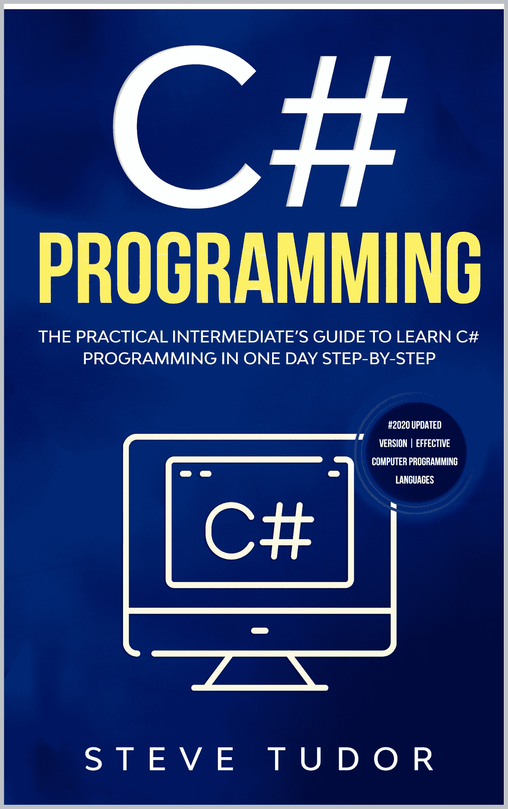

# C#：一天内分步学习 C# 编程的实用中级指南（#2020 更新版 ｜高效计算机编程语言）





# 法律声明与免责声明

本书所包含的信息及其内容并不旨在取代或替代任何形式的医疗或专业建议；也不旨在替代可能需要的独立医疗、财务、法律或其他专业建议或服务的需求。书中的内容和信息仅供教育和娱乐之用。

书中所包含的内容和信息编译自被认为可靠的来源，根据作者的已知、信息和相信，它是准确的。然而，作者无法保证其准确性和有效性，并不对任何错误和/或遗漏承担责任。此外，根据需要，会对本书进行定期更改。在适当和/或必要的情况下，在使用本书中任何建议的方案、技术或信息之前，您必须咨询专业人士（包括但不限于您的医生、律师、财务顾问或其他此类专业顾问）。

在使用本书包含的内容和信息时，您同意使作者免受任何损害、成本和费用，包括因应用本书所提供的任何信息而可能导致的任何法律费用。本免责声明适用于由于直接或间接使用和应用所呈现的任何建议或信息而导致的任何损失、损害或伤害，无论是由于违约、侵权、过失、人身伤害、刑事故意或其他任何诉讼原因。您同意接受使用本书中呈现的信息的所有风险。您同意通过继续阅读本书，在适当和/或必要的情况下，在使用本书中任何建议的方案、技术或信息之前，您将咨询专业人士（包括但不限于您的医生、律师或财务顾问或其他所需的顾问）。

# 引言

`C` 是一种通用的高级编程语言，非常适合用于创建各种固件或可移植应用程序。`C` 是最常用的编程语言之一，也是现有最古老的语言之一。它促成了如 `C++` 等其他语言的诞生。由于其强大和灵活性，它是首选语言之一。尽管具有低级特长，`C` 的设计初衷是促进跨平台编程，并获得了巨大的关注，即使在学术界也是如此。它还被标准化并成为 `POSIX`（可移植操作系统接口）的一部分。

使用 `C` 创建的第一个主要作品实际上是 `Unix` 操作系统。正如此，`Unix` 一直与 `C` 联系在一起。然而，今天 `C` 已经独立于 `Unix`，但仍被认为是每个程序员都应该使用的重要语言。学习 `C` 编程是好的；它已经存在很长时间了，但因为它是一种低级语言，所以它仍然非常强大且有用。它是更好地学习其他语言的极佳方式。你会发现迁移到其他编程语言很容易。`C` 对于应用程序开发也相对容易使用。

# C 语言特性

C 编程语言提供了哪些特性？以下是其中：
- 它具有这种基本的模块化形式；文件可以被单独链接和编译。
- 你拥有一组数量的关键字，包括控制原语即 `if`、`for`、`switch`、`while` 和 `do while`。
- 一个语句中可以使用不同的赋值。
- 它提供了不同的数学和逻辑运算符，以及位操作符。
- 如果不需要，你可以选择忽略函数的返回值。
- `C` 的类型是静态的，但执行较弱。所有数据都有类型，但可能被隐式转换，例如将字符作为整数使用。

# 第 1 章：数据类型

在 C 编程语言中，数据类型是指用于声明不同数据类型的变量或函数的框架。变量的类型决定了它将占据空间的大小以及存储其中的位模式如何被使用。数据类型的基本分类如下：

- **基本类型**：它们是处理数字的类型，由以下两种类型组成：(a) 整数类型和 (b) 浮点类型。
- **枚举类型**：它们也是数字类型，用于描述在整个系统中必须分配离散数值的变量。
- **Void 类型**：关键字 `void` 表示无法赋值。
- **派生类型**：它们包括 (a) `Array`（数组）、(b) `Pointer`（指针）、(c) `Union`（联合）、(d) `Structure`（结构）和 (e) `Function`（函数）。

数组和结构数据类型也被称为聚合类型。函数的类型定义了函数终止时返回的值类型。我们将在后续章节中讨论基本数据类型。

## 整数类型

以下是该类别数据类型列表。此外，还规定了它们占据的存储空间和范围供参考。

- `char`:
    - 分配内存：1 字节
    - 范围：-128 到 127 或 0 到 255
- `signed char`:
    - 分配内存：1 字节
    - 范围：-128 到 127
- `unsigned char`:
    - 分配内存：1 字节
    - 范围：0 到 255
- `int`:
    - 分配内存：2 或 4 字节
    - 范围：-32,768 到 32,767 或 -2,147,483,648 到 2,147,483,647
- `short`:
    - 分配内存：2 字节
    - 范围：-32,768 到 32,767
- `unsigned short`:
    - 分配内存：2 字节
    - 范围：0 到 65,535
- `unsigned int`:
    - 分配内存：2 或 4 字节
    - 范围：0 到 65,535 或 0 到 4,294,967,295
- `long`:
    - 分配内存：4 字节
    - 范围：-2,147,483,648 到 2,147,483,647
- `unsigned long`:
    - 分配内存：4 字节
    - 范围：0 到 4,294,967,295


要获取变量或数据类型的精确大小，你可以利用 `sizeof` 运算符。声明 `sizeof(<data type>)` 会产生该数据类型或变量以字节为单位的大小。下面是一个示例，阐述了下文将讨论的概念：

```c
#include <limits.h>
#include <stdio.h>
int main() {
    printf("Data type char (size in bytes): %d \n", sizeof(char));
    return 0;
}
```
编译并执行此代码后，你将得到以下输出：
Data type char (size in bytes): 1

## 浮点数据类型
以下是属于此类别的的数据类型列表。此外，我们还列出了它们占用的存储空间、范围和精度值供你参考。

- **float**
    - 分配内存：4 字节
    - 范围：1.2e-38 到 3.4e+38
    - 精度：6 位小数
- **double**
    - 分配内存：8 字节
    - 范围：2.3e-308 到 1.7e+308
    - 精度：15 位小数
- **long double**
    - 分配内存：10 字节
    - 范围：3.4e-4932 到 1.1e+4932
    - 精度：19 位小数

名为 `float.h` 的头文件定义了允许你使用这些数据类型值的宏。以下代码将允许你找到你的系统中相关数据类型所分配的精确内存（字节数）。

```c
#include <float.h>
#include <stdio.h>
int main(){
    printf("Allocated Memory for float : %d \n", sizeof(float));
    printf("Precision: %d\n", FLT_DIG );
    printf("Max Range Value: %E\n", FLT_MAX );
    printf("Min Range Value: %E\n", FLT_MIN );
    return 0;
}
```
编译并执行此代码后，你将得到以下输出：
Allocated Memory for float : 4
Precision: 6
Max Range Value: 3.402823E+38
Max Range Value: 1.175494E-38

## void 类型
`void` 数据类型表示没有可访问的值。它被用于以下三种情况之一：

- **函数返回 void**
你可能已经经常注意到将 `void` 数据类型用作函数的返回类型。如果没有，随着你 C 语言经验的增加，你会看到它的广泛使用。`void` 数据类型意味着函数将不返回任何内容。此类实现的示例如下：
```c
void print(int);
```

- **作为 void 的函数参数**
C 语言中有不同的函数不接受任何参数。没有参数的函数可以声明为 `void`。此类实现的示例如下：
```csharp
int print(void);
```

- **指向 void 的指针**
类型为 `void *` 的指针表示变量的位置。例如，考虑以下声明：
```c
void *malloc( size_t size );
```
此函数返回一个指向 `void` 的指针。换句话说，此函数可以返回指向任何类型位置的指针。你现在可能无法完全理解 `void` 数据类型的用途和意义。但是，随着学习的深入，你会发现更容易在代码中关联和使用这种数据类型。

# 第 2 章：数据结构、处理与函数

## 数据结构的简介与意义
在本章中，我们将学习数据结构的定义及其在 C# 编程语言中的重要性。我们将学习数据结构的重要性，以及在编程过程中何时以及如何使用它们。同样重要的是，一个出色的程序员会使用非常合适的数据结构来编写高效且有效的程序。

编程由两个主要部分组成：算法和数据结构。这解释了为什么这两个部分部分受到更多的关注。一个优秀的开发者或软件工程师应该是对数据结构拥有丰富技能和知识，并在编程方面表现高效的人。

在深入研究数据结构之前，有几个术语我们需要了解并理解，以便成为优秀的开发者。**算法复杂度**——这可以定义为一种标准，用于检查算法执行和评估的操作计数，该计数是输入数据大小的函数。这种标准通常用 `O (f)` 符号表示，称为“大 O 表示法或渐近符号”。复杂度有许多类型，如常数、对数、指数、线性、三次和二次。

## 枚举、数组和结构体

### 枚举
这可以定义为一种数据类型，通过将项目等价分配给标识符（例如一个名称）来指定数量。这是通过考虑规范或枚举组件的基类型的底层模式来实现的。枚举的声明可以如下所示：

```csharp
enum Months { January, February, March, April, May, June, July, August, September, October, November, December };
```

## 理解我们的代码
上面的代码描述了枚举的元素，这些元素显示为常量如下所示：
```csharp
Month = Month.January;

if (month == Month.February)
{
    Console.WriteLine("Programming with C# through the months of the year is easy!");
}
```
当为指定或枚举的项目没有显式赋值时，第一个元素始终为零。随后的元素将采用 0 之后的连续值。另一方面，源自整型的特定值始终可以分配枚举的特定元素，如下所示：

```csharp
enum Age { Baby = 0, Adolescence = 13, Youth = 18 };
```
```csharp
Age age = Age.Adolescence;
Console.WriteLine("You are an adolescence at the age of {0}.", (int)age);
```
此外，当分组函数特定于某组时，枚举中底层的值通常不被使用。

### 数组
这是对相似类型或具有相似特征的项目组的表示。数组的声明取决于常量和变量。需要注意的是，一旦声明了数组长度，在声明后就无法更改，如下：

```csharp
// 一个长度由常量定义的数组
int[] integers = new int[10];

int length = 0;
System.Console.Write("what is the length of array? ");
System.Console.ReadLine(length);

// 这是一个数组。它的长度通过变量定义
double[] doubles = new double[length];
```

### 结构体
用于声明结构体的关键字是 `struct`。它们被视为对象的轻量级容器。它们通常适用于需要不同类型变量集合的数据。结构体可以与类比较。结构体拥有方法、构造函数和接口。其他主要区别包括：

- 结构体通常是值类型，而类被认为是引用类型。
- 与类相比，结构体不能继承。
- 与类相比，结构体需要的内存空间更少且更更。
- 即使不需要，结构体也有强制性的默认构造函数，而类则允许隐藏构造函数。

结构体的声明如下：
```csharp
struct Girl {
    public string name;
    public System.DateTime birthDate;
    public int heightInMtrs;
    public int weightInGrams;
}
```
Person 结构体的用法如下：
```csharp
Girl dana = new Girl();
dana.name = "Dana Programmer";
dana.birthDate = new DateTime(1975, 8, 19);
dana.heightInMtrs = 1.75;
dana.weightInGrams = 50000;

if (dana.birthDate < DateTime.Now)
{
    Console.WriteLine("Dana Programmer is a genuine programmer!");
}
```
下面的示例展示了如何在结构体中使用构造函数进行初始化：
```csharp
using System;

struct Girl {
    string name;
    DateTime birthDate;
    int heightInMtrs;
    int weightInGrams;

    public Person(string name, DateTime birthDate, int heightInMtrs, int weightInGrams) {
        this.name = name;
        this.birthDate = birthDate;
        this.heightInMtrs = heightInMtrs;
        this.weightInGrams = weightInGrams;
    }
}
```


```java
public class StructWeeklyBookSample
{
    public static void Main()
    {
        Person dana = new Person("Dana Programmer", new DateTime(1975, 8, 19), 1.75, 50000);
    }
}
```

总之，出于性能考虑，结构体（structs）是最好的。当它们持有的数据量为 16 字节时工作效果最好，但如果程序员不确定，也可以使用类（classes）。

# 使用算法复杂度分析数据结构之间的关系

此时，我们将通过算法复杂度来学习和比较不同的数据结构。我们将遇到如搜索、添加、删除以及通过索引访问数据等操作。这有助于我们在编程或开发代码时选择使用哪种数据结构。下表展示了不同复杂度下的基本操作情况：

| 数据结构 | 搜索 | 增加 |
| :--- | :--- | :--- |
| 数组 | O(N) | O(N) |
| 动态数组 | O(N) | O(1) |
| 链表 | O(N) | O(1) |
| 栈 | - | O(1) |
| 队列 | - | O(1) |
| 平衡搜索树 (set) | O(log(N)) | O(log(N)) |
| 哈希表 (set) | O(1) | O(1) |
| 平衡搜索树 (Dictionary) | O(log(N)) | O(log(N)) |
| 哈希表 (dictionary) | O(1) | O(1) |


# 何时选择数据结构

在本书的这一章节，我们将讨论使用上表列出的数据结构的情况。

## 数组 (Array)
如前所述，它是相似类型数量组件的组合或集合。我们也可以将数组称为“具有定义大小的小型数据容器”。如表所示，向数组中添加新元素是一个非常缓慢的过程。为了成功完成这一操作，需要分配特定的空间，并留出一个可以将数据从一个数组传输到另一个数组的额外空间。搜索也是一个缓慢的过程，因为比较是根据需要的值进行的。从数组中删除元素也是一个缓慢的过程，因为它是添加过程的反向。在这种情况下，会分配固定的内存并减去一个空间。然而，访问数组非常快且高效，因为它利用了索引。数组最适合处理固定数量的组件，且需要通过索引访问这些组件的情况。

## 动态数组 (Dynamic Arrays)
这是现代编程中最常用的数据结构类型。这是因为避免了固定组件列表，并允许通过索引直接访问数据。动态数组也可以被称为“数组或可调整大小的列表”。动态数组通常在数组的列表中存储元素。这种数组的优势是列表的大小大于存储组件的数量。向动态数组中添加元素需要特定的常数时间。这是因为在添加组件之前总有一个空单元格。搜索动态数组是一个缓慢的操作，因为需要遍历所有存储的组件以找到查找的内容。从动态数组中删除元素是一个缓慢的过程。该命令的执行使用线性时间完成。另一个原因是，一旦进行了删除，存储的元素就会向左移动，以便为添加创建一个空单元格。动态数组用于需要快速添加和通过索引访问的情况。

## 链表 (Linked lists)
这些可以是单链表或双向链表。单链表和双向链表的主要功能是通过维护它们的顺序来存储组件集合。它们在内存中表示为动态的、基于指针的。向链表添加元素是一个非常快的过程。尽管它比动态数组慢，但它是一个更高级的过程。这是通过新分配内存空间实现的。这是一个始终不可预测的高速过程。搜索是非常缓慢的过程，因为它使用了与动态数组相同的原理，在搜索期间遍历所有元素。删除元素是一个缓慢的操作。这是因为在删除之前要先进行搜索，因此索引过程使其通常变得很慢。总之，链表具有快速的添加过程。它适用于在链表两端都需要以更快的速度进行添加和删除的情况。

## 栈 (Stack)
这是一个线性数据结构，具有三个主要步骤：向特定栈的顶部添加组件（`push`）、从特定栈的顶部移除组件（`pop`）以及在不干扰顺序的情况下检查栈顶组件（`peek`）。栈的添加和删除是非常快的过程，因为它们使用了常数时间。栈不具备搜索和通过索引访问的功能。它通常遵循 LIFO（后进先出）技术。栈适用于 LIFO（后进先出）的情况。

## 队列 (Queue)
这是另一种线性数据结构类型，特定于两种操作：向尾部添加组件（`enqueue`）和从头部提取组件（`dequeue`）。这两个过程是快速的，因为它们利用了常数时间。这里的操作与链表的添加和删除过程相似。队列使用 FIFO（先进先出）技术，即通常先进入先出。与栈类似，队列不支持搜索和索引访问。除了 FIFO，队列还引入了广度优先搜索（BFS）的概念。它从列表中的第一个组件开始，因此其周围的组件在队列中对齐。队列适用于 BFS 和 FIFO 应用的情况。

## 哈希表（字典实现）Hash table (Dictionary Implementation)
字典实现意味着存储键值对并通过上述的键进行搜索。字典实现的格式使得哈希表具有非常快的添加、搜索和删除过程。然而，哈希表不支持通过索引访问，因为哈希表的组件没有特定的顺序。组件存储在数组中，并通过哈希函数进行定位。重要的是，如果函数是错误的，或者它导致了单个单元格的冲突，那么整个实现就会变得低效。哈希表是最快的数据结构。这是因为内核提供了通过键进行快速添加和搜索。哈希表适用于需要快速添加以及通过键进行快速搜索的情况。

## 哈希表（集合实现）Hash table (Set implementation)
这种数据结构是一个没有重复组件的集合或分组。该数据结构中发生的基本过程是向集合中添加组件、在集合中搜索组件以及从集合中删除或移除组件。这是一种包含键的特殊哈希表。同样重要的是不支持使用索引进行搜索。使用糟糕的哈希函数也是如此。当这种情况发生时，整个程序将变得低效。这种情况很少发生。哈希表适用于向集合或集合中快速添加组件的情况。它也适用于检查和识别不属于特定数据集的组件。

## 平衡树（字典实现）Balance Tree (Dictionary Implementation)
这是一种存储键值对的数据结构，其中使用的键是经过排序的。它支持更快的添加、搜索和删除过程。该数据结构中使用的算法复杂度是对数级的。函数冲突不会像哈希表那样广泛地影响数据结构。在平衡树中，错误和使用糟糕哈希函数的概率极低。显而易见，字典实现的平衡树具有快速的基础操作。由于操作更快，启用了提取功能，这在字典实现中也是首要的。字典实现的平衡树适用于对通过特定键排序的组件进行快速添加、搜索和提取的情况。

## 平衡树（集合实现）Balance tree (Set implementation)
这是一种特殊的数据结构，具有红黑树实现，键和值始终一致。与字典实现类似，集合实现使用了对数算法复杂度。总之，集合实现的平衡树适用于需要快速添加和检查组件的情况。此外，集合的组件是按升序排列的。

# 选择数据结构的实际示例 Practical Example of choice of a Data Structure

## 示例 1
在这个小节中，我们将检查几个实现的数据结构示例。我相信这将开我们在数据结构选择方面的眼界。第一步是生成集合的子集，例如；`W = {Sea, wine, computer, joy}`。我们的目标是创建一个简单的代码来输出 `W` 的子集。我们从空集 `{}` 开始。我们将空集添加到集合 `W` 的每一个组件中，得到下面的集合；`{sea}, {wine}, {computer}, {joy}`。然后我们将集合 `W` 中的每个元素添加到子集中，以使那些尚未包含在内的元素能够反映在两个元素子集中。添加的程度是自由的，直到达到 元素子集 `{sea, wine}, {sea, computer}, {sea, joy}, {wine, computer}, {wine, joy}, {computer, joy}`。

此时，我们将关注并选择正确的数据结构来实现上述算法。为了选择正确的数据结构，我们将考虑需要执行的操作类型。目前，要执行的主营操作是遍历集合（子集）的所有组件。此操作可以通过 `array`、`dynamic array`、`hash tables` 以及几乎所有其他数据结构高效地完成。

i) 我们将首先考虑 `array`，因为它是最简单处理的数据结构。
ii) 选择数据结构后的下一步是为存储一个子集（例如 `{beer, money}`）选择标准。
iii) 在这里我们检查能高效执行该子集的操作。要执行的操作是添加和检查组件。根据我们之前的知识，我们知道 `arrays` 和 `linked lists` 搜索速度更快。我们选择在添加和搜索方面快速的数据结构。
iv) 我们选择了 `hash table (set implementation)`，并因此保持子集中单词的集合或分组如所示；`{sea, wine}, {sea, computer}, {sea, joy}, {wine, computer}, {wine, joy}, {computer, joy}`。
v) 使用所选结构，添加和遍历组件是非常高效的。此时我们注意到其他数据结构如 `stacks`、`Sets`、`queue` 和 `list` 也符合这一特征。另一方面，如果我们进一步研究，会发现这个集合 W 是使用 FIFO 技术运行的。此时我们选择了 `queue`。
vi) 最后，我们得到 `queue` 是该程序的最佳数据结构。

使用队列数据结构
我们可以通过以下过程来说并描述该算法：
i) 用空集 `{}` 初始化队列
ii) 出队子集的组件。根据其所在的子集将 `W` 中的每一个元素添加进去。
iii) 重复直到队列为空。

显而易见，一旦开发者理解了程序的需求并因此选择了正确的数据结构，实现将变得非常快速和简单。下面的示例是应用正确数据结构后程序看起来的样子：

```
string[] words = {"sea", "wine", "computer", "joy"};
```


```csharp
Queue<HashSet<string>> subsetsQueue =new Queue<HashSet<string>>();

HashSet<string> emptySet = new HashSet<string>();

subsetsQueue.Enqueue(emptySet);

while (subsetsQueue.Count > 0){

    HashSet<String> subset = subsetsQueue.Dequeue();

    // Display the current subset
    Console.Write("{ ");

    foreach (string word in subset)
    {

        Console.Write("{0} ", word);
    }

    Console.WriteLine("}");

    // Generating and enqueuing all possible child subsets
    foreach (string element in words)
    {
        if (! subset.Contains(element))
        {
            HashSet<string> newSubset = new HashSet<string>();
            newSubset.UnionWith(subset);
            newSubset.Add(element);
            subsetsQueue.Enqueue(newSubset);
        }
    }
}
```

当程序通过编译器运行时，将显示以下内容：{{ }
{ sea }
{ wine }
{ computer }
{ joy }
{ sea wine }
{ sea computer }
{ sea joy }
{ wine sea }
…

## 理解我们的代码
上述代码执行成功，但存在一个主要问题。`W` 的某些子集被显示了两次。例如；{sea wine}` 和 `{wine sea}` 是同一个子集。我们的代码遇到了重复的问题。

## 我们如何克服重复？
为了克服重复问题，我们使用如下所示的索引：
sea → 0
wine → 1
computer → 2
joy → 3

此外，我们将按照升序顺序使用它们的索引来生成子集。在此时，我们将避免使用 `Hash` 表并实现 `List`。这将使索引按升序排列。在选择列表后，我们的程序将查看以下内容：

```csharp
using System;

using System.Collections.Generic;

public class Subsets
{
    static string[] words = { "ocean", "beer", "money", "happiness" };

    static void Main()
    {

        Queue<List<int>> subsetsQueue = new Queue<List<int>>();
        List<int> emptySet = new List<int>();
        subsetsQueue.Enqueue(emptySet);

        while (subsetsQueue.Count > 0)
        {
            List<int> subset = subsetsQueue.Dequeue();
            Print(subset);

            int start = -1;
            if (subset.Count > 0)
            {
                start = subset[subset.Count - 1];
            }

            for (int i = start + 1; i < words.Length; i++)
            {
                List<int> newSubset = new List<int>();
                newSubset.AddRange(subset);
                newSubset.Add(i);
                subsetsQueue.Enqueue(newSubset);
            }
        }
    }

    static void Print(List<int> subset) 
    { 
        Console.Write("[ ");
        for (int i=0; i<subset.Count; i++) 
        {
            int index = subset[i];
            Console.Write("{0} ", words[index]);
        }
        Console.WriteLine("]");
    }
}
```

在通过编译器运行程序后，它将显示以下输出：
[ ]
[ ocean ]
[ beer ]
[ money ]
[ happiness ]
[ ocean beer ]
[ ocean money ]
[ ocean happiness ]
[ beer money ]
[ beer happiness ]
[ money happiness ]
[ ocean beer money ]
[ ocean beer happiness ]
[ ocean money happiness ]
[ beer money happiness ]
[ ocean beer money happiness ]

## 示例 2- 电话簿中的数字排序
这里我们有一个包含文本的文件，其中包含人员身份信息，如姓名、居住城市和手机号码。下表显示了信息：

| 姓名 | 城市 | 手机号码 |
| :--- | :--- | :--- |
| Kennedy | Nairobi | 1-234-567-8911 |
| Silas | Lusaka | 2-345-678-9112 |
| Joseph | Jerusalem | 3-456-789-1112 |
| Diana | Kisumu | 4-567-891-2345 |
| Winston | Migori | 5-678-912-3456 |

**任务：** 编写代码以按字母顺序显示所有城市名称，并为每个城市按字母顺序打印所有人的姓名及其相应的电话号码。

对于上表所示的示例，有许多解决方案。我们将利用在之前的主题中学习的关于数据结构的知识来解决这个问题。我们将使用 `Dot Net Framework` 中的数据结构示例。

根据代码要求，我们需要对城市名称进行排序。为了实现排序，我们需要考虑数据结构。在这种情况下，我们可以考虑平衡树实现或字典实现。结果是电话簿将包含人员的姓名。我们将键（Key）设置为姓名，值（Value）设置为相应的手机号码。

以下是使用字典实现的程序示例：

```csharp
// 读取文件并构建电话簿
SortedDictionary<string, SortedDictionary<string>> phonesByTown = new SortedDictionary<string, SortedDictionary<string>>();
StreamReader reader = new StreamReader("PhoneBook.txt");
using (reader)
{
    while (true)
    {
        string line = reader.ReadLine();
        if (line == null)
        {
            break;
        }
        string[] entry = line.Split(new char[]{''});
        string name = entry[0].Trim();
        string town = entry[1].Trim();
        string phone = entry[2].Trim();

        SortedDictionary<string, string> phoneBook;
        if (!phonesByTown.TryGetValue(town, out phoneBook))
        {
            // 这是一个新城市。为它创建一个电话簿
            phoneBook = new SortedDictionary<string, string>();
            phonesByTown.Add(town, phoneBook);
        }
        phoneBook.Add(name, phone);
    }
}

// 按城市打印电话簿
foreach (string town in phonesByTown.Keys)
{
    Console.WriteLine("Town " + town + ":");
    SortedDictionary<string, string> phoneBook = phonesByTown[town];
    foreach (var entry in phoneBook)
    {
        string name = entry.Key;
        string phone = entry.Value;
        Console.WriteLine("\t{0} - {1}", name, phone);
    }
}
```

如果编译器运行代码，将显示相应的输出：
Town Portland:
Mary - 1-234-765-1983
Town San Antonio:
Laura - 1-454-345-2345
Paul - 1-535-675-6745
Town Virginia Beach:
Donna - 1-387-387-2389
Kenneth - 1-541-754-3010

## 总结（如何选择合适的数据结构）
在目前的学习阶段，显然数据结构的选择取决于所编写程序的目标。在另一个场合，我们注意到可以通过组合数据结构来实现特定的情况和结果。

在选择特定的数据结构之前，自己问自己几个问题。这些问题包括：
* 我在程序中将执行哪些操作？
* 要执行的操作需要哪种类型的结构？
* 我熟悉 `C#` 编程语言中存在的所有数据结构吗？
* 我的程序需要单一数据结构还是多个数据结构的组合？


总之，选择数据结构是一个重要的一步。建议在选择特定的数据结构之前，你应该先设计好算法。千万不要先选择数据结构，再反过来去推导算法。

# 第 3 章：如何在 C# 中定义类

在涉及到 C# 语言以及其他语言时，类是我们能够完成的最最重要的事情之一，它能确保我们的代码按照我们想要的方式运行。让我们来看一下，当我们真正开始工作定义这种语言中的类时，我们可以做些什么。

## 如何使用这些类

当你准备好使用 C# 编程语言时，类将是非常重要的部分，因为它是能够定义你在程序该点可以直接使用的对象类型和数据类型的部分。对象可以帮助我们包含定义类的信息，或者是该对象所存在的容器。

这些类非常棒，因为它们将保存我们此时需要的大量信息。它们不仅会持有对象，还可以持有描述这些对象特征和行为的信息。这些都是我们在开发过程中希望对象处理的所有行为。当我们使用面向对象编程（OOP）语言时，你将希望可以使用帮助我们实现这些的方法。

所以，我们在这里首先需要查看的是出现在类中的一些组件。在使用这些类时，当需要处理这些类时，会有许多不同的组件发挥作用。在处理类时，我们可以关注以下几个部分，包括：

*   **声明（Declaration）**：这一行将声明类的标识符。
*   **正体（Body）**：就像方法一样，类将有一个单一的主体。你需要在声明之后定义正体。正体是位于花括号之间的语句或多个语句。示例如下：
```csharp
class Example{//这是“Example” 类的正体。}
```
*   **构造函数（Constructor）**：这部分允许你创建一个新对象。示例如下：
```csharp
Public Sample(){//在此处插入你想说的内容。}
```
*   **字段（Fields）**：这些你在类内部声明的变量。字段将包含代表试图获取的对象的精确状态的值。
*   **属性（Properties）**：这部分将描述类的不同属性。许多程序员会将类属性直接写在所选对象的字段内部。
*   **方法（Methods）**：方法基本上是一个可执行的具命名代码块。它能够完成某些任务，并允许对象获得正确的行为。它还可以执行代码内部存在的正确算法。

在我们深入研究这些类并开始创建我们自己的类之前，你应该确保已经有一个可以放入其中的对象。你可以通过借助 `new` 关键字来实现这一点，然后你可以添加工作时所需的所有构造函数。

当我们在 C# 语言中创建这些代码时，你无法直接对你尝试创建的对象进行任何操作。相反，你需要提前将对象分配给正确的对象，这样你以后就可以无问题地处理你想要的所有操作。记住，当你想要访问与对象相关的方法和属性时，你需要指示编译器哪个标识符与对象对应，然后确保存在点操作符。

## 组织类

在这里，我们学习使用正确的方法来组织我们想要在此类语言中工作的类是非常重要的。我们主要只需要遵循一条规则来确保其正常工作，那条规则就是：我们需要确保类被保存为 `.cs` 文件。这使得它们在以后我们想要提取它们时更容易被找到和处理。

从技术上讲，C# 语言允许我们将程序中创建的所有类都保存在一个大文件中，编译器能够无错误地读取整个文件。但许多程序员发现，将类保存在各自的独立文件中，在以后需要时更容易提取这些类，并且可以保持事物更有条理。你可以根据自己喜欢的方法进行此选择。

我们在这里使用的另一个为了更熟悉 C# 运行的工具是 `namespace`（命名空间）。这是一组以某种方式相关的类。这些类之间的关系方式将根据我们使用它的情况而改变，但它们之间的关联逻辑上应该是合理的。这些可能包括它们的类、结构体、接口，甚至是放在内部的某些信息。我们甚至可以将其中的几个类放在在一起创建我们自己的 `namespace`，即使它们被分类在计算机内存的不同部分。

如果你正要在之前过的某些代码上创建一个新的 `namespace`，你需要确保使用 `using` 指令来让事情变得简单一点。大多数程序员会发现将其放在文件的最几行比较容易。这确保了你以后不会不小心忘记这些。在插入此指令后，你就可以去声明 `namespace` 了。

## 如何访问我们的类

我们在处理类时最后要考虑的问题是如何访问它们。C# 允许我们使用四种不同的修饰符来决定谁可以访问我们的每个类。这些包括 `protected`、`private`、`internal` 和 `public`。这些修饰符将有助于更容易控制谁能够看到你正在处理的类中的每个元素。确保这些都能正常工作的最佳方法包括：

*   **私有的（private）**：这是对你的类之一施加严格限制的修饰符。如果类被标记为 `private` 类，它将无法被代码中的其他类访问。如果你没有在那里放置任何其他内容，C# 语言将使用它的默认修饰符。这有助于在你忘记添加该修饰符时避免问题。
*   **公共的（public）**：你也可以将类设置为 `public`。这意味着该修饰符告诉其他类它们可以访问该类。这个修饰符将移除所有关于该类对外可见性的限制。
*   **内部的（internal）**：如果你的代码带有 `internal` 修饰符，这意味着类是可以访问的，但仅限于同一个项目中的文件。
*   **保护的（protected）**：如果你想防止用户访问该元素，就会使用这种修饰符。但是它允许所有的后代类在需要时访问该类的元素。


正如你所看到的，这些元素中的每一个都将根据你对类隐私性的要求，以略有不同的方式工作。如果你想确保类保持私密，并且不允许任何其他内容获取或使用其中的信息，那么你将需要使用 `private` 设置。然而，如果你需要其他类能够处理这个特定的类，那么将其更改为 `public` 修饰符也是完全可以的。在我们学习一些程序时，你应该考虑哪种修饰符对于你所编写的代码是最合适的。如果你没有为类添加这些修饰符之一，默认情况下它是 `private`。这对于你的代码来说并不是什么坏事，但如果你有其他选项，就需要进行更改。

记住，这些类在编写某些代码时是非常重要的，它们将有助于容器的良好组织，并确保你能够轻松提取代码中所需的内容。这使得你的代码运行得更好，在其他 语言（如 `C#`）中编写代码也会变得更加容易。当你选择想要使用的循环对象时，需要记住这些对象并不总是完全相同的，但只要它们在逻辑上是合理的即可。例如，在我们之前处理过的 `Toys` 类中，你不需要把它们都放进去，只要符合规则，循环就能正常工作。只要这些对象彼此匹配，结果将没问题。

在 `C#` 语言中，当你想要实现某些代码时，循环是非常重要的一部分。重要的是，我们需要查看我们想要执行的循环，但我们需要以正确的方式编写它们，并确保我们使用了正确的对象。

# 第 4 章：在 C# 中创建循环

在许多 OOP 语言中，你会发现创建循环是一件很棒的事情，因为它允许你将大量代码整合到几行中，从而节省了时间并避免了麻烦。在本章中，我们将详细查看这些循环的本质、如何创建它们，以及可用的不同循环类型。

当我们谈论循环时，它是一种用于执行语句的方法，根据条件的结果，语句可能会执行很多次。有时循环只会发生几次，有时它会执行多次，这取决于你希望代码中执行执行的次数。

在大多数情况下，你会发现你所使用的循环被分为两类。第一类是进入控制型循环（entry-controlled loops），这些循环包括 `for` 循环和 `while` 循环。为了看到它们的工作原理，你需要在代码的开头测试相应的条件。编译器会首先检查该条件，如果是真的，它就会运行循环。这对于你将处理的大多数循环都有效，但有时意味着你的循环根本不会运行，因为条件从未被满足。

让我们看看适用于此的循环。第一类型是 `while` 循环。测试条件位于循环的开头，然后执行我们处理的所有语句，直到给定的条件（布尔值）满足为止。当条件被认为为假时，`while` 循环就会停止。相反，它将移动到代码的下一个部分。

处理这种代码循环并不困难。我们将查看一个处理它的示例。查看语法并进行少量实验，看看它是如何工作的。你也可以查看代码 `while` 部分，它告诉我们循环从哪里开始。

```csharp
using System;
class whileLoop {
    public static void Main() {
        int x = 1;
        while (x <= 4) {
            Console.WriteLine("Geeks");
            x++;
        }
    }
}
```

通过这个示例，我们创建了一个打印三次 "Geeks" 的循环。`while` 循环告诉语法不要运行超过三次。如果我们让循环运行四次，条件将被认为为假，那么我们就无法得到过程中期望的结果。当打印一次时，这个结果为真；打印两次和三次时也是如此。但当程序再次进入循环时，似乎再进行一次迭代并再次打印术语将我们达到四，这超过了我们的需求。

你完全可以更改想要使用的术语，并确定你想在代码中看到什么种语句。同样，尽管尝试 `while` 循环，并确定你想执行多少次迭代以获得你想要的结果。

然后是时候转向 `for` 循环了。它在功能上与 `while` 循环相似，但它具有不同的语法。如果你在开始之前就已经知道循环语句执行执行次数，那么 `for` 循环将是首选的方法。

循环变量的初始化、要测试的条件以及循环变量的递增或递可以在循环的单行代码中完成，这有助于为我们提供一个更短、更易编写的循环结构。当你遇到问题或需要修复代码部分时，可能会发现这实际上是一种更容易调试的循环格式，因此它可能是你想要考虑使用的。现在，当我们要使用 `C#` 中的 `for` 循环时，会有几个不同的部分涉及到。这些部分包括：


### 1. 循环变量的初始化
在这一步中，将对控制循环的变量或表达式进行初始化。它是循环的起点。可以使用已经声明的变量，也可以声明一个仅局部当前循环的局部变量。

### 2. 测试条件
我们在这里需要关注的第二点是测试条件。我们将使用它来执行循环体中的语句。它被用于许多情况下，以测试循环的退出条件。它必须返回一个布尔值，这意味着我们将得到 `true` 或 `false` 的结果。当条件为 `false` 时，控制权将跳出循环，这种循环也就结束了。

### 3. 递增与递减
根据我们的要求，对循环变量进行递增或递减，当此操作发生时，控制权将再次回到测试条件。


在我们查看要执行的某些代码之前，需要注意的一点是，初始化部分在 `for` 循环开始之前只会被评估一次。如果你按照你希望看到的方式进行设置，那么这就足够了。考虑到这一点，让我们结合上面讨论的一些信息，并添加代码来观察这种循环是如何工作的。

```csharp
// 用于演示 for 循环的 C# 程序。
using System;
class forLoopDemo{
    public static void Main(){
        // for 循环从 x=1 开始
        // 持续运行直到 x <=4 为止
        for (int x = 1; x <= 4; x++)
            Console.WriteLine("GeeksforGeeks");
    }
}
```

既然我们刚刚讨论了 C# 中的一些进入控制循环，现在是时候转向我们在代码中可以使用的第二类型循环了。这些被称为**退出控制循环**（exit-controlled loops）。测试条件位于循环体末尾的循环被称为退出控制循环。这类循环中最广为人的是 `do-while` 循环。

在处理这些循环时，我们需要注意的一点是，由于测试条件位于循环体的末尾，退出控制循环的循环体至少会被评估一次。考虑到这一点，我们可以看看这里重点关注的 `do-while` 循环是如何工作。`do-while` 循环是一个实用的工具，但你可能会注意到它与我们将要看到的 `while` 循环有许多相似之处。`do while` 和 `while` 循环之间的主要区别在于，`do while` 会在通过并执行语句后才检查条件。这意味着它肯定会至少执行一次循环体，因为它会先运行循环，然后再检查条件是否已经满足，而不是在开始时就检查。

现在，我们需要花一点时间查看在使用 `do while` 循环时会看到的一些语法。这些语法非常好用，并可以为我们提供很多优秀的代码，但请看下面的示例，注意 `do` 和 `while` 部分出现的位置，以及它们之间显示了什么信息。

```csharp
// 用于演示 do-while 循环的 C# 程序
using System;
class dowhileloopDemo{
    public static void Main(){
        int x = 21;
        do{
            // 即使条件为假
            // 这一行也会打印
            Console.WriteLine("GeeksforGeeks");
            x++;
        }while (x < 20);
    }
}
```

我们还需要花时间考虑另一种选择，即**无限循环**（infinite loops）。这类循环的特点是，测试条件永远不会评估为假。这意味着它们将卡在循环中，并永远执行你放置的语句，直到你使用外部力量对其干预并确保它停止。

这在你没有实际为代码设置初初所需的某些条件时经常发生。你需要确保你立即添加了正确的条件，并将它们都保持在正确的位置，以确保你不会掉入此类循环的陷阱，从而避免在程序永远卡在那里之前不得不修复它。

为了让你看到如果你犯错并忘记本该有的条件时这种循环看起来像什么样，请看下面的代码，看看你是否能找到问题出在哪里。

```csharp
// 用于演示无限循环的 C# 程序
using System;
class infiniteLoop{
    public static void Main(){
        // 语句将被打印
        // 无限次
        for (;;)
            Console.WriteLine("This is printed infinite times");
    }
}
```

在你要处理的代码中，有时你可能需要在代码的同一部分将两个循环结合。。确保它们能够相互结合，并且运行直到两者都完成。这对于你想要编写的一些代码非常重要，例如在过程中创建你自己的乘法表。这些**嵌套循环**（nested loops，即一个循环位于另一个循环内部的良好示例包括：

```csharp
// 用于演示嵌套循环的 C# 程序
using System;
class nestedLoops{
    public static void Main(){
        // 循环中的循环打印 GeeksforGeeks
        for (int i = 2; i < 3; i++)
            for ( int j = 1; j < i; j++)
                Console.WriteLine("GeeksforGeeks");
    }
}
```

最后，在本章中我们将查看的最后一种循环被称为 `continue` 语句。这种语句非常有用，因为我们可以利用它在特定条件下跳过循环的执行部分，然后移动控制流，以便在需要时移动到下一个更新部分。在刚开始学习时，这可能看起来有点困惑，因此查看它的良好方法是查看下面我们需要整合在一起的一些代码。

```csharp
// 用于演示 continue 语句的 C# 程序
using System;
class demoContinue{
    public static void Main(){
        // 因为 continue 语句
        // GeeksforGeeks 只打印了 2 次
        for (int i = 1; i < 3; i++){
            if (i == 2)
                continue ;
            Console.WriteLine("GeeksforGeeks");
        }
    }
}
```

在处理 C# 时，有很多不同类型的循环，这是一件好事，因为在很多情况下你可能想在代码中引入这些循环，每种情况都需要不同类型的循环。好消息是，当你以适当的方式使用它们时，你将编写出所需的最佳代码，而不需要同时重写大量代码。花时间研究这些不同的循环以及它们能为你提供什么，并尝试几次，看看它们将如何适用于你自己的代码。

# 第 5 章 值类型与引用类型

C# 中的类型可以分为：**值类型**（value types）或**引用类型**（reference types）。每类类型之间的差异源于拷贝策略的差异，这导致每种类型在内存中的存储方式不同。

## 值类型
值类型涵盖大多数内置类型（具体来说，所有数值类型、`char` 类型和 `bool` 类型）以及自定义的 `struct` 和 `enum` 类型。这些类型都具有固定的大小，值类型的变量直接包含它们自己的值。

## 引用类型
引用类型包括所有类（class）、数组、委托（delegate）和接口（interface）类型，编译器以不同的方式处理它们。例如，以 `Circle` 类为例。一旦你声明一个 `Circle` 变量，编译器就会分配一小部分内存，可能存储持有 `Circle` 的额外内存块的地址（或引用）。只有当通过 `new` 关键字创建了实际的 `Circle` 对象后，内存被分配。

## 值类型与引用类型的拷贝
（注：由于原文此段逻辑混乱，此处基于技术背景进行语义翻译）
当你处理这些类型时，需要注意内存分配。值类型存储在栈（stack）上，而引用类型存储在堆（heap）上。当你拷贝值类型时，拷贝的是实际的值；当你拷贝引用类型时，拷贝的是内存地址。例如，如果你创建一个名为 `i` 的整数变量并赋值为 `42`，然后创建一个名为 `copyi` 的变量并赋值相同值，`copyi` 和 `i` 将持有相同的值。

## 空值（Null）
使用 `null` 关键字标识的空值表示该变量不引用任何有效对象。

## 可空类型（Nullable types）
值类型通常不能赋值为空，因为根据定义它们不持有引用。然而，C# 定义了一个修饰符，允许你声明一个可空值类型，并以类似的方式处理空值。

## Object 类
.NET Framework 中最重要的引用类型之一是 `Object` 类。为了完全理解 `Object` 类的意义，你需要理解继承——稍后会介绍。目前，`Object` 可以作为所有类型的别名。在随后的示例中，变量 `c` 和 `o` 引用同一个对象，`c` 的类型是 `Circle`，而 `o` 的类型是 `object`。

## 装箱（Boxing）
正如所述，类型为 `object` 的变量可以引用任何引用类型。然而，类型为 `object` 的变量也可以引用值类型。为了说明，以下语句将变量 `i`（类型为 `int`）初始化为 `42`：

```csharp
int i = 42;
object o = i; // 这里发生了装箱
```
在这里，由于类型为 `object` 的变量可以引用值类型的拷贝，装箱操作是将值从栈拷贝到堆上。

## 解箱（Unboxing）
因为类型为 `object` 的变量可以引用值类型的拷贝，所以通过变量获取该装箱值是合理的。通过简单的赋值将其转换为 `int`，例如：

```csharp
object o = 42;
int i = (int)o; // 这里发生了解箱
```

# 第 6 章 枚举（Enumerations）

`enum` 是开发者可以声明的一种值类型。`enum` 的关键特性是它在编译时声明了一组可以通过名称引用的常量值。这是一个 `enum` 的示例：

```csharp
enum Season { Spring, Summer, Winter }
```

一旦声明了枚举，你就可以像使用任何其他类型一样使用它。也就是说，如果枚举的名称是 `Season`，那么你可以在这里创建类型为 `Season` 的变量、字段和参数：

```csharp
enum Season { Spring, Summer, Winter }
class Example{
    public void Method(Season parameter) // 方法参数
    {
        Season currentSeason; // 本地变量
    }
}
```

为了读取枚举，必须给它赋值一个值。你可以像下面这样为枚举变量赋值值：

```csharp
enum Season { Spring, Summer, Winter }
Season colourful = Season.Autumn;
Console.WriteLine(colourful); // 输出 Autumn
```

# 第 7 章 决策（Decision-making）

在许多情况下，你需要仅在特定条件满足时执行语句块，或者在条件不满足时执行另一种。C# 支持许多决策结构，其变体是 `if...else` 结构。

## if 语句
`if` 语句是最基本的决策结构，用于测试条件。如果条件为真，则执行 `if` 块中的代码。

```csharp
int num = 5;
if (num > 3) {
    Console.WriteLine("Greater than 3");
}
```

## else 语句
如果 `if` 的条件不为真，则执行 `else` 块中的代码。

```csharp
int num = 2;
if (num > 3) {
    Console.WriteLine("Greater than 3");
} else {
    Console.WriteLine("Less than or equal to 3");
}
```

## else if 语句
当你有多个条件需要检查时，可以使用 `else if` 。

```csharp
int num = 10;
if (num > 15) {
    Console.WriteLine("Large");
} else if (num > 5) {
    Console.WriteLine("Medium");
} else {
    Console.WriteLine("Small");
}
```

## switch 语句
为了减轻多个 `if` 语句带来的复杂性，C# 提供了 `switch` 语句来测试变量。

```csharp
int day = 2;
switch (day) {
    case 1:
        Console.WriteLine("Monday");
        break;
    case 2:
        Console.WriteLine("Tuesday");
        break;
    default:
        Console.WriteLine("Other day");
        break;
}
```

## 嵌套语句（Nested Statements）
你可以在一个语句内部嵌套另一个语句，例如在 `if` 块中嵌套另一个 `if`。

```csharp
int x = 10;
if (x > 0) {
    if (x < 5) {
        Console.WriteLine("Positive and less than 5");
    }
}
```

# 第 8 章 数组（Arrays）

如果你希望存储许多相同元素，不想为每个元素创建一个单独的变量，那么数组是最好的格式。数组的标准定义是相同类型元素的集合。此外，元素的大小是固定的，且在内存分配上是顺序的。理解数组的良好方法是将其视为相同类型变量的集合。数组名称指向第一个元素，第一个元素的索引为 `0`。

## 声明数组（Declaring Arrays）
要声明数组，你需要使用以下语法：

```text
data_type[] name_array
```

在这里，`data_type` 是数组的数据类型，`name_array` 是用于访问数组的标识符，`[]` 是数组的或元素数量。数组声明的示例如下：

```csharp
double[] bal;
```

## 初始化数组（Initializing Arrays）
虽然数组声明告诉编译器要创建一个此名的数组，但实际上并未分配内存。只有在初始化数组后，才能为元素赋值。使用 `new` 关键字初始化数组：

```csharp
double[] bal = new double[5];
```

这初始化了类型为 `double` 且具有 5 个元素的数组。

## 赋值（Assigning Values）
正如我们提到的，可以通过在数组名称指定相关元素的索引来访问单个元素：

```csharp
bal[0] = 4.5;
```

这将数组 `bal` 的第一个元素初始化为 `4.5`。上述方法将单个元素初始化为特定值。初始化和赋值可以如下方式结合：

```csharp
double[] bal = {4.5, 66.7, 11.6, 34.0, 98.7};
```

或者，你也可以以这种方式执行此操作：

```csharp
double[] bal = {4.5, 66.7, 11.6, 34.0, 98.7};
```


# 状态 (State)
这些是定义对象的特征。可以是通用的，也可以是特定的。

# 行为 (Behavior)
这些是声明能够执行的所有动作的特征。为了让我们准确理解这一切是如何运作的，我们需要来看一个例子。假设我们正在观察一个球。这个对象的状态或定义其特征的特质包括它的颜色、材质和大小。这只球的行为指的是这只球能够做什么，例如弹跳、滚动等等。当你使用面向对象编程（OOP）语言时，你可以轻松地将技术和信息结合起来，并将它们视为同一整体进行处理。编程对象随后将匹配它在现实世界中的行为或外观，并且它会保留这些动作和信息以备后之用。

## 类 (Classes)
虽然我们将在稍后的章节中进一步讨论这一点，但在现在了解一下这些“类”是非常重要的。在这门语言中，“类”指的是定义上述对象所有特征的条目。这些类负责为你提供一个模型或结构，以便你能够有效地定义对象的本质。这些类通常被认为是 OOP 语言的基础，并且与对象紧密相关。另一个需要注意的点是，你使用的每个对象也可以代表一个特定的类。让我们来看看它是如何运作的，以便让你更容易理解。例如，我们有一个命名为 `Toys` 的类，而对象将是 `Ball`。在这个示例中，球是你所处理的 `Toy` 类的一个实例。然而，该类还将定义你添加到“类”中的所有“玩具”（包括“球”在内）的状态和行为。“类”听起来可能很复杂，但它们会让你的代码组织变得更容易处理，许多人经常将其视为几乎任何程序的基础。它们所持有的信息对于那些查看类内部的人来说是有意义的，这样他们就能准确了解它是什么。例如，如果你有一个命名为 `Toys` 的类，其他用户可以访问或查看该类，并看到放在代码中的所有项目或对象实际上都属于那里。它们不必完全相同，但将它们放在同一个类中应该是合逻辑的。类的功能是定义对象的行为，例如你希望该对象能够执行的动作类型。对象也将会有自己的特征或属性。你会发现属性以不同变量的形式出现在类体中，而行为则由位于类内部的不同方法定义。让我们通过检查之前说过的 `Toy` 类来看看它是如何运作的。当应用这些内容时，你将获得尺寸和颜色作为属性。为了让其起作用，你需要提取并使用 `move()` 和 `stop()` 方法。

# 如何在代码中使用这些类
我们已经花了一些时间讨论类以及你如何让它们在你的代码中运行，但现在我们需要花更多时间观察它们在整个程序中是如何运作的，以及它们对于改变你在代码中编写的内容有什么用处。当你使用 C# 编程语言时，你需要借助 `class` 关键字来定义所有的类，这不仅是为了确保一切运行正常，也是为了帮助使变得清晰简单。当你开始编写代码并输入 `class` 单词后，这时你应该指定你希望与变量关联的标识符，以及有助于确保这一切运行正常的方法。至于如何确保这一切保持简单，由于你正在处理这类代码，有一些特定的部分是你需要使用的。在 C# 中工作时，你需要添加到类中的不同部分包括：

## 字段 (Fields)
这些是任何属于特定数据类型的变量。

## 方法 (Methods)
你可以使用这些方法来操作数据。

## 属性 (Properties)


在这种编程语言中，属性将增强字段的性能。属性将为信息提供一些额外的管理能力，并将其传递给字段。此时，如果你能先查看一下如何创建类以及如何确保它们完全按照你的意愿运行，可能会更容易一些。我们现在来看一下这段代码将如何运行的示例，以及与之相关的不同理论。在这个示例中，我们将使用 `book` 作为类名，然后它将拥有 `size` 和 `type` 属性。该代码示例如下：

```csharp
Public class Book{
    Private string bookType:
    Private string size;
    Public string BookType{
        Get{Return this. bookType;}
        Set{This.bookType = value}
    }
    public string Size{
        Get{Return this.size;}
        Set{this.size = value;
    }
    public Book(){
        this.bookType = “Dictionary”;
        this.size = “large”;
    }
    public book(string bookType, string size){
        this.bookType = bookType;
        this.size = size;
    }
    public void Sample(){
        Console.WriteLine(“ Is this a {0}, bookType)
    }
}
```

现在，起初这看起来像是一段非常复杂的代码，你可能在担心如何保持这一切井井有条，或者是否完全理解如何使用它。不过，处理起来其实并不复杂，你可以使用其中包含的思路。通过这个示例，`Book` 类定义了两个不同的属性：书籍类型和大小。这些属性将值隐藏在同名的字段中，而代码段还声明了两个将在 `Book` 类上生成的构造函数。这段代码还会创建一个名为 `Sample()` 的方法。你可以将此代码用于许多不同的用途，例如根据需要添加更多特征，而且它并不限于书籍、玩具、车辆或任何其他物品。你可以随意使用你的文本编辑器来尝试这个公式，并用其他类对其进行修改，以便程序更更容易为你 own 工作。

## 如何创建你自己的对象
一旦你有了一个类来帮助你，就是时候创建一些你想要使用并放置在类中的对象了。创建自己的对象并不是为了增加难度，因此在本书的这部分，我们将花时间查看你入门需要了解的基础知识。

## 创建对象
在这里我们要做的第一的是创建一个你想放在现有类中的对象。为了实现这一点，你需要创建你自己的关键字。通常，程序员会选择为新对象分配一个变量，以便它保持与你想使用的类相同的数据类型。请记住，这样做不会将对象复制到右变量中，但它将帮助变量提供指向它现在所赋值对象的引用。为了确保这确实有效，请使用以下代码：

```csharp
Book someBook = new Book()
```

这是一个你可以使用的很好的示例，因为它会获取书籍的实例并将其分配给我们命名为 `someBook` 的变量。这将确保根据需要，对象具有正确的类。

## 系统类
如果你是刚开始接触 C# 语言的新手，你会发现这种语言已经内置了一个库。这个库包含了许多默认的类，如 `string`、`math` 和 `console`。当你开始更多地使用这种语言时，必须记住，库是你可以通过 `.Net` 应用程序轻松使用和访问的东西。你一定会喜欢 `.NET` 框架如何为你完成工作。这是因为 C# 所需的库已经提前安装好了。这些类是你可以一直使用的部分，当你开始学习该语言的一些基础知识（如网络、文本处理和执行）时，它们非常有帮助。这些类对于以前从未从事过编程的初学者也有帮助，因为它们是预先编写并被程序识别的，所以你不需要做那么多工作。

在处理这些类时你应该记住的一点是，它们会隐藏所有的逻辑实现。你需要更多地关注你的类可以做什么，而不是过度担心它们背后具体是如何实现这些点的机制。正因如此，C# 的内置类并不是程序员实际上可以查看的。你只需要将这些代码用于它们的通用用途，而不必过度担心它们究竟是如何运行的，因为那是你并不需要考虑的事情。

## 如何为对象分配参数
这种编程语言允许你为你创建的对象分配一些参数。这是一项非常容易的操作，你只需要具备基础语法就能确保它对你起作用。你需要使用的语法如下：

```csharp
Book someBook = new Book(“Biography”, “large”)
```

这段代码将创建一个名为 `someBook` 的新对象，并将两个不同的参数也分配给它。通过这种调整，对象的 `type` 现在是 Biography（传记），而大小现在是 large（大）。

每当你使用 `new` 关键字时，`.NET` 框架可以完成两件事：
- 它将为这个新对象保留一些内存
- 它将初始化对象的数据成员


这是一个由于构造函数方法而发生的过程。对于我们在上面编写的代码，我们立即设置的参数是“类构造函数”的参数。这确保了对象将留在你选择创建的类中，并为该对象提供正确的特征，使其能够正常运行。

## 释放你的对象
你需要关注的一点是学习如何释放你正在处理的对象。你将使用的其他某些语言会要求你手动遍历并释放对象，但在使用 C# 时，并不是必须的。这意味着你可以释放系统中任何占用过多内存的对象，而无需通过并手动销毁它们。你只需要使用可以在 `.NET` 框架内部找到的 `CLR` 系统来实现这一切。

当你使用 `CLR` 系统进行工作时，计算机可以自动检测并释放未被引用的对象。为这些对象保留的内存现在可以再次使用，你可以将其用于在代码内部创建的其他对象或变量。如果你想释放一个对象，应该停止并学习如何销相应的引用。以下是如何执行此操作的示例：

```
someBook = null;
```

这个过程并不意味着它会删除该对象，但它会确保所有对该对象的引用都被移除，这样 `CLR` 就可以在你处理完之后进行遍历并为你执行删除。这是一个非常棒的过程，因为它将帮助限制代码中出现的问题数量，并消除代码中可能出现的某些错误。

## 构造函数
我们在本章中讨论的最后一个主题是“构造函数”。这些构造函数基本上是程序在创建新对象时运行的方法。使用这些构造函数背后的想法是你可以使用它们来初始化新对象的数据。当你使用这种方法时，不会有任何价值的内容显示。此外，此构造函数将使用与它所属类相同的名称，这意味着你不需要在过程中尝试匹配几个随机名称。在 C# 中处理构造函数工作时，你还可以选择为它们分配正确的参数。

C# 自带的构造函数可以像你使用的该编程语言中的任何方法一样接受参数。你可以在类中设置好几个构造函数，但你始终需要检查构造函数是否来自不同类型和数量的参数。这将有助于确保每个参数都是唯一的。

在使用构造函数时，重要的是记住，每当你类中创建一个全新的对象时，这些构造函数就会运行。如果你正在处理的类内部有不同的构造函数，你可能想知道当代码中创建新对象时是哪个构造函数在运行。这种编程语言可以根据你正在操作的内容挑选出正确的构造函数，因此你不需要提供所有这些信息。编译器将接管，这样一切都会保持井然，而你不必为此感到太大的压力。

现在我们已经讨论了一部分构造函数，让我们来看一个在 C# 中它是如何工作的示例：

```csharp
public class Device{
    private string type;
    private string size;
    // 一个没有任何参数的构造函数
    public Device(){
        this.type ="laptop";
        this.type = “large”;
    }
    //一个带有两个参数的构造函数
    {
        this.type = type;
        this.size = size;
    }
}
```

我们刚刚设置的参数可以帮助程序确定需要完成的任务或函数是什么。它还负责帮助 C# 编译器确定你想让程序使用的构造函数。

## 如何借助 C# 定义类
在处理任何编程语言时，类都至关重要，因为它们执行了各种有用的功能，这在 C# 中也是如此。所以，让我们花些时间看看如何在 C# 语言中定义类。

### 类工作的基础
当你使用一种编程语言时，类是定义对象类型和你在程序该点可以使用的数据类型的部分。对象是包含定义类的信息或承载它的容器。这些类可以持有大量信息，并且可以被用于描述对象的行为。这些都是对象能够执行的所有行为。在处理 OOP（面向对象编程）语言时，你想使用有助于描述对象行为的方法。

### 类的组件
当你处理一个类时，某些不同的组件将发挥作用帮助你处理这些类。每个类都包含几个不同的部分，包括：

*   **声明 (Declaration)**：这是声明类标识符的行。
*   **主体 (Body)**：就像方法一样，类有一个单一的主体。你需要在做出声明之后定义主体。主体是位于大括号之间的语句或多个语句。这方面的示例是：
```csharp
class Example{
    // 这是 “Example” 类的主体。
}
```
*   **构造函数 (Constructor)**：这是允许你创建新对象的部分。这方面的示例是：
```csharp
public Sample(){
    // 在此处插入你想说的内容。
}
```
*   **字段 (Fields)**：这些你在类内部声明的变量。字段包含了代表它们试图达到的对象精确状态的值。
*   **属性 (Properties)**：这部分将描述类的不同属性。许多程序员将直接在所选对象的字段内部编写类属性。
*   **方法 (Methods)**：（定义对象行为的函数）。


方法（Method）基本上是一个可执行的命名代码块。它能够完成某些任务，从而让对象获得正确的行为。它还可以执行代码中存在的适当算法。

## 自定义类
在决定要使用特定类之前，你应该确保你已经有一个要放入类中的对象。你可以通过使用 `new` 关键字开始，然后只需要添加你需要的构造函数即可。

在学习 C# 语言时，你无法直接操作你创建的对象。相反，你必须预先将对象赋值给变量，以便以后在需要时操作这些对象。记住，要访问该对象的方法和属性，你需要指定与对象相关的标识符，然后使用点运算符（`.`）。

## 如何组织你的类
在使用 C# 语言时，能够组织你所使用的类至关重要。为了让这一切正常运行，你实际上只需要遵循的一条规则。这条规则是：类必须保存为 `.cs` 文件，这样当你以后想要调用它们时就能更容易找到，从而确保代码能够正常工作。

从技术上讲，你确实有能力将所有的类保存到一个大文件中，编译器在让它们无错误运行方面也不会遇到任何问题。但许多程序员更倾向于将类保存在不同的文件中，因为这有助于他们以后轻松地找到这些类并根据需要进行组织。不过，具体如何操作完全取决于你的个人。

随着你继续学习这种编程语言，你最终会熟悉另一件事就是 `namespace`（命名空间）。这是一组在某种程度上相关的类。它们之间的关系方式取决于具体情况，但仔细观察就会发现，这些类之间的关系是合理的。它们可以包括结构（structures）、接口（interfaces）、类，甚至放在它们内部的信息。你甚至可以自由将几个类组合成一个新的命名空间，无论它们之前放置在计算机内存的什么位置。

如果你感兴趣在你已经编写过的代码上创建一个新的命名空间，你应该确保添加 `using` 指令，以让你的工作更轻松一些。大多数程序员会发现，在 `.cs` 文件的前几行写出他们想要使用的指令更容易，这样他们以后就不会忘记把它们放在那里。在确保插入了此指令后，你就可以声明命名空间了。

## 访问类
我们将接下来查看如何访问这些类。在涉及到谁可以访问每个类时，C# 支持四种修饰符。这些修饰符是 `public`、`internal`、`private` 和 `protected`。这些修饰符的作用是允许你控制谁能够看到特定类中的元素。让我们看看每个修饰符是如何工作的，以便你可以在编写自己的代码时决定使用哪一个：

## Private（私有）
此修饰符的功能是对你的其中一个类施加严格的限制。如果该类被标记为 `private` 类，则代码中的其他类将无法访问它。如果你没有放置其他任何内容，C# 语言将将其作为默认修饰符。这可以帮助在你以后忘记添加该修饰符的情况下避免出现问题。

## Public（公共）
你也可以选择将类设为 `public`。这意味着该修饰符会告诉其他类它们可以访问此类。此修饰符可以消除关于该类对所有其他类可见性的所有限制。

## Internal（内部）
如果你的代码对其有 `internal` 修饰符，这意味着该类是可以访问的，但仅限于属于同一个项目的文件。

## Protected（保护）


如果你想防止用户访问某个元素，就可以使用这个修饰符。然而，它也允许所有子类在需要时访问该类的元素。正如你所看到的，根据你希望类在许可访问权限方面的私有化程度，这些元素中的每一个元素的工作方式都略有不同。如果你想确保该类保持私有，并且不允许任何其他事物或人获取或使用这些信息，那么在 `private` 设置下工作显然是你的最佳选择。但是，如果你需要其他类具有处理这个特定类的能力，那么将其更改为 `public` 修饰符也是完全可以的。编写程序时，请思考哪种修饰符对你的代码最有效。如果你没有在类之前放置任何一个这些修饰符，它将默认为私有类，这并不是什么坏事。但如果你觉得其他选项对于编写你的代码最好，那么你必须确保将它们写在类中，以避免以后出现问题。

## 关于类的结语

在编写代码时，这些类的重要性无论如何强调都不为过。它们帮助你保持代码整洁和有序，并确保你可以轻松地从代码中提取出所需的内容。这会让工作变得简单得多。你的代码会运行得更好，你会发现编写自己的代码甚至并不那么困难。在选择与你编写的类相关的对象时，你必须记住，这些对象组合在一起必须是符合逻辑的。你应该让别人（比如朋友或熟悉编程的同事）看看这个类，并认同这些对象组合在一起是有意义的。这并不意味着这些对象必须完全相同，但它们至少要在某些方面是相关的。

例如，如果你有一个名为“玩具 (Toys)”的类，你并不是把同一个玩具放进去并任置于不管。你可以在里面包含各种“玩具”或其他对象，但必须遵循某些规则。这适用于你任何想要使用的类。你可以有一个关于蓝色物体的类、一个关于动物的类，以及一个关于车辆类型的类。只要放在里面的对象彼此匹配，就意味着你所做的一切都是正确的。

花时间学习对象是非常重要的，因为它们对于确保你的代码按照你想要的方式运行至关重要。它们提供了组织代码的工具，并确保其运行极其出色。尝试本指南中的几种不同代码，一旦你尝试编写自己的代码，你就会很快发现它们的效果有多好。

## 结论

这真的只是你 C# 之旅的开始。还有非常多需要学习的内容，你还可以走得更远；这仅仅是冰山一角。你已经学习了语法和语言规范；你学习了程序的组成部分以及如何让事情变得复杂。任何计算机编程语言最重要的部分都是逻辑方面。是的，你可能已经学会了如何遍历数组，就像查看购物清单一样。但是，如果有人要求你获取一张图像并处理它，你知道如何做吗？你知道如何缩放它？旋转它？翻转它？通过使用 API 和你的大脑，你可以解决这个问题。

真正的编程要求你使用大脑的逻辑部分。这非常像学习一种外语。学习语言规范和语法规则是一回事，但真正的技能来自于以清晰、结构化的方式以及深思熟虑且逻辑化的方式编写语言。作为一名程序员，技能来自于能够通过编写有意义且最重要的是能够运行的代码，将你的知识和逻辑付诸实践。学习一个程序并真正理解它是非常棒的——这确实是我们最接近“魔法力量”的了。你可以无中生有，从零开始构建，并让它完全按照你的意愿执行。

在这个系列指南中，你学习了 C# 的基础知识，虽然我不可能教你所有需要知道的一切，但我至少为你开启了一段发现之旅。我希望你现在觉得可以迈出下一步，并且准备好深入研究 `C#` 并一直学习到你精通它为止。感谢你花时间阅读我的指南，我想借此机会祝你的 C# 之旅一路顺利。

## 结论

这标志着本指南的结束。`C#` 是由微软开发的一种编译编程语言。`C#` 也是一种面向对象的编程语言，这意味着它支持如类、对象、继承、多态等概念。要在 `C#` 中进行编程，你需要 `.Net` 框架。该框架也是由微软开发的。你还需要一个集成开发环境 (IDE)。`Visual studio` 是编程 `C#` 时常用的 IDE。你可以在网上获得它的免费版。`.Net` 框架只能在 Windows 操作系统运行。这意味着如果你正在使用 Linux 或 Mac OS，你必须寻找替代方案以便能够在 `C#` 中编程。你可以使用 `Mono`，这是一个作为 `.Net` 框架替代品的开源框架。它可以同时用于 Linux 和 Mac OS。

`C#` 是一种易读的编程语言，即使对编程初学者也非常友好。你只需要设置环境并开始编写和运行你的 `C#` 代码。你可以单独使用 `C#` 来开发一个完整的计算机应用程序。

如果你喜欢开始学习 `C#`，那么这种奇妙的语言还有很多可以学习和做的。请务必继续该系列第二本书的旅程，它涵盖了稍微复杂一些题，同时仍然对初学者友好。`C#` 是一种用途广泛、非常有价值的编程语言。它是实用、高效且极易使用的。它将是你未来编程生涯的宝贵资产和参考点。只要你能想象到，你就能创造出来。不要害怕尝试新事物。祝你好运，编程愉快！
