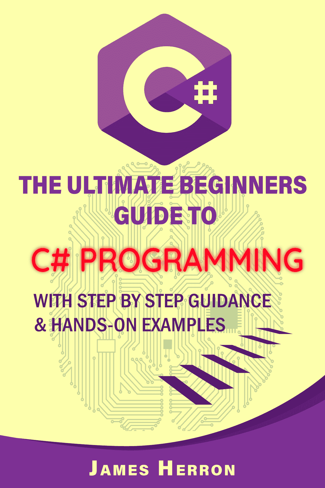

# C#：初学者指南 C# 编程，包含分步指导与实用示例





## 引言
C# 编程语言是微软为 `.NET Framework` 设计的一种现代面向对象的语言。`C#`（读作“see sharp”）基于许多主流编程语言的简单特性构建。它结合了 `C++` 的便利性和 `Visual Basic` 的简单性，同时也借鉴了 `Java` 的许多特性。这使得语言易于发现和使用，并且对错误具有鲁棒性，能够实现快速应用程序开发。与 `C++` 相比，这一切通常可以在不牺牲太多便利性或速度的情况下实现。

在 2002 年发布后的几年里，`C#` 成为第三热门的编程语言——仅次 `Java` 和 `C/C++`——而且其人气一直在不断增长。它是一种通用编程语言，因此非常用于创建各种范围的程序。从小型工具到电脑游戏、桌面应用程序，或者可能是操作系统，通常都内置 `C#`。该语言还可以配合 `ASP.NET` 使用来基于 Web 的应用程序。

在 `.NET` 中开发时，程序员对于使用哪种编程语言有很多选择。一些流行的 `.NET` 语言包括 `VB.NET`、`C++/CLI`、`F#` 和 `C#`。在这些，`C#` 通常是首选语言。与其他 `.NET` 语言一样，`C#` 最初被编译为中间语言。这种语言被称为 `通用中间语言 (CIL)`，运行在 `.NET Framework` 上。因此，一个 `.NET` 程序将可以在任何安装了该框架的系统上执行。

`.NET Framework` 可能是一个具有标准执行引擎和高级类库的软件框架。它运行在 `Microsoft Windows` 上，因此仅用于编写 Windows 应用程序。然而，也有跨平台的版本可用，其中最大的两个是 `Mono` 和 `DotGNU`。它们都是开源项目，允许 `.NET` 应用程序运行在其他平台上，如 `Linux`、`Mac OS X` 和嵌入式系统。

## 第 1 章：Hello World

### 选择 IDE
要开始编写 `C#` 代码，你需要一个支持微软 `.NET Framework` 的集成开发环境 (IDE)。最受欢迎的选择是微软自己的 `Visual Studio`。

1. 该 IDE 还提供免费版本，一个名为 `Visual Studio Express` 的轻量版本，可以从微软网站下载。
2. `C#` 语言自 2002 年最初发布 `C# 1.0` 以来经历了多次更新。在编写本文时，`C# 5.0` 是 2012 年发布的当前版本。语言的每个版本都对应 `Visual Studio` 的某个版本，因此为了使用 `C# 5.0` 的功能，你需要 `Visual Studio 2012` 或 `Visual Studio Express 2012`。

### 创建项目
安装好 IDE 后，继续启动它。然后你需要创建一个项目，该项目可以管理 `C#` 源文件和其他资源。要显示“新建项目”窗口，在 `Visual Studio` 中访问 `文件` ➤ `新建` ➤ `项目`，或者在 `Visual Studio Express` 中访问 `文件` ➤ `新建项目`。从那里，在左侧框架内选择 `Visual C#` 模板类型。然后在右侧框架内选择 `控制台应用程序` 模板。在窗口底部，你可以根据需要配置项目的名称和位置。完成后，点击 `确定`，项目向导将创建你的项目。

你现在已经创建了一个 `C#` 项目。在解决方案管理器面板中（`视图` ➤ `解决方案管理器`）中，你会看到项目由一个 `C#` 源文件 `.cs` 组成，该文件应该已经打开了。如果没有打开，双击进入解决方案管理器以打开它。在源文件中，有一些基础代码帮助你开始。然而，为了在现阶段保持简单，请继续并将代码简化为如下形式。

```csharp
class MyApp{
    static void Main (){}}
```

应用程序现在包含一个名为 `MyApp` 的类别，其中包含一个空的 `Main` 方法，两者都由大括号界定。`Main` 方法是程序的入口，必须具有这种格式。大小写同样重要，因为 `C#` 是区分大小写的。大括号界定了属于某个代码实体（如类别或方法）的内容，并且它们必须包含。括号及其内容被称为代码块，或简称为块。

### Hello World
正如学习任何新编程语言时一样，编写的主要程序是一个显示“Hello World”文本字符串的程序。这通常通过在 `Main` 方法的大括号之间添加以下代码来实现。

```csharp
System.Console.WriteLine("Hello World");
```

此行代码使用了 `WriteLine` 方法，该方法接受一个由双引号界定的字符串参数。该方法位于 `Console` 类中，该类属于 `System` 命名空间。注意，点运算符 `.` 被用于访问命名空间和类的成员。该语句需要以分号结束，`C#` 中的所有语句都是如此。你的代码现在应该应该像这样：

```csharp
class MyApp{
    static void Main (){
        System.Console.WriteLine( "Hello World" );
    }
}
```

### IntelliSense
在 `Visual Studio` 中编写代码时，当有多个预定义的替代方案供选择时，一个名为 `IntelliSense` 的窗口就会弹出。这个窗口非常有用，也可以通过按下 `Ctrl + Space` 手动调用。它让你能够快速访问程序中准备好使用的任何代码实体，包括 `.NET Framework` 的类和方法及其描述。这通常是一个非常强大的功能，你理应该学会如何良好使用。

## 第 2 章：编译与运行


# 编译与运行

Hello World 程序的 Visual Studio 编译已完成，下一步是编译并运行它。要尝试这样做，可以打开`Debug` 菜单并选择`Start without Debugging`无调试启动，或者直接按 `Ctrl + F5`。Visual Studio 将编译并运行该程序，并在控制台窗口中显示字符串。

你之所以不想使用初始的`Debugging`调试命令（`F5`），是因为程序在执行完成后控制台窗口会立即关闭。

```
C:\MySolution\MyProject>\Windows\Microsoft.NET\Framework64\v2.0.50727\ csc.exe Program.cs
```

```
C:\MySolution\MyProject> Program.exe Hello World
```

如果你尝试运行编译后的程序，它将显示与 Visual Studio 构建的相同的输出。

## 注释

注释用于在 ASCII 文本文件中插入备注。C# 使用了类似于 C++ 的注释符号，包括单行注释和多行注释。它们仅用于增强 ASCII 文本文件的可读性，对程序本身没有影响。

单行注释以 `//` 开始并延伸到行末尾。多行注释可以跨越多行，由 `/*` 和 `*/` 界定。

```cpp
// 单行注释
/* 多行注释 */
```

除了上述注释外，还有两种文档注释。一种是以 `///` 开头的单行文档注释，另一种是由 `/**` 和 `*/` 界定的多行文档注释。这些注释用于生成类文档时。

```csharp
// 类级文档。
class MyApp{
    /** 程序入口点。
    命令行参数.*/*/
    static void Main( string [] args){
        System.Console.WriteLine( "Hello World" );
    }
}
```

## 第 3 章：变量

## 变量

变量用于在程序执行过程中存储数据。

### 数据类型

根据你想要存储的数据，有几种不同的数据类型。C# 中的基础类型包含四种有符号整数类型和四种无符号类型、三种浮点类型，以及 `char` 和 `bool`。

| 数据类型 | 大小（位） |  |
| :--- | :--- | :--- |
| `sbyte` | 8 | 有符号整数 |
| `short` | 16 | |
| `int` | 32 | |
| `long` | 64 | |
| `byte` | 8 | 无符号整数 |
| `ushort` | 16 | |
| `uint` | 32 | |
| `ulong` | 64 | |
| `float` | 32 | 浮点数 |
| `double` | 64 | |
| `decimal` | 128 | |
| `char` | 16 | Unicode 字符 |
| `bool` | 4 | 布尔值 |

### 声明

在 C# 中，变量在使用之前必须先进行声明（创建）。要声明一个变量，首先从你希望它携带的信息类型开始，然后跟上变量名。名称通常可以是你喜欢的任何内容，但为变量提供与其将要持有的值紧密相关的名称是一个明智的想法。

```csharp
int myInt;
```

### 赋值

使用符号（即赋值运算符 `=`）为变量赋值。该变量随之变为已定义或初始化状态。

```csharp
intValue = 100;
```

声明和赋值通常合并为一条语句。

```csharp
int intValue = 100;
```

如果需要多个等效类型的变量，可以使用逗号运算符（`,`）提供一种声明或定义它们的简写方式。

```csharp
int intValue = 100, intValue2= 200, intValue3;
```

一旦变量被定义（声明并赋值），通常就可以通过引用变量名来使用它。

```csharp
System.Console.Write(intValue); // 100
```

### 整数类型

有四种有符号整数类型，取决于你希望变量携带的范围大小。

```csharp
// 有符号整数
sbyte intValue8 = 200; // -128 到 +127
short intValue16 = 100; // -3768 到 +32767
int intValue32= 0; // -2³¹ 到 +2³¹
long intValue64=-1; // -2⁶³ 到 +2⁶³-1
```

如果你只需要存储正值，通常会使用无符号类型。

```csharp
// 无符号整数
byte uIntValue8 = 0; // 0 到 255
ushort uIntValue16 = 1; // 0 到 65535
uint uInt32 = 2; // 0 到 2³²-1 
ulong uIntValue64 = 3; // 0 到 2⁶⁴-1
```

除了标准的数学表示法，整数还可以使用十六进制法进行赋值。

```csharp
int myHex = 0xF; // 十六进制（底数为 16）
```

### 浮点类型

浮点原型可以保存具有不同精度的实数。C# 中的常量浮点数始终保留为 `double`，以便分配这种多样性。在赋值给 `float` 类型时，必须附加 “F” 字符。对于 `decimal` 类型则需要附加 “M” 字符。

```csharp
float floatValue = 2.14F; // 7 位精度
double doubleValue = 2.14; // 15-16 位精度
decimal decimalValue = 4.14M; // 28-29 位精度
```

在数据类型之间转换的一种更常用且有效的方法是使用强制转换。强制转换通过在要转换的变量或常量前加上指定的数据类型来完成。在此例（（float）中，在赋值之前进行。

```csharp
floatValue = (float)decimalValue; // 强制转换
```

上述精度显示了类型可以持有的完整位数。例如，当尝试向 `float` 分配 7 位时，最小的有效数字将被舍入。

```csharp
floatValue = 34567.6789F; // 舍入为 34567.68
```

浮点数通常使用十进制或科学计数法进行赋值。

```csharp
doubleValue = 3e2; // 3*10² = 300
```

### Char 类型

`char` 类型可以包含由单引号括定的 Unicode 字符。

```csharp
char c = '3'; // Unicode 字符
```

### Bool 类型

`bool` 类型可以存储布尔值，该值只能是 true 或 false。这些值通过 true 和 false 关键字指定。

```csharp
bool b = true; // 布尔值
```

### 变量作用域

变量的作用域是指可以在不限定的情况下使用该变量的代码块。例如，区域变量可以是声明在方法方法内部的变量。此类变量在声明后仅在该方法代码块内可访问。一旦方法的作用域结束，局部变量将被销毁。

```csharp
int main(){
    int value; // 局部变量
}
```

除了局部变量外，C# 还有字段和参数类型变量，这些可以在后续章节中查看。然而，C# 不像 C++ 那样拥有全局变量。第 4 章


## 运算符

运算符通常用于对值进行操作。它们被分为五类：算术、赋值、比较、逻辑和位运算符。

## 算术运算符
算术运算符包括四种基本的算术运算，以及用于获取除法余数的取模运算符（`%`）。

```csharp
float y = 2 + 2; // 4 // 加
y = 5 - 2; // 3 // 减
y = 2 * 2; // 6 // 乘
y = 3 / 2; // 1 // 除
y = 3 % 2; // 1 // 取模（除法余数）
```
注意除法符号会产生错误的结果。这通常是因为它对两个整数值进行操作，因此会舍弃结果并返回整数。为了获得正确的值，必须将其中一个数字转换为小数。
```csharp
x = 3 / (float) 2; // 1.5
```

## 赋值运算符
第二组是赋值运算符。最重要的是赋值运算符（`=`）本身，它为变量分配一个值。

## 复合赋值运算符
赋值运算符和算术运算符的一种常见用法是对变量进行操作，然后将结果保存回该同一变量。这些操作通常用复合赋值运算符简写。
```csharp
int x = 0;
x += 5; // x = x+5;
x -= 5; // x = x-5;
x *= 5; // x = x*5;
x /= 5; // x = x/5;
x %= 5; // x = x%5;
```

## 递增递减运算符
另一个常规操作是将变量增加或减少 1。这可以通过递增（`++`）和递减运算符（`--`）来简化。
```csharp
x++; // x = x+1;
x--; // x = x-1;
```
这两个运算符通常用于变量之前或之后。
```csharp
x++; // 后置增
x--; // 后置减
++x; // 前置增
--x; // 前置减
```
无论使用哪种，变量的结果都是相同的。区别在于，后置运算符在改变变量之前返回第一个值，而前置运算符先改变变量再返回值。
```csharp
x = 5; y = x++; // y=5, x=6
x = 5; y = ++x; // y=6, x=6
```

## 比较运算符
比较运算符连接两个值并返回真或假。它们主要用于指定条件，即求值为真或为假的表达式。
```csharp
bool x = (1 == 3); // false // 不等于
x = (4 != 3); // true // 不等于
x = (3 > 4); // false // 大于
x = (3 < 4); // true // 小于
x = (3 >= 4); // false // 大于等于
x = (2 > 1) >> 1 (2) // 右移
x = ~4; // ~00000100 = 11111011 (-5) // 取反
```
这些位运算符具有简写赋值运算符，类似于算术运算符。
```csharp
int x = 5; x &= 5; // 101 & 100 = 100 (4) // 与
x=5; x |= 5; // 101 | 100 = 101 (5) // 或
x=5; x ^= 5; // 101 ^ 100 = 001 (1) // 异或
x=5; x >> 1 = 2 (2) // 右移
```

## 运算符优先级
在 C# 中，表达式通常从左到右求值。然而，当表达式包含多个运算符时，这些运算符的优先级决定了它们的计算顺序。

| 优先级 | 运算符 | 优先级 | 运算符 |
| :--- | :--- | :--- | :--- |
| 1 | ++ -- ! ~ | 7 | & |
| 2 | * / % | 8 | ^ |
| 3 | + - | 9 | \| |
| 4 | << >> | 10 | && |
| 5 | < <= > >= | 11 | \| |
| 6 | == != | 12 | = op= |

例如，逻辑与（`&&`）的优先级低于关系运算符，而关系运算符又依次低于算术运算符。
```csharp
Bool x = 2 + 4 > 1 * 4 && 5 / 5 == 1; // true
```
为了更清晰，通常使用括号来指定表达式的哪个部分先求值。括号在所有运算符中优先级最高。
```csharp
Bool x = ((2 + 5) > (1 * 4)) && ((5 / 5) == 1); // true
```

## 第 5 章

## 字符串
string 数据类型用于存储由引号定义的字符串常量。
```csharp
String a = "Hello";
```

## 字符串拼接
符号 `+` 用于混合两个字符串。在此上下文中，它被称为拼接运算符（`+`）。它还有一个相应的赋值运算符（`+=`），可以将一个字符串附加到另一个字符串之后并创建一个新的字符串。
```csharp
String b = a + "World"; // Hello World
b += "World"; // Hello World
```

## 转义字符
语句通常可以跨多行，但字符串常量必须在一行内。因此，为了分割它，必须先使用拼接运算符将字符串常量拆分。
```csharp
String c = "Hello" + "World";
```
要在字符串内部添加换行，可以使用转义字符 `\n`。
```csharp
String c = "Hello\nWorld";
```
这种反斜杠符号用于编写特殊字符，如反斜杠本身或双引号。特殊字符中还包括用于编写任何字符的 Unicode 表示法。

| 字符 | 含义 | 字符 | 含义 |
| :--- | :--- | :--- | :--- |
| \n | 换行 | \f | 分页 |
| \t | 水平制表符 | \a | 警音 |
| \v | 垂直制表符 | \’ | 单引号 |
| \b | 退格 | \" | 双引号 |
| \r | 回车 | \\ | 反斜杠 |
| \0 | 空字符 | \uFFFF | Unicode 字符 (4 位十六进制数) |

通过在字符串前添加关联“@”符号可以忽略转义字符。这通常被称为字面字符串（verbatim string），例如用于创建易于读的文件路径。
```csharp
string e = "c:\\Windows\\System32\\cmd.exe";
string f = @"c:\Windows\System32\cmd.exe";
```

## 字符串比较
比较两个字符串只需使用相等运算符 `==`。这可能不会像 Java 等其他语言中那样比较内存地址。
```csharp
bool c = (a == b); // true
```

## 字符串成员
string 类有很多实用的成员，例如 `Replace`、`Insert` 和 `Remove` 等方法。需要注意的一点是，没有可以更改字符串的方法。看似在切换字符串的方法实际上总是返回一个全新的字符串。这是因为字符串类是不可变的（immutable）。除非替换整个字符串，否则字符串变量的内容无法更改。
```csharp
string a = "String";
string b = a.Replace("i", "o"); // Strong
b = a.Insert(0, "My "); // My String
b = a.Remove(0, 3); // ing
b = a.Substring(0, 3); // Str
b = a.ToUpper(); // STRING
int i = a.Length; // 6
```

## StringBuilder 类
StringBuilder 是一个可变的字符串类。由于替换字符串带来的性能开销，当需要反复修改字符串时，StringBuilder 类可能是更好的选择。
```csharp
System.Text.StringBuilder sb = new System.Text.StringBuilder("Hello");
```
该类有多个方法可以操作字符串的具体内容，如 `Append`、`Remove` 和 `Insert`。
```csharp
sb.Append(" World"); // Hello World
sb.Remove(0, 6); // World
sb.Insert(0, "Bye"); // Bye World
```
将 StringBuilder 对象转换回普通字符串使用 `ToString` 方法。
```csharp
string s = sb.ToString(); // Bye World
```


## 数组
数组可能是一种用于存储一组值的排列方式，每个值都具有相同的数据类型。

## 数组声明
要声明一个数组，在数组将包含的类型类型后添加一组方括号，然后是数组的名称。数组通常用任何数据类型声明，然后它的每一个元素都将是该类型。
```
int[] x; // 而不是 int x[]
```

## 数组分配
使用 `new` 关键字分配数组，后面再次是信息类型和一组包含数组长度的方括号。这通常是数组可以包含的固定元素数量。一旦创建了数组，每个元素将自动分配为该数据类型的默认值。
```
int[] x = new int[3];
```

## 数组赋值
为了填充数组元素，它们会被一次引用一次，然后进行值。通过在方括号内定位元素的索引（index）来引用数组元素。请注意，主元素的索引从零开始。
```c
x[0] = 1;
x[1] = 2;
x[2] = 3;
```
或者，通常直接通过使用大括号符号直接赋值所有值。如果在相等时间声明数组，可以选择忽略 `new` 关键字和数据类型。
```c
int[] y = new int[] { 1, 2, 3,4 };
int[] z = { 1, 2, 3,4 };
```

## 数组访问
一旦数组元素初始化，就可以通过在方括号内引用元素的索引来访问。
```c
System.Console.Write(x[0] + x[1] + x[2]); // 8
```

## 矩形数组
C# 中有两种多维数组：矩形数组和交错数组（jagged arrays）。矩形数组的所有子数组长度相同，并使用逗号分隔尺寸。
```c
string[,] x = new string[2, 2];
```
与单维数组一样，它们可以在分配期间一次填充一次，或者直接填充所有。
```c
x[0, 0] = "00"; x[0, 1] = "01";
x[1, 0] = "10"; x[1, 1] = "11";
```

## 交错数组
交错数组是数组的数组，可能有不规则的维度。尺寸是一次分配的，因此子数组可以分配到不同的尺寸。
```c
string[][] a = new string[2][];
a[0] = new string[1]; a[0][0] = "00";
a[1] = new string[2]; a[1][0] = "10"; a[1][1] = "11";
```
可以在分配期间赋值。
```c
string[][] b = { new string[] { "00" },new string[] { "10", "11" } };
```
这些都是二维数组的示例。如果需要较多维度，通常为长方形数组添加更多逗号，或者为交错数组添加更多方括号。

## 第 7 章：条件语句
条件语句通常根据不同的条件执行不同的代码块。

## If 语句
If 语句只有在括号内的条件被求值为真时才会才会执行。
```c
int x = new System.Random().Next(3); // 产生 0, 1 或 3
if (x < 1) {System.Console.Write(x + " < 1" );}
```
为了测试其他条件，通常通过任意数量的 `else if` 子句扩展 `if` 语句。每个额外的条件只有在之前条件为假时才会被检查。
```c
else if (x > 2) {System.Console.Write(x + " > 2" );}
```
If 语句可以在顶部有一个 `else` 子句，当所有之前的条件为假时，可以执行它。
```c
Else {System.Console.Write(x + “== 1 ");}
```
至于大括号，如果只需要条件执行一个语句，它们将被忽略。
```c
if (x< 1)System.Console.Write(x + " < 2" );
else if (x > 2)System.Console.Write(x + " > 1" );
elseSystem.Console.Write(x + “== 1");
```

## Switch 语句
`switch` 语句检查整数或字符串与一系列 case 标签（labels）之间的相等性，然后将执行传递给匹配的 case。该语句可以包含任意数量的 case 子句，并应以 `default` 标签结束以处理所有其他情况。
```c
int x = new System.Random().Next(3); // 产生 0, 1 或 3
switch (x){
default :System.Console.Write(x + " is 2" );
break ;
}
```
注意，每个 case 标签后的语句没有被大括号围绕。相反，语句以 `break` 关键字结束以中断 `switch`。与许多其他语言不同，C# 中的 `case` 子句必须以跳转语句（如 `break`）结束。这表明 `break` 关键字不能忽略，以允许执行落入到后续标签（fall-through）。此的理由通常是无意的穿透可能是常见的软件错误。

## Go to 语句
要发生穿透，必须使用 `goto` 跳转语句后跟一个 case 标签来显式指定这种行为。这可能导致执行跳转到该标签。
```c
Case 0: goto case 1;
```
`Goto` 也可以用于 switch 之外，跳转到等效方法范围内的标签。控制随后可以离开嵌套作用域，但不能进入嵌套作用域。然而，在这种方式使用 `goto` 是不鼓励的，因为执行流变得难以追踪。
```
goto myLabel;
// ... myLabel:
```

## 三元运算符
除了 `if` 和 `switch` 语句外，还有三元运算符 (`? :`)。此运算符可以替换一个为所选变量赋值的 `if/else` 子句。该运算符接受三个表达式。如果第一个被求值为真，则返回第二个表达式，如果为假，则返回第三个。
```
x = (x< 0.5)? 0:1; 
```

## 第 8 章：循环
C# 中有四种处理结构。这些被用于多次执行特定的代码块。虽然与条件 `if` 语句相比，如果代码块内只有一个语句，循环的大括号通常会被省略。

## While 循环
`while` 循环在条件为真时运行代码块，并可能在条件保持为真的情况下持续进行。注意条件在每次迭代的开始时简单地检查。
```
int i = 0;
While (i < 10)
```

## Do-while 循环
`do-while` 循环的工作方式与 `while` 循环类似，但它在代码块之后检查条件，因此可能至少运行代码块一次。记住此循环以一个标点符号结束。
```
int j = 0;
Do while (j < 10);
```

## For 循环
`for` 循环用于在特定次数范围内遍历代码块。它使用 3 个参数。第一个参数初始化计数器，通常在循环开始前执行一次。第二个参数持有循环的条件，并在每次迭代之前检查。第三个参数包含计数器的增量，并在每次迭代结束时执行。
```
for (int k = 0; k < 10; k++)
```
`for` 循环有许多变体。例如，第一个和三个参数通常使用逗号运算符拆分为多个语句。
```
for (int k = 0, m = 5; k < 10; k++, m--)
```
此外还有省略一个或多个参数的选择。例如，第三个参数甚至可以移动到循环体中。
```
for (int k = 0; k < 10;)
```

## For each 循环
`foreach` 循环为遍历数组提供了简单的方法。在每次迭代中，数组内的每个部分都分配给指定的变量（迭代器），因此循环持续执行直到处理完整个数组。注意迭代器变量是只读的，因此不会用于修改数组内部的组件。
```c
int [] a = { one, 2, 3 };
foreach (int n in a)
```

## Break and continue
循环中有 2 个可以使用的特殊关键字——`break` 和 `continue`。`break` 关键字结束循环结构，`continue` 跳过当前迭代的剩余部分并在下次迭代的开始处继续。
```c
Finish for continue; // 开始下次迭代
```


## 方法

方法是可重用的代码块，它们在已知后可以独立执行。

## 定义方法
方法定义通常在类内部创建，通过输入 `void` 后跟方法名、一组括号和一个代码块来完成。`void` 关键字意味着该操作不会返回任何值。方法的命名规范与类相似——使用具有描述性的名称，且每个单词的首字母均大写。

C# 中的所有方法都应该属于一个类，这是可能编写语句的唯一地方。C# 没有在类之外界定方法策略的世界函数（全局函数）。

## 调用方法
上面的方法可以打印一条文本消息。要调用（执行）它，应该先通过 `new` 关键字创建一个 `MyApp` 类的实例。然后使用点操作符，通过实例名来访问其成员，其中包含 `MyPrint` 技术。

```csharp
class MyApp {
    void MyPrint() {"Howdy World"}
}
```

## 方法参数
方法名后的括号用于向方法传递参数。为了执行当前操作，相应的参数应该在方法定义内部，以类型之间由逗号分隔的变量声明列表的形式排列。

```csharp
void MyPrint(string s1, string s2)
```

方法区域通常定义为需要各种类型的参数，它们可以具有任何数据类型。只需确保方法定义时具有相应的类型和数量的参数即可。

```csharp
static void Main () {"Hallo World"}
```

准确来说，参数（parameters）出现在方法定义中，而参数（arguments）出现在方法调用中。然而，这两个术通常互换使用。

## params 关键字
为了接受特定类型的可变数量参数，可以使用带有 `params` 修饰符的关联数组，它通常作为参数列表中最后一个参数添加。传递给方法的任何所需类型的后续参数都可以机械地存储在此数组中。

```csharp
void MyPrint(params string[] s)
```

## 方法重载
只要参数的类型或数量不同，就可以声明多个具有相同名称的方法。这通常被称为方法重载，例如在 `System.Console.Write` 技术的实现中就可以看到，它有十八个方法定义。这是一个强大的功能，允许我们处理各种参数，而不需要让技术人员记住完全不同的策略。

```csharp
void MyPrint(string s)
void MyPrint(int i)
```

## 可选参数
从 C# 4.0 开始，通过在方法声明中为参数提供默认值，通常将参数区域声明为可选。一旦调用方法，这些可选参数甚至可以省略以使用默认值。

```csharp
class MyApp {
    static void Main()
}
```

## 命名参数
C# 4.0 同时引入了命名参数，它允许通过其对应参数的名称传递关联参数。此功能通过允许按无顺序传递参数增强了可选参数的功能，而不是依赖于它们在参数列表中的位置。因此，任何可选参数区域通常允许不指定其之前的每个可选参数的值。然而，每个可选和需要的参数区域通常都是命名的，但命名参数应该放在未命名的参数之后。

```csharp
static void Main() {seven}
```

## return 语句
方法将返回一个值。`void` 关键字被替换为方法可以返回的信息类型，因此 `return` 关键字被添加到方法体中并关联所需返回类型的参数。

`return` 也是一个跳转语句，会导致方法退出并将值返回到调用方法的地方。例如，上面的 `Get Print` 技术通常作为关联参数传递给 `Write` 技术，因为该方法求值为字符串。

```csharp
static void Main () {"Hullo World"}
```

`return` 语句也可以用于 void 方法，在到达最高代码块之前退出。

```csharp
void MyMethod ()
```

## 值类型和引用类型
C# 中有两种数据类型：值类型和引用类型。值类型变量直接包含其数据，而引用类型变量持有对其对数据的引用。C# 中的引用类型包括：`class`、`interface`、`array` 和 `delegate` 类型。值类型包括基础类型，连同结果的 `struct`、`enum` 和 `nullable` 类型。引用类型变量通常通过 `new` 关键字创建，尽管并不总是必要的，例如 `string` 对象的例子。

引用类型的变量通常被称为关联对象，尽管准确来说，问题在于该变量所引用的数据。对于引用类型，多个变量将引用相似的对象，因此通过一个变量执行的操作可能会对引用相似对象的其他变量产生影响。与之的是，对于值类型，每个变量都可以存储自己的值，对其中一个的操作不会影响另一个。

## 按值传递
当传递值类型的参数时，传递的是变量的一个副本，因此如果副本被更改，将不会对主变量产生影响。

```csharp
void Set(int i) 
static void Main() {
    MyApp m = new MyApp();
    int x = 0; // 值类型
    m.Set(x); // 传递 x 的值
    System.Console.Write(x); // zero
}
```

## 按引用传递
对于引用类型，C# 使用真正的按引用传递。这意味着一旦传递引用类型，不仅可以更改它的状态，还可以交换整个对象并将修改传回主对象。

```csharp
void Set (int[] i) { } 
static void Main() {
    MyApp m = new MyApp();
    int[] y = { zero }; // 引用类型
    m.Set(y); // 传递对象 
    system .Console.Write(y[0]); // ten
}
```

## ref 关键字
变量类型通常通过 `ref` 关键字传递引用，在调用者和方法声明处均使用。这可能导致变量按引用传递，从而动态地更新主值。

```csharp
void Set(ref int i)
static void Main() {
    MyApp m = new MyApp();
    int x = 0; // 值类型
    m.Set(ref x); // 传递值类型的引用 
    System.Console.Write(x); // ten
}
```

## out 关键字
有时你需要按引用传递未赋值的关联变量并在方法中对其赋值。然而，直接使用未赋值的本地变量会导致编译时错误。在这种情况下，通常使用 `out` 关键字。它的行为与 ref 类似，但编译器允许使用未赋值的变量，并且它会强制你在方法内部实际设置该变量。

第 10 章


`ClassA` 类可以是一个用于产生对象的模型。它们由成员组成，最主要的两个成员是字段和方法。字段是存储对象状态的变量，而方法定义了对象将做什么。

```csharp
class MyRectangle{public int x, y; public return x * y;}
```

## 对象的创建
要从类的类的外部使用类的成员，应该初始化一个该类的关联对象吗？这通常通过实例化 `new` 关键字来实现，该关键字可以在系统内存中产生一个新对象。

```csharp
class MyClass{
    static void Main(){
        // 产生 MyRectangle 类的对象
        MyRectangle r = new MyRectangle();
    }
}
```

对象也被称为类的实例（instance）。对象可以包含自己的一组字段，这些字段的值可能与该类的其他实例的值完全不同。

## 访问对象成员
除了创建对象外，`{类|类}` 中需要被可访问的成员必须在类定义中被声明为 `public`。

```csharp
class MyRectangle {
    // 构建该类实例可访问的成员
    public int x, y;
    public int GetArea() return x * y; 
}
```

点运算符被用在对象名称后引用其可访问的成员。

```csharp
static void Main(){fifty}
```

## 构造函数
类将有一个构造器（creator）。这通常是一个特殊的特殊方法，用于实例化（构造）对象。它的名称与类名相同且没有返回类型，因此它隐式地返回该类的新实例。为了能从另一个类访问，它必须用通用的 `public` 访问修饰符声明。

```csharp
public MyRectangle()
```

当创建一个该类的新实例时，构造器方法会被调用，在上面的示例中，它将字段设置为所需的初始值。

```csharp
static void Main()
```

构造器将拥有一个参数列表，就像其他方法一样。如下所示，这可以根据创建对象时传递的参数来创建字段的初始值。

```csharp
class MyRectangle{int breadth, int height){}
static void Main(){}
```

## `this` 关键字
在构造器内部，以及在其他方法内部，可以使用一个称为 `this` 的特殊关键字。这个关键字可以引用该类的当前实例。假设，例如，构造器的参数与相应的字段具有相同的名称。那么字段仍然可以通过该关键字进行访问，即使它们被参数所遮蔽（shadowed）。

```csharp
class MyRectangle{
}
```

## 构造函数重载
为了支持完全不同的参数列表，构造器被重载（overladen）。在下面的示例中，如果使用无参数实例化该类，字段将被分配默认值。如果带有一个参数，每个字段将被设置为所需的值；如果有 2 个参数，每个字段将各分配一个独立的值。`{尝试|尝试|进行关联尝试}` 使用错误数量的参数或错误的知识类型创建对象会导致编译错误，就像其他方法一样。

```csharp
public MyRectangle()
public MyRectangle(int a)
public MyRectangle(int a, int b)
```

## 构造函数链
该关键字也可以从一个构造器调用另一个构造器。这通常被称为构造函数链，允许更大代码的代码复用。注意，该关键字的形式是在构造器体之前且在一个冒号之后。

```csharp
public MyRectangle() : this(10,5) 
public MyRectangle(int a) : this(a,a) 
public MyRectangle(int a, int b)
```

## 初始字段值
如果类中存在需要分配初始值的字段（如上面主构造器的情况所示），字段将在它们声明的同时仅被初始化。这可以使代码稍微整洁一些。初始值将在对象创建、构造器被调用之前被分配。

```csharp
class MyRectangle
```

这种类型的赋值被称为字段初始化器（field initializer）。这种关联赋值不能与另一个实例字段讨论。

## 默认构造器
即使没有定义任何构造器，也可以创建一个类。这通常是因为编译器可以机械地为此类类添加一个无参数的默认参数构造器。默认构造器可以实例化对象并将每个字段设置为其默认值。

```csharp
class MyRectangle MyApp{
    static void Main(){
        // 调用默认构造器
        MyRectangle r = new MyRectangle();
    }
}
```

## 对象初始化器
在创建关联对象时，从 C# 3.0 开始，可以在表示语句中初始化对象的公共字段。随后是一个代码块，包含一个用逗号分隔的字段赋值列表。对象初始化器块将在构造器被调用后进行处理。

```csharp
class MyRectangle
class MyClass{
    static void Main(){
        // 对象初始化器
        MyRectangle r = new MyRectangle() { x = ten, y = 5 };
    }
}
```

如果构造器没有参数，也可以删除括号。

```csharp
MyRectangle r = new MyRectangle { x = ten, y = 5 };
```

## 部分类
通过使用 `partial` 关键字修饰符将类定义分离到不同的源文件中。这些部分类将被编译器组合成最终的类型。部分类的所有元素都应该具有 `partial` 关键字并共享相同的访问级别。

```csharp
// File1.cs
public partial class MyPartialClass
// File2.cs
public partial class MyPartialClass
```

在多个源文件中拆分类在类的一部分由机械生成时特别有用。例如，这一功能被 Visual Studio 的图形程序生成器采用，以将机械生成的代码与手动编写的代码分开。部分类也可以让多个程序员在相同的类上工作。

## 垃圾回收器
.NET Framework 包含一个垃圾回收器（garbage man），它会在对象不再可访问时定期释放它们所使用的内存。这把工程师从通常繁琐且易错的内存管理任务中解放出来。一旦没有其他额外的引用，关联对象将符合销毁条件。这发生在，例如，当一个对象变量超出范围时。在 C# 中不能显式地释放关联对象。

## 析构函数
除了构造器，类还可以有一个析构函数。析构函数用于释放对象分配的任何未托管资源。它在关联对象被销毁之前机械地调用，且不能被显式引用。析构函数的名称与类名相同，但前面有一个波浪号（~`）。一个类只能有一个析构函数，且它不接受任何参数也不返回任何值。

```csharp
class MyComponent {
    // 析构函数
    ~MyComponent()
}
```

通常，.NET Framework 垃圾机会机械地管理对象的内存分配和释放。然而，一旦类使用了未托管资源——如文件、网络连接和程序元素——当这些资源不再需要时，应该使用析构函数来释放这些资源。

## Null 关键字
`null` 关键字用于表示空引用，即可能不指向任何对象的引用。它将仅分配给引用类型的变量，而不会给值类型的变量。相等运算符（`==`）用于检查关联对象是否为 null。

```csharp
String s = null;
if (s == null) s = new String();
```

## 可空类型
通过在其底层类型后附加问号（`?`），创建了一种值类型以携带类型之外的 null 值。这通常被称为可空类型，允许基础类型（以及结构体类型）指向模糊值。例如，`bool?` 是可以包含 true、false 和 null 值的可空类型。

```csharp
bool? b = null;
```

## 合并运算符
如果左侧数字不为空，则返回左侧，否则返回右侧数量。这个条件运算符为将可空类型转换为非可空类型提供了简单的语法。

```csharp
int? i = null;
int j = i ?? zero; // 0
```

可空类型的变量不能被显式强制转换为非可空类型。如果该变量值为 null，这样做会导致软件错误。

```csharp
int j = (int)i; // 软件错误
```

## 默认值
引用类型的默认值是 `null`。对于基础知识类型，默认值如下：数值类型变为零，`char` 具有零的 Unicode 字符（`\0000`），`bool` 为假。默认值会被编译器机械地分配给字段。然而，明确指定字段的默认值被认为是良好的编程习惯，因为它使代码更容易理解。对于本地变量，编译器不会设置默认值。相反，编译器强制工程师为任何使用的本地变量赋值，以避免与未赋值变量相关的问题。

```csharp
class MyApp{
    int x; // 字段被分配默认值零
}
int dummy(){
    int x; // 本地变量如果使用应被赋值
}
```
第 11 章


## 继承

继承允许 `{category}` 聚集另一个类的成员。在下面的示例中，类 `sq` 继承自 `parallelogram`，用冒号表示。`parallelogram` 随后成为 `sq` 的基类，而 `sq` 继而成为 `parallelogram` 的派生类。除了自身的成员外，`sq` 还获得了 `parallelogram` 中所有可访问的成员，构造函数和析构函数除外。

```csharp
// 基类（父类）
class parallelogram {
    public int x = 10, y = 10;
    public int GetArea() { return x * y; }
}

// 派生类（子类）
class sq : parallelogram { }
```

C# 中的类 只能继承自一个基类。如果没有指定基类，该类可以隐式地继承自 `System.Object`。因此，它是所有其他类的基础类。

```csharp
class parallelogram : System.Object {}
```

C# 内部包含一个统一的类型系统，所有知识类型直接或间接地继承自 `Object`。然而，这不仅适用于类，还适用于其他知识类型，如数组和简单类型。例如，`int` 关键字只是 `System.Int32` 结构体类型的别名。同样，`object` 是 `System.Object` 类的别名。

```csharp
System.Object o = new object ();
```

由于每个类型都继承自 `Object`，因此它们都共享一组典型的策略。其中一种方法是 `ToString`，它返回一个该对象的字符串说明。

```csharp
System.Console.Write( o.ToString() );
```

## 强制转型和上转型

在概念上，派生类可以是基类的特化化。这表明 `sq` 可以被合理地视为一个 `parallelogram`，同时也被视为一个 `Object`，并可以用于任何预期 `parallelogram` 或 `Object` 的地方。如果创建了 `sq` 的关联实例，它将被强制转换为 `parallelogram`，因为派生类包含了基类中的所有内容。

```csharp
Square s = new sq ();
parallelogram r = s;
```

该对象目前被视为 `parallelogram`，因此只能访问 `Rectangle` 的成员。一旦该项被强制转型为 `sq`，所有属于 `sq` 的特定成员仍然可以保留。这通常是因为 `parallelogram` 仅包含了 `sq`，它没有在任何方法中修改 `sq` 对象。

```csharp
Square s2 = (Square) r;
```

强制转型必须显式创建，因为不允许将实际的 `parallelogram` 强制转换为 `sq`。

```csharp
Rectangle r2 = new parallelogram ();
sq s3 = (Square) r2; // error
```

## Is 关键字

有两种运算符用于在对对象进行强制转型时避免异常。首先是 `is` 运算符，如果左侧的对象可以实体化（类型转换）为正确的右侧类型，则它返回 `true`，且不会引发关联异常。

```csharp
Rectangle Q = new Square();
if (q is sq.) // 条件为真
```

## As 关键字

另一个用于避免对象强制转型异常的运算符是 `as` 运算符。该运算符提供了另一种编写精确实性检查的方法，其区别在于如果转换失败，引用将被置为 `null`。

```csharp
Rectangle r = new parallelogram ();
Square o = r as sq.; // 无效转换，返回 null
```

## 装箱 (Boxing)

C# 的统一类型系统允许值类型的变量隐式地生成为项类别的引用类型。这种操作被称为装箱，一旦值被追踪到项，它就被视为引用类型。

```csharp
int myInt = 5;
object myObj = myInt; // 装箱
```

## 解箱 (Unboxing)

装箱的反面是解箱。它将装箱的值转换为其原始类型的变量。解箱操作必须是显式的，因为如果项未解箱为正确的类型，可能会发生软件错误。

```csharp
myInt = (int)myObj; // 解箱
```

## 第 12 章

## 重新定义成员

派生类中的成员将重新定义基类中的成员。这会对所有可继承成员产生深度影响，但它最常用于提供实例策略的新实现。为了传递方法的替换实现，在子类中重新定义该方法，使其签名与基类中的方法相同。签名包括名称、参数和方法的返回类型。

```csharp
class parallelogram {
    int x, y = 10;
    public int GetArea() { return x * y; }
}
class sq : parallelogram {
    public int GetArea() { return x * x; }
}
```

## 隐藏成员

取决于方法是否旨在覆盖还是重写（override）可继承的方法。默认情况下，新方法可以隐藏它，但编译器会提供警告，说明这种行为应该是显式指定的。为了消除警告，必须使用 `new` 修饰符。这指定了意图是覆盖可继承的方法并将其替换为新的实现。

```csharp
class sq : parallelogram {
    public new int GetArea() { return x * x; }
}
```

## 重写成员

在方法被重写之前，应首先在基类中的方法上加上 `virtual` 修饰符。该修饰符允许方法在派生类中被重写。

```csharp
class parallelogram {
    int x, y = 10;
    public virtual int GetArea() { return x * y; }
}
```

随后使用 `override` 修饰符来修改可继承方法的实现。

```csharp
class sq : parallelogram {
    public override int GetArea() { return x * x; }
}
```

## 隐藏与覆盖

当 `sq` 强制转换为 `parallelogram` 时，显示了 `override` 和 `new` 之间的区别。如果使用 `new` 修饰符重新定义了方法，则允许访问在 `parallelogram` 中定义的先先隐藏的方法。相反，如果使用 `override` 修饰符重新定义方法，则转换仍然可以确定 `sq` 中定义的版本……基本上，`new` 修饰符在类层级结构向下重新定义方法，而 `override` 则在层级结构中向上向下重新定义方法。

## Sealed（密封）关键字

为了防止已重写的方法在继承自派生类的类中被进一步重写，可以将方法声明为 `sealed` 以抵消 `virtual` 修饰符。

```csharp
class MyClass { }
```

一个类可以被声明为 `sealed` 以阻止任何类继承它。

## Base 关键字

有一种方法可以访问即使被重新定义的父类方法。这通常通过使用 `base` 关键字引用基类实例来实现。无论方法是被隐藏还是被重写，都可以通过此关键字进行访问。

```csharp
class Triangle : parallelogram {
    public override int GetArea() { return base.GetArea()/2; }
}
```

`base` 关键字可以从派生类构造函数调用基类构造函数。该关键字随后在构造函数体之前使用，并跟有冒号。

```csharp
class parallelogram {
    int x, y = 10;
    public Rectangle(int a, int b) { }
}
class sq : parallelogram {
    public Square(int a) : base(a,a) { }
}
```

当派生类构造函数没有指向基类构造函数时，编译器可以机械插入对无参数基类构造函数的调用，以确保基类被正确创建。

```csharp
class sq : parallelogram {
    public Square(int a) // 隐式调用 base()
}
```

注意，如果基类包含一个无参数的构造函数，编译器就不会产生默认的无参数构造函数。因此，在派生类中构建构造函数时，如果没有精确匹配已定义的基类构造函数，会导致编译错误。

```csharp
class Base { public Base(int a) }
class Derived : Base // 编译错误
```


## 访问级别

每个类的成员都有一个关联的访问级别，它决定了该成员在什么地方可见。在 C# 市场上共有 5 种访问级别：`public`、`protected`、`internal`、`protected internal` 和 `private`。类成员的默认访问级别是 `non-public`（非公有）。

## 私有访问
无论访问级别如何，所有成员在声明的类内部都是可用的。这是非公有成员可以被访问的唯一地方。

```csharp
class MyBase {
    // 无限制访问 
    public int myPublic;
    // 程序集或派生类
    protected internal int myProtInt;
    // 程序集内部
    internal int myInternal;
    // 类或派生类 
    protected int myProtected;
    // 仅限类内部私有
    private int myPrivate;
    void Test()
}
```

## 保护访问
`protected` 成员可以在派生类中被访问，但从不同的类中无法访问。

```csharp
class Derived : MyBase {}
```

## 内部访问
`internal` 成员可以在原生程序集的任何地方被访问，但不能从另一个程序集访问。在 .NET 中，关联的程序集可以是程序（`.exe`）或库（`.dll`）。

```csharp
// 程序集类
AnyClass {}
```

## 保护内部访问
`protected internal` 访问意味着 `protected` 或 `internal` 之一。`protected internal` 成员可以在此程序集的任何地方被访问，也可以在程序集外部派生自该类的类中访问。

```csharp
//不同的程序集类
class Derived : MyBase {
    void Test(MyBase m)
}
```

## 公共访问
`public` 访问提供了从成员被定义的任何地方进行无限制的访问。

```csharp
//不同的程序集类
AnyClass {}
```

## 顶层访问级别
顶级成员可以是声明在其他类型之外的类型。在 C# 中，后续类型将在顶层声明：`category`（类）、`interface`（接口）、`struct`（结构体）、`enum`（枚举）和 `delegate`（委托）。默认情况下，这些未包含的成员被赋予 `internal` 访问。为了能够从另一个程序集使用顶级成员，成员必须被标记为 `public`。这通常是允许顶级成员的唯一不同访问级别。

```csharp
internal class MyInternalClass
public class MyPublicClass {}
```

## 内部类
类可以包含内部类，内部类可以设置为 5 种访问级别中的任何一种。访问级别对内部类产生的效果与对不同成员的效果相同。
如果类是不可访问的，则它无法被实例化或被继承。默认情况下，内部类是 `non-public`，这意味着它们将仅在定义它们的类内部使用。

```csharp
class MyBase {
    // 内部类（嵌套类） 
    public class MyPublic {}
    protected class MyProtInt {}
    internal class MyInternal {}
    protected class MyProtected {}
    private class MyPrivate {}
}
```

## 访问级别指南
作为一个建议，一旦选择了关联的访问级别，通常最好使用尽可能的最高限制性级别。这通常是因为成员被访问的地方越多，被错误访问的地方也越多，这使得代码更难修复。利用限制性的访问级别会更容易在切换类时，而不会破坏其他程序员使用该类的代码。

## 第 14 章

## 静态
`static` 关键字可用于声明字段和方法，这些方法可以在不实例化类的情况下被访问。`static`（类）成员仅存在于属于类本身的一个副本中，而实例（非静态）成员的度量会为每个新对象创建新的副本。这意味着静态方法无法使用实例成员，因为这些方法不是实例的一部分。相反，实例方法可以使用每个静态和实例成员。

```csharp
class MyCircle {
    float PI = 3.14F;
    // 实例方法
    float GetArea()
    // 静态/类方法
    static float ComputeArea(float a)
}
```

## 访问静态成员
要从类外部访问静态成员，使用类名后跟点运算符。该运算符与访问实例成员时使用的运算符相同，但成功执行它们需要一个对象引用。对象引用不能用于访问静态成员。

```csharp
static void Main ()
```

## 静态方法
静态成员的优势是它们可以在不同的类中被使用，而无需实例化类。如果只需要变量的单个实例，则字段也应声明为静态。如果方法执行独立于任何实例变量的通用操作，则方法应声明为静态。一个很好的例子是 `System.Math` 类，它提供了大量的数学方法。

```csharp
// 此类仅包含静态成员和常量。
static void Main ()
```

## 静态字段
静态字段的优势是它们在整个应用程序的生命周期内持续存在。静态变量可以被用于记录方法被调用的次数。

```csharp
static int count = 0; 
public static void Dummy() {}
```
静态字段的默认值可以在第一次使用之前设置一次。

## 静态类
如果类仅包含静态成员和常量字段，则该类也可以标记为静态。静态类不能被继承或实例化为对象。尝试这样做会导致编译错误。

```csharp
static class MyCircle {}
```

## 静态构造函数
静态构造函数将执行初始化类所需的任何操作。通常，这些操作涉及初始化在声明时无法初始静态字段。如果它们的格式需要额外的行或逻辑来初始化，这可能是必要的。

与普通的实例构造函数不同，静态构造函数只能运行一次。这在机械上发生在创建类的实例一次，或在访问类的静态成员时一次。静态构造函数不能被直接调用，且不可继承。即使静态字段有初始化器，这些初始值也会在静态构造函数运行之前分配。

```csharp
class MyClass {
    int[] part;
    static MyClass() { part = new int[i]; }
}
```

## 扩展方法
C# 3.0 的新功能是扩展方法，它允许在类定义之外向现有类表面添加新的实例方法。扩展方法应该在静态类中声明为静态的，因此通常在主参数上使用 `this` 关键字来指定要扩展的类。

```csharp
static class MyExtensions {
    // 扩展方法
    public static int ToInt(this string s) return Int32.Parse(s);
}
```
扩展方法适用于第一个参数类型（在本例中为 `string`）的对象，就像它是该类的实例方法一样。不需要与静态类有关系。

```csharp
class MyApp {}
```
由于扩展方法有一个对象引用，它将创建其所扩展类的实例成员。然而，它不能使用该类中因访问级别而不可访问的成员。扩展方法的用处是，它们允许你向类“添加”方法，而无需更改或派生原始类型。

## 第 15 章


## 属性 (Properties)

C# 中的属性允许通过被称为访问器（assessors）的特殊方式对字段进行读写，从而保护该字段。它们通常被声明为 `public` 并具有与其要保护的字段相同的访问级别，随后是属性名称以及一个定义了 `get` 和 `set` 访问器的代码块。

```csharp
class Time {
    private int seconds;
    public int sec {
        get { return seconds; }
        set {}
    }
}
```

属性是以强制执行的方式进行量的，但其使用方式类似于字段。请注意 `value` 关键字对应于分配给属性的值。

## 自动实现属性 (Auto-implemented properties)

`get` 和 `set` 访问器直接对应字段的属性非常常见。因此，有一种编写此类属性的简写方法，即省略访问器代码块以及私有字段。这种语法在 C# 3.0 中引入，并命名为自动实现属性。

```csharp
class Time {}
```

## 属性的优势 (Property blessings)

由于属性内部没有特殊的逻辑，它在功能上等同于一个公共字段。然而，作为一个一般原则，由于属性带来的各种优势，在实际编程中不应使用公共字段。

首先，属性允许技术人员更改属性的内部实现，而不会破坏任何使用该属性的程序。这对于可能被不同程序员使用的类通常具有特定的重要性。例如，在 `Time` 类中，字段的访问类型可能需要从 `int` 修改为 `computer memory unit`（计算机内存单元）。通过属性，这种转换可能在后台处理。然而，使用公共字段，更改发布类类的底层访问类型可能会破坏任何使用该类别的程序。

```csharp
class Time {
    private computer memory unit seconds;
    public int sec {set}}
}
```

属性的第二个优势是它们允许技术人员在允许修改之前验证信息。例如，可以防止 `seconds` 字段被分配负数值。

`属性` 并不非对应于实际字段。它们甚至可以拥有自己的值。信息甚至可以从类外部返回，例如从信息。同时，没有任何阻止技术人员在访问器中执行不同的操作，例如维护一个更新计数器。

```csharp
public int hour {
    set {
        seconds = value * 3600;
        count++;
    }
}
private int count
```

## 只读和只写属性 (Read-only and write-only properties)

访问器中的任何一个都可以被忽略。如果不包含 `set` 访问器，属性变为只读；如果不包含 `get` 访问器，则属性即为只写。

```csharp
// 只读属性
public int sec {
    public get { return seconds; }
}
// 只写属性
public int sec {
    public set
}
```

## 属性访问级别 (Property access levels)

访问器的访问级别可以被限制。例如，通过将 `set` 属性创建 `private set`。属性本身的访问级别也可以修改以限制每个访问器。默认情况下，访问器是 `public`，因此属性本身是 `private` 的。

```csharp
private int sec
```

## 第 16 章

## 索引器 (Indexers)

索引器允许对象被处理为数组。它们以属性相同的方式声明，区别是使用了 `this` 关键字而不是名称，并且它们的访问器带有参数。在下面的示例中，技术工人（索引器）对应于一个名为 `knowledge` 的对象数组。

```csharp
class MyArray {
    object[] knowledge = new object[10];
    public object this[int i] {set}}
}
```

`get` 访问器从数组中返回所需的部分，因此 `set` 访问器将值插入到所需的部分。通过在位置的索引器，该类的实例可以被创建并用作数组，每个元素用于引入和设置天气。

```csharp
static void Main() {
    object o = a[5];
    Console.WriteLine("hi World");
}
```

## 索引器参数 (Indexer parameters)

索引器的参数列表与方法相似，区别在于它应该至少有一个参数，且不允许使用 `ref` 或 `out` 修饰符。例如，如果有一个二维数组，列和行索引作为单独参数传递。

```csharp
class MyArray {
    object[,] knowledge = new object[10,10];
    public object this[int i, int j] {
        get { return data[i,j]; } 
        set}}
}
```

索引参数不必是整数类型。对象甚至可以作为索引参数传递。`get` 访问器将用于返回找到传入对象的位置。

```csharp
class MyArray {
    object[] knowledge = new object[10];
    public int this[object o] {
        get { return System.Array.IndexOf(data, o); }
    }}
}
```

## 索引器重载 (Indexer overloading)

这两项功能都可以通过重载索引器来提供。参数的类型和数量可以验证索引器如何被引用。

```csharp
class MyArray {
    object[] knowledge = new object[10];
    public int this[object o] {
        get { return System.Array.IndexOf(data, o); }
    }
    public object this[int i] {
        get { return data[i]; } 
        set}}
}
```

请记住，在实际程序中，访问器内部应该包含范围检查，以避免因尝试访问数组长度之外而引起的异常。

```csharp
public object this[int i] {
    get { return (i >= 0 && i < knowledge.Length) ? data[i] : null; }
    set { if (i >= 0 && i < knowledge.Length) data[i] = value; }
}}
```
```

## 第 17 章

## 接口 (Interface)

接口用于指定派生类应该实现的成员。它们用 `interface` 关键字概述，后面紧跟一个名称和一个代码块。它们的命名约定是以大字母“I”开头，因此每个单词首字母大写。

```csharp
interface IMyInterface {}
```

## 接口签名 (Interface signatures)

接口代码块将仅包含签名，只有方法、属性、索引器和事件。接口成员不能有任何实现。相反，它们的体被分号替换。它们同时不能有任何访问修饰符，因为接口成员始终是 `public`。

```csharp
interface IMyInterface {
    // 接口方法
    int GetArea();
    // 接口属性
    int space;
    // 接口索引器
    int this[int index];
    // 接口事件
    event System.EventHandler MyEvent;
}
```

##静态对象 Largest (IComparable a, IComparable b)

使用关联接口的第二个优势是为类提供关联接口，通过该接口可以使用类。这种关联接口定义了使用该类的程序员想要的功能。

```csharp
interface IMyClass {}
class MyClass : IMyClass {
    public void Hidden()
}
```

程序员将通过此接口读取类的实例，通过将对象放入接口类型的变量中。

```csharp
IMyInterface m = new MyClass();
```

这种抽象提供了两个边缘。首先，它让其他程序员更容易使用该类，因为他们目前只能访问与他们相关的成员。其次，它使得类更具活性，因为只要遵循接口，其实现就可以更改而不被使用该类的其他程序员察觉到。


## 摘要

抽象类提供了一种部分实现，其他类可以基于此衍生。一旦一个类被声明为抽象，就意味着该类将包含不完整的成员，这些成员必须在派生类中强制执行具体的实现。

## 抽象成员
任何需要实体的成员都可以声明为抽象——例如策略、属性和索引器。这些成员随后将留待实现，仅指定其签名，而体会被用分号替换。

## 抽象类的形式
```csharp
public abstract class form {
    public abstract int GetArea(); // 抽象属性
    public abstract int space // 抽象训练工人
    public abstract int this[int index] // 抽象事件
    public delegate void MyDelegate();
    public abstract event MyDelegate MyEvent; // 抽象分类
    public abstract category InnerShape ;
}
```

## 抽象示例
作为一个相关示例，下面的类有一个名为 `GetArea` 的相关抽象方法。

```csharp
abstract category form {
    int one hundred, y = 100; 
    public abstract int GetArea();
}
```

如果 `{a category}` 派生自这个抽象类，它将被强制重写抽象成员。这通常与 `virtual` 修饰符完全不同，后者指定该成员也是可以被重写的。

```csharp
class parallelogram: form { 
    come back x * y; 
}
```

派生类也可以被声明为抽象，在这种情况下，它不需要实现任何抽象成员。

抽象类 `parallelogram`: form 也是一个抽象类也可以继承自一个非抽象类。

```csharp
class NonAbstract Abstract: Non Abstract
```

如果底基类有虚成员，这些成员可以被重写为抽象，以强制任何派生类为它们提供新的实现。

```csharp
class MyClass {
    void virtual Dummy()
}
abstract category Abstract : MyClass {
    void abstract override Dummy()
}
```

抽象类可以被用作接口来承载由派生类组成的对象。
`Shape s = new Rectangle();`

实例化抽象类是不行的。尽管如此，抽象类可能拥有构造函数，这些构造函数通过 `bottom` 关键字从派生类被感知。
```csharp
Shape s = new form(); // 编译错误
```

## 抽象类与接口
抽象类在许多方面类似于接口。它们各自都勾勒了派生类应该实现的成员签名，并且它们中的任何一个都不能实例化。主要的区别在于第一，抽象类将包含非抽象成员，而接口不能；第二，`{a category}` 可以实现任何范围的接口，但仅继承自一个类，无论是抽象还是非抽象。

```csharp
// 定义默认实用性和定义 
abstract category form {
    int one hundred, y = 100; 
    public abstract int GetArea();
}
class parallelogram : form // category 可以是一个 form

// 定义相关接口或特定的实用性接口 
class MyClass : IComparable // category 可以被比较
```

抽象类即使作为一个非抽象类，也会扩展一个基类并实现任何范围的接口。然而，接口不能继承自类。尽管它会继承另一个接口，该接口实际上将两个接口合并为了一个。

## 第 19 章

## 命名空间
命名空间提供了将相关的排名成员聚类到层次结构的简单方法。它们还被用于避免命名冲突。一个排名成员（如类）如果不在命名空间内，则被认为属于默认命名空间。它可以通过在命名空间块中进行封装来移动到不同的命名空间。命名空间的命名规范与类相同，每个单词的首字母都大写。

```csharp
namespace MyNamespace {
    class MyClass
}
```

## 嵌套命名空间
命名空间可以嵌套任意深度的级别以勾勒命名空间层次结构。

```csharp
namespace MyNamespace {
    namespace NestedNamespace {
        class MyClass
    }
}
```

编写这种内容的快速方法通常是仅用点分隔命名空间。
```csharp
namespace MyNamespace.NestedNamespace {
    class MyClass
}
```

注意，在项目中的另一个类中再次声明相同的命名空间，其影响与每个命名空间都封装在同一个块内相似，尽管该类位于另一个代码文件中。

## 命名空间访问
要从另一个命名空间访问一个类，必须指定其完全限定名。

```csharp
namespace MyNamespace.NestedNamespace {
    public category MyClass
}
namespace OtherNamespace {}
```

## using 指令
可以通过 `using` 指令结合命名空间来缩短完全限定名。该命名空间的成员随后可以在代码文件的任何地方访问，而无需在每个引用之前 le 加命名空间。必须将 `using` 指令位于代码文件中所有备用成员之前。

```csharp
using MyNamespace.NestedNamespace;
```

直接访问这些成员意味着，如果当前命名空间内存在冲突的成员签名，则封装的命名空间内的成员将被隐藏。例如，如果 `OtherNamespace` 中也有一个 `MyClass`，则该类将作为默认采用。若要使用封装的命名空间内的类，则必须再次指定完全限定名。

```csharp
using MyNamespace.NestedNamespace; 
namespace MyNamespace.NestedNamespace {
    public category MyClass
}
namespace OtherNamespace {
    public category MyClass
}
```

要更改此引用，将修改 `using` 指令将命名空间分配给相关别名。

```csharp
using MyAlias = MyNamespace.NestedNamespace;
// ...
int x = MyAlias.MyClass.x;
```

另一种更短的方法是通过使用类似的别名符号，将完全限定类名勾勒为代码文件的全新类型。

```csharp
using MyType = MyNamespace.NestedNamespace.MyClass;
// ...
int x = MyType.x;
```

## 第 20 章


## 枚举 (Enum)

枚举是一种特殊的类型，由一组命名的常量组成。要创建一个枚举，使用 `enum` 关键字，后跟一个名称和一个代码块，块中包含用逗号分隔的常量部分。

```csharp
enum State;
```

这种枚举类型可以用于创建持有这些常量的变量。要给枚举变量赋值，可以像访问类中的静态成员一样从枚举中访问这些成员成员。

`State s = State.Run;`

## 示例
```csharp
Enum example
```

`switch` 语句提供了一个说明关联枚举如何帮助的很好的示例。与标准常量相比，关联枚举的优势在于允许用户明确地指定允许哪些常量值。这提供了编译时的类型安全，而且 IntelliSense 进一步让这些值更容易记忆。

```csharp
switch (s)
```

## 枚举常量值
有时并不强制识别常量所代表的具体常量值，但通常这是必要的。默认情况下，第一个部分的值为零，每个后续部分的值在此基础上加一。

```csharp
enum State { three }; };
```

这些默认值可以通过为常量赋值值来覆盖。这些值可以是计算得出的，且不必是唯一的。

```csharp
enum State { five }; };
```

## 枚举类型
常量部分的底层类型隐式指定为 `int`，但可以通过在枚举名称后使用冒号以及指定的数字类型来修改它。

```csharp
enum MyEnum : computer memory unit;
```

## 枚举访问级别和作用域
枚举的访问级别与类相似。它们默认是内部的（internal），但也可以声明为公共的（public）。虽然枚举有时在命名空间级别定义，但它们会被包含在命名空间内。在类内部，它们默认需要私有访问（private），并且可以设置为所有访问级别中的任何一个。

## 枚举策略
枚举常量可以被创建以关联 `int`，因此可以使用 `ToString()` 方法获取其名称。大多数其他枚举策略可以在 `System.Enum` 类中找到。

```csharp
static void Main(){
    State s = State.Run;
    int i = (int)s; // zero 
    string t = s.ToString(); // Run
}
```

## 第 21 章

## 异常处理 (Exception Handling)

异常处理允许程序员修改程序中可能发生的意外情况。例如，考虑 `System.IO` 命名空间中的文件操作 `StreamReader` 类。要查看此类可能抛出什么类型的异常，你可以在 Visual Studio 中将指针悬停在类名上。例如，`System.IO` 异常 `FileNotFoundException` 和 `DirectoryNotFoundException`。如果发生了其中任何一个异常，程序可能会带有一个错误消息终止。

```csharp
using System;
using System.IO;
class ErrorHandling {
    StreamReader sr = new StreamReader("missing.txt");
}}
```

## Try-catch 语句
为了避免程序崩溃，应该使用 `try-catch` 语句来捕获异常。该语句由一个包含可能引发异常代码的 `try` 块以及一个或多个 `catch` 子句组成。如果 `try` 块成功执行，程序可以在 `try-catch` 语句后继续运行。然而，如果发生了异常，执行流将传递到能够处理该类型异常的主 `catch` 块。

## Catch 块
由于上方的 `catch` 块没有被设置为处理任何特定异常，它将捕获所有异常。这通常用于捕获 `System.Exception` 类，因为所有异常都派自此类。

```csharp
catch (Exception)
```

要捕获额外的特定异常，`catch` 块必须放置在其他通用异常之前。

```csharp
catch (FileNotFoundException) 
catch (Exception)
```

## Finally 块
作为 `try-catch` 语句的最后一个子句，可以进一步添加 `finally` 块。此块用于确保清理 `try` 块内分配的资源。通常，受限的系统资源和图形元素在不再需要时应在此期间释放。`finally` 块中的代码无论是否发生异常都会始终执行。即使 `try` 块以跳转语句（如 `return`）结束，情况也是如此。

在之前使用的示例中，如果 `try` 块中的文件成功打开，则应该将其关闭。这通常在下一个代码段中妥善处理。为了能够从 `finally` 子句访问 `StreamReader` 对象，应将其声明在 `try` 块之外。注意，如果你忘记关闭流，垃圾回收器最终会为你关闭它，但尝试自己关闭是一个良好的习惯。

```csharp
StreamReader sr = null;
try { ... } catch (FileNotFoundException) finally
```

上面的语句被认为是 `try-catch-finally` 语句。可以省略 `catch` 块以形成 `try-finally` 语句。该语句不会捕获任何异常。相反，它将确保 `try` 块内分配的任何资源得到正确释放。如果分配的资源没有抛出任何异常，这将非常有帮助。例如，这样的类可以是 `System.Drawing` 命名空间中的图标。

```csharp
using System.Drawing;
// ...
Bitmap b = null;
try { Console.WriteLine("Height: " + b.Height); } finally
```

**最后注意**，一旦开始使用控制台项目，必须手动添加对 `System.Drawing` 程序集的引用才能访问这些成员。你可以尝试右键点击解决方案窗口中的 References（引用）文件夹并选择 Add References（添加引用）。然后从 `.NET` 选项卡选择 `System.Drawing` 程序集并点击确定将其将其引用到你的项目中。

## Using 语句
`using` 语句为编写 `try-finally` 语句提供了更简单的语法。该语句以 `using` 关键字开始，后跟括号中指定的要释放的资源。它随后包含一个代码块，在此块期间可以使用获取的资源。一旦代码块执行完毕，将机械调用项的 `Dispose` 方法来对其清理。该方法来自 `System.Disposable`，该资源应该实现此接口。下面的代码执行的操作与上一个示例中的相同，但代码行更少。

```csharp
using System.Drawing;
// ...
using (Bitmap b = new Bitmap(100, 100)) {
    Console.WriteLine("Height: " + b.Height);
}
```

## 抛出异常
当发生方法无法通过的情况时，它可以生成一个异常来通知调用者该方法执行失败。这通常通过使用 `throw` 关键字后跟一个 `System.Exception` 类的新实例来实现。

```csharp
static void MakeError(){
    throw new Exception();
}
```

异常随后可以向上调用堆栈传播，直到被捕获。然而，如果调用者捕获了异常但无法传递它，则可以通过单独 `throw` 关键字重新抛出异常。

```csharp
static void Main()
catch { }
```

如果没有额外的 `try-catch` 语句，程序将停止执行并显示错误消息。

## 第 22 章


## 运算符重载

运算符重载允许重新定义运算符，并在一个或多个操作数属于确切类型的地方使用它们。一旦正确完成，这可以修改代码并使自定义类型的使用变得像内置类型一样简单易用。

## 运算符重载示例

在此示例中，有一个名为 `MyNum` 的类，它包含一个整数字段和一个用于设置该字段的构造函数。此外，还有一个静态的 `Add` 方法，它可以将两个 `MyNum` 对象相加，并将结果作为一个全新的 `MyNum` 对象返回。

```csharp
class MyNum {
    public static MyNum Add(MyNum a, MyNum b) {
        return new MyNum(a.val + b.val);
    }
}
```

两个 `MyNum` 实例可以进一步利用 `Add` 方法。

## 二元运算符重载

运算符重载的作用是更改这种语法，从而为类提供额外直观的接口。要将 `Add` 方法转换为加法运算符的重载方法，只需将名称替换为 `operator` 关键字，后跟跟要实现的运算符。关键字与运算符之间的空格可以忽略。请注意，为了使运算符重载方法生效，它必须声明为 `public` 和 `static`。

```csharp
class MyNum {
    public static MyNum operator +(MyNum a, MyNum b) {}
}
```

由于该类当前重载了加法运算符，该运算符就可以执行预期的计算。

```csharp
MyNum a = new MyNum(10), b = new MyNum(5);
MyNum c = a + b;
```

## 一元运算符重载

加可以是二元运算符，因为它接收两个操作数。要重载单元运算符（例如递增 `++`），则改用一个方法参数。

```csharp
public static MyNum operator ++(MyNum a)
```

注意，这可能会重载递增运算符的后置和前置版本。

```csharp
MyNum a = new MyNum(10);
a++;
++a;
```

## 返回类型和参数

当重载单个运算符时，返回类型和参数类型应该是相同的类型。相反，一旦重载大多数二元运算符，返回类型可以是 `void` 以外的任何类型，且其中一个参数应该是相同的类型。这意味着可以对不同的方法参数来重载任何二元运算符，例如允许 `MyNum` 和 `int` 进一步相加。

```csharp
public static MyNum operator +(MyNum a, int b)
```

C# 允许重载几乎所有的运算符，如下表所示。复合赋值运算符不能显式实现。相反，一旦其相应的算术或位运算符被实现，它们就会隐式实现。

| 二元运算符 | 一元运算符 | 不可重载的 |
| :--- | :--- | :--- |
| `+ - * /` | `+ -` | 无 |
| `+= -= *= /= %=` | `& | ^ << >>` | `&= |= ^= <<= >>==` |
| `== != > < >= <=` | `! ~ ++ --` | `true false` |
| `&& \|\| =` | `( ): new as is typeof` | |

比较运算符，此外还有 `true` 和 `false`，应该成对实现。例如，重载等号运算符意味着不等于运算符也必须实现。

## true 和 false 运算符重载

注意上表中的 `true` 和 `false` 被视为运算符。通过重载它们，类的对象可以在任何必须评估为布尔类型的条件语句中使用。一旦重载了它们，返回类型应该是 `bool`。

```csharp
class MyNum {
    public static bool operator true(MyNum a) {
        return (a.val != 0);
    }
    public static bool operator false(MyNum a) {
        return (a.val == 0);
    }
}
```


## 委托 (Delegates)

委托（Delegate）可以是一种特殊的引用类型。这允许将方法分配给变量并作为参数传递。委托的声明指定了委托类型对象将引用的策略签名（strategy signature）。按照约定，委托的名称每个单词的首字母大写，并在结尾加上“Delegate”。

```csharp
delegate void MyDelegate(string s);
```

匹配委托签名的方法通常会被分配给该类型的委托对象。

```csharp
class MyClass{
static void Main()}
}
```

该委托对象的行为表现就像它本身就是该策略一样，无论它引用的是静态方法还是实例方法。方法的调用通过委托转发到策略，而任何返回的值也会通过委托传回。

```csharp
MyDelegate d = Print; d ("Hello");
```

用于实例化委托的顶层所用语法实际上是 C# 2.0 引入的一种简化的表示法。为了向后兼容，实例化委托也可以使用标准的引用类型格式语法。

```csharp
MyDelegate d = new MyDelegate(Print);
```

## 匿名方法 (Anonymous ways)

C# 2.0 同时引入了匿名方法，它可以分配给委托对象。匿名方法的实现是通过使用 `delegate` 关键字后跟方法参数列表和体来实现的。这将改变委托的内部表示，因为在实例化委托时不需要定义一个独立的方法。

```csharp
MyDelegate f = delegate (string t);
```

## Lambda 表达式 (Lambda expressions)

C# 3.0 更进了一步，引入了 Lambda 表达式。它们与匿名方法实现了等的目标，但具有更简洁的语法。Lambda 表达式写为参数列表，后跟 Lambda 运算符（`=>`）以及表达式。

```csharp
delegate int MyDelegate(int i); 
static void Main(){
    // 匿名方法
    del a = delegate(int x) { return x * x; };
    // Lambda 表达式
    del b = (int x) => x * x;
    a(5); // 二五
    b(5); // 二五
}
```

Lambda 必须匹配委托的签名。通常，编译器会根据上下文确认参数的类型，因此不需要显式指定它们。如果 Lambda 只有一个输入参数，括号可以省略。

```csharp
del c = x => x * x;
```

如果不需要输入参数，则应使用空括号。

```csharp
delegate void MyEmptyDelegate();
// ...
MyEmptyDelegate d = () => System.Console.Write("Hello");
```

仅执行一条语句的 Lambda 表达式被称为表达式 Lambda。Lambda 表达式也可以包含在大括号中，允许其包含多条语句。这种类型被称为语句 Lambda。

```csharp
MyDelegate e = (int x) => {; };
```

## 多路委托 (Multicast delegates)

委托对象可以与多个方法进行通信。这种对象被视为多路委托（multicast delegate），因此它引用的方法包含在一个所谓的调用列表（invocation list）中。要向委托的调用列表中添加另一个方法，通常使用加法运算符或加法赋值运算符。

```csharp
static void Hi() 
static void Bye()
// ...
d += Bye;
```

同样，要从调用列表中移除方法，使用减法或减赋值运算符。

```csharp
d -= Hi;
```

当调用多路委托对象时，调用列表中的所有方法都会按照它们加入列表的顺序以相同的参数被调用。

```csharp
d(); // HiBye
```

如果委托有返回值，则仅返回最后一个调用方法的值。同样，如果委托有输出参数（out parameter），其最终值是最后一个方法所分配的值。

## 委托签名 (Delegate signature)

如前所述，如果方法匹配委托的签名，则通常会被分配给委托对象。然而，方法不需要完全匹配签名。委托对象也可以与包含比委托中定义的更派生返回类型的方法通信，或者具有作为对应委托参数类型基类的参数变量的方法。

```csharp
class Baseclass Derived : Based
delegate Base MyDelegate(Derived d); 
category MyClass{
    static Derived Dummy(Base o) { return new Derived(); }
    static void Main()
}
```

## 作为参数的委托 (Delegates as parameters)

委托的一个重要属性是它们可以作为方法参数传递。为了演示这种优点，这里出了两个简单的类别。第一类是一个知识存储类，称为 `Person DB`，它包含一个包含几个名称的数组。它还包含一个接受委托对象作为参数的方法，并对数组中的每个名称调用该委托。

```csharp
delegate void ProcessPersonDelegate(string name); 
category PersonDB;
public void Process(ProcessPersonDelegate f)
```

第二类是 shopper，它可以使用该存储类。它的 `Main` 方法创建 `PersonDB` 的实例，并使用 shopper 类别中定义的方法调用该对象的方法技术。

```csharp
class shopper
{static void PrintName(string name)
}
```

这种方法的优点是它允许信息存储的实现与信息处理的实现分离。存储类仅处理存储，不包含在信息上进行的操作的数据。

这使得存储类可以用更通用的方式编写，而不是如果该类必须实现 shopper 可能想要在信息上执行的所有潜在处理操作。通过这种解决方法，shopper 只需将其自己的处理代码插入到现有的存储类中即可。

第 25 章


## 事件

事件允许在感兴趣的事情发生时，更改对象以通知不同的对象。触发事件的对象称为发布者（Publisher），而处理事件的对象称为订阅者（Subscribers）。

## 发布者

为了演示事件的使用，首先要创建发布者。这可能是一个继承自 `ArrayList` 的类，然而此版本可以在任何关联项插入到列表时触发一次事件。

在创建事件之前，通常需要一个可能持有订阅者的委托（delegate）代办者。这可以是任何合理的委托，但标准的样式模式是使用一个接受 2 个参数的 `void` 委托。主参数指定事件的源对象，因此第二个参数可以是是或继承自 `System.EventArgs` 类的类型。该参数有时包含事件的要点，但在本示例中，由于参数类型使用了底层的 `Event` 类，因此不需要传递任何事件相关数据。

```csharp
public delegate void EventHandlerDelegate(object sender,System.EventArgs e);
class Publisher : System.Collections.ArrayList
```

定义好委托后，事件通常在 `Publisher` 类中创建，使用 `event` 关键字，后跟委托类型以及事件名称。`event` 关键字创建了一个特殊的委托委托，它只能在其声明的类内部被调用。它的访问级别是公共的，因此允许不同的类获取此事件。紧随 `event` 关键字的委托被称为事件委托。事件的名称通常是一个动词。在这种情况下，事件在项被插入时触发，因此使用了动词“Add”的过去式，即“Added”。如果创建的是预备事件（即在特定事件之前触发），则将使用动词的 -ing 形式，在本例中为“Adding”。

```csharp
public event EventHandlerDelegate Added;
```

## 事件调用者

为了调用事件，通常会创建一个调用者方法。这种技术的命名约定是在事件名称之前加上单词“On”，在本例中变为“On Added”。该方法具有 `protected` 访问级别，以防止它从无关的类被调用，并标记为 `virtual` 以允许派生类重写它。它接受事件参数作为唯一参数，在本例中类型为 `EventArgs`。该方法仅在参数不为空时才能触发事件，这意味着只有当事件注册了任何订阅者时才会触发。为了增强事件，会将实例引用作为 `sender` 传递，因此 `EventArgs` 对象就是传递给方法的对象。

```csharp
protected virtual void OnAdded(System.EventArgs e)
```

## 触发事件

既然类已经有了事件以及触发它的方法，最后一步是重写 `ArrayList` 的 `Add` 方法来创建并触发事件。在这些方法的重写版本中，首先调用基类的 `Add` 方法，并保留结果。然后通过 `OnAdded` 方法触发事件，并传递 `System.EventArgs` 类中的空字段（Empty），该字段表示一个不包含任何数据的事件。最后，结果返回给调用者。

```csharp
public override int Add(object value){
    int i = base.Add(value); 
    OnAdded(System.EventArgs.Empty); 
    return i;
}
```

完整的 `Publisher` 类目前看起来如下。

```csharp
class Publisher : System.Collections.ArrayList{
    public delegate void EventHandlerDelegate(object sender,System.EventArgs e); 
    public event EventHandlerDelegate Added;
    protected virtual void OnAdded(System.EventArgs e)
    public override int Add(object value){
        int i = base.Add(value); 
        OnAdded(System.EventArgs.Empty); 
        return i;
    }
}
```

## 订阅者

为了使用发布者类，创建另一个可以接收事件的类。

```csharp
class Subscriber
```

该类包含一个事件处理程序，该程序可以是一个与事件委托具有相同签名的方法，并被用于处理事件。处理程序的名称通常与事件名称相同，并在后面加上“EventHandler”后缀。

```csharp
class SubscriberEventHandler
```

## 订阅事件

发布者和订阅者类目前已编写完成。为了演示它们的使用，在创建 `Publisher` 和 `Subscriber` 类对象的地方编写一个 `Main` 方法。

为了将 `Subscriber` 对象中的处理器注册到 `Publisher` 对象的事件中，需要将事件处理器像委托一样添加到事件中。然而，与委托不同，事件不能从其包含类的外部直接调用。相反，事件将仅由 `Publisher` 类触发，在本例中，这发生在关联项插入到该对象之后。

## 结论

你已经在这书中开启了漫长且往往艰辛的编程之旅。而最棒的一点是什么？它没有终点。在编程中，永远不会有某个时刻让你觉得足够了，或者你达到了知识的某种“顶峰”。从技术上说，也许吧，但只有当你放弃尝试时，你才会达到顶点。

编程是人类所知最自由的任务之一，因为它是终极的艺术形式。它也是互动性最强的艺术形式。当你编程时，你实际上是在与计算机对话，从而让计算机与用户对话。你编写的每一个程序都是你投入其中的精力、时间和所付出的代码的延伸。

编程并不容易。事实上，它相当困难。而且有些主题遗憾地太深奥，无法在书中涵盖。希望我为你提供的是对 C# 的一个非常坚实的基础理解，这样你就能更好地服务于学习这些东西。

我在这里的目标并没有明确教你 C# 或任何类似的内容：我的目标是教你计算机。学习它思考的方式，以及程序编写的方式。任何人都可以学习 C# 关键字。但要学习编程，并无论使用哪种编程语言都能编写出健壮高效的代码，那是完全另一种技能。

