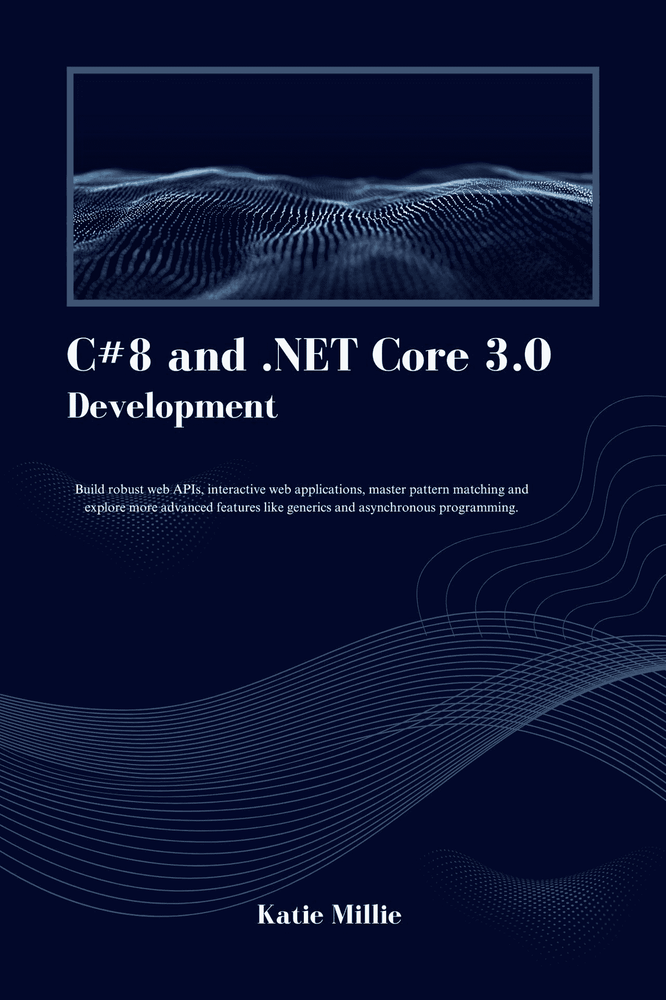

# C# 8 与 .NET Core 3.0 开发

构建健壮的 Web API、交互式 Web 应用程序，掌握模式匹配，并探索更多高级特性，如泛型和异步编程。

作者：凯蒂·米莉

---

## 版权声明

版权所有 © 凯蒂·米莉。保留所有权利。

---

本书凝聚了凯蒂·米莉的创意远见与智慧结晶。每一句话都体现了她的奉献精神、深厚的知识储备，以及她对自身专业领域始终如一的热情。为保护本作品，任何形式或数量的复制或分发，均需获得作者的明确书面许可。

然而，为进行评论性研究，我们欢迎在注明出处的前提下引用简短摘录——请同时注明凯蒂·米莉为作者，以及本作品为来源。

让我们共同营造一个创意蓬勃发展的环境！通过遵守版权法，我们培育创新的火焰，赋能创作者以其才华照亮世界。

感谢您认可凯蒂·米莉作品的价值。

## 目录

# 引言

- 前言
- 你将从本书学到什么
- 本书适合谁阅读
- 本书的结构
- 致谢：致敬协作的力量

# 第 1 章

- C# 全景概览：揭示 C# 8 与 .NET Core 3.0 的强大功能
- 为 C# 8 与 .NET Core 3.0 搭建开发环境
- 深入核心 C# 语法：为 C# 8 与 .NET Core 3.0 开发奠定基础
- 解密变量、数据类型与运算符：C# 8 与 .NET 3.0 的构建基石
- 掌控程序流程：使用 C# 8 与 .NET 3.0 的控制流语句

# 第 2 章

- 构建可复用的代码块：在 C# 8 与 .NET 3.0 中使用函数
- 精通数据组织的艺术：C# 8 与 .NET 3.0 中的数组与集合

# 第 3 章

- 封装功能：C# 8 与 .NET 3.0 中对象的力量
- 定义类与对象：为你的应用构建蓝图
- 继承：在 C# 8 与 .NET 3.0 中复用代码与构建层次结构
- 多态：让你的代码在 C# 8 与 .NET 3.0 中灵活且动态
- 接口：在 C# 8 与 .NET 3.0 中定义一致行为的契约

# 第 4 章

- 泛型：编写适用于任何数据类型的代码
- 异步编程：构建响应迅速且可扩展的应用程序
- 异常处理：优雅地处理错误与意外事件
- Lambda 表达式：简洁而强大的匿名函数
- LINQ：掌握语言集成查询的数据操作

# 第 5 章

- 理解 .NET 生态系统：现代开发的基础
- 揭示 .NET Core 的优势：跨平台、开源与高性能
- 搭建你的 .NET Core 开发环境
- 探索 .NET Core 命令行界面 (CLI)
- 创建与管理 .NET Core 项目

# 第 6 章

- 使用 ASP.NET Core MVC 的现代 Web 开发方法
- 理解 MVC 模式：详解模型-视图-控制器
- 创建你的第一个 ASP.NET Core MVC 应用程序
- 构建控制器：处理用户请求与响应
- 定义模型：表示你的应用数据

# 第 7 章

- 使用 Entity Framework Core 简化数据访问
- 连接数据库：设置 Entity Framework Core
- 定义实体类：映射你的数据模型
- 创建与使用 DbContext：与数据库交互
- 执行 CRUD 操作：创建、读取、更新与删除数据

# 第 8 章

- 打破平台壁垒：为任何设备构建应用程序
- 理解选项：Xamarin.Forms、WPF 等

### 第 9 章

- 使用 Xamarin.Forms 构建移动应用程序
- 使用 XAML 设计用户界面：C# 8 与 .NET 6 中的声明式方法
- 处理用户交互：C# 8 与 .NET 6 中的事件与命令
- 数据绑定：在 C# 8 与 .NET 6 中将数据连接到 UI

# 第 10 章

- 编写高效代码：C# 8 与 .NET 3.0 中实现峰值性能的技巧与诀窍
- 理解垃圾回收：.NET Core 中的内存管理
- 利用异步编程实现 C# 8 与 .NET 3.0 的可扩展性
- 分析与调试你的应用程序以解决 C# 8 与 .NET 3.0 中的性能问题

# 第 11 章

- 理解部署模型：Web 应用、服务等
- 介绍 Docker：用于简化部署的容器化技术
- 将你的应用程序发布到云平台：C# 8 与 .NET 3.0 开发者指南
- 在生产环境中维护与监控你的应用程序

# 附录

- C# 语法与关键字参考指南
- C# 8 与 .NET 6（.NET 3.0 的后续版本）中的常用 .NET Core 库与框架

## 术语表

- 术语表

---

# 引言

释放跨平台开发的力量：你的 C# 8 与 .NET Core 3.0 之旅

数字领域是一个战场。每位开发者都致力于构建能征服用户心灵、主导市场的应用程序。但在这场现代战争中，你是否还在挥舞一把生锈的剑？过时的框架和陈旧的语言束缚着你，阻碍创新，拖慢开发进程。

C# 8 与 .NET Core 3.0 登场了：这正是你所期待的闪亮铠甲。这一强大组合是你打造尖端、跨平台应用程序的关键，能够征服桌面、移动设备和网络，且全部源自一个强大的统一代码库。

本书是你的终极指南，是你的战斗号角，是你通往激动人心的现代开发世界的发射台。

忘掉昨日的局限吧。C# 8，这门备受喜爱的语言的最新版本，为你提供了一个充满新特性的宝库。精简的语法、模式匹配以及增强的空值处理，让你的代码更清晰、更简洁，编写起来充满乐趣。

打破平台壁垒。.NET Core 3.0，这个功能强大的全能框架，粉碎了将你束缚在特定操作系统上的枷锁。使用同一套工具，你就能构建健壮的 Web API、交互式 Web 应用程序和流畅的桌面体验——想象一下这蕴含的无限可能！

没有相关经验？没问题！本书精心设计，旨在满足各级开发者的需求。无论你是经验丰富的 C# 老手，还是充满好奇的新手，我们将带你踏上一段全面的旅程，从基础开始，稳步迈向精通。

以下是你将解锁的部分强大功能：


# 前言

## 你将从本书中学到什么

欢迎，有志于成为开发者的你，踏入 C# 8 和 .NET Core 3.0 的精彩世界！本书是你精通这一强大组合的全面指南，助你构建主导数字领域的现代跨平台应用。无论你是经验丰富的程序员还是充满好奇的新手，这段旅程都将赋予你为 Web、移动和桌面平台打造创新解决方案的能力——所有这些都源自一个统一的代码库。

### 第一部分：C# 8 的基础

我们的探索之旅将从深入探讨 C# 8 的核心原理开始。我们将为语言语法打下坚实的基础，涵盖：

- **变量、数据类型和运算符：** 你将学习如何存储和操作不同类型的数据，使用运算符进行计算和比较。
- **控制流语句：** 掌握分支（`if/else` 语句）和循环（`for` 和 `while` 循环）的艺术，将使你能够控制程序的执行流程。
- **函数：** 我们将分解函数的概念——执行特定任务的可重用代码块——这是构建结构良好程序的基石。
- **数组和集合：** 通过利用数组以及列表和字典等集合来高效组织数据，使你能够管理相关的信息组。

接下来，我们将深入探讨 C# 中面向对象编程（OOP）的核心，这是现代应用开发的支柱范式。你将掌握以下概念的威力：

- **对象和类：** 揭示如何定义代表现实世界实体的蓝图（`类`），并创建这些类的实例（`对象`）来管理程序的功能。
- **继承：** 学习通过创建从父类继承属性和行为的类来利用现有代码，促进代码的可重用性和可维护性。
- **多态：** 这个令人兴奋的概念允许你编写以一致方式与不同对象类型交互的代码，使你的应用程序更加灵活和适应性强。
- **接口：** 定义指定类必须提供哪些功能的契约，确保不同实现之间行为的一致性。

最后，第一部分将为你提供高级 C# 特性，以提升你的开发技能：

- **泛型：** 编写可与任何数据类型无缝协作的代码，消除为不同数据场景编写重复代码的需要。
- **异步编程：** 通过并发处理多个任务而不影响性能，构建响应迅速且可扩展的应用程序。
- **异常处理：** 学习优雅地管理错误和意外事件，确保你的应用程序保持健壮且用户友好。
- **Lambda 表达式：** 编写简洁而强大的匿名函数，以清晰高效的方式表达逻辑。
- **LINQ：** 掌握使用语言集成查询（`LINQ`）进行数据操作的艺术，使你能够以可读且可维护的方式对集合执行复杂操作。

### 第二部分：揭示 .NET Core 3.0 的威力

在建立了坚实的 C# 8 基础之后，我们将过渡到 .NET Core 3.0 框架，这个多功能平台为跨平台开发打开了大门。你将发现：

- **.NET 生态系统：** 全面了解 .NET 的格局，包括其历史、优势和核心组件。
- **.NET Core 的优势：** 探索使用 .NET Core 的主要优势，例如其跨平台兼容性、开源性质和高性能能力。
- **设置你的开发环境：** 学习使用必要的工具和库配置你的开发机器，以无缝创建和运行 .NET Core 应用程序。
- **命令行界面（CLI）：** 熟练掌握 .NET Core CLI 的导航，这是一个用于项目创建、管理和执行各种任务的强大工具。

### 第三部分：使用 ASP.NET Core MVC 构建现代 Web 应用程序

ASP.NET Core MVC 是 .NET 生态系统中构建 Web 应用程序的现代框架。本节将为你提供以下知识：

- **掌握 MVC 模式：** 理解模型-视图-控制器范式，这是一种用于构建 Web 应用程序的核心架构模式，它促进了关注点分离。
- **创建你的第一个 ASP.NET Core MVC 应用：** 卷起袖子，构建你的第一个 Web 应用程序，理解核心组件及其交互方式。
- **控制器：** 学习使用控制器处理用户请求并生成响应，控制器是你的 Web 应用程序的大脑，它与模型和视图进行交互。
- **模型：** 定义应用程序的数据模型，代表你所管理信息的底层架构。
- **视图：** 使用 Razor Pages（一种将 HTML 与 C# 编程融合的模板语法）来构建你的 Web 应用程序的用户界面（UI）。

### 第四部分：在 .NET Core 应用程序中处理数据

数据是大多数应用程序的命脉。在本节中，你将掌握与数据库有效交互的工具：

- **Entity Framework Core：** 探索 Entity Framework Core 的威力，这是一个对象关系映射器（ORM），通过弥合你的 C# 类与关系数据库之间的鸿沟来简化数据访问。
- **连接到数据库：** 学习如何建立与各种数据库系统的连接，使你的应用程序能够与存储在其中的数据进行交互和管理。
- **实体类：** 定义映射到数据库表的实体类，在你的应用程序代码中创建数据模型的表示。
- **DbContext：** 理解 `DbContext` 的作用，它是 Entity Framework Core 中的一个核心组件，用于促进与数据库的交互并管理对象生命周期。
- **CRUD 操作：** 掌握基本的数据操作技术：创建、读取、更新和删除，使你能够有效地管理应用程序的数据。

### 第五部分：构建跨平台应用程序

C# 8 和 .NET Core 的真正威力在于它们能够创建在不同平台上无缝运行的应用程序。在这里，我们将探讨你的选择：

- **使用 .NET Core 进行跨平台开发：** 揭示使用单一代码库构建可针对桌面、移动和 Web 平台的应用程序的激动人心的可能性。


### 了解你的选择

我们将深入探讨跨平台开发的可用框架，包括用于移动应用的 `Xamarin.Forms` 和用于桌面应用的 WPF（本书将重点介绍 `Xamarin.Forms`）。

### 第六部分：使用 Xamarin.Forms 创建用户界面

`Xamarin.Forms` 是一个强大的框架，用于构建具有原生用户界面的移动应用，这些应用可在 Android、iOS 和其他平台上运行。你将学到：

- **使用 Xamarin.Forms 进行移动应用开发**：掌握使用 `Xamarin.Forms` 构建移动应用的概念，利用 C# 和 XAML 进行开发。
- **用于用户界面的 XAML**：探索 XAML 的强大功能，这是一种用于以清晰简洁的方式定义用户界面的声明式语言。
- **处理用户交互**：学习如何通过手势、点击和其他事件捕获用户输入，使你的移动应用具有交互性和响应性。
- **数据绑定**：使用数据绑定，轻松地将应用程序的数据模型与用户界面元素连接起来，确保数据更改和 UI 表示之间的无缝更新。
- **跨平台功能**：探索 `Xamarin.Forms` 如何使你能够跨平台共享代码，减少开发时间并确保移动应用的一致性。

### 第七部分：优化和部署应用程序

构建高效且健壮的应用程序至关重要。本节将为你提供以下知识：

- **性能优化技术**：探索编写高效代码的策略，利用垃圾回收优化和异步编程等技术，确保你的应用程序平稳运行。
- **性能分析和调试**：学习使用性能分析工具和调试技术来识别性能瓶颈并解决问题。
- **部署模型**：了解可用的不同部署模型，例如 Web 应用程序和服务，使你能够根据特定需求选择最佳方法。
- **使用 Docker 进行容器化**：探索使用 Docker 进行容器化的概念，这项技术将你的应用程序及其依赖项打包到一个轻量级容器中，简化部署并确保跨环境的一致执行。
- **生产部署（可选）**：虽然部署细节因平台而异，但我们将概述将应用程序部署到 Azure 或 AWS 等云平台的常见做法。
- **维护和监控应用程序**：学习如何在生产环境中维护你的应用程序，包括监控性能和解决可能出现的任何问题。

# 附录

本节将作为你开发旅程的宝贵参考指南：

- **C# 语法和关键字**：包含常用 C# 语法元素和关键字的快速参考指南，便于回忆。
- **.NET Core 库和框架**：探索精选的流行 .NET Core 库和框架列表，以扩展你的开发能力，超越本书涵盖的核心功能。
- **其他资源**：我们将提供一份有价值的资源列表，包括在线教程、文档和社区论坛，以支持你的持续学习之旅。

通过这段全面的学习之旅，你将掌握使用 C# 8 和 .NET Core 3.0 自信地构建现代跨平台应用程序的技能和知识。拥抱这对动态组合的力量，释放你的创造力，革新数字世界！

### 本书适合谁

你是否渴望打造创新的软件解决方案，却因过时的工具或有限的编程经验而感到受阻？那么 C# 8 和 .NET Core 3.0 就是你开启无限可能的钥匙，而本书则是你在这段激动人心的旅程中的全面指南。

无论你是寻求扩展技能集的经验丰富的程序员，还是渴望探索开发世界的好奇新手，本书都适合各种有共同抱负的人：构建强大的跨平台应用程序。

以下是本书如何赋能你：

#### 对于有抱负的程序员

- **没有编程经验？没问题！** 我们理解从零开始可能令人生畏。本书精心设计，旨在一步步指导你掌握编程基础。我们将以易于理解的方式分解 C# 8 和 .NET Core 3.0 的核心概念，确保你为开发之旅打下坚实的基础。

#### 对于具备基本编码知识的程序员

- **提升你的 C# 技能**：你掌握了基础知识，但希望精通更高级的 C# 功能？我们将深入探讨令人兴奋的 C# 8 世界，探索诸如用于灵活代码的泛型、用于响应式应用程序的异步编程以及用于简洁强大功能的 Lambda 表达式等概念。
- **释放 .NET Core 的力量**：本书解锁了 .NET Core 3.0 的巨大潜力，这是一个多功能框架，使你能够构建现代的跨平台应用程序。你将学习如何利用其功能与数据库交互、创建用户界面以及优化代码以实现最佳性能。

#### 对于经验丰富的 C# 开发者

- **掌握最新的 C# 进展**：通过深入探索 C# 8 令人兴奋的新功能，保持领先优势。通过简化的语法增强代码可读性，利用模式匹配实现更清晰的条件语句，并实现可空引用类型以提高代码安全性和可维护性。
- **扩展你的 .NET Core 专业知识**：更深入地探索 .NET Core 生态系统，探索流行的库和框架，以扩展你的开发能力。使用 `ASP.NET Core MVC` 构建动态 Web 应用程序，使用 `Xamarin.Forms` 创建交互式用户界面，并使用 `Entity Framework Core` 掌握数据访问。

#### 对于希望构建跨平台应用程序的开发者

- **打破平台壁垒**：本书打破了单一平台开发的限制。我们将展示 .NET Core 3.0 在构建跨桌面、移动设备和 Web 无缝运行的应用程序方面的强大功能，所有这些都来自单一代码库。想象一下这带来的可能性！
- **拥抱效率**：告别为不同平台维护单独代码库的日子。通过利用 C# 8 和 .NET Core 3.0，你将简化开发流程，减少时间和维护成本，并确保应用程序的一致性。

本书不仅仅是一本技术手册——它是你开启充实开发生涯的发射台。以下是它的独特之处：

- **在实践中学习**：我们相信最好的学习方式是通过实践经验。本书包含引人入胜的真实世界项目，让你将新学到的知识付诸实践，巩固你的理解，并为你提供在现实世界中茁壮成长所需的实用技能。
- **清晰简洁的解释**：技术主题可能很复杂，但我们以清晰易懂的方式呈现它们。我们避免使用术语，并使用实际示例来说明概念，确保你轻松掌握核心思想。
- **支持性的学习环境**：我们理解学习是一个旅程，而不是终点。本书营造了一个支持性的学习环境。请随时探索提供的其他资源，包括在线教程、文档和社区论坛，在那里你可以与其他开发者联系并继续你的学习之旅。

那么，你准备好释放你内心的 C# 8 和 .NET Core 3.0 开发者了吗？本书是你通往成功的路线图。深入其中，拥抱挑战，准备好构建下一代跨平台应用程序吧！

### 本书的结构


本书精心编写，旨在指导你成为一名熟练的 C# 8 和 .NET Core 3.0 开发者。我们设计了逻辑清晰、循序渐进的结构，确保你在深入更高级主题之前打下坚实的基础。以下是本书内容的详细分解：

## 第一部分：奠定基础（第 1-3 章）

本部分是你的起点，我们将在此建立对 C# 8 编程核心原则的扎实理解。我们将从解析语言语法开始，为你提供建构健壮应用程序的基本构建块。

### 第 1 章：C# 8 简介

本章将以 C# 概览的简要介绍开始，随后设置你的开发环境。接着，我们将深入 C# 语法的核心，探索变量、数据类型、运算符和控制流语句（`if/else` 语句和循环）等基本概念，以控制程序的执行流程。此外，我们将介绍函数的强大功能——这些可重用的代码块执行特定任务，促进模块化和代码组织。最后，我们将探索数组和集合的使用，使你能够高效地组织和管理相关的信息组。

### 第 2 章：掌握 C# 面向对象编程

本章通过引入面向对象编程（OOP）范式来提升你的理解，这是现代应用开发的基石。在这里，你将发现对象和类的力量。我们将引导你将类定义为现实世界实体的蓝图，将对象定义为封装数据和行为的类的实例。此外，我们将深入探讨继承——一种通过创建从现有父类继承属性和功能的类来实现代码重用的强大机制。本章还将进一步探讨多态性，使你能够编写以一致方式与不同对象类型交互的代码，以及接口——定义类必须实现的功能契约。

### 第 3 章：探索高级 C# 特性

在打下坚实基础后，本章将带你探索更高级的 C# 特性。你将接触泛型——一种强大的方式，可以编写与任何数据类型无缝协作的代码，消除为不同数据场景编写重复代码的需要。异步编程——构建响应式和可扩展应用程序的关键概念——也将被探讨，使你能够并发处理多个任务而不影响性能。异常处理——优雅管理错误和意外事件的关键技能——也在本章涵盖，确保你的应用程序保持健壮和用户友好。最后，你将接触 Lambda 表达式——简洁而强大的匿名函数，为在代码中表达逻辑提供了一种优雅的方式。此外，我们将探索语言集成查询（LINQ）——一个强大的功能，简化了 C# 代码中的数据操作。

## 第二部分：揭示 .NET Core 3.0 的力量（第 4 章）

在牢固掌握 C# 8 之后，我们将在第 4 章过渡到令人兴奋的 .NET Core 3.0 世界。在这里，你将全面理解这个多功能框架，它为跨平台开发打开了大门。

### 第 4 章：.NET Core 3.0 入门

本章将首先概述 .NET 生态系统，探讨其历史、核心组件以及相对于以前 .NET 版本的优势。然后，你将发现使用 .NET Core 的主要好处，包括其跨平台兼容性（意味着应用程序可以在 Windows、macOS 和 Linux 上运行）、开源性质（允许社区贡献和灵活性）以及高性能能力。接着，我们将指导你使用必要的工具和库设置开发环境，以无缝创建和运行 .NET Core 应用程序。最后，你将接触 .NET Core 命令行界面（CLI）——一个强大的工具，用于项目创建、管理以及执行与 .NET Core 开发相关的各种任务。

## 第三部分：使用 ASP.NET Core MVC 构建 Web 应用程序（第 5-6 章）

我们旅程的下一段重点是构建现代 Web 应用程序。我们将利用 ASP.NET Core MVC——.NET Core 生态系统中专为 Web 开发设计的强大框架。

### 第 5 章：ASP.NET Core MVC 简介

本章介绍模型-视图-控制器（MVC）范式，这是一种核心架构模式，将 Web 应用程序中与数据（模型）、用户界面（视图）和应用程序逻辑（控制器）相关的关注点分离。这种分离促进了可维护性和可扩展性。然后，我们将指导你创建你的第一个 ASP.NET Core MVC 应用程序，提供对核心组件和功能的实践介绍。

在介绍 MVC 模式之后，我们将深入探讨控制器的功能——你的 Web 应用程序的大脑。你将学习控制器如何处理用户请求（如表单提交或 API 调用）、与模型交互以检索或操作数据，以及生成适当的响应（如网页或 JSON 数据）以在用户界面中显示。

### 第 6 章：在 ASP.NET Core 应用程序中处理数据

没有无缝的数据管理，任何 Web 应用程序都是不完整的。本章介绍 Entity Framework Core——一个简化数据访问的对象关系映射器（ORM）。我们将探索如何连接到各种数据库系统（例如 SQL Server、MySQL）并定义映射到数据库表的实体类。你将掌握 `DbContext` 的概念——Entity Framework Core 中的一个核心组件，它促进与数据库的交互并管理对象生命周期。最后，我们将为你提供对数据执行 CRUD（创建、读取、更新、删除）操作的知识，确保你能够有效地管理 Web 应用程序中的信息。

## 第四部分：构建跨平台应用程序（第 7-8 章）

C# 8 和 .NET Core 的真正力量在于它们能够创建征服多个平台的应用程序。在这里，我们将探索两种流行的跨平台开发选择：

### 第 7 章：.NET Core 跨平台开发简介

本章揭示了使用单一代码库构建可在桌面、移动设备和 Web 等不同平台上无缝运行的应用程序的激动人心的可能性。我们将讨论跨平台开发的优势和考虑因素，强调通过专注于统一代码库可以节省的时间和资源。

### 第 8 章：使用 Xamarin.Forms 创建用户界面（重点）

虽然 .NET Core 提供了多种跨平台选项，但本书重点介绍 Xamarin.Forms——一个强大的框架，用于使用 C# 和 XAML 为 Android、iOS 和其他平台构建具有原生外观的移动应用程序。在这里，你将学习使用 Xamarin.Forms 进行移动开发的基础知识，探索使用 XAML（一种简化 UI 创建的声明式语言）进行用户界面设计。我们将深入探讨处理用户交互，如手势、点击和其他事件，使你的移动应用程序响应迅速且引人入胜。此外，你将掌握数据绑定——一种轻松将应用程序的数据模型与 UI 元素连接的技术，确保数据更改和用户界面表示之间的无缝更新。最后，我们将探讨使用 Xamarin.Forms 进行跨平台开发的好处，展示如何跨平台共享代码，减少开发时间，并确保移动应用程序之间一致的用户体验。


**第五部分：优化与部署应用程序（第 9-10 章）**

构建高效且健壮的应用程序对于专业开发至关重要。本节将为你提供确保应用程序完美运行并触达目标用户的知识。

● **第 9 章：性能优化技术**：我们将探讨编写高效代码的策略，例如理解垃圾回收机制以及利用异步编程来确保应用程序流畅运行，处理用户交互时无延迟。此外，你将学习如何对应用程序进行性能分析以识别性能瓶颈，并利用调试技术来排查可能出现的任何问题。

● **第 10 章：将应用程序部署到生产环境**：本章深入探讨部署的世界，即让应用程序可供用户访问的过程。我们将讨论不同的部署模型，例如 Web 应用程序和服务，让你能够选择最适合特定应用程序需求的方法。此外，我们将介绍使用 Docker 进行容器化的概念，这项技术将你的应用程序及其依赖项打包到一个轻量级容器中，简化部署并确保在不同环境中执行的一致性。虽然具体的部署过程因你选择的平台（例如 Azure 或 AWS 等云平台）而异，但我们将概述常见实践，为你将创作部署到现实世界奠定坚实的基础。最后，本章将涉及部署后应用程序的维护和监控，确保它们持续以最佳状态运行，并解决可能出现的任何问题。

# 附录

本节在整个开发旅程中都是一份宝贵的参考指南：

● **C# 语法与关键字**：一份快速参考指南，包含常用的 C#语法元素和关键字，便于回忆。

● **.NET Core 库与框架**：探索一份精选的流行.NET Core 库和框架列表，以扩展你的开发能力，超越本书涵盖的核心功能。

● **其他资源**：我们将提供一份用于进一步学习的宝贵资源列表，包括

### 致谢：庆祝协作

撰写本书的旅程是一次丰富的体验，充满了学习和协作。在此，我向那些在本书诞生过程中发挥重要作用的个人和资源表示诚挚的感谢。

**致 C#和.NET Core 社区**：衷心感谢充满活力的 C#和.NET Core 开发者社区。你们的热情、创新和分享知识的意愿一直是灵感和支持的源泉。我感激无数的在线论坛、文档和教程，它们丰富了我的理解，并在整个写作过程中提供了宝贵的资源。

**致技术专家**：我向慷慨分享他们在 C# 8 和.NET Core 3.0 方面知识和见解的技术专家们致以最深的谢意。他们的贡献，无论是通过博客文章、书籍还是在线讨论，都提供了宝贵的指导，并确保了本书中信息的准确性和深度。

**致我的审阅者**：特别感谢那些一丝不苟审阅书稿的审阅者。他们富有洞察力的批评、改进建议以及对细节的敏锐眼光，显著提升了本书的质量和清晰度。你们对卓越的承诺确保了本书提供清晰、引人入胜且信息丰富的学习体验。

**致我的软件开发导师**：我深深感谢那些在我整个职业生涯中给予指导的软件开发导师。他们的鼓励、耐心和分享专业知识的意愿，培养了我对编程的热爱和对持续学习的奉献。本书是他们坚定不移的支持和所传授知识的见证。

**致我的家人和朋友**：我衷心感谢我的家人和朋友在整个旅程中坚定不移的支持。他们的鼓励、理解以及容忍深夜和关于代码的激情讨论，都是无价的。本书献给你们所有人。

**致你，读者**：最后，特别感谢你，读者。无论你是寻求扩展知识的资深 C#开发者，还是踏上学习之旅的有抱负的程序员，我都深感荣幸你选择本书作为你的指南。你对学习的投入和个人发展的承诺，激发了我创造赋能他人资源的热情。

### 让我们继续共同学习和构建

技术世界在不断演变。C#和.NET Core 也在不断适应并引入新功能。作为一个社区，我们有责任保持信息灵通、分享知识，并为这些强大技术的发展做出贡献。愿本书成为你学习之旅的跳板，激励你探索、创新并创建下一代突破性的应用程序。

# 第 1 章

## 瞥见 C#全景：揭示 C# 8 与.NET Core 3.0 的强大功能

欢迎来到引人入胜的 C# 8 和.NET Core 3.0 世界！这对充满活力的组合为构建现代、跨平台应用程序提供了强大的工具包。但在我们深入探讨这项前沿技术的具体细节之前，让我们花点时间来欣赏围绕 C#的丰富历史和充满活力的生态系统。

### 历史视角

C#于 2000 年出现，由微软开发，是一种为.NET Framework 设计的现代、面向对象的编程语言。该框架提供了一套全面的库和工具，用于构建 Windows 应用程序。多年来，C#发生了显著演变，拥抱新的范式和功能，以保持在软件开发的前沿。

### C#的关键特性

以下是定义 C#的一些核心特性：

● **面向对象**：C#采用面向对象编程范式，允许你使用类和对象来建模现实世界的实体。这促进了代码的可重用性、可维护性和模块化。

```csharp
public class Car
{
    public string Make { get; set; }
    public string Model { get; set; }
    public int Year { get; set; }

    public void StartEngine()
    {
        // 模拟启动引擎的代码
    }
}
```

在这个例子中，`Car`类代表一个汽车实体，具有`Make`、`Model`和`Year`等属性。`StartEngine`方法定义了与汽车对象关联的功能。

● **静态类型**：C#是一种静态类型语言，意味着变量类型在编译时声明。这确保了类型安全并有助于防止运行时错误。

```csharp
int age = 30; // 声明一个名为'age'的整数变量
string name = "John Doe"; // 声明一个名为'name'的字符串变量
```

● **垃圾回收**：C#通过垃圾回收实现自动内存管理。这消除了手动内存分配和释放的需要，简化了开发者的内存管理。

● **通过.NET Core 实现跨平台**：虽然历史上专注于 Windows 开发，但随着.NET Core 的引入，C#已经拥抱了跨平台开发。这个开源框架允许你构建在 Windows、macOS、Linux 甚至 Web 浏览器上无缝运行的应用程序。

### C# 8：揭示最新增强功能

最新版本 C# 8 引入了令人兴奋的新功能，使开发人员能够编写更清晰、更高效和更具表达力的代码。以下是一些亮点：

● **模式匹配**：此功能通过允许你将数据与模式匹配而不是传统的 if/else 语句来简化条件语句。

```csharp
string dayOfWeek = "Monday";
switch (dayOfWeek)
{
    case "Monday":
    case "Tuesday":
    case "Wednesday":
    case "Thursday":
    case "Friday":
```


### 为 C# 8 和 .NET Core 3.0 设置开发环境

恭喜你开启 C# 8 和 .NET Core 3.0 的学习之旅！这对充满活力的组合为构建现代、跨平台应用提供了巨大潜力。在深入代码之前，让我们先设置好你的开发环境——这个将让你的编码技巧得以施展的“战场”。

在这里，我们将探讨两种流行的开发环境选择：

#### 选项 1：安装了 .NET Core 工作负载的 Visual Studio 2019

Visual Studio (VS) 是微软推出的一款强大的集成开发环境 (IDE)，专为简化软件开发流程而设计。

**前提条件：**

- 操作系统：Windows 10（版本 1903 或更高版本）或 macOS（版本 10.14 或更高版本）
- .NET Core SDK 3.1 或更高版本：根据你的操作系统，从 [`dotnet.microsoft.com/en-us/download`](https://dotnet.microsoft.com/en-us/download) 下载并安装 .NET Core SDK。

**安装步骤：**

1.  启动 Visual Studio Installer：从 [`visualstudio.microsoft.com/downloads/`](https://visualstudio.microsoft.com/downloads/) 下载并运行 Visual Studio Installer。
2.  选择“.NET 开发”工作负载：在安装过程中，选择“.NET 开发”工作负载。这将确保你拥有进行 C# 和 .NET Core 开发所需的工具和库。
3.  附加工作负载（可选）：根据你的开发需求考虑附加工作负载。例如，“ASP.NET 和 Web 开发”工作负载对于构建 Web 应用程序很有帮助。
4.  完成安装：按照屏幕上的说明完成安装过程。

**创建你的第一个 C# 8 项目：**

1.  启动 Visual Studio：安装完成后，打开 Visual Studio。
2.  创建新项目：在起始页上，点击“创建新项目”。
3.  选择项目模板：在“.NET Core”下，根据你的需求选择合适的项目模板。以下是一些示例：
    - 控制台应用 (.NET Core)：一个简单的命令行应用程序，适合入门 C# 基础知识。
    - ASP.NET Core Web 应用程序：使用 ASP.NET Core MVC 框架创建现代 Web 应用程序。
    - 类库 (.NET Core)：开发可在其他应用程序中使用的可重用代码组件。
4.  配置项目详情：为你的项目提供名称和位置，然后点击“创建”。

#### 选项 2：使用 .NET Core CLI 的 Visual Studio Code

Visual Studio Code (VS Code) 是微软推出的一款轻量级、开源的代码编辑器，以其灵活性和自定义选项而闻名。虽然它不是像 Visual Studio 那样功能齐全的 IDE，但它提供了强大的编辑体验，并能与 .NET Core 命令行接口 (CLI) 无缝集成。

**前提条件：**

- 操作系统：Windows、macOS 或 Linux（从 [`code.visualstudio.com/`](https://code.visualstudio.com/) 下载相应版本）
- .NET Core SDK 3.1 或更高版本：如前所述，下载并安装 .NET Core SDK。

**安装步骤 (VS Code)：**

1.  下载并安装 VS Code：从上面的链接下载安装程序，并按照屏幕上的说明操作，适用于你的操作系统。

### C# 8 特性与 .NET Core 生态系统

#### 可空引用类型

此特性有助于防止空引用异常，这是 C# 应用程序中常见的错误来源。通过选择启用可空引用类型，编译器会强制进行空值检查，使你的代码更加健壮。

```csharp
// 不使用可空引用类型
string name = null;
int nameLength = name.Length; // 这将导致空引用异常

// 使用可空引用类型（需要在项目设置中启用）
string? name = null; // '?' 表示可空引用
int nameLength = name?.Length; // 编译器将警告潜在的空引用并建议进行空值检查
```

#### 使用 async/await 进行异步编程

这个强大的特性允许你编写异步代码，从而提高响应能力并避免阻塞主线程。这对于与数据库或网络服务等外部资源交互的应用程序尤其有益。

```csharp
public async Task DownloadFile(string url)
{
    using (var webClient = new WebClient())
    await webClient.DownloadFileTaskAsync(url, "downloaded_file.txt");
}
```

此代码片段演示了如何使用 `async` 和 `await` 关键字异步下载文件。

### .NET Core 生态系统

.NET Core 构成了使用 C# 进行跨平台开发的基础。让我们更深入地了解其关键组件：

- **.NET Core 运行时**：这个轻量级的运行时环境提供了在各种平台上执行 .NET Core 应用程序所需的基础库和服务。
- **.NET Core SDK（软件开发工具包）**：SDK 包含构建、调试和测试 .NET Core 应用程序所需的工具和库。
- **.NET Standard 库**：这些库在不同的 .NET 实现（包括 .NET Core 和 .NET Framework）之间提供了一致的功能集，使开发人员能够编写可在各种平台上运行的可移植代码。

### 超越核心：拓展你的开发视野

.NET Core 生态系统超越了核心框架，提供了丰富的库和框架集合，以满足多样化的开发需求。以下是一些流行的例子：

- **ASP.NET Core MVC**：此框架使你能够使用模型-视图-控制器 (MVC) 架构模式构建健壮、可扩展的 Web 应用程序。
- **Entity Framework Core**：这个对象关系映射器 (ORM) 通过弥合你的 C# 类与关系数据库之间的鸿沟，简化了数据访问。
- **Xamarin.Forms**：如前所述，Xamarin.Forms 允许你使用单一的 C# 代码库为 Android、iOS 和其他平台创建具有原生外观的移动应用程序。

### 为什么选择 C# 8 和 .NET Core 3.0？

选择 C# 8 和 .NET Core 3.0 进行你的下一个开发项目，有众多令人信服的理由：

- **跨平台开发**：构建可在桌面、移动设备和 Web 上无缝运行的应用程序，触达更广泛的受众，并最大化你的开发成果。
- **现代且安全**：拥抱 C# 8 的最新进展，包括模式匹配、可空引用类型和改进的异步编程能力等特性。
- **开源且由社区驱动**：受益于 .NET Core 的开源特性以及充满活力的开发者社区，他们提供持续支持并为平台的持续演进做出贡献。
- **高性能和可扩展性**：.NET Core 应用程序以其性能和随着应用程序复杂性和用户群增长而有效扩展的能力而闻名。
- **庞大的人才库**：随着 C# 的普及，你可以接触到大量熟练的开发者，他们能够为你的项目做出贡献。

C# 8 和 .NET Core 3.0 构成了构建现代、跨平台应用程序的强大组合。希望这次对 C# 领域的简要介绍激发了你进一步探索其能力的兴趣。凭借其丰富的历史、对开发者体验的关注以及不断演进的功能集，C# 继续成为各种规模和范围的软件开发项目的有力选择。

### 准备好深入探索了吗？

本书旨在作为一份全面的指南，为你提供掌握 C# 8 和 .NET Core 3.0 开发所需的知识和技能。拥抱学习之旅，探索可用的丰富资源，并开始构建未来的创新应用程序！


## C# 扩展（可选）

在 VS Code 中安装官方 C# 扩展，以获得增强的 C# 语言支持，包括语法高亮和代码补全。

## 创建你的第一个 C# 8 项目

1.  **打开 VS Code**：安装完成后启动 VS Code。
2.  **打开终端**：在 VS Code 中打开集成终端（通常位于窗口底部）。
3.  **创建新项目**：在终端中使用 `cd` 命令导航到你期望的项目目录。然后，使用 .NET Core CLI 命令 `dotnet new console` 创建一个新的控制台应用程序项目。
4.  **打开项目文件夹**：在 VS Code 中使用“打开文件夹”选项，打开新创建的项目文件夹（通常以你的项目命名）。

## 验证你的设置

1.  **创建 C# 文件（两种选项）**：在你的项目目录中（无论你选择哪个 IDE），创建一个新的文本文件，并将其命名为以 `.cs` 结尾（例如 `Program.cs`）。这将是你的 C# 代码文件。
2.  **编写一个简单的 C# 程序（两种选项）**：在你的 `Program.cs` 文件中，添加以下代码：

    ```csharp
    using System;

    class Program
    {
        static void Main(string[] args)
        {
            Console.WriteLine("Hello, World!");
        }
    }
    ```

3.  **运行程序（Visual Studio）**：生成并运行：在 Visual Studio 中，导航到“调试”菜单并选择“开始执行（不调试）”（或按 `Ctrl+F5`）。这将生成并运行你的程序，在控制台窗口中显示 "Hello, World!"。
4.  **运行程序（VS Code）**：生成并运行（终端）：在 VS Code 的集成终端中，导航到包含你的 `Program.cs` 文件的目录。然后，使用 .NET Core CLI 命令 `dotnet run` 来生成并运行你的程序。你应该会在终端中看到 "Hello, World!" 消息。

恭喜！你已成功设置开发环境并执行了你的第一个 C# 8 程序。

## 附加提示

- **探索 IDE/编辑器功能**：Visual Studio 和 VS Code 都提供了丰富的功能来简化你的开发过程。花些时间探索代码补全、调试工具和项目管理功能等。
- **自定义你的工作区**：个性化你的开发环境以适应你的偏好。VS 和 VS Code 都为主题、键盘快捷键和扩展提供了广泛的自定义选项。
- **版本控制（可选）**：考虑使用像 Git 这样的版本控制系统来管理你的代码更改，并与他人有效协作。

## 拥抱学习之旅

本指南为你开始 C# 8 和 .NET Core 3.0 开发之旅奠定了基础。请记住，学习是一个持续的过程。利用丰富的在线资源，尝试不同的功能，并定期练习以磨练你的技能。

以下是一些帮助你保持正轨的有用资源：

- **Microsoft Docs**：关于 C#、.NET Core 和 Visual Studio 的广泛文档：[`learn.microsoft.com/en-us/docs/`](https://learn.microsoft.com/en-us/docs/)
- **Visual Studio Code 文档**：[`code.visualstudio.com/docs`](https://code.visualstudio.com/docs)
- **.NET Core 教程**：[`learn.microsoft.com/en-us/dotnet/core/tutorials/`](https://learn.microsoft.com/en-us/dotnet/core/tutorials/)
- **C# 在线课程和教程**：众多在线平台提供互动课程和教程，以增强你的 C# 学习体验。

随着你深入探索 C# 8 和 .NET Core 3.0 的世界，你将解锁构建创新且有影响力应用程序的无限可能。编码愉快！

## 深入核心 C# 语法：为 C# 8 和 .NET Core 3.0 开发奠定基础

欢迎，有抱负的 C# 开发者！既然你已经设置好了开发环境，让我们开始一段探索 C# 8 核心语法的旅程，这是使用 .NET Core 3.0 构建强大应用程序的基石。本章将为你提供编写有效 C# 代码所必需的基本构建块。

### 1. 构建块：变量和数据类型

**变量**：变量充当在程序中存储和操作数据的容器。你通过指定其数据类型（它可以保存的数据种类）并为其分配一个名称来声明一个变量。

```csharp
int age = 30; // 声明一个名为 'age' 的整数变量并赋值为 30
string name = "John Doe"; // 声明一个名为 'name' 的字符串变量并赋值为文本 "John Doe"
```

**数据类型**：数据类型定义了变量可以保存的信息类型。以下是 C# 中一些常见的数据类型：

- `int`：存储整数（例如 10, -5）。
- `double`：存储带小数的浮点数（例如 3.14, -2.5）。
- `string`：保存文本数据（例如 "Hello, World!"）。
- `bool`：表示布尔值（`true` 或 `false`）。
- `char`：存储单个字符（例如 'A', '£'）。

### 2. 运算符：执行计算和操作数据

运算符是对操作数（变量、值或表达式）执行操作的符号。

- **算术运算符**：执行数学计算，如加法（`+`）、减法（`-`）、乘法（`*`）、除法（`/`）和取模（`%`）（除法后的余数）。

    ```csharp
    int sum = 10 + 20; // sum 将为 30
    double average = (15.5 + 22.3) / 2; // average 将为 18.9
    ```

- **比较运算符**：比较值并返回布尔结果（`true` 或 `false`）。示例包括等于（`==`）、不等于（`!=`）、大于（`>`）、小于（`<`）、大于或等于（`>=`）和小于或等于（`<=`）。

    ```csharp
    bool isAdult = age >= 18; // 检查 'age' 是否大于或等于 18（true 或 false）
    string comparison = name == "John Doe" ? "Yes" : "No"; // 使用三元条件运算符进行简洁比较
    ```

- **逻辑运算符**：使用与（`&&`）和或（`||`）等运算符组合布尔表达式。

    ```csharp
    bool isStudent = isAdult && hasValidID; // 检查两个条件是否都为真
    bool isRegistered = isEnrolled || hasWaitlistPosition; // 检查至少一个条件是否为真
    ```

### 3. 控制流语句：指导程序流程

控制流语句决定了程序代码的执行顺序。

- **`if` 语句**：如果指定条件为真，则执行一段代码块。

    ```csharp
    if (age >= 18)
    {
        Console.WriteLine("You are eligible to vote.");
    }
    ```

- **`else if` 语句**：如果初始 `if` 条件为假，则提供额外的条件检查。

    ```csharp
    if (age >= 18)
    {
        Console.WriteLine("You are eligible to vote.");
    }
    else if (age >= 16)
    {
        Console.WriteLine("You can apply for a learner's permit.");
    }
    ```

- **`else` 语句**：如果前面的条件都不为真，则执行一段代码块。

    ```csharp
    if (age >= 18)
    {
        Console.WriteLine("You are eligible to vote.");
    }
    else if (age >= 16)
    {
        Console.WriteLine("You can apply for a learner's permit.");
    }
    else
    {
        Console.WriteLine("You are not yet of legal age.");
    }
    ```

- **`switch` 语句**：基于单个变量的值提供多路分支结构。

    ```csharp
    string dayOfWeek = "Monday";
    switch (dayOfWeek)
    {
        case "Monday":
        case "Tuesday":
        case "Wednesday":
        case "Thursday":
        case "Friday":
            Console.WriteLine("It's a weekday!");
            break;
        case "Saturday":
        case "Sunday":
            Console.WriteLine("It's the weekend!");
            break;
        default:
            Console.WriteLine("Invalid day of the week!");
            break; // 在找到匹配的 case 后退出 switch 语句
    }
    ```

- **循环**：重复代码块。循环允许你重复执行一段代码块，直到满足特定条件。

    - **`for` 循环**：适用于基于计数器变量迭代固定次数。

        ```csharp
        for (int i = 0; i < 5; i++)
        {
            Console.WriteLine("Iteration: {0}", i); // 打印 "Iteration: 0", "Iteration: 1", ..., "Iteration: 4"
        }
        ```

    - **`while` 循环**：只要指定条件保持为真，就执行一段代码块。

        ```csharp
        int count = 0;
        while (count < 3)
        {
            Console.WriteLine("Count: {0}", count);
            count++; // 每次迭代后将 count 增加 1
        }
        ```


## do-while 循环

`do-while` 循环确保代码块至少执行一次，然后根据条件继续执行。

```csharp
int input = 0;

do
{
    Console.WriteLine("Enter a positive number (or 0 to quit): ");
    input = int.Parse(Console.ReadLine()); // Read user input and convert to integer
} while (input > 0);
```

## 4. 输入与输出：与用户交互

- **`Console` 类**：`Console` 类提供了用于读取用户输入和在控制台窗口显示输出的方法。

```csharp
Console.WriteLine("Enter your name: ");
string name = Console.ReadLine(); // Reads user input as a string and stores it in the 'name' variable
Console.WriteLine("Hello, {0}!", name); // Displays a message using string interpolation
```

## 5. 方法：可重用的代码块

方法将特定功能封装在自包含的代码块中。它们可以接受输入参数（可选）并返回一个值（可选）。

```csharp
public static void Greet(string name) // Method declaration with a 'string' parameter
{
    Console.WriteLine("Hello, {0}!", name);
}

Greet("John Doe"); // Calling the Greet method with an argument
```

## 6. 类与对象：构建模块化程序

- **类**：类是创建对象的蓝图。它们定义了封装对象行为的属性（数据成员）和方法（函数）。

```csharp
public class Person // Class definition named 'Person'
{
    public string Name { get; set; } // Property named 'Name' with get and set accessors
    public int Age { get; set; } // Property named 'Age' with get and set accessors

    public void Introduce() // Method named 'Introduce' that doesn't return a value (void)
    {
        Console.WriteLine("Hi, my name is {0} and I am {1} years old.", Name, Age);
    }
}
```

- **对象**：对象是类的实例。它们持有特定的数据（属性值）并可以执行定义的方法。

```csharp
Person john = new Person(); // Create an object named 'john' of type 'Person'
john.Name = "John Doe";
john.Age = 30;
john.Introduce(); // Calling the 'Introduce' method on the 'john' object
```

## 7. 数组：数据的集合

数组表示相同数据类型元素的有序集合。

```csharp
int[] numbers = new int[5]; // Declares an integer array named 'numbers' with a capacity of 5 elements
numbers[0] = 10; // Assigns the value 10 to the first element (index 0)
numbers[1] = 20; // Assigns the value 20 to the second element (index 1)
Console.WriteLine("The second element is: {0}", numbers[1]); // Accessing an element by its index
```

## 8. 注释：解释你的代码

注释是被编译器忽略的文本行，但为人类读者提供了有价值的解释，增强了代码的可读性和可维护性。

```csharp
// This is a single-line comment
/* This is a multi-line comment
used to explain complex code sections */
```

## 拥抱旅程，进一步探索！

本章为你的 C# 8 开发之旅奠定了基础。练习编写使用此处涵盖概念的简单程序。不要犹豫，尝试并探索以下资源以巩固你的理解：

- **在线教程和练习**：众多在线平台提供交互式教程和练习，以加强你对 C# 语法的掌握。
- **书籍和文档**：参考 C# 参考书籍和 Microsoft 的官方文档，获取深入的解释和高级主题。
- **在线社区**：参与 C# 开发者的在线社区，提问、分享代码片段并从他人的经验中学习。

随着你的进步，深入探索 C# 8 的特性：

- **模式匹配**：探索模式匹配，这是 C# 8 中引入的一个强大功能，它简化了用于数据验证和提取的条件语句。
- **可空引用类型**：了解可空引用类型（在 C# 8 中是可选的），它通过强制执行更严格的空检查来帮助防止空引用异常，从而提高代码可靠性。
- **异步编程**：掌握使用 `async` 和 `await` 关键字的异步编程技术，使你的应用程序能够高效地处理长时间运行的操作，而不会阻塞主线程。

记住，掌握 C# 的关键在于持续的练习和探索。凭借你的奉献精神和可用的资源，你将顺利地使用 C# 8 和 .NET Core 3.0 构建创新应用程序。

编码愉快！

## 揭秘变量、数据类型和运算符：C# 8 和 .NET 3.0 的构建块

恭喜你踏上 C# 开发之旅！本章通过介绍变量、数据类型和运算符的基本概念为你打下基础——这些是在 .NET 3.0 环境中编写有效 C# 代码的基本构建块。

### 1. 变量：你的数据容器

想象你的程序是一个繁忙的厨房。就像你使用碗、勺子和量杯来盛放配料一样，变量充当 C# 程序中的容器，用于存储和操作数据。

**声明变量：**

要创建一个变量，你需要：

- 指定一个数据类型：这定义了变量可以保存的信息类型（数字、文本等）。
- 分配一个名称：这是你在整个代码中用来引用该变量的唯一标识符。

这里有一个例子：

```csharp
int age = 30; // Declares an integer variable named 'age' and assigns the value 30
```

在这个例子中，`int` 是数据类型，表示变量 `age` 可以存储整数。`=` 符号将值 `30` 赋给变量。

**C# 8 中的常见数据类型：**

- `int`：存储整数（例如，10，-5）。
- `double`：存储带小数的浮点数（例如，3.14，-2.5）。
- `string`：保存文本数据（例如，"Hello, World!"）。
- `bool`：表示布尔值（`true` 或 `false`）。
- `char`：存储单个字符（例如，'A'，'£'）。

### 2. 数据类型：定义信息景观

数据类型就像你厨房里的标签，指定了每个容器的内容（数字、文本等）。这确保了你的程序能够适当地处理数据。

让我们深入了解 C# 中的一些基本数据类型：

**数值数据类型：**

- `int`：非常适合像年龄、数量或分数这样的整数。
- `double`：用于像价格、距离或科学计算这样的带小数的浮点数。

**非数值数据类型：**

- `string`：非常适合存储像姓名、地址或用户输入这样的文本数据。
- `bool`：表示布尔值（`true` 或 `false`），通常用于条件语句中。

**选择正确的数据类型：**

为变量选择合适的数据类型对于保持代码的准确性和效率至关重要。例如，对年龄使用 `int` 确保只存储整数，防止意外结果。

### 3. 运算符：执行计算和操作数据

将运算符视为编程厨房中的工具。它们允许你对存储在变量中的数据执行各种操作。

**运算符类型：**

- **算术运算符：**
  这些运算符对数值数据类型（例如 `int` 和 `double`）执行数学计算。

```csharp
int sum = 10 + 20;  // sum will be 30 (addition)
double average = (15.5 + 22.3) / 2; // average will be 18.9 (division)
```

- **比较运算符：**
  这些运算符比较值并返回布尔结果（`true` 或 `false`）。

```csharp
bool isAdult = age >= 18; // Checks if 'age' is greater than or equal to 18 (true or false)
string comparison = name == "John Doe" ? "Yes" : "No"; // Uses a ternary conditional operator for a concise comparison
```

- **逻辑运算符：**
  这些运算符使用 `&&`（与）和 `||`（或）组合布尔表达式。

```csharp
bool isStudent = isAdult && hasValidID; // Checks if both conditions are true
bool isRegistered = isEnrolled || hasWaitlistPosition; // Checks if at least one condition is true
```

- **赋值运算符：**
  `=` 符号用于赋值。它将一个值赋给一个变量。

```csharp
```


## 4. 综合运用：一个简单示例

让我们创建一个计算矩形面积的程序：

```csharp
using System; // 这行代码引入 System 命名空间，提供程序所需的核心功能

class AreaCalculator
{
    static void Main(string[] args)
    {
        // 使用合适的数据类型声明变量
        int length = 10;
        double width = 5.5;

        // 使用乘法运算符 (*) 计算面积
        double area = length * width;

        // 使用 Console 类显示计算出的面积
        Console.WriteLine("The area of the rectangle is: {0} square units", area);
    }
}
```

**解释：**

1.  `using System;`：这行代码导入 `System` 命名空间，提供输入/输出和程序中使用的数据类型等核心功能。
2.  `class AreaCalculator`：我们定义了一个名为 `AreaCalculator` 的类，它作为程序的蓝图。
3.  `static void Main(string[] args)`：这是程序的入口点。`Main` 方法在程序运行时执行。
4.  **变量声明：**
    *   `int length = 10;`：声明一个整型变量 `length` 来存储矩形的长度，并赋值为 `10`。
    *   `double width = 5.5;`：声明一个双精度浮点型变量 `width` 来存储矩形的宽度，其值为小数（`5.5`）。
5.  **面积计算：** `double area = length * width;`：使用乘法运算符（`*`）计算面积，并将结果（长度乘以宽度）存储在 `area` 变量中（声明为 `double` 类型以处理小数）。
6.  **输出：** `Console.WriteLine("The area of the rectangle is: {0} square units", area);`：
    *   `Console` 类提供了与用户交互的方法。
    *   `WriteLine` 向控制台显示格式化的字符串。
    *   `{0}` 作为 `area` 变量值的占位符。

**尝试修改代码：**

*   更改 `length` 和 `width` 的值，观察计算出的面积如何随之变化。
*   尝试为 `length` 和 `width` 使用不同的数据类型（例如，都使用 `double`）。会发生什么？

## 5. 提示与注意事项

*   **变量命名约定：** 为变量使用描述性且有意义的名称（例如，使用 `customerName` 而不是 `x`）。
*   **数据类型选择：** 根据变量将要存储的数据种类选择合适的数据类型。
*   **运算符优先级：** 注意运算符优先级（执行操作的顺序）。必要时使用括号以提高清晰度。

**拥抱学习之旅！**

本章为你介绍了 C# 8 的基本构建块：变量、数据类型和运算符。随着你深入学习编程，你将发现大量基于这些核心基础构建的功能和概念。

以下是一些资源，可帮助你巩固理解：

*   **在线教程和练习：** 探索交互式教程和编码练习，以实践使用变量、数据类型和运算符。
*   **C# 文档：** 参阅 Microsoft 的官方文档，获取关于数据类型和运算符的详细解释和参考信息。
*   **实践与实验：** 掌握 C# 的关键在于持续的实践。尝试编写简单的程序，以巩固你对这些概念的理解。

通过专注和探索，你将能够有效地运用变量、数据类型和运算符，着手构建引人入胜的 C# 应用程序。

编码愉快！

## 掌握程序流程：C# 8 与 .NET 3.0 中的控制流语句

在编程世界中，控制流语句就像是代码的交通信号灯，它指挥着执行顺序，确保你的程序按照预期的路径运行。本章深入探讨 C# 8 中两种基本的控制流语句类型：分支和循环，使你能够在 .NET 3.0 框架内构建更具动态性和交互性的应用程序。

### 1. 分支语句：做出决策

想象一个复杂的食谱，其中包含多个依赖于特定条件的步骤。C# 中的分支语句功能类似，允许你的程序根据这些决策来做出选择并执行相应的代码块。在这里，我们将探讨三种常见的分支语句：

#### if 语句

`if` 语句是分支的基础。它评估一个条件，并且仅在条件为真时执行一段代码块。

```csharp
int age = 25;

if (age >= 18)
{
    Console.WriteLine("You are eligible to vote.");
}
else
{
    Console.WriteLine("You are not yet of legal age to vote.");
}
```

**解释：**

1.  `int age = 25;`：声明一个整型变量 `age` 并赋值为 `25`。
2.  `if (age >= 18)`：`if` 语句检查 `age` 是否大于或等于 `18`。
3.  `Console.WriteLine("You are eligible to vote.");`：如果条件为真，则执行此行，显示一条消息。
4.  `else`：如果条件为假，则执行 `else` 之后的代码块。
5.  `Console.WriteLine("You are not yet of legal age to vote.");`：如果用户年龄小于 `18`，则显示此消息。

#### else if 语句：处理多个条件

`else if` 语句允许你在初始的 `if` 语句之后链接多个条件。与第一个求值为真的 `else if` 相关联的代码块将被执行。

```csharp
string dayOfWeek = "Monday";

if (dayOfWeek == "Saturday" || dayOfWeek == "Sunday")
{
    Console.WriteLine("It's the weekend!");
}
else if (dayOfWeek == "Monday" || dayOfWeek == "Tuesday" || dayOfWeek == "Wednesday" || dayOfWeek == "Thursday" || dayOfWeek == "Friday")
{
    Console.WriteLine("It's a weekday!");
}
else
{
    Console.WriteLine("Invalid day of the week!");
}
```

**解释：**

1.  `string dayOfWeek = "Monday";`：声明一个字符串变量 `dayOfWeek` 并赋值为 `"Monday"`。
2.  第一个 `if` 语句检查周末（`Saturday` 或 `Sunday`）。
3.  `else if` 语句检查工作日（`Monday` 到 `Friday`）。
4.  `else` 块处理无效的日期输入。

#### switch 语句：多路分支

`switch` 语句提供了一种更简洁的方式来处理基于单个变量值的多种分支可能性的情况。

```csharp
int month = 12;

switch (month)
{
    case 12:
    case 1:
    case 2:
        Console.WriteLine("It's winter!");
        break;
    case 3:
    case 4:
    case 5:
        Console.WriteLine("It's spring!");
        break;
    // ... 其他月份的类似 case
    default:
        Console.WriteLine("Invalid month value!");
        break;
}
```

**解释：**

1.  `int month = 12;`：声明一个整型变量 `month` 并赋值为 `12`（十二月）。
2.  `switch` 语句评估 `month` 的值。
3.  每个 `case` 块定义了 `month` 的一个可能值。
4.  `break` 语句在找到匹配的 case 后退出 `switch`。
5.  `default` 块处理 `month` 不匹配任何已定义值的情况。

### 2. 循环语句：重复执行

想象一个食谱要求你重复某个步骤多次。C# 中的循环语句使你能够重复执行一段代码块，直到满足特定条件。在这里，我们将探讨三种常见的循环语句：

#### for 循环

`for` 循环非常适合基于计数器变量迭代固定次数。

```csharp
for (int i = 0; i < 5; i++) // i 是计数器变量，从 0 开始，迭代直到小于 5
{
    Console.WriteLine("Iteration: {0}", i); // 打印 "Iteration: 0", "Iteration: 1", ..., "Iteration: 4"
}
```

**解释：**

1.  `for (int i = 0; i < 5; i++)`：这行代码初始化循环。
    *   `int i = 0;`：声明一个整型变量 `i` 作为计数器，从 `0` 开始。
    *   `i < 5;`：定义循环继续的条件（只要 `i` 小于 `5`）。
    *   `i++`：每次迭代后将 `i` 的值增加 `1`。
2.  `Console.WriteLine("Iteration: {0}", i);`：这行代码在循环体内执行，打印当前的迭代次数。

#### while 循环

`while` 循环在指定条件保持为真时，持续执行一段代码块。

```csharp
int count = 0;

while (count < 3)
{
    Console.WriteLine("Count is: {0}", count);
    count++;
}
```


`Console.WriteLine("Count: {0}", count);`

`count++;` // 每次迭代后将计数加 1

解释：

1.  `int count = 0;`：声明一个整型变量 `count` 并将其初始化为 0。

2.  `while (count < 3)`：只要 `count` 小于 3，循环就会继续。

3.  `Console.WriteLine("Count: {0}", count);`：打印 `count` 的当前值。

4.  `count++;`：每次迭代后将 `count` 加 1。这确保了循环最终会终止，因为 `count` 最终会达到或超过 3，从而打破循环条件。

4.  do-while 循环：

do-while 循环保证代码块至少执行一次，然后根据条件继续执行。

```csharp
int input = 0;

do
{
    Console.WriteLine("Enter a positive number (or 0 to quit): ");
    input = int.Parse(Console.ReadLine()); // 读取用户输入并转换为整数
}
while (input > 0);
```

解释：

1.  `int input = 0;`：声明一个整型变量 `input` 用于存储用户输入。

2.  do-while 循环至少执行一次代码块。

3.  在循环内部：

    *   提示用户输入一个正数或输入 0 退出。
    *   读取用户输入并将其转换为整数。

4.  `while (input > 0)`：只要输入的数字（`input`）大于 0，循环就会继续。

选择合适的循环：

*   当你事先知道确切的迭代次数时，使用 `for` 循环（例如，遍历固定大小的数组）。
*   当循环的继续取决于循环内部可能变化的条件时，使用 `while` 循环（例如，等待用户输入）。
*   当你希望代码块至少执行一次，无论初始条件如何时，使用 `do-while` 循环（例如，反复提示用户直到输入有效内容）。

5.  提示与注意事项：

    *   正确终止循环：确保你的循环有明确的终止条件，以防止无限循环。
    *   循环嵌套：循环可以嵌套在其他循环中，以创建更复杂的控制流模式。但是，要小心过度嵌套，这会使代码更难阅读。
    *   使用 `break` 和 `continue` 语句：`break` 语句会提前退出循环，而 `continue` 会跳过当前迭代的剩余代码，直接进入下一次迭代。请谨慎使用这些语句，以保持控制流逻辑的清晰。

拥抱控制流的力量！

通过掌握控制流语句，你可以让你的 C# 程序能够做出决策、重复任务，并以动态方式与用户交互。随着你在 C# 开发之旅中不断进步，可以探索更高级的控制流概念，例如用于遍历集合的 `foreach` 循环，以及使用三元条件运算符（`?:`）等表达式进行条件分支。

记住：

*   练习编写使用不同控制流语句的程序，以巩固你的理解。
*   参考在线教程和文档，获取深入的解释和示例。

# 第 2 章

## 构建可重用的代码块：在 C# 8 和 .NET 3.0 中使用函数

想象一个设备齐全的厨房，所有必要的工具（函数）都触手可及。就像这些工具帮助你高效地准备各种菜肴一样，C# 8 中的函数使你能够创建可重用的代码块，从而在 .NET 3.0 框架内促进代码的组织性、可维护性和效率。

1.  函数：模块化编程的基石

函数将特定功能封装在自包含的代码块中。它们可以接受输入参数（可选）并返回一个值（可选），允许你将复杂任务分解为更小、更易管理的单元。

声明函数：

以下是 C# 中声明函数的基本结构：

```csharp
public static void Greet(string name) // 带有 'string' 参数的函数声明
{
    Console.WriteLine("Hello, {0}!", name); // 包含要执行代码的函数体
}
```

解释：

*   `public static void`：这些关键字定义了函数的可访问性（`public`）、行为（`static` - 不需要创建对象）和返回类型（`void` - 不返回值）。
*   `Greet(string name)`：这指定了函数的名称（`Greet`）及其参数（`string` 类型的 `name`）。
*   `{ Console.WriteLine("Hello, {0}!", name); }`：这是函数体，包含调用函数时要执行的代码。

调用函数：

要使用函数，你需要通过其名称后跟括号来调用它：

```csharp
Greet("John Doe"); // 使用参数调用 Greet 函数
```

2.  函数参数：传递信息

将函数参数想象成你传递给烹饪工具的食材。类似地，函数参数允许你向函数提供输入数据，使其能够根据接收到的信息执行操作。

示例：使用参数计算面积

```csharp
public static double CalculateArea(double length, double width)
{
    return length * width; // 函数体计算并返回面积
}

double rectangleArea = CalculateArea(10, 5.5); // 使用参数调用函数并存储结果
Console.WriteLine("The area of the rectangle is: {0} square units", rectangleArea);
```

解释：

*   `public static double CalculateArea(double length, double width)`：该函数接受两个 `double` 参数：`length` 和 `width`。
*   函数计算面积（`length * width`）并使用 `return` 关键字将结果作为 `double` 返回。
*   在 `Main` 方法中，使用特定的 `length` 和 `width` 值调用该函数。
*   计算出的面积存储在 `rectangleArea` 变量中，并使用 `Console.WriteLine` 显示。

3.  函数返回类型：传递结果

并非所有函数都需要返回值。然而，一些函数计算的结果或检索的数据需要传递回调用代码。返回类型指定了函数提供的数据类型。

示例：使用返回值检查资格

```csharp
public static bool IsEligibleToVote(int age)
{
    return age >= 18; // 函数检查条件并返回布尔值
}

int voterAge = 22;
bool isEligible = IsEligibleToVote(voterAge); // 调用函数并存储返回值

if (isEligible)
{
    Console.WriteLine("You are eligible to vote.");
}
else
{
    Console.WriteLine("You are not yet of legal age to vote.");
}
```

解释：

*   `public static bool IsEligibleToVote(int age)`：该函数接受一个 `int` 参数（`age`）并返回一个 `bool` 值。
*   函数检查 `age` 是否大于或等于 18，如果符合条件则返回 `true`，否则返回 `false`。
*   调用代码将返回值（`true` 或 `false`）存储在 `isEligible` 变量中，并在 `if` 语句中用于决策。

4.  函数的提示与最佳实践

    *   有意义的函数名：选择能反映函数目的的描述性名称（例如，`CalculateArea`、`IsEligibleToVote`）。
    *   模块化设计：将复杂逻辑分解为更小、定义明确的函数，以提高可读性和可维护性。
    *   适当使用参数：有效使用参数向函数传递必要的数据，避免在函数体内硬编码值。
    *   清晰的返回类型：指定返回类型以表明函数向调用代码提供的数据类型。
    *   适当的文档：考虑在函数内添加注释，以解释其用途、参数和返回值。这可以增强你自己和他人对代码的理解和清晰度。

5.  C# 8 中的高级函数概念

除了基础知识，C# 8 还提供了处理函数的额外功能：

*   可选参数：定义带有默认值的参数，允许你在调用函数时提供或不提供可选参数的特定参数。

```csharp
public static void Greet(string name, string salutation = "Hello") // "Hello" 是默认的问候语
{
    Console.WriteLine("{0}, {1}!", salutation, name);
}
```


### 掌握数据组织的艺术：C# 8 与 .NET 3.0 中的数组与集合

想象一下你的厨房储藏室。你不会把所有杂货都随意扔在地上！相反，你会将它们整理在贴有标签的架子、篮子和容器中。同样，在 C# 8 中，数组和集合为在 .NET 3.0 框架内高效组织数据提供了基本工具。

#### 1. 数组：固定大小的元素集合

可以将数组视为储藏室中的一个架子，它能容纳特定数量的物品——且所有物品类型相同。数组表示具有固定大小的有序元素集合，这意味着一旦创建数组，其元素数量就无法更改。

**声明数组：**

```csharp
int[] numbers = new int[5]; // Declares an integer array named 'numbers' with a capacity of 5 elements
numbers[0] = 10; // Assigns the value 10 to the first element (index 0)
numbers[1] = 20; // Assigns the value 20 to the second element (index 1)
Console.WriteLine("The second element is: {0}", numbers[1]); // Accessing an element by its index
```

**解释：**

- `int[] numbers = new int[5];`：声明一个名为 `numbers` 的 `int` 类型（存储整数）数组，大小为 5 个元素。`new` 关键字为数组分配内存。
- `numbers[0] = 10;`：将值 10 赋给数组的第一个元素（索引 0）。数组从零开始索引，这意味着第一个元素的索引为 0。
- `Console.WriteLine("The second element is: {0}", numbers[1]);`：访问第二个元素（索引 1）并使用字符串插值显示其值。

#### 2. 数组操作：

数组提供了处理其包含元素的功能：

- **访问元素：** 使用方括号（`[]`）内的索引来访问数组中的特定元素。
- **遍历元素：** 你可以使用 `for` 或 `foreach` 等循环来遍历数组中的每个元素。
- **数组长度：** 数组的 `Length` 属性提供其可容纳的元素总数。

#### 3. 常见数组用例：

数组非常适合存储相似数据的集合，例如：

- 数字列表（例如，分数、价格）
- 字符数组（例如，表示文本字符串）
- 对象集合（尽管对于灵活的数据结构，请考虑使用列表等集合）

#### 4. 数组的局限性：

- **固定大小：** 一旦创建，数组的大小就无法更改。
- **单一数据类型：** 数组只能容纳相同数据类型的元素（例如，整数数组无法存储字符串）。

#### 5. 集合：灵活的数据结构

虽然数组提供了组织数据的基本方式，但 C# 8 中的集合提供了更大的灵活性。集合是动态数据结构，可以根据需要增长或缩小大小，并且可以容纳不同数据类型的元素（取决于具体的集合类型）。

**C# 8 中常见的集合类型：**

- `List<T>`：一个可调整大小的列表，允许在创建后添加、删除和修改元素。它可以容纳任何数据类型（`T`）的元素。

```csharp
List<string> names = new List<string>(); // Declares a List of strings
names.Add("John Doe"); // Adds an element to the list
names.RemoveAt(0); // Removes the element at index 0
foreach (string name in names) // Iterates through each name in the list
{
    Console.WriteLine(name);
}
```

- `Dictionary<TKey, TValue>`：一个键值对集合，其中每个元素都与一个唯一的键相关联。键可以是任何数据类型（`TKey`），值可以是另一种数据类型（`TValue`）。

```csharp
Dictionary<string, int> studentGrades = new Dictionary<string, int>(); // Declares a Dictionary for student grades
studentGrades.Add("Alice", 90); // Adds a key-value pair (key: "Alice", value: 90)
int alicesGrade = studentGrades["Alice"]; // Accesses the value associated with the key "Alice"
if (studentGrades.ContainsKey("Bob")) // Checks if a specific key ("Bob") exists
{
    Console.WriteLine("Bob's grade is: {0}", studentGrades["Bob"]);
}
```

#### 6. 在数组和集合之间选择：

- 如果你预先知道数据的确切大小和数据类型，并且不需要在以后调整大小或修改集合的灵活性，那么数组可能是一个合适的选择，因为对于固定大小的数据集，它们可能具有更好的性能。
- 然而，在大多数情况下，集合（如 `List<T>`）提供了更大的灵活性，并且由于其动态特性和处理各种数据类型的能力，通常是首选。

#### 7. 使用数组和集合的技巧与最佳实践

- **变量命名清晰：** 使用有意义的变量名来表示你的数组和集合（例如，`customerList`、`productInventory`）。
- **正确初始化：** 在声明数组时，用适当的值或大小初始化它们。
- **错误处理：** 考虑使用 `try-catch` 块等技术来处理访问数组/集合边界之外元素时可能出现的潜在错误。
- **利用集合方法：** 探索集合提供的内置方法（例如，`Add`、`Remove`、`Contains`）以高效管理数据。

#### 8. 超越基础：C# 8 中的高级集合功能

C# 8 提供了处理集合的额外功能：

- **泛型：** 泛型允许你创建可以容纳任何数据类型元素的集合，提供更大的灵活性和类型安全。
- **LINQ（语言集成查询）：** LINQ 提供了一种强大的方式，使用类似于 SQL 的语法来查询和操作集合中的数据。

#### 9. 综合应用：示例

以下是一个演示如何使用数组和集合管理学生信息的示例：

```csharp
// Array to store student names (fixed size)
string[] studentNames = new string[3] { "Alice", "Bob", "Charlie" };

// List to store student grades (dynamic size)
List<int> studentGrades = new List<int>() { 90, 85, 78 };

// Accessing student information
Console.WriteLine("Second student's name: {0}", studentNames[1]);

// Modifying grades in the list (flexible)
studentGrades.Add(95); // Add a new grade
studentGrades[0] = 100; // Update the first grade

// Using LINQ to find students with grades above 90 (advanced)
var highAchievers = studentGrades.Where(grade => grade > 90);
foreach (int grade in highAchievers)
{
    Console.WriteLine("Grade: {0}", grade);
}
```


# 第 3 章

## 封装功能：C# 8 与 .NET 3.0 中对象的力量

想象一个设备齐全的厨房，里面有各种电器——每种电器都有特定的用途和功能。你通过它们的控制装置和接口与这些电器交互，而无需了解其电机或电路的复杂内部工作原理。同样，在 C# 8 中，对象充当创建自包含实体的蓝图，这些实体封装了数据（属性）和功能（方法），从而在 .NET 3.0 框架内促进了代码的组织、重用和数据保护。

### 1. 揭示面向对象范式

面向对象编程（OOP）是一种围绕对象展开的基本编程范式。对象代表一个现实世界的实体（例如，一辆汽车、一个客户）或一个抽象概念（例如，一个银行账户），具有属性（数据）和方法（行为）。

### 2. 定义类：对象蓝图

类是创建对象的模板。它定义了该类对象将拥有的属性（特征）和方法（动作）。

```csharp
public class Car
{
    // Properties (data)
    public string Model { get; set; } // String property to store the car model
    public int Year { get; set; } // Integer property to store the car's year

    // Methods (behaviors)
    public void StartEngine()
    {
        Console.WriteLine("The car engine is starting!");
    }

    public void Accelerate()
    {
        Console.WriteLine("The car is accelerating!");
    }
}
```

**解释：**

- `public class Car`：此行定义了一个名为 `Car` 的类。
- `public string Model { get; set; }`：这声明了一个名为 `Model` 的公共字符串属性，允许读取（`get`）和写入（`set`）其值。
- `public int Year { get; set; }`：与 `Model` 类似，这定义了一个名为 `Year` 的公共整数属性，用于存储汽车的年份。
- `public void StartEngine()`：这定义了一个名为 `StartEngine` 的公共方法，它不返回任何值（`void`），只是向控制台打印一条消息。
- `public void Accelerate()`：另一个名为 `Accelerate` 的公共方法，它不返回值，但使用控制台消息模拟加速。

### 3. 创建对象：实例化

一旦你有了类定义，你就可以创建该类的实例（对象）来表示特定的实体。

```csharp
Car myCar = new Car(); // Creates a new Car object named 'myCar'
myCar.Model = "Camaro"; // Assigns the value "Camaro" to the 'Model' property of 'myCar'
myCar.Year = 2023; // Assigns the value 2023 to the 'Year' property of 'myCar'
myCar.StartEngine(); // Calls the StartEngine() method on the 'myCar' object
myCar.Accelerate(); // Calls the Accelerate() method on the 'myCar' object
```

**解释：**

- `Car myCar = new Car();`：此行创建一个新的 `Car` 对象并将其赋值给变量 `myCar`。
- `myCar.Model = "Camaro";`：将 `myCar` 对象的 `Model` 属性设置为 `"Camaro"`。
- `myCar.Year = 2023;`：将 `myCar` 对象的 `Year` 属性设置为 `2023`。
- `myCar.StartEngine();`：在 `myCar` 对象上调用 `StartEngine` 方法，模拟启动汽车引擎。
- `myCar.Accelerate();`：在 `myCar` 对象上调用 `Accelerate` 方法，模拟汽车加速。

### 4. 封装：数据保护与受控访问

封装是 OOP 的核心原则。它通过限制对其属性的直接访问来确保对象内的数据受到保护。相反，你定义公共属性（如带有 `get` 和 `set` 访问器的 `Model` 和 `Year`）来控制数据的访问和修改方式。

**封装的好处：**

- **数据保护：** 防止对象数据被意外或未经授权地修改。
- **数据完整性：** 确保数据通过定义的方法以受控的方式被访问和修改。
- **代码可维护性：** 通过分离数据和行为，使代码更易于理解和维护。

### 5. 构造函数：用于对象初始化的特殊方法

构造函数是与类同名的特殊方法，在创建新对象时自动执行。它们通常用于用起始值初始化对象的属性。

```csharp
public class Car
{
    public string Model { get; set; }
    public int Year { get; set; }

    // Constructor with parameters for initialization
    public Car(string model, int year)
    {
        Model = model;
        Year = year;
    }

    public void StartEngine()
    {
        Console.WriteLine("The car engine is starting!");
    }

    public void Accelerate()
    {
        Console.WriteLine("The car is accelerating!");
    }
}
```

**解释：**

- `public Car(string model, int year)`：此行定义了一个构造函数，它接受两个参数：`model`（字符串）和 `year`（整数）。

在构造函数内部：

- `Model = model;`：将 `model` 参数的值赋给新创建对象的 `Model` 属性。
- `Year = year;`：将 `year` 参数的值赋给对象的 `Year` 属性。

**使用构造函数创建对象：**

```csharp
Car mySportsCar = new Car("Corvette", 2024); // Uses the constructor to initialize properties
Console.WriteLine("Car Model: {0}, Year: {1}", mySportsCar.Model, mySportsCar.Year);
```

**解释：**

- `Car mySportsCar = new Car("Corvette", 2024);`：此行创建一个名为 `mySportsCar` 的新 `Car` 对象，并将 `"Corvette"` 和 `2024` 作为参数传递给构造函数，构造函数相应地初始化对象的 `Model` 和 `Year` 属性。

### 6. 数据抽象：隐藏实现细节

数据抽象是 OOP 中另一个至关重要的概念。它侧重于仅向外界暴露对象的基本功能（方法），同时隐藏这些功能如何实现的内部细节。这促进了：

- **松耦合：** 代码的不同部分变得不那么依赖于对象的具体实现细节，从而提高了可维护性和灵活性。
- **可重用性：** 通过关注对象通过其方法表现出的行为，你可以在各种上下文中重用该对象，而无需担心其内部工作原理。

### 7. 示例：封装与抽象的实际应用

这是一个演示封装和抽象原则的示例：

```csharp
public class BankAccount
{
    private double balance; // Private property to store the account balance (encapsulation)

    // Public property with a validation check (abstraction)
    public double Balance
    {
        get { return balance; }
        set
        {
            if (value >= 0)
            {
                balance = value;
            }
            else
            {
                Console.WriteLine("Error: Deposit amount cannot be negative.");
            }
        }
    }

    public void Deposit(double amount)
    {
        Balance += amount; // Uses the public Balance property for controlled access (abstraction)
        Console.WriteLine("Deposit successful. New balance: {0}", Balance);
    }

    public bool Withdraw(double amount)
    {
        if (amount <= Balance)
        {
            Balance -= amount;
            Console.WriteLine("Withdrawal successful. New balance: {0}", Balance);
            return true;
        }
        else
        {
            Console.WriteLine("Insufficient funds.");
            return false;
        }
    }
}
```

**解释：**

- `balance` 属性被声明为 `private`，表示其内部性质（封装）。
- 公共 `Balance` 属性提供了一种受控的方式来访问和修改余额，它使用 `get` 访问器和带有验证的 `set` 访问器来防止负存款（抽象）。
- `Deposit` 和 `Withdraw` 方法通过隐藏余额操作的内部逻辑，同时为 `BankAccount` 类的用户提供定义良好的功能，从而展示了抽象。

### 8. 超越基础：高级面向对象概念

C# 8 提供了用于处理对象的附加功能：


● 继承：允许你创建新的类（子类），这些子类从现有的类（基类）继承属性和方法，从而促进代码的复用和组织。

● 多态：使不同类的对象能够根据其特定实现对相同的方法调用做出不同响应，为对象的使用提供了灵活性。

## 9. 综合运用：构建安全且可维护的系统

通过拥抱面向对象的原则，如封装和数据抽象，你可以构建具有以下优势的系统：

● 提升代码可维护性：代码变得更容易理解和修改，因为数据受到保护，行为在对象内被清晰地定义。

● 增强安全性：封装有助于防止对对象内敏感数据的未授权访问。

● 提高可复用性：设计良好、具有受控访问和清晰功能的对象可以在应用程序的不同部分重复使用。

● 降低耦合度：对象对其他对象的复杂细节依赖减少，从而产生更模块化、更灵活的代码库。

## 10. 探索并提升你的面向对象技能

掌握面向对象编程是一个持续的过程。以下是一些精进你理解和实践技能的建议：

● 通过构建真实场景进行实践：创建模拟真实世界实体及其交互的面向对象程序。

● 探索在线资源：利用在线教程、练习和文档来巩固你对 OOP 概念的掌握。

● 从开源项目中学习：研究经验丰富的开发者如何在用 C# 编写的开源项目中运用对象和设计原则。

● 尝试高级概念：随着你的进步，深入探索 C# 8 中面向对象编程的继承、多态和其他高级特性。

拥抱对象的力量！

对象是 C# 8 中健壮且可维护应用程序的构建块。通过理解和应用封装和数据抽象等概念，你可以创建结构良好、安全且可复用的代码，这些代码构成了卓越软件开发的基础。

编码愉快！

### 定义类和对象：为你的应用程序构建蓝图

想象你是一位熟练的木匠。要制作一张坚固的桌子，你不会随意抓取木头和钉子。相反，你会使用蓝图——一份详细规划，概述桌子的设计、组件和组装说明。在 C# 8 中，类充当创建对象的类似蓝图，这些对象是 .NET 3.0 框架内应用程序的构建块。

## 1. 类：面向对象编程（OOP）的基石

面向对象编程（OOP）是一种围绕对象展开的基本编程范式。类充当蓝图，定义该类对象将拥有的特征（属性）和功能（方法）。

### 创建类：

以下是在 C# 中声明类的基本结构：

```csharp
public class Car
{
    // Properties (data)
    public string Make { get; set; }
    public string Model { get; set; }
    public int Year { get; set; }

    // Methods (behaviors)
    public void StartEngine()
    {
        Console.WriteLine("The {0} {1} engine is starting!", Make, Model);
    }

    public void Accelerate()
    {
        Console.WriteLine("The {0} {1} is accelerating!", Make, Model);
    }
}
```

### 解释：

● `public class Car`：此行定义了一个名为 `Car` 的类。`public` 关键字使该类可从代码的其他部分访问。

● `public string Make { get; set; }`：这声明了一个名为 `Make` 的公共字符串属性，允许读取（`get`）和写入（`set`）其值。为 `Model` 和 `Year` 定义了类似的属性。

● `public void StartEngine()`：这定义了一个名为 `StartEngine` 的公共方法，该方法不返回任何值（`void`），并使用字符串插值将汽车的品牌和型号包含在消息中打印到控制台。

● `public void Accelerate()`：另一个名为 `Accelerate` 的公共方法，遵循类似的模式。

## 2. 实例化对象：将蓝图变为现实

一旦你有了类定义，你就可以创建该类的实例（对象）。将对象想象为基于 `Car` 类蓝图构建的特定汽车。

```csharp
Car myCar = new Car(); // Creates a new Car object named 'myCar'
myCar.Make = "Ford"; // Assigns the value "Ford" to the 'Make' property of 'myCar'
myCar.Model = "Mustang"; // Assigns the value "Mustang" to the 'Model' property
myCar.Year = 2024; // Assigns the value 2024 to the 'Year' property
myCar.StartEngine(); // Calls the StartEngine() method on the 'myCar' object
myCar.Accelerate(); // Calls the Accelerate() method on the 'myCar' object
```

### 解释：

● `Car myCar = new Car();`：此行创建一个新的 `Car` 对象并将其赋值给变量 `myCar`。

● `myCar.Make = "Ford";`：将 `myCar` 对象的 `Make` 属性设置为 `"Ford"`。

● 类似的行设置 `Model` 和 `Year` 属性。

● `myCar.StartEngine();`：在 `myCar` 对象上调用 `StartEngine` 方法，模拟启动汽车引擎，并将特定的品牌和型号插值到消息中。

● `myCar.Accelerate();`：在 `myCar` 对象上调用 `Accelerate` 方法，模拟汽车加速。

## 3. 属性：封装数据访问和控制

属性提供对对象数据的受控访问。`get` 访问器检索属性值，而 `set` 访问器允许在特定条件下修改它。这个概念称为封装。

### 示例：验证用户输入

```csharp
public class User
{
    private string name; // Private field to store the user's name

    public string Name // Name is a public string
    {
        get { return name; }
        set
        {
            if (value.Length >= 2) // Enforces a minimum name length of 2 characters
            {
                name = value;
            }
            else
            {
                Console.WriteLine("Error: Name must be at least 2 characters long.");
            }
        }
    }
}
```

### 解释：

`name` 属性被声明为 `private`，限制从 `User` 类外部直接访问（封装）。公共的 `Name` 属性提供了一种受控的方式来访问和修改 `name`，使用 `get` 访问器和带有验证的 `set` 访问器来强制执行至少两个字符的最小名称长度（抽象）。这确保了数据完整性，并防止将无效数据分配给 `name` 属性。

## 4. 构造函数：在创建时初始化对象

构造函数是与类同名的特殊方法，在创建新对象时自动执行。它们通常用于用起始值初始化对象的属性。

```csharp
public class Product
{
    public string Name { get; set; } // Name is a public string
    public double Price { get; set; } // Price is a public double

    public Product() // Default constructor (no parameters)
    {
        Name = "Unnamed Product";
        Price = 0.0;
    }

    public Product(string name, double price) // Constructor with parameters for initialization
    {
        Name = name;
        Price = price;
    }
}
```

### 解释：

● `public Product()`：此行定义了一个默认构造函数，它不接受任何参数，并用默认值初始化 `Name` 和 `Price` 属性。

● `public Product(string name, double price)`：这个重载构造函数接受两个参数（`name` 和 `price`），并使用它们来初始化新创建的 `Product` 对象的相应属性。

### 使用构造函数创建对象：

```csharp
Product defaultProduct = new Product(); // Uses the default constructor
Console.WriteLine("Default product: {0} (Price: ${1})", defaultProduct.Name, defaultProduct.Price);

Product specificProduct = new Product("T-Shirt", 19.99); // Uses the constructor with parameters
Console.WriteLine("Specific product: {0} (Price: ${1})", specificProduct.Name, specificProduct.Price);
```

### 解释：

● `Product defaultProduct = new Product();`：使用默认构造函数创建一个新的 `Product` 对象，该构造函数将其属性分配为默认值。


● `Console.WriteLine("Default product: {0} (Price: ${1})", defaultProduct.Name, defaultProduct.Price);`：打印 `defaultProduct` 对象的信息。

● `Product specificProduct = new Product("T-Shirt", 19.99);`：使用带参数的构造函数创建一个新的 `Product` 对象，为 `Name` 和 `Price` 提供特定值。

● `Console.WriteLine("Specific product: {0} (Price: ${1})", specificProduct.Name, specificProduct.Price);`：打印 `specificProduct` 对象的信息。

## 5. 方法：定义对象行为

方法定义了对象可以执行的动作（行为）。它们可以接受输入参数，执行计算或操作，并可选择性地返回一个值。

```csharp
public class Order
{
    public List<Product> Items { get; set; } // 用于存储订购产品的列表

    public double CalculateTotal()
    {
        double total = 0.0;
        foreach (Product product in Items)
        {
            total += product.Price;
        }
        return total;
    }
}
```

**解释：**

● `public double CalculateTotal()`：此方法遍历 `Items` 列表（假定已填充 `Product` 对象），通过累加所有产品的价格来计算总价，并将总金额作为 `double` 类型返回。

## 6. 使用类和对象构建现实世界的应用程序

通过结合这些概念，你可以构建复杂的应用程序：

● 开发一个包含 `Book` 和 `Patron` 类的图书馆管理系统

● 创建一个包含 `Account` 和 `Transaction` 类的银行应用程序

● 设计一个包含 `Product`、`Order` 和 `Customer` 类的电子商务平台

### 拥抱类和对象的力量！

理解类和对象对于构建健壮的 C# 应用程序至关重要。通过利用这些基本构建块，你可以有效地组织代码，促进数据封装，并创建可重用的面向对象设计。

以下是继续你学习之旅的方法：

● **通过构建项目进行实践**：尝试为各种场景创建类和对象。

● **探索在线资源**：利用教程、练习和文档来巩固你对类和对象的掌握。

● **从开源项目中学习**：研究经验丰富的开发者如何在实际应用中运用类和面向对象原则。

## 7. 超越基础：C# 8 中的高级功能

C# 8 为处理类和对象提供了额外的功能：

● **继承**：允许你创建新类（子类），这些子类继承现有类（基类）的属性和方法。这促进了代码重用和代码组织。

● **多态**：使不同类的对象能够根据其特定实现对同一方法调用做出不同响应，提供了对象使用方式的灵活性。

● **静态类**：不能被实例化的类，通常包含在整个应用程序中共享的实用方法或常量。

● **抽象类**：定义蓝图但不能直接实例化的类。它们强制子类实现特定方法，确保一致性并促进代码组织。

## 8. 有效类和对象设计的技巧

● **命名清晰**：为类、属性和方法使用有意义的名称，以提高代码的可读性和可维护性。

● **适当封装**：使用私有字段保护对象内的数据，并通过具有适当访问器的属性进行受控访问。

● **方法职责**：设计具有清晰且专注功能的方法，以避免单个方法内逻辑过于复杂。

● **利用继承和多态**：在适当时利用继承和多态，以促进代码重用和灵活性。

## 9. 综合运用：构建安全且可维护的系统

通过有效利用类和对象，你可以创建结构良好的系统，具有以下优势：

● **提高代码可维护性**：代码变得更容易理解和修改，因为数据受到保护，行为在定义良好的对象内定义。

● **增强可重用性**：具有清晰功能的对象可以在应用程序的不同部分重用，减少代码重复。

● **降低耦合度**：对象对其他对象的复杂细节的依赖性降低，从而导致更模块化和适应性更强的代码库。

## 10. 探索并增强你的面向对象技能

掌握面向对象编程是一个持续的过程。以下是一些额外的技巧，以完善你的理解和实践技能：

● **利用调试工具**：使用调试器单步执行代码，并在执行期间检查对象的状态。

● **参与在线社区**：参与专门致力于 C# 开发的在线论坛和社区，进行讨论、故障排除和向他人学习。

● **为开源项目做贡献**：考虑为开源 C# 项目做贡献，以获得处理大型代码库和与其他开发者协作的实践经验。

### 拥抱面向对象范式！

类和对象是在 C# 8 中构建结构化和可维护应用程序的基础。通过理解这些核心概念，有效应用设计原则，并持续学习，你可以创建高质量的软件解决方案，同时培养你的面向对象编程专业知识。

编码愉快！

## 继承：在 C# 8 和 .NET 3.0 中重用代码和构建层次结构

想象一个繁忙的厨房，里面有各种电器。烤箱和烤面包机共享一些功能（加热元件），但用途不同。在 .NET 3.0 框架内的 C# 8 中，继承允许你创建新类（子类），这些子类继承现有类（基类）的属性和方法。这就像在基础上构建，促进了代码重用，并在面向对象编程（OOP）中培养了代码组织。

### 1. 揭示继承的力量

继承使你能够：

● **减少代码重复**：通过从基类继承通用功能，你避免了在多个子类中重写相同的代码。

● **促进代码可维护性**：对基类所做的更改会传播到所有继承的子类，从而简化维护工作。

● **建立“是一种”关系**：你可以对现实世界的层次结构进行建模，其中子类“是其基类的一种类型”（例如，`ElectricCar` 是 `Car` 的一种类型）。

### 2. 创建基类：基础

让我们定义一个名为 `Vehicle` 的基类，它代表机动车辆的一般概念。

```csharp
public class Vehicle
{
    public string Model { get; set; }
    public int Year { get; set; }

    public virtual void StartEngine() // 用于潜在重写的虚方法
    {
        Console.WriteLine("The vehicle engine is starting!");
    }
}
```

**解释：**

● `public class Vehicle`：定义一个名为 `Vehicle` 的类。

● `public string Model { get; set; }`：用于存储车辆型号的属性。

● `public int Year { get; set; }`：用于存储车辆年份的属性。

● `public virtual void StartEngine()`：一个名为 `StartEngine` 的虚方法。`virtual` 关键字允许子类重写此方法并提供其特定实现。

### 3. 派生子类：在基础上构建

现在，让我们创建一个名为 `Car` 的子类，它继承自 `Vehicle` 类。

```csharp
public class Car : Vehicle // 'Car' 继承自 'Vehicle'（子类）
{
    public int NumberOfDoors { get; set; }

    public override void StartEngine() // 重写 StartEngine() 方法
    {
        Console.WriteLine("The car engine is starting!"); // Car 的特定消息
    }
}
```

**解释：**

● `public class Car : Vehicle`：定义一个名为 `Car` 的类，它继承自 `Vehicle` 类（子类）。

● `public int NumberOfDoors { get; set; }`：特定于 `Car` 对象的属性，用于存储车门数量。


### 4. 利用继承：代码复用的实践

```csharp
Car myCar = new Car();
myCar.Model = "Camaro";
myCar.Year = 2023;
myCar.NumberOfDoors = 2;
myCar.StartEngine(); // 调用 Car 中重写的 StartEngine() 方法
Console.WriteLine("Car Model: {0}, Year: {1}, Number of Doors: {2}", myCar.Model, myCar.Year, myCar.NumberOfDoors);
```

**解释：**

*   我们创建了一个新的 `Car` 对象 (`myCar`) 并为其属性赋值。
*   调用 `myCar.StartEngine()` 会执行在 `Car` 类中定义的重写的 `StartEngine` 方法，打印出特定于启动汽车引擎的消息。
*   我们演示了如何访问从 `Vehicle` 类继承的属性（`Model` 和 `Year`）。

### 5. 多态性：为继承增添灵活性

多态性允许不同类的对象（包括子类）根据其特定实现对同一方法调用做出不同响应。这增强了代码的灵活性。

```csharp
public class ElectricCar : Car // ElectricCar 继承自 Car（子类）
{
    public double BatteryCapacity { get; set; }

    public override void StartEngine() // 再次重写 StartEngine() 方法
    {
        Console.WriteLine("The electric car is powering up!"); // ElectricCar 的特定消息
    }
}
```

**解释：**

*   `public class ElectricCar : Car`：定义了一个名为 `ElectricCar` 的类，它继承自 `Car` 类（进一步子类化）。
*   `public double BatteryCapacity { get; set; }`：`ElectricCar` 对象特有的属性，用于存储电池容量。
*   `public override void StartEngine()`：再次重写 `StartEngine` 方法，为启动电动汽车引擎提供特定实现。

**利用多态性：**

```csharp
Car genericCar = new Car(); // 基类引用变量
ElectricCar electricCar = new ElectricCar();

genericCar.StartEngine(); // 调用 Car 中重写的 StartEngine()
electricCar.StartEngine(); // 调用 ElectricCar 中重写的 StartEngine()

// 多态行为：根据运行时对象的实际类型调用相应的 StartEngine()
List<Vehicle> vehicles = new List<Vehicle>();
vehicles.Add(genericCar);
vehicles.Add(electricCar);

foreach (Vehicle vehicle in vehicles)
{
    vehicle.StartEngine(); // 根据对象类型调用正确的重写 StartEngine()
}
```

**解释：**

*   我们创建了一个 `Car` 对象 (`genericCar`) 和一个 `ElectricCar` 对象 (`electricCar`)。
*   通过将 `ElectricCar` 对象赋值给 `Car` 引用变量 (`genericCar`)，我们演示了多态性。在运行时，即使引用变量是基类类型，也会调用正确的 `StartEngine` 方法（即 `ElectricCar` 中重写的那个）。
*   `List<Vehicle>` 演示了多态集合。当遍历列表并对每个 `Vehicle` 对象调用 `StartEngine()` 时，将根据运行时对象的实际类型执行相应的重写 `StartEngine` 方法（动态绑定）。

### 6. 密封类与抽象类：高级概念

*   **密封类：** 使用 `sealed` 关键字防止类被继承。这对于工具类或行为已明确定义、不应被进一步特化的类很有用。
*   **抽象类：** 不能直接实例化，但作为子类的蓝图。它们通常包含抽象方法（没有实现的方法），子类必须实现这些方法。这强制要求从抽象类派生的所有子类都具备一定程度的功能性。

### 7. 继承最佳实践

*   **优先使用组合而非继承：** 考虑使用组合（has-a 关系），即一个对象可以包含其他类的实例，而不是完全依赖继承。这可以提高灵活性和可维护性。
*   **里氏替换原则：** 子类型应可替换其基类型而不改变程序的正确性。简单来说，如果你期望基类具有某种行为，那么继承它的子类应提供兼容的行为。
*   **清晰的命名约定：** 为类和方法使用描述性名称，以增强代码的可读性和可维护性。

### 8. 总结：利用继承构建可维护和可复用的代码

继承是促进代码复用、减少重复以及在类之间建立层次关系的强大工具。通过有效理解和应用继承，并结合多态性的灵活性，你可以在 .NET 3.0 框架内的 C# 8 中创建结构良好且可维护的面向对象应用程序。

### 9. 扩展你的 OOP 知识：超越继承

探索其他核心 OOP 概念，以进一步提升你的编程技能：

*   **接口：** 定义类可以实现的契约（方法签名），促进松耦合并便于使用具有相似功能的不同对象。
*   **封装：** 使用私有字段保护对象内的数据，并通过具有适当访问器的属性进行受控访问。
*   **抽象：** 关注对象提供的核心功能（方法），隐藏内部实现细节。

### 10. 拥抱持续学习

*   **通过构建项目进行实践：** 尝试在你自己的项目中创建类层次结构并利用继承。
*   **利用在线资源：** 探索教程、文章和文档，以巩固你对继承及相关 OOP 概念的理解。
*   **参与在线社区：** 参与与 C# 开发相关的论坛和讨论，从其他开发者那里获得见解。

通过掌握继承和其他 OOP 原则，你将能够很好地在 C# 8 中构建健壮且可维护的软件解决方案！

编码愉快！

### 多态性：在 C# 8 和 .NET 3.0 中让你的代码灵活而动态

想象一个装有各种工具的工具箱——扳手、螺丝刀和锤子。虽然每种工具都有其特定用途，但它们都共享一个共同的功能：操作。在 .NET 3.0 框架内的 C# 8 中，多态性为面向对象编程（OOP）带来了类似的概念。它允许不同类的对象根据其特定实现对同一方法调用做出不同响应，从而促进代码的灵活性和动态行为。

### 1. 揭示多态性的力量

多态性提供了几个好处：

*   **增加灵活性：** 代码可以在运行时适应不同的对象类型，无需进行大量修改。
*   **增强代码可维护性：** 对基类方法的更改可以传播到子类，而不会影响它们在代码中的使用方式。
*   **促进松耦合：** 对象对其他对象特定实现的依赖性降低，从而导致更模块化和适应性更强的代码库。

### 2. 理解方法分派：运行时与编译时

要理解多态性，有两个关键概念需要掌握：

*   **编译时绑定：** 编译器在编译时根据引用变量的静态类型确定要调用的确切方法（例如，调用特定类对象上的方法）。
*   **运行时绑定（动态分派）：** 当在可能引用运行时不同类对象的引用变量上调用方法时，要执行的适当方法是根据运行时对象的实际类型动态确定的。

### 3. 继承作为多态性的基础

继承在实现多态性方面起着至关重要的作用。从基类继承方法的子类可以重写这些方法以提供其特定实现。这允许根据运行时对象的实际类型进行动态分派。

**说明性示例：形状层次结构**

让我们定义一个名为 `Shape` 的基类，其中包含一个抽象方法 `CalculateArea()`：


## C# 多态性详解

### 抽象类与抽象方法

```csharp
public abstract class Shape
{
    public abstract double CalculateArea(); // Abstract method (no implementation)
}
```

**解释：**

*   `public abstract class Shape`: 声明了一个抽象基类 `Shape`。
*   `public abstract double CalculateArea()`: 定义了一个没有实现的抽象方法 `CalculateArea()`。抽象方法强制子类实现其特定的计算逻辑。

现在，我们可以创建继承自 `Shape` 并为 `CalculateArea()` 提供具体实现的子类，例如 `Circle` 和 `Square`：

```csharp
public class Circle : Shape
{
    public double Radius { get; set; }

    public override double CalculateArea()
    {
        return Math.PI * Math.Pow(Radius, 2);
    }
}

public class Square : Shape
{
    public double SideLength { get; set; }

    public override double CalculateArea()
    {
        return Math.Pow(SideLength, 2);
    }
}
```

**解释：**

*   `public class Circle : Shape`: 类 `Circle` 继承自 `Shape`。
*   `public double Radius { get; set; }`: 用于存储圆半径的属性。
*   `public override double CalculateArea()`: 重写的方法，根据半径计算圆的面积。
*   `public class Square : Shape`: 类 `Square` 继承自 `Shape`。
*   `public double SideLength { get; set; }`: 用于存储正方形边长的属性。
*   `public override double CalculateArea()`: 重写的方法，根据边长计算正方形的面积。

### 在实践中运用多态

以下是如何利用这些类实现多态：

```csharp
List<Shape> shapes = new List<Shape>(); // Polymorphic collection

shapes.Add(new Circle { Radius = 2.0 });
shapes.Add(new Square { SideLength = 3.0 });

foreach (Shape shape in shapes)
{
    Console.WriteLine("Area of {0}: {1}", shape.GetType().Name, shape.CalculateArea());
}
```

**解释：**

*   `List<Shape> shapes = new List<Shape>();`: 我们创建了一个 `Shape` 对象的列表，它可以容纳任何派生自 `Shape` 的类的对象（多态集合）。
*   我们向列表中添加了一个 `Circle` 和一个 `Square` 对象。
*   `foreach` 循环遍历 `shapes` 列表。由于引用变量的类型是 `Shape`，因此在编译时无法绑定到 `CalculateArea()`。
*   在运行时（动态分派），会根据对象的实际类型调用相应的 `CalculateArea()` 方法——第一次迭代调用圆的 `CalculateArea()` 方法，第二次迭代调用正方形的 `CalculateArea()` 方法。这展示了多态的动态行为。

### 接口：将多态扩展到继承之外

多态也可以通过接口实现。接口定义了类可以实现的契约（方法签名）。这使得不同、不相关的类的对象在实现相同接口后，能够响应相同的方法调用。

#### 示例：`IShape` 接口

```csharp
public interface IShape
{
    double CalculateArea();
}
```

**解释：**

*   `public interface IShape`: 定义了一个名为 `IShape` 的接口。
*   `double CalculateArea()`: 声明了一个 `CalculateArea()` 的方法签名，任何实现此接口的类都必须定义该方法。

现在，`Circle` 和 `Square` 都可以被修改为实现 `IShape` 接口：

```csharp
public class Circle : Shape, IShape // Circle now implements both Shape and IShape
{
    // (existing properties and CalculateArea() method)
}

public class Square : Shape, IShape // Square now implements both Shape and IShape
{
    // (existing properties and CalculateArea() method)
}
```

**解释：**

*   `public class Circle : Shape, IShape`: `Circle` 现在继承自 `Shape` 并实现了 `IShape` 接口。
*   对 `Square` 进行了类似的修改。

#### 接口对多态的好处

*   **促进松耦合**：对象对特定类实现的依赖性降低，增强了灵活性。
*   **促进代码重用**：使用实现特定接口的对象的代码，可以与实现该接口的不同类重用。

#### 使用接口实现多态

```csharp
List<IShape> shapes = new List<IShape>(); // Polymorphic collection using interface

shapes.Add(new Circle { Radius = 2.0 });
shapes.Add(new Square { SideLength = 3.0 });

foreach (IShape shape in shapes)
{
    Console.WriteLine("Area of {0}: {1}", shape.GetType().Name, shape.CalculateArea());
}
```

**解释：**

*   `List<IShape> shapes = new List<IShape>();`: 我们创建了一个 `IShape` 对象的列表，它可以容纳任何实现了 `IShape` 接口的类的对象（基于接口的多态集合）。
*   其余代码类似，展示了使用 `IShape` 接口的多态性。

### 抽象类与多态

抽象类虽然不能直接实例化，但也能促进多态。它们定义了子类必须实现的抽象方法。这强制所有从抽象类派生的子类具备一定的功能，通过动态分派促进一致性和多态性。

### 多态最佳实践

*   **清晰的接口设计**：定义具有明确方法签名的接口，以确保清晰性和可维护性。
*   **优先使用接口而非继承**：尽可能优先使用接口实现多态，因为它促进松耦合并避免继承层次结构可能带来的问题。
*   **记录多态行为**：清晰地记录多态在代码中的使用方式，以增强你自己和其他开发者的理解。

### 总结：使用多态构建适应性强的动态系统

多态使你能够创建在运行时适应不同对象类型的代码，增强了面向对象编程的灵活性和动态行为。通过利用继承、接口，并理解编译时和运行时绑定的概念，你可以在 .NET 3.0 框架内的 C# 8 中建立结构良好且适应性强的应用程序。

### 拓展多态之外的知识

探索其他核心 OOP 概念，以进一步提升你的编程技能：

*   **封装**：使用私有字段保护对象内的数据，并通过具有适当访问器的属性进行受控访问。
*   **抽象**：关注对象提供的基本功能（方法），隐藏内部实现细节。
*   **设计模式**：学习和利用利用多态和其他 OOP 原则的既定设计模式，以构建健壮且可重用的软件解决方案。

### 拥抱持续学习

*   **通过构建项目进行实践**：在你自己的项目中尝试使用继承和接口创建多态实现。
*   **利用在线资源**：探索教程、文章和文档，以巩固你对多态及相关 OOP 概念的理解。
*   **参与在线社区**：参与与 C# 开发相关的论坛和讨论，从其他开发者那里获得见解，并了解最佳实践。

通过掌握多态和其他 OOP 原则，你将能够很好地在 C# 8 中构建健壮且可维护的软件解决方案！

编码愉快！

**附加说明：**

*   提供的示例侧重于基本形状以进行演示。多态可以应用于涉及各种类和功能的更复杂场景。
*   在处理用户输入或潜在运行时问题时，请考虑在实际应用中进行错误处理和异常管理。
*   深入探索高级主题，如虚方法、抽象类和接口，以全面理解 C# 中的多态及其细微差别。

## 接口：在 C# 8 和 .NET 3.0 中定义一致行为的契约


# C# 8 接口与泛型详解

想象一下建造一栋房子。蓝图勾勒出结构，但具体的材料和施工方法可能因承包商而异。在 .NET 3.0 框架下的 C# 8 中，接口就像对象行为的蓝图。它们定义了类可以实现的契约（方法签名），从而促进松耦合、代码复用以及不同实现之间的一致行为。

## 1. 揭示接口的强大功能

接口提供了几个优势：

- **松耦合**：对象对其他对象的具体实现的依赖性降低，从而产生更模块化、更适应变化的代码库。
- **代码复用**：与实现特定接口的对象一起工作的代码，可以与实现相同接口的不同类一起复用。
- **提高可维护性**：接口促进了对象之间交互方式的清晰性和一致性。

## 2. 理解接口基础

- **定义接口**：接口使用 `interface` 关键字声明，包含方法签名（方法名和返回类型），但没有实现细节。
- **实现接口**：类可以使用 `implements` 关键字来实现接口。这意味着该类必须提供接口中定义的所有方法的实现。

## 3. 创建接口：`IShape` 示例

让我们定义一个名为 `IShape` 的接口，用于表示可以计算其面积的对象：

```csharp
public interface IShape
{
    double CalculateArea();
}
```

**解释**：

- `public interface IShape`：定义了一个名为 `IShape` 的接口。
- `double CalculateArea()`：声明了一个 `CalculateArea()` 方法签名，任何实现此接口的类都必须定义该方法。

## 4. 实现接口：圆形和正方形

现在，我们可以创建像 `Circle` 和 `Square` 这样实现 `IShape` 接口的类：

```csharp
public class Circle : IShape
{
    public double Radius { get; set; }

    public double CalculateArea()
    {
        return Math.PI * Math.Pow(Radius, 2);
    }
}

public class Square : IShape
{
    public double SideLength { get; set; }

    public double CalculateArea()
    {
        return Math.Pow(SideLength, 2);
    }
}
```

**解释**：

- `public class Circle : IShape`：`Circle` 类现在实现了 `IShape` 接口。
- `public double Radius { get; set; }`：用于存储圆半径的属性。
- `public double CalculateArea()`：重写的方法，根据半径计算圆的面积，履行了 `IShape` 接口中定义的契约。
- `Square` 类也进行了类似的实现，包含其 `SideLength` 属性和 `CalculateArea()` 方法。

## 5. 在操作中利用接口

以下是我们如何利用接口实现多态性：

```csharp
List<IShape> shapes = new List<IShape>(); // 使用接口的多态集合

shapes.Add(new Circle { Radius = 2.0 });
shapes.Add(new Square { SideLength = 3.0 });

foreach (IShape shape in shapes)
{
    Console.WriteLine("Area of {0}: {1}", shape.GetType().Name, shape.CalculateArea());
}
```

**解释**：

- `List<IShape> shapes = new List<IShape>();`：我们创建了一个 `IShape` 对象的列表，它可以容纳任何实现 `IShape` 接口的类的对象（基于接口的多态集合）。
- 其余代码与使用继承实现多态性的示例类似，展示了使用接口实现动态行为的灵活性。

## 6. 接口与继承：选择正确的方法

- **继承**：当类之间存在“是一种”关系时使用继承（例如，`ElectricCar` 是一种 `Car`）。它促进了共享功能和属性的代码复用。
- **接口**：当您想为可以由不相关的类实现的行为定义契约时使用接口。它促进了松耦合，并有助于跨不同实现的代码复用。

## 7. 高级接口概念

- **接口中的属性**：接口可以定义属性签名（getter 和/或 setter），以在实现类之间强制一致的属性行为。
- **接口中的索引器**：可以在接口中定义索引器，以提供一种统一的方式来访问由不同类实现的集合中的元素。
- **接口中的静态方法**：虽然不常见，但接口也可以包含静态方法，这些方法可以在不创建实现接口的类实例的情况下调用。

## 8. 接口最佳实践

- **清晰简洁的接口名称**：使用描述性名称来反映接口提供的功能。
- **偏好较小的接口**：将大型接口分解为更小、更专注的接口，以提高可维护性并降低复杂性。
- **记录接口用法**：清晰地记录接口的预期用途和实现类的预期行为。

## 9. 总结：使用接口构建可维护和可复用的代码

接口使您能够为对象行为定义契约，从而促进松耦合、代码复用以及跨各种实现的一致行为。通过理解和有效应用接口，您可以在 .NET 3.0 框架下的 C# 8 中创建结构良好、适应性强且可维护的应用程序。

## 10. 将您的 OOP 知识扩展到接口之外

探索其他核心 OOP 概念，以进一步增强您的编程技能：

- **继承**：复用代码并建立类之间的“是一种”关系。
- **封装**：保护对象内的数据，并通过属性控制访问。
- **抽象**：专注于对象提供的基本功能，隐藏内部实现细节。
- **多态性**：允许不同类的对象根据其特定实现对同一方法调用做出不同响应。

## 11. 拥抱持续学习

- **通过构建项目进行实践**：在您自己的项目中尝试创建接口和实现它们的类。
- **利用在线资源**：探索教程、文章和文档，以巩固您对接口和相关 OOP 概念的理解。
- **参与在线社区**：参与与 C# 开发相关的论坛和讨论，从其他开发人员那里获得见解，并随时了解最佳实践。

通过掌握接口和其他 OOP 原则，您将能够很好地在 C# 8 中构建健壮且可维护的软件解决方案！

编码愉快！

**附加说明**：

- 提供的示例侧重于基本接口及其用法。接口可用于涉及各种方法签名和属性的更复杂场景。
- 在处理用户输入或潜在运行时问题时，请考虑在实际应用中进行错误处理和异常管理。
- 探索高级主题，如显式接口实现、接口中的运算符重载（在 C# 中有限制）以及高级接口使用模式，以全面了解 C# 中的接口及其功能。

# 第 4 章

## 泛型：编写适用于任何数据类型的代码

泛型是 C# 中的一项强大功能，它允许您编写可以与各种数据类型一起工作而无需牺牲类型安全性的代码。这促进了代码复用，减少了代码重复，并提高了应用程序的可维护性。

### 理解泛型

从本质上讲，泛型类型是一个占位符，可以在使用代码时替换为特定的数据类型。这是通过使用由尖括号（`<` 和 `>`）表示的类型参数来实现的。以下是一个可以容纳任何数据类型的项的泛型类 `Container` 的基本示例：

```csharp
public class Container<T>
{
    public T Item { get; set; }
}
```

在此示例中，`T` 是类型参数。然后，您可以使用不同的数据类型创建 `Container` 类的实例：

```csharp
Container<int> intContainer = new Container<int>() { Item = 10 };
Container<string> stringContainer = new Container<string>() { Item = "Hello" };
```


## 泛型的优势

● **可复用性**：通过使用泛型，你可以编写一个可以用于不同数据类型的单一类或方法。这消除了为每种数据类型编写重复代码的需要。

● **类型安全**：泛型在编译时强制执行类型安全。这意味着编译器将检查以确保与泛型类型一起使用的数据类型是兼容的。这有助于防止运行时错误。

● **可维护性**：泛型代码更易于维护，因为你不需要为每种数据类型修改代码。在使用泛型类型时，你只需更改类型参数即可。

## 泛型的常见用途

● **集合**：.NET Framework 和 .NET Core 提供了丰富的泛型集合类，例如 `List<T>`、`Dictionary<TKey, TValue>` 和 `Queue<T>`。这些集合可以存储任何数据类型的元素。

● **算法**：许多算法可以使用泛型来实现。例如，可以编写一个排序算法，使其适用于任何实现了 `IComparable<T>` 接口的数据类型。

● **自定义数据结构**：你可以创建自己的泛型数据结构来封装和管理不同类型的数据。

## 创建泛型类

要创建泛型类，你需要在类名后的尖括号内定义类型参数。然后，你可以在整个类定义中使用类型参数来表示正在存储的数据类型。以下是一个泛型 `Stack` 类的示例：

```csharp
public class Stack<T>
{
    private List<T> items = new List<T>();

    public void Push(T item)
    {
        items.Add(item);
    }

    public T Pop()
    {
        if (items.Count == 0)
        {
            throw new InvalidOperationException("Stack is empty");
        }

        T item = items[items.Count - 1];
        items.RemoveAt(items.Count - 1);
        return item;
    }
}
```

这个 `Stack` 类可以用来存储和检索任何数据类型的元素。

## 创建泛型方法

你也可以创建可以处理不同数据类型的泛型方法。与泛型类类似，你在方法名后的尖括号内定义类型参数。以下是一个泛型 `Swap` 方法的示例，用于交换两个变量的值：

```csharp
public static void Swap<T>(T x, T y)
{
    T temp = x;
    x = y;
    y = temp;
}
```

这个 `Swap` 方法可以用来交换两个整数变量、两个字符串变量或任何其他支持赋值的数据类型的值。

## 泛型约束

在某些情况下，你可能希望限制可以与泛型类型参数一起使用的类型。你可以使用约束来实现这一点。约束允许你指定类型参数必须继承自特定的基类或实现特定的接口。

例如，以下泛型方法要求类型参数 `T` 实现 `IComparable<T>` 接口：

```csharp
public static T Max<T>(T x, T y) where T : IComparable<T>
{
    if (x.CompareTo(y) > 0)
    {
        return x;
    }
    else
    {
        return y;
    }
}
```

这个 `Max` 方法只能与可以使用 `IComparable<T>` 接口进行比较的数据类型一起使用。

C# 8 和 .NET 3.0 对泛型进行了一些改进，使其更加强大和灵活：

● **可空引用类型**：通过 C# 8，你可以利用可空引用来提高代码安全性。与泛型结合使用时，你可以指定类型参数应为非空（`T : notnull`）或允许同时为空和非空值（`T`）。这有助于在编译时防止空引用异常。

```csharp
public static void PrintItem<T>(T item) where T : notnull
{
    Console.WriteLine(item);
}
```

● **默认接口实现**：接口默认实现允许你为接口中声明的方法提供默认实现。这在泛型接口中很有用，因为默认实现可以与不同的数据类型一起工作。

```csharp
public interface IShape<T>
{
    T Area { get; }

    public virtual T CalculateArea()
    {
        throw new NotImplementedException();
    }
}

public class Circle : IShape<double>
{
    public double Radius { get; set; }
    public double Area => Math.PI * Radius * Radius;
}
```

在这个示例中，`IShape<T>` 接口为 `CalculateArea` 提供了一个抛出 `NotImplementedException` 的默认实现。但是，`Circle` 类重写了此实现，为其面积提供了特定的计算。

● **改进的类型推断**：C# 8 为泛型提供了改进的类型推断。在某些情况下，编译器可以根据用法推断类型参数，从而减少在使用泛型方法或类时显式指定类型的需要。

```csharp
List<string> names = new List<string>() { "John", "Mary" }; // 编译器推断类型参数
```

## 高级技巧

除了基础知识，以下是一些有效使用泛型的高级技巧：

● **泛型约束**：你可以使用 `and` 关键字在类型参数上组合多个约束。这允许你为数据类型指定更复杂的要求。

```csharp
public static bool TryParse<T>(string value, out T result) where T : struct, IConvertible
{
    if (typeof(T).TryParse(value, out object temp))
    {
        result = (T)temp;
        return true;
    }

    result = default;
    return false;
}
```

这个 `TryParse` 方法要求类型参数 `T` 是一个 `struct` 并且还实现了 `IConvertible` 接口。

● **协变和逆变**：这些概念允许你定义可以在更广泛场景中使用的泛型类型。协变允许泛型类型与原始类型参数的派生类型一起使用。逆变允许泛型类型与原始类型参数的基类型一起使用。

泛型是现代 C# 开发的基石。通过理解和有效利用泛型，你可以编写更清晰、更易于维护和可复用的代码，这些代码可以与各种数据类型一起工作。随着 C# 8 和 .NET 3.0 中引入的增强功能，泛型变得更加强大和灵活，使你能够编写更具表达力和类型安全的代码。随着你对泛型理解的加深，请记住探索高级技巧，如约束、协变和逆变。

## 泛型的高级技巧

在基础泛型和 C# 8 与 .NET 3.0 引入的功能基础上，让我们深入探讨一些高级技巧，以释放代码中泛型的全部潜力：

### 1. 型变：协变和逆变

如前所述，型变允许你定义可以与更广泛数据类型一起使用的泛型类型。以下是协变和逆变的详细说明：

● **协变（Out 型变）**：这允许泛型方法返回比方法签名中指定的类型参数更派生的类型。它使用 `out` 关键字实现。

考虑一个定义了数据检索方法的泛型 `IRepository<T>` 接口：

```csharp
public interface IRepository<out T>
{
    T GetById(int id);
}
```

这里，`out T` 表示 `GetById` 方法可以返回派生自 `T` 的类型。这允许你将 `IRepository<T>` 接口与不同的基类型和派生类型一起使用，只要它们共享一个公共祖先。

例如，你可以有一个实现 `IRepository<User>` 的 `UserRepository` 和一个实现 `IRepository<Customer>` 的 `CustomerRepository`，其中 `Customer` 继承自 `User`。两个存储库都可以通过 `GetById` 方法访问数据，即使返回的类型可能不同（`User` 或 `Customer`）。

### 2. 逆变（In 型变）

这允许泛型方法接受比方法签名中指定的类型参数更少派生的类型的参数。它使用 `in` 关键字实现。

想象一个定义了对象比较方法的泛型 `Comparer<T>` 接口：

```csharp
public interface IComparer<in T>
{
    int Compare(T x, T y);
}
```

这里，`in T` 表示 `Compare` 方法可以接受任何可赋值给 `T` 的类型的参数。这允许你将单个 `IComparer<T>` 实现与不同的具体类型一起使用，只要它们可以进行比较。


例如，你可以有一个实现 `IComparer<string>` 的 `StringComparer` 和一个实现 `IComparer<int>` 的 `IntComparer`。这两个比较器都可以与需要 `IComparer<T>` 实例的泛型排序算法一起使用，即使它们操作的是不同的数据类型。

### 3. 泛型委托和事件

你可以创建泛型委托和事件，以定义能够处理不同数据类型的方法。这使得事件处理和回调更加灵活。

这是一个泛型委托 `Action<T>` 的示例，它接受一个类型为 `T` 的参数：

```csharp
public delegate void Action<T>(T arg);
```

这个委托可以用来定义一个事件，例如：

```csharp
public event Action<string> OnMessageReceived;
```

任何接受单个字符串参数的方法都可以订阅此事件，无论其返回类型如何。

### 4. 反射与泛型

反射允许你在运行时检查和操作对象元数据。将反射与泛型结合使用，可以创建动态行为，功能强大。

例如，你可以使用反射动态创建泛型类型的实例：

```csharp
public static T CreateInstance<T>(params object[] args)
{
    Type type = typeof(T);
    return (T)Activator.CreateInstance(type, args);
}
```

此方法可用于根据提供的类型信息和参数，创建任何泛型类型的实例。

### 5. 泛型与扩展方法

扩展方法允许你在不修改原始类型定义的情况下，为现有类型添加功能。泛型可以与扩展方法结合，创建可重用的功能，适用于各种类型。

例如，你可以为 `IEnumerable<T>` 创建一个扩展方法，执行自定义的过滤操作：

```csharp
public static IEnumerable<T> WhereNotNull<T>(this IEnumerable<T> source)
{
    return source.Where(item => item != null);
}
```

此扩展方法可用于任何集合类型（`List<T>`、`Queue<T>` 等），以过滤掉空元素。

通过掌握这些高级技巧，你可以充分发挥 C# 代码中泛型的潜力。请记住，泛型是编写灵活、可重用且类型安全代码的强大工具。随着你对泛型经验的积累，探索这些高级技巧，为你的开发需求创建优雅且适应性强的解决方案。

## 异步编程：构建响应迅速且可扩展的应用程序

在当今快节奏的世界中，用户期望应用程序能够快速响应并高效执行任务。传统的同步编程（应用程序线程在继续执行前等待操作完成）可能导致性能迟缓和用户界面无响应。这就是异步编程发挥作用的地方。

### 理解异步编程

异步编程允许应用程序并发执行多个任务，而不会阻塞主线程。这是通过利用一些技术实现的，这些技术使应用程序能够启动一个操作，然后在操作进行时继续执行其他代码。一旦操作完成，应用程序会收到通知，然后可以异步处理结果。

### 异步编程的优势

- **提高响应性：** 通过将长时间运行的任务卸载到后台线程，主 UI 线程保持响应。用户可以在等待操作完成时继续与应用程序交互。
- **增加可扩展性：** 异步编程允许你的应用程序高效处理更多并发请求。这对于经历高流量的 Web 应用程序和服务至关重要。
- **高效利用资源：** 通过避免阻塞主线程，应用程序可以更有效地利用系统资源。这可以带来性能提升和内存使用减少。

### `async` 和 `await` 关键字（C# 8 & .NET 3.0）

C# 引入了 `async` 和 `await` 关键字以简化异步编程。`async` 关键字用于声明异步方法，表明该方法可能涉及等待操作完成。`await` 关键字在 `async` 方法中使用，用于暂停方法的执行，直到等待的任务完成。

这是一个简单的 `async` 方法示例，用于异步下载文件：

```csharp
public async Task DownloadFileAsync(string url, string filePath)
{
    using (var webClient = new WebClient())
    {
        await webClient.DownloadFileTaskAsync(url, filePath);
    }
}
```

在此示例中，`DownloadFileAsync` 方法被标记为 `async`，并且它对 `WebClient` 类的 `DownloadFileTaskAsync` 方法使用了 `await`。`await` 关键字暂停 `DownloadFileAsync` 方法的执行，直到下载完成。下载完成后，应用程序可以继续执行后续代码。

### 常见的异步模式

- **基于任务的异步编程：** 此模式利用 `Task` 类表示异步操作。你可以使用 `Task.Run` 等方法在后台线程上执行任务，并使用 `await` 等待它们完成。
- **Async/Await 模式：** 如前所述，`async` 和 `await` 关键字提供了一种简洁的方式来编写异步代码。此模式因其可读性和易用性而受到青睐。
- **基于事件的异步编程：** 此模式利用事件来指示异步操作的完成。你可以订阅异步操作引发的事件，并相应地处理结果。

### 异步编程的关键考虑因素

- **线程：** 虽然异步编程避免了阻塞主线程，但它可能仍然涉及后台线程来执行操作。在使用多个线程时，请注意潜在的线程问题，如竞态条件和死锁。
- **同步：** 在异步代码中处理共享资源时，请使用锁或信号量等同步机制来确保数据一致性。
- **错误处理：** 异步操作也可能遇到错误。实现适当的错误处理机制（如 `try-catch` 块）来捕获和处理异常至关重要。

### 代码示例：使用异步数据加载构建响应式 UI

以下示例演示了如何使用异步编程构建响应式 UI，该 UI 异步加载数据而不阻塞 UI 线程：

```csharp
public class UserViewModel
{
    public string Name { get; set; }
    public string Email { get; set; }
}

public partial class MainPage : ContentPage
{
    private UserViewModel _user;

    public MainPage()
    {
        InitializeComponent();
        LoadDataAsync();
    }

    private async Task LoadDataAsync()
    {
        LoadingIndicator.IsVisible = true;
        _user = await LoadUserAsync(); // 模拟异步数据加载
        LoadingIndicator.IsVisible = false;
        UserNameLabel.Text = _user.Name;
        UserEmailLabel.Text = _user.Email;
    }

    private async Task<UserViewModel> LoadUserAsync()
    {
        // 模拟网络调用或数据库访问
        await Task.Delay(2000); // 模拟一些延迟
        return new UserViewModel() { Name = "John Doe", Email = "john.doe@example.com" };
    }
}
```

在上一节中，我们探讨了异步编程的基础知识及其优势。现在，让我们深入探讨使用 C# 8 和 .NET 3.0 构建响应迅速且可扩展应用程序的实际考虑因素和高级技巧。

### 高级技巧与考虑因素

- **取消支持：** 异步操作有时可能比预期花费更长时间。C# 提供了使用 `CancellationTokenSource` 和 `CancellationToken` 类取消长时间运行任务的机制。这允许你优雅地终止不需要的操作，并防止它们无限期挂起。

这是一个取消下载操作的示例：

```csharp
public async Task DownloadFileAsync(string url, string filePath, CancellationToken cancellationToken)
{
    using (var webClient = new WebClient())
    {
        // ... 使用取消令牌的实现
    }
}
```


`webClient.CancelAsync(cancellationToken);` // 设置取消令牌

`await webClient.DownloadFileTaskAsync(url, filePath);`

在此示例中，`cancellationToken` 被传递给 `DownloadFileTaskAsync` 方法，允许在必要时取消操作。

● **异步流 (C# 8)**：C# 8 引入了异步流，这是一个用于异步处理数据流的强大功能。异步流使你能够在数据可用时增量处理数据，从而在处理大型数据集时提高性能和内存使用效率。

以下是一个简化的示例，演示如何异步读取文件中的行：

```csharp
public async IAsyncEnumerable<string> ReadLinesAsync(string filePath)
{
    using (var reader = new StreamReader(filePath))
    {
        while (!reader.EndOfStream)
        {
            string line = await reader.ReadLineAsync();
            yield return line;
        }
    }
}
```

此 `ReadLinesAsync` 方法返回一个 `IAsyncEnumerable<string>`，它表示一个异步的字符串序列。然后，你可以使用 `await foreach` 关键字异步遍历这些行。

● **使用 TPL（任务并行库）进行并行编程**：C# 提供了任务并行库（TPL）来高效管理并发任务。虽然异步编程侧重于避免阻塞主线程，但 TPL 提供了在多个核心上显式并行化工作的工具。你可以将 TPL 与异步编程结合使用，以创建高度可扩展和高性能的应用程序。

● **异步 I/O 操作**：.NET 3.0 中的许多操作默认设计为异步。例如，`HttpClient` 类提供了用于发出 HTTP 请求的异步方法，从而提高了 Web 应用程序的响应能力。尽可能利用这些异步 API，以避免在 I/O 操作期间阻塞主线程。

● **为异步操作进行设计**：在设计应用程序架构时，请考虑异步操作将如何与整体流程交互。利用基于任务的异步模式（TAP）等模式，以确保一致且可维护的异步代码。

异步编程是在 C# 中构建响应迅速且高效应用程序的宝贵工具。通过掌握此处讨论的概念、技术和注意事项，你可以开发出即使在处理长时间运行的操作时也能提供流畅用户体验的应用程序。请记住，异步编程不是同步编程的替代品；它是关于为工作选择合适的工具。通过有效利用这两种方法，你可以创建满足现代软件开发需求的高性能和可扩展应用程序。

## 异常处理：优雅地处理错误和意外事件

在软件开发领域，意外的错误和异常是不可避免的。它们可能由于各种原因而发生，例如无效的用户输入、网络问题、硬件故障或编程错误。为了构建健壮可靠的应用程序，实施适当的异常处理机制至关重要。

### 理解异常

异常是一个对象，表示在程序执行期间发生的错误状况。异常由遇到错误的代码抛出（引发），并且可以被更高层次的代码捕获（处理）。

### try-catch-finally 块

`try-catch-finally` 块是 C# 中异常处理的基本构造。

● `try` 块：此块包含可能引发异常的代码。

● `catch` 块：可以使用一个或多个 `catch` 块来处理特定的异常或更广泛的异常类别。每个 `catch` 块定义它可以处理的异常类型以及在该异常被引发时要执行的代码。

● `finally` 块（可选）：无论是否引发异常，`finally` 块始终会执行。它通常用于释放资源或执行清理操作。

以下是一个 `try-catch-finally` 块的示例：

```csharp
try
{
    int result = Divide(10, 0); // 这将引发 DivideByZeroException
    Console.WriteLine(result);
}
catch (DivideByZeroException ex)
{
    Console.WriteLine("Error: Division by zero is not allowed.");
    Console.WriteLine("Exception message: {0}", ex.Message);
}
finally
{
    Console.WriteLine("Code execution completed.");
}
```

在此示例中，`try` 块尝试将 10 除以 0，这将引发 `DivideByZeroException`。`catch` 块专门处理此异常类型并显示错误消息。最后，`finally` 块确保无论是否发生异常，都会打印“代码执行完成”消息。

### 常见的异常处理实践

● **捕获特定异常**：通常建议捕获特定的异常类型，而不是使用宽泛的 `catch (Exception ex)` 块。这允许对不同的错误场景进行更有针对性的处理。

● **重新引发异常**：在某些情况下，你可能希望重新引发异常，以允许更高层次的代码处理它。你可以在 `catch` 块中使用 `throw` 关键字来重新引发异常。

● **记录异常**：记录异常对于调试和故障排除至关重要。你可以利用 NLog 或 Serilog 等日志框架来捕获有关异常的详细信息，包括类型、消息、堆栈跟踪和上下文。

● **用户友好的错误消息**：向用户显示错误消息时，优先考虑清晰度并提供可操作的信息。避免使用过于技术性的语言，专注于帮助用户理解问题以及他们可以采取哪些措施来解决它。

### C# 8 特性与异常处理

C# 8 引入了一些对异常处理的增强功能，提高了代码的可读性和可维护性：

● **Catch 块中的模式匹配**：你可以在 `catch` 块中使用 `is` 关键字进行模式匹配，根据异常的类型和属性来处理异常。这可以使异常处理更加简洁和富有表现力。

```csharp
catch (Exception ex) when (ex.Message.Contains("network"))
{
    Console.WriteLine("Error: Network connectivity issue.");
}
catch (ArgumentOutOfRangeException ex)
{
    Console.WriteLine("Error: Invalid argument value.");
}
```

● **改进的异常过滤**：现在你可以在 `catch` 块中使用 lambda 表达式，根据类型以外的附加条件来过滤异常。这允许对特定块处理哪些异常进行更细粒度的控制。

```csharp
catch (Exception ex) when (ex is ArgumentException argEx && argEx.ParamName == "fileName")
{
    Console.WriteLine("Error: Invalid file name provided.");
}
```

通过实施有效的异常处理实践并利用 C# 8 和 .NET 3.0 中可用的功能，你可以构建更健壮、更用户友好的应用程序。请记住，异常处理不仅仅是捕获错误；它是关于优雅地处理它们，并在意外情况发生时提供流畅的用户体验。

## Lambda 表达式：简洁而强大的匿名函数

在 C# 中，Lambda 表达式提供了一种简洁而优雅的方式来内联定义匿名函数。它们为传统的匿名方法提供了一个强大的替代方案，提高了代码的可读性并减少了样板代码。这使得它们成为 C# 语言中函数式编程技术的宝贵工具。

### 理解 Lambda 表达式

Lambda 表达式由两部分组成：

1.  **输入参数（可选）**：函数可以接受的零个或多个逗号分隔的参数。

2.  **函数体**：定义函数逻辑的代码。这可以是一个简单的表达式，也可以是用花括号（`{}`）括起来的代码块。

Lambda 运算符（`=>`）将 Lambda 表达式与函数体分隔开。以下是基本语法：

```csharp
(input parameters) => function body
```

### Lambda 表达式的优势


### Lambda 表达式

#### 优势

*   **简洁性**：Lambda 表达式比匿名方法更紧凑，提高了代码可读性并减少了样板代码。
*   **可读性提升**：其语法与 `map`、`filter` 和 `reduce` 等函数式编程概念高度契合，使熟悉这些范式的开发者能写出更具表达力的代码。
*   **灵活性**：Lambda 表达式可用于多种场景，包括将函数作为参数传递给方法、定义事件处理器以及实现自定义排序逻辑。

#### 简单示例

以下是一个比较匿名方法与 Lambda 表达式的基本示例：

**匿名方法：**

```csharp
public delegate int MyDelegate(int x, int y);

MyDelegate myDelegate = delegate (int x, int y)
{
    return x + y;
};

int result = myDelegate(5, 3); // result 将为 8
```

**Lambda 表达式：**

```csharp
MyDelegate myDelegate = (x, y) => x + y;

int result = myDelegate(5, 3); // result 将为 8
```

如你所见，Lambda 表达式以更简洁的方式实现了与匿名方法相同的功能。

#### 常见用例

*   **事件处理器**：你可以使用 Lambda 表达式为 UI 控件或自定义事件定义事件处理器。

    ```csharp
    button.Click += (sender, e)
    {
        // 此处为事件处理逻辑
    };
    ```

*   **LINQ（语言集成查询）**：Lambda 表达式在用于查询和操作数据集合的 LINQ 表达式中扮演核心角色。

    ```csharp
    List<int> numbers = new List<int>() { 1, 2, 3, 4, 5 };
    var evenNumbers = numbers.Where(x => x % 2 == 0); // 筛选偶数
    ```

*   **排序**：你可以在对集合排序时使用 Lambda 表达式定义自定义排序逻辑。

    ```csharp
    List<string> names = new List<string>() { "John", "Alice", "Bob" };
    names.Sort((x, y) => string.Compare(x, y, StringComparison.OrdinalIgnoreCase)); // 不区分大小写地排序姓名
    ```

#### C# 8 与 .NET 3.0 中的高级特性

C# 8 和 .NET 3.0 为 Lambda 表达式引入了一些增强功能：

*   **类型化 Lambda**：你可以显式指定 Lambda 表达式的返回类型。这提高了代码清晰度，并有助于编译器进行类型检查。

    ```csharp
    Func<int, int, double> addAndDivide = (x, y) => (double)(x + y) / 2;
    ```

*   **改进的类型推断**：编译器通常可以根据上下文推断 Lambda 表达式的类型，减少了显式类型规范的需要。

    ```csharp
    List<string> names = new List<string>() { "John", "Alice" };
    var uppercaseNames = names.Select(name => name.ToUpper()); // 对 'string' 进行类型推断
    ```

*   **局部函数**：C# 8 允许在方法内定义局部函数。这些函数可以访问其封闭作用域中的变量，类似于 Lambda 表达式，但它们通过命名函数定义提供了更大的灵活性。

    ```csharp
    public void ProcessData(List<int> data)
    {
        void PrintDouble(int value) => Console.WriteLine(value * 2);

        foreach (int item in data)
        {
            PrintDouble(item);
        }
    }
    ```

Lambda 表达式为在 C# 中定义匿名函数提供了一种强大而简洁的方式。通过利用其优势并探索类型化 Lambda 和局部函数等高级特性，你可以在 C# 8 和 .NET 3.0 应用程序中编写出更具表达力、可读性和可维护性的代码。请记住，Lambda 表达式是 C# 中函数式编程技术的宝贵工具，但应谨慎使用。当处理复杂逻辑时，具有清晰名称的传统方法可能更适合提高可读性。

以下是一些额外的考虑因素：

*   **复杂性**：对于 Lambda 表达式中的复杂逻辑，请考虑可读性和可维护性。在这种情况下，具有描述性名称的传统方法可能更可取。
*   **过度使用**：虽然 Lambda 表达式提供了简洁性，但避免在复杂场景中过度使用它们。力求在代码清晰度和利用 Lambda 表达式优势之间取得平衡。

通过理解此处讨论的概念、优势和考虑因素，你可以有效地在 C# 开发中利用 Lambda 表达式，创建出简洁、函数式且可维护的代码。

## LINQ：掌握语言集成查询的数据操作

在 C# 开发领域，LINQ（语言集成查询）是操作和查询数据的强大工具。它提供了一种简洁而富有表现力的语法，与 C# 语言无缝集成，使你能够为处理各种数据源编写优雅且可读的代码。

### 理解 LINQ

LINQ 是内置于 .NET Framework 中的一组功能，为查询内存集合、对象、XML 数据和关系数据库提供了统一的方法。它通过利用与数据源无关的通用查询语法来实现这一点。

### LINQ 的核心概念

LINQ 的基础建立在三个核心组件之上：

*   **提供程序模型**：提供程序模型充当 LINQ 与不同数据源之间的桥梁。每个数据源（例如，内存集合、数据库）都有自己的提供程序，该提供程序将 LINQ 表达式翻译成该源理解的特定语言或格式。
*   **标准查询运算符（SQOs）**：LINQ 提供了一套丰富的标准查询运算符（SQOs），可用于执行常见的数据操作任务，如筛选、排序、分组、聚合和联接。这些运算符作用于数据集合或序列，并返回新的转换结果。
*   **扩展方法**：LINQ 利用扩展方法，通过 SQOs 提供的功能扩展现有数据类型。这允许你以流畅的风格将多个操作链接在一起，从而增强代码可读性。

### 使用 LINQ 的优势

*   **可读性提升**：LINQ 表达式的语法与自然语言非常相似，使你的代码更具自文档性且更易于理解。
*   **可维护性**：通过将数据操作逻辑与核心应用程序逻辑分离，LINQ 促进了可维护的代码。
*   **类型安全**：LINQ 利用强类型，从而减少运行时错误并提高代码可靠性。
*   **表达力**：丰富的 SQO 允许你以简洁优雅的方式表达复杂的数据操作任务。

### 常见的 LINQ 操作

以下是一些常用的 LINQ 操作及其代码示例：

*   **筛选（`Where`）**：根据指定条件筛选元素。

    ```csharp
    List<string> names = new List<string>() { "John", "Alice", "Bob" };
    var filteredNames = names.Where(name => name.StartsWith("A")); // 筛选以 "A" 开头的姓名
    ```

*   **排序（`OrderBy`/`ThenBy`）**：根据键选择器或表达式对元素进行排序。

    ```csharp
    List<int> numbers = new List<int>() { 3, 1, 4, 2 };
    var sortedNumbers = numbers.OrderBy(n => n); // 按升序对数字排序
    ```

*   **分组（`GroupBy`）**：根据键选择器对元素进行分组，创建具有共享该键的元素的组。

    ```csharp
    List<Product> products = new List<Product>() {
        new Product { Name = "Product A", Category = "Category 1" },
        new Product { Name = "Product B", Category = "Category 2" },
        new Product { Name = "Product C", Category = "Category 1" }
    };
    var groupedProducts = products.GroupBy(p => p.Category); // 按类别对产品进行分组
    ```

*   **聚合（`Average`、`Sum`、`Count`）**：对集合执行聚合操作。

    ```csharp
    List<int> numbers = new List<int>() { 1, 2, 3, 4, 5 };
    int average = numbers.Average(); // 计算数字的平均值
    ```

*   **联接（`Join`）**：根据匹配条件合并两个序列中的元素。

    ```csharp
    List<Customer> customers = new List<Customer>() {
        new Customer { Id = 1, Name = "John Doe" },
        new Customer { Id = 2, Name = "Alice Smith" }
    };
    List<Order> orders = new List<Order>() {
        new Order { Id = 100, CustomerId = 1 },
        new Order { Id = 200, CustomerId = 2 }
    };
    var joinedData = customers.Join(orders, c => c.Id, o => o.CustomerId,
        (customer, order) => new { CustomerName = customer.Name, OrderId = order.Id }); // 根据 ID 联接客户和订单
    ```

### C# 8 与 .NET 3.0 的增强功能

C# 8 和 .NET 3.0 为 LINQ 提供了一些改进：

*   **改进的类型推断**：编译器通常可以推断 LINQ 表达式中变量的类型，减少了显式类型注解的需要。

    ```csharp
    // 示例代码待补充
    ```


`List<string> names = new List<string>() { "John", "Alice" };`

`var uppercaseNames = names.Select(name => name.ToUpper());` // 类型为 'string' 的推断

● 查询表达式中的模式匹配：C# 8 允许在 LINQ 表达式中使用模式匹配，以实现更简洁、可读性更强的过滤逻辑。

C#

```
List<Product> products = new List<Product>() {

{ "Product A", 10 },

{ "Product B", 20 },

{ "Product C", null }

};

var availableProducts = products.Where(p => p is { Price > 0 }); // 使用模式匹配过滤价格非零的产品
```

## 高级 LINQ 技术

除了基本操作，LINQ 还提供了一套丰富的功能，用于处理更复杂的场景：

● 查询子句（`From`/`Where`/`Select` 等）：提供了编写 LINQ 表达式的替代语法，类似于 SQL 语句。这对于复杂查询或处理关系型数据库时非常有用。

C#

```
var filteredNames = from name in names

where name.StartsWith("A")

select name;  // 使用查询子句过滤名称
```

● 自定义扩展方法：你可以创建自己的扩展方法，为特定数据类型或场景扩展 LINQ 的功能。

● 延迟执行：LINQ 表达式通常在实际需要结果时才执行。这允许高效处理，尤其是在处理大型数据集时。

LINQ 是 C# 开发中数据操作的基石。通过掌握其核心概念、标准查询运算符和高级技术，你可以编写出富有表现力、可读性强且易于维护的代码来查询和转换数据。请记住，LINQ 不仅仅是语法；它代表着向更声明式的数据操作方式的范式转变。

### 其他注意事项：

● 性能优化：虽然 LINQ 提供了便捷的数据操作方式，但对于复杂查询或大型数据集，需注意其性能影响。如有必要，请考虑对 LINQ 表达式进行性能分析和优化。

● 替代方案：对于更简单的数据操作任务，传统的循环结构可能更高效。请选择最适合你场景复杂性和性能要求的方法。

通过理解这些注意事项并有效利用 LINQ 的强大功能，你可以提升数据操作技能，构建出优雅高效地处理数据的健壮 C# 应用程序。

# 第 5 章

## 理解 .NET 生态系统：现代开发的基础

.NET 生态系统包含了大量的工具、框架、库和技术，赋能开发者构建各种应用程序。其核心是 .NET 运行时，一个提供 .NET 代码运行基础的托管执行环境。本文深入探讨 .NET 生态系统的关键组成部分，重点介绍其对现代 C# 8 和 .NET 3.0 开发的优势。

### .NET 运行时：执行引擎

.NET 运行时充当执行 .NET 代码的引擎。它处理内存管理、安全、垃圾回收和跨语言互操作（`CLI`）等任务。当你编译一个 C# 程序时，它会被转换为公共中间语言（`CIL`）代码，然后由 .NET 运行时执行。这个托管执行环境确保了在不同操作系统上的一致且可靠的体验。

### .NET 运行时的优势

● 托管执行：运行时通过自动处理内存管理和垃圾回收简化了开发。开发者可以专注于编写应用程序逻辑，而无需担心内存泄漏或底层内存操作。

● 安全性：.NET 运行时强制执行一个安全沙箱，有助于保护应用程序免受未授权访问和恶意代码的侵害。

● 跨平台兼容性：虽然传统上针对 Windows，但 .NET 已通过 .NET Core 和 .NET 5+ 演进为支持多平台。这允许开发者编写可在 Windows、macOS、Linux 甚至 Web 浏览器上运行的代码。

### .NET 生态系统的关键组件

除了运行时，.NET 生态系统还拥有一套丰富的工具和框架，以满足各种开发需求。以下是一些突出的组件：

● .NET Framework（旧版）：最初的框架，为 Windows 开发而建立。它提供了一个成熟且广泛的类库，用于构建各种类型的应用程序。虽然仍受支持，但 .NET Core 和 .NET 5+ 是新开发的推荐路径。

● .NET Core（现代基础）：作为 .NET Framework 的轻量级、跨平台替代方案而引入。它是模块化的，允许开发者仅选择其应用程序所需的组件。.NET Core 是 .NET 3.0 及后续版本的基础。

● .NET 5+（统一的未来）：一个重大的演进，将 .NET Core 与 .NET Framework 合并，提供跨各种平台的统一开发体验。.NET 5+ 提供了单文件部署模型以及与现有 .NET Framework 库的兼容性。

● ASP.NET Core（Web 开发）：一个构建在 .NET Core 之上的现代 Web 开发框架。它为构建 Web 应用程序、Web API 和微服务提供了强大而灵活的基础。

● Entity Framework（数据访问）：一个对象关系映射器（`ORM`），简化了与关系型数据库的交互。它允许开发者使用 C# 对象来操作数据，而无需编写原始 SQL 查询。

● Xamarin（移动开发）：一个跨平台框架，用于使用 C# 为 iOS、Android 和其他平台构建原生移动应用程序。它利用共享的 C# 代码库，并为每个平台提供原生 UI 组件。

● NuGet（包管理器）：.NET 生态系统的官方包管理器。它提供了一个中央仓库，用于发现、安装和管理各种功能的可重用代码组件（包）。

### 使用 .NET 生态系统的优势

● 丰富的工具和库：.NET 生态系统提供了大量的工具和库，用于构建从 Web、移动到桌面和基于云的各种应用程序。

● 跨平台开发：借助 .NET Core 和 .NET 5+，开发者可以编写可在多个平台上运行的代码，减少代码重复并简化开发工作流程。

● 开源和社区驱动：.NET 生态系统的很大一部分是开源的，并得到了庞大而活跃的开发者社区的支持。这促进了创新、协作，并提供了丰富的资源访问。

### 使用 C# 8 和 .NET 3.0 进行开发

C# 8 和 .NET 3.0 代表了现代 .NET 开发的强大组合。以下是一些需要考虑的关键方面：

● C# 8 特性：利用最新的 C# 语言特性，如模式匹配、改进的类型推断和异步流，编写更简洁、可读性更强且易于维护的代码。

C#

```
// 使用模式匹配进行更清晰的空值检查

var user = data? switch

{

null => "未找到用户",

User userObj => $"欢迎，{userObj.Name}！",

};

// 使用异步流进行高效数据处理

async Task ProcessDataStreamAsync(string filePath)

{

using (var stream = File.OpenRead(filePath))

{

await foreach (var line in ReadLinesAsync(stream))

{

// 异步处理每一行
```

● .NET 3.0 库：利用 .NET 3.0 中丰富的库，包括用于 Web 开发的 ASP.NET Core MVC、用于数据访问的 Entity Framework Core 等，具体取决于你的特定需求。

● NuGet 包管理：通过利用 NuGet 安装和管理项目所需的外部包，有效管理依赖项。


.NET 生态系统为使用 C#构建现代应用提供了强大而灵活的基础。通过理解其关键组件、优势以及如何在 C# 8 和.NET 3.0 开发中有效利用它们，你可以创建结构良好、跨平台且易于维护的应用程序。请记住，.NET 生态系统在不断发展，因此及时了解最新进展将确保你能够充分发挥其潜力。

其他注意事项：

● 选择合适的框架：.NET 生态系统为特定需求提供了多种框架。请仔细评估你的项目要求，以选择最适合的框架。

● 学习资源：有丰富的学习资源可供使用，包括官方文档、教程和在线社区。利用这些资源来加深你对.NET 生态系统的理解，并提升你的开发技能。

通过考虑这些额外要点，并持续探索.NET 生态系统的强大功能，你将能够为现代世界创建创新且高效的软件解决方案。

### 揭秘.NET Core 的优势：跨平台、开源与高性能

在软件开发领域，.NET Core 已成为构建现代应用的强大而灵活的框架。它提供了一系列引人注目的优势，以满足开发者不断变化的需求，包括跨平台兼容性、开源开发和高性能。本文将深入探讨这些核心优势，展示它们如何赋能使用 C# 8 和.NET 3.0 的开发者。

1. 跨平台兼容性：摆脱 Windows 的束缚

传统上，.NET Framework 主要针对 Windows 开发。随着.NET Core 的推出，微软采用了跨平台策略。这一开创性的转变使开发者能够编写可在各种操作系统上无缝运行的代码，包括：

● Windows

● macOS

● Linux

这消除了对特定平台代码库的需求，简化了开发工作流程，并使应用程序能够触及更广泛的受众。

使用.NET Core 进行跨平台开发的优势：

● 减少开发时间和成本：通过编写一个可在多个平台上运行的单一代码库，与为每个平台开发和维护独立代码库相比，开发者可以节省时间和资源。

● 更广阔的市场覆盖：.NET Core 应用程序可以部署在各种平台上，使开发者能够不受平台限制地瞄准更广泛的用户群。

● 提高开发者生产力：开发者可以利用现有的 C#技能和知识为不同平台创建应用程序，从而提高效率并减少学习新技术的曲线。

示例：使用.NET Core 创建跨平台控制台应用程序

这是一个简单的 C# 8 控制台应用程序，显示一条消息，兼容 Windows、macOS 和 Linux：

```csharp
using System;

public class HelloWorld
{
    public static void Main(string[] args)
    {
        Console.WriteLine("Hello, World from .NET Core!");
    }
}
```

此应用程序可以在任何支持.NET Core 的平台上编译和运行。

2. 开源开发：促进协作与创新

.NET Core 采用开源开发模式，允许开发者社区贡献、协作并塑造框架的未来。这种方法提供了几个优势：

● 透明度和社区参与：开源开发促进了开发过程的透明度。开发者可以访问和贡献源代码，培养主人翁意识和协作精神。

● 快速创新：开源模式促进了更快的创新步伐。全球的开发者可以贡献错误修复、功能和改进，从而形成一个不断发展且功能丰富的框架。

● 庞大而活跃的社区：.NET Core 拥有庞大而活跃的开发者社区。这提供了宝贵的资源，如在线论坛、教程和库，为开发者提供现成的解决方案和支持。

示例：为.NET Core 开源项目做贡献

许多.NET Core 库和工具可在 GitHub 等平台上找到。开发者可以通过以下方式做出贡献：

● 报告错误：识别并报告错误有助于维护框架的质量和稳定性。

● 建议功能：分享新功能的想法可以帮助塑造.NET Core 的未来方向。

● 贡献代码：开发者可以直接向项目仓库提交代码修复、改进或新功能。

3. 高性能：提供流畅且响应迅速的应用程序

.NET Core 专为性能和可扩展性而设计，使其适合构建现代、资源密集型的应用程序。以下是其高性能的一些关键因素：

● 轻量级和模块化：.NET Core 是一个模块化框架，允许开发者仅包含其应用程序所需的组件。这减少了应用程序的整体大小和占用空间，从而加快了启动时间并提高了性能。

● 即时编译：.NET Core 利用 JIT 编译，在运行时将代码转换为机器代码。这种优化允许在应用程序运行的特定平台上高效执行代码。

● 异步编程支持：.NET Core 为异步编程技术提供了出色的支持。这使应用程序能够同时处理多个任务而不阻塞主线程，从而提高响应速度和用户体验。

示例：在.NET Core 中利用异步编程

这是一个使用 C# 8 和.NET 3.0 进行异步文件下载的基本示例：

```csharp
public async Task DownloadFileAsync(string url, string filePath)
{
    using (var webClient = new HttpClient())
    {
        await webClient.DownloadFileTaskAsync(url, filePath);
    }
}
```

通过利用异步操作，应用程序可以在下载进行时继续运行，防止界面冻结并保持流畅的用户体验。

.NET Core 作为现代 C#开发的引人注目的选择脱颖而出。其跨平台兼容性使你能够构建在各种操作系统上无缝运行的应用程序。开源模式促进了协作和快速创新，确保了一个不断发展且功能丰富的框架。.NET Core 的高性能特性使你能够创建快速、响应迅速且可扩展的应用程序。

超越核心优势：

● 丰富的库和工具生态系统：.NET Core 受益于通过官方包管理器 NuGet 提供的庞大库和工具生态系统。这些组件为各种开发需求提供了额外的功能。

● 注重开发者体验：.NET Core 优先考虑开发者体验，提供清晰的错误消息、改进的工具以及专注于提高生产力的功能。

为你的下一个项目选择.NET Core

.NET Core 为现代 C#开发提供了一系列引人注目的优势。以下是它表现出色的一些场景：

● 跨平台应用程序：如果你需要瞄准多个平台而无需重写代码，.NET Core 是完美的选择。

● 微服务架构：.NET Core 的模块化方法与微服务架构非常契合，其中独立的服务可以在不同平台上开发和部署。

● 云原生开发：由于其轻量级特性和对 Docker 等容器化技术的支持，.NET Core 非常适合基于云的应用程序。

保持与.NET Core 同步

.NET 生态系统发展迅速。以下是一些保持更新的方法：


● **微软 .NET 官方博客**：订阅官方的微软 .NET 博客，获取关于 .NET Core 及相关技术最新进展的新闻、公告和更新。

● **.NET 社区**：通过论坛、在线群组和会议，与活跃的 .NET 社区互动。这使你能够向其他开发者学习，并了解最佳实践。

通过利用 .NET Core、C# 8 和 .NET 3.0 的强大功能，你可以构建稳健、高效且跨平台的应用程序，以满足现代软件开发领域不断变化的需求。请记住，学习之旅是持续的。当你探索 .NET Core 的广阔能力时，你将释放其全部潜力，并在不断演进的 .NET 世界中成为一名更熟练的开发者。

#### 搭建你的 .NET Core 开发环境

开启 .NET Core 开发之旅，需要一个配置良好的开发环境。本指南概述了建立一个稳健环境的步骤，以便使用 .NET 3.0 构建现代 C# 8 应用程序。

前提条件：

● 操作系统：Windows、macOS 或 Linux（任选发行版）

● 互联网连接：下载必要软件所需。

1.  安装 .NET Core SDK

    .NET Core SDK（软件开发包）包含了构建和运行 .NET Core 应用程序所需的工具和库。以下是在不同平台上安装它的方法：

    Windows：

    ● 下载：从微软官方网站下载最新的 .NET Core SDK 安装程序：[`dotnet.microsoft.com/en-us/download`](https://dotnet.microsoft.com/en-us/download)

    ● 运行安装程序：双击下载的安装程序并按照屏幕上的说明操作。确保选择安装 ASP.NET Core 运行时的选项（如果你计划开发 Web 应用程序）。

    macOS/Linux：

    ● 终端/命令提示符：打开一个终端窗口。

    ● 包管理器：使用适合你发行版的包管理器。以下是一些示例：

    Ubuntu/Debian：

    ```bash
    sudo apt-get update
    sudo apt-get install dotnet-sdk-3.1
    ```

    Fedora/CentOS：

    ```bash
    sudo dnf update
    sudo dnf install dotnet-sdk-3.1
    ```

    macOS（使用 Homebrew）：

    ```bash
    brew update
    brew install mono
    brew cask install dotnet-sdk
    ```

    验证：

    安装完成后，通过打开终端窗口（Windows）或命令提示符（macOS/Linux）并输入以下命令进行验证：

    ```bash
    dotnet --version
    ```

    这应该会显示已安装的 .NET Core SDK 版本。

2.  选择代码编辑器或集成开发环境（IDE）

    虽然你可以使用任何纯文本编辑器来编写 C# 代码，但代码编辑器或集成开发环境（IDE）能提供更高效的开发体验。以下是一些流行的选择：

    ● **Visual Studio Code**（免费，跨平台）：一款轻量级且功能多样的代码编辑器，具有广泛的自定义选项，并通过扩展提供出色的 .NET Core 支持。

    ● **Visual Studio**（免费社区版，Windows）：微软推出的一款功能齐全的 IDE，提供强大的调试工具、代码补全和项目管理功能。

    ● **Rider**（付费，跨平台）：JetBrains 推出的一款强大的 IDE，专为 .NET 开发设计，提供代码导航、重构和单元测试集成等高级功能。

3.  安装扩展（可选 - 针对代码编辑器）

    如果你选择像 Visual Studio Code 这样的代码编辑器，你需要安装扩展以增强 .NET Core 开发支持。以下是一些推荐的扩展：

    ● **C# 扩展**：为 C# 代码提供语法高亮、代码补全和调试功能。

    ● **.NET Core Tools 扩展**：将用于创建、构建和运行 .NET Core 项目的命令行工具集成到编辑器中。

4.  创建新项目

    环境搭建完成后，你就可以创建你的第一个 .NET Core 项目了。以下是使用 .NET Core CLI（命令行界面）进行操作的方法：

    ● 打开终端/命令提示符。

    ● 导航：使用 `cd` 命令导航到你希望创建项目的目录。

    ● 创建项目：使用 `dotnet new` 命令，后跟你想要的项目模板。以下是创建一个控制台应用程序的示例：

    ```bash
    dotnet new console
    ```

    此命令将创建一个以项目名称命名的新目录及必要的文件。

5.  运行你的应用程序

    项目设置完成后，你现在可以运行应用程序了：

    ● 导航：使用 `cd` 命令导航到项目目录。

    ● 构建：运行 `dotnet build` 命令来编译你的项目。这将创建一个可执行文件。

    ● 运行：使用 `dotnet run` 命令执行应用程序。

    示例代码（控制台应用程序）：

    在你的项目目录中创建一个名为 `Program.cs` 的文件，包含以下代码：

    ```csharp
    using System;

    public class Program
    {
        public static void Main(string[] args)
        {
            Console.WriteLine("Hello, World from .NET Core 3.0!");
        }
    }
    ```

    运行示例：

    按照上述步骤构建并运行应用程序。你应该会在控制台窗口中看到 "Hello, World from .NET Core 3.0!" 的输出。这确认了你的开发环境已正确设置。

    其他注意事项：

    ● **版本管理**（可选）：考虑使用像 Git 这样的版本控制系统来管理你的代码并与他人协作项目。

    ● **NuGet 包管理器**：.NET Core 应用程序通常依赖外部库。利用官方的包管理器 NuGet 来发现、安装和管理这些项目依赖项。

    故障排除提示：

    ● **验证安装路径**：确保 .NET Core SDK 安装在可以从你的环境变量（Windows/Linux 上的 `PATH`，macOS 上的等效变量）访问的目录中。

    ● **检查拼写错误**：仔细检查命令是否有拼写错误或错误。

    ● **参考官方文档**：如果遇到问题，请查阅 .NET Core 和你选择的代码编辑器/IDE 的官方文档，获取详细的说明和故障排除步骤。

    通过遵循这些步骤，你已成功搭建了一个用于使用 .NET 3.0 构建现代 C# 8 应用程序的开发环境。当你开启 .NET Core 开发之旅时，请记住探索可用的庞大库、工具和资源生态系统。持续深入钻研 C# 语言特性和 .NET Core 功能，以提升你的开发技能并创建稳健的应用程序。

    祝你编码愉快！

##### 探索 .NET Core 命令行界面（CLI）

.NET Core CLI（命令行界面）是用于创建、管理、构建、运行和发布 .NET Core 应用程序的强大工具。本指南深入探讨 .NET Core CLI 的核心功能，使你能够使用 C# 8 和 .NET 3.0 高效地驾驭开发生命周期。

理解 .NET Core CLI

.NET Core CLI 是随 .NET Core SDK 附带的一组命令行工具。它提供了一种便捷且可脚本化的方式来与你的 .NET Core 项目交互，而无需完全依赖 IDE。以下是使用 CLI 的一些关键优势：

● **自动化**：CLI 允许你通过脚本自动化开发工作流中的重复性任务。

● **跨平台兼容性**：CLI 在 Windows、macOS 和 Linux 上无缝工作，确保无论操作系统如何，你的开发环境都保持一致。

● **与构建工具集成**：CLI 与各种构建工具（如 Windows 上的 MSBuild 和 Linux/macOS 上的 xbuild）集成良好，允许无缝集成到自动化构建管道中。

常见的 .NET Core CLI 命令

以下是你将经常遇到的一些基本 .NET Core CLI 命令的分解说明：

● `dotnet new`：基于指定模板创建一个新的 .NET Core 项目。以下是创建一个控制台应用程序的示例：

```bash
dotnet new console
```

● `dotnet build`：构建你的项目，将源代码编译成可执行文件。

```bash
dotnet build
```


## .NET Core CLI 命令与项目管理

### 基本 CLI 命令

● `dotnet run`：无需显式构建即可运行应用程序。适用于开发和测试。

```bash
dotnet run
```

● `dotnet publish`：创建应用程序的独立部署包，可分发到不同环境。

```bash
dotnet publish
```

● `dotnet restore`：恢复项目所需的 NuGet 包。通常在从版本控制系统克隆项目后需要执行。

```bash
dotnet restore
```

● `dotnet test`：运行与项目关联的单元测试。

```bash
dotnet test
```

● `dotnet help`：提供特定命令或通用 CLI 用法的帮助信息。

```bash
dotnet help
```

### 高级 CLI 功能

除了基本命令，.NET Core CLI 还提供高级功能：

● **全局工具**：安装和管理可在系统所有项目中使用的工具。

```bash
dotnet tool install --global dotnet-format
```

● **命令参数**：大多数命令接受各种参数来自定义其行为。例如，`dotnet build` 允许指定目标框架或配置。

```bash
dotnet build --configuration Release
```

● **工作目录**：CLI 在当前工作目录上操作。在执行命令前，使用 `cd` 命令导航到所需的项目目录。

### 示例：创建和运行控制台应用程序

让我们使用 .NET Core CLI 创建并运行一个简单的控制台应用程序：

1.  打开终端或命令提示符。
2.  导航到要创建项目的所需目录。
3.  运行以下命令创建一个名为 `MyConsoleApp` 的新控制台应用程序：

```bash
dotnet new console -n MyConsoleApp
```

这将创建一个名为 `MyConsoleApp` 的新目录，其中包含必要的项目文件。

4.  导航到项目目录：

```bash
cd MyConsoleApp
```

5.  在项目目录中创建一个名为 `Program.cs` 的文件，包含以下代码：

```csharp
using System;

public class Program
{
    public static void Main(string[] args)
    {
        Console.WriteLine("Hello, World from .NET Core!");
    }
}
```

6.  构建并运行应用程序：

```bash
dotnet run
```

你应该会在控制台窗口中看到 "Hello, World from .NET Core!"。

.NET Core CLI 使你能够高效地管理 .NET Core 开发工作流。通过掌握这些基本命令并探索其高级功能，你可以自动化任务、无缝构建和部署应用程序，并使用 C# 8 和 .NET 3.0 增强整体开发体验。

**记住：**

● 参考官方 .NET Core 文档，获取所有可用 CLI 命令及其选项的详细信息。
● 定期练习使用 CLI，以巩固理解并获得实践经验。

随着你深入 .NET Core 开发，CLI 将成为宝贵的助手，简化你的构建、测试和部署流程，让你专注于编写高质量的 C# 应用程序。

## 创建和管理 .NET Core 项目

.NET Core 提供了一个强大而通用的框架，用于构建现代应用程序。本指南探讨如何使用 C# 8 创建和管理 .NET Core 项目，重点关注 .NET 3.0。

## 先决条件

● 已安装 .NET 3.0 SDK ([`dotnet.microsoft.com/en-us/download`](https://dotnet.microsoft.com/en-us/download))
● 代码编辑器（Visual Studio、Visual Studio Code 等）

### 1. 项目创建

创建 .NET Core 项目有两种主要方法：

**A. 使用 .NET CLI**

.NET CLI（命令行界面）提供了一种从命令提示符快速生成项目的方法。打开终端或命令提示符，导航到所需的项目目录。

以下是创建基本 ASP.NET Core Web 应用的示例：

```bash
dotnet new webapp -o MyWebApp
```

此命令创建一个名为 "MyWebApp" 的新项目，具有 Web 应用程序的默认结构。

**B. 使用 IDE**

大多数 IDE（如 Visual Studio）提供用户友好的界面来创建项目。以下是使用 Visual Studio 的示例：

1.  打开 Visual Studio 并选择 "创建新项目"。
2.  在搜索栏中，输入 "ASP.NET Core Web App" 并选择该模板。
3.  为项目提供名称（例如 "MyWebApp"）并选择所需的 .NET 版本（本例中为 3.0）。
4.  单击 "创建" 以生成项目。

## 项目结构

基本的 .NET Core 项目遵循标准目录结构：

● `Properties`：包含项目配置文件。
● `wwwroot`：存储静态内容，如图像、CSS 和 JavaScript 文件。
● `Program.cs`：应用程序入口点。
● `Startup.cs`：配置应用程序的服务和中间件。

### 2. 使用 C# 8 特性

C# 8 引入了增强代码可读性和可维护性的新特性。以下是一些示例：

● **using 声明**：在使用上下文中直接定义变量及其类型：

```csharp
int number = 10;
string message = "Hello";
```

● **模式匹配**：为条件语句提供更清晰的逻辑：

```csharp
switch (shape)
{
    case Circle circle:
        Console.WriteLine($"Circle with radius {circle.Radius}");
        break;
    case Square square:
        Console.WriteLine($"Square with side length {square.SideLength}");
        break;
}
```

● **空条件运算符 (`?.`) 和空合并运算符 (`??`)**：安全地访问成员或为可能为 null 的引用提供默认值：

```csharp
string name = user?.Name ?? "Unknown";
```

### 3. 构建和运行应用程序

编写代码后，你可以构建并运行应用程序。

**A. 构建应用程序：**

在终端中使用以下命令构建项目：

```bash
dotnet build
```

这将创建一个输出文件夹（通常为 "bin"），其中包含编译后的程序集和依赖项。

**B. 运行应用程序：**

导航到输出文件夹并执行应用程序文件：

```bash
dotnet run
```

这将在开发服务器中启动应用程序。你通常可以在浏览器中通过 `http://localhost:5000`（端口可能不同）访问它。

### 4. 包管理

NuGet 是 .NET Core 的包管理器。它允许你发现并安装预构建的库和框架，以扩展应用程序的功能。

**A. 安装包：**

在终端中使用 `dotnet add package` 命令安装包：

```bash
dotnet add package Microsoft.AspNetCore.Mvc
```

这将安装 ASP.NET Core MVC 包。

**B. 在 IDE 中管理包：**

像 Visual Studio 这样的 IDE 提供了管理包的用户界面。你可以在 NuGet 包管理器窗口中搜索包并直接安装它们。

### 5. 版本控制

使用像 Git 这样的版本控制系统对于管理项目更改和协作至关重要。以下是基本工作流程：

1.  在项目目录中初始化 Git 仓库：`git init`
2.  暂存要提交的更改：`git add <filename>`
3.  使用描述性消息提交更改：`git commit -m "Added feature X"`
4.  将更改推送到远程仓库（例如 GitHub）

### 6. 调试

调试允许你逐步执行代码并识别问题。大多数 IDE 提供内置调试器，具有设置断点、检查变量和逐步执行代码等功能。

## 高级主题

我们已经介绍了创建和管理 .NET Core 项目的基础知识。现在，让我们深入探讨一些高级主题：

### 7. 依赖注入 (DI)

DI 是一种促进组件间松耦合的设计模式。你不再直接在类中创建依赖，而是依赖注入器来提供它们。这使得测试、维护和灵活性更容易。

**A. 在 ASP.NET Core MVC 中实现 DI：**

● 在 `Startup.cs` 的 `ConfigureServices` 方法中注册服务：

```csharp
public void ConfigureServices(IServiceCollection services)
{
    services.AddControllersWithViews();
    services.AddTransient<IUserService, UserService>(); // 注册 UserService
}
```

● 通过构造函数在控制器中注入依赖：


# 第 6 章

## 使用 ASP.NET Core MVC 的现代 Web 开发方法

ASP.NET Core MVC 仍然是构建现代、动态 Web 应用程序的热门选择。该框架利用模型-视图-控制器（MVC）设计模式实现关注点的清晰分离，并促进可维护的代码。让我们深入探讨使用 C# 8 和 .NET 3.0 进行 ASP.NET Core MVC 现代 Web 开发的方法。

### 1. 设置项目

创建 ASP.NET Core MVC 项目主要有两种方式：

- **使用 .NET CLI（命令行界面）：**
    打开终端并运行以下命令：
    ```bash
    dotnet new webapp -o MyWebApp
    ```
    这将创建一个名为 "MyWebApp" 的新项目，具有默认的 ASP.NET Core MVC 结构。

- **使用 IDE（集成开发环境）：**
    大多数 IDE（如 Visual Studio）都提供用户友好的界面来创建项目。搜索 "ASP.NET Core Web App" 模板，提供项目名称，并选择 .NET 3.0 作为框架版本。

### 2. 项目结构

典型的 ASP.NET Core MVC 项目遵循明确定义的结构：

- **控制器：** 处理用户请求，与模型交互，并为视图准备数据。
- **模型：** 表示应用程序的数据和业务逻辑。
- **视图：** 使用 Razor 语法（嵌入了 C# 代码的 HTML）定义用户界面。
- **wwwroot：** 存储静态内容，如图像、CSS 和 JavaScript 文件。
- **Startup.cs：** 配置服务、中间件和应用程序行为。

### 3. C# 8 特性的强大之处

C# 8 引入了令人兴奋的特性，增强了 ASP.NET Core MVC 项目中代码的可读性和可维护性：

- **Using 声明：** 在使用上下文中直接定义变量及其类型：
    ```csharp
    int age = 30;
    string name = "Alice";
    ```

- **模式匹配：** 为条件语句提供更清晰的逻辑：
    ```csharp
    switch (shape)
    {
        case Circle circle:
            ViewData["Area"] = Math.PI * Math.Pow(circle.Radius, 2);
            break;
        case Rectangle rectangle:
            ViewData["Area"] = rectangle.Width * rectangle.Height;
            break;
    }
    ```

- **空条件运算符 (`?.`) 和空合并运算符 (`??`)：** 安全地访问成员或为可能为 null 的引用提供默认值：
    ```csharp
    string username = user?.UserName ?? "Guest";
    ```

## 4. 构建和运行应用程序

编写完代码后，构建并运行应用程序以查看其实际效果：

- **构建：** 在终端中使用 `dotnet build` 命令编译项目并生成输出文件夹。
- **运行：** 导航到输出文件夹，并使用 `dotnet run` 执行应用程序文件。这将启动开发服务器，通常可通过浏览器访问 `http://localhost:5000`。

### 5. 控制器 - 用户交互的核心

控制器负责处理用户请求、处理数据，并选择视图来呈现响应。以下是一个处理用户注册请求的控制器示例：

```csharp
public class UserController : Controller
{
    private readonly IUserService _userService;

    public UserController(IUserService userService)
    {
        _userService = userService;
    }

    [HttpGet]
    public IActionResult Register()
    {
        return View(); // 返回 Register.cshtml 视图
    }

    [HttpPost]
    public async Task<IActionResult> Register(RegisterViewModel model)
    {
        if (ModelState.IsValid)
        {
            await _userService.RegisterUser(model);
            return RedirectToAction("Login"); // 重定向到 Login 操作
        }
        return View(model); // 使用验证错误重新渲染 Register 视图
    }
}
```

- `[HttpGet]` 和 `[HttpPost]` 属性指定处理请求的 HTTP 方法。
- `Register` 方法返回 `Register.cshtml` 视图以供用户输入。
- `Register`（带 `[HttpPost]`）方法处理表单提交，使用 `ModelState` 验证数据，并与用户服务交互以注册用户。

### 6. 模型 - 定义数据和业务逻辑

模型表示应用程序的数据和业务逻辑。它们通常包含用于操作数据的属性和方法。

```csharp
public class User
{
    public int Id { get; set; }
    public string Username { get; set; }
    public string Email { get; set; }
}
```

### 7. 视图 - 塑造用户界面

视图使用 Razor 语法（一种混合了嵌入式 C# 代码的 HTML）定义用户界面（UI）。它们利用模型来访问数据并动态显示。

以下是用于用户注册的 `Register.cshtml` 视图示例：

```html
<h1>Register</h1>
<form asp-action="Register" method="post">
    <div class="form-group">
        <label for="Username">Username:</label>
        <input asp-for="Username" class="form-control" />
        <span asp-validation-for="Username" class="text-danger"></span>
    </div>
    <div class="form-group">
        <label for="Email">Email:</label>
        <input asp-for="Email" class="form-control" />
        <span asp-validation-for="Email" class="text-danger"></span>
    </div>
    <div class="form-group">
        <label for="Password">Password:</label>
        <input asp-for="Password" class="form-control" />
        <span asp-validation-for="Password" class="text-danger"></span>
    </div>
    <button type="submit" class="btn btn-primary">Register</button>
</form>
```

### 8. 单元测试

单元测试验证代码各个单元的功能。像 xUnit 这样的框架提供了编写和执行单元测试的工具。

#### A. 使用 xUnit 编写单元测试

```csharp
public class UserServiceTests
{
    [Fact]
    public void GetUserById_ReturnsUser_WhenExists()
    {
        // 准备（设置测试数据和模拟对象）
        var mockUserRepository = new Mock<IUserRepository>();
        var user = new User { Id = 1, Name = "John Doe" };
        mockUserRepository.Setup(repo => repo.GetUserById(1)).Returns(user);
        var userService = new UserService(mockUserRepository.Object);

        // 执行（调用被测试的方法）
        var retrievedUser = userService.GetUserById(1);

        // 断言（验证预期结果）
        Assert.NotNull(retrievedUser);
        Assert.Equal(user.Id, retrievedUser.Id);
        Assert.Equal(user.Name, retrievedUser.Name);
    }
}
```

#### B. 运行单元测试

像 Visual Studio 这样的 IDE 与 xUnit 无缝集成，可以在环境中运行和查看测试结果。专用的测试运行器（如 `xUnit.Runner`）也可以从命令行使用。

### 9. 配置管理

配置设置（如连接字符串、应用程序设置和环境变量）对于应用程序行为至关重要。ASP.NET Core 中的 `Configuration` 构建器等工具有助于管理这些设置。

#### A. 在 ASP.NET Core 中访问配置

```csharp
public IConfiguration Configuration { get; }

public HomeController(IConfiguration configuration)
{
    Configuration = configuration;
}

public string GetConnectionString()
{
    return Configuration.GetConnectionString("DefaultConnection");
}
```

#### B. 配置来源

配置可以来自各种来源，如 `appsettings.json`、环境变量或 Azure 应用程序配置服务。

### 10. 部署

部署应用程序涉及将其发布到生产环境，如 Azure 应用服务、AWS Elastic Beanstalk 或本地服务器。

#### A. 发布以进行部署

使用 `dotnet publish` 命令生成包含部署所需文件的发布文件夹：

```bash
dotnet publish -c Release
```

#### B. 部署注意事项

- 配置特定于部署环境的环境变量。
- 更新目标环境的配置设置（例如，连接字符串）。
- 实现自动化部署管道（例如，Azure DevOps、GitHub Actions）以简化部署。

至此，我们对使用 C# 8 和 .NET 3.0 创建和管理 .NET Core 项目的探索就结束了。请记住，这仅仅是个开始。.NET 生态系统提供了大量的工具和库来构建健壮且可扩展的应用程序。继续学习、探索和构建吧！


### 理解 MVC 模式：模型-视图-控制器详解

模型-视图-控制器（MVC）模式是一种被广泛采用的软件架构模式，它通过关注点分离来构建 Web 应用程序。它将应用程序逻辑分为三个独立的部分：模型、视图和控制器，使代码库更易于维护、测试和扩展。让我们在 C# 8 和 .NET 3.0 的背景下，通过代码示例深入探讨 MVC 的核心概念。

#### 1. 核心原则

MVC 模式围绕三个主要组件展开：

*   **模型**：表示应用程序的数据和业务逻辑。它封装了数据访问、验证规则和业务操作。模型通常由定义与其表示的数据相关的属性和方法的类组成。
*   **视图**：负责呈现用户界面（UI）。视图通常使用 HTML、CSS 和 JavaScript 实现。在 ASP.NET Core MVC 中，Razor 语法（嵌入了 C# 的 HTML）通常用于根据模型中的数据动态生成内容。
*   **控制器**：充当模型和视图之间的中介。它处理用户请求，与模型交互以检索或操作数据，并选择适当的视图来呈现响应。控制器定义映射到特定 URL 并处理 HTTP 请求（GET、POST 等）的方法（操作）。

#### 2. MVC 的优势

*   **关注点分离**：每个组件专注于特定的职责，从而产生更清晰、更易于维护的代码。
*   **提高可测试性**：模型更容易与视图和控制器隔离进行单元测试。视图可以使用示例数据测试其渲染行为。
*   **增强可重用性**：视图和模型可以在应用程序的不同部分重复使用。
*   **灵活性**：这种分离允许具有不同技能的开发人员更高效地处理各个组件。

#### 3. 使用 ASP.NET Core MVC 的代码示例

**A. 模型示例 (`Product.cs`)：**

```csharp
public class Product
{
    public int Id { get; set; }
    public string Name { get; set; }
    public decimal Price { get; set; }
    public string Description { get; set; }
}
```

这个 `Product` 类表示一个产品数据模型，包含其 ID、名称、价格和描述的属性。

**B. 视图示例 (`Products.cshtml`)：**

```html
<h1>Products</h1>
<ul>
    @foreach (var product in Model)
    {
        <li>
            @product.Name - @product.Price
            <a asp-action="Details" asp-route-id="@product.Id">Details</a>
        </li>
    }
</ul>
```

这个 `Products.cshtml` 视图遍历产品集合（作为 `Model` 传递）并显示它们的名称和价格。它还包括每个产品的“详细信息”操作链接。

**C. 控制器示例 (`ProductsController.cs`)：**

```csharp
public class ProductsController : Controller
{
    private readonly IProductService _productService;

    public ProductsController(IProductService productService)
    {
        _productService = productService;
    }

    public IActionResult Index()
    {
        var products = _productService.GetAllProducts();
        return View(products); // 将产品传递给视图
    }

    public IActionResult Details(int id)
    {
        var product = _productService.GetProductById(id);
        if (product == null)
        {
            return NotFound();
        }
        return View(product); // 将产品传递给视图
    }
}
```

这个 `ProductsController` 处理与产品相关的请求。`Index` 操作使用服务检索所有产品，并将它们传递给 `Products.cshtml` 视图。`Details` 操作通过 ID 检索特定产品并呈现详细信息视图。

#### 4. MVC 中的通信流程

以下是 MVC 应用程序中组件如何交互的简化说明：

1.  用户通过浏览器发送请求（例如，点击按钮）。
2.  ASP.NET Core 运行时根据 URL 将请求路由到相应的控制器操作。
3.  控制器通过与服务交互（例如，访问数据库）从模型中检索数据。
4.  控制器选择相应的视图来呈现响应。
5.  控制器将检索到的数据作为模型传递给视图。
6.  视图引擎（例如 Razor）使用模型中的数据生成 HTML 响应。
7.  HTML 响应被发送回用户的浏览器以呈现 UI。

我们已经确立了 MVC 模式的核心概念。现在，让我们深入探讨一些高级方面和注意事项：

#### 5. MVC 中的依赖注入（DI）

传统上，控制器可能会直接创建数据访问服务等依赖项。然而，这种方法使得测试和代码重用变得具有挑战性。DI 通过构造函数将依赖项注入到控制器中，从而促进松散耦合。

#### 8. 依赖注入（DI）

DI 促进松散耦合和可维护性。你不再直接在控制器中创建依赖项，而是依赖注入器来提供它们。以下是如何在 ASP.NET Core MVC 中实现 DI：

*   在 `Startup.cs` 中注册服务：

```csharp
public void ConfigureServices(IServiceCollection services)
{
    services.AddControllersWithViews();
    services.AddTransient<IUserService, UserService>(); // 注册 UserService
}
```

*   通过构造函数在控制器中注入依赖项：

```csharp
public class UserController : Controller
{
    private readonly IUserService _userService;

    public UserController(IUserService userService)
    {
        _userService = userService;
    }

    // 在控制器方法中使用 _userService
}
```

## 9. 数据访问和服务

应用程序通常与数据库或外部 API 交互。服务充当中介，将业务逻辑和数据访问关注点封装在控制器之外。对于数据访问，考虑使用 Entity Framework Core（EF Core）进行对象关系映射（ORM）。

## 10. 路由和中间件

ASP.NET Core MVC 利用路由将 URL 映射到控制器操作。中间件允许你在请求到达控制器之前拦截和处理请求。常见的中间件包括提供静态文件、身份验证/授权和日志记录。

## 11. 安全注意事项

安全在 Web 开发中至关重要。以下是一些需要考虑的关键方面：

*   **输入验证**：清理用户输入以防止 SQL 注入和跨站脚本（XSS）等攻击。
*   **身份验证和授权**：实现机制以验证用户身份并控制对资源的访问。
*   **CSRF 保护**：使用反 CSRF 令牌防止跨站请求伪造攻击。

#### 12. 超越基础

ASP.NET Core MVC 为构建 Web 应用程序提供了坚实的基础。以下是一些需要探索的附加功能：

*   **模型绑定**：简化将表单数据或请求参数映射到模型对象的过程。
*   **过滤器**：提供拦截请求和响应的机会，用于日志记录或异常处理等各种目的。
*   **视图组件**：可在不同视图中呈现的可重用 UI 组件。

这次探索为使用 C# 8 和 .NET 3.0 通过 ASP.NET Core MVC 构建现代 Web 应用程序提供了一个跳板。请记住，这只是一个开始。持续学习、实验，并利用框架的强大功能来创建动态、安全且可扩展的 Web 应用程序。

---

### ASP.NET Core MVC 视图和表单示例

```html
<input asp-for="Password" type="password" class="form-control" />
<span asp-validation-for="Password" class="text-danger"></span>
</div>
<button type="submit" class="btn btn-primary">Register</button>
</form>

@section Scripts {
    <script src="~/lib/jquery-validation/dist/jquery.validate.min.js"></script>
    <script src="~/lib/jquery-validation-unobtrusive/jquery.validate.unobtrusive.min.js"></script>
}
```

*   `asp-action` 和 `asp-for` 属性将表单元素绑定到控制器操作和模型属性。
*   `asp-validation-for` 显示特定模型属性的验证错误。
*   `@section` 块包含使用 `~/lib` 文件夹存放库的客户端验证脚本。


以下是使用 ASP.NET Core MVC 的一个示例：

## A. 在 Startup.cs 中注册服务

```csharp
public void ConfigureServices(IServiceCollection services)
{
    services.AddControllersWithViews();
    services.AddTransient<IProductService, ProductService>(); // Register ProductService
}
```

## B. 在 ProductsController 中注入服务

```csharp
public class ProductsController : Controller
{
    private readonly IProductService _productService;

    public ProductsController(IProductService productService)
    {
        _productService = productService;
    }

    // Use _productService in controller methods
}
```

`ProductService` 依赖被注入到控制器的构造函数中，这使得测试更容易，并在选择服务实现时更具灵活性。

## 6. 处理用户输入和验证

控制器通常通过表单或 URL 参数接收用户输入。验证这些输入对于防止安全漏洞和确保数据完整性至关重要。

- **模型绑定**：ASP.NET Core MVC 根据命名约定，自动将表单数据或路由值映射到模型对象的属性。
- **数据注解**：可以将 `[Required]`、`[StringLength]` 和 `[RegularExpression]` 等特性应用于模型属性，以定义验证规则。
- **ModelState 验证**：控制器可以访问 `ModelState` 来检查验证错误，并向用户显示这些错误。

## 7. 模型状态和错误处理

ASP.NET Core MVC 中的 `ModelState` 跟踪验证错误以及与当前请求相关的其他信息。控制器可以访问 `ModelState.IsValid` 来检查验证是否成功，并使用 `ModelState["PropertyName"]` 检索特定的错误消息。

## 8. 超越基础视图 - Razor 语法

ASP.NET Core MVC 使用 Razor 语法，允许你在 HTML 模板中嵌入 C# 代码以生成动态内容。以下是一些关键特性：

- **模型访问**：使用 `@Model` 访问传递给视图的模型对象。
- **条件语句**：使用 `@if`、`@else` 和 `@switch` 进行内容的条件渲染。
- **循环**：使用 `@foreach` 遍历模型中的数据集合。
- **辅助方法**：内置的 Razor 辅助方法，如 `@Url.Action` 和 `@Html.DisplayFor`，提供了生成 URL 和格式化数据展示的功能。

## 9. 综合应用 - 带验证的示例

这是一个增强版的 `ProductsController`，包含一个用于添加新产品的 `Create` 操作，并包含验证：

```csharp
public class ProductsController : Controller
{
    private readonly IProductService _productService;

    public ProductsController(IProductService productService)
    {
        _productService = productService;
    }

    public IActionResult Create()
    {
        return View(new Product()); // Create an empty product for the view
    }

    [HttpPost]
    public IActionResult Create(Product product)
    {
        if (ModelState.IsValid)
        {
            _productService.CreateProduct(product);
            return RedirectToAction("Index"); // Redirect to product list
        }
        return View(product); // Re-render the view with validation errors
    }
}
```

`Create` 操作提供了一个用于输入新产品详情的视图。`Create`（带 `[HttpPost]`）操作处理表单提交，使用 `ModelState.IsValid` 验证产品对象，并在成功时重定向到产品列表。否则，它会重新渲染视图并向用户显示验证错误。

## 10. MVC 应用程序中的测试

单元测试对于确保 MVC 应用程序中各个组件的功能至关重要。像 `xUnit` 这样的框架提供了编写和执行单元测试的工具。

- **测试控制器**：模拟 `IProductService` 等依赖项，以隔离控制器逻辑并验证其对不同输入的行为。
- **测试模型**：为模型类编写单元测试，以确保数据验证规则和业务逻辑按预期工作。

## 11. MVC 中的安全考虑

安全在 Web 开发中至关重要。以下是 MVC 应用程序中需要考虑的一些关键方面：

- **输入验证**：清理用户输入以防止 SQL 注入和 XSS 等攻击。
- **身份验证和授权**：实现机制来验证用户身份，并根据角色和权限控制对资源的访问。
- **CSRF 保护**：使用反 CSRF 令牌防止跨站请求伪造攻击。
- **输出编码**：对视图中显示的数据进行编码，以防止 XSS 攻击。

## 12. MVC 中的高级技术

MVC 是一个强大的基础，但对于复杂的应用程序，还需要考虑一些额外的技术：

- **模型绑定自定义**：自定义模型绑定行为以处理嵌套对象或数组等复杂场景。
- **过滤器**：实现过滤器以在管道的不同阶段拦截请求和响应，用于日志记录、身份验证或授权检查等功能。
- **视图组件**：创建可重用的 UI 组件，可以在不同的视图中渲染而无需重复代码。
- **API 控制器**：构建单独的控制器，专注于以 JSON 或 XML 格式提供数据，供其他应用程序（API）使用。

模型-视图-控制器模式为构建 Web 应用程序提供了一个强大且成熟的架构。通过理解其核心原则，利用依赖注入，并实施用户输入验证、安全和测试的最佳实践，开发人员可以使用 ASP.NET Core MVC 与 C# 8 和 .NET 3.0 创建可维护、可扩展且安全的 Web 应用程序。

请记住：这只是一个开始。持续学习，探索 ASP.NET Core 生态系统中的新库和框架，并随时了解 Web 开发的最新进展，以构建卓越的 Web 应用程序。

## 创建你的第一个 ASP.NET Core MVC 应用程序

ASP.NET Core MVC 仍然是构建动态和交互式 Web 应用程序的热门选择。该框架利用模型-视图-控制器（MVC）模式实现清晰的关注点分离，促进可维护和可测试的代码。让我们开始使用 C# 8 和 .NET 3.0 构建你的第一个 ASP.NET Core MVC 应用程序的旅程吧！

### 1. 设置你的开发环境

创建 ASP.NET Core MVC 项目有两种主要方法：

- **使用 .NET CLI（命令行界面）**：打开终端窗口并执行以下命令：

```bash
dotnet new webapp -o MyWebApp
```

此命令生成一个名为 "MyWebApp" 的新项目，具有默认的 ASP.NET Core MVC 结构。

- **使用 IDE（集成开发环境）**：大多数 IDE（如 Visual Studio）都提供用户友好的界面用于项目创建。搜索 "ASP.NET Core Web App" 模板，提供项目名称，并选择 .NET 3.0 作为框架版本。

### 2. 探索项目结构

典型的 ASP.NET Core MVC 项目遵循明确的组织结构：

- **控制器**：负责处理用户请求、与模型交互以及选择视图来渲染响应。
- **模型**：表示应用程序的数据和业务逻辑。
- **视图**：使用 Razor 语法（嵌入 C# 代码的 HTML）定义用户界面。
- **wwwroot**：存储静态内容，如图像、CSS 和 JavaScript 文件。
- **Startup.cs**：配置服务、中间件和应用程序行为。

### 3. C# 8 特性的强大之处

C# 8 引入了令人兴奋的特性，增强了 ASP.NET Core MVC 项目中代码的可读性和可维护性：

- **Using 声明**：直接在使用上下文中定义变量及其类型：

```csharp
int age = 30;
string name = "Alice";
```

- **模式匹配**：为条件语句提供更清晰的逻辑：

```csharp
switch (shape)
{
    case Circle circle:
        ViewData["Area"] = Math.PI * Math.Pow(circle.Radius, 2);
        break;
    case Rectangle rectangle:
        ViewData["Area"] = rectangle.Width * rectangle.Height;
        break;
}
```


● 空条件运算符 (`?.`) 和空合并运算符 (`??`)：安全地访问成员或为可能为空的引用提供默认值：

```csharp
string username = user?.UserName ?? "Guest";
```

## 4. 构建和运行应用程序

编写完代码后，构建并运行应用程序以查看其实际效果：

● **构建**：在终端中使用 `dotnet build` 命令编译项目并生成输出文件夹。

● **运行**：导航到输出文件夹，并使用 `dotnet run` 执行应用程序文件。这将启动开发服务器，通常可通过浏览器访问 `http://localhost:5000`。

## 5. 理解控制器 - 用户交互的核心

控制器是处理用户请求的核心。它们处理请求、与模型交互，并选择合适的视图来呈现响应。以下是一个处理用户登录请求的控制器示例：

```csharp
public class UserController : Controller
{
    private readonly IUserService _userService;

    public UserController(IUserService userService)
    {
        _userService = userService;
    }

    [HttpGet]
    public IActionResult Login()
    {
        return View(); // 返回 Login.cshtml 视图
    }

    [HttpPost]
    public async Task<IActionResult> Login(LoginViewModel login)
    {
        if (ModelState.IsValid)
        {
            var user = await _userService.AuthenticateUser(login.Username, login.Password);
            if (user != null)
            {
                // 登录成功！
                return RedirectToAction("Index", "Home");  // 重定向到 Home 控制器
            }
            ModelState.AddModelError("", "用户名或密码无效");
        }
        return View(login); // 使用验证错误重新呈现 Login 视图
    }
}
```

● `[HttpGet]` 和 `[HttpPost]` 属性指定了处理请求的 HTTP 方法（GET 用于显示登录表单，POST 用于提交登录详情）。

● `Login`（带 `[HttpGet]`）方法返回 `Login.cshtml` 视图以供用户输入。

● `Login`（带 `[HttpPost]`）方法处理表单提交，使用 `ModelState` 验证数据，与用户服务交互以验证用户身份，并重定向到主页。

● 代码检查登录尝试是否有效，并在成功时重定向到主页。

● 如果登录失败，它会使用 `ModelState.AddModelError` 添加一个模型级别的错误消息，并使用显示的错误消息重新呈现 `Login.cshtml` 视图。

## 6. 构建模型 - 定义数据和业务逻辑

模型代表应用程序的数据和业务逻辑。它们通常包含用于操作数据的属性和方法。以下是一个用于捕获用户凭据的 `LoginViewModel` 示例：

```csharp
public class LoginViewModel
{
    [Required]
    public string Username { get; set; }

    [Required]
    [DataType(DataType.Password)]
    public string Password { get; set; }
}
```

● 此模型定义了 `Username` 和 `Password` 属性，并带有用于验证的数据注解，如 `[Required]`。

## 7. 使用视图塑造用户界面

视图使用 Razor 语法定义用户界面 (UI)，Razor 语法是 HTML 与嵌入式 C# 代码的混合。它们利用模型来访问数据并动态显示数据。以下是一个用于用户登录的 `Login.cshtml` 视图示例：

```html
<h1>登录</h1>
<form asp-action="Login" method="post">
    <div class="form-group">
        <label for="Username">用户名：</label>
        <input asp-for="Username" class="form-control" />
        <span asp-validation-for="Username" class="text-danger"></span>
    </div>
    <div class="form-group">
        <label for="Password">密码：</label>
        <input asp-for="Password" type="password" class="form-control" />
        <span asp-validation-for="Password" class="text-danger"></span>
    </div>
    <button type="submit" class="btn btn-primary">登录</button>
</form>

@if (TempData["Error"] != null)
{
    <div class="alert alert-danger">@TempData["Error"]</div>
}
```

● 视图定义了一个表单，其中包含用于用户名和密码的输入字段，并使用 `asp-for` 将它们绑定到模型属性。

● 它使用 `asp-validation-for` 显示验证错误消息。

● 如果登录失败，代码会条件性地显示来自 `TempData`（用于在请求之间传递临时数据）的错误消息。

## 8. 实现依赖注入 (DI)

DI 促进松散耦合和可维护性。你不再直接在控制器中创建用户服务等依赖项，而是依赖注入器来提供它们。以下是如何在 ASP.NET Core MVC 中实现 DI：

● 在 `Startup.cs` 中注册服务：

```csharp
public void ConfigureServices(IServiceCollection services)
{
    services.AddControllersWithViews();
    services.AddTransient<IUserService, UserService>(); // 注册 UserService
}
```

● 通过构造函数在控制器中注入依赖项：

```csharp
public class UserController : Controller
{
    private readonly IUserService _userService;

    public UserController(IUserService userService)
    {
        _userService = userService;
    }

    // 使用 _userService 的控制器方法
}
```

## 9. 数据访问和服务

应用程序通常与数据库或外部 API 交互。服务充当中介，将业务逻辑和数据访问关注点封装在控制器之外。对于数据访问，考虑使用 Entity Framework Core (`EF Core`) 进行对象关系映射 (ORM)。

## 10. 路由和中间件

ASP.NET Core MVC 利用路由将 URL 映射到控制器操作。中间件允许你在请求到达控制器之前拦截和处理请求。常见的中间件包括提供静态文件、身份验证/授权和日志记录。

## 11. 安全注意事项

安全在 Web 开发中至关重要。以下是一些需要考虑的关键方面：

● **输入验证**：清理用户输入以防止 SQL 注入和跨站脚本 (XSS) 等攻击。

● **身份验证和授权**：实现机制以验证用户身份并控制对资源的访问。

● **CSRF 保护**：使用反 CSRF 令牌防止跨站请求伪造攻击。

## 12. 超越基础 - 附加功能

ASP.NET Core MVC 为构建 Web 应用程序提供了坚实的基础。以下是一些可供探索的附加功能：

● **模型绑定**：简化将表单数据或请求参数映射到模型对象的过程。

● **筛选器**：提供拦截请求和响应的机会，用于日志记录或异常处理等各种目的。

● **视图组件**：可在不同视图中呈现的可重用 UI 组件，无需重复代码。

● **API 控制器**：构建单独的控制器，专注于以 JSON 或 XML 格式提供数据，供其他应用程序 (API) 使用。

这个实践演练使你掌握了使用 ASP.NET Core MVC、C# 8 和 .NET 3.0 构建 Web 应用程序的基础知识。请记住，这只是一个开始。当你进一步探索时，请参考以下资源：

● **Microsoft 文档**：官方 ASP.NET Core 文档是获取详细信息和教程的综合资源：[`learn.microsoft.com/en-us/aspnet/core/?view=aspnetcore-8.0`](https://learn.microsoft.com/en-us/aspnet/core/?view=aspnetcore-8.0)

● **社区和示例**：ASP.NET Core 社区提供了宝贵的代码示例、论坛和博客，可以从经验丰富的开发者那里学习。探索 GitHub 仓库和在线社区等资源。

● **持续学习**：通过关注官方博客、参加会议和参与在线学习平台，随时了解 ASP.NET Core 的最新进展。

### 综合运用

想象一下，使用到目前为止涵盖的概念构建一个简单的博客应用程序。以下是其结构的一瞥：

● **模型**：`Post` 模型代表博客文章，具有标题、内容和作者等属性。

● **控制器**：`PostsController` 处理列出、创建、编辑和删除文章的请求。

● **视图**：用于显示文章列表、特定文章详情、创建新文章和编辑现有文章的视图。

● **服务**：`PostService` 与数据库（使用 `EF Core`）交互以管理文章。


遵循这些原则并利用 ASP.NET Core MVC 的强大功能，你可以为各种用途创建动态、可扩展且安全的 Web 应用程序。祝你编码愉快！

## 构建控制器：处理用户请求与响应

控制器是 ASP.NET Core MVC 应用程序中的核心组件。它们充当用户浏览器请求与应用程序底层逻辑之间的中介。本指南深入探讨控制器的核心功能，探索它们如何使用 C# 8 和 .NET 3.0 处理用户请求、与模型交互以及呈现响应。

### 1. 理解控制器的角色：

控制器接收用户请求（通过 URL 和表单），处理它们，并与模型交互以检索或操作数据。基于处理后的数据，它们选择适当的视图来为用户呈现响应。以下是简化的工作流程：

1.  用户通过浏览器提交请求（例如，点击按钮）。
2.  ASP.NET Core 路由根据 URL 模式和 HTTP 方法（`GET`、`POST` 等）识别对应的控制器操作。
3.  控制器操作执行，可能与服务或模型交互以访问数据。
4.  控制器根据检索到的数据选择一个视图来呈现响应。
5.  视图引擎（Razor）使用模型中的数据生成 HTML 响应。
6.  HTML 响应被发送回用户的浏览器以呈现 UI。

### 2. 创建控制器：

在 ASP.NET Core MVC 中创建控制器主要有两种方式：

*   **使用命令行：**

    打开终端并导航到你的项目目录。执行以下命令创建一个名为 `ProductsController` 的新控制器：

    ```bash
    dotnet add controller ProductsController
    ```

    此命令会在你的 `Controllers` 文件夹中生成一个 `ProductsController.cs` 文件。

*   **使用 IDE：**

    大多数 IDE（如 Visual Studio）都提供了用户友好的界面来添加控制器。在 `Controllers` 文件夹内右键单击，选择“添加” -> “新建项”，然后选择“控制器”。

### 3. 定义控制器操作：

控制器由称为“操作”的方法组成。每个操作映射到特定的 URL 模式和 HTTP 方法。以下是一个包含用于列出和查看产品详情操作的 `ProductsController` 示例：

```csharp
public class ProductsController : Controller
{
    private readonly IProductService _productService;

    public ProductsController(IProductService productService)
    {
        _productService = productService;
    }

    public IActionResult Index()
    {
        var products = _productService.GetAllProducts();
        return View(products); // 将产品传递给视图
    }

    public IActionResult Details(int id)
    {
        var product = _productService.GetProductById(id);
        if (product == null)
        {
            return NotFound();
        }
        return View(product); // 将产品传递给视图
    }
}
```

*   当用户导航到控制器的基础 URL（例如 `/Products`）时，会调用 `Index` 操作。它使用注入的 `IProductService` 检索所有产品，并将它们传递给 `Index` 视图进行渲染。
*   当用户通过 ID 请求特定产品的详细信息（例如 `/Products/5`）时，会调用 `Details` 操作。它检索具有所提供 ID 的产品，如果未找到则返回 `NotFound` 结果。否则，它将产品传递给 `Details` 视图进行渲染。

### 4. HTTP 方法和路由：

HTTP 方法在定义控制器操作处理的请求类型方面起着至关重要的作用：

*   `[HttpGet]`：用于处理 `GET` 请求的操作（通常用于检索数据）。
*   `[HttpPost]`：用于处理 `POST` 请求的操作（通常用于提交表单数据）。
*   `[HttpPut]`：用于处理 `PUT` 请求的操作（通常用于更新数据）。
*   `[HttpDelete]`：用于处理 `DELETE` 请求的操作（通常用于删除数据）。

通过使用这些属性装饰你的控制器操作，你可以显式指定支持的 HTTP 方法。ASP.NET Core 路由利用此信息将传入请求映射到适当的操作。

### 5. 返回视图和数据：

控制器操作通常返回 `IActionResult`。此接口提供了定义响应类型的灵活性。以下是一些常见的返回类型：

*   `View(model)`：渲染指定的视图，并将提供的模型数据传递给视图以在 Razor 语法中使用。
*   `Content(string content, string contentType)`：返回具有指定内容类型的纯文本响应。
*   `Json(object data)`：返回适合 API 消费的 JSON 格式数据。
*   `RedirectToAction(string actionName, string controllerName)`：将用户重定向到另一个控制器操作。

### 6. 处理用户输入 - 模型绑定：

控制器通常通过表单或 URL 参数接收用户输入。ASP.NET Core MVC 提供了一个称为模型绑定的强大机制，可以自动将此用户输入映射到模型对象的属性。以下是其工作原理的分解：

*   **理解模型绑定：** 在请求处理期间，框架尝试根据命名约定将表单字段名称或路由值与模型类中的属性进行匹配（例如，名为 "ProductName" 的表单字段映射到名为 "ProductName" 的模型属性）。
*   **自定义模型绑定：** 你可以使用 `[FromQuery]`、`[FromBody]` 等属性以及数据注解来自定义模型绑定行为，以处理嵌套对象或数组等复杂场景。

### 7. 表单提交示例：

考虑一个使用表单创建新产品的控制器操作：

```csharp
[HttpGet]
public IActionResult Create()
{
    return View(new Product()); // 为视图创建一个空产品
}

[HttpPost]
public IActionResult Create(Product product)
{
    if (ModelState.IsValid)
    {
        _productService.CreateProduct(product);
        return RedirectToAction("Index"); // 重定向到产品列表
    }
    return View(product); // 使用验证错误重新渲染视图
}
```

*   `Create`（带有 `[HttpGet]`）操作提供了一个用于输入新产品详细信息的视图。
*   `Create`（带有 `[HttpPost]`）操作处理表单提交。模型绑定自动将表单数据映射到 `product` 对象。
*   代码使用 `ModelState.IsValid` 来检查验证错误（可能来自 `Product` 模型上定义的数据注解）。
*   如果验证成功，它使用注入的 `IProductService` 创建产品。
*   创建成功后，它将用户重定向到产品列表。
*   如果验证失败，它会使用填充的 `product` 对象（包含用户输入）和任何验证错误消息重新渲染 `Create` 视图。

### 8. 处理路由数据：

路由数据提供了一种从 URL 中捕获动态值的方法。以下是一个从路由中按 ID 检索产品的控制器操作示例：

```csharp
public IActionResult Details(int id)
{
    var product = _productService.GetProductById(id);
    if (product == null)
    {
        return NotFound();
    }
    return View(product);
}
```

*   `Details` 操作从路由数据接收产品 ID（`int id`）。
*   它使用 `id` 检索产品，如果未找到则返回 `NotFound` 结果。
*   如果找到，它将产品传递给 `Details` 视图进行渲染。

### 9. 错误处理和状态码：

控制器可以处理错误并向用户返回适当的 HTTP 状态码。以下是一些常见方法：

*   **使用 `ModelState.IsValid`：** 在模型绑定后检查验证错误，并相应地显示错误消息。
*   **返回 `NotFound()`：** 使用此方法表示未找到资源（例如，具有特定 ID 的产品不存在）。
*   **返回 `BadRequest()`：** 使用此方法表示无效请求（例如，缺少必需的表单字段）。
*   **自定义错误处理：** 实现自定义逻辑来处理异常并返回适当的错误视图或响应。

### 10. 控制器中的依赖注入 (DI)：


传统上，控制器可能会直接创建诸如服务之类的依赖项。然而，这种方法使得测试和代码重用变得具有挑战性。DI（依赖注入）通过构造函数将依赖项注入到控制器中，从而促进松耦合。以下是一个示例：

```csharp
public class ProductsController : Controller
{
    private readonly IProductService _productService;

    public ProductsController(IProductService productService)
    {
        _productService = productService;
    }

    // 使用 _productService 的控制器操作
}
```

`IProductService` 依赖项被注入到控制器的构造函数中，从而更容易进行测试，并在选择服务实现时更具灵活性。

## 11. 控制器中的安全注意事项

- **输入验证**：在将用户输入用于应用程序逻辑之前，对其进行清理以防止 SQL 注入和 XSS 等攻击。
- **授权**：实施机制，根据用户角色或权限控制对特定操作的访问。

## 12. 超越基础 - 附加功能

- **过滤器**：实现过滤器以在管道的不同阶段拦截请求和响应，用于日志记录、身份验证或授权检查等功能。
- **异步/等待模式**：利用 `async`/`await` 进行异步操作，以提高控制器性能，尤其是在与外部服务交互时。

控制器是 ASP.NET Core MVC 应用程序中处理用户交互的基石。通过理解其功能、利用模型绑定以及实施错误处理和安全方面的最佳实践，你可以开发出健壮且可维护的 Web 应用程序。

请记住：这段旅程才刚刚开始。持续探索这些资源：

- **Microsoft 文档**：官方的 ASP.NET Core 文档提供了深入的细节和教程：[`learn.microsoft.com/en-us/aspnet/core/?view=aspnetcore-8.0`](https://learn.microsoft.com/en-us/aspnet/core/?view=aspnetcore-8.0)
- **社区和示例**：ASP.NET Core 社区提供了宝贵的代码示例、论坛和博客，可以从经验丰富的开发者那里学习。探索 GitHub 仓库和在线社区等资源。
- **保持更新**：通过关注官方博客、参加会议和参与在线学习平台，随时了解 ASP.NET Core 的最新进展。

### 综合运用

想象构建一个简单的电子商务应用程序。以下是控制器结构的一瞥：

- **ProductsController**：处理浏览产品、将产品添加到购物车以及管理结账流程的请求。
- **OrdersController**：处理订单创建、支付处理和订单历史管理。
- **AccountController**：处理用户注册、登录和个人资料管理。

每个控制器都会有针对特定功能的操作，与适当的服务和模型交互以检索或操作数据，并最终呈现视图以供用户交互。

通过遵循这些原则并利用 ASP.NET Core MVC 中控制器的强大功能，你可以创建动态且用户友好的 Web 应用程序，以满足用户的需求。编码愉快！

## 定义模型：表示你的应用程序数据

模型在 ASP.NET Core MVC 应用程序中扮演着至关重要的角色。它们充当应用程序数据的蓝图，封装了数据的结构以及通常与该数据相关的业务逻辑。本指南深入探讨模型的世界，探索它们的创建、属性、方法，以及它们如何使用 C# 8 和 .NET 3.0 与应用程序中的其他组件交互。

### 1. 理解模型的作用

模型表示应用程序的核心数据和业务逻辑。它们定义了保存数据的属性，以及可能用于操作或验证该数据的方法。以下是它们职责的概述：

- **数据表示**：模型定义了应用程序数据的结构。例如，一个 `Product` 模型可能具有 `Id`、`Name`、`Description` 和 `Price` 等属性。
- **数据验证**：模型可以通过使用数据注解（如 `[Required]`、`[StringLength]` 和正则表达式）来验证传入数据，从而强制执行数据完整性。
- **业务逻辑**：在某些情况下，模型可以封装与其表示的数据相关的简单业务逻辑。此逻辑可以包括计算、格式化或基本数据操作。

### 2. 创建模型类

在 C# 中创建模型类非常简单。你定义一个类，其属性表示你要管理的数据：

```csharp
public class Product
{
    public int Id { get; set; }

    [Required]
    [StringLength(100)]
    public string Name { get; set; }

    public string Description { get; set; }

    [DataType(DataType.Currency)]
    public decimal Price { get; set; }
}
```

- 此 `Product` 模型具有 `Id`、`Name`、`Description` 和 `Price` 的属性。
- `Name` 属性上的 `[Required]` 特性确保它是数据输入时的必填字段。
- `[StringLength(100)]` 特性将 `Name` 属性的长度限制为 100 个字符。
- `[DataType(DataType.Currency)]` 特性将 `Price` 属性格式化为货币显示。

### 3. 用于验证的数据注解

ASP.NET Core MVC 提供了丰富的数据注解集，用于验证用户输入并确保数据完整性。这些注解直接应用于模型属性：

- `[Required]`：确保属性具有值。
- `[StringLength(n)]`：限制字符串数据的长度。
- `[Range(min, max)]`：指定数值数据的有效范围。
- `[RegularExpression(pattern)]`：定义用于验证的正则表达式模式。
- `[DataType(DataType.EmailAddress)]`：验证电子邮件地址格式。
- 以及更多！

这些注解简化了验证逻辑，并提高了应用程序内的数据质量。

### 4. 模型绑定和数据流

模型绑定在 ASP.NET Core MVC 中起着至关重要的作用。它自动将来自表单或路由值的用户输入映射到模型对象的属性。以下是其工作原理：

- **按名称映射**：默认情况下，模型绑定尝试根据命名约定将表单字段名称或路由值与模型类中的属性进行匹配（例如，名为 "ProductName" 的表单字段映射到名为 "ProductName" 的模型属性）。
- **自定义绑定**：你可以使用 `[FromQuery]`、`[FromBody]` 等特性以及嵌套对象或数组等复杂场景来自定义模型绑定行为。

### 5. 表单提交示例

考虑一个使用表单创建新产品的控制器操作：

```csharp
[HttpPost]
public IActionResult Create(Product product)
{
    if (ModelState.IsValid) // 检查验证错误
    {
        // 使用 product 对象保存产品的逻辑
        return RedirectToAction("Index"); // 重定向到产品列表
    }

    return View(product); // 使用验证错误重新呈现视图
}
```

- `Create` 操作（带有 `[HttpPost]`）接收一个 `Product` 对象作为参数。
- 模型绑定根据属性名称自动将表单数据映射到 `product` 对象。
- 代码使用 `ModelState.IsValid` 来检查验证错误（可能来自 `Product` 模型上定义的数据注解）。
- 如果验证成功，它将利用已填充的 `product` 对象进行进一步处理。

### 6. 使用模型实现关注点分离

模型通过将数据表示和验证逻辑与控制器和视图区分开来，促进了关注点分离。这种方法导致代码更具可维护性和可重用性：

- **控制器**：专注于处理用户交互，与模型交互以检索或操作数据。
- **视图**：专注于使用控制器传递的模型对象向用户呈现数据。

### 7. 模型关系

应用程序通常处理具有不同实体之间关系的数据。模型可以表示这些关系：


● 一对一：一个类型的单个实体可以与另一个类型的单个实体相关联（例如，一个`Customer`可以有一个`BillingAddress`）。

● 一对多：一个类型的单个实体可以与另一个类型的多个实体相关联（例如，一个`Order`可以有多个`OrderLine`项）。

● 多对多：一个类型的多个实体可以与另一个类型的多个实体相关联（例如，一个`Product`可以被分配到多个`Category`类别）。

## 8. 实现模型关系

模型关系可以使用导航属性来实现：

● 一对一和一对多：利用外键属性和导航属性。

```csharp
public class Customer
{
    public int Id { get; set; }
    public string Name { get; set; }
    public int BillingAddressId { get; set; }
    public BillingAddress BillingAddress { get; set; } // Navigation property
}

public class BillingAddress
{
    public int Id { get; set; }
    public string StreetAddress { get; set; }
    public string City { get; set; }
    public string State { get; set; }
    public string ZipCode { get; set; }
}
```

在此示例中，`Customer`有一个外键`BillingAddressId`和一个导航属性`BillingAddress`，用于链接到单个相关的`BillingAddress`对象。

● 多对多：使用单独的模型类来表示关联表：

```csharp
public class Product
{
    public int Id { get; set; }
    public string Name { get; set; }
    public ICollection<ProductCategory> Categories { get; set; } // Navigation property
}

public class Category
{
    public int Id { get; set; }
    public string Name { get; set; }
    public ICollection<ProductCategory> Products { get; set; } // Navigation property
}

public class ProductCategory
{
    public int ProductId { get; set; }
    public Product Product { get; set; }
    public int CategoryId { get; set; }
    public Category Category { get; set; }
}
```

在此示例中，`Product`和`Category`具有引用`ProductCategory`关联表的导航属性，从而实现多对多关系。

## 9. 数据访问与持久化

虽然模型代表内存中的数据，但应用程序需要一种方法在应用程序重启后持久化数据。常见的数据访问方法包括：

● Entity Framework Core (`EF Core`)：一个对象关系映射器（ORM），通过将模型映射到数据库表来简化与关系数据库的交互。

● 文档数据库（例如`MongoDB`）：NoSQL 数据库，以类似 JSON 的文档形式存储数据，非常适合非关系型数据结构。

## 10. 超越基础 - 其他考虑因素

● 用于显示的数据注解：像`[DisplayName]`这样的注解可用于自定义属性名称在视图中的显示方式。

● 分部类：你可以将一个模型类拆分为多个分部类，以更好地组织代码。

● 复杂的验证逻辑：对于复杂的验证场景，考虑创建自定义验证属性或利用验证库。

模型是 ASP.NET Core MVC 应用程序中数据表示和验证的基石。通过理解它们的创建、关系以及它们如何与其他组件交互，你可以构建数据驱动且易于维护的 Web 应用程序。

记住：这只是一个开始。探索这些资源以加深你的知识：

● Microsoft 文档：官方文档提供了关于数据注解和模型绑定的广泛信息：[无效 URL 已移除]

● Entity Framework Core：探索使用 EF Core 处理数据库的文档和教程：[https://learn.

# 创建视图：设计用户界面

视图是 ASP.NET Core MVC 应用程序中的表示层。它们负责通过组合 HTML、CSS 和 Razor 语法来呈现用户界面（UI）。Razor 语法是一个强大的模板引擎，允许你将 C#代码无缝集成到视图中。本指南深入探讨视图的世界，探索它们的创建、结构，以及它们如何利用 Razor 语法使用 C# 8 和.NET 3.0 动态生成 HTML 内容。

## 1. 理解视图的作用

视图定义了应用程序数据的视觉表示。它们使用 HTML 来构建页面布局，使用 CSS 进行样式设置，并使用 Razor 语法根据从控制器传递的数据动态生成内容。以下是它们职责的分解：

● HTML 结构：视图使用标准 HTML 元素来定义网页的基本结构（例如，标题、段落、表单）。

● CSS 样式：视图可以引用外部 CSS 文件，或直接使用`<style>`标签嵌入样式来定义页面的视觉外观。

● Razor 语法集成：Razor 语法允许你在视图中嵌入 C#代码，用于动态内容生成和数据操作。

## 2. 创建视图

在 ASP.NET Core MVC 中创建视图很简单。方法如下：

● 使用 IDE：大多数 IDE（如 Visual Studio）都提供了用户友好的界面来添加视图。在所选控制器的`Views`文件夹内右键单击，选择“添加” -> “新建项”，然后选择“视图”。

● 使用命令行：打开终端并导航到你的项目目录。执行以下命令在`Views/Products`文件夹中创建一个名为`Index.cshtml`的新视图：

```bash
dotnet new view -n Index -o Views/Products
```

## 3. Razor 语法基础

Razor 语法（`@`语法）使你能够将 C#代码无缝集成到视图中：

● 显示数据：使用`@`符号直接在 HTML 中显示来自模型的值：

```html
<h1>Welcome to @Model.Name!</h1>
```

● 条件语句：利用 Razor 的`@if`、`@else`和`@foreach`结构进行条件逻辑和循环遍历集合：

```html
@if (Model.Products.Any())
{
    <ul>
        @foreach (var product in Model.Products)
        {
            <li>@product.Name (@product.Price:C2)</li>
        }
    </ul>
}
else
{
    <p>No products available yet.</p>
}
```

● C#代码块：使用`@{ ... }`块在视图中编写更复杂的 C#逻辑：

```html
@{
    int discount = Model.Price * 0.10;
}
<p>Discounted price: @discount</p>
```

## 4. 将数据传递给视图

控制器通常通过`View`或`ViewResult`返回类型将数据传递给视图。传递的数据在视图中通过`Model`属性变得可访问：

```csharp
public class ProductsController : Controller
{
    public IActionResult Index()
    {
        var products = _productService.GetAllProducts();
        return View(products); // Pass the list of products to the view
    }
}
```

来自控制器的`products`列表在相应的视图中作为`Model.Products`变得可访问。

## 5. 构建产品列表视图

考虑一个显示产品列表的视图：

```html
<h1>Products</h1>
@if (Model.Products.Any())
{
    <ul>
        @foreach (var product in Model.Products)
        {
            <li>
                <a href="@Url.Action("Details", new { id = product.Id })">
                    @product.Name (@product.Price:C2)
                </a>
            </li>
        }
    </ul>
}
else
{
    <p>No products available yet.</p>
}
```

● 此视图遍历`Model.Products`集合，显示产品名称和价格。

● 它利用`@Url.Action`使用`ProductsController`中的`Details`操作生成产品详情的动态链接。

## 6. 创建产品详情视图

这是一个展示产品详情的视图：

```html
<h1>@Model.Name</h1>
<p>Price: @Model.Price:C2</p>
<p>Description: @Model.Description</p>
@if (Model.Reviews.Any())
{
    <h2>Reviews</h2>
    <ul>
        @foreach (var review in Model.Reviews)
        {
            <li>
                <strong>@review.Author:</strong> @review.Content
            </li>
        }
    </ul>
}
else
{
    <p>Be the first to review this product!</p>
}
```

● 此视图显示产品详情，如名称、价格和描述。

● 它利用另一个`@if`语句有条件地显示评论列表（假设模型中存在`Reviews`集合），包括作者姓名和评论内容。

## 7. 用于可重用性的部分视图


# 第 7 章

## 使用 Entity Framework Core 简化数据访问

Entity Framework Core (EF Core) 是一个强大的对象关系映射器 (ORM)，它简化了 ASP.NET Core MVC 应用程序中的数据访问和操作。它充当了代表数据的 C# 模型与 SQL Server、MySQL 或 PostgreSQL 等关系型数据库之间的桥梁。本指南探讨了 EF Core 的核心功能，重点关注数据访问模式、代码优先开发以及使用 C# 8 和 .NET 3.0 与 ASP.NET Core MVC 的集成。

### 1. 理解 EF Core 的作用

EF Core 通过免除编写复杂 SQL 查询的负担来简化数据访问。它将你的 C# 模型映射到数据库表，允许你使用熟悉的面向对象原则与数据交互。以下是其主要优点的概述：

- **减少样板代码**：EF Core 消除了手动编写 SQL 查询的需要，减少了开发时间并提高了代码的可维护性。
- **改善开发者体验**：它为数据访问提供了高级抽象，使你能够专注于业务逻辑，而不是底层的 SQL 细节。
- **类型安全**：通过模型处理数据确保了类型安全，并减少了潜在的运行时错误。

### 2. EF Core 中的数据访问模式

EF Core 提供了多种与数据库交互的数据访问模式：

- **代码优先方法**：首先在 C# 类中定义数据模型，EF Core 会在应用程序首次运行时自动生成相应的数据库架构。本指南重点介绍此方法。
- **数据库优先方法**：从现有的数据库架构开始，使用 EF Core 根据数据库表及其关系生成 C# 模型类。

### 3. 在 ASP.NET Core MVC 中设置 EF Core

在使用 EF Core 之前，你需要为所选的数据库提供程序安装必要的 NuGet 包（例如，用于 SQL Server 的 `Microsoft.EntityFrameworkCore.SqlServer`）。以下是使用 SQL Server 的示例：

```
dotnet add package Microsoft.EntityFrameworkCore.SqlServer
```

### 4. 创建 DbContext 类

`DbContext` 类是 EF Core 在应用程序中的核心。它充当对象与数据库之间的桥梁，管理连接并提供用于 CRUD（创建、读取、更新、删除）操作和查询的方法。以下是一个基本示例：

```csharp
public class ApplicationDbContext : DbContext
{
    public DbSet<Product> Products { get; set; } // 为每个模型定义 DbSet

    protected override void OnConfiguring(DbContextOptionsBuilder optionsBuilder)
    {
        optionsBuilder.UseSqlServer(@"Server=localhost;Database=MyDatabase;Trusted_Connection=True;"); // 连接字符串
    }
}
```

- 此 `ApplicationDbContext` 类继承自 `DbContext`。
- `DbSet<Product>` 属性定义了一个 `Product` 对象的集合，代表数据库中的一个表。
- 重写 `OnConfiguring` 方法以指定数据库的连接字符串。

### 5. 执行 CRUD 操作

EF Core 提供了对数据模型执行常见 CRUD 操作的方法。这些方法可以通过 `DbContext` 类中的 `DbSet` 属性访问。

- **添加新实体**：

```csharp
var newProduct = new Product { Name = "New Product", Price = 10.99 };
_dbContext.Products.Add(newProduct);
_dbContext.SaveChanges(); // 将更改保存到数据库
```

- **检索单个实体**：

```csharp
var product = _dbContext.Products.Find(1); // 通过主键 (Id) 查找
```

- **更新现有实体**：

```csharp
var productToUpdate = _dbContext.Products.Find(2);
productToUpdate.Price = 12.50;
_dbContext.SaveChanges();
```

- **删除实体**：

```csharp
var productToDelete = _dbContext.Products.Find(3);
_dbContext.Products.Remove(productToDelete);
_dbContext.SaveChanges();
```

### 6. 用于架构管理的代码优先迁移

EF Core 提供了迁移功能，用于管理 C# 模型与数据库之间的架构更改。迁移是跟踪并在应用程序运行时应用数据库架构更改的脚本。以下是使用方法：

1.  添加迁移：`dotnet ef migrations add InitialMigration`（将 `InitialMigration` 替换为有意义的名称）。
2.  查看生成的迁移文件。
3.  将迁移应用到数据库：`dotnet ef database update`。

### 7. 将 EF Core 与 ASP.NET Core MVC 集成

要将 EF Core 与控制器集成，通常使用依赖注入将 `DbContext` 实例注入到控制器的构造函数中：

```csharp
public class ProductsController : Controller
{
    private readonly ApplicationDbContext _dbContext;

    public ProductsController(ApplicationDbContext dbContext)
    {
        _dbContext = dbContext;
    }

    public IActionResult Index()
    {
        var products = _dbContext.Products.ToList(); // 检索所有产品
        return View(products);
    }

    public IActionResult Details(int id)
    {
        var product = _dbContext.Products.Find(id); // 通过 ID 查找产品
        if (product == null)
        {
            return NotFound();
        }
        return View(product);
    }
}
```

## ASP.NET Core MVC 中的视图

部分视图是可重用的视图组件，可以包含在其他视图中。这促进了代码组织并减少了冗余：

```html
@* _ProductSummary.cshtml (部分视图) *@
<div class="product-summary">
    <h2>@Model.Name</h2>
    <p>@Model.Price:C2</p>
    <a href="@Url.Action("Details", new { id = @Model.Id })">详情</a>
</div>
```

```html
@* Products/Index.cshtml (包含部分视图) *@
@foreach (var product in Model.Products)
{
    @Html.Partial("_ProductSummary", product) // 包含带有产品数据的部分视图
}
```

- `_ProductSummary.cshtml` 部分视图定义了一个可重用的产品摘要组件。
- `Products/Index.cshtml` 视图为列表中的每个产品包含该部分视图。

### 8. HTML 辅助方法和表单

ASP.NET Core MVC 提供了一套丰富的 HTML 辅助方法，简化了视图中的常见任务：

- `@Html.TextBox`：生成 HTML 文本输入字段。
- `@Html.DropDownList`：生成带有选项的 HTML 下拉列表。
- `@Html.Label`：创建与表单元素关联的 HTML 标签。

以下是创建新产品评论的表单示例：

```html
<h2>添加评论</h2>
@using (Html.BeginForm("CreateReview", "Products", FormMethod.Post))
{
    @Html.LabelFor(m => m.Content)
    @Html.TextAreaFor(m => m.Content)
    <button type="submit">提交评论</button>
}
```

- `@using` 指令将 `Html` 辅助方法命名空间引入作用域。
- `@Html.BeginForm` 以适当的操作和方法开始表单。
- 像 `LabelFor` 和 `TextAreaFor` 这样的辅助方法根据模型属性生成带有标签和数据绑定的表单元素。

### 9. 使用 Razor 进行表单验证

Razor 语法允许你在视图中显示验证错误消息：

```html
@if (ViewData.ModelState.IsValid == false)
{
    <div class="validation-errors">
        <ul>
            @foreach (var error in ViewData.ModelState.Values.SelectMany(v => v.Errors))
            {
                <li>@error.ErrorMessage</li>
            }
        </ul>
    </div>
}
```

- 此代码检查 `ModelState`（包含验证错误）是否有效。
- 它遍历模型状态中的任何验证错误，并在列表中显示它们以提供用户反馈。

### 10. 超越基础 - 附加功能

- **布局视图**：创建主布局视图（`_Layout.cshtml`）以定义所有视图的通用结构，包括页眉、导航和页脚部分。
- **视图组件**：利用视图组件封装可重用的 UI 逻辑，同时最小化服务器交互。
- **客户端验证 (JavaScript)**：使用 JavaScript 库实现客户端验证，以获得更具交互性的用户体验。

视图是 ASP.NET Core MVC 中用户界面渲染的核心。通过理解 Razor 语法、利用 HTML 辅助方法并融入可重用性和验证的最佳实践，你可以创建动态且用户友好的 Web 应用程序。

请记住：这段旅程才刚刚开始。探索这些资源以加深你的知识。


### 利用 LINQ 进行复杂查询

EF Core 允许你使用 LINQ（语言集成查询）来执行强大且富有表现力的数据查询。LINQ 提供了一种类似 C# 的语法来查询你的数据模型：

```csharp
public IActionResult DiscountedProducts()
{
    var discountedProducts = _dbContext.Products
        .Where(p => p.Price > 10) // Filter products with price > 10
        .OrderByDescending(p => p.Price) // Order by price descending
        .ToList();

    return View(discountedProducts);
}
```

此代码检索价格大于 10 的产品，按价格降序排序，并将它们传递给视图。

### 包含相关实体

当你的模型之间存在关系时，EF Core 允许你在数据检索期间“预先加载”相关实体，以避免多次数据库调用：

```csharp
public IActionResult ProductDetailsWithReviews(int id)
{
    var product = _dbContext.Products
        .Include(p => p.Reviews) // Include Reviews collection
        .FirstOrDefault(p => p.Id == id);

    if (product == null)
    {
        return NotFound();
    }

    return View(product);
}
```

此代码通过 ID 检索一个产品，并使用 `Include` 包含相关的 `Reviews` 集合。

### 超越基础 - 其他注意事项

- **工作单元模式**：利用工作单元模式来管理事务，并确保跨多个操作的数据一致性。
- **自定义仓储**：实现自定义仓储以封装数据访问逻辑，并进一步将你的控制器与 EF Core 细节解耦。
- **延迟加载**：探索相关实体的延迟加载，以在不需要立即加载所有相关数据时优化性能。

EF Core 使开发者能够使用 C# 模型与数据库无缝交互。通过理解数据访问模式、代码优先开发以及与 ASP.NET Core MVC 的集成，你可以创建数据驱动且易于维护的 Web 应用程序。

请记住：这只是一个开始。探索以下资源以深入了解：

### 连接数据库：设置 Entity Framework Core

Entity Framework Core (EF Core) 是 .NET 中 ADO.NET 的对象关系映射器（ORM）。它通过提供将数据库表映射到 .NET 类的方式，简化了与关系数据库的交互。这允许你使用 C# 对象来处理数据，而不是编写原始的 SQL 语句。

本指南将引导你在 C# 8 和 .NET 3.0 项目中设置 EF Core 以连接到数据库。

## 先决条件

- 已安装 .NET 3.0 SDK ([`dotnet.microsoft.com/en-us/download`](https://dotnet.microsoft.com/en-us/download))
- 代码编辑器或 IDE（Visual Studio、Visual Studio Code 等）
- 带有示例数据库的数据库服务器（SQL Server、MySQL、PostgreSQL 等）

#### 1. 安装 Entity Framework Core 包

首先，你需要安装特定于你的数据库提供程序的 Entity Framework Core 包。以下是 SQL Server 的示例：

```bash
dotnet add package Microsoft.EntityFrameworkCore.SqlServer
```

此命令使用 `dotnet` CLI 工具将 `Microsoft.EntityFrameworkCore.SqlServer` NuGet 包添加到你的项目中。其他数据库提供程序也有类似的包可用，例如 SQLite 的 `Microsoft.EntityFrameworkCore.Sqlite` 或 MySQL 的 `Microsoft.EntityFrameworkCore.MySql`。

#### 2. 创建 DbContext 类

`DbContext` 类是 EF Core 的核心。它充当你的应用程序与数据库之间的桥梁。以下是一个示例结构：

```csharp
public class MyDbContext : DbContext
{
    public MyDbContext(DbContextOptions<MyDbContext> options) : base(options) { }

    // Define DbSet properties for your database tables
    public DbSet<Blog> Blogs { get; set; }
    public DbSet<Post> Posts { get; set; }

    protected override void OnModelCreating(ModelBuilder modelBuilder)
    {
        // Define entity configurations (optional)
    }
}
```

- 该类继承自 `DbContext`。
- 构造函数接受一个 `DbContextOptions<MyDbContext>` 类型的参数。此对象保存上下文的配置信息。
- 为你想要交互的每个数据库表定义 `DbSet` 属性。`DbSet` 表示对应于数据库中表的实体集合。
- `OnModelCreating` 方法（可选）允许你配置实体关系和其他模型细节。

#### 3. 配置连接字符串

Entity Framework Core 需要一个连接字符串来连接到你的数据库。连接字符串指定了数据库服务器的位置和凭据。你可以将连接字符串存储在 `appsettings.json` 文件中：

```json
{
  "ConnectionStrings": {
    "DefaultConnection": "Server=your_server_name;Database=your_database_name;User Id=your_username;Password=your_password;"
  }
}
```

将占位符替换为你的实际数据库服务器详细信息。

#### 4. 在 Startup 类中注册 DbContext

在 ASP.NET Core 应用程序中，你通常在应用程序启动期间在 `Startup` 类中注册 `DbContext`。以下是一个示例：

```csharp
public class Startup
{
    public Startup(IConfiguration configuration)
    {
        Configuration = configuration;
    }

    public IConfiguration Configuration { get; }

    // This method gets called by the runtime. Use this method to add services to the container.
    public void ConfigureServices(IServiceCollection services)
    {
        services.AddDbContext<MyDbContext>(options =>
            options.UseSqlServer(Configuration.GetConnectionString("DefaultConnection")));

        // other service registrations
    }

    // This method gets called by the runtime. Use this method to configure the HTTP request pipeline.
    public void Configure(IApplicationBuilder app, IWebHostEnvironment env)
    {
        // app configuration
    }
}
```

- `ConfigureServices` 方法负责在应用程序依赖注入容器中注册服务。
- 我们调用 `AddDbContext` 来注册 `MyDbContext` 类。
- 在 `UseSqlServer` 内部，我们提供从 `Configuration.GetConnectionString("DefaultConnection")` 检索到的连接字符串。

#### 5. 为数据库表创建模型

定义表示数据库表结构的 C# 类。这些类将映射到数据库中的表。

```csharp
public class Blog
{
    public int BlogId { get; set; }
    public string Url { get; set; }
    public string Title { get; set; }
    public ICollection<Post> Posts { get; set; }
}

public class Post
{
    public int PostId { get; set; }
    public string Title { get; set; }
    public string Content { get; set; }
    public int BlogId { get; set; }
    public Blog Blog { get; set; } // Navigation property for one-to-many relationship
}
```

`Post` 类现在包括：
- `Content` 属性，用于存储帖子内容。
- `BlogId` 属性，用于存储引用相关 `Blog` 对象的外键。
- `Blog` 导航属性，类型为 `Blog`。这允许你直接从 `Post` 实例访问相关的博客。

#### 6. 使用 DbContext 与数据库交互

一旦你设置好一切，你就可以使用 `DbContext` 实例对数据库表执行 CRUD（创建、读取、更新、删除）操作。

**添加数据：**

```csharp
using (var context = new MyDbContext())
{
    var newBlog = new Blog
    {
        Url = "https://example.com",
        Title = "My Awesome Blog"
    };

    context.Blogs.Add(newBlog);
    context.SaveChanges();
}
```

此代码创建一个新的 `Blog` 对象，将其添加到上下文的 `Blogs` `DbSet` 中，然后使用 `SaveChanges` 将更改保存到数据库。

**读取数据：**

```csharp
using (var context = new MyDbContext())
{
    // Get all blogs
    var blogs = context.Blogs.ToList();
}
```


// 根据 ID 获取特定博客

`var blog = context.Blogs.Find(1);`

// 获取特定博客的文章

`var posts = context.Posts.Where(p => p.BlogId == 1).ToList();`

此代码演示了检索数据的不同方式：

- 使用 `ToList` 获取所有博客。
- 使用 `Find` 根据 ID 获取特定博客。
- 使用 `Where` 子句和 `ToList` 获取特定博客的文章。

## 更新数据

```csharp
using (var context = new MyDbContext())
{
    var blogToUpdate = context.Blogs.Find(1);
    blogToUpdate.Title = "Updated Blog Title";
    context.Update(blogToUpdate);
    context.SaveChanges();
}
```

此代码根据 ID 检索一个博客，更新其标题，并保存更改。

## 删除数据

```csharp
using (var context = new MyDbContext())
{
    var blogToDelete = context.Blogs.Find(1);
    context.Blogs.Remove(blogToDelete);
    context.SaveChanges();
}
```

此代码根据 ID 检索一个博客，使用 `Remove` 将其从上下文中移除，然后保存更改。

请记住：始终使用 `using` 语句来释放 `DbContext` 实例，以确保资源得到妥善管理。

本指南提供了在 C# 8 和 .NET 3.0 中设置和使用 Entity Framework Core 的基本理解。你可以进一步探索迁移、延迟加载和复杂查询等更高级的数据访问场景功能。

本指南涵盖了在 C# 8 和 .NET 3.0 项目中设置 Entity Framework Core (EF Core) 以连接数据库的基本步骤。我们探讨了：

- 为你的数据库提供程序安装必要的 NuGet 包。
- 创建一个 `DbContext` 类来桥接你的应用程序和数据库。
- 配置连接字符串并在 `Startup` 类（适用于 ASP.NET Core 应用程序）中注册 `DbContext`。
- 定义表示数据库表的模型类。
- 使用 `DbContext` 实例对数据执行 CRUD 操作。

请记住，EF Core 提供了远超此处涵盖的基础功能的广泛特性。以下是一些进一步探索的资源：

- Microsoft Docs - Entity Framework Core：[`learn.microsoft.com/en-us/ef/core/`](https://learn.microsoft.com/en-us/ef/core/)
- Entity Framework Core 教程：[`www.tutorialspoint.com/entity_framework/index.htm`](https://www.tutorialspoint.com/entity_framework/index.htm)

通过理解这些基础知识并利用可用资源，你可以使用 EF Core 在 C# 应用程序中有效地管理数据访问。

### 定义实体类：映射你的数据模型

Entity Framework Core (EF Core) 严重依赖实体类来将你的数据模型映射到底层的关系数据库模式。这些类表示现实世界中的实体，其属性对应于数据库表的列。本指南深入探讨如何在 C# 8 和 .NET 3.0 中有效地定义实体类，以获得流畅的 EF Core 体验。

#### 理解实体类

实体类充当数据库表的蓝图。它定义了与表中列对应的属性，并封装了与该实体关联的数据。以下是一些需要考虑的关键方面：

- **属性**：类中的每个属性代表数据库表中的一列。属性类型应映射到数据库中的相应数据类型（例如，`int` 对应整数列，`string` 对应文本列）。
- **数据注解**：你可以使用 `System.ComponentModel.DataAnnotations` 命名空间提供的数据注解来指定属性的附加信息。这些注解有助于 EF Core 更好地理解映射并强制执行数据验证规则。
- **主键**：每个实体类都应有一个属性来唯一标识每个实例。此属性通常对应于数据库表中的主键列。

#### 基本实体类示例

让我们考虑一个简单的场景：一个包含书籍和作者的图书馆。以下是此场景的实体类示例：

```csharp
public class Book
{
    public int BookId { get; set; } // 主键
    public string Title { get; set; }
    public string ISBN { get; set; }
    public int AuthorId { get; set; } // 引用 Author 的外键

    // 一对多关系的导航属性
    public Author Author { get; set; }
}

public class Author
{
    public int AuthorId { get; set; } // 主键
    public string Name { get; set; }

    // 一对多关系的导航属性（可选）
    public ICollection<Book> Books { get; set; }
}
```

**解释**：

- `BookId` 和 `AuthorId` 使用 `[Key]` 数据注解标记为主键。
- `ISBN` 属性可以受益于 `[StringLength(13)]` 注解，以强制有效 ISBN 号码的最大长度为 13 个字符。
- `Book` 类中的 `AuthorId` 是一个外键，引用 `Author` 类中的 `AuthorId` 主键。这在作者和书籍之间建立了一对多的关系。
- 导航属性（`Book` 中的 `Author` 和 `Author` 中的 `Books`（可选））允许你在相关实体之间导航。这些属性通常不映射到数据库列，但有助于对象级别的关系。

#### 高级实体类概念

虽然基本示例提供了基础，但 EF Core 提供了额外的功能，你可以在实体类中利用它们来处理更复杂的场景：

**数据注解**：

- `[Required]`：强制属性不能为空。
- `[MaxLength(n)]`：限制字符串属性的最大长度。
- `[RegularExpression(pattern)]`：定义用于验证的正则表达式模式。
- 还有许多其他注解可用于各种验证和配置目的。

**复杂数据类型**：你可以在实体类中使用复杂类型来表示不适合单值属性的结构化数据。

**继承**：实体类可以从基类继承以共享通用属性和行为。这对于建模实体层次结构很有用。

**代码优先 vs. 数据库优先**：EF Core 支持这两种方法。在代码优先中，你首先定义实体类，EF Core 根据它们生成数据库模式。在数据库优先中，你根据现有的数据库模式生成实体类。

**包含复杂类型和数据注解的示例**：

```csharp
public class Address
{
    public string StreetAddress { get; set; }
    public string City { get; set; }
    public string State { get; set; }

    [RegularExpression(@"^\d{5}(-\d{4})?$", ErrorMessage = "Invalid ZIP code format")]
    public string ZipCode { get; set; }
}

public class Customer
{
    public int CustomerId { get; set; }  // 主键
    public string Name { get; set; }

    [Required]
    public string Email { get; set; }

    public Address BillingAddress { get; set; }
    public Address ShippingAddress { get; set; }
}
```

此示例演示了嵌入在 `Customer` 类中的复杂 `Address` 类型。

#### 实体之间的关系

EF Core 在处理实体之间的关系方面非常强大。以下是常见的关系类型：

- **一对一**：一个实体的单个实例与另一个实体的单个实例相关。你可以使用关系一侧的外键或导航属性来实现这一点。
- **一对多**：一个实体的单个实例与另一个实体的多个实例相关。这通常由“多”侧的外键表示，该外键引用“一”侧的主键。你也可以使用“一”侧的导航属性来访问相关的“多”实体。（示例：`Author` - `Books`）
- **多对多**：一个实体的多个实例与另一个实体的多个实例相关。这通常涉及一个单独的连接表来链接实体。EF Core 可以使用配置选项来处理多对多关系。

**多对多关系示例**：

```csharp
public class Course
{
```


public int CourseId { get; set; } // 主键

Title 是一个公共字符串 { get; set; }

public ICollection<Student> Students { get; set; }

}

public class Student

{

public int StudentId { get; set; } // 主键

Name 是一个公共字符串 { get; set; }

public ICollection<Course> Courses { get; set; }

在此示例中，一个 `Course` 可以拥有多个 `Student`，而一个 `Student` 也可以注册多个 `Course`。这是一种多对多关系，在数据库中可能需要一个单独的中间表来映射注册信息。EF Core 可以通过 Fluent API 或数据注解来配置处理这种关系。

## 实体类最佳实践

定义实体类时，请牢记以下一些最佳实践：

*   **选择清晰且描述性的名称**：为实体类和属性使用有意义的名称，以提高代码可读性。
*   **优先使用不可变属性**：考虑将属性设为不可变（只读），以防止意外的数据修改。使用方法进行更新。
*   **验证数据**：利用数据注解或自定义验证逻辑来确保数据完整性。
*   **为类编写文档**：使用注释来解释实体及其属性的用途。
*   **利用 Fluent API（可选）**：对于更复杂的配置，可以探索 EF Core 的 Fluent API，以超越数据注解来自定义实体映射。

遵循这些实践，你可以创建健壮且可维护的实体类，这些类能有效地表示你的数据模型，从而与 EF Core 顺畅交互。

定义实体类是使用 EF Core 进行数据访问的关键步骤。本指南概述了基本概念、高级功能和最佳实践。通过理解这些原则并利用官方 EF Core 文档等额外资源，你可以在 C# 8 和 .NET 3.0 应用程序中自信地构建数据模型并与数据库进行有效交互。

## 创建和使用 DbContext：与数据库交互

`DbContext` 是 Entity Framework Core (EF Core) 中的一个基本概念，EF Core 是一个流行的 .NET 开发对象关系映射器 (ORM)。它充当应用程序与底层数据库之间的桥梁，允许你以更面向对象的方式与数据交互。本文探讨了在具有 C# 8 特性的 .NET 3.0 应用程序中创建和使用 `DbContext`。

### 1. 设置项目

首先，在 Visual Studio 中创建一个新的 ASP.NET Core Web 应用程序项目。在项目创建过程中，确保在“添加支持”部分下选择“模型优先”。这将根据你的数据库架构（如果存在）生成初始的 `DbContext` 和实体类，反之亦然。

### 2. 定义 DbContext

`DbContext` 类是你的数据访问层的核心。它继承自 `Microsoft.EntityFrameworkCore` 命名空间中的 `DbContext` 类。以下是一个名为 `LibraryContext` 的 `DbContext` 类示例：

```csharp
public class LibraryContext : DbContext
{
    public LibraryContext(DbContextOptions<LibraryContext> options)
        : base(options)
    {
    }

    public DbSet<Book> Books { get; set; }
    public DbSet<Author> Authors { get; set; }
}
```

此代码定义了一个 `LibraryContext` 类，其构造函数接受一个 `DbContextOptions<LibraryContext>` 实例。此选项对象提供上下文的配置详细信息，例如连接字符串。使用选项调用基构造函数以建立连接。

该类还定义了两个属性：

*   `DbSet<Book> Books`：此属性表示 `Book` 实体的 `DbSet`。`DbSet` 充当上下文中实体的集合。
*   `DbSet<Author> Authors`：类似地，此 `DbSet` 表示 `Author` 实体的集合。

这些 `DbSet` 将用于与数据库中的 `Book` 和 `Author` 实体进行交互。

### 3. 配置数据库连接

配置 `DbContext` 的连接字符串主要有两种方式：

*   **Appsettings.json**：这是首选方法。在 `appsettings.json` 文件中添加一个名为 "DefaultConnection" 的连接字符串：

```json
{
  "ConnectionStrings": {
    "DefaultConnection": "YourConnectionStringHere"
  }
}
```

*   **Startup.cs**：在 `Startup` 类的 `ConfigureServices` 方法中，使用依赖注入来注册 `DbContext` 并配置连接字符串：

```csharp
public void ConfigureServices(IServiceCollection services)
{
    services.AddDbContext<LibraryContext>(options =>
        options.UseSqlServer(Configuration.GetConnectionString("DefaultConnection")));
}
```

此代码从 `appsettings.json` 中检索连接字符串，并使用它通过 `UseSqlServer` 为 SQL Server 数据库配置 `LibraryContext`。你可以修改它以使用 EF Core 支持的其他数据库提供程序。

### 4. 使用实体

实体类表示数据模型并映射到数据库中的表。在我们的示例中，我们可能有单独的 `Book` 和 `Author` 类：

```csharp
public class Book
{
    public int BookId { get; set; }
    public string Title { get; set; }
    public int PublicationYear { get; set; }

    // 与 Author 的外键关系
    public int AuthorId { get; set; }
    public Author Author { get; set; }
}

public class Author
{
    public int AuthorId { get; set; }
    public string Name { get; set; }
    public string Biography { get; set; }
}
```

这些类定义了映射到数据库列的属性。`BookId`、`AuthorId` 等表示主键。此外，`Book` 类通过 `AuthorId` 属性和名为 `Author` 的导航属性与 `Author` 类具有外键关系。这允许在对象模型内将书籍与其各自的作者关联起来。

### 5. 使用 DbContext 进行 CRUD 操作

现在，让我们探讨一些使用 `DbContext` 执行的常见操作：

**添加数据（创建）：**

```csharp
using (var context = new LibraryContext())
{
    var newBook = new Book
    {
        Title = "The Hitchhiker's Guide to the Galaxy",
        PublicationYear = 1979,
        AuthorId = 1 // 假设存在 Id 为 1 的作者
    };

    context.Books.Add(newBook);
    context.SaveChanges();
}
```

此代码创建一个新的 `Book` 实例，设置其属性，使用 `Add` 将其添加到 `Books` `DbSet`，最后使用 `SaveChanges` 将更改保存到数据库。

**检索数据（读取）：**

*   **通过 Id 查找：**

```csharp
using (var context = new LibraryContext())
{
    int bookId = 1;
    var book = context.Books.Find(bookId);

    if (book != null)
    {
        Console.WriteLine($"Book Title: {book.Title}");
    }
    else
    {
        Console.WriteLine("Book not found");
    }
}
```

此代码使用 `Find` 通过 ID 检索特定书籍。它检查书籍是否存在并显示其标题。

*   **过滤数据：**

```csharp
using (var context = new LibraryContext())
{
    var publishedAfter2000 = context.Books.Where(b => b.PublicationYear > 2000);

    foreach (var book in publishedAfter2000)
    {
        Console.WriteLine($"{book.Title} ({book.PublicationYear})");
    }
}
```

此代码使用 LINQ to Entities 的 `Where` 来过滤 2000 年后出版的书籍，并遍历它们以显示标题和出版年份。

**更新数据（更新）：**

```csharp
using (var context = new LibraryContext())
{
    int bookId = 2;
    var bookToUpdate = context.Books.Find(bookId);

    if (bookToUpdate != null)
    {
        bookToUpdate.Title = "The Lord of the Rings";
        context.Books.Update(bookToUpdate); // 标记为更新
        context.SaveChanges();
    }
    else
    {
        Console.WriteLine("Book not found");
    }
}
```

此代码通过 ID 查找一本书，修改其标题，使用 `Update` 将其标记为更新，并保存更改。

**删除数据（删除）：**

```csharp
using (var context = new LibraryContext())
{
    int bookId = 3;
    var bookToDelete = context.Books.Find(bookId);

    if (bookToDelete != null)
    {
        context.Books.Remove(bookToDelete);
        context.SaveChanges();
    }
    else
    {
        Console.WriteLine("Book not found");
    }
}
```

此代码通过 ID 查找一本书，使用 `Remove` 将其从上下文中移除，并保存更改以将其从数据库中删除。

### 6. 利用 C# 8 特性

C# 8 引入了几个可以增强 `DbContext` 交互的特性：


#### 使用记录类型定义实体

记录类型提供了一种简洁的方式来定义具有数据属性和隐式构造函数的实体。这可以简化你的实体类：

```csharp
public record Book
{
    public int BookId { get; init; } // 对具有默认赋值的属性使用 init
    public string Title { get; set; }
    public int PublicationYear { get; set; }
    public int AuthorId { get; set; }
}
```

#### 使用 Find 进行模式匹配

你可以将模式匹配与 `Find` 结合使用，以实现更简洁的空值检查：

```csharp
using (var context = new LibraryContext())
{
    int bookId = 1;
    var book = context.Books.Find(bookId) switch
    {
        Book b => Console.WriteLine($"Book Title: {b.Title}"),
        _ => Console.WriteLine("Book not found"),
    };
}
```

这些只是 C# 8 特性如何改进你的 `DbContext` 代码的几个例子。

`DbContext` 提供了一种强大且灵活的方式来与 .NET 应用程序中的数据库进行交互。通过理解其功能并利用 C# 8 特性，你可以高效地开发可维护的数据访问层。请记住探索额外的功能，如即时加载、延迟加载和单元测试，以更全面地理解 EF Core。

## 执行 CRUD 操作：创建、读取、更新和删除数据

CRUD（创建、读取、更新、删除）操作是任何数据驱动应用程序中的基本任务。实体框架核心（EF Core）通过提供对 ADO.NET 的高级抽象简化了这些操作，允许你以更面向对象的方式与数据库交互。本文探讨了在使用 C# 8 特性的 .NET 3.0 应用程序中，如何使用 EF Core 执行 CRUD 操作。

### 1. 设置项目

- 在 Visual Studio 中创建一个新的 ASP.NET Core Web 应用程序。
- 在项目创建过程中，确保在“添加支持”部分下选择“模型优先”。这将根据你现有的数据库架构（如果适用）生成初始的 `DbContext` 和实体类，反之亦然。

### 2. 使用 DbContext

`DbContext` 是 EF Core 与数据库交互的核心。它充当你的应用程序与底层数据存储之间的桥梁。以下是一个典型 `DbContext` 类的分解：

```csharp
public class LibraryContext : DbContext
{
    public LibraryContext(DbContextOptions<LibraryContext> options)
        : base(options)
    {
    }

    public DbSet<Book> Books { get; set; }
    public DbSet<Author> Authors { get; set; }
}
```

- 此代码定义了一个继承自 `DbContext` 的 `LibraryContext` 类。
- 构造函数接受一个 `DbContextOptions<LibraryContext>` 实例，其中包含连接字符串等配置详细信息。

该类定义了两个 `DbSet` 属性：

- `DbSet<Book> Books`：表示 `Book` 实体的集合。
- `DbSet<Author> Authors`：表示 `Author` 实体的集合。

这些 `DbSet` 将用于对数据库中的相应实体执行 CRUD 操作。

### 3. 配置数据库连接

配置 `DbContext` 连接字符串有两种主要方式：

- **Appsettings.json**：这是首选方法。在 `appsettings.json` 文件中添加一个名为 "DefaultConnection" 的连接字符串：

```json
"ConnectionStrings": {
    "DefaultConnection": "YourConnectionStringHere"
}
```

- **Startup.cs**：在 `Startup` 类的 `ConfigureServices` 方法中，使用依赖注入来注册 `DbContext` 并配置连接字符串：

```csharp
public void ConfigureServices(IServiceCollection services)
{
    services.AddDbContext<LibraryContext>(options =>
        options.UseSqlServer(Configuration.GetConnectionString("DefaultConnection")));
}
```

此代码从 `appsettings.json` 检索连接字符串，并使用它通过 `UseSqlServer` 为 SQL Server 数据库配置 `LibraryContext`。你可以修改它以使用 EF Core 支持的其他数据库提供程序。

### 4. 定义实体类

实体类表示数据模型并映射到数据库中的表。这里可能有 `Book` 和 `Author` 的单独类：

```csharp
public class Book
{
    public int BookId { get; set; }
    public string Title { get; set; }
    public int PublicationYear { get; set; }
    // 与 Author 的外键关系
    public int AuthorId { get; set; }
    public Author Author { get; set; } // 导航属性
}

public class Author
{
    public int AuthorId { get; set; }
    public string Name { get; set; }
    public string Biography { get; set; }
}
```

这些类定义了映射到数据库列的属性。`BookId`、`AuthorId` 等表示主键。此外，`Book` 类通过 `AuthorId` 属性和名为 `Author` 的导航属性与 `Author` 类具有外键关系。这允许在对象模型内将书籍与其各自的作者关联起来。

### 5. 使用 DbContext 执行 CRUD 操作

现在，让我们探索使用 `DbContext` 执行 CRUD 操作：

#### 创建（添加数据）

```csharp
using (var context = new LibraryContext())
{
    var newBook = new Book
    {
        Title = "The Hitchhiker's Guide to the Galaxy",
        PublicationYear = 1979,
        AuthorId = 1 // 假设存在 Id 为 1 的作者
    };
    context.Books.Add(newBook);
    context.SaveChanges();
}
```

- 此代码创建一个新的 `Book` 实例，设置其属性，并使用 `Add` 将其添加到 `Books` `DbSet`。
- `SaveChanges` 将更改提交到数据库，持久化新书。

本文延续上一节，探讨在 C# 8 和 .NET 3.0 中使用 EF Core 执行 CRUD 操作：

#### 读取（检索数据）

**通过 Id 查找：**

```csharp
using (var context = new LibraryContext())
{
    int bookId = 1;
    var book = context.Books.Find(bookId);
    if (book != null)
    {
        Console.WriteLine($"Book Title: {book.Title}");
    }
    else
    {
        Console.WriteLine("Book not found");
    }
}
```

- 此代码使用 `Find` 通过 ID 检索特定书籍。它检查书籍是否存在并显示其标题。

**过滤数据：**

```csharp
using (var context = new LibraryContext())
{
    var publishedAfter2000 = context.Books.Where(b => b.PublicationYear > 2000);
    foreach (var book in publishedAfter2000)
    {
        Console.WriteLine($"{book.Title} ({book.PublicationYear})");
    }
}
```

- 此代码使用 LINQ to Entities 的 `Where` 来过滤 2000 年后出版的书籍，并遍历它们以显示标题和出版年份。

#### 更新（修改数据）

```csharp
using (var context = new LibraryContext())
{
    int bookId = 2;
    var bookToUpdate = context.Books.Find(bookId);
    if (bookToUpdate != null)
    {
        bookToUpdate.Title = "The Lord of the Rings";
        context.Books.Update(bookToUpdate); // 标记为要更新
        context.SaveChanges();
    }
    else
    {
        Console.WriteLine("Book not found");
    }
}
```

- 此代码通过 ID 查找一本书，修改其标题，使用 `Update` 在上下文中将其标记为要更新，并保存更改以将更新持久化到数据库中。

#### 删除（移除数据）

```csharp
using (var context = new LibraryContext())
{
    int bookId = 3;
    var bookToDelete = context.Books.Find(bookId);
    if (bookToDelete != null)
    {
        context.Books.Remove(bookToDelete);
        context.SaveChanges();
    }
    else
    {
        Console.WriteLine("Book not found");
    }
}
```

- 此代码通过 ID 查找一本书，使用 `Remove` 从上下文中移除它，并保存更改以从数据库中删除该书。

### 6. 利用 C# 8 特性

C# 8 引入了一些可以增强你的 CRUD 操作的特性：

#### 使用记录类型定义实体

记录类型提供了一种简洁的方式来定义具有数据属性和隐式构造函数的实体。这可以简化你的实体类：

```csharp
public record Book
{
    public int BookId { get; init; } // 对具有默认赋值的属性使用 init
    public string Title { get; set; }
    public int PublicationYear { get; set; }
    public int AuthorId { get; set; }
}
```

#### 使用 Find 进行模式匹配

你可以将模式匹配与 `Find` 结合使用，以实现更简洁的空值检查：

```csharp
using (var context = new LibraryContext())
{
    int bookId = 1;
    var book = context.Books.Find(bookId) switch
    {
        Book b => Console.WriteLine($"Book Title: {b.Title}"),
        _ => Console.WriteLine("Book not found"),
    };
}
```


Book b => Console.WriteLine($"Book Title: {b.Title}"),

_  Console.WriteLine("Book not found"),

};

这些只是 C# 8 特性如何改进你的 CRUD 代码的几个例子。

### 7. 其他注意事项

- **事务**：对于涉及多个 CRUD 操作的复杂操作，考虑使用事务来确保数据一致性。EF Core 支持使用 `DbContext.Database.BeginTransaction` 来使用事务。

- **异步操作**：EF Core 支持大多数方法的异步版本，例如 `SaveChangesAsync`，以在非关键代码路径中提高性能。

通过理解这些 CRUD 操作并利用可用功能，你可以使用 EF Core 在 .NET 应用程序中开发健壮且可维护的数据访问层。请记住探索额外的功能，如即时加载、延迟加载和单元测试，以更全面地理解 EF Core 和数据管理实践。

# 第 8 章

## 突破平台孤岛：为任何设备构建应用程序

在当今多样化的设备环境中，用户期望应用程序可以从任何地方、在任何设备上访问。为台式机、平板电脑和手机构建单独应用程序的时代已经一去不复返了。本文探讨了使用 .NET 3.0 和 C# 8 构建跨平台应用程序，使你能够开发一个针对多个平台的单一代码库。

### 1. 平台孤岛的挑战

传统上，应用程序是为特定平台（如 Windows、iOS 或 Android）开发的。这导致了：

- **代码重复**：开发人员必须为每个平台编写和维护单独的代码库，导致效率低下。
- **特定平台的学习曲线**：开发人员需要精通每个平台的不同语言和框架。
- **有限的覆盖范围**：应用程序仅限于特定设备，限制了用户的可访问性。

### 2. .NET 多平台应用 UI (.NET MAUI) 的登场

.NET MAUI（多平台应用 UI）是 .NET 6 中引入的一个新框架，它建立在 Xamarin.Forms 的基础上。它允许开发人员创建可以部署到各种平台的用户界面，包括：

- Android
- iOS
- macOS
- Windows（桌面和 UWP）

使用 .NET MAUI，你可以用 C# 和 XAML（可扩展标记语言）编写一个单一的代码库来定义用户界面，该界面可以在不同平台上原生渲染。

虽然 .NET MAUI 是跨平台 UI 开发的强大工具，但它仍在开发中，尚未在 .NET 3.0 中提供。然而，仍然有办法使用 .NET 3.0 和 C# 8 实现一定程度的跨平台功能。

### 3. 使用 .NET 标准库构建跨平台逻辑

.NET 标准库提供了一组与各种 .NET 实现兼容的 API。这允许你编写可以在针对不同平台的不同项目之间共享的代码，例如：

- .NET Framework：用于桌面应用程序的传统 .NET 框架。
- .NET Core：用于构建各种应用程序类型的轻量级、模块化框架。
- Xamarin：用于为 Android、iOS 和其他平台构建移动应用程序的框架。

以下是一个实现一些基本逻辑的简单类的示例，该逻辑可以跨平台共享：

```csharp
public static class StringUtils
{
    public static string Reverse(string text)
    {
        if (string.IsNullOrEmpty(text))
        {
            return string.Empty;
        }
        char[] charArray = text.ToCharArray();
        Array.Reverse(charArray);
        return new string(charArray);
    }
}
```

这个 `StringUtils` 类定义了一个 `Reverse` 方法，该方法接受一个字符串并返回其反转版本。此代码可以包含在使用 .NET 标准库针对不同平台的项目中。

### 4. 利用 C# 8 特性进行跨平台开发

C# 8 引入了几个可以增强跨平台开发的功能：

- **可空引用类型**：改进了对空引用的处理，以提高跨平台的代码安全性。
- **模式匹配**：检查特定类型和值的简洁方式，提高了代码的可读性和可维护性。

以下是使用可空引用类型进行空值检查的示例：

```csharp
public static string GetUserName(User user)
{
    return user?.Name; // 使用 '?' 处理潜在的空值
}
```

此代码仅在 `user` 对象不为 null 时才检索用户名。模式匹配可用于类似的条件检查。

### 5. 利用第三方库

一些第三方库可以帮助在 .NET 3.0 应用程序中实现跨平台功能：

- **Xamarin.Essentials**：提供对平台特定功能的访问，如设备信息、传感器和文件系统访问，并具有一致的 API。
- **Uno Platform**：另一个跨平台 UI 框架，允许共享代码以构建 UWP、WPF、WebAssembly 和移动应用程序。（注意：Uno Platform 与 Microsoft 无关）

这些库提供了对平台特定 API 的抽象，允许你编写可以在不同平台上运行且只需最少修改的代码。

### 6. 实现混合移动应用程序（可选）

虽然不是完整的跨平台解决方案，但混合移动应用程序提供了一种在原生移动应用程序中利用 Web 技术的方法。这种方法涉及为应用程序逻辑（用 JavaScript 编写）创建一个单一的代码库，并将其嵌入到 Android 和 iOS 的原生容器应用程序中。像 Xamarin.Forms 和 Apache Cordova 这样的框架允许在原生容器和基于 Web 的应用程序逻辑之间进行一定程度的代码共享。

**优点：**

- 与原生开发相比，开发速度更快。
- 核心逻辑使用单一代码库，更易于维护。

**缺点：**

- 对原生设备功能的访问有限。
- 与原生应用程序相比，可能存在性能限制。

**注意事项：**

混合移动应用程序对于原生功能不太重要的简单应用程序来说是一个不错的选择。但是，为了获得真正的跨平台和高性能用户体验，.NET MAUI（在 .NET 6 及更高版本中可用）是更好的长期解决方案。

.NET 3.0，配合 C# 8 和各种库，提供了实现一定程度跨平台开发的工具。虽然它可能不提供像 .NET MAUI 那样的完整单一代码库解决方案，但它允许共享应用程序逻辑代码并有策略地利用平台特定功能。随着你的进展，考虑升级到 .NET 6 以利用强大的 .NET MAUI 框架，获得更全面的跨平台开发体验。

**额外提示：**

- **专注于核心逻辑**：利用 .NET 标准库编写与目标平台无关的核心功能的可重用代码。
- **拥抱设计模式**：采用像 Repository 模式这样的设计模式，将数据访问逻辑与表示层分离，以便更容易地适应不同的平台。
- **利用单元测试**：为你的共享逻辑编写单元测试，以确保其在不同平台上的正确性。

通过遵循这些策略，你可以突破平台孤岛，使用 .NET 和 C# 构建能够覆盖更广泛受众的应用程序。请记住，方法的选择取决于你的具体项目需求和所需的跨平台功能级别。

### 理解选项：Xamarin.Forms、WPF 等

在 .NET 开发的世界中，创建用户界面 (UI) 涉及根据项目需求和目标平台选择合适的框架。本文探讨了 .NET 的几个流行 UI 框架，包括 Xamarin.Forms、WPF 等，帮助你做出明智的决定。

#### 1. .NET UI 概览

.NET 提供了多样化的 UI 框架，每个框架都针对特定的用例和平台。以下是一些突出选项的概述：


## Xamarin.Forms：一个跨平台框架

Xamarin.Forms 是一个跨平台框架，允许你使用单一的 C# 代码库为 Android、iOS 和其他平台构建具有原生外观的用户界面。

## WPF（Windows Presentation Foundation）

WPF（Windows Presentation Foundation）是一个专门用于 Windows 操作系统的框架，用于构建具有丰富视觉效果和功能的桌面应用程序。

## WinForms（Windows Forms）

WinForms（Windows Forms）是另一个专注于 Windows 应用程序的桌面 UI 框架，但与 WPF 相比，它提供了一种更轻量级的方法。

## ASP.NET Web Forms

ASP.NET Web Forms 是一个遗留框架，用于使用 C# 通过服务器端页面生成来构建 Web 应用程序。（虽然仍受支持，但 Microsoft 建议对新的 Web 开发使用带有 Blazor 的 ASP.NET Core。）

## ASP.NET Core MVC/Razor Pages

ASP.NET Core MVC/Razor Pages 是使用 C# 通过模型-视图-控制器（MVC）或 Razor Pages 设计模式构建 Web 应用程序的现代框架。

## AvalonDock

AvalonDock 是一个第三方框架，用于在 WPF 应用程序中创建高级停靠和布局功能。

## 选择合适的框架

选择框架时，请考虑以下因素：

### 目标平台

- **跨平台：** Xamarin.Forms。
- **Windows 桌面：** WPF 或 WinForms。
- **Web 应用程序：** ASP.NET Core MVC/Razor Pages。

### 项目需求

- **具有高级功能的丰富 UI？** WPF。
- **更简单的桌面应用程序？** WinForms。
- **健壮的 Web 应用程序？** ASP.NET Core MVC/Razor Pages。

### 开发者经验

对特定语言或框架的熟悉程度可能会影响你的选择。

### 本文重点

我们将深入探讨 Xamarin.Forms、WPF，并简要介绍 WinForms，提供关于它们功能的见解以及使用 C# 8 和 .NET 3.0 的代码示例。

## Xamarin.Forms：为多个平台构建

Xamarin.Forms 是一个强大的框架，用于使用单一的 C# 代码库构建跨平台移动应用程序。它允许开发者为 Android、iOS 和其他平台（需要额外工具）创建具有原生外观的用户界面。

### 主要特性

- **单一代码库：** 编写一次应用程序逻辑和 UI 代码，然后将其部署到不同的平台。
- **原生外观和感觉：** 利用特定于平台的控件，在每个设备上创建原生用户体验。
- **Xamarin.Essentials：** 使用一致的 API 访问设备功能，如传感器、文件系统和连接性。

### 代码示例（创建一个简单的按钮点击处理程序）

```csharp
public class MainPage : ContentPage
{
    private Button clickMeButton;

    public MainPage()
    {
        clickMeButton = new Button
        {
            Text = "Click Me",
            HorizontalOptions = LayoutOptions.Center,
            VerticalOptions = LayoutOptions.Center
        };
        clickMeButton.Clicked += ClickMeButton_Clicked;
        Content = clickMeButton;
    }

    private void ClickMeButton_Clicked(object sender, EventArgs e)
    {
        DisplayAlert("Clicked!", "The button has been clicked", "OK");
    }
}
```

此代码定义了一个 `MainPage` 类，其中包含一个 `Button` 控件和一个点击处理方法。Xamarin.Forms 将此 UI 元素在每个平台（Android、iOS 等）上渲染为原生按钮。

## WPF：为 Windows 桌面提供丰富的用户界面

WPF（Windows Presentation Foundation）是一个专门用于 Windows 操作系统的框架，用于构建丰富且视觉吸引力强的桌面应用程序。它提供了动画、数据绑定和自定义控件等高级功能。

### 主要特性

- **丰富的 UI 元素：** 创建视觉上令人惊叹且交互性强的用户界面。
- **使用 XAML 的声明式 UI：** 使用 XAML（一种声明式标记语言）定义 UI 布局和数据绑定。
- **MVVM（模型-视图-视图模型）模式：** 将应用程序逻辑与 UI 分离，以提高可维护性。

### 代码示例（使用 Label 创建简单的数据绑定）

```csharp
public partial class MainWindow : Window
{
    public string Greeting { get; set; }

    public MainWindow()
    {
        InitializeComponent();
        Greeting = "Hello, World!";
    }
}
```

此代码定义了一个 `MainWindow` 类，其中包含一个公共属性 `Greeting`。在相应的 XAML 文件中，你将定义一个 `Label` 控件，该控件显示来自 `MainWindow` 类代码隐藏的 `Greeting` 属性的值，展示了 WPF 中的数据绑定。

```xml
<Window x:Class="MyApp.MainWindow"
        xmlns="http://schemas.microsoft.com/winfx/2006/xaml/presentation"
        xmlns:x="http://schemas.microsoft.com/winfx/2006/xaml"
        xmlns:d="http://schemas.microsoft.com/expression/blend/2008"
        xmlns:mc="http://schemas.openxmlformats.org/markup-compatibility/2006"
        mc:Ignorable="d"
        Title="Data Binding Example" Height="450" Width="800">
    <Grid>
        <Label Content="{Binding Greeting}" HorizontalAlignment="Center" VerticalAlignment="Center" FontSize="24" />
    </Grid>
</Window>
```

## WinForms：轻量级桌面应用程序

WinForms（Windows Forms）是一个轻量级框架，专门用于构建 Windows 桌面应用程序。与 WPF 相比，它提供了一种更简单的方法，专注于基本的 UI 元素和功能。

### 主要特性

- **简单且熟悉：** 对于有 Windows Forms 或类似框架经验的开发者来说，更容易学习。
- **快速开发：** 非常适合快速构建基本的桌面应用程序。
- **有限的丰富 UI 功能：** 与 WPF 相比，提供的用于创建视觉复杂 UI 的功能较少。

**注意：** 虽然 WinForms 仍受支持，但 Microsoft 建议对新的桌面应用程序开发使用 WPF，因为它具有更丰富的功能并遵循现代 UI 设计原则。

## 结论

为你的 .NET 应用程序选择合适的 UI 框架取决于你的目标平台和项目需求。本文提供了关于用于跨平台开发的 Xamarin.Forms、用于丰富 Windows 桌面应用程序的 WPF 以及用于更简单桌面需求的 WinForms 的见解。记住，在做出选择时，请考虑开发者经验、项目复杂性和所需的 UI 功能等因素。探索每个框架的其他资源和文档，以深入了解其功能，并为你的下一个 .NET 项目做出明智的决定。

# 第 9 章：使用 Xamarin.Forms 构建移动应用程序

Xamarin.Forms 是 Microsoft 的一个流行框架，允许开发者使用 C# 构建跨平台移动应用程序。这意味着你可以编写一次应用程序的核心逻辑，然后将其部署到 Android 和 iOS 平台，从而节省时间和资源。

本文探讨了使用 C# 8 和 .NET 6 通过 Xamarin.Forms 构建移动应用程序。我们将介绍设置开发环境、创建简单的应用程序结构以及使用 UI 元素的基础知识。

## 先决条件

- 一台安装了 Visual Studio（建议使用 2022 或更高版本）并带有移动开发工作负载的计算机。
- 对 C# 编程的基本了解。

## 设置开发环境

1. 启动 Visual Studio 并创建一个新项目。
2. 选择“移动应用（Xamarin.Forms）”作为项目模板。
3. 为你的应用选择一个名称，然后单击“创建”。

## 项目结构

Xamarin.Forms 项目由多个部分组成：

- **Core（PCL）：** 此项目（可移植类库）包含 Android 和 iOS 项目都可以访问的共享代码库。它通常包含业务逻辑、数据模型和服务。
- **Android：** 此项目包含 Android 应用程序的特定于平台的代码。它引用核心 PCL 项目并与原生 Android 功能交互。
- **iOS：** 与 Android 类似，此项目包含特定于 iOS 的代码，这些代码与原生 iOS 功能交互并引用核心 PCL 项目。

## 创建一个简单的应用程序

让我们构建一个显示按钮和标签的基本应用程序。以下是核心 PCL 项目（`MainPage.xaml.cs`）的代码：

```csharp
using System;
using Xamarin.Forms;

namespace MyXamarinApp
{
    public partial class MainPage : ContentPage
    {
        private int clickCount = 0;

        public MainPage()
        {
            InitializeComponent();
        }

        private void Button_Clicked(object sender, EventArgs e)
        {
            clickCount++;
        }
    }
}
```


# 使用 C# 8 和 .NET 6 的 Xamarin.Forms

## XAML：定义用户界面

XAML（可扩展标记语言）用于描述 Xamarin.Forms 中的用户界面元素。上述代码对应的 XAML 文件（`MainPage.xaml`）可能如下所示：

```xml
<ContentPage xmlns="http://schemas.microsoft.com/dotnet/2022/xaml/presentation"
             xmlns:x="http://schemas.microsoft.com/winfx/2006/xaml"
             xmlns:local="clr-namespace:MyXamarinApp"
             x:Class="MyXamarinApp.MainPage">
    <StackLayout>
        <Button Text="Click Me" Clicked="Button_Clicked" />
        <Label x:Name="label" Text="Click count: 0" />
    </StackLayout>
</ContentPage>
```

此 XAML 定义了一个 `StackLayout` 容器，它将其子元素垂直排列。在布局内部，我们有一个文本为 "Click Me" 的 `Button`，点击时会触发 `Button_Clicked` 方法。`Label` 显示点击次数，初始文本为 "Click count: 0"。

## 构建和运行应用

代码就绪后，你可以构建并运行应用。在 Visual Studio 中，从下拉菜单中选择所需的平台（Android 或 iOS），然后点击 "Run" 按钮。这将启动模拟器或连接到物理设备并显示你的应用。点击按钮将按预期更新标签文本。

## Xamarin.Forms 中的 C# 8 特性

C# 8 引入了多项可以增强你的 Xamarin.Forms 开发体验的功能。以下是一些示例：

- **模式匹配**：在视图模型中检查特定类型或条件时，使用模式匹配可以编写更简洁、更易读的代码。
- **可空引用类型**：通过显式声明变量是否可以为 null 来提高代码安全性。
- **异步流**：使用异步流处理数据管道和长时间运行的任务，从而简化异步操作。

## 使用导航

Xamarin.Forms 提供了内置的导航机制，用于在应用的不同页面之间导航。你可以使用 `NavigationPage` 来管理页面栈，并根据需要推入/弹出页面。

本节在之前的基础上，探讨了使用 C# 8 和 .NET 6 构建健壮 Xamarin.Forms 应用的额外功能和注意事项。

## 数据绑定和 MVVM 模式

模型-视图-视图模型（MVVM）模式是一种流行的方法，用于在移动开发中分离数据、表示和逻辑的关注点。Xamarin.Forms 支持数据绑定，允许你将 UI 元素绑定到视图模型中的属性，并在数据更改时自动更新 UI。

以下是一个示例：

**核心（PCL）：**

```csharp
public class Product
{
    public string Name { get; set; }
    public double Price { get; set; }
}

public class ProductViewModel
{
    public ObservableCollection<Product> Products { get; set; }

    public ProductViewModel()
    {
        Products = new ObservableCollection<Product>()
        {
            new Product { Name = "Phone", Price = 499.99 },
            new Product { Name = "Laptop", Price = 799.99 }
        };
    }
}
```

此代码定义了一个表示产品数据的 `Product` 类和一个包含产品 `ObservableCollection` 的 `ProductViewModel` 类。视图模型构造函数用示例数据填充集合。

**MainPage.xaml：**

```xml
<ContentPage xmlns="http://schemas.microsoft.com/dotnet/2022/xaml/presentation"
             xmlns:x="http://schemas.microsoft.com/winfx/2006/xaml"
             xmlns:local="clr-namespace:MyXamarinApp"
             x:Class="MyXamarinApp.MainPage">
    <StackLayout>
        <ListView ItemsSource="{Binding Products}">
            <ListView.ItemTemplate>
                <DataTemplate>
                    <ViewCell>
                        <Label Text="{Binding Name}" />
                        <Label Text="{Binding Price:C}" />
                    </ViewCell>
                </DataTemplate>
            </ListView.ItemTemplate>
        </ListView>
    </StackLayout>
</ContentPage>
```

此 XAML 定义了一个 `ListView` 元素，它绑定到上下文（`BindingContext`）中 `ProductViewModel` 的 `Products` 属性。`ListView.ItemTemplate` 中的 `DataTemplate` 指定了列表中每个项目的显示方式。它使用标签元素显示产品名称和价格，并应用货币格式（`{Binding Price:C}`）。

**MainPage.xaml.cs（代码隐藏）：**

```csharp
public partial class MainPage : ContentPage
{
    public MainPage()
    {
        InitializeComponent();
        BindingContext = new ProductViewModel();
    }
}
```

代码隐藏文件将页面的 `BindingContext` 设置为 `ProductViewModel` 的实例。这为 XAML 中的数据绑定建立了数据源。

现在运行应用时，你将看到一个填充了来自视图模型数据的产品列表。点击列表项目前还没有任何功能。

## 添加用户交互和导航

让我们通过允许用户在点击列表项时导航到产品详情页面来增强应用。

**ProductDetailPage.xaml：**

```xml
<ContentPage xmlns="http://schemas.microsoft.com/dotnet/2022/xaml/presentation"
             xmlns:x="http://schemas.microsoft.com/winfx/2006/xaml"
             xmlns:local="clr-namespace:MyXamarinApp"
             x:Class="MyXamarinApp.ProductDetailPage">
    <StackLayout>
        <Label Text="{Binding Name}" FontSize="Large" />
        <Label Text="{Binding Price:C}" />
        <Button Text="Add to Cart" Clicked="Button_Clicked" />
    </StackLayout>
</ContentPage>
```

这定义了一个 `ProductDetailPage`，其中包含显示产品详情的标签和一个用于将产品添加到购物车的按钮（为简洁起见，尚未实现）。

**MainPage.xaml.cs（代码隐藏）- 导航：**

```csharp
public partial class MainPage : ContentPage
{
    public MainPage()
    {
        InitializeComponent();
        BindingContext = new ProductViewModel();
        ListView.ItemSelected += OnItemSelected;
    }

    private void OnItemSelected(object sender, SelectedItemChangedEventArgs e)
    {
        var product = (Product)e.SelectedItem;
        if (product != null)
        {
            Navigation.PushAsync(new ProductDetailPage(product));
            ListView.SelectedItem = null; // 导航后取消选择该项
        }
    }
}
```

`OnItemSelected` 方法从 `ListView` 的 `SelectedItem` 属性中检索所选产品。然后，它使用 `Navigation.PushAsync` 导航到 `ProductDetailPage`，并将所选产品作为构造函数参数传递。这允许详情页面访问产品详情。最后，我们取消列表中的项目选择以改善用户体验。

**ProductDetailPage.xaml.cs（代码隐藏）：**

```csharp
public partial class ProductDetailPage : ContentPage
{
    public ProductDetailPage(Product product)
    {
        InitializeComponent();
        BindingContext = product; // 将产品设置为数据源
    }

    private void Button_Clicked(object sender, EventArgs e)
    {
        // 实现将产品添加到购物车的逻辑（为简洁起见未显示）
        // 可能显示确认消息或导航到购物车页面
    }
}
```

`ProductDetailPage` 构造函数接收所选产品并将其设置为 `BindingContext`。这允许 XAML 将 UI 元素绑定到产品属性。按钮点击处理程序可以实现以处理将产品添加到购物车（为说明目的未显示）。

## 其他注意事项

- **依赖注入**：考虑使用依赖注入来管理依赖关系并提高可测试性。
- **样式**：利用样式创建可重用的 UI 元素，并在整个应用中保持一致的外观和感觉。
- **数据访问**：实现数据访问逻辑，使用服务或存储库检索和存储数据。这可能涉及本地存储、数据库或 API。

本文提供了使用 C# 8 和 .NET 6 通过 Xamarin.Forms 构建移动应用的基础知识。它涵盖了核心概念，如项目结构、UI 元素、使用 MVVM 的数据绑定、导航和用户交互。请记住，这只是一个起点。随着你深入探索，你将研究高级主题，如依赖注入、自定义控件、特定于平台的功能和测试策略，以构建健壮且可扩展的移动应用。


请记住，此代码示例是一个简化版本，用于说明核心概念。构建真实世界的应用程序通常涉及更复杂的逻辑和错误处理。

## 使用 XAML 设计用户界面：C# 8 和 .NET 6 中的声明式方法

XAML（可扩展应用程序标记语言）是构建基于 .NET 框架（如 WPF（Windows Presentation Foundation））应用程序用户界面（UI）的强大工具。它提供了一种声明式方法，允许你以人类可读的格式定义 UI 结构和外观，与用 C# 编写的应用程序逻辑分离。这种关注点分离促进了更清晰的代码、更好的可维护性以及设计师和开发人员之间更轻松的协作。

### 使用 XAML 进行声明式 UI 的优势

- **提高可读性**：XAML 代码类似于 HTML，使设计师更容易理解和修改 UI 布局。
- **关注点分离**：将 UI 定义与代码分解开来，使开发人员能够专注于应用程序逻辑和数据处理。
- **可维护性**：可以在 XAML 中更改 UI，而无需影响底层的 C# 代码，从而提高可维护性。
- **可视化设计工具**：许多 IDE 提供可视化设计工具，可以自动生成 XAML 代码，简化设计过程。

### 基本 XAML 结构

XAML 文件定义了 UI 元素的层次结构。每个元素代表屏幕上的一个可视组件，如按钮、标签或文本框。元素可以具有定义其属性的特性，例如文本内容、大小和位置。以下是一个基本示例：

```xml
<Grid>
    <Button Text="Click Me" Width="100" Height="50" />
    <Label Text="Hello, World!" HorizontalAlignment="Center" />
</Grid>
```

此 XAML 定义了一个 `Grid` 容器，其中包含两个子元素：一个文本为 "Click Me" 的 `Button` 和一个显示 "Hello, World!" 的 `Label`。按钮设置了宽度和高度，标签在网格内水平居中。

### XAML 命名空间和属性

XAML 使用命名空间来标识元素及其属性。常见的命名空间包括：

- `xmlns="http://schemas.microsoft.com/winfx/2006/xaml/presentation"`：定义核心 WPF UI 元素。
- `x:Class="YourAppName.MainWindow"`：指定与 XAML 文件关联的 C# 类（通常是一个窗口类）。

元素属性使用特性-值对定义。例如，`Button` 元素的 `Text` 属性设置其按钮文本。

### 使用 XAML 进行数据绑定

XAML 支持数据绑定，允许你将 UI 元素链接到 C# 视图模型中的属性。这使得 UI 能够在底层数据更改时自动更新。以下是 C# 8 的一个示例：

**C# - ViewModel (`ViewModel.cs`)：**

```csharp
public class MyViewModel
{
    public string Greeting { get; set; } = "Welcome!";
}
```

**XAML (`MainWindow.xaml`)：**

```xml
<Window x:Class="MyApp.MainWindow"
        xmlns="http://schemas.microsoft.com/winfx/2006/xaml/presentation"
        xmlns:x="http://schemas.microsoft.com/winfx/2006/xaml"
        xmlns:local="clr-namespace:MyApp"
        Title="Data Binding Example">
    <Grid>
        <Label Text="{Binding Greeting}" />
    </Grid>
</Window>
```

此示例定义了一个具有 `Greeting` 属性的 `MyViewModel` 类。XAML 窗口将其 `DataContext` 设置为视图模型的一个实例，并在 `Label` 元素中使用数据绑定（`{Binding Greeting}`）来显示 `Greeting` 属性的值。如果在 C# 代码中更新了 `Greeting` 属性，标签文本将自动反映更改。

### 常见 XAML 控件

XAML 提供了丰富的内置控件集，用于构建各种 UI 组件：

- **按钮**：表示可触发操作的可点击元素。
- **标签**：显示文本信息。
- **文本框**：允许用户输入文本。
- **组合框**：提供用于选择选项的下拉菜单。
- **列表视图**：显示项目列表。
- **网格**：以网格状布局排列元素。
- **堆栈**：垂直或水平定位元素。
- **面板**：提供用于组织其他元素的容器。

### 高级 XAML 功能

XAML 提供了超出基本元素和属性的扩展功能：

- **数据模板**：定义可重用的模板，用于自定义列表项或其他 UI 组件的外观。
- **触发器**：通过动态修改 UI 来响应用户交互或属性更改。
- **样式和资源**：为元素创建可重用的样式，并访问共享资源（如颜色和图像）。
- **命令**：将 UI 元素绑定到视图模型中定义的命令。这允许将 UI 操作与底层逻辑解耦，并促进更好的关注点分离。

**C# - ViewModel (`ViewModel.cs`)：**

```csharp
public class MyViewModel
{
    public string Greeting { get; set; } = "Welcome!";
    public ICommand UpdateGreetingCommand { get; }

    public MyViewModel()
    {
        UpdateGreetingCommand = new DelegateCommand(UpdateGreeting);
    }

    private void UpdateGreeting()
    {
        Greeting = "Hello, World!";
    }
}

public class DelegateCommand : ICommand
{
    private readonly Action execute;

    public DelegateCommand(Action execute)
    {
        this.execute = execute;
    }

    public event EventHandler CanExecuteChanged;

    public bool CanExecute(object parameter) => true;

    public void Execute(object parameter) => execute();
}
```

**XAML (`MainWindow.xaml`)：**

```xml
<Window x:Class="MyApp.MainWindow"
        (与上一个示例相同)
    <Grid>
        <Button Content="Update Greeting" Command="{Binding UpdateGreetingCommand}" />
        <Label Text="{Binding Greeting}" />
    </Grid>
</Window>
```

此示例演示了命令绑定。视图模型定义了一个 `ICommand` 类型的 `UpdateGreetingCommand` 属性。按钮的 `Command` 属性绑定到此命令。单击按钮会触发命令的 `Execute` 方法，更新视图模型中的 `Greeting` 属性，从而更新 XAML 中的标签文本。

### 数据模板

数据模板允许你定义可重用的模式，用于在 `ListView` 或 `ComboBox` 等控件中显示数据项。这有助于为类似的数据呈现提供一致的外观和感觉。

**C# - Product 类 (`Product.cs`)：**

```csharp
public class Product
{
    public string Name { get; set; }
    public double Price { get; set; }
}
```

**XAML (`ProductTemplate.xaml` - 单独文件)：**

```xml
<DataTemplate xmlns="http://schemas.microsoft.com/winfx/2006/xaml/presentation"
              xmlns:x="http://schemas.microsoft.com/winfx/2006/xaml">
    <StackPanel>
        <Label Text="{Binding Name}" FontSize="16" />
        <Label Text="{Binding Price:C}" />
    </StackPanel>
</DataTemplate>
```

**XAML (`MainWindow.xaml`)：**

```xml
<Window ... (与上一个示例相同) ...>
    <Grid>
        <ListView ItemsSource="{Binding Products}">
            <ListView.ItemTemplate>
                <DataTemplate>
                    <StackPanel>
                        <StaticResource ResourceKey="ProductTemplate" />
                    </StackPanel>
                </DataTemplate>
            </ListView.ItemTemplate>
        </ListView>
    </Grid>
</Window>
```

此示例定义了一个单独的 XAML 文件（`ProductTemplate.xaml`），其中包含一个用于显示产品信息的 `DataTemplate`。主窗口中的 `ListView` 通过在 `ListView.ItemTemplate` 中引用其 `ResourceKey` 来使用此模板。这种方法允许集中控制和修改产品显示格式。

### 样式和资源

XAML 允许为元素定义可重用的样式，并访问共享资源（如颜色和图像）。样式可以应用于多个元素，以实现一致的外观和感觉。

**XAML (`Styles.xaml` - 单独文件)：**

```xml
<ResourceDictionary xmlns="http://schemas.microsoft.com/winfx/2006/xaml/presentation"
                    xmlns:x="http://schemas.microsoft.com/winfx/2006/xaml">
    <Style TargetType="Button">
        <Setter Property="Background" Value="LightBlue" />
        <Setter Property="Foreground" Value="Black" />
    </Style>
</ResourceDictionary>
```

**XAML (`MainWindow.xaml`)：**

```xml
<Window ... (与上一个示例相同) ...>
    <Grid>
        <Button Content="Update Greeting" Command="{Binding UpdateGreetingCommand}" />
        <Label Text="{Binding Greeting}" />
    </Grid>
</Window>
```


本节作为我们探索 XAML 用于 UI 设计的最终章节，将讨论一些额外的考虑因素和最佳实践。

## XAML 开发的最佳实践

-   **使用独立文件组织 XAML：** 考虑为复杂的 UI 组件或数据模板使用独立的 XAML 文件，以提高可维护性。
-   **利用样式和资源：** 利用样式和资源来促进一致性并减少代码重复。
-   **拥抱数据绑定：** 利用数据绑定来简化 UI 更新并保持清晰的关注点分离。
-   **验证用户输入：** 对文本框和其他控件中的用户输入实施适当的验证，以确保数据完整性。
-   **利用 MVVM 模式：** 采用模型-视图-视图模型（MVVM）模式，将 UI 逻辑与数据和业务逻辑分离，从而提高可测试性和可维护性。

XAML 为使用.NET 框架（如 WPF）构建的应用程序中的 UI 设计提供了一种强大且声明式的方法。它将 UI 结构与代码分离，促进了更清晰的代码、更好的可维护性以及设计师与开发者之间更好的协作。当您深入 XAML 开发时，请探索命令、数据模板、样式和 MVVM 等高级功能，为您的应用程序创建健壮且用户友好的 UI 体验。

本文提供了对 XAML 的基础理解。请记住，这只是一个起点。在线和您的开发环境中都有许多资源可以帮助您进一步探索 XAML 的功能和最佳实践。编码愉快！

## 处理用户交互：C# 8 和.NET 6 中的事件和命令

用户交互是任何应用程序的基本方面。用户通过各种 UI 元素（如按钮、文本框和菜单）与您的应用程序交互。理解如何有效处理这些交互对于构建响应迅速且用户友好的应用程序至关重要。在.NET 世界中，C#提供了两种处理用户交互的主要机制：事件和命令。

### 事件

事件是一种通知机制，允许 UI 元素在发生某些事情时发出信号，例如按钮被单击、文本框失去焦点或菜单项被选中。这些通知可用于触发应用程序逻辑中的特定操作。

#### 使用委托处理事件

.NET 使用委托来定义事件处理程序。委托是一种表示可调用方法的类型。事件处理程序是订阅事件并在事件引发时执行的方法。

以下是一个示例：

**C# - 按钮单击事件 (`EventHandling.cs`):**

```csharp
public class MyWindow
{
    private Button _button;

    public MyWindow()
    {
        _button = new Button();
        _button.Text = "Click Me";
        _button.Click += Button_Clicked; // Subscribe to the Click event
    }

    private void Button_Clicked(object sender, EventArgs e)
    {
        // Handle button click event
        Console.WriteLine("Button Clicked!");
    }
}
```

在此示例中，`MyWindow`类定义了一个`Button`元素。它使用`+=`运算符订阅按钮的`Click`事件。当按钮被单击时，`Button_Clicked`方法被调用。事件处理程序的委托签名通常包含两个参数：`sender`（引发事件的对象）和`e`（包含附加事件信息的对象，如果有的话）。

#### 事件参数和自定义事件

某些事件通过事件参数提供附加信息。例如，`TextBox`的`TextChanged`事件包含包含新文本内容的参数。您可以在类中定义自定义事件，以通知应用程序的其他部分在类中发生的特定事件。

#### 内置事件

.NET 框架（如 WPF 和 Xamarin.Forms）中的许多 UI 元素为常见的用户交互提供了内置事件。以下是一些示例：

-   `Button`：`Click`
-   `TextBox`：`TextChanged`、`LostFocus`
-   `Menu`：`Click`（在菜单项上）

#### 事件处理最佳实践

-   为事件处理程序使用描述性的方法名称以提高代码可读性。
-   当对象不再需要时，取消订阅事件以避免内存泄漏。
-   考虑对简单的事件处理程序使用匿名方法或 lambda 表达式以减少代码混乱。

### 命令

命令提供了处理用户交互的另一种方法。与事件不同，命令代表用户想要执行的操作。命令可以绑定到 UI 元素，如按钮或菜单项。当用户通过单击按钮或选择菜单项触发命令时，命令的执行被触发。

**C# - 命令示例 (`EventHandling.cs`):**

```csharp
public class MyViewModel
{
    public ICommand UpdateGreetingCommand { get; }

    public MyViewModel()
    {
        UpdateGreetingCommand = new DelegateCommand(UpdateGreeting);
    }

    private void UpdateGreeting()
    {
        // Update Greeting logic
        Console.WriteLine("Greeting Updated!");
    }
}

public class DelegateCommand : ICommand
{
    private readonly Action execute;

    public DelegateCommand(Action execute)
    {
        this.execute = execute;
    }

    public event EventHandler CanExecuteChanged;

    public bool CanExecute(object parameter) => true;

    public void Execute(object parameter) => execute();
}
```

在此示例中，`MyViewModel`类定义了一个类型为`ICommand`的`UpdateGreetingCommand`属性。此命令封装了更新问候语的逻辑。`DelegateCommand`类实现了`ICommand`接口，并提供了执行命令和检查命令是否可以执行的方法。

#### 在 XAML 中绑定命令

命令可以使用`Command`属性绑定到 XAML 中的 UI 元素。以下是上一个示例的 XAML 可能的样子：

**XAML (`MainWindow.xaml`):**

```xml
<Window ... (same as previous example) ...>
    <Grid>
        <Button Content="Update Greeting" Command="{Binding UpdateGreetingCommand}" />
    </Grid>
</Window>
```

此 XAML 定义了一个按钮，并将其`Command`属性绑定到视图模型的`UpdateGreetingCommand`属性。单击按钮会触发命令的执行。

在上一节中，我们探讨了在 C# 8 和.NET 6 中使用事件和命令处理用户交互的基础知识。让我们深入探讨一些高级概念和最佳实践。

#### 高级事件处理

-   **使用路由事件的事件处理程序：** 某些事件（如 WPF 中的`Click`事件）通过 UI 元素层次结构进行路由。这允许您在层次结构的各个级别处理事件。
-   **附加事件：** 附加事件是可以附加到任何 UI 元素的特殊事件，无论其类型如何。这允许跨元素的自定义事件处理行为。
-   **事件聚合器：** 事件聚合器为解耦的事件处理提供发布-订阅模式。中央事件聚合器管理事件订阅和发布，允许组件在没有直接引用的情况下进行通信。

#### 高级命令功能

-   **参数化命令：** 命令可以接受参数，为正在执行的操作提供额外的上下文。
-   **命令路由：** 实现命令路由以在应用程序架构的不同级别处理命令。
-   **可观察命令：** 使用可观察命令在命令的执行状态发生变化时（例如，可以执行或不可以执行）通知相关方。

#### 在事件和命令之间选择

-   对于 UI 元素通知（如单击、文本更改和选择更改），请使用事件。
-   对于封装用户操作并将 UI 与执行逻辑解耦，请使用命令。
-   在 MVVM（模型-视图-视图模型）模式中，通常首选命令以实现更好的关注点分离。

#### 用户交互处理的最佳实践

-   **优雅地处理常见事件：** 为常见事件（如按钮单击、文本更改和表单提交）实现适当的行为。
-   **验证用户输入：** 确保用户输入的数据有效，以防止错误并维护数据完整性。


● 向用户提供反馈：使用进度条或确认消息等视觉提示，告知用户应用程序的当前状态。

● 考虑无障碍性：通过使用适当的键盘导航和屏幕阅读器支持，设计用户交互，使其对残障用户无障碍。

事件和命令是处理.NET 应用程序中用户交互的强大工具。理解它们的差异和最佳实践，能帮助你构建响应迅速、用户友好且易于维护的应用程序。随着经验的积累，可以探索路由事件、附加事件、参数化命令和事件聚合器等高级概念，以创建更健壮、更灵活的用户交互体验。

请记住，本文提供了基础性理解。请查阅其他资源和文档，深入了解 WPF 或 Xamarin.Forms 等特定框架及其事件/命令处理机制。

## 数据绑定：在 C# 8 和.NET 6 中将数据连接到 UI

在现代应用程序中，用户界面（UI）通常反映存储在应用程序内部的数据。数据绑定提供了一种强大的机制，可以自动将数据更改与 UI 同步，从而无需手动更新并提高应用程序的响应速度。本文将探讨使用 C# 8 和.NET 6 框架（如 WPF）的数据绑定概念。

### 什么是数据绑定？

数据绑定在应用程序的数据和显示它的 UI 元素之间建立连接。当数据更改时，UI 会自动更新以反映这些更改，反之亦然（在某些情况下）。这种双向通信简化了 UI 开发和维护，因为更新 UI 的代码不再与数据操作逻辑紧密耦合。

### 数据绑定的好处：

● 提高可维护性：UI 更新自动发生，减少代码重复并提高代码可维护性。

● 减少错误：减少对 UI 元素的手动操作，最大限度地降低因忘记更新而导致的错误风险。

● 简化开发：数据绑定通过关注数据结构及其表示来简化 UI 开发。

● 动态且响应迅速的 UI：UI 自动适应底层数据的变化，增强用户体验。

### 数据绑定基础

数据绑定涉及三个关键组件：

1. 数据源：数据的来源，通常是表示应用程序数据模型的对象或对象集合。

2. 绑定目标：显示数据的 UI 元素，例如标签、文本框或列表视图。

3. 绑定表达式：定义数据源属性和 UI 元素属性之间的映射。

### C# 8 和 WPF 中的数据绑定示例：

**C# - 产品类 (`Product.cs`)：**

```csharp
public class Product
{
    public string Name { get; set; }
    public double Price { get; set; }
}
```

**XAML (`MainWindow.xaml`)：**

```xml
<Window x:Class="DataBindingExample.MainWindow"
        xmlns="http://schemas.microsoft.com/winfx/2006/xaml/presentation"
        xmlns:x="http://schemas.microsoft.com/winfx/2006/xaml"
        xmlns:local="clr-namespace:DataBindingExample"
        Title="Data Binding Example">
    <Grid>
        <StackPanel>
            <Label Text="Product Name:" />
            <TextBox Text="{Binding Name}" />
            <Label Text="Price:" />
            <TextBox Text="{Binding Price, StringFormat:C}" />
        </StackPanel>
    </Grid>
</Window>
```

**说明：**

1. `Product`类定义了产品名称和价格的属性。
2. XAML 中的`MainWindow`类创建了`Product`类的实例（此处未显示）并将其设置为窗口的`DataContext`。
3. `Label`元素显示静态文本。
4. `TextBox`元素利用数据绑定。`{Binding Name}`表达式指定`TextBox`的`Text`属性绑定到`DataContext`（即`Product`实例）的`Name`属性。
5. 第二个`TextBox`使用`{Binding Price, StringFormat:C}`以货币格式显示`Price`。

### 数据绑定模式

数据绑定提供多种模式，决定数据如何在源和目标之间流动：

● `OneWay`：更新仅从源流向目标。目标中的更改不会影响源。

● `OneWayToSource`：更新仅从目标流向源。源中的更改不会影响目标。

● `TwoWay`：更新双向流动。源或目标中的更改都会反映在另一方。

### 使用 ViewModel 的数据绑定（MVVM）

模型-视图-视图模型（MVVM）模式提倡关注点分离。数据模型保存应用程序的数据，视图（XAML）显示 UI，视图模型充当两者之间的中介。视图模型暴露适合数据绑定的属性并处理数据操作逻辑。

**C# - `ProductViewModel` (`ProductViewModel.cs`)：**

```csharp
public class ProductViewModel
{
    public Product Product { get; set; }

    public string ProductName
    {
        get => Product.Name;
        set => Product.Name = value;
    }

    public double Price
    {
        get => Product.Price;
        set => Product.Price = value;
    }

    public ProductViewModel(Product product)
    {
        Product = product;
    }
}
```

**XAML (`MainWindow.xaml`)：**

```xml
<Window ... (与上一个示例相同) ...>
    <Grid>
        <StackPanel>
            <Label Text="Product Name:" />
            <TextBox Text="{Binding ProductName}" />
            <Label Text="Price:" />
            <TextBox Text="{Binding Price, StringFormat:C}" />
        </StackPanel>
    </Grid>
</Window>
```

**C# - `MainWindow` (`MainWindow.cs`)：**

```csharp
public partial class MainWindow : Window
{
    public ProductViewModel ViewModel { get; set; }

    public MainWindow()
    {
        InitializeComponent();
        ViewModel = new ProductViewModel(new Product { Name = "Sample Product", Price = 10.99 });
        DataContext = ViewModel;
    }
}
```

**说明：**

1. `ProductViewModel`类暴露了如`ProductName`和`Price`等属性，这些属性包装了底层的`Product`属性。这允许在视图模型内进行数据操作逻辑，同时在 XAML 中保持清晰的绑定表达式。
2. `MainWindow`类创建了`ProductViewModel`的实例并将其设置为窗口的`DataContext`。
3. XAML 保持不变，绑定到视图模型的属性（`ProductName`和`Price`）。

### 使用数据绑定的 MVVM 的好处：

● 提高可测试性：视图模型更容易与 UI 隔离进行单元测试。

● 关注点分离：数据、UI 和表示逻辑之间清晰分离。

● 可维护性：更容易修改 UI 或数据模型而不影响另一方。

### 高级绑定功能：

● 值转换器：在将数据显示在 UI 之前，使用自定义逻辑转换数据值（例如，将布尔值转换为"Yes"或"No"等字符串）。

● 多绑定：将多个数据源属性绑定到单个 UI 元素属性。

● 验证：在视图模型内实现验证规则，以确保在更新数据源之前数据的完整性。

● 命令绑定：将命令（在前一篇文章中介绍）与数据绑定结合使用，以将 UI 操作与逻辑解耦。

数据绑定是简化.NET 应用程序中 UI 开发的强大工具。通过将数据连接到 UI 元素，你可以创建动态且响应迅速的用户体验。利用视图模型（MVVM）实现更好的关注点分离，并利用值转换器和验证等高级功能来构建健壮的数据驱动 UI。请记住，本文提供了基础性理解。随着你对数据绑定的深入研究，请探索 WPF 或 Xamarin.Forms 等特定框架，了解其高级绑定功能和最佳实践。编码愉快！

# 第 10 章

## 编写高效代码：在 C# 8 和.NET 3.0 中实现峰值性能的技巧与窍门

在当今对应用程序要求苛刻的世界中，高效的代码至关重要。干净、优化良好的代码不仅能提高性能，还能增强可维护性并减少开发时间。本文探讨了在.NET 3.0 中编写高效 C#代码的实用技巧和窍门，帮助你创建高性能的应用程序。


# 理解性能瓶颈

在优化之前，请先识别代码中的性能瓶颈。利用 Visual Studio 内置的分析工具或第三方工具，定位消耗过多资源（CPU、内存）的区域。将优化工作集中在这些关键部分。

## 利用 C# 8 特性提升效率

C# 8 引入了几个有助于提高代码效率的特性：

- **`Span<T>` 和 `Memory<T>`**：这些新类型提供了高效处理内存中数据的方式，避免了不必要的分配，并提升了内存密集型操作（如字符串处理和大数据处理）的性能。

### C# - 使用 `Span<T>` 进行字符串拼接 (`EfficiencyExample.cs`)

```csharp
public static string ConcatenateStrings_Old(string str1, string str2)
{
    return str1 + str2; // Creates new strings for concatenation
}

public static string ConcatenateStrings_Span(string str1, string str2)
{
    Span<char> destination = stackalloc char[str1.Length + str2.Length];
    str1.CopyTo(destination);
    str2.AsSpan().CopyTo(destination.Slice(str1.Length));
    return new string(destination); // Efficiently creates new string from Span
}
```

在此示例中，`ConcatenateStrings_Old` 方法使用字符串拼接，每次操作都会创建新字符串。`ConcatenateStrings_Span` 方法利用 `Span<char>` 在栈上高效分配内存并复制原始字符串的字符，避免了不必要的分配。

- **空值条件运算符 (`?.` 和 `??`)**：这些运算符提供了简洁高效的方式，在访问属性或调用方法之前检查空值。

### C# - 使用空值条件运算符进行空值检查 (`EfficiencyExample.cs`)

```csharp
public class Customer
{
    public string Name { get; set; }
    public Address Address { get; set; }
}

public string GetCustomerCity_Old(Customer customer)
{
    if (customer != null && customer.Address != null)
    {
        return customer.Address.City;
    }
    return null;
}

public string GetCustomerCity_Safe(Customer customer)
{
    return customer?.Address?.City; // Efficient null check with chaining
}
```

`GetCustomerCity_Old` 方法使用传统的空值检查，而 `GetCustomerCity_Safe` 利用空值条件运算符，提供了更简洁高效的方法。

- **局部函数**：局部函数允许你在方法内部定义函数，封装逻辑并提高可读性，而不会使主方法体变得杂乱。

### C# - 用于复杂逻辑的局部函数 (`EfficiencyExample.cs`)

```csharp
public static int CalculateDiscount(double price, double discountRate)
{
    int CalculateDiscountInternal(double price, double rate) => (int)(price * rate); // Local function for discount calculation
    return CalculateDiscountInternal(price, discountRate);
}
```

此示例演示了用于封装折扣计算逻辑的局部函数，提高了代码的可读性，并可能优化嵌套计算。

## 通用优化技术

- **优化循环结构**：尽可能使用 `for` 循环代替 `foreach` 循环，因为 `foreach` 在遍历集合时涉及额外的开销。
- **最小化内存分配**：通过使用池化或重用现有对象等技术，减少不必要的对象创建。
- **使用合适的数据结构**：根据访问模式选择正确的数据结构（例如，用于快速查找的 `Dictionary`，用于有序集合的 `List`）。
- **避免装箱和拆箱**：装箱将值类型（`int`、`double`）转换为引用类型（`object`），反之亦然。使用 `Nullable<T>` 或泛型来避免不必要的装箱。
- **利用缓存**：缓存频繁访问的数据，以减少冗余计算和数据库调用。

## 利用 .NET 3.0 特性提升性能

.NET 3.0 提供了内置功能来增强应用程序性能：

- **`System.Text.Json`**：这个新的高性能 JSON 序列化器比旧选项（如 `Newtonsoft.Json`）提供更快的序列化和反序列化。

### C# - 使用 `System.Text.Json` 进行 JSON 序列化 (`EfficiencyExample.cs`)

```csharp
public class Product
{
    public int Id { get; set; }
    public string Name { get; set; }
}

public static string SerializeProduct_Old(Product product)
{
    return JsonConvert.SerializeObject(product); // Using Newtonsoft.Json
}

public static string SerializeProduct_New(Product product)
{
    using (var stream = new MemoryStream())
    {
        Utf8JsonWriter writer = new Utf8JsonWriter(stream);
        JsonSerializer.Serialize(writer, product);
        writer.Flush();
        return Encoding.UTF8.GetString(stream.ToArray());
    }
}
```

`SerializeProduct_Old` 方法使用流行的 `Newtonsoft.Json` 库。`SerializeProduct_New` 方法利用新的 `System.Text.Json` 序列化器，通常更快、更高效，尤其是在处理大型数据集时。

- **Async/Await 模式**：此模式允许编写异步代码，提高响应能力，并避免在长时间运行的操作（如网络请求）中阻塞线程。

### C# - 异步数据库交互 (`EfficiencyExample.cs`)

```csharp
public async Task<Customer> GetCustomerById_Old(int id)
{
    using (var connection = new SqlConnection("connection string"))
    {
        connection.Open();
        var command = new SqlCommand("SELECT * FROM Customers WHERE Id = @id", connection);
        command.Parameters.AddWithValue("@id", id);
        using (var reader = command.ExecuteReader())
        {
            if (reader.Read())
            {
                return new Customer { Id = reader.GetInt32(0), Name = reader.GetString(1) };
            }
        }
    }
    return null;
}

public async Task<Customer> GetCustomerById_Async(int id)
{
    using (var connection = new SqlConnection("connection string"))
    {
        await connection.OpenAsync();
        var command = new SqlCommand("SELECT * FROM Customers WHERE Id = @id", connection);
        command.Parameters.AddWithValue("@id", id);
        using (var reader = await command.ExecuteReaderAsync())
        {
            if (await reader.ReadAsync())
            {
                return new Customer { Id = reader.GetInt32(0), Name = reader.GetString(1) };
            }
        }
    }
    return null;
}
```

`GetCustomerById_Old` 方法使用同步方式进行数据库交互，可能会阻塞 UI 线程。`GetCustomerById_Async` 方法使用 `async` 和 `await` 关键字使数据库调用异步化，提高了响应能力。

## 高效代码的最佳实践

- **测量和分析**：在优化工作之前，使用分析工具识别性能瓶颈。
- **关注关键部分**：优先优化对性能影响最大的代码部分。
- **可读性与性能**：在可读性和性能优化之间取得平衡。过于复杂的优化可能会损害可维护性。
- **为可扩展性而设计**：考虑未来的增长，并设计你的应用程序以高效处理不断增长的数据量和用户并发。
- **保持更新**：利用 C# 和 .NET 新版本中的最新性能改进。

编写高效的代码需要结合理解性能原理、利用语言和框架特性以及遵循最佳实践。通过应用本文讨论的技巧和技术，你可以在 C# 8 和 .NET 3.0 中创建高性能的应用程序。请记住，性能优化是一个持续的过程。在整个开发生命周期中进行实验、测量和优化你的代码，以获得最佳结果。编码愉快！

## 理解垃圾回收：.NET Core 中的内存管理

在像 C# 这样的现代编程语言中，开发人员通常不必显式管理内存分配和释放。这项责任落在了垃圾回收器（GC）身上，它是 .NET 运行时环境的关键组件。本文探讨了 .NET Core（也适用于 .NET 3.0）中垃圾回收的基础知识，帮助你理解应用程序中的内存是如何管理的。

### 为什么需要垃圾回收？


# 手动内存管理与垃圾回收

手动内存管理容易出错。忘记释放未使用的内存会导致内存泄漏，即已分配的内存即使不再需要也仍被占用。相反，意外释放仍在使用的内存则可能导致程序崩溃。垃圾回收机制自动化了内存管理，降低了这些风险并简化了开发过程。

## 垃圾回收如何工作？

.NET 的垃圾回收器在托管堆上运行，这是一个专门用于存储 C# 代码中实例化对象的内存区域。以下是垃圾回收过程的简化概述：

1.  **分配**：当你使用 `new` 关键字创建一个对象时，垃圾回收器会在托管堆上为该对象分配内存。
2.  **跟踪**：垃圾回收器跟踪所有活动对象（即当前正在被你的应用程序使用的对象）。这是通过引用来实现的——引用是指向内存中对象的变量或其他对象。
3.  **标记**：垃圾回收器会定期启动一个回收周期。在此周期中，它会识别所有可达对象——即可以从应用程序的根集（通常是全局变量、静态字段和调用栈）访问到的对象。
4.  **清除**：一旦识别出可达对象，垃圾回收器就会认为所有剩余对象都是不可达的（即垃圾）。这些不可达对象占用的内存将被回收，并可用于未来的分配。

## 分代垃圾回收

.NET 垃圾回收器采用分代方法来提高效率。托管堆根据对象的生命周期被划分为不同的代：

*   **第 0 代**：此代存储新创建的对象。由于这些对象更可能是短命的，垃圾回收器会频繁地回收它们。
*   **第 1 代**：在第 0 代中幸存下来的对象会被提升到第 1 代。此代的回收频率较低。
*   **第 2 代**：在第 1 代中多次回收后仍然幸存的对象会被提升到第 2 代。此代的回收频率最低，因为这里的对象更可能具有较长的生命周期。

## C# 代码示例（基本对象分配）

```csharp
public class Person
{
    public string Name { get; set; }
    public int Age { get; set; }
}

public class Program
{
    public static void Main(string[] args)
    {
        Person person1 = new Person { Name = "John Doe", Age = 30 }; // 为 person1 对象分配内存
        // 使用 person1 对象
    }
}
```

在此示例中，创建 `person1` 对象会触发在托管堆上分配内存。垃圾回收器会跟踪此对象，并在其不再可达时（例如，当 `Main` 方法执行完成时）回收其内存。

## 影响垃圾回收的因素

有几个因素会影响垃圾回收器运行的频率以及它回收的内存量：

*   **应用程序工作负载**：频繁创建和销毁对象的内存密集型应用程序会更频繁地触发垃圾回收。
*   **对象生命周期**：生命周期短的对象比生命周期长的对象被回收得更频繁。
*   **内存压力**：当可用内存变少时，垃圾回收器会变得更加积极。

## 垃圾回收的最佳实践

*   **最小化对象创建**：避免创建不必要的对象，尤其是短命对象，以减少垃圾回收的开销。
*   **使用合适的数据结构**：选择与你的访问模式匹配的数据结构，以避免不必要的内存分配。
*   **释放可释放对象**：当使用实现了 `IDisposable` 接口的类时，调用 `Dispose` 方法以显式释放与对象关联的资源。
*   **避免过早优化**：专注于编写清晰且可维护的代码。在大多数情况下，针对垃圾回收的微优化可能并非必要。

垃圾回收是 .NET 运行时环境的一项基本功能。理解其核心原则有助于你开发出高效利用内存的应用程序。虽然垃圾回收器自动化了内存管理，但遵循最佳实践可以进一步优化你的应用程序性能。请记住，.NET 垃圾回收器是一个复杂的系统，具有各种细微差别。探索 .NET 文档和性能优化技术中的额外资源可以提供更深入的见解。编码愉快！

# 在 C# 8 和 .NET 3.0 中利用异步编程实现可伸缩性

在当今的 Web 应用程序和实时交互世界中，响应性和可伸缩性至关重要。传统的同步编程（线程在继续之前等待操作完成）会在处理多个请求或执行长时间运行任务的应用程序中造成瓶颈。异步编程提供了一种强大的方法来克服这些限制，从而提高应用程序的可伸缩性和用户体验。

## 理解同步与异步编程

*   **同步编程**：在同步编程中，线程启动一个操作（例如，数据库调用、网络请求）并等待其完成，然后才继续。这可能会阻塞线程，使其在操作完成之前无法处理其他任务。

    ```csharp
    public string GetProductDetails(int productId)
    {
        using (var connection = new SqlConnection("connection string"))
        {
            connection.Open();
            // ... (执行查询以获取产品详情)
            // ... (等待查询完成)
            return productDetails; // 返回检索到的产品详情
        }
    }
    ```

    在此示例中，`GetProductDetails` 方法打开一个数据库连接，执行一个查询，等待查询完成，然后返回检索到的数据。在查询运行期间，线程被阻塞，无法处理其他请求。

*   **异步编程**：在异步编程中，线程启动一个操作，并在操作在后台运行时继续处理其他任务。当操作完成时，线程会收到通知，然后它可以访问结果。这允许应用程序并发处理多个请求，从而提高响应性。

    ```csharp
    // C# - 使用 Async/Await 进行异步数据库交互 (AsyncExample.cs)
    public async Task<string> GetProductDetailsAsync(int productId)
    {
        using (var connection = new SqlConnection("connection string"))
        {
            await connection.OpenAsync(); // 异步打开连接
            // ... (执行查询以获取产品详情)
            using (var reader = await command.ExecuteReaderAsync()) // 异步执行查询
            {
                if (await reader.ReadAsync()) // 异步读取结果
                {
                    return reader.GetString(0); // 返回产品详情
                }
                return null;
            }
        }
    }
    ```

    此示例演示了 `GetProductDetails` 方法的异步版本。它利用 `async` 和 `await` 关键字来异步打开连接、执行查询和读取结果。在数据库操作进行期间，线程可以处理其他请求。

## 异步编程的好处

*   **提高可伸缩性**：异步应用程序可以在不牺牲性能的情况下处理更多并发请求。
*   **增强响应性**：由于应用程序不会在长时间运行的任务上阻塞，用户会体验到更快的响应时间。
*   **高效利用资源**：线程在等待操作完成时不会被阻塞，从而可以高效地处理其他任务。

## C# - 处理多个异步操作 (AsyncExample.cs)

```csharp
public async Task<List<Product>> GetProductsAsync()
{
    var tasks = new List<Task<Product>>();
    for (int i = 0; i < 10; i++)
    {
        tasks.Add(GetProductDetailsAsync(i)); // 将异步任务添加到列表中
    }
    await Task.WhenAll(tasks); // 等待所有任务完成
    var products = new List<Product>();
    foreach (var task in tasks)
    {
        products.Add(await task); // 从已完成的任务中检索结果
    }
    return products;
}
```


此示例演示了如何并发处理多个异步操作。它创建了一个用于检索产品详情的任务列表，然后使用 `Task.WhenAll` 等待所有任务完成。最后，它从每个已完成的任务中检索结果。

## 异步/等待最佳实践

*   **识别异步操作：** 专注于将 I/O 密集型操作（数据库调用、网络请求）设为异步。CPU 密集型操作通常不会从异步/等待中获得显著收益。
*   **处理异常：** 为异步操作实现适当的异常处理，以防止故障在应用程序中蔓延。
*   **避免死锁：** 在异步代码中使用锁等同步原语时要谨慎，以防止死锁。
*   **考虑线程池：** 利用异步模式与线程池管理库，以在长时间运行的操作中实现高效的线程管理。

异步编程是在 C# 和 .NET 中构建可扩展且响应迅速的应用程序的强大技术。通过理解异步/等待的原理并遵循最佳实践，你可以提高应用程序的性能和用户体验，尤其是在处理并发请求和长时间运行的任务时。请记住，异步编程可能会引入复杂性。

## 在 C# 8 和 .NET 3.0 中分析和调试应用程序的性能问题

在不断发展的软件开发领域，确保应用程序性能至关重要。性能良好的应用程序能提供流畅的用户体验，并能处理日益增长的需求。当出现性能瓶颈时，识别和修复它们变得至关重要。本文探讨了针对 C# 8 和 .NET 3.0 应用程序的分析和调试技术，使你能够诊断和优化代码。

### 理解性能问题

性能问题可能以多种方式表现，包括：

*   **加载缓慢：** 应用程序启动或显示数据耗时过长。
*   **无响应：** 用户交互延迟，如按钮点击迟钝或 UI 元素无响应。
*   **高 CPU 或内存使用率：** 应用程序消耗过多资源，影响系统性能。

### 分析性能瓶颈

分析涉及收集有关应用程序执行的数据，以识别消耗最多资源（CPU、内存）的区域。以下是一些常见的分析工具和技术：

*   **Visual Studio 性能探查器：** Visual Studio 中的这个内置工具提供了对 CPU 使用率、内存分配和方法调用时间的详细洞察。

**C# - 用于分析的示例代码 (`ProfileExample.cs`)：**

```csharp
public class MathOperations
{
    public double CalculatePi(int iterations)
    {
        double pi = 0;
        for (int i = 0; i < iterations; i++)
        {
            // complex Pi calculation logic
        }
        return pi;
    }
}
```

**在 Visual Studio 中进行分析：**

1.  在解决方案资源管理器中右键单击你的项目，然后选择“使用性能探查器分析”。
2.  在分析窗口中，选择所需的分析方案（例如，CPU 使用率）并启动应用程序。
3.  分析完成后，分析结果以识别消耗高 CPU 时间的方法或代码段。

*   **第三方分析工具：** 多种第三方分析工具提供高级功能，例如内存泄漏检测和跨应用程序不同版本的性能比较。

### 调试性能问题

一旦分析确定了瓶颈，调试允许你逐步执行代码并精确定位性能问题的确切原因。常见的性能调试技术包括：

*   **设置断点：** 在代码中设置断点，以便在特定行暂停执行并检查变量值或调用堆栈信息。
*   **使用调试器：** 利用 Visual Studio 中的调试器逐行执行代码、检查变量并分析调用堆栈，以了解方法是如何被调用的。
*   **日志记录和跟踪：** 实现日志记录或跟踪机制，以在代码的关键点记录执行流程和变量值。这有助于在复杂场景或生产环境中识别性能问题。

**C# - 带有用于性能分析的日志记录的代码 (`ProfileExample.cs`)：**

```csharp
public class MathOperations
{
    public double CalculatePi(int iterations)
    {
        double pi = 0;
        for (int i = 0; i < iterations; i++)
        {
            // complex Pi calculation logic
            Console.WriteLine($"Iteration {i} completed"); // Log progress for analysis
        }
        return pi;
    }
}
```

在此示例中，添加 `Console.WriteLine` 语句有助于跟踪循环的进度，并可能识别 Pi 计算逻辑中的性能问题。

### 性能优化

根据分析和调试结果，你可以实施各种优化技术：

*   **算法优化：** 为排序、搜索或计算等任务选择高效的算法。
*   **数据结构选择：** 根据你的访问模式使用适当的数据结构（例如，用于快速查找的字典）。
*   **代码优化：** 重构代码以提高可读性和效率。可以考虑减少不必要的对象创建或优化循环条件等技术。
*   **异步编程：** 利用异步/等待模式来异步处理长时间运行的操作（例如，数据库调用、网络请求），从而提高响应能力。（有关更深入的探讨，请参考之前的文章“利用异步编程实现可扩展性”）。

### 性能分析和调试的最佳实践

*   **尽早并经常进行分析：** 在整个开发生命周期中集成分析，以便尽早发现性能问题。
*   **重现问题：** 在深入调试之前，确保你可以持续重现性能问题。
*   **关注关键部分：** 根据分析结果，优先优化消耗最多资源的代码段。
*   **衡量更改的影响：** 进行优化后，重新分析你的应用程序以衡量更改的有效性。

分析和调试是 C# 开发人员必备的技能。通过利用这些技术，你可以识别性能瓶颈并优化代码，从而交付提供流畅且响应迅速的用户体验的应用程序。

# 第 11 章

## 理解部署模型：Web 应用、服务等

在软件开发领域，选择正确的部署模型对于有效地将应用程序交付给用户至关重要。此决策会影响可扩展性、安全性和可维护性等因素。本文探讨了 C# 8 和 .NET 3.0 应用程序常用的各种部署模型，使你能够为项目做出明智的决策。

### 部署模型的类型

*   **本地部署：**
    在此模型中，应用程序软件和基础设施（服务器、网络设备）在你组织的物理数据中心内进行部署和管理。

    **优点：**
    *   提供对环境和数据的完全控制。
    *   可能适用于具有严格安全要求或特定硬件需求的应用程序。

    **缺点：**
    *   需要在硬件、软件许可证和 IT 人员维护方面进行大量投资。
    *   扩展资源可能具有挑战性且耗时。

*   **云部署：**
    云部署涉及将你的应用程序托管在由云服务提供商（CSP）（如 Microsoft Azure、Amazon Web Services (AWS) 或 Google Cloud Platform (GCP)）提供的远程服务器基础设施上。

    **优点：**
    *   **可扩展性：** 根据需求轻松扩展（或缩减）资源（存储、计算）。
    *   **成本效益：** 仅为使用的资源付费。
    *   **减少 IT 开销：** 云提供商管理底层基础设施。

    **缺点：**
    *   **依赖互联网连接：** 性能取决于互联网速度和稳定性。


●        安全注意事项：数据安全是您与云提供商共同承担的责任。

## C# - 将控制台应用程序部署到 Azure 应用服务（使用命令行）

```bash
# 登录 Azure 账户
az login

# 创建资源组
az group create --name my-resource-group --location eastus

# 创建应用服务计划
az appservice plan create --name my-app-plan --resource-group my-resource-group --is-linux --sku FREE

# 创建 Web 应用
az webapp create --name my-webapp --resource-group my-resource-group --plan my-app-plan

# 部署您的 C# 应用程序（将 'your_app.zip' 替换为您的实际文件）
az webapp deploy --resource-group my-resource-group --name my-webapp --src 'your_app.zip'

# 访问您的应用程序（URL 将由命令提供）
```

此示例演示了如何使用 Azure CLI 将一个简单的 C# 控制台应用程序部署到 Azure 应用服务。云平台通常通过其 Web 控制台或命令行工具提供多种部署选项。

## Web 应用程序部署模型

在云部署中，Web 应用程序通常采用特定的部署模型：

● 基于云的 Web 托管：最基本的选项，整个应用程序（代码、静态内容）在云提供商管理的 Web 服务器上运行。适用于简单的 Web 应用程序。

● 容器化部署：利用 Docker 等容器化技术，将您的应用程序及其依赖项打包成一个轻量级的容器镜像。然后，该镜像可以部署到 Kubernetes 等容器编排平台，以实现可扩展性和可移植性。

● 无服务器部署：利用云平台提供的无服务器函数。代码响应事件（例如 HTTP 请求、数据库更改）运行，无需管理服务器或扩展基础设施。非常适合事件驱动型应用程序或微服务。

## 其他部署模型

### 桌面应用程序部署

● 自包含部署：创建一个可分发并在用户机器上运行的单一可执行文件，无需额外依赖项。

● ClickOnce 部署：利用 Microsoft 技术部署和更新桌面应用程序。用户可以单击一次即可下载并安装应用程序。

### 混合部署

结合不同模型的元素。例如，您可能有一个托管在云中的 Web 应用程序，出于安全原因，其后端数据库运行在本地。

### 选择正确的部署模型

最佳部署模型取决于多种因素：

●        应用程序类型：Web 应用程序、桌面应用程序或服务具有不同的部署需求。

●        可扩展性要求：您的应用程序需要多容易地进行扩展或缩减？

●        安全注意事项：需要什么级别的数据安全？

●        预算：本地部署需要前期投资，而云部署提供按需付费模式。

了解各种部署模型使您能够为您的 C# 8 和 .NET 3.0 应用程序选择最合适的方法。在做出决定时，请考虑项目的独特需求、可用资源以及未来的增长计划。通过选择正确的模型，您可以确保您的应用程序在不断发展的软件开发世界中具备高性能、安全性和可扩展性。

## Docker 简介：用于简化部署的容器化

在当今微服务架构和云部署的世界中，传统的部署方法可能变得笨重。管理依赖项、确保一致的环境以及促进跨不同系统的可移植性可能带来挑战。Docker 作为一种变革者出现，提供容器化——一种将应用程序及其依赖项打包成轻量级、可移植单元的技术。本文探讨了 Docker 及其为部署 C# 8 和 .NET 3.0 应用程序带来的好处，简化您的开发工作流程。

### 了解传统部署挑战

传统部署方法通常涉及：

● 环境不一致：由于缺少依赖项或系统配置的差异，应用程序在不同机器上的行为可能不同。

●        依赖项管理：手动管理应用程序依赖项可能耗时且容易出错。

●        可移植性问题：应用程序可能需要复杂的配置才能在不同环境中运行。

### 使用 Docker 进行容器化的好处

Docker 通过利用容器来解决这些挑战：

● 隔离性：应用程序在隔离的容器中运行，确保它们拥有自己的依赖项集，并且不会干扰其他应用程序或主机系统。

● 可移植性：Docker 容器是自包含的，包含所有必要的依赖项。这使得它们可以在不同的环境（开发机器、测试服务器、生产部署）中一致地运行。

●        可重现性：一旦容器化，应用程序的环境可以轻松复制，确保跨部署的行为一致。

● 效率：容器是轻量级的，并且共享主机操作系统内核，与虚拟机相比，它们在资源利用方面更高效。

### Docker 关键组件

●        Docker 引擎：构建、运行和管理 Docker 容器的核心组件。

● Docker 镜像：定义容器配置的只读模板，包括应用程序代码、库和运行时环境。

●        Docker Hub：用于共享和下载 Docker 镜像的公共注册表。

● Dockerfile：包含构建 Docker 镜像指令的文本文件，指定基础镜像、依赖项以及要包含的应用程序代码。

### C# 8 - 示例 ASP.NET Core Web API 项目（Dockerfile）

```dockerfile
FROM microsoft/dotnet:3.1-aspnetcore-runtime AS base
WORKDIR /app
COPY . .
RUN dotnet restore

FROM microsoft/dotnet:3.1-aspnetcore-runtime AS publish
WORKDIR /app
COPY . .
RUN dotnet publish -c Release -o out

FROM base
COPY --from=publish /app/out/webapi /app
EXPOSE 5000
ENTRYPOINT ["dotnet", "webapi.dll"]
```

此示例 Dockerfile 演示了为 C# 8 ASP.NET Core Web API 应用程序构建镜像。它利用了两个阶段：

●        基础阶段：使用 Microsoft 提供的预构建镜像，其中包含 .NET 3.1 运行时环境。

●        发布阶段：复制应用程序代码，恢复依赖项，并将应用程序发布为自包含部署。

● 最终阶段：基于基础镜像创建最终镜像，从发布阶段复制已发布的应用程序，暴露端口 5000（应用程序在此监听请求），并将 `dotnet webapi.dll` 命令定义为容器的入口点。

### Docker 对 C# 开发的好处

●        简化部署：Docker 容器通过确保一致的配置，简化了向各种环境（开发、测试、生产）的部署。

● 微服务架构：Docker 促进了微服务的开发和部署，允许每个服务在自己的容器中运行，从而提高模块化和可扩展性。

● 持续集成/持续交付（CI/CD）：Docker 容器与 CI/CD 管道无缝集成，实现自动化构建和部署，加速开发生命周期。

### 运行容器化的 C# 应用程序

● Docker Desktop：提供了一个用户友好的界面，用于在本地计算机上构建、运行和管理 Docker 容器。

●        Docker 命令：您可以通过命令行命令与 Docker 交互，以构建、运行和管理容器。

### C# - 构建和运行示例 Docker 镜像（假设已安装 Docker Desktop）

1.  在包含您的 `Dockerfile` 的目录中打开终端。

2.  构建镜像：`docker build -t my-webapi .`（将 "my-webapi" 替换为所需的镜像名称）


3.  运行容器：`docker run -p 5000:5000 my-webapi`（此命令将主机上的端口 5000 映射到容器内的端口 5000）

其他注意事项：

● Docker Compose：此工具允许你定义和管理多容器应用程序，其中多个容器协同工作以形成一个完整的服务。

● 编排平台：虽然 Docker 简化了单个容器的部署，但管理包含多个容器的复杂应用程序并对其进行扩展可能会变得具有挑战性。这就是容器编排平台的用武之地。这些平台可以自动化跨机器集群的容器部署、扩展和管理。流行的编排平台包括：

● Kubernetes：一个开源平台，为容器编排、扩展和负载均衡提供强大功能。

● Docker Swarm：Docker 内置的集群工具，允许你跨 Docker 引擎集群部署和管理容器化应用程序。

● Amazon ECS（弹性容器服务）：由 Amazon Web Services（AWS）提供的托管容器编排服务。

● Azure Container Instances（ACI）：由 Microsoft Azure 提供的托管容器编排服务。

Docker 化 C#应用程序的最佳实践：

● 基础镜像选择：选择包含应用程序所需.NET 运行时环境的最精简基础镜像。这可以减小镜像大小并提高安全性。

● 多阶段构建：利用多阶段构建（如前面的示例）来分离构建和运行时环境，从而生成更小的最终镜像。

● 卷挂载：考虑使用 Docker 卷在容器外部持久化数据，确保数据在容器重启或升级后得以保留。

● 环境变量：通过在 Dockerfile 中定义或在容器运行时设置的环境变量来管理应用程序配置。

● 安全性：优先考虑安全性，遵循最佳实践，如扫描容器镜像漏洞、使用以安全为重点的基础镜像以及最小化特权容器的使用。

Docker 通过提供容器化技术彻底改变了应用程序部署。通过在你的 C# 8 和.NET 3.0 开发工作流中利用 Docker，你可以实现简化的部署、促进微服务架构并简化 CI/CD 流水线。了解像 Kubernetes 和 Docker Swarm 这样的编排平台，将使你能够管理复杂的容器化应用程序，以实现可扩展性和高可用性。请记住，采用安全高效容器化的最佳实践将确保你的 C#应用程序在现代开发环境中蓬勃发展。

注意：提供的代码示例假设你对 Docker 和.NET 开发有基本的了解。你可能需要根据你的具体项目要求和所选工具进行调整。

#### 将应用程序发布到云平台：面向 C# 8 和.NET 3.0 开发者的指南

在当今的软件开发环境中，云平台为部署和扩展你的 C# 8 和.NET 3.0 应用程序提供了诸多好处。这些平台提供强大的基础设施、按需付费的定价模型和简化的部署选项。本文探讨了将你的 C#应用程序发布到主要云平台（如 Microsoft Azure、Amazon Web Services（AWS）和 Google Cloud Platform（GCP））的过程，引导你完成关键步骤。

选择云平台：

有几个因素会影响你对云平台的选择：

● 现有基础设施：考虑你是否已在特定平台上拥有基础设施或服务。

● 定价：比较不同提供商提供的定价模型和功能。

● 功能和服务：评估每个平台提供的、与你的应用程序需求相符的特定服务和功能。

以下是主要云平台及其 C#开发支持的简要概述：

● Microsoft Azure：Azure 提供与 Visual Studio 的无缝集成以及各种.NET 开发服务，包括用于 Web 应用程序的 Azure App Service、用于无服务器函数的 Azure Functions 以及用于容器化部署的 Azure Container Instances（ACI）。

● Amazon Web Services（AWS）：AWS 提供用于简化应用程序部署的 AWS Elastic Beanstalk、用于无服务器函数的 AWS Lambda 以及用于容器编排的 Amazon Elastic Container Service（ECS），所有这些都支持.NET 开发工具。

● Google Cloud Platform（GCP）：GCP 提供用于托管 Web 应用程序的 Google App Engine、用于无服务器函数的 Cloud Functions 以及用于管理容器化应用程序的 Google Kubernetes Engine（GKE）。GCP 支持通过各种工具和框架部署.NET 应用程序。

发布你的 C#应用程序（通用步骤）：

虽然不同平台的具体步骤可能略有不同，但通用流程包括：

1.  项目准备：确保你的 C#应用程序已准备好投入生产。这包括正确的配置、处理环境变量以及针对性能进行优化。

2.  选择部署模型：选择与你的应用程序需求相符的部署模型。选项包括 Web 应用程序部署、容器化部署（使用 Docker）或无服务器部署。

3.  配置云服务：在你选择的云平台上创建必要的资源。这可能涉及创建 Web 应用程序服务、配置无服务器函数或设置容器注册表。

4.  部署过程：利用平台的工具或 API 来部署你的应用程序。这可能涉及构建部署包、上传代码或配置部署流水线。

C# - 将 ASP.NET Core Web API 部署到 Azure App Service 的示例（使用 Visual Studio）：

1.  在解决方案资源管理器中右键单击你的项目，然后选择“发布”。

2.  选择“Azure App Service”作为发布目标。

3.  配置你的 Azure 订阅和所需的 App Service 设置。

4.  单击“发布”。Visual Studio 将处理构建、打包并将你的应用程序部署到 Azure。

其他注意事项：

● 持续集成/持续交付（CI/CD）：实施 CI/CD 流水线以自动化构建、测试和部署到云平台。

● 安全性：优先考虑安全性，遵循云平台上安全编码、访问控制和数据加密的最佳实践。

● 监控和日志记录：实施应用程序监控和日志记录，以跟踪性能、识别问题并确保应用程序的健康状况。

发布到云平台的好处：

● 可扩展性：云平台提供根据需求轻松扩展应用程序资源（计算、存储）的能力。

● 降低成本：按需付费的定价模型允许你仅为所使用的资源付费。

● 全球覆盖：将你的应用程序部署到地理分布的区域，以提高可访问性和性能。

● 托管基础设施：云平台负责管理底层基础设施，使你能够专注于应用程序开发。

将你的 C#应用程序发布到云平台可以带来诸多好处，从可扩展性和成本效益到全球覆盖和简化的管理。通过了解可用的云平台、准备你的应用程序并遵循概述的步骤，你可以利用云的力量来交付健壮且有弹性的 C#应用程序。请记住，持续监控以及安全和性能优化的最佳实践对于成功的云部署至关重要。

##### 在生产环境中维护和监控你的应用程序


# 部署与维护您的 C# 8 和 .NET 3.0 应用程序

将您的 C# 8 和 .NET 3.0 应用程序部署到生产环境仅仅是旅程的开始。确保其平稳运行、识别潜在问题并实施及时更新，需要采取主动的维护和监控方法。本文探讨了在生产环境中保持应用程序最佳运行状态的关键策略和工具。

## 维护与监控的重要性

- **提升用户体验**：通过快速识别和解决可能影响性能或功能的问题，您可以维持积极的用户体验。
- **减少停机时间**：主动维护有助于预防关键故障及相关停机，确保您的应用程序对用户保持可用。
- **增强安全性**：定期更新和漏洞修补对于保护您的应用程序免受安全威胁至关重要。
- **数据驱动决策**：监控数据提供了关于应用程序性能、用户行为和资源利用情况的宝贵见解，有助于未来的开发和优化工作。

## 应用程序维护的关键实践

- **版本控制与代码审查**：维护一个健壮的版本控制系统（例如 `Git`）以跟踪代码变更，并在必要时便于回滚。实施代码审查流程，以确保代码质量并在部署前识别潜在问题。
- **定期测试**：在实施更新后，进行定期的自动化和手动测试，以验证应用程序的功能和性能。考虑集成测试、单元测试和性能测试。
- **错误处理与日志记录**：实施健壮的错误处理机制，以捕获和记录生产环境中的异常和错误。利用日志文件和集中式日志解决方案来分析问题并识别根本原因。

### C# - 记录异常的示例代码 (`ExceptionLoggingMiddleware.cs`)

```csharp
public class ExceptionLoggingMiddleware
{
    private readonly RequestDelegate _next;
    private readonly ILogger<ExceptionLoggingMiddleware> _logger;

    public ExceptionLoggingMiddleware(RequestDelegate next, ILogger<ExceptionLoggingMiddleware> logger)
    {
        _next = next;
        _logger = logger;
    }

    public async Task InvokeAsync(HttpContext context)
    {
        try
        {
            await _next(context);
        }
        catch (Exception ex)
        {
            _logger.LogError(ex, $"An error occurred: {ex.Message}");
            // 在此处处理异常（例如，返回错误响应）
        }
    }
}
```

此示例演示了一个用于 ASP.NET Core 应用程序的中间件组件，它使用 `ILogger` 实例记录异常。您可以将此中间件集成到应用程序管道中，以捕获和记录异常供进一步分析。

- **安全补丁更新**：及时了解应用程序依赖项（库、框架）的最新安全补丁和更新。及时应用这些更新以解决潜在漏洞。

## 监控工具与技术

- **应用程序性能监控 (APM)**：利用 APM 工具监控应用程序性能指标，如响应时间、资源利用率（CPU、内存）和错误率。流行的 APM 工具包括 Application Insights (Azure)、AWS X-Ray 和 Datadog。
- **基础设施监控**：监控您的应用程序运行的底层基础设施（服务器、网络）。Azure Monitor、CloudWatch (AWS) 和 Prometheus 等工具可以跟踪 CPU 使用率、磁盘空间和网络延迟等指标。
- **日志监控**：实施集中式日志管理解决方案（例如 Azure Monitor Logs、AWS CloudWatch Logs），以收集、聚合和分析来自应用程序和基础设施的日志。这使您能够识别趋势、排查问题并深入了解应用程序行为。

### C# - 使用 Application Insights `TelemetryClient` 自定义指标的示例代码 (`CustomMetricExample.cs`)

```csharp
public class HomeController : Controller
{
    private readonly TelemetryClient _telemetryClient;

    public HomeController(TelemetryClient telemetryClient)
    {
        _telemetryClient = telemetryClient;
    }

    public IActionResult Index()
    {
        _telemetryClient.TrackMetric("CustomMetricName", 10); // 跟踪一个具有特定值的自定义指标
        return View();
    }
}
```

此示例演示了如何在 ASP.NET Core MVC 应用程序中使用 Application Insights 的 `TelemetryClient` 类来跟踪自定义指标。您可以利用此方法跟踪各种特定于应用程序的指标，以便在 Application Insights 门户中进行分析。

## 其他注意事项

- **告警与通知**：配置您的监控工具，以便在特定性能阈值被突破或发生错误时触发告警和通知。这有助于主动识别和解决问题。
- **文档与知识库**：为您的应用程序维护全面的文档，包括部署流程、故障排除指南和操作最佳实践。这有助于知识共享并简化团队的维护任务。

通过采取主动的维护和监控方法，您可以确保您的 C# 8 和 .NET 3.0 应用程序保持健康、安全和高性能。

C# 8 和 .NET 3.0 的开发之旅并不会随着最后一行代码的完成而结束。它关乎打造不仅功能完美，更能以性能、可扩展性和无缝体验吸引用户的应用程序。

本次探索为您提供了驾驭这一激动人心领域的工具和知识。您已深入研究了异步编程，以简化用户交互并最大化响应能力。您已掌握了性能分析和调试的艺术，确保您的应用程序像润滑良好的机器一样运行。部署模型触手可及，您可以为项目选择完美的平台，无论是安全的本地解决方案还是云的无限可扩展性。Docker 革新了您的部署工作流程，提供了容器化的便利和简化的管理。最后，监控和维护的力量使您能够精心培育应用程序，保证其长期健康和用户满意度。

C# 8 和 .NET 3.0 不仅仅是工具，它们是一个武器库。您现在拥有构建以下特性的应用程序的知识：

- **敏捷且响应迅速**：通过异步编程即时响应用户交互。
- **可扩展且健壮**：通过云部署和容器化轻松应对不断增长的需求。
- **高效且优化**：利用性能分析和调试技术，从代码中榨取每一滴性能。
- **安全且可靠**：实施最佳实践，打造无懈可击的用户体验。

可能性如同您的想象力一样广阔。无论您是构建下一个网络热门应用，还是打造关键任务的企业软件，C# 8 和 .NET 3.0 都为成功奠定了基础。

所以，释放您的创造力，拥抱这些技术的力量，踏上开发不仅功能完备而且蓬勃发展的应用程序的旅程。软件开发的世界期待着您独特的贡献！

# 附录

## C# 语法与关键字参考指南

本指南简要概述了 .NET 3.0 和 C# 8 开发中常用的基本 C# 语法和关键字。

### 1. 基本构建块

- **变量**：变量存储特定类型的数据。您使用 `type name;` 后跟标识符来声明它们（例如 `int age;`）。

```csharp
int number = 10;
string name = "John Doe";
bool isLoggedIn = true;
```

- **数据类型**：数据类型定义了变量可以保存的数据种类。常见类型包括：
    - `int`：整数（整数）
    - `double`：浮点数
    - `bool`：布尔值（`true` 或 `false`）
    - `string`：文本数据
    - `char`：单个字符

- **运算符**：运算符对值执行计算或比较。示例包括：
    - **算术运算符**：`+`、`-`、`*`、`/`、`%`（取模）


### 1. 比较运算符与逻辑运算符

*   比较运算符：`==`、`!=`、`<`、`>`、`<=`、`>=`
*   逻辑运算符：`&&`（与）、`||`（或）、`!`（非）

代码片段：
```csharp
int sum = 10 + 5;
bool isGreater = 10 > 5;
if (age > 18 && isLoggedIn) {
    // Grant access
}
```

*   注释：注释用于在代码中提供解释，编译器会忽略它们。使用 `//` 进行单行注释，使用 `/* */` 进行多行注释。

代码片段：
```csharp
// This is a single-line comment
/* This is a
multi-line comment */
```

### 2. 控制流语句

*   `if` 语句：用于条件执行。

代码片段：
```csharp
if (age >= 21) {
    Console.WriteLine("You can drink alcohol");
} else {
    Console.WriteLine("Sorry, not allowed");
}
```

*   `switch` 语句：用于根据不同值进行多路分支。

代码片段：
```csharp
switch (day) {
    case "Monday":
        Console.WriteLine("Start of the week!");
        break;
    case "Friday":
        Console.WriteLine("Almost weekend!");
        break;
    default:
        Console.WriteLine("Just another day");
        break;
}
```

*   `for` 循环：用于将代码块重复执行特定次数。

代码片段：
```csharp
for (int i = 0; i < 5; i++) {
    Console.WriteLine($"Iteration: {i}");
}
```

*   `while` 循环：用于在条件为真时重复执行代码块。

代码片段：
```csharp
int count = 0;
while (count < 3) {
    Console.WriteLine($"Count: {count}");
    count++;
}
```

*   `foreach` 循环：用于遍历集合中的元素。

代码片段：
```csharp
string[] names = { "John", "Mary", "Peter" };
foreach (string name in names) {
    Console.WriteLine(name);
}
```

### 3. 函数

*   函数是可重用的代码块，用于执行特定任务。

代码片段：
```csharp
public void Greet(string name) {
    Console.WriteLine($"Hello, {name}!");
}

// Calling the function
Greet("Alice");
```

*   函数可以使用 `return` 关键字返回值。

代码片段：
```csharp
public int Add(int x, int y) {
    return x + y;
}

int result = Add(5, 3); // result will be 8
```

*   函数可以有参数来接收数据。

### 4. 数组

*   数组是相同数据类型元素的集合。

代码片段：
```csharp
int[] numbers = new int[5] { 1, 2, 3, 4, 5 };
// Accessing elements by index
Console.WriteLine(numbers[2]); // Prints 3
```

### 5. 类与对象

*   类是创建对象的蓝图。对象是类的实例，封装了数据（属性）和行为（方法）。

代码片段：
```csharp
public class Person {
    public string Name { get; set; }
    public int Age { get; set; }

    public void Introduce() {
        Console.WriteLine($"Hello, my name is {Name} and I'm {Age} years old.");
    }
}
```

代码片段：
```csharp
Person john = new Person();
john.Name = "John Doe";
john.Age = 30;
john.Introduce();  // Prints "Hello, my name is John Doe and I'm 30 years old."
```

*   属性：属性提供了对对象数据的受控访问。它们使用 `get` 和 `set` 访问器来定义如何检索和修改数据。

### 6. 继承

*   继承允许创建新类（派生类），这些新类从现有类（基类）继承属性和行为。派生类可以添加自己的特定功能。

代码片段：
```csharp
public class Employee : Person {
    public string Company { get; set; }

    public void PrintDetails() {
        Introduce();
        Console.WriteLine($"I work at {Company}");
    }
}

Employee alice = new Employee();
alice.Name = "Alice Smith";
alice.Age = 25;
alice.Company = "Tech Solutions";
alice.PrintDetails();
```

### 7. 接口

*   接口定义了类可以实现的契约。它们指定了方法但不提供实现。实现接口的类必须为指定的方法提供自己的实现。

代码片段：
```csharp
public interface IShape {
    double GetArea();
}

public class Square : IShape {
    public double Side { get; set; }

    public double GetArea() {
        return Side * Side;
    }
}

Square square = new Square { Side = 5 };
double area = square.GetArea();  // area will be 25
```

### 8. 集合

.NET 提供了各种集合类来存储和管理元素组。一些常见的集合包括：

*   `List<T>`：可调整大小的有序元素集合。
*   `Dictionary<TKey, TValue>`：键值对集合，用于将唯一键与值关联。
*   `Stack<T>`：LIFO（后进先出）数据结构，用于压入和弹出元素。
*   `Queue<T>`：FIFO（先进先出）数据结构，用于入队和出队元素。

### 9. 异常处理

*   异常处理允许你管理程序执行期间可能发生的错误。

代码片段：
```csharp
try {
    int result = 10 / 0;  // This will cause a division by zero exception
} catch (DivideByZeroException ex) {
    Console.WriteLine("Error: Division by zero!");
    Console.WriteLine(ex.Message);
} finally {
    // Code that always executes regardless of exceptions
}
```

### 10. C# 8 特性

*   只读成员：你可以将类成员（属性、字段）声明为 `readonly`，以防止在初始化后被修改。

代码片段：
```csharp
public class User {
    public readonly string Username { get; }

    public User(string username) {
        Username = username;
    }
}
```

*   默认接口方法：接口现在可以有方法的默认实现，提供可以在派生类中被重写的基础功能。
*   模式匹配：C# 8 引入了增强的模式匹配功能，使条件逻辑更清晰。

这包括：

*   Switch 表达式：提供了 `switch` 语句的简洁替代方案。

代码片段：
```csharp
int day = 2;
string message = day switch {
    1 => "Monday",
    2 => "Tuesday",
    _ => "Another day"
};
```

*   属性模式：允许在条件中匹配对象的属性。
*   元组模式：支持对元组中的元素进行匹配。
*   位置模式：便于根据值在结构中的位置进行匹配。

### 11. 关键字

C# 有一组保留关键字，在语言中具有特定含义。以下是一些常见关键字：

*   `class`：定义一个类。
*   `if`：条件语句。
*   `else`：替代执行路径。
*   `for`：用于特定迭代次数的循环。
*   `while`：只要条件为真就执行的循环。
*   `foreach`：遍历集合中的元素。
*   `public`：可从类外部访问的成员。
*   `private`：仅在类内部可访问的成员。
*   `static`：与类本身关联的成员，而非特定实例。
*   `void`：不返回值的函数。
*   `return`：从函数返回值的语句。
*   `new`：用于创建新对象或调用构造函数的关键字。
*   `using`：用于资源管理（例如，释放文件）。
*   `namespace`：定义用于组织代码的命名空间。
*   `interface`：定义类要实现的契约。
*   `abstract`：用于定义不能直接实例化的抽象类。
*   `virtual`：允许在派生类中重写方法。
*   `override`：在派生类中用于重新定义继承的虚方法。
*   `delegate`：定义用于引用具有特定签名的方法的类型。
*   `event`：用于定义和处理对象间异步通信的机制。

### 12. 附加特性

*   可空引用类型（C# 8）：允许显式声明可以持有值或 `null` 的变量，提高了代码安全性。

代码片段：
```csharp
string? name = null; // Declares a string that can be null
```

*   异步编程：C# 提供了使用 `async` 和 `await` 等关键字进行异步编程的机制，以处理长时间运行的操作而不阻塞主线程。
*   LINQ（语言集成查询）：提供了一种强大的方式，使用类似于 SQL 的熟悉语法来查询和操作数据。

### C# 8 和 .NET 6（.NET 3.0 的后续版本）中常见的 .NET Core 库和框架


## .NET Core 常用库与框架

.NET Core 提供了丰富的库和框架生态系统，可以简化开发任务。本文将探讨一些最受欢迎的选项，用于使用 C# 8 和 .NET 6（.NET 3.0 的后续版本）构建现代应用程序。我们将通过代码示例深入探讨它们的功能。

### 1. ASP.NET Core MVC (模型-视图-控制器)

ASP.NET Core MVC 是一个使用模型-视图-控制器（MVC）设计模式构建 Web 应用程序的框架。它分离关注点，以提高可维护性和可测试性。

**代码示例（控制器）：**

```csharp
public class ProductsController : Controller
{
    private readonly IProductService _productService;

    public ProductsController(IProductService productService)
    {
        _productService = productService;
    }

    public IActionResult Index()
    {
        var products = _productService.GetAllProducts();
        return View(products);
    }
}
```

### 2. ASP.NET Core Web API

用于构建 RESTful API，`ASP.NET Core Web API` 提供了一个轻量级且灵活的框架。它专注于处理用于数据交换的 HTTP 请求和响应。

**代码示例（API 控制器）：**

```csharp
[ApiController]
[Route("api/[controller]")]
public class CustomersController : ControllerBase
{
    private readonly ICustomerService _customerService;

    public CustomersController(ICustomerService customerService)
    {
        _customerService = customerService;
    }

    [HttpGet]
    public async Task<IActionResult> GetCustomers()
    {
        var customers = await _customerService.GetCustomersAsync();
        return Ok(customers);
    }
}
```

### 3. Entity Framework Core (EF Core)

`EF Core` 是一个对象关系映射器（ORM），可以简化数据访问。它允许你使用映射到数据库表的 C# 类与数据库进行交互。

**代码示例（使用 EF Core 进行数据访问）：**

```csharp
using Microsoft.EntityFrameworkCore;

public class MyDbContext : DbContext
{
    public DbSet<Product> Products { get; set; }

    protected override void OnConfiguring(DbContextOptionsBuilder optionsBuilder)
    {
        optionsBuilder.UseSqlServer(@"Server=localhost;Database=MyDatabase");
    }

    public async Task AddProduct(Product product)
    {
        using (var context = new MyDbContext())
        {
            await context.Products.AddAsync(product);
            await context.SaveChangesAsync();
        }
    }
}
```

### 4. Dapper

`Dapper` 是一个轻量级的微型 ORM，提供了一种高性能的方式，通过 SQL 查询直接与数据库交互。它非常适合需要对数据访问进行细粒度控制的场景。

**代码示例（使用 Dapper 进行数据访问）：**

```csharp
using System.Data.SqlClient;

public async Task<IEnumerable<Product>> GetProducts()
{
    const string sql = "SELECT * FROM Products";
    using (var connection = new SqlConnection(@"Server=localhost;Database=MyDatabase"))
    {
        return await connection.QueryAsync<Product>(sql);
    }
}
```

### 5. AutoMapper

`AutoMapper` 简化了不同对象类型之间的数据映射。它通过自动映射源对象和目标对象之间同名的属性来减少样板代码。

**代码示例（使用 AutoMapper 进行数据映射）：**

```csharp
public class ProductDto
{
    public int Id { get; set; }
    public string Name { get; set; }
}

public class MyProfile : Profile
{
    public MyProfile()
    {
        CreateMap<Product, ProductDto>();
    }
}

public ProductDto MapProductToDto(Product product)
{
    var config = new MapperConfiguration(cfg => cfg.AddProfile<MyProfile>());
    var mapper = config.CreateMapper();
    return mapper.Map<ProductDto>(product);
}
```

### 6. Polly

`Polly` 是一个弹性和瞬态故障处理库。它有助于构建能够优雅地处理故障并在特定条件下重试操作的应用程序。

**代码示例（使用 Polly 实现弹性）：**

```csharp
var retryPolicy = Polly.RetryAsync(5, retryAttempt => TimeSpan.FromSeconds(Math.Pow(2, retryAttempt)));

await retryPolicy.ExecuteAsync(async () =>
{
    // 可能会抛出异常的代码
});
```

### 7. NLog

`NLog` 是一个流行的日志记录框架，提供结构化和灵活的日志记录功能。它允许你记录不同严重级别的消息，并配置各种输出目标，例如文件、控制台或数据库。

**代码示例（使用 NLog）：**

1.  安装 `NLog` 包：

    ```bash
    dotnet add package NLog.Config
    dotnet add package NLog.Web.AspNetCore
    ```

2.  创建 `NLog` 配置文件（`nlog.config`）：

    ```xml
    <?xml version="1.0" encoding="utf-8"?>
    <nlog xmlns="http://www.nlog-project.org/schemas/NLog.xsd"
          xmlns:xsi="http://www.w3.org/2001/XMLSchema-instance"
          xsi:schemaLocation="http://www.nlog-project.org/schemas/NLog.xsd NLog.xsd">
        <targets>
            <console name="console" layout="${level:uppercase} ${message}" />
            <file name="file" fileName="logs/myapp.log" layout="${longdate} ${level:uppercase} ${message}" />
        </targets>
        <rules>
            <logger name="*" minlevel="Trace" writeTo="console" />
            <logger name="*" minlevel="Info" writeTo="file" />
        </rules>
    </nlog>
    ```

3.  在代码中使用 `NLog`：

    ```csharp
    using NLog;

    public class MyService
    {
        private readonly ILogger _logger;

        public MyService()
        {
            _logger = LogManager.GetCurrentClassLogger();
        }

        public void DoSomething()
        {
            _logger.Info("Doing something important.");
            _logger.Debug("Detailed information about the process.");
            _logger.Warn("A potential issue has been detected.");
            _logger.Error("An error occurred. Fix required!");
        }
    }
    ```

此代码配置 `NLog` 将不同严重级别的消息记录到控制台和名为 `myapp.log` 的文件中。你可以进一步自定义配置以满足你的需求，例如为不同的目标指定不同的日志级别或添加其他目标（如电子邮件通知）。

请记住，`NLog` 也支持编程式配置，但对于大多数场景，XML 配置方法通常更简单。

### 8. Serilog

`Serilog` 是另一个流行的日志记录框架，以其结构化日志记录方法而闻名。它鼓励使用属性而不是简单的消息来创建日志，使其更易于分析。

**代码示例（使用 Serilog 进行结构化日志记录）：**

```csharp
using Serilog;

public class MyService
{
    private readonly ILogger _logger;

    public MyService(ILogger logger)
    {
        _logger = logger;
    }

    public void DoSomething()
    {
        _logger.Information("Doing something with {@data}", new { value1 = 10, value2 = "hello" });
    }
}
```

### 9. MediatR

`MediatR` 是一个中介者模式实现，有助于解耦应用程序中的组件。它通过使用消息和处理程序来促进更具响应性和可测试性的架构。

**代码示例（使用 MediatR）：**

```csharp
public interface IGetProductsQuery : IRequest<IEnumerable<Product>> { }

public class GetProductsHandler : IRequestHandler<IGetProductsQuery, IEnumerable<Product>>
{
    private readonly IProductService _productService;

    public GetProductsHandler(IProductService productService)
    {
        _productService = productService;
    }

    public async Task<IEnumerable<Product>> Handle(IGetProductsQuery request, CancellationToken cancellationToken)
    {
        return await _productService.GetAllProductsAsync();
    }
}
```

### 10. FluentValidation

`FluentValidation` 是一个用于构建验证逻辑的流行库。它允许你以流畅且可读的方式定义验证规则。

**代码示例（使用 FluentValidation 进行数据验证）：**

```csharp
public class ProductValidator : AbstractValidator<Product>
{
    public ProductValidator()
    {
        RuleFor(p => p.Name).NotEmpty().Length(2, 100);
        RuleFor(p => p.Price).GreaterThan(0);
    }
}

public void ValidateProduct(Product product)
{
    var validator = new ProductValidator();
    var validationResult = validator.Validate(product);

    if (!validationResult.IsValid)
    {
        throw new ValidationException(validationResult.Errors);
    }
}
```

### 11. Microsoft.Extensions.Configuration

`Microsoft.Extensions.Configuration` 是一个用于从各种来源（如 JSON 文件、环境变量和命令行参数）读取配置数据的库。


此库为应用程序提供配置管理系统。它允许你从各种来源（如环境变量、JSON 文件和 Azure Key Vault）访问配置设置。

## 代码示例（访问配置）

C#

```csharp
public class MyService
{
    private readonly IConfiguration _configuration;

    public MyService(IConfiguration configuration)
    {
        _configuration = configuration;
    }

    public string GetConnectionString()
    {
        return _configuration.GetConnectionString("DefaultConnection");
    }
}
```

### 12. Microsoft.Extensions.DependencyInjection

此库实现了依赖注入（DI）模式。它允许你在容器中注册服务及其依赖关系，从而促进松散耦合和更便捷的测试。

## 代码示例（依赖注入）

C#

```csharp
public void ConfigureServices(IServiceCollection services)
{
    services.AddScoped<IProductService, ProductService>();
    services.AddDbContext<MyDbContext>(options =>
    {
        options.UseSqlServer(@"Server=localhost;Database=MyDatabase");
    });
}
```

此列表涵盖了一些最受欢迎的 .NET Core 库和框架。请记住，具体选择取决于你的项目需求。通过有效利用这些工具，你可以简化开发流程，并构建健壮且可维护的 C# 8 和 .NET 6 应用程序。

## 附加说明

- .NET 6 是未来推荐的平台，相比 .NET 3.0 提供了改进的性能和新功能。
- 考虑探索 NuGet 上丰富的开源库生态系统，以获取更多功能。
- 保持对最新库版本和 .NET 发布的更新，以受益于改进和错误修复。

## 术语表

C# 8 和 .NET 3.0 开发术语表

本术语表概述了使用 C# 8 和 .NET 3.0 开发应用程序时会遇到的关键术语：

- **程序集**：.NET 中的部署单元，包含编译后的代码（DLL）和资源（图像、文本文件）。
- **ASP.NET Core**：一个轻量级、开源的 Web 框架，用于在 .NET 上构建现代 Web 应用程序。
- **基类**：作为派生类蓝图的类，派生类继承其属性和方法。
- **类**：创建对象的蓝图，定义其属性（变量）和方法（函数）。
- **C# 8**：撰写本文时（2024 年 6 月）C# 编程语言的最新版本，提供了模式匹配和静态局部函数等新功能。
- **公共语言运行时**：管理 .NET 应用程序中代码执行的虚拟执行环境。
- **依赖注入**：一种设计模式，通过容器提供服务及其依赖关系来促进松散耦合，使代码更易于测试和维护。
- **实体框架核心**：一种对象关系映射器，通过将 C# 类映射到数据库表来简化数据访问。
- **框架**：可重用的库和工具集合，为构建应用程序提供基础。
- **泛型**：设计用于处理各种数据类型的方法或类。C# 8 通过泛型约束等功能改进了泛型代码。
- **接口**：定义类必须实现的方法和属性的契约。
- **库**：预编写的代码集合，为开发者提供可在其应用程序中重用的功能。
- **方法**：类中执行特定操作或运算的代码块。
- **模型-视图-控制器**：一种用于分离 Web 应用程序关注点的设计模式：模型（数据）、视图（呈现）、控制器（处理用户交互）。
- **命名空间**：组织代码并避免命名冲突的一种方式。
- **对象**：封装数据（属性）和功能（方法）的类的实例。
- **模式匹配**：C# 8 的一项功能，允许以更清晰、更简洁的方式从复杂结构中提取数据。
- **属性**：类的命名成员，表示数据，通常包含 get 和 set 访问器。
- **静态局部函数**：C# 8 的一项功能，允许在方法内定义可访问局部变量的函数，提高了代码可读性。
- **字符串**：用于表示文本的字符序列。
- **任务**：表示正在进行的操作的异步操作。
- **.NET 3.0**：.NET 平台的一个主要版本，在性能、功能和兼容性方面提供了改进。

本术语表为理解 C# 8 和 .NET 3.0 开发的核心概念提供了起点。请记住，持续学习和探索文档对于掌握这些技术至关重要。
