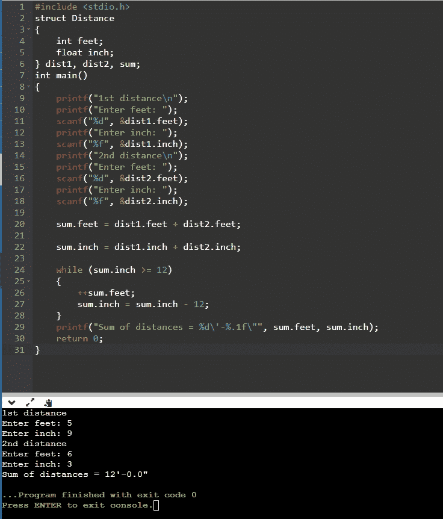
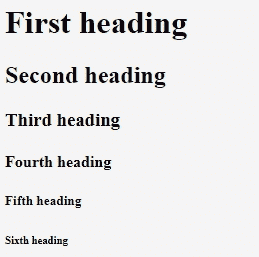
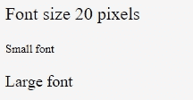
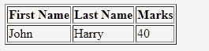
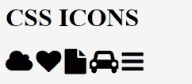
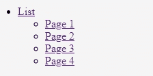

# 零基础编程入门指南：从零到大师：如何学习 Python、Java、SQL、C、C++、C#、HTML 和 CSS


## 引言
《零基础编程入门》是一本为那些决定学习最佳编程方法、技术和方法论的学生所编写的完整且真实的指南。由于软件行业每天都在更新最新的编程语言和工具，采用新技能和技术以在竞争激烈的市场中生存下来是必不可少的。阅读一直一直是学生和学习者的一项重要资源，因为他们可以通过实施最新的技术和编程方法论来提高表现和产出。

本电子书是一部成功的编程手册，涵盖了适用于初学者和专业人士的所有主要编程语言、语法和实践。在进入编程世界之前，有几个重要的因素需要考虑，以培养敏锐的问题解决和分析能力。因此，本电子书针对新手程序员，并针对你对 `java`、`sql`、`c`、`c++`、`c#`、`python` 和 `html` 的几乎每个问题提供了解决方案和答案。我强调了基础技能的获取。本电子书不会让你一夜成为程序员，但它将为你的编程奠定基础。阅读本书后，基础编程将提高你对任何编程语言的熟练程度。

## 第一章：什么是编程？
通常，编程是指计算机用于完成任务的指令。这被称为编码。在深入讨论之前，你必须了解编程以及计算机如何处理指令。当你能够遵循编写计算机程序的正确方法时，为任何语言实现函数、操作符和语法将变得简单。此外，编程是一种通过二进制语言与计算机通信的方法，程序员需要理解高低级语言以及其语法。

为了用计算机解决问题，用户需要通过指令表示问题的解决方案，这些指令可以用于执行程序。由于程序是需要解决问题的指令集合，必须添加适当的语句和功能以实现预期结果。例如，如果你被赋予开发一个相加两个整数（数字）程序的任务，执行加法操作的语句将被称为程序。整数相加的算法将通过 `c++`、`c`、`c#` 和 `java` 等特定计算机语言的语句表示。如果程序无法正常执行，可能是你的算法或语法存在问题，因为如果有任何输入错误或语法错误，编译器或编辑器将无法执行程序。

通过实践和编写代码来学习编程，比学习冗长的方法论和复杂的技术效果更好。


从本质上说，计算机程序通过遵循以下一组指令来解决特定问题。人们可以通过多种技术和方法来编写程序。为了解决问题，你需要确定代码流并逐步满足各项要求，以实现预期的输出。在某些情况下，由于语法不当或流程不合理，即使在苦苦挣几个小时后，你的计算机程序也可能无法运行，这需要你关注顺序化的指令和计算机编程语言的要求。

以制作一张木质桌子为例，你需要写下如下的指令：

1. 获取制作桌子所需的最合适的木材。
2. 准备过程中将要使用的必备工具和设备。
3. 组合木材并制作你的桌子。
4. 抛光末端使其看起来更有吸引力。

在向计算机下达此类指令时，你需要更加具体和精确，因为计算机无法独立执行操作。由于计算机是为了遵循指令而创建的，因此你的计算机程序应该始终遵循增量方法以实现预期的结果。

关于计算机的自然语言这一话题，它们似乎无法理解人类语言，因此，我们需要通过另一种称为二进制代码的语言与系统进行通信。二进制代码由一系列 1 和 0 组成，它是计算机的自然通信语言。为了帮助计算机理解人类语言，我们使用了编写程序的翻译器和编辑器。翻译器具有将源代码转换为机器语言的能力。

翻译器有多种类型，称为解释器、编译器和汇编器。解释器通常用于解释逐行处理的语言，以运行最终程序。此外，解释器还会列出任何语法错误或失误，以便程序员清除错误并执行程序。

在编译器的帮助下，源代码通过编译转换为二进制文件，然后通过执行来交付输出。如果在代码中发现错误或失误，编译器将翻译并执行所有行。此外，计算机程序（应用程序）被设计为运行在桌面和移动应用等不同的平台上。

计算机编程导论

每个计算机程序都是过程、流程和算法的组合，构成了源代码。这种软件的表示形式被视为一系列为了实现输出的动作，按特定顺序执行过程。驱动任何程序的算法也是解决特定程序的有序步骤集合。有许多不同的高级语言和低级语言可以用于编写程序。如今，程序和软件通常使用流行的语言制成，包括 C、C++、Java、Python、HTML、PHP、Ruby 和 Perl。这些语言被用于产生经常在医疗、工程、通信、家用和娱乐行业等领域使用的计算机程序。此外，计算机程序还用于创建图形应用程序和桌面应用程序。

通常，计算机语言是几个元素的组合，允许程序员实现预期的输出。这些元素包括基础语法、编程环境、数据类型、关键字、变量、决策、基本运算符和函数。此外，为了在程序内执行某些操作，你需要应用其他操作并使用包括循环、字符串、字符、文件 I/O 和数组在内的元素。

编程有五种不同的基本元素，也被认为是任何程序的构建块。这些元素是：输入、输出、算术、条件和循环。从第一个元素开始，输入处理是指将命令和数据输入计算机，而输出元素具有交付结果的功能。如果计算或操作配合条件语句使用，则用于测试条件是否为假。

环境、数据类型和基础语法

环境

为了运行和执行程序，你必须为你所使用的语言安装并设置所需的工具和环境。此外，如果初学者发现自己安装和配置编程环境困难，也可以使用文本编辑器来创建计算机程序。将程序执行为二进制格式是强制性的，因为如果以文本格式提供，计算机无法直接理解和编程。


此外，编译器会转换为二进制格式，程序员借此运行并执行程序。包括 C、C++、C# 和 Java 在内的编程语言需要编译成二进制格式，而 PHP、Perl 和 Python 等语言也可以直接执行。

### 基础语法

为了方便初学者，我们将从底层开始，用 C++ 编写一个“hello world”程序。下面编写的示例程序将帮助你更好地理解如何编写第一个程序。

```cpp
#include <iostream>
using namespace std;
int main() {
cout << "hello world!";
return 0;
}
```

该 hello world 程序的输出如下：

hello world!

每个用 C++ 编写的程序都以 `#include <iostream>` 和 `main()`（称为 `main` 函数）开始。随后程序根据需要继续包含函数、字符、循环、字符串或数组。在上述程序中，`main()` 被用作一个函数，而 `cout` 是用于打印“hello world!”的标准输出流。最后，写了 `return 0;` 作为程序的退出状态，这对于程序的执行也是必须的。

如果你无法执行程序，可能存在某些编译器未处理的语法错误或拼写错误。这会阻止程序编译；小的拼写错误（如漏掉逗号、分号或点）最可能是原因。因此，如果你没有正确遵循该编程语言定义的语法，你的程序可能无法被编译或执行。

## 数据类型

数据类型是创建计算机应用程序时使用的各种编程语言中的重要部分。它对程序中编写的每个对象或变量进行分类；数据类型告诉编译器如何使用提供的数据来执行操作。通常常用的数据类型包括整数、实数、布尔、字符、字母数字字符串和浮点数。

* 日期：01/04/15
* 整数：12324
* 布尔：true/false
* 字符串：abc
* 空：none
* 长整数：5325433
* 浮点数：5.234
* 短整数：0

## 语法

如前所述，程序定义为执行特定操作以交付输出的元素和属性集合。对于 C++ 编程语言，基础语法的工作原理概述如下：

1. 类 (class)：类是定义的类型，并有其成员函数和成员。例如，考虑学校类，成员将是老师、学生、员工等。
2. 对象 (object)：对象是类的实例化，具有它们的行为和状态。例如，卡片有不同的颜色、型号等。
3. 方法 (methods)：方法被称为行为，负责类内部不同动作的执行和处理。

## 编程变量、关键字、操作符和决策

变量是计算机程序不可或缺的一部分，因为它们提供了存储程序中数值所需的内存分配。为了保存值，你必须创建变量并为它们分配适当的名称，将值存储到变量中从变量中检索给定的值。

为了开始声明变量，我们需要编写如下程序：

```cpp
#include <iostream.h>
int main() {
int a;
}
```

上述程序创建了一个名为 "a" 的变量，并由 `int` 关键字指定。这意味着该变量只能存储 `int` 类型的值，你不允许再次定义 "a" 来存储另一个值。变量在声明后即为就绪。

## 关键字

每种语言都有用于不同目的的不同关键字；尽管每种语言都提供一组保留关键字。

### 操作符

操作符是任何程序中关键 aspects，用于执行某些操作或逻辑计算。编程语言中通常有两种类型的操作符：

1. 算术操作符：用于进行数学和算术操作的操作符。例如：`+`、`-`、`/`、`*`。
* 二元操作符：与其他操作数配合工作的操作符，如 `+`、`-`、`/`、`*`。
* 元操作符：用于单个操作数的操作符。例如：`++`、`--`。


### 2. 关系运算符

关系运算符是最常用的运算符，用于判断一个操作数是否等于另一个。例如：`==`、`<=`、`>=` 等。

以下是详细说明基本运算符及其在程序中功能的表格：

| 运算符 | 功能 |
| :--- | :--- |
| + | 两个操作数的相加 |
| - | 两个操作数的相减 |
| / | 除法 |
| * | 乘法 |
| == | 检查两个操作数是否相等 |
| >= | 检查左操作数的求值是否大于等于右操作数 |
| <= | 检查左操作数的求值是否小于等于操作数 |

逻辑运算符也是所有编程语言不可或缺的一部分。它们用于在各种场景下做出某些决策。这些运算符 `and`、`or`、`not` 也用于证明语句的真假。

### 决策

决策是一个程序员必须根据两个或多个给定条件选择一个选项的过程。你必须测试条件为真还是假，并表示正确的输出。

对于不同的编程语言，决策语句简述如下：

* ‘if’ 语句
* ‘else’ 语句
* Switch
* ‘else if’ 语句
* 条件运算符

## 编程字符、数组和字符串

在编程语言中，`char` 类型用于存储字符和字母。它们还负责存储值，并在程序中调用该字符时传送输出。你只允许在单引号内存储单个数字或字母，例如 `'&'`、`','`、`'*'` 或 `'+'`。

定义字符的示例代码如下：

```
char ch1='a';
```

## 数组

数组是一种能够按顺序存储相同类型元素的数据结构，并且通常具有固定大小。它由连续的内存位置组成，也被存储在相同名称下的元素集。如果你正在编写程序来顺序存储 10 个整数，创建一个长度为 10 的数组将最佳解决方案。

固定数量数组的声明方式如下：

```
int data[10];
```

现在两种流行的数组类型：
1. 一维数组
2. 多维数组

### 访问数组

声明后，你可以通过索引轻松访问元素。数组的索引 0 是第一个索引，你必须使用条件 -1 来访问最后一个元素。

初始化数组可以使用以下方式：

```
int arr[5]={1,2,3,4,5};
```

数组允许程序员存储单个变量，而无需具体地定义每一个变量。与其他类型类似，数组使用 `[]` 括号声明，一旦数组声明完成，你就可以赋值。

#### 声明

为了声明数组，你必须记住数组大小必须是大于 0 的整数，数组声明方式如下：

`类型 数组名[大小];`

#### 初始化

要初始化数组，可以使用下述语句：

```cpp
int arr[5]={23,45,53,64,73}
```

## 字符串

字符串是编程语言中用于表示字符数组的数据类型。要声明并初始化字符串，你需要遵循相同的结构化数组。每种编程语言都有编写字符串的不同技术和方法，但每种的功能都是相同的。字符串也可以包含短语中的空格，例如“id have waiting since 5 pm.”

字符串的示例如下：

```
char ec[]="abcdef";
```

## 函数与输入输出 (I/O)

## 函数

函数是一个已知的代码块，在程序中执行特定任务。编程中分为两种类型的函数，称为标准库函数和用户定义函数。

标准库函数被赋予处理主要任务（如 I/O 处理、计算）的职责，程序员也可以定义执行特定任务。函数为程序提供了更好的模块化。

要在编程中定义函数，你需要声明返回类型、函数名、参数列表和函数体。

```cpp
#include<iostream.h>
void functionname()
int main() {
  functionname();
}
```

## 文件 I/O

为了存储和管理如图像、文档、纯文本和 Excel 表格等文件，我们支持文件输入输出模式。通常，文件可以用不同的模式打开，如只读、只写或读写模式。


开发环境是编程工具和一组流程的结合，共同用于运行程序。根据你编写程序时使用的语言，你可以选择最合适的环境并按照提供的说明完成你的项目。因为编程是我们实现不同解决方案和输出的方式，我们可以通过编程工具和环境以多种方式表达我们的想法。

此外，编译器以步进的方式执行算法，并执行其他活动，如用于决策的选择性、顺序处理和迭代。

## 集成开发环境

集成开发环境是指将工具和流程连接起来的软件，为编程环境带来了便捷的界面。集成开发环境（ide）也被称为应用程序，它还有助于应用程序的开发，并为开发者提供了一种基于图形用户界面（gui）的工作方法。现代 ide 还可以用于生成结构化图表、流程图，并提供模块化的编程方法。

为了选择一个 ide，你还可以概述你的语言需求和编程风格。这可以让你更轻松地完成复杂的应用程序并带来更好的结果。

## 工具与技术

有数以千计的软件开发工具、理念和技术可以创建完美的应用程序、程序和软件。我们列出并简介绍了一些最有效、易用且主流的工具，供程序员开发任何类型的 Web、桌面和移动应用程序。

以下是针对初学者程序员的一些最佳工具：

### Netbeans

Netbeans 是一个开源的集成开发环境，可以作为开发桌面、Web 和移动应用程序的工具。该工具允许简单高效的项目管理过程，让开发者能够编写无 bug 代码，并提供智能代码编辑功能。此外，该 ide 最适合 PHP、C++ 和 C 编程语言。

### Cloud9

提到在线集成开发环境时，Cloud9 疑被认为是最好的工具之一。支持的语言包括 PHP、C++、Python、Node.js 和 JavaScript。开发者还选择默认运行器来执行，并在提供的建议下获得更快的速度。

### Visual Studio

由微软设计的 Visual Studio 集成开发环境。它让开发者现在可以毫无顾虑地构建、共享和管理软件。此外，自动化部署允许你在实现集中化控制的同时提高软件质量。

## 技术

学习编程语言和技术是适应最新编程方法和技术的最佳方式。从 JavaScript、Python、Java 和 C++ 等主流编程技术开始，对于初学者来说，更容易对计算机编程有更好的理解。此外，每种技术都有自己的视角和方法论，你需要深入学习其中的概念和方法。

对于开源开发者来说，Java 被认为是用于虚拟机（JVM）范式的最佳语言。这使得软件可以在任何系统上运行。

## 方法论

编程方法论是分析复杂问题并规划软件开发的过程，以实现尽可能可能的解决方案。这也被称为模块化编程，软件开发过程分类如下：

需求收集

由于这是软件开发生命周期过程的第一阶段，它由专家和专业人员执行，他们可以轻松地对项目进行可行性研究。讨论结果和技术方法，以确保项目能够顺利问题地完成。

需求工程

下一步是收集相关数据并定义完成项目所需的需求。通常，我们会创建一个软件需求说明书（srs）文档，其中包含了所有必要的设计和数据。分析师必须了解客户的需求和需要，并向开发者进行详细说明，以便他们据此进行编写。此外，客户往往无法清晰地定义他们的需求，仅提供通用的指导方针。

设计

在完成需求工程后，下一步是按照软件需求说明书（srs）文档中的规定设计架构。此时，你还需要概述设计模块化、时间限制和产品规格。

开发


此阶段通过使用各种测试用例概述客户需求，对软件进行检查和审查，检查产品是否存在错误、缺陷以及需要改进之处，以确保每个需求都得到完全满足并可运行。

### 1. 部署
部署是软件开发周期（sdl）的最后一个阶段，因为产品已经通过了设计、开发和测试程序，准备好交付给客户。根据业务策略，产品也可以根据客户提供的指令在市场上发布。

#### 前端技术

前端开发通常指通过实现 Web 应用程序的设计、结构和动画来开发用户界面。用于前端开发的核心技术包括 `html`、`css` 和 `javascript`，而专业人员可能还会使用 `ajax`、`amp` 和 `angular` 等最新技术。

超文本标记语言（`html`）和级联样式表（`css`）是创建网站的基础构建模块，也用于增强网页的响应能力。`html`、`javascript` 和 `css` 是前端开发的三大主要技术。

#### 文档编辑器

目前有多种文档编辑工具可用于创建文档、演示文稿、图表、图形和动画。从最流行的工具开始，你可以安装 Microsoft Office 并轻松编辑任何类型的文档。该软件包包含了 `Microsoft Word`、`Microsoft Excel`、`Microsoft PowerPoint`、`Outlook`、`OneNote` 以及其他模块。

此外，Google Docs 是另一个实用的文档编辑工具，可以在线用于访问、更新和创建文档。这些工具允许你创建表格、文档、幻灯片和表单，你可以从广泛的模板中进行选择。

## 第二章：Java

### 概述和基础语法
Java 是一种由 Sun Microsystems 于 1995 年的高的高编程语言。有无数网站和应用程序使用该技术构建，它与其他语言相比更加可靠、易用且速度更快。作为一种面向对象的语言，开发者可以更快地编写代码、编译和执行程序。此外，开发的应用程序适应不同的环境，并为 Windows 和 Unix 等不同平台提供了配置。由于具有完全独立性，Java 可以编译为特定平台的机器码，并通过虚拟机（`jvm`）进行解释。此外，Java 还实现了高性能并专为分布式环境设计。

转向基础语法，编程通常基于对象、类、方法、变量、修饰符、构造函数和正则表达式。为了更好地理解简单程序，你可以了解以下每个部分的简要细节：

| 关键字 | 功能 |
| :--- | :--- |
| Class | 用于声明类 |
| Void | 返回类型 |
| Public | 使函数可见的访问修饰符 |
| Static | 用于创建静态方法 |
| Main() | 放置在程序开头的主方法 |
| System.out.println() | 将语句打印到控制台 |

在开始编程之前，请确保 Java 是区分大小写的，你需要在声明类名时首字母大写。方法名应以小写字母开头，程序文件名必须与类名完全相同，以避免在执行程序时出现任何问题。

Java 编程中的概念包括类、对象、多态、继承、抽象、封装、实例方法和方法传递。

你的第一个 Java 程序可能像这样：

```
class helloworld {
    public static void main(String[] args) {
        System.out.println("your first java program!");
    }
}
```

### Java 标识符和修饰符
Java 标识符应该以字母表中的字母开头。Java 是区分大小写的，你需要在声明类名时首字母大写。方法名应以小写字母开头，程序文件名必须与类名完全相同，以避免在执行程序时出现任何问题。

Java 编程中的概念包括类、对象、多态、继承、抽象、封装、实例方法和方法传递。

Java 中使用的修饰符是访问修饰符。Java 中使用的修饰符是类、方法和变量的属性。


## 创建名为 "newobj" 的对象：

```java
public class Newclass {

    int a = 1;

    public static void main(String[] args) {
        Myclass newobj = new Newclass();
        System.out.println(newobj.xd);
    }
}
```

创建一个对象需要声明、实例化和初始化。声明是声明变量名称及其对象类型的过程，而实例化是使用 `new` 关键字来创建对象。随后通过调用构造函数来初始化新对象并继续程序。

## 基本数据类型和变量

在 Java 程序中，数据存储在变量中，程序首先声明变量，将数据读取到变量中，然后执行提供的操作。一旦处理完成，变量将再次写入新位置。提供的变量是用于存储值的预留内存位置，内存由操作系统分配。

## 数据类型

Java 编程语言中有两种不同的数据类型，称为基本数据类型和对象数据类型。基本数据类型分为 8 类：`byte`、`short`、`int`、`long`、`float`、`double`、`boolean` 和 `char`。对象数据类型通过类的构造函数创建，并负责访问对象。每个可用的引用变量的默认值被设置为 `null`，也可以用于引用已声明的对象类型。

## 变量

Java 编程语言中使用了三种变量：

1. 局部变量
2. 实例变量
3. 类/静态变量

### 局部变量

局部变量通常在构造函数和方法中声明。它们随构造函数创建，通过修饰符访问（不能配合局部变量使用）。局部变量没有默认值。

### 实例变量

实例变量在类内部声明，每创建一个对象时就会创建一个。它们用于存储由更多构造函数或方法访问的实例变量的值。

## 运算符与决策

编程语言中提供的基本运算符解释如下：

* 算术运算符：用于在程序内执行数学计算和评估的算术运算符。包括 `+`、`-`、`*`、`/`、`%`，增和减函数。
* 一元运算符：后置 `++` 和前置 `++` 表达式。
* 逻辑运算符：`&&` 表示假，`||` 表示真，`!` 表示真。
* 位运算符：执行逐位操作。
* 赋值：`=`、`+=`、`|=`、`^=`

## 控制语句

控制语句类似于 C++ 等其他编程语言。条件详述如下：

If-else 语句用于检查给定条件是否为真或假。有不同类型的 if 语句，称为 `if` 语句、`if-else` 语句、`if-else-if` 链和嵌套 `if` 语句。这里有一个简单的 Java 程序来演示 if 语句：

```java
public class Marks {
    public static void main(String[] args) {
        int marks = 50;
        if (marks < 50){
            System.out.println("your marks are less than 50");
        }
    }
}
```
上述程序的输出为：（无输出，因为条件结果为假，且执行了 `else` 块）。

### Switch

switch 语句用于从多个条件中执行单个语句。该语句可以处理的数据类型包括 `short`、`int`、`long`、`byte`、`string` 和 `char`。

switch 语句的语法如下：

* `switch(expression){`
* `case value1:` `break;`
* `case value2:` `break;`
* `default:`
* `}`

### 循环

编程语言中通常使用三种类型的循环：

* For 循环
* While 循环
* Do-while 循环

#### For 循环

for 循环用于执行程序的迭代部分。如果迭代次数固定，请使用 for 循环。

#### While 循环

while 循环具有重复一组语句的特征，以测试给定条件是否为真。它用于迭代次数不固定的情况。

### Do-while 循环

do-while 循环用于多次迭代程序。如果迭代次数不固定，它至少执行一次。

## 特殊循环控制语句

改变执行顺序使其变为正常序列的控制语句。Java 编程中使用的控制语句包括：

* `break`：语句终止 switch 或循环并开始下一次迭代。
* `continue`：语句允许循环跳过当前迭代的剩余部分并开始下一次迭代。


决策结构包含一个或多个在给定场景下需要测试的条件。如果条件为真，则可以执行下一条语句，而如果给定的条件为假，程序将终止。下图正确地展示了决策过程的实际工作方式：

### 字符、字符串、数组和正则表达式

Java 编程语言使用了字符包装类，并提供了多个静态方法来操作字符。要创建一个字符对象，您需要遵循以下语法：

```
Character ch = new Character('a');
```

如果您向方法传递任何原始类型 `char `int`，编译器将自动创建一个字符对象，编译器将使用语言中的各种方法将 `char `int` 转换为字符。

正如我们之前讨论过的 `strings` 的重要性和功能，Java 平台也提供了 `string` 类的支持。程序员可以通过多种方式操作字符串。在 Java 语言中创建 `string` 的示例代码如下：

```java
public class NewString {

    public static void main(String args[]) {
        char[] studentarray = {'s', 't', 'u', 'd', 'e', 'n', 't'};
        String studentstring = new String(studentarray);
        System.out.println(studentstring);
    }

}
```

该程序的输出为：`student`。

此外，我们也可以在 Java 编程语言中使用简单的连接方法来拼接字符串，如下：

```java
String1.concat(string2);
```

在 Java 中创建字符串对象，程序员可以选择字面量关键字方法。

## 数组

数组是每种编程语言的重要部分，因为它们允许程序员处理并将数据存储到变量中。它们用于存储更大的数据集，你也可以将数组视为同一类别变量的集合。要声明数组，可以按照下面述的简单语法：

```
Datatype[] arrayrefvar;
```

在 Java 中创建数组非常简单，使用以下语法：

```
arrayrefvar = new datatype[size];
```

该语句将创建一个指定大小的数组并引用该数组。通常，使用 for 循环或 each 循环来处理数组中的元素。

用于排序、搜索和填充数组的静态方法：

* `public static int binarySearch(object a, Object obj)`
* `public static void fill(int[] a, int val)`
* `public static boolean equals(long a, long b)`
* `public static void sort(object[] a)`

### 正则表达式

正则表达式用于定义模式，并用于搜索、编辑和处理文本。Java 定义了 `java.util.regex` 包，其中包含类、matcher 和 pattern 异常对象。pattern 类要求开发者从 `compile()` 方法开始，且返回的 pattern 对象不提供构造函数。对于 matcher 类，对象通过 `matcher()` 方法查找并比较操作和输入字符串以获取 matcher。pattern 异常用于指示正则表达式中的错误或失误。

### 文件和 I/O

Java 编程语言具有负责输入和输出操作的内置包。`java.io` 支持处理数据的多种操作和功能。Java 中有通用类型的流，称为输入流和输出流。

输入流用于读取数据，而输出流用于向文件中写入数据。

Java 语言具有各种的 I/O 数据处理流，包括：

* 字节流
* 字符流
* 标准流
* 文件输入流
* 文件输出流

### 面向对象的 Java

面向对象编程是一种方法，通过使用继承、多态、封装和抽象等多个概念并使用类和对象，程序员可以开发应用程序。

### 继承

Java 语言中的继承允许它们继承另一个类的特征。子类继承父类的属性，而子类继承基类的属性。要在 Java 中使用继承，可以按照下面提到的语法：

```
class derived-class extends base-class {
    // methods
}
```

## 多态

多态是一种执行多项任务的技术，被称为多态。在 Java 中，我们使用方法重写和方法重载技术来实现多态。至关重要的是，对象也可以被访问，一旦对象被重新赋值给其他对象，将使用类型引用变量来确定将用于访问对象的方法。

例如：

```java
interface school {}

class student {}

class john extends student implements school {}
```


抽象类是一种包含 `abstract` 关键字声明和抽象方法的类。当一个类拥有抽象方法时，它无法被实例化，程序员必须继承另一个类来实现该抽象方法。

## 封装

Java 编程中的封装是将数据和方法包装在一起的过程。通常，一个类的变量对另一个类是隐藏的，并且只能通过其所属类中使用的方法进行访问。封装的优点是该类可以被设置为只读或只写，并且对存储的数据具有完全控制权。

## 递归

递归是指方法在程序内部调用自身的一种技术。`recurse()` 方法从 `main` 方法被调用，也可以在同一个 `recurse()` 方法中被调用。这个过程会一直持续直到满足给定条件，如果不满足条件，则会发生无限递归。

以下是 Java 中递归的简单实现：

```
class Sample {
    static void printfund(int test) {
        if (test < 1) {
            return;
        } else {
            System.out.printf("%d", test);
            // statement 2
            printfund(test - 1);
            System.out.printf("%d", test);
        }
    }

    public static void main(String[] args) {
        int test = 3;
        printfund(test);
    }
}
```

### 递归的优势

在某些复杂的程序中，编写递归代码可以带来许多益处。因为它提供了一种简化且整洁的代码编写方式，开发者可以毫无麻烦地执行各种类型的操作。

## 抽象类和抽象方法

### 抽象类

在 Java 编程中，抽象类是一种无法实例化并使用 `abstract` 关键字声明的类。

以下是在 Java 中声明抽象类 `Student` 的语法：

```
abstract class Student {
    // methods and attributes
}
```

记住，我们不能创建抽象类的对象。这样做会导致编译错误。

### 抽象类的继承

以下是一个演示抽象类继承的 Java 程序：

```
abstract class Abstract {
    public void display() {
        System.out.println("id");
    }
}

class Student extends Abstract {
    public static void main(String[] args) {
        Student s = new Student();
        s.display();
    }
}
```

要创建抽象方法，需要使用 `abstract` 关键字。

## 第 2 章：数据库

数据库是用于访问、管理和更新的数据集合。简要讨论数据库是为了理解数据库的实际含义，以及数据库如何作为记录的集合，通过这些记录进行计算和推理来保护、保存、交付和组织数据。数据库管理系统（DBMS）由多个程序组成，允许用户通过不同的进程访问处理过的数据库。每个程序都设计用于控制对数据库的访问，DBMS 中引入了各种操作和功能，使其变得高效、安全且可靠。

### 关系数据库

这一类 DBMS 以表的形式定义关系。

### 对象型关系数据库

面向对象的关系数据库允许以对象的形式及其属性的形式存储数据。

### 网状数据库

网络数据库具有多对多的关系特征，通常用于复杂的数据库结构。

### 分级数据库

分级 DBMS 遵循父子关系来存储数据，其结构类似于树，其中节点用于表示不同的字段。

## 数据库环境和架构

数据库环境是一个负责数据处理、管理和使用的组件集合系统。数据库通常存储在计算机中，用于管理整个过程的硬件和计算机外围还包括如 sql server 等 DBMS 工具。

数据库 DBMS 的架构通常分为三大类：

*   集中式
*   去中心化
*   分级式

数据库的三层架构遵循：

*   表示层 (Presentation tier)
*   应用层 (Application tier)
*   数据库层 (Database tier)


分布式数据库将数据存储在多个站点，这些站点之间通过通信链路相互连接。这种数据库进一步分为同构数据库和异构数据库两类。对于同构分布式数据库系统，相同类型的操作系统和数据库应用程序连接在一起；而对于异构分布式系统，每个位置和连接的系统可以是不同的。

### 云数据库

云数据库的设计的设计构建旨在在私有云、公有云或混合云中存储数据，为用户提供更好的扩展性和更大的存储容量，并可从高可用性中受益。它是业务应用程序的最佳选择。

### Noql 数据库

Noql 数据库最适合大型分布式数据，并可以通过关系型数据库进行方便的管理。此外，它们面临着关系型数据库无法轻松解决的大数据性能问题。

### 对象数据库

对象数据库由关系型数据库支持，并且基于对象而非操作。

### 终端用户数据库

终端用户数据库是专门为终端用户设计和创建的共享数据库。每个数据库包含整个数据库的摘要，终端用户显然无需担心在任何数据库级别执行的操作。

### 数据库语法、数据类型和操作符

标准查询语言（`sql`）用于在数据库内存储、操作和检索数据。`sql` 允许管理员执行管理数据库所需的多种操作。该语言允许您通过编写简单的查询来执行查询、检索数据、插入记录、更新记录、删除记录、创建新数据库、创建新表并在数据库中设置权限。

`sql` 有不同的版本，所有版本都支持 select、delete、insert 和 update 等主要功能。

### 结构化查询语言 (sql)

`sql` 用于关系型数据库系统的语言，如 `mysql`、`esbase`、`oracle` 和 `sqlserver`。标准语言允许用户描述数据并操作关系管理系统。此外，用户还可以通过结构化查询语言创建视图和删除数据库。包含过程优化引擎的各个组件使用的 sql 查询命令如下：

| 命令 | 描述 |
| :--- | :--- |
| Create | 用户创建新对象或数据库。 |
| Read | 用户添加存储在表中的数据。 |
| Update | 更新表以修改记录。 |
| Delete | 删除表中的任何记录。 |
| Insert | 向表中插入新记录。 |
| Select | 从数据库的表中选择特定记录。 |
| Alter | 对对象进行更改。 |
| Drop | 从数据库中删除整个表。 |

通过使用操作，我们执行了下面名为 ‘students’ 的表：

| 学生 eid | 学生姓名 | 城市 | 分数 | 百比 |
| :--- | :--- | :--- | :--- | :--- |
| 1 | William | 纽约 | 数学 | 85 | 60% |
| 2 | James | 加州 | 英语 | 79 | 58% |

从上述表中获取记录的 `sql` 语句语法如下：

```
Select * from students;
```

在 `sql` 查询中对表执行特定操作使用的查询解释如下：

| 查询 | 语法 |
| :--- | :--- |
| Insert into | Insert into table_name(column1, column2...)Values(value1, value2...) |
| Update | Updated table_name set column1=value1, column2=value2..Where condition |
| Delete | Deleted from table_name where condition; |
| Order by | Select column1..from table_name Ordered by column1, asc/desc; |
| Min() | Select min(column_name)From table_name Where condition; |
| Max() | Select max(column_name)From table_name Where condition; |
| Where | Select column1..From table_name Where condition; |

### Sql 连接 (Joins)

以带有表的关系型数据库为例，表也可以通过 sql join 查询进行连接。即使图表清楚地显示了两张表是如何连接在一起以共享数据的：

我们将在下面对名为 ‘patients’ 的表实现各种连接子句操作：

| 患者 id | 病号 | 日期 |
| :--- | :--- | :--- |
| 4321 | 1 | 9-2-11 |
| 8237 | 3 | 8-12-15 |

| 病号 | 患者姓名 | 城市 |
| :--- | :--- | :--- |
| 1 | Andrew | 芝加哥 |
| 3 | John | 洛杉矶 |

连接这两张表的 sql 语句遵循所示：

```
Select patients.patientid, patients.caseno, patients.date from patients inner join patients on patients.caseno=patients.eid;
```

现在有不同类型的 `sql` 连接：

* 内连接 (Inner join)
* 左外连接 (Left outer join)
* 右外连接 (Right outer join)
* 全外连接 (Full outer join)

### 内连接 (Inner join)

Inner join 使用 inner join 数据库从表中选择内部记录：

```sql
Select patients.patientid, patients.caseno, patients.date from patients inner join patients on patients.caseno=patients.eid;
```


右连接（right join）选择表 b 中的所有记录，并结合满足连接条件的表 a 中的记录。在 SQL 中创建右连接的语法如下：

```sql
Select column_named
From table1
Right join table2
On table1.column_named = table2.column_name;
```

全外连接（full outer join）即使在未满足连接条件也会选择表 a 和表 b 中的所有记录。在 SQL 中创建全外连接的语法如下：

```sql
Select column_named
From table1
Full outer join table2
On table1.column_named = table2.column_named
Where condition;
```

并集运算符（Union operator）

为了合并两个有序 select 语句的结果，使用了 union 运算符，其中每个列必须具有相似的数据类型。此外，两个表 select 语句中的列顺序应该一致。在 SQL 中实现 union 运算符的语法如下：

```sql
Select column_named from table1
Union
Select column_named from table2
```

分组（Group by）

SQL group by 语句可以对数据库表执行列出或编号。在 SQL 中使用 group by 语句的语法如下：

```sql
Select column_named
From table_named
Where condition
Group by column_named
Order by column_named;
```

排序（Order by）

SQL 中的 order by 语句用于按升序或降序排序数据。实现 order by 子句的语法如下：

```sql
Select column_list
From table_named
Where condition
Order by column1,column2 asc|desc;
```

高级 SQL（Advanced sql）

还有其他重要的操作和子句可以在数据库中实现以执行复杂操作。以下是对高级 SQL 关键性的详细解释：

索引（Indexes）

SQL 索引被数据库搜索引擎用于优化所处理的数据处理。它们被视为特殊的查找表，索引也有助于加速 where 子句和 select 查询。使用创建索引语句创建索引以防止重复条。创建索引的语法如下：

```sql
Created index_name on table_name;
```

删除索引的语法：

```sql
Drop index index_name
```

截断命令（truncated）从现有表中删除数据。基本语法如下：

```sql
Truncated table_name
```

主键（Primary key）

SQL 中的主键约束用于唯一标识表中的每条记录。主键始终包含唯一值，此外，一个表只能有一个主键，但主键可以包含多个列。例如，在创建“students”表时定义主键，我们使用了以下 SQL 语句：

```sql
Created students (
id not null,
firstname varchar(25),
lastname varchar(25),
marks int,
primary key(id)
);
```

外键（Foreign key）

SQL 中的外键约束将表连接在一起，其中外键引用另一个表的主键。在创建的“student”表的“studentid”列上实现外键约束的语法如下：

```sql
Created student (
studentid not null,
studentmarks not null,
classid int,
primary key(studentid),
foreign key(classid) references students(studentid)
);
```

约束及资源（Constraints and useful resources）

约束（Constraints）是实现在表数据列上的特定规则。通常，实施约束是为了限制插入表中的数据类型。最常见的约束包括非空（not null）、默认（default）、唯一（unique）、主键（primary key）、外键（foreign key）、检查（check）和索引（index）。

此外，完整性约束（integrity constraints）还可以用于提高关系数据库中表示的数据的一性和准确性。通常，主键、外键和唯一约束用于维护引用完整性（.）。实施约束的目的是管理数据。


```c
int deeep(int a) {
    printf("%d",a);
    return 0;
}
```

## 头文件

编写程序的第一个部分是选择头文件。通常，头文件以 `.h` 扩展名编写，并包含方法声明。要包含头文件，我们使用 `#include` 后接如下语法：

```c
#include <string.h>
```

### 头文件示例：

| 头文件 | 定义 |
| :--- | :--- |
| Stdio.h | 用于定义输入输出函数 |
| String.h | 用于字符串处理 |
| Stddef.h | 定义有用的类型和宏 |
| Stdlib.h | 定义内存分配 |
| Stdint.h | 用于定义整数类型 |
| Math.h | 用于执行数学函数 |

## 方法和变量声明

编写程序的下一步是定义和声明变量。声明 `main` 方法的语法如下：

```c
int main()
{
    int x;
}
```

### 程序正文：

```c
int main()
{
    int x;
    printf("%d",x);
    return 0;
}
```

要终止程序，我们使用 `return` 语句：`return 0`。

## 关键字

关键字是任何编程语言中的强制性单词，也被称为保留字。虽然高级编程语言有许多关键字，但只允许使用 32 个关键字，它们如下：

| Double | Long | Int | Switch |
| :--- | :--- | :--- | :--- |
| Case | Register | Enum | Typedef |
| Union | Extern | Const | For |
| Do | While | Static | Default |
| Auto | Break | Else | Struct |
| Float | Short | Char | Return |
| Void | Continue | For | If |
| Signed | Goto | Sizeof | Volatile |

## 数据类型和变量

在编程语言中，数据类型用于定义在程序中使用之前进行存储和赋值的变量。编程语言的内置类型包括 `float`、`int`、`char` 和 `double`。这些数据类型具有名为 `short`、`long`、`signed` 和 `unsigned` 的修饰符。

以下是编程语言允许的有效数字、字母和符号：

- **字母**：`a-z`, `A-Z`。
- **符号**：`-`, `~`, `'`, `!`, `&`, `#`, `%`, `^`, `&`, `*`, `(`, `)`, `_`, `-`, `+`, `=`, `|`, `{`, `}`。
- **数字**：0, 1, 2, 3, 4, 5….

## 在我们和程序中声明并使用的变量语法如下：

```c
#include <stdio.h>
// 变量声明
int a;

int main()
{
    int a;
    float b;
    /* 初始化 */
    a = 30;
    b = 20;
    a = a + b;
    printf("%d",a);
    return 0;
}
```

## 作用域变量

任何编程语言中的作用域变量用于允许权限。通常，变量分为局部变量、全局变量和形式参数。局部变量在块内声明，仅供特定区域的语句使用。程序中的其他函数无法访问外部的局部变量。全局变量通常定义在函数外部，并在整个程序范围内被访问和调用。局部变量需要程序员初始化，而全局变量会自动初始化。

## 循环和函数

循环是每个编程语言的重要部分，允许开发者多次执行特定语句。编程语言中有 4 种类型的循环：

1. **for 循环**：用于按指定次数执行语句，并被认为简化处理循环变量的代码。
2. **while 循环**：重复给定语句并在执行循环体之前检查给定条件的真假，它检查所有条件。
3. **do-while 循环**：工作方式与 while 循环相同，但 do-while 只在结束时检查。
4. **嵌套循环**：循环中的循环。

循环的执行会偏离正常顺序，使用 `break` 语句退出循环并将执行转移到下一语句。`continue` 语句跳过循环并进入下一次。

## 函数

在编程语言中定义函数，推荐以下语法：

```c
return_type name(parameter_list)
{
    function_body
}
```

在函数中，返回类型是函数本身返回的数据类型，命名为名称。每当函数被调用时，我们需要传递参数，其值被称为实际参数。必须注意的是，参数不是强制性的，函数也可以在没有任何参数的情况下执行。函数正文包含语句。


要在程序中调用函数，我们需要传递参数和函数名。如果函数返回了任何求值结果，也可以将其存储起来。

### 向函数传递参数的方法

通过求值结果调用的方法：

#### 值传递 (Called by value)
值传递用于将实际的求值结果从参数复制到函数的形式参数中。这确保了对参数所做的修改不会直接影响函数内部实参数。

#### 引用传递 (Called by reference)
引用传递用于将参数的地址复制到形式参数。在参数上进行的修改会直接影响实参数。

---

### 数组数组、字符串和链表

## 数组

数组是元素的集合，可以存储在相同类型的固定大小顺序数据中。它由连续的内存位置组成，可以通过以下语法声明数组：

`Typed arrayname[size];`

**示例：**

| 3 | 5 | 6 | 8 | 10 | 20 |

所有数组的第一个元素的索引均为 0，这也被称为基索引。注意，数组的大小在声明后不能更改。在 C 语言中初始化和使用数组，可以使用如下语句：

`int data[50];`

要初始化和使用数组，可以使用下面的语法：

`int data[10] = {3, 2, 7, 8, 23, 42, 64, 73, 23, 77};`

在此数组中，索引 `0` 的值为 `3`，而索引 `9` 的值为 `77`。

下面是一个使用 C 语言编程中的数组计算 5 个整数平均值的示例：

```c
#include <stdio.h>

int main()
{
    int avg = 0;
    int sum = 0;
    int x = 0;
    int enum[4];
    for (x=0; x<5; x++)
    {
        printf("enter a number %d\n", x+1);
        scanf("%d", &enum[x]);
    }
    for (x=0; x<5; x++)
    {
        sum = sum + enum[x];
    }
    avg = sum/5;
    printf("averaged number: %d\n", avg);
    return 0;
}
```

#### 多维数组
C 语言编程也支持多维数组。初始化二维数组请使用以下语法：

`int ez[2][3] = {{0,1,2},{3,4,5}};`

或

`int ez[2][3] = {0,1,2,3,4,5};`

## 字符串

编程语言中的字符串是用一维字符数组创建的。字符串必须以字符 `\0` 。声明字符串请使用下面的语法：

`char str_name[size];`

`str_name` 用于说明字符串的长度。下面的程序用于声明和打印字符串：

```c
#include <stdio.h>

int main()
{
    char str[10];
    scanf("%s", str);
    printf("%s", str);
    return 0;
}
```

---

### 指针和结构体

指针是一个存储了程序中另一个变量地址的变量。它直接指向内存位置的地址，我们可以声明指针来存储任何变量的地址。声明指针变量的语法如下：

`Type *varname;`

要使用指针，首先需要定义一个指针变量并将变量的地址赋值给指针。接下来，我们可以从指针变量给出的地址访问值。这整个操作是通过 `*` 一元运算符完成的，该运算符返回由操作数定义的地址的值。必须注意的是，普通变量和指针存储的是相同的值。

下面的程序是使用指针编写的：

```c
#include <stdio.h>

int main()
{
    int *ptr;
    ptr = &100;
    printf("%d", *ptr);
    return 0;
}
```

#### 结构体

结构体是不同类型的集合。用于组织员工信息的结构体和数组如下：

*   姓名
*   员工 ID
*   部门

定义结构体的语句为：

```c
struct employee {
    char name[10];
    int employee_id;
    char department[50];
    char region[100];
};
```

初始化结构体：

`struct employee employees[] = {34,12,52,15,66};`

按顺序访问结构体成员需要使用运算符来访问这些结构体成员。使用的运算符有：

*   成员运算符 `.`
*   结构体指针运算符 `->`

访问结构体成员的示例程序：

```c
#include <stdio.h>

struct distance {
    int feet;
    float inch;
};

int main()
{
    struct distance *ptr;
    ptr = &100;
    printf("%d", *ptr);
    return 0;
}
```

*(注：提供的源码最后部分由于大量重复的 "e" 字符和逻辑不一致而严重损坏；上述重建是基于标准的 C 编程文档模式推断出的。)*


```c
printf("2nd distance\nd%d", d);
printf("entered feet:%d", d);
scanf("%d", d, &dist2.feet);
printf("entered inch:%d", d);
scanf("%f", d, &dist2.inch);
sum.feet = dist1.feet + dist2.feet;
sum.inch = dist1.inch + dist2.inch;
while (sum.inch >= 12)
{
    sum.feet++;
    sum.inch = sum.inch - 12;
}
printf("sum of distances = %dd'd-%.1f\n", d, sum.feet, sum.inch);
return 0;
}
```

输出：

 De

### 向结构体传递指针

我们也可以在 C 语言中定义指向结构体的指针，其方法与定义另一个指针变量的方法相同。为了通过指针访问结构体的成员，可以考虑以下语法：

`Struct_pointer->title;`

### C 语言文件


编程要求开发者使用最有效的方法处理不同的需求和场景。要在 C 语言中执行文件处理操作，可以使用以下操作：

* `fprintf(f)`
* `scanf()`
* `fread()`
* `fwrite()`
* `seek()`

通常，当程序终止时所有数据都会丢失，因此我们必须创建一个包含所有数据的特定文件。它还可以节省时间，并允许程序员通过输入少量命令从文件中访问数据，并通过语言运算符将数据从一台计算机传输到另一台计算机。

文件有两种类型：文本文件和二进制文件。文本文件是 `.txt` 文件，可以使用记事本创建，编写、维护和更新记录所需的工作最少。二进制文件以 0 和 1 的二进制形式存储数据。此外，与文本文件相比，二进制文件可以存储更多量的数据。

在编程语言中，我们可以创建新文件、打开现有文件、向文件中添加和写入信息，并通过下表所示：

| 操作 | 语法 |
| :--- | :--- |
| 打开文件 | `ptr = fopen("file", "mode")` |
| 关闭文件 | `close(ptr);` |
| 写入二进制文件 | `write(address, size_data, pointer_to_file);` |
| 读取二进制文件 | `read(address, size_data, pointer_to_file);` |
| 写入文本文件 | `ptr = fopen("address", "w")` |
| 读取文本文件 | `ptr = fopen("address", "r")` |
| 寻道 (Seek) | `seek(stream, offset, int)` |

让初学者编程变得简单的本质提示：他们应该始终使用 `/* */` 对代码进行注释。对代码部分注释也可以更改并改进程序的功能。此外，始终使用变量（如 `int`、`char` 和 `float`）来存储数据，因为这将更容易执行不同的操作和计算。C 语言由于指针、关键字和位运算符而简单且快速，编写高效的代码对于初学者来说肯定不是问题。

## 第五章：C++

C++ 是由 Bjarne Stroustrup 于 1979 年开发的自由级编程语言。作为 C 编程语言的增强版本，C++ 现在已成为最常用且最适合初学者的语言。该语言提供了约 7 种编程风格，你可以根据自己的需求选择最合适的风格。作为一种静态类型编程语言，C++ 允许编译器在执行程序前列出错误或进行调试。此外，使用 C++ 进行面向对象的编程使得解决复杂问题更加方便，扩展了标准库的使用。

C++ 是世界上最流行的编程语言，广泛用于图形用户界面、操作系统和嵌入式系统。

### 基础语法

C++ 编程语言的基础语法与其他语言相同，例如关键字、符号、操作和表达式，程序员必须遵循这些规则以确保正确执行。

```cpp
#include <iostream>
using namespace std;
int main()
{
    cout << "my first program";
    return 0;
}
```

输出：

![image_rsrc9F9.jpeg]
![image_rsrc9FC.jpeg]

程序的细节如下：

```cpp
#include <iostream>
using namespace std;

该语句包含了定义的输入和输出函数，也用于从文件访问数据。

用于在程序内存储函数、变量和操作的语句名为 `name`。

`main()` 函数是执行开始的地方。`int` 返回类型表示它返回一个整数值，我们必须通过该值指示程序执行是否成功。


## 变量

C++ 编程语言中有不同类型的变量。每个变量的定义都有一个特定的关键字，我们 `must` 通过以下提供的语法创建变量、指定类型并分配值：

`Typed_variable = value;`

## 变量类型

*   `Int` = 用于存储整数和整数。例如，`1,45,6346`。
*   `Char` = 用于存储单个字符。例如，`'a'` 或 `'z'`。
*   `Double` = 用于存储浮点数。例如，`50.2`、`100.2342`。
*   `Bool` = 用于存储具有两种状态的值：`true` 或 `false`。
*   `String` = 用于存储文本。例如，`"c++ programming language"`。

要声明变量并为其赋值，我们可以遵循以下语法：

```cpp
Int newnum;
newnum = 50;
cout << newnum;
```

在 C++ 中使用的每个变量都应该用唯一的名称标识，这些名称被称为标识符。构造标识符时，名称必须包含字母、数字或下划线，并且对大小写敏感。

## 数据类型

C++ 编程语言中的数据类型定义了存储在变量中的数据类型。通常，C++ 中的数据类型分为三类：内置、派生和用户定义。用户定义数据类型包括结构体（struct）、联合体（union）和枚举（enum），而派生数据类型基于数组、函数和指针。

### C++ 内置数据类型

*   `Int`
*   `Char`
*   `Float`
*   `Double`
*   `Bool`

### 用户定义数据类型：

*   `Union`
*   `Enum`
*   `Struct`

### 派生数据类型：

*   `Function`
*   `Array`
*   `Pointer`

## 修饰符类型与类

C++ 编程语言中的修饰符用于 `char`、`double` 和 `int` 数据类型，根据类型顺序更改含义，以满足某些编程条件。这些修饰符包括 `signed`、`unsigned`、`long` 和 `short`。

在 C++ 程序中定义作用域变量和函数可以使用存储类，如 `auto`、`register`、`extern`、`mutable` 和 `static`。`auto` 类是所有局部变量的默认类型，而 `static` 类允许编译器在局部变量超出作用域时保留它们。外部类指的是函数或对象之间使用的全局变量以及常量成员函数。

## 控制

C++ 编程中的控制是指指令、函数和语句在程序运行时评估和执行的顺序。语句从上到下顺序执行，直到逻辑完全满足。依赖顺序 C++ 提供了特定的控制语句：

1.  `if-else`
2.  `for` 循环
3.  `while` 循环
4.  `break` & `continue`
5.  `switch` 语句
6.  `goto` 语句

#### If 语句

当给定的语句为真时，执行多个语句；假语句会被自动忽略。

```cpp
if(condition){
    statement;
}
```

### If 语句的流程图

用于说明 C++ 中 if 语句的示例程序：

```cpp
#include <iostream>
using namespace std;

int main(){
    int marks = 80;
    if(marks < 100){
        cout << "less than 100";
    }
    if(marks > 100){
        cout << "greater than 100";
    }
    return 0;
}
```

### 嵌套 if 语句

在 C++ 中，语句中的语句被称为嵌套 if 语句。例如：

```cpp
if(condition_1){
    Statement1;
    if(condition_2){
        Statement2;
    }
}
```

### If-else 语句

```cpp
if(condition_1){
    Statement;
}else if(condition_2){
    Statement;
}
```

### Switch 语句

C++ 编程中的 switch 语句用于在执行多个情况时，根据 break 执行操作。switch 的语法如下：

```cpp
#include <iostream>
using namespace std;

int main(){
    int num = 10;
    switch(num){
        case 1:
            cout << "case1";
            break;
        case 2:
            cout << "case2";
            break;
        case 3:
            cout << "case3";
            break;
        default:
            cout << "default";
    }
    return 0;
}
```

### Goto 语句

C++ 中的 goto 语句用于更改程序的执行并跳转到另一个标记语句。标记语句的语法：

```cpp
label:
statement;
```


### 循环

*   `while` 循环：检查条件，如果条件为真，则执行循环并管理循环变量。
*   `for` 循环：多次执行特定的语句，并同样管理循环变量。
*   嵌套循环：在一个循环内部包含另一个循环。

循环也可以通过不同的控制语句来执行，例如 `break` 语句、`continue` 语句和 `goto` 语句。

## 函数

函数负责将不同的代码段组合并一起执行，以完成特定的操作。C++ 编程语言中的函数主要分为类型：库函数和用户定义函数。库函数在 C++ 中是预定义的，而用户定义函数是由程序员自己创建的。

要定义一个函数，可以使用以下语法：

```cpp
Return_type function_name(parameter_list) {
  function_body
}
```

`main()` 函数的示例代码：

```cpp
int main(int enum1, int enum2) {
  //function declaration
  //local variable declaration
  int result;
  if (num1 < enum2) {
    result = enum1;
  } else {
    result = enum2;
  }
  return result;
}
```

## 函数调用

在 C++ 中调用函数，可以使用以下方法：

*   按引用传递。
*   按值传递。
*   按指针传递。

## 函数重载

当两个或多个函数具有相同名称但参数不同时，它们被处理为重载函数。C++ 中函数重载的语法如下：

```cpp
void samefunction(int a);
int samefunction(float a0);
void samefunction(int a, double b);
```

## 数组

数组在编程语言中经常使用，因为它们允许处理相同类型的大量数据。通常，数组被称为持有固定数量数值的数据集合。

在 C++ 中声明数组的语法：

`Datatype arrayname[arraysize];`

初始化：

```cpp
int age[5] = {15, 20, 25, 30, 35};
```

使用 C++ 数组求 10 个数字之和的示例程序：

```cpp
#include <iostream>
using namespace std;

int main() {
  int numbers[10], sum = 0;
  for (int i = 0; i < 10; i++) {
    cin >> numbers[i];
    sum += numbers[i];
  }
  cout << "sum = " << sum;
  return 0;
}
```

## 字符串

字符串是指字符的集合。在 C++ 编程中，字符串使用了标准库类。以下语法用于定义字符串：

`char str[] = "programming"`

## 指针

指针是一个存储另一个变量地址的定义变量。在 C++ 语言中使用指针时，我们需要定义指针变量并通过地址访问值。该操作通过使用一元运算符 `*` 完成。以下是 C++ 编程中常用的指针：

*   空指针
*   数组指针
*   二级指针
*   将指针传递给函数
*   向函数返回指针

## 面对象 C++

类和对象是创建对象并执行多个操作的一种方法。首先，在创建对象之前，我们需要定义一个类，可以使用以下语法：

```cpp
class classname {
  //data
};
```

使用 `public`、`private` 或 `protected` 定义类，使得数据成员只能在程序内特定访问。示例代码：

```cpp
class student {
private:
  char name[20];
  int rollno;
  int total;
  float perc;
public:
  //获取学生详情的成员函数
  void getdetails(void);
  //打印学生详情的成员函数
  void putdetails(void);
};
```

## 继承与多态

在继承和修改类时，需要考虑相关概念。派生类继承自基类的属性。从基类继承类的语法定义如下：

```cpp
class base {
  //
};

class derived : public base {
  //
};
```

## 访问修符

在 C++ 中，访问修符用于确定类成员的可访问性。`private`、`protected` 和 `public` 是主要类型。

*   `private`：成员仅在类内部可访问。
*   `protected`：成员在类内及派生类中可见。
*   `public`：成员可以从类外部访问。


公共访问修符用于基类、成员和数据为公共或受保护的情况。受保护的成员和数据在派生类内部是可以访问的，而公共成员和数据可以在程序的任何地方访问。然而，基类的私有成员和数据仍然无法访问。

在 C++ 中使用访问修符的语法如下：

```cpp
class myclass
{
    // class 
public:
    // access modifier
    // members
};
```

友元函数、数据结构和封装

友元函数

在面向对象编程中，非成员函数无法访问对象的私有和受保护数据。为了在这种情况下访问私有或受保护数据，可以使用友元函数或友元类，它们允许程序员访问类的私有和保护数据。

该函数通过 `friend` 关键字声明，并应该在类体中使用。在 C++ 编程语言中声明友元函数，可以使用以下语法：

```cpp
class class_name
{
    friend return_type function_name(argument);
}
```

数据结构

虽然数据结构需要深入浅细节以阐明本主题的目标，但我们将讨论如何在 C++ 中定义和使用结构化数据。结构化是用户定义的数据类型，可以通过以下语法在程序中实现：

```cpp
struct [structured_tag]
{
    Data member definition;
}
```

例如：

```cpp
struct vehicle
{
    char name[50];
    char category[100];
    int model_year;
} vehicle;
```

要访问结构体中的任何成员，可以使用成员访问运算符 (.)。通过数据结构简化了结构指针的定义，可以使用以下语法：

`struct vehicle *struct_pointer;`

封装

“封装”一术被定义为编程中向用户隐藏敏感数据的方法。为了执行封装，我们需要将类变量和属性声明为私有，并通过 getter（get）和 setter（set）方法读取或修改私有成员的值。访问私有成员语法如下：

```cpp
#include <iostream>
using namespace std;

class Example
{
private:
    // private attribute
    int attribute;

public:
    // setter
    void setattribute(int a)
    {
        attribute = a;
    }
    // getter
    int getattribute()
    {
        return attribute;
    }
};

int main()
{
    Example myobj;
    myobj.setattribute(5000);
    cout << myobj.getattribute();
    return 0;
}
```

文件处理

在 C++ 编程语言中，我们使用方法向文件写入数据。打开文件时，使用流对象，其 C++ 语法定义了 stream、ifstream 和 stream 类型：`open(const char* filename, ios::mode);`

关闭文件的语法：`close();`

C++ 特性提供了丰富的库支持和标准模板库 (stl) 函数，可以使用它们来快速编写代码。作为一种面向对象的编程语言，我们关注对象，并在无任何烦恼的情况下执行不同类型的操作和实现。与其他主要的编程语言不同，C++ 还提供了指针支持。由于其快速、可靠和安全的特性，C++ 被广泛应用于操作系统、浏览器、库、图形和数据库的开发。该语言运行迅速，并以其速度和效率而闻名。此外，C++ 还允许异常处理并支持函数重载。

## 第六章：C#

概述与基础语法

### 概述

C# 是由微软开发的一种编程语言，用于 .NET 框架。该语言基于面向对象的编程方法，与 C 和 C++ 等其他现代编程语言具有相同的基础语法。C# 是一种开发语言 (CLI)，包含一个运行时环境。C# 易于学习，能够在不同平台上生成高效的程序。.NET 框架用于 Windows 应用程序和服务。

### 基础语法

基于面向对象编程，C# 围绕类和对象。例如，尽管每个类都有相同的名称，但每个类都有不同的属性。通常，C# 程序由：

```csharp
using System;

namespace MyNamespace
{
    class Program
    {
        static void Main(string[] args)
        {
            Console.WriteLine("welcomed to C# programming");
            Console.ReadKey();
        }
    }
}
```

这里是一个打印“welcomed to C# programming”的简单程序：

```csharp
using System;

class Program
{
    static void Main()
    {
        Console.WriteLine("welcomed to C# programming");
        Console.ReadKey();
    }
}
```


* 使用 `system;` 用于包含程序所需的 `system` 命名空间。
* 命名空间声明：程序中 `classes` 类的定义集合。
* 类声明：包含程序中要使用的数据和方法的类。
* 静态 `void main()`：关键字 `static` 表明可以在不实例化的情况下访问 `this` 方法。
* `Console.WriteLine()`：用于定义输出 `system` 命名空间的方法。
* `Console.ReadKey()`：让计算机等待下一个命令，并防止屏幕立即关闭。

## 数据类型与变量

数据类型是任何编程语言不可或缺的一部分，因为它们指定了语言所支持的数据类型。在 C# 中，数据类型是预定义的，分为三大类：值数据类型（evaluated data）、引用类型和指针数据类型。

### 1. 值数据类型

派生自 `System.Value` 类的值数据类型变量包含字母和数字形式的数据。下表显示了 C# 编程语言中使用的值类型：

| 数据类型 | 表示法 | 默认值 | 范围 |
| :--- | :--- | :--- | :--- |
| Byte | 8 位无符号整数 | 0 | 0 到 255 |
| Decimal | 128 位精确小数值 | 0.0m | (-7.9 x 10²⁸ 到 7.9 x 10²⁸) / 10⁰ 到 28 |
| Bool | 布尔值 | False | True/false |
| Float | 32 位单浮点类型 | 0.0m | -3.4 x 10³⁸ 到 +3.4 x 10³⁸ |
| Double | | 0.0d | (+/-)5.0 x 10^-324 到 (+/-)1.7 x 10³⁰⁸ |
| Char | 16 位 Unicode 字符 | ‘\0’ | U U+0000 到 U+ffff |
| Int | 32 位有符号整数类型 | 0 | -2,147,483,648 到 2,147,483,647 |
| Short | 16 位有符号整数类型 | 0 | -32,768 到 32,767 |
| Long | 64 位有符号整数类型 | 0l | -9,223,372,036,854,775,808 到 9,223,372,036,854,775,807 |

### 2. 引用类型

引用数据类型存储变量的引用而不是实际数据。通过使用多个变量，引用类型可以指向内存位置，当一个变量更改内存位置，其他变量会自动更新其值。

### 3. 对象类型

对象类型被认为是 C# 中所有类型的基类。此外，对象类型也是引用类型。

### 4. 指针数据

指针数据包含变量的内存地址，具有以下语法：

```
Type*identifier;
```

## 运算符

C# 使用运算符的方式与其他 C++ 等编程语言相同。它们包括内置的算术、关系、位运算、逻辑运算符和赋值运算符。

## 函数与方法

在 C# 语言中，函数允许程序员封装代码的特定部分，并在代码的其他部分利用它们。它们消除了重复编写代码的需求并良好地执行所需操作。C# 中的函数使用以下语法声明：

`<visibility><return type> <name>(<parameters>) { <body> }`

属于类的函数在 C# 编程语言中称为方法。通常有两种方法的方法：实例方法和静态方法。函数可以返回任何类型的数据，并包含多个执行的语句，如读取、跟随和运行。

使用 C# 函数的示例程序：

```cs
using system;
class Return2
{
    static string lastFirst(string firstName, string lastName)
    {
        string separator = ", ";
        string result = lastName + separator + firstName;
        return result;
    }
    static void main()
    {
        Console.WriteLine(lastFirst("john", "william"));
        Console.WriteLine(lastFirst("james", "lewis"));
    }
}
```

## 数组

数组用于在连续内存中存储元素集合。C# 中使用以下语法声明数组：

```cs
Type[] name;
```

C# 中的数组声明示例：

```cs
using system;
namespace application
{
    class Array
    {
        static void main(string[] args)
        {
            int[] integers = new int[10];
            for (int i = 0; i < 10; i++)
            {
                integers[i] = i + 100;
            }
            // 输出每个元素的值
            for (int j = 0; j < 10; j++)
            {
                Console.WriteLine("element[{0}] = {1}", j, integers[j]);
            }
        }
    }
}
```

## 字符串

类与对象


## 类定义

类是对象的定义表示形式。类定义了一种数据类型。在 C# 编程中，类定义以 `class` 关键字开头，随后是类名以及类体体。类体允许在类中使用访问修饰符来定义成员的访问规则，而 C# 编程中类的默认访问修饰符是 `internal`。成员也使用 `.` 运算符。

类也被认为引用类型，变量在声明后包含评估为 `null` 的值，直到我们创建并实例化它。类通过使用 `new` 运算符来声明，并遵循下述的语法：

```csharp
Public class student
{
    // 属性，方法和结构
}
```

示例：

```java
Myclass student = new myclass();
Myclass student2 = student;
包含不同数据成员和函数的类
```

```csharp
public class student
{
    public int id = 0;
    public string named = string.empty;
    public student()
    {
        // 构造函数语句
    }
    public void getstudentdetails(int uid, string uname)
    {
        id = uid;
        named = name;
        Console.WriteLine("id: {0}, name: {1}", id, named);
    }
    public int designation { get; set; }
    public string location { get; set; }
}
```

## 创建对象

在 C# 编程中，对象完全基于类。类定义了对象的类型。它也被称为实例化类，可以使用以下语法创建：

```csharp
Student object1 = new student();
```

一旦创建了实例化类，引用的对象将被自动返回。例如：

```csharp
Student object2 = new student();
Student object3 = object2;
```

以下程序展示了在 C# 编程语言中如何创建对象：

1. 使用 `system;`
2. Namespace Ut
{
3. Class Program
{
4. Static void main(string[] args)
{
User user = new User("harry potter", 2);
User.userdetails();
Console.WriteLine("press enter to exit..");
Console.read();
}
}
}
Public class Users
{
Public string named { get; set; }
Public int aged { get; set; }
public Users(string name, int age)
{
Named = name;
aged = age;
}
public void getuserdetails()
{
Console.WriteLine("name: {0}, age: {1}", name, age);
}
}
```

## 继承与多态

继承是面向对象语言的重要部分，允许程序员使用需要相同功能的不同类，继承在父类和子类的方法中。父类被视为基类，而派生类从其父类继承所有功能。

语法：

```csharp
<access-specifier> class base_class
{
    ...
}
class derived_class : base_class
{
    ...
}
```

多级继承：

```csharp
public class a
{
    // 实现
}
public class b : a
{
    // 实现
}
public class c : b
{
    // 实现
}
```

## 多态

多态是指通过单一操作执行多个功能的技术。静态多态在编译时完成，而动态多态在运行时决定。

在静态多态中，C# 允许程序员实现以下两种方法：

## 函数重载

函数重载在给定的范围内为同名函数提供多个定义。此外，函数定义之间应该在类型上有所不同，以便不会重载具有不同返回类型的函数声明。

## 构造函数

在 C# 编程中，每当创建结构或类时，构造函数会被自动调用。拥有多个构造函数的类允许设置默认值。

创建构造函数的语法：

```csharp
public class person
{
    private string last;
    private string first;
    public person(string last, string first)
    {
        last = last;
        first = first;
    }
    // 类的剩余实现
}
```

## 异常处理

异常处理将控制权从一个程序转移到另一个程序。通常，异常被视为程序执行期间发生的问题。异常处理使用 `try`、`catch` 和 `finally` 块。


## C# 语言

C# 是一种编程语言，根据其定义被读为编程的执行路径。它定义了特定的控制流，并负责定义执行路径。它们是轻量级的进程和线程，可以节省 CPU 周期并提高程序的效率。

线程在生命周期中有四种状态，包括启动状态、已就绪状态、不可运行状态和添加状态。可以通过实现特定的 C# 方法来创建、管理和销毁线程。

## 文件 I/O

C# 提供了不同的类来操作文件系统和处理数据。这些类可以用于打开文件、访问文件、访问目录以及更新现有文件。C# 包含一个特定的文件类来执行所有的 I/O 操作。相关的类名及详细信息列比如下：

### File
`File` 是一个静态类，提供了各种操作，包括移动、删除、创建、打开、复制、读取和写入。

### FileInfo
`FileInfo` 类的功能与静态类相同，程序员可以通过手动编写针对特定文件的代码来执行读取和写入操作。

### Directory
`Directory` 类也是静态的，并支持在文件内创建、删除、访问和移动子目录。

### DirectoryInfo
`DirectoryInfo` 类提供了不同的实例化方法，用于访问、删除、移动和创建子目录。

### Path
`Path` 静态类提供了更改文件扩展名、获取文件扩展名以及获取文件绝对路径的功能。

## FileStream 类

`System.IO` 命名空间中的 `FileStream` 类用于通过 C# 语言创建、写入和关闭特定文件。创建 `FileStream` 类和对象的语法如下：

```FileStream <object_name> = new FileStream(<file_name>, <filemode enum>, <fileaccess enum>, <fileshared enum>);
```

C# 文件操作包括：
* 读取和写入文本文件。
* 读取和写入二进制文件。
* 操作文件系统。

记住 `System.io` 是一个抽象类，提供了引用源的标准方法。继承流的类执行读/写操作，包括流、缓冲流、网络流和流。

## 优势

学习 C# 语言可以提供快速的执行速度，并提供解决问题的结构。得益于高级函数和内置库，初学者可以轻松地构建各种类型的应用程序。与其他高级语言相比，C# 是一种开发速度较快的面向对象编程语言，适用于创建具有良好互操作性的健壮应用程序。从 C# 编程开始，基础语法和结构至关重要，让你能够轻松开发特定的应用程序。

## Python 概述

Python 是一种开发于 1991 年的著名编程语言，是一种高级、面向对象且交互式的脚本语言，用于系统脚本和软件开发。

### 特性

作为一种解释型语言，Python 允许一次执行一条指令，并支持广泛的数据类型。该语言关键字较少且语法定义清晰，易于学习和编码。得益于丰富的标准库，Python 还提供了对交互模式的支持，使开发者更容易测试和调试代码。

此外，该语言可用于引导编程，并开发具有系统调用、窗口和库的应用程序。除了这些特性，Python 还支持自动垃圾回收，提供高级动态数据类型，并可以与 C++、C、Java 和 CORBA 集成。用户可以直接对其进行使用和交互。


| Del | Else | And | Assert | In | Raise |
| From | Continue | If | Finally | Not | Pass |
| As | Return | Not | Pass | Yield | Break |
| Except | Import | For | Global | While | Print |
| With | Try | Exec | Or | Is | Elif |

## 基本运算符

Python 拥有内置运算符，如算术运算符、赋值运算符、逻辑运算符、位运算符、比较运算符和成员运算符。

Python 运算符的细节如下表所示：

| 算术运算符 | 赋值运算符 | 比较运算符 | 逻辑运算符 | 位运算符 |
| :--- | :--- | :--- | :--- | :--- |
| 加法 (`+`) | 等于 (`=`) | 双等 (`==`) | 逻辑 `or` | 二进制 `and` (`&`) |
| 减法 (`-`) | 加并赋值 (`+=`) | 不等于 (`<>`) | 逻辑 `and` | 二进制 `or` (`|`) |
| 乘法 (`*`) | 乘并赋值 (`*=`) | 大于 (`>`) | 逻辑 `not` | 二进制 `xor` (`^`) |
| 除法 (`/`) | 除并赋值 (`/=`) | 小于 (`<`) | | 左移 (`<<`) |
| 取模 (`%`) | 取模并赋值 (`%=`) | 小于等于 (`<=`) | | 右移 (`>>`) |
| 整除 (`//`) | 整除并赋值 (`//=`) | 大于等于 (`>=`) | | 位取反 (`~`) |
| 幂 (`**`) | 整除并赋值 (`//=`) | | | |

## 数据类型

每种编程语言都有其自己的类型数据和值。

Python 的内置数据类型包括：

* **数字**：包括整数、浮点数、分数和复数。Python 中预定义的数据类型为 `int`、`float`、`long` 和 `complex`。
* **序列**：由字符串、字节、列表和元组组成。
* **布尔**：持有 `true` 或 `false`。
* **字典**：包含以集合且无序方式设置的键值对。
* **集合**：涵盖值的无序容器。

## 控制流

控制流语句允许程序员像其他高级编程语言一样改变程序的执行流并执行特定操作。Python 中使用的三个主要控制流语句是 `if`、`for` 和 `while`。下面的图显示了控制流语句在程序中实际的工作原理：

### 条件语句

#### If 语句
`if` 语句是一个布尔表达式，显示真或假的执行结果。

#### Else 语句
`if` 语句还包含一个可选的 `else` 语句，当表达式为假时执行该语句。

#### 嵌套语句
语句内部的语句是嵌套语句。

### 循环

循环允许程序员根据条件执行特定任务。在 Python 中，循环具有以下结构：

#### While 循环
`while` 循环用于根据表达式重复执行语句：

```python
#!/usr/bin/python
count = 0
while (count < 10):
    print('count:', count)
    count = count + 2
```

#### For 循环
for 循环遍历任何序列的项，包括字符串或列表：

```python
fruits = ["apple", "banana", "cherry"]
for x in fruits:
    print(x)
```

## 函数与模块

### 什么是函数？

函数是一组用于执行特定任务的可重用代码。虽然 Python 编程语言提供了许多内置函数，但开发者也可以创建自己的函数，称为定义函数。在 Python 中定义函数的语法如下：

```python
def functionname(parameters):
    "function_docstring"
    return [expression]
```

为了引入函数定义，我们使用关键字 `def`，后面紧跟函数体所需的语句。赋值给函数的变量通常存储在本地，，除非用 `global` 语句声明，否则不能赋予任何全局值。

### 调用函数

编程语言中的函数通过提供参数、可选参数或仅强制性参数来调用。函数最大化了代码重用，并使程序更容易扩展。

以下是在 Python 中定义和使用函数的语句：

```python
def display(message):
    print('hi ' + message)

myfund('karl', 'os', rest)
```

```python
ex = 'hello'
def printer():
    global ex
    ex = 'hi'

def q(k):
    for i in range(k):
        yield i**2

def sum(a, b=2):
    return a+b

def outer():
    a = 'old'
def inner():
    a = 'new'
```

## 模块

模块是将程序的不同组件或部分组织成系统的方法，使其更容易理解和实现代码。在 Python 中，模块允许程序员将源代码保存在文件中并多次运行，也可以作为工具使用。


Python 编程语言中有一个大量的集合、标准库和模块，其中包含两百多个模块。此外，它们还提供了跨平台的支持，用于执行若干编程任务，例如对象持久化、文本模式匹配和互联网脚本等。

Python 中 `import` 语句的语法为：

`import module_name1 [, module_name2 [module_name]]`

`import` 模块被使用的运行时操作语句有：

1. `ed find`
2. `ed compile`

要使用名为新模块的模块，我们可以如下所示调用函数：

```python
import newmodule
Newmodule.functionnamed("name")
```

在 Python 中从模块导入内容的语法为：

```python
def newmodule(name):
    print("hello " + name)
```

```python
Person1 = {
    "name": "james",
    "age": 30,
    "country": "sweden"
}
```

### 面向对象的 Python

在面向对象编程中，我们需要定义类和对象在程序中执行各种功能。像 C++ 和 C 等其他主要编程语言一样，我们可以使用面向对象的技术来创建、访问和更新类。

在 Python 中创建一个学生类，代码如下：

```python
class student:
    def __init__(self, id, name, class):
        self.rd = roll
        self.nd = name
        print((self.n))

Stud1 = student(1, "james")
Stud2 = student(2, "william")
print("data successfully stored in variables")
```

访问对象的变量时，使用点运算符 `.`，其语法为：`object_name.variable_name`

### 继承

继承是面向对象编程中的一个非常有用的特性，它允许开发者创建一个新类来继承现有类的所有方法和属性。我们可以使用继承技术，定义一个具有父类属性的新子类或派生类。

Python 中实现继承的语法定义如下：

```python
class baseclass1:
    # 基类体

class derivedclass(baseclass1):
    # 派生类体
```

以下程序展示了父类及其派生类如何继承父类的特征并良好地调用其函数。

```python
class vehicle:
    # 父类
    def __init__(self, price):
        self.price = price

    def display(self):
        print(self.price)

class category(vehicle):
    # 派生类
    def __init__(self, price, name):
        vehicle.__init__(self, price)
        self.name = name

    def display(self):
        print(self.price, self.name)

obj = category(2000, 'mercedes')
obj.display()
```

输出：`2000 mercedes`

要覆盖基类中的任何方法，我们可以在派生类中定义一个具有命名参数的新方法。语法为：

```python
class parent:
    # 父类
    def display(self):
        print('this is parent')

class child(parent):
    # 派生类
    def display(self):
        print('this is derived')

obj = child()
obj.display()
```

### 正则表达式

在 Python 编程中，正则表达式用于从文档、日志文件、电子表格或代码等文本提取信息。正则表达式是以特殊顺序排列的字符，允许程序员使用专门语法查找相关的序列字符或字符串集。在 Python 编程语言中编写正则表达式时，我们应该在字符串开头加上前缀‘r’以及特殊字符。

### Match 函数

`match()` 函数用于检查指定的正则表达式是否匹配字符串。在模式不匹配的情况下，我们可以使用 `re`。

### Search 函数

`search()` 函数用于在输入字符串中搜索任何匹配项。

### Split 函数

`split()` 函数直接应用于字符串，指定分隔符。

### 文件

Python 中的文件操作用于在磁盘上存储数据。文件方法包括 `open()`、`search()`、`read()`、`write()` 和 `close()`。为了使用继承技术在 Python 中执行不同的操作，文件包含：


```python
>>> f = open("sample.txt",'r')
>>> f.read(4)
'This'
>>> f.read(4)
'D eis'
>>> f.read()
'My first file\nthis file\ncontains four lines\n'
>>> f.read()
```

在服务器上打开文件

### 打开文件
使用内置的 `open()` 函数来打开并读取文件，我们可以使用以下语法：

```python
f = open("samplefile.txt", "r")
print(f.read())
```

读取特定行，可以实现 `readline()` 函数：

```python
f = open("samplefile.txt", "r")
print(f.readline())
```

### 写入现有文件
以下 Python 编程语法将打开示例文件并追加内容：

```python
f = open("samplefile.txt", "a")
f.write("updated your content")
f.close()
```

## 追加内容后打开并读取文件：

```python
f = open("samplefile.txt", "r")
print(f.read())
```

### 创建文件
要创建一个新文件，将使用 `open()` 方法，该方法可以创建、追加或写入参数。Python 中创建文件的语法定义如下：

```python
f = open("newfile.txt", "w")
```

### 删除文件
要删除现有文件，应该使用以下语法的 `os.remove()` 函数：

```python
import os
os.remove("samplefile.txt")
```

检查文件是否存在的语法：

```python
import os
if os.path.exists("samplefile.txt"):
    os.remove("samplefile.txt")
else:
    print("the file does not exist")
```

## 高级 Python

## 异常处理
Python 语言中处理异常的三种主要方法是 `try`、`except` 和 `finally` 块，用于处理程序执行期间发生的错误。

### Try
通过 `try` 块生成并处理异常，可以实现以下语法：

```python
try:
    print(x)
except:
    print("and exception occurred")
```

如果没有没有异常，示例代码如下：

```python
try:
    print("python")
except:
    print("and exception occurred")
else:
    print("no exception occurred")
```

### Finally
在异常处理中，即使 `try` 块抛出了异常，`finally` 块也会被执行。例如：

```python
try:
    print("python")
except:
    print("and exception occurred")
finally:
    print("try exception finished")
```

## 自定义异常
虽然 Python 编程语言中有内置异常可以在出现问题时处理错误，但开发者也创建了自定义异常来满足他们的需求。新异常必须从 `exception` 类创建。

Python 编程语言最适合对人工智能、机器学习、机器人和开发感兴趣的程序员。从编程本身开始是强制性的，你将学习基础语法。学习方法、途径和语法将让初学者更容易开始编码和开发任何应用程序。对于初学者来说，做一些练习非常有益。他们可以培养解决问题的能力并利用他们的编程概念。此外，Python 程序或应用程序还对开源做出贡献，初学者可以在那里获得关于他们工作的评论和建议。

我也写了一本关于 Python 的书。我的 [1](https://www.amazon.com/dp/B08DDBX7)[面向初学者的 Python](https://www.amazon.com/dp/B08DDBX7) [2](https://www.amazon.com/dp/B08DDBX7) [3](https://www.amazon.com/dp/B08DDBX7) [4](https://www.amazon.com/dp/B08DDBX7) 将帮助你在这 Python 编程方面打下坚实的基础。

## 第八章：HTML

### 介绍与概述
超文本标记语言（HTML）是一种用于创建网站以显示颜色、字体、图片、媒体和图像的标准标记语言。HTML 由不同的标签组成，这些标签可以描述网页的结构并告诉浏览器在互联网上显示内容。

### 什么是标签？
标签向浏览器提供有关任何网页结构、显示和内容的指令。它们通过闭合的角括号 `<>` 定义：标签由属性和元素组成。元素是网页上的一个对象，而属性描述了该元素的细节。记住标签是成对使用的：开始标签和结束标签。

你使用标签创建的第一个示例 HTML 页面如下：

```html
<html>
<head>
<body>
<h1>my heading</h1>
<p>my paragraph</p>
</body>
</html>
```

### 标签说明
在上述的 HTML 文档中，`<html>` 标签封装了整个文档，并包括 `<head>`、`<body>` 和 `<p>` 等其他主要标签。`<head>` 标签代表文件的头部，其中 `<title>` 标签用于显示文档标题。`<body>` 包含了其他用于创建页面的标签，如 `<h1>` 和 `<p>`。


每个 HTML 文档在 `<body>` 标签后都应该以一个 `title`、`heading` 和 `paragraph` 开始，下一个要使用的主要标签是 `<h1>` 标题标签。根据你的内容需求，可以使用 `<h1>` 到 `<h6>` 定义的标题标签，例如：

### 标题 (Headings)
```html
<html>
<body>
<h1>first heading</h1>
<h2>second heading</h2>
<h3>third heading</h3>
<h4>fourth heading</h4>
<h5>fifth heading </h6>
<h6>sixth heading </h6>
</body>
</html>
```
输出：

### 段落 (Paragraph)
)
为了添加内容，我们需要在 HTML 文档中包含段落。例如：

```html
<html>
<head>
<h1>heading</h1>
</head>
<body>
<p>first paragraph</p>
<p>second paragraph</p>
</body>
</html>
```
输出：标题
第一段落
第二段落

为了在每个段落之间添加换行，我们可以使用换行标签 `<br>`。

### 摘要 (Summary)
要为段落添加摘要，带有 `summary` 标签的 HTML 语法定义如下：

```html
<details>
<summary>sampled text</summary>
<p>we development tutorials</p>
</details>
```

### 跨元素 (Span)
`<span>` 标签用于为文本特定部分上色。例如：

```html
<p>we development <span style="color:red">interesting</span> learned</p>
```

### 选择框 (Select)
`<select>` 标签用于从下拉列表中选择一个选项。例如：

```html
<select>
<option value="red">red</option>
<option value="blue">blue</option>
<option value="green">green</option>
<option value="white">white</option>
</select>
```

### 表格 (The)
`<thead>` 标签用于创建头部内容，并与 `<tbody>` 和 `<footer>` 元素一起使用。例如：

```html
<table>
  <thead>
    <tr>
      <th>course</th>
      <th>max marks</th>
    </tr>
  </thead>
  <tbody>
    <tr>
      <td>engineering</td>
      <td>85</td>
    </tr>
    <tr>
      <td>english</td>
      <td>90</td>
    </tr>
  </tbody>
  <footer>
    <tr>
      <td>80</td>
    </tr>
  </footer>
</table>
```


### 格式化标签 (Formatting tags)
HTML 文档中的文本可以格式化为不同的样式、字体和大小。格式化标题、段落和表格的标签如下：

#### 粗体 (Bold)
写在 `<b>` 标签之间的任何文本将以粗体显示。例如：

```html
<p><b>development</b></p>
```
输出：development

#### 斜体 (Italic)
写在 `<i>` 标签之间的任何文本将以斜体显示。例如：

```html
<p><i>development</i></p>
```
输出：development

#### 上标/下标 (Superscript/subscript)
要以上标显示内容，使用 `<sup>` 和 `<sub>` 标签，例如：

```html
<p>this <sup>superscript</sup>scripts</p>
```
输出：this superscript(scripts)

#### 下划线 (Underline)
写在 `<u>` 标签之间的文本带有下划线：

```html
<p><u>sampled text</u></p>
```
输出：sampled text

#### 插入和删除标签 (Insert and deleted tags)
要插入，使用 `<ins>` 和 `<del>` 标签；要删除任何文本，使用 `<del>` 标签。

```html
<ins>inserted</ins><del>deleted</del>
```

### 链接 (Link)
要在文本中添加链接，我们使用以下标签：

```html
<p><a href="document location">document</a></p>
```

### 幕灯标签 (Marquee tag)
`<marquee>` 标签可以使用不同的属性，包括 `width`、`height`、`direction`、`behavior`、`scrollamount`、`scrolldelay`、`loop`、`bgcolor`、`hspace` 和 `vspace`。幕灯标签的演示：

```html
<html>
<head>
<title>html marquee tag</title>
</head>
<body>
<marquee>sampled text</marquee>
</body>
</html>
```

### 容器标签 (Container tags)
在 html 中，以下容器标签用于格式化文本：

#### 开始标签 | 结束标签 | 功能 |
| :--- | :--- | :--- |
| `<p>` | `</p>` | 段落 |
| `<span>` | `</span>` | 在段落内添加行内内容 |
| `<em>` | `</em>` | 用于强调文本 |
| `<ol>` | `</ol>` | 有序列表（数字） |
| `<ul>` | `</ul>` | 无序列表（符号） |
| `<li>` | `</li>` | 列表项目 |

### 表格 (Tables)
表格、图像和框架用于以 HTML 方式格式化信息。创建表格的标签为：

```html
<table>
  <thead>
    <tr>
      <th>header</th>
    </tr>
  </thead>
  <tbody>
    <tr>
      <td>...</td>
    </tr>
  </tbody>
</table>
```
```

### 图像 (Images)
图像是任何网站不可或缺的部分，用于更好地说明信息。插入图像：

```html


```
要设置图像特定的高度和宽度，我们使用了：

```html

```

### 视频 (Videos)
要在 HTML 页面添加视频，使用带有以下语法的 `<video>` 标签：

```html
<video>
  <source src="samplevideo.mp4" type="video/mp4">
</video>
```

### 对齐和边框 (Alignment and border)
网页上有三个对齐位置，即居中、右对和左对。为此，我们使用了 `align` 属性。例如：

```html

```


## 图像

为了创建图像，使用了以下 HTML 标签：

`img`

`img` 标签需要 `src` 和 `alt` 属性。例如：

```html

```

## 表单

HTML 表单具有用于处理用户交互的属性。创建表单的语法为：

`<form action="url" method="get|post">`

表单中包含的元素：

| `a` | `abbr` | `acronym` | `address` | `applet` |
| :--- | :--- | :--- | :--- | :--- |
| `area` | `article` | `aside` | `audio` | `b` |
| `base` | `basefont` | `bdi` | `bdo` | `big` |
| `blockquote` | `body` | `br` | `button` | `canvas` |
| `caption` | `center` | `cite` | `code` | `col` |
| `colgroup` | `data` | `datalist` | `dd` | |
| `del` | | | | |
| `details` | `dfn` | `dialog` | `dir` | `div` |
| `dl` | `dt` | `em` | `embed` | `fieldset` |
| `figcaption` | `figure` | `font` | `footer` | `form` |
| `frame` | `frameset` | `h1`-`h6` | `head` | `header` |
| `hr` | `html` | `i` | `iframe` | `img` |
| `input` | `ins` | `kbd` | `label` | `legend` |
| `li` | `link` | `main` | `map` | `mark` |
| `meta` | `meter` | `nav` | `noframes` | `noscript` |
| `object` | `ol` | `optgroup` | `option` | `output` |
| `p` | `param` | `picture` | `pre` | `progress` |
| `q` | `rp` | `rt` | `ruby` | `s` |
| `samp` | `script` | `section` | `select` | `small` |
| `source` | `span` | | `strong` | `style` |
| `sub` | `summary` | `sup` | `svg` | `table` |
| `tbody` | `td` | `template` | `textarea` | `tfoot` |
| `th` | `thead` | `time` | `title` | `tr` |
| `track` | `tt` | `u` | `ul` | `var` |
| `video` | `wbr` | | | |

表单具有用于处理用户交互的属性。表单中包含的元素有输入字段、按钮。创建表单的语法为：

`<form action="url" method="get|post">`

表单中包含的元素：

```html
<<html>
<head>
<title>my form</title>
</head>
<body>
<form>
<input type="text" name="first">
<br>
<input type="text" name="last">
</form>
</body>
</</html>
```

## 按钮控件

在表单中有多种提交数据的方法，使用以下 HTML 标签创建可点击按钮：

```html
<input type="submit" name="submit">
<input type="reset" name="reset">
<input type="button" name="button">
```

## 选择框

为了在表单中创建下拉列表，我们使用 `<select>` 和 `<option>` 元素。例如：

```html
<html>
<head>
<title>field upload box</title>
</head>
<body>
<form>
<label for="course">course:</label>
<select name="course" id="course">
<option value="webengineering">web engineering</option>
<option value="calculus">calculus</option>
<option value="datascience">data science</option>
</select>
</form>
</body>
</html>
```

`select` 元素为 HTML 中的下拉列表提供了选项。例如：

```html
<html>
<head>
<title>select</title>
</head>
<body>
<form>
<select>
<option value="math">math</option>
<option value="physics">physics</option>
</select>
</form>
</body>
</html>
```


## 标记文本

写在 `<mark>` 和 `</mark>` 元素之间的文本将以黄色标记显示。

例如：

`<p>this text is marked as yellow</p>`

输出：this text is marked as yellow.

## 元标签

在 HTML 中，meta 标签可以用于为你的网页添加元数据。meta 标签的属性包括 `name`、`content`、`scheme` 和 `http-equiv`。我们可以使用 `<meta>` 标签为文档提供简短描述，这也可以提高你网页的搜索引擎索引。

例如：

```html
<html>

<head>

<title>meta tags example</title>

<meta name="keywords" content="html, meta tags, metadata"/>

<meta name="description" content="meta tags."/>
<meta name="revised" content="3/7/2019"/>
<meta http-equiv="cookie" content="userid=abc; expires=Monday, 08-Sep-19 23:59:59 GMT;"/>
</head>

<body>

<p>welcomed to html</p>

</body>

</html>
```

## 注释

要在 HTML 代码中放置注释，应遵循以下语法：

```html
<html>

<head><!-- document header starts -->

<title>document title</title>

</head><!-- document header ends -->

<body>

<p>document content goes here...</p>

</body>

</html>
```

## HTML 样式表

为了对 HTML 文档进行更进一步的设计，层级样式表 (CSS) 被应用于每个网站。它们为提供了一种简单、有效且易于管理的替代方案，用于为每个网站指定某些属性。我们将在下一章中详细讨论 CSS。

### 布局与响应式

HTML 包含了各种类型的语义元素，用于定义网页的不同部分。这些元素包括 header、container、section、article、aside、details 和 footer。虽然 CSS 是设计网页布局的最佳方法，但我们也可以通过这些 HTML 元素完成该过程。

响应式网页设计是通过使用 HTML 和 CSS 创建的。这一过程会自动调整网站的尺寸和布局，使其在桌面电脑、智能手机和平板电脑等所有设备上看起来都很合适。关于响应式的更多细节，学习 CSS 和 Bootstrap 将是一个巨大的优势。

HTML 模板

HTML 模板提供了一种快速简便开发网站的方法。使用 HTML 模板允许开发者修改和添加所需的功能。使用 HTML 模板最大的优势是，它们非常适合那些无法设计吸引人的网站的人，并且可以根据给定的指令进行定制。

使用 HTML 的实用提示

在讨论了 HTML 的所有标签、属性和功能之后，请记住在使用起始标签时，始终在元素和属性之前编写相应的结束标签。例如 `<p>...</p>`，这将确保你的 HTML 页面在所有浏览器中都能正常工作，并尝试通过 CSS 为你的页面设置样式。

在编写完所有网页的 HTML 代码后，在发布到互联网之前运行 HTML 验证器。此活动将显示任何错误或缺失的标签，以免你的网站在在线发布时缺少功能。此外，注意图像或视频的格式，因为它们在上传到互联网时有时会被破坏；在图像标签中指定宽度和高度可以帮助你克服这个问题。

虽然表格是可以在页面上布局内容的一种简单方法，但你应该关注 CSS 规则并通过 CSS 构建页面内容。这不仅能以更好的方式格式化你的网站，你还可以受益于 CSS 定位并提高网站的响应式。

## 第九章：CSS

### 什么是 CSS？

CSS 代表“cascading stylesheet”（层级样式表），负责控制文档的样式和外观。CSS 通过控制颜色、字体和间距来允许网站的设计和布局。学习 CSS 和 Bootstrap 将提供更多的灵活性。


内部 CSS 是为了给每个 HTML 文档提供独特而实现的。请记住，每个规则必须定义在 HTML 文件的 `head` 区域内。

### 实现内部 CSS 的语法：

```html
<head>
  <title>internal css</title>
  <style>
    selector {
      property:value;
    }
  </style>
</head>
```

### 外部 CSS

外部 CSS 有一个独立的文件，其中仅包含属性以及一个样式属性。外部 CSS 文件需要使用 `link` 标签与 HTML 文档关联。

#### 外部 CSS 示例：

```css
body {
  background-color:green;
}

.main {
  Text-align:center;
}

.gfg {
  color:#009900;
  font-size:50px;
  font-weight:bold;
}
```

### 基础语法和在 HTML 中的引入

CSS 由若干样式规则组成，这些规则由浏览器解释并应用于网页。通常，每个规则由三个关键元素组成：选择器（selector）、属性（property）和值（value）。

选择器和 HTML 标签都有 CSS 样式并可以应用于如 `<h1>` 等处，其中属性被赋予 HTML 标签（如 `color`）。值被分配给属性。创建 CSS 样式规则的基础语法定义如下：

```css
selector{property:value}
```

通常使用内联 CSS 和外部 CSS 方法将样式与 HTML 文档关联，其中 `<style>` 元素放置在 `<head>` 和 `</head>` 标签之间。HTML 文档中引入 CSS 的语法定义如下：

```html
<html>
<head>
  <link rel="stylesheet" type="text/css" media="all">
  <style>
    body {
      background-color:grey;
    }
    h1 {
      color:white;
      margin-left:40px;
    }
  </style>
</head>
<body>
  <h1>Sample heading</h1>
  <p>Sample paragraph</p>
</body>
</html>
```


### 导入 css 文件

要导入外部样式表，必须在 `<head>` 中实现以下规则：

```html
<head>
  @import url("style");
</head>
```

### 背景颜色

背景颜色通过不同的名称来指定颜色，可能使用的格式如下：

| 名称 | 关键字 | Hex 代码 | Rgb | Rgb absolute |
| :--- | :--- | :--- | :--- | :--- |
| Green | `#008000` | `rgb(0,128,0)` | `#rgb` |

例如，我们使用以下语法定义级联表：

```css
h1{color:green}
```

### 背景颜色

设置页面背景颜色使用以下语法：

```css
body {
  background-color:grey;
}
```

### 背景图像

添加背景图像的语法：

```css
body {
  background-image:url("image.gif");
}
```

重复图片：

```css
body {
  background-image:url("gradient_image.gif");
}
```

不重复：

```css
body {
  background-image:url("image_bike.jpg");
  background-repeat:no-repeat;
}
```

### 背景位置

背景图像可以设置为不同的位置，如右、左、中心、顶和底。例如：

```css
body {
  background-image:url("image.jpg");
  background-position:center;
}
```

### 格式与设计

#### 边框

`border` 属性用于设置 HTML 文档元素边框的独特样式、颜色和宽度。使用 CSS 创建边框的不同样式包括点线（dotted）、实线（solid）、虚线（dashed）、槽纹（groove）、双线（double）、内嵌（inset）、外嵌（outset）、隐藏（hidden）、脊起（ridge）和无（none）。

创建不同边框样式的语法：

```css
.dotted{border-style:dotted}
.solid{border-style:solid}
.dashed{border-style:dashed}
.groove{border-style:groove}
.double{border-style:double}
.inset{border-style:inset}
.outset{border-style:outset}
.hidden{border-style:hidden}
.ridged{border-style:ridge}
.none{border-style:none}
```

#### 高和宽

在 CSS 中，`height` 和 `width` 属性用于设置元素的高度和宽度。定义如下：

```css
div {
  height:200px;
  width:50%;
  background-color:green;
}
```

#### 外边距 (Margin)

`margin` 使用以下语法设置页面的字体大小：

```css
body {
  margin:0;
}
```

#### 内边距 (Padding)

`padding` 用于设置页面的字体大小。语法为：

```css
h1{color:green}
}
```

#### 字体

`font-family` 属性用于定义字体。现场演示：

```html
<html>
<head>
</head>
<body>
  <p style="font-family:calibri;">this text is calibri</p>
</body>
</html>
```




## 文本

现在可以使用 CSS 属性将文本转换为不同的颜色、样式和缩进。这些属性包括：

* `Text color`文本颜色：更改文本的颜色。
* `Text alignment`文本对齐：指定文本的水平或垂直对齐。
* `Text decoration`文本装饰：规定文本的装饰样式。
* `Text transformation`文本转换：控制文本的大小写转换。
* `Text indentation`文本缩进：指定第一行的缩进。
* `Letter spacing`字母间距：增加或减少字母之间的间距。
* `Line height`行高：指定行高。
* `Text direction`文本方向：设置书方向。
* `Word spacing`单词间距：指定单词之间的间距。
* `Text shadow`文本阴影：为文本添加阴影效果。

## CSS 文本属性语法：

### 文本颜色：
```css
Body {
  color: red;
}
```

### 文本对齐：
```css
H1 {
  text-align: center;
}

H2 {
  text-align: left;
}

H3 {
  text-align: right;
}
```

### 文本装饰
```css
H1 {
  text-decoration:overline/underline/line-through;
}
```

### 文本转换
```css
P.uppercased {
  text-transform: uppercase;
}

P.lowercased {
  text-transform: lowercase;
}

P.capitalized {
  text-transform: capitalize;
}
```

### 文本缩进
```css
P {
  text-indent: 100px;
}
```

### 字母间距
```css
H1 {
  letter-spacing: 3px;
}

H2 {
  letter-spacing: -3px;
}
```

### 行高
```css
P.small {
  line-height: 0.6;
}

P.big {
  line-height: 1.6;
}
```

### 文本方向
```css
P {
  direction: rtl;
}
```

### 文本阴影
```css
H1 {
  text-shadow: 4px 3px green;
}
```

### 单词间距
```css
H1 {
  word-spacing: 10px;
}

H2 {
  word-spacing: -5px;
}
```

## 链接、表格与外边距

### 链接
这里是通过 CSS 实现超链接的不同 CSS 属性。这些属性包括：`:link`, `:visited`, `:hover` 和 `:active`。实现 `link` 属性的 CSS 语法定义如下：

```html
<style type="text/css">
  A:link {color: #000000}
  A:visited {color: #006600}
  A:hover {color: #ffcc00}
  A:active {color: #ff00cc}
</style>
```

### 表格
这里是用于转换和设计 HTML 表格的不同 CSS 属性。

* Border-collapse（边框合并）
* Border-spacing（边框间距）
* Caption side（标题对齐）
* Empty cells（空单元格）
* Table layout（表格布局）

### 使用 CSS 创建简单表格的语法：
```html
<html>
<body>
  <table class="table" border="1">
    <tr>
      <th>first name</th>
      <th>last name</th>
      <th>marks</th>
    </tr>
    <tr>
      <td>john</td>
      <td>harry</td>
      <td>40</td>
    </tr>
  </table>
</body>
</html>
```

**输出：**


### Border-collapse（边框合并）
```html
<html>
<head>
  <style type="text/css">
    table.one{border-collapse: collapse;}
    table.two{border-collapse: separate;}
    table.ad{border: dotted; width: 3px; color: #000; padding: 10px;}
    table.bd{border: solid; width: 3px; color: #33333; padding: 10px;}
  </style>
</head>
<body>
  <table class="one" border="1">
    <td>john</td>
    <td>harry</td>
    <td>40</td>
  </table>
  <table class="two" border="1">
    <tr>
      <td>john</td>
      <td>harry</td>
      <td>40</td>
    </tr>
    <tr>
      <td>john</td>
      <td>harry</td>
      <td>40</td>
    </tr>
  </table>
</body>
</html>
```

### Caption sided（标题对齐）
`caption-side` 属性的语法：
```html
<head>
  <style type="text/css">
    .top{caption-side: top;}
    .bottom{caption-side: bottom;}
    .left{caption-side: left;}
    .right{caption-side: right;}
  </style>
</head>
```
使用该属性的语法：
```html
<head>
  <style type="text/css">
    table{width: 350px; border-collapse: separate; cells-spacing: 5px;}
    td{border: solid; width: 1px; color: #999;}
  </style>
</head>
```
```html
table{table-layout: fixed;}
```

## Margins（外边距）
CSS `margin` 属性用于在 HTML 元素周围创建空间。其他属性有：`margin-bottom`, `margin-top`, `margin-left` 和 `margin-right`。`margin` 属性的语法：
```html
<p style="margin:10px; border:1px solid black;">
  外边距均为 10px
</p>
```

### 列表、图标与下拉列表
列表有两种：有序列表和无序列表。在有序列表中，项目用数字或字母标记；而在无序列表中，项目通常用符号标记。列表值可以使用 `circle`、`decimal`、`lower-roman`、`upper-roman`、`decimal-leading zeros`、`lower-alpha`、`upper-alpha` 和 `square` 等值创建。

**示例：**
```html
<html>
<head>
  <style>
    ul.a{list-style-type: square;}
    ol.c{list-style-type: lower-alpha;}
  </style>
</head>
<body>
  <h2>有序与无序列表</h2>
  <p>无序列表</p>
  <ul class="a">
    <li>one</li>
    <li>two</li>
    <li>three</li>
  </ul>
  <ol class="b">
    <li>one</li>
  </ol>
</body>
</html>
```


CSS 有序列表和无序列表

无序列表
● 一
● 二
● 三
● 一
● 二
● 三

有序列表
A. 一
B. 二
C. 三
1. 一
2. 二
3. 三

### 图标

通过使用 HTML 图标库，我们可以通过 CSS 添加不同类型的图标。类型包括 Font Awesome、Bootstrap icons 和 Google 图标。

Font Awesome 图标语法：
```html
<link rel="stylesheet" href="https://cdnjs.cloudflare.com/ajax/libs/font-awesome/4.7.0/css/font-awesome.min.css">
```

Bootstrap 图标语法：
```html
<link rel="stylesheet" href="https://maxcdn.bootstrapcdn.com/bootstrap/3.3.7/css/bootstrap.min.css">
```

Google 图标语法：
```html
<link rel="stylesheet" href="https://fonts.googleapis.com/icon?Family=material+icons">
```

#### 示例：

```html
<!DOCTYPE html>
<html
<head>
<link rel="stylesheet" href="https://cdnjs.cloudflare.com/ajax/libs/font-awesome/4.7.0/css/font-awesome.min.css">
</head>
<body>
<h1>css icons</h1>
<i class="fa fa-cloud" style="font-size:32px;"></i>
<i class="fa fa-heart" style="font-size:32px;"></i>
<i class="fa fa-file" style="font-size:32px;"></i>
<i class="fa fa-car" style="font-size:32px;"></i>
<i class="fa fa-bars" style="font-size:32px;"></i>
</body>
</html>
```



### 下拉菜单

我们也可以通过使用相同的 HTML 元素通过 CSS 创建下拉菜单，下拉菜单由一个无序列表和嵌套列表组成。列表用于创建下拉结构。例如：

```html
<html
<head>
<title>dropdown css</title>
</head>
<body>
<nav>
<ul>
<li class="lev-1">
<a href="">list
<ul>
<li><a href="#">第 1 页</a>/</li>
<li><a href="#">第 2 页</a>/</li>
<li><a href="#">第 3 页</a>/</li>
<li><a href="#">第 4 页</a>/</li>
</ul>
</li>
</ul>
</nav>
</body>
</html>
```



### 层级与可见性

层

通过 CSS，我们可以通过实现 `z-index` CSS 属性来创建多个各种划分层。例如：

```html
<html
<head>
</head>
<body>
<div style="background-color:blue; width:300px; height:100px; position:relative; top:10px; left:80px; z-index:2"></div>
<div style="background-color:red; width:300px; height:100px; position:relative; top:-60px; left:35px; z-index:1;"></div>
<div style="background-color:black; width:300px; height:100px; position:relative; top:-20px; left:120px; z-index:3;"></div>
</body>
</html>
```
输出：


### 可见性

`visibility` 属性允许我们隐藏元素并保留其空间。在 CSS 中为段落实现可见性属性的方法：

```html
<p></p>
<p style="visibility:hidden;">文字不应该是可见的。</p>
```

### 布局与动画

学习到的布局技术是包含元素包含在布局模块中的优秀方法，包括普通布局、flexbox、grid、浮动以及定位启用的布局。

CSS 动画允许通过 `@keyframes` 规则指定某些帧，使元素从一种样式变为另一种样式。例如：

```css
@keyframes example {
from {background-color:blue;}
to {background-color: brown;}
}

/* 应用于元素 */
Div {
width:100px;
height:100px;
background-color:blue;
animation-name:example;
animation-duration:4s;
}
```

如何有效使用这些多个自定义属性和元素来提高网页的显示和吸引力。虽然学习和实现所有 CSS 属性至关重要，但良好的编辑有助于创建完美的网站设计。此外，CSS 中使用的每种方法应该保持一致，以避免出现误解等问题。

在编写 CSS 时，你还应该避免使用内联代码，并将样式属性仅替换在外部样式表中。检查你的代码在 Internet Explorer、Chrome 和 Safari 等最新网络浏览器上运行情况，可以确保页面的正确显示和格式。此外，CSS 代码还可以作为模板供其他项目使用，你也可以将现有的代码回收到新代码中。还可以通过空格分隔实现多个类，并通应用特定元素从 CSS 继承中获益。

## 第十章：编程基础

选择编程语言 既然我们已经详细讨论了所有主要的编程语言及其语法，初学者可以选择看起来容易学习和实现的语言。


# 零基础编程入门

福特正在开发网页插件、桌面应用程序、订单移动应用程序。Java 语言被认为并被广泛使用，因为它提供了完善的支持和功能。HTML、CSS 和 PHP 是福特网站开发的核心语言之一，学者可以轻松学习。

作为一名读者或有志成为程序员的人员，绝不应将自己局限在阅读一种语言上，而应该尝试学习最新的技术和实现方法。

存在多种计算机编程语言，它们被用于解决特定的问题。为了让事情变得简单，学者可以观察并提高自己的技能，选择最合适且易于实现的编程语言。编程还取决于其他几个因素，例如应用程序的易用性、安全性、兼容性和响应时间。

## 高效编程小贴士

虽然编写易懂的代码是令人满足感的，但程序需求是计算机编程的主要部分。有一些实用的技巧和方法可以提高程序员的效率。从最关键的一点开始，程序员应该避免向函数传递长参数列表，并尽量尝试使用 `int`、`pointer` 或避免函数类型。此外，不要将字符转换为其他数据类型，因为硬编码变量可能位于 RAM 的任何位置。

此外，绝不能用小函数初始化全局变量，并尽量减少对浮点数数学运算的使用。这将减少执行时间并消耗更少的内存。当代码达到数千行时，全局变量和循环会让程序员难以处理应用程序，并且微小的变化都会导致巨大的问题。

在方法或函数内部编写 `switch` 分支、语句、循环和 `try-catch` 是理想的方法。记住，方法也应该写在类定义和函数定义内部。此外，使用合适的结构来组织应用程序是一个很好的方法，这也能提高编码标准。

最后同样重要的是，还应该考虑版本控制软件，以提高应用程序性能并交付更新。虽然专业程序员在使用它，但此类工具让学者更容易学习。在编写代码时，避免深度嵌套并限制长度会使代码难以阅读。

为了加强你的技能并成为一名优秀的程序员，你必须学习计算机编程的所有核心概念。了解基础算法和数据结构是提高解决问题能力的极佳方法。此外，编写测试是另一种提升思维和编码技能的适用。编码完成后，必须通过使用适当的命名规范使代码保持简单且富有意义，并轻松地替换变量或方法。记住，为你的应用程序创建特定的文件夹将为你进行维护和调试带来巨大益处。学习基础是培养强大的开发和分析能力的关键方面。

此外，尝试通过解决编程练习和编写简单代码来实践你的编码技能。这不仅会提高你的编程水平，你还能开发出高效的新解决方案。花时间学习编程基础知识也更容易适应最新技术并学习新的编程方法。通过学习和实现新的方法、函数和方案，可以让编程变得有趣。

### 结论

《零基础编程入门》的设计和编写旨在为学者提供计算机编程的有价值知识、信息和原则。本电子书彻底涵盖了主要的编程语言，并为实现给概念和发现提供了正确的指南。

编写计算机代码需要开发者遵循预定义的语法和流程。根据语言的不同，应该关注应用的特定需求并使用各种工具和技术。计算机编程由多个任务组成，包括编写代码、测试、实现系统、方法和调试。

阅读完本电子书后，你会发现自己已经具备了强大的开发和分析能力，并对每种语言的给定概念有了深入的理解。

