# 初学者编程指南：从零开始 Python、Java、SQL、C、C++、C#、HTML 和 CSS 的逐步学习指南


## 引言
《初学者编程》是一份完整且真实的指南，适用于那些决心学习最佳编程方法、技术和方法论的学生。随着软件行业每天都在更新最新的编码语言和工具，采用新的技能和技术对于在竞争激的市场中生存是至关重要的。对于学生和学习者来说，阅读一直是他们至关重要的资源，因为通过实施最新的技术和编程方法论，他们可以提高表现和产出。

本书是一本成功的编程手册，涵盖了适用于初学者和专业人士的所有主要编程语言、语法和实践。在进入编程世界之前，有几个重要的因素需要考虑，以便培养敏锐的问题解决和分析能力。因此，本书针对初级程序员，并针对你可能对 `java`、`sql`、`c`、`c++`、`c#`、`python`、`html` 和 `css` 提出的每一个问题提供了解决方案和答案。

我始终强调基础知识和技能的获取。这本书不会让你在一个小时内或一夜之间变成程序员，但它会为你的编程职业奠下坚实的基础。阅读本书后，你的编程基础知识将会增加，你对任何编程语言的熟练程度也会提高。

## 第一章：什么是编程？
通常，编程是指计算机用于完成某些任务的一系列指令。这也被编码。在深入讨论之前，你必须意识到编程是如何工作的，以及指令集是如何形成的。当你能够遵循正确的方法时，它可以变得非常简单。编程是通过高级语言和低级语言与计算机通信的一种。

为了用计算机解决问题，执行操作的指令集被称为算法。例如，如果你被赋予加两个整数的任务，那么加整数的算法将用特定语言（如 `c++` 或 `c#`）编写。如果有任何语法错误，编译器将无法执行程序。编程可以通过实践和编写来更好地学习；尽管在开始时可能是一项有趣的活动，但也可能变得非常耗时。此外，本书将让初学者更容易选择最合适的。

### 使用计算机编程解决问题
本质上，计算机程序旨在通过遵循指令来解决特定问题。人们可以通过遵循多种技术和方法编写程序。为了解决问题，你需要确定代码流并逐步满足要求以实现预期的输出。在某些情况下，你的计算机程序即使在挣扎几个小时后可能无法运行，因为语法不当或需要关注指令顺序和计算机编程语言的要求。

以制作木桌为例，你需要按照以下步骤列出指令：

1. 获取制作桌子所需的合适的木材。
2. 获取过程中将使用的基本工具和设备。
3. 连接部件并制作你的桌子。
4. 对成品进行抛光，使其看起来更美观。


关于计算机的自然语言，它们无法理解人类语言，因此我们需要通过另一种名为`binary code`（二进制代码）的语言与系统进行通信。`binary code`由一系列 1 和 0 组成，是计算机的自然通信语言。为了帮助计算机理解人类语言，我们使用翻译器和编辑器来编写程序。翻译器具有将源代码转换为机器语言的能力。

翻译器有多种类型，被称为`interpreters`（解释器）、`compilers`（编译器）和`assemblers`（汇器）。`interpreters`通常用于逐行解释处理语言，以运行最终程序。此外，`interpreter`还会列出任何语法错误或问题，以便程序员清除错误并执行程序。

在`compilers`的帮助下，源代码通过编译过程转换为二进制代码并执行以输出。如果源代码中没有错误或问题，`compiler`将一次性翻译并执行所有行。此外，计算机程序也被称为`apps`（应用程序或应用软件），并根据其设计运行的环境或平台进行定制。`apps`还分为桌面应用程序和移动应用程序两类。

# 编程基础

## 计算机编程简介

每个计算机程序都是完成源代码的程序、过程和算法的组合。由于这种过程组合也可以被视为软件的表示，因此该过程被视为实现输出的一系列动作，其中程序被认为是按特定顺序执行的一系列动作。算法是任何程序的主要驱动力，也被称为解决特定程序或问题的有序步骤集。

有不同的高级语言和低级语言可以用于编写计算机程序。如今，程序和软件通常使用流行的语言制作，包括`c`、`c++`、`java`、`python`、`html`、`php`、`ruby`和`perl`。这些语言用于产生目前用于各个领域和行业的计算机程序，包括医疗、工程、通信、家用和娱乐行业。此外，计算机程序还用于创建图形 Web 应用程序和桌面应用程序。

## 编程元素与基础

通常，计算机语言是几个元素的组合，允许程序员实现预期输出。这些元素包括基础语法、编程环境、数据类型、关键字、`variables`（变量）、决策、基本运算符和函数。此外，为了在程序中执行某些操作，你还需要应用其他操作并使用包括循环、字符串、字符、文件输入输出和数组在内的元素。

编程有五种不同的基本元素，也被认为是任何程序的构建块。这些元素被称为`input`（输入）、`output`（输出）、`arithmetic`（算术）、`conditional`（条件）和`looping`（循环）。从第一个元素开始，`input`是将命令和数据获取计算机的过程，而`output`元素具有交付结果的功能。如果有计算或操作，则使用`arithmetic`元素配合条件语句来测试条件的真假。

# 环境、数据类型与基础语法

## 环境

为了运行或执行程序，你必须为你正在使用的语言安装或设置所需的工具和环境。此外，如果初学者发现安装和配置编程环境困难，也可以使用文本编辑器创建计算机程序。为了将程序执行为二进制格式，必须使用`compiler`，因为计算机无法直接理解文本格式的程序。

此外，文本到二进制格式的转换是由计算机可以运行的`compiler`完成的。可以使用`c++`和`java`等编程语言。

## 基本语法

为了方便初学者，我们将从一个用`c++`编写的示例程序开始。

```cpp
#include <iostream>
using namespace std;

int main() {
    cout << "hello world!";
    return 0;
}
```

该程序的输出是：

```
hello world!
```

程序以#include`和`main()`（也称为主函数）开始。最后，`return 0;`是退出状态。如果你无法编译程序，可能存在某些语法错误，例如遗漏了一个分号。

## 数据类型

数据类型是各种语言的重要部分，并且在创建应用程序时使用。因为它告诉计算机如何使用提供的数据。数据类型的详细信息如下：

*   日期：`01/04/2015`
*   整数：`521324`
*   布尔：`true/false`
*   字符串：`aabb`
*   空：无数据
*   长型：`532543253`
*   浮点数：`5.2341`
*   短型：`0`

## 语法

如前所述，程序被定义为执行某些操作以交付特定输出的元素和属性集合。使用`c++`编程语言时，编写程序时需要遵循预定义的基本语法。


### 3. 方法 (Methods)
方法被视为行为，负责在类内执行和操作不同的动作。

### 变量、关键字、运算符和决策
变量是计算机程序中不可或缺的一部分，因为它们提供了存储计算机程序中值和数据的计算机内存位置。为了保存一个值，你必须创建变量并为它们分配适当的名字，将值存储到变量中，并从变量中检索这些值。

要开始声明变量，我们需要按照如下方式编写程序：

```cpp
#include <iostream.h>

int main() {
  int a;
}
```

上述程序创建了一个名为 `a` 的变量，并由 `int` 关键字指定。这意味着该变量只能存储 `int` 类型的值，你不允许再次定义 `a` 来在变量中存储另一种类型的值。

要将值存储到变量中，只需在程序声明变量后指定你想要放入 `a` 中的数字即可。

#### 关键字 (Keywords)
每种编程语言都有用于不同用途的不同关键字。虽然每种语言都提供了一套完整的保留关键字，但在使用关键字时需要遵循一些通用规则。与 `float`、`int`、`long` 和 `string` 类似，在每个编程语言中常用的其他关键字如下：

*   Else
*   Switch
*   Goto
*   Static
*   Case
*   Break
*   Enum
*   For
*   If
*   Union
*   Double
*   Private

#### 运算符 (Operators)
运算符是任何编程语言的关键，用于执行某些操作或逻辑计算。由于它们通常用于数学计算，我们可以通过程序中的各种表达式来解决复杂的方程。

编程语言中通常有两种运算符：

1.  **算术运算符 (Arithmetic operators)**：用于执行数学和算术运算的运算符。例如：`+`、`-`、`/`、`--`、`++`、`*`。
    *   **二元运算符**：与其他操作数共同工作的运算符，如 `+`、`-`、`/`、`*`。
    *   **一元运算符**：用于与单个操作数工作的运算符。例如：`++`、`--`。
2.  **关系运算符 (Relational operators)**：这些是最常用的运算符，告诉我们一个操作数是否等于另一个。例如：`==`、`<=`、`>=`、`<`、`>`、`!=`。

下面是程序中基本运算符及其功能的表格：

| 运算符 | 功能 |
| :--- | :--- |
| `+` | 两个操作数相加 |
| `-` | 两个操作数相减 |
| `/` | 除法 |
| `*` | 法 |
| `==` | 检查两个操作数是否相等 |
| `>=` | 检查左操作数的值大于或等于右操作数 |
| `<=` | 检查左操作数的值小于或等于右操作数 |

逻辑运算符也是所有编程语言的重要部分。它们用于在各种场景下获取某些决策。这些运算符是 `and`、`or` 和 `not`。它们也被用于证明真假陈述。

### 决策 (Decisions)
决策是一个程序员必须根据两个或多个给定条件选择一个选项的过程。你必须测试条件是真是假，并呈现正确的输出。

对于不同的编程语言，决策语句定义如下：

*   `if` 语句
*   `else` 语句
*   `Switch`
*   `else if` 语句
*   条件运算符

### 字符、数组和字符串 (Characters, arrays, and strings)
在编程语言中，`char` 类型用于存储字符和字母。它们还负责在调用字符时存储值并传递输出。你只允许在单引号内存储单个数字或字母，例如 `'&'`。定义字符的示例代码如下：

```cpp
char ch1 = 'a';
```

#### 数组 (Arrays)
数组是一种能够存储相同类型顺序元素的数据结构，且通常具有固定大小，由于它由连续的内存位置组成，也被称为相同名称下的元素集。如果你正在编写一个顺序存储整数的程序，创建数组将是最佳解决方案。这是固定数量值数组的声明方式：

```cpp
int data[10];
```

两种流行的数组类型被称为：
1.  一维数组。
2.  多维数组。

##### 访问数组 (Accessing arrays)
声明完成后，你可以通过索引轻松地访问元素。数组的第一个索引为 0，如果数组的大小为 `n`，你必须使用 `n-1` 来访问最后一个元素。要初始化数组，你可以遵循如下模式：

```cpp
int arr[5] = {1, 2, 3, 4, 5};
```

数组允许程序员将数据存储到变量中而无需专门定义每个变量。与其他数据类型类似，数组使用 `[` 和 `]` 括号声明，一旦数组声明完成，你就可以赋值。在程序中有创建、赋值和声明数组的不同方法。

##### 声明 (Declaration)
为了声明数组，你必须记住数组大小必须大于 0 的整数。数组可以如下声明：

`Type arrayname[arraysize];`

##### 初始化 (Initialization)
要初始化数组，你可以可以使用述语句：

```cpp
int arr[5] = {23, 45, 53, 64, 73};
```

#### 字符串 (Strings)
字符串是编程语言中用于表示字符数组的数据类型。声明和初始化字符串，你需要遵循与数组相同的结构。每种编程语言都有编写字符串的不同技术和方法，但在每个情况下功能都是相同的。字符串还可以包含短语中的空格，例如“我从下午 5 点开始等待”。字符串的示例如下：

```cpp
char c[] = "abcdef";
```

### 函数和文件输入输出 (Functions and file i/o)
#### 函数 (Functions)
函数是程序内执行特定任务的代码块。编程语言中有两种函数：标准库函数和自定义函数。标准库函数被分配处理 I/O 处理、计算和数据处理等主要任务，而自定义函数是由程序员创建的用于执行特定任务。函数更像是可以重复使用的代码。

在 C 语言编程中定义函数，你需要声明返回类型、函数名、参数列表和函数体。例如：

```cpp
#include <iostream.h>

void functionname()

int main() {
  functionname();
}
```

#### 文件输入输出 (File i/o)
为了存储和管理计算机文件（如图像、文档、纯文本或 Excel 表格），我们利用文件输入输出模式的支持。通过文件输入，该方法用于将任何数据写入文件，而文件输出方法用于显示来自文件的结果。通常，文件可以使用不同的模式打开，如只读模式、只写模式或读写模式。


每种编程语言都有特定的函数用于打开、读取或创建新文件。对于打开文件，推荐的函数是 `open()`，而关闭文件则可以使用 `fclose()` 函数。

# 编程环境

## 什么是编程环境？
开发环境是编程工具和一组流程的组合，共同用于运行程序。根据你编写程序时使用的语言，你可以选择最合适的环境，并按照提供的说明完成项目。因为编程是我们实现不同解决方案和输出的方式，我们可以通过编程工具和环境以多种方式表达我们的想法。

此外，编译器以逐步的方式执行算法，并执行其他活动，如决策选择、顺序处理和迭代。

## 集成开发环境
集成开发环境是指将工具和过程连接在一起的软件，为编程环境带来方便的界面。集成开发环境（`ide`）被称为应用程序，它有助于应用程序开发，并为开发者提供基于图形用户界面（`gui`）的工作方法。现代 ide 还可以用于生成结构图、流程图，并为编程提供模块化的方法。

为了选择一个 ide，你可以兼顾你的语言需求和编程风格。这可以让你更容易地完成复杂的应用程序并获得更好的结果。

# 工具与技术
有数千软件开发工具、ids 和技术可以用于创建完美的应用程序、程序和软件。我们列出并简要介绍了一些最有效、易用且先进的工具，供程序员开发任何类型的 Web、桌面和移动应用程序。

以下是一些针对初级程序员的器工具：

### NetBeans
Beans 是一个开源集成开发环境，可以作为开发桌面、Web 和移动应用程序的工具。该工具允许简单高效的项目管理过程，允许开发者编写无 bug 代码，并提供智能代码编辑功能。此外，该 ide 最适合 `php`、`c++` 和 c 编程语言。

### Cloud9
提到在线集成开发环境时，`cloud9` 疑是值得考虑的最佳工具之一。支持的语言包括 `php`、`c`、`c++`、`python`、`perl`、`node.js` 和 `javascript`。开发者可以选择大量的默认运行器来执行应用程序并通过提供的建议更快地编写代码。

### Visual studio
`Visual studio` 是由微软设计开发的顶级集成开发环境。由于支持广泛的平台，开发者现在可以无忧地构建安全、共享和管理软件组件。此外，自动化的 `azure` 部署允许你在集中版本控制系统的支持下提高代码质量。

## 技术
学习编程语言和技术是适应最新方法和技巧的最佳方式。从 `javascript`、`python` 和 `c++` 等主流技术开始，可以让初学者更容易地对编程有更好的理解。此外，每种技术都有自己的视角和方法论，你必须深入学习这些概念。

对于开源开发者来说，由于 Java 虚拟机（`jvm`），`java` 被认为是最好的语言。这允许软件运行在任何系统上。初学者也可以从 `c++` 开始练习，因为它可以访问非常底层组件和简单的方法。

# 方法论
编程方法论是分析复杂问题并规划软件开发过程的过程，以实现可能的解决方案。也称为模块化编程，软件开发过程分类如下：

- **需求收集**：由于这是软件开发周期的第一阶段，它由专家和专业人员执行，他们可以轻松地对项目进行可行性研究。会讨论结果和技术方法，以便项目能够无故障地完成。
- **需求工程**：下一步是收集相关数据并定义完成项目所需的需求。通常，我们需要创建一个包含所有设计开发数据的软件需求（`s`）文档。系统分析师必须清楚客户需求，并向开发者提供详细简报，以便他们相应地编写代码。通常客户无法清晰地定义他们的需求。
- **设计**：在我们完成需求后，下一步是按照软件需求（`s`）文档中的指定设计架构。此时，你还需要概述设计模块化、时间限制和产品规格。
- **开发**：这是开发者开始根据项目经理的指令和指南在项目上工作的阶段。对于每个特定项目，会在广泛的研究和开发后选择一种编程语言，以完全满足客户的实际需求和功能。
- **测试**：此阶段涉及通过监督客户需求对软件进行检查和检查。通过使用各种测试用例检查产品的错误、缺陷和需要改进之处，以确保每个需求都完全满足并可运行。
- **部署**：部署是 `sdlc` 过程的最后阶段。由于产品现在已经通过了设计、开发和测试程序，已准备交付给客户。根据业务策略，产品也可以发布在市场上或按照客户给出的指令进行发布。

## 前端技术
前端开发通常指的是通过实现 Web 应用程序的设计结构和动画来开发用户界面。用于前端开发的核心技术包括 `html`、`css` 和 `javascript`，专业开发者可能还会使用 `ajax`、`amp` 或 `angular` 等最新技术。

超文本标记语言（`html`）和级联样式表（`css`）是创建网站的基础构建块，也用于增强网页的响应能力。`html`、`javascript` 和 `css` 是前端开发的三大技术。

文档编辑器


为了创建软件文档、演示文、图表、图形或动画，有多种文档编辑工具可用。从最流行的工具开始，你可以安装 `microsoft office` 并轻松地编辑任何类型的文档。该包包含了 `microsoft word`、`microsoft excel`、`microsoft powerpoint`、`outlook`、`one note`、`one drive` 等模块。

此外，`google docs` 是另一个在线文档编辑工具，可以在线访问、更新和创建文档。该工具允许你创建表格、文档、幻灯片和表单，你可以从广泛的模板中选择。

# 第二章：java

## 概述与基础语法

Java 是一种高级编程语言，由 sun microsystems 于 1995 年发布。有无数的网站和应用程序使用 `java` 技术构建，因为与其他编程语言相比，它可靠、易用且更快。作为一种面向对象的编程语言，开发者可以更快地编写代码、编译、执行和测试程序。此外，使用 `java` 开发的应用适用于多种环境而且更加安全。

该语言设计用于包括 windows、unix 和 mac os 在内的不同平台运行，并为这些平台提供了多种配置。`java` 具有绝对的平台无关性，它被编译成特定平台的机器码，字节码通过 `java virtual machine` (`jvm`) 进行分发和解释。此外，`java byte code` 实现了高性能，并专为分布式互联网环境设计。

进入基础语法，`java` 编程通常基于对象、类、方法、变量、修饰符、构造函数和正则表达式。为了更好地理解简单的 `java` 程序，你可以参考以下对每个方面的简要细节：

#### 关键字

| 关键字 | 功能 |
| :--- | :--- |
| Class | 用于声明一个类 |
| Void | 返回类型 |
| Public | 访问修饰符，用于使函数可见 |
| Static | 用于在静态方法中创建对象 |
| `Main()` | `Main()` 方法置于程序开头 |
| `System.out.println()` | 在控制台上打印语句 |

在开始 `java` 编程之前，请确保记住 `java` 是一种区分大小写的语言，你需要用大写字母声明类名。方法名应以小写字母开头，程序文件名必须与类名完全一致，以避免在执行程序时出现任何问题。

`java` 编程语言中的概念包括类、对象、多态、继承、抽象、封装、实例和方法传递。

你的第一个 `java` 程序可能像这样：

```java
class helloworld {
    public static void main(string[] args) {
        System.out.println("your first java program!")
    }
}
```

## Java 标识符与修饰符

`java` 标识符应该以 a 到 z 或 A 到 Z 的字母开头，因为标识符同样区分大小写。你必须记住关键字永远作为标识符，标识符在第一个字符后可以是任何字符组合。例如，`month`、`price` 或 `_place`。

`java` 编程语言中有两种类型的修饰符。一种称为访问修饰符，另一种称为非修饰符。修饰符通常用于修改方法或类。

#### 类与对象

对象是类的一部分，也被称为实例。类表示一组所有对象共有的属性，并且是创建对象的原型。要声明一个类，我们需要包含修饰符、类名、接口和类体。此外，`java` 中的一切内容都与对象和类相关，这些类与方法和属性相结合。以手机为例，它有颜色、内存和重量等属性。在 `java` 中创建一个类，你需要遵循下述语法：

```java
public class newclass {
    int a;
}
```

创建一个名为 `newobj` 的对象：

```java
public class newclass {
    int a = 1;
    public static void main(string[] args) {
        newclass newobj = new newclass();
        System.out.println(newobj.a);
    }
}
```

创建对象需要声明、实例化和初始化。声明是声明带有对象类型的变量名的过程，而实例化是使用 `new` 关键字创建对象。程序通过调用构造函数继续执行以初始化新对象。

#### 数据类型与变量

在 `java` 程序中，数据存储在变量中，程序将数据读取到变量并执行提供的操作。一旦过程完成，变量会被写入一次新位置。变量提供了一个用于存储值的保留内存位置，内存由操作系统分配。

## 数据类型

`java` 编程语言中有两种不同的数据类型，称为基本数据类型和对象数据类型。基本数据类型被分为 8 类：`byte`、`short`、`int`、`long`、`float`、`double`、`boolean` 和 `char`。对象数据类型通过类的构造函数创建并负责访问对象。每个可用引用变量的默认值都设置为 `null`，它也可以用于引用声明类型的对象。

#### 变量

`java` 编程语言使用了三种变量：
1. 局部变量
2. 实例变量
3. 类/静态变量

#### 局部变量
局部变量通常声明在构造函数和方法中。由于它们是在构造时创建的，因此修饰符不能与局部变量一起使用。局部变量没有默认值。

#### 实例变量
实例变量声明在类内部，每当创建对象时就会创建一个。它们存储被多个构造函数或方法引用的值。实例变量也可以修饰符。

## 运算符、控制语句与决策

### 运算符

`java` 编程语言中提供的基本运算符说明如下：

*   算术运算符：算术运算符用于在程序中进行数学计算和方程求解。这包括加、减、乘、除、模运算以及增、减函数。
*   一元运算符：后置 `expr++` 和前置 `++expr` `--expr` 表达式。
*   逻辑运算符：`(a && b)` 为假，`(a || b)` 为真，`!(a && b)` 为真。
*   位运算符：用于执行位操作。
*   赋值：`=`、`+=`、`|=`、`^=`。

### 控制语句

`java` 语言的控制语句与 c 或 c++ 等其他主要编程语言相似。详细条件说明如下：


If-else：if 语句用于检查给定条件是否为真或假。Java 编程语言中有不同类型的 if 语句，分别称为 if 语句、if-else 语句、if-else 阶梯和嵌套 if 语句。

这里有一个演示 if 语句的简单 Java 程序：

```java
Public class marks {
    public static void main (string [] args) {
        int marks = 50;
        if (age < 50) {
            system.out.print ("your marks are less than 50");
        }
    }
}
```
上述程序的输出为：your marks are less than 50。

If-else：该语句用于测试条件，如果结果为真，则执行 `if` 块；如果为假，则执行 `else` 语句。

Switch：switch 语句用于从多个条件执行单个语句。该语句可以与 `short`、`int`、`long`、`byte`、`string` 和 `long` 等数据类型。

switch 语句的语法如下：
* `Switch (expression){`
* `Case value,1:`
* `//code, to be executed;`
* `Break ; //`
* `Case value,2:`
* `//code, to be executed;`
* `Break ;`
* `Default :`
* `当所有 case 未匹配时执行的代码；`
* `}`

### 循环
编程语言中通用的循环有三种：
* `For` 循环
* `While` 循环
* `Do-while` 循环

### For 循环
For 循环用于在程序的某个执行迭代。如果迭代次数是固定的，建议在程序中使用 `for` 循环。

### While 循环
While 循环的特点是重复单个或一组语句，以测试给定条件是否为真。它用于迭代次数不是固定的情况。

### Do while 循环
`do while` 循环用于多次迭代程序的某个。如果迭代次数不是固定，则要求至少执行一次程序。

需要特定的循环控制语句来将执行顺序改为普通序列。Java 编程语言中使用的两种控制语句包括：
* `Break` 语句：终止 switch 或循环并开始下次循环。
* `Continue` 语句：允许循环重新测试其条件并跳过主体的剩余部分。

# 决策
决策结构包含在给定场景下需要测试的一个或多个条件。如果条件为真，则可以执行下一个语句；如果给定条件为假，程序将终止。下面的图正确地展示了决策过程实际上是如何运作的：

# 字符、字符串、数组和正则表达式
Java 编程语言使用了字符包装类，并提供了多个用于操作字符的静态方法。要创建一个字符对象，需要遵循以下语法：
```
Character ch = new character ('a');
```
编译器会自动创建一个字符对象，如果你向方法传递任何基本类型 `char`，编译器将使用语言中的各种方法将 char 转换为字符 对象。

正如我们之前讨论过的字符串重要性和功能一样，Java 平台还提供了 `string` 类的支持。程序员可以通过多种方式操作字符串。在 Java 语言中创建字符串的示例代码如下：
```java
Public class string {
    Public static void main (string args []) {
        char[] array = {'s', 't', 'r', 'i', 'n', 'g'};
        string str = new string (array);
        system.out.println (str);
    }
}
```
该程序的输出为：string。此外，我们还可以使用 Java 编程语言中简单的连接方法来拼接字符串，如下：`String1.concat(string2);`。在 Java 中创建字符串对象，程序员可以选择字面量或关键字方法。

#### 数组
数组是每种编程语言的重要部分，因为它允许程序员处理并将数据存储到变量中。为了存储大量数据，你也可以将数组视为同类变量的集合。要声明数组，可以遵循下面定义的简单语法：
```
datatype[] array;
```
在 Java 中创建数组非常简单，可以使用以下语法：
```
Array = new datatype[size];
```
该语句将创建一个给定大小的数组，并将该数组的引用赋值给变量。通常，使用 `for` 循环或 `foreach` 循环处理数组，因为数组内部元素具有相同的类型和大小。用于排序、比较和填充数组元素的静态方法：自带的
* `Public static int binarysearch(object a, object)`
* `Public static void fill(int[] a, int val)`
* `Public static boolean equals(long[] a, long[] a2)`
* `Public static void sort(object a)`

## 正则表达式
正则表达式是一个用于定义模式的 API，也用于搜索、编辑和处理文本。Java 有预定义的 `java.util.regex` 包，其中包含 pattern 类、matcher 类和 syntax 异常对象。pattern 类要求开发者从 `compile()` 方法开始并返回一个 pattern 对象，因为它不提供公共构造函数。对于 matcher 类，matcher 对象通过 `matcher()` 方法查找并对比针对输入字符串的操作，以获得一个 matcher 对象。syntax 异常表示正则表达式模式中的错误或失误。

# 文件和 I/O
Java 编程语言具有一个内置包，负责数据输入输出操作。该流被称为 `java.io`，并支持处理数据的多种操作和功能。Java 中有两种类型的流，称为 `input stream` 和 `output stream`。输入流用于读取数据，而输出流用于向文件写入数据。Java 具有各种 i/o 数据处理流，包括：
* `字节` 流
* `字符` 流
* `标准` 流
* 文件输入流
* 文件输出流

# 面向对象 Java
面向对象编程是一种使用类和对象的方法。通过使用继承、多态、封装和抽象等多个概念，程序员可以开发 Java 应用和程序。

## 继承
继承是 Java 编程语言中的特性，允许它继承另一个类的特征和属性。这可以在子类和父类之间进行。特征的类称为父类，继承其他类的类称为子类。

在 Java 中使用继承，可以遵循下面的语法：
```
Class derived-class extends base-class {
    // 方法
}
```

#### 多态
多态是一个允许对象具有多种形式的概念。在 Java 中，有两种多态：编译时多态和运行时多态。编译时多态通过方法重载和构造函数重载实现。运行时多态通过方法重写实现。


通过多种方式执行单个任务的技术被称为多态。在 Java 编程中，我们可以使用方法重写（method overriding）和方法重载（method overloading）技术来实现多态。需要知道的一点是，可以通过引用变量访问对象，一旦它被重新赋值给其他对象，可以使用引用变量的类型来确定用于访问对象的方法。

例如：

```
public interface school{}

public class student{}

public class john extends student implements school{}
```

在上述情况下，`john` 被认为是多态的，因为它具有多重继承，我们也可以对同一个对象应用引用变量。

### 抽象 (Abstraction)

抽象类是在其声明中包含 `abstract` 关键字的类，它可能不包含抽象方法。当类具有抽象方法时，它无法被实例化，程序员必须从另一个类继承它以实现该抽象方法。

### 封装 (Encapsulation)

Java 编程中的封装是将数据和方法包装在一起的过程。通常，一个类的变量将对另一个类隐藏，并且只能通过当前类中使用的方法进行访问。封装的优点是类可以被设为只读或只写，并且还可以对存储的数据具有完全的控制权。

### 递归 (Recursion)

递归是指在程序内部调用自身的方法的技术。`recurse()` 方法从 `main` 方法中调用，也可以从同一个 `recurse()` 方法中被调用。这个过程一直持续，直到满足给定条件，如果不满足条件，就会发生无限递归。

以下是 Java 中递归的简单实现：

```java
Class sample {
    static void printfun(int test) {
        if (test < 1)
            return;
        else {
            system.out.printf("%d ", test);
            // state 2
            printfun(test - 1);
            system.out.printf("%d ", test);
            return;
        }
    }

    public static void main(string[] args) {
        int test = 3;
        printfun(test);
    }
}
```

#### 递归的优点

在某些复杂的程序，编写递归代码可以带来多种益处。因为它提供了一种简单且整洁的代码编写方式，开发者可以轻松地执行各种类型的操作。

### 抽象类和抽象方法

#### 抽象类

在 Java 编程中，抽象类是指一种无法初始化并使用 `abstract` 关键字声明的类。

以下是在 Java 中声明抽象类 `student` 的语法：

```java
Abstract class student {
    // 方法和属性
}
```

请记住，我们不能创建抽象类的对象。这样做将产生编译错误。

#### 抽象类的继承

以下是一个说明抽象类继承的 Java 程序：

```java
Abstract class student {
    public void displayinfo() {
        system.out.println("i am a student");
    }
}

Class grade extends student {
}

Class main {
    public static void main(string[] args) {
        grade g1 = new grade();
        g1.displayinfo();
    }
}
```

#### 抽象方法

在 Java 中创建抽象方法，使用相同的关键字 `abstract`。其语法定义如下：

`Abstract void move_to();`

## 第三章：SQL 与数据库

### 什么是数据库？

数据库是可被访问、管理和更新的数据集合。在简要讨论数据库之前，理解数据的实际含义以及如何处理数据是非常关重要的。数据通常被定义为记录和事实的集合，我们可以对它们进行计算和应用推理。

为了保护、保存、交付和组织数据，创建了数据库，管理整个过程的系统被称为数据库管理系统 (DBMS)。

### 数据库管理系统 (DBMS) 概念

数据库管理系统由多个程序组成，允许用户访问数据库并通过不同的过程处理数据。由于它通常设计用于控制对数据库的访问，DBMS 中引入了各种操作和功能，使其更加高效、安全和可靠。

有 4 种不同的 DBMS：

1. **关系型 DBMS (Relational dbms)**：这类 DBMS 以表的形式定义数据库关系。
2. **面向对象的关系 DBMS (Object oriented relational dbms)**：面向对象的关系 允许以……的形式存储数据。
3. **网络 DBMS (Network dbms)**：网络 具有多对多的关系，通常用于复杂场景。
4. **层次型 (Hierarchical)**：层次型 遵循父子关系，结构类似于树。

### 数据库环境与架构

数据库环境被称为负责数据处理的组件，因为数据库通常存储在硬件中。

DBMS 的架构通常分为三个主层：
* 表示层 (Presentation tier)
* 应用层 (Application tier)
* 数据库层 (Database tier)

云数据库的架构通常分为三层，但云数据库是中心化的并设计为可访问的。

### 数据库的类型

根据组织方式，有不同类型的数据库。

关系型数据库 (Relational database)：关系型数据库是以多种方式定义、组织和访问数据的。由于是表格形式，表包含行和列。

分布式数据库 (Distributed database)：分布式数据库的数据存储在多个站点，这些站点通过通信链路相互连接。对于同构分布式数据库，连接的是相同类型的硬件和数据库应用程序；对于异构分布式数据库，每个位置和连接的系统可以是不同的。

云数据库 (Cloud database)：云数据库环境的设计旨在将数据存储在私有云、公有云或混合云中，提供了更好的扩展性和存储容量。它是业务应用程序的最佳选择。

NoSQL 数据库 (Noql database)：NoSQL 数据库最适合大型分布式数据，并通过关系数据库进行方便的管理。

面向对象数据库 (Object oriented database)：面向对象数据库由关系数据库支持，基于对象而非动作。

最终用户数据库


终端用户数据库是一个共享数据库，专门为终端用户设计和创建。由于它具有整个数据库的摘要特征，终端用户完全不需要担心在任何数据库级别上正在执行的操作。

# 数据库语法、数据类型和操作符

标准查询语言（`sql`）用于在数据库中存储、处理和检索数据。`sql` 允许数据库管理员执行管理数据库所需的多种操作。该语言允许你通过编写简单的查询来执行查询、检索数据、插入记录、更新记录、删除记录、创建新数据库、创建新表以及在数据库中设置权限。

`sql` 有不同的版本，它们都支持如 `select`、`delete`、`insert`、`where` 和 `update` 等主要功能。

# 结构化查询语言 (sql)

`sql` 用于 `mysql`、`sybase`、`oracle` 和 `sql server` 等关系数据库系统的语言。作为标准的数据库语言，`sql` 允许用户描述数据、访问数据并操作关系数据库管理系统。此外，用户还可以通过结构化查询语言创建、查看和删除数据库。

此过程中包含的不同组件包括优化引擎、`sql` 查询引擎、经典查询引擎和查询调度器。为了在关系数据库管理系统中执行特定操作，我们可以使用下的命令：

| 命令 | 描述 |
| :--- | :--- |
| `Create` | 用户可以创建新表，或数据库中的一个对象。 |
| `Read` | 用户可以读取存储在表中的数据。 |
| `Update` | 更新表以修改记录。 |
| `Delete` | 删除表中的任何记录。 |
| `Insert` | 向表中插入一条新记录。 |
| `Select` | 从数据库中的表中选择特定记录。 |
| `Alter` | 在数据库对象内进行更改。 |
| `Drop` | 从数据库中删除整个表。 |

通过使用上述操作，我们可以对下方名为‘students’的示例表执行不同的操作：

| 学生 ID | 学生姓名 | 市 | 学科 | 分数 | 百分比 |
| :--- | :--- | :--- | :--- | :--- | :--- |
| 1 | William | New york | Mathematics | 85 | 60% |
| 2 | James | California | English | 79 | 58% |

从上述表中获取记录的 `sql` 语句具有以下语法：

```
select * from students;
```

## 1. sql 查询

为了对数据库中的表执行特定操作，我们需要使用如下所示的各种查询：

| 查询 | 语法 |
| :--- | :--- |
| `Insert into` | `insert into table_name(column1, column2,...)` <br> `(value_1, value_2,...)` |
| `Update` | `update table_name set column1 = value_1, column2 = value_2.. where condition` |
| `Delete` | `delete from table_name where condition;` |
| `Order by` | `select column1, ..from table_name, order by column1, asc/desc;` |
| `Min()` | `select min(column_name,) from table_name, where condition;` |
| `Max()` | `select max(column_name,) from table_name, where condition;` |
| `Where` | `select column1.. from table_name, where condition;` |

# Sql 链接 (joins)

以带有表 a 和表 b 的关系数据库为例，表也可以通过 `sql` 连接查询进行连接。图清晰地显示了两个表是如何连接在一起以共享数据的：我们将在示例表‘patients’上实现连接子句操作：

**表 1：**
| patientid | case | date |
| :--- | :--- | :--- |
| 4321 | 9-2011 | |
| 8235 | 3-12-15 | |

**表 2：**
| case | patientname | City |
| :--- | :--- | :--- |
| 1 | Andre | Chicago |
| 3 | John | La |

要连接这两个表，我们可以按照如下方式编写 `sql` 连接语句：

```
select patientid, case, date from patients join patients on case = patientname;
```

有四种不同的 `sql` 连接查询类型，被称为：

* **内连接 (Inner join)**：内连接从表 a 和表 b 中选择满足连接条件的的整条记录。
```
select column_name from table1 inner join table2 on table1.column_name = table2.column_name;
```
* **左连接 (Left join)**：左连接从表 a 选择所有记录并结合满足连接条件的表 b 的记录。
```
select column_name from table1 left join table2 on table1.column_name = table2.column_name;
```
* **右连接 (Right join)**：右连接从表 b 选择所有记录并结合满足连接条件的表 a 的记录。
```
select column_name from table1 right join table2 on table1.column_name = table2.column_name;
```
* **全外连接 (Full outer join)**：全外连接即使在不满足连接，也会选择表 a 和表 b 的所有记录。
```
select column_name from table1 full outer join table2 on table1.column_name = table2.column_name where condition;
```

# 合并操作符 (Union operator)

为了合并两个或多个 select 语句的结果，使用了 `union` 操作符，每个列必须具有相同的数据类型。此外，select 语句中的列顺序应该是相同的。在 `sql` 中实现 `union` 操作符的语法如下：

```
select column_name from table1 union select column_name from table2;
```

# 分组 (Group by)

`sql` `group by` 语句用于对数据库表执行列表或编号。在 `sql` 中使用 `group by` 语句的语法如下：

```
select column_name from table_name, where condition group by column_name, order by column_name;
```

# 排序 (Order by)

`sql` 中的 `order by` 语句用于升序或降序排序数据。实现 order by 子句的语法如下：

```
select column_list from table_name, where condition [order by column1, column2,] [asc | desc];
```

# 高级 sql

还有其他一些关键操作和子句可以执行复杂的操作。以下是高级 `sql` 功能的详细介绍：

## 索引 (Indexes)

`sql` 索引被数据库搜索引擎用于优化数据处理过程。由于它们被视为特殊的查找表，索引有助于加速 where 子句和 select 查询。为了创建索引，可以使用 `create index` 语句结合唯一约束来防止重复条目。

使用 `create index` 的语法：
```
create index index_name on table_name;
```

使用 `drop index` 的语法：
```
drop index index_name;
```

## 清空表 (Truncate table)

`sql` 中的 `truncate table` 命令被用于删除现有表中的完整数据。

基础语法：

```
truncate table table_name;
```


例如，在创建 `students` 表时为 `id` 列定义主键，我们可以使用以下 sql 语句：

```sql
Create table students (
id in not null ,
firstname varchar ( 255 ),
lastname varchar not null ( 255 ),
marks int ,
primary key (id)
);
```

### 外键
sql 中的 `foreign key` 约束用于将两个表关联，其中一个表中的 `foreign key` 引用另一个表的 `primary key`。

在 `studentid` 列上实现 `foreign key` 约束以创建 `student` 表的语法如下：

```sql
Create table student (
studentid in not null ,
studentmarks int not null ,
classid int ,
primary key (studentid),
foreign key (classid) references students( stude,ntid)
);
```

### 约束和有用资源
约束是实施在表数据列上的特定规则。通常，实施约束用于限制插入表的数据类型。最常见的包括 `not null` 约束、`default` 约束、`unique` 约束、`primary key`、`foreign key`、`check` 约束和 `index`。

此外，完整性约束还可以提高关系型数据库中存在的数据的一性和准确性。通常，`primary key`、`foreign key` 和 `unique` 约束是引用完整性 (ri) 的一部分。

为了提高 sql 数据库的性能，有几个可以轻松实现的因素。在编写列名时，建议使用 `select` 语句而不是 `*` 分隔符。例如：

```sql
Select * from students
```

此外，在语句上设置 `nocount` 将减少 sql 服务器更新插入、删除或更新操作行所需的时间。

## 第章：c
C 编程语言于 1972 年在美国的 AT&T 贝尔实验室开发。通常，编程语言分为两大大类，即高级语言和低级语言，但 C 语言被归类为中间语言。这种语言的目的是提供内存的低级访问，并为 `php` 和 `java` 等其他主要编程语言提供了语法支持。

### 介绍和简单程序
作为一种结构化语言，程序员可以通过实现不同的方法和编程技术来创建分区代码块并创建业务应用程序。此外，我们还可以在 C 库中编写新函数并在整个应用程序中重复。

#### 开始 C 编程
编写 C 程序对初学者来说简单易懂。从基础程序语法开始，我们可以如下开发 C 应用程序和程序：

```c
#include <stdio.h>

Int main ()
{
int a = 2 ;
printf( "%d" ,a);
return 0 ;
}
```

#### 头文件
编写 C 程序的第一部分是选择头文件。通常，头文件以 `.h` 扩展编写，并包含函数声明。要包含头文件，我们可以遵循以下语法：

```c
#include <string.h>
```

C 头文件的示例：

| 头文件 | 定义 |
| :--- | :--- |
| Stdio.h | 用于定义输入和输出函数 |
| String.h | 用于字符串处理 |
| Stdde,f.h | 定义有用的类型和宏 |
| Stdlib.h | 定义内存分配 |
| Stdint.h | 用于定义整数类型 |
| Math.h | 用于执行数学函数 |

#### 方法和变量声明
编写 C 程序的下部分是定义方法和声明变量。声明方法的语法为：

```c
Int main ()
{
```

变量声明的语法为：

```c
Int main ()
{
Int z;
}
```

程序体：

```c
Int main ()
{
int z;
printf(:d, z);
return 0 ;
}
```
要终止程序，我们可以使用 return 语句：`return 0`。

#### 关键字
关键字是任何编程语言的主力，也被称为保留字。虽然高级语言有多个关键字，但 C 语言只允许使用 32 个关键字，如下：`Double`,`Long`, `Int`,`Switch`,`Case`,`Enum`,`Type`,`Union`,`Const`,`For`,`Do`,`While`,`Static`,`Default`,`Auto`,`Break`,`else`,`Struct`,`Float`,`Short`,`Char`,`Return`,`Void`,`Continue`,`If`,`Goto`,`Sizeof`,`Volatile`（注）。

#### 数据类型和变量
在 C 语言中，数据类型用于定义变量，以便在程序中使用之前分配存储。C 语言的内置数据类型包括 `float`、`int` 和 `double`。这些数据类型有 `signed` 和 `unsigned` 修饰符。以下是 C 语言允许的有效数字、字母和符号：

#### 字母：a-z, A-Z
- 符号：- ~ ! # % ^ & * ( ) _ - = | \ { } ] : ; ' < > . 
- 数字：0,1,2,3,4…

#### 变量
在 C 中声明变量，我们可以遵循以下程序语法：

```c
#include <stdio.h>
// 变量声明：
extern int a, b;
extern int c;
Int main () {
/* 变量定义： */
int a, b;
int c;
float f;
/* 初始化 */
a = 30 ;
b = 20 ;
c = a + b;
printf( "value of c : %d \n" , c);
return 0 ;
}
```
程序的输出是：50。

#### 变量的作用域
任何编程语言变量的作用域用于允许变量设置权限。通常变量被分为局部变量、全局变量和形式参数。

局部变量声明在块内，仅供特定区域的语句使用。由于它们对其他函数未知，我们无法在函数外部访问局部变量。

全局变量通常在函数外部并在程序过程中保持其值。它可以被程序中的任何函数访问和调用。局部变量需要程序员初始化，而全局变量会自动初始化。

### 循环和函数
### 循环
循环是每个编程语言的重要部分，允许开发者多次执行特定语句。C 编程语言中有 4 种类型的循环，简介如下：

1. for 循环：用于按指定次数执行语句，也被认为可以简化处理循环变量的代码。
2. while 循环：重复给定语句并检查给定条件为真还是假。在执行循环体之前，它检查所有条件。
3. do while 循环：工作与 while 循环相同，但 do while 循环在最后检查条件。
4. 嵌套循环：循环内部循环被称为嵌套循环。

为了从正常顺序改变循环的执行，我们还可以使用循环控制语句。`break`语句退出循环并将执行转移到下一语句，而 `continue`语句导致循环跳过体的其余部分并重新检查给定条件。

为了将控制权转移到标记语句，我们可以使用 `goto` 。

#### 函数
为了在 C 编程语言中定义函数，建议使用以下语法：

```c
返回类型,函数名( 参数列表) {
函数体
}
```


在函数中，返回类型被称为函数本身返回的函数值的数据类型，而函数的动作名称被称为函数名。每当函数被调用时，我们都要求传递一个参数，其值被称为参数或实参参数。必须注意的是，参数并不是强制性的，函数也可以在不带任何参数的情况下执行。

函数体包含多个语句，通常定义了在函数内部要执行的动作。为了在 C 语言中声明一个 `min()` 函数，我们可以使用如下语法：

```
Int min(int num1, int num2);
```

在程序中调用函数时，我们需要传递参数和函数名。如果函数返回了任何值，也可以将其存储起来。

## 向函数传递参数的方法

### 值传用（Call by value）
值传用方法用于将实际值从参数复制到函数的形参数中。对参数所的更改对函数内的参数没有直接影响。

### 引用传值（Call by reference）
引用传值方法用于将参数的地址复制到形参数中。对参数的更改会直接影响参数。

## 数组、字符串和链表

#### 数组
数组是元素的集合，可以存储固定大小的相同类型的顺序数据，由连续的内存位置组成，数组可以通过以下语法声明：

```
Type arrayname, [arraysize];
```

示例：
```
3
5
6
8
10
20
```

所有数组的第一个元素的索引均为 0，这也被称为基索引。注意，数组的大小在声明后不能更改。在 C 语言中初始化数组，我们可以使用如下语句：

```
Int data[50];
```

要初始化数组，我们可以使用下面提到的语法：

```
Int data[10] = {3, 2, 7, 8, 23, 42, 64, 73, 23, 77};
```

在这个数组中，索引 `0` 的值为 `3`，而索引 `9` 的值值为 `77`。

下面是一个使用 C 语言编程中的数组寻找 5 个整数平均值的示例：

```c
#include <stdio.h>

Int main ()
{
int avg = 0 ;
int sum =0 ;
int x =0 ;
int num[ 4 ];
for (x =0 ; x <5 ;x++ )
{
printf( enter number %d \n ", (x +1));
scanf( "%d", & num[x]);
}
for (x =0 ; x <5 ;x++ )
{
sum = sum + num[x];
}
avg = sum /5 ;
printf( average of entered number is: %d", avg);
return 0 ;
}
```

### 二维数组和三维数组
C 编程语言也支持 2 维和 3 维的多维数组。为了初始化二维数组，我们使用以下语法：

```
Int z[2][3] = {
{0, 1,}
{2, 3, 4}
{5,6,9}
};
```

或者

```
Int z[2][3] = {0, 1, 2, 3 , 4, 5, 6, 9};
```

#### 字符串
在 C 编程中，字符串是通过使用字符的一维数组创建的。字符串必须由空字符终止，也称为 `\0`。

在 C 中声明字符串，我们可以遵循下面提到的语法：

```
Char str_name,[size];
```

`‘str_name,’` 用于定义字符串，而大小告诉我们字符串的长度。

下面的 C 程序编写用于声明、读取和打印字符串：

```c
#include<stdio.h>

Int main ()
{
// 声明字符串
char str[ 10 ];
// 读取字符串
scanf( "%s",str);
// 打印字符串
printf( "%s",str);
return 0 ;
}
```

## 指针和结构体
指针是一个值的变量，其值与程序中另一个变量的地址相同。由于它具有指向内存位置的地址，我们可以提前声明指针并将其存储在任何变量地址。声明指针变量的语法如下：

```
Type *var;
```

要使用指针，我们首先需要定义指针变量并将变量的地址赋值给指针。接下来我们可以从指针变量给出的地址访问值。整个操作都是通过 `*` 运算符完成的，该运算符返回定义的变量地址的值。必须注意的是，普通变量存储值，而指针变量存储变量地址。空指针的值为 0，任何指针的大小均为 2 字节。下面是一个用 C 语言指针编写的示例程序：

```c
#include <stdio.h>
Int main ()
{
int *ptr, q;
q =100 ;
ptr= &q;
printf( "%d",*ptr);
return 0 ;
}
```

### 结构体
结构体定义为变量的集合，允许程序员组合不同的数据类型。结构体可以类似于数组，但唯一的区别是数组只能持有相似类型的数据。以组织为例，我们可以使用结构体来管理员工的记录：

*   姓名
*   员工 ID
*   职位
*   区域

在 C 语言中定义结构体的语句为：

```
Struct employee {
char name[10];
int employee_id;
char designation[50];
char region[100];
};
```

在编译时初始化结构体的语句为：

```
Struct employee = {34,12};
```

### 访问结构体
为了访问结构体，我们需要使用访问运算符。要在 C 语言中访问结构体的成员，可以使用下面的运算符：

*   成员运算符：`.`
*   结构体指针运算符：`->`

访问结构的示例程序：

```c
#include <stdio.h>
Struct distance {
int feet;
float inch;} dist1, dist2, sum;

Int main ()
{
printf( 1st distance, \n );
printf( enter feet: ");
scanf( "%d", &dist1.feet);
printf( enter inch: ");
scanf( "%f", &dist1.inch);
printf( 2nd distance, \n );
printf( enter feet: ");
scanf( "%d", &dist2.feet);
printf( enter inch: ");
scanf( "%f", &dist2.inch);
sum.feet = dist1.feet + dist2.feet;
sum.inch = dist1.inch + dist2.inch;
while (sum.inch >= 12 )
{
++sum.feet;
sum.inch = sum.inch - 12;
}
printf( sum of distances = %d '-%.1f ", sum.feet, sum.inch);
return 0 ;
}
```

输出：


### 结构体指针
我们也可以 C 编程语言中定义结构体指针，这与定义指向另一个变量指针的方法相同。通过指针访问结构体的成员，可以考虑以下语法：

```
Struct_pointer->title;
```

## C 编程文件
编程要求开发者使用最有效的方法处理不同的需求和场景。为了在 C 语言中执行文件操作，我们可以使用以下操作：

*   `fprint(f)`
*   `fscanf()`
*   `fread()`
*   `fwrite()`
*   `fseek()`

通常，程序终止时所有数据都会丢失，因此我们需要创建一个包含所有数据的特定文件。它还节省了时间，并允许程序员通过输入几个命令从文件中访问数据，并通过 C 语言运算符将数据传输到另一台计算机。


文件分为两类：文本文件和二进制文件。文本文件是 `.txt` 文件，可以使用记事本创建，并且在写入、维护和更新记录时所需的精力最少。二进制文件是 `.bin` 文件，它们以 0 和 1 的二进制形式存储数据。此外，与文本文件相比，二进制文件可以存储更多的数据。

在 C 编程语言中，我们可以通过下表提到的简单命令创建新文件、打开现有文件、从文件中读取和写入信息，以及关闭文件：

| 操作 | 语法 |
| :--- | :--- |
| 打开文件 | `Ptr = fopen("file_open", "mode")` |
| 关闭文件 | `fclose(fptr);` |
| 写入二进制文件 | `fwrite(address_data, size_data, numbers_data, pointer_to_file);` |
| 从二进制文件读取 | `fread(address_data, size_data, numbers_data, pointer_to_file);` |
| 写入文本文件 | `File *fptr; Fptr = fopen("file_address", "w");` |
| 从文本文件中读取 | `File *fptr; Fptr = fopen("file_address", "r");` |
| 文件定位 | `fseek(file, *stream, long int offset, int whence);` |

### 让 C 编程变得简单的实要技巧

对于初学者，建议始终通过在 `/*` 和 `*/` 之间编写关键代码信息来对代码进行注释。对代码的大部分进行注释也可以便于日后的更改并改进程序的功能。此外，始终使用变量来存储数据（如 `int`、`char` 和 `float`），因为这会让你更简单地执行不同的操作和计算。

C 语言简单且快速。凭借指针、关键字和位运算符的使用，对于初学者来说，编写高效的代码无疑不是一个问题。

## 第五章：C++

C++ 是一种由 Bjarne Stroustrup 在 1979 年开发的自由形式且中间级编程语言。作为 C 编程语言的增强版本，C++ 现在已成为最常用且最适合初者的语言。该语言提供了约 7 种不同的编程风格，你可以根据自己的需求选择最合适的风格。作为一种静态类型编程语言，C++ 允许编译器在执行程序之前列出错误或 Bug。此外，使用 C++ 进行面向对象的编程使得解决复杂问题变得方便，并扩展了标准库的使用。

C++ 是世界上最流行的编程语言，广泛应用于图形用户界面、操作系统和嵌入式系统。

#### 基础语法

C++ 编程语言的基础语法与 C 等其他语言相同。包括各种单词、符号、字符、操作和表达式，程序员必须遵循一组预定义的规则来正确执行程序。

这里是我们可以开始学习 C++ 时编写的第一个程序：

```cpp
#include<iostream>
using namespace std;
int main()
{
cout << "my first program in c++";
return 0;
}
```

程序输出：my first program in c++. 

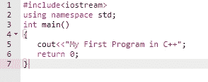

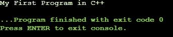

程序的详情如下：

- `#include<iostream>`：该语句包含预定义的输入和输出函数，并通知编译器包含该文件。
- `using namespace std;`：一种用于存储程序内函数和操作的语句，其中 `std` 被视为命名空间名。
- `int main()`：这是程序的主函数，执行从这里开始。`int` 是返回类型，指示编译器返回一个整数值，我们也必须在末尾加上 `0`。
- `cout << "my first program in c++"`：`cout` 是一个属于 iostream 的对象，用于显示内容。
- `return 0;`：该语句从 `main()` 返回 0，负责主函数的执行。

### 变量和数据类型

变量是 C++ 语言中不同类型的标识符，因为它们是通过特定的关键字定义的。我们必须按照给定的语法创建变量、指定类型并赋值：

`Type variable = value;`

变量的类型
- `int`：用于存储整数和全数。例如，`4563`。
- `char`：用于存储单个字符。例如，'a' 或 'z'。
- `double`：用于存储浮点数。例如，`50.21342`。
- `bool`：用于存储具有两种状态的值：真（true）或假（false）。
- `string`：用于存储文本。例如，"c++ language"。

要声明变量并为变量赋值，我们可以按照下面提到的语法：

```cpp
int newnum;
newnum = 50;
cout << newnum;
```

C++ 中使用的每个变量都应该用唯一的名称标识，这些名称被称为标识符。为了构造标识符，必须包含字母、数字或下划线，并且区分大小写。

## 数据类型

C++ 编程语言中的数据类型定义了可以在变量中存储的数据类型。通常，C++ 中的数据类型分为三类：内置的、派生的和用户定义的。用户定义的数据类型包括结构（struct）、联合体（union）和枚举（enum），而派生数据类型基于数组、函数和指针。

C++ 的内置数据类型：
- `int`
- `char`
- `float`
- `double`
- `bool`

用户定义的数据类型：
- `union`
- `enum`
- `struct`

派生数据类型：
- `function`
- `array`
- `pointer`

### 修饰符和存储类

C++ 编程语言中的修饰符用于 `char`、`double` 和 `int` 数据类型，以改变基本类型的含义以满足某些编程条件。修饰符包括 `signed`、`unsigned`、`long` 和 `short`。

为了定义 C++ 程序中变量和函数的作用域，可以使用存储类 `auto`、`register`、`extern`、`mutable` 和 `static`。`auto` 存储类是所有局部变量的默认值，而 `static` 存储类允许编译器在程序生存期间存储局部变量，并在离开作用域时删除。`extern` 存储类提供全局变量的引用，用于多个文件使用同一个全局函数或变量的情况。对于 `mutable` 存储类，只考虑类对象，并且也可以被常量成员函数修改。

### 控制流

在 C++ 中，控制流是指程序运行时指令、函数和状态被评估和执行的顺序。这些状态在代码内部从上到部执行，以完全满足程序逻辑。程序并不依赖线性状态序列，C++ 提供了特定的控制流状态。

C++ 控制流状态：
1. `if else`
2. `for` 循环
3. `do while` 循环
4. `break` & `continue`
5. `switch` 状态
6. `goto` 状态

#### If 语句

在 C++ 编程中，`if` 语句用于程序中有多个需要执行的状态或情况。`if` 语句的语法显示，只有在给定状态为真时才会执行括号内的内容；`else` 则假状态会被自动忽略。


```cpp
if(condition){
  state,me,nt;
}
```

### if state,me,nt 的流程图：

用于说明 C++ 中 if state,me,nt 的示例程序：

```cpp
#include <iostream>
using namespace std;

int main() {
  int marks = 80;
  if (marks < 100) {
    cout << "marks are less than 100";
  }
  if (marks > 100) {
    cout << "marks are greater than 100";
  }
  return 0;
}
```

### 嵌套 if state,me,nt
在 C++ 中，嵌套在 state,me,nt 内部的 state,me,nt 被称为嵌套 if state,me,nt。例如：

```cpp
if (condition_1) {
  State,me,nt1;
  if (condition 2) {
    State,me,nt2;
  }
}
```

### If else, state,me,nt:
```cpp
if (condition_1) {
  State,me,nt;
  else (condition 2) {
    State,me,nt;
  }
}
```

### Switch case
C++ 编程中的 switch case, state,me,nt 用于当程序中给出多个条件，并且我们需要根据提供的条件执行相应操作时。`break` 和 `continue` 操作也是 switch state,me,nt 的重要组成部分。C++ 中 switch case 的语法如下：

```cpp
#include <iostream>
using namespace std;

int main() {
  int num = 10;
  switch (num + 5) {
    case 1:
      cout << "case,1: value, is: " << num << endl;
    case 2:
      cout << "case,2: value, is: " << num << endl;
    case 3:
      cout << "case,3: value, is: " << num << endl;
    default:
      cout << "de,fault: value, is: " << num << endl;
  }
  return 0;
}
```

### Go to state,me,nt
C++ 中的 go to state,me,nt 用于改变程序的执行流，并将控制转移到同一程序内另一个带有标记的 state,me,nt。

go to state,me,nt 的语法：`goto label;`

## 循环与函数

### 循环
C++ 编程语言中的循环 state,me,nt 用于按特定次数的迭代执行特定的代码块，直到满足提供的条件。由于它们允许程序员同时执行多项任务，循环 state,me,nt 会执行函数中的第一个 state,me,nt 并根据需要移动到下一个。

##### 循环类型
- **While 循环**：当提供的条件为真时重复 state,me,nt，并在执行循环体之前重新检查。
- **Do while 循环**：在循环执行期间检查条件。
- **For 循环**：多次执行特定的 state,me,nt 并同时管理循环变量。
- **嵌套循环**：在一个循环内部包含另一个循环。

循环可以通过不同的控制 state,me,nt 执行，如 `break` state,me,nt、`continue` state,me,nt 和 `goto` state,me,nt。

#### 函数
函数负责将不同的代码段组合并一起执行，以完成给定的操作。C++ 编程语言中的两种主要函数类型包括库函数和自定义函数。库函数是在 C++ 中预定义的，而用户定义函数是由程序员自己创建的。

定义一个函数，我们可以使用以下语法：

```cpp
return_type function_name(parameter list) {
  function body
}
```

`min()` 函数的示例代码：
```cpp
int min (int num1, int num2) {  //函数声明
  // 局部变量声明
  int result;
  if (num1 < num2)
    result = num1;
  else
    result = num2;
  return result;
}
```

##### 函数调用
在 C++ 中调用函数，我们可以使用以下方法：
- 引用传递。
- 值传递。
- 指针传递。

##### 函数重载
当两个或多个函数具有相同的名称但具有不同的参数时，该过程被称为重载函数。C++ 中函数重载的语法如下：

```cpp
void same_function(int a);
int same_function(float a0);
void same_function(int a, double, b);
```

## 数组、字符串、指针和引用

#### 数组
数组在编程语言中被广泛使用，因为允许我们处理大量相同类型的数据。通常，数组被用作存储固定数量数值的数据集合。

在 C++ 中声明数组的语法：
`datatype arrayname[size];`

初始化：
`int age[5] = {15, 20, 25, 30};`

使用数组求和的 C++ 示例程序：
```cpp
#include <iostream>
using namespace std;

int main() {
  int nummers[10], sum = 0;
  for (int i = 0; i < 10; i++) {
    cin >> nummers[i];
    sum += nummers[i];
  }
  cout << "sum = " << sum;
  return 0;
}
```

#### 字符串
字符串被用作字符集合。在 C++ 中，常见的类型有字符串和标准库。可以使用以下语法来定义字符串：
`char str[] = "programming";`

指针被用作值，指向内存地址。在 C++ 中，使用以下操作符访问变量的内存地址：

#### 类
类是创建对象的蓝图。它是一种自定义类型。定义类的语法：
`class name {`

类可以定义为私有的（private）或受保护的（protected），这样数据只能在程序内部访问。示例代码：
```cpp
class student {
private:
  char name[20];
  int rollno;
  float total;

public:
  // 获取学生详情的函数
  void getdetails(void);
  // 打印学生详情的函数 void putdetails(void);
};
```

### 继承与多态
在编写实现继承的程序时，我们可以考虑基类和派生类的概念。由于类可以派生自一个或多个类，派生类可以访问基类的所有非私有成员，同时也可以从现有类创建一个新类。C++ 中继承的语法为：

```cpp
class a { // 基类 };
class b : public a { // 派生类 };
```

#### 访问修饰符
在 C++ 中，访问修饰符用于确定类之外成员的可用性限制。主要的访问修饰符有私有（private）、受保护（protected）和公共（public）。

在创建类时使用私有访问修饰符，使基类的受保护和公共数据成员变为派生类的私有成员，而基类的私有成员仍保持为私有。

在受保护（protected）访问修饰符中，基类的公共和受保护数据成员变为派生类的受保护成员。基类的私有成员仍然无法访问。

在创建类时使用公共（public）访问修饰符，使基类的数据成员变为派生类的公共成员。基类的私有和受保护成员仍然无法访问。


当基类的公共数据成员变为派生类的公共成员时，会使用访问限定符。受保护成员在派生类中变为受保护状态，而基类的私有成员保持不可访问。

在 c++ 中使用访问限定符的语法如下：

```cpp
Class myclass { // class

Public : // access specifier

// class members
};
```

### 友函数、数据结构与封装性

#### 友函数
在面向对象编程中，非成员函数无法访问对象的私有和受保护数据。为了允许访问私有或受保护数据，我们可以使用友函数或友类，这允许程序员访问类的私有和受保护数据。

该函数通过 `friend` 关键字声明，并应该在类体内使用。在 c++ 编程语言中声明友函数，可以使用下述语法：

```cpp
Class class_name
{
friend return_type function_name(argument);
}
```

#### 数据结构
虽然为了明确本主题的目标，需要深入介绍数据结构，但我们将讨论如何在 c++ 中定义和使用结构（structure）。结构是一种用户定义类型，可以通过以下语法在程序中实现：

```cpp
Struct [structure, tag]
{
member definition;
}
```

例如：

```cpp
Struct vehicle {
char name[50];
char category[100];
int model,l_year;
} vehicle;
```

要访问结构中的任何成员，我们可以使用成员访问运算符（`.`）。通过数据结构定义结构体指针变得简单，我们可以使用以下语法：

```cpp
Struct vehicle *struct_pointer;
```

#### 封装性
“封装”（encapsulation）一术语定义为编程中向用户隐藏敏感数据的方法。为了执行封装，我们需要将类变量和属性声明为私有（private），并通过 getter 和 setter 方法读取或修改私有成员的值。访问私有成员的语法定义如下：

```cpp
#include <iostream>

Using namespace std;

Class employee {
private:
    // private attribute
    int salary;

public:
    // setter
    void setsalary(int s) {
        salary = s;
    }
    // getter
    int getsalary() {
        return salary;
    }
};

Int main() {
    employee myobj;
    myobj.setsalary(50000);
    cout << myobj.gettsalary();
    return 0;
}
```

### 文件处理
在 c++ 编程语言中，我们一直使用 `cin` 和 `cout` 方法在程序中读写数据。为了从文件中读写数据，c++ 提供了一个名为 `fstream` 的标准库，其中包含 `ifstream`、`ofstream` 和 `fstream` 数据类型。

要打开文件可以使用 `fstream` 或 `ofstream` 对象，其 c++ 语法定义如下：

```cpp
Void open(const char *filename, ios::openmode mode);
```

关闭文件的语法：

```cpp
Void close();
```

### C++ 语言特性与支持
C++ 编程语言提供了丰富的库支持和标准模板库 (stl) 函数，用于快速编写代码。作为一种面向对象的编程语言，我们可以专注于对象并执行不同类型的操作和实现，而与其他与其他主要语言不同，c++ 提供了如下支持。

由于其快速、可靠和安全的特性，c++ 广泛应用于操作系统、图形和数据库的开发。该语言速度快，并以其高效性著称，此外 c++ 还允许异常处理并支持函数重载。

### C#：概述与基础语法

#### 概述
C# 是由微软开发的一种编程语言，用于 .NET 框架。该语言基于面向对象编程，并与 c++ 等其他编程语言具有相同的基础语法。C# 为通用基础设施 (cli) 开发，其由运行时环境和可执行代码组成。由于易学习，c# 是最好的编程语言之一，因为它们生成高效的程序并在不同的平台上编译。

为了运行 c# 应用程序和程序需要 .NET 框架，它可以用于编写 Windows 应用程序和服务。c# 的开发环境 (ide) 包括 Visual Studio。

#### 基础语法
基于面向对象编程，c# 编程的核心在于类和对象。以学生类为例，它具有名称、ID 和年级等属性，虽然每个学生的属性是相同的，但他们每个人都有不同的名称、ID 和年级，这些被称为对象属性。通常，一个 c# 程序由命名空间声明、类方法、主方法和语句组成。

这里是一个在 c# 中打印“welcome to c# programming”的简单程序：

```csharp
Using system:
namespace csharp programming
class programming {
    // main function
    static void main(string[] args) {
        Console.WriteLine("welcome to c# programming");
        Console.ReadKey();
    }
}
```

基础语法的细节：
- `Using system`：用于为程序包含系统命名空间。
- `Namespace declaration`：程序内类的集合。
- `Class declaration`：包含程序中所使用的数据和方法的类。
- `Static void main()`：`static` 关键字表示该方法可以在不实例化类的情况下被访问。
- `Console.WriteLine()`：用于定义系统命名空间的方法。
- `Console.ReadKey()`：让计算机等待下一个命令并防止屏幕关闭。

#### 数据类型与变量
数据类型是任何编程语言的组成部分，因为它们指定了语言支持的数据类型。由于它们在 c# 中是预定义的，数据类型分为三大类：值数据类型、引用数据类型和指针类型。

值数据类型变量派自 `System.ValueType` 类，包含字母和数字形式的数据。下表显示了 c# 编程语言中使用的值类型：

| 数据类型 | 表示形式 | 默认值 | 范围 |
| :--- | :--- | :--- | :--- |
| Byte | 8 位无符号整数 | 0 | 0 到 255 |
| Decimal | 128 位精确小数 | 0.0 | -7.9 x e²⁸ 到 7.9 x e²⁸ |
| Bool | 布尔值 | False | True/false |
| Float | 32 位单浮点类型 | 0.0m | -3.4 x e³⁸ 到 + 3.4 x e³⁸ |
| Double | 0.0d | (+/-)5.0 x e⁻³²⁴ 到 (+/-)1.7 x e³⁸ |
| Char | 16 位 Unicode 字符 | ‘\0’ | U+0000 to u+ffff |
| Int | 32 位符号整数类型 | 0 | -2,147,483,648 to 2,147,483,647 |
| Short | 16 位符号整数类型 | 0 | -32,768 to 32,767 |
| Long | 64 位符号整数类型 | 0l | -9,223,372,036,854,775,808 to 9,223,372,036,854,775,807 |

2. 引用数据类型,


引用数据类型存储的是变量的引用，而不是存储实际数据。通过使用多个变量，引用类型可以指向同一个内存位置，如果内存位置被其中一个变量更改，另一个变量的值也会随之改变。

### 3. 对象类型 (object type)

对象数据类型被认为是 C# 中所有数据类型的基类。此外，对象类型还可以分配其他类型的值、引用类型、定义类型和值类型。

### 4. 指针数据类型

指针数据类型包含变量值的内存地址，其语法如下：

`Type* identifier;`

### 运算符

C# 使用运算符的方式与 `c` 和 `c++` 等其他主要编程语言相同。内置运算符集包括算术运算符、关系运算符、位运算符、逻辑运算符、杂运算符和赋值运算符。

### 函数与方法

在 `c` 编程语言中，函数允许程序员封装代码的特定部分，并在代码的其他部分利用它。由于它消除了重写代码的需求，我们可以从多个地方访问函数并执行所需的操作。`c` 中的函数使用以下语法声明：

```
<visibility> <return type> <name>(<parameters>)
{
<function code>
}
```

被称为成员函数或类成员的函数在 `c` 编程语言中也被称为方法。通常，`c` 中有两种方法，称为实例方法和静态方法。

函数可以返回任何类型的数据，并且执行多条语句，如 `read`、`follow` 和 `run`。

在 `c` 中使用函数的示例程序：

```csharp
using system;

Class return2
{
    static string lastfirst(string firstname, string lastname)
    {
        string separator = ", ";
        string result = lastname + separator + firstname;
        return result;
    }
    static void main()
    {
        console.WriteLine(lastfirst("john", "william"));
        console.WriteLine(lastfirst("james", "lewis"));
    }
}
```

### 数组、字符串和结构体

#### 数组

数组用于存储具有相同数据类型的固定大小元素集合。由于具有连续的内存位置，可以使用以下语法在 `c` 编程语言中声明数组：

`Datatype[] arrayname;`

初始化：
`Int [] age = new age[20]`

在 `c` 编程语言中声明和访问数组的示例程序：

```csharp
using system;
namespace arrayapplication {
    class myarray {
        static void main(string[] args) {
            int [] n = new int[20]; /* n 是一个包含 20 个整数的数组 */
            int i,j;
            /* 初始化数组 n 的元素 */
            for (i = 0; i < 20; i++) {
                n[i] = i + 100;
            }
            /* 输出每个数组元素的值， */
            for (j = 0; j < 10; j++) {
                console.WriteLine("element[{0}] = {1}", j, n[j]);
            }
            console.ReadKey();
        }
    }
}
```

#### 字符串

我们可以在 `c` 编程中使用 `system.string` 关键字创建字符串。为了创建一个字符串对象，我们可以采用不同的方法，例如将字符串字面量赋值给字符串变量、使用连接运算符 (`+`）、调用格式化方法转换值，或通过使用字符串构造函数。

语法：
`String []array={"this", "is", "c#"};`

#### 类与对象

类被定义为对象类型的表示以及以及数据类型的蓝图。在 `c` 编程中，类的定义以关键字 `class`、类名和类体开始。访问类中的成员允许访问成员，其中类的默认访问权限被称为 `internal`（内部的）。为了访问成员，我们可以使用 `.` 运算符。它还将对象的名称与成员的名称联系起来。类也被视为一种引用类型，在我们使用 `new` 运算符创建类的实例之前，该变量包含 `null` 值。在 `c` 中声明类，可以遵循以下语法：

```csharp
Public class student
{// 属性，方法}
```

示例：
`Myclass student = new myclass();`
`Myclass student2 = student;`

#### 创建对象

在 `c` 编程中，对象完全基于类。类定义了一种类型的对象。它也被称为类的实例，可以使用以下语法创建：

`student object1 = new student();`

一旦创建了类的实例，对象引用就会自动传回。例如：
`student object2 = new student();`
`student object3 = object2;`

以下程序展示了如何在 `c` 编程语言中创建对象：

```csharp
using system;
namespace tutorial {
    Class program
    {
        Static void main(string[] args)
        {
            users user = new users("harry", 20);
            user.userDetails();
            console.WriteLine("press enter to exit..");
            Console.ReadLine();
        }
    }
}
Public class users
{
    Public string name {get; set; }
    Public int age {get; set; }
    Public users(string name, int age)
    {
        Name = name;
        Age = age;
    }
    Public void userDetails()
    {
        console.WriteLine("name: {0}, age: {1}", name, age);
    }
}
```

### 继承与多态

## 继承

继承是 `c` 的重要部分，因为它是一种面向对象的编程语言。它允许程序员重用具有相同功能的类，继承的工作方式类似于父子关系。父类被视为基类，而子类被称为派生类，它继承了父类的所有功能。

语法：
`<access-specifier> class <base_class> {... }`
`Class <derived_class> : <base_class> {... }`

对于多级继承：
```csharp
Public class a
{
// implementation
}
Public class b : a
{
// implementation
}
Public class c : b
{
// implementation
}
```

#### 多态

多态是指通过单一操作执行多种功能的技术。静态多态在编译时执行，而动态多态在运行时决定。

在静态多态中，`c` 允许程序员实现以下两种方法：

**函数重载**

函数重载在给定的范围内为同一个函数名提供多个定义。此外，函数定义在类型上必须不同，以便你不会重载返回类型不同的函数声明。

**构造函数**


在 C# 编程中，每当创建结构体或类时，构造函数会被自动调用。由于一个类可以有多个构造函数来处理不同的参数，构造函数还允许程序员设置实例化限制和默认值。

### 创建构造函数的语法：

```csharp
public class person
{
    private string last;
    private string first;

    public person(string lastname, string firstname)
    {
        last = lastname;
        first = firstname;
    }
    // remaining implementation of person class.
}
```

C# 编程中使用的三种构造函数分别称为实例构造函数、静态构造函数和私有构造函数。

### 异常处理

异常是将控制权从程序一段转移到另一段的方式。通常，异常被视为程序执行期间出现的问题。为了捕获这种情况，C# 提供了多种异常处理方法，即 `try`、`catch`、`throw` 和 `finally`。

`try` 块用于定义一个可能发生异常的代码块，而 `catch` 异常允许程序员从程序的任何地方处理问题。`throw` 异常在遇到问题时被触发，而 `finally` 异常则用于执行一组提供的语句。

### 在 C# 编程语言中使用异常处理的语法：

```csharp
public class person
{
    private string last;
    private string first;

    public person(string lastname, string firstname)
    {
        last = lastname;
        first = firstname;
    }
    // remaining implementation of person class.
}
```

### 多线程

在 C# 编程语言中，线程被认为是程序的执行路径，因为它定义了特定的流控制并负责定义执行路径。作为轻量级进程，线程可以节省 CPU 周期的浪费，并以此提高程序的效率。

线程的生命周期中有四种主要状态，包括：未启动状态、就绪状态、不可运行状态和死亡状态。可以通过实现特定的 C# 方法来创建、管理和销毁线程。

## 文件 I/O

C# 提供了不同的类来操作文件系统和处理数据。由于这些类可以打开文件、访问文件、访问目录以及更新现有文件，C# 包含了一个特定的文件类来执行所有的 I/O 操作。

类名及其详细信息概述如下：

- **File**: `File` 是一个静态类，提供了不同的操作，包括移动、删除、创建、打开、拷贝、读取和写入。
- **Fileinfo**: `Fileinfo` 类的功能与静态文件类相同，程序员可以通过为特定文件手动编写代码来执行读写操作。
- **Directory**: `Directory` 类也是静态的，并支持在文件内创建、删除、访问和移动子目录。
- **Directoryinfo**: `Directoryinfo` 类提供了不同的实例方法，用于访问、删除、移动和创建子目录。
- **Path**: `Path` 静态类提供了更改文件扩展名、获取文件扩展名以及获取特定文件绝对路径的功能。

### FileStream 类

`system.io` 命名空间中的 `fstream` 类用于通过 C# 编程语言创建、写入和关闭特定文件。创建流类对象的语法定义如下：

```csharp
fstream object_name = new filestream(file_name, file_mode, file_access);
```

C# 中的高级文件操作包括：
- 读取和写入文本文件；以及读取和写入二进制文件。
- 操控 Windows 文件系统。`system.io` 是一个抽象类，提供了将字节传输到源所需的所有标准方法，它继承自类类以执行某些读取/写入操作，包括文件和网络。

学习 C# 的优势

C# 编程语言提供了快速的执行时间，并提供解决特定问题的结构化方法。凭借高级函数和内置库的可用性，程序员可以轻松地构建不同类型的应用程序。由于 C# 是一门面向对象的编程语言，与其他高级编程语言相比，其开发和维护更加简单。此外，C# 最适合创建具有良好互操作性的健壮应用程序。

## Capture：Python

### 概述和基本语法

Python 是一门广知的编程语言，由 Guido van Rosum 于 1991 年开发。作为一种高级、面向对象且交互式的脚本语言，Python 可用于系统脚本、软件开发和服务器端 Web 开发。

### 特性

作为基于解释的语言，Python 允许一次执行一条指令，并支持大量的数量类型。该编程语言易于学习和编码，因为它的关键字少且语法定义清晰。由于广泛标准库的可用，Python 还提供了交互式模式的支持，使得开发者更容易测试和调试代码。

此外，该语言可用于 GUI 编程，以及开发具有系统调用、Windows 系统和库特性的应用程序。除了这些特性，Python 还支持自动垃圾回收，并提供高级动态数据类型，且可以与 C++、C、Java 集成。用户可以直接与 Python 解释器交互以编写程序，因为它也提供了低级模块。

你需要在电脑上安装 Python，源代码可以在 GNU 通用公共许可协议 (GPL) 下下载。不同的基于 GUI 的 Python 集成开发环境 (IDEs) 包括 PyCharm、Python 捆包、Python ID 和 Sublime Text。最新的二进制文件、源码、新闻和文档可以在 Python 官方网站找到：[`www.python.org/`](https://www.python.org/)

### 变量类型、基本运算符和数据类型

#### 变量类型

在 Python 编程中，不需要声明变量来预留内存位置，因为每当给变量赋值时，声明会自动发生。根据变量的数据类型，解释器会分配内存并允许程序员存储小数、字符或整数。

#### Python 保留关键字列表：

```python
del
else
and
assert
in
raise
from
continue
if
finally
not
pass
as
return
not
pass
yield
break
except
import
```


# 用于
- 全局
- While
- 打印
- With
- Try
- E,xe,c
- 或
- 是
- E,lif

## 基础运算符

Python 内置了许多运算符，例如算术运算符、赋值运算符、逻辑运算符、位运算符、比较运算符和成员运算符。

下表简要定义了 Python 运算符的细节：

| 算术运算符 | 赋值运算符 | 比较运算符 | 逻辑运算符 | 位运算符 |
| :--- | :--- | :--- | :--- | :--- |
| 加法 (`+`) | 等于 (`=`) | 双等号 (`==`) | 逻辑或 | 二进制与 (`&`) |
| 减法 (`-`) | 加赋值 (`+=`) | 不等于 (`<>`) | 逻辑与 | 二进制或 (`\|`) |
| 乘法 (`*`) | 减赋值 (`-=`) | 大于 (`>`) | 逻辑非 | 二进制异或 (`^`) |
| 除法 (`/`) | 乘赋值 (`*=`) | 小于 (`<`) | | 二进制左移 (`<<`) |
| 取模 (`%`) | 除赋值 (`/=`) | 小于等于 (`<=`) | | 二进制右移 (`>>`) |
| 整除 (`//`) | 取模赋值 (`%=`) | 大于等于 (`>=`) | | 二进制取反 (`~`) |
| 幂 (`**`) | 整除赋值 (`//=`) | | | |

## 数据类型

在 Python 编程语言中，每个对象都有自己的类型和值。

### Python 的内置数据类型：

- **数字**包括整数、浮点数、分数和复数。Python 中预定义的数据类型有 `int`、`float`、`long` 和 `complex`。
- **序列**由字符串、字节、列表和元组组成。
- **布尔**持有 `true` 或 `false`。
- **字典**包含以无序方式设置的键值对。
- **集合**涵盖无序的值容器。

## 流程控制

流程控制语句允许程序员改变程序的执行流并执行特定的操作。与其他高层编程语言一样，Python 中使用的三个主要控制流语句是 `if`、`for` 和 `while`。下图显示了控制流语句在程序中实际的工作原理：

### 条件语句

#### If 语句
`if` 语句是一个布尔表达式，以 `true` 或 `false` 的形式显示结果。

#### If else 语句
`if else` 语句也是一个布尔表达式，包含一个可选的 `else` 语句。如果表达式为 `false`，则执行 `else` 语句。

#### 嵌套语句
语句内部的语句被称为嵌套语句。

### 循环

循环被称为一系列指令，允许程序员通过实现某些条件来执行特定任务。在 Python 编程中，可以使用指定的控制结构来执行多个语句或一组指令。

#### Python 中的循环类型：

**While 循环**
While 用于在程序中重复执行语句或迭代 ‘n’ 次。Python 中使用 `while` 循环的语法如下：

```
While expression:
    statement(s)
```

示例程序：
```python
#!/usr/bin/python

Count = 0

While (count < 10):
    Print('the count is:', count)
    Count = count + 2
```

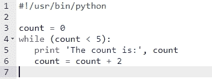

输出：
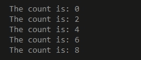

**For 循环**
为了迭代任何序列的项（包括字符串或列表），我们可以使用 `for` 循环。

语法：
```
For iterating_var in sequence:
    statement(s)
```

示例程序：
```python
Fruits = ["apple,", "banana", "cherry"]

For x in fruits:
    Print(x)
```

为了在迭代完所有项之前停止循环，我们可以使用 `break` 语句；而 `continue` 语句可以用于停止当前循环迭代并继续下一次迭代。

## 函数与模块

### 什么是函数？

函数是一组可重用且组织良好的代码，用于执行程序中的特定任务和操作。尽管 Python 编程语言中提供了许多内置函数，但开发者也可以创建自己的函数，这些称为用户定义函数。Python 中定义函数的语法描述如下：

```
def functionname(parameters):
    "function_docstring"
    Function_suite
    return [expression]
```

为了引入函数定义，我们可以使用关键字 `def`，它是函数体的延续。赋值给函数的变量通常存储在本地表中，这意味着除非声明为全局变量，否则全局变量无法被赋值任何值。

字体 调用函数

编程语言中的函数可以通过提供参数、提供可选参数或提供强制参数来调用。函数最大化了重用性并使程序更容易理解。以下是用于定义和使用的语句：

- `def display(age): print('hi' + age)`
- `def x(): return 'hi'`
- `for i in range(k): yield i`
- `def sum(a, b): return a+b`
- `def out(): a = 'old'`
- `def inner(): nonlocal a`

## 模块

模块化编程是将不同部分组织成模块的方法。Python 有大量的标准模块集，为任务提供支持。

Python 中的导入语法：
```
Import module1, [module2 [name]]
```

使用 `import` 模块，我们可以调用：
```
Import module
```

作为新模块导入，我们使用：
```
Import newmodule as name
```

从模块导入的语法是：
```
From module import name
    print("hi", country)
```

## 面向对象的 Python

在面向对象编程中，我们需要定义类和对象来执行各种功能。像 C++ 等其他主要语言一样，可以使用面向对象的技术创建、访问和更新类。

在 Python 中创建学生类，代码如下：

```python
Class student:
    def __init__(id, name, class):
        self.r = roll
        self.n = name
        print(self.n)

# ...

Stud1 = student(1, "james")
Stud2 = student(2, "william")

Print("data successfully stored in variables")
```

## 继承

继承是面向对象编程的一个有用特性，允许开发者创建一个新类来继承现有类的所有方法和属性。我们可以通过继承技术定义一个具有父类属性的新型子类或派生类。


以下程序展示了 `vehicle` 作为父类，以及一个派生类，该派生类将继承父类 `vehicle` 的特征并调用它的函数。

### 类 vehicle：#父类
"父类"

```python
class vehicle:
    def __init__(self, price):
        self.price = price

    def display(self):
        print('price = ', self.price)
```

### 类 category(vehicle):#派生类
"子类/派生类"

```python
class category(vehicle):
    def __init__(self, price, name):
        vehicle.__init__(self, price)
        self.name = name

    def disp_name(self):
        print('vehicle = ', self.name)

Obj = category(2000, 'merchandise')
Obj.disp_name()
Obj.display()
```

**输出:**
```
vehicle = merchandise
Price = 2000
```

要重写基类中的任何方法，我们可以在派生类中定义具有相同名称和参数的新方法。其语法如下：

### 类 a：#父类
"父类"

```python
class a:
    def display(self):
        print('this is base class.')
```

### 类 b(a):#派生类
"子类/派生类"

```python
class b(a):
    def display(self):
        print('this is derived class.')

Obj = b()
Obj.display()
```

## 正则表达式

在 Python 编程中，正则表达式用于从文档、日志文件、电子表格或代码等文本中提取信息。正则表达式被称为特殊顺序的字符，允许程序员使用特殊语法来查找相关的序列、字符或字符串集。在 Python 编程语言中编写正则表达式时，我们应该以前缀 ‘r’ 开始编写原始字符串，并同样处理其他特殊元字符。

### Match 函数
`match()` 函数用于检查 Python 中给定的正则表达式是否匹配字符串。如果模式不匹配，我们可以使用 `re.match()` 函数。

### Search 函数
该函数尝试在字符串中搜索所有可能的起始点，并扫描输入字符串以匹配任何位置。它包括 `search()` 或 `re.search()` 函数。

### Split 函数
`split` 函数可以直接应用于字符串，其中 `re.split()` 接受一个指定分隔符的模式。

## 文件 I/O

文件是磁盘上的特定位置，用于存储信息和数据。由于它存储在硬盘上，我们也可以通过实现 Python 编程方法和技术执行读写操作。Python 中的文件操作由三个主要方面组成：打开文件、读写关闭关闭。

`open()` 是 Python 编程语言中的内置函数，它有两个参数称为 `filename` 和 `mode`。可以通过实现以下方法对文件执行不同的操作：

*   “r” = `open` 或读取文件。
*   “w” = 写入文件，如果文件不存在则创建一个新文件。
*   “a” = 打开文件追加，如果文件不存在则创建一个新文件。
*   “x” = 创建新文件，如果文件已存在则返回错误。
*   “t” = 以文本模式 `open`。
*   “b” = 以二进制模式 `open`。
*   “+” = 打开文件进行读写。

实现方法的语法：
```python
f = open("sample.txt")
f = open("img.jpg", "r")
```
要关闭文件，我们可以使用 `f.close()` 函数。

### 在 Python 中读取文件
通过 Python 语言读取特定文件非常简单，因为我们可以实现 `read(size,)` 方法。例如：
```python
>>> f = open("sample.txt",'r')
>>> f.read(4) # 读取前 4 个数据
>>> f.read(4) # 读取后续 4 个数据
>>> f.read() # 读取到文件末尾
'My first file,this file,contains four lines'
>>> f.close()
```

### 写模式打开文件
使用内置 `open()` 函数打开文件，可以使用以下语法：
```python
f = open("sample.txt", "r")
print(f.read())
```
读取特定行，我们可以实现 `readline()` 函数：
```python
f = open("sample.txt", "r")
print(f.readline())
```

### 写入现有文件
以下 Python 语法将打开示例文件并追加内容：
```python
f = open("sample.txt", "a")
f.write("update content")
f.close()
```
追加之后：
```python
f = open("sample.txt", "r")
print(f.read())
```

### 创建文件
要创建一个新文件，将使用 `open()` 方法，它可以带创建、追加或写入参数。Python 中创建文件的语法定义如下：
```python
f = open("newfile.txt", "w")
```

### 删除文件
要删除现有文件，应使用 `os.remove()` 函数，语法如下：
```python
import os
os.remove("sample.txt")
```
检查文件是否存在的语法。如果是，则删除：
```python
import os
if os.path.exists("sample.txt"):
    os.remove("sample.txt")
else:
    print("the file does not exist")
```

## 高级 Python

### 异常处理
Python 编程语言中有三种异常处理方法，`try`、`except` 和 `finally` 块用于处理程序执行期间发生的错误。

#### Try
通过 `try` 块生成异常，可以实现以下语法：
```python
try:
    print(x)
except:
    print("an exception occurred")
```
如果没有抛出错误，示例代码如下：
```python
try:
    print("python")
except:
    print("an exception occurred")
else:
    print("no exception occurred")
```

#### Finally
在异常处理中，即使 `try` 块抛出了异常，`finally` 块也会执行。例如：
```python
try:
    print("python")
except:
    print("an exception occurred")
finally:
    print("try exception finished")
```

#### 自定义异常
虽然 Python 编程语言中有几种内置异常，可以用于在出现问题时强制程序显示错误，但开发者也可以创建自定义异常来满足他们的需求。要创建一个新异常，必须从 `exception` 类创建一个新类。

自定义异常可以像普通类一样进行实现，因为大多数内置异常都派生自 `exception` 类。


Hype，超文本标记语言 (html) 是一种标准的标记语言，用于创建网站以显示颜色、字体、图形、媒体和图像。html 由不同的标签组成，这些标签可以用于描述网页的结构，并告诉浏览器在互联网上显示内容。

## 什么是标签？

标签向网页浏览器提供关于任何网页结构、显示和内容的指令。它们通过闭合的角括号 `<>` 来定义。标签由属性和元素组成。元素是页面上的一个对象，其中属性描述该元素的性质或细节。请记住，标签是成对使用的，起始标签 `<tag>` 和结束标签 `</tag>` 是有区别的。

你的第一个示例是使用以下标签创建 html 网页：

```html
<html>
<head>
<body>
<h1>我的第一个标题</h1>
<p>我的第一个段落</p>
</body>
</html>
```

## 标签说明

在上述编写的 html 文档中，`<html>` 标签包裹了整个 html 文档，并由其他主要标签组成，包括 `<head>`、`<body>` 和 `<p>`。`<head>` 标签代表文件的头部，其中 `<title>` 标签用于显示文档的标题。`<body>` 包含了几个用于创建网页的其它标签，如标题 `<h1>` 和段落 `<p>`。

Html 标签不区分大小写，但它们应该使用小写字母。为了定义 html 的版本，我们可以使用以下标签：

```html
<!DOCTYPE html>
```

学者可以使用 pc 上的记事本运行 html 页面，并将文件保存为 `.html` 格式。这将允许他们在浏览器中查看网页。

## 基础标签和属性

### 基础标签

每个 html 文档都应该以标题、头部和段落开始。在 `<body>` 标签之后，下一个使用的主要标签是 `<h1>` 或标题标签。根据你的内容需求，标题标签定义为 `<h1>` 到 `<h6>`。例如：

标题：

```html
<html>
<body>
<h1> 第一个标题</h1>
<h2> 第二标题</h2>
<h3>第三个标题</h3>
<h4>第四个标题</h4>
<h5>第五个标题</h5>
<h6>第六个标题</h6>
</body>
</html>
```

输出：
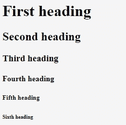

段落

为了添加内容，我们需要在 html 文档中包含段落。例如：

```html
<html>
<head>
<h1> 标题</h1>
</head>
<body>
<p> 第一个段落 </p>
<p> 第二个段落 </p>
</body>
</html>
```

输出：
标题
第一个段落
第二个段落

为了在段落之间添加换行，我们可以使用换行标签 `<br>`。

### 摘要标签 (Summary)

为了给段落添加摘要，带有 summary 标签的 html 语法定义如下：

```html
<details>
<summary>示例文本</summary>
<p> Web 开发教程</p>
</details>
```

### Span

Span 标签用于为文本的特定部分着色。例如：

```html
<p> Web 开发学习 <span style="color:red">很有趣 </span> </p>
```

### Select

`select` 标签用于从下拉列表中选择一个选项。例如：

```html
<select>
<option value="red">红色</option>
<option value="blue">蓝色</option>
<option value="green">绿色</option>
<option value="white">白色</option>
</select>
```

### Table

`<table>` 标签用于创建组表头，并与 `<thead>` 和 `<tbody>` 元素配合使用。例如：

```html
<table>
<thead>
<tr>
<th>课程</th>
<th>分数</th>
</tr>
</thead>
<tbody>
<tr>
<td>工程学</td>
<td>85</td>
</tr>
<tr>
<td>英语</td>
<td>90</td>
</tr>
<tr>
<td>总计</td>
<td>180</td>
</tr>
</tbody>
</table>
```
（注：图像）

## 格式化标签

html 文档中的文本可以格式化为不同的样式、字体和大小。用于格式化标题、段落和表格的标签如下：

*   **粗体 (Bold)**：
    任何写在 `<b>` 和 `</b>` 标签之间的文本都以粗体样式显示。例如：
    `<p> <<b> 开发 </b> 很有趣 </p>`
    输出：开发很有趣

*   *斜体 (Italic)*：
    任何写在 `<i>` 和 `</i>` 标签之间的文本都以*斜体*样式显示。例如：
    `<p> <i> 开发很有趣 </i> </p>`
    输出：开发很有趣

*   **上标/下标 (Superscript/subscript)**：
    为了显示上标内容，我们可以使用 `<sup>` 标签，而 `<sub>` 和 `</sub>` 标签用于添加下标。例如：
    `<p> 这段文本使用了 <<sup> 上标 </sup> </p>`
    输出：后面的单词使用了（上标）

*   **下划线 (Underline)**：
    写在 `<u>` 和 `</u>` 标签之间的文本带有下划线。例如：
    `<p> <u> 带有下划线的文本 </u> </p>`

*   **插入和删除 (Insert and delete)**：
    为了插入内容，我们可以使用 `<ins>` 标签，`<del>` 和 `</del>` 标签用于删除内容。例如：
    `<p> <ins> 插入 </ins> <del> 删除 </del> </p>`

*   **链接 (Link)**：
    为了给文本添加链接，我们可以使用以下标签：
    `<p> <a href="url"> 点击这里</a> </p>`

### 幕灯标签 (Marquee)

`<marquee>` 标签可以带有不同的属性使用，包括 `width`、`height`、`direction`、`behavior`、`scrollamount`、`sclday`、`loop`、`bgcolor`、`hspace` 和 `vspace`。

marquee 标签演示：

```html
<html>
<head>
<title>marquee 标签</title>
</head>
<body>
<marquee>文本</marquee>
</body>
</html>
```

## 容器标签

在 html 中，以下容器标签用于格式化文本：

| 开启标签 | 结束标签 | 功能 |
| --- | --- | --- |
| `<p>` | `</p>` | 段落 |
| `<span>` | `</span>` | 行内 |
| `<ol>` | `</ol>` | 有序列表（数字） |
| `<ul>` | `</ul>` | 无序列表（圆点） |
| `<li>` | `</li>` | 列表项 |


在 hype, rte, xt 标记语言中，通过添加框架（frames）可以在浏览器窗口中创建多个区域，以便为每个区域加载一个唯一的 html 文档。若要在网页中使用框架，应该使用 `<frameset>` 标签而不是 `<body>` 标签，后者可以使用特定的 `rows` 和 `cols` 属性进行定义。

### 创建框架的示例 html 标签：

```html
<<html>
<head>
  <title>html frames</title>
</head>
<frameset rows="10%,80%,10%">
  <frame name="top" src="/html/top_frame.htm" />
  <frame name="main" src="/html/main_frame.htm" />
  <frame name="bottom" src="/html/bottom_frame.htm" />
  <noframes>
    <body>your browser does not support frames.</body>
  </noframes>
</frameset>
</html>
```

### Iframe
为了创建一个嵌套的浏览上下文，可以使用 `<iframe>` 标签将新的 html 文档添加到现有的文档中。要创建一个 iframe，可以配合 `<iframe>` 标签实现以下语法：

```html
<iframe src=https://www.website.com></iframe>
```

### 基础 html 标签完整表格：
`<a>`, `<abbr>`, `<acronym>`, `<address>`, `<app>`, `<area>`, `<article>`, `<aside>`, `<audio>`, `<b>`, `<base>`, `<basefont>`, `<bdi>`, `<bdo>`, `<big>`, `<blockquote>`, `<body>`, `<br>`, `<button>`, `<canvas>`, `<caption>`, `<center>`, `<cite>`, `<code>`, `<col>`, `<colgroup>`, `<data>`, `<datalist>`, `<dd>`, `<del>`, `<details>`, `<dfn>`, `<dialog>`, `<dir>`, `<div>`, `<dl>`, `<dt>`, `<em>`, `<embed>`, `<fieldset>`, `<figcaption>`, `<figure>`, `<font>`, `<footer>`, `<form>`, `<frame>`, `<frameset>`, `<h1>`-`<h6>`, `<head>`, `<header>`, `<hr>`, `<html>`, `<i>`, `<iframe>`, ``, `<input>`, `<ins>`, `<kbd>`, `<label>`, `<legend>`, `<li>`, `<link>`, `<main>`, `<map>`, `<mark>`, `<meta>`, `<meter>`, `<nav>`, `<noframes>`, `<noscript>`, `<object>`, `<ol>`, `<optgroup>`, `<option>`, `<output>`, `<p>`, `<param>`, `<picture>`, `<pre>`, `<progress>`, `<q>`, `<rp>`, `<rt>`, `<ruby>`, `<s>`, `<samp>`, `<script>`, `<section>`, `<select>`, `<small>`, `<source>`, `<span>`, `<strong>`, `<style>`, `<sub>`, `<summary>`, `<sup>`, `<svg>`, `<table>`, `<tbody>`, `<td>`, `<template>`, `<textarea>`, `<tfoot>`, `<th>`, `<thead>`, `<time>`, `<title>`, `<tr>`, `<track>`, `<tt>`, `<u>`, `<ul>`, `<var>`, `<video>`, `<wbr>`。

### 表单
Html 表单是网站与用户交互的关键方面之一。表单通过使用文本字段、按钮、选择框、单选按钮、文件选择框、隐藏控件和可点击控件等组件创建。通过表单收集的数据会被发送到网络服务器，网页也可以自己拦截这些数据。大多数情况下，组件与标签关联，以描述其用途。

在 html 中创建表单的语法：
```html
<form action="script url" method="get|post">
  <!-- Form elements like input, buttons etc. -->
</form>
```

从用户获取姓名和年龄的输入表单：
```html
<html>
<head>
  <title>my first html form</title>
</head>
<body>
  <form>
    name: <input type="text" name="name," />
    <br>
    age: <input type="text" name="last name," />
  </form>
</body>
</html>
```
输出：
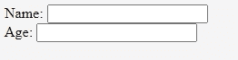

### 文本字段
html 中的文本字段允许用户在表单中输入文本。创建文本字段的通用语法定义如下：
```html
<input type="text" type="text" value="text">
```

### 按钮控件
有多种方法提交数据到表单。我们可以通过以下 html 标签添加可点击的按钮：
```html
<input type="submit" name="submit" value="submit" />
<input type="reset" name="reset" value="reset" />
<input type="button" name="button" value="button" />
```
输出：
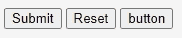

### 选择框
要在 html 表单中创建下拉列表，可以使用 `<select>` 和 `<option>` 元素。
```html
<html>
<head>
  <title>file upload</title>
</head>
<body>
  <form>
    <label for="course">course:</label>
    <select name="course" id="course">
      <option value="webengine">webengine</option>
      <option value="calculus">calculus</option>
      <option value="science">science</option>
    </select>
  </form>
</body>
</html>
```
输出：
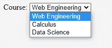

### 选择框
select 元素提供了在 html 中列出多个选项的选择。
```html
<html>
<head>
  <title>file upload</title>
</head>
<body>
  <form>
    <label for="course">course:</label>
    <select name="course" id="course">
      <option value="webengine">webengine</option>
      <option value="calculus">calculus</option>
      <option value="science">science</option>
    </select>
  </form>
</body>
</html>
```
输出：


### 表单元素
一旦 html 表单完成，`action` 和 `method` 两个属性用于存储和发送数据。创建表单的语法定义如下：
```html
<form action="">
```

### 设计
在 html 中，任何网页的默认背景颜色为白色。要更改背景颜色，可以使用以下标签和属性：
```html
<table bgcolor="#f1">
```

### 字体
字体是任何网站的重要部分，增强了内容的可读性。`<font>` 标签可以赋予文本特定的样式、大小和颜色，其属性包括 `size`、`color` 和 `face`。
设置字体大小的标签为：
```html
<font size="14">text</font>
```
字体标签和属性：
```html
<font face="new roman" size="14">text</font>
```

### 字体颜色
要更改字体颜色，可以使用以下 html 标签和属性：
```html
<html>
<head>
  <title>setting font color</title>
</head>
<body>
  <font color="blue">text is blue,</font>
</body>
</html>
```
输出：blue

### 标记文本
在 `<mark>` 和 `</mark>` 元素之间的文本显示为黄色标记。
```html
<p> text is marked as <mark>yellow</mark> </p>
```
输出：marked as yellow

### 元标签
在 html 中，元标签用于向网页添加元数据。元标签的属性包括 `name`、`content`、`scheme` 和 `http-equiv`。我们可以使用 `<meta>` 标签为文档提供简短描述，这也可以提高网页的搜索引擎索引。
```html
<html>
<head>
  <title>meta tags example,</title>
  <meta name="keywords" content="html meta tags, metadata" />
  <meta name="description" content="meta tags." />
  <meta name="revised" content="3/7/2019" />
  <meta http-equiv="cookie" content="userid=abc; expires=monday, 08-Sep-19 23:59:59 GMT;" />
</head>
<body>
  <p>welcome to html</p>
</body>
</html>
```

### 注释
要在 html 代码中放置注释，可以遵循以下语法：
```html
<html>
<head> <!-- document header starts -->
  <title>document title,</title>
</head> <!-- document header ends -->
<body>
  <p>document content goes here.....</p>
</body>
</html>
```

### Html 样式表
为了对 html 文档进行进一步设计，级联样式表（css）在网站上得以实现。它们为指定某些属性提供了简单、有效且易于维护的替代方案。我们将在下一章详细讨论 css。


Html 包含了各种类型的语义化元素，用于定义网页的不同部分。这些元素包括 `header`、`container`、`section`、`article`、`aside`、`details` 和 `footer`。尽管 `css` 是设计网页布局的最佳方法，我们也可以通过这些 html 元素完成该过程。

响应式网页设计是通过使用 `html` 和 `css` 创建的。这一过程会自动调整网站的大小和布局，使其在桌面电脑、智能手机和平和平板电脑等所有设备上看起来都很恰当。关于响应式的更多细节，学习 `css` 和 `bootstrap` 语言将证明具有巨大的优势。

# Html 模板

Html 网站模板是开发网站的一种快速简单的方法。由于此模板是预构建的网站，开发者可以根据需要修改并添加功能。使用 html 模板的巨大优势是开发者不需要花费数小时设计网站，可以将精力放在实际代码上以满足网站的功能需求。此外，html 模板最适合那些无法设计吸引人的网站的人士，因为它也可以根据给定的指令进行定制。

# 使用 html 的实用提示

即使在我们讨论了 `html` 的所有主要标签、属性和功能之后，还有一些其他重要方面需要关注，以使你的网站更高效高效。在使用开放的 html 标签时，在开始编写元素和属性之前，始终编写对应的闭合标签。例如，`<p>...</p>`。这将确保你的 html 页面在所有浏览器上正常工作，并尝试通过 `css` 为你的网页设置样式。

在完成所有网页的 html 代码编写后，在发布到互联网之前，请通过 html 验证器运行代码。此活动将提前显示任何错误或缺失的标签，以便你的网站在上线时不会缺少功能。此外，注意图像或视频的格式，因为它们在上传到互联网时有时会被破坏。在图像标签旁边指定宽度和高度可以帮助你克服这个问题。

虽然表格是在页面上布局内容的一种简单方法，但你应该重点关注 `css` 规则，并通过 `css` 构建 html 页面内容。这不仅会让你的网站以更好的方式格式化，你还可以从 `css` 定位中受益并增加你网站的响应能力。

## 第九章：css

## 什么是 css？

`css` 代表“层叠样式表”（casading style sheet），负责控制网页文档的样式、设计和外观。这种设计语言具有简化网页设计过程并增加网站灵活性的能力。通过 `css`，我们可以通过在 `css` 中进行适当的调整来改变整个网站的外观、字体、设计外观和格式。

学习 `css` 和 `html` 一样，因为两种语言都是关联的，并且具有几乎相同的语法。使用 `css`，我们可以为每个 html 元素定义特定的样式并将其应用到多个网页。此外，不需要每次都编写 html 标签属性或元素，这使得页面加载更快。通过 `css`，我们可以为网页提供更好的外观，因为与 html 相比，它有广泛的属性，而且样式表提供了网站的不同版本，以便在桌面电脑和平板上完美显示。

## css 的类型

三种主要的 css 类型是 `inline css`（内联样式）、`internal css`（内部样式）和 `external css`（外部样式）。

### 内联样式

`inline css` 在 html 文档中附带元素的特定部分中实现了 `css` 属性。例如：

```html
<html>
<head>
<title>inline css</title>
</head>
<body>
<p style="color:blue; font-size:50px; font-style:italic; text-align:center;">cascading style sheets</p>
</body>
</html>
```
输出：image_src9FT.jpg

### 内部样式

`internal css` 在单个 html 文档上实现以提供独特的样式，该规则必须在 html 文件的 `<head>` 部分内实现。实现内部样式的语法：

```html
<head>
<title>internal css</title>
<style>
selector{
property:value;
}
</style>
</head>
```

### 外部样式

`external css` 有一个单独的 css 文件，仅包含带有标签属性的样式属性。`external css` 文件需要使用 `link` 标签与 html 文档链接。`external css` 的示例：

```css
Body {
background-color:green;
}
.main {
text-align:center;
}
.gfg {
color:#009900;
font-size:50px;
font-weight:bold;
}
```

## 基础语法和在 html 中的引入

`Css` 由几条规则组成，由浏览器解释并应用到网页上。通常，一条样式规则由三个键组成，称为 `selector`（选择器）、`property`（属性）和 `value`（值）。`selector` 是可以应用 `css` 样式的 html 标签，例如 `<h1>`，其中 `color` 值被赋予属性。创建样式规则的基本语法定义如下：

`selector {property: value}`

通常，使用内联和 `external css` 方法将样式与 html 文档关联，其中 `<style>` 元素放在 `<head>` 和 `</head>` 标签内部。html 文档中引入 css 的语法定义如下：

```html
<html>
<head>
<style type="text/css" media="all">
body {
background-color:grey;
}
h1 {
color:white;
margin-left:40px;
}
</style>
</head>
<body>
<h1>sample heading</h1>
<p>sample paragraph</p>
</body>
</html>
```
image_src9FU.jpg

### 导入 css 文件，

要导入外部样式表，可以使用以下规则：

```html
<head>
@import "url";
</head>
```

# 颜色和背景

### 颜色

在 `css` 中，颜色可以通过名称或值来定义。指定颜色代码时，使用的格式阐述如下：

| 名称 | 语法 |
| :--- | :--- |
| 关键字 | Green, blue, 等 |
| 十进制代码 | `#rrggbb` |
| rgb % | `Rgb(rrr%, ggg%, bbb%)` |
| rgb 绝对值 | `Rgb(rrr, ggg, bbb)` |
| 短进制代码 | `#rgb` |

例如，我们可以使用以下 `css` 语法设置文本颜色：`<h1 style="color:green;"> cascading style sheets</h1>`

### 背景

不同的属性可以定义网站背景。这些属性包括颜色、图像、重复、附件和 `css` 背景的位置。

#### 背景颜色

要设置网页的背景颜色，可以使用以下 `css` 语法：

```css
Body {
Background-color:red;
}
```

#### 背景图像

添加背景图像的语法：

```css
Body {
Background-image: url("image,.gif");
}
```

要重复图像：

```css
Body {
Background-image: url("gradient_image,.gif");
}
```

不重复的背景：

```css
Body {
Background-image: url("image,_bike,.jpg");
Background-repeat: no-repeat;
}
```

#### 背景位置

背景图像可以设置为不同的位置，如右侧、左、中间、顶部和底部。例如：

```css
Body {
Background-image: url("image,.jpg ");
Background-position: center;
}
```

## 格式化和设计

边框


`border- property` 属性可以用于设置 html 文档中元素 `border` 的唯一样式、颜色和宽度。css 中创建边框的不同样式包括 `dotted`、`solid`、`dashed`、`groove`、`double`、`insert`、`outline`、`hidden`、`ridge` 和 `none`。

创建不同边框样式的语法：

```css
P.dotted {border-style,: dotted;}
P.solid {border-style,: solid;}
P.dashed {border-style,: dashed;}
P.groove, {border-style,: groove;}
P.double, {border-style,: double;}
P.insert {border-style,: insert;}
P.outline {border-style,: outset;}
P.hidden {border-style,: hidden;}
P.ridge, {border-style,: ridge;}
P.none, {border-style,: none;}
```

在 css 中，`height` 和 `width` 属性可以设置元素的高度和宽度。在 css 中实现高度和宽度属性的语法定义如下：

```css
Div {
Height: 200px;
Width: 50%;
Background-color: green;
}
```

### 外边距与内边距

#### Margin

在 css 中，`margin` 属性用于在元素周围创建空间。我们可以为每一侧设置不同的边距大小。`margin` 属性有不同的值，如长度、宽度以及由浏览器计算的 margin。

语法：

```css
Body {
margin: size;
}
```

#### Padding

Css 内边距可以定义边框或在元素周围创建空间。在 html 网站上设置 css 内边距有多种方法，针对单独的侧，如顶、右、底和左。`padding` 有长度和宽度值，可以通过以下 css 语法实现：

```css
Body {
Padding: size;
}
```

### 字体和文本

#### Font

css 中的 `Font` 属性用于指定其他字体属性并设置内容的字体。css 中不同的字体属性包括 `font style`、`font family`、`font weight`、`font variant` 和 `font size`。

以下是每个字体属性的简单 css 语法：

字体样式，

现场演示

```html
<html>
<head>
</head>
<body>
<p style= "font-style:calibri;">
此文本将以 calibri 样式渲染，
</p>
</body>
</html>
```

字体族

```html
<p style= "font-family: georgia, calibri, serif;">
```

字体变体

```html
<p style= "font-variant: small-caps;">
```

字体粗

```html
<p style= "font-weight:500;">
```

字体大小，

```html
<p style= "font-size:20px;">
字体大小， 20 像素
</p>
<p style= "font-size:small;">
小号字体
</p>
<p style= "font-size:large;">
大字体
</p>
```

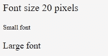

#### Text

现在通过 css 文本属性可以将文本转换为不同的颜色、样式和缩进。这些，文本属性包括：

*   `Text color`：更改文本颜色。
*   `Text alignment`：指定文本的水平或垂直对齐。
*   `Text decoration`：文本装饰的轮廓。
*   `Text transformation`：控制文本的大小写。
*   `Text indentation`：指定第一行的缩进。
*   `Letter spacing`：增加或减少单词之间的间距。
*   `Line height`：指定行高。
*   `Text direction`：设置书方向。
*   `Word spacing`：设置单词之间的空间。
*   `Text shadow`：在文本上添加阴影效果。

css 文本属性的语法：

```css
Text color:
Body {
color: red;
}
Text alignment:
H1 {
text-align: center;
}
H2 {
text-align: left;
}
H3 {
text-align: right;
}
Text decoration
H1 {
text-decoration: underline/through;
}
Text transformation
P.uppercase {
text-transform: uppercase;
}
P.lowercase {
text-transform: lowercase;
}
P.capitalize {
text-transform: capitalize;
}
Text indentation
P {
text-indent: 100px;
}
Letter spacing
H1 {
letter-spacing: 3px;
}
H2 {
letter-spacing: -3px;
}
Line height
P.small {
line-height: 0.6;
}
P.big {
line-height: 1.6;
}
Text direction
P {
direction: rtl;
}
Text shadow
H1 {
text-shadow: 4px 3px green;
}
Word spacing
H1 {
word-spacing: 10px;
}
```

### 链接和外边距

有不同的 css 属性可以处理链接。这些属性包括 `:link`, `:visited`, `:hover` 和 `:active`。实现这些属性的语法定义如下：

```css
:link {color: #000000}
:visited {color: #006600}
:hover {color: #ffcc00}
:active {color: #ff00cc}
```

#### 表格

用于设计 html 表格的 css 属性有：

*   `border collapse`
*   `border spacing`
*   Caption side
*   Empty cells
*   Table layout

使用 css 创建简单表格的语法：

```html
<html>
<body>
<table class="table" border="1">
<tr>
<th>first name</th>
<th>last name</th>
<th>marks</th>
</tr>
<tr>
<td>john</td>
<td>harry</td>
<td>40</td>
</tr>
</table>
</body>
</html>
```

输出：


#### Border collapse（边框折叠）

```html
<html>
<head>
<style type="text/css">
table.one {border-collapse:collapse;}
table.two {border-collapse:separate;}
td.a {
border-style:dotted;
border-width:3px;
border-color:#000000;
padding: 10px;
}
td.b {
border-style:solid;
border-width:3px;
border-color:#333333;
padding:10px;
}
</style>
</head>
```

#### Border spacing（边框间距）

```html
<html>
<head>
<style type="text/css">
table.one {
border-collapse: separate;
width :400px;
border-spacing:10px;
}
table.two {
border-collapse: separate;
width :400px;
border-spacing:10px 50px;
}
</style>
</head>
<body>
<table class="one" border="1">
<caption> separate border table with border-spacing </caption>
<tr><td>a</td></tr>
<tr><td>b</td></tr>
</table>
</body>
</html>
```


CSS 中使用了两种类型的列表，称为有序列表和无序列表。在有序列表中，所有的列表项都用序列数字或字母标记，而在无序列表中，列表项通常用项目符号标记。列表的值可以通过使用 `circle`、`decimal`、`lower-roman`、`upper-roman`、`decimal-leading-zeros`、`lower-alpha`、`upper-alpha` 和 `square` 等值来创建。

例如：

```html
<html>
<head>
<style>
ul.a {
  list-style-type:square;
}
ol.c {
  list-style-type:lower-alpha;
}
</style>
</head>
<body>
  <h2>CSS 有序列表与无序列表</h2>
  <p>无序列表</p>
  <ul class="a">
    <li>one,</li>
    <li>two</li>
    <li>three,</li>
  </ul>
  <ul class="b">
    <li>one,</li>
    <li>two</li>
    <li>three,</li>
  </ul>
  <p>有序列表</p>
  <ol class="c">
    <li>one,</li>
    <li>two</li>
    <li>three,</li>
  </ol>
  <ol class="d">
    <li>one,</li>
    <li>two</li>
    <li>three,</li>
  </ol>
</body>
</html>
```

输出：

CSS 有序列表与无序列表
无序列表
● one,
● two
● three,
● one,
● two
● three,
有序列表
A. one,
B. two
C. three,
1. one,
2. two
3. three,

### 图标
通过使用 HTML 的图标库，我们也可以通过 CSS 添加不同类型的图标。这些图标包括 Font Awesome 图标、Bootstrap 图标和 Google 图标。

Font Awesome 图标语法：
```html
<link rel="stylesheet" href="https://cdnjs.cloudflare.com/ajax/libs/font-awesome/4.7.0/css/font-awesome.min.css">
```

Bootstrap 图标语法：
```html
<link rel="stylesheet" href="https://maxcdn.bootstrapcdn.com/bootstrap/3.3.7/css/bootstrap.min.css">
```

Google 图标语法：
```html
<link rel="stylesheet" href="https://fonts.googleapis.com/icon?Family=material+icons">
```

示例：

```html
<!DOCTYPE html>
<html>
<head>
<link rel="stylesheet" href="https://cdnjs.cloudflare.com/ajax/libs/font-awesome/4.7.0/css/font-awesome.min.css">
</head>
<body>
  <h1>css icons</h1>
  <i class="fa fa-cloud" style="font-size:32px;"></i>
  <i class="fa fa-heart" style="font-size:32px;"></i>
  <i class="fa fa-file" style="font-size:32px;"></i>
  <i class="fa fa-car" style="font-size:32px;"></i>
  <i class="fa fa-bars" style="font-size:32px;"></i>
</body>
</html>
```
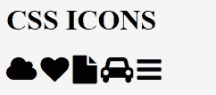

### 下拉菜单
我们也可以通过 CSS 创建下拉菜单。由于与 HTML 元素相同，下拉菜单由一个无序列表和嵌套列表组成。列表用于创建下拉结构。例如：

```html
<html>
<head>
<title>dropdown css</title>
</head>
<body>
  <nav>
    <ul>
      <li class="level-1">
        <a href="">list
        <ul>
          <li><a href="">page 1</a></li>>
          <li><a href="">page 2</a></li>>
          <li><a href="">page 3</a></li>>
          <li><a href="">page 4</a></li>>
        </ul>
      </li>
    </ul>
  </nav>
</body>
</html>
```

输出：
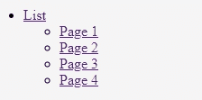

### 层与可见性

#### 层
通过 CSS，我们可以通过实现 `z-index` CSS 属性来创建各种区域的多个层。例如：

```html
<html>
<head></head>
<body>
  <div style="background-color:blue; width:300px; height:100px; position:relative; top:10px; left:80px; z-index:2"></div>
  <div style="background-color:red; width:300px; height:100px; position:relative; top:-60px; left:35px; z-index:1;"></div>
  <div style="background-color:black; width:300px; height:100px; position:relative; top:-20px; left:120px; z-index:3;"></div>
</body>
</html>
```
输出：
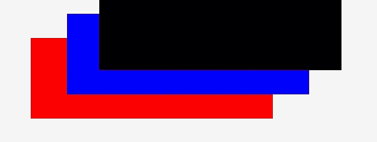

#### 可见性
CSS 中的 `visibility` 属性允许我们隐藏元素。`visibility` 有预定义值，包括 `visible` 和 `hidden`。实现如下：

```html
<p>visible</p>
<p style="visibility:hidden;">hidden</p>
```

### 布局与动画

#### 布局
通过 CSS，我们可以通过 `display` 属性来实现网页的布局。实现 CSS 布局的方法包括 `normal flow`、`grid`、`floats`、`table layout`。

#### 动画
CSS 动画允许元素从一种样式变为另一种样式，为此我们需要指定一些关键帧。例如：

```css
@keyframes sample {
  from {background-color:blue;}
  to {background-color:brown;}
}
/* 应用动画到 */
div {
  width:100px;
  height:100px;
  background-color:blue;
  animation-name:sample;
  animation-duration:4s;
}
```

#### 如何有效使用 CSS
其他 CSS 属性和元素可以提高网页的图形和吸引力。虽然学习和实现所有 CSS 属性非常关键，使用良好的编辑器会有帮助。编写 CSS 时，您还应该避免使用内联代码，并将样式或属性放在外部样式表中。检查您的代码在 Chrome 和 Safari 等最新浏览器中是否运行是一个好主意，这样可以确保网页的显示和格式。CSS 代码还可以作为其他项目的模板，您可以将旧代码复到新项目中。多个类也可以通过间距分离来实现，我们可以从 CSS 继承中获益。

## 第十章：编程基础

### 选择编程语言
由于我们已经详细讨论了所有主要的编程语言及其语法，初学者可以选择一种最容易学习和实现的语言。虽然大多数主流语言如 `C`、`C++` 和 `Java` 的语法相似，但在编写程序时需要关注几个重要方面。`C` 和 `C++` 是初学者开发应用程序的最佳选择，因为它们提供了深入的理解和清晰的概念。对于开发网络插件、桌面应用程序或移动应用程序，可以考虑 `Java` 语言，因为它提供了完整的支持和功能。`HTML`、`CSS` 和 `PHP` 是网站开发的核心语言，初学者很容易学会。作为程序员，不要局限于单一语言，尝试最新的技术和实现。

多种计算机编程语言可以解决特定问题。为了让事情变得简单，初学者可以根据自己的技能选择最合适且易于实现的编程语言。编程取决于其他因素，如应用程序的可用性、安全性、兼容性和响应时间。

高效编程技巧


# 编程技巧

虽然编写易于理解的代码并满足程序需求是计算机编程的主要部分，但仍有一些基本的技巧和方法可以提高程序员的效率。从最关键的考虑点开始，程序员应该避免向函数传递长参数列表，并尽量尝试使用 `int` 指针或 `void` 函数类型。此外，不要将 `chars` 转换为其他数据类型，因为 `char` 变量可以位于内存的任何位置。

此外，全局变量绝不能用一个小型函数进行初始化，并尽量减少对浮点数进行数学运算的使用。这将缩短执行时间并消耗更少的内存。当代码达到数千行时，全局变量和循环会使程序员难以处理应用程序，且微小的变动都会导致巨大的问题。

在方法或函数内部编写 `switch case` 语句、循环和 `try-catch` 是一种理想的方法。记住，方法也应该写在 `class` 和函数定义内部。此外，使用合适的结构来构建应用程序是一个很好的方法，这也能提高编码规范。

最后但同样重要的是，还可以考虑版本控制软件来提高应用程序性能并发布更新。虽然这是专业程序员使用的方法，但对于学者来说，`mercurial` 或 `git` 等工具也容易学习和使用。

在编写代码时，避免深层嵌套并限制行长度，因为这会使代码难以阅读。

## 增强你的基础技能

为了成为一名优秀的程序员，必须意识到计算机编程中所有关键和主要的概念。了解算法和数据结构的基础知识是提高解决问题能力的极佳方法。此外，编写单元测试是另一种提升思维和编码能力的方法。在完成编码后，建议进行深度的代码审查，并发现任何错误或待改进之处。作为回报，这项活动也将提高应用程序的性能和效率。

代码必须始终简单且有意义。通过使用适当的命名规范，你可以毫不费力地替换变量或方法。记住，为你的应用程序创建一个特定的文件夹和文件可以带来巨大的收益，你可以轻松地进行维护和调试。学习编程基础是培养强大的开发和分析能力的关键方面。

此外，尝试通过解决编程练习题和编写简单的代码来实练你的编码技能。这不仅会提升你的编程水平，你还能开发出高效有效的新解决方案。花时间学习编程基础也更容易适应最新的技术并学习新的编程方法。通过学习和实现新的方法、函数和方案，可以让编程变得有趣。

## 结论

《零基础学编程》（coding for absolute beginners）的设计初编写初旨在为初学者提供计算机编程的有价值的知识、信息和原则。本书彻底涵盖了主要的编程语言，并提供了实现给定概念和发现的指南。

编写计算机代码需要开发者遵循预定义的语法和流程。根据项目需求，可以选择一种易于实现的语言，并关注现有的工具和技术。计算机编程由多个任务组成，包括编写源代码、测试、系统实现、方法论、调试和功能实现。

在读完这本书后，我确定新手程序员可以培养强大的分析和思维能力，并对每种语言的给定概念有深入的理解。本书是在大量的研究和事实调查后编写的，以便向读者传递正确的信息和语法。

我希望宝贵的读者们通过阅读本手册的章节，能够学习、适应并实施计算机编程技术，并培养敏锐的编码技能。《零基础学编程》以简单易懂的方式，涵盖了每种编程语言的所有主要和次要解释。

