# 编程精通：C# 初学者及进阶指南，通往 C# 及其他领域的逐步进阶之路 - Python、Java、SQL 等


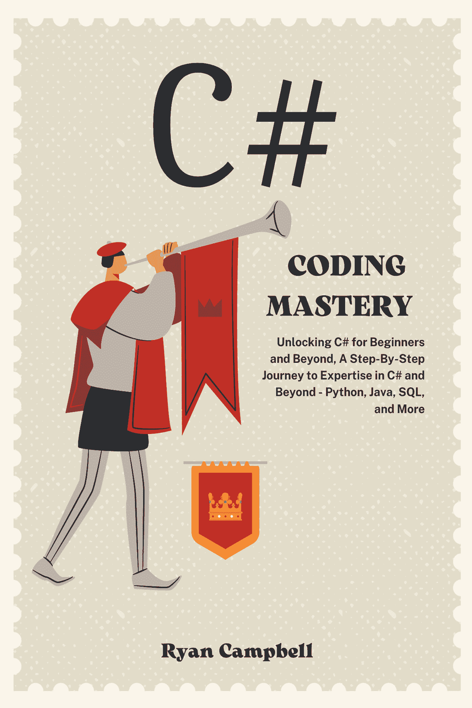


# 第一部分：奠基础

## 编程精通导论

### 欢迎开启卓越之旅

亲爱的读者：

允许我热烈欢迎你来到令人兴奋的编程世界，这段旅程将释放你智慧与创造力的无限潜力。我不只是你的导师，更是你路上的探险伙伴，我们将共同开启一场蜕变的奥德。

编程，朋友，它不仅仅是一项技能，更是一把开启未知疆的钥匙，让你拥有塑造数字世界、创造智能软件以及解决复杂挑战的力量。你决定涉足这一领域，证明了你对知识的好奇与渴望。

当我们开始这段非凡之旅时，请想象自己是一个驶向浩瀚大海的勇敢冒险家。地平线无边无，你编写的每一行代码都在塑造未来。这本书是你的指南，而我是你的导航员。我们将共同穿过编程语言的迷宫，破解算法的密码，并驾驭逻辑的力量。

所以，亲爱的探险家，请系好安全带，磨炼思维，准备好迎接一场深入编程核心的心灵之旅。这个世界正等着你通过代码的魔法赋予它生命。

出发吧。你编程专家的使命正召唤着你。

期待着，

Ryan Campbell

### 了解编程图景

在掌握编程艺术的道路上，至关重要的是从理解我们将脚踏之地开始。正如建筑师在为宏伟建筑奠基础之前勘察地形一样，我们也必须审视复杂的编程图景。


# 引言

将这片景观想象为一个广阔、不断演变的领域，充满了机会、语言和技术。在这里，抽象变得具象，思想转化为数字现实，创新永无边界。

在本章中，我们将迈向这片迷人领土迈出第一步，你将发现：

*   **编程的织锦**：我们将揭开复杂的编程语言网络，每种语言都有其独特的特性和应用。从无处不在的 `C#` 到全能的 `Python`，再到不可战胜的 `Java`，你将领略到触手可及的丰富编程织锦。
*   **算法的力量**：算法是数字世界的建筑师。你将洞察算法如何塑造从搜索引擎到社交媒体的一切事物，并体会到它们对我们生活产生的深远影响。
*   **作为解决问题艺术的编程**：编程不仅仅是输入几行代码；它是一种艺术形式，是解决现实问题的方法。我们将探索编程如何应用于医学、太空探索和艺术等迥不同的领域。
*   **程序员的美德**：当我们穿过这片编程景观时，你将理解定义一个熟练程序员的品质。耐心、坚持和创造力只是在这段旅程中让你受益匪浅的少数美德。

将本章视为你的指南针，帮助你导航广阔的编程领域。在本章结束时，你将对未来有更清晰的视野，并掌握征服这片复杂且富有回报的景观所需的所需的工具。

当我们进一步进入编程精通的领域时，请始终记住，你写的每一行代码都是创新画布上的一个笔触，向实现你的数字梦想更近了一步。所以，我的探险伙伴们，让我们继续进入编程的核心之旅吧，那里的可能性就像你的想象力一样无限。

# 开始学习 C#

## 为什么选择 C#？语言的选择

在编程语言的宏大交响乐中，`C#` 是一位大师——一种同时兼具优雅与力量的语言。当你开启编程之旅时，你可能会好奇为什么我们选择 `C#` 作为你的首选乐器。请让我为你揭示这一选择的和谐之处。

`C#` - 指挥家的选择：将 `C#` 想象成指挥家的指挥棒，精准而优雅地指挥着你代码的弦响团。它诞生于微软的圣殿，被设计成是多功能、高效且易于使用的。但我们为什么为这段旅程选择 `C#` 呢？原因如下：

*   **人气与需求**：`C#` 在编程世界屹立不倒，深受从游戏到企业软件等各行业的青睐。学习它能让你具备高需求的技能，为你开启多样化职业机会的大门。
*   **社区与支持**：每种伟大的语言背后都有一个充满活力的社区。`C#` 拥有全球开发者网络，他们分享知识、解决问题并创造创新生态系统。
*   **易于学习**：当你进入未知领域时，`C#` 是一个温和的引导。它的语法清晰且易于理解，是初学者的绝佳选择。你会发现自己比预期更快地写出有意义的代码。
*   **跨平台能力**：`C#` 越了边界。随着 `.NET Core` 和 `.NET 5+` 的出现，你可以编写在 Windows、macOS 和 Linux 上无缝运行 `C#` 代码。你的创作不受操作系统的限制。
*   **多功能性与应用**：无论你渴望构建桌面应用、Web 服务还是游戏，`C#` 都能适应你的抱负。它是一种在各种环境中茁发展的语言，从用于游戏开发的 `Unity` 到用于 Web 应用的 `ASP.NET`。

当我们深入探索 `C#` 的世界时，你将欣赏它的优雅、力量以及它提供的无限可能。我们将共同编写你的第一几行 `C#` 代码，为这场超越想象边界的冒险铺好舞台。

所以，我亲爱的见习程序员们，请接受 `C#` 成为你这趟航程的可靠伴侣。通过它，你将拥有塑造数字世界的力量，一次一行代码地构建。让我们潜入 `C#` 的深处，发现它为我们留下的宝藏。

# 设置你的编程环境

在我们开启 `C#` 编程之旅之前，我们必须准备好工作空间——即我们思想将变为生命的数字画布。将其想象为在创作杰作之前布置艺术工作室。在本章中，我们将引导你完成设置编程环境的过程。

数字游乐场：你的编程环境是你的数字游乐场，让它变得舒适、高效且利于创意至关重要。我们将涵盖以下内容：

*   **选择合适的 IDE**：集成开发环境（IDE）是你的指挥中心。我们将探索流行的 IDE，如 `Visual Studio` 和 `Visual Studio Code`，帮助你选择适合你的一个。
*   **安装 C#**：正如画家需要最精良的画笔一样，程序员需要正确的工具。我们将引导你完成 `C#` 及相关工具的安装，确保你所需的一切触手可及。
*   **配置你的工作空间**：个性化是关键。我们将深入研究让你的编程环境独一无二的设置和配置，从主题和配色到键盘快捷键。
*   **Hello, World!**：进入工作空间最好的方法是编写你的第一个 `C#` 程序。我们将引导你创建并运行传统的“Hello, World!”程序，让你体验看到自己代码运行的喜悦。

拥抱这段旅程：在你设置编程环境时，请记住这不仅仅关于工具和设置；更关乎创建一个让你的思想蓬勃成的空间。你的编程环境将是你花费无数小时进行探索、实验和构建的地方。

在接下来的章节中，我们将深入研究 `C#` 的世界，揭示它的语法、逻辑和无限可能。但现在，让我们准备好画布，削好数字铅笔，迈向 `C#` 编程领域的第一个令人兴奋的步骤。

所以，我亲爱的见习程序员们，让我们在编程环境准备就绪的情况下开启这段旅程。前前的冒险是无限的，而你的工作空间正是魔法开始的地方。

# C# 编程基础

## 你的第一个 "Hello World" 程序

在编程的宏大织锦中，每一段旅程都始于一步，一个谦逊的“Hello World”。本章是你进入 `C#` 编程世界的垫脚石。我们将揭开基础，解码语法，并让你走上一条道路，在那里，你写的每一行代码都是创新画布上的一个笔触。

你准备好迈出这令人兴奋的第一步了吗？太极了！让我们进入 `C#` 的基础。

序言：为什么是 "Hello World"?

在我们深入代码之前，你可能会好奇我们为什么从“Hello World”开始。它就像交响乐的开篇——对语言语法和结构的简单介绍。它确保了你的环境设置正确，并且你准备好创建更复杂的程序。

## C# 乐场：你的 IDE

正如任何艺术家都需要画布一样，编程需要一个集成开发环境（IDE）。对于我们的 `C#` 之旅，我们推荐使用 `Visual Studio` 或 `Visual Studio Code`。这些 IDE 提供了丰富的工具让你的编程体验变得无缝。

让我们从设置你的 IDE 开始：

第一步：下载与安装

1. 访问 `Visual Studio` 网站 ([`visualstudio.microsoft.com/`](https://visualstudio.microsoft.com/))。
2. 下载适用于你操作系统的版本（Windows 或 macOS）。
3. 程序并按照屏幕提示操作。

如果你更倾向于 `Visual Studio Code`：

1. 访问 `Visual Studio Code` 网站 ([`code.visualstudio.com/`](https://code.visualstudio.com/))。


2. 下载适用于你操作系统的版本。

3. 运行安装程序并按照设置向导操作。

## 第 2 ：启动你的 IDE

安装完成后，启动你选择的 IDE。你将看到一个欢迎界面，准备好开启你的编程之旅。

## 让我们来写些代码吧：你的第一个“Hello World”程序

当你的 IDE 运行后，是时候编写你的首个 C# 程序了。我们将保持简单，从经典的“Hello World”开始。

### 代码部分

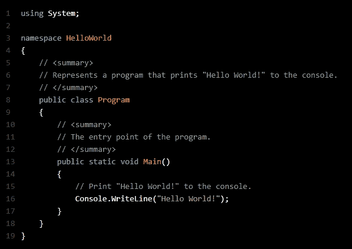

### 解读这段交响乐

*   `using System;`: 这一行告诉编译器包含 `System` 命名空间，该空间包含了输入和输出的必需类。
*   `class Program`: 在 C# 中，一切内容都组织在类中。我们定义了一个名为 `Program` 的类来包含我们的代码。
*   `static void Main()`: 每一个 C# 程序都从 `Main` 方法开始执行。这一行声明了一个名为 `Main` 的静态方法。
*   `Console.WriteLine("Hello World!");`: 这里就是魔法发生的地方。我们使用 `Console.WriteLine` 方法在控制台上显示“Hello World!”。

## 让我们执行

1. 将你的代码保存为扩展名为 `.cs` 的文件。你可以随心命名，但在本示例中我们命名为 `HelloWorld.cs`。
2. 打开你的终端或命令提示符。
3. 导航到保存 `HelloWorld.cs` 的目录。
4. 输入 `csc HelloWorld.cs` 并按回车编译代码。这将生成一个可执行文件 (`HelloWorld.exe`)。
5. 输入 `HelloWorld`（不带 `.exe` 扩展）并按回车运行你的程序。

漂亮！你刚刚执行了第一个 C# 程序，“Hello World!”应该会在控制台上向你问好。

## 调试的艺术

作为一名程序员，你也是一名调查员。当事情出错时，调试就是你的放大镜。如果你遇到问题，请记住这些调试基础知识：

*   阅读错误信息：错误信息是你的朋友。
*   检查语法：语法错误很常见。确保你的代码符合正确的 C# 语法。
*   拆解问题：分而治之。如果你的代码很长，请将其拆分成较小的部分并单独测试。
*   使用注释：注释是你写给自己和其他人的笔记。它们能阐明代码的意图。
*   在线资源：当你卡住时，在线论坛和文档是无价的资源。

恭喜你！你已经开启了 C# 编程之旅。你的第一个“Hello World”程序证明你正正确地通往掌握这一强大语言的道路。在接下来的章节中，我们将深入探讨 C#，探索变量、数据类型以及使你能够创建日益复杂且有趣的程序的逻辑。

## 变量的本质

将变量想象成一个带标签的盒子，你可以在其中存储各种类型的信息。这些信息可以是数字、文本到复杂结构的任何内容。变量允许你在程序执行过程中保留、修改和检索数据。

在 C# 中，在使用变量之前必须对其进行声明。

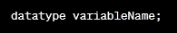

*   `datatype`: 这指定了变量将持的数据类型。它可以是整数的 `int`、文本的 `string`、布尔值的 `bool` 等。
*   `variableName`: 为你的变量选择一个有意义的名称。这有助于你和他人理解变量的。

让我们声明几个变量：

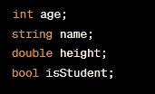

现在，这些变量每一个都可以存储特定类型的数据：`age` 可以存储整数，`name` 可以存储文本，`height` 可以存储小数，而 `isStudent` 可以存储真或假值。

### 为变量赋值

声明变量只是第一步；你还需要为它们赋值。

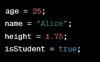

现在，我们的变量已经关联了具有实际意义的数据。

### 数据类型

C# 支持多种数据类型，每种类型都为特定类型的信息而设计。以下是一些常见的数据类型：

*   `int`: 代表整数（全数字），例如 `42`、`-10`。
*   `double`: 代表浮点数（小数），例如 `3.14`、`-0.001`。
*   `string`: 代表文本，例如 "Hello, World!"。
*   `DateTime`: 代表日期和时间。

## 运算符：转换的工具

它们允许你操作和比较数据，使你的程序变得动态且响应迅速。以下是 C# 中常见的运算符：

*   算术运算符：用于数学计算。
    *   `+` (加法),`-` (减法),`*` (乘法),`/` (除法),`%` (取模)。
*   比较运算符：用于比较值。
    *   `==` (等于),`!=` (不等于),`<` (小于),`>` (大于), `<=` (小于等于), `>=` (大于等于)。
*   逻辑运算符：用于逻辑操作。
    *   `&&` (逻辑与),`||` (逻辑或),`!` (逻辑非)。
*   赋值运算符：用于赋值。
    *   `++` (自增),`--` (自减)。

### 整合在一起

让我们通过一个简单的示例探索变量、数据类型和运算符是如何协同工作的：

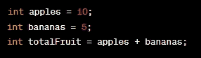

在这个示例中，我们声明了三个变量：`apples` 和 `bananas` 用于存储数量，`totalFruit` 用于计算总和。`+` 运算符执行加法，结果存储在 `totalFruit` 中。

当你继续你的 C# 编程之旅时，掌握变量、数据类型和运算符将使你能够创建动态且功能强大的应用程序。


随着你深入 C# 编程的旅程，掌握控制流和决策将使你能够创建出多功能且响应迅速的应用程序。在接下来的章节中，我们将探索更复杂的逻辑，并深入研究函数和面向对象编程，在你的编码冒险中开启更大的可能性。继续编写代码，继续实验，让你的创造力通过控制流的艺术绽放。

在编程的复杂世界里，一行行文本变成了可运行的软件，你的代码质量决定了程序是流畅高效，还是一个混乱且纠缠在一起的网。整洁且易读的代码是熟练程序员的标志，这首项将新手与大师区分开来的技能。

## 整洁代码的艺术

整洁的代码不仅仅是视觉上的美；它是你编程理念的反映。整洁的代码是易读、可维护且易于理解的。它遵循一致的规范和最佳实践，使其不仅让你能够理解，也让与你项目合作的其他开发者能够轻松上手。

### 可读性至关重要

可读性的代码是你给未来的自己以及同事的礼物。它减少了破译你意图的时间，并最大限度地增加了用于创新和解决问题等有意义任务的时间。它就像写一篇结构良好、标题和段落清晰的文章——内容流动顺畅，读者可以毫不费力地理解你的信息。

### 简单是一种美德

阿尔伯特·爱因斯坦曾说：“一切都应该尽可能地简单，但不能过于简单。”这一原则同样适用于编码。简单是一种美德，因为它减少了复杂性并降低了错误的潜在概率。简单的代码更容易测试、调试和维护。

## 整洁代码的原则

整洁代码遵循几项关键原则和实践，这些原则有助于其清晰度和有效性：

1. **有意义的命名**：变量和函数名称应该是描述性的，能够传达它们的用途和意图。
2. **一致的格式**：在整个项目中采用一致的编码风格。一致性增强了代码的可读性。
3. **有目的的注释**：注释应该解释你*为什么*要这样做，而不仅仅是在做什么。谨慎使用注释，并专注于传达代码背后的意图。
4. **模块化**：将你的代码拆分为小的、易管理的模块或函数。每个模块都应该有清晰且单一的职责。这促进了重用性和可维护性。
5. **避免魔术数字**：用具有有意义名称的常量或变量替换魔术数字（代码中未解释的数值值）。这使你的代码具有自留文档性。
6. **DRY 原则（不要重复自己）**：消除代码重复。如果你发现自己在多个地方编写相同的代码，请将其重构为一个可重用的函数或类。
7. **KISS 原则（保持简单，愚蠢也懂）**：在你的代码中追求简单。避免不必要的复杂和复杂的解决方案。
8. **测试与可测试性**：编写单元测试来验证代码的功能。易于测试的代码通常更模块化、组织更好。
9. **版本控制**：使用 `Git` 等版本控制系统来跟踪代码库的更改。这允许你与他人协作并维护你的工作历史。
10. **持续重构**：代码不是静态的；它在不断演变。定期回顾并重构你的代码，以提高其结构和可读性。不要满足于“足够好”。

### 整洁代码示例

让我们用一个简单的 C# 函数来阐明整洁代码原则。考虑一个计算给定数字阶乘的函数：

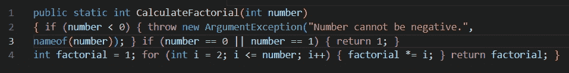

在这个示例中：

* **有意义的命名**：变量和参数名称清晰且有意义。异常消息为错误提供了上下文。
* **一致的格式**：代码遵循一致的缩进和括号位置。
* **有目的的注释**：注释解释了代码块的作用，例如处理负数和计算阶乘。
* **模块化**：计算阶乘的逻辑封装在一个单一函数中。
* **避免魔术数字**：使用常量来表示 `0` 和 `1` 等特殊值。
* **KISS 原则**：代码使用简单的循环来计算阶乘，避免了不必要的复杂。
* **测试与可测试性**：此函数可以使用不同的输入进行测试，以确保其正确性。

这个示例展示了如何将整洁代码原则应用于即使是很小的函数，从而增强其可读性和维护性。

## 整洁代码的好处

编写整洁且易读的代码有许多益处：

1. **增强协作**：整洁的代码更容易让他人（以及未来的自己）理解，促进了协作并降低了新团队成员的学习曲线。
2. **减少 Bug**：清晰、简单的代码不容易出错。当你的代码很整洁时，调试会更高效。
3. **改进维护性**：整洁的代码更容易维护和更新。它可以随着时间的推移优雅进化，而不会积累技术债。
4. **更快的开发**：阅读和理解整洁的代码更快，允许你更快速地开发和迭代。
5. **代码质量**：整洁的代码反映了专业精神和质量的承诺，这可以带来更好的软件产品。

## 编写整洁代码的策略

为了持续产生整洁的代码，请考虑以下策略：

1. **代码审查**：鼓励团队内部进行代码审查。
2. **重构**：将重构成为开发过程的常规部分。留出时间改进现有代码。
3. **编码规范**：为你的项目或组织建立编码标准和风格指南。坚持遵守它们。
4. **持续学习**：保持对所选语言的最佳实践和编码标准的更新。
5. **自动化工具**：使用代码分析和格式化工具来强制执行编码标准。
6. **实践**：像任何技能一样，编写整洁的代码会随着练习而提高。在你的项目中不断追求更整洁的代码。

## 结论：工艺的艺术

编写整洁且易读的代码不仅仅是一项技术技能；它是一种艺术形式。它是一个对工作感到自豪并追求卓越的编程工匠的标志。当你继续 C# 编程及其他领域的旅程时，请记住，整洁代码不仅仅是一个目标——它是一种思考方式，是一种对工艺的承诺。


- `parameters`: 函数执行其任务所需的任何值。参数是可选的。
- `function body`: 括在在大括号 `{}` 之间的代码块，它定义了函数的功能。
- `return result`: 可选的，你可以指定一个返回语句将一个值发送回给调用者。返回类型必须与声明的 `returnType` 匹配。

## 使用函数

一旦你定义了一个函数，就可以通过调用它的名称并提供任何所需的参数（如果函数有参数），在你的代码中使用它。以下是调用函数的方法：

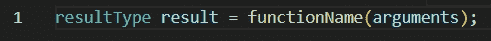

- `resultType`: 你期望函数返回的数据类型。
- `result`: 你用于存储函数返回结果的变量。
- `arguments`: 如果函数有参数，请按照与函数定义中声明相同的顺序提供所需的值。

### 示例：一个简单的计算器函数

让我们创建一个简单的计算器函数，它能将两个数字相加并返回结果：

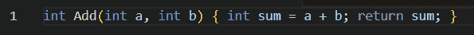

在这个示例中：

- `int`: 函数返回一个整数。
- `Add`: 函数名为 "Add"。
- `(int a, int b)`: 函数接受两个整数参数，`a` 和 `b`。
- 函数计算 `a` 和 `b` 的和并返回它。

使用此函数：

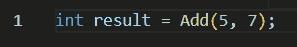

结果将是 12。

#### 空函数 (Void Functions)

并不是所有函数都会返回值。某些函数执行任务但不产生结果。这些被称为“空”（void）函数。这里有一个例子：

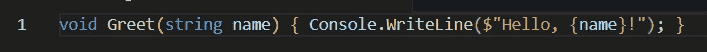

此函数在带有 `name` 参数调用时，将通过在控制台打印 "Hello, [name]!" 来问候对方。

## 函数重载

C# 允许你定义多个具有相同名称但参数列表不同的函数。这被称为“函数重载”。编译器根据提供的参数的数量和类型决定调用哪个函数。

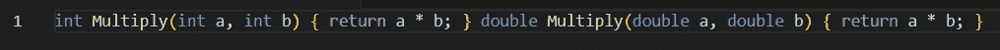

在这个示例中，我们有两个 `Multiply` 函数，一个用于整数，另一个用于双精度浮（double）。编译器将根据参数类型选择合适的一个。

## 递归

函数也可以调用自己，这种技术被称为递归。这允许你通过将复杂问题分解为相同问题的较小实例来解决它们。

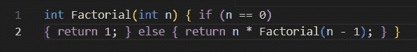

此递归函数通过将 `n` 与 `n-1` 的阶乘相乘来计算数字 `n` 的阶乘，直到达到 `n = 0` 的基础情况。

## 利用函数的力量

函数和方法是 C# 编程的核心。它们允许你分解复杂问题，提高代码重用性，并使程序更有组织、便于维护。当你继续精通 C# 之旅时，记住函数是你创造高效优雅解决方案的盟友。拥抱函数设计的艺术，让你的代码通过它们的模块化精华绽放。

## 参数、返回值和作用

在 C# 编程的复杂舞蹈中，参数、返回值和作用是控制函数如何与外部世界交互的调度师。理解这些概念对于编写执行特定任务、交换信息和保持代码清晰的函数至关重要。

### 参数：提供输入

参数是你的函数与外部世界之间的桥梁。它们允许你将信息传递给函数，使其根据提供的数据执行任务。参数就像食谱中的原料——对于函数产生所需的结果至关重要。

### 声明参数

在 C# 中，你在函数定义的括号内声明参数。

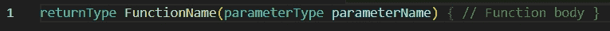

- `returnType`: 指定函数将返回值的类型。
- `FunctionName`: 函数的名称。
- `parameterType`: 参数的数据类型。
- `parameterName`: 你赋予参数的名称。

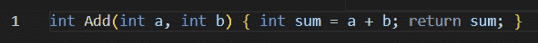

在这个示例中，`a` 和 `b` 是 `int` 类型的参数。

### 使用参数

当你调用函数时，你为其参数提供值，匹配函数定义中指定的顺序和数据类型。这些值通常被称为“参数”。

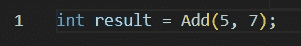

在这里，`5` 和 `7` 是传递给 `Add` 函数的参数，对应它的 `a` 和 `b` 参数。

### 返回值：产生输出

返回值是你的函数呈现给外部世界的礼物。它们允许函数将其结果传回给调用者。返回值就像执行良好任务的结果——一个可以在程序中进一步使用的信息。

### 声明返回值

在 C# 中，你通过在函数定义中指定函数将返回的数据类型来声明返回值。`return` 语句用于将此值发送回给调用者。

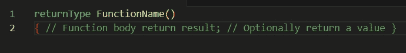

- `returnType`: 指定函数将返回值的类型。
- `FunctionName`: 函数的名称。
- `return result`: 可选的，你可以指定一个返回语句将一个值发送回给调用者。返回值的数据类型必须与声明的 `returnType` 匹配。

### 返回值

一旦执行 `return` 语句，函数就会退出，返回值将发送给调用者。

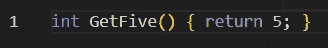

在这里，`GetFive` 函数返回整数 `5`。

### 作用：变量的游乐场

作用定义了变量在代码中的可访问范围。将其想象为游乐场的边界——变量只能在指定的区域内玩。理解作用对于防止意外的变量冲突和确保代码保持组织至关重要。

### 局部作用

在函数内部声明的变量具有“局部作用”。它们仅在该函数内部可访问，并在生命持续持续函数的执行期间。

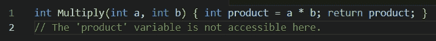

在这个示例中，`product` 是 `Multiply` 函数的局部变量。

### 参数作用

参数也是函数内部的局部变量。它们只存在于函数的作用范围内，并可以像任何局部变量一样被访问。

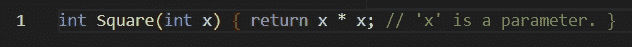

### 块作用

在 C# 中，如果变量是在在大括号 `{}` 内定义的，它们也可以具有“块作用”。

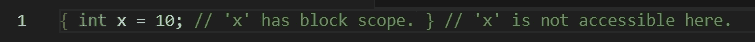

## 掌握函数基础

参数、返回值和作用是 C# 编程的基础概念。它们赋予函数与外部世界交互、交换信息并保持代码结构整洁的能力。

# C# 面向对象编程 (OOP)

在软件开发不断演进的世界中，面向对象编程 (OOP) 是一种改变我们解决问题方法的范式。C# 以其丰富的特性和强大的框架为探索和精通 OOP 提供了极佳的乐场。

## 理解对象和类

开启 C# OOP 之旅，让我们从理解对象和类的基本概念开始。

类可以视为蓝图。将类想象成建筑师的房屋布局。蓝图本身不是房子，但它定义了如何建造房屋。同样，C# 中的类概述了属性（通常称为字段或属性）和行为（方法），而本身并不是实物的实例。

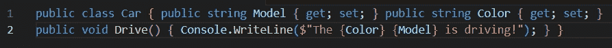

在这里，`Car` 是一个类，具有两个属性（`Model` 和 `Color`）和一个方法（`Drive`）。


对象是类的实例。回到房子的类比，使用蓝图（类），你就可以建造一栋房子（对象）。从类创建对象的过程被称为实例化。

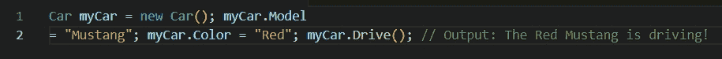

在上面的代码段中，`myCar` 是 `Car` 类的一个对象。它拥有由类定义的属性，我们可以对其进行设置和使用。

# 继承、多态与封装

继承是一种机制，新类可以从现有类继承属性和行为。这促进了代码复用，并建立了一个自然的层次结构。例如，如果你有一个 `Vehicle`（车辆）类，那么 `Car`（汽车）类就可以继承它。

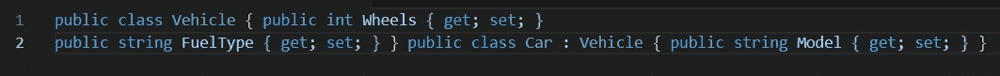

通过继承，`Car` 本质上是一个 `Vehicle`，但它具有额外的属性，比如 `Model`（型号）。

多态源自希腊语，意为“多种形状”。它允许不同类的对象被视为共同父类的对象。

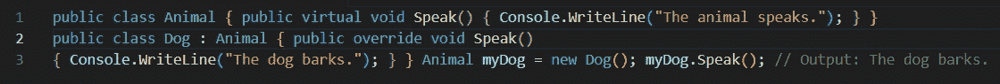

封装通常被描述为将数据（属性）和操作这些数据的方法（函数）封装在一个单一单元或类中。此外，它限制了对对象某些组件的直接访问，这是防止数据意外干扰和误用的一种手段。

使用我们的 `Car` 类，封装确保了某些字段或方法无法被直接访问：

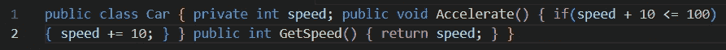

在这里，`speed` 属性被封装在 `Car` 类中。外部类无法直接修改 `speed`，但可以使用 `Accelerate` 方法和 `GetSpeed` 方法与其交互。

总结来说，C# 的面向对象编程（OOP）提供了一种结构化的方法，通过将复杂问题分解为可管理的相互关联的实体来解决问题。通过掌握对象、类、继承、多态和封装，你不仅是在学习用 C# 编码；你还在采用一种思维——一种建模和解决现实问题的结构化方式。因此，无论你是在设计一个大型企业软件还是一个简单的游戏，C# 和 OOP 都能赋予你编写可扩展、灵活且易于维护代码的能力。

这本 C# OOP 入门指南将作为基础，加深你对面向对象概念及其在现实场景中实现的理解和探索。

# C# 高级概念

C# 的美之处在于其深度，它提供了能够迎顾初学者和资深开发者的复杂层次。随着这段旅程的进行，某些高级概念将发挥作用，成为构建稳健且高效的软件解决方案的必不可因素。C# 中两个这样的关键概念是异常处理以及委托、事件和 Lambda 表达式三者。

## 异常处理

在现实世界中，意外总会发生。同样，在编程领域，事情并不总是如计划进行。C# 中的异常处理提供了一种结构化的方式来捕并处理运行时异常，确保你的应用程序能够优雅地失败并适当通知用户。

Try-Catch 块是异常处理的核心。

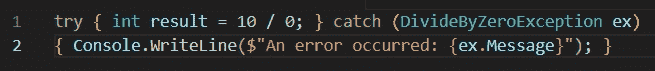

在这个示例中，尝试除以零会触发 `DivideByZeroException`。`catch` 块捕获此异常并打印错误信息。

`Finally` 是一个可选块，在 `try` 和 `catch` 之后执行，无论是否抛出了异常。它通常用于清理任务。

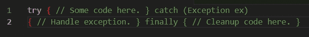

## 委托、事件和 Lambda 表达式

C# 中的委托是一种类型，它可以安全地封装具有特定参数集和返回类型的方法。可以将它们想象成 C 或 C++ 中的函数指针，但它是类型安全的。

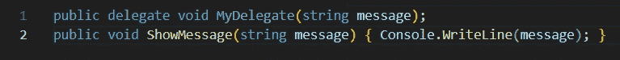

现在，`MyDelegate` 的实例可以指向任何匹配其签的函数：

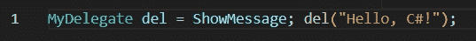

事件是对象之间通信的机制。它是对象向（系统中所有感兴趣的组件）广播某些已发生的方法。事件在后台使用委托。

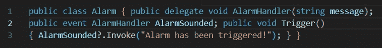

订阅者现在可以监听 `AlarmSounded` 事件：

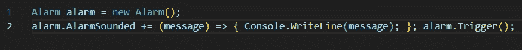

它们在 LINQ 查询中常见。

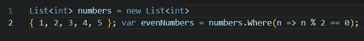

在这里，`n => n % 2 == 0` 是一个过滤掉偶数的 Lambda 表达式。

总结来说，高级 C# 概念如异常处理以及委托、事件和 Lambda 表达式的结合，虽然初看起来令人生畏，但它们是该语言的基础。它们不仅提升了代码质量，还为更复杂、动态的功能铺平了道路。接受这些概念是开发者从中级向高级进的标志，打造出既稳健又优雅的解决方案。

# 第三部分：超越 C#

## 探索 Python

想象这样一个世界：你的编码能力不仅限于一种领域，而是可以跨越各种语言的广阔区域。虽然 C# 是开发者工具箱中的一种强大工具，但有时你面临的战斗需要不同的策略。引入 Python —— 一种简单、多功能且具有无限可能的语言。

## Python 简介介绍

如果将 C# 比作一座宏伟的城堡——结构严谨、防御森固且宏大——那么 Python 就是环绕着它的广阔迷人的森林。它是流动的、直观的，充满了等待发现的奇迹。

**Python 语法**：你对 Python 注意到的第一点（特别是对于有 C# 背景的人）是其纯粹的简单。

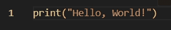

就是这些。没有分号，没有大括号，没有 `static void main`。一切非常直观。Python 中的缩进不仅仅是为了美观——它定义了范围，就像 C# 中的大括号一样。

**Python 的多功能性**：从使用 `Django` 进行 Web 开发，到使用 `pandas`、`numpy` 和 `TensorFlow` 进行数据科学和机器学习——Python 的生态系统极其丰富。

**Python 在当今编码世界中的角色**

Python 不仅仅是一种语言；它是一场运动。它过去十年的增长可以归于它在某些突破性领域的角色。

**数据科学和机器学习**：Python 的库（如用于数据处理的 `pandas` 和用于机器学习的 `scikit-learn`）使其成为数据爱好者的首选。想预测股市趋势或为用户推荐电影？Python 处于这些创新的沿。

**Web 开发**：通过 `Django` 和 `Flask` 等框架，构建 Web 应用非常容易。这些框架遵循“不要重复自己”（DRY）原则，促进代码复用。

**自动化和脚本**：开发者经常发现自己在重复机械任务。Python 凭借其简单性和大量的库，擅长此类自动化，让生活变得简单。

**教育和新手友好**：由于其语法的可读性，Python 通常是编程训练营和大学教授的第一门语言。它为新手提供了温和的概念介绍，而不会让语法复杂性 overwhelming。

**与 C# 集成**：如果你认为必须放弃学习 C# 所付出的所有努力，那就大错了！`IronPython` 等工具允许 Python 和 C# 的集成。这意味着你可以同时拥有这两者的优点，将 C# 的稳健与 Python 的灵活性相结合。

总结来说，虽然 C# 为你提供了一种强大、类型安全且面向对象的方法，但 Python 提供了探索结构化编程之外领域的的翅膀。这就像是进入了一个新世界，那里的规则略有不同，但发现的快感同样强烈，甚至更强烈。当你进入 Python 世界时，请记住：它不是为了取代 C#，而是为了补充它。在广阔的编码宇宙中，每一颗星都有容身之地，而现在，你闪耀得更加倍增。


通过在 C# 中学习 Python，你不仅是在自己的技能库中增加了另一种语言；你还在开启通往可能遥不可及的领域和机会的大门。所以，准备好深挖、探索，让 Python 用它丰富的功能令你着迷吧！

# 灵活多样的 Java

Java —— 一个与稳定性、多功能以及“一次编写，随运行”（Write Once, Run Anywhere）承诺同义的名字。当我们穿过编程语言领域时，Java 像一盏灯塔，照亮了它所呈现的广阔可能性。

## 作为强大语言的 Java

要真正欣赏 Java 的强大，需要深入研究它的起源、独特特性以及几十年来它支持的众多应用。

Java 的诞生：20 世纪 90 年代初，太阳科技（Sun Microsystems）为机顶盒和电视等数字设备构想了一种语言。关键是创建一个平台无关的语言，它可以在无需修改的情况下在许多设备上运行。Java 最初被名为“Oak”，是这一愿景的结果。尽管它最初在预定领域的应用并不广泛，但世界万维网的出现为 Java 提供了完美的乐场，使其成为我们今天所熟知的力量。

平台无关性 —— Java 字节码的魔法：“一次编写，随运行”（WORA）原则不仅是一个响亮的口号，更是 Java 的精髓。这种魔法通过 Java 字节码实现——一种中间、低级指令集。当你编写并编译 Java 代码时，它会被翻译字节码，然后由特定于平台的 Java 虚拟机（`JVM`）解释。这意味着同一个 Java 程序可以在 Windows、Mac 或 Linux 服务器上运行，而无需任何修改。(image_rsrc1ZR.jpg)

这个简单的 Java 程序一旦编译，就变成了平台无关的字节码，等待 `JVM` 在任何设备上运行。

健壮且安全：Java 的设计哲学优先考虑安全性。它的运行时环境具有沙箱机制，使得恶意代码难以损害系统。此外，Java 不使用指针（如 C 或 C++），消除了潜在的漏洞。内存管理通过其垃圾回收器（Garbage Collector）处理，它可以自动删除不需要的对象。

面向对象范式：就像 C# 和 Python 一，Java 是一种面向对象的语言。它相信对象和类的概念，使代码具有可维护性和可重用性。

丰富的标准库：Java 拥有功能完备的标准库，使开发者能够轻松处理数据结构、算法、I/O 操作而无需重复发明轮子。

应用广泛：Java 的灵活性不仅限于理论。它的现实世界应用非常广泛：

*   企业级应用：`Java EE`（企业版）支持了从金融到医疗的许多性能密集型应用。
*   Android 开发：在 `Kotlin` 出现之前，Java 是 Android 开发的主要语言，直到今天，大部分 Android 应用仍用 Java 编写。
*   Web 应用：`Spring Boot` 和 `JSF` 等框架促进了 Java 进行快速应用开发。
*   嵌入式系统：`Java ME`（微版）用于嵌入式系统、IoT 设备和资源限制的环境。

社区与生态系统：Java 的生态系统是其最大的资产之一。开源库、框架和工具丰富了这种语言。`Maven` 和 `Gradle` 用于依赖管理，`Spring` 用于全面的应用程序解决方案，`JDK`（Java 开发 Kit）的持续确保了 Java 的现代且高效。

演进 —— 从 Java 8 开始：Java 并不是建立在功劳上的语言。随着 `Java 8` 及后续版本的发布，该语言引入了函数式编程特性，如 lambda 表达式和流，使其更加强大和灵活。(image_rsrc1ZS.jpg)

此示例展示了流和 lambda 表达式过滤、转换并输出结果的力量——全部以简洁的方式。

总之，Java 的灵活性源于它作为语言的内在力量，以及对适应性和演变的承诺。丰富的库、向前兼容的版本以及不断推动它的社区确保了 Java 在编程史上的地位。

学习 Java 不仅仅是在你的技能中增加另一种语言；更是为了理解几十年来使其成为编程世界基石的原理。当你探索 Java 时，你会发现它结合了两者的优势——静态类型语言的严格结构以及随技术范式演变的灵活性。来到 Java 的世界，灵活性遇见力量。

# 使用 SQL 精通数据库

数据库是数字领域的静静士兵，在其巨大的存储单元中保存着世界的数据。从社交媒体帖子到关键金融交易，数据库让我们的数字世界无缝运行。这些数据库的核心是 `SQL`（结构查询语言），它是与关系型数据库通信的通用语言。精通 `SQL` 类似于掌握与数据对话的艺术。本章将这种精通传授给你。

# 数据库基础与 SQL 语法

数据库的精髓：数据库可以被想象成巨大的数字仓库，成排的数据存储在结构化的架子（表）中。这些数据并不是随机丢弃的。它们经过仔细组织，以便在需要任何数据时都能快速高效地检索。

关系型数据库：在各种类型的数据库中，关系型数据库最为常见。这些数据库将数据组织成表（关系），每个表代表一个唯一的实体。每行代表一条记录，每列代表属性。

SQL —— 数据库语言：结构查询语言或 `SQL` 是与关系型数据库进行通信、操作和检索数据的标准语言。想象数据库是一个巨大的数据海洋，那么 `SQL` 就是精确捕捉你想要的鱼（数据）的鱼竿。

基础 SQL 语法：

1.  `SELECT`：检索数据。(image_rsrc1ZT.jpg)
2.  `INSERT`：添加数据。(image_rsrc1ZU.jpg)
3.  `UPDATE`：修改现有数据。(image_rsrc1ZV.jpg)
4.  `DELETE`：删除数据。
```
DELETE FROM table_name WHERE condition;
```
5.  `CREATE TABLE`：定义新表。(image_rsrc1ZW.jpg)

与任何语言一样，`SQL` 也有细微差别和复杂之处。然而，基础知识通常足以轻松应对大多数数据库任务。

## 在 C# 及其他语言中与数据库交互

与数据库的交互不仅限于通过数据库管理系统使用原始 `SQL` 命令。包括 C# 在内的编程语言提供了无缝与数据库通信的机制，利用底层的 `SQL` 力量。

ADO.NET —— C# 与数据库之间的桥梁：`ADO.NET` 是 .NET 提供的一系列组件，用于访问和操作数据库中的数据。通过 `ADO.NET`，C# 开发者可以执行 `SQL` 命令、检索数据并将其绑定到 UI 控件，这一切都在他们熟悉的 IDE 环境中完成。

建立连接：在进行任何数据操作之前，必须建立数据库的连接。使用 `SqlConnection` 类的典型连接如下：


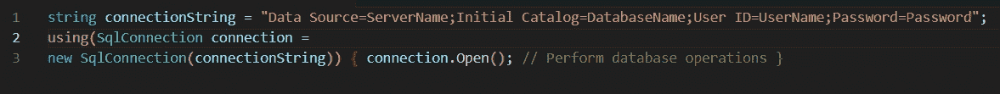

### 获取数据
使用 `SqlCommand` 和 `SqlDataReader` 类，可以获取数据：

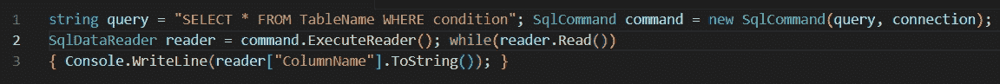

### ORM – 超越原始 SQL
虽然原始 SQL 命令提供了最强大的控制力，但对象关系映射（ORMs），如 `C#` 中的 `Entity Framework`，提供了一个抽象层。通过 `ORMs`，可以像操作 `C#` 中的对象一样与数据库进行交互。这在面向对象的编程范式与数据库的关联型本质之间架起了桥梁。

#### 使用 ORM 的优势：
1. 抽象：大多数任务不需要编写原始 SQL。
2. 可维护性：使用 `C#` 的面向对象特性，使代码更具可读性和模块化。
3. 灵活性：可以以极少的代码更改轻松地在不同的数据库系统之间切换。

然而，尽管 `ORMs` 具有许多优势，但在某些场景下，由于性能考虑或需要更精细的控制，可能原生原始 SQL。

### 超越 C# – SQL 的无处不在
SQL 的强大不仅限于 `C#`。像带有 `JDBC` 的 `Java`、带有 `SQLAlchemy` 的 `Python` 以及其他语言都提供了与数据库交互的方法。这种无处不在再次证实了精通 SQL 的重要性，无论使用什么语言或平台，它都是一项持续的技能。

### 结论
总之，数据库不仅仅是存储机制；它们是应用程序的生命线，为运行提供所需的数据。通过精通 SQL 并理解如何将其与 `C#` 等编程语言集成，你不仅让自己具备了构建健且动态应用程序的能力，还确保了自己在这个数据驱动的世界中保持竞争力。

深入研究 SQL，探索它的语法，理解它的细微之处，很快，你就会发现与数据对话将成为你的本能。

# 数据库基础与 SQL 语法
在不断演变的软件开发世界中，数据库的重要性无论如何都不为过。数据库作为大多数现代应用程序的骨干，实现了数据的存储、检索和操作。本小节探讨了数据库的基本概念，深入介绍了数据库基础和 SQL 语法。此外，它还提供了在 `C#` 编程背景下如何与数据库交互的见解，并扩展到 `C#` 之外的其他编程语言。

## 了解数据库
数据库是结构化的数据集合，可以方便地访问、管理和更新。它提供了一种高效存储、检索和组织数据的系统方法。数据库有多种形式，关系型数据库是最常见的类型之一。这些关系型数据库由表组成，数据存储在行和列中，并通过关系连接，提供了一种表示结构化信息的强大方式。

### 关系型数据库管理系统 (RDBMS)
关系型数据库管理系统 (`RDBMS`）是用于管理关系型数据库的软件系统。它们方便数据库的创建、修改和查询。一些流行的 `RDBMS` 包括 `MySQL`、`PostgreSQL`、`Microsoft SQL Server` 和 `Oracle`。`RDBMS` 因其效率、扩展性和可靠性而被广泛使用。

# SQL: 数据库的语言
SQL 允许开发者和数据库管理员执行各种任务，包括创建、检索、更新和删除数据。SQL 以其简单和强大闻名，对于任何与数据库工作的人来说，这是一项基本技能。

## 关键 SQL 概念
要有效地使用 SQL，理解一些关键概念至关重要：
1. **表 (Tables)**：表是数据库中的主要存储结构。它们由行和列组成，每一列代表一个属性，每一行代表一条记录。
2. **查询 (Queries)**：SQL 查询用于从数据库中检索数据。`SELECT` 语句是从一个或多个表中获取数据最常用的查询。
3. **数据操作 (Data Manipulation)**：SQL 提供了 `INSERT`、`UPDATE` 和 `DELETE` 等命令来向表中添加、修改或删除数据。
4. **数据定义 (Data Definition)**：SQL 包含 `CREATE TABLE`、`ALTER TABLE` 和 `DROP TABLE` 命令，用于定义、修改和删除表及其结构。
5. **约束 (Constraints)**：约束强制执行数据完整性规则，例如确保列中的值是唯一的或非空的。
6. **连接 (Joins)**：SQL 允许您使用 `JOIN` 操作组合多个表的数据，从而能够检索相关信息。
7. **索引 (Indexes)**：索引通过提供对表行的快速访问来提高查询性能，特别是在大型数据库中。
8. **事务 (Transactions)**：事务通过允许一系列 SQL 操作被视为单个工作单元，来确保数据的一致性和完整性。

# SQL 语法
SQL 语法遵循特定的结构和规则。这里是一些常用 SQL 语句的概述：
* 它可以指定要检索的列、要查询的表以及过滤结果的可选条件。

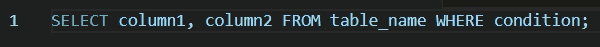

* **INSERT 语句**：`INSERT` 语句向表中添加新行。
```sql
SQL Copy code
```
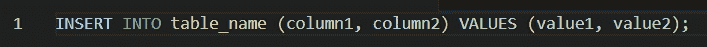

* **UPDATE 语句**：`UPDATE` 语句根据指定的条件修改表中的现有数据。
```sql
SQL Copy code
```
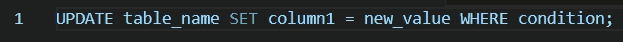

* **DELETE 语句**：`DELETE` 语句根据指定的条件从表中删除行。
```sql
SQL Copy code
```
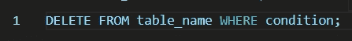

* **CREATE TABLE 语句**：`CREATE TABLE` 语句定义新表，包括它的列和数据类型。
```sql
SQL Copy code
```
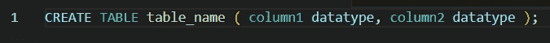

* **ALTER TABLE 语句**：`ALTER TABLE` 语句修改现有表，如添加或删除列。
```sql
SQL Copy code
```
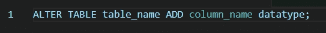

* **DROP TABLE 语句**：`DROP TABLE` 语句删除整个表及其。
```sql
SQL Copy code
```
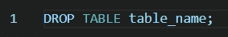

这些只是 SQL 语法的基础。SQL 提供了大量的函数、运算符和子句来执行复杂的数据操作。

# 在 C# 及之外与数据库交互

## 在 C# 中交互
`C#` 是一种通用且广泛使用的编程语言，它为数据库交互提供了强大的支持。`.NET Framework` 和 `.NET Core` 包含了连接数据库、执行 SQL 查询和处理数据的库。以下是在 `C#` 中与数据库交互的概述：

1. **数据库提供程序**：`C#` 支持多种数据库提供程序，包括 `Microsoft SQL Server`、`MySQL`、`PostgreSQL`、`SQLite` 等。每个提供程序都提供了连接所需的库和驱动程序。
2. **ADO.NET**：`ADO.NET`（ActiveX 数据对象 .NET）是 `C#` 数据库访问的核心技术。它提供了如 `SqlConnection`、`SqlCommand` 和 `SqlDataReader` 等类，用于连接数据库、执行 SQL 查询和读取数据。
3. **Entity Framework**：`Entity Framework` 是一个用于 `C#`的对象关系映射（ORM）框架。它允许开发者使用 .NET 对象而不是编写原始 SQL 查询来操作数据库。`EF` 为数据库操作提供了高级抽象并支持多种数据库提供程序。
4. **LINQ to SQL**：`LINQ`（语言集成查询）允许开发者直接在 `C#` 代码中编写类似 SQL 的查询。`LINQ to SQL` 是一种通过 `LINQ` 查询实现交互的技术。

### 示例：使用 ADO.NET 在 C# 中连接数据库
这是一个使用 C# 中的 ADONET 连接 Microsoft SQL Server 数据库的简单示例：

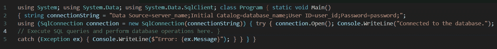

## 超越 C#：在其他语言中与数据库交互
虽然 `C#` 是数据库交互的强大语言，但它并不是唯一的。许多其他编程语言都提供了类似的数据库处理能力。以下是一些示例：


* Python: Python 提供了用于 SQLite 数据库的 `sqlite3`、用于 PostgreSQL 的 `psycopg2` 以及用于 MySQL 的 `mysql-connector` 等库。Python 的多功能性使其成为数据处理和分析的热门选择。
* Java: Java 通过 `JDBC`（Java Database）提供数据库连接功能。

# 拓展视野：其他语言

## 额外语言简介（JavaScript, Ruby 等）

随着软件开发世界的不断演进，探索熟悉语言之外的各种编程语言至关重要。虽然 `C#`、`Java`、`Python` 和 `C++` 等语言已经成为行业的基石，但仍有广阔的语言领域待探索。本节介绍了几种替代编程语言，包括 `JavaScript`、`Ruby` 等。了解这些语言及其独特特征可以极大丰富你作为开发者的工具箱。

## JavaScript：Web 语言

`JavaScript` 是 Web 开发不可或缺的语言。它最初设计用于为网页添加交互性，现在 `JavaScript` 已经成为一种多功能、全面的编程语言，用于前端和后端开发。以下是 `JavaScript` 的一些关键方面：

1. 语法：`JavaScript` 使用 `C` 风格语法，使其对于具有 `C`、`C++` 或 `Java` 经验的人来说非常熟悉。
2. 浏览器兼容性：`JavaScript` 直接在浏览器浏览器运行，是客户端脚本的主要语言。它可以操作文档对象模型 (`DOM`) 来创建动态网页。
3. Node.js：在服务器端，`Node.js` 允许开发者使用 `JavaScript` 构建可扩展和高性能的应用程序。它利用了 Google 的 `V8` `JavaScript` 引擎，特别适用于实时应用程序和 API。
4. 库和框架：`JavaScript` 拥有丰富的库和框架生态系统，例如用于前端开发的 `React`、`Angular` 和 `Vue.js`，以及用于服务端开发的 `Express.js`、`NestJS` 和 `Hapi.js`。
5. 异步编程：`JavaScript` 支持使用 `promises` 和 `async/await` 进行异步编程，使其适合处理网络请求和文件操作等任务，而不会阻塞主线程。

## Ruby：优雅的语言

`Ruby` 由池本裕弘（Yukihiro Matsumoto）于 20 世纪 90 年代中期创建，强调简单和生产力。`Ruby` 的主要特征包括：

1. 可读性：`Ruby` 的语法设计具有高度的可读性和表现力，可以产生更易维护的代码。
2. 面向对象：`Ruby` 是一种纯面向对象的语言，万物皆对象。这种设计促进了一致且连贯的编程风格。
3. Rails：`Ruby on Rails` 框架（通常称为 `Rails`）是一种流行的遵循模型-视图-控制器 (`MVC`) 架构的 Web 框架。它强调约定优于配置，加速了 Web 应用程序的开发。
4. Gems（插件）：`RubyGems` 是 `Ruby` 的包管理器。它允许开发者轻松地添加库并扩展 `Ruby` 的功能。有数千个用于不同用途的 gem 可用。
5. 元编程：`Ruby` 的元编程能力允许开发者编写可以修改自身的代码，使其成为创建动态和灵活应用程序的强大工具。

## Python：超越基础

虽然 `Python` 被广泛认为是一种通用编程语言，但其庞大的生态系统和多功能性使其成为各种专业领域的极佳选择。

1. 数据科学：`Python` 是数据科学和机器学习的实标准语言。`NumPy`、`pandas` 和 `scikit-learn` 等库使其能够处理数据、构建模型和分析结果。
2. Web 开发：`Python` 的 Web 框架（如 `Django` 和 `Flask`）允许开发者轻松构建 Web 应用程序。特别是 `Django`，为 Web 开发提供了一个高级且功能丰富的环境。
3. 科学计算：`Python` 广泛应用于科学研究中的模拟、数据分析和可视化等任务。`SciPy` 和 `Matplotlib` 等库支持科学计算和数据可视化。
4. 自动化：`Python` 的简单性和广泛的标准库使其成为自动化重复任务、脚本编写和创建实用程序的理想选择。
5. 游戏开发：`Python` 用于游戏开发，如 `Pygame` 等库为创建 2D 游戏提供了平台。
6. IoT 和嵌入式系统：`Python` 的轻量级实现（如 `MicroPython` 和 `CircuitPython`）使其能够在微控制器和嵌入式系统上运行，适用于物联网 (`IoT`) 项目。

## Rust：安全的系统级编程

`Rust` 是一种新兴的系统级语言，以专注于安全性和性能而闻名。由 Mozilla 开发的 `Rust` 因其独特特性而受欢迎：

1. 内存安全：`Rust` 的所有权和借用系统确保了内存安全，而不需要垃圾回收。这使得它适用于系统级编程，对资源进行低级控制至关重要。
2. 并发：`Rust` 内置安全的并发编程。所有权系统防止了数据竞态并消除了许多常见的并发错误。
3. 生态系统：`Rust` 的包管理器 `Cargo` 简化了依赖管理和项目设置。`Rust` 生态系统正在快速增长，拥有用于 Web 开发、游戏开发等的库和框架。
4. WebAssembly：`Rust` 是 WebAssembly (`Wasm`) 开发的热门选择，允许开发者在浏览器和其他环境中运行高性能代码。
5. 嵌入式系统：`Rust` 的底层能力使其适用于嵌入式系统和物联网 (`IoT`) 开发。
6. 社区：`Rust` 社区非常活跃，促进了它的快速演进。

## Go (Golang)：效率与并发

它为效率、简单和并发而设计。`Go` 的关键特征包括：

1. 并发：`Go` 的 `goroutines` 和 `channels` 使得编写并发代码变得简单。这对于构建可扩展和高性能的服务特别有用。
2. 效率：`Go` 的编译速度惊人，且生成的二进制文件轻量且高效。这使其非常适合构建快速的独立执行文件。
3. 标准库：`Go` 的标准库非常丰富且文档齐全，为各种用途提供了丰富的包。
4. Web 服务器：`Go` 常用于构建 Web 服务器和微服务。
5. 跨平台：`Go` 生成跨平台二进制的能力使其适用于构建命令行工具和应用程序。
6. 社区：`Go` 社区以注重简单实用而闻名。它强调编写简洁、可维护的代码。

## 了解何时使用其他语言

虽然上述语言具有独特的特征并适用于特定的用例，但选择特定语言应该基于各种因素，包括项目需求、团队专业知识和社区支持。以下是了解何时考虑使用其他语言的一些指南：

1. 项目需求
不同的语言在不同领域表现出色。
* Web 开发：如果你正在构建 Web 应用程序，根据你对性能、可扩展性和开发易用性的需求，`JavaScript`、`Ruby`、`Python` 甚至 `Go` 都是强有竞争者。
* 系统编程：对于低级系统编程，`Rust` 是一个极佳的选择，因为它专注于安全和对内存的控制。


- 数据科学与机器学习：`Python` 是数据科学和机器学习的首选语言，这得益于其丰富的库和框架生态系统。然而，`R` 和 `Julia` 等语言在该领域同样流行，适用于专门的统计和科学计算任务。
- 游戏开发：如果你正在创建游戏，可能考虑使用 `Unity` (`C#`)、`Unreal Engine` (`C++`) 或 `Godot` (`GDScript`) 等游戏引擎。不过，`Python` 和 `Rust` 在某些游戏开发场景中也变得受欢迎。
- 并发与可扩展性：如果你的项目需要高并发和可扩展性，`Go` 的 `goroutines` 和 `channels` 是构建高效并发应用程序的强有力选择。

## 2. 团队专业知识

选择团队已经熟悉的语言可以显著加速开发并降低学习曲线。然而，如果有采用新语言的充分理由，请投入资源为团队进行培训和技能开发。

## 3. 社区与生态系统

评估该语言社区和生态系统的实力与活力。一个繁荣的社区可以确保持续的支持、稳定的更新流，以及对广泛库和工具的访问。检查是否可用符合你项目要求的库、框架和资源。

## 4. 性能需求

性能可以是语言选择中的一个关键因素。如果你的项目需要高性能计算、实时处理或资源密集型任务，`Rust` 或 `C++` 等语言由于其低级控制和高效率可能更合适。然而，`Python` 和 `Ruby` 等语言虽然执行速度较慢，但提供了开发者生产率方面的优势。

## 5. 平台与部署目标

考虑应用程序的平台和部署目标。某些语言如 `Go` 和 `Rust` 以以生成跨平台二进制文件而闻名，适用于命令行工具和实用程序。其他语言如 `JavaScript` 则非常适用于基于 Web 的应用。

## 6. 与现有系统的集成

如果你的项目需要与现有系统或服务集成，请选择对此类集成提供稳健支持的语言。这可能涉及与特定 `APIs`、数据库或通信协议的兼容性。

## 7. 长期维护

考虑项目的长期维护。考虑能够维护代码库的熟练开发者的可用性，以及语言的稳定性。虽然新语言可能很有吸引力，但成熟语言通常具有长期支持的记录。

## 8. 监管与合规性

对于受特定监管或合规标准的项目（如医疗、金融或政府领域），确保所选语言支持必要的安全和合规功能。

## 9. 原型制作与快速开发

在制作原型或追求快速开发时，提供高级抽象和强大开发者生产率的语言（如 `Ruby on Rails` 或 `Django` (`Python`)）可以帮助你快速构建功能原型并迭代想法。

## 10. 成本考虑

考虑语言选择带来的成本。某些语言可能需要许可费用，或产生特定库或服务的相关成本。评估使用特定语言的收益是否大于成本。

总之，编程语言的选择应该是基于项目独特需求和限制的深思熟虑且明智的。虽然 `C#`、`Java`、`Python` 和 `C++` 等成熟语言有其优势，但探索 `JavaScript`、`Ruby`、`Python`、`Rust` 和 `Go` 等替代语言可以开启新的可能性，并增强你应对软件开发中各种挑战的能力。最终，正确的语言选择将赋予团队创建高效、可维护且成功的解决方案解决方案。

# 第四部分：现实世界应用

## 使用 C# 进行游戏开发

游戏开发是一个迷人且动态的领域，将创造力与技术专业知识相结合。多年来，它已演变成一项复杂的多学科事业，具有在广泛平台上创建沉浸式体验的潜力。在本章中，我们将深入探讨 `C#` 编程语言的游戏开发世界，探索 2D 和 3D 游戏的创建。我们还将讨论赋予开发者实现游戏想法的核心游戏引擎和框架。

## 构建 2D 和 3D 游戏

### 游戏开发的演变

今天，游戏跨越了不同的复杂性和类型，从简单的手机益智游戏到巨大的开放世界冒险游戏。现代游戏开发中的关键区别之一是 2D 游戏和 3D 游戏。

- **2D 游戏**：这些游戏以使用二维图形和游戏玩法为特征。它们通常具有俯视或横卷视角。示例包括经典作品《超级马里奥兄弟》(Super Mario Bros.) 和现代热门作品《空洞骑士》(Hollow Knight)。
- **3D 游戏**：三维游戏让玩家沉浸在 3D 世界中，允许更真实的环境和更复杂的交互。标志性作品如《塞尔达传说：旷之息》(The Legend of Zelda: Breath of the Wild) 和《巫师 3：狂猎》(The Witcher 3: Wild Hunt) 展示了 3D 游戏世界的可能性。

## 游戏开发中的 C#

`C#` 已成为游戏开发主要的编程语言之一，特别是在 `Unity` 游戏引擎的背景下。`Unity` 使用 `C#` 作为其主要的脚本语言，使其让广大的开发者都能上手。以下是 `C#` 受欢迎的原因：

1. **易于使用**：`C#` 以易读性和易学著称，是游戏开发初学者的绝选择。
2. **Unity 集成**：`Unity` 对 `C#` 的支持稳健且文档齐全。它提供了用于游戏开发的广泛工具和 `APIs`。
3. **跨平台**：`Unity` 允许开发者针对多个平台，包括 PC、主机、移动设备，甚至是增强现实 (AR) 和虚拟现实 (VR) 平台。
4. **资源商店**：`Unity` 的 Asset Store 提供了丰富的 `C#` 预制资源、脚本和插件，加速了开发并减少了重复造轮的需求。

## 游戏引擎和框架

### Unity

`Unity` 疑是使用 `C#` 开发 2D 和 3D 游戏最流行、最广泛使用的引擎。

- **可视化编辑器**：`Unity` 的可视化编辑器简化了游戏设计，允许开发者通过用户友好界面创建场景、添加资源并定义游戏逻辑。
- **物理引擎**：`Unity` 包含内置物理引擎，处理碰撞检测、刚体动力学和其他游戏物理的本质方面。
- **使用 C# 编写**：`C#` 脚本是 `Unity` 开发的核心。开发者编写脚本来控制游戏对象、实现游戏机制并创建交互体验。
- **资源流水线**：`Unity` 的资源流水线简化了 2D 和 3D 资源（如模型、纹理和音频文件）的导入和管理。
- **跨平台部署**：`Unity` 支持将游戏导出到各种平台，包括 Windows、macOS、Linux、Android、iOS、Xbox、PlayStation 等。
- **可扩展**：`Unity` 的扩展性允许开发者创建自定义工具、插件和资源，以增强他们的游戏开发工作流。

### Unreal Engine

`Unreal Engine` 是游戏开发行业的另一大强大力量，以其惊人的图形和高质量的视觉效果闻名。虽然 `Unreal Engine` 主要使用 `C++` 进行脚本编写，但它通过 `UnrealCLR` 等插件提供对 `C#` 的支持。`Unreal Engine` 的功能包括：

- **可视化脚本**：`Unreal Engine` 提供了一个名为 `Blueprints` 的可视化脚本系统，允许开发者无需编写代码即可创建游戏逻辑和行为。


*   高保真图形：`Unreal Engine` 在渲染真实的 3D 环境方面表现出色，使其成为创建视觉震撼的游戏的顶选之之一。
*   物理模拟：该引擎包含了强大的物理模拟能力，允许开发者创建复杂的交互和模拟。
*   VR 和 AR 支持：`Unreal Engine` 为开发虚拟现实 (VR) 和增强现实 (AR) 体验提供了工具和支持。
*   商城：`Unreal Engine Marketplace` 提供了丰富的资产、插件和工具，以增强游戏开发。
*   跨平台：使用 `Unreal Engine` 创建的游戏可以部署在各种平台上，包括 PC、游戏主机和移动设备。

## Godot 引擎

`Godot Engine` 是一款开源游戏引擎，因其用户易用性和灵活性而广受欢迎。它使用一种名为 `GDScript` 的脚本语言，该语言与 Python 相似。`Godot Engine` 的主要特性包括：

*   2D 和 3D 支持：`Godot` 支持 2D 和 3D 游戏开发，允许开发者选择适合其项目的维度。
*   可视化编辑器：引擎的可视化编辑器简化了场景创建、动画和游戏设计。
*   基于节点的架构：`Godot` 使用基于节点的架构来定义场景和游戏对象，使得创建复杂的层级变得简单。
*   物理引擎：它包含一个物理引擎，支持碰撞检测、刚体和运动学对象。
*   导出选项：`Godot` 支持将游戏导出到多个平台，包括 Windows、macOS、Linux、Android、iOS 和 web。
*   扩展性：`Godot` 的扩展性允许开发者使用 `C++` 或 `GDScript` 创建自定义插件和模块。

## Phaser (2D)

对于那些兴趣使用 `JavaScript` 进行 2D 游戏开发的开发者（包括使用 `Unity` 的 `WebGL` 导出工具配合 `C#`），`Phaser` 是一个热门选择。`Phaser` 是一个用于构建浏览器游戏的快速、健壮的开源框架。`Phaser` 的主要特性包括：

*   Canvas 和 WebGL 渲染：`Phaser` 支持 canvas 和 WebGL 渲染，确保与各种 Web 浏览器兼容。
*   精灵处理：该框架简化了 2D 精灵的创建和管理，使其成为平台跳跃、益智游戏和休闲游戏的理想选择。
*   物理引擎：`Phaser` 包含一个名为 `Arcade Physics` 的物理引擎，处理碰撞、重力和与其他物理相关的交互。
*   社区和教程：`Phaser` 拥有活跃的社区和丰富的教程与资源，让初学者和经验丰富的开发者都能轻松上手。
*   跨平台部署：使用 `Phaser` 创建的游戏可以轻松发布到网络，并在各种设备的 Web 浏览器中运行。
*   插件系统：`Phaser` 的插件系统允许开发者通过自定义插件和模块扩展其功能。

## 游戏开发中的最佳实践

游戏开发是一门多维度的学科，需要周密的规划、创意的设计和严谨的编程。在使用 `C#` 开发游戏时，请考虑以下最佳实践：

1.  游戏设计：从清晰且文档良好的游戏设计开始。定义游戏机制、用户交互和整体体验。
2.  原型制作：在投入全量开发之前，创建原型来测试游戏机制和想法。原型制作有助于尽识别潜在问题。
3.  版本控制：使用 `Git` 等版本控制系统来跟踪更改、与团队成员协作并管理项目历史。
4.  性能优化：针对性能优化你的游戏。这包括优化代码、管理内存和减少渲染开销，以确保游戏运行顺畅，特别是在低端设备上。
5.  测试：在各种设备和平台上对你的游戏进行严谨测试，以识别并修复漏洞、故障和兼容性问题。
6.  用户体验 (UX)：优先考虑无缝且愉快的用户体验。注意用户界面、控制和玩家反馈，以保持玩家的投入。
7.  变现策略：如果你的游戏计划商业发行，请仔细考虑你的变现策略。选项包括内内购买、广告、付费定价等。
8.  社区互动：通过响应反馈、提供更新和培养良好的玩家体验来与你的游戏社区互动。
9.  本地化：如果你计划触及全球观众，请投资本地化，使你的游戏能够服务不同地区和语言的玩家。
10. 文档工作：为代码、资产和游戏设计维护详尽的文档。这有助于你的团队和潜在的合作者理解你的项目。
11. 无障碍辅助：确保残障玩家也能玩你的游戏。这可能涉及提供替代控制方案、文本转语音支持和其他无障碍功能。
12. 可扩展性：在设计游戏架构时考虑可扩展性。这允许你在游戏演进时轻松地添加新内容和功能。

## 案例研究

让我们探索几个案例研究，看看 `C#` 如何在真实世界的游戏开发中使用。

### 案例研究 1：空洞骑士 (Hollow Knight)

`Hollow Knight` 由 `Team Cherry` 开发，是一款备受赞誉的 2D 动作冒险游戏，以其复杂的地图设计、具有挑战性的玩法和迷人的艺术风格而闻名。该游戏使用 `Unity` 构建并利用 `C#` 进行脚本编写。

核心启示：

*   艺术表达：`Hollow Knight` 展示了如何使用 `C#` 将艺术愿景变为现实。游戏的手绘艺术和动画由 `C#` 脚本补充，脚本控制着角色移动、敌人行为以及游戏世界内的交互。
*   复杂的游戏玩法：游戏复杂的战斗系统、平台跳跃挑战和非线性探索证明了 `C#` 在创建多样化且引入胜的游戏体验方面的通用性。
*   社区支持：`Hollow Knight` 的成功得益于忠实的粉丝社区和模组，展示了 `Unity` 等游戏引擎的力量以及 `C#` 的扩展性。

### 案例研究 2：奥日与黑暗森林 (Ori and the Blind Forest)

`Ori and the Blind Forest` 由 `Moon Studios` 开发，是一款视觉震撼的 2D 平台游戏，以其情感丰富的叙事和惊叹的艺术而闻名。该游戏使用微软的私有引擎并使用 `C#` 进行脚本。

核心启示：

*   视觉卓越：`Ori` 美丽的视觉效果和流畅的动画强调了 `C#` 创建令人印象深刻的游戏。引擎处理复杂图形和着色的能力对于实现游戏独特的风格至关重要。
*   叙事深度：游戏充满情感的叙事和音乐证明了在游戏开发过程中融合艺术与编程的力量，其中 `C#` 在协调这些元素中起了关键作用。
*   Xbox 集成：`Ori and the Blind Forest` 最初专为 `Xbox` 开发，后发布于多个平台，展示了如何利用 `C#` 和微软的开发生态系统进行主机游戏开发。

### 结论

使用 `C#` 进行游戏开发提供了无限创意可能，从打造迷人的 2D 冒险到构建沉浸式的 3D 世界。无论你使用 `Unity`、`Unreal Engine` 还是其他框架，`C#` 都能赋予开发者实现其游戏愿景的能力。

要在游戏开发中成功，平衡技术熟练度与创意叙事、引人胜的玩法以及用户体验至关重要。`C#` 是一种多功能工具，结合强大的设计愿景和周密的规划，可以创建难忘且有影响力的游戏。


随着技术的不断进步和平台的演进，游戏开发领域一如既往地充满活力和兴奋感。无论你是一个独立开发者还是大型工作室的一员，使用 `C#` 创建游戏的之旅都充满了挑战与回报，最终在看到玩家沉浸在你创造的虚拟世界时获得喜悦。

# Web 开发及其他

这是一个创意与功能交汇的领域，`C#` 已经稳固地成为构建 Web 应用程序的一种多功能且强大的语言。在本章中，我们将深入探索 `C#` Web 开发的世界。我们将探索创建 Web 应用程序的过程，深入全栈开发，并讨论这一动态领域更广泛的影响。

## 使用 C# 构建 Web 应用程序

Web 应用程序为通过互联网与数据和服务交互提供了友好的界面。得益于 `ASP.NET` 和 `.NET Core` 等强大的框架，`C#` 已成为 Web 开发的主流语言。让我们更深入地了解使用 `C#` 进行 Web 开发：

### ASP.NET 和 .NET Core

`ASP.NET` 是微软开发的一个用于构建动态 Web 应用程序的成熟 框架。通过 `ASP.NET`，开发者可以创建功能丰富的网站、Web API 和实时 Web 应用程序。近年来，微软引入了 `.NET Core`，这是一个跨平台的开源框架，使能够构建能够在 Windows、macOS 和 Linux 上运行的 Web 应用程序。

`ASP.NET` 和 `.NET Core` 的核心特性：

1. **MVC 架构**：`ASP.NET` 遵循模型-视图-控制器（MVC）架构模式，促进关注点分离并实现了模块化开发。
2. **Razor Pages**：`Razor` 是一个轻量级的视图引擎，用于使用 `C#` 创建动态 页面。`Razor Pages` 通过在单个文件中合并 HTML 和 `C#` 代码简化了 Web 开发。
3. **Web API 开发**：`ASP.NET` 和 `.NET Core` 为构建 Web API 提供了强大的支持，允许开发者为包括移动应用在内的各种客户端应用创建 RESTful 服务。
4. **身份验证与授权**：这些框架包含了内置的身份验证和授权机制，以确保 Web 应用程序和 API 的安全。
5. **Entity Framework**：`Entity Framework` 为 `C#` 开发者提供了对象关系映射（ORM）系统，简化了数据库的访问和管理。
6. **SignalR**：`SignalR` 是一个用于构建实时交互式 Web 应用程序的库。它支持实时聊天、通知和协作编辑等功能。
7. **跨平台开发**：`.NET Core` 实现了跨平台的 Web 应用程序开发，使得在广泛的服务器和平台上部署应用程序成为可能。
8. **性能与可扩展性**：`.NET Core` 针对高性能进行了优化，可以处理大规模 Web 应用程序的需求。

## Web 开发工作流

使用 `C#` 构建 Web 应用程序的过程通常涉及几个关键步骤：

1. **需求分析**：从理解项目目标、目标受众和功能需求开始。创建一个概述项目范围的详细说明书。
2. **前端开发**：设计用户界面（UI）并使用 HTML、CSS 和 JavaScript 创建应用程序前端。`C#` 开发者通常与前端开发者紧密合作，将后端逻辑与 UI 集成。
3. **后端开发**：使用 `C#` 及其 `ASP.NET` 或 `.NET Core` 开发服务器端逻辑，包括数据访问、业务逻辑和 API 端点。
4. **数据库设计**：设计数据库模式、创建表并定义关系。使用 `Entity Framework` 或其他 ORM 工具与数据库交互。
5. **测试**：彻底测试应用程序以识别并修复漏洞，确保其符合指定的要求。测试可能包括单元测试、集成测试和用户验收测试。
6. **部署**：通过配置 Web 服务器、数据库和其他必要的基础设施组件为应用程序部署做准备。将应用程序部署到生产服务器或如 `Azure` 或 `AWS` 等云平台。
7. **维护与更新**：持续监控应用程序的性能、安全用户反馈。根据需要应用更新、安全补丁和功能增强。

## 全栈开发

Web 开发可以分为两个主要角色：前端开发和后端开发。然而，许多开发者渴望成为全栈开发者，这意味着他们同时精通前端和后端技术。全栈开发者对整个 Web 开发过程有全面的理解，从设计用户界面到构建服务器端逻辑以及管理数据库。以下是 `C#` 如何融入全栈开发：

### 使用 C# 进行前端开发

虽然 HTML、CSS 和 JavaScript 是前端开发的主要技术，但 `C#` 在前端仍然可以发挥作用，特别是在使用诸如 `Blazor` 这样的框架时。

`Blazor` 支持服务器端和客户端两种开发模型：

* **服务器端 Blazor**：在这种模型中，应用程序的大部分逻辑在服务器上执行，并通过 `SignalR` 将 UI 更新推送到客户端。`C#` 代码在服务器上运行，开发者无需编写 JavaScript 即可构建动态 Web 应用程序。
* **客户端 Blazor (WebAssembly)**：客户端 `Blazor` 使用 `WebAssembly` 直接在浏览器中运行 `C#` 代码。它提供了与传统前端框架类似的开发体验，但拥有 `C#` 的强大。

通过引入 `Blazor`，全栈开发者可以利用他们的 `C#` 技能创建动态交互的 Web 用户界面，而无需过度依赖 JavaScript。

### 使用 C# 进行后端开发

在处理 `ASP.NET` 或 `.NET Core` 时，`C#` 是后端开发的基础语言。精通 `C#` 的全栈开发者可以处理后端职责：

* **API 开发**：创建 RESTful APIs 或 GraphQL 端点以与前端和其他客户端应用通信。
* **身份验证与授权**：实现身份验证和授权机制以保护应用程序安全并控制资源访问。
* **数据库管理**：设计和管理数据库，创建表并定义关系。
* **业务逻辑**：实现应用程序的核心业务逻辑，包括数据处理、计算和验证。
* **性能优化**：对服务器端代码进行性能优化，确保应用程序能够处理更大的流量。
* **集成**：与外部服务、API 或第三方组件集成以增强应用程序功能。
* **安全性**：实施安全实践以保护应用程序免受常见漏洞的影响，如 SQL 注入和跨站脚本（XSS）。

## 使用 C# 进行数据库管理

开发 Web 应用程序的 `C#` 开发者通常使用 `Entity Framework` 等对象关系映射（ORM）工具与数据库交互。`Entity Framework` 通过允许开发者使用 .NET 对象和 `LINQ` 查询，简化了对底层 SQL 数据库的访问。

使用 C# 进行数据库管理的关键方面：

* **数据建模**：使用 `C#` 类（实体）定义数据库结构，这些类对应于数据库表。
* **数据库操作**：使用 `C#` 代码执行常见的数据库操作，包括查询、插入、更新和删除记录。
* **迁移**`Entity Framework` 支持数据库迁移，允许开发者进行模式更改并保持数据库模式与应用程序数据模型的同步。
* **LINQ 查询**：使用集成语言查询 (`LINQ`) 直接在 `C#` 代码中编写类型安全且可读的数据库查询。


- 事务：实现数据库事务以确保数据的完整性和一致性。

## 挑战与考虑

虽然使用 `C#` 进行全栈开发具有许多优势，但也伴随着其自身的挑战和考虑因素：

- **学习曲线**：成为一名精通的全栈开发者需要具备涵盖前端和后端技术的广泛技能组合。学习并跟上多项技术可能具有挑战性。
- **工具选择**：为开发栈的每个部分选择正确的工具和库。跟上 Web 开发的最新进展可能非常耗时。
- **跨浏览器兼容性**：确保 Web 应用程序在不同的浏览器中都能正常运行是一项复杂的任务，特别是在处理浏览器特定的怪异时。
- 全栈开发者需要意识到常见的 Web 安全漏洞，以及缓解这些漏洞的良好实践。
- **性能优化**：对前端和后端代码进行性能优化对于确保 Web 应用程序快速加载和高效响应至关重要。
- **可扩展性**：随着 Web 应用用户群和复杂性的增长，全栈开发者需要为扩展性进行计划，并考虑负载均衡和缓存等因素。
- **版本控制**：对前端和后端代码进行版本控制对于协作和代码库管理至关重要。

## Web 开发之外

虽然 Web 开发是 `C#` 的一个主要用例，但该语言的通用性远超 Web。以下是 `C#` 活跃使用的其他领域：

### 桌面应用

`C#` 仍然是桌面应用开发的强有力竞争者，特别是在 Windows 平台上。开发者可以使用 `Windows Presentation Foundation (WPF)` 或 `Windows Forms` 等技术创建丰富的原生桌面应用程序。这些应用程序涵盖了从效率工具到多媒体软件的各种类型。

### 游戏开发

`C#` 是 2D 和 3D 游戏开发的流行选择。`Unity` 等游戏引擎使用 `C#` 进行脚本，允许开发者创建运行在各种平台的游戏，包括 PC、主机、移动设备和虚拟现实（VR）头设备。

### 移动应用开发

随着 `Xamarin` 的引入，`C#` 开发者可以使用共享代码为 iOS 和 Android 创建跨平台移动应用。`Xamarin.Forms` 通过提供单一的 UI 框架来构建原生用户界面，简化了移动应用的开发。

### 云服务与微服务

`C#` 非常适合开发云应用程序和微服务。`Azure Functions`、`Azure App Service` 和 `Azure Kubernetes Service (AKS)` 支持使用 `C#` 构建可扩展的云原生应用程序。

### 物联网 (IoT)

`C#` 用于 IoT 开发，特别是结合 `.NET IoT` 库以及 `Raspberry Pi` 和 `Arduino` 等平台。开发者可以创建用于收集、处理和传输来自连接设备数据的 IoT 应用。

### 人工智能 (AI)

`C#` 可用于 AI 和机器学习应用。`.NET` 生态系统包括 `ML.NET` 等库，用于机器学习模型的开发及其集成到应用程序中。

### 机器人

`C#` 用于机器人系统和自动化开发。它可以用于控制制造业和医疗保健等各个行业的机器人、传感器和执行器。

### 科学计算

`C#` 用于科学计算和数据分析应用。`Math.NET Numerics` 等库提供了数值分析的数学和统计函数。

### 金融与交易软件

由于其性能和可靠性，金融行业经常依赖 `C#` 开发交易平台、风险管理系统和金融分析工具。

### 结论

使用 `C#` 进行 Web 开发是一个动态且富有回报的领域，并不断进化。无论你是在构建 Web 应用程序、深入全栈开发，还是探索其他领域，`C#` 都提供了一个强大且通用的生态系统，赋予开发者创建各种软件解决方案的能力。随着技术的发展，`C#` 仍然是开发者寻求应对各种挑战并在数字领域实现其想法的宝贵资产。

# 编码最佳实践与项目

在软件开发领域，编写高效且易维护的代码不仅是一项良好的实践，更是一项基本要求。本章深入探讨编码最佳实践的艺术与科学，强调了整洁、高效和易维护代码的重要性。此外，我们探索了通过项目和实际练习构建作品集的意义，这不仅能提升你的技能，还能向潜在的雇主和合作伙伴展示你的能力。

## 编写高效且易维护的代码

效率和可维护性是软件开发的两个基石。高效的代码确保你的应用程序运行流畅、响应迅速并优化地利用资源。而可维护的代码则确保你的软件随着时间的推移保持易于管理、适应和可扩展性。让我们探索实现这些目标的关键实践：

### 1. 代码的可读性与一致性

可读性的代码是指能够让其他开发者（包括你未来的自己）轻松理解的代码。考虑以下实践：

- **描述性命名**：使用有意义且描述性的变量、`function` 和 `class` 名称。避免晦涩的缩写或单字母变量。
- **一致的风格**：遵循一致的编码风格和格式指南。这包括缩进、空格和命名规范。流行的风格指南包括 Python 的 `PEP 8`、JavaScript 的 `Google's JavaScript Style Guide` 以及微软的 `C# Coding Conventions`。
- **注释与文档**：添加注释来解释代码中复杂的逻辑或不显而易见的部分。为项目维护最新的文档。
- **模块化**：将你的代码拆分为较小的、可重用的函数或模块。每个函数应该具有单一职责且自自的。

### 2. 代码效率

高效的代码确保你的应用程序运行良好并明智地使用资源。以下是要考虑的原则：

- **算法效率**：为任务选择正确的算法和数据结构。分析代码的时间空间复杂度，并在需要时进行优化。
- **避免过早优化**：不要过早地优化代码。先专注于编写整洁且正确的代码。只有在通过性能分析发现性能问题时再进行优化。
- **资源管理**：妥善管理内存、文件句柄和数据库连接等资源。在资源不再需要时始终释放它们。
- **缓存**：实现缓存策略以减少冗余计算或数据库查询，提高响应速度。
- **懒加载**：使用懒加载按需加载数据或资源而非预加载，以优化启动速度和资源使用。

### 3. 错误处理

有效的错误处理对于维护应用程序的可靠性和稳定性至关重要：

- **优雅降级**：为 Web 应用程序规划优雅降级，这意味着当发生错误时，应用程序能够以减少的功能或能力继续运行。
- **日志记录**：实现全面的日志记录以捕错误和诊断信息。日志信息应该是信息丰富的且可操作。
- **异常处理**：使用编程语言提供的适当异常处理机制。优雅地处理异常，避免捕获并忽略所有异常。

### 4. 测试与质量保证

- **单元测试**：编写单元测试以验证单个函数和模块的正确性。尽可能实现自动化测试以尽早发现回归问题。


- **集成测试**：执行集成测试以确保应用程序的不同组件能够按预期工作。
- **代码审查**：鼓励团队成员之间进行代码审查，以识别问题、共享知识并维护代码质量。

## 5. 版本控制
- **版本控制系统 (VCS)**：使用 `Git` 等版本控制系统来跟踪更改、与团队成员协作并管理项目历史。遵循分支、合并和提交消息的最佳实践。
- **分支策略**：采用适合你项目需求的分支策略，例如 `Gitflow` 或 `GitHub Flow`。

## 6 安全
- **输入验证**：始终对用户输入进行验证并对数据进行清洗，以防止 SQL 注入和跨站点脚本 (XSS) 等安全漏洞。
- **身份验证与授权**：实施强有身份验证和授权机制，以保护敏感数据和功能。
- **安全更新**：关注你项目中使用的第三方库和框架中的安全漏洞。及时应用安全更新。

## 7 重构
这是维护代码库的一项基本实践：
- **代码异味**：学习识别代码异味，例如重复代码、长方法和类类。通过重构代码来消除这些问题。
- **持续重构**：将重构纳入开发过程中的持续活动，而不是作为一个独立的阶段。
- **自动化重构工具**：使用许多集成开发环境 (IDEs) 中提供的自动化重构工具来协助清理代码。

## 8 文档
- **代码注释**：编写清晰、简洁的注释，解释“为什么”，而不仅仅是“是什么”。
- **README 文件**：在项目中包含尽的 `README` 文件，提供有关如何设置、配置和使用你的软件的说明。
- **API 文档**：如果你正在构建库或 `APIs`，请维护关于用法、输入、输出和示例的详细文档。

## 构建你的作品集：项目与实战练习

构建作品集对于展示你开发者的技能和经验至关重要。它不仅是你工作的展示，还为潜在的雇主、客户或合作者提供了你能力的有力证据。

### 1. 个人网站或作品集网站
考虑创建一个个人网站或在线作品集网站。该网站可以作为展示你的项目、分享简历和提供联系方式的枢纽。利用你的 Web 开发技能使网站在视觉上具有吸引力且易于使用。

**个人网站的核心组成：**
- **项目展示**：包含一个专门用于展示你最佳项目的部分。提供描述、截图、链接以及使用的任何相关技术。
- **简历/CV**：分享你的专业背景、技能、教育和工作经验。使其支持以 `PDF` 格式下载。
- **博客或文章**：如果你喜欢写作，可以维护博客或分享与你专业领域相关的文章。这展示了你的知识和热情。
- **联系方式**：确保访问者可以方便地联系你进行咨询或寻求合作机会。
- **证言**：如果你与客户合作过或与他人合作过，请考虑添加证言或推荐。

### 2. 多样化的项目
构建多样化的项目展示了你作为开发者的多面性。目标是包含展示不同技能、技术和领域的项目。以下是一些项目构想：
- **Web 应用**：创建解决现实世界问题或提供独特功能的 Web 应用。例如任务管理应用、电子商务平台或内容管理系统。
- **移动应用**：使用 `Swift`、`Kotlin` 等语言或 `React Native`、`Xamarin` 等跨平台框架为 `iOS` 和 `Android` 开发移动应用。
- **开源贡献**：为开源项目做出贡献以获得经验、与他人协作并展示你对开发者社区的投入。
- **游戏与游戏 Mod**：如果你对游戏开发感兴趣，可以为 `Unity`、`Unreal Engine` 等流行游戏引擎甚至基于 Web 的构建游戏或 Mod。
- **数据分析项目**：通过涉及数据可视化、机器学习或数据驱动洞察的项目展示你的数据分析技能。
- **IoT 与硬件项目**：通过构建涉及传感器、微控制器和硬件组件的项目来尝试物联网 (`IoT`)。
- **自动化脚本**：创建自动化重复任务或简化工作流的脚本和工具，例如部署脚本、数据提取工具或自定义命令行程序。
- **作品集网站**：开发一个具有视觉吸引力且交互式的作品集网站来展示你的项目和技能。这个项目既是一个作品集项目，也是 Web 开发的一项实战练习。
- **API 与库**：构建解决特定问题或为其他开发者提供价值功能的 `APIs`、库或包。在 `GitHub` 等平台上分享这些内容。

### 3. 实战练习
除了展示项目之外，考虑将实战练习加入你的作品集。这些练习展示了你的解决问题的能力、编码技能以及对持续学习的承诺。实战练习的一些构想包括：
- **编程挑战**：解决来自 `LeetCode`、`HackerRank` 或 `Project Euler` 等平台的编程挑战。解释你的思考过程并提供文档良好的解决方案。
- **教程与指南**：针对特定主题或技术创建教程或指南。这些可以是博客文章、视频教程或交互式代码示例的形式。
- **示例代码与库**：分享文档良好的示例代码段或小型库，用于处理常见的编程任务或演示特定技术。
- **技术演讲与演示**：如果你有公开演讲的经验或兴趣，针对你感兴趣的话题录制技术演讲或演示。在 `YouTube` 或个人博客上分享这些内容。
- **案例分析**：分析你工作过的真实世界场景或项目。描述问题、你的方法、面临的挑战以及最终解决方案。案例分析可以提供关于你解决问题能力的见解。

### 4. 协作项目
协作项目展示了你作为团队成员的能力，这在软件开发行业是一项宝贵的技能。考虑与其他一起加入或发起协作项目。这些项目可以是开源倡议、黑客松或与其他开发者的伙伴关系。

**协作项目的益处：**
- **团队合作**：展示你在团队中有效协作、沟通和贡献的能力。
- **共同责任**：分担工作量和责任，让你专注于项目中与你的优势和兴趣匹配的方面。
- **多元化视角**：与不同背景和技能的开发者合作，营造具有创造力和创新的环境。
- **人脉拓展**：通过协作项目建立关系并扩大你的专业网络。

### 5. 持续学习与成长
在你的作品集中突出你对持续学习和职业成长的承诺。提到你参加过的在线课程、证书、工作讨会或会议，以保持与行业趋势和技术的同步。包含你获得的任何相关证书或资质。

**持续学习的关键领域：**
- **技术趋势**：关注新兴技术、编程语言和开发工具。
- **框架与库**：跟上你领域使用的流行框架和库的更新与变化。


* **软技能**：培养沟通、时间管理、问题解决和团队协作等软技能。
* **专业化**：考虑在技术或行业的某个利基领域深耕，例如网络安全、云计算或数据科学。
* **认证**：获得与你专业领域相关的认证，这可以增强你的信誉和市场竞争力。

### 结论

编码最佳实践是高质量软件开发的基础。通过一如既往遵循这些实践，你可以编写整洁、高效且易维护的代码，这对你和你的团队都有益。此外，建立一个包含多样化项目和实践练习的作品集，可以为你作为开发者的技能、热情和奉献提供直观证据。

你的作品集是你展示工作、吸引潜在雇主或客户以及在竞争激烈的就业市场中脱颖出的有力工具。随着你不断扩展技能和知识，你的作品集将成为你开发者之旅的生动见证，说明了你的成长、创造力和对这项业的投入。

# 第五部分：你的专家专家之路

## 成为编程大师

达到编程大师水平是一段标志着持续学习、技能精炼以及对不断变化的技术格局产生适应能力的旅程。在本章中，我们将探索成为编程大师的关键方面，包括持续学习和成长的重要性，以及如何应对瞬息万变的编程环境。

### 持续学习与成长

成为编程大师的道路是一条永远学习和成长的道路。在节奏快速的技术世界中，停滞不前的技能会迅速过。因此，拥抱持续学习不仅是一种选择，更是一种需求。以下是你可以在编程旅程中培养持续学习和成长的方法：

1. **保持好奇心**：好奇心是驱动学习的燃料。对事物如何运作保持天然的好奇，不要害怕提问。探索新的技术、编程语言和框架，即使它们超出了你的舒适区。
2. **拥抱挑战**：挑战是成长的机会。应对挑战性任务可以带来技能和知识的巨大飞跃。
3. **设定目标**：为你的学习之旅设定清晰、可实现的目标。无论是掌握一门新编程语言、获得一个认证还是完成一个复杂的项目，目标都能提供方向和动力。
4. **在线课程与教程**：在线学习平台提供了各种编程主题的丰富课程和教程。像 `Coursera`、`edX`、`Udemy` 和 `Khan Academy` 等平台提供了从初级到高级的课程。
5. **书籍与文档**：书籍仍然是深入学习的有价值资源。阅读与你领域相关的书籍，并探索编程语言和框架的官方文档。
6. **编程挑战与竞赛**：`LeetCode`、`HackerRank` 和 `Codeforces` 等网站提供的编程挑战和竞赛，有助于提高你的解决问题能力和算法思维。
7. **加入编程社区**：参与编程社区、论坛和讨论板。与其他开发者交流可以提供见解、解决方案并接触新思想。
8. **在开源项目协作**：为开源项目做贡献可以让你在真实的代码库上工作，并与丰富的开发者合作。这是学习和获得实践经验的极佳方式。
9. **参加研讨会和会议**：技术研讨会、会议和聚会是从专家学习、与同行建立人脉以及关注行业趋势的绝佳机会。
10. **寻求反馈**：欢迎对你的代码和项目的反馈。建设性的批评可以帮助你识别改进领域并精炼你的编程技能。
11. **教学与指导**：教他人是巩固自身知识的强大方式。考虑指导初学者，或者就你感兴趣的编程主题进行演讲或举办研讨会。
12. **保持信息灵**：订阅技术新闻媒体、博客和时通讯，以了解编程世界的最新进展。理解行业趋势对职业成长至关重要。

### 应对演变中的编程格局

编程格局在不断演变，新的技术、工具和范式定期出现。为了有效应对这一动态环境，你需要采取某些策略和心态：

1. **适应能力**：适应能力是编程大师的基本特征。对变化保持开放态度，无论是编程语言的转变、新开发方法的采用，还是尖端工具的使用。
2. **关注基础**：虽然跟上新技术很重要，但不要忘记基础。在数据结构、算法和编程概念方面的深厚基础知识将为学习新事物提供坚实的基础。
3. **精通解决问题**：编程的核心在于解决问题。努力提高你的解决问题能力，无论技术或领域如何，这种能力都是无价的。
4. **学习如何学习**：随着编程格局的演变，你经常发现自己需要快速学习新技能。开发高效的学习策略和自学能力本身就是一种宝贵的技能。
5. **实验与创新**：不要局限于现有解决方案。尝试新想法，创建自己的项目，并探索解决问题的创新方法。
6. **建立人脉与协作**：在编程社区中建立强大的专业人脉。与他人合作项目，分享知识并从他们的经验中学习。
7. **平衡深度与广度**：虽然在某一个领域深耕很有吸引力，但请考虑在各个编程领域保持知识的广度。这种多功能性可以让你更好地适应变化的情况。
8. **关注趋势**：定期扫描视野以发现新兴趋势和技术。熟悉如`artificial 智能`、`区块链`和`云计算`等概念，因为它们正在塑造编程的未来。
9. **多元化你的技能**：通过探索相关领域如`数据科学`、`用户体验 (UX) 设计`或`网络安全`使技能多元化。拥有多元化的技能可以让你在跨学科团队中更有价值。
10. **从失败中学习**：编程中的每一次错误或挫折都是成长和改进的机会。
11. **迭代与重构**：正如你迭代和重构代码一样，将同样的原则应用于你的职业。定期评估你的技能、目标和愿景，并相应调整。
12. **寻找你的编程身份**：发现哪些编程领域最引起你的共鸣。无论是`Web 开发`、`游戏设计`、`数据分析`还是完全其他的，找到你的热情并围绕它建立专业知识。

### 结论

成为编程大师是一段以持续学习、适应和对解决问题的热情为特征的旅程。通过遵循这些原则并不断完善技能，你不仅可以在你所选领域成为专家，还能不断变化的编程世界中蓬勃发展。记住，精通不是终点，而是一场终身的追求，而旅程本身就非常有意义。

# 下一步与资源

在最后一章中，我们将探索你在完本书之后在编程旅程中可以采取的下一步。我们将讨论今后的去路，包括如何在编程世界中继续扩展你的知识、技能和职业。此外，我们将深入探讨在线社区、论坛和各种学习平台提供的宝贵资源，以帮助你作为编码者的持续发展。

## 本书之后：今后的去路


现在你已经完成了这本书，你已经在编程原理、语言和最佳实践方面打下了坚实的基础。然而，编程的世界是广阔无垠且不断演变的。在你继续你的旅程时，可以考虑以下步骤：

## 1. 专精并探索高级主题

考虑在与你的兴趣和职业目标一致的特定编程领域进行深耕。高级主题可能包括：

* 人工智能（AI）和机器学习：深入人工智能和机器学习，以构建智能系统、分析数据并创建预测模型。
* 数据科学：探索数据科学，以从数据中获取洞察，进行统计分析并开发数据驱动的解决方案。
* 网络安全：深入研究网络安全，保护系统和数据免受威胁和漏洞的影响。
* 云计算：学习 `AWS`、`Azure` 和 `Google Cloud` 等云平台，以部署和管理可扩展的应用程序。
* DevOps 和 CI/CD：掌握 DevOps 实践和持续集成/持续部署 (`CI/CD`) 流水线，实现软件交付自动化。
* 区块链：学习区块链技术并开发去中心化应用 (`DApps`) 或智能合约。

## 2. 参与现实世界的项目

巩固技能并获得实践经验的最佳方法是参与现实世界的项目。考虑：

* 自由职业：承接自由职业编程项目以应用你的技能、建立作品集并获得收入。
* 开源贡献：为开源项目做出贡献，与其他开发者合作并为编程社区做贡献。
* 实习与工作：寻求实习或初级职位，以获得专业经验和指导。
* 个人项目：创建自己的编程项目，无论是 Web 应用程序、移动应用、游戏还是解决实际问题的工具。

## 3. 追求深层次教育

如果你对正式教育感兴趣，可以考虑以下选项：

* 高学位：攻读计算机科学或相关领域的学士或硕士学位，以加深知识并开启职业机会。
* 在线课程：参加 `Coursera`、`edX` 和 `Udacity` 等提供的在线课程，获得特定编程学科的证书或学位。

## 4. 参加技术活动和会议

* 学习：参加会议和工作坊，向行业专家学习并保持对最新趋势的关注。
* 人脉拓展：通过与编程同行、潜在雇主和导师建立联系，构建专业的人脉。
* 展示：展示自己的项目或研究，证明你的专业知识和对编程的热爱。

## 5. 加入编程社区

* 保持消息通：参与讨论、阅读文章并关注行业新闻，以了解编程发展的动态。
* 提问：在遇到编程挑战时，寻求帮助、分享知识并提问。
* 协作：加入协作编程项目、黑客松或编程挑战，与其他爱好者共同努力。

## 6. 持续完善你的作品集

不断用新项目、成就和技能更新你的编程作品集。你的作品集是你作为编程人员能力和成长的动态反映。

## 在线社区、论坛和进一步学习的资源

在线社区和论坛对编程人员来说是宝贵的资源。它们提供了一个与爱好者建立联系、寻求帮助和分享知识的平台。此外，还有各种学习资源可以帮助你进一步扩展编程技能：

### 1. Stack Overflow
[Stack Overflow](https://stackoverflow.com/) 是最大、最流行的编程问答社区之一。它是排查代码故障、提技术问题以及向其他开发者学习的常用资源。

### 2. GitHub
[GitHub](https://github.com/) 是一个用于版本控制和协作编程的 Web 平台。它是项目的枢纽，也是展示你编程作品集的地方。

### 3. Reddit 编程社区
Reddit 拥有多个与编程相关的社区，包括 [r/programming](https://www.reddit.com/r/programming/) 和 [r/learnprogramming](https://www.reddit.com/r/learnprogramming/)，你可以在那里讨论编程话题、寻求建议并分享经验。

### 4. Codecademy
[Codecademy](https://www.codecademy.com/) 提供各种编程语言和技术的交互式编程课程。它是新手获得实践经验 Excellent 平台。

### 5. freeCodeCamp
[freeCodeCamp](https://www.freecodecamp.org/) 提供 Web 开发、数据科学等领域的免费编程教程、项目和证书。它强调实战学习和构建真实项目。

### 6. HackerRank
[HackerRank](https://www.hackerrank.com/) 提供编程挑战和竞赛，以提高你的解决问题能力并在多种语言中练习编程。

### 7. Coursera, edX 和 Udacity
这些在线学习平台提供编程相关领域的课程、专业课程和学位。它们与大学和机构合作提供高质量的教育。

### 8. 编程版块
Reddit 举办了许多针对特定语言、技术和编程挑战的编程相关版块。例如 `r/Python`、`r/javascript` 和 `r/dailyprogrammer`。

### 9. 技术博客和 YouTube 频道
许多技术专业人士维护博客和 YouTube 频道，在其中分享编程教程、技巧和见解。关注这些资源以保持更新并向该领域的专家学习。

### 10. 编程训练营
考虑参加线下或线上的编程训练营。训练营提供密集的实战性编程培训，通常旨在为进入技术行业提供职业生涯做准备。

### 11. 官方文档
永远不要低估编程语言、框架和工具官方文档的价值。它们是理解如何有效使用特定技术的全面资源。

### 12. LinkedIn 和 Twitter
在 `LinkedIn` 和 `Twitter` 上关注编程专家和技术影响人物。这些平台是建立人脉、获取信息和发现新学习资源的绝佳场所。你的你的编程之旅是一场持续且富有回报的冒险。通过迈向下一步阶段、与编程社区保持联系并利用丰富的资源，你可以进一步发展你的技能，扩展知识，并在编程世界中实现目标。记住，学习和成长是终身追求，每一个新发现都让你离精通编程艺术更近一步。

# 开启你的编程精通之路

当你到达这段编程世界之旅的终点时，这是一个反思你的成就、成长以及未来无限可能的绝佳时机。这一章作为你编程精通的总结，强调了自我反思的重要性以及一个充满编程可能性的兴奋未来。

## 回顾你的旅程

### 初学者的蜕变
回想你编程之旅的起点，那时你还是个新手，在编程语言、算法和调试的基础知识上苦苦挣扎。想想从那时起你已经走了多远，克服了哪些挑战，以及写了无数行代码。从初学者到如今的你，这段旅程是对你奉献和韧性的非凡见证。

### 作为问题解决艺术的编程
编程不仅仅是编写代码行，它是一门解决问题的艺术。回想你解决过的众多问题，从简单的编程练习到复杂的现实世界项目。你解决的每一个问题都磨练了你的分析思维、创造力和毅力。

### 创造之快乐


编码最有回报的方面之一就是创造的能力。你构建了 Web 应用、构思了算法、设计了用户界面，并通过代码让你的想法变为现实。这种创造的快乐，无论是功能实用的软件应用程序还是精美的网站，都是一种独特且令人满足的体验。

## 4. 编码作为一场终身学习的旅

编码是一个不断发展的领域。在本书中，你已经发现了持续学习和适应能力的重要性。记住，你的编码之旅不是终点；它是一场终身的探险。带着满腔热情拥抱编码的这一特性，因为你永远会有新的技术、语言和挑战等待你去探索。

## 5. 克服挑战与障碍

编码并非没有挑战和障碍。你曾遇到过 Bug，面对过挫败感，并在复杂问题中穿行。然而，你坚持了下来，寻求了解决方案，并在过程中变得更加强大。这些挑战不是退步，而是通往精通之路的垫石。

# 拥抱充满编码可能性的未来

### 1. 编码的无尽范围

编码的世界几乎是无边际的。当你回顾自己的 journey 并展望未来时，请考虑编码所提供的无限可能：

*   **创新**：编码驱动着各各的创新，从医疗保健、金融到娱乐和教育。你有潜力贡献于塑造未来的突破性项目。
*   **职业机会**：精通编码开启了多元职业机会的大门。你可以成为 Web 开发者、数据科学家、机器学习工程师、网络安全专家，甚至是创业者。
*   **创业**：如果你有创业精神，编码允许你创建自己的技术初创公司并发布创新的产品或服务。
*   **社会影响**：编码可以成为向善的力量。你可以利用编码技能来应对全球性挑战，例如气候变化、贫困和医疗差异。

### 2. 持续学习的快感

当你思考编码未来时，请享受持续学习的快感。编码不是一个静态领域；它在不断演变。拥抱这种动态特性并致力于持续成长。寻找新的编码语言、技术和框架。参与在线社区，参加技术活动，并与编码伙伴合作。通过这种方式，你将处于编码世界的前沿，并随时准备迎接任何来的挑战。

### 3. 影响与传承

考虑你通过编码可以产生的影响。你的代码具有触及数百万用户、解决复杂问题并留下持久遗产的潜力。无论你是开发改变生活的医疗应用，还是开创可持续技术，还是通过代码创造艺术，你的工作具有塑造世界的力量。

### 4. 分享你的知识

作为一名编码大师，你有机会回馈社会。分享你的知识，指导有志的编码者，为编码社区做出贡献。通过这种方式，你可以激励和引导下一代编码爱好者，在这一领域的未来留下不可磨灭的印记。

### 5. 编码作为一种创意出口

编码不仅仅是一技术技能；它还是一种创意出口。你的代码是一个画布，你可以在上面表达想法、解决复杂的谜题并让想象变为现实。拥抱编码的艺术性，享受创造和创新的自由。

# 结论：一个无尽编码冒险的世界

当你结束这段精通编码领域的旅程时，请记住，你是全球编码社区的一部分，正在推向技术、创新和创造力的边界。你的旅程并非由本书的最后一章定义；它是一场充满挑战、成长和探索快感的持续冒险。

以自信和谦逊的态度接受你作为编码大师的角色。庆祝你的成就，要知道永远有更多学习和发现的东西。当你开启编码之旅的下一阶段时，请记住，可能性是无限的，挑战就是机会，而未来由你来塑造。

愿你的编码冒险充满知识、创造力以及改变世界的快乐。你对编码的精通是开启无数机会之门的钥匙，而冒险才刚刚开始。

# 参考文献

在本书的编写过程中，参考了各种来源和参考文献，以提供准确可靠的信息。以下是对于构建书中所述内容和知识至关重要的参考文献列表：

1. Deitel, P. J., & Deitel, H. M. (2020). C# 8.0 for Programmers. Pearson.
2. Gaddis, T. (2019). Starting Out with C#: From Control Structures through Objects. Pearson.
3. Freeman, A., Robson, E., & Bates, B. (2004). Head First Design Patterns: A Brain-Friendly Guide. O'Reilly Media.
4. Sebesta, R. W. (2018). Concepts of Programming Languages. Pearson.
5. Schildt, H. (2018). C# 7.0: The Complete Reference. McGraw-Hill Education.
6. Stroustrup, B. (2013). The C++ Programming Language. Addison-Wesley.
7. W3Schools. (n.d.). [W3Schools Online Web Tutorials](https://www.w3schools.com/).
8. Mozilla Developer Network. (n.d.). [MDN Web Docs](https://developer.mozilla.org/).
9. Stack Overflow. (n.d.). [Stack Overflow](https://stackoverflow.com/).
10. GitHub. (n.d.). [GitHub](https://github.com/).
11. Codecademy. (n.d.). [Codecademy](https://www.codecademy.com/).
12. freeCodeCamp. (n.d.). [freeCodeCamp](https://www.freecodecamp.org/).


# 39. `Pandas`. (n.d.). [Pandas 文档](https://pandas.pydata.org/pandas-docs/stable/index.html).

# 40. `Matplotlib`. (n.d.). [Matplotlib 文档](https://matplotlib.org/stable/contents.html).

# 41. `TensorFlow`. (n.d.). [TensorFlow 文档](https://www.tensorflow.org/guide).

# 42. `PyTorch`. (n.d.). [PyTorch 文档](https://pytorch.org/docs/stable/index.html).

# 43. `JavaScript`. (n.d.). [Mozilla Developer Network JavaScript 文档](https://developer.mozilla.org/en-US/docs/Web/JavaScript).

# 44. `Ruby`. (n.d.). [Ruby 文档](https://ruby-doc.org/).

# 45. `Rust`. (n.d.). [Rust 文档](https://doc.rust-lang.org/).

# 46. `Swift`. (n.d.). [Swift 文档](https://developer.apple.com/documentation/swift).

# 47. `Go`. (n.d.). [Go 文档](https://golang.org/doc/).

# 48. `Kotlin`. (n.d.). [Kotlin 文档](https://kotlinlang.org/docs/home.html).

# 49. `Perl`. (n.d.). [Perl 文档](https://perldoc.perl.org/).

# 50. `TypeScript`. (n.d.). [TypeScript 文档](https://www.typescriptlang.org/docs/).

请注意，这并非全书中引用所有来源的完整列表，但包含了一些对内容做出贡献的关键参考文献和资源。此外，编码领域不断演进，因此，关注最新的文档、文章和社区讨论以处于编码知识的前沿至关重要。

