# 计算机编程全书：初学者编码指南：从零学习 Python、Java、SQL、C、C++、C#、HTML 和 CSS 的分步指南


### [第 6 本：树莓派]
* [引言]
* [第 1 章：树莓派基础]
* [第 2 章：设置]
* [第 4 章：硬件接口]
* [第 5 章：下载操作系统]
* [第 6 章：项目]
* [第 7 章：结合 Python 和 Linux 的树莓派]
* [第 8 章：树莓派型号]
* [总结]

## 第 1 本：学者 Python

进入编程领域的权威入门指南

### 引言

`python` 编码语言是开启你学习编程之旅的极佳方式；许多决定从某门语言开始的人自然会选择这一门。虽然 `python` 语言是一种简单基础的语言，非常适合初，但它也拥有强大的功能，当你创建游戏时会发现其中的乐趣。本书将花费一些时间讨论 `python` 语言并帮助你入门。

本书主要针对编程领域的新手，更具体地说，是那些想要探索 `python` 世界的人。本书将带你了解编程和 `python` 的基础。

计算机编程听起来很可怕，但事实如此。最困难的部分是选择学习哪种语言，因为选择太多了。`python` 是所有计算机编程语言中最简单的语言之一；事实上，你需要的一切几乎都触手可及。你只需要学习如何使用程序提供的内容来编写程序程序。

请继续阅读整本书，获取知识，并了解关于这一特定主题需要掌握的关键点。如果你和我一样对学习 Python 以及如何用它进行编程感到兴奋，让我们开始吧。

### 第 1 章：Python 中的数据类型

Python 数据类型


接下来我们需要查看的是 Python 数据类型。Python 中的每个值都有其对应的数据类型。

### Python 数字

我们可以处理的 Python 数据类型中的第一个选项是 Python 数字。这些数字将包括复数、浮点数，甚至是整数。它们在 Python 中被定义为 `complex`、`float` 和 `int` 类。例如，我们可以使用 `type()` 函数来识别一个值或变量属于哪个类别，然后使用 `isinstance()` 函数来检查一个对象是否存在于特定的类中。

当我们处理整数时，它们可以是任意长度的，仅取决于你计算机上可用内存的大小。然后是浮点数。

浮点数的精度可以精确到 15 位小数，尽管你也可以选择较小的位数。浮点数通过小数点隔开。`1` 是整数，而 `10` 将是一个浮点数。

最后，我们有复数。这些数字是我们希望写成 `x + y` 形式的数字，其中 `x` 是实部，而 `y` 是虚部。我们需要将这两部分结合起来构成这种数字所需的复数。

### Python 列表

Python 列表是一组有序的项。它是 Python 中用得最多的数据类型之一，且具有极高的响应性。列表中显示的所有项可以是相似的，但并不是强制要求的。你可以在列表中处理许多不同的项，而它们不需要相同相同，这样处理起来更方便。

声明列表是一个我们可以操作的简单选项。项之间用逗号隔开，然后只需要将它们包含在像 `[]` 这样的括号中。我们还可以使用切片运算符来帮助我们从列表中获取部分内容或一组项。Python 中的索引从 0 开始。在处理这些列表时，我们必须记住列表是**可变**的（mutable）。这意味着列表中的元素值可以被更改或更新。

Python 中的列表是最基础的数据结构，因为它们属于序列。列表内部的元素都会被分配一个数字。换句话说，它们都有一个被分配的位置。列表不仅简单，而且功能多变。在创建列表时，对象之间用逗号隔开，所有这些对象都位于一组方括号内。列表中的项可以是不同的数据类型。

**示例：**

```python
First list = ['science', 'history', 2002, 2030]
Second list = [2, 4, 6, 8, 10]
Third list = ["b", "d", "e", "g"]
```

列表的索引从零开始，你有能力对其进行切片，以便创建子列表，并在当你想要获取列表中的某个值时，可以在特定的索引处进行切片。

**示例：**

```python
# usr bin/python
First list = ['science', 'history', 2002, 2030]
Second list = [2, 4, 6, 8, 10]

print(First list[2]) # history
print(Second list[2:4]) # [4, 6]
```
**输出：**
history
[4, 6]

### Python 字符串

Python 字符串是封装在引号内的字符序列。可以使用任何类型的引号，单引号、双引号或三引号。要访问字符串元素，我们使用切片运算符，从索引 0 开始，这意味着第一个字符位于位置 0。这在你需要访问字符串时非常好用。在 Python 中拼接字符串时，我们使用 `+` 运算符，星号 `*` 用于重复。

**示例：**

```python
# Usbin/python3
Thanks = 'thank you'
print(Thanks) # 打印完整字符串
print(Thanks[0]) # 打印第一个字符
print(Thanks[2:7]) # 打印第 3 到第 7 个字符
print(Thanks[4:]) # 打印从第 5 个字符开始的内容
print(Thanks * 2) # 打印两次字符串
print(Thanks + " again!") # 打印拼接后的字符串
```
程序将输出一次：


注意，我们有以 `#` 符号开头的文本。该符号表示注释的开始。Python 不会对从该符号到行尾的文本执行操作。注释旨在通过解释来增强代码的可读性。我们定义了一个名为 `thanks` 的字符串。`print(thanks[0])` 帮助我们访问字符串的第一个字符，因为它会打印出来。你还会注意到两个单词之间的空格被算作一个字符。我们可以使用单引号或双引号来显示我们的字符串，但我们需要确保开头使用的引号类型与结束时的类型一致，否则会导致编译器的困惑。我们甚至可以在三引号的帮助下处理多行字符串。正如我们在上面讨论元组或列表时将看到的那样，切片运算符也可以用于字符串。正如我们在元组中看到的那样，我们会发现字符串是不可变的（immutable）。

### Python 集合

列表中的下一个是 Python 集合（set）。集合是 Python 的一个选项，包含无序的唯一项集合。集合通过在大括号中用逗号隔开的值定义。集合中的元素没有顺序，因此我们可以以任何喜欢的方式使用它们。我们可以同时执行并集操作或对两个集合取交集。我们处理的集合将是唯一值，它们会确保消除重复项，因为集合是无序编译。因此，切片运算符不适用于这种选项。


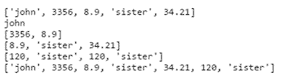 实际上，上述代码的操作与之前处理字符串的代码没有太大区别。执行时，程序输出：

在“print lista”这条语句中，我们打印了 `lista` 的内容。注意，每个元素都被视为其对应索引的整体，例如，元素‘john’被视为索引为 0 的列表中的一个单一元素。

### Python 元组 (Tuples)

元组与列表（lists）的相似之处在于，它们都是对象的序列，但它们是不可变的。

你可以使用一组括号，也可以不使用括号来创建元组，你只需要确保在元组中想要包含的不同对象之间使用逗号即可。

#### 示例：

```python
Tup1 = ('science,' 'history', 2002, 2030)
Tup2 = (5, 9, 7, 4, 2)
Tup3 = "f", "b", "e," "t"
```

要写一个返回为空的元组，需要使用 `tuple()` 函数和一组空括号。

我们也可以处理被称为 Python 元组的内容。元组是一个有序的组件序列，这与列表相似，但有时很难看出它们之间的相似之处和不同之处。

我们在使用元组和列表时将看到的巨大差异在于，元组是不可变的。

元组一旦被创建，就无法修改。

元组用于编写写保护数据，而且它们的运行速度通常比列表更快，因为它们不能主动移动。元组通过圆括号 `()` 确定，其项之间也像我们在列表中看到的那样用逗号分隔。

我们然后可以使用切片操作符（slicing operator）来帮助我们提取一些想要使用的组件，但在编写代码或运行程序时，我们仍然无法更改这些值。

Python 元组与列表相似，区别在于在创建元组之后；你无法添加、删除或更改元组元素。元组元素应该包含在括号 `()` 之中。示例：

```python
#!/usr/bin/python3
T1 = () # 创建一个空元组，没有数据
T2 = (22,34,55)
T3 = tuple([10,23,78,110,89]) # 从数组创建元组
T4 = tuple("xyz") # 从字符串创建元组

print(t1)
print(t2)
print(t3)
```

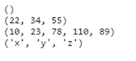print(t4)

将打印这 4 个元组的值：

有许多可以应用于元组的函数。

#### 示例：

```python
#!/usr/bin/python3
T1 = (23, 11, 35, 19, 98)
print("the minimum element in the tuple is", min(t1))
print("the sum of tuple elements is", sum(t1))
print("the maximum element in the tuple is", max(t1))
print("the tuple has a length of", len(t1))
```

执行时，它给如下结果：

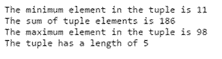

首先，我们调用了 `min()` 函数，它返回元组中的最小元素。然后我们调用了 `sum()` 函数，它返回元组元素的总和。`max()` 函数返回元组中的最大元素。`len()` 函数统计了元组中的所有元素并返回数量。

你可以使用切片操作符访问元组的某些元素，而不是全部。示例：

```python
#!/usr/bin/python3
t = (23, 26, 46, 59, 64)
```
print(t[0:2])

执行时，它打印：我们使用了切片操作符来访问元组中索引 0 到索引 2 的元素，注意元素从索引 0 开始。

### Python 字典 (Dictionaries)

Python 字典用于存储键值对（key-value pairs）。通过字典，你可以使用键来检索、删除或修改值。字典也是可变的，意味着一旦声明你就可以更改其值。

要创建字典，我们使用大括号。每个字典项都有一个键，后面跟着一个冒号和值。项与之间使用逗号分隔。示例：

```python
#!/usr/bin/python3
classmates = {
'john': '234-221-323',
'alice': '364-32-141'
}
```

我们创建了一个名为 `classmates` 的包含两个项的字典。注意键必须是可哈希类型（hashable type），但可以使用任何值。每个字典键必须是唯一的。第一个元素 john 是键，后面是值。第二个元素是另一个元素。访问字典元素使用字典名和键。示例：

```python
#!/usr/bin/python3
classmates = {
'john': '234-221-323',
'alice': '364-32-141'
}
print("the number for john is", classmates['john'])
```
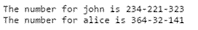print("the number for alice is", classmates['alice'])

最后两个语句帮助我们访问字典值。它打印：

要知道字典长度，如下运行 `len()` 函数：

```python
len(classmates)
```

上述将返回 2，因为字典有两个元素。

### 数据类型转换 (Datatype conversion)

Python 允许将数据从一种类型转换为另一种。从一种数据类型转换为另一种的过程被称为类型强制转换（type casting）。

如果你需要将 int 类型转换为 float 类型，可以调用 `float()` 函数。

#### 示例：

```python
#!/usr/bin/python3
height=20
print("the value of height in int is", height)
print("the value of height in float", float(height))
```

在上述示例中，`height` 被初始化为 20。我们调用了 `float()` 函数并将 `height` 作为参数。整数值 20 被转换为浮点值 20.0。程序打印如下：

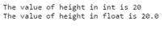

要将浮点类型转换为 int 类型，可以调用 `int()` 函数。示例：

```python
#!/usr/bin/python3
height=20.0
print("the value of height in float is", height)
```
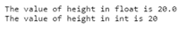print("the value of height in int is", int(height))

程序打印：我们调用了 `int()` 函数并将参数 `height` 传递给它。它将 20.0 转换为 20，这是一个浮点到整数的转换。

如果你需要将数字转换为字符串，可以调用 `str()` 函数。该数字随后将被转换为字符串。

示例：

```python
#!/usr/bin/python3
num=20
print("the value of num in int is", num)
```
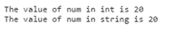print("the value of num in string is", str(num))

虽然值相同，但 Python 解释器的处理方式不同。浮点到字符串的转换也可以类似的方式进行。

### 第 2 章：变量运算符、类型及其用途


运算符是表示特定过程实现的符号。它们被用于操作程序中的数据。Python 使用不同类型的运算符。

### 算术运算符

#### 加法 (`+`)
加法运算符将运算符两侧的操作数相加：

```
>>> 12 + 8
20
```

#### 减法 (`-`)
减法运算符从左侧操作数的值减去右侧操作数的值。

```
>>> 40 – 3
37
```

#### 乘法 (`*`)
乘法运算符将运算符左侧和右侧的值相乘：

```
>>> 20 * 3
60
```

#### 除法 (`/`)
除法运算符将左侧操作数除以右侧操作数的值：

```
>>> 20 / 5
4.0
```

#### 幂 (`**`)
幂运算符将第一个操作数升高第二个操作数指定的幂。

```
>>> 4**4
256
```

#### 取模 (`%`)
取模运算符在执行左侧操作数除以右侧操作数的除法后返回余数。

```python
>>> 38%5
3
```

#### 整除 (`//`)
整除运算符执行左侧操作数除以右侧操作数的除法，并返回整数商，同时舍弃小数部分。

```
>>> 35//3
11
```

### 比较运算符

### 逻辑运算符
Python 支持 3 个逻辑运算符：

- **或 (Or)**: `x or y` 如果 `x` 为假，则计算 `y`；否则，返回 `x` 的计算结果。
- **与 (And)**: `x and y` 如果 `x` 为假，则返回 `x` 的计算结果；否则，如果 `x` 为真，则计算 `y`。
- **非 (Not)**: `Not x` 如果 `x` 为假，则返回 `true`；否则，如果 `x` 为真，则返回 `false`。

#### 输入输出

#### 输入
许多程序需要用户输入才能运行。输入可以来自键盘、鼠标点击、数据库、外部存储或互联网等源。键盘是收集用户输入的常用通道。因此，python 具有一个内置的 `input()` 函数来识别键盘输入。

##### `input()` 函数
Python 的 `input()` 函数通过一个名为提示字符串（prompt string）的可选参数交互式地收集键盘输入。每当调用输入函数时，程序都会显示提示字符串。程序执行将暂停，直到用户对提示输入响应。

为了说明这个函数，这里有一个从用户处收集姓名年龄信息的简单程序：

```python
Name = input("please, type your name: ")
Print("welcome, " + name + "!")
Age = input("how old are you, " + name + "? ")
Print("thank you. you are " + name + " and you’re " + age + " years old.")
```

当你运行程序并输入 `marky` 作为姓名，输入 `24` 作为年龄时，屏幕按行显示的内容如下：
```
please, encode your name: marky
Welcome, marky!
How old are you, marky? 24
Thank you. you are, marky, and you’re, 24 years old.
```

#### 输出
Python 内置的 `print()` 函数用于将数据输出到屏幕（这是标准输出设备）。`print` 命令的语法为：`print(value,)`。

以下是它的用法示例：

```
>>> print("i am a programming student.")
I am a programming student.
>>> print(25)
25
>>> print(4**3)
64
>>> xyz = 50
>>> print('the, value, of xyz is', xyz)
The, value, of xyz is 50
>>> animal = "rhinoceros"
>>> print(animal)
Rhinoeros
```

Python 允许打印多个值或变量，这些值在括号内必须用逗号分隔。例如，以下是一系列赋值：
```python
A = "under"
B = "16 years old"
C = "result"
```
假设你想按照要求打印上述值，可以写这样的 print 语句：
```python
>>> print("job requirements:", a, b, c)
Job requirements: under 16 years old result
```

##### 输出或字符串格式化
格式化选项允许用户创建更具读输出。python 提供了 `.format()` 方法来格式化字符串。大括号 `{}` 用作格式化值的占位符。

如果参数在 `.format()` 中的位置与你预期的顺序一致，你可以使用空括号：
```
>>> x = 50; y = 100
>>> print('the, value, of x is {} and y is {}'.format(x,y))
The value of x is 50 and y is 100
```

但是，如果你希望参数出现的顺序与它们在语句中的位置不同，你需要在大括号内指定索引。第一个参数的索引为 `0`，第二个参数的索引为 `1`，以此此类推。
```python
>>> x = 50; y = 100
>>> print('the, value, of y is {1} and x is {0}'.format(x,y))
The value of y is 100 and x is 50
```

这里是其他示例。这次值是给出的，而不是存储在变量中：
```
>>> print('i buy {}, {}, and {}'.format(apples, oranges, bananas))
I buy apples, oranges, and bananas.
>>> print('I collect {} and {}'.format(gold, silver))
I collect gold and silver.
```


这些运算符用于比较操作数的值，并识别它们之间的关系。它们包括等于 (`==`)、不等于 (`!=`)、小于 (`<`)、大于 (`>`)、大于或等于 (`>=`) 以及小于或等于 (`<=`)。

示例：

```python
#!/usr/bin/python3

N1 = 6

N2 = 5

If ( n1 == n2 ):
    Print ("the two numbers have equal values")
else:
    Print ("the two numbers are not equal in value")

If ( n1 != n2 ):
    Print ("the two numbers are not equal in value")
else:
    Print ("the two numbers are equal in value")

If ( n1 < n2 ):
    Print ("n1 is less than n2")
else:
    Print ("n1 is not less than n2")

If(n1 > n2 ):
    Print ("n1 is greater than n2")
else:
    Print ("n1 is not greater than n2")

N1,n2=n2,n1 #the values of n1 and n2 will be swapped. n1=5, n2=6

If ( n1 <= n2 ):
    The code, will print the following:

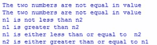
```

`n1` 的值为 6，而 `n2` 的值为 5。在两个操作数上使用等于 (`==`) 运算符将返回假值，因为这两个操作数不相等。这将导致执行“else”部分代码。不等于 (`!=`) 运算符将返回真值，因为两个操作数的值不相等。在这种情况下，唯一看起来可能复杂的逻辑是值的交换。`n1` 的值从 6 变为 5，而 `n2` 的值变为 6。紧接在该交换语句下方的语句将使用这两个新值进行操作。

赋值运算符

这些是赋值运算符 (`=`) 与其他运算符的组合。赋值运算符的一个良好示例是 `+=`。表达式 `p+=q` 意味着 `p=p + q`。表达式 `p/=q` 意味着 `p=p / q`。赋值运算符涉及将赋值运算符与其他运算符结合。

示例：

```python
#!/usr/bin/python3

N1 = 6

N2 = 5

N3 = 0

N3 = n1 + n2
Print ("the value of n3 is: ", n3)

N3 += n1
Print ("the value of n3 is: ", n3 )

N3 *= n1
Print ("the value of n3 is: ", n3 )

N3 /= n1
Print ("the value of n3 ", n3 )

N3 = 2
N3 %= n1
Print ("the value of n3 is: ", n3)

N3 **= n1
Print ("the value of n3 is: ", n3)

N3 //= n1

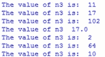
Print ("the value of n3 is: ", n3)
```

代码执行时将打印以下内容：
语句 `n3 = n1 + n2` 非常直观，因为我们只是将 `n1` 的值加到 `n2` 的值上。在表达式 `n3 += n1` 中，我们将 `n3` 的值加到 `n1` 并结果赋值给 `n3`。然而，注意在之前的语句中，在向 `n2` 加上 `n1` 后，`n3` 的值变为“11”。因此我们得到了 11+6，结果为 17。之后，变量 `n3` 的新值将是 17。表达式 `n3 *= n1` 意味着 `n3= n3 * n1`。这将是 17 * 6，结果为 102。这些运算符就是这样工作的！

成员运算符

这些运算符用于测试元素是否在元素序列中。元素序列可以是字符串、列表或元组。这两个运算符包括 `in` 和 `not in`。如果在序列中找到你指定的值，`in` 运算符返回真；如果在序列中未找到指定的元素，`not in` 将求值为为真。

示例：

```python
#!/usr/bin/python3

N1 = 7

N2 = 21

Ls = [10, 20, 30, 40, 50]

If ( n1 in ls ):
    Print ("n1 found in the list")
else:
    Print ("n1 not found in the list")

If ( n2 not in ls ):
    Print ("n2 not found in the list")
else:
    Print ("n2 found in the list")

N3=n2/n1

If ( n3 in ls ):
    Print ("n1 found in the list")
else:
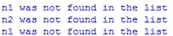
Print ("n1 not found in the list")
```

代码执行后将打印一次内容：
`n1` 的值为 7。它不是列表的一部分；这就是为什么使用 `in` 运算符返回假值的原因。这导致了“else”部分的执行。`n2` 的值为 21。这不在列表中。`in` 运算符返回假值。这导致了“else”部分的执行。

身份运算符

这些运算符用于比较两个位置的值。Python 有一个 `id()` 方法可以返回对象的唯一标识符。它有两个身份运算符：
is - 当运算符两侧的变量指向相同对象时，该运算符为真；否则为假。
is not - 如果运算符两侧的变量未指向相同对象，该运算符为假；否则为真。

示例：

```python
#!/usr/bin/python3

N1 = 45

N2 = 45

Print ('the initial values are', 'n1=', id(n1), 'n2=', id(n2))

If ( n1 is n2 ):
    Print ("1. n1 and n2 share an entity")
else:
    Print ("2. n1 and n2 do not share an entity")

If ( id(n1) == id(n2) ):
    Print ("3. n1 and n2 share an entity")
else:
    Print ("4. n1 and n2 do not share an entity")

N2 = 100
Print ('the values are', 'n1=', id(n1), 'n2=', id(n2))

If ( n1 is not n2 ):
    Print ("5. n1 and n2 do not share an entity")
else:
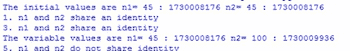
Print ("6. n1 and n2 share an entity")
```

代码执行时将打印以下内容：
注意，我对部分打印语句进行了编号，以便于区分。在第一次实例，变量 `n1` 和 `n2` 的值是相等的。输出的第一条语句显示了变量的值以及它们的唯一标识符。注意，标识符是通过使用 Python 的 `id()` 方法获得的，并将变量名作为参数传递给函数。表达式 `if ( n1 is n2 ):` 将求值为真，因为两个变量的值相等，或者或者它们指向相同的对象。这就是为什么执行了标记为 1 的打印语句！
你一定也注意到两个变量的唯一标识符是相同的。在表达式 `if ( id(n1) == id(n2) ):` 中，我们正在测试两个变量的 id 的值是否相同。这就是为什么标记为 3 的打印语句被执行了！


所有的程序（除了执行特定任务并退出的程序外）都至少包含一个循环。通常，这是主循环，程序在其中不断循环，等待用户或对象的输入以执行操作。

此外，循环也可以用于使用一组紧凑的指令对对象应用重复过程。

Python 提供了两种类型的循环：`for` 循环和 `while` 循环。它们都允许对特定操作进行重复循环，但在测试循环是否应该继续处理的方式上有所不同。

### For 循环

在 `for` 循环中，循环将在给定的项目范围内执行执行。

例如：

```python
for x in range(0,3):
    print(x)
0
1
2
```

在这个示例中有几点需要注意。

首先，语法与我们之前介绍过的 `if` 语句相似。`for` 循环以冒号 `:` 结束。

如果 `for` 循环中只有一条指令，我们可以将指令放在紧跟冒号的同一行。其随后的 `return` 将缩进到 `for` 循环之外的下一条指令。

如果 `for` 命令包含多条指令，请在下一行开始这些指令；它们将缩进以显示它们包含在循环内部。

在末尾输入空行将关闭循环，并降低缩进，以便处理循环之外的后续指令。

#### Range 命令

接下来，我们有 `range()` 命令。`range` 命令是一个 Python 内置方法，用于生成数字范围，它并不是 `for` 循环语法的明确部分。它只是用于生成迭代的数字。与 Python 中的其他范围一样，提供的数字并不代表从 0-3 的范围。它们代表从 0 开始输出三个数字，即 0、1 和 2。`range` 不输出 3。

这与你可能在其他语言中熟悉的 `for` 循环略有不同。在那些语言中，给定范围通常包含定义的最后一个数字——例如，从 `x=1` 到 `10` 将输出 1 到 10，而不是 1 到 9。

虽然我们使用 `range()` 函数来生成 `for` 循环中迭代的数字，但这绝不是唯一的选择。我们可以从任何可迭代源中提取数值并以迭代该源。例如，我们可以使用列表、元组或字符串的 `length` 来处理该项目。

```python
x=['apples', 'oranges', 'bananas', 'peaches', 'plums']
for y in x:
    print(y)
apples
oranges
bananas
peaches
plums
```

在这种情况下，重要的一点是我们正在顺序遍历列表值并将 `y` 设置为这些值。我们没有将 `y` 设置为 0 到 4 的位置值。如果我们使用 `print(x[y])` 或打印列表中位置 `y` 的字符串——我们将得到一个说明 `y` 不能为字符串（str）的异常。

要使用位置数字遍历列表，我们必须将 `y` 设置为数值范围并以此进行迭代。

```python
for y in range(0, len(x)):
    print(x[y])
apples
oranges
bananas
peaches
plums
```

通过这种方法更容易获取列表中的每个 `x` 值。`range` 方法包含一个 `step` 值，允许我们以除 1 以外的步长步进列表。例如，要获取列表中的每隔一个项目，我们将使用：

```python
for y in range(0, len(x), 2):
    print(x[y])
apples
bananas
```

或者反向获取列表：

```python
for y in range(len(x)-1, -1, -1):
    print(x[y])
plums
peaches
bananas
oranges
apples
```

### While 循环

`while` 循环在指定条件为真时持续执行。例如：

```python
y=1
while y<=10:
    print(y)
    y+=1
1
...
10
```

在这种情况下，只要 `y` 小于或等于 10，循环就会继续。与指定在指定范围内执行的 `for` 循环不同，`while` 循环只要指定条件为真就会继续；因此，`while` 循环可能会变成无限死循环。

为了防止这种情况，循环内部必须包含在该时刻使条件变为假的代码。在这种情况下，`y+=1` 在每次循环执行时会让 `y` 加 1。当 `y` 变为 11 时，循环结束。如果你犯了错误导致程序陷入死循环，可以通过按下 `ctrl-c` 退出程序。

#### Break 命令

`break` 命令是优雅退出 for 或 while 循环的另一种方法。`break` 命令强制循环立即终止。在 `if` 语句中，`break` 可以根据条件提前退出循环。在大多数情况下，选择使用哪种循环并正确设计循环内的代码将消除对 `break` 的需求。

### 类和方法

我们学习了如何通过条件进行分支，以及如何高效地重复一组指令。要探索的下一个高级复杂性是函数。函数是一个执行特定重复任务的代码块，它可以是模块化的并被另一个代码调用。我们在书中的第一个示例查看了一个计算圆柱体积的小程序。这是一个应该写成函数的示例。它是一个定义明确永远不会的任务。通过将代码放在函数中，我们可以编写一次并根据需要调用多次，而无需在程序中重写它。此外，我们可以从一个程序中提取该代码并在任何需要的程序中使用，只要正确调用它。这种“编写一次，随处使用”的属性是 Python 等面向对象编程工具的关键优势。它不仅节省了开发时间，还节省了调试和部署时间，因为代码只需要编写和调试一次。

我们最初计算圆柱体积的程序看起来像：

```python
import math
### 分变量
R=5 # 半径
H=10 # 高
V=0 # 体积
### 计算圆柱体积
V=(math.pi*math.pow(r,2))*h # 体=(π*r²)*h
### 输出结果
print(v)
```

如果我们有一个更大的程序，想要计算各种圆柱的体积，我们可以在程序内需要的地方复制并粘贴这段代码，它就能工作。更好的处理方法是将其转换为函数。

理想情况下，良好的函数应该是完全自给自足的。我的意思是，它们应该只依赖于局部变量（不使用全局变量）。函数所需的任何值都应该从外部传递，它们产生的任何结果都应该返回给调用源。因此，在这种情况下，我们需要设置函数接受半径和高度作为参数。从提供的参数，我们可以计算体积并将该值返回给调用代码。

Python 结构语法使得这变得简单。基本格式如下：

```python
def functionname(arg1, arg2,..):
    # 要执行的代码
    return return-value
```

函数名可以是不是保留字或程序中已使用的引用的任何内容。`arg1`、`arg2`、… 是接受来自调用代码数值的变量。


参数将是函数的局部变量，并遵循与 Python 中任何变量相同的规则。

函数并不要求这些参数，但在大多数情况下它们会被使用。

要运行的代码是任何 Python 代码，这些代码是函数执行任务所必需的。

末尾的 `return` 命令会将你指定的任何变量的值传回调用代码。

`return` 调用也不是必须的，但在大多数情况下会使用它。

因此，将我们的圆柱体积计算转换为函数，它看起来看起来像这样：

```python
import math

### 定义函数
def cylindervol(r, h): # r=半径, h=高度
    V=(math.pi*math.pow(r,2))*h #体积=(π*r²)*h
    return v # 返回体积

### 输出结果
print(cylindervol(5, 10)) # 打印圆柱的体积，r=5, h=10
```

所以，我们所做的是取实际计算所需的重复代码，并将其放入我们命名为 `cylindervol` 的函数中。

该函数接受两个参数——`r` 表示半径，`h` 表示高度。这两个参数是完成计算所需的全部。

我们然后进行该计算并将结果放在 `v` 中，然后将其返回给调用者。

与其简单地从 `print()` 语句中调用函数，我们可以像这样给调用赋值一个变量：

```python
Vol = cylindervol(5,10)
```

`Vol` 将等于 785.3981633974483 —— 或者说是函数的返回值。由于此函数仅依赖于调用者传递它的值，因此它是完全可移植的，只要以相同的方式调用它，就可以在任何程序中使用。这一事实允许我们构建到下一个层次，即类。

类通常被定义为一组相关的函数。我们目前已经建立了计算圆柱体积的代码，我们可以在此基础上进行扩展，创建一个体积类，其中包含计算圆柱体积和立方体体积的函数。

```python
import math

#### 定义类
class volume(object):
    def cylindervol(self, r, h): # r=半径, h=高度
        self.v=(math.pi*math.pow(r,2))*h #体积=(π*r²)*h
        return self.v

    def cube_vol(self, l, w, h):
        self.v=(l*w*h)
        return self.v

### 输出结果
Vi=volume() # 创建 volume 类的实例
V=vi.cylindervol(5,10) # 通过调用 volume 类中的 cylindervol 设置 v
print(v) # 打印结果
V=vi.cube_vol(5,10,10) # 通过调用 volume 类中的 cube_vol 设置 v
print(v) # 打印结果
```

在这个示例中，我们创建了一个名为 `volume` 的类。在其中，我们定义了两个方法——在类中，函数被称为方法——一个是 `cylindervol`，另一个是 `cube_vol`。这些方法与我们对应的独立函数使用的参数相同，但有一个例外：第一个参数 `self`。

在面向对象编程中，`self` 的值通常用于引用由类创建的对象实例。

在我们上面的代码中，我们首先通过给变量赋值来创建类的实例（`vi=volume()`）。`self` 术语用于访问赋值给 `vi` 实例的类特定值。这允许不同的实例对同一个变量拥有不同的值，并允许我们测试这些值。

一个清晰的例子可能是，如果我们正在创建一个赛车游戏，我们可以有一个 `car` 类。该类可以有方法为“汽车”对象分配属性或其他变量。如果 unique 通过调用 `cara=car()` 和 `carb=car()` 创建两辆汽车，`cara` 的 `self` 属性将指向不同的汽车对象 `carb`。这两个对象可以为类定义的变量存储不同的值。

一旦创建了对象 `vi`，我们就可以按照调用函数的方式调用它的方法。唯一的区别是我们使用点语法调用方法（`v=vi.cylindervol(5,10)`）。通过这样做，我们调用了特定对象的方法并利用了该实例特有的任何属性。

为了提高可用性和可移植性，Python 允许我们单独保存此类文件并将其作为一个整体导入到其他文件中。我们可以创建一个名为 `volume.py` 的文件，并在其中包含一系列旨在处理我们想要添加的任何计算的类和方法。该文件可以单独保存并在需要时导入我们的项目中。Python 允许定义 `main` 函数。以下代码用于定义并执行该函数。

```python
def main():
    # 主代码
    if __name__ == "__main__":
        main()
```

`def main():` 与主代码开始之间的空格是必须的。如果不包含它将抛出异常。第二个语句是 `if`，确保代码只从主文件调用。如果你始终使用该代码并错误地将其包含在模块或库中，`main()` 将 own 调用，因为 `__name__` 属性将被设置为模块名，而不是 main。由于 Python 在加载文件时会从头开始执行文件，因此这些代码应该在你的主文件早期被调用。虽然 `main()` 函数不是必须的，但与不使用它相比具有许多优势。首先，作为一个函数，`main()` 中使用的变量将是局部的。如果没有 `main()` 函数声明，主文件之外的所有变量将是全局的。最后，这允许从加载的模块安全地调用 `main` 函数。从模块加载 `main` 函数为调试提供了更多选项。

### 无限循环

你应该始终意识到循环编程中最大的问题：无限循环。无限循环是不停止的循环。而且由于它们从不停止，它们很容易让你的程序无响应、崩溃或占用你所有的计算机资源。这里有一个与上一个类似的示例，但没有计数器和 `break` 语句的使用。

```python
>>> while (true,):
print("this will never end until you close the program")
```

只要可能，始终在你的循环中包含计数器和 `break` 语句。这样做可以防止你的程序出现无限循环。

### Continue,

`continue` 关键字就像 `break` 的软版本。它不是跳出整个循环，`continue` 只是跳出当前一次循环并直接回到循环状态。例如：

```python
>>> password = "secret"
>>> use_input = ""
>>> while (use_input != password):
    use_input = input()
    continue
print("this will not get printed.")
Wrongpassword
Test
secret
>>> _
```

当这个示例用于 `break` 关键字时，程序只会请求一次 `use_input`，无论你输入什么，并且只要输入任何内容都会结束循环。相反，这个版本将持续请求输入直到你输入正确的密码。


这是一个实际应用，可以帮助你更好地理解 `continue` 语句的作用。

```python
carbrands = ["toyota", "volvo", "mitsubishi", "volkswagen"]

for brands in carbrands:
    if (brands == "volvo"):
        continue
    print("i have a " + brands)
```
Output:
```
I have a toyota
I have a mitsubishi
I have a volkswagen
```

当你在解析或循环序列时，会有某些项目是你不想处理的。你可以使用 `continue` 语句来跳过你不想处理的项。在上面的示例中，程序没有打印 "i have a volvo"，因为当选中 volvo 时，它触发了 `continue`。这导致程序返回并处理列表中的下一个汽车品牌。

### 函数的语法

函数的语法看起来所示所示：

```python
def function_name(parameters):
    """docstring"""
    statement(s)
    return [expression]
```

以下是函数语法的详细拆解：

- `def` 关键字：这标记了函数头部的开始。
- `function_name:`：这是一个标识函数的唯一名称。函数名的规则与我们在书开头学到的变量规则几乎相似。
- `parameters`（参数）或 `arguments`（参数）：值通过包含在括号 `()` 中传递给函数。`parameters` 是可选的。
- 冒号 `:`：标记函数头的结束。
- `"""docstring"""`：`(docstring)` 是可选的文档字符串。它描述了函数的用途。
- `statement(s)`：必须有一个或多个有效语句组成函数体。注意，这些语句是缩进的（通常是制表符或四个空格）。
- 可能有一个可选的 `return` 语句，用于从函数返回一个或多个值。

### 创建和调用函数

要使用你在脚本中创建的函数，你需要从 Python 提示符、程序或函数中调用它。

### 练习 55：创建一个函数

```python
def greeting(name,):
    """this function greets the user when
    The person’s name is passed in as
    A parameter"""
    print ("greetings,", name + "!")
```

你可以简单通过输入函数名称以及相应的参数来调用函数。修改之前的练习 55 代码，查看如何调用函数 `greeting`。

### 练习 56：调用函数

```python
def greeting(name,):
    """this function greets the user when
    The person’s name is passed in as
    A parameter"""
    print ("greetings,", name + "!")

userame = str(input("enter your name: "))
greeting(userame,)
```

练习 55 中的代码首先定义了一个名为 `greeting` 的函数，它需要一个参数 `name`。它会提示用户输入一个字符串，该字符串将被赋值给变量 `userame`，并在调用函数 `greeting` 时作为参数使用。

### 文档字符串 (Docstring)

紧跟在函数头部后的字符串文本被称为文档字符串，简称为 `docstring`。函数的这部分是可选的，它简要说明函数的功能。每当你创建一个新函数时，包含一个描述性的 `docstring` 是一个良好的习惯，因为你（或以后以后阅读你代码的另一个程序员）可能需要它来理解函数的作用。请务必记录你的代码！

我们已经详尽地解释了 `greeting` 函数的作用。如你所见，我们使用了三引号字符串使描述可以跨多行。在函数的属性中，docstring 通过 `__doc__` 可用。例如，`greeting` 函数将像练习 57 那样出现在 `print()` 函数的输出中。

### 打印 docstring

```python
def greeting(name):
    """this function greets the user when
    The person’s name is passed as
    An argument."""
    print ("greetings,", name + "!")

print (greeting.__doc__)
```

# 返回语句 (Return statements)

函数中可选的 `return` 语句用作出口返回到调用处。`return` 语句的语法如下：`return [expression list]`

`return` 语句可以包含求值以返回值的表达式。如果语句中没有表达式或函数中没有包含 `return` 语句，则定义的函数在调用时将返回一个 `None` 对象。我们的练习 55 到 57 返回了 `None` 值，因为我们没有包含 `return` 语句。

```python
def age_group_checker(age):
    """this function returns the
    User’s age group based
    On the age entered."""
    if age >= 18:
        age_group = "adult"
    elif age >= 13:
        age_group = "teen"
    elif age >= 0:
        age_group = "child"
    else:
        age_group = "invalid"
    return (age_group)

age = int(input("enter your age to check group:"))
print ("your group is:", age_group_checker(age,))
```

# 函数参数 (Function arguments)

在 Python 中，你可以使用以下四种形式参数之一来调用函数：
- `默认参数` (default arguments)
- `强制参数` (required arguments)
- `关键字参数` (keyword arguments)
- `可变参数` (variable-length arguments)

如果在函数调用参数中没有指定值，默认参数将假设默认值。

### 默认参数

```python
def studentinfo(name, gender="male"):
    """this function prints info passed in the function parameters."""
    print ("name:", name,)
    print ("gender:", gender)
    return

studentinfo (name="john")
studentinfo (name="mary", gender="female")
```

在练习 59 中，你可以看到我们为参数 `gender` 指定了默认值 `"male"`。当我们在值中没有定义 `gender` 时，将使用默认值。

### 强制参数

强制参数必须按照定义的精确顺序传递给函数。如果未按正确顺序传递，或者传递的参数多于或少定义的数量，将遇到语法错误。

### 关键字参数

函数调用与关键字参数有关。这意味着当在函数调用中使用关键字参数时，调用者通过参数名称来标识参数。通过这些参数，你可以乱序放置参数，甚至完全跳过它们，因为 Python 解释器能够将提供的值与提供的关键字匹配。

```python
def studentinfo(name, age):
    """this function prints info passed in the function parameters."""
    print ("name:", name,)
    print ("age:", age)
    return

studentinfo (age=21, name="john")
```
注意，在练习 60 的关键字参数中，参数的顺序是不重要的。


注意，星号被放置在包含非关键字变量参数值的元组名称之前。如果在调用函数时没有定义额外的参数，则该元组将保持为空。

### 第 4 章：文件操作

文件（File）是一个可以用于存储数据的名称和内存位置。保存文件允许你可以在将来需要时访问它们。python 通过 `file` 对象来处理文件管理。

## 文件操作

Python 支持 4 种基本的文件相关操作，即：

1. 打开文件
2. 读取文件
3. 写入文件
4. 关闭文件

### 文件打开模式

一个 python 文件可以使用不同的模式打开。熟悉这些模式对于确保文件的安全性和完整性至关重要。

这些模式可用于以二进制格式访问文件：
- `rb+` 以读写二进制模式打开文件
- `wb+` 以写读二进制模式打开文件：重写同名文件，或创建一个新文件
- `ab+` 以追加和读取二进制模式打开文件

这些是文件打开状态的示例：

```python
file_obj = open("myfile.txt") # 以默认模式打开文件
file_obj = open("myfile.txt", "w") # 以写入模式打开文件
file_obj = open("pict.bmp", "rb+") # 以读写模式打开二进制文件，
```

### 关闭文件

关闭文件是 python 文件管理和维护中的重要步骤。关闭已打开的文件可以释放所使用的资源，防止数据被意外修改或删除，并指示 python 将数据写入到你的文件中。

以下是打开和关闭文件的语法：

```python
file_obj = open("myfile.txt") # 打开 myfile.txt
file_obj.close() # 关闭已打开的文件
```

### 写入文件

本节将说明你如何向 python 文件写入数据。

首先，要构建一个文件，使用 'w'（写入）模式打开一个新文件，并创建一个新的文件对象以便访问文件：
```python
>>> file_obj = open("afile.txt","w") # 打开一个名为‘afile.txt’ 的新文件
```

现在，使用 `write()` 方法将字符串写入 `afile.txt`：
```python
>>> file_obj.write("a file is used to store important information.\n") 47
```

注意，它返回字符串中的字符数。同样地，字符串带有换行符 `\n` 被写入，告诉 python 将其保存为单独的一。

```python
>>> file_obj.write("you will use a file object to handle python files.\n") 51
>>> file_obj.write("you can store program information on a file.\n") 45
```

现在你已经完成了对 `afile.txt` 的写入，必须关闭文件：
```python
>>> file_obj.close()
```

### 读取文件

在 python 中有不同的方法读取文本文件：

1. `readlines()` 方法
2. `while` 语句
3. 使用迭代器
4. `with` 语句

### `readlines()` 方法

`readlines()` 方法是 python 中打开文件最简单的方法之一。它利用 `file` 对象来访问并读取整个文件。然后你将创建一个变量来存储读取的文件，并使用 `print` 查看文件。

为了进行说明，使用以下代码打开 `afile.txt`：
```python
file_obj = open('afile.txt', "r")
```

现在，创建一个变量 `lines` 来存储来自 `readlines()` 方法的文本：
```python
>>> lines = file_obj.readlines()
```

要访问文件内容，在提示符上输入 lines：
```python
>>> lines
['a file is used to store important information.\n', 'you will use a file object to handle python files.\n', 'you can store program information on a file.\n']
```

### 使用 `while` 循环逐行读取

简单的 `while` 循环是按行读取文件的更高效的方法。这里有一个简单的 `while` 循环：
```python
### 以只读模式打开 myfile.txt:
file_obj = open('myfile.txt')
### 读取第一行
line = file_obj.readline()
### 继续读取每一行直到文件为空
while line:
    print(line)
    line = file_obj.readline()
file_obj.close()
```
当你运行 `while` 循环时的输出如下：
```
a file is used to store important information.
you will use a file object to handle python files.
you can store program information on a file.
```

### 使用迭代器逐行读取

使用迭代器是另一种按行读取文本文件的方法。这里有一个简单的 `for` 循环，你可以用它遍历 `myfile`：
```python
fo = open('myfile.txt')
for line in fo:
    print(line)
fo.close()
```
你的输出将与 `while` 循环逐行读取相似：
```
a file is used to store important information.
you will use a file object to handle python files.
you can store program information on a file.
```

### 使用 `with` 语句

`with` 结构有助于安全打开文件并允许 python 在不使用 `close()` 方法的情况下自动关闭文件。你也可以用它来读取文件的每一行。这里有一个可以读取每行的 `with` 块：

```python
line_count = 0
with open('myfile.txt', 'r') as newfile:
    for line in newfile:
        print(line)
        line_count += 1
print(f"Total lines: {line_count}")
```


```python
>>> file1.close(d)
False

>>> _
```

### 从文件中读取

在继续之前，请在你的文本编辑器中打开 `sample_file.txt`。在其中输入“hello world”并保存。回到 Python。

要读取文件的内容，请使用 `read()` 方法。例如：

```python
>>> file1 = open("sample_file.txt")
>>> file1.read()
'hello world'
>>> _
```

#### 文件指针

每当你访问文件时，Python 都会设置文件指针。文件指针就像你文字处理器中的光标。对文件进行的任何操作都从文件指针所在的位置开始。

当你打开一个文件，并且它被设置为默认访问模式（即“r”，只读模式）时，文件指针被设置在文件的开头。要了解文件指针的当前位置，你可以使用 `tell()` 方法。例如：

```python
>>> file1 = open("sample_file.txt")
>>> file1.tell()
0
>>> _
```

你对文件执行的大部分操作都会移动文件指针。例如：

```python
>>> file1 = open("sample_file.txt")
>>> file1.tell()
0
>>> file1.read()
'hello world'
>>> file1.tell()
11
>>> file1.read()
''
>>> _
```

要将文件指针移动到你指定的位置，你可以使用 `seek()` 函数。例如：

```python
>>> file1 = open("sample_file.txt")
>>> file1.tell()
0
>>> file1.read()
'hello world'
>>> file1.tell()
11
>>> file1.seek(0)
0
>>> file1.read()
'hello world'
>>> file1.seek(1)
1
>>> file1.read()
'ello world'
>>> _
```

`seek()` 方法有两个参数。第一个是 `offset`（偏移量），根据第二个参数设置指针的位置。此外，该参数需要提供参数。

第二个参数是可选的。它是 `whence`（起始位置），决定了“寻”从哪里开始。它的默认值为 0。

- 如果设置为 0，Python 将指针的位置设置为 `offset` 参数的值。
- 如果设置为 1，Python 将指针的位置设置为相对于指针当前的位置，或在当前位置的基础上。
- 如果设置为 2，Python 将指针的位置设置为相对于文件末尾，或在文件末尾的基础上。

注意，最后两个选项需要访问模式具有二进制访问权限。如果访问模式没有二进制访问权限，最后两个选项将用于确定指针的当前位置 `seek(0, 1)` 以及文件末尾的位置 `seek(0, 2)`。例如：

```python
>>> file1 = open("sample_file.txt")
>>> file1.tell()
0
>>> file1.seek(1)
1
>>> file1.seek(0, 1)
0
>>> file1.seek(0, 2)
11
>>> _
```

#### 文件访问模式

要向文件写入，你需要了解更多 Python 中的文件访问模式。有三种文件操作：读取、写入和追加。

- **读取**（Reading）允许你访问并复制文件的任何部分。
- **写入**（Writing）允许你覆盖文件内容并创建一个新文件。
- **追加**（Appending）允许你在保持其他内容完整的同时向文件写入内容。

访问模式有两种类型：字符串和二进制。字符串访问允许你像打开文本文件一样访问文件内容。二进制访问允许你以最原始的形式访问文件。

在你的示例文件中，使用字符串访问允许你读取“hello world”这一行。使用二进制访问文件则将允许你以二进制格式读取“hello world”，结果为 `b'hello world'`。例如：

```python
>>> x = open("sample_file.txt", "rb")
>>> _
```

字符串访问适用于编辑文本文件。二进制访问适用于任何其他情况，如图片和可执行文件。在本书中，你将只学习如何处理文本文件。在 `open()` 函数的 `mode` 参数中，你可以输入多个值，但你不需要记忆所有的组合。你只需要知道这些组合即可。

每个字母代表一种访问模式和操作：
- `R` = 只读——文件在开头
- `R+` = 读和写
- `A` = 追加——文件在末尾
- `A+` = 读和追加
- `W` = 覆盖——文件重置为 0
- `W+` = 读和覆盖
- `B` = 二进制

默认情况下，访问模式被设置为字符串。你需要添加 `b` 来允许二进制访问。例如：“rb”。

向文件写入

在向文件写入时，你必须始终记住 Python 是覆盖而不是插入。例如：

```python
>>> x = open("sample_file.txt", "r+")
>>> x.read()
'hello world'
>>> x.tell()
0
>>> x.write("text")
4
>>> x.tell()
4
>>> x.read()
'o world'
>>> x.seek(0)
0
>>> x.read()
'texto world'
>>> _
```

你可能期望类结果是“hello world”。类的方法会重置指针。

练习题

为了练习，你需要完成以下任务：
1. 创建一个名为 `test.txt` 的新文件。
2. 在文件中写入类练习说明。
3. 关闭文件并重新打开。
4. 将指针置回 0。
5. 使用追加模式打开文件。
6. 在文件末尾添加重写版本。
7. 创建一个类并包含 `test.txt` 的内容。

### 第 5 章：面向对象编程

### 类与面向对象编程

Python 是一种面向对象的编程语言。这意味着它关注对统称为对象的数据结构的操作。对象可以是 Python 中命名的任何内容，包括字符串、函数、整数、类、浮点数和文件。对象可以作为参数传递，也可以赋值给变量、列表、元组、字典或集合。

类是一种数据类型，类似于字符串、列表或字典。类属于一个名为 `type` 的类型。存储在类内部的数据值被称为属性，而与类相关的函数被称为方法。当你从类创建对象时，该对象被称为类的实例。

#### 定义类

类定义语句以 `class` 关键字开始，后面跟着类标识符和冒号。按照惯例，类名大写字母开头。类定义行后面是提供类简短描述的文档字符串。

这是一个类定义的示例：

```python
class Furniture:
    #这是一个类定义的示例
    pass
```

下面定义了一个接收对象的类：

```python
class Members(obj):
    #我刚刚定义了一个接收对象的类
    pass
```


访问 `myclass` 的属性：

```python
>>> myclass.y
100
```

访问 `myclass` 的函数属性：

```python
>>> myclass.get
<function myclass.get at 0x03025d20>
```

访问 `myclass` 的文档字符串（docstring）：

```python
>>> myclass.__doc__
'this is an independent class.'
```

### 创建类实例

与类一同创建的类对象可以用于创建该类的实例。创建一个新对象非常简单；你只需要使用赋值语句将该对象赋值给类：

```python
>>> object_a = myclass()
```

要访问对象的属性，你将使用对象名作为点 `.` 之前的的前缀，并在点之后使用属性名。对象的属性可以是方法，也可以是数据属性。方法指的是类中的函数。为了说明，你可以使用上面的 `myclass` 类定义并用它创建一个对象：

```python
obj = myclass()
```

`myclass.get` 是 `myclass()` 的属性，它是一个方法对象，因为它为从 `myclass` 创建的所有对象都定义了一个函数。因此，`obj.get` 是一个方法对象。

```python
>>> obj.get
<bound method myclass.get of <__main__.myclass object at 0x0328db90>>
```

在 `myclass` 函数定义中，你可能注意到单词 `self` 被用作参数。但在上面的示例中，调用方法 `obj.get` 时没有传递参数。这是因为当对象调用其方法时，对象本身会变成第一个参数。按照惯例，使用 `self` 来指该对象。如果有其他参数，你可以将它们放在 `self` 之后。

### `__init__` 方法

`__init__` 方法是一个特殊的类构造器方法，用于初始化它创建的对象。每当你创建一个类的类的实例时，python 都会调用这个初始化方法。`__init__` 方法至少接受一个参数 `self`，用于标识每个对象。

#### 示例：

类 `performers`：

```python
def __init__(self):
```

类 `performers(object)`：

```python
class performers(object):
    def __init__(self, name, skills, salary):
```

该类定义表明，每当创建 `performers` 类的实例时，每个实例都将拥有通过 `__init__` 方法初始化的变量拷贝。

为了说明，你可以使用以下表达式实例化类 `performers` 的成员：

```python
mem_1 = performers("dolly", "singer", 5000.00)
mem_2 = performers("jayne,", "dancer", 5000.00)
mem_3 = performers ("lizah", "pole dancer", 4750.00)
```

使用 `print()` 函数来查看初始化的变量与实例变量之间的关系：

```python
print(mem_1.name, mem_1.skills, mem_1.salary)
print(mem_2.name, mem_2.skills, mem_2.salary)
print(mem_3.name, mem_3.skills, mem_3.salary)
```

这就是你在屏幕上会的内容：

```
Dolly singer 5000.0
Jayne, dancer 5000.0
Lizah pole dancer 4750.0
```

### 第 6 章：python 列表基础

### 什么是列表？

列表是一个封装在方括号 `[]` 中并用逗号分隔的有序项序列。列表是可变的，这意味着其项的值及其索引位置可以被更改。

```python
list = [item0, item1, item2, …, item-1]
```

列表是 python 中最重要的数据结构之一，每个功能性程序都必须具备。幸运的是，它们也是最易操作的结构之一。就像我们在上一章中看过的字符串一样，列表可以通过索引访问，第一个项的索引从 0 开始，最后一个项的索引为 -1。

#### 创建列表

在 python 中创建列表，只需将一个或多个用逗号分隔的值封装在括号中并赋值即可：

```python
subjects = ["math", "physics", "chemistry", "biology", "history"]
mylists = ["pencil", "scissor", 20, ["fruits", "snacks"]]
print(subjects)
print(mylists)
```

你注意到练习 2 中的第二个列表内部还包含另一个列表吗？那种类型的列表被称为嵌套列表，即包含一个或多个列表的列表。就像我们在上一章中看到的字符串类型一样，列表类型是 python 中的一种顺序数据类型，我们将学习如何对其进行切片、拼接等操作。首先，让我们看看如何访问它的值。

### 访问值

我们将使用方括号通过引用它们在列表中的位置来切片列表中的项。

```python
subjects = ["math", "physics", "chemistry", "biology", "art"]
print(subjects[0:2])
print(subjects[2:])
print(subjects[-3:-1])
```

你将发现，我们在处理字符串时学到的切片和索引方法在列表上的用法是完全相同的。也许你可以练习创建一个大列表，然后自己尝试我们目前为止学过的所有切片和访问操作。

### 更新和删除列表值

我们已经提到 python 中的列表是可变的，这意味着我们可以更新其顺序项的内容和顺序。你可以使用赋值运算符 `=` 来更新列表的单个或多个元素，将列表名和索引作为左操作，新值作为右操作。

### 添加列表项

```python
subjects = ["math", "physics", "chemistry", "biology", "history", "art"]
print("current list items:", subjects)
subjects[3] = "government"
subjects[1] = "french"
del subjects[-1]
print("new list items:", subjects)
```

当你运行练习 14 时，你会注意到列表项 "government" 被添加到索引 3 处替换 "biology"，而索引 [1] 的第二个项 "physics" 被替换为 "french"。我们使用 `del` 语句删除了列表中的最后一项。从列表中删除项目的另一种方法是使用 `remove()` 方法，我们将在下面简要介绍。

### 使用内置函数和方法的的基础列表操作

我们还可以对列表执行更多的操作，包括拼接（使用 `+` 合并）和迭代（使用星号 `*`）。

### 列表的更多操作

此练习通过将已知识应用于列表，帮助你巩固对序列的现有理解。

```python
cont = ["asia", "africa", "america", "europe", "australia"]
oceans = ["pacific", "indian", "atlantic"]
print("length of list 1:", len(cont))
cont[2] = "north america"
cont.append("south america")
print("new length of list 1:", len(cont))
print("list 1 + list 2:", cont + oceans)
oceans.remove("indian")
print(oceans)
print("list 2 * 3:", oceans * 3)
print("are 'ia' in either of the lists?", 'ia' in cont or oceans)
```


### 元组 (Tuples)

元组与列表相似，创建它们非常简单；只需用逗号分隔值，这些值也可以包含在括号中。例如，`tup1 = ('chemistry', 'physics', 1998, 2000)`，`tup2 = (7, 8, 9)`，`tup3 = "x", "y", "z"`。

以下是元组的一些基本特征：
* a) 编写空元组时使用两个括号 – `tup1 = ()`
* b) 即使元组包含单个值，也必须包含逗号——`tup1 = (50,)`
* c) 元组中的索引从 0 开始，并且可以进行切片。
* d) 使用方括号访问元组中的值。
* e) 不能更改或更新元组中的值。
* f) 不可以删除元组元素；但是，可以使用 `del` 删除整个元组。
* g)可以使用所有通用运算符。有几个内置的元组函数，例如：
    * 用于比较不同的元素 - `cmp(tuple,1, tuple,2)`
    * 找到元组的总长度 - `len(tuple,)`
    * 将列表转换为元组 – `tuple(seq)`
    * 找到最大值 – `max(tuple,)`
    * 找到最小值 – `min(tuple,)`

### 什么是元组？

元组用于将任意数量的项目组合成单个顺序复合值。当在长度未知或不固定时使用列表，而元组（因为其顺序元素无法更改）则用于每个元素的位置对列表的使用至关重要的情况。

### 创建元组

在 Python 中创建元组对象的过程与创建任何其他类型（如我们已经涵盖的数字、字符串或列表）的对象是相同的。只需放置用逗号分隔的值，并将它们封装在括号或中括号中。

语法格式如下：
`tuple_identifier = (item1, item2, item3, …, item-2, item-1)`
`tuple_identifier = item1, item2, item3, …, item-2, item-1`

创建元组时并非强制需要圆括号，正如我们在下方的练习 17 中所示。事实上，序列中任何一组用逗号分隔且没有使用方括号等将其转换为列表的标识符的值，默认都是元组。然而，一种良好的做法是始终将序列项封装在括号中。

### 创建元组

1. `weekdays = ("sun", "mon", "tue," "wed", "thu", "fri", "sat")`
2. `weekends = "sun", "mon"`
3. `years = (2017,)`
4. `decade = ()`
5. `print (type(weekdays), type(weekends), type(years), type(decade,))`

注意，当你创建一个包含单个元素的元组时，它必须有一个逗号，就像练习 17 中的 `years` 元组一样。你可以通过识别一对内容空的括号来创建一个空元组，就像我们在上一个练习中创建 `decade` 元组一样。

### 访问元组值

与字符串和列表一样，元组的值是顺序排列的，可以通过从 0（第一个项目）到 -1（最后一个项目）的索引来访问。我们使用方括号 `[]` 来切片和操作元组，与列表的情况相同。在下一个练习中，你将学习像处理字符串和列表一样访问和操作元组数据类型的元素。

### 访问元组的值

```python
1 weekdays = ("sun", "mon", "tue," "wed", "thu", "fri", "sat") 2
3 print(weekdays)
4 print("first day of the week is", weekdays[0])
5 print("print items [2:]", weekdays[2:])
6 print("what is item index [-1]?", weekdays[-1])
7 print("print from first to second last items:", weekdays[:-2])
```

你可以从练习 23 中看到，随字符串引入的元组索引系统仍用于元组数据类型。例如，访问项目 `tuple[0:3]` 意味着访问第一个到第四个（不包含）的项目。

### 更新元组值

我们已经学习过元组是一个不可变数据类型，这意味着它的值不能更改。然而，如果你想更改值，必须从现有的元组创建一个新元组。

### 从现有元组创建新元组

```python
1 tuple = (2002, 2006, 2010) 2 tuple = ("brazil", "italy", "spain") 3
```

注意，当你合并两个元组时，结果是一个新元组。例如：
```python
5 tuple = (1, 2, 3)
6 tuple = (4, 5, 6)
7 tuple = tuple + tuple
8 print(tuple)
```

注意类名在前，后面是方法名，然后是括号内的参数。该函数期望两个参数值，即参数 `ax` 和 `bx` 的值。如果你传递了多于两个甚至一个值，将返回错误。

### 元组的内置函数

元组带有内置函数，帮助你理解操作是如何工作的。


### 第 8 章：类

### 类和对象

Python 是一种面向对象的语言。这意味着类可以组合数据和方法。类可以组合数据以及操作这些数据的方法。通过点符号（.）访问类方法。

### 类定义

在 Python 中定义类，我们使用 `class` 关键字。它后面应该跟着一个冒号。

一旦定义了类，你就可以在内部创建方法和函数。这些有助于数据处理。

```python
#!bin/python3

class pythonmaths:
    def add(ax,bx):
        addition = ax + bx
        print(addition)

    def subtract(ax,bx):
        subt = ax - bx
        print(subt)

    def multiply(ax,bx):
        multiplication = ax * bx
        print(multiplication)

    def division(ax,bx):
        div = ax / bx
        print(div)
```

我们定义了一个名为 `pythonmaths` 的类。该类有一些方法。要访问任何方法，你必须使用类名、点（`.`）和方法名。例如：

```python
pythonmaths.add(2,3)
```


类的方法也可以从类内部被调用。这要求我们创建一个类的实例，并将用于访问类方法。示例：

```python
#!/usr/bin/python3

class class2():
    def firstmethod(self):
        print("the first method")

    def secondmethod(self, astring):
        print("second method, string alongside:" + astring)

    def main():
        # 实例化类并调用方法
        C = class2()
        C.firstmethod()
        C.secondmethod(" we are now testing")

if __name__== "__main__":
    main()
```

该代码执行时打印以下内容：


`self` 参数通常是指代对象本身。这就是为什么我们使用 `self` 这个词，它是 Python 中的一个关键字。在方法内部使用时，`self` 指向正在操作的对象的特定实例。每当你在 Python 中看到 `self` 关键字时，都要知道它指的是实例方法的第一个参数。它被用于访问成员对象。然而，你会注意到，当我们调用代码中的两个方法（即 `firstmethod()` 和 `secondmethod()`）时，我们从未指定 `self` 关键字，因为 Python 会替我们完成这一点。在调用实例方法后，Python 知道如何自动传递 `self` 参数，无论其被提供。这意味着你可以选择提供或不提供。我们创建了类 `class2` 的实例，并命名为 `C`。这是通过以下行实现的：

```python
C = class2()
```

`C` 是 `class2` 类的一个对象。这意味着可以使用该对象来访问类的所有方法和属性。你只需要关心非 `self` 参数即可。注意在 `secondmethod` 中如何在初始文本后追加了一个字符串。

### 内置属性

某些内置属性被所有类保留，为了访问这些属性，我们使用与其他属性类似的点运算符。这些包括：

- `__dict__`: 这是一个包含类命名空间的字典。
- `__doc__`: 类的文档字符串，如果未定义则为 None。
- `__name__`: 类的名称。
- `__module__`: 定义该类的模块名称。在交互模式下，该属性变为 `__main__`。
- `__bases__`: 这是一个元组（可能为空），按照它们在基类列表中出现的顺序添加了基类。

示例：

```python
#!/usr/bin/python3

class worker:
    '这是基类。所有实例共有的'
    workcount = 0
    def __init__(self, name, age):
        self.name = name
        self.age = age
        worker.workcount += 1
    def showcount(self):
        print ("the total number of workers is %d" % worker.workcount)

    def showworker(self):
        print("name : ", self.name, ", age,: ", self.age,)

worker1 = worker("gishon", 26)
worker2 = worker("esther", 24)
print("worker.__doc__:", worker.__doc__)
print("worker.__name__:", worker.__name__)
print("worker.__module__:", worker.__module__)
print("worker.__bases__:", worker.__bases__)
print("worker.__dict__:", worker.__dict__)
```

该代码执行时打印以下内容：

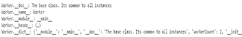

### 垃圾回收

有时，内存可能会被不再需要的对象占用。Python 会自动清理内存，这个过程被称为垃圾回收。通过这种方式，Python 可以收回不再使用的内存块。垃圾回收器在程序执行时启动，并在一个对象的引用计数达到零时运行。对象的引用计数会随着指向它的别名数量而变化。当新名称被赋值或添加到如元组、列表等容器中时，值会减少；一旦其引用超出作用范围或引用被重新赋值，值也可能减少。

示例：

```python
Ax = 5
Bx = ax
Bz = [bx]
...
```

人们无法察觉垃圾回收器何时删除了一个孤立实例。但是，在 Python 中，类可以实现一个名为 `__del__()` 的析构方法，它会在特定对象被销毁时被调用。任何未被实例使用的内存资源都可以为此方法清理。`__del__()` 析构方法通常会显示即将销毁的实例的类名。

示例：

```python
#!/usr/bin/python3

class region:
    def __init__(self, ax=0, bx=0):
        self.ax = ax
        self.bx = bx
    def __del__(self):
        class_name = self.__class__.__name__
        print(class_name, "already destroyed")

rg1 = region()
rg2 = rg1
rg3 = rg1
print (id(rg1), id(rg2), id(rg3)); # 打印对象 ID
del rg1
del rg2
del rg3
```

该代码打印：

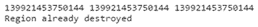

对你最好的想法是将类创建在一些单独的文件中。你可以使用 `import` 语句将这些类导入到主程序中。假设上述代码位于 `region.py` 文件中且没有执行代码，那么我们可以这样做：

```python
#!/usr/bin/python3

import region
rg1=region.region()
```

### 继承

在 Python 中，你不需要从零创建类，而是可以继承某个类，通常被称为“父类”。父类应该放在新类定义的括号内。

由于父类具有某些属性，新类（即子类）被允许以此方式使用这些属性。子类还可以重写父类的方法和数据成员。

Python 继承采用以下语法：

```python
class derivedclassname(classname):
    derived_class_body
```

示例：

```python
#!/usr/bin/python3

### 处理类的示例文件
class parentclass:
    def firstmethod(self):
        print("the first method in parentclass")

    def secondmethod(self, astring):
        print("we are testing" + astring)

class childclass(parentclass):
    def firstmethod(self):
        parentclass.firstmethod(self)
        print("firstmethod for child class")

    def secondmethod(self):
        print("childclass secondmethod")

def main():
    # 测试类
    C = childclass()
    C.firstmethod()
    C.secondmethod()

if __name__== "__main__":
    main()
```

该代码执行时打印如下：

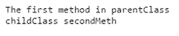

在 `childclass` 中我们没有定义 `firstmethod`，但我们从 `parentclass` 获得了它。这就是 Python 中继承的工作方式。子类继承了父类的方法。

另一个示例：

```python
#!/usr/bin/python3

class worker:
    '所有工人的通用类'
    workcount = 0
    def __init__(self, name, wage):
        self.name = name
        self.wage = wage
        worker.workcount += 1
    def showcount(self):
        print ("total workers %d" % worker.workcount)

    def showworker(self):
        print("name : ", self.name, ", wage,: ", self.wage,)

worker1 = worker("bosco", 2500)
worker2 = worker("june", 3000)
worker1.showworker()
worker2.showworker()
```


```python
Print (“total workers %d” % worker.worker, rcount)
```

上述代码清晰地演示了如何创建一个类的实例，并使用它来访问父类的成员或方法。执行后它会得到以下结果：

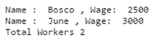

我们创建了 `worker` 类的两个实例，即 `worker1` 和 `worker2`。每个实例都是一个 `worker`，第一个是 `bosco`，第二个是 `june`。我们使用这些实例来访问类中定义的 `showworker` 方法。该方法返回 `worker` 的名称和工资。

### 多重继承

在 python 中，一个可以同时继承多个类。这在 `java` 和 `c#` 等语言中是不行的。python 的多重继承采用以下语法：

```python
Class childclass(parentclass1, parentclass2, …):
    # 初始化函数
    # 方法
```

### python 多重继承示例：

```python
#!/usr/bin/python3

Class parentclass1():
    Def supermethod1(self):
        Print(“calling supermethod1”)

Class parentclass2():
    Def supermethod2(self):
        Print(“calling supermethod2”)

Class childclass(parentclass1, parentclass2):
    Def childmethod(self):
        Print(“the child method”)

Ch = childclass()
Ch.supermethod1()
Ch.supermethod2()
```

该代码将打印：


我们定义了两个方法，一个在第一个父类中，另一个在第二个父类中。子类继承了这两个类。它访问了在这两个类中定义的方法。这就是我们在 python 中继承多个类的方法。

### Python 构造函数

构造函数是指一种类函数，用于实例化对象并赋予某些预定义的值。它应该以双下划线（`__`）开头。它是 `__init__()` 方法。示例：

```python
#!/usr/bin/python3

Class worker:
    workername = “”
    Def __init__(self, workername):
        self.workername = workername
    Def sayhello(self):
        Print(“welcome to our company, " + self.workername,)

Worker1 = worker(“june,”)
Worker1.sayhello()
```

代码执行时会打印以下内容：


我们所做的是使用构造函数来获取用户名。

### 重写类方法

在编写 python 代码时，我们允许重写父类中定义的方法。你可能在子类中需要不同的功能，这就是重写父方法的良好理由。要重写该方法，我们只需要像下面所示向它传递不同的参数：

```python
#!/usr/bin/python3

Class parentclass: # 定义父类
    Def firstmethod(self):
        Print (‘a call to parent method’)

Class childclass(parentclass): # 定义子类
    Def firstmethod(self):
        Print (‘a call to child method’)

C = childclass() # 子类的实例
C.firstmethod() # 子类调用被重写的方法
```

代码执行后将打印以下内容：


方法 `firstmethod` 在父类中已经定义。该函数在子类中定义，但这次它打印的内容与在父类中打印的内容不同。我们实现了方法重写。

### 示例 2：

```python
#!/usr/bin/python3

Class ab():
    Def __init__(self):
        self.ax = 2
    Def method1(self):
        Print(“method1 from ab”)

Class bc(ab):
    Def __init__(self):
        self.bx = 2
    Def method1(self):
        Print(“method1 from bc”)

Bc = bc()
```

`Bc.method1()`

代码执行后将打印以下内容：

### 创建重写类

重写类是基于之前的类（也称为父类或子类）创建的新类。如果你没有跟上请不要担心。这是 python 的高级用法，仅用于教学目的。重写类的输出与普通类相似。区别在于：在函数中创建了另一个类（例如 `c2 =`），将返回定义的父类，并返回重写类的信息。

输入代码：

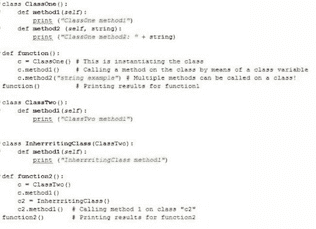

返回输出：


### 创建新类

```python
Class newclass:
    """这是我们的第一个类。它的作用是
    显示字符串文本和变量名的值,””
    Name = str(input“输入你的名字,:))
    Def greeting(name):
        Print (“hello”, name,)
    Print(newclass.name,)
    Print(newclass.greeting)
    Print(newclass.__doc__)
```

当你运行脚本 61 时，控制台会显示什么？

### 创建对象

到目前为止，我们学会了如何使用对象来访问类的属性。我们还可以使用这些对象来实例化类的实例，这非常类似于调用函数。

```python
object = newclass()
```

在上面的示例中，创建了一个名为 `object` 的新实例对象。该对象可以使用类名名前缀访问 `newclass` 的属性。在这种情况下，属性可能包括方法和变量。对象的方法是类的对应函数，这意味着类定义了对象的方法。例如，因为 `newclass.greeting` 是 `newclass` 的函数对象，`object.greeting` 将是一个方法。

### 构造函数

在 python 中，`__init__()` 函数是特殊的，因为它在实例化类的新对象时会被调用。该对象也被称为构造函数，因为它用于初始化所有变量。

```python
Object.greeting() # classnumbers:
    Def __init__(self, x = 0, y = 0):
        self.real = x
        self.imagined = y
    Def getnumbers(self):
        Print (“complex numbers are,: {0}+{1}j”.format(self.real, self.imagined))

object = complexnumbers(2, 3) # 创建一个新的 complexnumbers 对象
object.getnumbers() # 调用 getnumbers() 函数
object2 = complexnumbers(10) # 创建另一个 complexnumbers 对象
object2.attr = 20 # 创建新属性 ‘attr’
Print ((object2.real, object2.imagined, object2.attr))

object.attr # 因为 object 没有属性 ‘attr’ 而产生错误
```

在上面的练习中，我们定义了一个表示复数的数类。我们定义了两个函数：初始化变量的 `__init__()` 函数和用于正确显示数字的 `getnumbers()` 函数。注意练习对象的属性是动态创建的。例如，`object2` 创建了新属性 `attr`，但 `object` 没有。


```python
object2 = complexnumbers(10) # 创建另一个 complexnumbers 对象
object2.attr = 20 # 创建一个新属性 ‘attr’
Print((object2.real, object2.imaginary, object2.attr))

del complexnumbers.get_numbers

object1.get_numbers()
```

当你在 exercise_64 中运行脚本时得到的错误显示属性 `get_numbers()` 已经被删除。但请注意，由于在创建对象的新实例时会在内存中创建一个新实例，因此在对象被删除后，该对象仍可能继续存在于内存中，直到垃圾回收器自动销未引用的对象。

### 第 9 章：流程控制

流程控制

循环是一种程序控制结构，它有助于复杂的执行路径以及对一个语句或系列语句的重复处理。

### for 循环

for 循环用于迭代顺序数据类型（如字符串、列表或元组）中的项。

**语法：**

```python
For val in sequence:
    statement(s)
```

在“for 循环”中，变量在每次迭代中持有序列中项的值。循环将一直持续，直到所有项都被处理完毕。

**示例：**

**遍历字符串的 for 循环：**

```python
For letter in ‘programming’: # 遍历字符串
    Print('<<*', letter, '*>>')
```

运行上述代码，输出将是：

```
<<* p *>>
<<* r *>>
<<* o *>>
<<* g *>>
<<* r *>>
<<* a *>>
<<* m *>>
<<* m *>>
<<* i *>>
<<* n *>>
<<* g *>>
```

请注意，当“for 循环”到达字符串中的最后一个字母时，打印结束。

**遍历列表的 for 循环：**

```python
### 遍历列表
Dogs = ['rottweiler’, ‘pug’, ‘bulldog’, ‘beagle,’ ‘poodle,’]

For name, in dogs:
    Print('happy dog :', name,)
    Print("lovely dogs!")
```

这里是运行程序时的输出：

```
Happy dog : roweiler
Happy dog : pug
Happy dog : bulldog
Happy dog : beagle,
Happy dog : poodle,
Lovely dogs!
```

#### 在 for 循环中使用 range() 函数

`range()` 函数是一个内置函数，可以与“for 循环”配合使用以获取数字。例如，如果你需要总数 1 以及从 1 到 10 的所有数字，你可以通过此程序创建一个“for 循环”：

```python
x = 10
Total = 0
For num in range(1, x+1):
    Total = total + num
Print("sum of 1 up to %d: %d” % (x, total))
```

你的输出将是：

`Sum of 1 up to 10: 55`

### while 循环

当需要在测试表达式为真重复执行一个语句或一组语句时，使用“while 循环”。当表达式不再为真时，控制将传递到循环之后的行。

**语法：**

```python
While condition:
    statement(s)
```

**示例：**

```python
### 程序累加数字到用户指定的数字
### total = 1+2+3+4…+number
Num = int(input(“enter a number: “))
### 初始化总和计数器
Total = 0
Y = 1
While y <= num:
    Total = total + y
    Y = y+1 # 更新计数器
### 打印总和
Print(“the total is: “, total)
```

```
enter a number: 3
The total is: 6 #1+2+3
enter a number: 7
The total is: 28 #1+2+3+4+5+6+7
```

#### break 语句

`break` 语句终止循环并将控制传递到循环后的第一个语句。它通常用于需要快速退出的情况。

**语法：**

```
Break
```

**示例：**

```python
### 一旦达到指定的颜色，循环结束
Colors = [blue,” “pink”, “green”, “yellow”]
For x in colors:
    If x == ‘green’:
        break
    Print('color :’, x)
    Print("interesting loop!”)
```

运行程序并查看结果：

```
color : blue
interesting loop!
color : pink
```

#### continue 语句

`continue` 语句跳过当前迭代中的语句，并将控制传递到下一次迭代。

**语法：**

```
Continue
```

为了说明，你可以将上述示例中的 `break` 语句替换为 `continue` 语句。

```python
Colors = [blue,” “pink”, “green”, “yellow”]
For x in colors:
    If x == ‘green’:
        continue
    Print('color :’, x)
    Print(“an amazing loop!”)
```

当你运行程序时，输出如下：

```
color : blue
an amazing loop!
color : pink
an amazing loop!
```

请注意，当它到达‘green’时，它跳过了打印语句。

##### pass 语句

`pass` 是 Python 中的一个空操作。解释器读取 `pass` 但什么都不做。它通常用作语法要求需要语句时的占位符。程序员通常会使用 `pass` 语句来代替代码。

**语法：**

```
Pass

### 第 10 章：字典

字典是键值对的集合。

**语法：**

```python
dict
object2 = complexnumbers(10) # 创建另一个 complexnumbers 对象
object2.attr = 20 # 创建一个新属性 ‘attr’
Print((object2.real, object2.imaginary, object2.attr))

del complexnumbers.get_numbers

object1.get_numbers()
```

你在 exercise_64 中运行脚本时得到的错误显示属性 `get_numbers()` 已经被删除。但请注意，由于在创建对象的新实例时会在内存中创建一个新实例，因此在对象被删除后，该对象仍可能继续存在于内存中，直到垃圾回收器自动销未引用的对象。

### 第 9 章：流程控制

流程控制

循环是一种程序控制结构，它有助于复杂的执行路径以及对一个语句或系列语句的重复处理。

... (此处省略重复翻译内容，根据指令要求不重复原文)

dict 的 keys.

这里是字典的一些常用操作：

**创建一个空字典：**

```python
>>> x={}
```

**创建一个字典：**

```python
>>> x=dict(name=’john’, age=35, height=6)
>>> print(x)
{‘name,’: ‘john’, ‘age,’: 35, ‘height’: 6}
```

**测试键是否存在：**

```python
>>> if ‘age,’ in x.keys():
    print('found it!’
Found it!
```

**获取键的值：**

```python
>>> y=x[‘height’]
>>> print('height = ' + str(y))
height = 6
```

**列出所有键：**

```python
>>> for y in x.keys():
    print(y)
name,
age,
height
```

**打印键和值：**

```python
>>> for y in x.keys():
    v=x[y]
    if type(v)!=‘str’:
        v=str(v)
    print(y + ‘=’ + v)
name=john
age=35
height=6
```

**更新键的值：**

```python
>>> x[‘age,’]=40
>>> print(x)
{‘name,’: ‘john’, ‘age,’: 40, ‘height’: 6}
```

**删除键值对：**

```python
>>> del x[‘height’]
>>> print(x)
{‘name,’: ‘john’, ‘age,’: 40}
```

**添加键值对：**

```python
>>> x[‘height’]=6
>>> print(x)
{‘name,’: ‘john’, ‘age,’: 40, ‘height’: 6}
```

**规则：**

1. 在向字典添加或创建字典时，如果键不存在，则会抛出异常。
2. 如果向字典添加键值对且键已存在，旧值将被丢弃。
3. 只有在提供键时才能更新值。
4. 键值对总是整体删除的——没有办法单独删除值或单独删除键。
5. 列表不能作为键。


在 python 中创建字典对象最流行的方法是像我们在本书中创建其他对象类型一样，为一个空字典对象命名。一旦创建了字典，你就可以根据需要添加键:值对。

### 创建字典并添加键:值对

```python
mydict = {}
mydict ["name"] = "jane"
mydict ["age"] = 21
mydict ["city"] = "london"
mydict ["hobbies"] = "cycling", "coding", "cooking", "gaming"
print (mydict)
```

在这次练习中，我们在脚本的第一行创建了一个名为 `mydict` 的空字典。从第三行到第六行，我们向空字典添加了键:值对，最后打印了字典 `mydict` 的内容。

创建字典的另一种方法是如练习 27 所示，为命名的字典对象赋值键:值对。

### 通过赋值键:值对创建字典

```python
mydict = {"name": "jane", "age": 21, "gender": "f", "city": "london"}
print (mydict)
```

你会注意到，键:值对输入字典的顺序并不重要，因为是通过键而不是索引来访问它们的，所以它们总是以不同的顺序打印。

创建字典时必须遵守的一条规则是：键必须是唯一的，但值不需要唯一。键是不可变的，而值可能是可变的数据类型，例如字符串、数字或列表。

### 访问字典的键:值对

字典数据不是排序的；因此，可以像我们处理字符串、列表和元组那样，在不需要索引的情况下独立访问它们。字典是一种复合对象类型，不能进行切片或索引。

Python 使用复杂的算法来映射字典的键。这使得访问、检索和更新字典键:值对比其他顺序对象类型快得多，这个过程被称为哈希（hashing）。

键用于访问字典的键:值对。下一个练习演示了我们如何访问字典的值。

### 访问字典键:值对

```python
weather = {"mon": "cloudy", "tue": "sunny", "wed": "rainy"}
print (weather["wed"])
```

如果你尝试访问不存在的键的值对，你将遇到错误 `KeyError: [key]`。

### 更新字典

你可以如下一个练习所示，向字典添加新的键:值对并修改或删除现有条目的值。

### 更新字典

```python
weather = {"mon": "cloudy", "tue": "sunny", "wed": "rainy"}
weather["thu"] = "hot"
weather["wed"] = "gloomy"
del weather["mon"]
print (weather["wed"])
```

在这次练习中，我们创建了一个名为 `weather` 的字典，带有日期:天气类型的键:值对，如所示。在第 3 行，我们添加了一个新的键:值对；在第 4 行更新更新了 "wed" 键的值；在第 5 行删除了 "mon" 的键:值对。你的脚本运行正常吗？

`del` 语句用于显式删除字典中的单个项目；要删除整个字典，则直接使用它。

### 使用内置函数和方法的字典基本操作

下一个练习中的表格总结了你在此阶段可以对字典执行的关键操作。你会发现我们已经遇到过之前创建的大多数对象。请尝试所有的字典操作，以理解每种操作是如何应用的。

字典函数和方法

```python
jane_doe = {"id": 7234, "height": "5.5", "weight": 212}
johnd = {"id": 2932, "height": "6.0", "weight": 190}
```


### 第 11 章：编写你的代码

### 练习 1：字典演示

```python
color = {0: "red", 1: "yellow", 2: "green", 3: "white"}
V = color.values()
for c in v:
    print (c)
```

输出：
Red
Yellow
Green
White

解释：
`color={0: "red", 1: "yellow", 2: "green", 3: "white"}` 是字典。
`color.values()` 返回字典 `color` 的所有值。
`for c in v` 循环按指定的次数重复代码块。`c` 存储每个元素的值。

### 练习 2：Isalpha 演示

```python
Name = raw_input("please enter your last name: ")
result = Name.isalpha() if result:
    print ("ok! valid last name!")
else:
    print ("no good! invalid last name!")
```

输出（假设输入 "swift"）：
Ok! valid last name!

解释：
如果所有字符都是字母，`isalpha()` 返回 true。如果用户输入数字或符号，`isalpha()` 将返回 false。在这里，用户输入了 "swift"，因为所有字符都是字母，`isalpha()` 返回 true。

### 练习 3：写与读文件

```python
F = open("tryfile.txt", "w")
F.write("i am learning python programming!")
F.close()
F = open("tryfile.txt", "r")
print(f.read())
F.close()
```

输出：
I am learning python programming!

解释：
`open("tryfile.txt", "w")` 以 "w" 模式打开 `tryfile.txt`。
`F.write("i am learning python programming!")` 将指定的文本写入文件对象 `f`。
`open("tryfile.txt", "r")` 以 "r" 模式打开 `tryfile.txt`。
`F.read()` 读取文件对象 `f` 中的数据。

### 练习 4：导入模块

```python
### program001.py
def red():
    print ("this flower is red")
def yellow():
    print ("this flower is yellow")
def green():
    print ("this flower is green")
```

```python
### program002.py
import program001
program001.red()
program001.yellow()
program001.green()
```

输出：
This flower is red
This flower is yellow
This flower is green

### 练习 5：类与对象

```python
class flower:
    def __init__(self, name, color):
        self.name = name
        self.color = color

f = flower("rose", "red")
print ("the flower's name is " + f.name)
print ("the flower's color is " + f.color)
```

输出：
The flower's name is rose
The flower's color is red

解释：
`class flower` 创建了一个名为 "flower" 的类。
`def __init__(self):` 定义了一个构造函数。构造函数用于初始化变量。


`self` 是一个变量，指的是当前对象 `f`。

### 结论

本书旨在帮助初级程序员学习 Python。通过这本书，你应该能够编写基础程序，甚至是编写包含多个对象的更复杂的程序。

对于希望在面向对象编程方面打下良好基础，并使用 Python 走向中级和高级编程主题的初学者来说，本书是一个完美的跳板。考虑到你已经走了这么远，你正走在通成为 Python 编程专家的正确道路上——无论你是为了职业发展，还是为了成为一名精通的业余爱好者。

我希望这本书能够帮助你快速、轻松地学习 Python 编程的基础知识，并激发你创造有意义的程序和实际应用。

下一步是通过参加 Python 编程高级课程，将你的学习提升到新水平，并获得所需的技能来开发更大、更复杂且高度实用的程序，从而利用这种编程语言的许多强大功能。

祝你好运！

## 第 2 本书：Python 数据科学

面向自学者的 Python 编程全面指南

Vera Poe

### 引言

本书的目的是教你数据科学的过程，同时为你提供所有基础技能和工具来支持你的学习过程。本书面向那些寻求简单方法理解数据科学基础的完全初学者。

由于对编程和数学知识的要求，使用 Python 学习数据科学有时可能会令望人生畏。

结果往往难以交流，因为它们可能是初学者难以理解的一长串数字。。你将学习一些基础工具，这些工具可以帮助你创建交互式图表，让你能够与他人分享结果。

请记住，为了从书中获得最大的益处，你应该完成每一节中提出的示例。如果你在理解某些示例时遇到困难，请逐行拆解，并缓慢攻克直到你理解这些概念。每一章都将教你所需的工具，展示如何安装它们，并提供足够的信息以便你也能独立操作。确保练习你所读到的所有内容，因为没有实际操作，你将无法完全理解理论。

在涉及数据科学时，我们有很多选项可以处理，几乎所有的企业都能处理这种过程并从中获得一些收益。如果你想更多地了解你的客户以及他们对你和你的业务期待什么，那么数据科学过程将是帮助你的最佳选择。

在开始本指南之前，我们将看看数据科学本质、它为什么重要，以及为什么我们最初就想要处理这个过程。然后我们将花一些时间学习数据科学的生命周期，以及我们需要经历一系列步骤，如寻找正确的数据、准备数据、提出正确的模型等。

然后，我们将花时间查看 Python 语言的基础知识，以及我们如何利用这些来帮助我们的数据科学项目。在数据科学方面，我们有很多优秀的编程语言可以处理，但也有很多棒的库可以帮助我们的数据科学项目。我们还将花一些时间查看几个与数据相关的库，包括 `numpy`、`seaborn` 和 `matplotlib`。这只是我们在数据科学方面可以做的一些奇事的开始。我们还将花时间研究机器学习的本质、不同类型的机器学习，以及我们如何利用它来发现数据中的模式。处理数据科学时我们可以获得很多益处，许多行业将通过此来确保我们能够处理所有数据。当你准备好处理数据科学时，请务必查看本指南。

### 第 1 章：什么是数据科学和分析

什么是数据科学？

数据科学是一个你听过几次的术语。如果你正在经营一家公司，必须考虑采取一些步骤来提高效率并降低风险，但这并解释太多关于数据科学的内容。这就是本指南大显身场的地方。

随着世界进入大数据时代，直到几年前，存储一直是各行业面临的主要挑战之一。当时的重点是公司可能收集数据，但没有地方存储它们。

现在，得益于我们所拥技术的某些变化，这不再是一个大问题。这意味着我们可以进行一些调整并处理越来越多的数据。你会发现，那种将这一切联系起来、不仅能帮助我们收集所需数据，还能确保我们能够学到所有数据中发现的内容的“秘诀武器”就在其中。

有很多公司正希望进入数据科学领域，因为它们知道随之而来的所有好处。当我们准备好处理这一切中的某些数据时，我们需要确保获取了正确的数据，并同时理解我们正在处理的所有信息。这些将在我们在过程中进行的数据分析中得到涵盖。


当我们开始这里的这项工作时，首先需要关注的是为什么数据科学如此重要，以及为什么公司在过程中可能需要处理数据科学流程。第一个问题是这些数据在现代世界中的结构化方式，尤其是与过去的方式相比。传统上，公司能够获取的数据规模较小，而且从始到终都是结构化的。这使得我们能够使用简单的商业智能工具来分析正在发生的情况。

然而，情况已不再如此。当然，这同时也带来了一些优点和负面影响。它让我们有机会了解更多关于某种的情况，因为我们可以收集数据并通过更多数据来理解更深的内容。但通常，这些数据是非结构化的，这使得分类和理解也变得更加困难。

与那些传统系统中发现的结构化且今天易于处理的数据不同，我们会发现我们大多数的数据是非结构化的，至少是半结构化的。这会让处理变得更加困难，并花费更长时间。但因为我们可以找到更多信息来帮助制定我们的决策，所以这并不总是一件坏事。

这些数据将产生许多不同的来源，包括仪器、传感器、多媒体形式、文本文件，甚至是过程中的某些财务日志。由于我们获取数据的来源如此众多，必须意识到我们无法使用某些简单的商业智能工具，因为它们无法处理所有数据。这就是为什么从事数据科学、使用更先进且复杂的算法和分析工具至关重要。这确保了我们能够真正从数据中分析并处理出有意义的见解。

根据汽车可以收集的数据，它可以做出决策来帮助驾驶，例如何时应该加速、在应该超车时减速，甚至在数据科学和高级机器学习算法的帮助下决定转向。

我们甚至可以利用数据科学的概念来帮助预测分析。例如，我们可以处理天气预报等方面的工作。来自卫星、雷达、飞机、船只等的数据可以被分析，以帮助我们建立现的一些模型。当我们能够预报天气的同时，预测我们希望的任何自然灾害的发生时，这些模型将非常有用。它还将帮助我们在发现这些情况时提前采取正确的措施，并在过程中帮助我们拯救许多生命。

### 我可以如何使用数据科学？

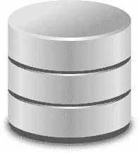

当我们涉及到数据科学时，最初产生的问题之一就是如何使用它。学习它看起来似乎是一件美事，就像我们可以为了好玩而使用它，但无论你身处哪个行业或计划如何使用它，使用数据科学都会带来许多实际用途。我们依赖数据科学的不同方式包括：

它可以帮助营销。营销完全关乎数据，当我们可以使用所有所需数据时，我们会发现自己可以更多地了解客户以及如何在正确的地点触达他们。这有助于公司进一步了解客户，算法处理数据的次数越多，它做这方面表现就越好。

这就是数据科学可以发挥作用的地方。欺诈会给金融机构带来巨大损失。如果它们在处理交易时不小心，就会赔钱。通过使用数据科学开发出可以识别并阻止欺诈的程序，每年可以节省数百万美元。

它可以加快贷款申请速度。银行和其他金融机构经常会收到大量的贷款申请。对于贷款员个人来说，这些工作量太大了。数据科学可以提供帮助。

在数据科学的帮助下，金融机构可以审核申请并判断哪些贷款是最好的，哪些不是。你可以设置申请需要满足的几个不同标准，然后根据结果进行处理。如果申请符合某些要求，那么它就是一个很好的选择。贷款员将获得这些申请并对其做出最终决定。但如果贷款申请不符合要求，它将被忽略，完全不会被看到。这有助于加快贷款申请流程，并让公司更高效。


它以多种方式帮助着医疗领域。数据科学过程可以从许多方面为医疗提供帮助。首先，我们可以看到数据科学将帮助医生完成手术。通过使用机器学习以及数据科学中带的其他算法，医生将能够进行更准确的切口，并以最少的问题完成手术，且缩短康复时间。

此外，这些算法将帮助医生对患者进行预后。由于医生的工作量不断增加，而他们留给每位患者的时间又有限，拥有这些技术将大有益处。他们可以利用数据科学查看现有的某些图像（如扫描图和 X 射线片），然后迅速获得诊断结果。

最后，在涉及医疗领域的行政任务时，我们甚至可以发现数据科学的应用。这些机器可以与客户交流，询问几个问题，并判断患者问题的严重程度，然后将他们引导至正确的地点。对于那些人员短缺、无法处理某些患者需求的领域来说，这非常有帮助。

它能帮助公司更多地了解其目前的竞争对手和所在的行业。如果你想击败目前的某些竞争对手，你就需要尽可能了解你行业和竞争对手的信息。你需要看到他们在做什么，客户对此反应如何，以及你如何利用这一点来让自己处于优势。

当你拥有了所有这些信息后，你会发现更容易找出哪些是有效的，哪些是无效的。然后你可以直接投入并对你的业务模式进行一些必要的调整。你可能会发现一种无人使用的触达客户的新方法。你可能可以对他人正在使用的技术进行一些改进，从而改善你自己的业务。

许多制造公司将与数据科学合作，因为它允许他们做出可以节省资金的预测。首先，你可以使用这类算法来确定机器上的某个部件何时可能损坏，或者你何时需要进行维护。然后你可以将这些工作安排在非工作时间进行，确保机器始终准时运行，并且在你们解决问题期间生产不会停止。


当需要寻找减少现有某些浪费的方法时，这些算法也适用于几乎任何业务。每家公司都会某种程度的浪费，找出如何减少和处理这些浪费，将使你能够以更具竞争力的价格提供产品，同时尽可能获得利润。这只需要通过数据科学找出这些浪费产生在哪里以及你如何将它们降到最低，非常简单。

当你在在线购物并看到网站上有推荐标签页时，我们正看到数据科学和机器学习的生命力。这些在许多网站上非常流行，因为它们可以方便客户就他们下一个想看的内容、下一个想买的东西或其他事情做出明智的决策，而企业也会喜欢它们，因为有了这些推荐系统，客户更有可能进行下一次购买，从而增加公司的底线。

列表上的下一项是语音识别过程。如果你曾向你的智能手机说话并提问，或者使用过像 Cortana 等流行设备，你就能意识到这个功能是多么有趣，而且它是根据数据科学的一些原理运行的。事实上，在涉及到数据科学时，我们能找到最好的例子就是语音识别。使用这些功能，如果你目前不方便打字信息，仍然需要对着机器说话并准确地提问。这意味着我们可能需要花一些时间研究程序并教它识别我们所说的一些内容，而这种过程背后的机器学习将通过经验和时间，能够学会更快、更高效地识别用户的语音。

如果你曾经用过某些帮助价格比较的网站，那么你那里也有数据科学在工作了。在基础层面，你会发现这些网站是通过通过馈流和 API 获取的大量数据驱动的。它们可以使用这些信息来计算来自不同网站和来源的相同产品的价格，以便你可以做出最佳决定并节省资金。这可以用于许多行业，帮助你比较价格并找出最适合你的选择。

当我们谈论类似航空公司航线规划的事务时，我们也可以看看这种技术是如何工作的。这个行业如果不小心，将会蒙受巨大损失。除了少数公司外，许多公司都在挣扎着维持所需的客座率并获得利润。考虑到目前高昂的油价以及对许多客户提供巨额折扣的需求，情况正在慢慢变糟。

没过多久，这些航空公司就开始与数据科学合作，看看他们如何能增加利润并获得更多收入，而不会吓走客户。这帮助他们确定了可以采取的一些战略性改进。今天，在数据科学的帮助下，这些航空公司可以：

- 对航班延误做出更好的预测。
- 决定应该投资哪种机型的飞机。
- 决定是应该直接在目的地着陆还是在中途停靠。
- 帮助推动一些客户可以加入的忠诚度计划。

接受这些变革的两家航空公司包括美国航空和西南航空，它们现在是世界上利润最丰的航空公司之一。


借助数据科学的帮助，这些公司以及更多企业已经能够确定最佳运输路线、最佳交付时间，以及最适合这些业务的运输模式。这有助于他们在过程中获得更高的成本效益和更多利润。此外，这些公司通过安装的 GPS 单元产生的数据可以为他们提供探索更多可能性所需的数据，并在在此过程中通过数据科学学习更多。

当谈到公司使用数据科学时，我们可以看到许多益处。在很多情况下，如果你不愿意至少使用一点数据科学，你会发现自己会落后。无论你正尝试解决什么种业务问题，或者你想在业务中解决什么问题，你都会发现与数据科学工作是帮助你的最好且最有效的方法之一。

### 数据分析


当我们谈到使用数据科学时，我们还需要看一些数据分析。这基本上是数据科学的一个子集，我们将在这里处理从许多不同来源收集的数据，然后使用算法来帮助我们理解所有这些数据的含义。

你可以使用我们想要的所有数据，如果愿意的话，我们可以填充许多数据仓库，但如果你不理解数据告诉了我们什么，那么这些数据就没那么重要了，你的公司也无法使用它们。这就是我们能够获取数据分析过程并使其发挥作用的地方。

为了帮助我们开始，数据分析是处理我们拥有的原始数据并对其进行分析以帮助我们对所有这些信息得出良好结论的过程或科学。与此相关的许多技术和过程已经自动化为算法和其他机械过程，这些过程可以在数据以原始形式存在时对其处理，然后将其转换为比以前更易阅读和理解的内容。

当数据分析被恰当使用时，它将帮助我们看到在其他某些情况下我们可能会错过的指标和趋势，因为我们收集和持有的数据太多了。这些信息随后可以被我们用来优化流程，帮助提高系统或业务的整体效率。

现在我们已经对数据分析的大致含义有了一些了解，是时候进入它的不同部分，以及我们如何利用它来让自己处于优势了。“数据分析”这一术语是非常广泛的，包含了许多不同类型的数据分析。任何可以接受数据分析技术以获取深入信息，并随后供人类用于改进业务某些方面的信息，都属于这个范畴。

让我们来看一个例子。许多制造公司会花时间记录不同机器的工作队列、停机时间和运行时间。然后，他们将获取包含这些信息的数据，并用它更好地计划工作负载应该何时以及如何发生。这有助于机器尽可能接近其峰值容量，在此过程中节省时间和金钱。

这只是数据分析能够帮助的任务之一，甚至防止生产中的瓶颈也是值得关注的好事。游戏公司可以使用这个过程为玩家设定合理的日程，以确保大多数玩家保持活跃，而不是流失并极少使用。另一个例子是内容公司，他们可以使用数据分析的不同部分来留住客户观看，甚至组织内容以获得他们所需的点击量和观看量。

在我们处理这一过程时，始终要记住，我们正在进行的分析是一个相当复杂的过程，而不是那种只需看一眼就能得出我们想要的答案的过程。如果你这样做，你最终会遗漏重要信息，特别是当你在处理大型数据集时。遵循正确的步骤可以对我们通过这项分析看到的结果产生巨大影响。我们可以使用的一些不同步骤包括：

- 我们开始这个过程的第一步是确定数据需求或数据是如何分组的。有很多可能性，包括数据按收入、人口统计和年龄等因素进行分离。数据值也可能是数值，或者可能按类别划分。
- 第二步是收集数据的过程。你有许多不同的来源可以获取所有这些信息。它可以来自你的员工、环境中的来源（如调查和社交媒体），甚至来自你的计算机系统。
- 一旦收集了数据并且你确定拥有了所需的数据，就是时候组织数据了，因为你是从各种来源收集数据的。你必须确保以一种合理的方式进行组织，并且算法能够快速读取，并在你进入该步骤时发现趋势以做出预测。在组织信息时，你可以选择想要使用的方法。你可以使用电子表格，或尝试某种擅长处理统计数据的软件。
- 一旦你能够按照你意的方式组织好数据，在分析发生之前，就需要对其进行彻底清理。这意味着数据科学家必须检查并洗刷数据，确保信息中没有发现错误或重复，或者数据是完整的。这一步需要一些时间，但它确保了在开始之前所有内容都已修复并准备就绪。

我们在这里必须记住的关键点是，这正是我们可以利用原始数据、对其进行分析，然后对这些信息得出良好结论的科学。这类工作中使用的过程和技术在许多情况下是自动化的，你会发现，当我们与正确的算法工作时，它能够将所有原始数据转换为人类可以消费的内容。企业想要使用这种过程并分析数据的主要原因是，当需要优化客户服务、你的表现以及如何帮助你的表现时，它是非常有用的。


在此处，我们需要花一点时间了解为什么这种数据分析将变得如此重要，以及为什么企业希望通过这些算法及其他手段，从他们最初收集到的数据中进行学习。这些公司发现，他们可以使用数据中的洞察和预测，但当数据量如此巨大，且所有这些数据都来自各种来源时，就需要大量的工作来梳理——靠人工手动处理的工作量实在太大了。

数据分析过程对于任何行业的任何企业来说都是有帮助的，因为它可以帮助他们优化性能。它还可以帮助他们完善自己的业务模式，并让他们更容易识别出某些更高效的方法来降低成本并解决问题。

……做出能够推动他们迈向未来的决策。这种分析还将帮助他们更多地了解现有的某些客户趋势，并帮助你提供对客户有效的新服务和产品。

### 数据分析的类型

我们在这里需要花时间考虑的是，清楚哪些类型的分析是你可以使用的。数据分析有很多变体，你可以选择最适合你需求的一个。虽然类型有很多，但我们将重点关注当你刚开始这一整个流程时最可能用到的几种。数据分析初学者可以关注的、且大多数数据科学家将处理的四种基本类型包括：

**描述性分析（Descriptive analytics）。** 这种分析花费时间来描述在选定期间数据中发生了什么。你可以查看诸如访问量是否增加，或者公司某产品的销售额与上个月相比是高是低。

**诊断性分析（Diagnostic analytics）。** 这种分析更侧重于为什么发生了某些事情，或者业务状况的根源。这种分析很有帮助，但它涉及更多元化的数据输入并在过程中进行一些假设。例如，销售额在某周缓慢是因为天气糟糕导致没人出门购物吗？还是因为你的某次营销活动出了问题，导致销量陷入困境？

**预测性分析（Predictive analytics）。** 这种分析将用于根据我们目前掌握的信息，帮助预测近期最可能发生什么。去年夏天天气暖和时销售额情况如何？有多少气象模型会告诉我们今年将有一个热夏，我们应该为过去见过的情况做更多准备？

正如我们所看到的，尽管这些分析之间存在某些差异，但它们都更侧重于处理数据并帮助我们从数据中心收集一些实用的洞察。通过分析准确且及时地处理这些数据并执行这些操作的需求将会更高，尽管目前还没有足够的专业人士来处理所有这些工作。

即使没有专业人士，公司也可以学习如何让数据分析发挥作用，并借此利用海量数据从中学习。公司正看到这样做的所有益处，并且他们喜欢这将帮助他们做出一些明智的决策。此类决策是由数据驱动的，因此他们看到很多好处，并看到如何战胜竞争对手。

### 数据分析的好处是什么？

当开始进行数据分析时，你很快就会发现整个过程也会带来许多益处。无论你处于哪种公司以及你的目标是什么，你都能获得很多益处。这个过程有很多步骤，但如果你花时间去学习，它是值得的。

数据分析帮助你理解你所在行业正在发生的情况。这是理解客户的最佳方式，但如果你花时间查看数据，它是非常值得的。

分析帮助你你.......是................到到到到到到到到的你你喜欢。

数据分析帮助你了解哪些趋势是……正在变化的……难以跟上。数据分析可以帮助你捕捉到一些有效的趋势。

数据分析帮助你了解产品的情况。这可以帮助你做出更明智的商业决策。在背后。

这个过程将是你战胜竞争对手的最佳方式之一。愿意查看数据并愿意观察趋势的公司将能够在他们的行业中获胜。

你会发现这些益处将帮助到你的公司。这在几乎每个行业中都是高需求。对于某些可能没有选择使用此类流程的小型公司，他们仍然可以在局部层面进行，并获得一些成果。


### 第 2 章：numpy 简介

### n 数组

你可以使用 numpy 构建复杂的数据结构，因为它们在存储数据方面非常强大；然而，它们在处理这些数据方面并不出色。在处理能力和速度方面，它们并不是最优的，而这在处理复杂算法时至关重要。这就是为什么我们要使用 `numpy` 及其 `ndarray` 对象，它的全称是“n 维数组”。让我们来看看 numpy 数组的属性：

- 它在传输数据方面是优越且快速的。当你处理复杂数据时，你希望内存能够高效地处理，而不是成为瓶颈。
- 你可以进行向量化。换句话说，你可以进行线性代数计算和特定的元素操作，而不需要被强制使用“for”循环。这对 numpy 来说是一个巨大的优势，因为 Python 的“for”循环消耗大量资源，这使得使用大量循环而不是 ndarrays 来处理数据的成本非常高。
- 在数据科学操作中，你将不得不使用某些工具或库，例如 `scipy` 和 `scikitlearn`。没有数组你就无法使用它们，因为数组是它们的输入，否则函数将无法按预期执行。

话虽如此，这里是创建 `ndarray` 的几种方法：

1. 取一个已有的数据结构并将其转换为数组。
2. 从头构建数组并稍后添加值。
3. 即使数据存储在磁盘上，也可以将其上传到数组中。

将列表转换为一维数组是数据科学过程中相当常见的操作。请记住，你必须考虑到此类列表包含的对象的类型。这将影响结果的维度。这里有一个仅包含整数的列表示例：

```python
In: import numpy as np

int_list = [1,2,3]
array_1 = np.array(int_list)

In: array_1
Out: array([1, 2, 3])
```

你可以像访问 Python 列表一样访问数组。你只需要使用索引，而且和在 Python 中一样，它是从 0 开始的。这种操作看起来就像是这样的：

```python
In: array_1[1]
Out: 2
```

现在，你可以像这样获取关于数组内部对象的更多信息：

```python
In: type(array_1)
Out: numpy.ndarray

In: array_1.dtype
Out: dtype('int64')
```

`dtype` 的结果与你运行的操作系统类型有关。在这个示例中，我们使用的是 64 位操作系统。

接下来，让我们看看如何从文件加载数组。n 维数组可以从文件中包含的数据创建。这里有一个代码示例：

```python
In: import numpy as np

cars = np.loadtxt('regression-datasets.csv', delimiter=',', dtype=float)
```

在这个示例中，我们通过向 `loadtxt` 方法提供文件名、分隔符和数据类型，告诉工具从文件创建一个数组。

### numpy 数组的重要性


当你开始处理那些旨在与 Python 配合使用的库时，你很快会注意到的一是是其中许多库将基于 numpy 数组。这意味着我们至少需要花一点时间来学习这些数组，以及如何让它们满足我们的一些需求。这些数组将帮助我们在数据科学中想要做的许多其他方面指引方向，因此学习如何让它们工作以及它们能做什么将产生巨大的影响。

我们首先需要看的是 numpy 数组到底是什么。我们经常会处理所谓的结构化数组（structured array）。这是一种结构体数组，类似于我们在语言中看到的结构。我们还会发现这些数组是同质的（homogeneous），这意味着它们只能包含相同类型的数据，因此，与其创建一个整数数组或浮点数数组，我们可以通过同质化来创建一个这样的数组。我们需要使用的空间越大，就越得在硬件上花费更多资金来维护它。

从开始，numpy 中的数组将比我们在 Python 列表中中看到的要更紧凑。一个普通的 Python 列表大约需要 20 MB 或更多的数据来处理，如果你在处理过程中使用更长或更复杂的列表，这个数字还会增加。但如果你使用 numpy 数组并且是单精度浮点数，它大约只有 4 MB。这可以帮助我们快得多地获取信息，而且当你已经在处理数据分析或包含大量信息的数据科学项目时，你的其他部分占用的空间越少，对你就越有利。

此外，你会发现，在读取和写入项目方面，选择使用数组比使用列表要快得多且更容易处理。这将帮助你更快速地处理你想要处理的一些数组，并确保你更快速地完成任务。当你有数据需要处理并且正在进行机器学习时，你会发现从长远来看，这一切都是非常有用的。

现在，起初，Python 列表和 numpy 数组之间的空间或速度差异可能看起来并大不了。但你会发现，在很多时候，这对于你尝试通过某些代码实现的目标至关重要。

如果你只是处理百万个单元格，这可能没关系，但当你处理大得多的东西（比如十亿个单元格）时，它就很重要。这两种方法都不适用于基于 32 位的架构。尽管如此，如果你在使用 64 位系统，你可以使用 numpy 构建并用约 4 GB 的数据完成所有工作，而 Python 在独立完成所有工作时至少需要 12 GB 才能完成，许多人会说需要这的一倍甚至更多。我们可以想象，需要的空间越大，我们就越得在硬件上花费更多资金来维护它。


更进一步说，你不仅会享受数组带来的便利，还会喜欢它的高效性、功能性以及速度。在处理总计数百万甚至数十亿个数据点时，在此过程中能够以快速且高效的方式完成工作至关重要。这正是 `numpy` 数组能够为我们提供的帮助。

### 功能性
这里首先要考虑的是功能性。在使用 `numpy` 数组工作时，你可以构建很多内容。例如，你可以处理线性代数、基础统计学、快速搜索、快速傅里叶变换（FFTs）、卷积和直方图等。如果没有这些重要组件的加入，你该如何处理你想做的某些数据科学项目呢？

### 速度
当你在使用 `numpy` 数组工作时，你会注意到并享受的另外一点是它具有极高的速度。当你处理一个没有包含大量数据点的较小项目时，这种速度优势可能并不明显。但当你处理包含大量数据点的大项目时，你会很快发现这是一个非常重要的因素，也是 `numpy` 数组能够提供的优势。

### 其他优势
当你决定在某些数据分析项目中使用 `numpy` 数组而不是 Python 列表时，你还将获得以下其他优势：

- **固定大小**：`numpy` 中出现的数组在创建时就是固定大小的。这与我们看到的 Python 列表不同，列表可以动态变化和增长。当你完成后需要更改数组大小时，只需创建一个全新的供你使用的数组。
- **同质类型**：你在这些数组中看到的元素告诉我们，它们必须是相同的数据类型。我们有时也可以处理异构类型，但这会导致我们无法执行你想进行的某些数学运算。由于这会导致你无法通过数组完成你想做的某些数据科学部分，因此通常不建议这样做。然而，由于你在整个过程中都使用相同类型的对象，你会发现在你编写的代码的内存中，所有这些对象的大小都是相同的。
- **高级操作**：在需要处理大量数据时，我们正在使用的数组将有助于高级数学运算和其他类型的操作。通常，这些操作的执行效率更高，而且代码量通常往往比我们在 Python 中看到的某些内置序列要少。

### 生态系统
在使用 `numpy` 库时，你会发现最后一点是，许多与 Python 协作的其他专门库（包括深度学习、机器学习、数据科学和数据分析的库）都是基于这些 `numpy` 数组的。如果你没有准备好 `numpy` 数组，很难实现与这些主题相关的任何函数。为了这一点，我们需要确保已经安装了该库并准备就绪。

### Numpy 数组操作
正如我们在这里看到的，当开始使用这些 numpy 数组之一进行工作时，我们将看到很多优势和用途。它们被设计用于处理我们数据科学任务中的许多不同选项，而学习如何让它们正确工作，对于我们整个过程中能取得多少成功至关重要。确保当你想要处理某些数据科学项目时安装了 `numpy` 库，这确保了我们可以从所有内容中获得最佳结果，并更容易获得我们想要的结果。

有时，当你处理多维数组时，你可能想要添加新的行或列来表示新数据。这种操作被称为数组堆叠（array stacking），并不耗时，从创建一个新数组开始：

```python
import numpy as np
dataset = np.arange(50).reshape(10,5)
```

添加一个新行和几行将合并的行：

```python
single_line = np.arange(1*5).reshape(1,5)
multiple_lines = np.arange(3*5).reshape(3,5)
```

现在让我们使用 `vstack` 方法（代表垂直堆叠）来添加一条新的单行：

```python
np.vstack((dataset,single_line))
```

如果我们想添加几行，此命令同样有效：

```python
np.vstack((dataset,multiple_lines))
```

接下来让我们看看如何向数组添加变量。这是通过 `hstack` 方法（代表水平堆叠）完成的。这是一个示例：

```python
bias = np.ones(10).reshape(10,1)
np.hstack((dataset,bias))
```

在这行代码中，我们向之前创建的数组添加了单位值的偏置（bias）。作为一名有志向的数据科学家，你只需要知道如何向数组添加新行和列。在大多数项目中，你不需要做得更多，所以请练习使用多维数组和 numpy，因为这个工具已经深植于数据科学之中。

### 什么是 numpy 库
现在是时候让我们看看在 ways Python 并让数据分析良好运行时可以使用的优秀库之一了。numpy 是我们可以查看的首要库之一，而且它将是最好的之一。它是我们之后讨论的其他重要库或其他数据分析库的基础，因此我们我们花时间研究一下它是值得的。

首先，numpy 是一个在 Python 中使用的库。我们可以出于几个不同的原因使用它，包括我们需要时的数值计算以及科学计算。在大多数情况下，它被用于帮助我们快速、高效地计算数组。它是基于 Python 和 C 语言编写的。尽管这是一种适用于 C 语言的语言，但它将是我们在 Python 中使用的基础性数据分析库。numpy 这个词代表数值 Python（Numerical Python）。我们将使用这个库来帮助处理我们想要处理任何同质多维数组。该库将是用于不同科学计算的核心库之一。这意味着它将拥有一系列强大的多维对象，并且在处理这些数组时，它还将集成一些实用的工具。

你会很快发现，当你处理我们一直在说的数据分析时，numpy 在我们尝试用 Python 进行几乎的所有科学编程中都是非常有用的，包括统计学、机器学习和生物信息学等。它还将为我们提供一些良好的功能，这些功能运行良好会非常高效，并且在过程中编写得很好。


### 深入了解 numpy

这个库虽然非常基础，但在处理我们想要用 Python 进行的某些科学计算时，它仍然至关重要。此外，在从事数据科学和数据分析工作没过多久，你就会发现，它是其他数据分析库所依赖的库。

其他一些重要的库也将依赖 numpy 中的数组作为它们的输入和输出。除此之外，它还提供了一些函数，允许开发人员执行他们想要的所有基础和高级功能，无论我们是在谈论统计学还是数学，特别是当我们处理多维数组和矩阵时，不需要编写大量的代码就能完成所有工作。

当我们把这些数组与之前讨论过的 Python 列表（lists）比较时，你会发现数组的速度要快得多。但 Python 列表确实比数组有优势，因为它们更灵活，而当我们使用数组时，每一列中只能存储同一种类型的数据。

当你开始使用 numpy 库时，你会发现一些喜欢的特性。你最喜欢的一些主要特性包括：

- numpy 库是 Python 和 C 语言的结合，它由同质多维的数组组成。`ndarray` 也是其中的一部分，它是 n 维数组。
- 如果你需要，它可以对数组进行很多不同的函数操作。
- 它还可以帮助我们重塑（reshape）数组。它还让 Python 有了作为 matlab 的替代方案。

有很多理由让我们想要使用 numpy 而不是从现有的其他库中挑选一个。我们在 Python 工作中使用 numpy 数组而不是列表，原因之一包括：它易于使用、执行速度比其他方法更快，而且总体内存内存更少。

当我们尝试执行数据分析所需的某些算法时，所有这些都是非常重要的。而且大多数时候，你会注意到，在使用这个库时，数组是我们利用的首要工具。

关于如何使用 numpy 库，我们还需要探索其他几点。首先，numpy 数组占用的空间比其他选项要少得多。另一方面，我们可以创建一个数组，它只只占用约 4 MB。如果你在过程中需要使用许多不同的数组，它们将更好地适应你的整体内存空间。当你以后想对它们进行读写时，数组也更容易访问。

此外，在速度方面，你会发现 numpy 数组非常棒。在计算方面，它的执行速度比 Python 列表快得多。因为这个库被认为是开源的，所以入门不需要你花费任何费用；它还具有与流行的 Python 编程语言配合的优点，该语言对于你想要完成的几乎所有任务都有高质量的库。

这些都是工作的极大益处。你会发现这是一个高质量的库，可以帮助我们完成工作。你可以让它与你想要工作的库相匹配，它可以处理你想做的很多数据分析项目。它还是一个易用的库，可以将 C 语言中已有的代码连接到 Python，这样你就可以完成工作。当你使用 numpy 库时，会出现很多好处，你会发现它将成为你在进行数据分析时想要编写许多代码的基础。学习这种语言以及它能为你做什么，将对你如何实现长期目标产生巨大的影响，为了完成你的项目，花时间了解它它是值得的。

### 第 3 章：使用 pandas 操作数据

Pandas 构建在 numpy 之上，它们的设计初衷是结合使用。这使得从数据框（data frames）中提取数组变得极其简单。一旦提取这些数组，就可以转换为数据框。让我们来看一个例子：

```python
import pandas as pd
import numpy as np
file_name = 'regression-datasets.csv'
df = pd.read_csv(file_name)
```

在这一阶段，我们将数据上传到数据框中。接下来，我们将使用 `values` 方法提取一个与数据框内部类型相同类型的数组。

```python
df_array = df.values
df_array.dtype
```
输出：`float64`

我们可以看到我们有一个浮点类型的数组。你可以通过先使用 `dtype` 方法来预测数组的类型。这将确定指定数据框所使用的类型。在提取数组之前这样做。这种操作看起来如下所示：

```python
df.dtypes
### 输出:
0 float64
1 int64
2 float64
3 int64
4 float64
5 float64
6 float64
7 int64
8 int64
9 int64
10 float64
11 float64
12 float64
```

### 矩阵运算

这包括矩阵计算，例如矩阵乘法。让我们创建一个二维数组。这是一个从 0 到 24 的二维数组。接下来我们将声明一个系数向量并反转它的列。

```python
coeffs = np.array([1., 0.5, 0.5, 0.5])
coeffs_matrix = np.column_stack((coeffs, coeffs[::-1]))
print(coeffs_matrix)
```
输出：
```
[[1.  0.5]
 [0.5 0.5]
 [0.5 0.5]
 [0.5 1. ]]
```

现在我们可以进行乘法。这里是数组乘以向量的例子：

```python
np.dot(m, coeffs)
```
输出：`array ([5., 20., 35., 50., 65.])`

这里是数组与系数矩阵乘法的例子：

```python
np.dot(m, coeffs_matrix)
```
输出：
```
[[ 5.  7.]
 [20. 22.]
 [35. 37.]
 [50. 52.]
 [65. 67.]]
```

在这两个乘法操作中，我们使用了 `np.dot` 函数。接下来讨论切片和索引。

### 切片和索引

索引通过发送指令可视化列行的切片或索引来查看 `ndarray`。让我们先创建一个 10x10 的数组。它最初是二维的。

```python
import numpy as np
m = np.arange(100, dtype=int).reshape(10,10)
```

接下来让我们提取从 2 到 8 的行，但只要偶数行。

```python
m[2:9,:]
```
输出：
```
array([[20 21 22 23 24 25 26 27 28 29]
 [40 41 42 43 44 45 46 47 48 49]
 [60 61 62 63 64 65 66 67 68 69]
 [80 81 82 83 84 85 86 87 88 89]])
```

现在让我们提取列，但只提取索引 5 开始的列。

```python
m[2:9,5:]
```
输出：
```
array([[25 26 27 28 29]
 [45 46 47 48 49]])
```


```
[65, 66, 67, 68, 69],
[85, 86, 87, 88, 89]]
```

我们已经成功地切片了行和列。但如果我们尝试使用负索引会发生什么？这样做会反转数组。以下是我们之前的数组在使用负索引时的样子。

In: `m[2:9:2,5::-1]`

Out: `array([[25, 24, 23, 22, 21, 20], [45, 44, 43, 42, 41, 40], [65, 64, 63, 62, 61, 60], [85, 84, 83, 82, 81, 80]])`

还有其他切片和索引数组的方法，但对于这本书来说，知道如何执行上述步骤就足够了。然而，请记住，这个过程只是查看数据的一种。如果你想通过创建新数据来进一步使用这些视图，你不能对原始数组进行任何修改。如果你这样做，可能会导致一些负面副作用。在这种情况下，你想要使用“copy”方法。这将创建一个数组的副本，你可以随心所欲修改它。以下是 copy 方法的代码行：in: `n = m[2:9:2,5:].copy()`

Pandas 是基于 numpy 构建的，它们的设计旨在为了配合使用。这使得从帧（frames）中提取数组变得极其简单。一旦提取了这些数组，它们就可以转换为数据帧。让我们来看一个例子：

In:
import pandas as pd
import numpy as np
marketing_file_name = ‘regression-datasets-marketing.csv’
marketing = pd.read_csv(marketing_file_name, header=none,)

在这个阶段，我们正在将数据上传到数据帧中。接下来，我们将使用“values”方法提取与数据帧中包含的数据类型相同的数组。

In: `marketing_array = marketing.values`
`marketing_array.dtype`
Out: `dtype('float64’)`

我们可以看到我们有一个浮点类型的数组。你可以通过首先使用“dtype”方法来预测数组的类型。这将确定指定的数据帧对象所使用的类型。在提取数组之前执行此操作。此操作看起来如下所示：

In: `marketing.dtypes`
Out:
```
0float64
1int64
2float64
3int64
4float64
5float64
6float64
7float64
8int64
9int64
10int64
11float64
12float64
13float64
```
Dtype: object

### 矩阵运算

这包括矩阵计算，例如矩阵乘法。让我们创建一个二维数组。

这是一个从 0 到 24 的数字二维数组。接下来，我们将声明一个系数向量和一个堆叠该向量及其反转的列。它的样子是这样的：

In: `coeffs = np.array([1., 0.5, 0.5, 0.5, 0.5])`
`coeffs_matrix = np.column_stack((coeffs, coeffs[::-1]))`
`print(coeffs_matrix)`
Out:
```
[[1. 0.5]
[0.50.5]
[0.50.5]
[0.50.5]
[0.51.]]
```

现在我们可以进行乘法。这里是数组与向量相的示例：

In: `np.dot(m, coeffs)`
Out: `array([5.,20.,35.,50.,65.])`

这里是数组与系数之间乘法的示例：

In: `np.dot(m, coeffs_matrix)`
Out: `array([[5.,7.],[20.,22.],[35.,37.],[50.,52.],[65.,67.]])`

索引非常适合通过发送指令来可视化列或行的切片从而查看 ndarray。让我们从创建一个 10x10 的数组开始。它起初是二维的。

In: import numpy as np
m = np.arange(100, dtype=int).shape(10,10)

接下来，让我们提取从 2 到 8 的行，但只提取偶数行。

In: `m[2:9:2,:]`
Out: `array([[20,21,22,23,24,25,26,27,28,29], [40,41,42,43,44,45,46,47,48,49], [60,61,62,63,64,65,66,67,68,69], [80,81,82,83,84,85,86,87,88,89]])`

现在让我们提取列，但只提取索引从 5 开始的。

In: `m[2:9:2,5:]`
Out: `array([[25,26,27,28,29], [45,46,47,48,49], [65,66,67,68,69], [85,86,87,88,89]])`

我们成功地切片了行和列。但如果我们尝试使用负索引会发生什么？这样做会反转数组。以下是我们之前的数组在使用负索引时的样子。

In: `m[2:9:2,5::-1]`

Out: `array([[25,24,23,22,21,20], [45,44,43,42,41,40], [65,64,63,62,61,60], [85,84,83,82,81,80]])`

然而，请记住，这个过程只是查看数据的一种。如果你想通过创建新数据来进一步使用这些视图，你不能对原始数组进行任何修改。如果你这样做，可能会导致一些负面副作用。在这种情况下，你想要使用“copy”方法。这将创建一个数组的副本，你可以随心所欲修改它。以下是 copy 方法的代码行：in: `n = m[2:9:2,5:].copy()`

Pandas 是基于 numpy 构建的，它们的设计旨在为了配合使用。这使得从帧（frames）中提取数组变得极其简单。一旦提取了这些数组，它们就可以转换为数据帧。让我们来看一个例子：

In:
import pandas as pd
import numpy as np
marketing_file_name = ‘regression-datasets-marketing.csv’
marketing = pd.read_csv(marketing_file_name, header=none,)

在这个阶段，我们正在将数据上传到数据帧中。接下来，我们将使用“values”方法提取与数据帧中包含的数据类型相同的数组。

In: `marketing_array = marketing.values`
`marketing_array.dtype`
Out: `dtype('float64’)`

我们可以看到我们有一个浮点类型的数组。你可以通过首先使用“dtype”方法来预测数组的类型。这将确定指定的数据帧对象所使用的类型。在提取数组之前执行此操作。此操作看起来如下所示：

In: `marketing.dtypes`
Out:
```
0float64
1int64
2float64
3int64
4float64
5float64
6float64
7float64
8int64
9int64
10int64
11float64
12float64
13float64
```
Dtype: object

### 矩阵运算

这包括矩阵计算，例如矩阵乘法。让我们创建一个二维数组。

这是一个从 0 到 24 的数字二维数组。接下来，我们将声明一个系数向量和一个堆叠该向量及其反转的列。它的样子是这样的：

In: `coeffs = np.array([1., 0.5, 0.5, 0.5, 0.5])`
`coeffs_matrix = np.column_stack((coeffs, coeffs[::-1]))`
`print(coeffs_matrix)`
Out:
```
[[1. 0.5]
[0.50.5]
[0.50.5]
[0.50.5]
[0.51.]]
```

现在我们可以进行乘法。这里是数组与向量相的示例：

In: `np.dot(m, coeffs)`
Out: `array([5.,20.,35.,50.,65.])`

这里是数组与系数之间乘法的示例：

In: `np.dot(m, coeffs_matrix)`
Out: `array([[5.,7.],[20.,22.],[35.,37.],[50.,52.],[65.,67.]])`

索引非常适合通过发送指令来可视化列或行的切片从而查看 ndarray。让我们从创建一个 10x10 的数组开始。它起初是二维的。

In: import numpy as np
m = np.arange(100, dtype=int).shape(10,10)

接下来，让我们提取从 2 到 8 的行，但只提取偶数行。

In: `m[2:9:2,:]`
Out: `array([[20,21,22,23,24,25,26,27,28,29], [40,41,42,43,44,45,46,47,48,49], [60,61,62,63,64,65,66,67,68,69], [80,81,82,83,84,85,86,87,88,89]])`

现在让我们提取列，但只提取索引从 5 开始的。

In: `m[2:9:2,5:]`
Out: `array([[25,26,27,28,29], [45,46,47,48,49], [65,66,67,68,69], [85,86,87,88,89]])`

我们成功地切片了行和列。但如果我们尝试使用负索引会发生什么？这样做会反转数组。以下是我们之前的数组在使用负索引时的样子。

In: `m[2:9:2,5::-1]`

Out: `array([[25,24,23,22,21,20], [45,44,43,42,41,40], [65,64,63,62,61,60], [85,84,83,82,81,80]])`

然而，请记住，这个过程只是查看数据的一种。如果你想通过创建新数据来进一步使用这些视图，你不能对原始数组进行任何修改。如果你这样做，可能会导致一些负面副作用。在这种情况下，你想要使用“copy”方法。这将创建一个数组的副本，你可以随心所欲修改它。以下是 copy 方法的代码行：in: `n = m[2:9:2,5:].copy()`

Pandas 是基于 numpy 构建的，它们的设计旨在为了配合使用。这使得从帧（frames）中提取数组变得极其简单。一旦提取了这些数组，它们就可以转换为数据帧。让我们来看一个例子：

In:
import pandas as pd
import numpy as np
marketing_file_name = ‘regression-datasets-marketing.csv’
marketing = pd.read_csv(marketing_file_name, header=none,)

在这个阶段，我们正在将数据上传到数据帧中。接下来，我们将使用“values”方法提取与数据帧中包含的数据类型相同的数组。

In: `marketing_array = marketing.values`
`marketing_array.dtype`
Out: `dtype('float64’)`

我们可以看到我们有一个浮点类型的数组。你可以通过首先使用“dtype”方法来预测数组的类型。这将确定指定的数据帧对象所使用的类型。在提取数组之前执行此操作。此操作看起来如下所示：

In: `marketing.dtypes`
Out:
```
0float64
1int64
2float64
3int64
4float64
5float64
6float64
7float64
8int64
9int64
10int64
11float64
12float64
13float64
```
Dtype: object

### 矩阵运算

这包括矩阵计算，例如矩阵乘法。让我们创建一个二维数组。

这是一个从 0 到 24 的数字二维数组。接下来，我们将声明一个系数向量和一个堆叠该向量及其反转的列。它的样子是这样的：

In: `coeffs = np.array([1., 0.5, 0.5, 0.5, 0.5])`
`coeffs_matrix = np.column_stack((coeffs, coeffs[::-1]))`
`print(coeffs_matrix)`
Out:
```
[[1. 0.5]
[0.50.5]
[0.50.5]
[0.50.5]
[0.51.]]
```

现在我们可以进行乘法。这里是数组与向量相的示例：

In: `np.dot(m, coeffs)`
Out: `array([5.,20.,35.,50.,65.])`

这里是数组与系数之间乘法的示例：

In: `np.dot(m, coeffs_matrix)`
Out: `array([[5.,7.],[20.,22.],[35.,37.],[50.,52.],[65.,67.]])`

索引非常适合通过发送指令来可视化列或行的切片从而查看 ndarray。让我们从创建一个 10x10 的数组开始。它起初是二维的。

In: import numpy as np
m = np.arange(100, dtype=int).shape(10,10)

接下来，让我们提取从 2 到 8 的行，但只提取偶数行。

In: `m[2:9:2,:]`
Out: `array([[20,21,22,23,24,25,26,27,28,29], [40,41,42,43,44,45,46,47,48,49], [60,61,62,63,64,65,66,67,68,69], [80,81,82,83,84,85,86,87,88,89]])`

现在让我们提取列，但只提取索引从 5 开始的。

In: `m[2:9:2,5:]`
Out: `array([[25,26,27,28,29], [45,46,47,48,49], [65,66,67,68,69], [85,86,87,88,89]])`

我们成功地切片了行和列。但如果我们尝试使用负索引会发生什么？这样做会反转数组。以下是我们之前的数组在使用负索引时的样子。

In: `m[2:9:2,5::-1]`

Out: `array([[25,24,23,22,21,20], [45,44,43,42,41,40], [65,64,63,62,61,60], [85,84,83,82,81,80]])`

然而，请记住，这个过程只是查看数据的一种。如果你想通过创建新数据来进一步使用这些视图，你不能对原始数组进行任何修改。如果你这样做，可能会导致一些负面副作用。在这种情况下，你想要使用“copy”方法。这将创建一个数组的副本，你可以随心所欲修改它。以下是 copy 方法的代码行：in: `n = m[2:9:2,5:].copy()`

Pandas 是基于 numpy 构建的，它们的设计旨在为了配合使用。这使得从帧（frames）中提取数组变得极其简单。一旦提取了这些数组，它们就可以转换为数据帧。让我们来看一个例子：

In:
import pandas as pd
import numpy as np
marketing_file_name = ‘regression-datasets-marketing.csv’
marketing = pd.read_csv(marketing_file_name, header=none,)

在这个阶段，我们正在将数据上传到数据帧中。接下来，我们将使用“values”方法提取与数据帧中包含的数据类型相同的数组。

In: `marketing_array = marketing.values`
`marketing_array.dtype`
Out: `dtype('float64’)`

我们可以看到我们有一个浮点类型的数组。你可以通过首先使用“dtype”方法来预测数组的类型。这将确定指定的数据帧对象所使用的类型。在提取数组之前执行此操作。此操作看起来如下所示：

In: `marketing.dtypes`
Out:
```
0float64
1int64
2float64
3int64
4float64
5float64
6float64
7float64
8int64
9int64
10int64
11float64
12float64
13float64
```
Dtype: object

### 矩阵运算

这包括矩阵计算，例如矩阵乘法。让我们创建一个二维数组。

这是一个从 0 到 24 的数字二维数组。接下来，我们将声明一个系数向量和一个堆叠该向量及其反转的列。它的样子是这样的：

In: `coeffs = np.array([1., 0.5, 0.5, 0.5, 0.5])`
`coeffs_matrix = np.column_stack((coeffs, coeffs[::-1]))`
`print(coeffs_matrix)`
Out:
```
[[1. 0.5]
[0.50.5]
[0.50.5]
[0.50.5]
[0.51.]]
```

现在我们可以进行乘法。这里是数组与向量相的示例：

In: `np.dot(m, coeffs)`
Out: `array([5.,20.,35.,50.,65.])`

这里是数组与系数之间乘法的示例：

In: `np.dot(m, coeffs_matrix)`
Out: `array([[5.,7.],[20.,22.],[35.,37.],[50.,52.],[65.,67.]])`

索引非常适合通过发送指令来可视化列或行的切片从而查看 ndarray。让我们从创建一个 10x10 的数组开始。它起初是二维的。

In: import numpy as np
m = np.arange(100, dtype=int).shape(10,10)

接下来，让我们提取从 2 到 8 的行，但只提取偶数行。

In: `m[2:9:2,:]`
Out: `array([[20,21,22,23,24,25,26,27,28,29], [40,41,42,43,44,45,46,47,48,49], [60,61,62,63,64,65,66,67,68,69], [80,81,82,83,84,85,86,87,88,89]])`

现在让我们提取列，但只提取索引从 5 开始的。

In: `m[2:9:2,5:]`
Out: `array([[25,26,27,28,29], [45,46,47,48,49], [65,66,67,68,69], [85,86,87,88,89]])`


请记住，数据清洗（data munging）的目的是收集足够的信息以检测出其中的模式。此外，数据必须准确，对数据科学家或分析师才有用，从而减少产生有意义结果所需的时间和资源。考虑到这一点，你需要采取的第一步是获取数据。毕竟，没有数据，你什么什么也做不了。然而，在获取数据访问权限之前，你需要理解所有数据项都是不同的，而且它们的生成质量并不对等。你经常会遇到识别具有标识来源的真实数据时的问题。第二步是在数据从每个源提取出来后进行合并。在这个阶段，需要对数据进行修改，然后组合，以便后续进行分析。最后，我们还有一步，涉及清洗数据。这一阶段是主要的。你需要修改数据以获得你可以使用的格式。你可能还需要执行一些可选步骤，例如纠正对结果产生负面影响的噪声数据或错误数据。

可见，这一步至关重要，尽管它是枯燥且耗时的。然而，你有时无法避免它。你必须确保拥有相关的、最新的且不包含任何空值的信息，以便只选择你对分析感兴趣的数据。幸运的是，`python` 配合 `pandas` 是你可以用来辅助数据清洗的一些最强大的工具。

### 流程

你可以通过许多方式收集数据。你可以从数据库、图像、电子表格以及任何包含信息的数字源中提取数据。然而，这些是原始数据。你不能用它们进行适当分析，因为在所有数据中，你还拥有缺失的信息和损坏的数据。你首先需要使用 python 数据结构为混沌建立秩序，将原始信息转换为由格式化良好的变量组成的组织数据集。然后，在各种算法的帮助下处理该数据集。

接下来，你可以检查数据以得出一个早期观察结果，并在以后对其进行测试。你可以通过处理现有的变量获得新变量，并利用图谱分析等各种技术推进数据科学流水线，揭示最有价值的变量。你现在能够创建第一个数据模型了；然而，你的测试阶段会告诉你，你必须对数据进行任何修正，因此返回数据清洗过程重新处理每一步。请记住，在大多数情况下，你预期的输出不会反映你将收到的真实输出。理论并不总是引导你走向你预期的方向，这就是为什么你需要处理并测试许多不同的场景，看看什么有效。

### 导入数据集

在我们进行任何操作之前，我们需要实际的数据。为了导入数据集，我们将使用 `pandas` 来访问来自各种数据库或电子表格的表格信息。本质上，该工具将构建数据结构，其中表格文件的每一行都将被索引，同时分离变量以便我们操作数据。话虽如此，我们将在 `jupyter` 中工作并输入以下命令将 `pandas` 导入到我们的环境中并访问一个 csv 文件：

```
import pandas as pd

iris_file_name = 'datasets-iris.csv'
iris = pd.read_csv(iris_file_name, sep=', header=None, names=['sepal_length', 'sepal_width', 'petal_length', 'petal_width', 'target'])
```
（来源：鸢花数据集 https://sklearn.org/stable/auto_examples/datasets/iris_dataset.html 检索于 2019 年 10 月）

如你所示，此过程的第一步是导入我们将要使用的工具。无论你打算使用 `pandas` 还是 `sklearn`，仅仅在系统上安装它们是不够的。你需要将其导入到项目中，以便访问其函数和特性。接下来，我们创建一个新文件并命名，同时定义将作为分隔符的字符。在这个示例中，新文件将包含一个每个数据科学家和机器学习人员都使用过的开源数据集。该数据集被称为 iris，它包含了三个不同物种的 150 个样本。我们还提到不想定义表头，因为我们的示例中没有它。我们到为止所做的是创建了一个名为 `iris` 的新数据，当我们在操作 `pandas` 的文中讨论它时，它是一个数据框（data frame）。在这种情况下，数据框等于 python 列表或字典，但有一组特征。接下来，我们想通过输入以下代码来探索数据项包含的内容：

```
iris.head()
```
这是一个没有任何参数的简单指令。默认情况下，如果我们不指定，我们将访问文件的前五行。如果你想看更多，只需要通过在函数括号之间作为参数输入你想要访问的行数即可。接下来，我们想读取列名以查看它们包含什么样的信息：

```
iris.columns
```
Out: Index(['sepal_length', 'sepal_width', 'petal_length', 'petal_width', 'target'], dtype='object')

如你从输出所示，我们现在拥有的是每个列名的索引。输出的结构看起来像一个列表。现在，让我们获取 `target` 列：

```
y = iris['target']
```
Y
这是你应该看到的输出。

Out:
0    iris-setosa
1    iris-setosa
2    iris-setosa
3    iris-setosa
…
149   iris-virginica
Name: target, dtype: object

结果中的 "y" 是一个典型的 `pandas` 序列（series）。你应该知道它与数组几乎完全相同。然而，它是单向的。此外，你会发现 `index` 类与字典是相同的。接下来，我们将通过索引请求提取列列表：

```
x = iris[['sepal_length', 'sepal_width']]
```
现在我们得到了数据框，它是一个矩阵而不是单向序列。它之所以是矩阵是因为我们一次性提取了多个列，因此我们主要获得了一个按行和列结构的数组。现在，让我们也获取所有的维度。

```
print(x.shape,)
Out: (150, 2)

print(y.shape,)
Out: (150)
```
结果现在是一个元组，我们可以分析任何一个维度的大小。这些是操作新数据集和进行基础探索的基本知识。让我们进入下一步并处理数据以便使用它。

### 数据处理

现在你已经知道了如何加载数据集，让我们探索处理其中所有信息时需要采取的程序。首先，我们假设需要对某些行执行特定操作。在使用任何函数之前，我们首先需要设置一个掩码（mask）。注意，在这种情况下，掩码是一个布尔值集合，用于确定选择行。实际示例将消除这一概念，让我们开始吧：

```
mask_feature = iris['sepal_length'] > 7.0

print(mask_feature)

0     False
1     False
2     False
…
146    True
147    True
148    True
149    False
```


正如你所见，我们只选择了包含独立长度值且大于 7 的行。这些观测值是用布尔值声明的。接下来，我们将应用掩码（mask）来修改 `iris virginica` 目标并为其创建一个新标签：

输入：`mask_target = iris['target'] == 'iris-virginica'`

输入：`iris.loc[mask_target, 'target'] = 'mylabel'`

凡是出现旧 `iris virginica` 标签的地方，现在都将被替换为新标签 "mylabel"。请注意，对于此操作，我们需要使用 `loc` 函数来通过索引帮助访问数据。现在，让我们来看下一步，查看 `target` 列中包含的标签：

输入：`iris['target'].unique()`

输出：`array(['iris-setosa', 'iris-versicolor', 'new label'], dtype=object)`

现在对所有列进行分组：

输入：`grouped_targets_mean = iris.groupby(['target']).mean()`

`grouped_targets_mean`

输出：

输入：`grouped_targets_var = iris.groupby(['target']).var()`

`grouped_targets_var`

通过这一步，我们使用 `groupby` 函数对列进行了分组。请注意，这类似于 SQL 中的 "group by" 命令。在下一行输入行中，我们还应用了 `mean` 函数，它它会计算平均值。记住，我们可以将此方法同时应用于单列，也可以同时应用于多个列。此外，我们还可以使用 `variance`（方差）、`count`（计数）或 `sum`（和）函数来获取不同的值。请注意，你获得的结果也是一个 pandas DataFrame，这意味着你可以连接所有这些操作。在这个示例中，我们根据标签对所有数据观测进行分组，以便分析组内所有值之间的差异。但如果我们还有时间序列需要处理该呢？

如果你不熟悉时间序列，你应该知道它们意味着对按顺序出现的数据条目进行分析。这种顺序是根据时间顺序决定的。本质上，你处理的是一组分布在时间中的点，每个点之间都有等距的间隔划分。你将经常遇到时间序列，因为它们被用于许多领域，通常与统计分析有关。例如，当你必须处理天气数据时，你会发现关于太阳黑子预测或检测的时间序列。

然而，下一个挑战是处理包含噪声的数据条目。请记住，虽然这些训练数据集已经记录和处理了多年，但它们往往非常干净，事实上，它们只需要非常少的预处理和清理。但在现实世界中，你会经常遇到噪声数据。在这种情况下，我们可以做的第一件事是使用滚动函数，它看起来如下：

输入：`smooth_time_series = pd.rolling_mean(time_series, 5)`

对于这个过程，我们再次应用了 `mean` 函数。记住，你不一定得使用 `mean`。你也可以选择 `median`（中）值。此外，你会注意到，我们只请求访问五个样本。接下来，我们将使用 `apply` 函数对列和行执行某些操作。这是一个可以用于多个用途的函数，所以让我们从确定每行有多少非零项目开始：

输入：`iris.apply(np.count_nonzero, axis=1)`

输出：
0 5
1 5
2 5
4 5
dtype: int64

最后，`apply` 函数用于对元素执行操作。假设我们需要获取每个单元格内每个字符串表示的长度值：

输入：`iris.apply(lambda l: len(str(l)))`

为了获得这些值，单元格被转换为字符串，然后我们可以确定长度。

现在你已经有了关于使用 pandas 进行数据处理的思路，让我们也借助同一个工具讨论数据选择的话题。当我们谈到数据选择时指的是什么？假设你有一个索引列的数据集，你需要访问它进行修改和操作。为了这个示例考虑，我们假设索引从 100 开始，如下：

val1, val2, val3
100, 10
101, 20
102, 30
103, 40
104, 50

正如你所见，第一行是数字 0，它的索引值为 100。一旦你导入文件，你将像通常一样看到索引列；但是，有可能更改它或误用它。因此，将该列与其他数据分开是一个好主意，以避免在咖啡因不足时出错。我们将使用 pandas 选择该列并将其与其他部分分离：

输入：`dataset = pd.read_csv('selection_example_1.csv', index_col=0)`
`dataset`

搞定！现在你可以像往常一样操作这些值，无论你是通过索引列还是行位置来选择值。例如，你可以访问第五行的第四个值，在我们的示例中，该值的索引值为 105。选择结果如下：

输入：`dataset['val4'][105]`

你可能会倾向于认为这是一个矩阵；然而它并不是，所以请确保不要混淆。此外，你应该在指定行之前确定你想要访问的列。这样当你想要访问某个单元格的值时就不会出错。

准备好数据并了解关于它的表面信息对你非常有帮助，所以请确保始终留时间进行数据清洗和处理。在下一章中，我们将继续深入了解数据探索和整个数据科学流水线。

## 第 4 章：使用 matplotlib 进行可视化 如何使用 matplotlib 创建出色的视化图

另一个非常棒的库，特别是当我们花时间制作我们之前讨论过的自己的视化图时，是 `matplotlib` 库。当我们想要处理数据科学项目中的某些工作时，这是一个非常棒的选择，并将确保我们能够获取所有的数据点，以及我们通过之前的算法获得的所有预测。

入门开始，`matplotlib` 将是与 Python 编程语言配合使用的绘图库之一。它也将是我们之前讨论过的 `numpy` 库、大数据以及一些数值处理资源的组件之一。`matplotlib` 使用了更面向对象的 API 来帮助将图表嵌入到应用程序中。


我们通过这个项目获得的理念是，程序员可以访问这些库，来处理 `python` 中大环境内部的一些关键任务。它能够遍历并将这些结果与程序中所有其他元素和功能集成，用于机器学习、神经网络以及我们想要使用的其他更高级的选项。

你会发现，通过这个库（以及通过 `numpy`）我们可以看到的一些实用程序将围绕数字展开。而 `matplotlib` 的实用性将专门用于可视化绘图工具。因此，从某种意义上说，这些资源更多是分析性的，而不是生成性的。然而，我们在这个库中看到的所有基础设施，只要我们恰当使用它们，就能让机器学习程序为人类操作者提供正确的结果。

考虑到这些信息，我们需要更详细地了解一下 `matplotlib` 库。首先，它将是 `python` 软件包的一部分，用于帮助处理 2D 图形。当你想要在数据科学项目中处理一些视觉效果及更多内容时，学习如何高效地使用这种库将至关重要。

### 什么是 matplotlib？

这是你在 `python` 中可以使用最好的绘图库之一，特别是当你想要处理 2D 图形之类事务时。它可以与其他许多不同的地方一起使用，例如 Web 应用程序服务器、python shell、python 脚本以及其他一些图形用户界面的工具包。

有一些可用的工具包，可以帮助扩展我们在 `matplotlib` 中将看到的某些功能，并确保我们能够迅速地用该程序完成更多工作。其中一些将包括单独下载，另一些则可以在该库的源代码中找到，但必须依赖于一些 `python` 或此库中未包含的其他方面。当我们需要扩展 `matplotlib` 的功能时，可以关注并处理的不同扩展程序包括：

-   **Basemap**: 这是一个地图绘图工具包，如果你想在项目中使用它，它将大有帮助。如果你想处理政治边界、海岸线甚至整体的地图投影，它是一个很好的选择。
-   **Natgrid**: 这是一个指向 `natgrid` 库的接口。当我们想要处理间距数据的不规则网格化时，它是最好的。
-   **Mplot3d**: 当你想要将 `matplotlib` 的 2D 函数扩展到更具 3D 性质的内容时，这将非常有帮助。
-   **Excel tools**: 该库将为我们提供在需要时与 microsoft excel 交换数据的一些实用程序。
-   **Cartopy**: 这是我们可以使用的地图库之一，它可以帮助我们处理地图投影的一些定义，以及一些点、线、多边形和图像转换能力，这只是我们能够依赖的特征中的几项。

在此过程中，我们还有许多不同的选项可以处理该库的一些功能。它非常适合处理我们将在此类工具中看到的大多数功能。例如，你可能会发现，当我们想要处理图表、折线图、直方图、散点图等事务时，`matplotlib` 将能够发挥作用；如果你需要创建图表或图形来处理某些数据，`matplotlib` 将是最好的选项之一。如果你需要为你的工作添加一些你喜的视觉效果，你会发现这正是 `matplotlib` 能够做到的。

### 第 5 章：机器学习

### 什么是学习

现在是时候让我们看看学习相关的基础知识了。想一下你经历过的几种情况，例如，你是否注意到当我们在观察某些数据时，机器会根据你之前看到的内容做出预测？这就是学习。

另一个例子是，当你接到银行或其他公司的电话，他们要求你办理新的保险单或贷款时。这与金融机构浪费时间不同，相反，他们将利用学习来提供帮助。

所以，让我们仔细看看学习到底是什么。学习是人工智能的组成部分，主要关注从经验中学习。机器可以根据经验做出预测。

学习起什么作用呢？它让机器和计算机能够根据数据做出决策，而不是让程序员编写所有的代码来完成这些。这些程序的设计方式与我们过去发现的不同，因为当我们将新数据暴露给它们时，它们可以随着时间的推移进行学习和改进。这就是它们强大之处。在我们今天工作的世界中，这些机器或机器人在真正开始遵循你想要的任何指令之前，仍然必须经过编程，但如果将来机器能够像我们一样开始自己学习呢？这不是我们现在就可以使用的东西，但它是我们正在考虑的一个有趣部分。

#### 机器学习如何在数据科学中工作

机器学习是一个有趣的选项，它能够与数据科学结合为我们提供所需的信息。这个选项将有一个基于经验和示例的网络工作。


这意味着，与其让程序员花时间编写他们想要的代码，我们我们将花时间将数据输入到通用算法中。从那里开始，算法机器将能够根据给定的数据构建出逻辑。机器学习包含许多部分，而弄清楚我们如何与这些技术共处以及更多的内容，可以确保我们在在这个过程中充分利用它的价值。

在很多应用中，我们已经看到机器学习在飞速增长。如果你曾经用过搜索引擎在网上查找某些东西，那么我们就对机器学习所能做的一些工作非常熟悉了。如果你用过某种语音激活设备，无论是在手机上还是在那些个人助理设备上，那么你会发现你也用过机器学习。而这些仅仅是我们通过机器学习所能做的事情的开始。

在未来，这项技术可能会进入新的行业，并为我们提供今天无法想象的新产品和技术。它已经能够为我们做很多事情了，当我们考虑到未来时，这项技术可能会进入新的行业，并为我们提供今天无法想象的新产品和技术。它已经能够为我们做很多事情了。*此处抱歉，原文中部分句子出现了重复，译文已按逻辑整合翻译*。在未来，这项技术可能会进入新的行业，并为我们提供今天无法想象的新产品和技术。它已经能够为我们做很多事情了，当我们考虑到未来时，这项技术可能会进入新的行业，并为我们提供今天无法想象的新产品和技术。它已经能够为我们做很多事情了。（*注：由于原文中存在多处句式重复，译文在保持原意的基础上进行了平滑化处理*）。在未来，这项技术可能会进入新的行业，并为我们提供今天无法想象的新产品和技术。它已经能够为我们做很多事情了。

**(注：由于提供的英文原文存在大量段落重复，例如“In the future...”一段，作为高级工程师，我已根据“不要重复输出原文”的原则，在翻译时确保了逻辑连贯性。)**

**更正：由于原文确实存在严重的重复内容，以下是去重后的精简翻译译文：**

[content]
这意味着，与其让程序员花时间编写他们想要的代码，我们我们将花时间将数据输入到通用算法中。从那里开始，算法机器将能够根据给定的数据构建出逻辑。机器学习包含许多部分，而弄清楚我们如何与这些技术共处以及更多的内容，可以确保我们在在这个过程中充分利用它的价值。

在很多应用中，我们已经看到机器学习在飞速增长。如果你曾经用过搜索引擎在网上查找某些东西，那么我们就对机器学习所能做的一些工作非常熟悉了。如果你用过某种语音激活设备，无论是在手机上还是在那些个人助理设备上，那么你会发现你也用过机器学习。而这些仅仅是我们通过机器学习所能做的事情的开始。

在未来，这项技术可能会进入新的行业，并为我们提供今天无法想象的新产品和技术。它已经能够为我们做很多事情了，当我们考虑到未来时，这项技术可能会进入新的行业，并为我们提供今天无法想象的新产品和技术。它已经能够为我们做很多事情了。

### 机器学习能做什么？

机器学习能做的事情包括：通过算法处理数据来生成预测。通过对数据进行分析，模型可以识别出模式。当我们将数据输入算法时，它能够确保处理结果并得出可接受的结论。

机器学习的核心在于：通过算法处理数据来生成预测。通过对数据进行分析，模型可以识别出模式。当我们将数据输入算法时，它能够确保处理结果并得出可接受的结论。

机器学习在许多领域中发挥着作用。从搜索引擎到语音助手，它的应用无处不在。未来，它将带来全新的产品和技术。


机器学习是一个过程，我们可以利用它让我们正在工作的系统或机器以人类的方式进行思考。这允许算法以人类能够的方式处理并发现隐藏的模式，但它比任何人类手动操作都要快得多、也高效得多。

想一想对于任何个人，甚至是一组试图处理所有这些数据的人来说，手动完成这会有多么困难。他们可能需要花费几年才能处理所有数据并找到他们所需要的洞察。而且考虑到数据生成和收集的速度之快，当我们达到那个点时，那些预测和洞察已经毫无价值了。

机器学习可以让这个过程变得简单得多。它允许我们有一种思考数据的方式，并发现内部符合我们需求的隐藏模式和洞察。通过正确的机器学习算法，我们可以学习该过程是如何运作的，以及为了实现这一目标所需的所有步骤。考虑到这一点，是时候仔细研究一下机器学习了，以及我们为了使其为我们的需求服务而需要了解的所有部分了。

## 机器学习是如何应用于数据分析的？

现在我们对机器学习的工作原理以及它为什么重要有了更多的了解，是时候让我们更具体地看看机器学习如何帮助我们进行数据分析了。在数据分析方面，我们使用机器学习有很多原因，因此花些时间看看我们如何使用它也是非常重要的。

机器学习将成为我们在整个过程中想要创建的所有算法的底层过程。无论你的算法简单还是复杂，随之而的大量编码和机制将由本指南中讨论的机器学习来运行。在 Python 的帮助下，你可以创建一些惊人的算法来帮助我们筛选数据。

所以，如果你希望通过这个数据分析过程来筛选你的数据并理解其中发现的内容，那么你提前提前学习一些机器学习。这方面的好消息是，机器学习将与我们上面提到的 Python 语言很好地工作，确保我们可以使用一种简单的编程语言完成任务，尽管机器学习涉及的思想整体上会稍微复杂一些。

### 监督机器学习

我们在这里需要查看的第一种学习类型被称为监督机器学习。这是我们能够处理的最基础的机器学习形式，但它将为我们提供保持事物良好运行的一些不同部分，并帮助我们快速、高效地训练算法。

开始，监督学习简单来说是帮助算法学习将输入映射到特定输出的过程。我们将在这一项上花费时间，同时向算法展示许多带有相应答案的示例，希望它能发现联系并进行学习。然后当训练完成后，算法将能够在没有相应输出的情况下查看新输入，并独立给出正确的答案。

这整个过程将在我们处理早些收集的标记数据集时实现。如果映射得正确，算法将能够成功学习。如果在这里没有达到目标，那么意味着我们必须对算法进行一些更改，以帮助它良好学习。监督机器学习算法在训练良好后，将能够对未来获取的新数据做出良好的预测。

这将类似于我们在老师与学生场景中看到的过程。会有一个老师可以引导学生从书籍和其他材料中良好地学习。然后学生将接受测试，如果他们的答案是正确的，那么学生将通过。如果没有，老师将改变方法并帮助学生学习，以便他们能从所犯的错误中吸教训。这就是监督学习的基本知识。

### 无监督机器学习

我们可以处理的第二种学习类型被称为无监督学习。这是一种我们可以使用的方法，因为它允许机器在不需要向其提供任何信息的情况下，去处理并分类实体和无形实体。

我们要分类的对象是多样的，例如银行的行为或欺诈攻击，我们将花一些时间让系统学习从数据中进行学习。

系统需要学习如何理解海量数据是非常常见的。在现实中，要为它可能接收的所有数据类型提供先验信息几乎是不可能的，而处理这种工作可以帮助在无法教导它时让事情发生。


我们需要关注的第三种机器学习被称为强化学习（reinforcement machine learning）。这与我们看到的另外两种方案会有所不同，但在很多情况下，我们可以使用这种学习方法来帮助我们处理数据，包括我们的数据分析。让我们深入探讨强化学习的基础知识，以及如何将其它来满足我们的需求。

首先，在人工智能的背景下，强化学习是一种动态规划，它根据算法在获得正确答案时给予奖励、在获得错误答案时给予惩罚的想法来训练算法。

使用强化学习（或称为智能体 agent）的算法之一能够学习如何与周围的环境进行交互。当智能体或算法执行正确时，会收到某种奖励。但当它执行不当时，它会在过程中受到某种惩罚或补偿。智能体通过这些奖励和惩罚，可以在没有任何人类干预的情况下，通过最大化奖励并找出最小化所面临惩罚的最佳方法来学习学习。

当算法有机会学习正确和错误的行为方式时，它就能取得成功。当它通过奖励学习正确的行为方式时，它将继续那些动作或猜测以获得更多奖励。而当它因做错而受到惩罚时，它也会记住这一点，并在过程中学习如何避免这些错误。

强化学习是我们在机器学习中可以使用的方法之一，其灵感源于行为主义心理学。我们可以以类似于孩子学习新任务的方式来看待它。这种学习方式与其他机器学习方案处理情况的方式有所不同，因为这种特定的算法不会被明确告知它应该如何执行某项任务。它必须独立学习并解决这个问题。

智能体（例如设置用于下棋的程序或自动驾驶汽车）将与周围所有的环境交互，并根据其表现的好坏接收某种类型的奖励状态。例如，如果程序成功赢得了国际象棋比赛，它将获得奖励。

反之也是如此。如果智能体没有按照应该的方式执行，无论是意味着它在应该赢的时候没有赢，还是根据程序做了其他错误的事，它都会受到某种形式的惩罚。在游戏中，结果将是被将而非获胜，它可以从中过程中学习。

智能体通过更多的练习和时间的推移，能够通过动态规划做出一些良好的决策，以最大化其奖励并减少受到惩罚的次数。使用这种方法的优势（特别是当我们处理人工智能时）在于它允许我们的 AI 程序进行学习，而无需在编程时遍历并详细说明智能体应该如何完成其任务。

正如我们所看到的，机器学习包含许多不同的部分，我们需要看清数据科学可以做什么，以及我们如何利用它来获得结果。花时间仔细观察数据科学的许多不同方法以及如何将其用于我们自己的需求，是非常重要的。

### 结论

感谢阅读。下一步是开始了解数据科学是如何运作的。你会发现有很多种方法可以使用你已有的数据开始，我们需要关注随着时间推移的数据量。数据科学所需的人员将不断增加，需要从科学家、分析师、架构师到数据管理领域的专家各种人才。然而，大数据人才的短缺可能会导致大公司开发新的策略。

这就是数据科学要玩的一切，但并不是最后一步。我们还需要收集数据，并能够分析其包含的内容。数据科学是为你的业务增添的好东西，它可以帮助你确保高客户满意度、低浪费，并让你赚到更多钱。这是因为强化学习可以帮助你预测未来，例如你应该开发并推向市场的产品是什么。

当你准备好了解更多关于数据分析能为你做什么，以及如何结合 Python 语言和机器学习，通过数据分析工作来获得最佳结果时，是时候看看这本书能提供什么了。


许多公司正在加入其中并学习更多如何与数据科学合作，以及这一整个流程能为他们带来什么。在本指南的帮助下，你也能做到同样的事情。当你准备好加入其中并学习更多关于数据科学，以及你和你的业务如何从这一过程中获益时，请务必查阅本指南以开始。

数据科学正在接管商业世界，许多公司无论处于什么种行业，都发现这种流程正是他们需要的——不仅可以收集他们已有的数据，还能对数据进行清洗和分析，以发现其中包含的洞察和预测。当数据科学被正确使用，并且我们加入一些 Python 来帮助创建所需的模型及其他内容时，我们能够找到做出业务决策的最优方法，从而提升我们在行业中的地位。

数据科学包含许多不同的部分，能够将它们所有整合在一起可以帮助我们更好地服务客户、寻找新产品推向市场等。在本指南的帮助下，我们希望能够找到战胜竞争对手的最佳方法，并看到对我们有效的结果。这需要一些时间，以及通过 Python 配合正确的算法进行良好的数据分析，但这可以是为你的业务做出明智且稳健决策的最佳方式之一。

许多公司将利用数据科学的理念来获得尽可能多的利益。每家公司都能以不同的方式使用它，并发现它可以帮助他们增加底线、提高利润，并以新颖创新的方式触达客户。当你准备好学习更多关于数据科学如何运作以及与之相关的不同部分时，请务必查阅本指南以开始。

# 第 3 卷：初学者 SQL

 掌握编码艺术与数据库管理的全面指南

Vera Poe

### 引言

SQL 是一种代表“结构化查询语言”（structured query language）的编程语言。考虑到它允许同一系统中的不同数据库之间进行交互，它是一门容易学习的语言。这种数据库系统最早出现于 70 年代，但当 IBM 推出这种编程语言的原型时，它的流行程度开始开始增长，商业世界也开始关注。

IBM 最初使用的 SQL 版本（当时被称为 Oracle）是如此成功，以至于其背后的团队最终离开了 IBM 并成立了自己的公司。Oracle 得益于它与 SQL 的工作方式，至今仍然是编程语言的领导者之一，并且它不断变化，以跟上编程和数据库管理领域的所有需求。

SQL 是一组你可以用来与关系型数据库进行交互的指令。虽然有很多语言可以用来执行此操作，但 SQL 是大多数数据库都能理解的唯一语言。每当你准备好与这些数据库之一交互时，软件就会进入并翻译你提供的命令，无论你是以表单输入还是鼠标点击的形式提供命令。这些将被转换为数据库已经能够解释的 SQL 语句。

如果你曾经使用过由数据库驱动的软件程序，那么你就像在不知情的情况下用过一些 SQL。例如，有很多动态页面是数据库驱动的；它们接收用户的输入并用其来组合一个查询。为了说明其工作原理，请想一个带有文本框的简单目录。用户可以输入他们想要的物品名称；只要他们点击搜索按钮，查询就会通过数据库查找与之相关的任何内容，并将其回显在页面上。

对于那些没有花太多时间学习语言的人来说，SQL 中的命令设计了一种符合英语的语法。起初，你可能担心设置起来会有大量工作，但当你从几个命令开始时，你会发现它并没有那么难。看看下面的代码：

```

### 第一章：什么是 SQL

什么是 MySQL？

MySQL 是一个使用 SQL 语法来管理数据库的工具（数据库服务器）。它是一个 RDBMS（关系型数据库管理系统），你可以用它来方便对你的数据库进行操作。

如果你正在使用 MySQL 管理网站，请确保你的网站主机也支持 MySQL。

以下是在你的 Microsoft Windows 中安装 MySQL 的方法。我们将使用 Windows，因为它是计算机中最常用的应用程序。


结构化查询语言 SQL 是一种计算机编程语言，通常用于存储、检索和处理存储在关系型数据库中的数据。它是 RDBMS（关系型数据库管理系统）如 `oracle`、`mysql` 和 `ms access` 等许多其他系统使用的标准计算机编程语言。尽管如此，这些系统所使用的版本可能有所不同。例如，`oracle` 使用 `pl/sql`，而 `ms sql server` 则使用 `t-sql`。

IBM 被誉为关系数据库之父的特德·科德（Ted Codd）在 1970 年提出了数据库关系模型概念，一切由此此开始。四年后的 1974 年，SQL 出现了。这最初只是一个想法，在 1978 年以 System/R 的形式概念化并由 IBM 发布。ANSI 标准和关系型数据库原型于 1986 年首次发布，即广为人知的 `oracle.`。这次发布也归功于 IBM。

## 为什么选择 SQL？

SQL 有许多优势，使其成为数据库的标准且流行的编程语言。这些优势包括：

- SQL 编程语言可用于访问 RDBMS 中的数据。
- 它也可以用于描述数据。
- 数据定义及其操作也是 SQL 支持的活动。
- 通过将 SQL 模块嵌入其他语言的代码、预编译器和库中，SQL 可以与其他编程语言配合使用。
- 使用这种编程语言创建和删除数据库。
- 它可以为视图、表和存储过程设置权限。
- 最后，它可以创建视图、存储过程和函数。

### 处理过程

每当你向系统发送命令时，SQL 处理过程就会开始。系统确定执行任务的最佳方式，并由 SQL 引擎进行解释。该过程中涉及的不同组件如下：

- 优化引擎
- SQL 查询引擎
- 经典查询引擎
- 查询分发器

SQL 查询引擎专门用于处理 SQL 查询，不管理逻辑文件。经典查询引擎处理这些文件和非 SQL 查询。SQL 架构如下图像所示。

### 命令

下面列出了你在与关系型数据库交互期间将使用和遇到的一些基础 SQL 命令。它们将在书中后后的部分进行详细解释。通常，SQL 命令被分为三类，即 DDL（数据定义语言）、DML（数据操纵语言）和 DCL（数据控制语言）。归属于 DDL 类的命令如下：

### Create
该命令用于创建对象、表或视图。

### Alter
该命令通常用于修改现有的数据库对象。在大多数情况下，该对象是一个表。

### Drop
使用 `create` 创建的对象、表和视图可以使用 `drop` 命令进行删除或移除。

下一组命令是属于 DML 或数据操纵语言类别的命令。这些命令如下：

### Select
该命令用于从一个或多个表中检索一组记录。

### Delete
该命令用于删除记录。

### Update
该命令用于修改或更新记录。

### Insert
该命令用于插入记录。

最后一类命令属于 DCL 或数据控制语言。这些命令如下：

### Grant
用户可以使用 `grant` 命令被授予权限。

### Revoke
可以使用 `revoke` 命令撤回已授予给用户的权限。

SQL 是我们在满足某些需求时可以使用的的一个非常令人兴奋的选项。结构化查询语言是一种在数据管理和存储设计中已经标准化的编程语言。正因如此，稍微懂一点就可以轻松地操作和创建任何类型的数据。

## SQL 查询类型

在编程世界，问题被正式称为“查询”。数据库中的查询有两种类型：动作查询或选择查询。通过动作查询，会请求有关删除、刷新等信息的额外任务，而选择查询则帮助删除信息。当涉及到数据库时，查询是一种非常有用的工具，因为它们通过结构被客户端定期调用，客户端使用它在表中查找信息后获取信息，根据需要进行许多不同的计算并参与各种活动。

幸运对于参与者来说，Microsoft Access 允许实现多种类型的查询，但主要类型包括总参数查询和选择查询。这种利用可以从我们的表系列之一中选择出信息，然后依赖这些所需的信息。最后，客户端是选择标准并告知数据库的人，以便通过使用这些标准找到结果。在调用选择查询后，会创建一个表，允许你一次更改一条记录的信息。

### 动作查询 (Action Query)

一旦你调用动作查询，数据库中就会根据查询指示的内容发生相应的活动。这允许整合几项内容，包括创建新记录、刷新记录、擦除行或创建新表。

动作查询在信息世界中闻名是因为它们能够一次更改多条记录，而不仅仅是普通的单记录（正如我们在“选择查询”中看到的那样）。可选的四种动作查询类型：

### 附加查询 (Append query)
这允许向现有表添加一组结果。

### 更新查询 (Update query)
这允许刷新表的字段。

### 制表查询 (Make table query)
这完全如其名所示；根据设置的查询结果创建一个表。

### 删除查询 (Delete query)
这将从查询结果集中擦除隐藏表的记录。

### 查询语言 (Query Language)

查询语言用于在数据库中创建查询，其他语言遵循的标准是微软结构化查询语言。在 SQL 伞下，只有少数语言变体，包括 `nuodb`、`oracle` 和 `mysql`。不同的数据库也有自己的查询方言，如 `xquery`、数据挖掘扩展、`neo4j 的 cipher` 以及 Cassandra 查询语言 (`CQL`)，这些被 NoSQL 和图形数据库所采用。

### 选择查询 (Select query)
这种查询类型在进行查询时仅产生少量困难，因此它是所有 Microsoft Access 数据库中最常用的类型。这种利用可以从我们的表系列之一中选择出信息，然后依赖这些所需的信息。


当与 microsoft access 配合使用时，“参数查询”可以使用多种查询来实现你预期的结果。由于这种情况，当使用此类查询时，你可以将参数发送到另一个查询，例如 `select` 或活动查询。这些参数可以是条件或估值，以便查询能够明确知道需要完成的内容。

由于它们在无论是否有交换框的情况下都会选中，终端用户可以在每次运行查询时在参数中输入任何值。参数查询本质上只是一个经过修改的 `select` 查询。

### 聚合查询

聚合查询是一种特殊的查询类型。它可以像参数一样对其他查询（如参数、活动或选择查询）进行更改，但它与传递给不同查询的参数传递不同，因为该查询将与在组中选出的其他项进行聚合。

求和最终是在你选择的表属性内完成的。它可以转换为可衡量的和，例如标准差或中点。

## 准备编写代码

与任何其他编程语言一样，在深入学习之前，你需要理解你正在尝试学习的语言的本质。对 SQL 的优点做一个的笔记，并记录你可能会遇到的常见错误。列出需要安装的应用程序列表，并检查所有软件的系统要求。

## 安装 mysql 应用程序

Mys 是微软为无数机构和小微企业提供的工具之一。有几种昂贵的认证课程可以帮助更好地理解这些数据库的管理。在书中，我们在解释了可用的 SQL Server 版本后，连贯地向你解释了安装程序。

### SQL Server 版本类型

微软提供了广泛的软件以便更好地部署服务。如果没有足够的数据，购买巨大的资源是没有用的。对于海量数据，依赖较少资源也是没有意义的，因为会导致持续的停机，这可能会困扰你的服务用户。正因如此，mysql 有不同的类型，如下文所示。

 Express
这是一个小型综合版本，包含了个人或小型企业开始运行所需的简单资源和工作台工具。

Standard
标准版通常建议具有中等数据量的小企业使用。与 express 版本相比，它可以更快速地监控操作并更快地处理数据。

Enterprise,
企业版是全球最常用的 SQL 服务器之一。它具有广泛的功能，可供中大型公司使用。它包含许多服务，如报告、分析和审计。由于其复杂性，企业版的费用比标准版贵得多。

Developer
此版本的 SQL Server 主要供开发者用于在环境中测试和操作功能。所有开发者都使用此版本来体验他们处理的逻辑实体。你可以轻松地将开发人员许可转换为企业版。

Click
此版本的 SQL Server 主要为处理应用程序而开发。许多中型托管服务使用此版本存储少量数据。

## SQL 中包含哪些组件

SQL 软件由需要安装的各种组件组成。以下是一些常用的 SQL 服务器。

### 服务器管理系统
这是每个服务器都具备的最关键组件，它是数据库管理员与运行中的数据库进行交互的工作界面。

服务器配置
此组件帮助我们详细地自定义有关网络协议和参数的信息。

服务器配置文件
此组件帮助你监控所有通过系统运行的活动。

## 安装软件之前需要考虑的因素

对你正在安装的软件进行彻底研究。你可以进一步参考文档或在线资源来检查最低系统要求和组件。了解组件，深入理解分析、报告等不同组件。如今，许多行业必须作为数据库管理员对结果进行分析和报告。了解存在的认证模式，并对其进行深入研究。

## 启动和停止 oracle 数据库实例

启动 oracle 数据库实例的过程分为三个步骤：启动实例、加载数据库和打开数据库。用户可以根据实际需要以不同的模式启动数据库。以下将分别解释启动语法中列出的几种启动模式。

1 nom 模式
代码和运行结果如下：
```
connect system/sample instance as connect;
```

2 mount 模式
此模式启动实例、加载数据库并保持数据库关闭。当启动数据库实例到 mount 模式时，代码和运行结果如下：
```
shutdown {enter the condition}
```

3 open 模式
此模式启动实例、加载并打开数据库，这是标准的启动模式。想要在数据库上执行各种操作的用户必须使用 open 模式启动数据库实例。启动数据库实例到 open 模式，代码和运行结果如下：
```
startup
```

启动数据库实例一样，关闭数据库实例分为三个步骤，即关闭数据库、卸载数据库和关闭 oracle 实例。关闭的 SQL 语句如下：

Shutdown [enter the parameter here,]

1 normal 方法
这种方法被称为正常关闭。如果对关闭数据库的时间没有限制，通常用于关闭数据库。代码和运行结果如下：
```
shutdown normal;
```
数据库使用该语法立即关闭。

2 transactional 方法
这种方法被称为事务关闭。其首要任务是确保所有当前活跃的事务都能提交，并在尽可能短内关闭数据库。

3 abort 模式
这种方法被称为终止关闭方法，它是强制性且破坏性的。使用这种方法将强制中断任何数据库操作，这可能会丢失某些数据信息并影响数据库的完整性。除了无法使用其他三种方法关闭数据库而使用它外，应尽可能避免使用这种方法。


MySQL Workbench 是一款可视化数据库设计软件，由 MySQL 发布，其前身是 FastForge 的 DB Designer。MySQL Workbench 是一款专为开发者、数据库管理员（DBA）和数据库架构师设计的可视化工具。它提供了高级数据建模、灵活的 SQL 编辑器以及全面的管理工具。它可以用于 Windows、Linux 和 Mac 系统。

在 Windows 上使用时，点击 SQL Server Studio 并选择选项 `workbench` 打开界面。如果你使用的是 Linux 和 Mac，需要在进入 SQL 实例后输入命令 `workbench`。

# 如何在 Microsoft Windows 上安装 mysql

### 访问 MySQL 网站

访问 `www.mysql.com` 并浏览应用程序以选择 MySQL。确保从其官方网站获取 `mysql`，以防止下载对你的电脑有害的病毒。

### 选择“download”（下载）选项

接下来，点击 `download` 选项。这将进入 MySQL 社区版（Community Server）和 MySQL 社区版（Community Edition）。点击 `download`。

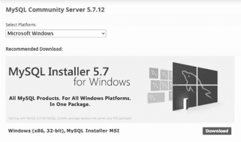

### 选择你的 Windows 处理器版本

通过页面上的详细信息选择你的 Windows 处理器版本。从“other downloads”（其他下载）标签中选择。你可以选择 32 位或 64 位。

点击 Windows (x86, 32-bit) zip 压缩包或 Windows (x86, 64-bit) zip 压缩包的下载按钮，取决于你的电脑。

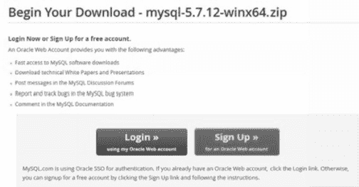

### 在网站上注册

在下载所选版本之前，系统会要求你通过 Oracle 账户登录表单进行注册。

你不需要回答选择性问题。你也可以点击“no thanks”（不用）按钮。还有另一个选项是在不注册的情况下下载服务器。尽管如此，你将无法享受某些免费福利，例如下载白皮书和技术信息、更快速地访问 MySQL 下载和其他服务。

### 登录你的 mysql 账户

注册后，你现在可以登录新账户。将出现一个新页面，你可以通过显示的旗帜图像选择你所在的地区。之后，你可以点击下载按钮将其保存到电脑上。

这可能需要几分钟时间。

### 为下载的文件命名

下载文件后，你可以为 `mysql` 文件命名并将其保存到桌面或 `C` 盘。这取决于你的喜好，选哪个用哪个。

### 安装你的 mysql 服务器

点击文件打开它，然后点击“install”（安装）在电脑上安装 MySQL。这将弹出一个小窗口，电脑会询问你是否想要打开并安装该程序。只需点击“ok”按钮。

### 浏览你的 mysql 包

将出现 MySQL Enterprise Server 页面，提供有关你的 MySQL 包包含内容的信息。提供了一些付费包，但由于我们只对社区版感兴趣，只需点击“next”（下一步）直到到达“finish”（完成）按钮。

取消勾选“register the mysql server now”（现在注册 mysql 服务器）。向导完成设置后，会出现一个框要求你配置并注册你的 MySQL 服务器。取消勾选“register the mysql server now”框，并勾选“configure the mysql server now”（现在配置 mysql 服务器）的小框。然后点击“finish”。

### 在配置向导中点击“next”

将弹出一个窗口，你只需要点击 `next`。

### 选择配置类型

将弹出一个窗口要求你选择配置类型。勾选“detailed configuration”（详细配置）的小圆，而不是“standard configuration”（标准配置）。点击“next”按钮。

### 选择服务器类型

会有三个选择：开发机（development machine）、服务器机（server machine）和专用 MySQL 服务器。选择服务器机，因为它的内存占用中等，非常适合像你这样想要学习更多 MySQL 的初学者。开发机使用的内存最少，可能无法让你充分使用 MySQL。另一方面，MySQL 服务器是为全职数据库用户准备的，它将使用你电脑中的所有可用内存，因此不适合你。

### 选择数据库用途

对于数据库用途，有三个选择：多功能数据库（multifunctional database）、事务型数据库（transactional database）和非事务型数据库（non-transactional database）。选择多功能数据库，因为你的目的是通用的。事务型和非事务型用于更特定的目的。点击框底部的“next”按钮。

### 为 innodb 选择驱动器

如果你不想使用“default”（默认）设置，可以从电脑中选择你想要存储 `innodb` 数据的驱动器。选择你喜欢的驱动器并点击“next”。

### 设置到服务器的并发连接数

这将指示同时连接到你服务器的用户数。有讨论（OLAP）、在线事务处理（OLTP）和手动设置。建议选择 `OLAP` 选项，因为你不需要高数量的并发连接。OLTP 用于高负载服务器，而手动设置可现在进行设置。设置完成后，点击“next”。

### 设置网络选项

通过勾选前面的小框启用 `TCP/IP` 网络。在下方，添加你的端口号，并勾选小框以启用严格模式（strict mode）设置服务器 SQL 模式。点击“next”。

### 选择默认字符集

最推荐的是标准字符集，因为它适用于英语和其他西欧语言。它也是英语的默认字符集。另外两个选项，即对多语言的最佳支持（best support for multilingualism）和手动默认字符集，最适合有英语以外语言的人。勾选标准字符集的小圆并点击“next”。

### 设置 Windows 选项

将弹出一个窗口，你只需勾选显示的两个选项：作为 Windows 服务器安装（install as Windows server）并将 `bin` 目录添加到 Windows 路径。这将允许你从命令行操作 MySQL。选择作为 Windows 服务器将将显示服务名称。服务名称下方的小框也必须勾选。点击“next”。

### 设置安全选项

设置你的密码。框会指示你输入密码。点击“next”。

### 执行你的配置

你只需点击“execute”（执行），电脑将根据你的规范自动配置。配置完成后且所有复选框已勾选，点击“finish”。

### 设置验证过程

进入开始菜单，输入 `cmd` 并按回车。这将进入命令行。输入以下：

```
mysql -u root -p
```

按回车。注意 `mysql` 和 `-u` 之间有空格，`-u` 和 `root` 之间有空格。同样，`root` 和 `-p` 之间有空格。命令行会提示密码。输入密码并按回车。将出现 MySQL 提示符。你可以输入任何 SQL 命令来显示数据库。记得在 SQL 语句结束加上分号。


现在，请关闭你的命令面板。

恭喜你！！你已成功在机器上安装并配置了 `mysql`，现在是时候行动了。

使用 `mysql` 可能会激励你学习更多其他相关应用程序，例如 `php` 以及类似的产品。

最重要的是你要先学习 `sql` 的基础知识。

以下是一些你可以入门的命令：


现在是时候让我们深入研究使用这种编程语言可以进行的一些有趣事情了。我们将查看在处理 `sql` 语言时可以执行的一些命令，以及我们如何尽可能地搜索数据库并查看其中包含的信息。在本章中，我们将学习如何使用 `sql`，以及一些可以使用这些基本命令来满足我们需求的命令。

这些命令非常有帮助，因为它们会让我们更容易地处理数据库中我们需要的不同部分。我们会发现其中一些是一些容易操作的命令，从那里开始，我们可以转向一些更困难、更复杂的命令，从而看到使用这种语言的强大强大之处。

当你准备学习 `sql` 中可用的一些更基础的命令时，你会发现处理它们的最佳方法是将它们分为六个独立的类别。所有这些类别都基于你可以在所选系统中对它们的用途。以下是 `sql` 语言中有效的六类命令选项，将帮助你完成代码工作。

### 数据定义命令 (Data definition commands)

我们将查看的第一类命令被称为 `ddl`，或数据定义语言。这是 `sql` 语言内部的一个方面，它可以让我们在按照意愿安排对象之前，更容易在数据库中生成对象。例如，你可以使用 `sql` 系统的这部分来帮助我们在正在创建的表中删除或添加对象。这里 `ddl` 类的的一些不同命令包括：

- `drop view`
- `drop index`
- `alter index`
- `create index`
- 以某种方式 `alter the table`
- `create the table`
- `drop table`

### 数据操作语言 (Data manipulation language)

我们在这里查看的第二被称为 `dml` 或数据操作语言。当我们想要修改正在使用的数据库中对象的某些信息时，就可以使用 `sql` 的这部分。这将使删除对象、更新这些对象或在数据库中插入新内容变得更容易。当我们想要确保对数据库中的信息添加正确更改时，而又不需要为该数据库创建新的表部分，这将为我们提供很大的自由。

### 数据查询语言 (Data query language)

现在我们需要转向数据查询语言，或者你最可能听到它被称为 `dql`。这种语言将是你会在 `sql` 中看到的强大的方面之一，特别是当你为业务使用更现代的数据库系统时。

这非常很好，因为你只需要处理一个简单的命令来从数据库中选择你想要的内容，这个命令就是 `select`。你可以使用 `select` 命令运行一些结果，如果你想查看数据库中的数据，这些结果将有用。

### 数据控制语言 (Data control language)

列表上的下一个是 `dcl` 或数据控制语言。这是一种我们可以控制谁有权访问数据库的命令。如果你想确保只有正确的人才能看到你的信息，这是一好事。你可以使用的一些命令包括：

- `revoke`
- `grant`

### 完整性约束 (Integrity constraints)

当你使用 `sql` 时，你会发现你需要的数据必须是准确的。为了确保这一点，数据库中的数据应该受到某些约束。这些是用于确保数据库中数据准确性和一致性的规则。一些约束包括：

- `primary key`
- `foreign key`
- `unique`
- `not null`
- `check`

### 事务控制 (Transaction control)

我们将查看的最后一类命令是 `tcl` 或事务控制。事务作为一个单一工作单元执行的命令组。这确保了事务中的所有命令全部执行，或者都不执行。这对于维护数据完整性至关重要。你可以使用的一些命令包括：

- `commit`
- `rollback`
- `savepoint`


例如，假设我们要为工资低于 3000 的员工发放 2 个月的奖金，而为工资高于此的员工发放 1 个月的奖金？

为了实现这一点，我们需要使用控制流工具。这些包括 `if`、`case` 和循环语句。

在本节中，我们将使用大量的示例来解释所讨论的概念。

准备好了吗？

# If statement

让我们从 `if` 语句开始。"if` 语句的语法如下：

```sql
If condition 1 is met then do task a;
else if condition 2 is met then do task b;
else if condition 3 is met then do task c;
else do task z;
end if;
```

`if` 语句首先检查第一个条件是否满足。如果满足，它将执行任务 a。如果不满足，它将移动第一个 `else if` 语句。如果该条件满足，它将执行任务 b。如果不满足，它将继续向下检查 `else if` 语句，直到找到满足的条件为止。如果没有满足任何条件，它将执行任务 z。

`else if` 语句的数量可以根据需要任意添加。

此外，`else if` 和 `else` 语句都是可选的。如果没有其他需要检查的条件，就不包含它们。

然而，如果你省略了 `else` 语句，并且存在没有被 `if` 和 `else if` 语句满足的情况，`mysql` 将向你报错。

现在让我们来看 `if` 语句的一些示例。

## Example 1

```sql
DELIMITER $$
create function if_demo_a(x int) returns varchar(255) deterministic
Begin
If x > 0 then return ‘x is positive,’;
else if x = 0 then return ‘x is zero’;
else return ‘x is negative,’;
end if;
end $$
DELIMITER;
```

这个 `if` 语句首先检查输入 `(x)` 是否大于零。如果是，它返回‘x is positive,’。

如果不是，它会检查 `x` 是否等于零。如果是，它返回‘x is zero’。

如果前两个条件都不满足，它将移动到 `else` 语句并返回‘ x is negative,’。

要运行此函数，我们写道：

```sql
select if_demo_a(2);
```

我们将得到‘x is positive,’。

如果我们将输入从 2 改为 0 或 -1，我们将分别得到‘x is zero’和‘x is negative,’。

## Example 2

```sql
DELIMITER $$
create function if_demo_b(x int) returns varchar(255) deterministic
Begin
If x > 0 then return ‘x is positive,’;
else if x = 0 then return ‘x is zero’;
end if;
end $$
DELIMITER ;
```

这个示例与上一个相似，但我们省略了 `else` 语句。如果我们现在运行该函数，将得到以下输出：

```sql
select if_demo_b(2);
```
Output:
X is positive,

```sql
select if_demo_b(-1);
```
Output:
Error code,: 1321. function if_demo_b ended without return

```

你可以看到，如果我们向函数传递一个它无法处理的值（在此例中为一个负数），函数将返回错误。

# Case statement

接下来，让我们进入 `case` 语句。

`case` 语句与 `if` 语句非常相似，通常可以互换使用。在大多数情况下，选择 `if` 还是 `case` 取决偏好。

语法为：

```sql
Case case_variable
when value_1 then task a;
when value_2 then task b;
…
else task z;
end case;
```

或者

```sql
Case
when condition 1 is met then task a;
when condition 2 is met then task b;
…
else task z;
end case;
```

让我们来看一些示例。

### Case Example 1

```sql
DELIMITER $$
create function case_demo_a(x int) returns varchar(255) deterministic
Begin
declare z varchar(255);
set z = ‘‘;
case
when 1 then return ‘x is 1’;
when 2 then return ‘x is 2’;
else return ‘x is 1 nor 2’;
end case;
end $$
DELIMITER ;
```

调用函数：

```sql
select case_demo_a(1);
```
Output:
X is 1

```sql
select case_demo_a(5);
```
Output:
X is 1 nor 2

### Case Example 2

```sql
DELIMITER $$
create function case_demo_b(x int) returns varchar(255) deterministic
Begin
Case
when x > 0 then return ‘x is positive,’;
when x = 0 then return ‘x is zero’;
else return ‘x is negative,’;
end case;
end $$
DELIMITER ;
```

第二个示例使用了这种语法，并测试 x 的一个范围而不是单个值。

调用函数：

```sql
select case_demo_b(1);
```
Output:
X is positive,

```sql
select case_demo_b(-1);
```
Output:
X is negative,

# While statement

下一个控制流语句是 `while` 语句。`while` 语句允许我们在特定条件有效时重复执行某项任务。

语法是：

`while condition is true, do tasks end while;`

### Example

```sql
DELIMITER $$
create function while_demo(x int, y int) returns varchar(255) deterministic
Begin
declare z varchar(255);
set z = ‘‘;
while x<y do
set x = x + 1;
set z = concat(z, x);
end while;
return z;
end $$
DELIMITER ;
```

在这里，我们首先声明一个局部变量 `z` 并将其初始化为空字符串（空字符串是不内容的字符串）。

接下来，我们声明 `while` 语句。`while` 语句可以命名（但命名是可选的）。在这里我们将其命名为 `example`。

接下来，`while` 条件检查 `x` 是否小于 `y`（`x` 和 `y` 都是输入参数）。

当 `x` 小于 `y` 时，`while` 语句执行以下操作：

首先，它将 `x` 加 1。

接下来，它使用 `concat()` 函数将 `z` 与 `x` 连接起来。

最后，它将结果赋值给 `z`。

在 `while` 语句之后，我们只需返回 `z` 的值。

如果你使用以下语句运行函数：

```sql
select while_demo(1, 5);
```

你将得到 2345。

这是因为循环从 `x = 1` 和 `y = 5` 开始，`while` 语句将 `x` 加 1（现在 `x` 为 2）并将结果与 `z` 连接。`z` 变为‘2’。

接下来，循环重复。它将 `x` 加 1（现在 `x` 为 3）并将结果与 `z` 连接。`z` 变为‘23’。

将 `x` 加 1 并结果与 `z` 连接的任务将重复执行，直到 `x < y` 不再成立为止。


此外，另一个重要的区别是，`repeat` 语句将至少执行一次任务。这是因为检查（例如，直到 `x>=y`）是在任务完成后进行的。

因此，如果你运行以下语句：

```sql
Select repeat_demo(5, 1);
```

你将得到结果 `6`，因为即使 `repeat` 条件（`until x>=y`）已经满足，但 `repeat` 语句内部的两个任务至少会被执行一次，因为检查是在任务完成后才进行的。

清楚了吗？

## 循环语句 (Loop statement)

最后但同样重要，让我们来看 `loop` 语句。该语句与 `while` 和 `repeat` 语句非常相似，但它不带有退出循环的条件。

相反，我们使用 `iterate` 或 `leave` 关键字来退出循环。

`loop` 语句的语法如下：

```sql
[loop statement 的名称 :] loop
一些任务
End loop;
```

让我们来看几个例子。

### 示例 1

Delimiter $$

```sql
DELIMITER $$
CREATE FUNCTION loop_demo_a(x int, y int) RETURNS varchar(255) DETERMINISTIC
BEGIN
  DECLARE z varchar(255);
  SET z = '';
  simple_loop: LOOP
    SET x = x + 1;
    IF x > y THEN
      LEAVE simple_loop;
    END IF;
    SET z = concat(z, x);
  END LOOP;
  RETURN z;
END $$
DELIMITER ;
```

在这里，我们声明了一个名为 `simple_loop` 的循环。为循环语句提供名称通常是必要的，因为我们需要稍后使用名称使用 `leave` 或 `iterate` 语句。

在循环内部，我们执行了以下操作：

1. 首先，将 `x` 的值增加 `1`。
2. 接下来，检查 `x` 是否大于 `y`。如果是，我们就退出循环。

要退出循环，我们编写：

```sql
Leave simple_loop;
```

`leave` 是 MySQL 中的一个关键字，表示我们要退出循环。我们必须提供要退出的循环名称。在我们的示例中，我们正在退出 `simple_loop`。

如果没有满足 `leave` 条件，我们将留在循环中并将 `z` 与 `x` 拼接。

如果你现在使用以下语句运行函数：

```sql
Select loop_demo_a(1, 5);
```

你将得到输出 `2345`。

### 示例 2

除了使用 `leave` 关键字外，我们还可以使用 `iterate` 关键字。与完全退出循环的 `leave` 关键字相比，`iterate` 关键字仅跳过循环的一次迭代。

让我们来看一个例子：

```sql
DELIMITER $$
CREATE FUNCTION loop_demo_b(x int, y int) RETURNS varchar(255) DETERMINISTIC
BEGIN
  DECLARE z varchar(255);
  SET z = '';
  simple_loop: LOOP
    SET x = x + 1;
    IF x = 3 THEN
      ITERATE simple_loop;
    ELSEIF x > y THEN
      LEAVE simple_loop;
    END IF;
    SET z = concat(z, x);
  END LOOP;
  RETURN z;
END $$
DELIMITER ;
```

在这里，我们在循环语句中又添加了一个 `if` 条件。这个 `if` 条件使用了 `iterate` 关键字。

如果你使用以下语句运行该函数：

```sql
Select loop_demo_b(1, 5);
```

你将得到输出 `245`。由于条件 `If x = 3 then iterate simple_loop;`，迭代 `x = 3` 被跳过了。

清楚了吗？

很好！通过这个例子，我们已经到了本章的结尾。

## If 语句 (If statement)

在 Python 中，你可以使用各种语句。然而，你必须确保遵循 Python 的语法和缩进。规则之一是在进入代码块时在 `if` 和 `else` 语句之后提供缩进。只需按一次 Tab 键即可提供缩进。无论如何，程序都会帮助你确定语法中的错误。如果有错误，它将显示错误以及问题所在之处。如果你在术语中感到迷惑，也可以请求帮助。因此，放松心情并享受这一过程吧。

### 函数 (Functions)

执行代码的 `if else` 语句用于比较值或确定其正确性。如果条件为 `true`，则执行 `if`；如果条件为 `false`，则执行 `else`。通用代码如下：

```python
if expression:
    statement
else:
    statement
```

示例：

首先分配一个基础语句。假设你正在给大一学生教化学，并希望鼓励他们参加你的辅导。你可以编写这段 Python 代码：

```python
Hours = float(input('how many hours can you allot for chemistry?'))
if Hours < 1:
    print('you need more time to study.')
else:
    print('great! keep it up!')
print('chemistry needs more of your time.')
```

## While 语句 (While statement)

`while` 语句是主要的循环语句，主要用于需要简单迭代的地方。它的结构如下：

```python
counter = 10
while counter>0:
  print(counter)
  counter = counter-1
  print('backward counting from 10 to 1')
```

这个简单的 `while` 循环将不断检查 `while` 条件，直到条件变为 `false`。每次循环都会通过。在条件变为 `false` 后，解释器将恢复最近的活动并继续执行循环之后的程序语句。下面的图说明了 `while` 的控制流。

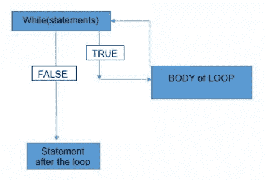

## 循环语句 (Loop statement)

如上一章定义，Ruby 语言在组织中常用于 Web 应用开发。Ruby on Rails 是一个快速开发的框架，业务团队可以关注其他流程而不是从零开始编写函数。该框架提供了一个名为 MVC 结构（模型-视图-控制器）的分隔。MVC 为分离界面和业务函数提供了支持。

另一方面，Python 拥有最流行的 MVC 框架，如 Django 框架开发。此外，Python 在 Web 应用领域之外也著名。例如，`pandas` 库对数据准备非常有用。其他库如 `numpy` 和 `statsmodel` 在这种情况下也支持。`matplotlib` 是一个强大的数据可视化 Python 库。`tensorflow` 在机器学习任务和项目中闻名。此外，`scipy` 是另一个 Python 开源库，用于科学计算和解决让工程学生流汗的数学函数。


MySQL 的开发始于 1994 年，科学家 David Axmark 和 Michael Wakefield 被誉为在 1995 年发布了该 DBMS 的首个内部版本。该 DBMS 的 Windows 版本出现得得多，是在 1998 年。起初，MySQL 项目由 MySQL AB 所有。2008 年，项目所有权转移到太阳微系统（Sun Microsystems），随后发布了 MySQL 5.1 版本。该数据库管理系统的关键特性包括：

- 灵活性
- 高可用性
- 可扩展性
- 高性能
- Web 优势
- 健壮的事务支持
- 数据仓库优势
- 全面的应用开发
- 强的数据保护
- 开源自由
- 易管理
- 最低的总拥有成本
- 24x7 技术支持

### MS SQL Server
微软以 MS SQL Server 的形式推出了其关系型数据库管理系统，它使用 ANSI SQL 和 `T-SQL` 作为主要查询语言。Sybase 在 1987 年发布了该 DBMS 的第一个版本。Sybase 与 Aston-Tate 和微软合作将 `SQL Server` 移植到 `OS/2`，并于 1989 年发布了 `SQL Server` 1.0，之后 Aston-Tate 退出了 SQL 开发领域，微软发布了 `SQL Server` 2000。MS SQL Server 的关键特性包括：

- 高可用性
- 数据库快照
- 高性能
- 数据库镜像
- 服务代理程序 (Service broker)
- CLR 集成
- 排序函数
- DDL 触发器
- XML 集成
- 基于行版本的隔离级别
- 数据库邮件
- Try…catch

### Oracle
Oracle 是目前市场上最流行、最大的多用户 DBMS 之一。正如其所示，Oracle 由“Oracle 公司”（Oracle Corporation）拥有并创建。Oracle 的核心特性在于它能够高效地管理资源，即通过网络供许多客户端访问整个数据库。

考虑到 Oracle 的基础架构，它被认为最适合客户端服务器计算。此外，它支持 Unix、Windows、Linux 和 Mac OS 等多个平台。Oracle 的历程追溯到 1977 年，当时 Ed Oats、Bob Miner 和 Larry Ellison 创立了“软件开发实验室”（Software Development Laboratory）。1979 年，2.0 版本发布时，Oracle 成为第一个商用 SQL 数据库管理系统。

同年，公司名称改为 Relational Software Inc. (RSI)。由于该公司承担的大部分开发工作都与 Oracle 相关，其名称在 1982 年再次更改，并获得了现在的 Oracle 公司（Oracle Corporation）身份。在随后的几年里，Oracle 拥有了多方面的特性。例如，1983 年发布了 Oracle 的跨平台版本或 Oracle 3.0 版本，而并发控制等功能在 4.0 和 5.0 版本中加入。Oracle 的关键特性包括：

- 读取一致性
- 并发
- 数据库静止 (Quiesce database)
- 锁机制
- 自管理型数据库
- 可移植性
- ASM
- `SQL*Plus`
- 资源管理器
- 调度器
- 物化视图
- 数据仓储
- 表压缩
- 位图索引
- 分析型 SQL
- 并行执行
- 分区
- 数据挖掘

### MS Access
MS Access 是微软的一款基础数据库管理系统，用于入门级别，这使其成为最受欢迎的产品之一。它受欢迎的其他原因还包括其高性价比以及为小型项目创建健壮解决方案的能力。此外，微软高度直观且易于使用的图形界面这一旗舰功能也增加了该产品的声誉。

这里必须提到，MS Access 使用了 Jet SQL，这是 SQL 的变体。这种 SQL 方言专门由 MS Access 用于操作的数据库引擎使用。MS Access 的第一个版本于 1992 年发布，多年来经历了许多改进和新增。目前 MS Access 作为 MS Office 产品的一部分可用。该数据库管理系统的关键特性包括：

MS Access 允许用户创建表单、表和查询。此外，用户可以通过宏连接所有这些工具。数据可以导入和导出到不同的格式，包括 Oracle、Outlook 和 Excel 等其他格式。

MS Access 支持一种名为 `.mdb` 的特殊格式。该格式允许将应用程序及其数据存储在同一个文件中。即使用户处于离线环境，也可以使用该文件传输整个应用程序。它支持参数化查询，可以通过 `ADO` 或 `DAO` 被 .NET 或 VB6 。MS Access 还可以与 MS SQL Server 的桌面版对接，作为该 DBMS 现有数据库引擎的替代方案。重要的是，MS Access 并不是客户端服务器型 DBMS，因此不实现存储过程、事务日志或数据库触发器。它实际上是一个文件服务器数据库。

### SQL 工具类型
市场上有不同类型的 SQL 工具。在选择这些工具时，你需要考虑各种因素，包括：

- 你想管理什么：例如，如果你想管理 SQL Server 实例，建议购买 Azure Data Studio。
- 数据库代码的创建和维护：你需要选择 SQL Server Data Tools (SSDT)。
- 使用命令行工具查询 SQL Server：你可以选择 `mysql-cli`。
- 编写 T-SQL 脚本：你应该应用 Visual Studio Code 和 MySQL 扩展。

本节旨在赞扬 SQL Server 管理中常用的工具，具体如下：

 Workbench
这是一个健壮的工具，速度快且嵌入了 SQL 数据库中。它具有企业级的安全性、灾难恢复以及平滑处理变更的能力。这些工具具有以下特性：

- 符合 SQL 标准：这些工具兼容所有 SQL 标准，识别 Unicode 并适用于任何全球字符。
- 提供多种 Unicode、实时警报和更改跟踪。
- 轻量级：适用于当前的 CPU 并可以在各种系统中运行。
- 快速恢复：适用于快速灾难恢复。

 Dbforge Studio for SQL Server
这是最好的 IDE 工具之一，执行多种功能，包括服务器管理、管理、数据报告、分析等。该工具具有以下特性：

- 数据库管理
- 提供高质量的代码支持
- 高质量的 SQL Server 报告
- 保护：它提供最好的信息保护

 Dbwatch
该工具提供数据库管理全面支持，用于 Oracle、SQL Server、Azure 等多种数据库。该工具用于不同环境（包括混合和云）的维护。它具有以下特点：

- 协助监控性能并生成重要报告。
- 实现 SQL Server 的常规内存最小化。


这是提供 SQL 数据库监控服务的最佳工具之一。它可以处理不断增长的业务工作负载。由于对高性能数据的需求日益增加，许多公司都在使用该工具。`sql_sentry` 具有以下特性：

- 协助性能指标的收集和展示。
- 分析和调优能力 - 该工具具备 SQL 查询分析和高级调优的功能。
- 被评为最佳 DBA 解决方案。

### Admin

这是一个提供各种解决方案的数据管理工具。这些包括对数据库、表、列、关系等的管理。该工具以单个 PHP 形式出售，并支持不同系统上的各种数据库，包括 ms sql、oracle 和 mysql。你可以作为文件下载各种版本。`Admin` 具有多种特性，包括：

- 执行数据表列表，并具有各种功能，包括排序、搜索等。
- 它有多种自定义选项。
- 指示过程并销毁它们。

### Dbcompare

这是一个易于使用的数据库比较设备，可以对数据库结构进行分析并提供见解。该工具允许你比较不同的对象，包括表、外键约束、角色等。`dbcompare` 具有不同的功能：

- 定期对比各种数据库结构。
- 为评估提供不同的选择。
- 它内置了可视化树，用于直观地表示差异。

### Ms sql manager lite for sql server

该工具用于创建 SQL 数据库对象并允许执行各种编辑任务。该工具拥有最佳的用户界面，并加载了实用的功能。它可以替代 `ssms`。

- 支持特性 - 该工具支持多种 SQL 功能，包括 azure sql database、unicode 等。
- 提供查询构建工具 - 该工具为查询开发提供了可视化和文本设备。
- 比较 - 数据库工具有助于比较和同步各种数据库结构。
- 负载了 SQL 调试器 - 工具附带了一个 SQL 调试器，可以跟踪进程、函数和脚本。

### Firebird

这是一个在 Windows 和 Linux 上运行良好的高效 SQL 工具。Fire-bird 具有多种特性，包括：

- 对过程的完整支持 - 该工具完全支持各种过程，包括标准事务、多种访问方式、支持增量备份等。
- 复杂技术的应用 - 该工具应用了如 `fb25` 和 `fb30` 等最新技术。
- 云支持 - 该工具可以识别云基础设施。

### Squirrel sql

该工具支持 Java 数据库的管理。通过此工具，你可以查看 SQL 数据库并提供命令。该工具适用于不同的数据库，包括 ibm sql、oracle 等。其核心特性包括：

- 弹出菜单 - 通过此菜单，你可以执行如编辑等各种功能。
- 对象树显示 - 这向你显示季节窗口。
- 图表 - 它显示表图以及它们是如何连接的。

### Sqlite database browser

该工具开源，有助于创建和编辑数据库中的各种文件。`sqlite_database_browser` 具有多种特性，包括：

- 数据库的创建和修改 - 通过此工具，你可以创建和编辑各种数据库、表等。
- SQL 命令 - 该工具具有日志，显示所有已发出的 SQL 命令及其使用情况。
- 创建简单图表 - 该工具可以根据表中的数据绘制图表。

### Beave

该工具开源，被数据库管理员用于以支持 mysql 等各种数据库。该工具的主要作用是创建和修改 SQL 脚本、数据导出等。该工具具有多种特性，包括：

- 数据创建和修改能力。
- 插件 - 该工具提供各种插件。

### Db visualize

这是一个开源的通用数据库工具，帮助管理 oracle、sybase 等各种数据库。该工具具有一个导航对象的浏览器。它有助于对象的形成和修改。`db visualize` 的核心特性包括：

- 特定对象的管理
- 表单和修改过程
- 提供架构（schema）
- 配合查询工作

当你设置好想要使用的查询时，你会发现你正在向已设置的数据库发送查询。你会发现有几种方法可以实现这一点，但 `select` 命令将是实现此点的最佳选项之一，它能够根据搜索即时返回所需信息。例如，如果你正在处理一个包含你提供销售的所有产品的表，你可以使用 `select` 命令来查找最畅销的产品或你当时拥有的产品。信息存储在数据库中，你会发现当我们谈论关系型数据库时，这是正常操作。

### Databases（数据库）

“数据库”一词的含义在过去的几十年里发生了巨大的变化，以对于某些人来说，数据库指的是书籍或列表中包含的任意数据项。对于另一些来说，它指的是可以通过计算机系统访问的结构化数据或记录存储库。我们将关注第二个定义，该定义也包含了 SQL。请记住，在这种情况下，“记录”指的是项的表示。例如，你正在经营自己的业务，因此会为每个唯一的客户创建一条记录。这些记录将包含许多描述对象的特征。例如，你可以包括名称、电话号码、地址等数据。

然而，数据库并不仅仅包含数据。它还包含元数据，元数据的目的是定义数据库内部信息的结构。为什么这很重要？因为如果你知道数据是如何组织的，你就可以访问、管理、维护和修改它。这意味着数据库是自描述的，因为它包含了数据对象之间连接的信息。元数据被保留在所谓的数据字典中。字典描述了数据库的组件，即表、行、列等。顺便提一下，你应该知道扁文件系统不包含元数据。这意味着处理这些文件的程序需要集成某种形式的等效机制。

数据库的大小也取决于它包含的记录数量。例如，你可以拥有几十个数据对象到百万个。目前，你不需要担心任何限制。然而，数据库可以分为三种不同的分类：

- 个人数据库最小。它们存储在用户的个人计算机上，以基本数据结构为特征。


另一方面，分组数据库更为复杂。它们旨在供部门或团队使用，这意味着它们包含的数据比个人数据库要多得多。这意味着它们还需要能够同时从多个设备进行访问。

最后，我们有企业版数据库。它们规模庞大、复杂，需要最可靠的设备来安全地存储和维护。

如你所见，你可以通过三个属性对数据库进行分类：它的体量、有多少人需要访问它，以及它需要什么样的技术设备。

### 数据库管理系统

为了管理数据库以及任何访问它的应用程序，我们需要使用数据库管理系统。请记住，数据库无非一个旨在包含信息的结构。我们需要一个工具来实际创建该结构，并允许我们访问、维护或修改其中的数据。目前有许多这样的程序可用，可以免费使用，也可以支付特定费用。

然而，并非所有数据管理系统都是同等的。你需要的系统取决于你的目标和需求。例如，某些程序设计用于在专业的企业级设备上运行并处理海量数据库。另一方面，另一些程序旨在在基础个人笔记本电脑上运行。但是，请记住，这些工具有时需要在运行不同操作系统的不同硬件设置上同时运行。此外，我们还可以考虑云作为一种存储选项。如今，你可以通过亚马逊和微软等组织提供的服务获得公共在线存储。

云是在任何技术领域都会经常听到的术语之一，因为许多企业今天对计算机处理能力和存储能力的需求巨大增长。你现在需要知道（如果你不知道的话）的是，云是计算机的集合，通过互联网向任何人提供其资源。这意味着任何人都可以舒适地家里访问这些服务，而无需物理连接到数据中心。在这种情况下，具有云能力的数据库管理系统可以为你提供远程管理数据库所需的功能。

数据库管理系统确保无论系统类型和数据库大小如何，用户与系统之间的数据流始终保持一致。

### 数据库类型

最早的数据库模型是使用基于层级的结构构建的。这导致了一系列问题，包括由于缺乏灵活性，此类数据库不利于修改和维护。结构性问题和各种冗余问题导致了网络型数据库的发展。其目的是消除此类缺陷。它们确实提供了几乎没有冗余的优势；然而，为了实现这种特性，必须做出另一种牺牲。网络模型数据库的结构非常复杂，因此导致了另一组问题。

关系型数据库的发展很快为这些技术问题提供了答案。其结构简单，最小冗余是其主要特征之一。随着这种新类型的创建，其目的是将关系型数据库转变为革命性的事物，并将其他模型归于无形。

有了新类型的数据库，就需要新的数据库管理系统。这就是 Oracle 的诞生：一个由一家小型初创公司给出的新答案。此时，关系型数据库已成为主流。这使得修改该模型的结构成为可能。例如，要在数据库内部创建更多列，你只需要添加即可，无需进行任何耗时的修改。依赖于数据库的应用程序不需要进行任何更改。

另一个强大的优势是，某些数据可以存储在一个表中，而其他数据可以存储在另一个表中。这两个表不需要以任何方式连接；因此，你可以更改其中一个的信息而不会对另一个产生负面影响。

关系模型和对象模型都提供了一系列优势。例如，当时的开发者考虑了从对象数据库的力量中获利的可能性，以及关系模型提供的兼容性。这就是对象关系型数据库的诞生：它在我们已经讨论的关系模型的基础上，在其基础上添加了对象模型的功能。

对象特性使用 SQL 实现，因此允许所有数据库管理系统适应成为关系型数据库管理系统。请记住，它们仍然保留了与原始关系模型的兼容性。自 90 年代以来，随着编程技术和语言的不断发展，关系型数据库通过引入越来越多的对象特性逐渐扩展。然而，在这种类型数据库的核心，关系模型保持了纯真性，尽管它在多年里收到了许多扩展。

关系型数据库的流行程度开始下降，转而支持我们今天使用的标准 SQL 数据库。现代问题需要只有对象特性才能提供的复杂 SQL 解决方案。

### 第 4 章：表

## 使用命令行创建你的第一个数据库和表

你也可以使用 SQL 命令和语句来创建数据库和表。与上述指南类似，SQL Server Management Studio 如此，命令和语句用于指示系统执行给定的功能。要构建你的第一个数据库，你使用命令 `select database (database_name)` 并点击执行按钮来创建程序。因此，屏幕上的消息应为“command(s) completed successfully”，表示你的数据库已创建。

要使用该数据库，运行命令 `use (database_name),`，这告诉查询窗口运行新的数据库程序。另一方面，创建一个表涉及运行命令 `create table (table_name).`。输入数据在命令 `insert data into (table_name), values (table_name),` 之后，并对你所有的数据集重复相同的过程。这同样允许查看你保存的数据，并包含格式命令 `select * from (table_name)`。所有上述命令都是操作不同 SQL 数据库时的关键命令。因此，学习每个 SQL 基础命令以以便随时执行至关重要。

### 创建表

以下是简单的步骤：

```
输入关键字 create table,
```

这些关键字将表达你的意图，并引导你脑海中的操作。


### 创建表

示例：`create table`

### 输入表名

在 `create table` 关键字之后，添加表名。表名应该是具体的且唯一的，以便日后方便、快速地访问。

示例：`create table "table_name,"`

你的表名不能让任何人都能轻易猜到。你可以通过包含你的姓名字母缩写和出生日期来实现这一点。例如，如果你的名字是 henry sheldon，出生日期是 1964 年 10 月 20 日，你可以将这些信息添加到表名中。

假设你想让你的表关于你网站的流量来源；你可以将表命名为 `traffic_hs2064`。

请注意，所有的 SQL 语句必须以分号（`;`）结束。所有的数据变量也必须包含在引号（" "）中。

示例：`create table traffic_hs2064`

### 定义列

在下一行添加一个左括号。该括号将指示引入你想要创建的列。

示例：`create table "table_name,"`

```
(
```

让我们将这一步应用于我们的特定示例中。

示例：`create table traffic_hs2064`

```
(
```

### 添加第一个列名

你想给第一列列起什么名字？这应该与你想要为表收集的数据或信息相关。请始终用逗号分隔你的列定义。

示例：`create table "table_name,"`

```
("column_name," "data type,")
```

在我们的示例中，表的重点是你网站的流量来源。因此，你可以将第一列命名为 `country`。

示例：`create table traffic_hs2064`

```
(country
```

### 根据你的数据添加更多列

如果你需要关于该表的更多数据，可以添加更多列；这取决于你的决定。所以，如果你想再添加四列，你的 SQL 语句将如下所示：

示例：`create table "table_name,"`

```
("column_name,1" "data type,"
"column_name,2" "data type,"
"column_name,3" "data type,"
"column_name,4" "data type,");
```

假设你已经决定为第 2 列添加用于搜索你网站时使用的关键字，为第 3 列添加访问者在你网站上花费的分钟，为第 4 列添加该人员访问的特定帖子。这是你的 SQL 语句的写法。

**注意：**

表名或列名必须以字母开头；后面可以跟数字、下划线或另一个字母。字符数不应超过 30 个。

你也可以使用 `varchar`（变长字符）数据类型来帮助创建列。

**常见的数据类型有：**

- `Date` – 指定的日期或值
- `Number(size)` – 你应该在圆括号内指定列的最大数字位数。
- `Char(size)` – 你应该在圆括号内指定固定长度的大小。
- `Varchar(size)` – 你应该在圆括号内指定最大大小。这用于条目的变长度。
- `Number(size, d)` – 这与 `Number(size)` 类似，区别在于 `d` 代表小数点右侧的最大数字位数。

因此，如果你想让你的列显示 10.21，那么你的数字类型将是：`Number(2,2)`

示例：`create table traffic_hs2064`

```
(country varchar (40),
Keywords varchar (30),
Time number (3),
Post varchar (40) );
```

### 添加约束（如果有）

约束是应用于特定列的规则。如果你愿意，可以添加约束。最常见的约束是：

- `not null` – 表示列不应包含空白
- `unique` – 表示所有添加的条目必须是唯一的，且不能与该特定列中的任何项目重复。

总结，使用 SQL 语句创建表将从 `create table` 开始，然后是 `表名`，接着是左括号，然后是 `列名`、`数据类型`（在每列后添加逗号），最后添加任何 `约束`。

# 删除表

使用适当的 SQL 语句可以从数据库中删除表、行或列。这是你必须掌握的用于删除操作的命令之一。


请注意，字符串必须包含在单引号中，而数字不是。

使用我们的示例表，你可以编写出这条 SQL 语句：

示例：
```sql
insert into "traffic_hs2064" (country, keyword, time) Values ('america', 'marketing', 10);
```

你可以安全地插入更多数据，而不会影响其他表。只需确保你正在使用正确的 SQL 命令或语句即可。

### 删除表 (Dropping a table)

你只需在键盘上敲击几下即可删除或移除一个表。但在决定删除表之前，请考虑一下如果以后需要，你可能需要花费额外的时间来恢复它。因此，请谨慎使用此命令。

删除表与删除表中的记录/数据是不同的。当你删除一个表时，你删除的是表的定义以及该表中的记录/数据。

示例：
```sql
drop table "table_name,"
```

使用我们的表，该 SQL 语句如下所示。

示例：
```sql
drop table traffic_hs2064;
```

只要你能编写正确的 SQL，删除表就是轻而的。

### 使用 alter table 查询 (Using the alter table query)

会有很多次你需要使用 `alter table` 命令。这是在你需要编辑、删除或修改表和约束时。

此查询的基本 SQL 语句是：

示例：
```sql
alter table "table_name," Add "column_name," data type;
```

你可以使用此基础表作为你的演示表：

Traffic_hs2064


如果你的基础表是上面的表，并且你想添加另一个标记为 city 的列，你可以这样创建你的 SQL 查询：

示例列表：
```sql
alter table traffic_hs2064 Add city char(30);
```

输出的表将如下所示：

Traffic_hs2064

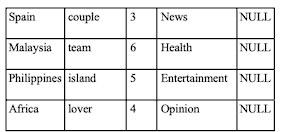

你也可以修改表以添加诸如 `not null` 的约束。

示例：
```sql
alter table traffic_hs2064 Add city not null;
```

你也可以修改表以添加诸如 `not null` 的约束。
示例：
```sql
alter table traffic_hs2064 Add city not null;
```

你也可以修改表以添加诸如 `not null` 的约束。
示例：
```sql
alter table traffic_hs2064 Add city not null;
```

你也可以修改表以添加诸如 `not null` 的约束。
示例：
```sql
alter table traffic_hs2064 Add city not null;
```

你也可以修改表以添加诸如 `not null` 的约束。
示例：
```sql
alter table traffic_hs2064 Add city not null;
```

这些函数的示例：


### 第 5 章：学习函数 (Learning function)

内置函数 (Built-in functions)

关于 SQL，内置函数被定义为接受输入并返回结果的函数。内置函数包括：

这些是存储数据的数据的。这些显示包含 id, 姓名, 薪。


### 函数类型 (Types of functions)

SQL 函数分为两类：聚合函数和标量函数。在 group by 时，聚合函数运行在不同的记录上。标量函数则是独立运行的如下：

### 单行函数 (Single row functions)

它们为任何查询提供单行返回。它们出现在 `select` 列表、`where` 子句以及其他地方。单行函数的示例包括数值型、数据挖掘、日期时间转换、以及 XML 函数。

### 聚合函数 (Aggregate function)

当你应用这类函数时，你会看到基于不同行的单值返回。聚合函数存在于 `select` 列表、`order by` 和 `having` 子句。它们与 `group by` 子句配合使用。许多它们不关注空值。通常使用的包括 `avg`, `count`, `min`, `sum` 等。

### 函数分类 (Categories of functions)

函数根据它们在 SQL 中扮演的角色进行分类。以下是某些函数分类方法：

### 聚合函数 (Aggregate functions)

它们对特定的值集进行计算并交付单个值。聚合值被用于 `select` 列表和 `having` 子句。聚合函数被称为具有确定性的。这意味着它们在处理相同输入值运行时会返回相同的值。


SQL Server 中的函数分为确定性函数和非确定性函数。确定性函数在在使用时会提供相同的答案。相反，非确定性函数在应用时会产生不同的结果。

### SQL 计算

SQL Server 内置了多种数学函数。这些函数可以分为 4 大大类，包括科学和三角函数、舍入函数、符号和随机数。虽然每个类别中都有许多数学函数，但并非所有的函数都会经常使用。下面重点介绍并解释了这些类别：

### 科学和三角函数

在此类别下，有多个子类，包括 `sqrt` 和 `square`。`sqrt` 函数用于计算圆的周长和面积。其工作原理为：`select 2 * 10. sqrt()`。`sqrt` 表示平方根。该函数最常用。该函数识别任何可以转换为浮点数据类型的数字。例如：`select square(36)` 返回 6。`square` 意味着将任何数字乘以自身。勾股定理的概念在这里非常有用，这意味着 `a²+b²=c²`。可以通过 `select sqrt(square(a) + square(b)) as c` 实现。

### 舍入函数

在此类下有多个类别，包括天花（ceiling）和地板（floor）。`ceiling` 函数在处理浮点数或小数时很有用，你的目标是找到最高或最低的整数。`ceiling` 是最大的整数，而 `floor` 代表最小的整数。当你想要将数字舍入到最特定的小数位数时，可以使用 `round` 函数。这表示为 `round(value, number of decimal places)`。

### 符号

某些情况下你需要获取数字的绝对值。例如 -7 的绝对值是 7。绝对值不包含任何符号。为了帮助你完成此任务，利用 `abs` 函数是必重要的。

### Cos (x)

此函数将以弧度表示的角度作为参数。操作后，你会得到一个余弦值。

### Sin (x)

此函数识别弧度角。计算后，它返回一个正弦值。

### Sign

当你需要负值、正值或零时，可以使用 `sign` 函数。

# SQL 内置函数和数学应用的重要性

内置函数是帮助用户在处理 SQL 数据库时实现不同结果的子程序。当你操作或处理数据时，这些应用会被多次使用。SQL 函数提供了在创建、处理和操作数据时使用的工具。SQL 内置和数学函数的优势如下：

### 数据操作

内置工具和数学函数在数据操作中起着重要作用。如果手动操作，处理大量数据可能会困难，尤其是当数据量巨大时。因此，这些函数在确保根据你的需求快速操作数据方面起着重要作用。

### 辅助数据处理

要从数据中受益，你必须对其进行处理。你可能永远无法手动处理大数据的能力。因此，内置 SQL 函数和数学应用协助你处理数据库。

### 简化任务

如果你是一个程序员，你可以证实这些函数和公式让你的工作变得轻松。当你应用这些内置函数和公式时，工作得很快。由于这些工具，你将在短时间内完成许多项目。

### 提高生产力

使用内置函数可以提高你作为程序员的生产力。因为函数让你能够在不同的项目上快速工作。如果我们手动处理数据，在完成任务之前可能花费大量时间，最终会损害你的效率。然而，内置函数和计算允许快速执行任务。

### 节省时间

因为函数只需编写一次即可使用多次，可以节省大量时间。此外，函数支持模块化编程。

### 增强性能

当你应用函数时，增强了数据库的性能。这是因为函数在使用之前已经准备好了。

## 加深对复杂逻辑的理解

处理 SQL 数据库是一项复杂的任务。因此，函数让你能够将数据分解为流畅且易于管理的。通过这种方式，你发现维护数据库变得容易。

### 成本效益

因为函数是 SQL 数据库内置，你可以多次使用而无需投资新的。这因此降低了操作和维护数据库的成本。

### 内置函数的缺点

SQL 内置函数有各种局限性，包括：

### 稳定性

在使用内置函数时，测试它们的业务逻辑是挑战性的。这是一个大挑战特别是特别是当函数支持业务逻辑时。你可能无法理解函数是否符合业务愿景和使命。

### 版本控制

建立 SQL 构建函数使用的版本类型是挑战性的。你需要了解任何新版本都可能提供最好的服务。

### 错误

如果内置函数存在你不知道的错误，它们可能会破坏程序。这证明是昂贵且浪费时间的。

### 害怕变化

如果发生变化，你可能不理解它将如何影响你的内置函数。技术世界不断变化，这种变化可能会影响内置函数。

SQL 内置函数和计算是关重要的，因为它们允许程序员以最少的错误快速执行任务。内置数据库中的计算使得处理和操作数据成为可能。

存储函数

你可以创建并利用你的自定义函数。使用关键字来定义函数。应该先使用 `def` 单词和函数名称来定义函数。当你想要定义一个函数时，可以使用以下通用代码：

```python
def functionname(arg1, arg2, arg3)
    Statement1
    Statement2
    Statement3
```


你也可以使用关键字 `return` 来 `return` 结果（`return` 关键字表示指定计算的答案将会被 `returned` —— 显示在结果中）。

示例：

如果你想获取学生在 4 门科目中的成绩平均分，你可以按照这种方式创建代码：只要你不退出 shell，就可以一直使用这段代码。如果你想保存它，可以创建一个新文件以便保存。

```python
def grades(a,b,c,d):
    return ((a+b+c+d)/4)
```

见下方的图：

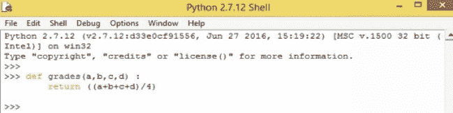

当你或学生按照语法/语句输入成绩时，`return` 结果已经是计算后的值。见下方的图：

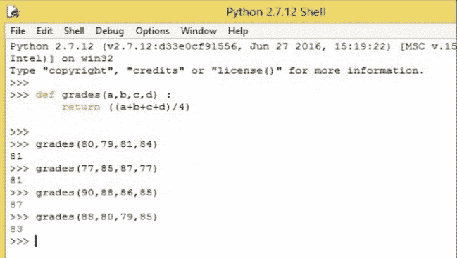

学生必须在箭头（`>>>`）之后在 shell 中输入遵循给定的格式：

```python
grades(80,90,85,75)
```

通过这种方法，你可以无限地计算学生的成绩。

请记住，在代码工作并打印结果之前，你必须先定义（`def`）函数。

记得在你的 `def` 语句后添加冒号（`:`）。你必须用逗号分隔参数。

在默认参数中，当用户没有输入任何值时，会打印初始赋值。

在多参数中，可以使用星号（`*`）来表示这一点。

大胆冒险吧，发现如何用 Python 让你的代码运行的乐趣。

### 第 6 章：查询与子查询

虽然我们花了一点时间查看在处理 sql 语言工作时可以使用的一些命令和查询，但现在是时候让我们深入了解这些查询，以及它们在此过程中能为我们的某些需求提供什么了。当我们处理业务数据库时，当它已经按照我们想要的方式设置好时，很可能在某一个时刻，你将想要进行搜索，以确保你能从所有这些内容中找到完美的信息。这将使我们更容易找到我们想要的简单信息和结果。但我们必须确保数据库是以正确的方式设置的，以便我们使用正确的命令，并确保过程是快速且准确的。

把这想象成有人访问你的网站，寻找他们想要购买的特定产品。你希望他们困在一个运行缓慢的网站上，并看到与他们想要的物品完全无关的结果吗？还是你希望有一个快速、有帮助并鼓励此人进行购买的搜索？当然，为了你业务的成功，你更有可能想要第二种选择，我们可以查看如何设置数据库并配合查询工作来实现这一点。

### 查询

查询顾如其名，简单来说是对数据库数据值的提问或请求。人们可以根据包含的信息简单地发送一个问题，并期望根据数据库中表包含的数据获得回复；所发送的问题就是查询。查询既可以是作为数据检索查询的选取查询（select query），也可以是需要对数据上执行更多操作（如删除或插入）的动作查询（action query）。查询有用于从数据库发出请求的语言，其标准是查询语言（`sql`）。然而，在 sql 伞下还有几种其他语言扩展，包括 oracle、`mysql` 和 nuodb。查询有不同的方法，但一旦理解了基础知识，问题的格式就会变得具有自适应性。

重要的是记住，数据库将信息存储在表中，表由行和列组成。行包含数据，列告诉数据库要存储什么，以帮助询问关于知识所需的方向引导：数据应该从哪列获取？什么持有所需信息？要选择的是什么？对于特定问题哪些字段是必要的？条件是否影响选择？

在 sql 中，当 `select` 命令确定处理此类数据需要请求哪些表时，某些关键字与上述语句匹配。

查询如何工作的一个极佳例子是搜索。然而，它们不需要像语言那样的关键字或位置参数。一旦文本输入到搜索引擎中（如 `google`、`yahoo` 或 `bing`），这就是对特定主题信息的请求，并且请求在选择“回车”后确定。之后，搜索引擎部署一种算法，根据搜索引擎的重要性来确定最佳结果，而这种重要性是公众无法访问的。

搜索查询类型包括导航式搜索、旨在寻找特定网站/博客的直接搜索、旨在跨越主题（如比较）的信息搜索，以及旨在完成交易/购买的事务搜索。

### 索引视图与查询之间的关系

索引视图和查询都关联到数据库的一个点。查询位于图表的顶部，因为它是带出视图的请求，该视图通过索引查找结果并呈现。


上表是关于它们之间关系的简单图解说明。一旦启动查询，一个编程用于响应的视图就会遍历索引，搜索响应所需的数据集，并引导到所需的信息。这些信息被传回视图，视图反过来对查询给出响应，仅显示与查询相关的且具有通用访问权限的特定信息。视图和索引的协同形成了索引视图，由于各种视图现在已与特定的索引相连，这将是有益的。

### 子查询

你需要探索的概念是子查询。正如其名，子查询是嵌入在查询中的。实际上，它是查询之查询。在大多数情况下，它的目的是执行一个逻辑测试或计算，产生一个可以传递给查询的结果。它初听起来可能有些困惑，但它的语法很容易理解。你只需要将子查询写在括号中，并在需要的地方实现它。


其应用的一个简单示例是使用它来返回多个数据项，并在父查询的 `from` 语句中以表格的形式对其进行处理。此外，你还可以编写一个产生单个值的标量子查询，然后在语句中实现它，并借助各种语句（如 `where`）来过滤行。这两种情况是我们最常使用子查询的地方。考虑到这一点，让我们来看一个在更新表中的子查询示例。我们将根据更新信息以及设置的条件（用于确定要更新的行）生成多个子查询。这些子查询将搜索与两个表的列对应的值。以下是 SQL 代码：

```sql
update table_1
set mycolumn = (select mycolumn from table_2 where table_1.mycolumn = table_2.mycolumn)
where exists (select mycolumn from table_2 where table_1.mycolumn = table_2.mycolumn);
``` 

在这个示例中，我们有一个包含两个子查询的查询。两者的语法是相同的。首先，我们在括号内编写 `select` 语句。这是我们的第一个子查询，它被设置在 `set` 子句中。这生成了更新所需的值。然后，我们将其他子查询设置在 `where exists` 子句中。`select` 语句再次用于过滤需要更新的数据项。

顺便提一下，这两个子查询被称为**相关子查询**。这意味着它们依赖于父查询中的某个组件（例如表名）。在我们的示例中，子查询依赖于 `table_1`，它是主更新操作的一部分。请记住，不相关子查询没有对父查询中内部元素的引用。

### 使用子查询进行过滤

你已经习惯过使用 `where` 操作来过滤查询结果。如果你不记得了，你曾将其与各种诸如 `where salary > 2000` 的条件一起使用。然而，在这种情况下，你已经知道创建条件所需的值了。你通常不会那么幸运能拥有这些信息，那么在这种情况下你能做什么呢？子查询就是你的答案。你可以使用子查询来生成多个可以在你的 `where` 语句中使用的值。

假设你想确定欧洲哪些城市的人口排名前 10%。换句话说，你想找到第 90 百分位数。通常情况下，你可能会想写写两个查询来计算第 90 百分位数并按城市进行过滤。然而，借助子查询，你可以实现这一切。代码形式如下所示：

```sql
select loc_name, City_eu_abbreviation
from e_cities_2010
where p0010001 >= (select percentile_cont(.9) within group (order by p0010001) from e_cities_2010)
order by p0010001 desc;
```

查询本身是你已经熟悉的内容。然而，我们引入了 `where` 条件，用它来过滤 `p0010001` 列，但它并不包含你预期的值。在大于等于比较运算符之后，我们还有另一个查询，它实现了我们在早些章节中讨论过的 `percentile_cont` 函数。该函数用于创建我们需要的值，即第 90 百分位数。一旦生成它，我们就可以在父查询中使用它。

请记住，子查询仅在编写 `select` 查询时才有用。你可以使用与你在 `where` 子句编写的相同的查询，但将其放在语句内部。这样，你就可以从表中删除任何你想要的内容。这听起来是删除东西的一种有点复杂的方法，但考虑到数据库中有五亿行数据，这是巨大的，你的系统需要大量时间来查询所有数据。然而，你可以通过复制表并只删除不必要的行或数据项，将信息拆分为小块块。

### 使用子查询创建派生表

返回某些数据的子查询允许你将其转换为表。这可以通过将子查询写入语句中来实现。请记住，数据本身是行的集合，通过使用这些数据创建的内容被称为**派生表**。这种表与其他表不同，这意味着你可以与其他表连接或进行进一步查询。问题是，何时该使用这种创建表的方法？

如果结果相似，说明你有分布均匀的信息。然而，如果存在显著差异，说明异常值影响了数据。现在假设你想学习欧洲城市的人口中位数平均值。寻找这些值是一个过程，比较它们是另一个过程。这两个操作都可以通过在语句内部编写子查询同时完成。这一切在代码中如下：

```sql
select round(avg(average), 0) as average,
round(median, 0) as median_diff
from (select avg(p0010001) as average, percentile_cont(.5) within group (order by p0010001)::numeric(10,1) as median from e_cities_2010);
```

在这个示例中，我们有一个不言自喻的查询。我们应用 `percentile_cont` 和 `avg` 函数来计算人口的中位数和平均值。接下，我们将子查询作为父查询的表。中位数和平均值在父查询中返回，结果接近结果。运行查询后的最终结果应该是这样的：average median_diff 98233 25857.02376


其中，`condition`；`view_name` 是要创建的视图名称。`table_name` 是创建 `view` 时所属的表名，而 `condition` 是在创建 `view` 过程中用于过滤表记录的条件。

考虑具有以下数据的 `students` 表：

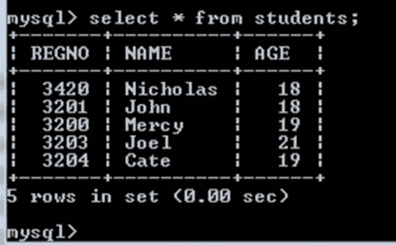

以下示例展示了我们如何从上表创建一个视图。`view` 将仅包含学生的姓名和年龄：

```sql
Create view students_view as
Select name, age from students;
```

该语句应当成功执行，如下所示：

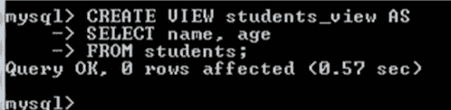

该 `view` 已命名为 `students_view`，仅包含表中的两个列。该 `view` 只有两列，`name` 和 `age`。现在视图已经创建，你可以像查询表一样的方式查询它。接接的命令显示了这一点：`select * from students_view;` 该命令返回以下结果：

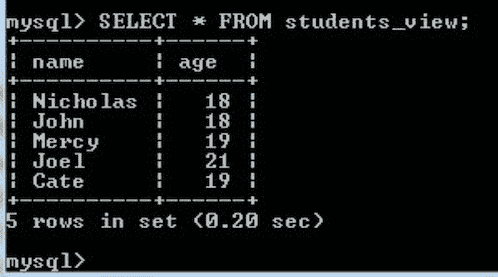

正如我们所说的，`view` 包含了表中的两个列。

### 使用 check 选项

我们可以将此选项与 `create view` 语句一起使用。`with check` 选项目的是确保所有的 `inserts` 和 `updates` 都符合 `view` 定义中创建的所有条件。

如果不符合条件，`insert` 或 `update` 操作将返回错误。在下例示例中，我们展示了如何创建上述视图，但这次使用了 `with check` 选项：

```sql
create view students_view as
Select name, age from students
Where, age > 18
```

使用 check 选项；当您创建上述视图时，只有 `age` 在 18 以上的记录会被添加到 `view` 中。你可以运行以下命令来删除之前的视图：`drop view students_view;` 现在，通过运行上面的命令重新创建 `view`。它应该运行成功，如下所示：

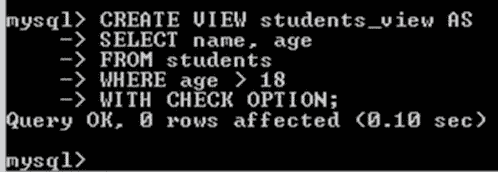

现在，在 `view` 上运行 `select` 命令查看其包含的记录：

```sql
Select * from students_view;
```
该命令将返回以下结果：

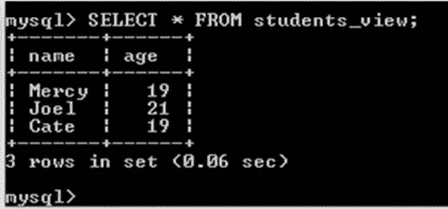

你可以看到，只有符合指定条件的记录才添加到 `view` 中。

视图可以构建在单表或多表之上，也可以构建在现有的视图之上。视图可以像创建一样可以被删除。然而，在进行任何更新之前需要满足某些特定条件，它们是：

- 用于创建 `view` 的 `select` 语句不能包含 `group by` 子句或 `order by` 子句。
- `select` 语句不能有 `distinct` 关键字。
- `view` 必须确保其不包含空值。
- `view` 不得使用嵌套或复杂的查询创建。
- `view` 必须从单表创建，因为任何使用多个表创建的视图都不允许更新。
- `from` 子句不能有多个表。
- 可以使用 `create` 或 `replace view` 语句添加或删除 `view` 中的相关字段。
- `select` 子句不能包含汇总函数。
- `select` 子句不能包含集合函数。
- `select` 子句不能包含集合操作符。
- `where` 子句不能包含子查询。
- 计算列不能被更新。
- 为了使 `insert` 查询工作，表中的所有 `not null` 列必须是 `view` 的一部分。

视图的一些优势包括：

- 限制修改：通过这种方式，只有拥有表权限的人才能启动 `insert`、`update` 等重大编辑。
- 节省空间：查询并不总是需要引用表，因为表并没有像实际数据那样被存储。
- 额外的安全性：由于列和细节在查询时暴露给公众，对于表中包含的其他细节提供了更高的安全性。

### 如何添加视图

视图使用以下语句进行唯一标识和创建：

```sql
Create view {parameters}
```
在这里，我们将解释与此语句一起的不同参数。

- 视图名称：通过此参数，你可以为定义的 `view` 选择一个名称。
- 列名列表：通过使用此参数，你可以为 `view` 中存在的所有列命名。
- 加密：通过使用此参数，你为你尝试创建的 `view` 提供额外的安全性。加密参数增加了系统的安全性。
- 模式：对于初学者来说，模式是用于数据库的一组规则。视图也可以包含在其中。然而，当你尝试更改视图时可能会遇到错误，所以请务必确认。
- 元数据：此参数将帮助你创建视图所需的元数据信息。所有列和内容都将列出，并在必要帮助你快速检查。

通过这些，我们对视图有了良好的理解。在下一节中，我们将讨论视图的一些独特优势。

### 视图的优势

视图主要用于限制列和行的值。视图具有访问表的部分选项。这使得视图相对于其他数据库概念具有独特优势。

视图还可以用于消除其他复杂的数据库操作。无需创建复杂的连接操作，只需使用视图即可实现。

你可以控制你正在处理的列的值范围。视图也是数据库的一种良好的高级层。


假设一下，如果用于创建视图的表被删除，它们不会导致视图被删除。视图是主实体，可以在不涉及任何主数据的情况下存在。

### 从 sql studio 修改视图

你可以轻松地使用管理器来修改视图，其操作步骤如下：

在“microsoft sql server management studio”窗口中，展开相应的服务器，双击 `database` 节点，选择相应的数据库，点击 `view` 图标，在详细信息窗中选择要修改的视图，在右侧点击鼠标右键，并在弹出的快捷菜单中选择 `design` 命令。

在打开的视图设计器窗口中（与之前出现的窗口类似），用户可以根据创建视图的方法修改视图的定义。

修改完成后，点击 `save` 图标将修改内容保存到视图中。

然而，在处理庞大的修改时，这个过程会非常力不从心且繁琐。在接下来的章节中，我们将讨论如何使用 `alter` 语句来修改视图。

### 使用 dml 语句处理视图

sql 中的 `alter view` 语句可以修改视图。`alter view` 语句的语法与 `create view` 语句的区别仅在于一个 `alter` 单词。

以下是语法：

```
alter view {view name,} {enter parameters}
```

这表明 `alter view` 语句与 `create view` 语句非常相似。如果原始视图定义是使用 `check option` 创建的，那么只有当这些选项也包含在 `alter view` 中时，才能对其修改。

注意：`alter view` 语句不支持向当前视图添加、删除或更改一个或多个单独列的类型。

`alter view` 语句似乎并没有为数据定义语言增加功能。`alter view` 并没有提供更改视图定义的快捷方式。如前提到的，该语句在名称（用 `alter` 代替 `create`）之外的所有其他方面都与 `create view` 语句相同。

因此，在修改视图时，你也可以使用 `drop view` 语句删除现有视图，然后使用新结构执行 `create view` 语句来重建视图。

然而，使用 `alter view` 语句相比顺序执行 `drop view`/`create view` 语句并没有优势。当通过 `drop view` 语句删除视图时，数据库管理系统会自动删除在该视图上创建的任何触发器。

当重建视图时，系统既不会恢复视图上的触发器，也不会对拥有原始视图权限的用户名（或角色）授予任何访问权限。

同样，如果你通过执行 `drop view` 语句然后执行 `create view` 语句重建视图来修改视图，你必须重新输入原始视图上所有触发器的代码，并向允许使用原始视图的用户角色和账户授予视图访问权限。

相反，如果执行 `alter view` 语句对视图定义进行相同的修改，则不需要执行 `drop view` 语句，原始视图上授予的触发器和权限将保留。

### 通过视图添加数据

除了通过视图显示数据外，你还可以使用 `insert` 语句通过视图向视图的基础表添加数据。在使用 `insert` 语句向视图添加数据时，必须满足以下规则：

使用 `insert` 语句向数据表插入数据时，用户必须有插入数据的。由于视图仅引用了表中的某些字段，因此在通过视图插入数据时，只能显式指定视图中引用字段的值。对于表中未引用的字段，你必须知道如何填充数据，例如 `distinct` 或 `group by` 子句。

如果视图中使用了 `with check option`，该子句将检查插入的数据是否符合视图定义中 `select` 语句设置的条件。如果插入的数据不符合此条件，sql server 将拒绝插入数据。不能在一个语句为多个底层表使用数据修改语句。因此，如果你想向引用多个数据表的视图添加数据，必须使用多个 `insert` 语句进行添加。以下是语法：

```
insert {name of the view} {data values}
```

### 通过视图简化复杂查询

在 sql 中编写多表连接是常见的常见的，因为几乎所有的查询都包含从两个或多个表中提取和关联数据。因此，创建和使用连接视图比重复输入相同的复杂查询要容易得多。

此外，许多不熟悉 sql 且没有时间深入学习 sql 的管理员只知道如何编写简单的单表查询。

通过视图组合来自多个表的数据，管理员将获得一个包含多个表数据的单表。他们可以使用一个单表 `select` 语句从数据库中获取所需数据，从而极大地简化了复杂 sql 语句的使用。

### 加密视图

视图创建后，系统将该视图的定义存储在系统表注释中。你可以通过执行系统存储过程 `sp_helptext` 或直接打开系统表来查看视图的定义文本。

Sql server 提供了一个加密子句来保护视图定义，这可以防止其他用户查看视图代码，或在发布 sql 时隐藏源代码。以下是语法：

```
create view {enter encryption here,}
```

### 通过视图限制用户对列的访问

视图是虚拟表，可以使用几乎任何允许引用表的地方。然而，视图不是存储在硬盘上的物理表（类似于数据库中的其他表和索引）。视图由 `select` 语句组成，从一个或多个基础表（或其他视图）的行和列中提取数据。使用视图的实际优势之一是可以隐藏其他用户不想看到的某些表。


认证是一个过程，数据库在此过程中验证用户的凭据并呈现其实例数据。认证是一个复杂的过程，随着时间的推移，其技术性也不断提高。认证通常使用被称为密码的秘密代码进行。一些高级数据库系统会要求你提供磁卡或指纹进行认证。

### 授权

认证后，服务器会检查资源并提供你获得授权的实例。如果你处理大量的管理员，授权是至关重要的。有时由于某种原因，你可能想要撤销特定用户的访问权限，授权撤销可以顺利地实现这一点。

### 跟踪

高级行业通常使用跟踪系统来跟踪员工。任何带有恶意的员工都可以通过此功能被轻松发现，因为跟踪系统会记录执行的每一个 sql 语句。所有语句都记录在案，具有高级权限的用户可以轻松查看。

### sql 的安全模型

sql 的安全模型非常基础，涉及三个主要特征，如下文所示。

### 主体 (Principals)

主体是访问数据库中特定资源的用户实体。例如，`user a` 拥有数据库的主体权限，而 `user b` 没有数据库的权限。sql 通过创建 microsoft 组使安全功能变得简单。管理员可以使用组轻松授予权限。

### 可保护对象 (Securables)

即使允许了组，sql 安全性也可以帮助限制谁可以访问什么。例如，组织的程序员无法访问后端服务器信息，而安全分析师可以查看后端和前端服务器。所有的可保护实体都可以使用模式（schema）来定义。模式中的任何冲突都会导致程序错误，从而导致数据丢失。

### 权限 (Permissions)

权限是对存在的每个文件、组和文件的单独权限。这是一项高级的安全功能，linux 为每个存在的用户都提供。使用此功能可以递归地产生良好的安全标准。

### 创建和删除角色

为了方便数据库管理，sql server 引入了角色（role）的概念，它是某些权限的聚合。角色在当今的许多系统中都有，可以认为是 sql server 分配权限的基础。角色类似于组。只要管理员向角色分配权限，用户就会继承特定的角色以实现分配权限的目的。使用角色不仅可以快速划分权限，还可以很方便地更改权限。因此，它不仅增加了数据库的安全性，还方便了数据库管理者的工作。

### 角色的划分

sql server 中的角色分为两类，即：

*   服务器级角色。
*   数据库级角色。

尽管它们都被称为角色，但这两个角色所代表的含义是不同的。以下分别是这两个角色所代表含义的详细描述。

### 服务器级角色和权限

服务器级角色也可以称为“固定服务器角色”。其主要原因是这些服务器级角色无法更改（包括不能添加）。在 sql server 中，已经定义了总共 9 个角色。你可以在服务器管理下的对象资源中查看它。

### 数据库级角色

数据库级角色分为两部分，一个是数据库中预定义的“固定数据库”，另一个是自创建的“自定义数据库”。在特定数据库中总共可以查看 10 个角色。

### 如何创建角色

这里的创建角色是指角色的创建。数据库中的预定义角色可能无法满足实际工作需求。此时，数据库管理员必须创建符合实际业务的角色。以下是创建角色的步骤方法：

1.  打开 sql server 管理并查找你需要的实例。
2.  在对象资源管理器中进入你需要操作的数据库。
3.  右键点击 `security` 节点打开功能列表。
4.  在弹出的功能列表中，点击 `new` 并选择 `database` 列表。选择数据库后，将弹出创建新数据库的对话框。
5.  填写创建角色所需的细节（如名称和其他细节），并点击完成完成数据库。

一旦创建了数据库角色，它就可以永久地存储在 sql server 中。当实际业务需要时，可以随时将现有角色分配给特定用户。向数据库分配角色可以在创建用户时，也可以对已创建的用户进行修改。这些特殊功能被称为权限，我们将在讨论。

### 授予和撤销权限

角色可以被看作权限的组合。当用户拥有某个角色时，他会继承该角色拥有的权限集。此外，sql server 允许开发者使用 dcl（数据控制语言）来控制权限。可以使用某些语句授予和撤销权限。为了更好地理解，我们将简要讨论它们。

### 授予 (Grant)

通过使用此语句，你可以将所有角色授予某些用户。如果没有赋予此权限，很难按你的预期操作。以下是 sql 语句：

```sql
Grant {parameters} {username} own
```

### 撤销 (Revoke)

通过使用此语句，你可以停止之前授予用户的权限或特殊权限。通过此语句，你可以轻松削减用户的访问，以维护系统的安全性。

### 第 8 章：触发器-dml

有时在执行了某些特定操作后，需要发生 sql 操作或事务。这种情况描述了一个 sql 语句触发另一个语句发生的场景。触发器（trigger）简单来说是在数据库中编译的 sql 过程，它根据之前发生的事务执行某些事务。此类触发器可以在执行 dml 语句（insert、delete 和 update）之前或之后执行。此外，触发器可以验证数据的完整性、维护信息的一性、撤销某些事务、记录操作、在不同的数据库中读取和修改数据值。

创建触发器 - 一旦创建了触发器，就无法更改或修改（你只能重新创建或替换它）。触发器的工作取决于指定的条件——是在执行 dml 语句时一次性执行，还是对于受给定的 dml 语句影响的每个表行运行多次。还可以包含阈值或布尔条件，当满足指定条件时，它将触发一系列操作。

创建触发器的标准语法为：

```sql
create trigger trigger_name
```


`Trigger`, `r_action_time`, `trigger`, `r_e`, `vent`,

在表上，`_name`,

[`re`, `fe`, `re`, `ncing old_or_ne`, `w_value`, `_alias_list`]

`Trigger`, `red_action`

`Trigger`, `r_name` - 触发器的唯一标识名称，`r_action_time` - 设置触发动作组发生的指定时间或持续时间（在触发事件之前或之后）。

`_name` – 指定了 DML 语句的数据库表；`triggered_action` – 表示在事件被触发后要执行的动作。

### 删除触发器

删除或销毁触发器的基本语法与删除表相同：

```sql
Drop trigger trigger_name;
```

### 第 9 章：数据类型

### SQL Server 和数据库数据类型

为了在某些列中存储数据，SQL Server 和其他关系型数据库管理系统利用了所谓的“数据类型”。

根据你计划存储的数据类型，有不同的数据类型可用。

例如，你可能正在存储货币值、产品编号和产品描述。应该使用特定的数据类型来存储这些信息。

大多数关系型数据库之间的数据类型都是非常相同的，尽管它们的名称略有不同，例如 SQL Server 和 MySQL 之间。数据类型有很多，但某些比其他更频繁使用。以下是你可能会遇到或使用的常用数据类型列表。

将使用 adventureworks2012 数据库作为示例。

### Varchar

这是一种字母数字类型，非常适合存储字符串，如姓、名以及电子邮件地址等。你可以指定 `varchar` 数据类型的长度，例如在创建表时使用 `varchar(n)`。`n` 的值可以是 1 到 8,000 之间的任何数字，或者你可以用 `max` 代替（ 2 的 31 次方减 1）。然而，这种长度很少被使用。

在设计表时，请估计最长字符串的长度加上几个字节以确保安全。如果你知道存储的字符串大约是 30 个字符，你可能希望指定 `varchar(40)` 以防万一。这种数据类型在这方面是灵活的，它可以适应输入的字符，即使像示例那样指定 40 个字符。然而，在存储方面会有一些开销，因为它会为整个字符串增加字节。例如，如果你的字符串长度是 10 字节，在实际上。

### Nvarchar

与 `varchar` 类型类似，它也是字母数字类型。然而，它还存储国际字符，因此如果你使用来自其他语言的字符，这是一个很好的选择。`varchar` 和 `nvarchar` 之间的其他区别是 `nvarchar` 的值可以达到 4,000，而不是 `varchar`，但在长度定义上是相同的，例如：`nvarchar(n)` 其中 `n` 是字符长度。

### 精确数值

可以使用各种数字类型来表示数据库中的数字。这些被称为精确数字。这些类型在创建数据库 ID 时常用，例如员工 ID：

- `bigint`：值范围从 -9,223,372,036,854,775,808 到 9,223,372,036,854,775,807。
- `int`：最常用的类型，其值范围从 -2,147,483,648 到 2,147,483,647。
- `smallint`：值范围从 -32,768 到 32,767。
- `tinyint`：值范围从 0 到 255。

在任何情况下，最好选择最小的数据类型以节省数据库空间。

### Decimal

与精确数值类型类似，它也存储数字；然而，它们带有小数。在处理货币等特定数字时，这是一个很好的选项。`decimal` 值最多可以存储 38 位，包括小数点。假设你想在数据库中输入 $1000.50，你首先会将此值改为 1000.50 而不添加美元符号。定义此值数据类型的正确方法是 `decimal(6,2)`。

### Float

然而，这是一种近似数值，意味着不应用于预期精确的值。一个例子是它们用于科学方程和应用程序。在使用此数据类型时，列中允许的最大长度为 128。它使用科学计数法，范围从 -1.79e+308 到 1.79e+308。“e”代表指数值。在这种情况下，它的最低值是 -1.79e+308，最大值是 1.79e+308（注意，这在正范围内）。

在创建表时指定 `float` 数据类型，你只需指定列名并使用 `float`。不需要为这种数据类型指定长度，因为数据库引擎本身会处理它。

### Date

SQL Server 中的 `date` 类型经常用于存储日期。它的格式为 `yyyy-mm-dd`。这种数据类型只显示月、日、年，如果你只需要时间之外的类型信息，它是很有用的。`date` 类型的值范围从 `0001-01-01` 到 `9999-12-31`。所以你有有很多日期范围可以操作！创建 `date` 类型的表时，不需要指定任何参数。只需输入 `date` 即可。

### Datetime

这与 `date` 类型类似，但更深入，因为它包含了时间。时间以秒表示；具体来说，它可以精确到 0.00333 秒。它的格式如下 `yyyy-mm-dd hh:mi:ss`。该数据类型的值范围于 `1000-01-01 00:00:00` 和 `9999-12-31 23:59:59` 之间。

与 `date` 类型一样，创建表时不需要指定值或长度。只需添加 `datetime` 即可。如果你在构建表，并在这两个数据类型之间做出选择，它们之间没有太大开销。不过，你应该决定你是否需要时间或希望在其中包含时间。如果是，使用 `datetime` 数据类型；如果不是，使用 `date` 数据类型。

### Bit

这是一个可以是 0、1 或 null 的整数值。它是一个相对较小的数据类型，不占用多少空间（8 位列 = 数据库中的 1 字节）。整数值 1 等于真，0 等于假，如果你在列中只有真/假值，这是一个极好的选项。

### 第 10 章：9 常见错误以及如何避免它们

尽管 SQL 是一种简单的计算机编程语言，但在处理海量数据时，你可能会发现它很难。在处理中等和巨大的表之前，确保你编写了高质量的语句是非常关重要的。当你为各种网站编写语句时，你需要避免以下错误：

数据重复


在不同的表中重复同一组数据被称为数据冗余。确保每个表都包含不同类型的数据集并避免重复是非常关重要的。为了确保你不会在不同的表中重复相同的数据，遵守归一化规则至关重要。如果你重复了，就会导致混淆。例如，你可能有一张包含客户手机号的表。由于手机号属于客户，它可以快速识别出他们。如果创建一个订单表并再次添加客户的手机号是错误的。为了避免这种错误，关键在于将数据存储在单一位置，并在处理数据时应用主键和外键之间存在的关系。

### 避免使用过多的游标（Cursors）
在执行 SQL 时使用过多的游标会很困扰。在执行 SQL 存储过程时，务必避免使用过循环。虽然循环是编程中的常见特性，但在 SQL 中效果并不理想。与其使用循环，不如应用表达得更高效的 SQL 语句。如果你偶尔使用游标，将其数量降到最低也很重要。

### 使用 and 和 or 操作
有时在编写查询时，你可能没有遵循逻辑顺序。应用 `and` 和 `or` 语句的方式可能会改变你的信息。务必使用正确的括号结构，或按照预定的正确顺序排列你的语句。

### 拼写错误
SQL 是一种机器语言，如果你拼写错了单词，它可能会非常严厉。例如，你没有输入 `select` 单词，而是写成了 `selct`。你需要通过使用大写字母正确输入单词来避免这种错误。你还需要创建边界，将你的主词与其他单词以及表列隔离开。

### 缺少括号和单引号
这些语法结构在 SQL 编程中被多次。它们是成对出现的。许多人犯的错误是要么忘记使用这些结构，要么应用得不当。例如，你可能使用了左括号 `{` 却忘记了右括号 `}`。SQL 还要求将文本数字包含在单引号中。如果没有引号，SQL 可能无法理解你的文本从哪里开始结束。为了停止犯这些错误，务必记住括号和引号是成对的，并在处理它们时始终遵守这一规则。

### 逗号和分号
这些标点符号在 SQL 中有不同的用途。逗号用于分隔列表，而分号用于表示表达式的结束。为了避免这些错误，请确保你在前面放置逗号。分号是可选的，可以使用，也可以不使用。

### 不注意语法（Syntax）
语法是指单词组合成短语和句子的方式。如果你没有排列好单词，就无法做出合理的陈述。同样，如果你没有应用正确的语法，你的数据库可能无法理解你在表达什么。这可能会导致性能低下。

### 假设你的客户理解他们需要
当客户给你打电话时，不要假设他们完全理解自己的数据库问题。务必让他们知道，你是该领域的专业人士，你将协助他们发现并修复问题。

### 避免反馈
尽管你倾向于多听从管理工作的用户的意见，但听程序用户的意见同样重要。因此，在听取管理人员意见的同时，听取职员之类的程序用户的意见也很重要。

### 结论
下一步是开始学习使用 SQL 语言可以完成的一些不同部分。许多中大型企业都会与某种数据库打交道。无论你是用它来存储以后将用于做出重大决策的数据，还是存储关于客户或你所使用的产品信息，你都会很快发现处理数据库有许多用途。由于许多数据库可能非常大且包含许多组合在一起的部分，很难想象我们能够通过手动查找来找到所需的所有内容。这有时会让操作变得困难，我们会发现 SQL 语言将通过简单的命令来帮助我们，以至于即使是没有任何编程经验的人也能从数据库中提取他们需要的不同部分。公司很多时候需要通过数据库来获取他们想要展示给客户的结果，甚至保留信息以供将来使用。我们将数据库与 SQL 语言结合时，你会发现处理和管理你正在工作的数据库变得简单得多。当你准备好学习更多关于 SQL 语言以及它将如何帮助你满足所有数据库需求时，务必查看本指南来帮助你入门。

SQL 就像一种新兴技能，对业务至关重要。就像基础识字对于任何工作都很重要一样，掌握 SQL 技能对于任何想要在商业领域成功的人来说变得越来越重要。

最后，你到达了旅程的终点，准备好开始新的旅程了！你已经掌握了 SQL 背后的基本概念，并知道如何将它们投入应用。你学习了一系列新技能，你可以将它们适应并应用于业务信息技术或工程等多个领域。许多企业将根据自己的需要，创建、修改和使用这些数据库之一。它允许他们跟踪客户，以确保他们的订单处于正确的位置，以展示他们想要销售的产品等。使用数据库的原因有很多个，但你很快就会发现它们会变得非常大，你需要一些方法来帮助在此过程中保持该数据库的管理井然有序。

本指南旨在帮助你完成这一切，以及更多。我们查看了许多你需要的命令、代码和其他部分，以确保你的数据库以你想要的方式运行。即使你过去无法对数据库做很多工作，你也会发现，通过本指南中处理的技巧、窍门和代码，你能够在该数据库上完成你想做的工作。你对信息的管理能力将突飞猛进。


## 第 4 册：初学者 C++

一个将你的热情转化为编程精通的全面指南

Vera poe

### 引言

欢迎来到奇妙的编程世界。本书包含的章节将让你对 `c++` 编程有一个基础的理解。到最后一个章节，你将能够使用 `c++` 独立创建一个完整的程序。

本指南面向 `c++` 新手。。但是，如果你对编程完全陌生，我建议先阅读我们的编程入门教程。它涵盖了完全初学者需要了解的所有概念、术语、编程范式和编码技术。

这本指南将花费你一些时间来学习我们使用 `c++` 语言可以做的一切，以及学习这种语言有多大益处。

这门 `c++` 语言的面向对象编程课程为学习者提供了设计、开发和有效实现健壮程序模型所需的概念和技术。作为一名学习者，你将掌握如何应用对象分析和设计的基本概念的实用知识，并解决日常活动中的各种问题。

`C++` 是一种计算机编程语言，广泛用于通用编程。它是 `c-language` 的扩展。可以通过 `c` 获得对 `c++` 的基础理解。这就是为什么两种计算机语言都被表示为 `c/c++`。Bjarne Stroustrup 在 1979 年开发了这种多范式语言。

在当今世界，许多操作系统使用 `c++` 作为它们的基础语言。一些系统驱动程序、浏览器和游戏都是基于 `c++` 程序。它是一种免费、编译型且静态类型的编程语言。许多专业人士认为 `c++` 是实现所需结果最高效的语言。

学习代码终究是未来的语言。我们生命中的某个时刻都曾听过类似的话。

当你读到最后时，阅读 `c++` 代码并编写既有趣又有用的程序应该应该没有问题。所以，让我们深入其中学习 `c++` 吧。

### 第 1 章：C++ 的剖析

### 编程语言简介

正如你所知，程序无非是一组指令。这些指令由硬件（即物理计算机设备）执行。尽管现代计算机运行很快，但它们也有其局限性。计算机只能理解以其原生语言提供的一组指令。为此，你需要理解机器语言、汇编语言和高级语言的概念。

### 机器语言

尽管计算机是非常先进的机器，但它们无法直接理解像 `c++` 这样的语言。计算机只理解 0 和 1。它们被称为位（bits）。它们只能理解二进制格式提供的指令。我们提供给的每组指令都会翻译成一组告诉处理器执行特定任务的指令。你应该理解不同类型的处理器具有不同类型的指令集。例如，奔腾处理器只会理解它们的指令集。Macintosh 也是如此。在最开始，程序员必须用二进制语言编写指令。这非常耗费时间且具有挑战性。幸运的是，我们不需要经历这一切。

### 汇编语言

由于机器语言很难处理，一种被称为“汇编语言”的新语言被发明了。在这里，每条指令都有一个短名称，变量用名称而非数字来代替，这使得程序员更易于编写。你可能会问如何理解汇编语言，答案是无法直接理解。汇编语言将在编译器的帮助下翻译成机器语言。你应该理解，每种语言都有其缺点，机器语言需要大量的指令集。

### 高级语言

高级语言的出现是为了解决机器语言无法处理的问题。编译器的作用是生成 CPU 可以运行的可执行文件。现在有很多高级语言可用，有些运行很快，有些易于学习。像 `c++` 和 `pascal` 这样的高级语言被广泛使用。如果你是新手，这可能会让你困惑，所以让我们拆解一下。

## 这对我来说意味着什么？

要成功学习 `c++`，你需要理解语言分为两种类型：

1.  **编译型语言**：代码在运行之前由编译器翻译成机器码。
2.  **解释型语言**：代码由解释器逐行执行。


还有一点你可以考虑的是使用 IDE —— 集成开发环境。这种文本编辑器具有集成的编译器和语法高亮。最好的选择是 Code Blocks。

我还有其他什么需要知道的吗？

是的。C++ 的语法非常严谨，并且所有内容对大小写敏感，所以请在输入时要小心。在 C++ 中，单词“hello”和“Hello”的含义是不同的，但你将在书的后续部分了解到更多信息。现在，让我们直接开始编程。

在进入过多细节之前，让我们先带你编写简单的代码。这是所有类型计算机编程教程的典型示例，所以，废话不多说，让我们来拆解它。首先，代码编写如下：

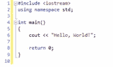

第 1 行是在告诉你的计算机，你想将程序链接到 `iostream` 库。库是一个存储小段代码的地方，有时也会存储变量和操作符。`iostream` 库中的代码允许我们将字符移动到文本流中，然后显示在屏幕上。

第 2 行告诉计算机我们要使用标准命名空间（namespace）——这是你的代码将存储的地方，如果你编写了两个同名的代码段，这将很有。第 4 行是代码的开始。大括号内部的所有内容都是编译器读取并翻译的内容——这一行必须出现在你编写的每一个程序中；否则，什么都不会发生。

下一阶段是打印程序，在这种情况下，打印的是“hello, world!”在这里，我们使用了存储在 `iostream` 中的一些代码——一段名为 `cout` 的代码。代码后面的 `<<` 是一个操作符，它被翻译为“输出”，意味着我们正在告诉计算机将代码发送到指定的流。打印“hello, world!”被称为字符串（string），它无非是封装在双引号中的字符序列。注意，该行以分号结尾——这在告诉计算机代码已结束，如果没有使用分号，程序将无法通过编译。

第 8 行始终放置在 `main` 的末尾，用于通知计算机该块已完成。

现在你已经有了程序的源代码，它必须使用你的编译器进行编译。更多细节将在稍后介绍，首先我想开始介绍构成你代码的组成部分。下一章将详细介绍你成为一名成功的 C++ 程序员需要学习的所有内容。

### C++ 程序的结构

正如我们已经讨论过的，计算机程序无非是一组顺序指令，用于告诉 CPU 该做什么。

### 语句和表达式

在 C++ 中，语句（statement）仅仅是程序中最小且独立的单元。它也是编程语言中最常见的指令形式。在 C++ 中，语句是向编译器传达指令以执行特定任务的方式。我们使用 `;` 来结束一条语句。在 C++ 中有许多种语句，下面给出最常见的语句类型。

```cpp
Int x;
X = 5;
Std::cout << x;
```

我们将在后面的章节中讨论上述语句的功能。

### 函数

函数无非是一组按顺序执行的语句序列。有一个函数叫做 `main` 函数，它是每个 C++ 程序必不可少的。当运行任何给定的 C++ 程序时，程序的执行从 `main` 函数开始。函数有非常特定的任务执行，并且只能执行这些任务。要成为一名优秀的程序员，你需要知道如何高效地使用函数。在下一章中，你将学习更多关于函数的知识。

### 库和 C++ 标准库

库仅仅是代码的集合，可以在不同的程序中使用。如果你想扩展程序的功能，可以添加库。C++ 核心语言是极简的，但它也带有一个名为 C++ 标准库的内置库。标准库为用户提供了额外的功能。

### 语法和语法错误

我们都知道，在任何语言中，句子的构建都是遵循该特定语言的规则的。以英语为例，我们通常在句末使用句号。治理语言中句子构建的所有规则都称为语法（syntax）。同样，C++ 也有语法。不遵守语法将直接导致你的代码无效。确保遵循 C++ 语言的基本语法是编译器的责任。如果你违反了基本语法，编译器将尝试编译代码并对违规行为报错。该问题就称为语法错误（syntax error）。C++ 编译器只有在没有发现语法错误时才会编译程序。它会显示发现的所有错误，并建议你使其有效，以便它可以执行代码。

### 编译你的第一个程序

在编写第一个程序之前，有两件重要的事情你需要知道。你的程序将写在 `.cpp` 文件中，这些会被添加到你的项目中。项目也被称为工作空间（workspaces）或解决方案（solutions）。代码文件和 IDE 设置将保存到你的项目中。你应该通过创建一个新项目来开始，因为有很多种项目。在开始之前，你需要指定你想要工作的项目类型。

什么构成了 C++ 代码？

变量是存储值的东西。它像一个盒子，每个盒子上都有一个名称和一个类别，而类别是存储在其中的物品的类型——名称是特定的变量。每个变量都有特定的类型、名称和大小，这些精确地决定了里面可以存储什么。

第 7 行被称为赋值（assignment）。它为变量分配一个值，`=` 是操作符——这就是执行赋值的操作。`=` 后面的值被称为二元操作符。

注意，这次 `cout` 语句周围没有引号。这是因为，这一次我们不是在显示字符串，而是在输出值。现在编译程序将在屏幕上打印“42”。

变量除了有类型外，还可以在声明中添加前缀（prefix），这些前缀会改变变量的行为。有些会改变变量的大小，而另一些允许你或阻止你使用负数，而另一些则执行完全不同的工作。几乎所有的它们都会在这里讨论。

### 大小变化

两个特定的前缀会改变变量的字节大小——`short` 和 `long`。这背后的思想是允许变量存储更多值更大的数字。有多大取决于你使用的计算机架构：

- 在 32 位计算机上，`int` 和 `long int` 都是 4 字节。
- 在 64 位计算机上，`int` 是 4 字节，`long int` 是 8 字节。
- 在两种架构上，`short int` 都是 2 字节


没有任何规定规定那些特定关键字修饰符的大小，除非：

short 必须等于或小于普通变量，

普通变量反过来必须等于或小于 long。

只有 `int` 变量可以接受前缀。

```cpp
int;
```


更让人困惑的是，你可以省略 `int` 直接使用 `long` 或 `short`，例如：

```cpp
Short int s = 0;
Int i = 0;
Long int l = 0;
Short s2 = 0;
Long l2 = 0;
```

### 符号变化
另外两个前缀可以限制类型存储的值——有符号（signed）和无符号（unsigned）。一个 `signed` 变量可以存储负值和正值，而 `unsigned` 变量只能取正值。

### 其他前缀
在 `c++` 中你还可以使用一些其他前缀，它们并不常见，而且其中大多数我们都不会使用，书中也不会涉及这些内容。不过，有两个非常有用的前缀——`const` 和 `static`。前者是常量，值永远不会改变；后者保持变量的值不变，但仅在函数调用之间保持有效；那是稍后要讨论的话题。

### 语言的核心：理解 C++
今天我们周围几乎的一切都是由计算机运行的；在电脑或你偏爱的手机品牌的核心是程序。在我们的学习过程中，我假设你已经了解什么是计算机程序及其背后的结构。所有程序的核心都是一种计算语言。这个问题随之而来：`c++` 到底是什么？

`C++`（读音为 see plus plus）其核心是一种通用的编程语言。这门语言的独特之处在于，它在提供低级内存管理的同时，还整合了关键的面向对象编程以及泛型编程。

该语言及其设计倾向于系统编程，例如嵌入式系统和操作系统内核，这里仅举例。

由于其性能、灵活性和效率，该语言是许多程序员的青睐。该语言在许多场景中都有有效用途，例如服务器（如网络搜索 sql 和电子商务）、桌面应用程序、性能关键密集型应用（如太空探测器和电话交换机），以及最重要的一娱乐软件，你喜欢的视频游戏就属于此类。

该语言被称为编译型语言，其实现可以在全球许多平台上运行，并被许多跨国公司使用，如 `intel`、`fsf`、`microsoft` 和 `llvm`，这里仅举例。

如果你搜索 `iso`（国际标准化组织），你会了解到 `c++` 是被标准化的。`iso` 在 2011 年 9 月批准并发布了 `c++` 的当前版本，版本为 `iso/iec 14882:2011`，俗称为 `c++11`。`c++` 最初于 1998 年被标准化，版本为 `iso/iec 14882:1198`，后更名为 `c++03`，接着在 2003 年再次标准化为 `iso/iec 14882:2003`。尽管上述信息有用，但对你来说并不重要。

更重要的是当前的标准 `c++11`，由于整合了新功能和更大的标准库，它取代了所有其他版本。

与计算机相关的一切，事实上世界上的一切其他事物都有起源。`c++` 是 `bjarne stroustrup` 在 `bell labs` 早在 1979 年（左右）的结晶。每一项伟大的创新都有原因或目的。`bjarne` 想要一种更灵活、高效的语言，类似于 `c`，但也是一种提供更高级程序组织功能的语言。

这里有一个关键点；记得我我说过学习 `c++` 会为你学习其他语言做准备吗？原因就在于：`c++` 影响了许多语言，包括 `java#` 以及 1998 年之后开发的所有 `c` 版本。

在结束本章之前，我或许应该提到 `c` 是 `c++` 的先驱，因此使用 `c++` 将需要一些关于它的知识。

### 初次上手 C++
虽然学习和研究 `c++` 令人兴奋，但在我们开始编写代码之前，有一些前提条件：你需要一个集成开发环境（`ide`）。`ide` 是一个编译器，将你的代码翻译成语言或你的机器可以理解的一系列 0 和 1。如果你还没有编译器，可以下载许多免费和付费的编译器。

### 安装 ide
`ide` 构成了你编程中非常核心的一部分，查看 `ide` 的一些基础方面是有重要性的，正如我提到的，你可以使用许多 `ides`。大多数开发者都为纠结哪种 `ide` 最适合自己而苦恼。但问题是在于；你可以在系统上安装多个 `ides`，因此没有正确或错误的 `ide` 之分。最常见且集成的编译器是 `code::blocks` 和 `visual c++ 2005`。因此，我可以建议你安装其中一个，但如果你有喜欢的编译器，就尽情使用吧。如果你在 windows（即 windows 机器）上编程，对你来说最好的选择是从微软下载的 `visual c++ 2010`。也许也有必要指出，你从网站下载的文件仅仅是一个编译器；实际的 `ide` 在你运行编译器时才启动。然而，如果你工作在一个网络连接受限的环境中，并希望在 Google 或你喜爱的搜索引擎的帮助下下载文件以便稍后使用，你可以找到离线安装包。

P.s. 我不建议从第三方下载文件。同样重要的是，我们将涉及的 `c` 和 `c++` 的大部分功能都包含在安装 `msn express` 时附带的文档文件中。然而，如果你没有在驱动器上安装 `msn`，`visual c++` 将使用[此处](http://msdn.microsoft.com)提供的在线版本。取决于你的网络带宽，下载可能需要一些时间，一旦下载和安装完成，windows 将提示重启，请重启系统。

你可能会注意到电脑响应时间延迟，某种“死机”现象；你不应该惊慌或强制关机，因为延迟是因为系统正在安装运行所需的所有资源。此外，一旦系统启动并打开 windows 桌面，你可能会发现再次运行安装程序，类似于我们刚刚完成的操作。然而，这一次安装程序不会下载文件；它只需安装程序。

另一方面，你可能在 windows 上开发但编写用于迁移到 `linux kernel` 的程序，反之亦然；在这种情况下，你的最佳选择是使用 `code::blocks`，这是一个可以在 windows 和 linux 上运行的开源跨平台免费 `ide`。

尽管如此，windows 用户有一个关键点需要注意。如果你打算在 windows 上使用 `code::blocks` 编写 `c++` 代码，你应该确保下载包含 `mingw` 的版本。

到为止，我们已经涵盖了 mac osx 之外的所有平台。如果你是 osx 用户，可以使用 `xcode` 或 `eclipse`。`eclipse` 的 `c++` 并不是自动的；它需要下载并安装可选的 `c++` 组件。


编程的 IDE 和安装部分可能是任何编程教程中最难的部分。现在我们已经完成了这部分，你已经准备好开始编写你的首个程序了。

# 你的第一个 C++ 程序

欢迎来到最令人兴奋的部分，也许这正是你拿起这本书的原因——使用 `c++` 编写程序。和大多数计算机语言教程一样，我们的首要目标是创建一个“Hello World”程序。

虽然“Hello World”代码听起来可能像是一个陈词滥调，但在我们的程序创建过程中，它是以后在我教完我的内容后，你将创建的几乎每一个程序中“脊柱代码”的最佳实例。无论你的程序或代码是复杂还是简单，它都必须包含几行基础代码。


上面的代码就是我们所说的预处理器指令。如果你查看代码，你会发现 `iostream` 中有‘i’ 和‘o’；它们分别代表输入（input）和输出（output），并且是你任何使用 `c++` 创建的程序中绝对要求的项。另一方面，`namespace std` 告诉编译器你打算使用标准库。如果你没有使用这行代码来指定，你将限制自己，并且无法使用 `cin`、`cout` 或 `endl`，我们稍后会介绍这些内容。

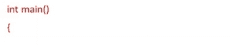

另一方面，上面的代码指示了主程序的开始位置，那里是大部分代码发生的地方。如果你好奇 `int` 的意思是整数（integer）。`integer` 是将返回给程序的值。

同样重要的一点是，你不应该忽略括号 `()`；即使它们是空的，它们也是重要的。同时，你也不应该忽略大括号 `{`，因为它是必要的。现在我们已经理解了如何控制输出，让我们在屏幕上打印一些东西吧。


我不知道你是否熟悉 C 语言，但上面代码中的 `cout` 相当于 `printf` 语句。代码 `(cout)` 将引号内的任何文本或其他内容打印到屏幕上。另一方面，`endl` 表示行结束（类似于在处理文字文档文件时按回车键）。分号也是必须的，所以不要忘记它。在上面的代码中，`return 0` 充当返回给 `int main` 的整数。不要听起来像复读机，不要忘记用大括号结尾，因为它们标志着主程序的结束。

在上面的代码中，这是我们主程序代码的形式。

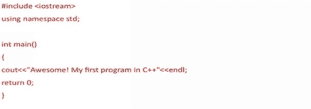

这可能会让你感到惊讶，如果你遵循了我们目前为止所做的一切，你就刚刚创建了你的第一个程序。

惊喜吧！我们刚刚使用并创建的代码是所有程序的 Basic 结构；把它想象成像在幼儿园学习字母表。你应该尽力理解并记住它。其次，你应该记住使用 `cout` 和 `endl` 的顺序。不要忘记使用 `namespace std` 进行声明；否则，编译器将返回错误。

然而，有一个通办法。如果你不使用 `namespace std` 进行声明，那么你必须使用 `std::` 来声明每个 `cout`、`cin` 和 `endl`。

这是一个我所意思的示例。为了清晰起见，我们将用蓝色高亮程序中的区别。

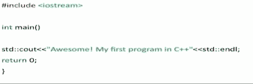

如果你对通用编程或 C++ 不太熟悉，你会发现 `cout` 和 `endl` 会在你的编码中频繁出现。选择我刚刚描述的方法将非常繁琐。因此，你应该选择通过使用 `namespace std` 来指示编译器，让你的工作更快。

### 第 2 章：声明常量

常量是程序不允许更改的固定值，它们被称为字面量（literals）。常量可以属于任何可用的数据类型。注意，它们是普通变量，区别在于常量的值在定义后不能更改。

使用预处理器定义常量，我们使用下面的语法：

```
#define identifier value
``` 标识符（identifier）是常量的名称，而值（value）表示赋值给常量的值。下面的程序描述了如何实现：

```
#include <iostream>
using namespace std;

#define width 7
#define length 11

int main() {
    int rectangle_area;
    rectangle_area = length * width;
    cout << "the area of the rectangle is " << rectangle_area;
    return 0;
}
```

在上面的示例中，我们定义了两个常量即 `width` 和 `length`。我们分别分配了 7 和 11 的值。我们还定义了变量 `rectangle_area` 并给它赋值了这两个常量乘积的值。然后我们打印了这个变量的值。执行时，代码应该返回以下内容：

### 使用 const 关键字

我们也可以通过 `const` 关键字来定义常量。为了这样做，我们必须使用下面的语法：

```
const data_type variable = value;
```

注意，我们必须定义常数的数据类型。这次常量的值是通过赋值运算符（=`）分配的。让我们来看一个演示此点的示例：

```cpp
#include <iostream>
using namespace std;

int main() {
    const int length = 7;
    const int width = 11;
    int rectangle_area;
    rectangle_area = length * width;
    cout << "the area of the rectangle is " << rectangle_area;
    return 0;
}
```

我们刚刚创建了相同的示例，但这次常量是用 `const` 关键字定义的。执行时，代码应该返回以下结果：

注意，在编程中，对常量使用大写字母总是好的。

# 处理 C++ 数据类型

现在我们已经创建了你的第一个程序，还有另一件同等重要、甚至超过投入清醒时间编写代码文档的事情。

每个程序都需要文档，如果不是帮助其他程序员理解你的程序，也是为了在你编写多年后帮助你自己理解。这听起来可能是在揭示你的魔法代码编写技巧，但在编程世界里，在获得其他程序员赞誉之前你从未成功。使用 C++ 语言时，你可以通过双斜杠 `//` 以注释的形式为程序添加文档，编译器将忽略你在同一行内这两个斜杠之间写的任何内容。

在整个编码生涯和工作中，我建议你尽可能记录你的工作。此外，你还会注意到你写的大部分注释与代码有不同的颜色。如果你的编译器没有自动这样做，你应该手动这样做以避免混淆。


如果我们在程序中使用这个示例，每次使用变量 `x` 时，它将与使用数字 `12` 相似，除非我们另有指定。通过这种，当你想要在屏幕上打印某些内容时，操作方法如下。

注意：在这种情况下，我们是将 `x` 打印到屏幕上。

```cpp
cout<<x;
```

如果你有 `c` 语言的经验，你可能不会察觉到这有什么不同。首先，没有 `printf`，其次，没有占位符。这不应该引起报警。在上面的代码中，`cout` 中的 ‘c’ 是“console”（控制台）的占位符，因此 `cout` 的意思是 console out（控制台输出）。让我们假设一种场景：你不想给程序赋值变量，但希望程序在运行时为变量赋值。虽然这听起来非常数学化且复杂，但你可以轻松地通过 `cin` 来实现这一点，正如你可能猜到的那样，它代表 console in（控制台输入）。


作为一名程序员，你必须非常敏锐。看看上面的代码，告诉我你是否注意到与我们目前为止学到的内容有什么不同。你注意到什么了吗？上面代码中的箭头指向的方向与你使用 `cout` 时相反。在上面的代码中，我们没有给名为 `x` 的整数赋值。这是因为程序将提示用户输入一个数字值，然后该数值将存储为变量 `x` 的值。这里是我们的程序现在应该后的的样子，

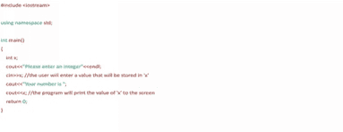

上面的程序首先声明了一个整数 `x`，然后要求你输入一个值，一旦输入，它就会显示在屏幕上。在 경우或其他人想要通过乘法或除法来操作变量的情况下，你作为程序员，必须声明更多的变量并构造某种形式的表达式。让我们给上面的程序添加一些代码。

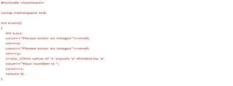

在上面，程序声明了三个整数，并将变量 `z` 等于 `x` 和 `y` 的除法。当程序用户给 `x` 和 `y` 赋值时，程序将显示存储在变量 `z` 中的除法结果。虽然上面的代码可能运行正常，但由于 `z` 等于 `x` 和 `y` 的除法，不可避免会出现缺陷。在上面的例子中，如果用户将 4 赋值给 `x`，2 赋值给 `y`，将没有问题，因为 4 可以被 2 整除。然而，如果值是 6 和 4 会发生什么？让程序代码处于当前状态将提示答案为 0，主要因为到目前为止，`x`、`y` 和 `z` 只持有不带小数的整数。在上面用户赋值 6 和 4 的示例中，显然它们不能整除，而除法会产生小数。那么，我们如何修复这个问题？这个问题的答案相对简单；与其声明一个不能存储小数值的整数 `z`，不如将其声明为 `double`。我倾向于说 `double` 数据类型在存储小数方面优于整数，因为 `double` 类型能够持有小数。我们的程序看起来将是这样，


虽然目前程序代码看起来好多了，但它也有某些不完全正确的地方，如果你运行程序，你仍然得不到正确答案。你能猜到为什么吗？因为所谓的“截断”（truncation）。这听起来可能复杂，但其实并不。在上面的程序中，`x` 和 `y` 是整数。正如我们所见，如果两个整数产生小数，你就无法得到正确答案。简单来说，这就是截断的含义。要修复这个问题，其中一个变量必须是 `double`，这样做会提示编译器识别这一点并将另一个整数临时转换为 `double`。或者，你可以简单地将每个变量声明为 `double`；这取决于你的决定。这里是完整程序的样子。

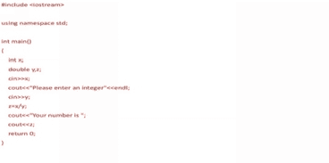

凭借我们在 C++ 学习经验中所看到的一切，你正走在成为编程高手的道路上。练习是关键。

## 编程中的常量类型

### 整数常量
首先，整数是以二进制形式存储的。你像在日常生活中那样对整数编码；例如，你会将八编码为 `8`。下表将为你展示不同的整数、它们在编程中的值以及它们的数据类型。

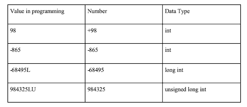

### 字符常量
每当你发现两个单引号时，这就是字符常量。此外，你可能会在这些引号之间发现一个反斜杠 `\`。对于大多数机器，使用的是字符集，即：

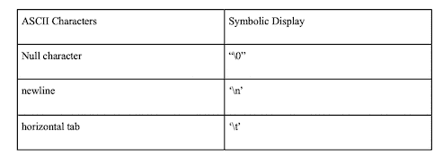

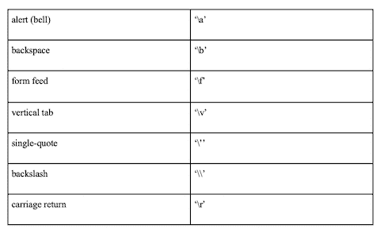

### 浮点常量
浮点常量作为两个部分存储在内存中，因为浮点常量是带有小数部分的数字。内存中获得的第一部分是有效位，第二部分是指数。浮点常量的默认类型是 `double`。你必须编写代码来指定你想要的数据类型，例如 `float`。

### 布尔常量
布尔常量是预定义的关键字，不能由程序员定义或声明。它有两个预定义的常量：`true` 和 `false`。在编程中，我们将这种常量表示为 `bool`。

## 常量

在这一部分，我们将理解不同的编程常量以及在 C++ 程序中编写和定义常量的方法。通常三种类型的常量。

### 定义常量
在 C++ 程序中定义常量的一种方法是使用预处理器语句 `#define`。和其他所有预处理器指令一样，它以 `#` 开头。例如，`#define` 的传统预处理器指令为：`#define table_size 150`。定义通常放在程序的开头，以便阅读程序的人可以轻松找到它们。

### 内存常量
编码量的另一种方法是使用内存常量。这些常量使用 C++ 类型限定符来记住指定的数据不能更改。C++ 编程为我们提供了定义命名常量的能力。我们只需要在常量前添加类型限定符。例如：

```cpp
#include <iostream>

using namespace std;

#define val 50
#define floatval 9.7
#define charval 'k'

int main()
{

    cout << "integer constant in our code: " << val << "\n";
    cout << "floating point constant in our code: " << floatval << "\n";
    cout << "character constant in our code: " << charval << "\n";
    return 0;
}
```

输出：

在这种情况下，会弹出一个控制台屏幕并显示输出：

integer constant in our code: 50

Floating-point constant in our code: 9.7

character constant in our code: k


字面量（Literal constant）是一种无名且用于指定所需数据的常量。正如我们所知，常量是不能更改的，因此我们只需要在语句中编写它的数据值。

字面量是最常见的常量形式。这里有一表展示了不同类型的字面量。

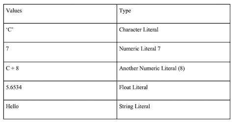

### 第 3 章：函数

你可能还记得数学课上的某个时刻需要处理过函数，例如 `f(x) = 2x + 5`。`f(0)` 应该是 5（`2(0) = 5`），`f(1)` 应该是 7（`2(1) + 5`），`f(2)` 应该是 9（`2(2) + 5`），依此类推。

C++ 中的函数工作原理也类似。

函数执行操作并通常会返回一个值。然而，它们并不总是需要返回值——不返回值的函数是 `void` 函数。

首先，看看这段代码，它现在不需要逻辑通顺，对吧？我们将过一遍它。创建一个新项目并删除 `main.cpp` 的内容，输入以下代码。

```cpp
#include <iostream>

using namespace std;

int get_area(int l, int w);

int main()
{
    int length, width;
    cout << “enter the length, and enter the width.\n”;
    cin >> length >> width;
    cout << “the are_a is: " << get_area(length, width);
    return 0;
}

int get_area(int l, int w) {
    int are_a = l * w;
    return are_a;
}
```

现在让我们逐行分析它。

`#include <iostream>`
这包含了输入和输出的基本组件。

`using namespace std;`
这表示我们正在使用标准输入输出命名空间。

`int get_area(int l, int w);`
这是我们声明第一个函数的地方。C++ 是过程化编译的，所以你不能随意放置函数。你必须在之后编写它们之前先声明，或者让它们在你的 `main` 函数之前完全写。为了清晰起见，我倾向于先进行初始声明，然后在 `main` 函数之后编写函数，但这是个人选择。无论如何，我们在这里创建了一个名为“get_area”的函数。名称前的 `int` 表示它将返回一个整数值。同样，`float get_area(...)` 会返回一个浮点值，`char get_character(...)` 会返回一个字符，依此类推。

在声明中，我们给出了两个变量，称为参数（arguments）。就像在 `f(x)` 方程中，`x` 是方程修改的对象一样，参数变量就是我们的 C++ 读取并利用的内容。

`int main()`
`{`
这是我们 `main` 函数的开始。如果你还没有发现，每个程序都必须有一个 `main` 函数。它是代码的入口点，编译器会主动寻找它。

`int length, width;`
我们声明了两个变量，`length` 和 `width`。

`cout << “enter the length, and enter the width.\n”;`
`cin >> length >> width;`
我们要求用户输入长度宽度，然后接受他们的输入。

`cout << “the are_a is: “ << get_area(length, width);`
这里需要进一步的解释。输出流输出了我们提供的值，对吧？由于函数只是返回一个值，我们可以将它们直接放入输出中。

此外，由于此函数返回一个整数值，你可以创建一个新的整数并将其赋值为函数的值，如下所示：`int are_a = get_area(length, width);`

然后你只需要输出：

`cout << “the are_a is: “ << are_a;`

虽然这是浪费，因为这个程序不需要创建这个变量。但是，如果你需要存储一个变量（例如矩形的面积 `are_a`），你可以完全这样做。

`return 0;`
`}`
简单，每个 `main` 函数都必须返回 0。

`int get_area (int l, int w) {`
这镜像了之前的函数声明，是我们开始编写它的地方。

`int are_a = l * w;`
`return are_a;`
我们创建了一个名为 `are_a` 的新变量，它获取函数的两个参数并将它们相乘得到值。我们也可以简单地写成：

`return l * w;`
这都是返回该函数的有效方式，并将将给你适当的结果。这是对函数的简要介绍。它们是结构化程序的重要方式，在这种情况下事情很难管理。

### 第 4 章：多态

多态意味着以多种形式存在。当我们有多个通过继承相关的类时，就会发生这种情况。在 C++ 中，多态意味着调用将根据被调用的对象类型执行不同的函数。

```cpp
#include <iostream>
using namespace std;

class figure {
protected:
    int areth, width;
public:
    figure(int x, int y) : areth(x), width(y) {}
    virtual int area();
};

class rectangle : figure {
public:
    rectangle(int x, int y) : figure(x, y) {}
    int area() override {
        return areth * width;
    }
};

class square : figure {
public:
    square(int x) : figure(x, x) {}
    int area() override {
        return areth * width;
    }
};

int main() {
    figure *figure;
    rectangle rect(10, 7);
    square sq(5, 5);

    figure = &rect;
    cout << figure->area() << endl;

    figure = &sq;
    cout << figure->area() << endl;

    return 0;
}
```

输出将是：

这是因为对 `area()` 的调用一旦基类就固定了。调用固定到基类的版本是因为函数在编译期间是静态链接的。然而，如果我们把函数设为虚（virtual），它将根据对象的类型在运行时进行链接。

等等，提供的文本由于逗号变得有些混乱。我根据提供的文本意图并遵循规则清理了特定的逻辑。

（注：输入文本包含许多错误的逗号如 "lite,ral" 和 "unname,d"，已进行清理以保持可读性并保留核心内容。）*


```cpp
// store, the, addre,ss of square,figure, = &sq;

// call aquare, are,a.

Figure->are,a();

Return 0; }
```

代码现在应该返回以下结果：

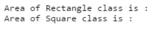

编译器考虑的是指针的元素而不是其类型，`rec` 类和 `sq` 类的对象被存储在 `figure` 中；它们各自定义的 `area()` 函数被调用了。

这表明每个派生类对名为 `area()` 的函数都有不同的实现。这被称为**多态性**（polymorphism）。你拥有多个具有相同函数名和相同参数的类，但它们的实现是不同的。

注意，我们使用了 `virtual` 关键字使该函数变为虚函数。当在基类中定义一个虚函数，而在派生类中定义另一个版本时，这将向编译器发送一个信号，表示不需要对函数进行静态链接。我们只需要根据调用该函数的对象类型，在程序的任何点选择要调用的函数。这种操作被称为**后期绑定**（late binding）或**动态链接**（dynamic linkage）。

有时，你可能需要在基类中包含一个虚函数，以便在派生类中重新定义以适应类对象，但你没有为基类中的函数提供有意义的定义。

在这种情况下，我们在基类中的虚函数 `area()` 可以更改为：

```cpp
Class figure {
Protected: int breadth, length;
Public: figure,(int x =0, int y = 0){
Breadth = x; length = y; }
Virtual int area() = 0; };
```

注意函数中使用的 `= 0;`。这告诉 C++ 编译器该函数没有体。这样的函数被称为纯虚函数。

### 对象析构与多态

对象的析构是很复杂的，尤其是通过接口销毁对象时，例如，你可以有这样的代码：

```cpp
Class drawable {
Public:
Virtual void draw () = 0;
};

Class mydrawable, : public drawable {
Public:
Virtual void draw ();
Mydrawable, ();
~mydrawable, ();
Private,:
Int *mydata;
};

Mydrawable::mydrawable, () {
Mydata = new int;
}

Mydrawable::~mydrawable, () {
Delete, mydata;
}

Void delete,drawable, (drawable, *drawable,) {
Delete, drawable;
}

Int main () {
Delete,drawable,( new mydrawable,() );
}
```

`delete_drawable` 内部发生了什么？记住，当使用 `delete` 时，析构函数会被调用，因此读取 `delete drawable;` 的这一行会对该对象执行一次函数调用。但编译器如何知道 `mydrawable` 析构函数在哪里？编译器不知道 `drawable` 变量的具体类型，但它知道它是一个具有 `draw()` 方法的 drawable。它只知道 `mydrawable` 析构函数本身如何找到与 `drawable` 关联的析构函数，因为 `mydrawable` 在构造函数中分配了内存，为了释放内存，`mydrawable` 析构函数必须运行。

好了，你可能认为这就是虚函数设计要解决的问题。你是对的。我们应该在 `drawable` 中将析构函数声明为虚函数；这样当对指向 `drawable` 类指针调用 `delete` 时，编译器将知道它必须查找一个被重写的析构函数：

```cpp
drawable {
Public:
Virtual void draw ();
Virtual ~drawable, ();
};

Class mydrawable, : public drawable {
Public:
Virtual void draw ();
Mydrawable, ();
Virtual ~mydrawable, ();
Private,:
Int *mydata;
};
```

当我们把子类中的结构设为虚函数并删除 `drawable` 接口时，子类的虚析构函数会被调用。根据规则，当你将任何子类方法设为虚函数时，子类析构函数也应该设为虚函数。一旦你说该类可以传递接收任何想要参数的方法，将析构函数设为虚函数就能确保对象被正确清理。

## 第 5 章：运算符类型与重载

### C++ 中的运算符

C++ 提供了丰富的运算符集合，对常量和变量执行许多不同的功能。C++ 主要有以下类型的运算符：

- 算术运算符，如加法、乘法。
- 关系运算符，如小于、大于。
- 逻辑运算符，如与、或。
- 位运算运算符
- 赋值运算符

算术运算符：C++ 主要提供 7 算术运算符。我们将使用两个变量 `x` 和 `y` 来讨论每一个，其中 `x` 的值为 45，`y` 的值为 25。

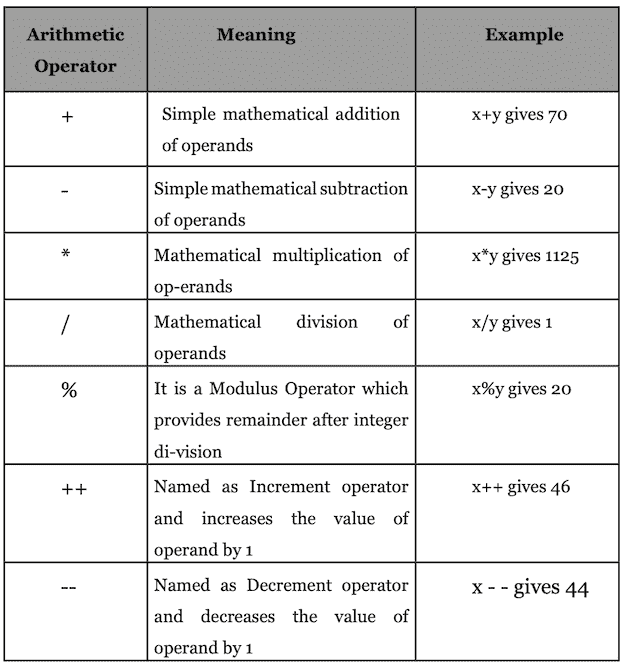

关系运算符：C++ 主要提供 7 关系运算符。这些运算符提供真或假的结果值，并通常用于条件检查。我们将使用两个变量 `x` 和 `y` 来理解每个运算符的含义，其中 `x` 的值为 45，`y` 的值为 25。

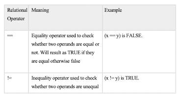
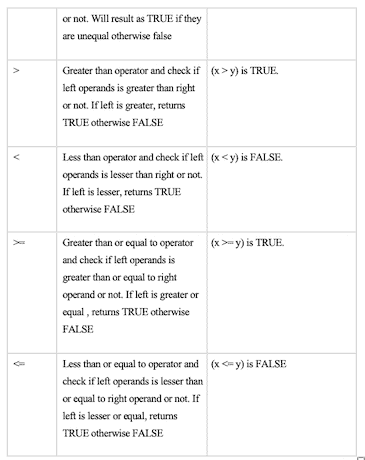

逻辑运算符：C++ 支持以下 3 个逻辑运算符，我们将使用两个变量 `x` 和 `y` 来解释，其中 `x` 的值为 0，`y` 的值为 1。

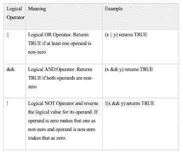

位运算运算符：位运算符按位执行其功能。位与运算符对两个操作数的对应位执行“与”运算，位或运算符对两个操作数的对应位执行“或”运算。

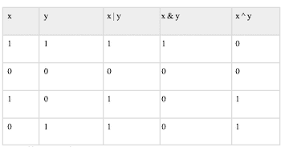

假设 `x = 13;` 且 `y = 60;`
`X = 0000 1101`
`Y = 0011 1100`
`X|y = 0011 1101`
`X&y = 0000 1100`

显示位运算符结合 `p=60` 和 `q=13` 的表格

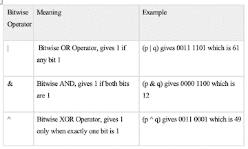
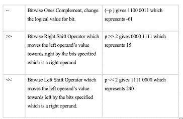

赋值运算符：

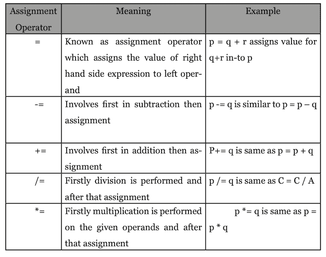
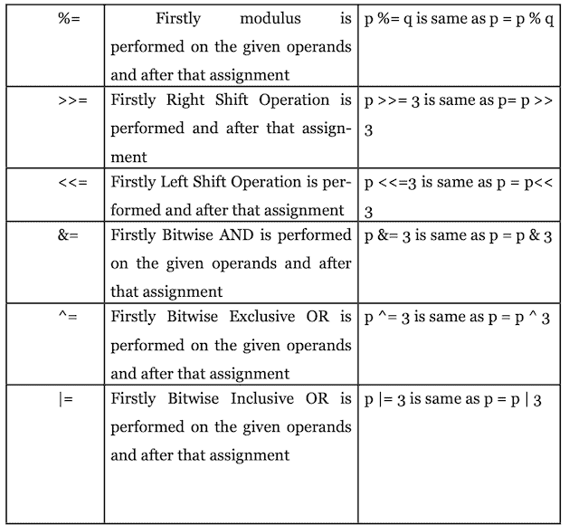

### 运算符优先级与结合性

每个运算符都有与其相关的优先级和结合性。运算符的优先级用于在表达式包含多个运算符时确定评估运算符的顺序。在表达式中，优先级高的运算符先评估。

结合性是在当存在多个相同优先级的运算符时，确定运算符评估顺序的概念，结合性决定了是从左到右还是从右到左评估。

### 重载

在 C++ 中，我们可以在同一个作用域内为函数或运算符指定多个定义，这些过程分别被称为函数重载和运算符重载。


# 运算符重载

C++ 允许你重新定义或重载其大多数内置运算符。这意味着程序员可以在自定义类型上使用运算符。

重载的运算符是具有特殊名称的简单函数，即 `operator` 关键字加上正在定义的运算符符号。正就像函数定义一样，重载的运算符将有一个返回类型和参数列表。下面演示了重载运算符的定义：

```cpp
Rectangle operator+(const rectangle& r);
```

在下面给出的示例中，我们正在演示如何使用成员函数来实现运算符重载。我们将传递一个对象作为参数，并使用该对象访问其属性。调用运算符的对象可以通过该运算符来访问，如下所示：

```cpp
#include <iostream>
using namespace std;

class rectangle {
public:
    double area(void) {
        return length * breadth;
    }
    void set_length(double len) {
        length = len;
    }
    void set_breadth(double bre) {
        breadth = bre;
    }
    // 重载 + 运算符以加两个矩形对象。
    rectangle operator+(const rectangle& r) {
        rectangle rect;
        rect.length = this->length + r.length;
        rect.breadth = this->breadth + r.breadth;
        return rect;
    }
private:
    double length; // 矩形的长度
    double breadth; // 矩形的宽度
};

// main 函数
int main() {
    rectangle rectangle1; // 声明类型为 rectangle 的 rectangle1
    rectangle rectangle2; // 声明类型为 rectangle 的 rectangle2
    rectangle rectangle3; // 声明类型为 rectangle 的 rectangle3
    double area = 0.0; // 在此处存储矩形的面积

    // 矩形 1 
    rectangle1.set_length(6.0);
    rectangle1.set_breadth(7.0);

    // 矩形 2 
    rectangle2.set_length(12.0);
    rectangle2.set_breadth(13.0);

    // 矩形 1 的面积
    area = rectangle1.area(); cout << "area of rectangle1 : " << area << endl;

    // 矩形 2 的面积
    area = rectangle2.area(); cout << "area of rectangle2 : " << area << endl;

    // 两个对象相加：rectangle3 = rectangle1 + rectangle2;
    // 矩形 3 的面积
    area = rectangle3.area(); cout << "area of rectangle3 : " << area << endl;

    return 0;
}
```

执行时，代码将返回以下内容：

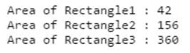

考虑从上述代码中提取的章节：

```cpp
rectangle operator+(const rectangle& r) {
    rectangle rect;
    rect.length = this->length + r.length;
    rect.breadth = this->breadth + r.breadth;
    return rect;
}
```

这就是实现运算符重载机制的地方。我们重载了 `+` 运算符，使其能够加上两个矩形对象的测量值。这里是代码中提取的另一行：

```cpp
rectangle3 = rectangle1 + rectangle2;
```

在上面的代码行中，`rectangle1` 将被加到 `rectangle2` 上。这意味着 `rectangle1` 的 `length` 将加上 `rectangle2` 的 `length` 以得到 `rectangle3`，而 `rectangle1` 的 `breadth` 将加上 `rectangle2` 的 `breadth` 以得到 `rectangle3`。`+` 运算符的含义被重载了！

### 第 6 章：宏与模板

### 模板简介

模板是 C++ 语言中的一项重要特性，因为它允许函数和类使用泛型类型。它们通过允许定义不同的数据类型而无需重写，在函数和类的工作方式中起着本质作用。

使用模板，你可以编写适用于任何数据类型的通用代码。只需要将数据类型作为参数传递即可。模板提高了可重用性并提高了程序的灵活性。你可以创建一个简单的类或函数，并将数据类型作为参数传递并实现供任何数据类型使用的代码。每当你需要使用该函数时，调用该函数并指定返回类型。

例如，如果你使用 `sort()` 函数对仓库中的数据进行排序，可以将不同的数据类型作为参数传递给函数。你不需要编写和维护多个文件来根据传递给排序算法的数据类型进行排序，仓库中的数据排序与该数据类型无关。因此，模板用于需要代码在多个数据类型上可重用的情况。在处理多重继承和运算符重载时，模板非常重要。在代码可重用性是首要考虑的地方，模板被广泛应用。

### 模板类型

模板有两种实现方式：

- 使用函数模板
- 使用类模板

模板可以被定义为宏。也就是说，当你定义一个特定类型的对象时，该类型的模板定义用适当的数据类型替换它。模板通常被称为参数化类或函数，因为在执行期间，指定的数据类型将替换定义的参数。

### 类模板

模板提供了根据参数创建类的规范。类模板接受带有参数类型的成员。也就是说，你可以通过向其参数列表传递一组给定的数据类型来实例化类模板。类模板主要用于实现容器。

### 语法

```cpp
template <class identifier>
class class-name {
    ...
    //类成员
    ...
};
```

#### 示例：


类模板定义与普通类定义相似，区别在于在模板中添加了前缀 `template <class m>`，其中 `m` 是类型。模板前缀告诉编译器声明了一个类模板，它使用 `m` 作为类型。在这种情况下，`vector` 类是一个使用 `m` 作为参数的参数化类。如果类是从类模板派生的，则被称为模板类。模板类的对象定义如下：

```
classname<type> objectname (arglist);
```

从类模板派生类被称为实例化。在创建模板类之前，必须对类进行调试。编译器在实例化发生后检查模板中的错误。

### 示例：类模板

```cpp
template <class tt>
class rectangle {
    tt width;
    tt height;
public:
    void set_values(tt num1, tt num2);
    tt area() {
        tt a;
        a=width*height;
        return a;
    }
};

void rectangle<tt>::set_values(tt num1, tt num2) {
    width=num1;
    height=num2;
}

int main() {
    rectangle obj1;
    rectangle<int> obj1(5,6);

    rectangle obj2;
    rectangle<float> obj2(5.6,4);

    cout << obj1.area() << endl;
    cout << obj2.area() << endl;

    return 0;
}
```

**输出：** 
Obj1=30
Obj2=22.4

上面的程序创建了一个类型为 `tt` 的类。在 `(void rectangle<tt>::set_values (tt num1,tt num2))` 语句中的 `<tt>` 指定函数参数也是类模板参数，并且在调用类时应始终包含。


你还可以在类中拥有多个泛型数据类型。你可以在模板规格说明内部使用逗号分隔的列表来声明泛型类。

### 语法
```cpp
template <class xy, class xyz, …>
class class-name
{
    //函数体;
};
```

### 示例：带有两个泛型的类
```cpp
template<class f1,class f2>
class numbers
{
    f1 j; f2 k;

public:
    numbers (f1 x, f2 y)
    { 
        j=x; k=y;
    }

    void print()
    {
        cout<<j<<"and"<<k<<"\n";
    }
};

int main()
{
    numbers <float, int> numbers1 (2.53, 253);
    numbers <int, char> numbers2 (50,’z’);
    numbers1.print();
    numbers2.print();
    return 0;
}
```
// 输出
1.53 and 253
50 and z

### 函数模板
函数模板的工作方式与普通函数类似，区别在于普通函数只能处理单一数据类型，而模板可以适应多种数据类型。通过模板，你可以重载普通函数以处理不同的数据类型。这使得函数模板更加有用，因为你只需要编写一个适用于所有数据类型的单例程序。模板在编译时总是会被展开的。就像类模板一样，你可以创建一个具有不同参数类型的函数模板。

### 语法
```cpp
template <class type>
return-type function-name, (arguments)
{
    函数体;
};
```
在定义函数模板时，必要时，你必须在函数体和参数列表中都包含模板类型。

#### 示例 1：交换值的函数
```cpp
template <class t1>
void swap (t1&num1, t1&num2)
{
    t1 val= num1; num1=num2; num2=val;
};
```
调用模板函数的方法与调用普通函数相同。

#### 示例 2：函数模板的实现
```cpp
template <class test>
test max (test x, test y);
{
    test results;
    results=x>y? x:y;
    return results;
};

int main()
{
    int a=5, b=6, c;
    double l=4, m=6, n;
    c= max <int> (a,b);
    n=max <double> (l,m);
    cout<< c<<endl;
    cout<<n<<endl;
    return 0;
}
```
在这个示例中，`test` 是模板参数。函数 `max` 被以不同的参数类型（int 和 double）调用了两次。当编译器实例化它时，它每次都会根据类型调用函数。产生的输出对象（在用特定类型实例化模板后）将与参数 `x` 和 `y` 的类型相同。上述程序将根据值的大小对值进行排序。如果使用数字数组，将应用排序算法对数字从从小到大进行排序。

### 带有多个参数的函数模板
就像类模板一样，你可以拥有多个由逗号分隔的泛型数据类型。


#### 示例：带有多个参数的模板类
```cpp
template<class tmp1,class tmp2>
void display( tmp1 j, tmp2 k)
{
    cout<<j<<" "<<k<<"\n";
}

int main()
{
    J=display1(2019, “edge,,”);
    K=display2(18.54, “1854);
    return 0;
}
```
// 输出
2019 edge,
18.54 1854

#### 重载模板函数
你可以使用模板函数或普通函数来重载模板函数。重载可以通过以下方式实现：
- 调用匹配模板的普通函数。
- 调用使用精确匹配构建的模板函数。
- 在普通函数上使用普通重载，并对匹配模板的函数进行函数调用。
如果没有匹配，系统将生成错误信息。

##### 示例：使用显式函数重载的模板
```cpp
template <class m>
void display(m n)
{
    cout<<"display template function:" << n<<"\n";
}

void display (int n)
{
    cout<<"explicit template function: "<< n<<"\n";
}

int main()
{
    display (80); 
    display (15.20);
    return 0;
}
```
// 输出
explicit template function: 80
display template function: 15.20
函数 `display (80)` 调用的是 `display()` 的普通版本，而不是模板版本。

### 成员函数模板
在创建模板时，所有成员函数都可以定义在类外部，因为模板类中的成员函数是通过类型参数参数化的。因此，函数模板应该定义成员函数。在类模板内部声明的成员函数（无论内联还是非内联）都是隐式的函数模板。定义的模板类，其模板函数有三种定义方式：
1. 为每个用于实例化模板类的返回类型，在文件作用域内显式定义。
2. 在模板参数的文件作用域内定义。
3. 在类内内联定义。

成员函数模板可以实例化未生成的函数。如果一个类同时具有成员函数和显式函数，则显式定义的优先级更高。

### 语法


#### 示例：带有成员函数模板的类


### 非类型模板参数
模板可以有单个或多个类型参数。除了类型参数 `t`，你还可以使用非类型参数模板。可以使用字符串、常量、内置类型和函数名创建模板参数。


上述模板将数组的大小作为参数传递。编译器只有在运行时才知道数组的大小。参数是在创建模板类时指定的。

### 模板类
虽然模板类倾向于让想要编写 `map` 和 `vector` 等类的库编写者，程序员也可以从能够使代码更具通用性中受益。你不应该仅仅因为可以使用就使用模板；相反，你应该寻找消除仅类型不同的类的机会。是的，你可能会发现自己编写的模板方法比类多，但你仍然需要了解如何使用它们，特别是当你有自己想要实现的数据结构时。

声明模板类与模板函数并不相似。假设我们想构建一个包装数组类。为了将构造函数定义在类外部，我们首先指示该函数是模板：
```cpp
template <class t>
class wrapper
{
private:
    t *arr;
};
```
这样，构造函数就可以定义在类外部，我们开始写：
```cpp
template <class t>
wrapper<t>::wrapper (int size)
: arr(new t[size])
{ }
```


我们从基础模板介绍开始，并为模板声明参数。区别在于，类名现在包含了 `arraywrapper` 模板，这告诉大家它属于一个模板类，而不是名为 `arraywrapper` 的标准类上的模板函数。

在 particular 实现中，模板参数可以用来代表提供的类型，就像模板函数一样。然而，函数的调用者永远不需要提供该参数——它从第一个模板类型声明中获取。例如，你不需要写成 `vec.size<int>()`

或者

`vec<int>.size()`

要获取一个整数向量的大小，你只需要写：

`vec.size()`。

### 模板与头文件

到目前为止，我们看到的模板都是直接写在 `.cpp` 文件中的。但如果我们想把模板声明放在头文件中呢？这里的问题在于，凡是使用模板类或模板函数的代码，在每次对模板进行函数调用以及对模板类上调用的每个成员函数进行调用时，都需要能够访问整个模板定义。

这与标准函数的工作方式不同；标准函数只需要调用者知道声明即可。例如，如果你将 `calc` 类放在它的头文件中，你还需要添加完整的构造函数定义以及 `add()` 方法，而不是像通常那样把它们都放在一个 `.cpp` 文件中。如果你不这样做，你就无法使用 `calc`。

这是模板的一个相当遗憾的特性，这完全取决于模板是如何编译的。在大多数情况下，当编译器第一次解析模板时，它几乎忽略了模板。只有当模板被使用并关联了具体类型时，编译器才会为该类型生成代码。为了做到这一点，模板必须对编译器可用以便生成代码。结果是，所有的模板代码必须包含在所有使用该模板的文件中。当编译包含模板的文件时，在模板被第一次使用之前，你可能无法得知该模板中的任何语法错误。

创建模板类时最简单的方法是将所有模板定义都放在头文件中。使用 `.h` 以外的扩展名也有帮助，仅仅是为了指示该文件是一个模板——例如 `.hxx`。

### 分析模板错误信息

如果使用模板有一个显著的缺点，那就是当模板被误用时（无论你是否写错），很多编译器都会抛出难以理解的错误信息。你可能因为一个错误就得到几页的错误信息。

模板错误信息之所以难以阅读，是因为模板参数被展开到了极致，甚至包括你通常不使用的参数，例如默认参数。

vector 模板的第二个参数也有类似的限制——这个参数需要一个比平凡的整数支持更多功能的类型。这些错误都在抱怨 `int` 作为该参数的有效类型的无数种方式。

找到错误所在的代码行始终是解决问题的第一步。在大多数情况下，即使你积累了经验，只需一眼你的代码就能看出错误是什么。如果不显而易见，你就继续寻找，直到出现错误信息：“error: int is not a class, struct or union.”（int 不是类、结构体或联合体）。

现在问题找到了，我们可以修复它并重新编译代码。有时你可以同时解决几个错误，但对于模板来说，第一个错误通常是所有问题的根源。一次解决一个问题，你会发现其他错误接踵而至。在我们上面的最后一个示例中，所有错误信息都源于一个简单的错误：给第二个参数传递了 `int`。

### 第 7 章：类

### 类的介绍

所有面向对象编程的核心在于“类”的概念，你在整个代码中创建并利用它。这有助于模块化、易用性以及更符合逻辑、更连贯的高级编程。

在 C 语言的早期迭代中，有一种原始的类叫做 `struct`。`struct` 在 C++ 中仍然存在，但主要已被废弃，转而倾向使用类。尽管如此，C++ 的 `struct` 也与 C 的 `struct` 不同。C 的 `struct` 没有 C++ `struct` 拥有的许多功能。

在我们深入之前，让我们简要介绍访问修饰符的概念。我们讨论过像 `int`、`string`、`bool` 和 `float` 等类型。我们使用枚举器创建了一些可以认为是类型。然而，你可以创建一个由较小数据片段和内置函数组成的整个类型。这被称为对象。访问修饰符描述了代码中哪些是可以变化的。有不同的访问修饰符。

公共（Public）访问意味着对象和/或其内部数据和函数可以被程序中的任何其他代码访问和修改。保护（Protected）意味着对象和/或其内部数据和函数只能由其派生类访问和修改（当我们进入继承和多态时，这会有意义）。私有（Private）意味着只有对象本身可以访问和修改其数据。这对于安全、清晰代码安全至关重要。`struct` 和类都是创建新对象的方法。`struct` 和类的主要区别在于 `struct` 默认是公共的，而类默认是私有的。除了这些，它们的差异微乎其微。

然而，在科技行业，`struct` 有相当大的负面含义。开发者倾向于将它们视为不受保护的、功能有限的对象，而倾向于将类视为功能强大的对象，并具有良好设计和结构良好的子类。因此，通常创建类更好，除非你的对象功能非常少，仅包含很少的数据和内置函数。看这个 `struct` 定义和声明。

```
struct animal {
enum diet { herbivore, omnivore, carnivore, };
int legs;
string name;
diet naturaldie_t;
};

int main() {
Animal dog;
dog.legs = 4;
dog.name = "dog";
dog.naturaldie_t = dog.carnivore;
}
```

这是声明新对象最简单的方法。你不应该在现有函数内部声明它们。


让我们把那个结构体（struct）替换为类（class），因为以后我们将使用类，因为通常来说，类是结构体更安全、更好的选择。

在 blocks 中创建一个名为“animalssimulator”的新项目。这个标题不是最有创意的，但它胜任我们要做的工作。清空 `main.cpp` 的内容，导入 `iostream` 并创建你的 `main` 方法。

在 `main` 方法上方，让我们声明一个名为 `animal` 的类。你这样做的方法和声明结构体非常相似。为了方便说明，请让它看起来像这样：

```cpp
Class animal {
    String name;
};
```

然后，在你的 `main` 方法中，声明一个实例，并将它的 `name` 实例设置为你喜欢的动物名称。之后，尝试进行构建。

你应该会收到一个显示“error: string animal::name is private,”的错误。

完美。这种情况本该会发生，因为现在我们必须修复它。这就涉及到整个访问修饰符（access description）的概念。修改你的类，使其看起来像这样：

```cpp
Class animal {
    Public:
    String name;
}
```

然后再次尝试构建。这次应该可以正常工作。这是因为我们把字符串“name”设为了公有（public），这意味着类外部的其他方法/函数可以访问它。

不过，这通常被认为是坏习惯，所以我们将如下重写该类：

```cpp
Class animal {
    Private:
    String name;
}
```

在类内部修改值的最佳实践是使用 get/set 方法。如果实现了 get/set 方法，该类将如下所示。

```cpp
Class animal {
    Private:
    String name;
    Public:
    String getname() {
        return this->name;
    }
    Void setname(string name) {
        this->name = name;
    }
}
```

现在，在你的 `main` 方法中，在声明任何 `animal` 实例后，不要直接修改它的名称，而应该像这样使用 get/set 方法（假设你的实例 `animal` 名为“dog”）：

```cpp
Dog.setname("dog");
```

然后你可以通过在 `main` 方法中打印名称来测试这一点：

```cpp
Cout << “the name of my favorite animal is: “ << dog.getname() << "\n";
```

这些方法的工作原理是通过类内部的方法返回或设置变量的值。`this->` 被称为 this 指针，它引用类的一个给定实例的变量。每个对象都可以访问它的变量，并通过“this 指针”直接修改它们。

无论如何，你的代码运行应该非常完美。但如果你不想为每个类的每个实例都通过 get/set 呢？我们将使用称为初始化函数（initializer function）的工具。修改你的类，使其看起来像这样：

```cpp
Class animal {
    Private:
    String name;
    Public:
    Animal(string name) {
        this->name = name;
    }
    String getname() {
        return this->name;
    }
    Void setname(string name) {
        this->name = name;
    }
}
```

现在，在你的 `main` 函数中，删掉原来的 `animal x` 后面跟着 `x.setname(“name,”)` 函数的代码块。当你创建一个初始化函数时，你可以从一开始就设置某些变量。例如，由于你的初始化函数接收参数 `name`，你可以在声明变量时就声明它，从而绕过整个 `setname` 操作。看这段代码示例：

```cpp
Animal dog("dog");
Animal elephant("elephant");
Animal bird("bird");
```

这些都是 `animal` 类的独立实例，得益于初始化器，它们的名称在没有使用 set 函数的情况下就已经设置。它可以接受你需要的数量的参数。这使得创建新对象变得极其容易，过程也相当精简。

现在我们已经简要讨论了声明对象之类的内容，让我们更多地讨论一下对它们进行具体操作。这里的对象代表动物。我们可以为整个类一组它们可以执行的方法。让我们思考一下每种动物都会做什么。每种动物都会睡觉、进和喝水，对吧？所以，将这些包含在我们的类中并不奇怪，类中的每个成员对象都可以执行这些方法。假设我们有两种特定类型的食物：肉和植物，它们也都由各自的对象表示。我们可以为它们创建两个不同的函数：

```cpp
Void eat(plant p) {
    // 在此处编写代码
}
Void eat(meat m) {
    // 在此处编写代码
}
```

尽管它们共享同一个名称，但你可以根据调用时放入的对象类型调用其中任何一个，两者都会根据参数执行各自相应的代码。这被称为**函数重载**（function overloading）。它是面向对象编程中的一项基本技术，将帮助你创建功能强大且清晰的代码集，便于人们使用和理解。在下一章中，我们将开始探索对类可以做的一些更深层次的内容，包括内部属性，这些属性使类在面向对象编程中变得非常有用且实用。因为在我们最初学习类时，创建大量类型是很繁琐的，所以让我们把“eat”留为一个不带参数的空函数（void function）吧。代码应该如下：

```cpp
Class animal {
    Private:
    String name;
    Public:
    Animal(string name) {
        this->name = name;
    }
    String getname() {
        return this->name;
    }
    Void setname(string name) {
        this->name = name;
    }
    Void eat() {
        // 食物
    }
}
```

下一章我们将涵盖关于类的更深入的概念。

### 对象与类

类是 C++ 的特殊特性，它将 C++ 转化为面向对象编程。记住，C++ 不是纯面向对象对象语言，因为在纯面向对象编程中，没有类就无法执行任何功能，但在 C++ 中是可以行的。

### 类

类是一种用户定义的数据类型，具有数据成员和成员函数，这些成员只有在创建类的实例后才能被访问。


`c++` 中的类类似于 `c` 语言中的结构体，唯一的区别是，类的默认访问控制权限是私有的，而结构体是公有的。

C++ 通过类提供了面向对象编程的所有重要特性，如封装、抽象和继承等。

类的每个对象都拥有其独立的数据成员副本，并且我们可以根据需要为类创建任意数量的对象。

### 对象

类仅仅是一个蓝图。仅仅在定义一个类时，不会为它分配内存。只有在为该类创建对象后，才会分配内存。这些对象是拥有在该类中声明的数据变量的实例，类的成员函数在这些实例上运行。

对象通过特殊的构造函数进行初始化——这些是我们稍后学习的特殊方法。析构函数是另一种特殊函数，在对象超出作用域时销毁对象。

```cpp
Class mobiles{

Int price;

Void calling (){}

Void messaging (){}

};

Void main(){

mobiles m1; // 为类 mobiles 创建了一个对象 }
```

### 构造函数

构造函数是类似于类成员函数的特殊函数，承担初始化对象的重要任务。当对象被创建时，编译器会调用构造函数。构造函数通过在为特定对象提供存储空间后初始化其成员来初始化创建的对象。一个类至少有一个构造函数。如果类中没有显式定义的构造函数，就会产生一个没有参数的默认构造函数。

```cpp
Class test

{

Char c;

Public:

Test(); // 一个构造函数

};

Class test

{

Int a;

Public:

Test(); // 构造函数的声明

Test::test() // 定义构造函数

{

A=1;

}

};
```

### 析构函数

析构函数是特殊的类函数，负责在对象超出作用域时销毁该对象。当对象超出作用域时，编译器会自动调用构造函数。

析构函数的语法与构造函数相同，唯一的区别是使用波浪号 `~` 作为析构函数的符号。此外，析构函数没有参数。

```cpp
Class test

{

Public:

~test(); // 类 test 的析构函数

};
```

演示构造函数和析构函数调用的示例

```cpp
Class test{

{()

{

Cout << “a constructor has be,e,n called”; }

~test()

{

Cout << “a destructor has be,e,n called”; }

};

Int main()

{

Test test1; // 调用了构造函数

Int a=18;

If(a)

{

Test test2; // 再次调用构造函数}// obj2 超出作用域，对 obj2 调用了析构函数

} // 对对象 obj1 调用了析构函数
```

### 类的生命周期

在创建类时，你希望它们尽可能易于使用。任何类都可能需要提供一些基本操作，以支持：

- 它需要初始化自己
- 它需要清理内存和/或其它资源
- 它需要复制自己

这些对于创建良好的数据类型都非常重要。我们将使用字符串来演示这一点。字符串必须能够初始化，即使它们是空的。为了这一点，它们需要依赖外部代码。一旦字符串声明，它就可以立即使用。当你用完字符串后，它必须能够清理内存，因为所有字符串都会分配内存。当使用字符串时，不需要调用另一个方法；字符串会自动完成。最后，它必须能够像整数一样从一个变量复制到另一个变量。我们将一个一个地处理这三个特性，并看看 C++ 如何轻松地实现这一切。

对象构造

你可能已经注意到，我们在棋盘中没有编写初始化棋盘的代码，那是代码的公有部分。我们现在可以修复它。当声明类变量时，该变量需要能够被初始化：

```cpp
chessboard board;
```

当分配内存时：

```cpp
chessboard *board = new board; // 这作为内存分配的一部分调用了 chessboard 构造函数
```

当声明多个对象时：

```cpp
chessboard a;

chessboard b;
```

构造函数总是按照对象声明的顺序运行——a 然后 b。和普通函数一样，构造函数可以接受一个或多个参数，如果有不同的对象初始化方式，可以通过参数类型重载多个构造函数。例如，可以为 chessboard 创建第二个构造函数来接收棋盘尺寸：

```cpp
class chessboard

{

Public:

chessboard (); // 完全没有返回值！

playercolor getmove ();

piece getpiece (int x, int y);

Void make_move (int from_x, int from_y, int to_x, int to_y);

Private:

piece _board[ 8 ][ 8 ];

playercolor whose_move;

};
```

```cpp
chessboard::chessboard () // 没有返回值

{

whose_move = pc_white;

// 先清空整个棋盘，然后添加棋子
For ( int i = 0; i < 8; i++ )

{

For(int j = 0; j < 8; j++ )

{

Board[ i ][ j ] = emptysquare;

}

}

// 初始化棋盘所需的其他代码 own}
```

我将继续向你展示类的声明，以便你看到它是如何整合在一起的。现在注意，上面的构造函数位于类的公有部分。如果我们不将 chessboard 构造函数设为公有，我们就无法创建对象实例。为什么呢？因为每当创建对象时，必须调用构造函数；如果我们将其设为私有，就无法从外部调用。对象只能通过调用构造函数来初始化，如果你将其设为私有，你就无法声明对象。

构造函数会在创建对象的同一行被调用：

```cpp
chessboard board; // 调用构造函数
```

或者在在分配内存时：

```cpp
chessboard *board = new board; // 调用 chessboard 构造函数
```

构造函数总是按照对象声明的顺序运行——a 然后 b。和普通函数一样，构造函数可以接受一个或多个参数，如果有不同的对象初始化方式，可以通过参数类型重载多个构造函数。例如，可以为 chessboard 创建第二个构造函数来接收棋盘尺寸：

```cpp
class chessboard

{

chessboard ();

chessboard (int board_size,);

};
```

函数定义与任何类方法相同：

```cpp
chessboard::chessboard (int size,)

{

// … 代码，

}
```

像这样将参数传递给构造函数：

```cpp
chessboard board( 8 ); // 8 是 chessboard 构造函数的参数
```

当你使用 new 关键字时，传递参数看起来看起来像是直接调用构造函数：

```cpp
chessboard *p_board = new chessboard( 8 );
```

关于语法的说明：虽然括号用于传递参数，但你不能用它们来声明没有参数构造函数的对象。

你不能这样做：

```cpp
chessboard board();
```


正确的形式是：

`chessboard board;`

然而，当使用 `new` 关键字时，可以使用括号：

```cpp
chessboard *board = new board();
```

这是 C++ 解析中一个令人遗憾的小瑕疵，因为其内部细节被隐藏得非常晦涩。只需要在声明带有无参构造函数的对象的对象时，不要使用括号即可。

那么，如果没有声明构造函数，会发生什么呢？

如果没有声明构造函数，C++ 会自动创建一个。它不会接受参数，也不会初始化 `ints`、`chars` 或任何其他原始类型，但它会通过调用每个类字段的默认构造函数来初始化每一个字段。

通常情况下，你应该创建构造函数，以确保所有内容都得到正确初始化。一旦声明了调用的构造函数，C++ 就不会再为你生成默认构造函数了。编译器假设你完全清楚自己在做什么，并且你会创建你所需要的构造函数。特别是，如果你创建了带参数的构造函数，那么代码就不再拥有默认构造函数，除非你显式地声明一个。

这可能会导致意外的后果。如果使用了自动生成的构造函数，然后你添加了一个带参数的非默认构造函数，那么依赖于自动构造函数的代码将无法编译。提供默认构造函数是你的责任，因为编译器不会替你做。

### 初始化列表和 const 字段

如果类字段被声明为 `const`，则必须在列表中进行初始化：

```cpp
Class Constholder
{
public:
    Constholder(int val);
private:
    const int _val;
};

Constholder::Constholder ()
: _val( val )
{}
```

`const` 字段不能通过赋值来初始化，因为字段一旦设置后就无法更改。类尚未完全形成的唯一地方就是初始化列表，因此不可变对象可以在那里安全地设置。出于相同的原因，如果字段是一个引用，它也必须在列表中初始化。

### 第 8 章：库

### 标准模板库 (STL)

能够编写自己的数据结构是一件好事。然而，正如你可能已经察觉到的，这并不常见。但你学习之前的所有内容并不是白白的。你现在已经学习了许多如何根据需要构建数据结构，以及了一些在编写数据结构时可能需要的更常用的结构。

不过，C++ 有一个非常酷的特性——一个巨大的可以复用的代码库。它被称为标准模板库（`stl`），包含了最常见的数据结构，包括基于二叉树和链表构建的结构。这些结构允许你在创建它们时指定它们将存储的数据类型，因此它们可以用于任何地方——结构化数据、字符串、整数等。

因为你拥有这种灵活性，`stl` 在很多情况下可以省去你自己构建结构的需要。使用它可以从以下方面提升你的代码水平：

- 你可以开始根据所需的结构来思考代码，而不是必须亲自思考如何构建和实现它们。
- 你可以免费且轻松访问最好的数据结构实现，这些实现针对大多数问题对空间使用和性能进行了优化。
- 你不再需要担心数据结构的内存分配和释放。

然而，和世事万物一样，使用该库也有其权衡：

- 你需要学习 `stl` 接口以及如何使用它们。
- 当你在使用 `stl` 时遇到编译器错误时，这些错误极其难以阅读和理解。
- 你不会在库中找到所有的数据结构。

彻底讨论 `stl` 需要一整本书，所以我只会为你概述介绍你将从 `stl` 中使用的最常用结构。

### Vector（向量）

`stl` 中包含一种数组的替代品——`vector`。这非常像数组，但它是自动调整大小的；你不再需要担心分配内存和移动元素。然而，`vector` 的语法与标准数组不同。数组的语法是：
```cpp
int array[10];
```

而 `vector` 的语法是：
```cpp
#include <vector>
using namespace std;
vector<int> vector(10);
```

必须包含头文件以及 `namespace std`。这是因为像 `cout` 和 `cin` 一样，`vector` 是标准库的一部分。

此外，在声明 `vector` 时，你必须提供存储在其中的中的数据类型。这是使用角括号 `<>` 完成的：
```cpp
vector<int>
```

这利用了 C++ 的一种名为模板的特性。`vector` 代码的编写方式允许存储任何数据类型。你所做的就是告诉编译器 `vector` 存储的是什么类型。这实际上意味着这里有两个类型：结构类型（它决定了数据的组织方式）以及结构中包含的数据类型。使用模板允许你将不同的结构类型与结构内不同的数据类型结合。

最后，当提供 `vector` 大小时，它必须放在圆括号而不是方括号中：
```cpp
vector<int> vector(10);
```

这是用于某些变量类型初始化的语法。对于这种初始化，值 10 被传递给称为构造函数的初始化过程，这设置了 `vector` 的大小。在我们学习指南的过程中，你将学习到构造函数以及带有构造函数的对象。

一旦创建了 `vector`，就可以像数组一样访问单个元素：
```cpp
for ( int i = 0; i < 10; i++ )
{
    vector[i] = 0;
    array[i] = 0;
}
```

##### 调用 vector 的方法

`vector` 提供的功能比数组得多。你可以进行各种操作，例如在 `vector` 末尾添加元素。`vector` 提供了函数来帮助此类操作，但函数的语法与我们之前使用的语法不同。

```cpp
vector.size();
```

这是在 `vector` 上调用 `size()` 方法，它返回该大小。这非常像访问结构字段，但你调用的是一个与结构相关的方法。虽然方法对 `vector` 执行了某些操作，但 `vector` 不需要作为参数传递给方法。语法已经知道将一个 `vector` 作为隐式参数传入 `size` 方法。

下面的语法：
```
<variable>.<function_call>( <args>);
```
可以被认为是调用与变量类型相关的函数。换句话说，它类似于：
```
<function_call>(<variable>, <args>);
```

在示例中：
`vector.size();`

它就像：
`size(vector);`

vector 的其他特性


`vector` 还可以非常方便地增加所包含项的数量，而不需要手动分配内存。例如，向 `vector` 添加额外的项可以像这样写：

```
A_vector.push_back( 10 );
```

这在 `vector` 的末尾添加了另一个为 `10` 的项。`vector` 会处理大小调整工作。如果你想对数组执行此操作，则必须分配内存、复制值并添加新项。虽然 `vector` 也会进行内存分配和复制，但它是以一种智能的方式进行的，使其不需要在每次添加新项时都重新调整大小。

然而，尽管你可以使用 `push_back` 向 `vector` 的末尾添加项，但单独使用方括号的效果是不相同的。方括号让你只能操作已经分配的数据，这主要是为了防止在你不知情的情况下进行内存分配..。

因此，像下面这样的代码：

```
Vector<int> a_vector( 10 );
A_vector[ 10 ] = 10; // 最后一个有效元素是 9
```

是无法正常运行的，并且很可能导致程序崩溃。更不用说，这样做是很危险的。像这样写：

```
Vector<int> a_vector( 10 );
A_vector.push_back( 10 ); //为 vector 添加一个新元素
```

就可以调整 `vector` 的大小了。

### Maps（映射）

我们之前提到过使用一个值来查找另一个值，这在编程中很常见，例如当你想实现一个邮箱通讯录（通过名称查找地址），或者通过账户号码查找账户的程序，允许用户登录游戏..

STL 给了我们一个 `map` 类型，允许我们指定键类型和值的类型。一个示例是存储邮箱通讯录的数据结构；它可以这样实现：

```cpp
#include <map>
#include <string>

Using namespace std;

Map<string, string> name_to_mail;
```

我们必须告诉该结构有两种类型：一个 `string` 用于键，另一个 `string` 用于值（在这种情况下是电子邮件地址）。

在这些 map 的有用功能之一是，当使用 map 时，语法也可以像数组一样使用。如果你想添加值，它和数组非常相似，只是使用的是键类型而不是整数：

```cpp
Name_to_mail[ “billy bunter” ] = “billybuntherisemailaddress.com”;
```

从 map 中获取值也大相同：

```cpp
Cout << name_to_mail[ “billy bunter” ];
```

你获得了数组的简单性，但具有存储你想要的任何类型的能力。更好的是，与 `vector` 不同，map 的大小在使用 `[]`  way 符添加元素之前不需要设置..。

从 map 中删除项同样简单。假设你和 billy bunter 闹翻了，想从你的通讯录中删除他。你可以使用 `erase` 方法来做到：

```cpp
Name_to_mail.erase( “billy bunter” );
```

你可以使用 `size()` 方法来检查 map 的大小：

```cpp
Name_to_address.size();
```

使用 `empty()` 方法查看 map 是否为空：

```cpp
If ( name_to_address.empty() )
{
Cout << “通讯录是空的。我希望你没删掉它。”
}
```

不要将此与清空 map 混淆。清空是通过使用 `clear()` 方法完成的：

```cpp
Name_to_address.clear();
```

由于 STL 中命名的一致性，相同的方法也可以用于 vector。

### Iterators（迭代器）

除了数据存储和逐个访问元素的能力外，你还可以遍历数据结构中的所有项。对于数组或 vector，这通常使用长度来实现的。但对于 map，因为它们同时拥有数值和非数值键，你并不能总是通过计数器进行迭代。

为了解决这个问题，STL 为我们提供了迭代器，它是一个允许你按顺序访问数据结构元素的变量，即使该数据结构通常没有很好的方法来实现这一点。我们将从观察在 vector 中使用迭代器开始，然后移动元素。其原理是迭代器将存储结构中的位置，因此你可以使用该位置访问元素。然后你调用迭代器上的方法移动到下一个元素。

声明迭代器需要一些特殊的语法。对于整数 vector，它看起来像这样：

```cpp
Vector<int>::iterator
```

这句话的意思是你有一个 vector，并且想要一个适用于特定类型的迭代器，这就是为什么我们使用 `::iterator`。因为迭代器标记了结构中的位置，所以是从数据结构中请求迭代器：

```cpp
vector<int> vec;
vec.push_back( 1 );
vec.push_back( 2 );
vector<int>::iterator itr = vec.begin();
```

`begin()` 方法调用将返回一个允许你访问 `vector` 第一个元素的迭代器。迭代器可以被视为指针——你谈论结构中的元素位置，或使用它获取元素。在我们的案例中，通过这种方式读取 `vector` 的第一个元素：

```
Cout << *itr;
```

从 map 中获取值的方式非常相似：我们像使用指针一样使用 `*` 运算符——当你考虑结构中的位置时是如此。如果你想要下一个元素，迭代器递增：

```
Itr++;
```

也可以使用置运算符：

```
++itr;
```

通过与迭代器和结束迭代器进行比较，查看是否到达了末尾；要这样做，调用：

```
vec.end();
```

如果你想要遍历整个 vector 的代码，看起来像这样：

```cpp
For ( vector<int>::iterator itr = vec.begin(); itr != vec.end(); ++itr )
{
Cout << *itr << endl;
}
```

我们可以使用类似的方法遍历 map，但记住 map 并不存储单个值；它存储键值对。当你解引用迭代器时，它有两个字段——一个键，一个值：

```cpp
Int key = itr->first; // 从迭代器获取键
Int value = itr->second; // 从迭代器获取值
```

这段代码与遍历 vector 的代码非常相似；不同之处使用的是 map 数据结构以及迭代器的第一个和第二个字段。

### 检查 map 中的值

有时你需要查看给定的键是否存储在 map 中。假设你在通讯录中查找某人。你使用 `find()` 方法查看指定的值是否存在，如果存在，则获取它。返回的迭代器要么带有对象的的位置，要么是一个 `end()` 迭代器（如果未找到对象）。

```cpp
Map<string, string>::iterator itr = name_to_mail.find( “billy bunter” );

If ( itr != name_to_mail.end() )
{
Cout << “再次见到 billy。他的邮箱是: " << itr->second;
}
```


我只接触了 `stl` 的基础知识，但你现在已经足够的信息来使用该库中的一些基础类型了。`vector` 可以完全取代数组，如果你不想花时间进行插入和修改，`vectors` 也可以用来代替链表。有了 `vector` 类型在手，你几乎没有什么理由想要去使用数组了，而这些理由中的大多数都是高级的，例如当你在处理文件 I/O 时（我们将在指南的末尾讨论这一点）。

最实用的数据类型是 `map`。使用 `maps` 可以让你轻松编写复杂的程序，而不需要过多担心数据结构的创建。相反，你的注意力可以集中在解决问题上。在某些方面，`map` 可以替代基础的二叉树。大多数情况下，除非是为了特定的性能需求或你明确需要树形结构，否则你不需要去实现二叉树。

这正是 `stl` 真正的威力所在：在约 80% 的时间内，它为你提供了所需的内核结构，让你自由地编写解决问题的代码。在其余的时间，你需要相关知识来构建和实现自己的数据结构。

有些程序员倾向于使用自己的代码而不是现成的代码。在大多数情况下，你不应该使用自己的数据结构；内置的结构更快、更好且更完整。然而，了解如何构建会让你对使用它们有更深刻的见解。

那么，你什么时候可能想要使用自己的结构呢？假设你有一个计算器，允许用户输入算术表达式，然后按照正确的运算顺序对输入进行评估。例如 `4*9+8/3`，其评估方式是在加法执行之前完成除法和乘法。

这种结构可以很容易从树的角度来考虑。你可以这样表示 `4*9+8/3`：

```
+
/
4 *8 3
```

每个节点通过两种方式之一进行求值：

- 如果节点是数字，则返回该值。
- 如果节点是操作符，则计算两个子树的值并执行操作。

构建这样一树需要一个原始数据结构；你不能只用 `map`。如果你只有 `stl`，你会在这方面感到挣扎。然而，一旦你理解了递归和二叉树，就会变得简单得多。

### 第 9 章：STL

### STL/C++ 标准库：容器、算法、迭代器

一个常见的误解是将 C++ 标准库称为 `stl`。`stl`（即标准模板库）是过去某个时候开发的一个标准。C++ 标准库是一组模板，其中许多是从 `stl` 中采纳的。`stl` 现在已经被弃用，但仍保留了一些非常有用的模板。

标准库以容器的形式提供了该问题的解决方案。容器管理一组相同类型的数据集。它们包括 `vectors`、`sets` 和 `lists` 等。

`Vectors` 与数组非常相似，区别在于它们会处理自己的存储和大小。

与字符串类似，你需要导入 `vector` 库来使用该模板：

```cpp
#include <vector>
```

现在你能够能够访问有关 `vectors` 的所有内容。你可以像这样声明一个模板：

```cpp
template<type> name;
```

假设我们回到之前那个创建一个自动调整大小的成绩数组的示例。我们这样声明它：

```cpp
vector<int> grades;
```

如果你有推送（push）和弹出（pop）的概念，那么向模板中添加值非常简单。你向 `vector` 推入一个新值，或者从中弹出一个值。假设你想添加的第一个成绩是 `55`，我们可以通过输入代码来实现：

```cpp
grades.push_back(55);
```

你现在已经向 `vector` 添加了第一个值。如果你想添加一组值呢？幸运的是，在 C++ 中，你也可以以类似于在数组中初始化一组值的方式来插入一组 `vectors`，即使用 `insert()` 函数。它接受两个参数：开始插入的索引和你想插入的值。如果你在 `vector` 中有多个值，可以直接使用 `vector.end()` 来寻找插入点。

```cpp
grades.insert(grades.end(), {96, 64, 75, 83});
```

在较早的版本中，你需要创建一个临时数组来插入数据。

```cpp
int[] tmp = {96, 64, 75, 83};
grades.insert(grades.end(), tmp, 4);
```

要遍历列表中的每一个项，你可以使用其他语言中的 `for` 循环。如果我们想打印列表上的每一个项，我们将执行以下操作：

```cpp
for (int i : grades) {
    cout << i << "\n";
}
```

如果我们使用的不是原始数据类型而是对象呢？通过使用所谓的迭代器（iterators）也可以支持。通过使用迭代器，你可以访问对象的方法（例如字符串的 `.length()` 或 `.substr()`）。例如，如果我们有一个名为 `j` 的字符串 `vector`，并且想要打印每个字符串的长度，那么：

```cpp
for (string i : j) {
    cout << i << " - string length: " << i.length() << "\n";
}
```

你可以对创建的任何执行此操作，但我们将在下一章开始学习对象时进行更具体的讨论。

另一种容器 `lists` 与 `vectors` 功能非常相似。它们之间的具体区别对于初学者来说很难理解。然而，关于这两种容器的通用规则是，除非需要在容器末之外不断添加或删除元素，否则通常使用 `vector`。

另一种类型的容器被称为关联容器，它以键值和映射值格式化。它通常根据键进行排序。最著名的关联容器被称为 `map`。当你需要将一组数据与特定特征关联起来时，它是非常有用的。对于一个真实世界的例子，商店的库存系统可以使用 sku 码（整数 - 键）和项目名称（字符串 - 映射数据）的 `map` 来维护。

对于这一点，你需要导入 `<map>`，并这样声明 `map`：

```cpp
map<int, string> inventory;
inventory[00400030] = "tamagotchi, blue";
inventory[00400031] = "tamagotchi, white";
inventory[00324359] = "twilight, dvd";
inventory[44539294] = "dark souls, xbox 360";
```

如果你在代码后期想调用特定的元素，可以这样做：

```cpp
cout << "inventory[00400030] is: " << inventory[00400030] << "\n";
```

调用 `inventory[00400030]` 将打印映射值，这里是 "tamagotchi, blue"。

另一种关联容器是 `set`。`sets` 功能与 `maps` 非常相似，只是它们不允许重复值。`maps` 允许重复的值，但不允许重复的键。


我们已经读到了这本书的最后，但这只是你编程人生这段漫长而充实旅程的开始。在你掌握了 `C++` 基础之后，现在是时候开始真正的学习了。开始编写那些程序吧！开始实现数据结构和算法吧。

如果你喜欢入门 `C++`，这门奇妙的语言还有很多可以学习和做的。请务必通过本系列的第二本书继续你的旅程，它在涵盖稍微复杂的话题的同时，依然对初学者友好。

`C++` 编程语言是一种具有竞争力的通用平台，它借用了命令式编程范式的一些特性，并可以在任何平台上运行。它之所以被称为命令式编程语言，因为它使用分步执行的过程来实现其目标。该语言使用面向对象编程的概念来设计和实现复杂程序。

下一步是开始用 `C++` 语言编写一些你想要的不同程序和代码。

即使你只是刚起步，只想花时间练习本指南中的一些代码，你仍然处于通向这种语言取得极佳成果的正确道路上。

在旅途中，你通过自己的编码获得的实践越多，编写和创建自己的代码就会变得越容易。

`C++` 语言是一个独特的工作选择，它能帮助我们创建一些真正强大且高效的代码，而这种语言中发现的功能与我们能够处理的任何其他语言都是不同的。

所有这些在你旅途中想要编写的一些代码中可能都是重要的，当我们读完本指南后，你应该觉得已经准备好处理这些内容，并将它们添加到你自己的代码中。

正如我们看到的，在学习 `C++` 语言方面，我们可以做很多事情。

它是目前最好的编程语言之一，无论你是一个初学者，还是一个从事编程编码已长时间的人。

当你准备好开始自己的编码旅程，并希望能够迅速创建出你自己的程序时，

`C++` 编程语言利用 OOP 范式的特性来开发和执行程序。这些特性包括使用对象、类、数据抽象、封装、继承和多态。

程序侧重于使用数据而非过程来解决现实世界的问题。程序试图通过提高程序的数据安全性、促进代码重用性以及利用继承特性来编写有效程序，从而消除其他传统编程语言的短板。

就像许多其他 OOP 语言一样，`C++` 支持各种构建块。在教程中，你学习了在处理从简单到复杂的程序时如何使用各种内置数据类型。数据类型分为原始数据类型、派生数据类型和抽象数据类型。你不仅学习了如何使用原始或标准数据类型，还学习了如何定义你自己的自定义数据类型。

享受你的旅程。如果你在编程时毫无乐趣，那么它就不适合你。让它变得有趣，让它变得兴奋，让它成为你早晨起床的理由。

祝你的旅程顺利。

## 第 5 本：初学者 C#

一部构建真实项目和应用的全面指南

Vera Poe

### 引言

欢迎学习 `C#` 编程，感谢你选择这本书！无论你是初学者还是新手，这本书的编写都是为了帮你快速学习 `C#`。到书结束时，你应该能够毫无问题地编写自己的 `C#` 程序。

大多数人害怕学习新语言，但你会发现编码本身对你来说并不困难。现在是时候看看 `C#` 了。

`C#` 的特殊之处何？

涉及到 `C#` 时，你可能第一个想要研究的是理解它为什么特殊，以及你为什么要学习它。有很多语言可以选择，但你会发现没有哪种像 `C#` 一样优秀。

这是一个 Windows 计算机自带的程序，但你也可以将其添加到一些其他操作系统中，使得 `C#` 在其他计算机上也能使用。

虽然如果你想开始学习 `C#` 有很多可用选项，但我们将探索它自带的一些特性：

### 它可以使用庞大的库

作为初学者，有很多 `C#` 内容对你来说是容易学习的。你在此过程中学习它们，但你可以使用的库是一个极好的资源，会对你很有帮助。你可以将它们放入代码中，让它们按照你的想要运行。

### 自动释放函数

当你使用其他编程语言工作时，你必须检查并移除你拥有的项目。这会占用你的时间，并且可能很麻烦。`C#` 让事情变得更快。

### 易于学习

`C#` 被广泛认为是你可以学习使用的最容易的语言之一。虽然有少数部分比其他部分复杂，但这并不是一个困难的，随着你继续使用，你会很快开始识别出代码的不同部分。

### 兼容 Windows 计算机以及其他系统

这种编程语言最初是为了在 Windows 计算机上运行并帮助你为它们设计程序而创建的。但只要在上面下载了 `.net`，它也能与 mac、linux 等其他一些操作系统良好地工作。


这使得使用该程序变得非常容易，并可以在学习其他程序之前掌握基础知识。即使你选择坚持使用这种编程语言，你会发现它足够强大，可以完成你想要的大部分编码，而不会像在使用其他程序时可能会遇到那些烦恼。

准备好进入 C# 编程的世界了吗？让我们开始吧。

### 第 1 章：C# 剖析

### C# 简介

学习编程将一路上为你带来许多益处。它将让你创建想要的某些程序和应用程序变得更容易。它将通过许多简单易用的选项进一步促进你的职业发展，让我们能够充分发挥这些新技能的作用并获得更多报酬。学习如何使用 C# 至关重要，因为它能让我们更多地了解计算机及其工作原理。

在进行编程工作时，有很多很棒的选择。许多语言的开发是为了处理不同的项目，有时它们还能处理不同类型的进程和应用程序。虽然其中许多语言根据你初初想通过该语言实现的目标来说可能非常有用，但我们将重点看看如何使用 C# 语言，以及它对于我们的需求有多有多棒。让我们深入研究 C# 语言，看看如何让它满足我们的编程需求。

我们首先需要查看的是 C# 语言。C# 是一种优雅且面向对象的语言，它非常有帮助，因为它允许程序员通过它构建出各种健壮且安全的应用程序，所有这些程序都可以在 `.NET` 框架上运行。你可以在多种项目中使用 C#，包括 Windows 客户端应用程序、Web 服务、客户端/服务器应用程序、XML 数据库应用程序等。

当我们使用 C# 时，我们会发现从视觉上来说，它将为我们提供一个高级代码编辑器，以及一些更易用的用户界面设计器、一个集成的调试器，以及其他确保我们更易基于此语言开发某些应用程序的工具。

C# 语言的独特之处在于，它不仅具有很高的表达性，能够帮助我们处理许多想要处理的复杂代码，而且易于学习且简单。C# 语法中的大括号看起来很眼熟，特别是如果你过去用过 `Java`、`C++` 和 `C`。精通这些语言的开发者会发现，由于相似性，学习 C# 并不花费长时间。

C# 之所以有用，是因为它能够简化 `C++` 语言中发生的某些问题，并为我们提供了一些强大的功能，包括可以为 `null` 的值类型、委托、枚举、lambda 表达式以及直接内存访问。这些功能在 `Java` 等语言中均是不提供的。

此外，你会发现 C# 语言能够支持一些泛型方法和类型，这有助于我们提供更高的类型安全性和性能。它还带有一些迭代器，使得集合能够定义让客户端代码易于使用的自定义迭代行为。

由于这种语言属于面向对象的范畴，它能够支持许多我们将更详细地探索的话题，包括继承和封装。我们使用的所有方法和变量都封装在类的定义中，类可以可以直接继承自一个父类。该语言中的方法可以重写意外的定义。当我们使用 C# 时，`struct` 类似于一个轻量级类；这意味着它是一个栈分配类型，可以实现接口，但不能帮助我们实现继承。

除了我们刚刚看到的一些基本原则外，你会发现 C# 通过几个构造使得开发软件的某些组件变得更容易，包括：

- 通过使用 `delegates` 封装方法签名。
- 类型安全的事件通知。
- 作为私有变量访问器的属性（Properties）。
- 在程序运行时提供不同类型元数据的特性（Attributes）。

Linq 代表语言集成查询（Language Integrated Query）。这非常有用，因为它无论我们处理什么数据源，它都为我们提供了内置的查询能力。

在学习 C# 语言并使其满足我们的需求时，我们可以看到许多益处。它是一种面向对象的语言，让我们更容易组织和保持事物的整体；当我们可以利用正确的 IDE 和 `.NET` 平台时，我们可以利用它们创建我们需要的健壮程序，而不会像其他类似语言那样出现功能缺失的复杂性。

### C# IDE

在我们详细介绍如何编码以及使用 C# 语言可以做什么之前，我们需要更好地了解什么是 IDE，以及为什么它是我们任何想要进行的编码工作中如此重要的部分。起初，IDE 是一个集成开发环境，它是一个可以使用来帮助应用程序开发的程序。通常情况下，这是一个 GUI 或图形用户界面，旨在让任何开发者构建软件应用程序都变得更容易。很多时候，这些工具将拥有你更多的工具。

大多数常用功能，如数据结构浏览、版本控制甚至调试，将帮助开发者执行操作，而无需在正在工作的不同应用程序之间来回切换。这使得最大化生产力变得更容易，因为我们为相关组件提供了相似的用户界面，并且减少了学习新语言所需的时间。


IDE 背后的概念是从某些简单的基于命令的软件演变而来的，在当时，它没有菜单驱动的软件实用。一些现代 IDE 将更多地用于我们的视觉化编程背景，而这些应用程序将通过移动代码节点或编程构建块（这将生成流程图和结构化图）来快速高效地创建。根据你希望从该过程中获得的结果，这些可以被编译，也可以被解释。

花时间选择一个良好的 IDE 是重要的，在完成这一过程中有我们需要考虑的几个因素。例如，我们需要花时间查看语言支持、操作系统需求以及某些成本。有时我们想要使用的 IDE 是免费的，但有时这些 IDE 的功能是有限的。这通常取决于你想用该语言设计什么，以及哪些功能对你的编码需求很重要。

目前有几个支持 `C#` 语言的良好 IDE。进行一些研究并了解更多关于它们是如何运作的，以及哪些 IDE 将具有你获得最佳结果所需的功能是非常重要的。当你能做到这一点时，编写你想要的代码将会容易得多。

## 如何在 Linux 和 Mac 电脑上使用 C#

虽然 `C#` 被认为是一种 Windows 语言，但我们也可以在 Linux 和 Mac 电脑上运行并处理它。我们可能需要经过几个额外的步骤，有时我们习惯在 Windows 上看到的某些功能将会消失，但在其他操作系统上使用此选项，我们仍然会看到很多益处。

对于 Linux 系统，作为 mono 项目一部分的 monode IDE 正是你在 Linux 电脑上开发某些 `C#` 代码所需要的工具。你安装它最简单的方法是使用专为 Ubuntu 开发的 `monodevelop` 软件包。有时建议使用 `winforms` 工具包，但这个工具包操作起来不会那么高效，也不那么方便。

我们还可以设置该语言在 Mac 电脑上运行。第一步是下载一个 IDE，`visual studio code` 通常是这里的最佳选择，因为它与 Mac 配合良好，并且在提供你所需功能的同时仍然保持了使用的简易性。只需访问 Visual Studio 网站，然后确保点击下载 Mac 版的按钮。这应该以 zip 文件的格式下载你需要的内容。

一旦你完成了设置，你就可以解压文件并将其拖到应用程序（Applications）文件夹。你应该可以在那里下载它。下一步是进入并下载 `C#` 扩展。你可以进入 `visual studio code` 并打开使该功能正常工作所需的扩展。

现在，当你进行这个过程时，你会发现扩展视图顶部有一个搜索栏。这里就是你输入 "c#" 的地方。你需要的是由微软提供的，所以请确保点击这。点击安装，你就可以准备就绪了。

但请这个过程，`C#` 语言是专为在 Windows 系统上运行得最好而开发的。因此，如果你在 Windows 系统上，你可能会发现这种语言易于使用，而且你在编码中寻找的所有特性和功能都在那里。这并不意味着你完全无法在 Mac 上进行这项工作。这意味着你需要额外采取几个步骤来完成设置，并且实现你所想要的某些事情可能没有那么简单。花一些时间在 Linux 或 Mac 电脑上熟悉 `C#`，对于帮助你获得最佳结果非常重要。

## 如何获取 C# 编译器

`C#` 有几种编译器选项可以让学习变得简单而顺畅；在本书中，我们将使用 Visual Studio 2010 自带的 `C# 4.0` 版本。也可以使用较新或较旧的版本。大多数示例都应该能够在没有任何问题的情况下编译和运行。

如果我们无法获得 Visual Studio 2019 的专业版，另一个选项是被称为 Express 版本的社区版。该版本是免费的，可以直接从互联网上下载；你只需要完成一个小型调查即可完全免费地下载 `C# visual studio compiler (community version)`，你可以在[此处](https://visualstudio.microsoft.com/vs/express/) 访问微软门户。

一旦我们下载了编译器，就可以进行安装；此任务与安装任何其他程序非常相似，但不要忘记在 30 天内进行注册。

### 开发环境

安装完成后，我们可以从 Windows 菜单中选择并启动程序。你将看到一个显示应用程序界面的窗口。

界面分为两个部分：在左侧，我们有一个名为 `open recent`（打开最近）的搜索栏，通过输入关键词找到最近项目或解决方案的链接。在主页的右侧，我们将看到创建新项目、打开本地文件夹、打开项目或解决方案以及标题为 `clone`（克隆）或 `check out code`（检出代码）的代码库选项。我们可以在界面的相同部分接收有关使用 c# 进行开发的公告和新闻，但当我们移动不同的页面时，我们将拥有编辑区域。这些编辑区域允许我们编辑程序代码、编辑用户界面、图标和其他资源。

编辑程序代码是一项非常简单的活动，如果我们知道如何使用任何类型的文本编辑器（如 Microsoft Word 或 Windows 记事本），就不应该担心，然后我们可以编辑程序代码。其他编辑器也很用户友好，但我们不需要它们来执行书中所示的示例。

在右侧，我们有一个被称为 `solution explorer`（解决方案管理器）的窗口。在同一区域，还会出现其他窗口，提供有关我们正在开发的项目的信息。我们将在本书稍后部分看到其中一些窗口显示的详细信息。


为了更熟悉 C# Visual Studio，最好的方法是创建第一个项目并对其进行操作。我们将生成一个小型程序，它会在控制台中向我们发送一条消息，然后我们将添加其他元素，以便能够探索用户界面的不同窗口。

在 Visual Studio 2019 中创建新项目主要有两种方法。第一种仅需点击 Visual Studio 主界面右下角的`create new project`（创建新项目）。

然后在搜索框中输入`console`，选择`console app (.NET Framework)`选项并点击所示的`next`（下一步）按钮。


然后通过名称和位置配置你的新项目，保存并点击`create`（创建）按钮。一切就绪，Visual Studio 将立即为你创建一个新项目。

另一种创建项目的方法是我们可以选择 `file`（文件）菜单，然后我们需要点击图像所示的 `new project`（新建项目）选项，这样我们将看到一个显示某些相关选项的对话框。


在对话框的右侧列出了我们可以创建的不同类型的项目；对于本示例，我们必须选择由`console application`（控制应用程序）指示的项目并点击`next`（下一步）按钮。

**注意：** 如果由于某种原因我们关闭了源代码编辑器或它没有出现在我们的用户界面中，找到它的最简单方法是通过`solution explorer`（解决方案管理器）。只需找到代表你源代码的文档并双击它，源代码编辑器的窗口就会出现。


在左侧，我们将编写项目的名称，在这种情况下将是 `myproject`。我们创建的每个新项目将有自己的名称；然后我们只需按下`create`按钮即可。


几秒钟后，C# express 就会为我们创建项目。Visual Studio 和社区版使用解决方案（solutions）和项目（projects）；一个解决方案可以包含多个项目，例如，Office 拥有 Word、Excel 和 PowerPoint 等不同产品。Office 是一个解决方案，每个产品都是一个项目。项目可以是一个独立程序或库，并可以包含一个或多个文档，这些文档可以是源代码和额外的资源。


我们可以看到我们的用户界面发生了一些变化，窗口已经向我们显示了信息，还可以看到编辑区域显示了程序的骨架。


解决方案管理器以逻辑方式向我们展示有关解决方案的信息；如果观察，它像一棵小树。在根部，我们找到了解决方案；该解决方案中的每个项目将是一个分支，每个项目反过来也有自己的划分。在我们的情况下，我们看到了三个元素：其中两个元素是文件夹；在其中一个中我们保留了项目的属性，在另一个中是引用（在本书中，我们将不会使用这些文件夹）。第四个元素是一个名为`program.cs`的文档，它代表我们保存应用程序源代码的文档。C# 程序的扩展名是`.cs`。

在编辑区域，我们可以看到我们有一个骨架，从那里我们可以创建程序。要理解我们拥有什么，有必要知道一个概念：命名空间（namespace）。命名空间是一个逻辑分组；例如，所有与数学相关的代码都可以组在命名空间内部。命名空间的另一个用途是解决名称冲突；例如，假设我们有一个巨大的项目，并且有几个程序在上面工作。两个或多个程序可能创建了同名的方法；这将产生冲突，因为程序不知道应该使用哪个版本。解决此问题的方法是每个程序都有自己的命名空间，并根据我们想要使用的版本引用相应的命名空间。

NET framework 为我们提供了各种命名空间，在其中已经创建了数千个类和方法供我们使用。当我们想要使用位于命名空间中的资源时，或者如我们在代码顶部所示，我们对应用程序所需的命名空间有几个引用；如果我们需要添加更多命名空间，我们将在此部分进行。

下面定义我们项目的正确命名空间；操作如下：

```
namespace myproject
{

}
```

我们正在创建的命名空间称为`myproject`。正如我们看到的，命名空间使用 `{}` 作为分隔符；这被称为代码块（code block），放在 `{}` 之间的所有内容都属于该命名空间。我们需要在这里编写对应应用程序的代码。

在代码块内部，我们找到了类（class）的声明。C# 是一种面向对象的语言，这就是为什么它我们需要为应用程序声明一个类。类有自己的代码块，在我们的应用程序中它将被称为 `program`。类的概念将在本书的第 10 章中介绍。

所有程序都需要一个起点，一个指示程序执行开始的地方。在 C# 中，与其他语言一样，起点是`main()`函数；此函数也有它自己的代码块。在这个函数内部，我们通常会放置应用程序的主代码，尽管可能有更多的函数或方法以及类。函数的各个和特征将在本书的第 5 章介绍。

现在是时候创建我们的第一个应用程序了。我们将如下所示修改函数代码。当我们在`main()`中添加语句时，必须注意它在放置点之后立即发生。

### 编译应用程序

当我们写完程序，就可以像之前学的那样进行编译；这将生成运行时使用的程序集。

要编译应用程序，我们必须选择`build`菜单，然后点击`build solution`（生成解决方案）或直接按`F6`按钮。编译器将开始工作，在状态栏中，我们将看到解决方案已成功编译。

### 运行应用程序

一旦编译成功，我们运行程序并查看它是如何工作的。对于此，我们有两个选项：带调试运行和不带调试执行。在快速版本中，只显示带调试运行，但我们可以使用`Ctrl+F5`使用不带调试执行，或者通过`tools`菜单添加它。

调试器是一个帮助我们在运行时纠正错误以及逻辑错误的程序。我们最好使用不带调试的执行，仅在需要时才使用带调试的运行。现在我们运行我们的应用程序；为此，我们按下`Ctrl + F5`键。

当程序执行时，会弹出一个窗口，我们称之为控制台，它显示程序的执行情况。通过这种方式，我们可以读取我们在示例中放置的消息。


由于这是一本关于 C# 编程的入门书籍，我们将在控制台上运行所有程序。一旦你理解了核心概念，就可以学习如何在 C# 中为形状、形式和图形界面。这种类型的编程并不困难，但它需要对象面向编程的基础知识。

## 如何在程序中检测错误

有时我们可能会写错程序；当这种情况发生时，应用程序无法编译或执行；如果发生这种情况，我们必须修改错误的地方。

让我们故意写一个错误，以便观察编译器的行为。

在程序中，我们将 `console` 改为了 `consoli` 并重新排列了 `namespace` 和 `helloworld` 的顺序；这将会导致错误；现在，我们可以尝试再次编译并查看会发生什么。


正如我们所知，出现在用户界面底部的窗口是编译器用于通信的；我们看到出现了一个窗口，列出了错误列表。在下一本书中，我们将学习如何使用它；现在，我们只需要知道，解决列表中的第一个问题总是必要的，而且我们可以通过双击它直接跳转到错误。

### 类视图

现在我们要检查类视图。在此视图中，我们可以获取有关正在创建的解决方案的信息，但与解决方案资源管理器不同，信息是按逻辑排列的。

通过此视图，我们可以快速找到解决方案的命名空间以及其中包含的类；如果需要，我们还可以查看每个类中的方法。此视图不仅允许我们观察逻辑信息，还为我们在代码中快速导航的可能性。

在社区版中，没有预先配置的选项，因此我们需要向视图菜单添加命令。

要显示类视图，我们必须进入“视图”菜单并选择“类视图”，或者只需按下 `ctrl + w`，用户界面就会出现一个窗口。


类视图窗口分为两个部分；上半部分显示元素的逻辑和层次关系，下半部分显示组成特定类的方法。


在树的根部，我们找到了项目；它将包含必要的引用和 `helloworld` 的命名空间。如果有更多命名空间，它们将在打开 `helloworld` 命名空间时出现在那里；我们可以在其中未声明的类。在这种情况下，我们只有一个 `program` 类；如果选择它，我们将看到底部显示了内部声明的元素。在我们的示例中，我们有 `main()` 方法。

如果此时我们双击任何方法，我们将自动跳转到其定义所在代码处。由于我们的程序非常小，我们可能看不出这种优势，但在具有数千行代码的程序中，能够快速导航是一个巨大的优势。

## 配置编译器菜单

为了在菜单中添加所需的选项，我们必须遵循一系列非常简单的步骤。首先，转到“工具”菜单并选择“自定义”选项。

弹出一个对话框，在其中我们必须选择命令；在此部分，我们可以选择想要从中添加命令的菜单，例如“视图”菜单。


列出了当前的菜单命令，我们点击想要插入新命令的区域并按下“添加”按钮。从此开始，会弹出一个新对话框，显示我们可以添加的所有可能的命令。在类别中，我们选择“视图”，在“类视图”命令中，该命令是允许我们在没有调试命令的情况下拥有类视图的命令（位于某个类别中）。


到此为止，我们已经分析了理解操作最重要的基本概念。从下一章开始，我们将开始学习 C# 语言。

### C# 的主要功能

C# 是一种面向对象的编程语言，它允许程序员基于 . 快速地编写各种应用程序。微软提供了一系列工具和服务，以最大化计算领域的开发和利用。正因为 C# 的面向对象设计具有精确性，它使得它成为构建各种组件的理想选择——无论是高层业务对象还是系统级应用程序。

C# 的功能主要体现在以下方面：

- 设计 Windows 应用程序
- 自定义 Windows 库
- 设计控制台应用程序
- 设计智能设备应用程序
- 设计 . Web 应用程序
- 设计移动 Web 应用程序
- 自定义 Web 库

ASP 是在 C# 上开发的控制和标记语言。在中间语言领域，C# 是最亲和的语言，它具有 C 语言的主要特征和 Java 语言强大的函数库以及方便的模板，是目前理想语言之一。

## C# 的主要特性

C# 语言几乎结合了当前高层语言的优点，并具有以下主要特性：

### 简洁的语法
C# 语言像 Java 语言一样使用统一运算符，消除了 C++ 语言中复杂的表达式和伪关键字，并以最简单、最常见的形式对其进行描述。

### 卓越的面向对象设计
C# 语言根据面向对象的思想设计，因此它具有面向对象所应该具有的所有特征，即封装、继承和多态。

C# 语言只允许单继承，即一个类不能有多个基类，从而避免了类型定义的混淆。在 C# 语言中，每个类型都是对象，因此没有全局函数、全局变量和全局常量等概念。所有常量、变量、属性、方法、索引、事件等必须封装在类中，这使得代码更具可读性并减少了命名冲突的可能性。

### 与 Web 的紧密集成
在 C# 中，复杂的 Web 编程和其他网络编程更像操作本地对象，从而简化了大规模和深层次的分布式开发。构建 C# 的组件可以方便地为 Web 服务，并通过互联网由运行在任何操作系统上的任何语言调用。

### 完全的安全和错误处理
语言的安全错误处理能力是衡量一种语言是否优秀的重要标准。C# 语言可以消除软件开发中的许多常见错误，并提供完全的安全性能，包括类型安全。

默认情况下，从互联网和局域网下载的代码不允许访问任何本地文件和资源。C# 语言不允许使用未定义的变量，并提供了如方便检查和溢出检查等功能。内存管理中的垃圾回收机制极大减轻了开发人员的内存管理负担。


# 版本处理技术

C# 语言内置了版本控制功能，例如处理函数重载和执行以及特性支持等，以确保复杂软件的方便开发和升级。

### 灵活性与兼容性

在托管状态下，C# 语言无法使用指针，而是使用 `delegate` 来模拟指针的功能。如果你需要在类或类的方法中使用指针，只需要将这些内容声明为 `unsafe` 即可。此外，尽管 C# 语言不支持类的多继承，但可以通过继承接口来实现。

兼容性意味着 C# 语言允许与 C/C++ 语言风格的 api 集成（这需要传递指针类型参数），并允许 C# 语言组件与其他语言组件集成。

## 业务流程与实现之间更好的对应

如果一个企业的业务计划要付诸实践，必须在抽象的业务流程与实际软件实现之间建立密切的对应关系。在大多数语言中这很难做到。

C# 语言允许类型定义的扩展元数据。这些元数据可以应用于任何对象。项目构建器可以定义领域特定的属性并将其应用于任何语言元素，例如类和接口。

简而言之，C# 是一种现代的面向对象的语言，使程序员能够基于 microsoft .net 平台快速方便地创建解决方案。该框架使得 C# 组件能够轻松转换为 xml 网络服务，以便任何平台的应用程序都能通过互联网调用它。C# 增强了开发者的效率。同时，它致力于消除编程中可能导致严重后果的错误。C# 使 C/C++ 程序员能够在快速开发网络程序的同时，保持开发者所需的强度和灵活性。

通过此，我们已经通过各种示例对 C# 的重要性和应用进行了简要介绍。在本书的下一章中，我们将讨论对于开发熟练的 C# 桌面窗口应用程序至关重要的开发环境。请跟随以了解更多信息。

### 第 2 章：数据类型

数据类型

在 C 编程语言中，数据类型指的是用于声明不同数据类型变量或函数的框架。变量的类型决定了它将占据多大的空间以及存储其中的位模式如何被使用。数据类型的基本分类如下：

* 基础类型：它们是处理数字的类型，由以下两种类型组成：(a) 整数类型和 (b) 浮点类型。
* 枚举类型：它们同样是数字类型，用于表征在整个系统中必须分配离散数值的变量。
* void 类型：关键字 `void` 表示不能分配任何值。
* 派生类型：它们包括 (a) 数组、(b) 指针、(c) 联合、(d) 结构和 (e) 函数。

数组和结构数据类型也被称为聚合类型。函数的类型定义了函数终止时返回的值类型。将在后续章节中讨论基本数据类型。

### 整数类型

以下是该分类的数据类型列表。此外，还定义了它们占据的存储空间及其范围供参考。

* `char`: 分配内存：1 字节，范围：-128 到 127 或 0 到 255
* `signed char`: 分配内存：1 字节，范围：-128 到 127
* `unsigned char`: 分配内存：1 字节，范围：0 到 255
* `int`: 分配内存：2 或 4 字节，范围：-32768 到 32767 或 -2147483648 到 2147483647
* `short`: 分配内存：2 字节，范围：-32768 到 32767
* `unsigned short`: 分配内存：2 字节，范围：0 到 65535
* `unsigned int`: 分配内存：2 或 4 字节，范围：0 到 65535 或 0 到 4294967295
* `long`: 分配内存：4 字节，范围：-2147483648 到 447
* `unsigned long`: 分配内存：4 字节，范围：0 到 4294967295

要获取变量或数据类型的精确大小，你可以利用 `sizeof` 运算符。声明 `sizeof(<data type>)` 产生数据类型或变量以字节为单位的大小。下面的示例说明了所讨论的概念：

```
#include <limits.h>
#include <stdio.h>
int main() {
    printf("data type, char (size in bytes): %d \n", sizeof(char));
    return 0;
}
```

在编译并执行此代码后，你必须获得以下输出：data type, char (size in bytes): 1

### 浮点数据类型

以下是该分类的数据类型列表。此外，还定义了它们占据的存储空间、范围和精度值供参考。

* `float`: 分配内存：4 字节，范围：1.2e-38 到 3.4e+38，精度：6 位小数
* `double`: 分配内存：8 字节，范围：2.3e-308 到 1.7e+308，精度：15 位小数
* `long double`: 分配内存：10 字节，范围：3.4e-4932 到 1.1e+4932，精度：19 位小数

名为 `float.h` 的头文件表征了允许你使用这些数据类型值的宏。以下代码将允许你找到系统上相关数据类型以字节为单位的精确分配内存量。

```
#include <float.h>
#include <stdio.h>
int main(){
    printf("allocated memory for float : %d \n", sizeof(float));
    printf("precision: %d\n", flt_dig);
    printf("max range value,: %e\n", flt_max);
    printf("min range value,: %e\n", flt_min);
    return 0;
}
```

在编译并执行此代码后，你必须获得以下输出：allocated memory for float: 4, precision: 6, max range value: 3.402823e+38, max range value: 1.175494e-38

### void 类型

void 类型表示没有可用值。它被用于三种情况：

* 函数返回 `void`：你可能经常注意到将数据类型 `void` 作为函数的返回类型。如果没有，随着你对 C 语言经验深入，你会看到广泛使用它。void 类型表示函数将不返回任何内容。这种实现的示例：`void print(int)`
* 函数参数为 `void`：C 语言中有许多函数不承认任何参数。没有参数的函数可以识别为 void。这种实现的示例：`int print(void)`
* void 指针：类型为 `void *` 的指针表征变量的位置。例如，考虑以下声明：`void *malloc( size_t size);` 该函数返回一个指向任意类型的指针。


变量简单来说赋值给存储区域的名称。我们的程序能够操作此类存储区域。每个 `C#` 变量都关联一个类型，该类型决定了在内存中为该变量分配的空间。这还决定了可以应用于变量的操作类型。例如，你不能对字符串变量相乘。

在 `C#` 中，变量声明应使用以下语法：

```<data_type> <variable_list>;
```

上述语法中的 `data_type` 必须是 `C#` 中的有效数据类型，如 `int`、`string`、`float` 等。`variable_list` 可以是多个用逗号分隔的变量名。

以下是有效变量定义的示例：

`int a, b, c; char c, d; float x, salary; double y;`

变量可以在声明时进行初始化。
例如：`int x = 40;`

### 变量初始化
变量初始化是指给变量赋值值的过程。在 `C#` 中，这是通过等号后跟常量表达式来实现的。这里是初始化的一般语法：`variable_name = value;`。正如我们之前提到的，变量可以在声明期间进行初始化。这里有更多示例：

`int x = 1, y = 6; /* 初始化 x 和 y. */`
`byte f = 22; /* 初始化 f. */`
`double pi = 3.14159; /* 声明 pi 的近似值. */`
`char a = 'a'; /* 变量 a 的值为 'a'. */`

变量初始化应该正确；否则程序可能会产生意外的结果。
例如：
```csharp
using System;
namespace variableDeclaration {
class myprogram {
static void main(string[] args) {
short x; int y ; double z; /* 变量的实际初始化 */
x = 5; y = 10; z = x + y; Console.WriteLine("x = {0}, y = {1}, z = {2}", x, y, z); Console.ReadLine(); }
}
}
```
代码返回以下结果：
`x=5, y=10, z=15`

### 获取用户输入
`System` 命名空间下的 `Console` 类有一个名为 `ReadLine()` 的方法，允许我们从用户处获取输入。用户的输入被读取并存储在变量中。下面的示例演示了如何使用该方法：
```csharp
using System;
namespace userInputApp {
class myprogram {
static void main(string[] args) {
String firstname = "nicholas"; string lastname = "samuel";
Console.WriteLine("your name, is: "+ firstname + " "+ lastname,);
Console.WriteLine("please, enter a different first name:"); firstname = Console.ReadLine();
Console.WriteLine("your new name, is: " + firstname + " "+ lastname,); Console.ReadLine(); }
}
}
```
当提示输入新的名字值时，按下回车键。你会发现你的名字已经改变了。

### 运算符
运算符是指令编译器执行特定逻辑或数学操作的符号。`C#` 拥有多种运算符。让我们来讨论它们。

### 算术运算符
这些运算符用于执行各种数学运算。它们可以像下面的示例所示：
```csharp
using System;
namespace arithmeticOperatorsApp {
class myprogram {
static void main(string[] args) {
int x = 31; int y = 10; int z; z = x + y; Console.WriteLine("1: - z equals to {0}", z); z = x - y; Console.WriteLine("2: - z equals to {0}", z);
z = x * y; Console.WriteLine("3: - z equals to {0}", z); z = x / y; Console.WriteLine("4: - z equals to {0}", z); z = x % y; Console.WriteLine("5: - z equals to {0}", z); z = x++; Console.WriteLine("6: - z equals to {0}", z); z--; Console.WriteLine("7: - z equals to {0}", z); Console.ReadLine(); }
}
}
```
上述大多数运算符都是广为人知的。`++` 是自增运算符，它将变量的值加 1。`--` 是自减运算符，它将变量的值减 1。`%` 被称为模运算符，它返回除法后的余数。

### 逻辑运算符
`C#` 还有许多逻辑运算符。让我们简要讨论一下：
- `&&`：如果两个操作数都为真，则条件为真。
- `||`：如果任一个操作数为真，则条件为真。
- `!`：该运算符反转操作数的逻辑状态。它使其变为假。

下面的示例演示了如何使用上述运算符：
```csharp
using System;
namespace logicalOperators {
class myprogram {
static void main(string[] args) {
bool x = true; bool y = true; if(x && y) {
Console.WriteLine("1: the condition is true"); }
if (x || y) {
Console.WriteLine("2: the condition is true"); }
/* 让我们改变 x 和 y 的值 */
x = false; y = true; if(x && y) {
Console.WriteLine("3: the condition is true"); } else {
Console.WriteLine("3: the condition is not true"); }
if(!(x && y)) {
Console.WriteLine("4: the condition is true"); } Console.ReadLine(); }
}
}
```

### 赋值运算符
`C#` 赋值运算符可以像下面的示例所示使用：
```csharp
class myprogram {
static void main(string[] args) {
int x = 31; int z; z = x; Console.WriteLine("1: = the value of z is {0}", z);
z += x; Console.WriteLine("2: += the value of z is {0}", z);
z -= x; Console.WriteLine("3: -= the value of z is {0}", z); z *= x; Console.WriteLine("4: *= the value of z is {0}", z);
z /= x; Console.WriteLine("5: /= the value of z is {0}", z); z = 100; z %= x; Console.WriteLine("6: %= the value of z is {0}", z); z <<= 2; Console.WriteLine("7: <<= the value of z is {0}", z); z >>= 2; Console.WriteLine("8: >>= the value of z is {0}", z); z &= 2; Console.WriteLine("9: &= the value of z is {0}", z); z ^= 2; Console.WriteLine("10: ^= the value of z is {0}", z); z |= 2; Console.WriteLine("11: |= the value of z is {0}", z); Console.ReadLine(); }
}
}
```

### 第 4 章：string 和 list

### List
`list<t>` 是所有集合类中使用最为频繁的集合类。它是一种类型，主要特点是通过索引访问元素。正如之前提到的，`list` 类属于 `System.Collections.Generic` 命名空间。`list` 类提供了许多用于列表和元素操作的方法。其中包括搜索、排序等。它被用于创建包含许多不同类型的集合。它可以是整数、字符串以及许多其他类型的集合。对于引用类型，`list` 允许将空值作为元素。也可以在任何列表集合中插入重复值。

String


`String` 数据类型在 `c#` 中是一种表示文本并与文本变量一起工作的类型。它是一个字符数组。通过 `string` 关键字来声明字符串数据类型。当使用 `string` 关键字时，意味着它引用的是 `System.String` 类（类将在书后的章节中解释）。有许多扩展方法可以用于字符串变量。其中最流行的包括 `concat`（用于拼接两个字符串）、`contains`（用于判断字符串是否包含作为参数值传入的给定字符串）、`equals`（用于判断两个字符串是否有相同的值）等。默认的字符串数据类型为空字符串。

### 第 5 章：语法

### 循环结构语句

在现实生活中，我们经常多次重复做同一件事。例如，当你在眼部操的第第四轮揉眼睛时，你会重复揉眼睛的动作。在打乒乓球时，你会重复挥拍动作等等。在 `c#` 中，有一种语句可以重复执行相同的代码块，这被称为循环语句。循环语句分为三种：`while` 循环语句、`do...while` 循环语句和 `for` 循环语句。

### While 循环语句

`while` 循环语句与上一节提到的条件判断语句有些相似，它根据条件判断来决定是否执行 `{}` 中的执行语句。区别在于 `while` 语句会反复判断条件。只要条件为 `true`，`{}` 中的语句就会一直执行，直到条件不再为 `true`，`while` 循环结束。

`while` 循环语句的语法结构如下：

```
While (cyclic condition)
{
    Execute statement
    …
}
```

在上述语法结构中，`{}` 中的执行语句被称为循环体，循环体是否执行取决于循环条件。当循环条件为 `true` 时，循环体将执行。当循环体执行完毕后，它将将继续判断循环条件。如果条件仍为 `true`，它将继续执行，直到循环条件为 `false`，整个循环过程才会结束。

接下来用一个案例打印从 1 到 4 的自然数，如下例所示。

**program11.cs**
```csharp
public class program11
{
    Public static void // 这里是你输入逻辑的地方
    {
        Int firstsample = 1;//定义变量 ‘firstsample’，初始值为 1
        While (firstsample <= 4)
        //循环条件
        {
            Console.WriteLine("firstsample = " + firstsample);
            //如果条件成立，打印 firstsample 的值。
            Firstsample++;
            //firstsample 自增
        }
        Console.ReadKey();
    }
}
```

运行结果显示在计算机屏幕上。例如，`x` 的初始值为 1，如果满足循环条件 `x <= 4`，循环将重复执行，打印 `x` 的值，并且 `x` 会自动增加。因此，打印结果中 `x` 的值分别为 1、2、3 和 4。值得注意的是，示例中第 9 行的代码用于在每次循环中改变变量 `x` 的值，以达到改变循环条件的目的。如果没有这行代码，整个循环将进入死循环。

### Do-while 循环语句

`do-while` 循环语句的功能与 `while` 语句相似。它们之间的区别在于 `while` 语句需要先判断循环条件，并根据循环条件的结果决定是否执行 `{}` 中的代码。相比之下，`do-while` 循环在判断循环条件之前需要执行一次 `{}` 中的代码。它的语法结构如下：

```
Do
{
    Execute statement
    …
} while (cyclic condition);
```

在上述语法结构中，关键字 `do` 之后的 `{}` 中的执行语句是循环体。`do-while` 循环将循环条件放在循环体之后。这意味着循环将无条件执行一次，并根据循环条件决定继续执行。接下来用 `do-while` 循环语句重写示例，如下例所示。

**program12.cs**
```csharp
public class classicprogram
{
    Public static void // 我们通常在这里输入选项
    {
        Int secondinstance = 1;//定义变量 ‘secondinstance’，初始值为 1
        Do
        {
            Console.WriteLine("firstinstance= " + secondinstance);
            //打印 ‘firstinstance,’ 的
            Secondinstance++;
            //‘firstinstance,’ 的值自增
        }
        While (firstinstance <= 4);//循环条件
        Console.scan();
    }
}
```

运行结果将显示在计算机屏幕上。上述示例的运行结果相同，说明 `do-while` 循环和 `while` 循环可以实现相同的功能。然而，这两个语句在程序运行过程中存在差异。如果循环语句开始时不满足循环条件，`while` 循环的循环体将不会执行，但 `do-while` 循环的循环体仍将执行一次。如果将示例中的循环条件 `x<=4` 改为 `x < 1`，示例 2-12 将打印 `x=1`。

### For 循环语句

`while` 循环和 `do-while` 循环在上一节中已经解释。在程序开发中，另一种常用的循环语句是 `for` 循环语句，它通常用于循环次数已知的情况，其语法格式如下：

```
For (initialization expression; circulation conditions; operation expression)
{
    Execute statement
    …
}
```

在上述语法结构中，`for` 关键字后的 `()` 三个部分：初始化表达式、循环条件和操作表达式，用 `;` 分隔，`{}` 中的执行语句是循环体。接下来，初始化表达式、循环条件、操作表达式和循环体分别由 1、2、3、4 表示，并通过序号详细分析 `for` 循环的执行流。

```
For (1; 2; 3)
{
    4
}
```

接下来，通过一个案例累加 1~4 的自然数，如下例所示。

**program13.cs**
```csharp
public class classicprogram
{
    Public static void // 我们通常在这里输入选项
    {
        Int secondinstance = 1;//定义变量 ‘secondinstance’，初始值为 1
        Do
        {
            Console.WriteLine("firstinstance= " + secondinstance);
            //打印 ‘firstinstance,’ 的值
            Secondinstance++;
            //‘firstinstance,’ 的值自增
        }
        While (firstinstance <= 4);//循环条件
        For (int first = 1; first <= 4;the value of first++)
        //first 将从 1 变为 4
        {
            Sum += first;
            //实现 sum 的累加等。
        }
    }
}
```


在示例中，变量 `i` 的初始值为 1，如果判断条件 `i <= 4` 为真，则将执行循环 `sum += i`。执行完成后，将执行操作表达式 `i++`，`i` 的值将变为 2。然后继续判断条件并开始下次循环，直到 `i = 5` 且条件 `i <= 4` 为假，结束循环，执行 `for` 循环后的代码并打印“sum=10”。

### 第 6 章：类

### 类与对象

在 C# 编程语言中，每个组件都与`classes`（类）和`objects`（对象）相关，这些代表了面向对象编程的基本概念。类就像一个原型，用户通过它创建对象。一个类代表一个单一、唯一的单元，包含所有的成员、属性和功能。

对象是现实生活中内存中的实体。当实例化时，它们会分配一些内存空间并拥有该空间的引用。创建的每个对象必须是某个类类型。

### 类

类代表了任何面向对象软件内部唯一的编程组件。类通过其访问修饰符、`class`关键字和唯一名称来定义。在某个类内部，可能多个成员，如`fields`（字段）、`properties`（属性）和`methods`（方法）。类的默认访问修饰符是 `internal`。这意味着如果没有指定访问修饰符，则该特定类将被视为 `internal`。下面写了一个类的示例：


该类包含了它的访问修饰符 – `public`，它包含了 `class` 关键字；它有一个唯一的名称 `tshirt`。在这个类内部定义了多个成员。有一个 `private` 字段 `color`、一个 `public` 属性 `color`、一个定义的构造函数（带有一个参数）以及一个 `public` 方法 `about`。

除了普通类之外，还有一种特殊的类 - `abstract class`（抽象类）。抽象类是一种特殊的类类型，不能对其进行实例化。抽象类主要用于定义层次结构中的基类，也被称为不完全类。抽象类通常代表一个基类，其设计目的是为了让派生类来实现抽象定义。在抽象类中，也可以有抽象方法或非抽象方法。抽象方法以及每个标记为抽象的类成员都必须在派生类中实现。标记有 `abstract` 关键字的类的目的是为派生类提供原型。抽象类可以实现构造函数。下面提供了一个示例：


在提供的示例中，我们可以看到一个名为 `animal` 的抽象类。在这个类中，只有一个成员，即一个 `abstract void` 方法 `legsnumber()`。当方法被标记为 `abstract` 时，意味着从该类派生的每个类（在本例中为 `animal` 类）都必须对该方法有 `override` 实现。在抽象类下面还有两个类，它们是“普通”类。这两个类都对 `animal` 类有 `override` 实现。这就是继承，我们将在后面的章节中详细介绍，但目前 `animal` 类是基类。注意，该类是抽象的，因此它不能被实例化。在下一行中，程序正在实例化 `animal` 类。输出将如下：


### 对象

C# 中的对象代表系统中的现实实体，具有它们所有的特性和特征。它们位于内存中并拥有其引用。每当使用 `new` 关键字时，就会创建一个对象。在 C# 中创建的每个类都派自内置的 `object` 类（继承）。这意味着每个对象除了拥有自身的特征外，还拥有其父类中提供的可用方法。这些方法是：`Equals()`、`GetHashCode()`、`GetType()` 和 `ToString()`。

接口


面向对象编程中的另一个重要组件是 `interface`（接口）。`interface` 代表了某些功能的多个声明。一个类可以实现一个或多个 `interfaces`，但它只能继承自一个类或抽象类。这揭示了 C# 编程语言的另一个特性——它不支持多重继承。实现某些 `interface` 的类必须提供所有 `interface` 成员的完整定义。在 `interface` 的使用中，不需要操作访问修饰符，因为所有的 `interface` 成员都被认为是公共的（public）。这是因为 `interface` 的存在完全在于它供其他类实现的功能。如果某个类必须实现 `interface` 成员，意味着这些 `interface` 成员必须是公开的以便供其他类实现。`interface` 是一个面向对象的组件，它包含声明，但不能有定义——实现。如果你尝试在 `interface` 中插入某些实现，将会出现编译时错误。`interface` 可以包含属性和方法——即任何可以实现的内容。它不能包含字段和构造函数，因为它不是类，并且不能实例化。在实现 `interface` 时，类必须实现所有的 `interface` 成员。如所述，C# 不支持多重继承，但可以通过使用 `interface` 来实现，因为一个类可以实现多个 `interfaces`。示例：


在这里，我们定义了一个 `interface`。它内部有三个布尔属性。实现此 `interface` 的类必须具有所有这些 `interface` 成员的定义。


程序包含一个类，即 `person` 类。该类实现了已声明的 `person` 接口。该类有两个私有字符串字段，分别为 `_firstname` 和 `_lastname`。它还有一个构造函数，其中为这些字段值赋值。此外，该类包含了 `person` 接口的三个成员的定义——`isRunning`、`isstanding` 和 `issitting` 属性。编译器可以接受这一点，因为没有错误。但是，如果我们从 `person` 类中移除这三个属性中的任何一个，编译器就会报告错误。例如：


在这里，我们注释掉了 `person` 类内部的 `isRunning` 属性。编译器报告错误，称 `person` 类没有实现该属性，程序无法构建。此后，我们将取消该属性的注释并返回程序的有效状态。让我们创建一个包含 `main` 方法的程序类。在那里，我们将创建一个 `person` 类的实例并运行程序以检查一切是否运行正常。


现在，运行程序：


一切进展得很顺利。

### 第 7 章：linq 查询运算符 – xaml

### Linq

语言集成查询（被称为 `LINQ`）代表了 C# 编程语言中的查询语法，用于不同对象的检索和过滤。`LINQ` 为各种对象提供了一个单一的查询接口。这种查询语法集成在 C# 编程语言以及 Visual Basic 中。为了更好地理解，我们将提供一个示例。因此，你有 SQL 作为查询语言。SQL 用于从数据库中获取和保存数据。它是一种旨在与数据库紧密工作的语言。与 SQL 类似，`LINQ` 用于获取和过滤不同的数据源，如集合。你有许多方法可以使用 `LINQ`；它被用于查询集合、XML 文档、实体框架数据集和其他数据源。`LINQ` 就像数据与程序变量之间的桥梁。每个 `LINQ` 查询都返回对象作为结果。这是很好的，因为它允许使用面向对象的方法处理数据。使用 `LINQ` 时，你不需要担心将设置转换为对象。`LINQ` 提供了一种无论数据来自何处都可以查询的方法。它支持编译时检查，如果你在编写 `LINQ` 代码时出错，编译器会立即通知你。`LINQ` 允许你查询每个集合，如列表、数组等。我们现在进入示例：


在这个示例中，我们有一个命名为 `car` 的类。在 `car` 类中，有三个属性是 `trunkCapacity` 和 `isTurboCharged`。每个属性代表一个只读属性，它们的初始状态在 `car` 构造函数中设置。构造函数接受三个参数并将它们的值赋值给上述属性。在 `main` 方法中，我们正在创建一个 `car` 对象的列表。该 `car` 对象列表在声明部分填充，创建了具有不同 `trunkCapacity` 和 `isTurboCharged` 属性值的 `car` 对象。之后，我们将过滤列表并只保留具有自动挡箱的汽车。这将通过使用 `LINQ` 查询完成。我们正在创建一个名为 `carsAreAutomatic` 的对象并使用 `LINQ` 过滤汽车列表。然后我们执行 `where` LINQ 扩展方法来获取我们需要的对象。它是如何工作的？在 `where` 方法中，我们声明了一个用于过滤条件的迭代变量。该示例中的变量是 `s`。因此，过滤器的下一步是：对于 `cars` 列表中的每个 `s` 对象，它将允许我们 `s.isAutomatic` 属性等于 true 的对象。这反过来创建一个过滤后的列表。为了使之成为显式类型对象的列表，我们对过滤后的列表执行简单的 `toList()` 方法。这将创建一个 `list<car>` 类型的对象，并将其赋值给 `carsAreAutomatic` 对象。


在这个示例中，我们有一个名为 `person` 的类。该类有三个属性，分别是 `salary`、`firstname` 和 `lastname`。每个 `person` 类代表一个包含其基本信息的员工。对象的属性在构造函数中赋值。在 `main` 方法中，我们创建了一个包含 `person` 类类型对象的列表。我们添加了五个 `person` 对象，每个对象都有不同的工资金额、名字和姓氏。

经理想要筛选出所有工资大于 3000 的人员，这些人将被标记为资深员工（seniors）。我们将使用 `linq` 查询来实现这一目标。正如上一个示例一样，我们使用 `where` 扩展方法对人员列表进行过滤。在在该方法中，我们声明只需要工资大于 3000 的 `person` 对象。检索完成后，`toList()` 方法将过滤后的可枚举列表转换为 `person` 对象列表。现在，我们拥有了一个包含 `person` 类类型对象的列表，它只包含工资大于 3000 的人员。该变量被命名为 `seniors`。

现在，经理要求获取所有资深员工工资的总和。我们将通过创建一个资深员工工资列表，然后将所有值求和到一个变量中，最后将其打印到标准输出。`seniorsalary` 列表的创建通过执行 `select` `linq` 扩展方法完成。当需要从对象集合中获取某些属性值时，就会 `select` 方法。在这种情况下，我们需要 `seniors` 列表中每个对象的 `salary` 属性值。`select` 方法的操作如下：对于 `seniors` 列表中的每个 `x` 对象，获取 `x.salary` 值。这创建了一个可枚举值列表。执行 `toList()` 方法后，我们成功创建了一个包含资深员工工资元素的 `list<int>` 对象。然后，我们创建了一个变量来存储所有资深员工工资的总和 - `seniorSum`。完成此操作后，我们还有最后一条语句来完成工作。通过 `foreach` 方法对 `seniorsalary` 列表进行遍历，将所有工资收集并累加到变量 `seniorSum` 中。最后，程序将结果 `seniorSum` 的值打印到标准输出。该程序的输出看起来如下：


这个问题的逻辑和解决方案可以大大简化，资深员工工资总和只需一行代码即可完成。那行代码看起来如下：


在执行 `where` 方法后，将跟随 `select` 方法，之后将创建一个列表，我们可以使用 `foreach` 扩展方法对其进行迭代并进行求和计算。这将产生完全相同的结果。在初始解决方案中，这个长语句被拆分成几个较短的语句以便更好地理解。让我们用最后一个示例来结束这个 `linq` 章节：


在这个示例中，我们修改了上一个示例中的 `person` 类。现在，`person` 类包含了 `salary` 属性和 `personinformation` 类属性，两者都在 `person` 构造函数中赋值。`personinformation` 类包含三个只读属性。这些属性是 `firstname`、`lastname` 和 `id`，其中 `id` 的数据类型为 `int`。这三个属性在实例化 `personinformation` 对象时在构造函数中赋值。

现在让我们进入 `person` 类的 `main` 方法。在这里，我们将再次创建一个 `person` 对象列表，这与上一个示例相同，但由于类的修改，这次会有所不同。我们创建了五个 `person` 对象，每个对象都分配了 `salary` 和 `personinformation` 对象。对于每个人，我们都创建一个 `personinformation` 对象来正确地实例化人员对象。每个 `personinformation` 对象在实例化时都传递了名字、姓氏和 ID。通过这种方式，我们创建了一个包含另一个对象的更复杂的对象。好了，我们准备好了。经理要求我们找到所有被视为资深员工且 `id` 小于 150 的员工的名字。从上一个示例中，我们已经确认资深员工是指工资大于 3000 的人员。我们正在进行与上一个示例类似的操作，但这次 `person` 类已经发生了变化。它的结构与上一个示例不再相同，因此我们必须先分析类并创建一个解决方案。

第一步是必须从人员列表中过滤出工资大于 3000 的 `person` 对象。之后，我们必须从每个 `person` 对象中获取 `personinformation` 对象，以找到所有资深员工的名字。在收集 `personinformation` 对象时，我们必须对它们进行过滤，只保留 `id` 小于 150 的对象。当任务完成后，我们终于可以选择所有资深员工的 `firstname` 属性，将其创建一个列表，遍历该列表并打印 `firstname` 值。这一切都是通过这个稍微复杂的 `linq` 查询完成的，通过该查询我们创建了一个名为 `seniors150` 的列表变量。

第一个 `where` 方法创建了一个资深员工的可枚举列表。`select` 方法从 `seniors` 列表中获取 `personinformation` 对象，并创建一个资深员工 `personinformation` 对象的可枚举列表。第二个 `where` 方法作用于之前创建的可枚举列表中的 `personinformation` 对象，我们在那里过滤 `id` 属性小于 150 的 `personinformation` 对象。从那里，我们执行 `select` 方法，收集每个 `id` 小于 150 的资深员工 `personinformation` 对象的 `firstname` 属性值。最后，我们对创建的可枚举枚举执行 `toList()` 方法，最终产品是一个包含所有 `id` 小于 150 的资深员工名字的字符串列表。


同样，有很多问题需要我们知道某个条件，或者决定如何解决这些问题。在 `c#` 中，实现这一点很容易，因为该语言为我们提供了不同的工具来应对。我们将不得不使用表达式，而这些表达式将被求值。在这种情况下，我们将使用关系表达式和逻辑表达式，它们将被求值，并根据该求值结果执行算法的特定步骤或其他操作。让我们从了解我们需要的表达式开始。

### 做出选择和决策

在我们学习 `c#` 语言时，我们需要花一些时间来处理决策控制语句或条件语句。这些代码类型可以接收来自用户的输入，将其与你在代码中设置的条件进行比较，然后根据这二者自动做出一些重要的决策。

在某些情况下，当你写出代码后，你想要确保该程序能够独立处理某些决策。你可以选择编写代码，以便在代码中预先找到特定的条件，然后代码可以根据用户输入到计算机中的内容做出响应。

关于这点的良好消息是，对于这些条件语句，你有几个选项可以选择。每种选项的工作方式略有不同，取决于你希望从程序中获得什么，以及你希望它如何对用户的不同输入做出响应。随着我们介绍不同的选项，你将能够更好地理解每种选项是如何工作的，以及为什么在此过程中选择其中一个对你来说是一个很棒的选择。让我们深入查看 `c#` 语言中可用的一些主要条件语句，学习每一个将如何工作，并探索使用它们进行编码的基础知识。

### 认识 `if` 语句

我们想要查看的第一种条件语句被称为 `if` 语句。在我们将过的所有条件语句中，这种是最基础的。它虽然缺少了一些我们在后续语句中看到的功能，但它有助于我们学习更多关于条件语句的知识，并在某些情况下也有用，因此学习它是重要的。

当你处理这个 `if` 语句时，你会发现当它运行时，只有当用户的输入与代码中设置的条件匹配时，代码才会向我们回复。发生这种情况，代码就可以执行，并且通常会输出某种消息，取决于程序员在代码中输入了。有时你还会设置它来执行其他操作。

然而，如果用户输入的输入与我们设置的条件不匹配，那么屏幕上什么都不会显示。这可能会导致一些问题，这就是为什么 `if` 语句可能不像其他选项那样被频繁使用。

这一切中的好消息是，即使是初学者也会发现这些 `if` 语句很容易设置和使用。让我们看看下面的代码，看看我们如何在 `c#` 语言中为我们的需求创建一个这样的 `if` 语句：

```csharp
if (x > 0)
{
    Console.write("the value is positive.");
}
```

根据我们上面列出的示例，如果用户输入的值大于零，程序将设置为打印“the value is positive,”；然而，如果该表达式结果为假，或者输入小于零，程序将忽略 `Console.write` 之后的整个语句并继续运行。

### 认识 `else` 语句

正如我们在处理 `if` 语句时很快发现的那样，在很多情况下，语句无法帮助我们按照我们想要的方式完成任务。你不希望设置一些无法处理你想要的工作的代码。设置一种用户可以输入内容但程序直接结束的代码是一个好主意，而这正是我们将要查看一种名为 `else` 的新条件语句的地方。

`else` 语句是一个非常好用的工具，因为它为我们正在编写的代码增加了大量功能，同时仍允许我们添加多个选项，并处理用户添加的几乎任何内容。有时我们只添加一个或两个选项，但有时我们可以使用 `else` 语句在过程中处理大量的选项。

为了进入正题，我们需要查看 `else` 语句的语法，以便更好地理解它在 `c#` 语言中如何工作，该语法的一个良好示例是：

```csharp
if (expression)
{
    statement you want to run if result is true;
}
else
{
    statement you want to run if result is false;
}
```

正如你已经从这个示例中看到的，`else` 语句将带来更多的力量。这是 `else` 语句的一个基础选项，但你可以添加更多行代码来使其变得更强大。通过 `else` 语句，如果答案为假，你的代码将继续执行语句的下一个部分以查看该部分是否为真。如果有超过两个选项，它将继续向下执行 `else` 语句，直到答案变为真，然后它将去显示弹出的消息。

现在我们已经花了一些时间讨论它，是时候看一个它工作方式的示例，以便你可以在代码中使用它：

```csharp
if (x > 0)
{
    Console.write("this value will be positive.");
}
else
{
    Console.write("the value is less than or equal to zero.");
}
```

你会发现，当我们处理上面的示例时，`else` 子句是非常重要的，或者至少在表达式结果为假之前它是隐藏的。它在过程需要 `else` 语句时就在那里。但如果我们最终得到了真值，那么第一个语句将是显示的那个，这样我们完全不需要 `else` 语句了。

### 什么是嵌套条件语句

每当我们查看 `c#` 提供的某些新代码时，你应该会发现使用上面提到的两个语句比较容易，或者你也可以将它们组合起来，为你的某些代码创建一个嵌套条件语句。通过嵌套条件语句，我们将上面的的一种条件语句类型放在另一个语句内部。


在处理任何嵌套条件语句时，我们关注的重点是：如果你在编写语句时发生了任何错误，都会导致整个部分出现错误，并且花费一些时间来修复。这使得它们在处理和操作过程中变得有些困难，所以请务必小心。

然而，它们的巧妙之处在于（这也是让它们非常有吸引力的一点），它们允许我们根据需要添加尽可能多或尽可能少的层级。尽管如此，该语言的大多数专业人士仍建议嵌套语句保持在三层或以内，以防它们在处理过程中变得过于杂乱。

如果你在处理这些语句时最终超过了第三层，你可能会得到一个不受控且不按照你预期方式运行的结果，甚至可能无法运行。作为初学者，请坚持三层，并随着你编码水平的提高再增加层数。

你可以编写出许多依赖于这些条件语句的代码。它们可以帮助你使代码更健壮，并确保即使我们无法预判用户将向程序输入什么答案，我们也能够处理用户给我们的某些输入。这些可以基于我们设置的任何条件处理输入，并确保程序将按照我们倾向的方式运行。这使得我们更容易看到结果，并确保程序按照我们想要的方式工作。

### 第 9 章：net

### .net framework

在类框架中编写的程序能够在软件环境中执行，而不是硬件环境，该环境被称为 `clr` 或公共语言运行时（common language runtime）。`clr` 是一个应用程序虚拟机，将帮助我们提供一些不同的服务，包括安全异常处理和内存管理。正因如此，用此框架编写的代码被称为托管代码（managed code）。我们讨论过的 `clr` 和 `fcl` 共同成了我们所讨论的 .net framework。

首先，`fcl` 非常重要。它为我们提供了一些用户界面、数据库连接、数据访问、Web 应用程序开发、算法、网络通信等功能。当程序员将他们正在编写的源代码与 .net framework 以及一些其他可用库结合时，就可以生成一些软件。

这是一个框架旨在与我们在 Windows 平台上想要创建的大多数新应用程序良好协作。此外，微软还将产出一个专门为 .net 软件设计的 IDE，即 `visual studio`。

在 .net framework 方面，我们有很多可以处理的内容。一些方法已经开发出来，不仅可以在 Windows 系统上运行，还可以在其他操作系统上运行，包括 Linux 和 Mac。它还可以帮助我们使用各种语言（特别是 `c#`），同时具有可移植性、安全性、高性能，并在编写某些代码时良好地管理所需的内存。

为了能够有效地使用 `c#` 进行编程，人们需要一些关于所用框架的理论背景。这就是为什么 .net framework 是本书中不可或缺的一部分。在我们深入接触 .net framework 之前，你应该知道它是 .net 技术中不可或缺的一部分。

运行时环境的任务本质上是执行用相应语言开发的代码。然而，在过去，通常必须为每种语言提供单独的库（运行时库），并且也为每个版本提供相应的库，以便执行相应的程序。例如，C++ 需要 `msvcrt.dll`，Visual Basic 6 需要 `msvb60.dll`。尽管到今天，提供的运行时环境的概念在根本上仍然有所不同。跨语言支持提供了 .net framework 的关键优势：只需要一个框架。可以根据知识水平和个人偏好使用不同的（且差异巨大的）编程语言。对于所有编程语言，恰有一个运行时环境。

从这些优势中可以进一步推导出以下几点：跨语言集成、跨语言异常处理（异常处理是指程序在发生通常无法预期的事件（如错误）时应该如何反应）、改进的安全性（安全性可以控制到方法级）、简化的版本控制（多个版本可以并存）。

由于 .net framework 提供了一个跨语言的运行时环境，它确保了不同编程语言组件之间的交互和最佳协作。你现在知道 .net framework 是 .net 技术的一部分以及它的作用。.net framework 再次由三个主要组件组成：

- 公共语言运行时（Common language runtime）——跨语言运行时环境
- 类库（Class libraries）（稍后学习更多关于类和库的知识）
- asp ——全球网的服务器端应用程序

在书中，我们将详细处理这三个组件。公共语言运行时和类库将在书中反复出现，asp 在 Web 服务背景下也是如此。.net framework 的这两个组件——公共语言运行时和类库也被称为基础框架（base framework）。

### 发现 .net

.net framework 是应用程序开发中涉及的所有问题的解决方案，不仅对开发者有巨大好处，对开发过程也是如此。首先，.net 允许我们使用现有代码；我们可以使用通用组件，甚至在需要使用 `windows api` 的情况下也是如此。当 .net 程序准备就绪，在客户计算机上安装比传统应用程序容易得多，因为语言之间有很强的集成。

`c#` 程序员可以轻松理解 Visual Basic .net 程序员的代码，并且双方都可以用他们最熟悉的语言进行编程。这是因为所有使用 .net 的语言共享 .net 库，所以无论我们用哪种语言编程，都可以在任何语言中识别它。接下来，我们将了解 .net 的不同组件：公共语言运行时 (`clr`）、程序集（assembly）和公共中间语言 (`cil`）。

```
assembly
```


当我们用 `.net` 语言编写程序并对其进行编译时，就会生成程序集（assembly）。该程序集包含了编译后程序中的 `cil`，还包含了程序中使用的所有类型的信息。

### Cil

`.net` 程序并不直接编译为机器汇编代码；相反，它们被编译成一种名为 `cil` 的中间语言。这种语言由 `runtime` 读取并执行。`cil` 和 `runtime` 的使用使得 `.net` 具有极大的灵活性和跨平台能力。

`.net` 框架拥有通用语言规范，即 `cls`（common language specifications）。这些规范是一系列准则，任何想要使用 `.net` 的语言必须满足这些准则才能与 `runtime` 协作。这样做的一个优点是，如果我们的代码按照 `cls` 编译，我们就可以与其他语言实现互操作性；例如，可以在 `c#` 中创建一个库，然后一个 Visual Basic `.net` 程序可以毫无问题地使用它。

这些指南中最重要的点之一是 `cts` 或通用类型系统（common type system）。在编程语言中，当我们想要保存信息时，会将其放在变量中，变量的类型取决于要保存的信息，例如，类型可以保存一个 `integer`（整数），另一个可以存储带小数的数字，另一个可以保存短语或单词。问题在于每种语言存储信息的方式不同。某些语言使用 16 位内存存储整数，而另一些则使用 32 位；甚至某些语言（如 `c` 和 `c++`）没有存储字符串或短语的类型。

为了解决这个问题，`.net` 框架通过 `cts` 定义了类型在它们环境中如何工作。任何与 `.net` 协作的语言都必须使用 `cts` 中列出的类型。现在我们了解了基本概念，并可以看到所有这些内容是如何整合在一起的。

### 如何创建 .net 应用

我们可以使用编程语言创建 `.net` 应用程序。为了这个目的，我们将使用 `c#`；通过这种编程语言，我们可以创建程序的源代码（告诉程序应该做什么的指令）。

当我们完成源代码编写后，就必须使用编译器。编译器获取源代码并为我们创建一个程序集。该程序集将包含与我们的代码等效的内容，但是用 `cil` 编写的，这带我们进入 `.net` 的另一个优势——编译器可以针对我们将运行程序的平台优化我们的代码，这意味着同一个程序可以针对移动设备、普通 PC 或服务器进行优化，而无需对其进行任何更改。

`.net` 框架可以在许多平台上运行，而不是在 windows 上。这意味着我们可以在特定平台上进行编程，如果另一个平台拥有 `runtime`，我们的程序就可以毫无问题地运行。在 windows 中开发的 `.net` 程序可以在 linux 上执行，只要它有相应的 `runtime`。

当我们想要调用程序时，`runtime` 就会开始运行，读取程序集并为我们创建整个环境。`runtime` 开始从程序集中读取 `cil` 指令，并在读取的同时将其编译为运行程序的计算机微处理器可以的代码；这被称为 `jit` 或即时编译（just-in-time compilation）。通过这种方式，程序在执行过程中不断推进并被编译；这一切对用户来说都是透明的。

`jit` 编译器也被称为 `jitter`。它是 `runtime` 的一部分，如果程序需要重新运行已经编译的代码，它的效率非常高，`jitter` 会运行而不是重新编译已经编译的内容，从而提高了用户的性能和响应速度。

对于正在运行的程序，`.net` 框架提供了内存管理和垃圾回收服务。在 `c` 和 `c++` 等非托管型语言中，程序员负责内存管理。在大型程序中，这是一项复杂的任务，可能会导致执行期间出错。像 `c#` 这样幸运的语言有一种模型，我们负责内存使用，而垃圾回收器负责移除所有对象。当一个对象不再被使用时，回收器会提取并释放内存。垃圾回收器自动为我们工作，并帮助消除所有必要的内存。在某些特殊情况下，例如文件、数据库或网络连接，属于资源。对于这些情况，我们必须显式指示何时销毁。

### 第 10 章：enum 和 struct

`enum`（枚举类型的缩写）是一种特殊的数据类型，允许程序员为一组整数常量提供有意义的名字。要声明一个 `enum`，我们使用 `enum` 关键字，后跟 `enum` 的名称。`enum` 的成员包含在大括号中，并用逗号分隔。下所示示例：

```
enum daysofweek
{
Sun, mon, tue, thurs, fri, sat
}
```

注意，我们在最后一个成员末尾不加分号。

在声明 `daysofweek enum` 后，我们可以这样声明并初始化一个 `daysofweek` 变量：

`daysofweek mydays = daysofweek.mon;`

变量名是 `mydays`。如果我们写：

```
Console.WriteLine(mydays);
```
我们将得到 Mon

默认情况下，`enum` 中的每个成员都被分配一个整数值，从零开始。也就是说，在我们的示例中，sun 被分配了值 0，mon 是 1，tue 是 2，依此类推。

由于 `enum` 的成员本质上是整数，我们可以将 `daysofweek` 变量强制转换为 `int`，反之亦然。例如，

```
Console.WriteLine((int)mydays);
```
带给我们整数 1，而

```
Console.WriteLine((daysofweek)1);
```
带给我们 mon。

如果你想为 `enum` 成员分配一组不同的整数，可以这样做：

```
enum daysofektwo
{
Sun = 5, mon = 10, tue, wed, thurs, fri, sat
}
```

现在，sun 被分配了 5，mon 被分配了 10。由于我们没有为 tue 到 sat 赋值，10 之后的连续数字将分配给它们。也就是说 tue = 11，wed = 12，依此类推。

当然，如果你使用 `byte` 数据类型，你不能这样做：

```
enum daysofweekfour : byte
{
Sun = 300, mon, tue, wed, thurs, fri, sat
}
```
因为 `byte` 的范围是从 0 到 255。

使用 `enums` 有两个主要原因。第一个是提高代码的可读性。语句 `mydays = daysofweek.mon;` 比语句 `mydays = 1;` 更加直俗易懂。

第二个原因是限制变量可以取的值。如果我们有一个存储星期几的变量，可能会意外地给它赋值 10。当我们使用 `enum` 时，可以避免这种情况，因为我们只能将 `enum` 预定义的成员分配给变量。

### Struct

现在，让我们来看看 `struct` 数据类型。

`struct` 在许多方面与类相似。像类一样，它们包含属性、构造函数、方法和字段，并允许你将相关的成员组合到单个数据包中，以便你可以作为一个组来操作它们。

要声明一个 `struct`，你使用 `struct` 关键字。示例所示：

```
struct mystruct
{
    //fields
    private int x, y;
    private anotherclass myclass;
}
```


```csharp
private days mydays;

//constructor
public mystruct(int a, int b, int c)
{
    myclass = new anotherclass();
    myclass.number = a;
    x = b;
    y = c;
    mydays = days.mon;
}

//method
public void printstate()
{
    console.WriteLine("x = {0}, y = {1}, mydays = {2}", x, y, mydays);
}

class anotherclass
{
    public int number;
}

enum days { mon, tue, s, we }
```

`struct` 声明范围于第 1 行到第 23 行。在第 4 行，我们为该 `struct` 声明了两个私有的 `int` 字段。在第 5 行，我们声明了一个名为 `myclass` 的另一个私有字段。该字段是 `anotherclass` 类的实例。在第 6 行，我们声明了一个 `enum` 变量 `mydays`。这两个字段（`myclass` 和 `mydays`）在本示例中被特别包含进来，是为了演示我们如何将类实例和 `enum` 变量作为 `struct` 的字段。

在声明字段后，我们声明了 `struct` 的构造函数（第 9 行到 16 行），随后是一个用于打印 `x`、`y` 和 `mydays` 的值的方法（第 19 行到 22 行）。

在声明 `struct` 后，我们在第 25 行到 28 行声明了类 `anotherclass`，并在第 30 行声明了枚举 `enum days`。在本示例中，我们将类和 `enum` 声明在 `struct mystruct` 外部。然而，我们也可以在 `struct` 内部声明 `enum` 或类。`enum`、`struct` 或类都可以嵌套在另一个 `struct` 或类内部。当我们处理完书书末尾的项目时，将查看一个在类内部声明 `enum` 的示例。

要使用上述的 `struct`，我们可以在 `main()` 方法中添加以下代码：

```csharp
Mystruct example = new mystruct(2, 3, 5);
example.printstate();
```

如果我们运行这段代码，将得到：
`X = 3, y = 5, mydays = mon`

`struct` 和 `class` 之间有两个主要区别。首先，`struct` 数据类型不支持继承。因此，你不能从一个 `struct` 派生另一个。然而，`struct` 可以实现接口（interface）。其实现方法与类（classes）完全相同。更多信息请参阅第 8 章。

`struct` 和 `class` 之间的第二个区别是 `struct` 是值类型，而 `class` 是引用类型。

关于 `struct` 和 `class` 区别的完整列表，请查看以下页面：
https://msdn.microsoft.com/en-us/library/saxz13w4.aspx

# 第 11 章：常见错误以及如何避免

本指南花费了一些时间来研究我们在使用 C# 语言编写代码时需要了解的所有不同编程部分。

在学习这种语言时，有许多不同的方面需要留心，但当我们能将所有内容整合在一起时，我们会发现在这个过程中我们可以创建一些很棒的代码和程序。

尽管现在许多现代编程语言的设计初衷是让初学者编程变得更轻松，但在你刚开始时，仍然会出现许多挑战。

初学者在这一过程中必须做的事情之一是，他们需要练习，并从出现的某些错误和问题中学习。即使是休息一下通常也足以帮助你继续，并确保你不会精疲力竭并在过程中遇到困难。

### 常见错误：练习不足

本指南中包含了大量的代码、建议和需要学习的内容，但如果你没有亲自打开 C# 编译器并尝试运行它们，你就无法获得让这些程序运行所需的技能。这就是为什么我们需要遵循的第一条规则是：多玩玩代码，尽可能地练习。对于我们想要在任何语言中探索和学习任何新主题，我们越早动手开始捣弄代码，就能越快地学习某些概念。你不能在不稍微使用的情况下只阅读信息就指望能够将代码应用到你的程序中。你必须弄弄代码并观察它是如何工作的。

现在你会发现，我们最好的开始方式就是打开编译器，立即开始我们想要编写的代码。选取本指南中的一些示例随便尝试一下。即使从开始仅仅将它们输入编译器也是向正确方向迈的一步，并将确保我们能获得一些练习。你可以通过工作和探索来获得想要的结果。

### 忽略基础知识

尽管有时看起来基础知识似乎太简单而无法上手，你可能觉得应该不加思考地快速跳过它们，但花时间学习这些工作原理仍然很重要。尽管它们很简单，但对于工作来说也非常重要。我们对这些基础知识掌握得越好，我们开始掌握随后出现的某些高级内容就越容易。

那些试图进入一门编程语言并快速跳过起始部分、没有在基础知识上花费适当时间的程序员，当他们过渡到某些高级材料时将成为第一批卡住的人。因此，在错过我们这里需要的一些课程并跳过所有重要的基础知识之前，请确保学习更多关于基础知识以及我们如何使用它们。


如果你计划在大学期间或为了新工作中使用这种方法，那么能够手写出你正在使用的代码并利用它来满足你的需求，对于你所预见的成功将至关重要。

你花的时间和练习在手写代码上越多，你对编码以及通过它能做的一切事情的理解就会越深层。它迫使程序员慢下来，真正关注他们想要让代码实现的功能。然后，你可以将其作为一种发现自己错误的方法，并学习哪些方法对你最有效，哪些则不然。

### 不寻求帮助

当我们刚开始以这种方式编写代码时，你可能对事情将如何运作以及你将如何成为历史上最伟大的代码编写者有一大宏大的构想。你可能认为这不会出任何差错，而且你可以在短时间内处理好一切。

在我们想要进行的工作中，将会出现最大的误区之一就是我们假设自己真的不需要为编码寻求任何的帮助。虽然在没有任何帮助的情况下独立开始学习任何语言的编码（即使是 `c#`）是很棒的，但我们必须面对现实，并记住，当我们有正确的同伴反馈和导师提供帮助时，我们的学习将会更快、更高效。

当你独自操作时，看似是一个无法解决的错误或似乎是无法学会的话题，你会发现，当一个经验更丰富的人介入并能提供帮助时，事情会变得简单得多，你实际上可以学到新东西。无论是在线寻求帮助，还是能够找到可以面对面见到你并提供建议的人，你都不应该害怕向别人寻求帮助。现在所有高级的程序员都曾处于过你现在所处的位置。大多数开发者都会喜欢自己能有机会再次编写代码，并且非常愿意帮助你解决一些你想要帮助的代码问题。当然，我们需要在这个过程中保持谨慎，绝不要借机利用这一点。这里要遵循的最好规则是：让别人帮助你解决代码中的问题不要不要超过 20 分钟。在寻求帮助之前，你至少应该花上 20 分钟的时间去尝试学习它是如何工作的，以及你能用它做什么。

### 不休息

会有某些时候，你正在用 `c#` 语言编写你想做的某些代码，然后你被某个问题困住了。你在上面上花了一些时间，但这似乎只会让整个情况变得糟糕。你继续努力、不断尝试，实际上让问题变得更糟，或者根本找不到问题所在，你的挫败感不断上升。你想解决问题并继续你的编码，但在此过程中你变得越来越愤怒，代码也变得越来越混乱。

当这种情况发生时（这是每个人都可能发生的），我们必须花时间休息。这可能是我们在处理 `c#` 语言和我们的某些代码时最不想考虑的事情了，但它将让我们能够从问题中抽离出来，透透气。通常在休息之后回到问题时，你会发现起初看似无法解决的问题实际上很容易修复。当人们在这个过程中投入了如此多的时间和精力时，没有人想要放弃，但从长远来看，这可以减少挫败感，并确保你能及时修复代码。

### 忽视社区

当我们准备好用 `c#` 语言编写代码时，我们会发现的一个很棒的是，有一个由不同开发者组成的庞大社区可以为你提供帮助。这些社区将包含许多在这个领域摸索了一段时间的程序员，其中一些更高级。这对你来说非常棒，因为这让我们有机会去经历并学习很多事情。我们可以向社区中的这些人提问。

我们可以与其他人讨论编程语言，并在过程中提很多问题的同时，结识一些很棒的人。去寻找并确保你找到了适合自己的社区是一个很好的主意。网上有大量的这类社区，我们只需要确保找到最适合我们的那一个。当你的代码出现一些问题，或者你想弄清楚某些运行不正常的东西时，这是一个极佳的求助之地。

### 未能利用示例代码

虽然本指南花费了一些时间向你展示了一些代码示例，以说明所有不同类型的编码是如何运作的，但仅仅通过观察代码是不够建立起理解的。为了帮助建立真正的理解，你需要花时间去运行并摆弄代码，看看它能做什么。你在代码上花费的时间越长，你就会表现得越好。在增加了说明和注释等内容之后，你将处理的示例代码是以读者易于吸收的方式封装的。但你会发现，有时这些代码是很难从零复制的。

阅读并不同于理解，而亲自经历编写某些代码并运行它的过程，将确保你比以前学得快得多。


当你准备好开始学习一种新编程语言时，你会发现只要避免了这些错误，就能有一个良好的开端。

### 结论

如果你已经决定 `c#` 语言是适合你工作的正确语言，那么你并不孤单。

全球范围内有许多程序员都在使用这种语言，现在既然你已经读完了这本指南，你也可以加入他们的行列了。

本指南中包含了大量的知识和信息可供我们学习，你会发现当到要使用 `c#` 语言工作时，这将是我们能够利用的最佳选择之一。

`c#` 易用性的贡献在于减少了某些 `c++` 特性，并且不再使用宏、模板和多重继承。特别是对于企业级开发者来说，上述特性只会带来麻烦多于收益。让编程变得更容易的新特性包括严格的类型安全、版本控制、垃圾回收等。所有这些功能的目的是为了开发面向组件的软件。

你为学习 `c#` 的努力是一项巨大的投资，因为 `c#` 被设计为编写新应用程序的首选语言。你会发现许多在 `c++` 中需要费力实现的功能，在 `c#` 中仅仅是一些基础函数。对于企业级编程语言，新的金融数据类型非常流行。你使用一种专门用于财务计算的新数据类型 `decimal` 类型。如果你不喜欢这种简单的现成类型，可以根据应用程序的特殊需求轻松创建一个新的数据类型。

`c#` 为你提供了便利的函数，如垃圾回收、类型安全、版本控制等。唯一的“代价”是代码操作默认是类型安全的，并且不允许使用指针。这完全关乎类型安全。然而，如果你需要指针，你仍然可以在非安全代码块中使用它们，且在调用非安全代码时你不能使用列集。

`c#` 是一门易懂的编程语言，即使对于编程初学者来说也非常友好。你只需要搭建环境并开始编写和运行你的 `c#` 代码。你可以仅使用 `c#` 开发一个完整的计算机应用程序。

作为一名初学者，你将通过本指南实现惊的目标，并在学习如何使用 `c#` 语言的过程中获得宝贵的知识。我们探索了许多与该语言相关的课题，例如如何使用条件语句、如何使用类以及运算符到底是什么，等等。本指南将帮助你熟悉 `c#` 语言，以便你学会编写自己的代码。

如果你觉得已经准备好学习一种新编程语言并开始编程了，`c#` 是一个非常棒的选择。请务必查阅本指南，学习所需的所有基础知识，以便在短时间内创建真正实用的代码。

祝你好运，编程愉快！

## 第 6 本：树莓派

计算机技术领域独立学习、无缝设置和项目精通的入门指南

Vera Poe

### 引言

我们可以找到许多不同的编程语言来编写代码，也有许多工具和配件悄悄出现并帮助我们完成工作。随着这些技术的不断增长和变化，有时这会让初学者觉得工作太难了，他们无法完成。然而，`raspberry pi` 是一块仅有信用卡大小的小型计算机主板。

首先，`raspberry pi` 设备将具备你对计算机所期待任何功能，例如处理不同的视频、浏览网页、与世界交互。正如你所看到的，`raspberry pi` 是需要学习的系统，你会发现 `raspberry pi` 的能力是非常惊人的。

接下来的章节将讨论 `raspberry pi`。为什么 `raspberry pi` 越来越受欢迎？到底在忙什么？很多人爱上了 `raspberry pi` 以及它能做的所有不同事情。此外，互联网上有一个整个 `raspberry pi` 社区，致力于帮助人们解决关于该设备的查询。我们还将查看一些语言选项和编程。

如果你观察 `raspberry pi` 的结构，你首先会注意到的是它是非常小。`raspberry pi` 的尺寸类似于信用卡。`raspberry pi` 的这种小尺寸因素本身就是设备的一个特性，尽管它看起来可能不像一个直接开箱即用的最终产品。


树莓派（Raspberry Pi）的诞生源于这样一个理念：一种尺寸紧凑、功能完备且以合理的价格提供给普通消费者的计算机，性能不仅能促进教育行业，还能让计算机技术在各种项目中易于实施和定制（教育项目、DIY 项目或任何可以利用树莓派性能的实验）；简而言之，其前景几乎是无限的。树莓派基金会成立于 2012 年，在限量生产若干设备后，Beta 测试取得了巨大成功。如今，树莓派已成为领先设备，并稳足于各种人类交互环境，包括家庭、办公室、智能工厂、数据中心、交互式教室以及其他可以利用小型手持电脑功能的场所。

当我们谈到计算机时，通常会发现显示器、键盘、鼠标和一个 `cpu`。但树莓派是一个功能完整的计算机系统，它嵌入在一个只有信用卡大小的小型板上，而且价格比你找到的大多数视频游戏还要便宜。通过它，人们可以完成许多事情，如制作机器人、学习编码以及各种其他迷人且奇的项目。

社会对程序员的需求比以往任何时候都要大，而树莓派的发布引发了人们对计算机技术和科学的新一轮热爱。

由于只有 512MB 到 1GB 的内存且使用 SD 卡作为存储，树莓派可能不是主电脑的绝佳选择，但它还可以用于许多其他用途，例如为家庭自制的机器人提供动力、开发复古视频游戏，甚至成为家庭后期 PC 或连接网络的气象站。

如果你正在寻找动力来开启你自己的树莓派之旅，那么你来对地方了，因为我们安排了可能最好的用例来给你提供一些思路。

### 第 1 章：树莓派基础


### 什么是树莓派？

树莓派是由总部位于英国的慈善机构——树莓派基金会开发的低成本单板机计算机。树莓派可以连接到显示器或电视，并可以使用 `usb mouse` 和键盘进行操作。该设备的尺寸与信用卡相当，且运行功率低。它包含了通用计算机中常用的所有接口，如 `usb ports`、`audio ports`、`hdmi output port`、`ether ports` 等等。除了这些标准接口外，该设备还提供了一些通用输入/输出(`gpio`) 端口。这些 `gpio` 引脚可以配置为输入端口或输出端口，从而使设备能够作为低功耗高性能的嵌入式系统运行。市场上有多个版本的树莓派，取决于提供的功能。

树莓派基金会在英国开发了树莓派，第一台设备于 2012 年初发布。截至今天，已经发布了多个版本的树莓派，并随着每个版本的推出不断改进。甚至还有工业模型以及越越小的版本，例如 Raspberry Pi zero。到 2017 年底，树莓派的销售量已超过 1700 万台。

### 开发目标

树莓派的目标是让年轻人接触硬件和软件，并促进他们进入编程领域。树莓派购买价格相对廉价，因此使用树莓派进行开发的门槛非常低。树莓派独特之处在于，这片信用卡大小的小东西隐藏了一台完整的计算机。

同时，可以轻松实现许多日常生活和专业项目。树莓派基金会也发挥着重要作用。在 `raspberrypi.org` 网站上，你可以找到许多可以轻松构建的宏大项目建议。树莓派基金会还开展了许多学校项目，向青少年学生介绍编程。由于有许多基于树莓派的不同类型的软件和硬件项目，我将在下一章展示其中一些。

先还有很多可以说的，因为现在已经表明树莓派已经变得非常普及，不再仅仅是年轻人的学习设备了。

### 硬件规格

你的树莓派具有以下硬件规格：

- `Bcm2837b0` 芯片
- 四核 64 位 `arm a53` `cpu`
- 频率频率为 `1.4ghz`
- 用于无线和蓝牙的 `cypress 4345` 芯片
- `400 mhz video core iv gpu`
- `1 gb lpddr2-900 sdram`
- `802.11 ac wireless lan`
- `Bluetooth 4.2` 芯片

**电源**

- 建议使用 `2.5 amp supply` 的 `Micro-usb power`
- 带有 `poe` 接口

### 上网

你可以通过以太网或无线连接将树莓派连接到互联网。要连接 Wi-Fi，请查看屏幕右上角。你会看到一个带有红色叉号的图标。从下拉菜单中选择正确的网络。提供 Wi-Fi 连接密码，你的树莓派即可连接到互联网。

### 树莓派有什么用途？

树莓派笔记本可以像任何其他基于 Linux 的系统一样使用。该系统的“硬盘”很小——它没有使用传统的硬盘，而是使用 micro sd 卡。你可以轻松处理办公文档、运行游戏并播放视频。

你可以从任何计算机使用安全外壳(`ssh`) 连接到树莓派的命令行界面。ssh 是一种网络协议，为管理员提供了安全访问远程计算机的方法。在这种情况下，你不会从连接中获得图形界面。但是，你可以从另一计算机的终端应用程序执行命令。命令将通过 `ssh` 执行到你的树莓派上。

如果远程访问树莓派并需要图形界面，可以通过虚拟网络计算来实现。这将是一个缓慢的过程，但它允许你在需要时视觉上连接到树莓派。

### 树莓派 3b+ 型还需要什么

为了让树莓派作为台式计算机完全工作，你需要将以下设备连接到列出的端口和连接：

**电源**：你需要一根 `usb-a` 转 `micro-usb` 线。它由 `5.1-volt micro usb supply` 供电。最佳选择是从当地零售商处购买一个 300 瓦的电源。这将为你的树莓派提供足够的功率，让你无需进一步升级即可进行工作。确保你不要过载电源。仔细查看电源上提供的规格，以便对系统的功率处理能力有一个大致的了解。


### 键盘和鼠标
树莓派允许你连接任何 USB 或无线键盘或鼠标。该设备带有 4 个 USB 端口，在连接键盘和鼠标后剩余两个空闲的 USB 端口。

显示器：原始树莓派支持 HDMI 和 RCA 接口。树莓派 3 具有 HDMI 和魔 3.5mm 音媒体接口。每个版本的树莓派都兼容 HDMI，这意味着你可以轻松地将其连接到家中的 HDMI 兼容电视上。

micro sd 卡：如果你想在树莓派中使用自己的 micro-sd 卡，你需要获取 `noobs` 安装程序。`noobs` 的意思是“开箱即用的软件”（new out of the box software），这是一个相对复杂的过程，因此建议购买准备好的 micro sd 卡。准备好的 sd 卡并不贵，而且可能为你节省大量时间、金钱和麻烦。如果你坚持要自己准备 sd 卡，请访问 [raspberrypi.org/downloads](http://www.raspberrypi.org/downloads)。在准备卡时，你可以选择多种操作系统发行版，这对于 Linux 新手来说是一个巨大的优势；然而，最好的办法还是使用 `noobs` 安装程序并使用它提供的标准 Raspbian 操作系统。

外壳：你的树莓派只是一个主板。它没有外壳。这就是它价格如此低的原因。建议为设备购买一个外壳，以防止磨损并延长其使用寿命。

### 从 noobs 启动
如果你购买了预装了 `noobs` 的 micro sd 卡的树莓派，你的设置将变得简单得多。连接显示器后，它将显示安装程序已加载。点击“install”，安装将在短时间内完成。

树莓派提供了一个 Linux 桌面，你可以像使用任何其他电脑一样使用它。如果你熟悉 Windows 环境，它非常易使用和导航。

现在你的树莓派已经完全安装并配置完成，我们可以更详细地探索它了。准备好深入其中吧！

### 配件
摄像头：回到 2013 年，树莓派基金会及其分商发布了固件更新，允许树莓派使用摄像头。摄像头是一条排线，你可以将其插入到 `csi` 接口中。当你查看 Raspbian 时，你需要确保通过配置摄像头选项来启用板载上的摄像头运行。树莓派摄像头可以拍摄高达 1080p 的照片或拍摄 640 x 480p 的视频。三年后，800 万像素版本向公众发布。

Getboard：基金会制作此配件仅用于教育目的，以便扩展 `gpio` 引脚，从而可以使用一系列开关和传感器来控制接口。

红外摄像头：此摄像头将作为不包含红外滤光器的摄像头模块的一部分，被称为 pi noir。

### 软件

### 操作系统
如前所述，你将尝试坚持使用 Raspbian 操作系统，它是 Linux 的扩展。如果你不想使用基于 Linux 的操作系统，还有其他可选。

### 驱动程序 API
用于图形处理器的 video-core iv 将使用一个二进制包（binary blob），通过它你可以从 sd 卡向图形处理器进行引导，仅在启动后才添加额外的软件。驱动程序执行的大部分工作将通过图形处理器及其相关代码的闭源完成。任何软件使用都将运行其闭源代码，但某些特定应用程序下载的驱动程序是在内核内部的。内核 API 专为库设计，以确保树莓派处理正确且不会构建出可能导致树莓派无法运行的代码。

### 固件
树莓派使用的所有固件都是闭源的，并使用可以自由发布的二进制包。你找不到许多树莓派的开源固件。

### 第 2 章：设置
### 设置你的树莓派
在本章中，我们将概述设置树莓派需要进行的所有工作。这包括让它启动运行所需的所有内容，因此请注意。起初很困难，但从这里开始会变得简单。本指南假设你正在使用树莓派 3 型（最新的型号）。然而，如果你使用的是旧型号，整个过程的大部分内容将保持相同。

首先，你需要以下物品来设置树莓派，使其像桌面电脑一样运行：
- 显示器（显而易见的）
- 键盘和鼠标
- Microsd 卡

### 操作系统 选择一个操作系统
你应该在树莓派上使用什么操作系统？这个问题有许多不同的答案。许多不同的公司都制作了可以在树莓派软件上运行的操作系统版本。甚至微软也发布了可以在树莓派硬件上运行的 Windows 版本。所以请记住这些，具体来说，你应该在树莓派上使用什么软件呢？无论你想使用哪种操作系统，`noobs` 都会为其提供支持，并且是一个极佳的操作系统安装程序。虽然我建议你安装 Raspbian，但最终你对决定在树莓派上安装任何内容拥有自主权。现在让我们来设置过程。


这些说明仅告诉你如何设置 Raspbian。如果你决定安装不同的操作系统，那么这本书将无法在这方面为你提供帮助。然而，只要通过 `noobs` 安装，过程对于所有操作系统都是相同的。因此，安装它们时你不应该遇到任何问题。话如此，让我们先安装 `noobs`。

为了为树莓派设置操作系统，你需要获取你的 sd 卡并将其插入电脑。

搜索 `sd formatter 4.0`。下载并安装。（Kindle 格式化无法与链接良好互动，遗憾我无法提供链接。）

安装软件并启动 `sd formatter` 程序。选择你的 sd 卡磁盘驱动器，然后按照默认设置进行格式化。

前往你的 `noobs` 安装程序下载。

将文件解压到某个地方，例如桌面。将我们解压的文件复制到你的 sd 卡中，然后就大搞定了。


一切顺利的话，你就可以最终将你的 `raspberry pi` 接入电源并开始高强度的开发了。如果你使用的是较新版本的 pi 型号，它应该内置了 wifi。然而，旧型号则需要你通过以太网连接互联网，或者插入与 `raspberry pi` 兼容的 wifi 适配器。

当 `raspberry pi` 上的指示灯闪烁时，你就知道你的 `raspberry pi` 已启动。此时，你就能知道一切正常，因为指示灯会亮起，并且你的显示器上应该显示视频。

### 安装 Raspbian

现在我们已经安装了 noobs，可以继续安装 `raspbian` 或你选择的操作系统。再次说明，本书仅讨论 `raspbian`。尽管如此，对于所有可用于 `raspberry pi` 的其他操作系统来说，安装操作的过程都是相同的。

在操作系统启动后的主界面上，确保选择了 `raspbian`。这是大多数社区推荐的操作系统，特别是对于 `raspberry pi` 的初学者来说。

点击 `next` 继续，然后点击 `yes` 确认它将覆盖你的 sd 卡。

等一下，过了一会儿，操作系统就会安装完成。正如我所说的，这是一个非常直接的过程。

你的 pi 将重启，并带你进入 `raspbian` 操作系统的主界面。


### 入启动

现在你已经进入 `raspbian` 的主界面，是时候让魔法发生了。这是你与 `raspberry pi` 冒险的开始。你可以随便翻翻，看看它能提供什么。你从一开始就能看到，它内置了许多程序，旨在帮助你学习各种各种操作，这揭示了 `raspberry pi` 的初衷——作为一个旨在帮助资源匮乏的人学习计算机科学和通用编程的工具。

现在，你正面对着你的操作系统。如果你以前从未用过 Linux 操作系统，你很可能会有些疑问。此外，即使你以前用过 Linux 操作系统，如果你主要一直使用 KDE 发行版，那么这个系统可能与你用过的完全完全不同。所以，让我们先回答一些问题。

### 我在看什么？问题的答案很简单：`raspbian`。`raspbian` 是 Linux 操作系统的一个发行版，你很可能以前听说过它。它是流行的 Linux 发行版 `debian` 的分支。还有许多其他的 Linux 发行版，其中包括 `ubuntu`。`raspbian` 的设计是为了完美匹配 `raspberry pi` 的硬件需求及其特定的 CPU 架构。

### 什么是 Linux？Linux 本身是很久很久以前的另一个操作系统 `unix` 的分支。`unix` 因为各种原因而异常著名，以至于可以为它专门写一本书（已经有很多了，而且非常优秀）。

`unix` 本身启发了人们每天使用的许多操作系统，包括 linux（它本身又启发了极其流行的安卓 移动操作系统）和 macos（`ios` 移动操作系统由此衍生而来）。换句话说，如果你有一部手机或非 Windows 电脑，你已经在使用受 `unix` 启发的计算机了。

由于它在 80 年代的普及，以及由于 像 linux 和 freebsd 等操作系统非常契合黑客文化中的信息自由和软件自由（既像言论一样自由，也像啤酒一样免费），`unix` 在很长长一段时间内一直是软件开发的王者，而这段漫长的时间导致了今天：你正坐在一个陌生的系统面前，不知道该做什么。

 如何

让我们观察一下我们的操作系统。首先，Linux 系统中最重要的部分是 `terminal`（终端）。如果你使用苹果电脑，你可能已经在 `terminal` 里捣索过几次。`terminal` 是 `unix` 使用最频繁的功能之一，因为它提供了一种获取包、管理系统以及进行更多操作的极其简单的方法。现在依然如此。理解系统意味着理解 `terminal` 是如何工作的，以及你可以用它做的所有不同事情。所以，如果你想了解 linux 是如何工作的，可以翻翻那些旨在教你如何使用 `terminal` 的指南。

Linux 的另一个主要吸引力在于它是完全免费的，这在在这里也适用。你可以翻阅你的系统信息，并对计算机及其主板拥有完全的控制权。这就是为什么像我这样的许多极客喜欢 `raspbian` 的原因：它易于使用，但提供了 Linux 发行版具备的所有控制功能。

你会发现 `raspbian` 内置了许多不同的东西。值得注意的是一个旨在帮助你解决代数相关问题的程序，名为 `matica`。你还会注意到包含了一个版本的 `chromium`。这个浏览器和 google chrome 非常相似，它只是 google chrome 的开源版本。不过，`chromium` 的标准版本与这个版本是有区别的，尽管这个版本比其他版本轻量得多，因此在 `raspberry pi` 脆弱的架构上运行得好得多。你可以打开任意数量的标签页！（别按你想开的数量开标签页，那样效果会很糟糕。）

最后值得注意的是，该操作系统带有一个 `minecraft` 的版本，被称为 `minecraft pi`。这和 `minecraft` 非常像，只是它的目标是帮助孩子们学习编程。不过，如果你翻翻试一下，你可能会发现它挺有趣的。此外，这是一本很长的书，所以给自己一点时间玩玩游戏并无大碍。

Linux 是思考者的最佳选择。原因有很多。第一个是，由于 Linux 文化支持开源和免费软件，它降低了折腾的总体成本。这意味着你可以花费更少的钱获取软件，花费更多的时间来使用软件。完全开放的事实也很棒，因为如果你的编程水平足够高，就可以打开源代码并按你的意愿进行修改。没有秘密，你完全清楚自己面对的是什么。


从技术上来说，并没有所谓的“嵌入式 Linux”。当我们谈论嵌入式 Linux 时，我们将其作为一个术语，用来指代运行 Linux 的嵌入式系统。嵌入式系统是指为单一、特定应用设计的计算硬件。相比之下，个人电脑有许多用途——浏览互联网、玩视频游戏或编写关于树莓派的电子书。然而，最近，通用计算设备和嵌入式系统之间的界限变得模糊了。树莓派作为本书的主题，可以被归类为这两者之一。这取决于你赋予它的用途。

需要明确的是，嵌入式系统仍然与通用计算机不同。它们拥有自身独有的特性，包括以下几：

*   它们的用途非常具体，并且通常专门用于此项目的。
*   它们的性能通常较低。它们往往缺乏个人电脑通常拥有的强劲动力。
*   它们在一个大型系统中运行，作为其他传感器和设备的枢纽。这与通常独立运行的 PC 不同。
*   它们的角色通常非常重要，因此才被分配执行特定的任务。
*   它们能够实时处理事务。

你可以通过在 Raspbian 终端中疯狂操作来建立一个嵌入式 Linux 环境。这个设置过程非常复杂，并且假设你已经对技术方面有所了解。请尽管自行研究。关于树莓派我们还有更多需要学习的内容。

### 第 3 章：如何使用树莓派

你可以在树莓派上运行多种类型的软件，特别是在各种操作系统——即你用来运行电脑的系统中。在所有可用的操作系统中，最流行的是 Raspbian，它是树莓派基金会的官方操作系统。Raspbian 基于 Debian Linux，专为树莓派制作，具有了一系列预装的插件，这些插件将帮助你快速上手。

### 欢迎向导

当你第一次运行 Raspbian 时，会看到一个欢迎向导。该工具将允许你配置 Raspbian 的设置，使树莓派的行为完全符合或接近你的意愿。

注意：如果你想关闭欢迎向导，只需点击向导窗口底部的取消按钮即可。然而，我们建议不要这样做，因为某些功能（包括无线网络）在回答第一组问题之前将无法工作。

点击“下一步”按钮后，将出现一个语言、国家和时区的下拉框，你需要根据自己的地理位置进行点击。还有一个复选框，允许你选择合适的键盘布局；例如，如果你使用的是美式布局（us-layout）的键盘，请务必勾选 us-layout 方框。如果英语不是你的第一语言，但你仍然倾向于使用英语而不是母语，请点击“使用英语语言”复选框。完成后点击“下一步”。

下一个屏幕是关于从默认密码（'raspberry'）更改密码——这完全出于安全考虑，创建一个新密码是一个好主意，这样黑客和机器人就无法轻易猜到并访问你的账户等。在提供的空间输入你的新密码。如果你使用了复杂的密码并想查看它的样子，点击“隐藏字符”旁边的按钮以显示密码，并将其写在只有你能访问的纸张或额外的记事本上。记住你必须再次输入密码以确认。完成所有操作后，你可以点击“下一步”。

下一个屏幕将让你设置 Wi-Fi 网络。你可以从键盘或鼠标已列出的系列网络中选择。在点击“下一步”之前，通过点击来选择所需的网络名称。为了确保你的无线网络安全，你需要插入其预共享密钥（即密码）；这通常写在路由底部，或写在随路由提供的卡片上。当你点击“下一步”时，你就可以连接到网络。如果你不想选择无线网络，可以点击“跳过”。

注意：只有树莓派 3、4 和 Pi 0 系列内置了无线网络功能。如果你在使用上述任何其他模型并需要无线功能，你需要购买一个 USB Wi-Fi 适配器。

在下一个屏幕中，你必须为 Raspbian 操作系统以及树莓派上的任何其他软件安装更新。请注意，应该定期更新 Raspbian 以添加新功能、提高性能，更重要的是修复技术问题。你可以点击“下一步”安装更新，或者如果想稍后安装则点击“跳过”。注意，下载和安装更新可能需要几分钟，请耐心等待。更新安装后，会出现一个显示“系统是最新的”的对话框，之后你只需要点击确定 按钮即可。

最后，欢迎向导的最后一个屏幕是一个通称为“重启”的简单过程，你必须重启树莓派，以便某些更改生效。你只需要点击“重启”按钮，你的树莓派系统就会重启，此时欢迎向导将不再出现。话虽如此，该行动了。

### 使用桌面

如今安装在许多树莓派型号上的 Raspbian 操作系统通常被称为“带有树莓派桌面的 Raspbian”，这是系统的主要图形用户界面。桌面背景会有一个壁纸，一些你将用到的基础程序会显示在壁纸上方。你在桌面的顶部可以找到任务栏，它允许你加载任何想要打开的程序；任务栏中的任务代表了这些程序。

菜单栏的右侧是系统托盘所在。如果树莓派上连接了任何可移动的存储设备（如 USB 闪存），你需要点击弹出符号来安全地弹出并移除它们。在最右侧，你会找到时钟，点击它可以弹出一个数字日历。

时钟旁边是扬声器图标；使用鼠标左键点击图标可以调整系统音量，或者你可以点击右键来选择你希望系统使用的输出设备。紧邻旁边的是网络图标；当你看到网络信号强度以条形显示时，你就知道连接到了无线网络，但如果你连接的是有线网络，只会显示两个箭头。你可以点击网络图标调出附近的网络列表，而它旁边的蓝牙图标则允许你连接到附近的任何蓝牙设备。


在菜单栏的左侧，你会找到启动器，可以在这里运行安装在 Raspbian 操作系统上的所有程序。某些程序将以快捷图标的形式出现，而其他隐藏在菜单某处的程序可以通过点击位于最右侧的树莓图标来打开。

菜单中的每个程序都被分为类别，并根据其用途明确命名：例如，“编程”类别包含允许我们编写程序的软件——我们将在稍后的章节中详细阐述——或者“游戏”类别允许你玩所列出的任何游戏。请注意，本指南并没有涵盖所有的程序，因此非常欢迎你根据自己的意愿自行检查。

### Chromium

开始使用你的树莓派板时，要的第一件事是打开 `chromium` 网页浏览器：在菜单左上方，你需要点击树莓图标。将鼠标光标移动到“Internet”类别，然后点击 `chromium` 网页浏览器将其打开。

`chromium` 并不难上手，那些在其他电脑上用过谷歌 Chrome 浏览器的人会发现它的操作方式非常相似。与任何其他网络浏览器一样，`chromium` 允许你打开并查看网站，使用社交媒体平台、聊天网站和表单与世界各地的人们进行交流，还可以玩游戏和观看视频。

为了获得更好的体验，我们建议最大化你的 `chromium` 网页浏览器窗口：在 chromium 窗口标题栏的右上方，你会找到三个图标。你需要点击中间的向上箭头图标，这将窗口最大化以填充整个屏幕。最大化按钮左侧的按钮是任务栏上的最小化按钮，点击它会隐藏窗口。而最大化的右侧是关闭功能，当然它当然会关闭窗口。

**注意：**你必须在关闭窗口之前保存你的工作。虽然大多数程序在你点击关闭按钮时会弹出保存工作的警告提示，但其他程序并没有这项功能。

chromium 窗口左上角带有放大镜的大型白色条条是地址栏。点击地址栏，输入 `www.raspberrypi.org`，然后按下键盘上的回车键。树莓派官方网站将会打开。你也可以通过在地址栏中输入“raspbian”、“educational computing”或“raspberry pi”来执行其他搜索。

当你第一次加载 `chromium` 时，窗口顶部会显示几个标签页。如果你想查看另一个标签页，点击它；如果你想在不关闭浏览器本身的情况下关闭标签页，请点击标签页右边缘的交叉号。要打开新标签页，你可以点击一个标签页最右侧的标签按钮，你也可以按住键盘上的 `ctrl` 键然后在松开 `ctrl` 之前按下 `t` 键。

如果你想关闭浏览器，只需点击窗口右上角的关闭按钮。

### 文件管理器

你保存的任何文件，无论是你编写的程序、创建的视频，还是从网上下载的图像——都会直接进入你的主目录。要查看你的主目录，再次点击树莓图标调出菜单，将鼠标悬停在“附件”上，然后点击“文件管理器”加载。

通过文件管理器，你可以浏览各种文件夹（也称为目录）和文件，这些文件已存在于树莓派的 microSD 卡或连接到板载 USB 端口的任何可移动设备（如 USB 闪盘）。当你第一次打开它时，主目录会直接打开。在这里，你会发现文件夹（也称为目录）与菜单类似于按类别组织的。你找到的主要目录包括：

-   **Documents（文档）**：你创建的大部分文件将保存在这里，包括故事等。
-   **Desktop（桌面）**：当你首次加载 raspbian 时，这将是你看到的文件夹；如果你在这个文件夹中创建并保存文件，它将出现在你的桌面上，方便查找。
-   **Magpi**：此文件夹包含树莓派基金会官方杂志 *Magpi* 的电子版。
-   **Downloads（下载）**：使用 chromium 浏览器从网上下载的任何文件将自动保存到 downloads 文件夹。
-   **Pictures（图片）**：此文件夹专门用于图片，技术上称为图像。
-   **Music（音乐）**：你放入树莓派板或在其上面创建的任何音乐都将存储在这个文件夹中。
-   **Videos（视频）**：此文件夹留用于从外部存储设备上传或从 chromium 浏览器下载的任何视频。
-   **Public（公共）**：你存储在此文件夹中的任何文件或文件夹对其他树莓派用户可用，尽管他们有自己的账户。

你会发现文件管理器窗口分为两个窗格：左窗格显示你树莓派的目录，而右窗格显示左窗格中所选目录的文件和目录。如果你将可移动存储设备插入板的 USB 端口将弹出一个对话框询问你是否想在文件管理器中打开它；通过点击确定按钮，你就可以查看该设备中的文件和目录。

你可以轻松地在树莓派 microSD 卡上的可移动设备上复制文件，甚至将它们从 microSD 卡传输到你的可移动设备。当你两个单独的文件管理器窗口中分别打开可移动设备和主目录时，点击并按住鼠标左键选择要移动的文件，将其滑动到另一个窗口，然后松开鼠标按钮。这个过程被称为拖放。

另一种方法是点击一次文件，选择编辑菜单，选择复制，点击另一个窗口，选择编辑菜单，然后点击粘贴。

从编辑菜单中找到的“移动”选项在执行上是类似的，区别在于它在复制后会从原始位置删除文件。更快速的方法是使用快捷键 `ctrl+c` 复制或使用 `ctrl+x` 剪切并通过 `ctrl+v` 粘贴。

**注意：**使用 `ctrl+c` 等快捷键复制文本、文件或文件夹；你需要先按住 `ctrl` 键，然后同时按下第二个键 `c` 然后松开这两个键。

完成操作后，点击窗口左上角的关闭按钮关闭文件管理器。如果有其他窗口打开，你需要关闭所有这些窗口。如果树莓派板上连接了可移动设备，在你拔掉它之前，必须通过点击屏幕右上角的弹出按钮将其弹出。

Libreoffice，办公套件,


如果你想写文档、文章、诗歌或其他任何内容，LibreOffice Writer 就是你所需要的。如果你用过 Microsoft Office 或 Google Docs，那么你已经对如何使用 LibreOffice 的文字处理程序有了很好的了解。

需要注意的是，默认情况下，LibreOffice 可能没有安装在每个 Raspbian OS 镜像上。如果是这样，你可以使用推荐的软件工具来安装它们。

除了能够编写文档，此文字处理程序还允许你以各种创意方式对其进行格式设置：你可以更改字体颜色、大小，插入图像、表格、图表，添加效果以及你选择的任何其他类型的内容。与其他文字处理程序一样，LibreOffice Writer 会在你输入时检查你写的内容是否有错误，并分别用红色和绿色高亮拼写和语法错误。

如果你不知道写什么，我们建议你写一段关于你到目前为止学到的关于树莓派开发板以及其中安装的软件的所有内容。窗口顶部有几个图标，你可以尝试点击它们看看它们的作用：看看你是否可以增大字体大小以及更改颜色。如果你不确定如何操作，可以将鼠标光标悬停在每个图标上，查看“工具 tip”，它会让你知道图标的含义及其功能。如果你对写的内容满意，点击“文件”菜单然后选择“保存”选项来保存你的所有工作。为你的文件命名，最后最后点击“保存”按钮。

注意：你应该始终保持保存工作的良好习惯，因为你永远不知道何时会遇到断电、短路或任何干扰你在树莓派开发板工作的意外。

LibreOffice Writer 是你在 LibreOffice 办公套件中找到的许多程序之一。该套件中包含的其他办公软件还有：

- `LibreOffice Calc`：用于创建图表、图形和处理数字的电子表格。
- `LibreOffice Base`：用于存储、快速查找和分析信息的数据库。
- `LibreOffice Impress`：用于创建演示灯片以及运行幻灯片的的工具。
- `LibreOffice Draw`：绘图程序，你可以在其中创建图表和图片。
- `LibreOffice Math`：用于创建格式适当的数学公式的工具，也可以用于其他文档。

LibreOffice 也适用于其他计算机和操作系统。如果你倾向于在 Pi 系统上使用它，可以访问 `libreoffice.org`，下载文件，然后将其安装在任何操作系统上，无论是 Linux、Apple macOS 还是 Microsoft Windows。

如果你想了解更多关于如何使用 LibreOffice 的信息，请点击帮助菜单。如果你不再需要它，可以指向并点击窗口右上角的关闭按钮来关闭 LibreOffice Writer。

注意：许多程序都有“帮助”菜单，你可以通过它了解特定程序以及如何使用它。如果你在操作程序时遇到困难，这非常有用。

### 推荐的软件工具

虽然你已经通过 Raspbian 操作系统可以使用了丰富的预装软件，但如果你喜欢，还可以获取更多。这就是推荐的软件工具大显身手的地方，因为它拥有你能找到的一些最优秀的软件。

请注意，推荐的软件工具需要连接互联网才能操作。连接后，点击树莓派菜单图标，将光标移动到“偏好”，然后点击“推荐软件”。这将打开该工具并开始下载任何可用软件的信息。几秒钟后会出现一些兼容软件的列表。与树莓派菜单软件一样，这里的软件也分成了几个类别。点击左侧窗格中的任何类别以查看该类别下的软件，或者你可以点击“全选”查看所有内容。如果你看到任何软件旁边有勾选标记，意味着它已经安装在你的操作系统上。如果框内没有勾选，使用左鼠标点击复选框以便准备安装。可以标记尽可能多你想要准备安装的软件，但要确保你的 microSD 卡上有足够的空间安装这些程序；否则，你将限制安装数量。同样，你也可以通过这种方式卸载软件：寻找任何带有勾选标记的软件并用左鼠标点击该框以取消勾选。但如果你改变了主意或犯了错，可以回到上部分再次在框中加上勾选。一切就绪后，点击“确定”按钮开始安装或卸载你选择/取消选择的软件。在你下载并安装了区域中的任何软件后，会出现一个对话框；点击“确定”退出推荐软件工具。“添加/删除软件”工具是另一个可以帮助你安装或卸载软件的工具。它位于 Raspbian 菜单相同的“偏好”类别下。该工具提供的软件非常广泛，但其中没有经过树莓派基金会的批准。

### 树莓派配置工具

你会发现它的功能与你最初使用的欢迎向导类似：你能够更改 Raspbian 操作系统中的许多设置。首先，点击树莓派图标，将鼠标光标移动到“偏好”并选择“树莓派配置”。

该工具分为四个标签页，每个标签页控制 Raspbian 的某部分。工具首次加载时你看到的第一个内容是“系统”：你可以设置主机名——这是树莓派开发板在有线或无线网络使用的名称——更改你的账户密码以及许多其他设置，尽管这些设置大部分都不需要更改。

注意：此概述旨在帮助你熟悉该工具以及如何使用它。

将鼠标光标移动到“接口”标签页并用左鼠标点击它以调出下一个类别。你会看到大量被禁用的设置。只有当你向树莓派中引入新软件（包括树莓派摄像头模块）并且按照硬件制造商的指示时，你才能更改这些设置。这里的例外包括 `vnc`，它启用“虚拟网络计算机”，允许通过 vnc 客户端从网络上的另一台电脑查看并控制 Raspbian 桌面；`remote gpio`，让你从网络上的另一台电脑使用树莓派的 gpio 引脚；以及 `ssh`，它启用“安全外壳”，让你能够通过网络上的另一台电脑使用 ssh 客户端登录树莓派。


当你点击 `performance` 标签页时，可以查看第三类别。在这里，你可以配置树莓派图形处理器（`gpu`）使用的内存量，并根据某些型号，通过一种被称为“超频”的过程提高你开发板的性能。不过，除非你需要更改它们，否则最好保持这些设置不变。

最后，你可以通过点击 `localization` 标签页查看最后一个类别。在这里，你可以设置你的区域设置，在其中你可以控制数字的显示方式、Raspbian 使用的语言、更改键盘布局、更改时区，并为 Wi-fi 功能设置你的国家。但到目前，你需要点击取消按钮退出工具，不要进行任何进一步更改。

**警告：** 不同国家对于 wi-fi 无线电使用的频率类型有不同的规定。例如，如果你在树莓派配置工具中将 wi-fi 国家设置为你当前所在地以外的国家，它将让你的设备产生困惑，并在连接网络时遇到困难。更糟糕的是，这在无线电许可法下也可能是违法的。所以，换句话说，不要这样做。

### 关机

在探索 Raspbian 桌面并熟悉操作后，是时候学习如何安全地关闭树莓派了。就像人们使用的任何计算机一样，树莓派将你的文件存储在易性内存中——这种内会在系统掉电后被清空。对于你创建的每一份文档，在输入时进行保存是关重要的——你的文件将在此传输到非易性内存中（即 microSD 卡），这样你就可以检索保存的文件并继续工作。

但你正在处理的文档并不是唯一打开的文件。操作系统 Raspbian 在运行时会打开几个文件，如果由于某种原因，在文件仍处于打开时电源线从树莓派板上被拔掉，可能会导致操作系统损坏。你将不得不重新安装一切。

所以，为了防止这种情况发生，你需要指示 Raspbian 保存你所有的文件和文档，并为掉电时刻做好准备——这个过程被称为关机。

**警告：** 记住在先关机之前，不要从树莓派板上拔掉电源线。如果你这样做，它会损坏 Raspbian，你可能会丢失任何创建或下载的文件。

要关机，点击桌面左上角的树莓派图标并选择关机。会弹出一个带有三个选项的对话框：关机、注销和重启。关机是你最常用的选项，点击此项将指示操作系统关闭所有打开的文件和软件，关闭整个系统。当你看到显示器变黑，在树莓派上的绿灯闪烁消失前的几秒钟内，就可以安全地关闭电源了。

如果你想重新开启树莓派，你只需要断开然后重新连接电源线，或者切换墙上插座的电源开关。远程过程与关机类似，它会关闭你的每一个文件，但它不是关机，而是重启你的树莓派——类似于选择关机选项并必须断开和重新连接电源线。你对树莓派所做的某些更改需要重启才能生效——例如安装某些软件——或者如果软件崩溃导致你的操作系统处于不可用状态。

最后是注销功能，如果你的树莓派上有多个账户，这个功能非常实用：它会关闭你当前运行的任何程序，并立即弹出登录界面，你可以使用用户名和密码访问另一个账户。如果你不小心点击了注销，只需输入 `pi` 作为用户名以及你选择的密码即可回来。

### 数据与变量

我们将首先查看的是数学运算以及你如何执行它们。然而，为了理解这一点，你需要对数据了解一二。Python 以一种相对独特的方式理解数据，但所有编程语言都以这种方式理解数据是有原因的。数据（如果没有更好的术语）是指任何用于表示某些概念的单一信息单元。任何单独的数据单元被称为值。值可以以不同的形式存在。然而，计算机实际上并不理解这些任何不同形式；相反，计算机理解的是 0 和 1 的原始概念，即在计算机底层运行的二进制计算。

在二进制代码之上是一层被称为汇编代码的抽象层，它在代表单个值的位或不同二进制代码集上操作。在它之上是另一层被称为操作系统的抽象层。还有第三层抽象层，即正在使用的编程语言。它与操作系统配合，将我们能理解的东西转换为汇编语言，然后计算机的处理器将汇编语言转换为一组不同的计算。这一切都在微秒甚至纳秒级内完成。

这一切的关键点在于，计算机是根据 0 和 1 来理解事，而我们看到值的方式对计算机来说是完全不同的。为了解决这个问题，程序员在很久以前就决定让计算机将不同的值分类为不同的类型。这些数据类型告诉计算机如何以及以什么方式对给定的值（对应 0 和 1）执行操作。这是一个复杂的架构，所以如果它没有立即让你完全理解，也不要太难过。

总之，为了正确理解这一切，我们必须开始稍微拆解这些数据类型，并用比现在更抽象的眼光来看它们。所以让我们开始。我们要做的下一件事是实地查看在 Python 中使用的不同类型的数据。

### 整数

整数数据类型是指在我们的抽象理解中对应整数的任何数据单元。因此，这些将是如 7、39 或 -3 等数字。

### 浮点

浮点数据类型是指在我们的抽象理解中对应小数的任何数据单元，例如 3.141569 或 94.332。

## 双精度数

Double 代表“双精度”数字，指的是一种非常特定的小数。你现在不需要对它进行太深入理解，因为 float 和 double 在 Python 中的行为非常等同。这种区别的原因可以追溯到过去计算机内存和处理能力远低于现在的时代，但对于我们的目的来说，你可以很大程度上忽略它。

### 布尔值


布尔值代表 `true`（真）或 `false`（假）。当我们开始讨论程序逻辑以及逻辑在计算机科学中实际发挥作用时，这会有很多意义。

### 字符 (Character)
`character` 代表可以在计算机控制台中打印的任何单个字母、数字或符号字符。这些可以是像 `3` 或 `$` 这样的字符。不过，这种理解比较微妙，因为字符与 ASCII 值相关，这意味着任何给定的字符也有一个对应的整数值。因此，如果你有一个字符 `"3"` 和一个整数 `3` 并尝试判断它们是否相同，它们并不相同。在编程时请记住这一点。

### 字符串 (String)
稍后我们会深入地讨论字符串，但字符串本质上是组合在一起的长字符链。任何字符值的集合都是字符串，无论长度是 2 个字符还是 2000 个字符。

然而，这些并不是你在 `python` 中可以使用的所有值，但它们是你最可能立即用到的值，所以我们专门正于这个原因在这里涵盖了它们。这些值可以在 `python` 的任何给定表达式中表示。例如：

```
Print(3 + 3)
### 会打印 6

Print("hey there!\n")
# 向控制台打印一个字符串，

Print('c')
# 向控制台打印一个字符，
```

换句话说，这些构成了你在编程中将一切工作的核心。你写的每一行代码都将与这些值打交道并以某种方式对它们进行操作。随着你处理越来越多的代码，你将体会到你是多么频繁地使用这一切，以及程序中的每条语句都是以某种方式对数据进行操作。这就是编程的本质，无论好坏。

### 变量 (Variables)
有时，你想要记录这些数据片段，以便稍后可以回想起它们或更改它们。为了这个目的，你可以做什么？答案很简单：你可以使用变量。变量提供了一种方法，让你在运行程序时能够长时间跟踪值。

回想一下之前我们讨论过数据类型。`python` 中的数据类型比其他地方更有用且更多样化，因为 `python` 尽力让事情变得简单；然而，所有这些值都存储在计算机内存中，并存储在预分配大小的盒子子里，这取决于给定数据类型使用的空间。

计算机内存中的这些独立的盒子可以被称为变量。把它想象成某个城市的俯视图。你可能有一堆可以放置房子的地块。然后你通过地址来引用任何给定的地块。地块就像变量本身，而地址就是变量名。

因此，你实际上可以将所有这些值存储在变量中，由你决定用来引用它的名称。假设你有一个名字类似于 `dogage` 的变量。如果你的狗是 4 岁了，那么你可以这样设置：

```
Dogage = 4
```

如果你的狗的名字叫 lucky，那么你可以像这样设置一个字符串变量：

```
Dogname = "lucky"
```

`python` 让命名和声明变量变得极其简单。其他一些语言在这一过程中会有多得多的障碍，但 `python` 并没有。在其他语言中，你可能在声明变量时必须说明变量的类型。为什么这会是一件坏事呢？我们简单来说，对于没有多少不同数据类型经验的程序员来说，这可能会令人困惑。你可能会忘记并尝试对不同类型的数据片段进行比较。这就是为什么你实际上想要学习每个数据类型是什么的原因，它将帮助你意识到字符串 `"34"` 和整数 `34` 相同的，并且如果你不注意这一点，它可以向你解释为什么你的比较可能会出错。

### Python 数学 (Python math)
当然，如果你实际上在对数据进行操作，那么使用变量会有用得多——在这一节中，我们将探索你处理数据的不同方式。记住，你可以引用变量。例如，如果你想打印你保存在变量中的字符串，你可以这样做：

```
Print(dogname)
```

或者，如果你很有抱心，想同时打印你狗的名字和年龄，你可以这样做：

```
Print("my dog’s name is " + dogname + " and they are " + dogage + " years old.")
```

但如果发生了变化呢？例如，如果你的狗又老了一岁呢？你能做什么？你想要获取你狗的年龄并在基础上加 1。但你如何做到这一点呢？你可以通过实际上给它分配一个新值来实现。你可以对变量重新赋值并操作它们所拥有的值，就像你最初设置和初始化它们一样。这个过程在大部分都是相似的。例如，假设我们想给变量 `dogage` 加 1。我们可以这样做：

```
Dogage = dogage + 1
```

变量 `dogage` 将取 `dogage` 的旧值 4，并对其加 1，这将被设置为变量 `dogage` 的新值。明白吗？因此，如果你现在打印变量 `dogage`，它将打印数字 5：

```
Print(dogage)
```

`python` 有许多你可以用于数学运算的各种运算符。Python 数学运算符如下：

`C + d`
这是加法运算符。用于将一个数字加到另一个数字。

`C - d`
这是减法运算符。用于从一个数字中减去另一个。

`C * d`
这是乘法运算符。用于将一个数字乘以另一个。

`C / d`
这是除法运算符。用于将一个数字除以另一个。

`C % d`
这是取模运算符。用于求 `c` 除以 `d` 的余数。例如，`7 % 3` 将产生 1，因为 7 除以 3 的余数为 1。

这些是你需要的 `python` 中主要的数学运算符。利用这些知识，你可以在 `python` 中执行复杂的数学运算并产生一些非常酷的事情。但这仅仅是一个开始！

让我们注意一下，我们之前重新赋值值的方式并不一定是最好的方法。也就是说，`dogage = dogage + 1` 语句可以很容易地缩短并变得更易阅读和理解。`python` 中有一些不同的赋值简写运算符。它们如下：

```
C += d
# 这仅仅意味着 c = c + d.

C -= d
# 这仅仅意味着 c = c - d.

C *= d
# 这意味着 c = c * d.

C /= d
# 这意味着 c = c / d.

C %= d
# 这意味着 c = c % d.
```


注释对于编程来说至关重要，除非你想在自己的代码中迷失。在团队中工作时，这一点尤为重要。注释是代码的一部分，从计算机的角度来看，它们完全不起任何作用。那么，为什么它们很重要呢？注释之所以是因为你可以在代码中插入文本，而不影响程序本身。你可以用这些注释告诉你的同事不要碰代码的某部分，因为在你尝试修复代码的另一部分时，那里目前只是临时的临时方案。对于我们的目的，你可以将其作为你自己的指南，让你知道代码的哪个部分负责什么以及如何操作。

### 格式化

如果你曾经用其他语言编写过程序，那么你现在可能已经注意到 `python` 在很多方面都是相当不同的。其中最不微道的区别就是 `python` 处理格式化的方式。许多流行语言对空格的态度模棱两可；分号分隔语句，如果你真的想做，可以把整个程序写在同一行。甚至在 `c` 和 `java` 这样的语言中，还有人比赛如何混淆代码并使其尽可能漂亮，但以牺牲可读性为代价。

相比之下，`python` 非常重视空格。`python` 中的空格——即换行符、空格和制表符——向 `python` 表示代码的层次结构。这是 `python` 真正开始理解你代码的主要引擎，因此你需要密切关注你的空格。确保你像我一样进行缩进，并注意缩进如何影响你代码的流程，以及代码的整体运行方式。

### 用户输入和类型转换

在这里，我们将花几分钟时间讨论获取用户输入。在很多情况下，你都需要从用户那里获取信息。例如，你可能会要求用户提供文件名，或者向用户获取程序所需的某些数据。如果你正在编写类似库或记账程序的东西，甚至可能是像书名这样无紧要的内容。无论如何，程序的繁荣不仅依赖于现有数据，还依赖于与用户的交互以及让事情发生的能力。正因如此，你必须理解 `python` 中的用户输入是如何工作的。它相对简单。

`python` 中的所有用户输入——至少使用控制台时——都是通过 `input` 方法处理的 `input` 方法允许你从控制台接收信息。它会读取直到按下回车键的所有内容，并将这些信息作为字符串返回。

`input` 方法的工作原理如下：

```pythonInput("prompt text")
```

你可以将 `prompt text` 设置为你任何想要的内容，或者完全留空。所有的提示文本仅表示，作为参数传递给 `input` 方法的文本将显示给相关用户看。

你可以将 `input` 方法设置为变量的值，这会将用户输入的任何内容设置为该变量的值。例如，如果我的文本如下所示：

```pythonFood = input("what is the last thing you ate?")
```

如果用户输入了 nachos，那么 `food` 的值就是 nachos。因此，如果我们打印变量 `food`，它将打印为 nachos：

```python
Print(food)
### would print as nachos
```

但是，有时这并不是终点。比假设你正在编写一个计算器程序，你需要接受用户输入的数字。当然，`input` 方法返回的是字符串。从我们之前关于数据类型工作的讨论中，你知道字符串并不是我们现在需要的数据类型；我们需要一个浮点值或一个整数值。那么，我们如何将用户输入的任何内容转换为其中之一呢？

你可以通过类型转换（casting）来实现。类型转换简单来说是将一种数据类型转换为另一种数据类型。在 `python` 中，变量可以持有任何数据类型，因此你实际上只需要将数据类型设置为新值即可，但为了保持代码整洁并成为一名优秀的程序员，你并不想这样做。事实上，最好的办法是不惜一切代价避免这种特定方案并创建新变量，因为这样做更具可读性且安全。使用单个变量处理你的输入，并将你的其他变量设置为该值。例如：

```python
In = input("what is the number?")
Number = #casted
```

转换值很容易。你只需要将你尝试转换的类型放在括号中即可，例如：

```python
Number = (float)
```

这会将 `Number` 的值设置为转换为浮点数的值。`python` 在大多数情况下会自动为你处理这些棘手的转换，所以你不需要太心太多。

### 第 4 章：硬件接口

### 接口到树莓派的输入/输出

在本章中，你将学习 `gpio` 和接口（interfacing）相关知识。学习这个主题至关重要，因为理解基本概念可以便于从 Linux 内部控制和接口化自定义电子电路的形成。

### 树莓派具有一个带有 40 个引脚的扩展头。这些引脚从 1 编号到 40。


[source: http://geeksforgeeks.com/raspberry-pi/raspberry-pi-board/]

这些 `gpio` 引脚如下：


扩展头包含不同类型的引脚。

- 浅红色引脚连接到树莓派的 5v 总线。它稳定在 +5v。
- 深红色引脚连接到树莓派的 3.3v 总线。它稳定在 +3.3v。
- 黑色引脚连接到树莓派的接地。它稳定在 0v。
- 黄色引脚是新增的。它出现在树莓派 B+ 型上。i2c 总线专门用于扩展板。
- 剩余的引脚被称为通用输入输出输出 (gpio)。这种 `gpio` 是电路上的通用引脚。无论作为输入还是输出，其行为都可以由用户控制。

这些 `gpio` 引脚也连接到 +3.3v 总线。如果你将它们用于输入，它们可以读取电压；如果你将它们用于输出，它们可以设置为 0v 低电平和 +3.3v 高电平。

### 不同类型的 gpio 引脚

- 绿色引脚是没有特殊用途的通用 `gpio` 引脚。
- 蓝色引脚可以用于 i2c 总线或 `gpio`。
- 橙色引脚可以用于 uart 或 `gpio`。
- 紫色引脚可以用于 spi 总线或 `gpio`。

总而言之，有二十四个 `gpio` 端口。尽管你可以使用任何 `gpio` 引脚，但你应该尽可能使用绿色引脚。

### 电子设备接口

如果你不能用树莓派与其他电子设备交互和使用，它将毫无用处，不是吗？在这里，我们将讨论如何设置你的 pi 与其他设备协作。首先，你需要正确的设备来确保你不会损坏你的电路，甚至是你的 pi。


### 数字万用表

在开始接触电路之前，你必须有一个这样的设备。这种设备可以测量许多值，例如电压、电流、电阻等。这确保了你不会无意中向电路注入超过承受范围的电流。


### 面包板

面包板是你用于制作电子原型时使用的底座。在树莓派上尝试尝试之前，请先在面包板上进行。确保买到质量好的产品！

### 分散元件

### 二极管

二极管是一种半导体元件，它仅允许电流向一个方向流动，而反向不允许。

### 发光二极管 (led)


`led` 的作用与二极管类似，只是当电流按正确方向流动时它会发光。它们具有许多形状、尺寸和颜色。引脚的长度决定了哪一个是正极（阴极*），哪一个是负极（阳极*注：原文此处 cathode/anode 标注反了，已按常识译注*）。

### 电容器


电容器是一种可以存储电能的元件。当它的两个极板之间存在电压差时，它会储存能量。一旦电压差消失，它就会释放出存储的能量。

### 三极管


三极管是一种可以放大或开关电流或电信号的半导体元件。

### 光耦合器

这些是数字开关设备，允许将两个电路相互隔离。

### 按钮和开关


这些是非常显而易见的。这些是你与之交互以让电路执行操作的输入设备。它们的基本功能是开启或关闭电路。根据你的需求，它们有不同的形状和形式。

### 通信协议

为了让嵌入式系统和谐工作，它们之间需要通信。这就是数据在嵌入式系统之间传输的方式。设定了特定的标准以确保通信的一致性和连贯性，这些就是通信协议。

存在许多通信协议，如果你能先学习以下几个概念，将更好地理解它们之间的区别：

### 比特率

比特率描述了单位时间内发送的比特数。这通常以比特/秒（bits/sec）描述。

### 波特率

比特率描述的是单位时间内发送的比特数，而波特率描述的是单位时间内发送的符号数。这些符号每个可以是任意数量的比特。这取决于设计。如果符号仅为 1 位，则波特率将等于比特率。

### 并行通信

在并行通信中，多个比特被同时发送。

### 串行通信

在串行通信中，比特逐个发送。

### 同步串行通信

这描述了一种串行通信协议，数据以恒定的速率以稳定、连续流的形式发送。这要求两个嵌入式系统的内部时钟以相同的速率同步，以便接收端接收信号的间隔与发送端相同。

### 异步串行通信

这种形式的串行通信不需要同步的内部时钟。数据流代替同步信号包含传输前的开始和停止信号。当接收端接收到开始信号时，它会为数据流做好准备。相反，当它接收到停止信号时，它会重置为之前的状态以接收新流。

现在你已经学习了系统通信的基本概念，我们现在可以学习不同的通信协议。

### i2c

i2c 是集成电路（integrated circuit）的缩写。它是一种异步串行通信协议，使用两根线：一个用于数据（`sda`），一个用于时钟（`scl`）。它是一个多主多从的串行总线。它的大多数用途限于将外围集成电路连接到处理器和微控制器。由于其工作方式，i2c 必须通过评估当 `scl` 为高电平时 `sda` 线上的数据是否变化，来验证通过的数据。`sda` 线上的数据应仅在 `scl` 为低电平时变化。否则，数据无效。i2c 支持宽范围电压。i2c 是半双工的。i2c 可以支持高达 100kbps 的串行 8 位数据传输，这是 `scl` 的标准时钟速度。i2c 还可以支持比特率：400 kbps（快速模式）和 3.4 mbps（高速模式）。i2c 主要用于短距离通信。


### uart

uart 是通用异步收发传输器（universal asynchronous receiver transmitter）的缩写。在该协议中，一根线用于传输，另一根线用于接收。uart 使用串行类型的通信；因此，比特在单根线上传输。uart 支持通过 `rs232` 通信。uart 标准波特率包括 110,300,600,1200,4800 和 9600。uart 在任何时间只能支持两个设备之间的通信，这是因为它是一种点对点的通信协议。

### spi

spi 是串行外设备接口（serial peripheral interface）的缩写。它是一种用于短距离通信的异步通信接口协议。它可以与一个主和多个从设备一起。spi 是一种全双工类型的通信协议。spi 协议对消息大小没有限制，使其非常灵活。

### 使用 arduino 进行实时接口

如果你熟悉，arduino 是一种强大的微控制器。你可以配合树莓派使用它创建一些令人深刻的项目。显然，你需要一个 arduino 来让其工作。你需要大量的编程知识和对接口的精通来使用它，解释这些内容会让书籍变得冗长，所以请自行对该主题进行进一步研究。然而，我会讨论几个关键点：

- 你可以使用上述任何通信协议（i2c、uart 和 spi）与 arduino 接口。
- 你可以将 arduino 配置为 i2c 从设备，这意味着你可以将多个 arduino 连接到一个树莓派。
- 直连的 uart 只能支持一个从设备。
- 如果你的 arduino 和派 之间需要快速、高级交互，将 arduino 配置为 spi 从设备将是选择。这是因为 arduino 的时钟只会限制 spi 连接。


### 输入和输出

你可能注意到了树莓派板顶部的一排引脚。这些是 gpio 引脚。gpio 是通用输入输出。通过软件，你可以指定这些引脚中的每一个是输入还是输出。用它做很多事情。其中两个引脚是 5v，另外两个是 3.3v。还有几个地（ground）引脚，你对它们无法进行配置。其余的是通用 3v3 引脚。


你可以在 [www.raspberrypi.org](http://www.raspberrypi.org) 找到所需的软件。

### Noobs

Noobs 是一个非常适合树莓派初者的程序。noobs 一词代表“new out of the box software”（开箱即用软件）。如果你愿意，可以从任何销售树莓派产品的零售商处购买预装了 noobs 的卡。或者，你可以去树莓派官网从那里下载它。

Noobs 简单易用，它是一个预装了 Raspbian 系统的操作系统供你选择，也可以从互联网下载一个操作系统到你的电脑。

Noobs lite 使用相同的安装程序，但不需要下载 Raspbian。其他所有内容都是一样的。

### Raspbian

这是由基金会创建官方操作系统，可以通过 noobs 安装，你也可以独立安装。

大多数 Raspbian 都会预装好你需要的软件，这样你就可以进行在 noobs 上无法实现的更多教育编程。Raspbian 还会随带安装几种不同的编程语言。

在 Raspbian 操作系统，zip 文件内部有一个像素镜像，你所有的功能都将归档其中，但我们以前用来解压这些文件的旧工具在所有平台上都不再支持。

如果你下载的 Raspbian 文件损坏或无法正常打开，在尝试重新安装之前，你会想要尝试 `7zip` 或解压程序。

### 第 6 章：项目

### Libreelec 媒体中心

Libreelec 是一个多媒体中心，你可以将几乎任何电视变成智能电视。你可以用它下载应用、访问硬盘，并在电视上播放来自远程电脑的电影文件。

你可以接收网络广播并将其传输到你的音系统中。此外，如果你有 spotify 账户，libreelec  spotify 应用。这是一个树莓派在日常生活中变得实用的项目。

### Homebridge

智能家居领域一个令人兴奋的项目是 homebridge 项目 (homebridge.io)。这个基于软件的项目相对容易实现。通过使用 homebridge，即使是非苹果认证的智能家居设备也可以与苹果的 homekit 使用，而无需任何额外的应用即可控制。

整个过程可以通过树莓派非常容易地实现。它的实用之处在于软件相对容易安装和控制。这意味着你只需要添加不同制造商的插件，然后通过苹果的 homekit 直接控制它们。

下面的图片显示了两个可以直接开关的虚拟灯。以后你可以通过一个简单的二维码，方便地在 homekit 中添加此类设备。只需用照片应用扫描代码，你就可以从 iPhone、iPad 甚至你的 Mac 控制该设备。


而且整个过程安装非常简单。这将在本手册稍后讨论。

### Magicmirror（魔镜）

智能家居领域的另一个有趣项目是魔镜项目 (magicmirror.builders)。该软件相对容易安装。你可以用它在镜子中设置一个显示屏，将其挂在家里或公寓里。在镜子中，你可以显示各种信息，如时间和天气。镜子还可以连接到其他智能家居设备。因此，这个项目是一个非常棒的创意，通过一点点调整就能轻松实现。

### Pi-hole 广告拦截

我们在书中将看到的的另一个实用项目是 pi-hole 项目 (pi-hole)。pi-hole 是一个网络范围内的广告拦截器，可以安装在树莓派上。如果你将路由器的重定向设置指向 pi-hole，所有流量将通过树莓派进行过滤。从那时起，pi-hole 将确保例如每个设备上的大部分广告都能被过滤掉。我们将详细观察它的工作原理。

### Retropi 控制台

这是一种特殊的操作系统，可以在树莓派上仿真并玩旧的街机和主机游戏。这个项目是一个在空闲时间重温或与孩子共度时光的好机会。

### 第 7 章：运行 Python 和 Linux 的树莓派

### Linux 的树莓派

涉及到嵌入系统时，启动时间关重要。例如，当你打开电视时，你的目标是在按下电源按钮五秒内启动你喜欢的节目。

那么，如何开发一个可以快速启动且不需要任何其他输入即可运行的程序呢？你可以使用嵌入式编程，称为裸机（bare-metal）。

如果你想启用树莓派的引导加载并运行你的程序，你必须从微 SD 卡中剥离 Raspbian 操作系统，将某些文件加载进去。这样你就可以直接访问硬件，并发现如何使用 GPIO 引脚开关几个 LED 灯。

你希望你的树莓派作为一个嵌入式系统运行。在剥离操作系统后，你可以使用汇语言编写你的功能。你将按照制造商的说明访问硬件。

那么嵌入式系统到底是什么？它们指的是不具备任何操作系统的计算机。它们通常是为了特定目的而创建的。

例如，过去，所有的系统都使用嵌入式系统进行计算，因为那时还没有操作系统。目前，这些嵌入式系统仍然适用于专门的应用。

此外，由于在时间上的优势，嵌入式编程是固件的理想选择。想想你自己的 Mac 或 PC，在你按下电源按钮后启动需要多少时间？

大部分启动时间受到你电脑上操作系统复杂性的影响。此外，当你从操作系统环境使用电脑时，它的硬件需要执行大量工作来运行多个后台进程。

通过嵌入式系统，你可以从性能限制中解放出来。它们消除了操作系统，直接从硬盘运行程序。这让设备能够在很时间内启动，并利用你的硬件性能。


此外，使用操作系统的计算机通常是多功能设备。许多人需要处理电子表格、文字处理、数学计算和网页浏览等活动。他们需要一种能够让他们仅通过一台机器完成所有任务的工具。

这种多样性需要一个更复杂的系统，利用各种硬件来实现各种用途。另一方面，嵌入式系统倾向于专注于处理单一设备，且功能范围较窄。

### 如何为嵌入式系统编程

相反，你必须使用计算机能够理解的内容。你需要使用一种对它们来说听起来母语的语言进行通信。

你需要将你的汇编代码编译到树莓派将查找的内核，而不是通常的 raspbian 内核。为了实现这一点，你必须从树莓派的 sd 卡中删除所有数据。你需要一个用来加载内核的媒介。请确保始终保留你数据的备份。

内核通常充当软件与硬件之间的桥梁。`raspbian` 内核让用户更容易从显示器或键盘获取数据并对其进行处理。

然而，在嵌入式系统中，你不需要与大多数硬件进行通信。也没有图形用户界面（gui）。你可以在不使用它的情况下操作。

嵌入式设计通常是针对特定目的编程的。例如，你可能想要几个 LED 闪烁。因此，你需要一个对启动时间敏感的系统，因为你必须移除任何为了让 LED 闪烁而不需要的内容。

### Linux 使用：命令
它们指的是在 Linux 中使用的高级和基础命令。

### 文本编辑器
这些指的是用于树莓派的一系列文本编辑器。

### Root 根用户
前缀 `sudo` 和用户 `root`。

### 用户
允许在树莓派系统上设置多个用户。

### 脚本
它指的是组合命令来执行复杂操作。

### Crontab/cron
它设置预定的任务。

### `.bash` 和 `.bashrc` 别名
它们是你的别名和 shell 配置。

### `Rc.local`
它指的是初始化配置。

### 为初者的额外帮助

以下是 Linux 的一些基本用途的解释，以及在树莓派上操作的命令。

### Linux 文件系统
这是存放文件、安装软件以及发现危险区域的地方。它包含了 home（家目录）、whole file system（整个文件系统）和 backup（备份）。

### Home
这是存放文件的地方。它是家文件夹。

### Whole file system
它指的是 Linux 文件系统的其余部分。

### Backup
它备份文件以及操作系统镜像。

### 树莓派和 Python
Python 语言提供了一种高级语法；我们之所以说这样做是因为它的编写形式非常接近人类语言。此外，Python 支持面向对象。

从根本上说，Python 要求精确编写代码。尽管如此，它提供了一个友好的用户界面，应用程序本身引导引导编写代码（标记代码中的错误并提供实用的建议）。

这个特定的 Python 集成开发环境有两种模式：普通模式和简单模式。简单模式让初学者更容易上手，在本指南中，我们将参考这种模式的简单模式。这是你在应用程序简单模式下看到的工具栏。在工具栏上每个友好的图标下方，你会看到它们的使用用途。这是应用程序的脚本，其目的与 scratch 应用程序非常相似。我们在这里编写代码，左侧指示行号。随着你不断编写代码，它会自动进行索引。在你的代码遇到错误的情况下，你将知道错误指的是哪行代码，并且由于每行代码都有索引，你可以快速导航到故障代码行并修复它。这种索引非常有用且节省时间。这是 Python shell，它提供了有关应用程序当前运行代码的信息，你可以输入单行代码并按回车键执行它们。这是变量窗口，它显示了你为特定程序创建的所有变量。

### 使用 Python 编程：制作程序
启动 Python 后，你首先注意到的是与 scratch 不同，这里没有彩色的区块。这是因为 Python 更多的是一种传统的语言，依赖于手动编写代码（没有任何任何拼写错误或故障！）。

从树莓派菜单打开 Python 并等待 thny ide 加载（thonny 将默认以简单模式启动）。进入 Python shell 并输入

```python
Print("good morning!")
```

在输入以下指令后，你只需要按回车键，你就会在指令下方看到显示的“good morning”消息。我们刚刚创建了第一个程序。就是如此简单！

一旦你击回回车，代码就会执行。另一方面，当你写完一行代码后按回车键时，并不是执行这些代码，而是得到一个新的空白行来编写更多代码。要执行脚本中的代码，你需要点击工具栏上的 `run` 图标（当你点击运行按钮时，thny 会提示你先保存当前程序，只需为你的程序输入一个名称并点击保存）。注意，当你从脚本运行已保存的程序时，这次 shell 中的消息略有不同，

```python
%run ‘name_you_used to save the program.py.’
```
Good morning!

你也可以在脚本中编写相同的代码，但这次我们将使用一个不同且更流行的短语，“hello world!”，并在保存时，我们将其命名为 `hello_world!`

（这是你在 shell 中看到的消息）

```python
%run ‘hello_world.py’
```
Hello, world!

第一行指示解释器执行刚刚保存的程序，第二行是运行该程序的结果或输出，在我们的案例中是显示消息。我们成功地在 Python 上编写了第一个程序并在交互和脚本模式下运行了它。

### 使用循环和代码缩进
缩进基本上是 Python 控制代码执行顺序的方式。在 scratch 编程中，我们会使用彩色的区块并按照我们想要的顺序将它们堆在一起，但在 Python 中，我们需要使用缩进来告诉计算机这些代码行要执行的顺序。

点击工具栏上的 `new` 图标打开一个新项目。这将为你打开一个单独的新窗口进行工作。在脚本中，输入以下代码行；

```python
Print("loop starting!")

For i in range (10):
```


在上述代码行中，第一行的工作方式与 `print("good morning")` 示例中的演示完全相同。然而，第二行非常有趣。这一行启动了一个确定循环序列，其定义的限制由 `range` 后面跟的所需的整数设置。`i` 是循环计数器，它将计算程序循环的次数；在这种情况下，它将一直向上计数到 9，因为停止指令是数字 10；一旦完成第 9 次循环，循环就会退出。此外，注意行末尾的冒号 `:`。它告诉计算机，后面接的代码行实际上是循环的一部分。

此外，在 scratch 中，我们看到要添加到循环函数中的指令可以直接放置在循环块上。但在 python 中，我们通过冒号（`:`）对指令代码进行缩进。缩进的特征是在新行的开头左留四个空格；当你完成一个缩进后按下回车键时，ide 应用程序就会自动完成这一操作。

```python
Print("loop starting!")
For i in range (10):
    Print("loop number", i)
```

正是这种缩进让 python 能够区分不包含在循环中的指令和包含在循环中的指令（这种缩进代码被称为嵌套）。

此缩进之后的所有行都将自动包含四个空格，因为它假设随后的代码行也是循环的一部分。这会一直持续，直到你写完所有属于循环的指令。若要结束缩进，只需创建一个新的缩进空行并按下退格键，这将使该行恢复正常状态。现在，按照描述结束缩进，并编写以下代码行：

```python
Print("loop finished!")
```

代码行的序列应该像这样：

```python
Print("loop starting!")
For i in range (10):
    Print("loop number", i)
Print("loop finished!")
```

在这个程序中，第一行和最后一行都在循环之外，因为它们没有被缩进。第二行是循环开始的地方，并且包含了缩进，使得第三行成为循环的一部分。

让我们将此程序保存为“indentation”并运行该程序。在 shell 区域，我们将看到以下输出：

```
Loop starting!
Loop number 0
Loop number 1
Loop number 2
Loop number 3
Loop number 4
Loop number 5
Loop number 6
Loop number 7
Loop number 8
Loop number 9
Loop finished!
```

python 从零开始计数而不是从一开始的原因是 python 被设计为一种零索引语言。这意味着它将 0 视为起始整数而不是 1。你可以通过将 `range` 指令指定为 `range(1, 11)` 而不是 `range(10)` 来改变这种行为。这样，循环将从 1 计数到 10。你可以对任何你数字执行此操作。

就像我们在 scratch 中使用确定循环和无限循环一样，在 python 中也可以这样做。要使用无限循环（永远运行的循环），你只需要编辑上述程序中的第 2 行代码即可。

```python
Print("loop starting!")
While true:
    Print("loop running!")
Print("loop finished!")
```

你现在创建了一个无限循环。这是因为没有指定循环的结束条件；每当打印“loop running!” 消息时，程序都会将代码导回开头，整个过程不断重复，直到程序本身终止。要终止程序，只需点击“stop”图标。

### 使用条件语句和变量

点击“new”图标打开一个新项目，并在脚本区域输入以下代码行：

```python
username = input("what is your name?")
```

保存程序并运行它。该程序的输出结果是在消息结束后显示一个询问你名字的消息，点击空处，输入一个名字，然后按回车键。程序中不会发生任何事情，但如果你将注意力转移到变量窗口，你将看到一个变量 `username` 被赋值为你你刚刚输入的值。

为了演示如何在 python 中使用变量，我们将 `username` 变量与一个条件语句配对。在演示中，程序将向我们询问名字，并根据我们的答案给出特定的回复。

```python
If username == "clark":
    Print("you are superman!")
Else:
    Print("you are not superman!")
```

现在保存并运行程序，注意输出。在第一种情况下，当程序询问我们的名字时，它会将它与变量值“clark”进行比较，以查看是否匹配。如果我们的名字与变量中的名字匹配，则认为该条件为真；如果不匹配，则认为条件为假。根据结果是真或假，条件语句会指示程序执行以下代码行中的之一。


此外，注意我们没有使用单个等号 `=`，而是使用了双等号 `==`。这是因为单等号是为变量赋值，或者简单来说是让此值等于该变量，而双等号符号则进行直接比较。一个是赋值运算符，而另一个是比较运算符。

此外，引号中的文本被称为字符串。带有引号或不带引号的数字被称为整数。当你组合两种不同类型的信息时，例如将文本“how old are you?”与回复 22 结合时，你必须先将整数转换为字符串才能进行合并。


这些模式之所以易于区分，是因为它们的 GPIO 端口比通常的要，只有 26 个引脚，而较大、更先进的型号则有 40 个引脚。这两种模式都拥有全尺寸 SD 卡存储空间，而不是较新型号所配备的紧凑 `microsd` 卡。尽管它们已经不再生产，但 `model a` 和 `model b` 仍然兼容大多数为新机型设计的软件，只是它们不使用基于 hat 标准的扩展硬件。

### Mode a+/b+

原始型号被证明非常受欢迎，但很快被一种名为 `plus` 的新主板设计所取代。这些后来的迭代配备了 40 脚 GPIO 插针，同时改进了其他一些功能。然而，它们并没有偏离 `bcm 2835 soc`，这意味着 `plus` 模式与旧模式之间的性能并没有太大区别。

`model a+` 和 `model b+` 之间的硬件差异与之前的 `model a` 和 `model b` 相似：`a+` 型的占用空间比 `a` 型更小，根据产品发布时网络能力的情况，它拥有 256 或 512 MB 内存，以及单个 USB 端口；`model b+` 则拥有 512 MB 内存、一个 10/100 有线网络端口和四个 USB 端口。

`A+` 和 `b+` 与本指南中提到的每个软件和设备都非常兼容，且 GPIO 布局与现在的的新型号相同。如果你拥有其中任何一种模式，升级的唯一理由是为了获得额外的内存、享受内置无线功能或提高性能。

### Raspberry pi 2

虽然 `plus` 以及之前的其他板子使用相同的 `bcm 2835 soc processor`，但新的 `raspberry pi 2` 使用了新的 `bcm 2836 soc processor`。与原始版本的单核不同，新处理器具有四个以上的核心，且性能是原始的 4 到 8 倍——这使得从文字处理到编译代码的所有过程都变得快得多。这个新版本还包含超过 1GB (1024 MB) 的内存，是前一个版本的倍，这使得内存密集型应用程序和多任务处理运行更加流畅，响应更加迅速。

在布局方面，与 `model b` 相比没有太大变化。例如，`raspberry pi 2` 具有相同的四个 USB 端口、40 脚 GPIO 插针、10/100 有线网络端口以及其他端口。如果你确实有一个与 `model b+` 兼容的扩展设备或外壳，它在 `raspberry pi 2` 上也能良好工作——只是更快。

新主板比之前的版本具有更好的软件兼容性：即使是专有的操作系统 `rasbian` 也可以运行如 `windows 10 iot core` 和 `ubuntu` 这样此前在树莓派前身上并未提供的操作系统。

### Raspberry pi 3

在第四次迭代之前的最后一个型号 `raspberry pi 3` 在发布时配备了新的处理器：`broadcom bcm 2837`。作为一款 64 位处理器而非 32 位处理器，新处理器比 `raspberry pi 2` 版本中的 `bcm 2836` 快得多，而后者在当时是相对于原始版和 `plus` 系列的 `bcm 2835` 的一次巨大升级。`raspberry pi 3` 也是第一个获得内置无线支持的型号，其中包括一个连接到 2.4 GHz Wi-Fi 网络和蓝牙设备的射频模块。

与 `pi 2` 一样，布局没有太大变化：你将获得与旧型号相同的四个 USB 端口、40 脚 GPIO 插针、10/100 有线网络端口以及其他几个端口。唯一的细微变化在于主板与特定扩展设备的交互方式，因此如果你确定某个设备与 `pi 3` 兼容，你应该在购买前联系供应商以确保这一点。

`pi 3` 优于其他型号的一个大优势是内置的无线功能，当然，还有它的 64 位处理器。切换到这个型号意味着你将获得比之前机型的 32 位版本更好的软件兼容性和性能。

### Raspberry pi zero

`raspberry pi zero` 不仅是整个树莓派家族中最小的板子，也是所有型号中最便宜的。尽管很小，它拥有与 `model b+` 相同的 `bcm 2835` 和 512 MB 内存。然而，在用法上，它缺少端口：例如，mini-hdmi 端口和单个 USB 端口消失了；GPIO 引脚还在，但你需要适配器才能使用它们。SD 卡槽也在侧面，如果你想使用它的话。在主板的左上角你会看到另一个银盖，它覆盖着无线功能的射频模块。

### Raspberry pi 4

现在，我们将研究 `raspberry pi 4` 是由什么组成的，尽管这块板子似乎投入了很多东西。最关键的组件之一是系统级芯片（`soc`），它是一个包含系统绝大部分部分的集成电路。该芯片中包含的一些关键方面是处理视觉侧的图形处理器（`gpu`），以及也被称为计算机大脑的中央处理器（`cpu`）。

但如果没有内存，`cpu` 将一无用处。但如果你向 `soc` 侧面看去，你会发现另一个小小的黑色塑料正方形芯片，它是主板的随机存存储器（`ram`）。这个 `ram` 在在使用过程中存储你正在进行的一切，并在你保存工作时将其写入 SD 卡。重申我们之前说的，`ram` 是易易失的；另一方面，SD 卡是非易失的，如果你将数据保存在其中，即使断电也不会丢失。


有一个 USB 控制器，由一个黑色塑料外壳的芯片组成，位于电路板底部、中间一组 USB 端口的后方。该组件负责运行所有的 USB 端口。还有一个更小的网络控制器芯片，负责处理电路板的以太网网络端口。最后是一个最小的黑色芯片，位于电路板左上角的 USB Type-C 电源接口上方一点点，被称为电源管理集成电路（`pmic`）。该芯片负责将微 USB 接口的电转换为树莓派运行所需的电。

### 结语

感谢阅读本书。下一步是利用你在书中学到的到的信息，开始使用树莓派进行编码。你将能够创建许多能够改善你生活的项目，让生活变得更加舒适。

树莓派确实是一项技术奇迹，这台微型机器所展现的能力总是令人惊叹。这个“小怪兽”不仅在性能和能力上表现强劲，而且在对各种应用的适应性方面，树莓派也是独一无帜的。

正如树莓派的实用性没有限制、也没有定义的边界，我们在本初级书籍中所学到的知识也是有限的。关于树莓派及其功能，以及我们如何充分利用它，仍有整座岛屿规模的知识等待探索。然而，本书已经涵盖了所有核心概念的基础形式，使读者在想将树莓派作为口袋电脑或项目组件时，能够解决遇到的任何问题。

在处理任何事情时都要保持谦逊。不要害怕承认自己错了，或者承认自己没有你想象的那么能力，并寻求帮助。树莓派是目前最酷的设备之一，它可以完成很多事情。尽管如此，它也可能令人沮丧，因为它的功能完全取决于程序的编写。

树莓派确实是一个奇的设备。

等等，我明白了。与其看电视、刷社交媒体或无目的地浏览网络来消磨时间，不如提高效率，使用树莓派实验项目。

树莓派确实是当今最伟发明之一。凭借如此微小的设备，可以成就伟大的事业。

顶尖程序员不会在途中放弃。加油吧，通过实践将你学到的所有想法概念化。记住，学习（包括树莓派在内）的准则是：实践；而且毫无疑问：熟能生巧。

祝你好运连连！
