# 零基础计算机编程入门指南：从基础到进阶快速上手学习 Python、Php、C++、C#、Html 和 Css、Java、Javascript 以及 SQL


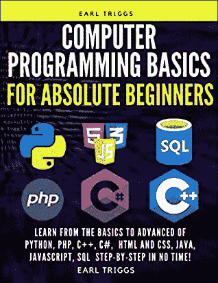


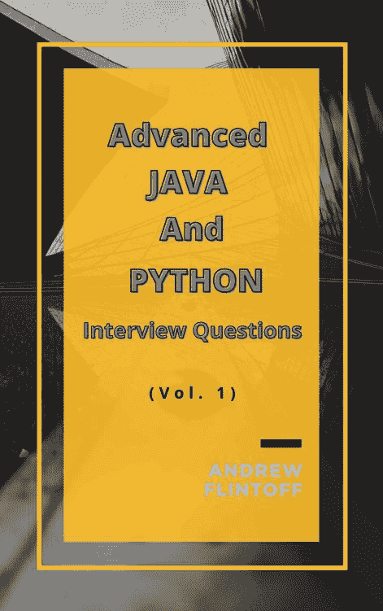


# 引言
《高级 JAVA 与 PYTHON》一书专门介绍 Java 和 Python 的面试题。Java 是由 James Gosling 于 1991 年从太阳微系统公司（Sun）创建的编程语言。Java 的目标是编写一次程序，然后在多个操作系统上运行该程序。Java 的第一个公开发版本（Java 1.0）于 1995 年发布……现在 Oracle 拥有 Java 的主导权。Python 是一种广泛使用的通用型高级编程语言。它由 Guido van Rossum 于 1991 年创建，并由 Python 软件基金进一步开发。它的设计强调代码的可读性，其语法允许程序员用更少的代码行表达他们的概念。

# Java
我们实际上汇了一份最常问的 Java 面试题及答案，这有助于帮助你应对面试官在整个面试过程中可能提出的基础 Java 面试问题。在这些基础 Java 面试问题列表中，我们涵盖了所有常问的基础及创新型 Core Java 面试题，并附有详尽的解决方案以帮助你通过职位面试。

以下清单包含了 100 道面向初学者的重要 Core Java 面试题，以及面向资深程序员的 Java 面试题和答案，帮助他们准备面试。这份全面的 Java 编程面试题指南将帮助你顺利通过面试（2021 年）。

## 100 道 Java 面试题及答案
### 面向新手和经验丰富的 Core Java 面试题及答案

### Q1. 内部类（Inner Class）与子类（Sub-Class）有什么区别？
答：内部类嵌套嵌套另一个类中的类。内部类具有对其嵌套类的访问权限，并且可以访问外部类定义的所有方法和变量。

子类是继承自一个称为父类的类。子类可以访问其父类的所有受保护和公共的方法以及区域。

### Q2. Java 类有哪些不同的访问修饰符？
答：在 Java 中，访问修饰符是类名之前的关键字，用于定义访问范围。类的访问修饰符类型有：

1. `Public`（公共）：类、方法、字段可以从任何地方访问。
2. `Protected`（保护）：方法、区域可以从所属的同一个类或子类、以及相同包的类中访问，但不能从外部访问。
3. `Default`（默认）：方法、字段、类只能从同一个包中访问，不能从其原生包外部访问。
4. `Private`（私有）：方法、区域只能从所属的同一个类中访问。

### Q3. 静态方法（Fixed methods）和静态变量的作用是什么？
答：当需要在类的多个对象之间共享方法或变量，而不是为每个项目创建不同的副本时，我们使用 `static` 关键字使方法或变量对所有对象共享。

### Q4. 什么是数据封装？它有什么意义？
答：封装是面向对象中的一个概念，将数据和方法整合到一个单一系统中。

封装有助于开发者遵循软件开发的模块化方法，因为每个对象都有自己的方法和变量，并提供独立于其他对象的函数。封装还提供了信息隐藏的目标。

### Q5. 什么是单例类（singleton class）？请提供一个合理的示例。
`java` 中的单例类只能有一个实例，因此它的所有变量和方法都来自这一个实例。单例原则适用于需要限制类实例数量的场景。

由于任何类型的许可问题，单例使用的最佳示例是由于某些驱动限制，限制只能有一个连接到数据库。

### Q6. Java 中的循环（Loops）是什么？三种类型的循环是什么？
答：循环用于程序中重复执行一个声明或语句块。Java 中有 3 种循环：

1) `For Loops`
For 循环在 Java 中用于给定的次数重复执行声明。当程序员知道执行声明的次数时，就会使用 For 循环。

2) `While Loops`
当某些语句需要重复执行直到满足某个条件时，使用 while 循环。在 while 循环中，在执行语句之前会检查条件。

3) `Do While Loops`
Do While 循环与 While 循环相同，区别在于在执行声明块后才检查问题。因此，在 do while 循环情况下，至少会执行一次。


利用 `Math.random()`，你可以创建大于或等于 0.1 且小于 1.0 的随机数。

利用 `java.util` 中的 `Random` 类。

### Q13. 什么是默认按钮实例？请提供一个实例。

答：在 `switch` 语句中，当没有其他按钮问题匹配时，会执行 `default` 分支。一旦所有其他不同的 `switch` 实例都已经被编写代码，`Default` 实例就是一个可选备用例。它只能被声明。

在下例实例中，当 `score` 不为 1 或 2 时，会使用 `default` 分支。

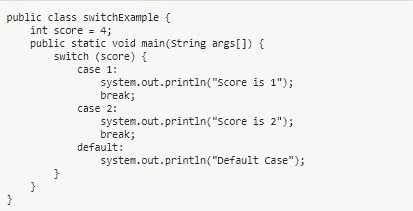

### Q14. Java 中所有类派生出的基类是什么？

答：`java.lang.object`。

### Q15. Java 中的 `main()` 方法可以返回任何数据吗？

答：在 java 中，`main()` 方法不能返回任何信息，由于这个原因，它被声明为 `void` 返回类型。

### Q16. 什么是 Java 包（Packages）？包（bundles）的意义是什么？

答：在 Java 中，`package` 是类和接口的集合，它们由于属于不同的其他类而被打包在一起。使用包（Bundles）有助于设计人员将代码模块化，并为了适当的复用对代码分组。一旦代码被打包在 `Bundles` 中，它就可以在其他不同的类中导入并使用。

### Q17. 可以在没有任何抽象方法的情况下将一个类声明为抽象（Abstract）吗？

答：是的，我们可以通过在类名前使用 `abstract` 关键字来开发抽象类，即使它没有任何种类的抽象方法。然而，如果一个类包含一个抽象方法，它必须被声明为抽象，否则肯定会报错。

### Q18. Java 中抽象类（Abstract Course）和接口（Interface）有什么区别？

答：抽象类和接口之间的主要区别在于，接口可以只有 `public static` 方法声明而没有具体的实现，而抽象类可以包含具有任何访问修饰符（`public`、`private` 等）的成员，并且可以包含具体的执行代码。

使用抽象类和接口的另一个关键区别是，实现接口的类必须执行接口的所有方法，而继承自抽象类的类则不需要应用其父类中的所有方法。

一个类可以应用多个接口，但它只能继承一个抽象类。

### Q19. 接口相对于抽象类的效率方面有什么影响？

答：与抽象类相比，接口的效率较低，因为接口需要额外的间接层支持。开发者需要考虑的另一个重要变量是，任何类型的类只能扩展一个抽象类，而一个类可以执行许多接口。

使用接口还给开发者增加了额外负担，因为在类中任何时候实现接口时，程序员都被迫要求实现该接口的每一个方法。

### Q20. 在 Java 中导入一个包（bundle）会同时导入它的子包吗？

答：在 java 中，当导入一个包时，它的子包不会被导入，如果需要，设计人员需要独立地导入它们。

如果设计人员导入通配符 `college.*`，名为 `college` 的包中的所有类都会被加载，但子包中的任何类都不会被加载。要加载子包中的类（例如 `department`），设计人员必须显式地导入，如下所示：

### Q21. 我们可以将类中的主要方法声明为私有（personal）吗？

答：在 java 中， `main` 方法需要是 `public static` 才能正确运行任何应用程序。如果主要方法被声明为 `private`，开发者不会得到任何类的编译错误，但它不会被执行，并且肯定会产生运行时错误。

### Q22. 我们究竟如何通过引用而不是按值向特征传递参数？

答：在 java 中，我们只能通过值向函数传递参数，而不能通过引用。

### Q23. 对象在 Java 中是如何被序列化（serialized）的？

答：在 java 中，为了通过序列化将项直接转换为字节流，类应用了名为 `Serializable` 的接口。所有实现 `Serializable` 接口的类对象都会被序列化，其状态也会保存在字节流中。

### Q24. 我们什么时候应该使用序列化？

答：当数据需要通过网络发送时就会使用序列化。利用序列化，对象的状态被保存并转换为字节流。字节流通过网络传输，并在位置处重建对象。

### Q25. 在 Java 中，为了处理异常，Try 块是否必须与 Catch 块配合使用？

答：`Try` 块要求与 `Catch` 块或 `Finally` 块或两者都配合。从代码块抛出的任何异常都需要在 `catch` 块中被捕获，否则在代码中止之前需要完成的任何工作将放在 `Finally` 块中。

### Q26. 即使异常块中发生了异常，是否存在方法可以跳过 Finally 块？

答：如果 `Try` 块发生异常，控制将传递给 `catch` 块（如果存在），否则传递到 `finally`。发生异常时该块总是会被执行，避免 `Finally` 块中任何类型声明的唯一方法是通过 `try` 块末尾编写符合的代码行强制终止代码：


### Q27. 类的构造器（builder）什么时候被调用？

答：每当创建一个新对象时，类的构造器就会被调用。例如，当创建两个对象时，构造器被调用 2 次。

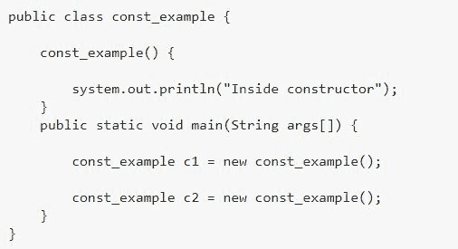

### Q28. 类可以有多个构造器吗？

答：是的，类可以具有不同参数的多个构造器。构造器的使用取决于创建项时传递的参数。

### Q29. 我们可以重写（override）类的静态方法吗？

答：我们不能重写静态方法。静态方法属于类而不是单个对象，并且在编译时处理。即使我们尝试重写它们，也不会得到编译错误，但在运行时不会产生影响。

### Q30. 在下例中，结果是什么？

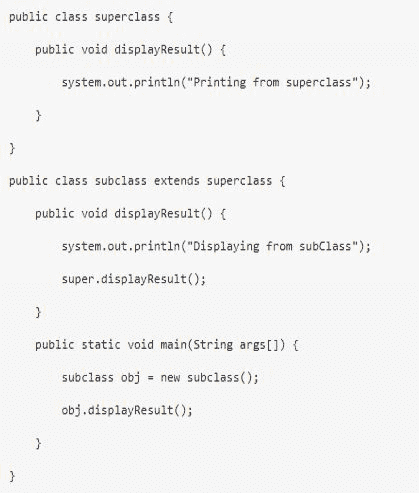

答：结果将是：

显示类。

显示父类。

### Q31. String 是 Java 中的一种数据类型吗？

答：`String` 不是基本数据类型。在 java 中创建字符串时，它实际上是 `Java.Lang.String` 类的实例。创建这些字符串对象后，可以在它们上使用 `String` 类所有的集成方法。


答：数组分组了完全相同原始类型的数据，并且在本质上是静态的；而向量是动态的，并且还可以存储不同类型的数据。

### Q35. 什么是多线程？
答：多线程是一种在单个程序内以同时方式运行多个任务的概念。线程共享相同的程序堆栈并并行运行。它有助于提高任何类型程序的效率。

### Q36. 为什么在 Java 中使用 Runnable 接口？
答：Java 中利用 `Runnable` 接口来执行多线程应用程序。`Java.Lang.Runnable` 接口被类类实现以支持多线程。

### Q37. Java 中执行多线程的两种方式分别是什么？
答：可以使用以下两种技术之一在 Java 中建立多线程应用程序：

1. 通过利用 `Java.Lang.Runnable` 接口。类执行此接口以启用多线程。该接口中应用了一个 `run()` 方法。
2. 通过创建一个扩展 `Java.Lang.Thread` 类的类。

### Q38. 当数据需要大量更改时，应该选择哪一个？String 还是 StringBuffer？
答：考虑到 `StringBuffer` 是动态的，而且我们可以像不可变的 `String` 一样转换 `StringBuffer` 对象的值，因此当信息频繁更改时，使用 `StringBuffer` 始终是一个很好的选择。对于每一次数据转换，都会产生一个新的 `String` 对象，如果在这种情况下使用 `String`，将会产生额外的开销。

### Q39. 在 switch 语句的每个实例中使用 Break 的作用是什么？
答：`break` 使用在 switch 语句的每个 case 之后（最后一个除外），以便代码在执行合法 case 后中断，并且不会流到其他 case 实例中。如果每个情况执行后都不使用 `break`，则有效实例之后的所有实例都将执行，导致错误的结果。

### Q40. Java 中是如何进行垃圾回收的？
答：在 Java 中，当一个对象不再被引用时，就会发生垃圾回收，项目会被销毁。对于自动垃圾回收，Java 调用 `System.gc()` 方法或 `Runtime.gc()` 技术。

### Q41. 我们如何在主方法之前也执行任何类型的代码？
答：如果我们想在类的大量对象创建之前执行任何类型的声明，可以使用类中的静态固定代码块。此静态代码块中的任何语句将在类加载时（通常在项创建之前）执行一次。

### Q42. 一个类可以同时是父类和子类吗？请举例。
答：如果使用了继承的结构，一个类可以同时是另一个类的父类以及另外一个类的子类。在下面列出的示例中，`continent` 类是 `world` 类的子类，同时也是 `country` 类的父类。

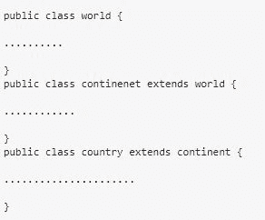

### Q43. 如果类中没有指定构造函数，类对象是如何创建的？
答：即使 Java 类中没有指定显式构造函数，由于隐式使用了默认构造函数来创建对象，对象也可以成功创建。这个构造函数没有参数。

### Q44. 在多线程中，具体如何确保一个资源不会被多个线程同时使用？
答：在多线程中，可以通过同步原理来控制多个线程对共享资源的访问。通过使用 `synchronized` 关键字，我们可以确保一次只有一个线程可以使用共享资源，只有当资源真正从其他使用它的线程中释放后，其他线程才能获得资源的控制权。

### Q45. 可以在项目创建之后再次调用类的构造器吗？
答：当我们使用 `new` 关键字创建对象时，构造器会被立即调用。它只在对象创建时被调用，因此我们无法在对象生产后再次创建它的构造器。

### Q46. 有两个类名为 classA 和 classB。两个类位于同一个包中。classA 的私有成员可以被 classB 的对象访问吗？
答：类的私有成员在该类的范围之外无法，同一个包内的任何其他类也无法访问它们。

### Q47. 可以在一个类中有两个同名的方法吗？
答：我们可以在一个类中指定两个同名但参数数量/类型不同的方法。调用哪种方法完全取决于传递的参数。在下面列出的类中，我们有两个同名的 `print` 方法，但参数不同。根据参数，无疑会调用对应的一个：

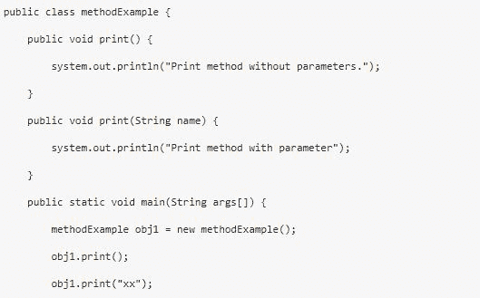

### Q48. 如何为 Java 对象创建副本？
答：我们可以利用克隆（cloning）的概念来产生对象的副本。使用 `clone`，我们创建具有对象真实状态的副本。`clone()` 是 `Cloneable` 接口的方法，因此，为了创建对象的副本，需要实现 `Cloneable` 接口。

### Q49. 使用继承的好处是什么？
答：使用继承的主要好处是代码的可重用，因为继承允许子类重用父类的代码。多态（可扩展性）是另一个巨大的优势，允许在不影响现有类的情况下引入新功能。

### Q50. 类变量和方法的默认访问修饰符是什么？
答：变量和方法的默认访问修饰符是对同一个包内的任何其他类可见。

### Q51. 提供 Java 类中使用 final 的实例。
答：Java 中没有 final。所以我们无法在 Java 中使用该技术。

### Q52. 如何限制继承以确保一个类不能被继承？
答：如果我们希望一个类不被任何类扩展，可以在类名旁使用 `final` 关键字。

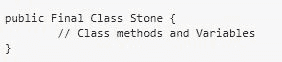

### Q53. Protected 访问修饰符的作用范围是什么？
答：当一个变量或方法使用 `protected` 访问修饰符时，它在同类、同一个包内的任何其他类以及子类中都是的。

### Q54. 栈（Stack）和队列（Queue）有什么区别？
答：栈和队列都用作信息集合的位符。栈和队列的主要区别在于栈基于后进先出（LIFO）概念，而队列基于先入后出（FIFO）原则。

### Q55. 在 Java 中，具体如何如何阻止变量的序列化？
答：如果我们希望类中的特定变量不被序列化，可以在声明它们时使用 `transient` 关键字。下面列出的变量 `trans_var` 是临时变量，且不能被序列化：

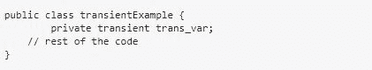

### Q56. 我们具体如何将原始数据类型作为对象使用？
答：原始数据类型如 `int` 可以通过包装类作为对象处理。例如，`Integer` 是原始数据类型 `int` 的包装类。我们可以对包装类应用各种方法，就像对待其他对象一样。

### Q57. 编译时会捕获哪些类型的异常？


答：受检的异常可以在程序编译时捕获。已检查的异常应该通过代码中的 `try catch` 块来处理，以便有效地组合代码。

### Q58. 请解释线程的各种状态。

答：Java 中的线程可以处于以下状态之一：

就绪（Ready）：当线程被创建时，它处于全就绪状态。

运行（Running）：当前正在执行的线程处于运行状态。

等待（Waiting）：等待另一个线程执行以释放特定资源的线程保持在等待状态。

死亡（Dead）：执行完毕后变为死亡的线程处于死亡状态。

### Q59. 即使定义了特定的构造函数，我们还可以使用默认构造函数吗？

答：如果在 Java 类中没有定义式构造函数，Java 提供一个默认的无参构造函数。但如果定义了特定的构造函数，则无法调用默认构造函数，设计者只能利用类中定义的那些构造函数。

### Q60. 我们可以使用完全相同的方法名但不同的返回类型来重写方法吗？

答：方法重写的根本问题是，方法名、参数列表以及返回类型必须与被重写的方法完全一致。使用不同的返回类型并不能重写方法。

### Q61. 下面代码段的结果是什么？

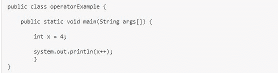

答：在此实例中，使用了后置运算符 `++`，它首先返回值然后进行加 1。由于这个原因，它的结果将是 4。

### Q61. 有人声称他在没有主方法的情况下高效地编译了一个 Java 类。这可行吗？

答：主方法是 Java 程序的入口点，对于程序的实现也是必不可少的；然而，即使没有主方法，类也可以被有效地编译。尽管它无法被运行。

### Q62. 可以在静态方法内部调用非静态方法吗？

答：非静态方法属于类的实例，并且具有对象级的作用域。为了从静态块（例如从静态主方法）调用非静态方法，需要创建一个该类的对象。然后通过使用对象引用，就可以调用这些方法。

### Q63. 运行任何 Java 程序必须配置的两个环境变量是什么？

答：只有在实际建立了以下两个环境变量后，Java 程序才能在生成器中实现：

`PATH` 变量

`CLASSPATH` 变量

### Q64. Java 中可以在不初始化的情况下使用变量吗？

答：在 Java 中，如果变量在代码中使用未预先通过有效值进行初始化，程序将无法编译并提供错误，因为 Java 中的变量没有被分配默认值。

### Q65. Java 类可以继承自多个类吗？

答：在 Java 中，一个类只能继承一个类，而不能继承多个类。Java 不支持多重继承。

### Q66. Java 中构造函数的名称可以与类名不同吗？

答：Java 中的构造函数必须与类名相同。如果名称不同，它就不会充当构造函数，编译器会将其视为一个普通方法。

### Q67. Round( 3.7) 和 Ceil( 3.7 ) 的结果是什么？

答：`Round(3.7)` 返回 4，`Ceil(3.7)` 返回 4。

### Q68: 可以在 Java 中使用 goto 来访问特定的某行吗？

答：在 Java 中没有 `goto` 关键字，Java 不支持这种跳转到特定标签行的功能。

### Q69. 死亡的线程可以重新启动吗？

答：在 Java 中，处于死亡状态的线程无法再次启动。没有其他方法可以重启死亡线程。

### Q70. 以下的类声明是正确的吗？

答：

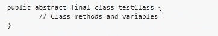

答：上述类声明是错误的，因为抽象类不能声明为 `final`。

### Q71. 在每个设备上运行 Java 程序都需要 JDK 吗？

答：JDK 是 Java 的开发工具包，在开发以及在机器上运行 Java 程序时都需要它，但运行时不需要 JDK。只需要 JRE。

### Q72. `equals()` 方法实现的对比与 `==` 运算符对比的区别是什么？

答：在 Java 中，`equals()` 方法用于比较两个字符串对象的内容，如果两者的值相同则返回 `true`；而 `==` 比较的是两个字符串对象的引用。

在拷贝中，`equals()` 返回 `true`，因为两个字符串具有相同的值。然而，`==` 返回 `false`，因为两个字符串引用的是不同的对象：

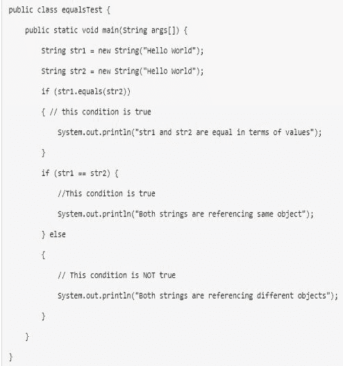

### Q73. 是否可以在 Java 类中指定一个方法，却在 C 等其他语言的代码中执行它？

答：是的，我们可以通过使用 `native` 方法来实现。在基于 `native` 方法的开发中，我们在 Java 类中定义 `public static` 方法但不包含其实现，随后独立地在 C 等其他语言中执行实现。

### Q74. Java 中是如何指定析构函数的？

答：在 Java 中，类中没有指定析构函数，因为没有要求这样做。当对象不再被引用时，Java 有它自己的垃圾收集机制来完成这项工作。

### Q75. 变量可以既是静态又是局部的吗？

答：不可以，变量不能同时是静态和局部的。将局部变量定义为静态会导致错误。

### Q76. 接口可以拥有静态方法吗？

答：静态方法无法在类中被重写，而接口中的任何方法默认都是抽象的。因此在接口中拥有静态方法没有意义。

### Q77. 在应用接口的类中，我们可以更改接口中变量的值吗？

答：不可以，我们不能更改接口变量的值，因为接口中的变量默认都是 `public`、`final` 且 `static`。


答：可以通过利用同步的思想来实现。与数据库相关的代码可以放置在带有 `synchronized` 关键字的方法中，这样每次只有一个字符串可以访问它。

### Q83. 设计者如何手动抛出异常？

答：为了在代码块中手动抛出异常，使用了 `throw` 搜索短语。该异常会在 `catch` 块中被捕获并处理。


### Q84. 我希望我的类被开发成这样一种方式：任何其他类（包括继承的类）都无法产生它的实例。我该如何做？

答：如果我们我们将一个类的构造函数声明为私有（exclusive），它将不会被任何其他类访问，由于这个原因，其他类也一定无法实例化它，而且该对象的开发也将仅限于类本身。

### Q85. 对象在 Java 中是如何保存的？

答：在 Java 中，每个被创建的对象都会从堆（heap）中获得内存空间。当一个对象被垃圾回收器回收时，从堆分配给它的区域会被重新分配到堆中，并供任何新对象使用。

### Q86. 我们如何发现对象在堆上的真实大小？

答：在 Java 中，没有方法可以获取堆上元素的精确大小。

### Q87. 下列哪些类将分配更多的内存？

类 A：3 个方法，4 个变量，无实例。

类 B：五个方法，三个变量，无实例。

答：内存在元素创建之前是不分配的。因为对于这两个类来说，都没有创建元素，因此栈上没有为任何类分配内存。

### Q88. 如果程序中的异常没有被处理会发生什么？

答：如果程序中没有使用 `try-catch` 块管理异常，程序将终止，导致抛出异常的声明之后的语句将不会执行。

### Q89. 我在一个类中指定了多个构造函数。可以从另一个构造函数的体内调用构造器吗？

答：如果一个类有多个构造函数，可以使用 `this()` 从另一个构造函数的体内调用其中一个构造函数。

### Q90. 什么是匿名类？

答：匿名类是在单行代码中使用 `new` 关键字指定的、没有任何名称的类。

例如，在下面的代码中，我们在单行代码中定义了一个匿名类：


### Q91. 是否有方法在数组确定后增加其大小？

答：数组是静态的，一旦我们指定了它的维度，我们就无法更改它。如果我们想使用可能需要更改大小（元素数量）的集合，我们应该优先使用 `vector` 而不是数组。

### Q92. 如果应用程序中有许多类，在多个类中拥有主方法可以吗？

答：如果一个 Java 应用程序中有多个类包含 `main` 方法，这不会产生任何问题，因为任何应用程序的访问因素将是特定的类，而且代码将只从该特定类的主方法开始。

### Q93. 我想保存数据以备后使用。最好的方法是什么？

答：为了以后使用持久化数据最有效的方法是使用序列化原理。

### Q94. Java 中的什么是局部类？

答：在 Java 中，如果我们在特定的块内部定义了一个新类，它被称为局部类。这种类具有区域作用域，并且在定义它的块之外无法正常工作。

### Q95. String 和 StringBuffer 都代表字符串对象。我们可以在 Java 中比较 String 和 StringBuffer 吗？

答：虽然 `String` 和 `StringBuffer` 都代表字符串实体，但我们不能相互比较它们，如果我们尝试比较它们，将会得到错误。

### Q96. Java 为元素集合的操作提供了哪些 API？

答：Java 提供了 `Collection` API，它提供了若干可以使用于元素集合的有用方法。`Collection` API 提供的几个重要类包括 `ArrayList`、`HashMap`、`TreeSet` 和 `TreeMap`。

### Q97. 我们可以通过类型转换将任何其他类型转换为 Boolean 类型吗？

答：不能，我们既不能将任何原始类型转换为 `Boolean` 数据类型，也不能将 `Boolean` 信息类型转换为任何其他原始信息类型。

### Q98. 重写方法时可以使用不同的返回类型吗？

答：Java 中方法重写的基本要求是，被重写的方法必须具有完全相同的名称和参数。但只要新的返回类型扩展了原始类型，就可以用不同的返回类型来重写方法。

方法返回引用类型。


### Q99. 所有异常类的基类是什么？

答：在 Java 中，`Java.lang.Throwable` 是所有异常类的顶级类，所有的异常类都源自这个基类。

### Q100. 继承中构造函数的调用顺序是怎样的？

答：在继承的情况下，当创建一个获取子类的新对象时，首先会调用父类的构造函数，然后调用派生类的构造函数。

2021 年必须准备的 100 道 Python 面试题

基础 Python 面试题

### Q1. Python 中列表（list）和元组（tuple）有什么区别？


### Q2. Python 的关键属性有哪些？

答：Python 是一种翻译语言。这意味着不像 `C` 等版本的语言，Python 不需要在运行之前进行汇。其他的翻译语言包括 `PHP` 和 `Ruby`。

### Q3. Python 是什么类型的语言？编程语言还是脚本语言？

### Q4. 解释 Python 是一种翻译语言。

### Q5.什么是 pep 8？

### Q6. Python 具体是如何处理内存的？

答：Python 按照以下方法处理内存的：


Python 的内存管理由 Python 个人堆栈空间处理。所有的 Python 对象和数据结构都位于私有内存中。开发者无法直接访问这个私有内存，而是由 Python 解释器处理这些工作。

Python 项目堆栈空间的分配由 Python 内存管理器完成。核心 API 为设计者编写代码提供了一些工具。

Python 还拥有内置的垃圾回收器，它可以重用所有额外的内存，因此可以提供给堆栈空间。

### Q7. 什么是 Python 中的命名空间（namespace）？

答：命名空间是一种调用系统，用于确保名称是唯一的，以防止命名冲突。

### Q8. 什么是 PYTHONPATH？

答：它是在导入模块时使用的环境变量。每当导入一个模块时，`PYTHONPATH` 都会被额外检查，以检查多个目录中是否存在导入的组件。解释器利用它来确定加载哪个模块。

### Q9. 什么是 Python 组件（components）？列出 Python 中一些常用的内置模块。

答：Python 组件是包含 Python 代码的数据。这些代码可以是函数、类或变量。Python 组件是包含可执行代码的 `.py` 文件。

一些常用的内置模块有：

- `os`
- `sys`
- `math`
- `random`
- `datetime`
- `JSON`

### Q10. 什么是 Python 中的局部变量（regional variables）和全局变量（worldwide variables）？

**全局变量：**

在函数外部或全局区域定义的变量称为全局变量。这些变量可以被程序中的任何函数访问。

**局部变量：**

在函数内部声明的任何变量都称为局部变量。该变量存在于局部空间，而不是全局空间中。

**实例：**


输出: 5.

当你尝试在函数 `include()` 之外访问局部变量时，会报错。

### Q11. Python 是大小敏感的吗？

答：是的。Python 是一种大小敏感的语言。

### Q12. 什么是 Python 中的类型转换（type conversion）？

答：类型转换描述将一种数据类型转换为另一种。

- `int()` – 将任何数据类型转换为整数类型
- `float()` – 将任何数据类型转换为浮点数类型
- `ord()` – 将字符转换为整数
- `hex()` – 将整数转换为十六进制
- `oct()` – 将整数转换为八进制
- `tuple()` – 此函数用于转换为元组
- `set()` – 此函数在转换为集合后返回类型
- `list()` – 此函数用于将任何数据类型转换为列表类型
- `dict()` – 此函数用于将键值对（key,value）元组转换为字典
- `str()` – 用于将整数转换为字符串

`complex(real,imag)` – 此函数将实数转换为复数 `complex(real,imag)`

### Q13. 在 Windows 上安装 Python 并设置环境变量的方法是？

答：在 Windows 上安装 Python，请遵循以下步骤：

从此链接安装 Python：[`www.python.org/downloads/`](https://www.python.org/downloads/)

之后，将其安装在你的电脑上。在命令提示符上使用以下命令 `cmd python` 检查你的电脑上是否已安装了 `PYTHON`。

然后进入高级系统设置，添加一个变量并命名为 `PYTHON_NAME`，然后粘贴复制的路径。

找到 Path 变量，选择其值并点击“编辑”。

**如果不存在，请在值的顶部添加分号，然后输入 `%PYTHON_HOME%`**

### Q14. Python 要求缩进吗？

答：缩进对 Python 来说很重要。它定义了一个代码块。循环、类、函数等内部的所有代码都定义在缩进块中。通常使用四个空格字符来实现。如果你的代码没有缩进，它将无法正确执行并可能抛出错误。

### Q15. Python 数组（Arrays）和列表（lists）有什么区别？

答：Python 中的数组和列表具有等的数据存储方式。但是，数组只能存储同一种数据类型的元素，而列表可以存储任何数据类型的元素。

**示例：**

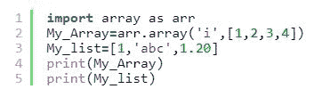

输出：

`array('i', [1, 2, 3, 4]) [1, 'abc', 1.2]`

### Q16. Python 中的函数（functions）是什么？

答：函数可能是一个仅在调用时才执行的代码块。定义 Python 函数时使用 `def` 关键字。


输出: Hi, Welcome to Edureka

### Q17. 什么是 `__init__`？

答：`__init__` 可以是 Python 中的方法或构造函数。当创建类的替换对象/实例时，此方法会自动调用以分配内存。所有类都有 `__init__` 方法。

这里是使用它的示例。

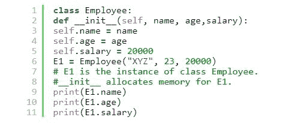

输出：

- XYZ
- 23
- 20000

### Q18. 什么是 lambda 函数？

答：匿名函数被理解为 lambda 函数。该函数可以有任意数量的参数，但只能有一条语句。

示例：


输出: 11

### Q19. Python 中的 self 是什么？

答：self 是实例或对象。在 Python 中，它指的是方法的第一个参数。然而，它是可选的。`self` 指向新创建的对象。

### Q20. break, continue 和 pass 是如何工作的？

答：break：满足某些条件时终止循环并将控制权转移。

continue：跳过循环的一部分。

pass：当你需要某些代码块但暂时不需要执行任何操作时使用。执行它时什么都不会发生。

### Q21. `[::-1]` 是什么？

答：`[::-1]` 用于反转数组或序列的顺序。

例如：


输出：`array('i', [5, 4, 3, 2, 1])`

`[::-1]` 打印数组或列表等有序结构的副本。

### Q22. 如何在 Python 中随机列表中的元素？

答：考虑下面的实例：


后续代码的输出如下：

['Flying', 'Keep', 'Blue', 'High', 'The', 'Flag']

### Q23. 什么是 Python 迭代器（iterators）？

答：迭代器是可以遍历或迭代的对象。

### Q24. 如何在 Python 中生成随机数？

答：Random 模块是生成随机数的标准模块。定义如下：


`random.random()` 方法返回 [0, 1) 范围内的浮点数。该函数生成随机浮点数。与 Random 类配合的方法是隐藏实例的绑定方法。Random 的实例通常用于为多线程程序创建特定的实例。在此使用的相反随机生成器有：

- `randrange(a, b)` – 选择一个整数并定义 [a, b) 之间的范围。它通过从指定范围随机选择来返回天气。它不会构建范围对象。
- `uniform(a, b)` – 选择一个定义在 [a, b] 范围内的浮点数。它返回浮点数
- `normalvariate(mean, sdev)` – 用于传统分布，其中 mu 是均值，因此 sdev 是用于正态差的 sigma。


被使用和实例化的 `Random` 类创建多个独立的随机数生成器。

## Python 面试题

## Q25 range 和 xrange 有什么区别？

答：首先，`xrange` 和 `range` 在功能上是完全相同的。它们都提供获取整数序列的方法供你任意使用。唯一的区别是 `range` 返回的是一个 Python `list`（列表）对象，而 `xrange` 返回的是一个 `xrange` 对象。

这意味着 `xrange` 并不会像 `range` 那样在运行时实际生成静态列表。它通过一种名为“产出”（yielding）的特殊技术按你的需要创建值。这种系统被应用于一种称为“生成器”（generators）的对象中。这意味着如果你有一个非常巨大的 `range` 需要生成一个列表（比如十亿），那么 `xrange` 是你应该使用的函数。

如果你正在处理一个像电话这样对内存非常敏感的系统，那么这一点尤为真实，因为 `range` 会尽可能地使用内存来创建整数数组，这可能导致 `Memory Error`（内存错误）并导致程序崩溃。它是一个内存大兽。

## Q26 在 Python 中如何写注释？

答：Python 中的注释以 `#` 字符开头。不过，有时也会使用 `docstrings`（在三引号内的字符串）来完成注释。

示例：

```python
#Python 中的注释像这样开始
print("Comments in Python start with a #")
```
输出: Comments in Python start with a #

## Q27 什么是 pickle（序列化）和 unpickling（反序列化）？

答：`Pickle` 模块接受任何 Python 对象，并将其转换为字符串表示，通过使用 `dump` 函数将其写入文件，这个过程被称为 pickling（序列化）。而从存储的字符串表示检索原始 Python 对象的方法被称为 unpickling（反序列化）。

## Q28 Python 中的生成器（generators）是什么？

答：返回可迭代集合的函数被称为 `generators`。

## Q29 如何将字符串的首字母大写？

答：在 Python 中，`capitalize()` 方法会将字符串的首字母大大写。如果字符串开头已经是大写字母，则它返回原字符串。

## Q30 如何将字符串转换为全小写或部分小写？

答：要将字符串转换为小写，通常使用 `lower()` 函数。

示例：


输出: abcd

## Q31 在 Python 中如何进行多行注释？

答：多行注释出现在一个行之外。所有需要注释的行都必须以 `#` 开头。你还有一个非常实用的快捷方法来注释多行。你只需要按住 `ctrl` 键，在每个你想插入 `#` 字符的地方左键点击一下，然后只输入一次 `#`。这可能会注释你放置光标的所有行。

## Q32 Python 中的 docstrings 是什么？

答：`docstrings` 实际上不是注释，而是它们是文档字符串。这些 `docstrings` 位于三引号内。它们没有赋值给任何变量，因此有时也起到注释的作用。

示例：

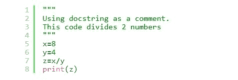
输出: 2.0

## Q33 is, not 和 in 运算符的作用是什么？

答：运算符是特殊函数。它们接受一个或多个值并产生相应的结果。

`is`：当两个操作数为真时返回真（例如：“a” is 'a'）

`not`：返回布尔值的反反

`in`：检查某些元素是否存在于某个序列中

## Q34 Python 中 help() 和 dir() 函数的作用是什么？

答：`Help()` 和 `dir()` 两个函数都可以从 Python 解释器访问，用于查看内置函数的汇总转储。

`Help()` 函数：`help()` 函数用于显示文档字符串，并帮助你确定与模块、关键字、属性等相关的帮助信息。

`Dir()` 函数：`dir()` 函数用于显示定义的符号。

## Q35 每当 Python 退出时，为什么所有内存都没有被释放？

答：当 Python 退出时，特别是那些对其他对象有循环引用的 Python 模块或从全局命名空间引用的对象并不总是会被去分配或释放。

释放由 C 库保留的内存部分是不可能的。

在退出时，由于拥有自己高效的清理机制，Python 会尝试释放/销毁其他对象。

## Q36 Python 中的字典（dictionary）是什么？

答：Python 中的内置数据类型名为 `dictionary`。它定义了键（key）和值（value）之间的一一关系。字典包含键及其对应值的对。字典通过键进行索引。

让我们来看一个例子：

以下示例包含一些键：Country（国家）、Capital（首都）和 PM（总理）。它们对应的值分别是 India、Delhi 这里的 Modi。

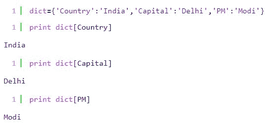

## Q37 如何在 Python 中使用三元运算符？

答：三元运算符用于显示条件语句。

语法：
`[on_true] if [expression] else [on_false]`

示例：
`x, y = 25, 50`
`big = x if x < y else y`
如果 x < y 为真，则 big=x。

## Q38 *args, **kwargs 是什么意思？为什么要使用它们？

答：当我们不确定会有多少参数传递给函数，或者想将存储的参数列表或元组传递给函数时，我们会使用 `*args`。`**kwargs` 用于不确定会有多少关键字参数传递给函数，或者它经常用于将字典的值作为关键字参数传递。标识 `args` 和 `kwargs` 是一种约定，你也可以使用 *bob 和 **billy 但可能并不明智。

## Q39 len() 函数是做什么的？

答：用于确定字符串、列表、数组等的长度。

示例：


## Q40 解释 Python 中“re”模块的 split(), sub(), subn() 方法。

答：为了替换字符串，Python 的 `re` 模块提供了 3 个方法。它们是：

`split()` – 使用正则表达式将给定字符串“分割”成一个列表

`sub()` – 查找所有匹配正则表达式的子字符串并将其替换为特殊字符串

`subn()` – 它几乎和 `sub()` 相似，还会返回新字符串以及替换次数。


答：要删除 Python 中的一个一个文件，你需要导入 `OS` 模块。然后，你需要使用 `os.remove()` 函数。

示例：


### Q44. Python 的内置类型有哪些？

答：Python 中的内置类型如下——

- 整数 (Integers)
- 浮点数 (Floating-point)
- 复数 (Complex numbers)
- 字符串 (Strings)
- 布尔值 (Boolean)

内置函数

相比（嵌套）Python 列表，：

Python 的列表是高效的通用容器。它们支持（相当）高效的插入、删除、追加和拼接，而且 Python 的列表推导式使得它们易于构建和操作。

它们也有某些局限性：它们不支持“向量化”操作（如元素级加法和乘法），因此它们包含不同类型对象的这一不可否认的事实意味着 Python 必须为每个元素存储类型信息，并在操作每个元素时执行类型分发代码。

NumPy 不仅更高效，而且更方便。你可以免费获得大量的向量和矩阵操作，这有时允许人们避免不必要的工作，而且它们也是被高效实现的。

NumPy 数组更快，而且你从 NumPy 中获得了大量内置功能，如 FFT、卷积、快速搜索、基础统计、、代数、直方图等。

### Q46. 向 Python 数组添加值的方法是？

答：通常使用 `append()`、`extend()` 以及 `insert(i,x)` 函数向数组添加元素。

示例：

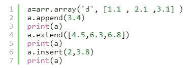

输出：

array(‘d’, [1.1, 2.1, 3.1, 3.4])

array(‘d’, [1.1, 2.1, 3.1, 3.4, 4.5, 6.3, 6.8])

array(‘d’, [1.1, 2.1, 3.8, 3.1, 3.4, 4.5, 6.3, 6.8])

### Q47. 从 Python 数组移除值的方法是？

答：通常使用 `pop()` 或 `remove()` 方法移除数组元素。这两个函数的区别在于前者前者返回被删除的值，而后者不返回。

示例：


输出：

4.6

3.1

array(‘d’, [2.2, 3.8, 3.7, 1.2])

### Q48. Python 有面向对象（OOPs）概念吗？

答：Python 是一种面向对象的编程语言。这意味着任何程序通常都可以通过创建对象模型来解决。然而，Python 也被视为过程化和结构化语言。

### Q49. 深拷贝（deep copy）和浅拷贝（shallow copy）有什么区别？

答：当创建替换实例类型时使用浅拷贝，它保留了在新实例内复制的值。浅拷贝被用于复制引用指针，就像复制了值一样。这些引用指向第一个对象，因此类别中任何成员所作的更改也会影响它的第一个拷贝。浅拷贝允许程序更快地执行，这取决于所用信息的维度。

深拷贝用于存储已经复制的值。深拷贝不复制可能指向对象的引用。它相对于一个对象，因此被另一个对象指向的新对象会被存储。原始拷贝中执行的更改不会影响使用该对象的另一个拷贝。由于确保为每个被调用的对象进行拷贝，深拷贝使得程序执行变慢。

### Q50. Python 中如何实现多线程？

答：

Python 多线程包，但如果你想通过多线程来加速代码，那么使用它通常不是一个好主意。

Python 有一个名为全局解释器锁（GIL）的结构。`GIL` 确保在任何时候只有一个你的“线程”可以执行。一个线程获取 `GIL`，完成少量工作，然后将 `GIL` 传递给后续线程。

这种情况发生非常快，所以从人类看来，你的线程似乎在并行执行，但它们实际上只是轮流使用等效的 CPU 核心。

所有 `GIL` 的传递增加了执行开销。这意味着如果你想让代码运行得更快，使用 `threading` 包通常不是一个好主意。

### Q51. Python 中编译和链接的方法是什么？

答：编译和链接允许新扩展被正确编译且无错误，因此链接通常在通过编译过程后进行。如果使用了动态加载，则取决于提供系统的设计。Python 解释器通常不会提供配置设置文件的动态加载，并且可以重新构建解释器。

在此过程中需要的步骤如下：

1. 创建一个任何名称且使用系统编译器支持的任何语言的文件。例如 `file.c` 或 `file.cpp`
2. 将此文件放入正在使用的发行版的 `Modules/` 目录中。
3. 在 `Modules/` 目录下的 `Setup.local` 文件中添加一行。
4. 使用 `spam file.o` 运行文件。
5. 成功运行后，使用顶部的 `make` 命令重新构建解释器。
6. 如果修改了文件，使用 `make`。

### Q52. Python 库有哪些？举几个。

答：Python 库是一组包。主要的库有 – Numpy, Pandas, Matplotlib, Scikit-learn

### Q53. split 有什么用？

答：`split()` 方法被用于分割给字符串

示例：


输出：`ed’, ‘python’

### Q54. 在 Python 中导入模块的方法是？

答：通常使用 `import` 关键字导入。你有三种导入方式-

示例：


输出：`abc`

### Q57. 什么是 Python 中的猴子补丁（monkey patching）？

答：在 Python 中，猴子补丁仅指运行时对类别或模块的动态修改。

考虑下面的示例：


我们可以像这样运行猴子补丁测试：


输出将如下：

`monkey_f()`

正如我们所看到的，我们在模块 `m` 外部定义的函数 `monkey_f()` 对 `MyClass` 中 `f()` 的行为进行了一些更改。


答：数据抽象是仅提供指定的细节并向用户隐藏实现细节。在 Python 中，通常通过使用接口和抽象类来实现。

### Q62. Python 使用访问修符吗？

答：Python 并没有剥夺对实例变量或函数的访问权限。Python 提出了在变量、函数或方法名称前加上一个或两个下划线 `_` 或 `__` 的概念，以模拟保护和私有（注：可能是 private 的误拼）访问修符的行为。

### Q63. 在 Python 中创建空类的方法是什么？

答：空类可以是块内没有定义任何代码的类。它通常使用 `pass` 关键字创建。然而，你会在类本身之外创建该类的对象。在 Python 中，`pass` 命令在执行时什么都不做，它是一个空语句。

例如-


`Name` = `xyz`

### Q64. object() 起了什么作用？

答：它返回一个没有特征的对象，它是所有类的基类。此外，它不接受任何参数。

#### 基础 Python 程序 – Python 面试题

### Q65. 编写一个 Python 程序执行冒泡排序算法。

```python
def bs(a):
    # a = name of list
    b=len(a)-1
    # minus 1 because we always compare 2 adjacent values
    for x in range(b):
        for y in range(b-x):
            if a[y] >a[y+1]:
                a[y],a[y+1] = a[y+1],a[y]
    return a
a=[32,5,6,7,54,87]
bs(a) # Output: [5, 6, 7, 32, 54, 87]
```

### Q66. 写一个 Python 程序生成星形三角形。


输出:
***
*****
*********
*************
***************

### Q67. 写一个 Python 程序生成斐斐波那契数列。

```python
# number of terms needed #0,1,2,3,5....
a=int(input("Enter the terms"))
f=0 #first element of series
s=1 #second element of series
if a<=0:
    print("The requested series is",f)
else:
    print(f,s,end=" ")
    for x in range(2,a):
        next=f+s
        print(next,end=" ")
        f=s
        s=next
```输出: Enter the terms 5 0 1 1 2 3

### Q68. 写一个 Python 程序检查一个数是否为质数。

```python
a=int(input("enter number"))
if a>1:
    for x in range(2,a):
        if(a%x)==0:
            break
```

### Q69. 写一个 Python 程序检查一个序列是否为回文。


输出: sequence 323

### Q70. 写一行代码，用于统计文件中大写字母的数量，即使该文件大到无法放入内存中。

答：使用带有 `sum()` 的生成器表达式。

### Q71. 为数值数据集编写一个算法。


答：`A0`, `A1` 的后续值为：`[32,5,6,7,54, 87]`

### Q72. 列出 Django、Pyramid 和 Flask 之间的差异。


Pyramid 是为大型应用设计的。它提供了灵活性，并允许开发者为自己的项目使用合适的工具。开发者可以选择数据库、URL 结构、模板样式等。Pyramid 具有高度配置性。

Django 也可以用于大型应用，有点类似于 Pyramid。它包含一个 ORM。

### Q76. 讨论 Django 架构。

答：Django MVT 模式：


图：Python 面试题 – Django 架构

开发者提供 `Model`（模型）、`view`（视图）以及相应的模板，然后只需将其映射到 `URL`，Django 就会通过魔术将其呈现给用户。

### Q77. 解释你如何在 Django 中找到数据库。

答：你将使用命令 `edit mysite/setting.py`，这是一个传统的 Python 模块，其中模块级代表 Django 设置。

Django 默认使用 `SQLite`；对于 Django 用户来说，这非常简单，从本质上说它不需要其他类型的安装。如果你的数据库选择不同，你只需要调整 `DATABASE` `default` 项下的后续键值，以匹配你的数据库连接设置。

引擎（Engines）：你将通过 `django.db.backends.sqlite3`、`django.db.backeneds.mysql`、`django.db.backends.postgresql_psycopg2`、`django.db.backends.oracle` 等来更改数据库。

名称（Name）：你的数据库名称。如果你使用 `SQLite` 作为数据库，那么数据库将是你电脑上的一个文件，`Name` 应该是完整的绝对路径，包括该文件的文件名。

如果你不选择 `SQLite` 作为数据库，则必须添加 `Password`（密码）、`Host`（主机）、`User`（用户）等设置。

Django 使用 `SQLite` 作为默认数据库，它将数据存储为文件系统中的一个。如果你有数据库服务器——`PostgreSQL`、`MySQL`、`Oracle`、`MSSQL` 并想用它代替 `SQLite`，请使用你的数据库管理工具为你的 Django 项目创建一个数据库。无论何种方式，配合你本地（空）数据库，仍然需要告诉 Django 如何使用它。这通常是你的项目 `settings.py` 文件发挥作用的地方。

我们在 `setting.py` 文件中添加以下代码行：

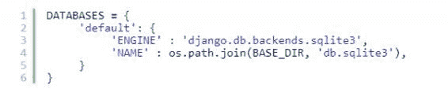

### Q78. 举例说明如何在 Django 中编写视图（VIEW）？

答：这通常是我们 Django 中编写视图的方式：

```python
1. from django.http import HttpResponse
2. import datetime
3. ......
4. def Current_datetime(request):
5. now = datetime.datetime.now()
6. html = "&amp;lt;html&amp;gt;&amp;lt;body&amp;gt;It is now %s&amp;lt;/body&amp;gt;&amp;lt;/html&amp;gt; now known
7. return HttpResponse(html)
```

作为 HTML 文档返回当前的日期和时间。

### Q79.提到 Django 模板包含的内容。

答：模板可以是简单的文档。它可以创建任何基于文本的格式，如 `XML`、`CSV`、`HTML` 等。模板包含变量（在模板求值时会被值替换）以及控制模板逻辑的标签（`% tag %`）。

图：Python 面试题 – Django 模板


### Q80. 解释 Django 框架中会（session）的作用？

答：Django 提供了一种会，允许你根据网站访问者存储和检索数据。Django 抽象了发送和接收 cookie 的方法，通过在客户端放置 `session ID` cookie，并将所有相关数据存储在服务器端。


图：Python 面试题 – Django 框架

因此数据本身并不存储在客户端。这从安全角度来看通常是有益的。

### Q81. 列出 Django 中的继承样式。

答：在 Django 中有三种可能的继承样式：

- **抽象基类（Abstract Base Classes）**：当你只想父类携带你不想在每个子模型中重复的信息时，使用这种样式。
- **多表继承（Multi-table Inheritance）**：如果你对现有模型进行子类化并希望每个模型拥有自己的数据库表，使用这种样式。
- **代理模型（Proxy models）**：如果你只想切换模型 Python 层面的行为而不改变模型的字段，则使用这种模型。

网络爬虫 – Python 面试题

### Q82. 在已知图片 URL 地址的情况下如何使用 Python 将图片保存到本地？

答：我们将使用以下代码从 URL 地址在本地保存大量图片。


### Q83. 如何获取任何 URL 或网页的 Google 缓存年龄？

答：使用以下 URL 格式：

`http://webcache.googleusercontent.com/search?q=cache:URLGOESHERE`

请确保将 `URLGOESHERE` 替换为你想要检索并查看缓存时间的页面或网站的正确网页地址。例如，要查看 `edureka.co` 的 Google 缓存年龄，你将使用以下 URL：

`http://webcache.googleusercontent.com/search?q=cache:edureka.co`

### Q84. 你需要从 IMDb Top 250 页面爬取数据。只需要电影名称、年份和评分。

答：我们将使用以下代码：

```python
1. from bs4 import BeautifulSoup
2. import requests
3. import sys
4. url = 'http://www.imdb.com/chart/top'
5. response = requests.get(url)
6. soup = BeautifulSoup(response.text)
7. tr = soup.findChildren("tr")
8. tr = iter(tr)
9. next(tr)
10. for movie in tr:
11. title = movie.find('td', {'class': 'titleColumn'} ).find('a').contents[0]
12. year = movie.find('td', {'class': 'titleColumn'} ).find('span', 'secondaryInfo'}).contents[0]
13. rating = movie.find('td', {'class': 'ratingColumn'} ).find('strong').contents[0]
14. row = title + ' - ' + year + ' ' + rating
15. print(row)
```


答：类似于 2D 绘图，3D 图形超出了 NumPy 和 SciPy 的范围，但即使在 2D 的情况下，也存在与 NumPy 集成的包。Matplotlib 在 `mplot3d` 子包中提供了基本的 3D 绘图，而 Mayavi 利用强大的 `VTK` 引擎提供了系列高质量的 3D 可视化功能。

# 多选题 (MCQ) – Python 面题

### Q91. 下述哪些语句创建字典？（可能有多个正确答案）

a) `d = {}`
b) `d = {“john”:40, “peter”:45}`
c) `d = {40:”john”, 45:”peter”}`
d) `d = (40:”john”, 45:”50”)`

**答案：** b, c & d.

字典通过指定键和值来创建。

### Q92. 以下选项中哪一个是地板除法？

a) `/`
b) `//`
c) `%`
d) 以上均不是

**答案：** b) `//`

当两个操作数都是整数时，Python 会舍弃小数部分并提供舍整值；为了获得精确答案，请使用地板除法。例如，`5/2 = 2.5`，但如果两个操作数都是整数，该表达式在 Python 中的答案是 `2\.`，为了得到去掉 .5 后的结果，请使用地板除法 `//`。因此，`5//2 = 2`（注：原文此处 2.5 为笔误，应为 2）。

### Q93. 标识符的最大可能长度是多少？

a) 31 个字符
b) 63 个字符
c) 79 个字符
d) 以上都不是

**答案：** d) 以上都不是

标识符的长度可以是任意的。

### Q94. 为什么不建议使用下划线开头的局部变量名？

a) 它们通常表示类的内部变量
b) 它们会混淆解释器
c) 它们通常表示全局变量
d) 它们阻碍执行

**答案：** a) 它们通常表示类的内部变量

由于 Python 没有私有变量的概念，前导下划线通常表示不应该从类外部访问的变量。

### Q95. 下述哪是无效的语句？

a) `abc = 1,000,000`
b) `a b c = 1000 2000 3000`
c) `a,b,c = 1000, 2000, 3000`
d) `a_b_c = 1,000,000`

**答案：** b) `a b c = 1000 2000 3000`

变量名中不允许空格。

### Q96. 下列代码的输出是什么？

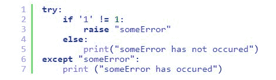

a) 发生了某些错误 (someError has occured)
b) 没有发生某些错误 (someError has not occured)
c) 代码无效 (invalid code)
d) 以上都不是

**答案：** c) 代码无效

新的异常类必须继承自 `BaseException`。这里没有这种继承关系。

### Q97. 假设 list1 为 [2, 33, 222, 14, 25]，那么 list1[-1] 是什么？

a) 错误
b) None
c) 25
d) 2

**答案：** c) 25

索引 -1 对应列表中的最后一个索引。

### Q98. 为了打开文件 c:scores.txt 进行写入，我们使用

a) `outfile = open(“c:scores.txt”, “r”)`
b) `outfile = open(“c:scores.txt”, “w”)`
c) `outfile = open(file = “c:scores.txt”, “r”)`
d) `outfile = open(file = “c:scores.txt”, “o”)`

**答案：** b) 该情况包含双引号，且 w 用于表示该文件正在被写入。

### Q99. 下列代码的输出是什么？

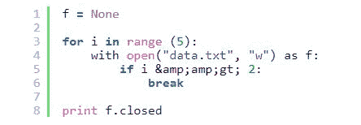

a) True
b) False
c) None
d) 错误

**答案：** a) True

`WITH` 语句配合打开文件使用时，可以保证文件对象在 `with` 块退出时被关闭。

### Q100. try-except-else 中的 else 部分何时执行？

a) 总是执行
b) 发生异常时执行
c) 未发生异常时执行
d) 在 except 块发生异常时执行

**答案：** c) 未发生异常

当没有发生异常时，执行 `else` 部分。

希望这套 Python 面题能帮助你准备面试。祝你好运！

