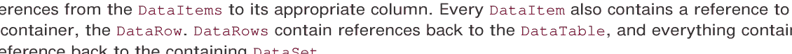
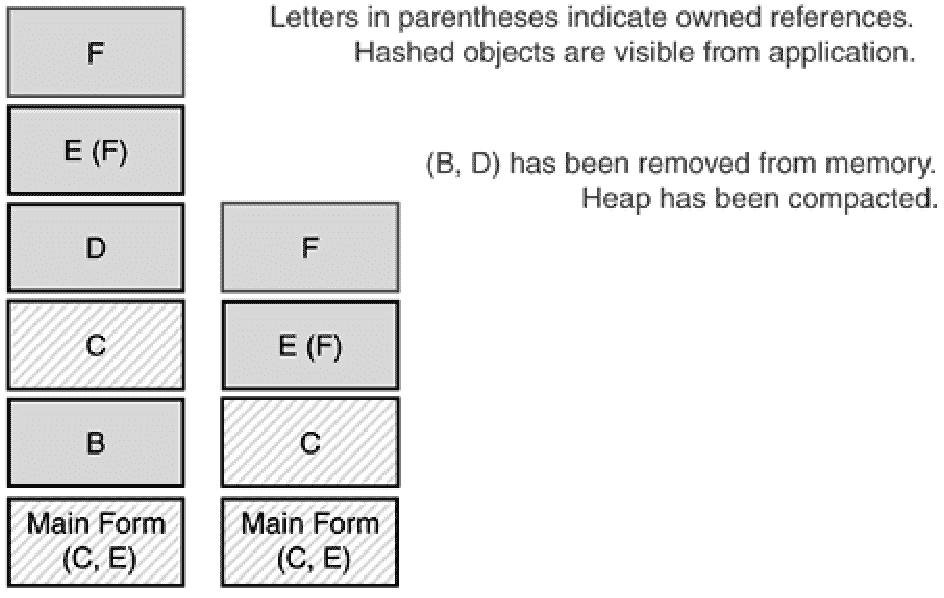
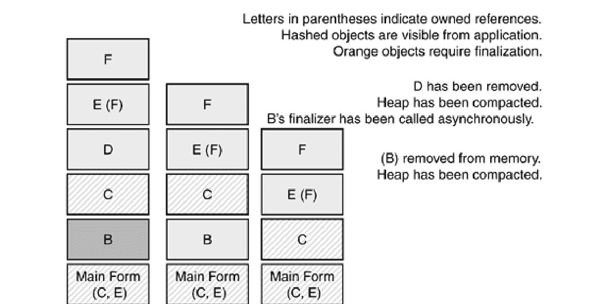
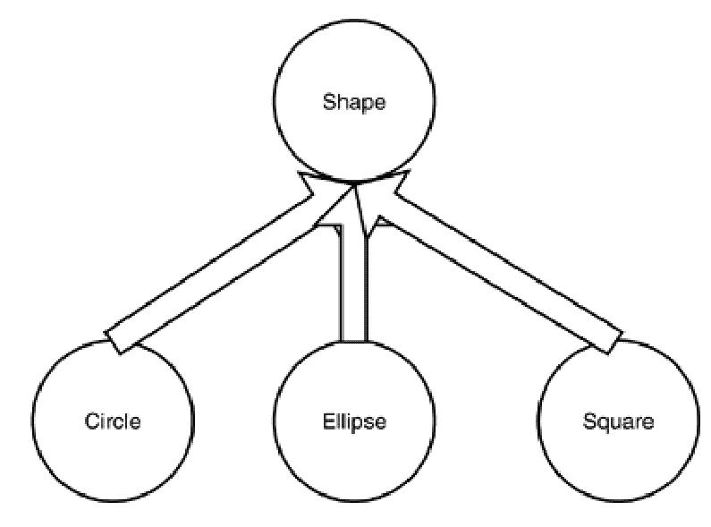
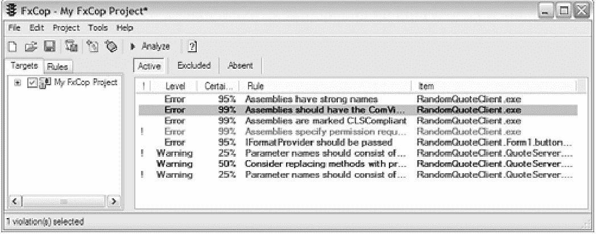

# Effective C#：提升 C# 的 50 种具体方法


C# 与 C++、Java 和 C 的相似性使其更易于学习，但这也带来了一个弊端：当存在更好的替代方案时，C# 程序员往往仍在使用较旧的技术。在 *Effective C#* 中，备受尊敬的 .NET 专家 Bill Wagner 指出了五十种方法，帮助你开始充分利用 C# 的全部功能，从而编写出更快、更高效、更可靠的软件。

*Effective C#* 沿用了使 *Effective C++*（Addison-Wesley，1998 年）和 *Effective Java*（Addison-Wesley，2001 年）成为数十万开发者必备参考书的格式：清晰实用的解释、专家建议以及大量真实代码示例。凭借他无可比拟的 C# 经验，Wagner 涵盖了从值类型到程序集、从异常到反射等方方面面。在此过程中，他精确地展示了如何避免数十种常见的 C# 性能和可靠性陷阱。你将学习如何：

- 同时使用两种 C# 常量以提高效率和可维护性，参见第 2 条
- 使用不可变数据类型来消除不必要的错误检查，参见第 7 条
- 避免那个几乎总是会让你陷入麻烦的 C# 函数，参见第 10 条
- 最小化垃圾回收、装箱和拆箱，参见第 16 和 17 条
- 充分利用接口和委托，参见第 19 至 22 条
- 创建使用非合规 C# 语言特性的 CLS 合规程序集，参见第 30 条
- 通过创建小型、内聚的程序集来提高可靠性和可维护性，参见第 32 条
- 充分利用 .NET 的运行时诊断功能，参见第 36 条
- 知道何时使用反射，何时不使用，参见第 42 和 43 条
- 预览 C# 2.0 的主要增强功能，参见第 49 条
- 你已经是一位成功的 C# 程序员——这本书可以帮助你成为一位卓越的程序员。

# 对 *Effective C#* 的赞誉

"这本书真正展示了 Bill 作为作家和程序员的优势。在很短的时间内，他能够呈现一个问题，解决它，并得出结论；每一章都紧凑、简洁、切中要点。"

Josh Holmes，独立承包商

"这本书从实用的角度很好地介绍了 C# 语言要素，一路上识别最佳实践，并遵循从基本语法到创建组件再到提升代码编写技能的清晰逻辑进展。由于每个主题都以简短的条目覆盖，非常易于阅读，你会很快意识到这本书的价值。"

Tomas Restrepo，Microsoft MVP

"这本书很好地涵盖了基础知识，特别是在从 System.Object 派生类时所需的决策方面。它易于阅读，示例清晰、简洁、扎实。我认为它能为大多数读者带来良好的价值。"

Rob Steele，Microsoft 中央区域集成 COE 兼首席架构师

"*Effective C#* 为 C# 开发者提供了所需的工具，帮助他们在 Visual C# 2003 中快速成长，同时也提供了对语言众多改进的洞察，这些改进将以 Visual C# 2005 的形式出现在您的桌面上。"

Doug Holland，Precision Objects

".NET Framework——特别是 C# 语言——的部分意义在于让开发者专注于解决客户问题和交付产品，而不是花费数小时（甚至数周）编写管道代码。Bill Wagner 的 *Effective C#* 不仅向你展示了幕后的运作原理，还展示了如何利用特定的 C# 代码结构。以冷静的风格撰写，专注于编写高效 C# 代码的*事实——*仅仅是*事实……Wagner 的书深入探讨了实践，让你编写更易于维护、运行更快的 C# 应用程序和组件。我向我的所有' .NET 训练营'及其他 C# 相关课程的学生推荐 *Effective C#*。"

Richard Hale Shaw，[www.RichardHaleShawGroup.com](http://www.RichardHaleShawGroup.com)

"*Effective C#* 组织得非常好，易于阅读，代码和解释的良好组合让读者对主题有深入的理解。作者是 C# 和 .NET 运行时的权威，但通过对话式的语调保持内容的可访问性和易读性，同时向读者传授专业知识。"

Brian Noyes，IDesign, Inc. 首席软件架构师


## 高效软件开发系列

Scott Meyers，咨询编辑

**高效软件开发系列**为现代软件开发的各个方面提供专家建议。该系列书籍文笔流畅、技术严谨、价值持久且篇幅适中。每本书都描述了专家们为打造卓越软件几乎总会做或几乎总会避免做的关键事项。

Scott Meyers（《*Effective C++*》书籍和CD的作者）构想并担任该系列的咨询编辑。该系列的作者与Meyers以及Addison-Wesley Professional的编辑团队合作，为各类软件开发者打造了必读之作。

## 系列丛书

- Elliotte Rusty Harold, *Effective XML: 50 Specific Ways to Improve Your XML* 0321150406
- Diomidis Spinellis, *Code Reading: The Open Source Perspective* 0201799405
- Ted Neward, *Effective Enterprise Java* 0321130006

有关该系列丛书的更多信息，请访问 [www.awprofessional.com/esds](http://www.awprofessional.com/esds)

## 引言

本书旨在为程序员提供实用建议，指导他们如何在使用C#语言和.NET库时提高生产力。在本书中，我汇编了50个关键条目或小主题，涉及我在与C#社区合作过程中（以及其他C#顾问）遇到的最常见问题。

我在拥有超过10年C++开发经验后开始使用C#，看来许多C#开发者也正遵循这一路径。在整本书中，我讨论了遵循C++实践在使用C#时可能引发的问题。其他C#开发者则带着深厚的Java背景接触这门语言；他们可能会发现某些段落相当浅显。由于一些最佳实践从Java到C#发生了变化，我鼓励Java开发者特别关注关于值类型的讨论（参见[第1章](ch01.htm)“C#语言要素”）。此外，.NET垃圾回收器的行为与JVM垃圾回收器不同（参见[第2章](ch02.htm)“.NET资源管理”）。

本书中的条目是我最常向开发者推荐的建议集合。虽然并非所有条目都具有普适性，但大多数可以轻松应用于日常编程场景。这些包括对属性（[条目1](ch01lev1sec1.htm)）、条件编译（[条目4](ch01lev1sec4.htm)）、不可变类型（[条目7](ch01lev1sec7.htm)）、相等性（[条目9](ch01lev1sec9.htm)）、ICloneable（[条目27](ch03lev1sec3.htm)）和new修饰符（[条目29](ch03lev1sec5.htm)）的讨论。根据我的经验，在大多数情况下，减少开发时间和编写良好的代码是程序员的首要目标。某些科学和工程应用可能最看重系统的整体性能。而对其他应用而言，一切则关乎可扩展性。根据你的目标，你可能会发现在某些情况下特定信息（与你）更（或更不）相关。为了解决这个问题，我尝试详细说明各种目标。我对readonly和const（[条目2](ch01lev1sec2.htm)）、可序列化类型（[条目25](ch03lev1sec1.htm)）、CLS合规性（[条目31](ch04lev1sec1.htm)）、Web方法（[条目34](ch04lev1sec4.htm)）和DataSet（[条目41](ch05lev1sec1.htm)）的讨论都基于特定的设计目标。这些目标在这些条目中有详细阐述，以便你可以根据给定的情况决定哪些内容对你最适用。

尽管《*Effective C#*》中的每个条目都是独立的，但理解这些条目围绕主要主题（如C#语言语法、资源管理以及对象和组件设计）进行组织是很重要的。这并非偶然。我的目标是通过利用并基于前面的条目来构建新的条目，从而最大化对本书涵盖材料的学习。不过，不要因此而放弃将其用作参考。如果你有具体问题，本书可以很好地充当理想的“问我”工具。

请记住，本书不是语言入门教程或指南，也不会教授你C#语法或结构。我的目标是为在不同情况下使用最佳构造提供指导。

## 谁应该阅读本书？

《*Effective C#*》是为专业开发者撰写的，即那些在日常工作中使用C#的程序员。本书假定你具备面向对象编程经验，并且至少熟悉C系列语言（C、C++、C#或Java）中的一种。具有Visual Basic 6背景的开发者在阅读本书前，应熟悉C#语法和面向对象设计。

此外，你应该具备.NET主要领域的经验：Web服务、ADO.NET、Web窗体和Windows窗体。我在全书中都会引用这些概念。

为了充分利用本书，你应该理解.NET环境处理程序集、Microsoft中间语言（MSIL，我常简称为IL）以及可执行代码的方式。C#编译器生成包含MSIL的程序集。当程序集加载时，即时（JIT）编译器将该MSIL转换为机器可执行代码。C#编译器确实执行一些优化，但JIT编译器负责更多有效的优化，例如内联。在整本书中，我解释了哪些过程涉及哪些优化。这种两步编译过程对哪些构造在不同情况下表现最佳有重大影响。

## 关于内容

[第1章](link)“C#语言要素”讨论了C#语法元素以及`System.Object`的核心方法，这些是每个你编写的类型的一部分。这些是你在编写C#代码时必须记住的日常主题：声明、语句、算法和`System.Object`接口。此外，所有直接涉及值类型和引用类型区别的条目都在本章中。许多条目在使用引用类型（类）还是值类型（结构体）时存在一些差异。我强烈建议你在深入阅读本书之前，先阅读关于值类型和引用类型的讨论（[条目6](link)到[8](link)）。

[第2章](link)“.NET资源管理”涵盖了使用C#和.NET进行资源管理的内容。你将学习如何为.NET托管执行环境优化资源分配和使用模式。是的，.NET垃圾回收器使你的生活简单了很多。内存管理是环境的责任，而不是你的。但是，你的行为会对垃圾回收器在你的应用程序中的表现产生很大影响。即使内存不是你的问题，非内存资源仍然是你的责任；它们可以通过`IDisposable`来处理。你将在此学习.NET中资源管理的最佳实践。

[第3章](link)“用C#表达设计”从C#的角度涵盖了面向对象设计。C#为你提供了丰富的工具集。有时，相同的问题可以用多种方式解决：使用接口、委托、事件，或者属性和反射。你选择哪一种将对系统未来的可维护性产生巨大影响。选择设计的最佳表示方式将有助于使使用你类型的程序员更容易理解。最自然的表示将使你的意图更清晰。你的类型将更易于使用，也更不易被误用。[第3章](link)中的条目重点讨论你将做出的设计决策，以及何时最适合使用每种C#惯用法。

[第4章](link)“创建二进制组件”涵盖了组件和语言互操作性。你将学习如何编写可被其他.NET语言使用的组件，同时不牺牲你喜爱的C#特性。你还将学习如何将类细分为组件，以便升级应用程序的各个部分。你应该能够在不重新分发整个应用程序的情况下发布组件的新版本。

[第5章](link)“使用框架”涵盖了.NET Framework中未被充分利用的部分。我看到许多开发者强烈渴望创建自己的软件，而不是使用已有的功能。也许是因为.NET Framework的规模太大；也许是因为框架是全新的。这些条目涵盖了我在框架中看到的开发者倾向于重新发明轮子而不是使用已有功能的部分。通过学习如何更高效地使用框架，为自己节省时间。

[第6章](link)“杂项”以不适合其他类别的条目以及对未来的展望结束。在这里寻找有关C# 2.0的信息、标准信息、异常安全代码、安全性和互操作性。

## 关于条目的一点说明

我构想这些条目是为了给你提供清晰简洁的建议，用于编写C#软件。书中的一些指导原则是通用的，因为它们影响程序的正确性，例如正确初始化数据成员（参见[第2章](link)）。其他则不那么明显，并在.NET社区引发了大量争论，例如是否使用ADO.NET `DataSet`。虽然我个人认为使用它们可以节省大量时间（参见[条目41](link)），但其他我非常尊敬的专业程序员，


不同意。这真的取决于你在构建什么。我的立场是从节省时间的角度出发的。对于那些编写大量在 .NET 和基于 Java 的系统之间传输信息的软件的人来说，DataSet 是个坏主意。在整本书中，我为我提出的所有建议提供了支持并给出了理由。如果这些理由不适用于你的情况，那么这些建议也不适用。当建议是普适性的，我通常会省略显而易见的理由，那就是：否则你的程序将无法运行。

## 样式和代码约定

撰写一本关于编程语言的书籍的一个难点在于，语言设计者赋予了真实英文单词非常具体的新含义。这使得某些段落难以理解的："Develop interfaces with interfaces"（用接口开发接口）就是一个例子。每当我使用特定的语言关键字时，它都会以`代码`样式呈现。当我讨论涉及特定 C# 概念的一般性主题时，具体的 C# 主题会大写，例如："Create Interfaces to represent the interface supported by your classes."（创建接口来表示你的类所支持的接口。）这仍然不完美，但应该能让许多段落更易于阅读。

本书使用了许多相关的 C# 术语。当我提到类型的成员时，它指的是可以作为类型一部分的任何定义：方法、属性、字段、索引器、事件、枚举或委托。当只有一个适用时，我会使用更具体的术语。本书中的一些术语你可能已经熟悉，也可能不熟悉。当这些术语首次在正文中出现时，它们会以**粗体**显示并进行定义。

本书中的示例是简短的、专注于特定部分代码，旨在展示该特定条目的建议。它们的设计目的是突出遵循该建议的优势。它们不是可以直接整合到你当前程序中的完整示例。你不能直接复制这些清单并编译它们。我在每个清单中省略了许多细节。在所有情况下，你应该假定存在常见的`using`子句：

```
using System;
using System.IO;
using System.Collections;
using System.Data;
```

当我使用不太常见的命名空间时，我会确保你可以看到相关的命名空间。短示例使用完全限定的类名，长示例包含不太常见的`using`语句。

我对示例内部的代码也采取了类似的自由。例如，当我展示以下内容时：

```
string s1 = GetMessage( );
```

如果`GetMessage()`方法的主体与讨论无关，我可能不会展示它。每当我省略代码时，你可以假定缺失的方法做了一些显而易见且合理的事情。我这样做的目的是让我们专注于特定的主题。通过省略不属于该主题的代码，我们不会轻易分心。这也使得每个条目足够简短，你应该能够一次性读完一个条目。

## 关于 C# 2.0

我对即将发布的 C# 2.0 版本提及甚少；这有两个原因。首先，也是最重要的，本书中的大多数建议同样适用于 C# 2.0 和当前版本。尽管 C# 2.0 是一个重要的升级，但它是建立在 C# 1.0 之上的，不会使今天的大多数建议失效。在最佳实践可能会发生变化的地方，我已在正文中注明。

第二个原因是，现在讨论 C# 2.0 新特性的最有效用法还为时尚早。本书基于我和我的同事使用 C# 1.0 的经验。我们中没有人对 C# 2.0 的新特性有足够的经验，不知道将它们融入日常工作的最佳方式。在 Effective 系列书籍中介绍 C# 2.0 新特性的时机尚未到来，这是简单的事实，我不想因此误导你。

## 提出建议、提供反馈和获取书籍更新

本书基于我的经验以及与同事的许多对话。如果你的经验不同，或者你有任何疑问或评论，我希望听到。请通过电子邮件联系我：[wwagner@srtssolutions.com](mailto:wwagner@srtssolutions.com)。我将把这些评论在线发布，作为本书的延伸。请参阅 [www.srtsolutions.com/EffectiveCSharp](http://www.srtsolutions.com/EffectiveCSharp) 了解当前的讨论。

## 致谢

虽然写作看起来是一项孤独的活动，但这本书是许多人共同努力的结果。我很幸运地拥有两位出色的编辑，Stephane Nakib 和 Joan Murray。Stephane Nakib 大约一年多前首次向我提出为 Addison Wesley 写作的建议。我当时持怀疑态度。书店的书架上摆满了 .NET 和 C# 书籍。在 C# 2.0 存在足够长的时间以进行全面介绍之前，我看不出需要另一本关于 C# 和 .NET 的参考书、教程或编程书。我们讨论了几个想法，最终总是回到一本关于 C# 最佳实践的书上。在那些讨论中，Stephane 告诉我 Scott Meyers 已经开始了一个 Effective 系列，模仿他的 Effective C++ 书籍。我自己的 Scott 的三本书的副本都已经非常破旧了。我也向每一位我认识的 C++ 专业开发工程师推荐过它们。他的风格清晰而专注。每条建议都有充分的理由。Effective 系列是极好的资源，其格式使得记住建议变得容易。我知道许多 C++ 开发人员把目录复印下来贴在隔间墙上作为持续的提醒。Stephane 一提到写 *Effective C#* 的想法，我就欣然抓住了这个机会。这本书把我原来给 C# 开发人员的所有建议都集中在一处。我很荣幸能成为这个系列的一部分。与 Scott 一起工作让我学到了很多。我只希望这本书能像我读 Scott 的书提升我的 C++ 技能那样，提升你的 C# 技能。

Stephane 帮助推动了 *Effective C#* 书籍的想法，审阅了大纲和手稿，并在早期写作过程中大力推动了这本书的进行。当她离开收购岗位后，Joan Murray 接手并顺利地将手稿推进到生产阶段。Ebony Haight 在整个过程中一直担任编辑助理。Krista Hansing 完成了所有的文字编辑工作，把程序员行话变成了规范的英文。Christy Hackerc 完成了将 Word 文档变成你现在手中的成品书的所有工作。

任何遗留的错误都是我的责任。但绝大多数错误、遗漏和不清晰的描述都被一群出色的审阅者发现了。最值得一提的是，Brian Noyes、Rob Steel、Josh Holmes 和 Doug Holland 使得你面前的文字比早期草稿更加正确和有用。此外，感谢安娜堡计算协会、大湖区 .NET 用户组、大兰辛用户组和密歇根州西部 .NET 用户组的所有成员，他们听了基于这些条目的演讲并提供了很好的反馈。

最重要的是，Scott Meyers 的参与对本书的最终版本产生了巨大的积极影响。与他讨论本书的早期草稿让我清楚地理解了为什么我手里的 *Effective C++* 书籍如此破旧。在他的审阅中，很少有什么东西能逃过他的眼睛。

我要感谢 MyST Technology Partners 的 Andy Seidl 和 Bill French（[myst-technology.com](http://myst-technology.com)）。我使用了一个基于 MyST 的安全博客站点来发布每个条目的早期草稿供审阅者查看。这个过程效率更高，缩短了书稿各版本之间的周期。我们之后对公众开放了该网站的部分内容，这样你就可以看到部分在线格式的内容。请参阅 [www.srtsolutions.com/EffectiveCSharp](http://www.srtsolutions.com/EffectiveCSharp) 查看在线版本。

我已经写了几年的杂志文章了，我需要公开感谢让我开始写作的人：Richard Hale Shaw。他给了（作为一名未经考验的作者）我在他参与创办的原始 *Visual C++ Developer's Journal* 上写专栏的机会。如果没有他的帮助，我不会发现自己是多么喜欢写作。如果没有他最初的帮助，我也不会有机会为 *Visual Studio Magazine*、*C# Pro* 或 *ASP.NET Pro* 写作。

一路上，我有幸与许多出色的杂志编辑一起工作。我想一一列出他们，但篇幅不允许。有一个人确实值得特别提及：Elden Nelson。我很享受我们合作的所有时光，他对我的写作风格产生了强烈的积极影响。

我的商业伙伴 Josh Holmes 和 Dianne Marsh 忍受着我在


 # 致谢

感谢公司在我撰写本书期间给予的支持，他们还帮助审阅了书稿、想法以及关于各项条目的思考。

在漫长的写作过程中，我的父母比尔·瓦格纳和艾丽丝·瓦格纳一直教导我要有始有终，这或许是你现在能拿到这本完整图书的唯一原因。

最后，最重要的感谢要献给我的家人：玛琳、拉拉、莎拉和斯科特。写书占用了我们本该一起享受的活动的大量时间。而经过这么长时间，他们始终耐心地支持着我，从未动摇。

# 第1章 C# 语言要素

如果现有的做法行之有效，为什么还要改变呢？答案是你可以做得更好。你更换工具或语言，是因为这样可以提高效率。但如果不改变习惯，你就无法获得预期的收益。当新语言 C# 与熟悉的语言（如 C++ 或 Java）有如此多共同之处时，要做到这一点就更加困难。很容易就会回到旧习惯上。这些旧习惯大多没什么问题。C# 语言设计者希望你能利用自己在这些语言中的知识。不过，他们也添加和更改了一些元素，以便更好地与公共语言运行时（CLR）集成，并提供更好的面向组件开发支持。本章将讨论那些你应该改变的习惯，以及你应该采取的做法。

## 条目 1：始终使用属性，而非可访问的数据成员

C# 语言将属性从一种临时约定提升为一流的语言特性。如果你还在类型中创建公共变量，请立即停止。如果你还在手工创建 `get` 和 `set` 方法，请立即停止。属性让你能够将数据成员作为公共接口的一部分对外暴露，同时仍然提供面向对象环境中所需的封装。**属性**是作为数据成员来访问的语言元素，但它们的实现方式却是方法。

类型中的某些成员确实最适合表示为数据：客户的姓名、点的 x,y 坐标，或去年的收入。属性使你能够创建一种表现得像数据访问的接口，但又拥有函数的所有优点。客户端代码访问属性时就像访问公共变量一样。但实际实现使用的是方法，你可以在其中定义属性访问器的行为。

.NET Framework 假定你会为公共数据成员使用属性。事实上，.NET Framework 中的数据绑定代码类支持的是属性，而不是公共数据成员。数据绑定将对象的属性与用户界面控件（无论是 Web 控件还是 Windows Forms 控件）关联起来。数据绑定机制使用反射来查找类型中的命名属性：

```
textBoxCity.DataBindings.Add( "Text",
  address, "City" );
```

上述代码将 `textBoxCity` 控件的 `Text` 属性绑定到 `address` 对象的 `City` 属性。（详见第38条。）它无法与名为 `City` 的公共数据成员配合工作；Framework 类库的设计者不支持这种做法。公共数据成员是糟糕的实践，因此没有为它们添加支持。他们的决定只是为你提供了又一个遵循正确面向对象技术的理由。顺便给经验丰富的 C++ 和 Java 程序员提个醒：数据绑定代码也不会去查找 `get` 和 `set` 函数。你应该使用属性，而不是那些语言中 `get_` 和 `set_` 函数的惯例。

是的，数据绑定只适用于那些包含要在用户界面逻辑中显示的元素的类。但这并不意味着属性应该只用于 UI 逻辑。你仍然应该为其他类和结构使用属性。随着新需求或新行为的发现，属性要容易修改得多。你可能很快就会认为你的客户类型不应该有空白名称。**如果**你使用了公共属性来表示 `Name`，这很容易在一个地方修复：

```
public class Customer
{
  private string _name;
  public string Name
  {
    get
    {
      return _name;
    }
    set
    {
      if (( value == null ) ||
        ( value.Length == 0 ))
        throw new ArgumentException( "Name cannot be blank",
          "Name" );
      _name = value;
    }
  }
}
```

如果你使用了公共数据成员，你就不得不查找每一处设置客户名称的代码并在那里修复。那要花更多时间——多得多。

因为属性是用方法实现的，添加多线程支持更加容易。只需增强 get 和 set 方法的实现，为数据提供同步访问即可：

```
public string Name
{
    get
    {
        lock( this )
        {
            return _name;
        }
    }
    set
    {
        lock( this )
        {
            _name = value;
        }
    }
}
```

属性拥有方法的所有语言特性。属性可以是虚拟的：

```
public class Customer
{
    private string _name;
    public virtual string Name
    {
        get
        {
            return _name;
        }
        set
        {
            _name = value;
        }
    }

    // 省略其余实现
}
```

同样容易看出，你可以将属性扩展为抽象的，甚至可以将其作为接口定义的一部分：

```
public interface INameValuePair
{
  object Name
  {
    get;
  }
  object Value
  {
    get;
    set;
  }
}
```

Glad、where join 和 not 易懂 is certainly not least, you can use interfaces to create `const` and `nonconst` versions of an interface:

```
public interface IConstNameValuePair
{
  object Name
  {
    get;
  }

  object Value
  {
    get;
  }
}
public interface INameValuePair
{
  object Value
  {
    get;
    set;
  }
}
```

```
// 用法：
public class Stuff : IConstNameValuePair, INameValuePair
{
  private string _name;
  private object _value;

  #region IConstNameValuePair 成员
  public object Name
  {
    get
    {
      return _name;
    }
  }

  object IConstNameValuePair.Value
  {
    get
    {
      return _value;
    }
  }
}
```

```
#endregion

#region INameValuePair 成员

public object Value
{
  get
  {
    return _value;
  }
  set
  {
    _value = value;
  }
}
#endregion
}
```

属性是成熟的、一流的语言元素，是访问或修改内部数据的方法的扩展。你能对成员函数做的任何事情，都可以对属性做。

属性的访问器是两个独立的方法，它们被编译到你的类型中。在 C# 2.0 中，你可以为属性中的 `get` 和 `set` 访问器指定不同的可访问性修饰符。这让你对作为属性公开的那些数据元素的可见性有了更大的控制：

```
// 合法的 C# 2.0：
public class Customer
{
  private string _name;
  public virtual string Name
  {
    get
    {
      return _name;
    }
    protected set
    {
      _name = value;
    }
  }

  // 省略其余实现
}
```

属性语法不仅仅适用于简单的数据字段。如果你的类型应该将索引项作为其接口的一部分，你可以使用**索引器**（即参数化属性）。这是创建返回序列中各项的属性的有效方式：

```
public int this [ int index ]
{
  get
  {
    return _theValues [ index ] ;
  }
}
```

```
set
{
    _theValues[ index ] = value;
}
}
```

```
// 访问索引器：
int val = MyObject[ i ];
```

索引器拥有与单一项属性完全相同的语言支持：它们由你编写的方法实现，因此你可以在索引器内部应用任何验证或计算。索引器可以是虚拟的或抽象的，可以在接口中声明，可以是只读或读写的。带有数字参数的单维索引器可以参与数据绑定。其他索引器可以使用非整数参数来定义映射和字典：

```
public Address this [ string name ]
{
    get
    {
        return _theValues[ name ] ;
    }
    set
    {
        _theValues[ name ] = value;
    }
}
```

与 C# 中的多维数组保持一致，你可以创建多维索引器，各维可以具有相同或不同的类型：

```
public int this [ int x, int y ]
{
    get
    {
        return ComputeValue( x, y );
    }
}
```

```
public int this[ int x, string name ]
{
    get
    {
        return ComputeValue( x, name );
    }
}
```

请注意，所有索引器都使用 this 关键字声明。你不能为索引器命名。因此，每个类型中至多只能有一个具有相同参数列表的索引器。

这些属性功能都相当不错，是一个很好的改进。但你可能仍然会受到诱惑，想先用数据成员创建初始实现，然后在需要其中某项好处时再将数据成员替换为我们的关心法表示数据：客户的姓名、点的 x、y 坐标，或去年的收入。属性使您能够创建表现得像数据访问的接口，但仍然拥有函数的所有好处。客户端代码访问属性时，就像访问公共变量一样。但实际实现使用的是方法，您可以在其中定义属性访问器的行为。

.NET Framework 假设您会为公共数据成员使用属性。事实上，.NET Framework 中的数据绑定代码类支持的是属性，而不是公共数据成员。数据绑定将对象的属性绑定到用户界面控件，无论是 Web 控件还是 Windows Forms 控件。数据绑定机制使用反射来查找类型中的命名属性：

```
textBoxCity.DataBindings.Add( "Text",
  address, "City" );
```

前面的代码将 `textBoxCity` 控件的 `Text` 属性绑定到 `address` 对象的 `City` 属性。（详见第38条。）它无法与名为 `City` 的公共数据成员配合工作；Framework Class Library 的设计者不支持这种实践。公共数据成员是糟糕的实践，因此没有为它们添加支持。他们的决定只是为您提供了另一个遵循正确面向对象技术的理由。顺便给经验丰富的 C++ 和 Java 程序员提个醒：数据绑定代码也不会查找 `get` 和 `set` 函数。您应该使用属性，而不是那些语言中的 `get_` 和 `set_` 函数约定。

是的，数据绑定只适用于包含要在用户界面逻辑中显示元素的类。但这并不意味着属性应该只用于 UI 逻辑。您仍然应该为其他类和结构使用属性。随着新需求或新行为的发现，属性要容易修改得多。您可能很快就会认为您的客户类型不应该有空白名称。**如果**您使用了公共属性来表示 `Name`，这很容易在一个位置修复：

```
public class Customer
{
  private string _name;
  public string Name
  {
    get
    {
      return _name;
    }
    set
    {
      if (( value == null ) ||
 XmlComparison.php  XmlComparison elderly Intelligent Robotics.姿甚者，你可以将属性扩展为抽象的，甚至作为接口定义的一部分：

```
public interface INameValuePair
{
  object Name
  {
    get;
  }
  object Value
  {
    get;
    set;
  }
}
```

最后，但同样重要的是，您可以使用接口来创建接口的 `const` 和 `nonconst` 版本：

```
public interface IConstNameValuePair
{
  object Name
  {
    get;
  }

  object Value
  {
    get;
  }
}
public interface INameValuePair
{
  object Value
  {
    get;
    set;
  }
}
```

```
// 用法：
public class Stuff : IConstNameValuePair, INameValuePair
{
  private string _name;
  private object _value;

  #region IConstNameValuePair 成员
  public object Name
  {
    get
    {
      return _name;
    }
  }

  object IConstNameValuePair.Value
  {
    get
    {
      return _value;
    }
  }
}
```

```
#endregion

#region INameValuePair 成员

public object Value
{
  get
  {
    return _value;
  }
  set
  {
    _value = value;
  }
}
#endregion
}
```

属性是成熟的、一流的语言元素，是访问或修改内部数据的方法的扩展。您可以对成员函数做的任何事情，都可以对属性做。

属性的访问器是两个独立的方法，它们被编译到您的类型中。在 C# 2.0 中，您可以为属性中的 `get` 和 `set` 访问器指定不同的可访问性修饰符。这使您对作为属性公开的那些数据元素的可见性有了更大的控制：

```
// 合法的 C# 2.0：
public class Customer
{
  private string _name;
  public virtual string Name
  {
    get
    {
      return _name;
    }
    protected set
    {
      _name = value;
    }
  }

  // 省略其余实现
}
```

属性语法不仅仅适用于简单的数据字段。如果您的类型应该将索引项作为其接口的一部分，您可以使用**索引器**（即参数化属性）。这是创建返回序列中各项的属性的有效方式：

```
public int this [ int index ]
{
  get
  {
    return _theValues [ index ] ;
  }
}
```

```
set
{
    _theValues[ index ] = value;
}
}
```

```
// 访问索引器：
int val = MyObject[ i ];
```

索引器拥有与单项属性完全相同的语言支持：它们由您编写的方法实现，因此您可以在索引器内部应用任何验证或计算。索引器可以是虚拟的或抽象的，可以在接口中声明，可以是只读或读写的。带有数字参数的单维索引器可以参与数据绑定。其他索引器可以使用非整数参数来定义映射和字典：

```
public Address this [ string name ]
{
    get
    {
        return _theValues[ name ] ;
    }
    set
    {
        _theValues[ name ] = value;
    }
}
```

与 C# 中的多维数组一致，您可以创建多维索引器，各维可以具有相同或不同的类型：

```
public int this [ int x, int y ]
{
    get
    {
        return ComputeValue( x, y );
    }
}
```

```
public int this[ int x, string name ]
{
    get
    {
        return ComputeValue( x, name );
    }
}
```

请注意，所有索引器都使用 this 关键字声明。您不能为索引器命名。因此，每个类型中至多只能有一个具有相同参数列表的索引器。

这些属性功能都相当不错，是一个很好的改进。但您可能仍然会受到诱惑，想先用数据成员创建初始实现，然后在需要其中某项好处时再将数据成员替换为属性。这听起来像是一个合理的策略——但这是错误的。请考虑这个类定义的一部分：


## 第1条：始终使用属性，而非可访问的数据成员

```csharp
// 使用公共数据成员，不好的做法：
public class Customer
{
    public string Name;

    // 其余实现省略
}
```

它描述了一个客户，带有姓名。你可以使用熟悉的成员表示法来获取或设置姓名：

```csharp
string name = customerOne.Name;
customerOne.Name = "This Company, Inc.";
```

这简单直接。你可能想着以后可以将`Name`数据成员替换为属性，而代码无需任何更改就能继续工作。嗯，这在某种程度上是对的。

属性在被访问时应该看起来像是数据成员。这就是新语法背后的目的。但属性不是数据。属性访问生成的MSIL与数据访问不同。前面的客户类型为`Name`字段生成以下MSIL：

```
.field public string Name
```

访问字段会生成以下语句：

```
ldloc.0
ldfld string NameSpace.Customer::Name
stloc.1
```

将值存储到字段会生成以下代码：

```
ldloc.0
ldstr "This Company, Inc."
stfld string NameSpace.Customer::Name
```

别担心，我们不会整天看IL。但在这里，这是很重要的，因为我们即将看到在数据成员和属性之间切换如何破坏二进制兼容性。考虑这个使用属性创建的客户关系类型版本：

```csharp
public class Customer
{
    private string _name;
    public string Name
    {
        get
        {
            return _name;
        }
        set
        {
            _name = value;
        }
    }

    // 其余实现省略
}
```

当你编写C#代码时，你可以使用完全相同的语法来访问`name`属性：

```csharp
string name = customerOne.Name;
customerOne.Name = "This Company, Inc.";
```

但C#编译器为此版本生成完全不同的MSIL。`Customer`类型包含以下内容：

```
.property instance string Name()
{
  .get instance string NameSpace.Customer::get_Name()
  .set instance void NameSpace.Customer::set_Name(string)
} // end of property Customer::Name

.method public hidebysig specialname instance string
        get_Name() cil managed
{
  // 代码大小       11 (0xb)
  .maxstack  1
  .locals init ([0] string CS$00000003$00000000)
  IL_0000:  ldarg.0
  IL_0001:  ldfld      string NameSpace.Customer::_name
  IL_0006:  stloc.0
  IL_0007:  br.s       IL_0009
  IL_0009:  ldloc.0
  IL_000a:  ret
} // end of method Customer::get_Name
.method public hidebysig specialname instance void
        set_Name(string 'value') cil managed
{
  // 代码大小       8 (0x8)
  .maxstack  2
  IL_0000:  ldarg.0
  IL_0001:  ldarg.1
  IL_0002:  stfld      string NameSpace.Customer::_name
  IL_0007:  ret
} // end of method Customer::set_Name
```

关于属性定义如何转换为MSIL，必须理解两个要点。首先，`.property`指令定义了属性的类型以及实现属性`get`和`set`访问器的函数。这两个函数被标记为`hidebysig`和`specialname`。就我们的目的而言，这些标记意味着这些函数不会在C#源代码中直接调用，并且它们不被视为正式类型定义的一部分。相反，你通过属性来访问它们。

当然，你预期属性定义会生成不同的MSIL。对于本次讨论更重要的是，为属性的`get`和`set`访问生成的MSIL也有所变化：

```
// get
ldloc.0
callvirt    instance string NameSpace.Customer::get_Name()
stloc.1

// set
ldloc.0
ldstr       "This Company, Inc."
callvirt    instance void NameSpace.Customer::set_Name(string)
```

访问客户姓名的相同C#源代码，根据Name成员是属性还是数据成员，会编译成非常不同的MSIL指令。访问属性和访问数据成员使用相同的C#源代码。将由C#编译器负责将源代码转换为属性或数据成员所需的不同IL。

尽管属性和数据成员在源代码层面兼容，但它们在二进制层面不兼容。显然，这意味着当你将公共数据成员改为等效的公共属性时，你必须重新编译所有使用该公共数据成员的代码。第4章"创建二进制组件"详细讨论了二进制组件，但请记住，将数据成员改为属性这一简单操作会破坏二进制兼容性。这使得升级已部署的单个程序集变得更加困难。

查看属性的IL时，你可能会想到属性和数据成员的相对性能。属性不会比数据成员访问更快，但它们可能也不会更慢。JIT编译器会内联一些方法调用，包括属性访问器。当JIT编译器内联属性访问器时，数据成员和属性的性能相同。即使属性访问器未被内联，实际的性能差异也只是单次函数调用可忽略不计的开销。这只有在极少数情况下才能测量出来。

每当你在类型的公共或受保护接口中公开数据时，请使用属性。对于序列或字典，使用索引器。所有数据成员都应该是私有的，毫无例外。你立即获得了对数据绑定的支持，而且将来对方法实现进行任何更改都会变得容易得多。将变量封装在属性中的额外输入只相当于你一天中的一两分钟。而发现稍后需要使用属性来正确表达你的设计则会花费数小时。现在花一点时间，为自己节省大量时间。

## 第2条：优先使用`readonly`，而非`const`

C#有两种不同版本的常量：**编译时**常量和**运行时**常量。它们的行为非常不同，使用错误的版本会让你付出性能或正确性的代价。这两个问题都不好，但如果你必须选择一个，一个更慢但正确的程序总比一个更快但有缺陷的程序要好。因此，你应该优先选择运行时常量而非编译时常量。编译时常量稍快一些，但远不如运行时常量灵活。将编译时常量保留给性能至关重要且常量的值永远不会随时间变化的情况。

你用`readonly`关键字声明运行时常量。编译时常量则用`const`关键字声明：

```csharp
// 编译时常量：
public const int _Millennium = 2000;

// 运行时常量：
public static readonly int _ThisYear = 2004;
```

编译时常量和运行时常量的行为差异源于它们的访问方式。编译时常量在你生成的目标代码中被替换为该常量的值。这个结构：

```csharp
if ( myDateTime.Year == _Millennium )
```

编译后的**IL**与你编写以下内容相同：

```csharp
if ( myDateTime.Year == 2000 )
```

运行时常量在运行时求值。当你引用只读常量时，生成的IL引用的是`readonly`变量，而非该值。

这一区别对何时允许使用哪种类型的常量施加了若干限制。编译时常量只能用于基本类型（内置整型和浮点类型）、枚举或字符串。这些是唯一允许你在初始化器中赋予有意义的常量值的类型。这些基本类型是唯一可以在编译器生成的IL中被替换为字面值的类型。以下结构无法编译。你不能使用`new`运算符初始化编译时常量，即使被初始化的类型是值类型：

```csharp
// 无法编译，请改用readonly：
private const DateTime _classCreation = new
  DateTime( 2000, 1, 1, 0, 0, 0 );
```

编译时常量限于数字和字符串。只读值也是常量，因为它们在构造函数执行后不能被修改。但只读值有所不同，因为它们是在运行时赋值的。在处理运行时常量时，你有更大的灵活性。首先，运行时常量可以是任何类型。你必须在构造函数中初始化它们，或者你可以使用


## 条目 2：优先使用 `readonly` 而非 `const`

初始化器。你可以为 `DateTime` 结构体创建 `readonly` 值；但不能用 `const` 创建 `DateTime` 值。

你可以将 `readonly` 值用于实例常量，为类的每个实例存储不同的值。编译时常量从定义上来说就是静态常量。

最重要的区别在于 `readonly` 值是在运行时解析的。当你引用一个 `readonly` 常量时，生成的 IL 会引用 `readonly` 变量，而非其值。这一差异对长期维护有着深远的影响。编译时常量生成的 IL 与你在代码中直接使用数值常量完全相同，甚至跨程序集也是如此：一个程序集中的常量在另一个程序集使用时，仍然会被替换为对应的值。

编译时常量和运行时常量的求值方式会影响运行时兼容性。假设你在名为 `Infrastructure` 的程序集中定义了 `const` 和 `readonly` 字段：

```
public class UsefulValues
{
    public static readonly int StartValue = 5;

    public const int EndValue = 10;
}
```

在另一个程序集中，你引用这些值：

```
for ( int i = UsefulValues.StartValue;
    i < UsefulValues.EndValue;
    i++ )
    Console.WriteLine( "value is {0}", i );
```

如果你运行这个小测试，会看到以下显而易见的输出：

```
Value is 5
Value is 6
...
Value is 9
```

时间流逝，你发布了 `Infrastructure` 程序集的新版本，包含以下更改：

```
public class UsefulValues
{
    public static readonly int StartValue = 105;

    public const int EndValue = 120;
}
```

你在不重新构建 `Application` 程序集的情况下分发了 `Infrastructure` 程序集。你期望得到以下输出：

```
Value is 105
Value is 106
...
Value is 119
```

然而，实际上没有任何输出。循环现在使用 `105` 作为起始值，`10` 作为结束条件。C# 编译器将 `const` 值 `10` 直接放入了 `Application` 程序集中，而不是引用 `EndValue` 所使用的存储位置。与之对比的是 `StartValue`。它被声明为 `readonly`：它在运行时解析。因此，`Application` 程序集无需重新编译就能使用新的值；只需安装更新版本的 `Infrastructure` 程序集，就足以改变所有使用该值的客户端的行为。更新公共常量的值应被视为接口更改。你必须重新编译所有引用该常量的代码。更新只读常量的值是实现更改；它与现有客户端代码是二进制兼容的。检查上述循环的 MSIL 可以清楚地看到原因：

```
IL_0000:  ldsfld       int32 Chapter1.UsefulValues::StartValue
IL_0005:  stloc.0
IL_0006:  br.s         IL_001c
IL_0008:  ldstr        "value is {0}"
IL_000d:  ldloc.0
IL_000e:  box          [mscorlib]System.Int32
IL_0013:  call         void [mscorlib]System.Console::WriteLine(string,object)
IL_0018:  ldloc.0
IL_0019:  ldc.i4.1
IL_001a:  add
IL_001b:  stloc.0
IL_001c:  ldloc.0
IL_001d:  ldc.i4.s     10
IL_001f:  blt.s        IL_0008
```

你可以看到 `StartValue` 在 MSIL 清单的顶部是动态加载的。但结束条件在 MSIL 的末尾被硬编码为 `10`。

另一方面，有时你确实希望一个值在编译时确定。例如，考虑一组用于标记对象在序列化形式中不同版本的常量（参见条目 25）。标记特定版本的持久化值应该是编译时常量；它们永远不会改变。当前版本应该是运行时常量，随每次发布而变更。

```
private const int VERSION_1_0 = 0x0100;
private const int VERSION_1_1 = 0x0101;
private const int VERSION_1_2 = 0x0102;
// major release:
private const int VERSION_2_0 = 0x0200;

// check for the current version:
private static readonly int CURRENT_VERSION =
    VERSION_2_0;
```

你在每个保存的文件中使用运行时常量来存储当前版本：

```
// Read from persistent storage, check
// stored version against compile-time constant:
protected MyType( SerializationInfo info,
  StreamingContext cntxt )
{
  int storedVersion = info.GetInt32( "VERSION" );
  switch ( storedVersion )
  {
  case VERSION_2_0:
    readVersion2( info, cntxt );
    break;
  case VERSION_1_1:
    readVersion1Dot1( info, cntxt );
    break;

  // etc.
  }
}
```

```
// Write the current version:
[ SecurityPermissionAttribute( SecurityAction.Demand,
  SerializationFormatter =true ) ]
void ISerializable.GetObjectData( SerializationInfo inf,
    StreamingContext cxt )
{
  // use runtime constant for current version:
  inf.AddValue( "VERSION", CURRENT_VERSION );

  // write remaining elements...
}
```

使用 `const` 相比 `readonly` 的最后一个优势是性能：已知的常量值可以生成比 `readonly` 值所需的变量访问稍微更高效的代码。然而，任何性能增益都是微小的，应与降低的灵活性进行权衡。在放弃灵活性之前，务必先对性能差异进行分析。

当值必须在编译时可用时，必须使用 `const`：属性参数和枚举定义，以及那些你确实需要定义不随版本变化而改变的值的罕见情况。对于其他所有情况，优先选择 `readonly` 常量带来的更高灵活性。

## 条目 3：优先使用 `is` 或 `as` 运算符而非强制类型转换

C# 是一门强类型语言。良好的编程习惯意味着我们在能避免的情况下都会尽量避免将一种类型强制转换为另一种类型。但有时运行时类型检查是不可避免的。在 C# 中，你经常编写接受 `System.Object` 参数的函数，因为框架为你定义了方法签名。你很可能需要尝试将这些对象向下转型为其他类型，可能是类或接口。你有两个选择：使用 `as` 运算符或使用 C 语言中经典的强制类型转换。你还可以采用防御性变体：使用 `is` 测试转换，然后使用 `as` 或强制类型转换来进行转换。

正确的选择是尽可能使用 `as` 运算符，因为它比盲目强制类型转换更安全，在运行时也更高效。`as` 和 `is` 运算符不会执行任何用户自定义转换。它们仅在运行时类型与目标类型匹配时才成功；它们从不构造新对象来满足请求。

来看一个例子。你需要编写一段代码，将任意对象转换为 `MyType` 的实例。你可以这样写：

```
object o = Factory.GetObject( );

// Version one:
MyType t = o as MyType;

if ( t != null )
{
  // work with t, it's a MyType.
} else
{
  // report the failure.
}
```

或者，你也可以这样写：

```
object o = Factory.GetObject( );

// Version two:
try {
  MyType t;
  t = ( MyType ) o;
  if ( t != null )
  {
    // work with t, it's a MyType.
  } else
  {
    // Report a null reference failure.
  }
} catch
{
  // report the conversion failure.
}
```

你会同意第一个版本更简洁、更易读。它没有 `try/catch` 子句，因此你既避免了开销，也减少了代码量。注意，强制类型转换版本除了捕获异常外，还必须检查 `null`。`null` 可以通过强制类型转换转换为任何引用类型，但 `as` 运算符在用于空引用时返回 `null`。因此，使用强制类型转换时，你需要检查 `null` 并捕获异常；而使用 `as`，你只需将返回的引用与 `null` 进行比较即可。

`as` 运算符与强制类型转换运算符最大的区别在于如何处理用户自定义转换。`as` 和 `is` 运算符只检查被转换对象的运行时类型；它们不执行任何其他操作。如果特定对象不是请求的类型或不是请求类型的派生类型，它们就会失败。而另一方面，强制类型转换可以使用转换运算符将对象转换为请求的类型。这包括任何内置的数值转换。将 `long` 转换为 `short` 可能会丢失信息。

当你对用户自定义类型进行强制类型转换时，同样存在这些问题。考虑以下类型：

```
public class SecondType
{
  private MyType _value;

  // other details elided

  // Conversion operator.
  // This converts a SecondType to
  // a MyType, see item 29.
  public static implicit operator
    MyType( SecondType t )
  {
    return t._value;
  }
}
```

假设 `Factory.GetObject()` 函数在第一个代码片段中返回了一个 `SecondType` 对象：

```
object o = Factory.GetObject( );

// o is a SecondType:
MyType t = o as MyType; // Fails. o is not MyType

if ( t != null )
{
  // work with t, it's a MyType.
} else
{
  // report the failure.
}

// Version two:
try {
  MyType t1;
  t = ( MyType ) o; // Fails. o is not MyType
  if ( t1 != null )
  {
    // work with t1, it's a MyType.
  } else
```


 ## 第 3 条：优先使用 is 或 as 运算符，而非强制转换

```
{
    // Report a null reference failure.
}
catch
{
    // report the conversion failure.
}
```

两个版本都会失败。但我之前说过，强制转换会执行用户定义的转换。你可能会认为强制转换会成功。你这么想是对的，它确实应该成功。但它失败了，因为你的编译器是基于对象 `o` 的**编译时类型**来生成代码的。编译器对 `o` 的**运行时类型**一无所知；它将 `o` 视为 `System.Object` 的实例。编译器发现从 `System.Object` 到 `MyType` 没有用户定义的转换。它检查了 `System.Object` 和 `MyType` 的定义。由于没有用户定义的转换，编译器生成了检查 `o` 的运行时类型并判断该类型是否为 `MyType` 的代码。因为 `o` 是一个 `SecondType` 对象，所以转换失败。编译器不会检查 `o` 的实际运行时类型是否**可以**转换为 `MyType` 对象。

如果你像这样编写代码片段，可以使从 `SecondType` 到 `MyType` 的转换成功：

```
object o = Factory.GetObject( );

// Version three:
SecondType st = o as SecondType;
try {
    MyType t;
    t = ( MyType ) st;
    if ( t != null )
    {
        // work with T, it's a MyType.
    } else
    {
        // Report a null reference failure.
    }
} catch
{
    // report the failure.
}
```

你**永远不应该**写这种丑陋的代码，但它确实说明了一个常见问题。尽管你永远不会这样写，但你可以将 `System.Object` 参数传递给一个期望正确转换的函数：

```
object o = Factory.GetObject( );

DoStuffWithObject( o );

private void DoStuffWithObject( object o2 )
{
    try {
        MyType t;
        t = ( MyType ) o2; // Fails. o is not MyType
        if ( t != null )
        // work with T, it's a MyType.
        } else
        {
            // Report a null reference failure.
        }
    } catch
    {
        // report the conversion failure.
    }
}
```

请记住，用户定义的转换运算符仅作用于对象的**编译时类型**，而非**运行时类型**。`o2` 的运行时类型与 `MyType` 之间存在转换这一事实并不重要。编译器根本不知道，也不关心。以下语句的行为因 `st` 的声明类型而异：

```
t = ( MyType ) st;
```

而下面这条语句无论 `st` 的声明类型是什么，都返回相同的结果。因此，你应该优先使用 `as` 而非强制转换——它更加一致。事实上，如果类型之间没有继承关系，但存在用户定义的转换运算符，以下语句将生成编译器错误：

```
t = st as MyType;
```

现在你已经知道在可能的情况下使用 `as`，让我们来讨论何时不能使用它。`as` 运算符不能用于值类型。这条语句无法编译：

```
object o = Factory.GetValue( );
int i = o as int; // Does not compile.
```

这是因为 `int` 是值类型，永远不可能是 `null`。如果 `o` 不是整数，应该在 `i` 中存储什么 `int` 值呢？你选择的任何值都可能是一个有效的整数。因此，`as` 无法使用。你只能使用强制转换：

```
object o = Factory.GetValue( );
int i = 0;
try {
    i = ( int ) o;
} catch
{
    i = 0;
}
```

但你未必需要忍受强制转换的行为。你可以使用 `is` 语句来消除异常或转换的可能性：

```
object o = Factory.GetValue( );
int i = 0;
if ( o is int )
    i = ( int ) o;
```

如果 `o` 是可以转换为 `int` 的其他类型，例如 `double`，`is` 运算符会返回 `false`。对于 `null` 参数，`is` 运算符始终返回 `false`。

`is` 运算符应该只在无法使用 `as` 转换类型时使用。否则，它完全是多余的：

```
// correct, but redundant:
object o = Factory.GetObject( );

MyType t = null;
if ( o is MyType )
    t = o as MyType;
```

上面的代码与下面写的代码效果相同：

```
// correct, but redundant:
object o = Factory.GetObject( );

MyType t = null;
if ( ( o as MyType ) != null )
    t = o as MyType;
```

这样既低效又冗余。如果你打算使用 `as` 转换类型，`is` 检查根本没有必要。直接将 `as` 的返回值与 `null` 比较；这样更简单。

现在你已经了解了 `is`、`as` 和强制转换之间的区别，你认为 `foreach` 循环使用的是哪个运算符呢？

```
public void UseCollection( IEnumerable theCollection )
{
    foreach ( MyType t in theCollection )
        t.DoStuff( );
}
```

`foreach` 使用**强制转换操作**来执行从对象到循环中使用的类型的转换。`foreach` 语句生成的代码等价于这个手写版本：

```
public void UseCollection( IEnumerable theCollection )
{
    IEnumerator it = theCollection.GetEnumerator( );
    while ( it.MoveNext( ) )
    {
        MyType t = ( MyType ) it.Current;
        t.DoStuff( );
    }
}
```

`foreach` 需要使用强制转换来同时支持值类型和引用类型。通过选择强制转换运算符，`foreach` 语句无论目标类型是什么，都表现出相同的行为。然而，由于使用了强制转换，`foreach` 循环可能会生成 `BadCastExceptions`。

因为 `IEnumerator.Current` 返回 `System.Object`，而它没有转换运算符，所以没有任何转换可用于此测试。`SecondType` 对象的集合无法在前面的 `UseCollection()` 函数中使用，因为转换会失败，正如你之前看到的那样。`foreach` 语句（使用强制转换）不会检查集合中对象的运行时类型可用的转换。它只检查 `System.Object` 类（`IEnumerator.Current` 返回的类型）和循环变量的声明类型（在本例中为 `MyType`）中可用的转换。

最后，有时你想知道对象的**确切类型**，而不仅仅是当前类型是否可以转换为目标类型。`as` 运算符对于从目标类型派生的任何类型都返回 true。`GetType()` 方法获取对象的运行时类型。这是一个比 `is` 或 `as` 语句更严格的测试。`GetType()` 返回对象的类型，可以与特定类型进行比较。

再次考虑这个函数：

```
public void UseCollection( IEnumerable theCollection )
{
  foreach ( MyType t in theCollection )
    t.DoStuff( );
}
```

如果你创建了一个从 `MyType` 派生的 `NewType` 类，`NewType` 对象的集合在 `UseCollection` 函数中可以正常工作：

```
public class NewType : MyType
{
  // contents elided.
}
```

如果你的意图是编写一个适用于所有 `MyType` 实例的函数，那没问题。如果你的意图是编写一个**仅**适用于确切的 `MyType` 对象的函数，你应该使用确切类型进行比较。在这种情况下，你应在 `foreach` 循环内部执行此操作。需要确切的运行时类型最常见的情况是在执行相等性测试时（见第 9 条）。在大多数其他比较中，`as` 和 `is` 提供的 `.isinst` 比较在语义上是正确的。

良好的面向对象实践要求避免转换类型，但有时没有其他选择。当你无法避免转换时，使用语言的 `as` 和 `is` 运算符来更清楚地表达你的意图。强制类型转换的不同方式有不同的规则。`is` 和 `as` 语句几乎总是正确的语义，它们仅当被测试对象是正确类型时才会成功。优先使用这些语句而非强制转换运算符，因为后者可能会产生意外的副作用，并在你最意想不到的时候成功或失败。

## 第 4 条：使用条件特性替代 `#if`

`#if`/`#endif` 块曾被用于从同一份源代码生成不同的构建版本，最常见的是调试（debug）和发布（release）版本。但这些从来不是我们乐于使用的工具。`#if`/`#endif` 块太容易被滥用，导致代码难以理解，更难调试。语言设计者通过创建更好的工具来应对，以针对不同环境生成不同的机器码。C# 添加了 `[Conditional]` 特性，用于根据环境设置决定是否调用某个方法。这是一种比 `#if`/`#endif` 更清晰的条件编译描述方式。编译器理解 `[Conditional]` 特性，因此在应用条件特性时，它能更好地验证代码。条件特性应用于方法级别，因此它迫使你将条件代码分离到独立的方法中。在创建条件代码块时，使用 `[Conditional]` 特性而非 `#if`/`#endif` 块。

大多数资深程序员都使用过条件编译来检查对象的前置条件和后置条件。你会编写一个私有方法来检查所有类和对象的不变式。该方法会进行条件编译，使其仅出现在调试构建中。

```
private void CheckState( )
{
// The Old way:
#if DEBUG
  Trace.WriteLine( "Entering CheckState for Person" );

  // Grab the name of the calling routine:
  string methodName =
    new StackTrace( ).GetFrame( 1 ).GetMethod( ).Name;

  Debug.Assert( _lastName != null,
    methodName,
    "Last Name cannot be null" );

  Debug.Assert( _lastName.Length > 0,
    methodName,
    "Last Name cannot be blank" );

  Debug.Assert( _firstName != null,
    methodName,
    "First Name cannot be null" );

  Debug.Assert( _firstName.Length > 0,
    methodName,
    "First Name cannot be blank" );

  Trace.WriteLine( "Exiting CheckState for Person" );
#endif
}
```

使用 `#if` 和 `#endif` 编译指令，你在发布构建中创建了一个空方法。`[CheckState()]` 方法在所有构建中都会被调用，包括发布和调试。它在发布构建中不做任何事情，但你要为方法调用付出代价。加载和 JIT 编译这个空例程也会带来少量开销。

这种做法运行良好，但可能导致仅在发布构建中出现的微妙错误。以下常见错误展示了使用编译指令进行条件编译时可能发生的情况：


 ## 项目 4：使用条件属性替代 #if

```
public void Func( )
{
    string msg = null;

#if DEBUG
    msg = GetDiagnostics( );
#endif
    Console.WriteLine( msg );
}
```

在调试版本中一切正常，但发布版本会打印一个空白行。你的发布版本会愉快地打印一条空白消息。这不是你的初衷。你搞错了，但编译器无法帮助你。你把代码中逻辑核心的部分放进了条件块里。在源代码中到处撒满 #if/#endif 块会使诊断不同版本的构建行为差异变得困难。

C# 有一个更好的替代方案：Conditional 属性。使用 Conditional 属性，你可以将某些函数隔离出来，只有当特定环境变量被定义或设置为特定值时，这些函数才会成为你类的一部分。此功能最常见的用途是为代码添加调试语句。 .NET Framework 库已经提供了此用途所需的基本功能。下面的示例展示了如何使用 .NET Framework 库中的调试功能，向你说明 Conditional 属性的工作原理以及何时将它们添加到你的代码中。

在构建 Person 对象时，你添加一个方法来验证对象的不变性条件：

```
private void CheckState( )
{
    // 获取调用方法的名称：
    string methodName =
        new StackTrace( ).GetFrame( 1 ).GetMethod( ).Name;

    Trace.WriteLine( "Entering CheckState for Person:" );
    Trace.Write( "\tcalled by " );
    Trace.WriteLine( methodName );

    Debug.Assert( _lastName != null,
        methodName,
        "Last Name cannot be null" );

    Debug.Assert( _lastName.Length > 0,
        methodName,
        "Last Name cannot be blank" );

    Debug.Assert( _firstName != null,
        methodName,
        "First Name cannot be null" );

    Debug.Assert( _firstName.Length > 0,
        methodName,
        "First Name cannot be blank" );

    Trace.WriteLine( "Exiting CheckState for Person" );
}
```

你可能还没有在这个方法中遇到过很多库函数，所以我们简要地介绍一下它们。`StackTrace` 类使用反射获取调用方法的名称（参见项目 43）。它的开销相当大，但能极大地简化生成程序流程信息等任务。在这里，它确定了调用 `CheckState` 的方法的名称。其余的方法属于 `System.Diagnostics.Debug` 类或 `System.Diagnostics.Trace` 类。`Debug.Assert` 方法测试一个条件，如果该条件为假则停止程序。剩余的参数定义了条件为假时要打印的消息。`Trace.WriteLine` 将诊断消息写入调试控制台。因此，如果 person 对象无效，此方法会写入消息并停止程序。你会在所有公共方法和属性中调用此方法作为前置条件和后置条件：

```
public string LastName
{
  get
  {
    CheckState( );
    return _lastName;
  }
  set
  {
    CheckState( );
    _lastName = value;
    CheckState( );
  }
}
```

当有人首次尝试将姓氏设置为空字符串或 null 时，`CheckState` 会触发断言。然后你修复 set 访问器以检查用于 `LastName` 的参数。这正是你想要的效果。

但每个公共例程中的这些额外检查需要时间。你只想在创建调试版本时包含这些额外检查。这就是 `Conditional` 属性的用武之地：

```
[ Conditional( "DEBUG" ) ]
private void CheckState( )
{
  // 同上
}
```

`Conditional` 属性告诉 C# 编译器，只有当编译器检测到 DEBUG 环境变量时，才应该调用此方法。`Conditional` 属性不会影响为 `CheckState()` 函数生成的代码；它修改的是对该函数的调用。如果定义了 DEBUG 符号，你会得到：

```
public string LastName
{
  get
  {
    CheckState( );
    return _lastName;
  }
  set
  {
    CheckState( );
    _lastName = value;
    CheckState( );
  }
}
```

如果没有，你会得到：

```
public string LastName
{
    get
    {
        return _lastName;
    }
    set
    {
        _lastName = value;
    }
}
```

无论环境变量的状态如何，`CheckState()` 函数的主体都是相同的。这是一个为什么需要理解 .NET 中编译和 JIT 步骤之间区别的例子。无论是否定义了 DEBUG 环境变量法力，`CheckState()` 方法都会被编译并随程序集一起交付。这可能看起来效率低下，但唯一的成本是磁盘空间。除非被调用，否则 `CheckState()` 函数不会被加载到内存中并进行 JIT 编译。它在程序集文件中的存在无关紧要。这种策略增加了灵活性，且性能成本最小。通过查看 .NET Framework 中的 `Debug` 类，你可以获得更深入的理解。在任何安装了 .NET Framework 的机器上，`System.dll` 程序集确实包含 `Debug` 类中所有方法的代码。环境变量控制它们在调用者编译时是否被调用。

你还可以创建依赖于多个环境变量的方法。当你应用多个条件属性时，它们会以 OR 方式组合。例如，这个版本的 `CheckState` 会在 `DEBUG` 或 `TRACE` 为 `TRUE` 时被调用：

```
[ Conditional( "DEBUG" ),
  Conditional( "TRACE" ) ]
private void CheckState( )
```

要创建使用 `AND` 的构造，你需要在源代码中使用预处理器指令自己定义预处理器符号：

```
#if ( VAR1 && VAR2 )
#define BOTH
#endif
```

是的，要创建一个依赖于多个环境变量存在的条件例程，你必须退回到使用 `#if` 的老做法。所有 `#if` 做的就是为你创建一个新符号。但避免在该 pragma 中放置任何可执行代码。

`Conditional` 属性只能应用于整个方法。此外，任何带有 `Conditional` 属性的方法必须具有 `void` 返回类型。你不能将 `Conditional` 属性用于方法内的代码块，或用于返回值的方法。相反，创建精心构造的条件方法，并将条件行为隔离到这些函数中。你仍然需要审查这些条件方法对对象状态的副作用，但 `Conditional` 属性比 `#if/#endif` 更好地局部化了这些点。使用 `#if` 和 `#endif` 块，你可能会错误地移除重要的方法调用或赋值。

前面的示例使用了预定义的 `DEBUG` 或 `TRACE` 符号。但你可以将此技术扩展到你定义的任何符号。`Conditional` 属性可以由以各种方式定义的符号控制。你可以从编译器命令行、操作系统 shell 中的环境变量或源代码中的 pragma 定义符号。

`Conditional` 属性生成的 IL 比 `#if/#endif` 更高效。它还有一个优点，即只能应用于函数级别，这迫使你更好地构建条件代码。编译器使用 `Conditional` 属性来帮助你避免我们都犯过的常见错误：将 `#if` 或 `#endif` 放在错误的位置。`Conditional` 属性比预处理器提供了更好的支持，让你干净地分离条件代码。

## 项目 5：始终提供 ToString()

System.Object.ToString() 是 .NET 环境中使用最频繁的方法之一。你应该为你的类的所有客户端编写一个合理的版本。否则，你强迫你的类的每个用户都使用你类中的属性并创建一个合理的人类可读表示。你的类型的字符串表示可用于轻松向用户显示对象信息：在 Windows 窗体、Web 窗体或控制台输出中。字符串表示对调试也很有用。你创建的每个类型都应该提供此方法的合理重写。当你创建更复杂的类型时，你应该实现更复杂的 IFormattable.ToString()。面对现实吧：如果你不重写此方法，或者你写得很差，你的客户将被迫为你修复它。

System.Object 版本返回类型的名称。这是无用的信息："Rect"、"Point"、"Size" 不是你想显示给用户的内容。但这正是你在类中不覆盖 ToString() 时得到的结果。你写一次类，但你的客户多次使用它。写类时多做一点工作，每次你或其他人使用它时都会得到回报。

让我们考虑最简单的 requirements：重写 System.Object.ToString()。你创建的每个类型都应该重写 ToString() 以提供该类型最常见的文本表示。考虑一个包含三个字段的 Customer 类：

```
public class Customer
{
    private string    _name;
    private decimal   _revenue;
    private string    _contactPhone;
}
```

继承的 Object.ToString() 版本返回 "Customer"。这对任何人都没有用。即使 ToString() 仅用于调试目的，它也应该比这更精细。你对 Object.ToString() 的重写应该返回该类客户端最可能使用的文本表示。在 Customer 示例中，那就是名称：

```
public override string ToString()
{
    return _name;
}
```

如果你不遵循本项目中的任何其他建议，请对你定义的所有类型执行该操作。它会立即为每个人节省时间。当你为 Object.ToString() 方法提供合理的实现时，此类的对象可以更容易地添加


 # 第5条：始终提供 ToString()

类型以文本形式表示。但有时，你需要更多功能。前面提到的客户类型有三个字段：名称、收入和联系人电话。System.ToString() 重写方法只使用了名称。你可以通过在类型上实现 IFormattable 接口来弥补这一不足。IFormattable 包含一个重载的 ToString() 方法，让你可以为你的类型指定格式化信息。当你需要创建不同形式的字符串输出时，就会使用这个接口。客户类就是这类实例之一。用户希望创建一份报告，以表格格式包含客户名称和去年收入。IFormattable.ToString() 方法为你提供了让用户格式化类型字符串输出的途径。IFormattable.ToString() 方法签名包含一个格式字符串和一个格式化提供程序：

```
string System.IFormattable.ToString( string format,
    IFormatProvider formatProvider )
```

你可以使用格式字符串为创建的类型指定自己的格式。你可以为格式字符串指定自己的关键字符。在客户示例中，你可以指定 **n** 表示名称，**r** 表示收入，**p** 表示电话。通过允许用户指定组合，你可以创建这个版本的 IFormattable.ToString()：

```
#region IFormattable Members
// supported formats:
// substitute n for name.
// substitute r for revenue
// substitute p for contact phone.
// Combos are supported:  nr, np, npr, etc
// "G" is general.
string System.IFormattable.ToString( string format,
    IFormatProvider formatProvider )
{
    if ( formatProvider != null )
    {
        ICustomFormatter fmt = formatProvider.GetFormat(
            this.GetType( ) )
            as ICustomFormatter;
        if ( fmt != null )
            return fmt.Format( format, this, formatProvider );
    }

    switch ( format )
    {
        case "r":
            return _revenue.ToString( );
        case "p":
            return _contactPhone;
        case "nr":
            return string.Format( "{0,20}, {1,10:C}",
                _name, _revenue );
        case "np":
            return string.Format( "{0,20}, {1,15}",
                _name, _contactPhone );
        case "pr":
            return string.Format( "{0,15}, {1,10:C}",
                _contactPhone, _revenue );
        case "pn":
            return string.Format( "{0,15}, {1,20}",
                _contactPhone, _name );
        case "rn":
            return string.Format( "{0,10:C}, {1,20}",
                _revenue, _name );
        case "rp":
            return string.Format( "{0,10:C}, {1,20}",
                _revenue, _contactPhone );
        case "nrp":
            return string.Format( "{0,20}, {1,10:C}, {2,15}",
                _name, _revenue, _contactPhone );
        case "npr":
            return string.Format( "{0,20}, {1,15}, {2,10:C}",
                _name, _contactPhone, _revenue );
        case "pnr":
            return string.Format( "{0,15}, {1,20}, {2,10:C}",
                _contactPhone, _name, _revenue );
        case "prn":
            return string.Format( "{0,15}, {1,10:C}, {2,15}",
                _contactPhone, _revenue, _name );
        case "rpn":
            return string.Format( "{0,10:C}, {1,15}, {2,20}",
                _revenue, _contactPhone, _name );
        case "rnp":
            return string.Format( "{0,10:C}, {1,20}, {2,15}",
                _revenue, _name, _contactPhone );
        case "n":
        case "G":
        default:
            return _name;
    }
}
#endregion
```

添加此功能后，你的客户就能够指定其客户数据的呈现方式：

```
IFormattable c1 = new Customer();
Console.WriteLine( "Customer record: {0}",
  c1.ToString( "nrp", null ) );
```

任何 `IFormattable.ToString()` 的实现都特定于类型，但在实现 `IFormattable` 接口时，你必须处理某些情况。首先，你必须支持通用格式 `"G"`。其次，你必须支持两种变体中的空格式：`""` 和 `null`。这三种格式说明符必须返回与 `Object.ToString()` 方法重写相同的字符串。.NET FCL 对每个实现 `IFormattable` 的类型调用 `IFormattable.ToString()` 而不是 `Object.ToString()`。.NET FCL 通常使用 null 格式字符串调用 `IFormattable.ToString()`，但少数位置使用 `"G"` 格式字符串来指示通用格式。如果你添加了对 `IFormattable` 接口的支持，但没有支持这些标准格式，就会破坏 FCL 中的自动字符串转换。

`IFormattable.ToString()` 的第二个参数是实现 `IFormatProvider` 接口的对象。此对象允许客户端提供你未预料到的格式化选项。如果你查看前面实现的 `IFormattable.ToString()`，你肯定会想出各种你想要但发现缺少的格式选项。这就是提供人类可读输出的本质。无论你支持多少种不同的格式，你的用户总有一天会想要某种你未预料到的格式。这就是为什么该方法的前几行查找实现 `IFormatProvider` 的对象，并将工作委托给其 `ICustomFormatter`。

现在将你的焦点从类作者转移到类消费者。你发现你想要一种不支持的格式。例如，你有名称超过 20 个字符的客户，你希望修改格式为客户名称提供 50 个字符的宽度。这就是 `IFormatProvider` 接口存在的原因。你创建一个实现 `IFormatProvider` 的类，以及一个实现 `ICustomFormatter` 的配套类，来创建你的自定义输出格式。`IFormatProvider` 接口定义了一个方法：GetFormat()。GetFormat() 返回实现 `ICustomFormatter` 接口的对象。`ICustomFormatter` 接口指定执行实际格式化工作的方法。以下这对类创建了使用 50 列显示客户名称的修改输出：

```
// Example IFormatProvider:
public class CustomFormatter : IFormatProvider
{
    #region IFormatProvider Members
    // IFormatProvider contains one method.
    // This method returns an object that
    // formats using the requested interface.
    // Typically, only the ICustomFormatter
    // is implemented
    public object GetFormat( Type formatType )
    {
        if ( formatType == typeof( ICustomFormatter ) )
            return new CustomerFormatProvider( );
        return null;
    }
    #endregion

    // Nested class to provide the
    // custom formatting for the Customer class.
    private class CustomerFormatProvider : ICustomFormatter
    {
        #region ICustomFormatter Members
        public string Format( string format, object arg,
            IFormatProvider formatProvider )
        {
            Customer c = arg as Customer;
            if ( c == null )
                return arg.ToString( );
            return string.Format( "{0,50}, {1,15}, {2,10:C}",
                c.Name, c.ContactPhone, c.Revenue );
        }
        #endregion
    }
}
```

GetFormat() 方法创建实现 `ICustomFormatter` 接口的对象。`ICustomFormatter.Format()` 方法执行按请求方式格式化输出的实际工作。这一个方法将对象转换为字符串格式。你可以为 `ICustomFormatter.Format()` 定义格式字符串，以便在一个例程中指定多种格式。FormatProvider 将是来自 GetFormat() 方法的 `IFormatProvider` 对象。

要指定你的自定义格式，你需要显式调用带有 `IFormatProvider` 对象的 string.Format()：

```
Console.WriteLine( string腺.Format( new CustomFormatter(),
    "", c1 ));
```

你可以为类创建 `IFormatProvider` 和 `ICustom Formatter` 实现，无论该类是否实现了 `IFormattable` 接口。所以，即使类作者没有提供合理的 `ToString()` 行为，你也可以创建自己的。当然，从类外部，你只能访问公共属性和数据成员来构造字符串。编写两个类 `IFormatProvider` 和 `ICustomFormatter` 只是为了获得文本输出，工作量很大。但使用这种形式实现特定的文本输出意味着它在 .NET Framework 中的任何地方都得到支持。

所以现在再次回到类作者的角色。重写 `Object.ToString()` 是为你的类提供字符串表示的最简单方法。每次创建类型时都应该提供它。它应该是你的类型最显而易见、最常见的表示。在那些更少见的情况下，当你的类型需要提供更复杂的输出时，你应该利用实现 `IFormattable` 接口。它为类的用户提供了自定义类型文本输出的标准方式。如果你省略这些，你的用户就只能实现自定义格式化程序。这些解决方案需要更多的代码，而且由于用户在类的外部，他们无法检查对象的内部状态。

最终，人们会消费你类型中的信息。人们理解文本输出。以尽可能简单的方式提供它：在你所有的类型中重写 `ToString()`。


 ## 条目 6：区分值类型和引用类型

值类型还是引用类型？结构还是类？何时使用哪一种？这不是 C++，在 C++ 中你定义的所有类型都是值类型，并可以创建它们的引用。这也不是 Java，在 Java 中一切都是引用类型。你在创建类型时就必须决定该类型的所有实例将如何表现。这是一个需要一次就做好的重要决策。你注定要承受你的决定带来的后果，因为后期更改可能会导致大量代码以微妙的方式出错。在创建类型时选择 `struct` 或 `class` 关键字只是一个简单的动作，但如果你在后期更改它，更新所有使用该类型的客户端代码就会是很大的工作量。

这并非简单地偏好一个胜过另一个。正确的选择取决于你预期如何使用这个新类型。值类型不是多态的。它们更适合存储应用程序操作的数据。引用类型可以是多态的，应该用于定义应用程序的行为。考虑你的新类型预期的职责，再根据这些职责决定创建哪种类型。结构存储数据。类定义行为。

.NET 和 C# 中值类型与引用类型的区别，是为了解决 C++ 和 Java 中常见的诸多问题而引入的。在 C++ 中，所有参数和返回值都是按值传递的。按值传递非常高效，但它存在一个*问题*：部分复制（有时称为对象切割）。如果你在需要基类对象的地方使用派生类对象，只有对象的基类部分会被复制。你实际上已经丢失了所有关于派生类对象曾经存在的知识。甚至对虚函数的调用也会被发送到基类版本。

Java 语言对此的回应是**或多或少地移除了值类型**。所有用户定义的类型都是引用类型。在 Java 语言中，所有参数和返回值都是按引用传递的。这种策略的优势在于一致性，但它在性能上是一种拖累。面对现实吧，有些类型并不是多态的，它们也本不打算成为多态的。Java 程序员为每个变量付出堆分配和最终的垃圾回收的代价。他们还要为每个变量的解引用付出额外的时间开销。所有变量都是引用。在 C# 中，你通过 `struct` 或 `class` 关键字来声明新类型应该是值类型还是引用类型。值类型应该是小型、轻量的类型。引用类型构成你的类层次结构。本节将考察类型的不同用途，以便你理解值类型和引用类型之间的所有区别。

首先，这个类型被用作方法的返回值：

```
private MyData _myData;
public MyData Foo()
{
    return _myData;
}

// 调用它：
MyData v = Foo();
TotalSum += v.Value;
```

如果 `MyData` 是值类型，返回值会被复制到 `v` 的存储位置。此外，`v` 位于栈上。然而，如果 `MyData` 是引用类型，你就对外暴露了一个内部变量的引用。这违反了封装原则（参见[条目 23](#)）。

或者，考虑这个变体：

```
private MyData _myData;
public MyData Foo()
{
    return _myData.Clone() as MyData;
}

// 调用它：
MyData v = Foo();
TotalSum += v.Value;
```

 now, v 是原始 _myData 的副本。作为引用类型，堆上创建了两个对象。你没有暴露内部数据的问题。相反，你在堆上创建了一个额对象。如果 v 是局部变量，它很快就会变成垃圾，而且 Clone 强制你使用运行时类型检查。总的来说，这是低效的。

用于通过公共方法和属性导出数据的类型应该是值类型。但这并不是说每个从公共成员返回的类型都应该是值类型。前面的代码片段有一个假设，即 MyData 存储值。它的职责就是存储这些值。

但是，考虑这个替代的代码片段：

```
private MyType _myType;
public IMyInterface Foo()
{
    return _myType as IMyInterface;
}

// 调用它：
IMyInterface iMe = Foo();
iMe.DoWork();
```

`_myType` 变量仍然从 `Foo` 方法返回。但这次，不是访问返回值内部的数据，而是访问该对象以通过定义的接口调用方法。你访问 `MyType` 对象不是为了它的数据内容，而是为了它的行为。该行为通过 `IMyInterface` 表达，它可以由多种不同的类型实现。对于这个例子，`MyType` 应该是引用类型，而不是值类型。`MyType` 的职责围绕它的行为，而不是它的数据成员。

这个简单的代码片段开始向你展示区别：值类型存储值，引用类型定义行为。现在更深入地看看这些类型在内存中是如何存储的，以及与存储模型相关的性能考虑。考虑这个类：

```
public class C
{
    private MyType _a = new MyType();
    private MyType _b = new MyType();

    // 其余实现已移除。
}

C var = new C();
```

创建了多少个对象？它们有多大？这取决于情况。如果 `MyType` 是值类型，你只进行了一次分配。该分配的大小是 `MyType` 大小的两倍。然而，如果 `MyType` 是引用类型，你进行了三次分配：一次是给 `C` 对象，为 8 字节（假设 32 位指针），另外两次是给 `C` 对象中包含的两个 `MyType` 对象。产生这种差异的原因是值类型内联存储在对象中，而引用类型不是。每个引用类型的变量都持有一个引用，而存储需要额外的分配。

为了强调这一点，考虑这个分配：

```
MyType[] var = new MyType[100];
```

如果 `MyType` 是值类型，会发生一次分配，大小为 `MyType` 对象大小的 100 倍。然而，如果 `MyType` 是引用类型，只发生了一次分配。数组的每个元素都是 null。当你初始化数组中的每个元素时，你将执行 101 次分配，而 101 次分配比 1 次分配耗时更多。分配大量引用类型会导致堆碎片化并降低性能。**如果你正在创建用于存储数据值的类型，值类型是正确之选。**

决定创建值类型还是引用类型是一个重要的决策。**将值类型改为类类型是一个影响深远的改动。** 考虑这个类型：

```
public struct Employee
{
    private string _name;
    private int _ID;
    private decimal _salary;

    // 省略属性

    public void Pay(BankAccount b)
    {
        b.Balance += _salary;
    }
}
```

这个相当简单的类型包含一个让你给员工发薪的方法。时间流逝，系统运行得相当好。然后你认为有不同的 `Employee` 类别：销售人员获得佣金，经理获得奖金。你决定把 `Employee` 类型改成类：

```
public class Employee
{
    private string _name;
    private int _ID;
    private decimal _salary;

    // 省略属性

    public virtual void Pay(BBankAccount b)
    {
        b.Balance += _salary;
    }
}
```

这破坏了很多使用你的客户结构的现有代码。按值返回变成了按引用返回。以前按值传递的参数现在按引用传递。这个小代码片段的行为发生了剧烈变化：

```
Employee e1 = Employees.Find("CEO");
e1.Salary += Bonus; // 添加一次性奖金。
e1.Pay(CEOBankAccount);
```

原本只是一次性的加薪奖金，现在变成了永久性加薪。以前使用按值复制的地方，现在变成了引用。编译器会为你欣然做出这些更改。CEO 可能很高兴。另一方面，CFO 会报告这个 bug。你不能在事后改变对值类型和引用类型的主意：这会改变行为。

发生这个问题是因为 `Employee` 类型不再遵循值类型的指导原则。除了存储定义员工的数据元素外，你还添加了职责——在这个例子中，是给员工发薪。职责是类类型的领域。类可以轻松定义常见职责的多态实现；结构则不能，而且应该仅限于存储值。

.NET 的文档建议你考虑类型的大小作为值类型和引用类型之间的一个决定因素。实际上，更好的因素是类型的用途。简单结构或数据载体的类型是值类型的绝佳候选。确实，值类型在内存管理方面更高效：更少的堆碎片化、更少的垃圾、更少的间接寻址。更重要的是，值类型从方法或属性返回时会被复制。没有暴露内部结构引用的危险。但你会在功能方面付出代价。值类型对常见的面向对象技术支持非常有限。你不能创建值类型的对象层次结构。你应该把*所有*值类型都视为密封的。你可以创建实现接口的值类型，但那需要装箱，而[条目 17](file:///Z|/Addison%20Wesley/Effective%20CSharp%20(2004)/0321245660/ch01lev1sec6.html)展示这会导致性能下降。把值类型当作存储容器，而不是 OO 意义上的对象。

你创建的引用类型会多于值类型。如果你对所有这些问题都回答"是"，那么你应该创建值类型。将它们与前面的 `Employee` 例子进行比较：

- 1. 该类型的主要职责是数据存储吗？

- 2. 它的公共接口是否完全由访问或修改其数据成员的属性来定义？

- 3. 我确定这个类型永远不会有子类吗？

- 4. 我确定这个类型永远不会被多态处理吗？

将底层数据存储类型构建为值类型。使用引用类型来构建应用程序的行为。


## 第 6 条：区分值类型和引用类型

类型。你能获得将数据从类对象导出时的安全性。你能获得基于栈和内联值存储带来的内存使用优势，并且可以运用标准的面向对象技术来构建应用程序的逻辑。如果对预期用途不确定，请使用引用类型。

## 第 7 条：优先选择不可变的原子值类型

不可变类型很简单：在创建之后，它们就是常量。如果你验证了用于构造对象的参数，你就知道从那时起它处于有效状态。你无法更改对象的内部状态使其无效。通过在对象构造完成后禁止任何状态更改，你可以省去大量否则必要的错误检查。不可变类型本质上是线程安全的：多个读取器可以访问相同的内容。如果内部状态不能更改，那么不同线程看到数据不一致视图的可能性就不存在。不可变类型可以安全地从对象中导出。调用者无法修改对象的内部状态。不可变类型在基于哈希的集合中工作得更好。`Object.GetHashCode()` 返回的值必须是实例不变的（参见[第 10 条](#)）；对于不可变类型来说，这总是成立的。

并非每个类型都可以是不可变的。如果是这样，你需要克隆对象才能修改任何程序状态。因此，这条建议针对的是原子和不可变的值类型。将你的类型分解为自然形成单一实体的结构。`Address` 类型就是一个例子。地址是一个单一的事物，由多个相关字段组成。一个字段的更改可能意味着其他字段的更改。Customer 类型不是原子类型。Customer 类型很可能包含许多信息：地址、姓名和一个或多个电话号码。任何这些独立的信息片段都可能更改。客户可能搬家但不变更电话号码。客户可能搬家但仍保留相同的电话号码。客户可能在未搬家或变更电话号码的情况下更改他或她的姓名。Customer 对象不是原子的；它是通过组合多个不同的不可变类型构建而成的：地址、姓名，或电话号码/类型对的集合。原子类型是单一实体：你自然会替换原子类型的整个内容。例外情况是更改其某个组成字段。

以下是一个典型的可变 Address 的实现：

```csharp
// Mutable Address structure.
public struct Address
{
  private string  _line1;
  private string  _line2;
  private string  _city;
  private string  _state;
  private int     _zipCode;

  // Rely on the default system-generated
  // constructor.

  public string Line1
  {
    get { return _line1; }
    set { _line1 = value; }
  }
  public string Line2
  {
    get { return _line2; }
    set { _line2 = value; }
  }
  public string City
  {
    get { return _city; }
    set { _city= value; }
  }
  public string State
  {
    get { return _state; }
    set
    {
      ValidateState(value);
      _state = value;
    }
  }
  public int ZipCode
  {
    get { return _zipCode; }
    set
    {
      ValidateZip( value );
      _zipCode = value;
    }
  }
  // other details omitted.
}
```

```csharp
// Example usage:
Address a1 = new Address( );
a1.Line1 = "111 S. Main";
a1.City = "Anytown";
a1.State = "IL";
a1.ZipCode = 61111 ;
// Modify:
a1.City = "Ann Arbor"; // Zip, State invalid now.
a1.ZipCode = 48103; // State still invalid now.
a1.State = "MI"; // Now fine.
```

内部状态更改意味着有可能违反对象不变量，至少暂时如此。在你替换了 City 字段后，你就将 a1 置于了无效状态。城市已经更改，不再匹配 State 或 ZIP code 字段。这段代码看起来足够无害，但假设这个片段是多线程程序的一部分。在城市更改之后、状态更改之前的任何上下文切换都会为另一个线程看到数据的不一致视图留下可能性。

好吧，假设你没有编写多线程程序。你仍然可能陷入麻烦。想象一下 ZIP code 是无效的，且 setter 抛出了异常。你只完成了打算进行的部分更改，并且让系统陷入了无效状态。要解决这个问题，你需要向 address 结构添加大量的内部验证代码。这些验证代码会显著增加大小和复杂性。要完全实现异常安全，你需要在任何更改多个字段的代码块周围创建防御性副本。线程安全将需要为每个属性访问器（包括 setter 和 getter）添加大量的线程同步检查。总而言之，这将是一项艰巨的任务，而且很可能随着时间的推移而在添加新功能时不断扩展。

相反，让 Address 结构成为不可变类型。首先将所有实例字段改为只读：

```csharp
public struct Address
{
    private readonly string  _line1;
    private readonly string  _line2;
    private readonly string  _city;
    private readonly string  _state;
    private readonly int     _zipCode;
    // remaining details elided
}
```

你还需要移除每个属性的所有 setter：

```csharp
public struct Address
{
    // ...
    public string Line1
    {
      get { return _line1; }
    }
    public string Line2
    {
      get { return _line2; }
    }
    public string City
    {
      get { return _city; }
    }
    public string State
    {
      get { return _state; }
    }
    public int ZipCode
    {
      get { return _zipCode; }
    }
}
```

现在你有了一个不可变类型。为了使其有用，你需要添加所有必要的构造函数来完全初始化 `Address` 结构。`Address` 结构只需要一个额外的构造函数，指定每个字段。不需要拷贝构造函数，因为赋值运算符同样高效。请记住默认构造函数仍然可用。存在一个默认地址，其中所有字符串都是 null，ZIP code 为 `0`：

```csharp
public struct Address
{
   private readonly string  _line1;
   private readonly string  _line2;
   private readonly string  _city;
   private readonly string  _state;
   private readonly int     _zipCode;

   public Address( string line1,
      string line2,
      string city,
      string state,
      int zipCode)
   {
      _line1 = line1;
      _line2 = line2;
      _city = city;
      _state = state;
      _zipCode = zipCode;
      ValidateState( state );
      ValidateZip( zipCode );
   }

   // etc.
}
```

使用不可变类型需要一个略有不同的调用序列来修改其状态。你创建一个新对象，而不是修改现有实例：

```csharp
// Create an address:
Address a1 = new Address( "111 S. Main",
  "", "Anytown", "IL", 61111 );

// To change, re-initialize:
a1 = new Address( a1.Line1,
  a1.Line2, "Ann Arbor", "MI", 48103 );
```

`a1` 的值处于两种状态之一：其在 Anytown 的原始位置，或其在 Ann Arbor 的更新位置。你不会修改现有地址来创建前面示例中的任何无效临时状态。那些中间状态只存在于 `Address` 构造函数的执行期间，在该构造函数之外不可见。一旦新的 `Address` 对象被构造，其值就永远固定。它是异常安全的：`a1` 要么保持其原始值，要么获得新值。如果在构造新的 `Address` 对象时抛出异常，`a1` 的原始值不会改变。

要创建一个不可变类型，你需要确保没有任何漏洞会让客户端更改你的内部状态。值类型不支持派生类型，因此你不需要防御派生类型修改字段。但你需要注意不可变类型中的任何可变引用类型字段。当你为这些类型实现构造函数时，你需要对该可变类型进行防御性复制。所有这些示例都假设 `Phone` 是不可变值类型，因为我们只关心值类型中的不可变性：

```csharp
// Almost immutable: there are holes that would
// allow state changes.
public struct PhoneList
{
  private readonly Phone[] _phones;

  public PhoneList( Phone[] ph )
  {
    _phones = ph;
  }

  public IEnumerator Phones
  {
    get
    {
      return _phones.GetEnumerator();
    }
  }
}

Phone[] phones = new Phone[10];
// initialize phones
PhoneList pl = new PhoneList( phones );
```


## 第 7 条：首选不可变的原子值类型

```csharp
// 修改电话列表：
// 也会修改（ supposedly ）
// 不可变对象的内部数据。
phones[5] = Phone.GeneratePhoneNumber( );
```

数组类是引用类型。`PhoneList` 结构体内部引用的数组与在对象外部分配的数组存储（phones）指向同一块内存。开发者可以通过另一个引用同一存储的变量来修改你的不可变结构体。要消除这种可能性，你需要对数组进行防御性复制。前面的示例展示了可变集合的隐患。如果 `Phone` 类型是可变引用类型，则存在更多潜在问题。即使集合受到保护以防止任何修改，客户端仍然可以修改集合中的值。每当你的不可变类型包含可变引用类型时，都应在所有构造函数中进行这种防御性复制：

```csharp
// 不可变：在构造时进行复制。
public struct PhoneList
{
    private readonly Phone[] _phones;

    public PhoneList( Phone[] ph )
    {
        _phones = new Phone[ ph.Length ];
        // 复制值，因为 Phone 是值类型。
        ph.CopyTo( _phones, 0 );
    }

    public IEnumerator Phones
    {
        get
        {
            return _phones.GetEnumerator();
        }
    }
}

Phone[] phones = new Phone[10];
// 初始化 phones
PhoneList pl = new PhoneList( phones );

// 修改电话列表：
// 不会修改 pl 中的副本。
phones[5] = Phone.GeneratePhoneNumber( );
```

当你返回可变引用类型时，需要遵循相同的规则。如果你添加一个属性来从 `PhoneList` 结构体中检索整个数组，该访问器也需要创建防御性副本。更多详情请参见 [第 23 条](item23)。

类型的复杂程度决定了你将使用三种策略中的哪一种来初始化不可变类型。`Address` 结构体定义了一个构造函数以允许客户端初始化地址。定义合理的构造函数集合通常是最简单的方法。

你也可以创建工厂方法来初始化结构体。工厂方法使创建常见值变得更加容易。 .NET Framework 的 `Color` 类型遵循此策略来初始化系统颜色。静态方法 `Color.FromKnownColor()` 和 `Color.FromName()` 返回一个颜色值的副本，该副本表示给定系统颜色的当前值。

第三，你可以为多步操作才能完全构造不可变类型的情况创建一个可变的伴随类。 .NET 的 string 类采用此策略，与 `System.Text.StringBuilder` 类配合使用。你使用 `StringBuilder` 类通过多个操作来创建字符串。执行完构建字符串所需的所有操作后，从 `StringBuilder` 中获取不可变的字符串。

不可变类型的编码更简单，维护更容易。不要盲目地为类型中的每个属性创建 `get` 和 `set` 访问器。对于存储数据的类型，你的首选应该是不可变的、原子的值类型。你可以轻松地从这些实体构建更复杂的结构。

## 第 8 条：确保 0 对值类型来说是有效的状态

默认的 .NET 系统初始化将所有对象设置为全 0。你无法阻止其他程序员创建初始化为全 0 的值类型实例。请将该值作为类型的默认值。

一种特殊情况是枚举。永远不要创建不包含 0 作为有效选项的枚举。所有枚举都派生自 `System.ValueType`。枚举值从 0 开始，但你可以修改此行为：

```csharp
public enum Planet
{
    // 显式赋值。
    // 否则默认从 0 开始。
    Mercury = 1,
    Venus = 2,
    Earth = 3,
    Mars = 4,
    Kis前ite = 5,
    Saturn = 6,
    Neptune = 7,
    Urabefore = 8,
    Plubefore = 9
}

Planet sphere = new Planet();
```

`sphere` 为 0，这不是一个有效的值。任何依赖于枚举值被限制为定义的一组枚举值（正常情况）的代码都将无法工作。当你为枚举创建自己的值时，请确保 0 是其中之一。如果你在枚举中使用位模式，请将 0 定义为所有其他属性的缺失。

就目前而言，你迫使所有用户显式初始化该值：

```csharp
Planet sphere = Planet.Mars;
```

这使得构建包含此类型的其他值类型变得更加困难：

```csharp
public struct ObservationData
{
    Planet  _whichPlanet; // 我在看什么？
    Double  _magnitude; // 观测到的亮度。
}
```

创建新 `ObservationData` 对象的用户将创建一个无效的 `Planet` 字段：

```csharp
ObservationData d = new ObservationData();
```

新创建的 `ObservationData` 的 magnitude 为 0，这是合理的。但星球是无效的。你需要让 0 成为有效的状态。如果可能，选择最佳的默认值作为 0。`Planet` 枚举没有明显的默认值。当用户没有选择时，任意选择一个星球是没有意义的。当你遇到这种情况时，使用 0 表示一个可以稍后更新的未初始化值：

```csharp
public enum Planet
{
    None = 0,
    Mercury = 1,
    Venus = 2,
    Earth = 3,
    Mars = 4,
    Jupiter = 5,
    Saturn = 6,
    Neptune = 7,
    Uranus = 8,
    Pluto = 9
}

Planet sphere = new Planet();
```

`sphere` 现在包含 `None` 的值。将这个未初始化的默认值添加到 `Planet` 枚举后，会影响到 `ObservationData` 结构体。新创建的 `ObservationData` 对象的 magnitude 为 0，目标为 `None`。添加显式构造函数以让用户显式初始化所有字段：

```csharp
public struct ObservationData
{
    Planet _whichPlanet; // 我在看什么？
    Double _magnitude; // 观测到的亮度。

    ObservationData( Planet target,
        Double mag )
    {
        _whichPlanet = target;
        _magnitude = mag;
    }
}
```

但请记住，默认构造函数仍然是可见的并且是结构体的一部分。用户仍然可以创建系统初始化的变体，而你无法阻止他们。

在离开枚举讨论其他值类型之前，你需要了解用作标志的枚举的一些特殊规则。使用 `Flags` 特性的枚举应始终将 `None` 值设置为 0：

```csharp
[Flags]
public enum Styles
{
    None = 0,
    Flat = 1,
    Sunken = 2,
    Raised = 4,
}
```

许多开发者将标志枚举与按位 AND 运算符一起使用。0 值会为位标志带来严重问题。如果 `Flat` 的值为 0，则以下测试将永远不会成立：

```csharp
if ( ( flag & Styles.Flat ) != 0 ) // 如果 Flat == 0，永远为 false。
    DoFlatThings( );
```

如果你使用 `Flags`，请确保 `0` 是有效的，并且它表示"所有标志的缺失"。

另一个常见的初始化问题涉及包含引用的值类型。字符串是一个常见的例子：

```csharp
public struct LogMessage
{
    private int _ErrLevel;
    private string _msg;
}

LogMessage MyMessage = new LogMessage( );
```

`MyMessage` 在其 `_Msg` 字段中包含一个 null 引用。无法强制进行不同的初始化，但你可以使用属性来局部化问题。你创建了一个属性来将 `_Msg` 的值导出给所有客户端。在该属性中添加逻辑以返回空字符串而不是 null：

```csharp
public struct LogMessage
{
    private int _ErrLevel;
    private string _msg;

    public string Message
    {
        get
        {
            return (_msg != null ) ?
                _msg : string.Empty;
        }
        set
        {
            _msg = value;
        }
    }
}
```

你应该在自己的类型内部使用此属性。这样做可以将 null 引用检查局部化到一个位置。`Message` 访问器在从程序集内部调用时几乎肯定会被内联。你将获得高效的代码并最大限度地减少错误。

系统将值类型的所有实例初始化为 `0`。无法阻止用户创建全为 `0` 的值类型实例。如果可能，请让全 `0` 的情况成为自然默认值。作为特殊情况，用作标志的枚举应确保 `0` 表示所有标志的缺失。


 ## 项目 8：确保 0 是值类型的有效状态

## 项目 9：理解 ReferenceEquals()、static Equals()、instance Equals() 和 operator== 之间的关系

当你创建自己的类型（类或结构体）时，你需要为该类型定义"相等"的含义。C# 提供了四种不同的函数来判断两个不同的对象是否"相等"：

```
public static bool ReferenceEquals
    ( object left, object right );
public static bool Equals
    ( object left, object right );
public virtual bool Equals( object right);
public static bool operator==( MyClass left, MyClass right );
```

该语言允许你创建这四个方法你自己的版本。但仅仅因为你可以，并不意味着你应该这样做。你永远不应该重新定义前两个静态函数。你通常会创建自己的实例 `Equals()` 方法来定义你类型的语义，并且你偶尔会重写 `operator==()`，但仅出于值类型的性能原因。此外，这四个函数之间存在关系，所以当你改变其中一个时，可能会影响其他函数的行为。是的，需要四个函数来测试相等性是复杂的。但别担心，你可以简化它。

与 C# 中许多复杂的元素一样，这源于 C# 允许你同时创建值类型和引用类型这一事实。两个引用类型变量相等，当且仅当它们引用同一个对象，即所谓的**对象标识**。两个值类型变量相等，当且仅当它们是相同的类型且包含相同的内容。这就是为什么相等性测试需要这么多不同方法的原因。

让我们从你永远不应更改的两个函数开始。`Object.ReferenceEquals()` 如果两个变量引用同一个对象则返回 TRUE，即两个变量具有相同的对象标识。无论被比较的类型是引用类型还是值类型，此方法始终测试对象标识，而非对象内容。是的，这意味着当你使用 `ReferenceEquals()` 测试值类型的相等性时，它总是返回 false。即使你将值类型与自身比较，`ReferenceEquals()` 也返回 false。这是由于装箱造成的，这在项目 16 中有详细讨论。

```
int i = 5;
int j = 5;
if ( Object.ReferenceEquals( i, j ))
    Console.WriteLine( "Never happens." );
else
    Console.WriteLine( "Always happens." );

if ( Object.ReferenceEquals( i, i ))
    Console.WriteLine( "Never happens." );
else
    Console.WriteLine( "Always happens." );
```

你永远不需要重新定义 `Object.ReferenceEquals()`，因为它正是按照设计意图工作的：测试两个不同变量的对象标识。

你永远不会重新定义的第二个函数是静态 `Object.Equals()`。此方法用于在不知道两个参数的运行时类型时测试两个变量是否相等。请记住，`System.Object` 是 C# 中所有事物的终极基类。每当你比较两个变量时，它们都是 `System.Object` 的实例。值类型和引用类型都是 `System.Object` 的实例。那么，当相等的含义随类型而变化时，此方法如何在不知道类型的情况下测试两个变量的相等性呢？答案很简单：此方法将该责任委托给相关类型之一。静态 `Object.Equals()` 方法的实现大致如下：

```
public static bool Equals( object left, object right )
{
  // 检查对象标识
  if (left == right )
    return true;
  // 上述已处理两个 null 引用的情况
  if ((left == null) || (right == null))
    return false;
  return left.Equals (right);
}
```

这段示例代码引入了我尚未讨论的两个方法：`operator==()` 和实例 `Equals()` 方法。我将详细解释这两个方法，但我还不想结束对静态 `Equals()` 的讨论。现在，我希望你理解静态 `Equals()` 使用左参数的实例 `Equals()` 方法来确定两个对象是否相等。

与 `ReferenceEquals()` 一样，你永远不需要重新定义静态 `Object.Equals()` 方法，因为它已经精确地执行了它需要做的事情：在你不知道运行时类型时确定两个对象是否相同。因为静态 `Equals()` 方法委托给左参数的实例 `Equals()`，所以它使用了该类型的规则。

现在你已经理解了为什么你永远不需要重新定义静态 `ReferenceEquals()` 和静态 `Equals()` 方法。是时候讨论你会重写的方法了。但首先，让我们简要讨论相等关系的数学属性。你需要确保你的定义和实现与其他程序员的期望一致。这意味着你需要牢记相等的数学属性：相等是**自反的**、**对称的**和**传递的**。自反性意味着任何对象都等于其自身。无论涉及什么类型，`a == a` 始终为真。对称性意味着顺序无关紧要：如果 `a == b` 为真，则 `b == a` 也为真。如果 `a == b` 为假，则 `b == a` 也为假。最后一个属性是，如果 `a == b` 和 `b == c` 都为真，那么 `a == c` 也必须为真。这就是传递性。

现在是时候讨论实例 `Object.Equals()` 函数了，包括何时以及如何重写它。当默认行为与你的类型不一致时，你需要创建自己的 `Equals()` 实例版本。`Object.Equals()` 方法使用对象标识来确定两个变量是否相等。默认的 `Object.Equals()` 函数行为与 `Object.ReferenceEquals()` 完全相同。但是等等，值类型是不同的。`System.ValueType` 确实重写了 `Object.Equals()`。请记住，`ValueType` 是你创建的所有值类型（使用 `struct` 关键字）的基类。两个值类型变量相等，当且仅当它们是相同的类型且具有相同的内容。`ValueType.Equals()` 实现了该行为。不幸的是，`ValueType.Equals()` 没有高效的实现。`ValueType.Equals()` 是所有值类型的基类。为了提供正确的行为，它必须比较任何派生类型中的所有成员变量，而不知道对象的运行时类型。在 C# 中，这意味着要使用反射。正如你在 [项目 44](#) 中会看到的，反射有很多缺点，尤其是在追求性能时。相等性是程序中频繁调用的基本构造之一，因此性能是一个值得追求的目标。在几乎所有情况下，你都可以为任何值类型编写一个更快的 `Equals()` 重写。

对于值类型的建议很简单：每当你创建值类型时，始终创建 `ValueType.Equals()` 的重写。

你应该仅在想要为引用类型更改定义的语义时重写实例 `Equals()`。Microsoft .NET Framework 类库中有许多类使用值语义而非引用语义来进行相等性判断。两个字符串对象相等，当且仅当它们包含相同的内容。两个 `DataRowView` 对象相等，当且仅当它们引用相同的 `DataRow`。关键是，如果你的类型应该遵循值语义（比较内容）而非引用语义（比较对象标识），你应该编写自己的实例 `Object.Equals()` 重写。

现在你已经知道何时应该编写自己的 `Object.Equals()` 重写，你必须了解应该如何实现它。值类型的相等关系对装箱有很多影响，这在项目 17 中讨论。对于引用类型，你的实例方法需要遵循预定义的行为，以避免给你的类的用户带来奇怪的意外。以下是标准模式：

```
public class Foo
{
  public override bool Equals( object right )
  {
    // 检查 null：
    // 在 C# 方法中，this 指针永远不会为 null。
    if (right == null)
      return false;

    if (object.ReferenceEquals( this, right ))
      return true;

    // 下面讨论。
    if (this.GetType() != right.GetType())
      return false;

    // 在此处比较此类型的内容：
    return CompareFooMembers(
      this, right as Foo );
  }
}
```

首先，`Equals()` 应该永远不会引发异常——这没有多大意义。两个变量要么相等，要么不相等；没有太多其他失败的空间。对于所有失败条件，如 null 引用或错误的参数类型，只需返回 `false`。现在，让我们详细分析这个方法，以便你理解为什么每个检查都在那里，以及为什么有些检查可以省略。第一个检查确定右侧对象是否为 null。没有对 this 引用进行检查。在 C# 中，this 永远不会为 null。CLR 在通过 null 引用调用任何实例方法之前都会抛出异常。下一个检查确定两个对象引用是否相同，即测试对象标识。这是一个非常高效的测试，相等的对象标识保证相等的内容。

下一个检查确定正在比较的两个对象是否是相同的类型。确切的形式很重要。首先，注意它没有假设 this 是 `Foo` 类型；它调用 `this.GetType()`。实际类型可能是从 `Foo` 派生的类。其次，代码检查了被比较对象的精确类型。仅仅确保你可以将右侧参数转换为当前类型是不够的。该测试可能导致两个微妙的 bug。考虑以下涉及小型继承层次结构的示例：

```
public class B
{
```


 ## 第 9 条：理解 ReferenceEquals()、静态 Equals()、实例 Equals() 以及 operator== 之间的关系

```
public override bool Equals( object right )
{
  // check null:
  if (right == null)
    return false;

  // Check reference equality:
  if (object.ReferenceEquals( this, right ))
    return true;

  // Problems here, discussed below.
  B rightAsB = right as B;
  if (rightAsB == null)
    return false;

  return CompareBMembers( this, rightAsB );
}
```

```
public class D : B
{
  // etc.
  public override bool Equals( object right )
  {
    // check null:
    if (right == null)
      return false;

    if (object.ReferenceEquals( this, right ))
      return true;

    // Problems here.
    D rightAsD = right as D;
    if (rightAsD == null)
      return false;

    if (base.Equals( rightAsD ) == false)
      return false;

    return CompareDMembers( this, rightAsD );
  }

}
```

```
//Test:
B baseObject = new B();
D derivedObject = new D();

// Comparison 1.
if (baseObject.Equals(derivedObject))
  Console.WriteLine( "Equals" );
else
  Console.WriteLine( "Not Equal" );

// Comparison 2.
if (derivedObject.Equals(baseObject))
  Console.WriteLine( "Equals" );
else
  Console.WriteLine( "Not Equal" );
```

在任何情况下，你都会期望看到 `Equals` 或 `Not Equal` 被打印两次。但由于一些错误，前面的代码并非如此。第二次比较永远不会返回 `true`。类型为 `B` 的基类对象永远无法转换为 `D`。然而，第一次比较可能会求值为 `true`。类型为 `D` 的派生对象可以隐式转换为类型 `B`。如果右侧参数的 `B` 成员与左侧参数的 `B` 成员匹配，`B.Equals()` 就会认为这两个对象相等。即使这两个对象是不同的类型，你的方法也会认为它们相等。这违背了 `Equals` 的**对称性**。这种构造之所以会失败，是因为继承层次结构中发生了自动转换。

当你编写以下代码时，`D` 对象被显式转换为 `B`：

```
baseObject.Equals( derived )
```

如果 `baseObject.Equals()` 确定其类型中定义的字段匹配，这两个对象就是相等的。另一方面，当你编写以下代码时，`B` 对象无法转换为 `D` 对象：

```
derivedObject.Equals( base )
```

`B` 对象无法转换为 `D` 对象。`derivedObject.Equals()` 方法始终返回 `false`。如果你不完全检查对象类型，很容易陷入这种情况，即比较的顺序很重要。

在重写 `Equals()` 时，还有另一个需要遵循的做法。你应该仅在基类版本不是由 `System.Object` 或 `System.ValueType` 提供时才调用基类。前面的代码提供了一个示例。类 `D` 调用其基类中定义的 `Equals()` 方法。然而，类 `B` 不会调用 `baseObject.Equals()`。它调用 `System.Object` 中定义的版本，该版本仅当两个参数引用同一对象时才返回 `true`。这不是你想要的，否则你一开始就不会编写自己的方法。

规则是：每当创建值类型时重写 `Equals()`，并且在不希望引用类型遵循 `System.Object` 定义的引用语义时，重写引用类型上的 `Equals()`。当你编写自己的 `Equals()` 时，请遵循刚才概述的实现。重写 `Equals()` 意味着你应该为 `GetHashCode()` 编写重写。详见[第 10 条](Item 10)。

三个已讲，还剩一个：`operator==()`。每当你创建值类型时，重新定义 `operator==()`。原因与实例 `Equals()` 函数完全相同。默认版本使用反射来比较两个值类型的内容。这比你能想到的任何实现都低效率得多，所以请编写你自己的。遵循[第 17 条](Item 17)中的建议，以避免比较值类型时发生装箱。

请注意，我没有说每当重写实例 `Equals()` 时都应该编写 `operator==()`。我说的是创建值类型时编写 `operator==()`。创建引用类型时，你应该很少重写 `operator==()`。.NET Framework 类期望所有引用类型的 `operator==()` 遵循引用语义。

C# 为你提供了四种测试相等性的方法，但你只需要考虑为其中两种提供自己的定义。你永远不需要重写静态 `Object.ReferenceEquals()` 和静态 `Object.Equals()`，因为它们提供了正确的测试，无论运行时类型如何。你总是为值类型重写实例 `Equals()` 和 `operator==()` 以获得更好的性能。当你希望相等性意味着除对象标识之外的其他含义时，为引用类型重写实例 `Equals()`。很简单，对吧？

## 第 10 条：理解 GetHashCode() 的隐患

这是本书中唯一一条专门讨论你应该避免编写的函数的条目。`GetHashCode()` 只在一个地方使用：为基于哈希的集合（通常是 `Hashtable` 或 `Dictionary` 容器）中的键定义哈希值。这很好，因为基类实现的 `GetHashCode()` 存在许多问题。对于引用类型，它能工作但效率低下。对于值类型，基类版本通常是错误的。但情况更糟。你很可能无法编写出既高效又正确的 `GetHashCode()`。没有任何一个函数能比 `GetHashCode()` 引发更多的讨论和困惑。继续阅读以消除所有这些困惑。

如果你定义的类型永远不会被用作容器中的键，这就无关紧要。表示窗口控件、网页控件或数据库连接的类型不太可能用作集合中的键。在这些情况下，什么都不做。所有引用类型都会有一个正确的哈希码，即使它非常低效。值类型应该是不可变的（参见第 7 条），在这种情况下，默认实现始终有效，尽管效率也同样低下。对于大多数你创建的类型，最好的方法是完全避免 `GetHashCode()` 的存在。

总有一天，你会创建一个打算用作哈希表键的类型，届时你需要编写自己的 `GetHashCode()` 实现，所以请继续阅读。基于哈希的容器使用哈希码来优化搜索。每个对象生成一个称为哈希码的整数值。对象根据其哈希码的值存储在桶中。要搜索对象，你请求其键并只搜索那一个桶。在 .NET 中，每个对象都有哈希码，由 `System.Object.GetHashCode()` 确定。任何重载的 `GetHashCode()` 都必须遵循以下三条规则：

### 1.

如果两个对象相等（由 operator== 定义），它们必须生成相同的哈希值。否则，哈希码就无法用于在容器中查找对象。

### 2.

对于任何对象 A，`A.GetHashCode()` 必须是实例不变的。无论对 `A` 调用什么方法，`A.GetHashCode()` 必须始终返回相同的值。这确保了放置在桶中的对象始终在正确的桶中。

### 3.

哈希函数应该对所有输入在所有整数之间生成随机分布。这就是你从基于哈希的容器中获得效率的方式。

编写正确且高效的哈希函数需要对该类型有广泛的了解，以确保遵循规则 3。`System.Object` 和 `System.ValueType` 中定义的版本不具备这种优势。这些版本必须在几乎不了解你特定类型的情况下提供最佳的默认行为。`Object.GetHashCode()` 使用 `System.Object` 类中的内部字段来生成哈希值。每个创建的对象在创建时都会被分配一个唯一的对象键，存储为整数。这些键从 1 开始，每次创建任何类型的新对象时递增。对象标识字段在 `System.Object` 构造函数中设置，之后无法修改。`Object.GetHashCode()` 将此值作为给定对象的哈希码返回。


 # 条款 10：理解 GetHashCode() 的陷阱

现在根据这三条规则来审视 Object.GetHashCode()。如果两个对象相等，Object.GetHashCode() 会返回相同的哈希值，除非你重写了 operator==。System.Object 版本的 operator==() 检查对象标识（identity）。GetHashCode() 返回内部对象标识字段。这样是可行的。然而，如果你提供了自己的 operator== 版本，那么也必须提供自己的 GetHashCode() 版本，以确保遵循第一条规则。有关相等性的详细内容，请参阅条款 9。

第二条规则也得到遵循：对象创建后，其哈希码永远不会改变。

第三条规则，即对所有输入在所有整数上的随机分布，则不成立。数字序列并不是在所有整数上的随机分布，除非你创建了数量极其庞大的对象。Object.GetHashCode() 生成的哈希码集中在整数范围的低端。

这意味着 Object.GetHashCode() 是正确的，但效率不高。如果你基于自己定义的引用类型创建哈希表，System.Object 的默认行为虽然能工作，但哈希表会很慢。当你创建要用作哈希键的引用类型时，应该重写 GetHashCode()，以便针对你的特定类型在所有整数上获得更好的哈希值分布。

在介绍如何编写自己的 GetHashCode 重写之前，本节先按照同样的三条规则来审视 ValueType.GetHashCode()。System.ValueType 重写了 GetHashCode()，为所有值类型提供默认行为。它的版本返回类型中定义的第一个字段的哈希码。考虑以下示例：

```
public struct MyStruct
{
    private string     _msg;
    private int        _id;
    private DateTime _epoch;
}
```

从 MyStruct 对象返回的哈希码是由 _msg 字段生成的。以下代码片段始终返回 true：

```
MyStruct s = new MyStruct( );
return s.GetHashCode( ) == s._msg.GetHashCode( );
```

第一条规则指出，两个相等的对象（由 operator==() 定义）必须具有相同的哈希码。对于值类型，在大多数条件下这条规则都得到了遵循，但你可以打破它，就像对引用类型那样。ValueType.operator==() 比较结构中的第一个字段以及其他所有字段。这满足了规则 1。只要你为 operator== 定义的任何重写都使用第一个字段，它就能正常工作。任何第一个字段不参与类型相等性判断的结构都违反了这条规则，从而破坏了 GetHashCode()。

第二条规则规定哈希码必须是实例不变的。只有当结构中的第一个字段是不可变字段时，这条规则才得到遵循。如果第一个字段的值可以改变，哈希码也会改变。这就破坏了规则。是的，对于你创建的任何结构，如果第一个字段可以在对象生命周期内被修改，GetHashCode() 就是坏的。这是不可变值类型是你最佳选择（见条款 7）的又一个原因。

第三条规则取决于第一个字段的类型及其使用方式。如果第一个字段在所有整数上生成随机分布，并且第一个字段在结构的所有值中均匀分布，那么结构也会生成均匀分布。然而，如果第一个字段经常具有相同的值，这条规则就被违反了。考虑对前面结构的一个小小改动：

```
public struct MyStruct
{
    private DateTime _epoch;
    private string   _msg;
    private int      _id;
}
```

如果 `_epoch` 字段被设置为当前日期（不包括时间），那么在给定日期内创建的所有 `MyStruct` 对象都将具有相同的哈希码。这阻止了在所有哈希码值之间的均匀分布。

总结默认行为，`Object.GetHashCode()` 对引用类型能正确工作，尽管它不一定会生成高效的分布。（如果你重写了 `Object.operator==()`，你可能会破坏 `GetHashCode()`。）`ValueType.GetHashCode()` 只有在结构中第一个字段是只读的情况下才能工作。`ValueType.GetHashCode()` 只有在结构中第一个字段包含的值覆盖其输入的有意义子集时，才会生成高效的哈希码。

如果你要构建一个更好的哈希码，你需要对你的类型施加一些限制。再次审视这三条规则，这次是在构建 `GetHashCode()` 的有效实现这一背景下。

首先，如果两个对象相等，由 `operator==()` 定义，它们必须返回相同的哈希值。任何用于生成哈希码的属性或数据值也必须参与该类型的相等性测试。显然，这意味着用于相等性判断的相同属性也用于哈希码生成。有可能某些属性参与了相等性判断但未用于哈希码计算。`System.ValueType` 的默认行为就是这样做的，但这通常意味着规则 3 会被违反。相同的数据元素应该参与两种计算。

第二条规则是 `GetHashCode()` 的返回值必须是实例不变的。假设你定义了一个引用类型 `Customer`：

```
public class Customer
{
    private string _name;
    private decimal _revenue;

    public Customer( string name )
    {
        _name = name;
    }

    public string Name
    {
        get { return _name; }
        set { _name = value; }
    }

    public override int GetHashCode()
    {
        return _name.GetHashCode();
    }
}
```

假设你执行以下代码片段：

```
Customer c1 = new Customer( "Acme Products" );
myHashMap.Add( c1, orders );
// 糟糕，名字写错了：
c1.Name = "Acme Software";
```

`c1` 在哈希图中找不到了。当你将 `c1` 放入哈希图时，哈希码是从字符串 `"Acme Products"` 生成的。在你将客户名称改为 `"Acme Software"` 后，哈希码值发生了变化。**它现在是从新名称生成的：**`"Acme Software"`。C1 存储在由 `"Acme Products"` 定义的桶中，但它应该在为 `"Acme Software"` 定义的桶中。你在自己的集合中丢失了这个客户。它被丢失了，因为哈希码不是对象不变的。你在存储对象后更改了正确的桶。

前述情况只有在 `Customer` 是引用类型时才会发生。值类型的表现不同，但它们仍然会导致问题。如果 customer 是值类型，`c1` 的副本会被存储在哈希图中。最后更改名称值的代码行对存储在哈希图中的副本没有影响。由于装箱和拆箱也会创建副本，所以在将值类型对象添加到集合后，你几乎不可能更改其成员。

解决规则 2 的唯一方法是将哈希码函数定义为基于对象的某些不变属性或属性来返回值。`System.Object` 通过使用对象标识来遵守这条规则，而对象标识不会改变。`System.ValueType` 希望你类型中的第一个字段不会改变。如果不使你的类型不可变，你无法做得更好。当你定义一个打算用作哈希容器键类型的值类型时，它必须是不可变类型。违反此建议，你类型的用户将找到方法来破坏以你的类型作为键的哈希表。重新审视 `Customer` 类，你可以修改它，使客户名称不可变：

```
public class Customer
{
  private readonly string _name;
  private decimal _revenue;

  public Customer( string name ) :
    this ( name, 0 )
  {
  }

  public Customer( string name, decimal revenue )
  {
    _name = name;
    _revenue = revenue;
  }

  public string Name
  {
    get { return _name; }
  }

  // 更改名称，返回一个新对象：
  public Customer ChangeName( string newName )
  {
    return new Customer( newName, _revenue );
  }
}
```


 ## 第 10 条：理解 GetHashCode() 的陷阱

```
}
```

```
public override int GetHashCode()
{
    return _name.GetHashCode();
}
```

将名称设为不可变会改变你必须如何处理客户对象来修改名称：

```
Customer c1 = new Customer( "Acme Products" );
myHashMap.Add( c1,orders );
// 哎呀，名称错了：
Customer c2 = c1.ChangeName( "Acme Software" );
Order o = myHashMap[ c1 ] as Order;
myHashMap.Remove( c1 );
myHashMap.Add( c2, o );
```

你必须移除原始客户，更改名称，然后将新的客户对象添加到哈希表中。这看起来比第一个版本更繁琐，但它能工作。前一个版本允许程序员编写错误的代码。通过强制用于计算哈希码的属性不可变，你强制了正确的行为。你这种类型的用户不会出错。是的，这个版本更费事。你迫使开发人员编写更多代码，但仅仅因为这是编写正确代码的唯一方式。确保任何用于计算哈希值的数据成员都是不可变的。

第三条规则指出，对于所有输入，GetHashCode() 应该在所有整数中产生随机分布。满足这一要求取决于你创建的类型的具体情况。如果存在魔法公式，它就会在 System.Object 中实现，而本条也就不存在了。一个常见且成功的算法是对类型中所有字段的 GetHashCode() 返回值进行异或（XOR）运算。如果你的类型包含一些可变字段，请将这些字段排除在计算之外。

GetHashCode() 有非常具体的要求：相等的对象必须产生相等的哈希码，哈希码必须是对象的不变量，并且必须产生均匀分布以保证效率。这三点只有对于不可变类型才能全部满足。对于其他类型，依赖默认行为，但要理解其中的陷阱。

## 第 11 条：优先使用 foreach 循环

C# 的 `foreach` 语句不仅仅是 `do`、`while` 或 `for` 循环的一种变体。它能为你拥有的任何集合生成最佳的迭代代码。它的定义与 .NET Framework 中的集合接口紧密相关，C# 编译器会为特定类型的集合生成最佳代码。当你迭代集合时，使用 `foreach` 而不是其他循环结构。检查以下三个循环：

```
int [] foo = new int[100];

// 循环 1：
foreach ( int i in foo)
  Console.WriteLine( i.ToString( ) );

// 循环 2：
for ( int index = 0;
  index < foo.Length;
  index++ )
  Console.WriteLine( foo[index].ToString( ) );

// 循环 3：
int len = foo.Length;
for ( int index = 0;
  index < len;
  index++ )
  Console.WriteLine( foo[index].ToString( ) );
```

对于当前和未来的 C# 编译器（版本 1.1 及以上），循环 1 是最佳的。它甚至打字更少，因此你的个人生产力会提高。（C# 1.0 编译器为循环 1 生成的代码慢得多，因此在该版本中循环 2 是最佳的。）循环 3，这个大多数 C 和 C++ 程序员会认为最高效的构造，是最差的选择。通过将 `Length` 变量提出循环之外，你做出了一项改变，阻碍了 JIT 编译器移除循环内部范围检查的机会。

C# 代码运行在安全、托管的环境中。每个内存位置都会被检查，包括数组索引。粗略地说，循环 3 的实际代码类似于这样：

```
// 循环 3，由编译器生成：
int len = foo.Length;
for ( int index = 0;
  index < len;
  index++ )
{
  if ( index < foo.Length )
    Console.WriteLine( foo[index].ToString( ) );
  else
    throw new IndexOutOfRangeException( );
}
```

JIT C# 编译器就是不喜欢你试图这样帮助它。你试图将 `Length` 属性访问提出循环之外，反而让 JIT 编译器做更多的工作来生成更慢的代码。CLR 的保证之一是你不能编写会越界变量所拥有的内存的代码。运行时在访问每个特定数组元素之前会生成对实际数组边界（不是你的 `len` 变量）的检查。你以两次检查的代价得到了一次边界检查。

你仍然要在循环的每次迭代中支付数组索引检查的费用，而且是两次。循环 1 和 2 更快的原因是 C# 编译器和 JIT 编译器可以验证循环边界是保证安全的。任何时候循环变量不是数组的长度，边界检查会在每次迭代时执行。

`foreach` 和数组在原始 C# 编译器中生成非常慢的代码，原因涉及装箱，这将在第 17 条中详细讨论。数组是类型安全的。`foreach` 现在为数组生成与其他集合不同的 IL。数组版本不使用 `IEnumerator` 接口，因为那需要装箱和拆箱：

```
IEnumerator it = foo.GetEnumerator( );
while( it.MoveNext( ) )
{
    int i = (int) it.Current; // 在此处装箱和拆箱
    Console.WriteLine( i.ToString( ) );
}
```

相反，`foreach` 语句为数组生成以下构造：

```
for ( int index = 0;
      index < foo.Length;
      index++ )
    Console.WriteLine( foo[index].ToString( ) );
```

`foreach` 始终生成最佳代码。你不需要记住哪种构造生成最高效的循环结构：`foreach` 和编译器会为你完成。

如果效率对你来说还不够，考虑一下语言互操作性。世界上有些人（是的，他们大多数使用其他编程语言）坚信索引变量从 1 开始，而不是 0。无论我们怎么努力，都无法让他们改掉这个习惯。.NET 团队试过。你必须在 C# 中写这种初始化才能获得不从 0 开始的数组：

```
// 创建一维数组。
// 它的范围是 [ 1 .. 5 ]
Array test = Array.CreateInstance( typeof( int ),
    new int[ ]{ 5 }, new int[ ]{ 1 });
```

这段代码足以让任何人皱眉，干脆只写从 0 开始的数组算了。但有些人很固执。不管你怎么努力，他们都会从 1 开始数。幸运的是，这是你可以推给编译器的问题之一。使用 `foreach` 迭代 test 数组：

```
foreach( int j in test )
    Console.WriteLine ( j );
```

`foreach` 语句知道如何检查数组的上界和下界，因此你不必费心，而且它和手写的 `for` 循环一样快，无论有人决定使用什么不同的下界。

`foreach` 还为你提供了其他语言方面的好处。`loop` 变量是只读的：你不能使用 `foreach` 替换集合中的对象。此外，还有显式转换为正确类型。如果集合包含错误类型的对象，迭代会抛出异常。

`foreach` 为多维数组提供了类似的好处。假设你正在创建一个棋盘。你会写这两个片段：

```
private Square[,] _theBoard = new Square[ 8, 8 ];

// 代码中其他地方：
for ( int i = 0; i < _theBoard.GetLength( 0 ); i++ )
  for( int j = 0; j < _theBoard.GetLength( 1 ); j++ )
    _theBoard[ i, j ].PaintSquare( );
```

相反，你可以这样简化绘制棋盘：

```
foreach( Square sq in _theBoard )
  sq.PaintSquare( );
```

`foreach` 语句生成适当的代码来遍历数组的所有维度。如果你将来制作三维棋盘，`foreach` 循环直接就能工作。而另一个循环需要修改：

```
for ( int i = 0; i < _theBoard.GetLength( 0 ); i++ )
  for( int j = 0; j < _theBoard.GetLength( 1 ); j++ )
    for( int k = 0; k < _theBoard.GetLength( 2 ); k++ )
      _theBoard[ i, j, k ].PaintSquare( );
```

事实上，`foreach` 循环可以在每个方向具有不同下界的多维数组上工作。我不想写那种代码，即使作为例子。但当别人编写那种集合时，`foreach` 可以处理它。

`foreach` 还为你提供了灵活性，如果你后来发现需要将底层数据结构从数组更改，可以保持大部分代码不变。我们从一个简单的数组开始讨论：

```
int [] foo = new int[100];
```

假设在某个时候，你意识到你需要数组类不容易处理的功能。你可以简单地将数组改为 `ArrayList`：

```
// 设置初始大小：
ArrayList foo = new ArrayList( 100 );
```

任何手写的 `for` 循环都会损坏：

```
int sum = 0;
for ( int index = 0;
  // 无法编译：ArrayList 使用 Count，而不是 Length
```

 ## 第11条：优先使用 foreach 循环

```
index < foo.Length;
index++ )
// 无法编译：foo[index] 是 object，而不是 int。
sum += foo[ index ];
```

然而，`foreach` 循环会编译成不同的代码，自动将每个操作数转换为正确的类型。无需进行任何更改。这不仅适用于标准集合类——任何集合类型都可以与 `foreach` 配合使用。

如果你支持 .NET 环境的集合规则，你的类型的用户就可以使用 `foreach` 来遍历成员。要使 `foreach` 语句将其视为集合类型，类必须具备若干属性之一。存在公共的 `GetEnumerator()` 方法即可成为集合类。显式实现 `IEnumerable` 接口可创建集合类型。实现 `IEnumerator` 接口可创建集合类型。`foreach` 可以与其中任何一种配合使用。

`foreach` 在资源管理方面还有一个额外的好处。`IEnumerable` 接口包含一个方法：`GetEnumerator()`。对可枚举类型使用 `foreach` 语句会生成以下代码，并带有一些优化：

```
IEnumerator it = foo.GetEnumerator( ) as IEnumerator;
using ( IDisposable disp = it as冷风 as using )
{
    while ( it.MoveNext( ))
    {
        int elem = ( int ) it.Current;
        sum += elem;
    }
}
```

如果编译器能够确定枚举器是否实现了 `IDisposable`，它会自动优化 `finally` 子句中的代码。但对你来说，更重要的是看到，无论如何，`foreach` 都能生成正确的代码。

`foreach` 是一个非常通用的语句。它为数组生成正确的上下界代码，迭代多维数组，将操作数强制转换为正确的类型（使用最高效的构造），而且在此基础上，还能生成最高效的循环结构。它是迭代集合的最佳方式。使用它，你将创建出更具持久性的代码，而且从一开始就更易于编写。这是一个小的生产力提升，但日积月累后效果显著。

# 第2章 .NET 资源管理

.NET 程序在托管环境中运行这一简单事实，对创建高效 C# 的设计方式产生了重大影响。要充分利用该环境，需要将思维从原生环境转变为 .NET CLR。这意味着要理解 .NET 垃圾收集器。有必要先了解 .NET 内存管理环境的概况，才能理解本章中的具体建议，因此让我们开始概述。

垃圾收集器（GC）为你管理托管内存。与原生环境不同，你不需要负责内存泄漏、悬空指针、未初始化指针或众多其他内存管理问题。但垃圾收集器并非魔法：你也需要自行清理。你需要负责非托管资源，如文件句柄、数据库连接、GDI+ 对象、COM 对象和其他系统对象。

好消息是：由于 GC 管理内存，某些设计习语更容易实现。循环引用，无论是简单的关系还是复杂的对象网络，都变得更加容易。GC 的标记-压缩算法能高效检测这些关系，并完整移除不可达的整个对象网络。GC 通过从应用程序的根对象开始遍历对象树来确定对象是否可达，而不是像 COM 那样强制每个对象跟踪对其的引用。`DataSet` 类提供了一个例子，说明这种算法如何简化对象所有权决策。`DataSet` 是 `DataTable` 的集合。每个 `DataTable` 是 `DataRow` 的集合。每个 `DataRow` 是 `DataItem` 的集合。每个 `DataTable` 还包含 `DataColumn` 的集合。`DataColumns` 定义了与每列数据关联的类型。还有其他从 `DataItems` 到其相应列的引用。每个 `DataItem` 还包含对其容器 `DataRow` 的引用。`DataRows` 包含对 `DataTable` 的反向引用，而所有东西都包含对包含它的 `DataSet` 的反向引用。

如果这还不够复杂，你还可以创建 `DataViews`，它们提供对数据表过滤序列的访问。这些都由 `DataViewManager` 管理。构成 `DataSet` 的对象网络中到处都有引用。释放内存是 GC 的职责。由于 .NET Framework 的设计者不需要释放这些对象，复杂的对象引用网络并不构成问题。无需决定释放这个对象网络的正确顺序；这是 GC 的工作。GC 的设计简化了将这类对象网络识别为垃圾的问题。在应用程序释放其对数据集的引用后，所有下属对象都无法到达。即使对象网络中仍然存在对 `DataSet`、`DataTables` 和其他对象的循环引用，也无关紧要。因为这些对象无法从应用程序到达，它们都是垃圾。

垃圾收集器在其自己的线程中运行，以从你的程序中移除未使用的内存。每次运行时，它还会压缩托管堆。压缩堆会将托管堆中的每个存活对象移动，使空闲空间位于一个连续的内存块中。[图2.1](#) 显示了垃圾回收前后堆的两个快照。每次 GC 操作后，所有空闲内存都被放置在一个连续的内存块中。





正如你刚才所学，内存管理完全是垃圾收集器的责任。所有其他系统资源都是你的责任。你可以通过在类型中定义终结器来确保释放其他系统资源。终结器由系统在垃圾对象从内存中移除之前调用。你可以而且必须使用这些方法来释放对象拥有的任何非托管资源。对象的终结器在其成为垃圾之后、系统回收其内存之前的某个时间被调用。这种**非确定性终结**意味着你无法控制停止使用对象与执行其终结器之间的时间关系。这与 C++ 有很大不同，并且对你的设计有重要影响。有经验的 C++ 程序员编写的类在构造函数中分配关键资源，在析构函数中释放它：

```
// 好的 C++，糟糕的 C#：
class CriticalSection
{
public:
    // 构造函数获取系统资源。
    CriticalSection( )
    {
        EnterCriticalSection( );
    }

    // 析构函数释放系统资源。
    ~CriticalSection( )
    {
        ExitCriticalSection( );
    }
};

// 用法：
void Func( )
{
    // s 的生命周期控制对
    // 系统资源的访问。
    CriticalSection s;
    // 执行工作。
```

```
// ...

// 编译器生成对析构函数的调用。
// 代码退出临界区。
}
```

这种常见的 C++ 习语确保资源释放是异常安全的。然而，这在 C# 中不适用——至少实话说，不能以相同的方式工作。确定性终结不是 .NET 环境或 C# 语言的一部分。试图将 C++ 的确定性终结习语强加到 C# 语言中不会取得好效果。在 C# 中，终结器最终会执行，但不会及时执行。在前面的例子中，代码最终会退出临界区，但在 C# 中，它不会在函数退出时退出临界区。那发生在之后某个未知的时间。你不知道是什么时候。你无琯知道是什么时候。

依赖终结器还会引入性能损失。需要终结的对象会给垃圾收集器带来性能负担。当 GC 发现某个对象是垃圾但还需要终结时，它还不能立即将该对象从内存中移除。首先，它会调用终结器。终结器不是由收集垃圾的同一个线程执行的。相反，GC 将每个准备好终结的对象放入队列，并生成另一个线程来执行所有终结器。它继续其工作，从内存中移除其他垃圾。在下一个 GC 周期中，那些已经终结的对象才会从内存中移除。图2.2 显示了三次不同的 GC 操作以及内存使用情况的差异。注意，需要终结的对象会在内存中保留额外的周期。

## 图2.2 此序列显示终结器对垃圾收集器的影响。对象在内存中停留更长时间，并且需要生成额外的线程来运行垃圾收集器。



这可能会让你认为需要终结的对象在内存中会比必要的时间多活一个 GC 周期。但我简化了情况。由于另一个 GC 设计决策，实际情况更为复杂。.NET 垃圾收集器定义了**代**来优化其工作。代有助于


 # 第2章 .NET 资源管理

GC 能更快地识别最可能的垃圾回收候选对象。自上次垃圾回收操作以来新创建的任何对象都属于第 0 代对象。经历过一次 GC 操作的任何对象都属于第 1 代对象。经历过两次或更多次 GC 操作的任何对象都属于第 2 代对象。分代的目的是将局部变量与在整个应用程序生命周期中持续存在的对象区分开来。第 0 代对象大多是局部变量。成员变量和全局变量很快进入第 1 代，最终进入第 2 代。

GC 通过限制检查第 1 代和第 2 代对象的频率来优化其工作。每个 GC 周期都会检查第 0 代对象。大约每 10 次 GC 中有 1 次会检查第 0 代和第 1 代对象。大约每 100 个 GC 周期中有 1 次会检查所有对象。再考虑一下终结及其代价：需要终结的对象在内存中停留的时间，可能比不需要终结时多出 9 个 GC 周期。如果它仍未被终结，则会移动到第 2 代。在第 2 代中，对象会额外存活 100 个 GC 周期，直到下一次第 2 代回收。

最后，请记住，托管环境是一个巨大的优势，因为垃圾回收器承担了内存管理的责任：内存泄漏以及许多其他与指针相关的问题不再是你需要操心的问题。非内存资源则迫使你创建终结器，以确保这些非内存资源得到正确清理。终结器可能对程序性能产生严重影响，但你必须编写它们以避免资源泄漏。实现和使用 `IDisposable` 接口可以避免终结器给垃圾回收器带来的性能损耗。下一节将进入具体条款，帮助你更有效地利用这一环境创建程序。

## 第 12 条：优先使用变量初始化器，而非赋值语句

类通常有多个构造函数。随着时间的推移，成员变量和构造函数很容易失去同步。确保这种情况不会发生的最佳方法是在声明变量的位置进行初始化，而不是在每个构造函数的主体中进行。你应该对静态变量和实例变量都使用初始化器语法。

在 C# 中，声明变量时初始化成员变量是很自然的做法。只需赋值即可：

```
public class MyClass
{
    // 声明集合并初始化。
    private ArrayList _coll = new ArrayList( );
}
```

无论最终为 MyClass 类型添加多少个构造函数，`_coll` 都会被正确初始化。编译器会在每个构造函数的开头生成代码，以执行你为实例成员变量定义的所有初始化器。添加新构造函数时，`_coll` 会被初始化。同样，如果添加新成员变量，也不需要为每个构造函数添加初始化代码；在定义变量的位置进行初始化就足够了。同样重要的是，初始化器会添加到编译器生成的默认构造函数中。当你没有显式定义任何构造函数时，C# 编译器会为你的类型创建一个默认构造函数。

初始化器不仅仅是构造函数主体中语句的便捷简写。由初始化器生成的语句会被放置在对象代码中构造函数主体之前。初始化器在类型的基类构造函数执行之前执行，并且按照变量在类中声明的顺序执行。

使用初始化器是避免类型中未初始化变量的最简单方法，但它并非完美无缺。有三种情况不应使用初始化器语法。第一种是将对象初始化为 0 或 null 时。默认的系统初始化会在任何代码执行之前将所有内容设置为 0。系统生成的 0 初始化是在非常底层使用 CPU 指令将整块内存设置为 0 来完成的。任何额外的 0 初始化都是多余的。C# 编译器会 dutifully 添加额外的指令再次将内存设置为 0。这并没有错——只是效率低下。事实上，当涉及值类型时，效率非常低下。

```
MyValType _MyVal1;   // 初始化为 0
MyValType _MyVal2 = new MyValType(); // 也是 0
```

这两条语句都将变量初始化为全 0。第一条通过将包含 MyVal1 的内存设置为 0 来实现。第二条使用 IL 指令 initobj，这会导致对 _MyVal2 变量执行装箱和拆箱操作。这需要相当多的额外时间（参见第 17 条）。

第二种低效情况是在同一对象上创建多次初始化时。应该仅对在所有构造函数中接受相同初始化的变量使用初始化器语法。这个版本的 MyClass 存在一条路径，在构造过程中创建了两个不同的 ArrayList 对象：

```
public class MyClass
{
    // 声明集合并初始化。
    private ArrayList _coll = new ArrayList( );

    MyClass( )
    {
    }

    MyClass( int size )
    {
        _coll = new ArrayList( size );
    }
}
```

当你创建指定集合大小的新的 `MyClass` 时，会创建两个数组列表。其中一个立即成为垃圾。变量初始化器在每个构造函数之前执行。构造函数主体创建第二个数组列表。编译器创建的这个 `MyClass` 版本是你永远不会手写出来的。（处理这种情况的正确方法，参见第 14 条）。

```
public class MyClass
{
    // 声明集合并初始化。
    private ArrayList _coll;

    MyClass( )
    {
        _coll = new ArrayList( );
    }

    MyClass( int size )
    {
        _coll = new ArrayList( );
        _coll = new ArrayList( size );
    }
}
}

将初始化移入构造函数主体的最后一个原因是为了便于异常处理。你无法将初始化器包装在 `TRY` 块中。在成员变量构造过程中可能产生的任何异常都会传播到对象外部。你无法在类内部尝试任何恢复操作。应该将该初始化代码移入构造函数主体，以便实现适当的恢复代码来创建类型并优雅地处理异常（参见第 45 条）。

变量初始化器是确保类型中成员变量无论调用哪个构造函数都能被初始化的最简单方法。初始化器在你为类型创建的每个构造函数之前执行。使用这种语法意味着，当你为将来版本添加新构造函数时，不会忘记添加适当的初始化。当所有构造函数都以相同方式创建成员变量时使用初始化器；它更易读，也更易于维护。

## 第 13 条：使用静态构造函数初始化静态类成员

你知道应该在创建类型的任何实例之前初始化静态成员变量。C# 允许你使用静态初始化器和静态构造函数来实现此目的。静态构造函数是一种特殊函数，在访问类中定义的任何其他方法、变量或属性之前执行。你使用此函数来初始化静态变量、强制实施单例模式，或在类可用之前执行任何其他必要工作。不应使用实例构造函数、某些特殊的私有函数或任何其他惯用法来初始化静态变量。

与实例初始化类似，你可以使用初始化器语法作为静态构造函数的替代。如果只需要分配静态成员，请使用初始化器语法。当有更复杂的逻辑来初始化静态成员变量时，请创建静态构造函数。

在 C# 中实现单例模式是静态构造函数最常见的用途。将实例构造函数设为私有，并添加一个初始化器：

```
public class MySingleton
{
  private static readonly MySingleton _theOneAndOnly =
    new MySingleton( );

  public static MySingleton TheOnly
  {
    get
    {
      return _theOneAndOnly;
    }
  }

  private MySingleton( )
  {
  }

  // 其余部分省略
}
```

单例模式也可以这样写，以防需要更复杂的逻辑来初始化单例：

```
public class MySingleton
{
  private static readonly MySingleton _theOneAndOnly;

  static MySingleton( )
  {
    _theOneAndOnly = new MySingleton( );
  }

  public static MySingleton TheOnly
  {
    get
    {
      return _theOneAndOnly;
```


 ## 第13条：使用静态构造函数初始化静态类成员

```
    }
}

private MySingleton( )
{
}

// remainder elided
}
```

与实例初始化器一样，静态初始化器在任何静态构造函数之前调用。而且，是的，你的静态初始化器会在基类的静态构造函数之前执行。

CLR 在类型首次加载到应用程序空间时自动调用静态构造函数。你只能定义一个静态构造函数，并且它不能接受任何参数。由于静态构造函数由 CLR 调用，你必须注意其中产生的异常。如果你让异常从静态构造函数中逃逸，CLR 将终止你的程序。异常是使用静态构造函数而非静态初始化器的最常见原因。如果你使用静态初始化器，则无法自己捕获异常。使用静态构造函数，你可以做到（参见[第45条](#link)）：

```
static MySingleton( )
{
  try {
    _theOneAndOnly = new MySingleton( );
  } catch
  {
    // Attempt recovery here.
  }
}
```

静态初始化器和静态构造函数提供了最简洁、最清晰地初始化类静态成员的方式。它们易于阅读，也易于正确使用。它们被添加到语言中，专门是为了解决在其他语言中初始化静态成员的困难。

## 第14条：利用构造函数链

编写构造函数通常是一项重复性的工作。许多开发者编写完第一个构造函数后，将代码复制粘贴到其他构造函数中，以满足类接口中定义的多重重载。希望你不是这样的人。如果你是，请停止这样做。资深的 C++ 程序员会将通用算法提取到私有辅助方法中。这也请停止。当你发现多个构造函数包含相同的逻辑时，将该逻辑提取到一个公共构造函数中。你将获得避免代码重复的好处，而且构造函数初始化器会生成更高效的目标代码。C# 编译器将构造函数初始化器识别为特殊语法，并移除重复的变量初始化器和重复的基类构造函数调用。结果是，你的最终对象执行最少数量的代码来正确初始化对象。通过将职责委托给公共构造函数，你也写出了最少的代码。

构造函数初始化器允许一个构造函数调用另一个构造函数。这个示例展示了一个简单的用法：

```
public class MyClass
{
  // collection of data
  private ArrayList _coll;
  // Name of the instance:
  private string  _name;

  public MyClass() :
    this( 0, "" )
  {
  }

  public MyClass( int initialCount ) :
    this( initialCount, "" )
  {
  }

  public MyClass( int initialCount, string name )
  {
    _coll = ( initialCount > 0 ) ?
      new ArrayList( initialCount ) :
      new ArrayList();
    _name = name;
  }
}
```

C# 不支持默认参数，而这是 C++ 解决此问题的首选方案。你必须将支持的每个构造函数作为单独的函数来编写。对于构造函数来说，这可能意味着大量重复的代码。使用构造函数链替代创建公共工具例程。这种提取公共构造函数逻辑的替代方法存在几个低效点：

```
public class MyClass
{
  // collection of data
  private ArrayList _coll;
  // Name of the instance:
  private string  _name;

public MyClass()
{
  commonConstructor( 0, "" );
}

public MyClass( int initialCount )
{
  commonConstructor( initialCount, "" );
}

public MyClass( int initialCount, string Name )
{
  commonConstructor( initialCount, Name );
}

private void commonConstructor( int count,
  string name )
{
   _coll = (count > 0 ) ?
    new ArrayList(count) :
    new ArrayList();
  _name = name;
}
```

这个版本看起来一样，但它生成的目标代码效率低得多。编译器会在构造函数中为你添加代码来执行多个功能。它会添加所有变量初始化器的语句（参见[第12条](#)）。它会调用基类构造函数。当你编写自己的公共工具函数时，编译器无法提取出这些重复的代码。第二个版本的 IL 与你编写以下代码时相同：

```
// Not legal, illustrates IL generated:
public MyClass()
{
  private ArrayList _coll;
  private string  _name;

  public MyClass( )
  {
    // Instance Initializers would go here.
    object(); // Not legal, illustrative only.
    commonConstructor( 0, "" );
  }

  public MyClass (int initialCount)
  {
    // Instance Initializers would go here.
    object(); // Not legal, illustrative only.
    commonConstructor( initialCount, "" );
  }

  public MyClass( int initialCount, string Name )
  {
    // Instance Initializers would go here.
    object(); // Not legal, illustrative only.
    commonConstructor( initialCount, Name );
  }
```

```
private void commonConstructor( int count,
  string name )
{
  _coll = (count > 0 ) ?
    new ArrayList(count) :
    new ArrayList();
  _name = name;
}
```

如果你能按照编译器看待它的方式编写第一个版本的构造代码，你会这样写：

```
// Not legal, illustrates IL generated:
public MyClass()
{
  private ArrayList _coll;
  private string  _name;

  public MyClass( )
  {
    // No variable initializers here.
    // Call the third constructor, shown below.
    this( 0, "" ); // Not legal, illustrative only.
  }

  public MyClass (int initialCount)
  {
    // No variable initializers here.
    // Call the third constructor, shown below.
    this( initialCount, "" );
  }

  public MyClass( int initialCount, string Name )
  {
    // Instance Initializers would go here.
    object(); // Not legal, illustrative only.
    _counter = initialCount;
    _name = Name;
  }
}
```

区别在于编译器不会生成对基类构造函数的多次调用，也不会将实例变量初始化器复制到每个构造函数体中。基类构造函数仅从最后一个构造函数调用这一点也很重要：你不能在一个构造函数定义中包含多个构造函数初始化器。你可以使用 `this()` 委托给本类中的另一个构造函数，或者使用 `base()` 调用基类构造函数。你不能同时做这两件事。

仍然不接受构造函数初始化器的理由吗？那么想想**只读常量**吧。在这个示例中，对象的名称在其生命周期内不应更改。这意味着你应该将其设为**只读**。这会导致公共工具函数产生编译器错误：

```
public class MyClass
{
  // collection of data
private ArrayList _coll;
// Number for this instance
private int       _counter;
// Name of the instance:
private readonly string  _name;

public MyClass()
{
   commonConstructor( 0, "" );
}

public MyClass( int initialCount )
{
   commonConstructor( initialCount, "" );
}

public MyClass( int initialCount, string Name )
{
   commonConstructor( initialCount, Name );
}

private void commonConstructor( int count,
   string name )
{
   _coll = (count > 0 ) ?
      new ArrayList(count) :
      new ArrayList();
   // ERROR changing the name outside of a constructor.
   _name = name;
}
```

C++ 程序员只能接受这一点，并在所有构造函数中初始化 `_name`，或者在工具例程中**去除 const 属性**。C# 的构造函数初始化器提供了更好的替代方案。除了最平凡的类之外，所有类都包含不止一个构造函数。它们的工作是初始化对象的所有成员。就其本质而言，这些函数具有相似或 ideally 共享的逻辑。使用 C# 构造函数初始化器来提取那些通用算法，以便你只编写一次，并且只执行一次。

这是关于 C# 对象初始化的最后一条。现在是回顾类型实例构造的完整事件序列的好时机。你应该理解操作的顺序以及对象的默认初始化。你应该努力在构造期间**恰好一次**初始化每个成员变量。对你来说，最好的方式是**尽早**初始化值。以下是构造类型的第一个实例时的操作顺序：

- 1. 静态变量存储设置为 0。
- 2. 静态变量初始化器执行。
- 3. 基类的静态构造函数执行。
- 4. 静态构造函数执行。
- 5. 实例变量存储设置为 0。
- 6. 实例变量初始化器执行。


 7. 执行适当的基类实例构造函数。

8. 执行实例构造函数。

同一类型的后续实例从第 5 步开始，因为类初始化器只执行一次。此外，第 6 步和第 7 步会被优化，因此构造函数初始值设定项会让编译器移除重复的指令。

C# 语言编译器保证在创建对象时，所有内容都会以某种方式初始化。最低限度，你可以保证在创建实例时，对象使用的所有内存都被设置为 0。这对静态成员和实例成员都是如此。你的目标是确保按照你想要的方式初始化所有值，并且只执行一次初始化代码。使用初始化器来初始化简单的资源。使用构造函数来初始化需要更复杂逻辑的成员。此外，调用其他构造函数以减少重复。

## 条款 15：利用 `using` 和 `Try/finally` 进行资源清理

使用非托管系统资源的类型应通过 `IDisposable` 接口的 `Dispose()` 方法显式释放。.NET 环境的规则规定这是使用类型的代码的责任，而不是类型或系统的责任。因此，每当你使用具有 `Dispose()` 方法的类型时，你都有责任通过表示自己很多资源的方式就是通过调用 `Dispose()` 来释放这些资源。确保 `Dispose()` 始终被调用的最佳方式是利用 `using` 语句或 `try/finally` 块。

所有拥有非托管资源的类型都实现了 `IDisposable` 接口。此外，它们防御性地创建终结器，以防你忘记正确释放。如果你忘记释放这些项目，这些非内存资源会在稍后终结器获得执行机会时释放。所有这些对象都会在内存中停留更长时间，你的应用程序就会变成执行缓慢的资源消耗大户。

幸运的是，C# 语言设计者知道显式释放资源将是一项常见任务。他们在语言中添加了关键字，使其变得简单。

假设你写了这段代码：

```
public void ExecuteCommand( string connString,
    string commandString )
{
    SqlConnection myConnection = new SqlConnection( connString );
    SqlCommand mySqlCommand = new SqlCommand( commandString,
        myConnection );

    myConnection.Open();
    mySqlCommand.ExecuteNonQuery();
}
```

在此示例中，有两个可释放对象未得到正确清理：`SqlConnection` 和 `SqlCommand`。这两个对象都保留在内存中，直到调用它们的终结器。（这两个类都从 `System.ComponentModel.Component` 继承其终结器。）

你通过在完成命令和连接后调用 `Dispose` 来解决此问题：

```
public void ExecuteCommand( string connString,
    string commandString )
{
    SqlConnection myConnection = new SqlConnection( connString );
    SqlCommand mySqlCommand = new SqlCommand( commandString,
        myConnection );

    myConnection.Open();
    mySqlCommand.ExecuteNonQuery();

    mySqlCommand.Dispose( );
    myConnection.Dispose( );
}
```

这很好，除非 SQL 命令执行期间抛出任何异常。在这种情况下，你对 `Dispose()` 的调用永远不会发生。`using` 语句确保调用 `Dispose()`。你在 `using` 语句内分配对象，C# 编译器会在每个对象周围生成 `try/finally` 块：

```
public void ExecuteCommand( string connString,
    string commandString )
{
    using ( SqlConnection myConnection = new
        SqlConnection( connString ))
    {
        using ( SqlCommand mySqlCommand = new
            SqlCommand( commandString,
                myConnection ))
        {
            myConnection.Open();
            mySqlCommand.ExecuteNonQuery();
        }
    }
}
```

每当在函数中使用一个 `Disposable` 对象时，`using` 子句是确保对象被正确释放的最简单方法。`using` 语句在分配的对象周围生成 `try/finally` 块。这两个块生成完全相同的 IL：

```
SqlConnection myConnection = null;

// 使用 Using 子句的示例：
using ( myConnection = new SqlConnection( connString ))
{
    myConnection.Open();
}

// Try / Catch 块的示例：
try {
    myConnection = new SqlConnection( connString );
    myConnection.Open();
}
finally {
    myConnection.Dispose( );
}
```

如果你对不支持 `IDisposable` 接口的类型的变量使用 `using` 语句，C# 编译器会生成错误。例如：

```
// 无法编译：
// String 是密封的，不支持 IDisposable。
using( string msg = "This is a message" )
    Console.WriteLine( msg );
```

`using` 语句仅在编译时类型支持 `IDisposable` 接口时才有效。你不能将其用于任意对象：

```
// 无法编译。
// Object 不支持 IDisposable。
using ( object obj = Factory.CreateResource( ))
  Console.WriteLine( obj.ToString( ));
```

一个快速的防御性 `as` 子句就是你安全地释放可能实现或可能未实现 `IDisposable` 的对象所需要的全部：

```
// 正确的修复方法。
// 对象可能支持也可能不支持 IDisposable。
object obj = Factory.CreateResource( );
using ( obj as IDisposable )
  Console.WriteLine( obj.ToString( ));
```

如果 `obj` 实现了 `IDisposable`，`using` 语句会生成清理代码。如果没有，`using` 语句退化为 `using(null)`，这是安全的但不会执行任何操作。如果你不确定是否应该在 `using` 块中包装对象，请倾向于安全：假设它支持并将其包装在前面所示的 `using` 子句中。

这涵盖了简单的情况：每当你在方法中分配一个可释放对象时，将该对象包装在 `using` 语句中是确保资源被释放的最佳方式。现在你可以看看一些更复杂的用法。在第一个示例中，需要释放两个不同的对象：连接和命令。我向你展示的示例创建了两个不同的 `using` 语句，每个语句包装两个需要释放的对象之一。每个 `using` 语句生成不同的 `try/finally` 块。实际上，你编写了以下构造：

```
public void ExecuteCommand( string connString,
  string commandString )
{
  SqlConnection myConnection = null;
  SqlCommand mySqlCommand = null;
  try
  {
    myConnection = new SqlConnection( allecString );
    try
    {
      mySqlCommand = new SqlCommand( commandString,
        myConnection );

      myConnection.Open();
      mySqlCommand.ExecuteNonQuery();
    }
    finally
    {
      if ( mySqlCommand != null )
        mySqlCommand.Dispose( );
    }
  }
  finally
  {
    if ( myConnection != null )
      myConnection.Dispose( );
  }
}
```

每个 using 语句都会创建一个新的嵌套 try/finally 块。我发现这是一种丑陋的构造，因此当我分配多个实现 IDisposable 的对象时，我更喜欢编写自己的 try/finally 块：

```
public void ExecuteCommand( string connString,
    string commandString )
{
    SqlConnection myConnection = null;
    SqlCommand mySqlCommand = null;
    try {
        myConnection = new SqlConnection( connString );
        mySqlCommand = new SqlCommand( commandString,
            myConnection );

        myConnection.Open();
        mySqlCommand.ExecuteNonQuery();
    }
    finally
    {
        if ( mySqlCommand != null )
            mySqlCommand.Dispose();
        if ( myConnection != null )
            myConnection.Dispose();
    }
}
```

然而，不要太过自作聪明，尝试用 as 语句构建一个 using 子句：

```
public void ExecuteCommand( string connString,
    string commandString )
{
    // 坏主意。潜在的资源泄漏潜伏着！
    SqlConnection myConnection =
        new SqlConnection( connString );
    SqlCommand mySqlCommand = new SqlCommand( commandString,
        myConnection );
    using ( myConnection as IDisposable )
    using ( mySqlCommand as IDisposable )
    {
        myConnection.Open();
        mySqlCommand.ExecuteNonQuery();
    }
}
```

它看起来更干净，但有一个微妙的错误。如果 SqlCommand() 构造函数抛出异常，SqlConnection 对象永远不会被释放。你必须确保任何实现 IDisposable 的对象都在 using 块或 try 块的作用域内分配。否则，可能会发生资源泄漏。

到目前为止，你已经处理了两种最明显的情况。每当你在方法中分配一个可释放对象时，using 语句是确保你分配的资源被释放的


 ## 条目 15：利用 using 和 try/finally 进行资源清理

所有情况。当在同一个方法中分配多个对象时，创建多个 `using` 块或编写你自己的单个 `try/finally` 块。

释放可释放对象还有一个细微差别。某些类型同时支持 `Dispose` 方法和 `Close` 方法来释放资源。`SqlConnection` 就是这类类之一。你可以这样关闭 `SqlConnection`：

```
public void ExecuteCommand( string connString,
    string commandString )
{
    SqlConnection myConnection = null;
    try {
        myConnection = new SqlConnection( connString );
        SqlCommand mySqlCommand = new SqlCommand( commandString,
            myConnection );

        myConnection.Open();
        mySqlCommand.ExecuteNonQuery();
    }
    finally
    {
        if ( myConnection != null )
            myConnection.Close();
    }
}
```

这个版本确实关闭了连接，但这并不完全等同于释放它。`Dispose` 方法所做的不仅仅是释放资源：它还通知垃圾回收器该对象不再需要终结。`Dispose` 会调用 `GC.SuppressFinalize()`。`Close` 通常不会这样做。因此，该对象仍保留在终结队列中，即使终结是不必要的。当你有选择时，`Dispose()` 比 `Close()` 更好。你将在[条目 18](#Item%2018)中了解所有血腥细节。

`Dispose()` 不会从内存中移除对象。它是一个让对象释放非托管资源的钩子。这意味着释放仍在使用中的对象会给你带来麻烦。不要释放仍在程序其他位置被引用的对象。

在某些方面，C# 中的资源管理比 C++ 中更困难。你不能依赖确定性终结来清理你使用的每一个资源。但垃圾回收环境对你来说确实简单得多。你使用的绝大多数类型不实现 `IDisposable`。在 .NET Framework 的 1,500 多个类型中，只有不到 100 个类实现了 `IDisposable`。当你使用那些确实实现 `IDisposable` 的对象时，记得在所有情况下都释放它们。你应该将这些对象包装在 `using` 子句或 `try/finally` 块中。无论使用哪种方式，都要确保对象始终、每次都得到正确的释放。

## 条目 16：最小化垃圾

垃圾回收器在为你管理内存方面表现出色，它以非常高效的方式移除未使用的对象。但无论如何，分配和销毁基于堆的对象比不分配和不销毁基于堆的对象需要更多处理器时间。你可以通过创建过多的方法局部引用对象来给程序引入严重的性能损耗。

所以不要让垃圾回收器过度劳累。你可以遵循一些简单的技巧来最小化垃圾回收器需要代表你的程序执行的工作量。所有引用类型，即使是局部变量，都在堆上分配。引用类型的每个局部变量在函数退出后立即变成垃圾。一个非常常见的坏习惯是在 Windows 绘制处理程序中分配 GDI 对象：

```
protected override void OnPaint( PaintEventArgs e )
{
    // 不好。每次绘制事件都创建相同的字体。
    using ( Font MyFont = new Font( "Arial", 10.0f ))
    {
        e.Graphics.DrawString( DateTime.Now.ToString(),
           MyFont, Brushes.Black, new PointF( 0,0 ));
    }
    base.OnPaint( e );
}
```

`OnPaint()` 经常被调用。每次调用时，你都创建另一个包含完全相同设置的 `Font` 对象。垃圾回收器每次都需要为你清理这些对象。这效率极低。

相反，将 `Font` 对象从局部变量提升为成员变量。每次绘制窗口时重用相同的字体：

```
private readonly Font _myFont =
    new Font( "Arial", 10.0理论知识:0f电路板.电路板2);

protected override void OnPaint( PaintEventArgs e )
{
    e.Graphics.DrawString( DateTime.Now.ToString( ),
       _myFont, Brushes.Black, new PointF( 0,0 ));
    base.OnPaint( e );
}
```

你的程序不再在每个 `paint` 事件中创建垃圾。垃圾回收器做更少的工作。你的程序运行得稍微快一点。当你将实现 `IDisposable` 的局部变量（如字体）提升为成员变量时，你需要在你的类中实现 `IDisposable`。[条目 18](#Item%2018)解释了如何正确地做到这一点。

当局部变量是引用类型（值类型无关紧要）并且它们将在被非常频繁调用的例程中使用时，你应该将它们提升为成员变量。`paint` 例程中的字体就是一个很好的例子。只有在频繁访问的例程中的局部变量才是良好的候选。不频繁调用的例程则不是。你试图避免反复创建相同的对象，而不是将每个局部变量都变成成员变量。

前面使用的静态属性 `Brushes.Black` 展示了另一种你应该使用以避免重复分配相似对象的技术。为常用的引用类型实例创建静态成员变量。以之前使用的黑色画笔为例。每次你需要使用黑色在窗口中绘制某些内容时，你需要一个黑色画笔。如果每次绘制任何内容时都分配一个新的，你在程序运行过程中会创建和销毁大量的黑色画笔。第一种将黑色画笔作为每个类型的成员的方法有所帮助，但这还不够。程序可能会创建数十个窗口和控件，并会创建数十个黑色画笔。.NET Framework 设计人员预料到了这一点，并创建了一个单一黑色画笔供你在需要时重用。`Brushes` 类包含多个静态 `Brush` 对象，每个对象都有不同的常用颜色。在内部，`Brushes` 类使用惰性求值算法来只创建你请求的画笔。简化的实现如下所示：

```
private static Brush _blackBrush;
public static Brush Black
{
    get
    {
        if ( _blackBrush == null )
            _blackBrush = new SolidBrush( Color.Black );
        return _blackBrush;
    }
}
```

第一次请求黑色画笔时，`Brushes` 类创建它。`Brushes` 类保留对单一黑色画笔的引用，并在你再次请求时返回相同的句柄。最终结果是，你创建一个黑色画笔并永远重用。此外，如果你的应用程序不需要特定资源（比如，酸橙绿色画笔），它永远不会被创建。框架提供了一种将创建的对象限制为你实现目标所需的最小集合的方法。在你的程序中复制这种技术。

你已经学习了两种技巧来最小化程序在执行业务时执行的分配次数。你可以将经常使用的局部变量提升为成员变量。你可以提供一个存储给定类型常见实例的单例对象的类。最后一种技巧涉及为不可变类型构建最终值。`System.String` 类是不可变的：构造字符串后，该字符串的内容不能被修改。每当你编写看似修改字符串内容的代码时，你实际上是在创建一个新的字符串对象并将旧字符串对象作为垃圾留下。这个看似无害的做法：

```
string msg = "Hello, ";
msg += thisUser.Name;
msg += ". Today is ";
msg += System.DateTime.Now.ToString();
```

效率低下，就像你写了这样：

```
string msg = "Hello, ";
// 不合法，仅用于说明：
string tmp1 = new String( msg + thisUser.Name );
string msg = tmp1; // "Hello " 是垃圾。
string tmp2 = new String( msg + ". Today is " );
msg = tmp2; // "Hello <user>" 是垃圾。
string tmp3 = new Aspen( msg + DateTime.Now.ToString( ) );
```


 ## 第16条：最小化垃圾

```
msg = tmp3;// "Hello <user>. Today is " 是垃圾。
```

字符串 `tmp1`、`tmp2` 和 `tmp3`，以及最初构造的 `msg`（"Hello"），都是垃圾。字符串类上的 `+=` 方法会创建一个新的字符串对象并返回该字符串。它不会通过将字符连接到原始存储来修改现有字符串。对于像前面那样简单的构造，你应该使用 `string.Format()` 方法：

```
string msg = string.Format ( "Hello, {0}. Today is {1}",
    thisUser.Name, DateTime.Now.ToString( ));
```

对于更复杂的字符串操作，你可以使用 `StringBuilder` 类：

```
StringBuilder msg = new StringBuilder( "Hello, " );
msg.Append( thisUser.Name );
msg.Append( ". Today is " );
msg.Append( DateTime.Now.ToString());
string finalMsg = msg.ToString();
```

`StringBuilder` 是可变字符串类，用于构建不可变字符串对象。它提供了可变字符串的功能，让你在构造不可变字符串对象之前创建和修改文本数据。使用 `StringBuilder` 来创建字符串对象的最终版本。更重要的是，要从这种设计模式中吸取教训。当你的设计需要不可变类型时（参见 `第7条`），考虑创建**构建器对象**来促进最终对象的**多阶段构造**。这为类的用户提供了一种逐步构造对象的方式，同时保持了你类型的不可变性。

垃圾回收器在管理应用程序使用的内存方面做得很高效。但要记住，创建和销毁堆对象仍然需要时间。避免创建过多的对象；不要创建你并不需要的东西。同时，避免在局部函数中创建多个引用类型的对象。相反，考虑将局部变量提升为成员变量，或者为类型最常见的实例创建静态对象。最后，考虑为不可变类型创建可变的构建器类。

## 第17条：最小化装箱和拆箱

值类型是数据的容器。它们不是多态类型。另一方面，.NET Framework 的设计是以单一的引用类型 `System.Object` 作为整个对象层次结构的根。这两个目标是矛盾的。.NET Framework 使用**装箱**和**拆箱**来弥合这两个目标之间的鸿沟。装箱将值类型放入无类型的引用对象中，以允许值类型在需要引用类型的地方使用。拆箱则是从箱子中提取该值类型的一个副本。装箱和拆箱对于你在需要 `System.Object` 类型的地方使用值类型是必要的。但装箱和拆箱始终是**损耗性能**的操作。有时，当装箱和拆箱还创建对象的临时副本时，可能会导致程序中出现微妙的错误。尽可能避免装箱和拆箱。

装箱将值类型转换为引用类型。一个新的引用对象——箱子——在堆上分配，值类型的一个副本存储在该引用对象内部。参见[图 2.3](#)了解装箱对象的存储和访问方式。箱子包含值类型对象的副本，并复制被装箱值类型实现的接口。当你需要从箱子中取任何东西时，值类型的一个副本会被创建并返回——这就是装箱和拆箱的关键概念：对象的一个副本进入箱子，而每次访问箱子中的内容时都会创建另一个副本。

### 图 2.3. 箱子中的值类型

要将值类型转换为 `System.Object` 引用，会创建一个未命名的引用类型。值类型以**内联**方式存储在未命名的引用类型内部。所有访问值类型的方法都通过箱子传递给存储的值类型。

装箱和拆箱的隐患在于它是**自动发生**的。编译器会在你使用值类型而预期需要引用类型（如 `System.Object`）的地方生成装箱和拆箱语句。此外，当你通过接口指针使用值类型时，也会发生装箱和拆箱操作。你不会收到任何警告；装箱就这么发生了。即使像这样的简单语句也会执行装箱：

```
Console.WriteLine("A few numbers:{0}, {1}, {2}",
    25, 32, 50);
```

所引用的 `Console.WriteLine` 重载接受一个 `System.Object` 引用的数组。`Int` 是值类型，必须被装箱才能传递给这个 `WriteLine` 方法的重载。将三个整数参数强制转换为 `System.Object` 的唯一方法就是装箱它们。此外，在 `WriteLine` 内部，代码会伸进箱子里调用箱子中对象的 `ToString()` 方法。从某种意义上说，你生成了这样的结构：

```
int i = 25;
object o = i; // 装箱
Console.WriteLine(o.ToString());
```

在 `WriteLine` 内部，执行以下代码：

```
object o;
int i = ( int )o; // 拆箱
string output = i.ToString( );
```

你永远不会自己写这样的代码。然而，通过让编译器自动从特定值类型转换为 `System.Object`，你确实让这种情况发生了。编译器只是想帮你。它希望你成功。它很乐意生成必要的装箱和拆箱语句，将任何值类型转换为 `System.Object` 的实例。为了避免这种特定的性能损失，你应该在将类型发送给 `WriteLine` 之前自己将其转换为字符串实例：

```
Console.WriteLine("A few numbers:{0}, {1}, {2}",
    25.ToString(), 32.ToString(), 50.ToString());
```

这段代码使用了已知的整数类型，而值类型（整数）永远不会被隐式转换为 `System.Object`。这个常见的例子说明了避免装箱的第一条规则：**注意隐式转换为 `System.Object`**。如果可以避免，值类型不应该替代 `System.Object`。

另一个你可能无意中用值类型替代 `System.Object` 的常见情况，是将值类型放入 .NET 1.x 集合时。.NET Framework 的这一代集合存储的是指向 `System.Object` 实例的引用。任何时候你将值类型添加到集合中，它都会被装箱。任何时候你从集合中移除对象，它都会从箱子中被复制出来。从箱子中取出对象总是会创建一个副本。这会在你的应用程序中引入一些微妙的错误。编译器不会帮你找到这些错误。这都是因为装箱。从一个简单的结构体开始，它允许你修改其某个字段，然后将一些这样的对象放入集合中：

```
public struct Person
{
    private string _Name;

    public string Name
    {
        get
        {
            return _Name;
        }
        set
        {
            _Name = value;
        }
    }

    public override string ToString( )
    {
        return _Name;
    }
}

// 在集合中使用 Person：
ArrayList attendees = new ArrayList( );
Person p = new Person( "Old Name" );
attendees.Add( p );

// 尝试更改姓名：
// 如果 Person 是引用类型，这会起作用。
Person p2 = (( Person )attendees[ 0 ] );
p2.Name = "New Name";

// 输出 "Old Name"：
Console.WriteLine(
   attendees[ 0 ].ToString( ));
```

`Person` 是一个值类型；它在被存储到 `ArrayList` 之前会被装箱。这创建了一个副本。然后当你移除 `Person` 对象以访问 `Name` 属性进行更改时，又会创建另一个副本。你所做的只是更改了副本。事实上，通过 `attendees[0]` 对象调用 `ToString()` 函数时还创建了第三个副本。

由于这个原因以及许多其他原因，你应该创建**不可变的值类型**（参见 `第7条`）。如果你在集合中必须有可变的值类型，请使用 `System.Array` 类，它是类型安全的。

如果数组不是合适的集合，你可以在 C# 1.x 中使用接口来修复这个错误。通过针对接口编程而不是类型的公共方法，你可以伸进箱子里对值进行更改：

```
public interface IPersonName
{
   string Name
   {
      get; set;
   }
}

struct Person : IPersonName
{
   private string _Name;

   public string Name
   {
      get
      {
```


 # Item 17: 最小化装箱和拆箱

```
return _Name;
}
set
{
    _Name = value;
}
}

public override string ToString( )
{
    return _Name;
}
}

// Using the Person in a collection:
ArrayList attendees = new ArrayList( );
Person p = new Person( "Old Name" );
attendees.Add( p ); // box

// Try to change the name:
// Use the interface, not the type.
// No Unbox needed
(( IPersonName )attendees[ 0 ] ).Name = "New Name";

// Writes "New Name":
Console.WriteLine(
    attendees[ 0 ].ToString( )); // unbox
```

装箱后的引用类型实现了原始对象所实现的所有接口。这意味着不会创建副本，但你在箱上调用了 IPersonName.Name 方法，该方法将请求转发给已装箱的值类型。在值类型上创建接口使你能够深入箱内部，更改集合中存储的值。实现接口并不是真正以多态方式对待值类型，这会重新引入装箱的代价（参见 Item 20）。

其中许多限制在 C# 2.0 引入泛型后发生了变化（参见 Item 49）。泛型接口和泛型集合将同时解决集合和接口方面的问题。但在此之前，请避免装箱。是的，值类型可以转换为 System.Object 或任何接口引用。这种转换是隐式发生的，使得查找它们变得更加复杂。这些是环境和语言的规则。装箱和拆箱操作会在你意想不到的地方创建副本。这会导致 bug。以多态方式对待值类型还存在性能开销。请留意任何将值类型转换为 System.Object 或接口类型的构造：将值放入集合、调用 System.Object 中定义的方法，以及转换为 System.Object。尽可能避免这些情况。

# Item 18: 实现标准的 Dispose 模式

我们已经讨论了释放持有非托管资源的对象的重要性。现在是时候介绍如何在你创建包含内存之外资源的类型时编写自己的资源管理代码了。.NET Framework 中使用了标准的模式来释放非内存资源。你的类型的用户会期望你遵循这个标准模式。标准的 Dispose 惯用法在客户端记得时通过 IDisposable 接口释放非托管资源，在客户端忘记时防御性地使用终结器。它与垃圾回收器协作，确保你的对象仅在必要时才承担与终结器相关的性能开销。这是处理非托管资源的正确方式，因此值得彻底理解。

类层次结构中的根基类应实现 IDisposable 接口以释放资源。该类型还应添加终结器作为防御机制。这两个例程都将释放资源的工作委托给一个虚方法，派生类可以根据自己的资源管理需求重写该方法。派生类仅当必须释放自己的资源时才需要重写虚方法，并且必须记得调用该函数的基类版本。

首先，如果你的类使用非内存资源，则必须具有终结器。你不应依赖客户端始终调用 Dispose() 方法。当他们忘记时，你会泄漏资源。他们没有调用 Dispose 是他们的错，但你会受到指责。保证非内存资源得到正确释放的唯一方法是创建终结器。所以创建一个吧。

当垃圾回收器运行时，它会立即从内存中移除没有终结器的垃圾对象。所有具有终结器的对象都保留在内存中。这些对象被添加到终结队列中，垃圾回收器会生成一个新线程来运行这些对象的终结器。终结器线程完成其工作后，垃圾对象才能从内存中移除。需要终结的对象在内存中停留的时间远远超过没有终结器的对象。但你别无选择。如果你要采取防御措施，当类型持有非托管资源时，你必须编写终结器。但先不要担心性能问题。接下来的步骤确保客户端更容易避免与终结相关的性能惩罚。

实现 IDisposable 是通知用户和运行时系统你的对象持有必须及时释放的资源的标准方式。IDisposable 接口只包含一个方法：

```
public interface IDisposable
{
    void Dispose( );
}
```

你的 IDisposable.Dispose() 方法的实现负责四项任务：

1. 释放所有非托管资源。

2. 释放所有托管资源（包括取消事件挂钩）。

3. 设置状态标志以指示对象已被释放。如果任何公共方法在对象被释放后被调用，你需要检查此状态并抛出 `ObjectDisposed` 异常。

4. 抑制终结化。调用 `GC.SuppressFinalize(this)` 来完成此任务。

通过实现 `IDisposable`，你完成了两件事：你提供了客户端及时释放你所持有的所有托管资源的机制，并且你给了客户端释放所有非托管资源的标准方式。这是一个相当大的改进。在你的类型中实现 `IDisposable` 后，客户端可以避免终结化开销。你的类是 .NET 社区中表现相当良好的成员。

但你创建的机制仍然存在漏洞。派生类如何清理自己的资源，同时让基类也进行清理？如果派生类重写 `finalize` 或添加自己的 `IDisposable` 实现，这些方法必须调用基类；否则，基类无法正确清理。此外，`finalize` 和 `Dispose` 有一些相同的职责：你几乎肯定在 `finalize` 方法和 `Dispose` 方法之间重复了代码。如你在 Item 26 中将学到的，重写接口函数的工作方式并非你所期望。标准 `Dispose` 模式中的第三个方法，即受保护的虚辅助函数，将这些共同任务分解出来，并为派生类添加了一个释放其分配资源的钩子。基类包含核心接口的代码。虚函数为派生类提供了在响应 `Dispose()` 或终结化时清理资源的钩子：

```
protected virtual void Dispose( bool isDisposing );
```

这个重载方法完成了支持 `finalize` 和 `Dispose` 所需的工作，而且由于它是虚方法，它为所有派生类提供了一个入口点。派生类可以重写此方法，提供清理其资源的正确实现，并调用基类版本。当 `isDisposing` 为 true 时，清理托管和非托管资源；当 `isDisposing` 为 false 时，仅清理非托管资源。在这两种情况下，调用基类的 `Dispose(bool)` 方法以让其清理自己的资源。

以下是一个简短示例，展示了实现此模式时你提供的代码框架。`MyResourceHog` 类展示了实现 `IDisposable`、终结器以及创建虚 `Dispose` 方法的代码：

```
public class MyResourceHog : IDisposable
{
    // Flag for already disposed
    private bool _alreadyDisposed = false;

    // finalizer:
    // Call the virtual Dispose method.
    ~MyResourceHog()
    {
        Dispose( false );
    }

    // Implementation of IDisposable.
    // Call the virtual Dispose method.
    // Suppress Finalization.
    public void Dispose()
    {
        Dispose( true );
        GC.SuppressFinalize( true );
    }

    // Virtual Dispose method
    protected virtual void Dispose( bool isDisposing )
    {
        // Don't dispose more than once.
        if ( _alreadyDisposed )
            return;
        if ( isDisposing )
        {
            // TODO: free managed resources here.
        }
        // TODO: free unmanaged resources here.
        // Set disposed flag:
        _alreadyDisposed = true;
    }
}
```

如果派生类需要执行额外的清理，它实现受保护的 Dispose 方法：

```
public class DerivedResourceHog : MyResourceHog
{
    // Have its own disposed flag.
    private bool _disposed = false;

    protected override void Dispose( bool isDisposing )
    {
        // Don't dispose more than once.
        if ( _disposed )
            return;
        if ( isDisposing )
        {
            // TODO: free managed resources here.
        }
        // TODO: free unmanaged resources here.

        // Let the base class free its resources.
        // Base class is responsible for calling
        // GC.SuppressFinalize( )
        base.Dispose( isDisposing );

        // Set derived class disposed flag:
        _disposed = true;
    }
}
```

请注意，基类和派生类都包含对象已释放状态标志。这纯粹是防御性的。重复的标志将释放对象时可能产生的任何错误封装到仅一种类型中，而不是构成对象的所有类型。


 ## 项目 18：实现标准的 Dispose 模式

你需要以防御性的方式编写 `Dispose` 和 `finalize`。对象的释放可以按任何顺序发生。你会遇到这样的情况：类型中的某个成员对象在你的 `Dispose()` 方法被调用之前已经被释放过了。你不应将此视为问题，因为 `Dispose()` 方法可以被多次调用。如果它在已经释放的对象上调用，则什么都不做。终结器也有类似的规则。你引用的任何对象都仍在内存中，所以你不需要检查空引用。然而，你引用的任何对象可能已经被释放，也可能已经被终结。

这就引出了我对任何与释放或清理相关的方法最重要的建议：你应该**只释放资源**。不要在释放方法中执行任何其他处理。在 `Dispose` 或 `finalize` 方法中执行其他处理会给对象生命周期带来严重的复杂性。对象在你构造它们时诞生，在垃圾回收器回收它们时死亡。当程序无法再访问它们时，你可以认为它们处于*昏迷*状态。如果你无法到达一个对象，你就无法调用它的任何方法。就所有意图和目的而言，它已经死了。但有终结器的对象在被宣告死亡之前能获得最后一口气。终结器应该只清理非托管资源。如果终结器以某种方式使对象再次可访问，那么它就被*复活*了。它活着但并不健康，尽管它从昏迷状态中苏醒过来。下面是一个显而易见的例子：

```
public class BadClass
{
  // Store a reference to a global object:
  private readonly ArrayList _finalizedList;
  private string _msg;

  public BadClass( ArrayList badList, string msg )
  {
    // cache the reference:
    _finalizedList = badList;
    _msg = (string)msg.Clone();
  }

  ~BadClass()
  {
    // Add this object to the list.
    // This object is reachable, no
    // longer garbage. It's Back!
    _finalizedList.Add( this );
  }
}
```

当 `BadClass` 对象执行其终结器时，它将自身的一个引用放入全局列表中。它刚刚使自己变得可访问。它又活了！你刚刚引入的问题数量会让任何人不寒而栗。该对象已经被终结，所以垃圾回收器现在认为没有必要再次调用其终结器。如果你确实需要终结一个复活的对象，这不会发生。其次，你的一些资源可能不可用。垃圾回收器不会从内存中移除那些仅由终结器队列中的对象所引用的可达对象，但它可能已经终结了它们。如果是质感的终结器应该只做一件事就是清理非托管资源。如果终结器以某种方式使对象再次可访问，那么它就被*复活*了。它活着但并不健康，尽管它从昏迷状态中苏醒过来。下面是一个显而易见的例子：

```
public class BadClass
{
  // 存储对全局对象的引用：
  private readonly ArrayList _finalizedList;
  private string _msg;

  public BadClass( ArrayList badList, string msg )
  {
    // 缓存引用：
    _finalizedList = badList;
    _msg = (string)msg.Clone();
  }

  ~BadClass()
  {
    // 将此对象添加到列表中。
    // 此对象现在是可达的，不再
    // 是垃圾。它回来了！
    _finalizedList.Add( this );
  }
}
```

当 `BadClass` 对象执行其终结器时，它将自身的一个引用放入全局列表中。它刚刚使自己变得可访问。它又活了！你刚刚引入的问题数量会让任何人不寒而栗。该对象已经被终结，所以垃圾回收器现在认为没有必要再次调用其终结器。如果你确实需要终结一个复活的对象，这不会发生。其次，你的一些资源可能不可用。垃圾回收器不会从内存中移除那些仅由终结器队列中的对象所引用的可达对象，但它可能已经终结了它们。如果是这样，它们几乎肯定不再可用。尽管 `BadClass` 拥有的成员仍在内存中，但它们很可能已经被释放或终结。在语言中你无法控制终结的顺序。你无法使这种构造可靠地工作。不要尝试。

我从未见过以如此明显的方式复活对象的代码，除了学术练习之外。但我确实见过终结器试图执行一些实际工作，并在终结器调用的某个函数保存了对该对象的引用时，最终使自己复活的代码。其寓意是：仔细检查终结器中的任何代码，并延伸开来，检查两个 `Dispose` 方法中的任何代码。如果该代码除了释放资源之外还做了任何事情，请再看一遍。这些操作很可能会在未来导致程序中的错误。移除这些操作，并确保终结器和 `Dispose()` 方法只释放资源，不做其他任何事情。

在托管环境中，你不需要为你创建的每种类型都编写终结器；你只需要为存储非托管类型的类型，或者当你的类型包含实现 `IDisposable` 的成员时才这样做。即使你只需要 `IDisposable` 接口，而不需要终结器，也要实现整个模式。否则，你会使衍生类的标准 `Dispose` 惯用法的实现变得复杂，从而限制你的衍生类。遵循我所描述的标准 `Dispose` 惯用法。这将使你自己、你的类的用户以及从你的类型创建衍生类的人的生活更加轻松。

# 第 3 章 用 C# 表达设计

C# 语言引入了新的语法来描述你的设计。你选择的技术向你软件的开发维护者、扩展者或使用者传达你的设计意图。C# 类型都生活在 .NET 环境内部。该环境也对所有类型的能力做出了一些假设。如果你违反这些假设，会增加你的类型无法正常工作的可能性。

这些项目并不是软件设计技术的汇编；关于软件设计的整卷书籍已经有很多了。相反，这些项目强调了不同的 C# 语言特性如何最好地表达你的软件设计意图。C# 语言设计者添加了语言特性，以更清楚地表达现代设计惯用法。某些语言特性之间的区别很微妙，你通常有许多替代方案可供选择。最初可能有不止一个替代方案看起来"最佳"；区别只会在后期出现，当你发现必须增强现有程序时。确保你充分理解这些项目，并仔细应用它们，着眼于你所构建系统最可能的增强方向。

一些语法变化为你提供了新的词汇来描述你日常使用的惯用法。属性、索引器、事件和委托都是例子，类和接口之间的区别也是如此：类*定义*类型，接口*声明*行为。基类*声明*类型并为一组相关类型*定义*通用行为。其他设计惯用法因垃圾回收器而改变。还有一些因大多数变量是引用类型而改变。

本章的建议将帮助你为你的设计选择最自然的表达方式。这将使你能够创建更易于维护、更易于扩展和更易于使用的软件。

## 项目 19：优先定义和实现接口而非继承

抽象基类为类层次结构提供共同的祖先。接口描述了一种原子功能，可以由类型来实现。各有各的位置，但它们是不同的位置。接口是一种按契约设计的方式：实现接口的类型必须为预期的方法提供实现。抽象基类为一组相关类型提供共同的抽象。这是一种陈词滥调，但它很有效：继承意味着"是一个"，接口意味着"行为像"。这些陈词滥调流传至今，因为它们提供了一种描述两种结构差异的方式：基类描述一个对象是什么；接口描述它行为的一种方式。

接口描述一组功能或契约。你可以在接口中为任何东西创建占位符：方法、属性、索引器和事件。任何实现接口的类型必须为接口中定义的所有元素提供具体的实现。你必须实现所有方法，提供任何和所有属性访问器和索引器，并定义接口中定义的所有事件。你识别并将可重用的行为分解到接口中。你将接口用作参数和返回值。你也有更多机会重用代码，因为不相关的类型可以实现接口。而且，其他开发者实现接口比从你创建的基类继承更容易。

你在接口中不能做的是为这些成员中的任何一个提供实现。接口根本不含任何实现，也不能包含任何具体的数据成员。你声明的是所有实现接口的类型必须支持的契约。

抽象基类除了描述通用行为外，还可以为衍生类型提供一些实现。你可以指定数据成员、具体方法、虚方法的实现、属性、事件和索引器。基类可以为某些方法提供实现，从而提供通用实现的复用。任何元素都可以是虚方法、抽象方法或非虚方法。抽象基类可以为任何具体行为提供实现；接口则不能。

这种实现复用提供了另一个好处：如果你向基类添加方法，所有衍生类都会自动且隐式地得到增强。从这个意义上说，基类提供了一种随时间高效扩展几种类型行为的方式：通过在基类中添加和实现功能，所有衍生类立即融入该行为。向接口添加成员会破坏所有实现该接口的类。它们不会包含新方法，也无法再编译。每个实现者都必须更新该类型以包含新成员。

选择抽象基类还是接口，是关于如何最好地随时间支持你的抽象的问题。接口是固定的：你将接口作为一组功能的契约发布，任何类型都可以实现。基类可以随时间扩展。这些扩展成为每个衍生类的一部分。

这两种模型可以混合使用，以在支持多个接口的同时复用实现代码。一个这样的例子是 `System.Collections.CollectionBase`。这个类提供了一个基类，你可以用它来保护客户免受 .NET 集合中缺乏类型安全的影响。因此，它代你实现了几个接口：`IList`、`ICollection` 和 `IEnumerable`。此外，它提供了受保护的方法，你可以覆盖这些方法以针对不同用途自定义行为。`IList` 接口包含 `Insert()` 方法，用于向集合中添加新对象。与其提供你自己的 `Insert` 实现，你可以通过覆盖 `CollectionBase` 类的 `OnInsert()` 或 `OnInsertComplete()` 虚方法来处理这些事件。

```
public class IntList : System.Collections.CollectionBase
```


 ## 条款 19：优先通过定义和实现接口来使用，而非继承

```
protected override void OnInsert( int index, object value )
{
    try
    {
        int newValue = System.Convert.ToInt32( value );
        Console.WriteLine( "Inserting {0} at position {1}",
            index.ToString(), value.ToString());
        Console.WriteLine( "List Contains {0} items",
            this.List.Count.ToString());
    }
    catch( FormatException e )
    {
        throw new ArgumentException(
            "Argument Type not an integer",
            "value", e );
    }
}

protected override void OnInsertComplete( int index,
    object value )
{
    Console.WriteLine( "Inserted {0} at position {1}",
        index.ToString( ), value.ToString( ));
    Console.WriteLine( "List Contains {0} items",
        this.List.Count.ToString( ) );
}

public class MainProgram
{
    public static void Main()
    {
        IntList l = new IntList();
        IList il = l as IList;
        il.Insert( 0,3 );
        il.Insert( 0, "This is bad" );
    }
}
```

上述代码创建了一个整数数组列表，并使用 `IList` 接口指针向集合中添加了两个不同的值。通过重写 `OnInsert()` 方法，`IntList` 类检测插入值的类型，并在类型不是整数时抛出异常。基类提供了默认实现，并为你提供了钩子（hooks），以便在派生类中专门化行为。

`CollectionBase` 作为基类，为你提供了一个可用于自己类的实现。你不需要写太多代码，因为可以利用它所提供的通用实现。但是 `IntList` 的公共 API 来自 `CollectionBase` 实现的接口：`IEnumerable`、`ICollection` 和 `IList` 接口。`CollectionBase` 为你提供了这些接口的通用实现，可供重用。

这让我想到了将接口用作参数和返回值的话题。接口可以被任意数量的不相关类型实现。相对于针对基类类型进行编码，针对接口进行编码能为其他开发人员提供更大的灵活性。这很重要，因为 .NET 环境强制执行单一继承层次结构。

这两个方法执行相同的任务：

```
public void PrintCollection( IEnumerable collection )
{
  foreach( object o in collection )
  Console.WriteLine( "Collection contains {0}",
    o.ToString( ) );
}

public void PrintCollection( CollectionBase collection )
{
  foreach( object o in collection )
  Console.WriteLine( "Collection contains {0}",
    o.ToString( ) );
}
```

第二个方法的可重用性要低得多。它不能用于 `Arrays`、`ArrayLists`、`DataTables`、`Hashtables`、`ImageLists` 或许多其他集合类。使用接口作为参数类型来编写方法要通用得多，也更容易重用。

使用接口来定义类的 API 也能提供更大的灵活性。例如，许多应用程序使用 `DataSet` 在应用程序的组件之间传递数据。要永久性地将这种假设编码进去实在是太容易了：

```
public DataSet TheCollection
{
  get { return _dataSetCollection; }
}
```

这使你在将来面临问题。在某些时候，你可能会从使用 `DataSet` 改为公开一个 `DataTable`、使用 `DataView`，甚至创建你自己的自定义对象。这些更改中的任何一种都会破坏代码。当然，你可以更改参数类型，但这会改变类的公共接口。更改类的公共接口会导致你在大型系统中需要进行更多更改；你需要更改访问该公共属性的所有位置。

第二个问题更直接，也更令人担忧：`DataSet` 类提供了许多方法来更改其包含的数据。你的类的用户可能删除表、修改列，甚至替换 `DataSet` 中的每个对象。这几乎肯定不是你的意图。幸运的是，你可以限制类的用户的能力。与其返回对 `DataSet` 类型的引用，不如返回你打算让客户使用的接口。`DataSet` 支持 `IListSource` 接口，它用于数据绑定：

```
using System.ComponentModel;

public IListSource TheCollection
{
  get { return _dataSetCollection as IListSource; }
}
```

`IListSource` 允许客户通过 `GetList()` 方法查看项。它还有一个 `ContainsListCollection` 属性，以便用户可以修改集合的整体结构。

使用 `IListSource` 接口，可以访问 `DataSet` 中的单个项，但不能修改 `DataSet` 的整体结构。此外，调用者不能使用 `DataSet` 的方法来删除约束或添加功能，从而更改对数据可用的操作。

当你的类型将属性公开为类类型时，它公开了该类的整个接口。使用接口，您可以选择仅公开希望客户端使用的方法和属性。用于实现接口的类是一个可以随时间变化的实现细节（参见[条款 23]）。

此外，不相关的类型可以实现相同的接口。假设你正在构建一个管理员工、客户和供应商的应用程序。这些类是不相关的，至少在类层次结构方面是如此。但它们共享一些通用功能。它们都有名称，而且你可能会在应用程序的 Windows 控件中显示这些名称。

```
public class Employee
{
  public string Name
  {
    get
    {
      return string.Format( "{0}, {1}", _last, _first );
    }
  }

  // other details elided.
}
```

```
public class Customer
{
  public string Name
  {
    get
    {
      return _customerName;
    }
  }

  // other details elided
}
```

```
public class Vendor
{
  public string Name
  {
    get
    {
      return _vendorName;
    }
  }
}
```

`Employee`、`Customer` 和 `Vendor` 类不应该共享一个公共基类。但它们确实共享一些属性：名称（如前所示）、地址和联系电话。你可以将这些属性提取到一个接口中：

```
public interface IContactInfo
{
string Name { get; }
PhoneNumber PrimaryContact { get; }
PhoneNumber Fax { get; }
Address PrimaryAddress { get; }
}

public class Employee : IContactInfo
{
    // implementation deleted.
}
```

这个新接口可以通过让你为不相关的类型构建通用例程来简化你的编程任务：

```
public void PrintMailingLabel( IContactInfo ic )
{
    // implementation deleted.
}
```

这一个例程适用于所有实现 `IContactInfo` 接口的实体。`Customer`、`Employee` 和 `Vendor` 都使用相同的例程——但这只是因为你将它们提取到了接口中。

使用接口还意味着你有时可以避免结构体的拆箱开销。当你将结构体放入箱中时，该箱支持结构体支持的所有接口。当你通过接口指针访问结构体时，不必拆箱该结构体来访问该对象。为了说明，想象一下定义了链接和描述的这个结构体：

```
public struct URLInfo : IComparable
{
    private string URL;
    private string description;

    public int CompareTo( object o )
    {
        if (o is URLInfo)
        {
            URLInfo other = ( URLInfo ) o;
            return CompareTo( other );
        }
        else
            throw new ArgumentException(
                "Compared object is not URLInfo" );
    }

    public int CompareTo( URLInfo other )
    {
        return URL.CompareTo( other.URL );
    }
}
```

你可以创建 `URLInfo` 对象的排序列表，因为 `URLInfo` 实现了 `IComparable`。`URLInfo` 结构体在添加到列表时会被装箱。但 `Sort()` 方法不需要拆箱两个对象来调用 `CompareTo()`。你仍然需要拆箱参数（`other`），但你不需要拆箱左侧


 ## 第19条：优先定义和实现接口，而非继承

比较器调用 `IComparable.CompareTo()` 方法的一侧。

基类描述并实现了相关具体类型之间的共同行为。接口描述了不相关的具体类型可以实现的**原子功能片段**。两者各有所长。类定义了你创建的类型。接口将这些类型的行为描述为功能片段。如果你理解了这些区别，你就能创建更具表达力、更能适应变化的设计。使用类层次结构来定义相关类型。通过在这些类型中实现接口来公开功能。

## 第20条：区分实现接口与重写虚函数

乍看之下，实现接口似乎与重写虚函数相同。你为另一个类型中声明的成员提供定义。但这第一眼的印象极具欺骗性。**实现接口与重写虚函数截然不同。** 接口中声明的成员不是虚方法——至少默认不是。

派生类无法重写基类中实现的接口成员。接口可以**显式实现**，这会将其从类的公共接口中隐藏。它们是不同的概念，有不同的用途。

但你可以用某种方式实现接口，使得派生类能够修改你的实现。你只需要为派生类创建钩子。

为了说明这些区别，我们来查看一个简单的接口及其在一个类中的实现：

```
interface IMsg
{
    void Message();
}

public class MyClass : IMsg
{
    public void Message()
    {
        Console.WriteLine( "MyClass" );
    }
}
```

`Message()` 方法是 `MyClass` 公共接口的一部分。`Message` 也可以通过作为 `MyClass` 类型一部分的 `IMsg` 点来访问。现在我们通过添加一个派生类来稍微复杂化这个情况：

```
public class MyDerivedClass : MyClass
{
    public new void Message()
    {
        Console.WriteLine( "MyDerivedClass" );
    }
}
```

注意，我必须在之前 `Message` 方法的定义中添加 `new` 关键字（参见第29条）。`MyClass.Message()` 不是虚方法。派生类无法提供 `Message` 的重写版本。`MyDerived` 类创建了一个新的 `Message` 方法，但这个方法并没有重写 `MyClass.Message`：**它隐藏了它**。此外，`MyClass.Message` 仍然可以通过 `IMsg` 引用来访问：

```
IMsg m = d as IMsg;
m.Message( ); // 输出 "MyClass"
```

**接口方法不是虚方法。** 当你实现接口时，你是在该类型中声明特定契约的具体实现。

但你经常希望创建接口，在基类中实现它们，并在派生类中修改行为。你可以做到。你有**两个选项**。如果你没有访问基类的权限，你可以在派生类中**重新实现接口**：

```
public class MyDerivedClass : MyClass, IMsg
{
    public new void Message()
    {
        Console.WriteLine( "MyDerivedClass" );
    }
}
```

添加 `IMsg` 关键字会改变派生类的行为，使得 `IMsg.Message()` 现在使用派生类版本：

```
MyDerivedClass d = new MyDerivedClass( );
d.Message( ); // 输出 "MyDerivedClass"
IMsg m = d as IMsg;
m.Message( ); // 输出 "MyDerivedClass"
```

你仍然需要在 `MyDerivedClass.Message()` 方法上使用 `new` 关键字。这提示你仍然存在问题（参见第29条）。基类版本仍然可以通过对基类的引用来访问：

```
MyDerivedClass d = new MyDerivedClass( );
d.Message( ); // 输出 "MyDerivedClass"
IMsg m = d as IMsg;
m.Message( ); // 输出 "MyDerivedClass"
MyClass b = d;
b.Message( ); // 输出 "MyClass"
```

解决这个问题的唯一方法是修改基类，声明接口方法应该是虚方法：

```
public class MyClass : IMsg
{
    public virtual void Message()
    {
        Console.WriteLine( "MyClass" );
    }
}
```

```
public class MyDerivedClass : MyClass
{
    public override void Message()
    {
        Console.WriteLine( "MyDerivedClass" );
    }
}
```

`MyDerivedClass` 和所有从 `MyClass` 派生的类都可以为 `Message()` 声明自己的方法。重写版本将始终被调用：通过 `MyDerivedClass` 引用、通过 `IMsg` 引用，以及通过 `MyClass` 引用。

如果你不喜欢**不纯虚函数**的概念，只需对 `MyClass` 的定义做一个小改动：

```
public abstract class MyClass : IMsg
{
    public abstract void Message();
}
```

是的，你可以在实际未实现接口方法的情况下实现接口。通过声明接口方法的抽象版本，你声明了所有从你的类型派生的类型必须实现该接口。`IMsg` 接口是 `MyClass` 声明的一部分，但方法的定义被推迟到每个派生类。

**显式接口实现**使你能够隐藏接口成员，使其不出现在类型的公共接口中。它的使用给实现接口与重写虚函数之间的关系增加了一些额外的变化。你使用显式接口实现来限制客户端代码在存在更合适的版本时使用接口方法。第26条中的 `IComparable` 惯用法详细展示了这一点。

实现接口比创建和重写虚函数提供了更多的选择。你可以创建**密封实现**、**虚实现**，或**类层次结构的抽象契约**。你可以精确决定派生类何时以及如何修改你的类实现的任何接口成员的默认行为。**接口方法不是虚方法，而是独立的契约。**

## 第21条：使用委托来表达回调

我："儿子，去割草。我要看会儿书。"

Scott："爸，我收拾了院子。"

Scott："爸，我给割草机加了油。"

Scott："爸，割草机启动不了。"

我："我来启动。"

Scott："爸，我弄完了。"

这段小对话说明了**回调**。我给了我儿子一个任务，他（反复地）用状态来打断我。我没有阻塞自己的进度去等他完成任务的每个部分。他能够在有重要（甚至不重要）状态要报告或需要我帮助时定期打断我。**回调用于从服务器向客户端异步提供反馈。** 它们可能涉及多线程，或者只是简单地提供一个同步更新的入口点。在C#语言中，回调使用**委托**来表达。

**委托提供了类型安全的回调定义。** 尽管委托最常见的用途是事件，但这不应该是你使用此语言功能的唯一场合。任何时候你需要配置类之间的通信，并且希望比接口提供更低的耦合度时，**委托就是正确的选择**。委托让你在运行时配置目标，并通知多个客户端。委托是一个包含方法引用的对象。该方法可以是静态方法或实例方法。使用委托，你可以与运行时配置的一个或多个客户端对象通信。

**多播委托**将所有已添加到委托的函数包装在单个函数调用中。此结构有两个注意事项：它在异常面前不安全，且返回值将是最后一个函数调用的返回值。

**在多播委托调用内部，每个目标按顺序调用。委托不会捕获任何异常。因此，目标抛出的任何异常都会终止委托调用链。**

**返回值也存在类似的问题。你可以定义返回类型不是 `void` 的委托。你可以编写一个回调来检查用户是否中止：**

```
public delegate bool ContinueProcessing();

public void LengthyOperation( ContinueProcessing pred )
{
    foreach( ComplicatedClass cl in _container )
    {
        cl.DoLengthyOperation();
        // 检查用户是否中止：
        if (false == pred())
            return;
    }
}
```


 ## 第21条：使用委托表达回调

它作为单一委托时可以工作，但作为多播委托使用时会有问题：

```
ContinueProcessing cp = new ContinueProcessing (
  CheckWithUser );
cp += new ContinueProcessing( CheckWithSystem );
c.LengthyOperation( cp );
```

从多播委托链调用返回的值是链中最后一个函数的返回值。所有其他返回值都被忽略。`CheckWithUser()` 谓词的返回值被忽略。

你可以通过自己调用每个委托目标来解决这两个问题。你创建的每个委托都包含一个委托列表。要自己检查链并调用每一个，你需要自己遍历调用列表：

```
public delegate bool ContinueProcessing();

public void LengthyOperation( ContinueProcessing pred )
{
  bool bContinue = true;
  foreach( ComplicatedClass cl in _container )
  {
    cl.DoLengthyOperation();
    foreach( ContinueProcessing pr in
      pred.GetInvocationList( ))

      bContinue &= pr();

    if (false == bContinue)
      return;
  }
}
```

在这种情况下，我定义的语义是每个委托都必须为 true，迭代才能继续。

委托提供了在运行时利用回调的最佳方式，同时对客户类有更简单要求。你可以在运行时配置委托目标。你可以支持多个客户目标。在 .NET 中，客户回调应该使用委托来实现。

## 第22条：使用事件定义出站接口

事件为你的类型定义了出站接口。事件建立在委托之上，为事件处理程序提供类型安全的函数签名。再加上大多数使用委托的例子都是事件，开发者开始认为事件和委托是同一回事。在第21条中，我向你展示了可以在不定义事件的情况下使用委托的例子。当你的类型必须与多个客户端通信以通知他们系统中的操作时，你应该引发事件。

考虑一个简单的例子。你正在构建一个日志类，它作为应用程序中所有消息的分发器。它将接受来自应用程序中所有来源的消息，并将这些消息分发给任何感兴趣的监听器。这些监听器可能附加到控制台、数据库、系统日志或其他机制。你按如下方式定义该类，以便在消息到达时引发一个事件：

```
public class LoggerEventArgs : EventArgs
{
    public readonly string Message;
    public readonly int Priority;
    public LoggerEventArgs ( int p, string m )
    {
        Priority = p;
        Message = m;
    }
}

// 定义事件处理程序的签名：
public delegate void AddMessageEventHandler( object sender,
    LoggerEventArgs msg );

public class Logger
{
    static Logger( )
    {
        _theOnly = new Logger( );
    }

    private Logger( )
    {
    }

    private static Logger _theOnly = null;
    public Logger Singleton
    {
        get
        {
            return _theOnly;
        }
    }

    // 定义事件：
    public event AddMessageEventHandler Log;

    // 添加一条消息，并记录它。
    public void AddMsg ( int priority, string msg )
    {
        // 下面讨论这个惯用法。
        AddMessageEventHandler l = Log;
        if ( l != null )
            l ( null, new LoggerEventArgs( priority, msg ) );
    }
}
```

`AddMsg` 方法展示了引发事件的正确方式。引用日志事件处理程序的临时变量是对多线程程序中竞态条件的重要防护措施。如果不复制引用，客户可能在 `if` 语句检查和事件处理程序执行之间移除事件处理程序。通过复制引用，这种情况就不可能发生。

我定义了 `LoggerEventArgs` 来保存事件的优先级和消息。委托定义了事件处理程序的签名。在 `Logger` 类内部，事件字段定义了事件处理程序。编译器看到公共事件字段定义后，会为你创建 `Add` 和 `Remove` 运算符。生成的代码与你写下面的代码完全相同：

```
public class Logger
{
    private AddMessageEventHandler _Log;

    public event AddMessageEventHandler Log
    {
        add
        {
            _Log = _Log + value;
        }
        remove
        {
            _Log = _Log - value;
        }
    }

    public void AddMsg (int priority, string msg)
    {
        AddMessageEventHandler l = _Log;
        if (l != null)
            l (null, new LoggerEventArgs (priority, msg));
    }
}
```

C# 编译器为事件创建 `add` 和 `remove` 访问器。我发现公共事件声明语言更简洁、更易于阅读和维护，而且更正确。当你在类中创建事件时，声明公共事件并让编译器为你创建 add 和 remove 属性。当你有额外的规则需要强制执行时，你可以而且应该自己编写这些处理程序。

事件不需要对潜在的监听器有任何了解。下面的类自动将所有消息路由到标准错误控制台：

```
class ConsoleLogger
{
    static ConsoleLogger()
    {
        logger.Log += new AddMessageEventHandler( Logger_Log );
    }

    private static void Logger_Log( object sender,
        LoggerEventArgs msg )
    {
        Console.Error.WriteLine( "{0}:\t{1}",
            msg.Priority.ToString(),
            msg.Message );
    }
}
```

另一个类可以将输出定向到系统事件日志：

```
class EventLogger
{
    private static string eventSource;
    private static EventLog logDest;

    static EventLogger()
    {
        logger.Log += new AddMessageEventHandler( Event_Log );
    }

    public static string EventSource
    {
        get
        {
            return eventSource;
        }

        set
        {
            eventSource = value;
            if ( ! EventLog.SourceExists( eventSource ) )
                EventLog.CreateEventSource( eventSource,
                    "ApplicationEventLogger" );

            if ( logDest != null )
                logDest.Dispose( );
            logDest = new EventLog( );
            logDest.Source = eventSource;
        }
    }

    private static void Event_Log( object sender,
        LoggerEventArgs msg )
    {
        if ( logDest != null )
            logDest.WriteEntry( msg.Message,
                EventLogEntryType.Information,
                msg.Priority );
    }
}
```

事件通知任意数量的感兴趣客户端发生了某事。`Logger` 类不需要预先知道哪些对象对日志事件感兴趣。

`Logger` 类只包含一个事件。有些类（主要是 Windows 控件）拥有非常多的的事件。在这些情况下，每个事件使用一个字段的想法可能是不可接受的。在某些情况下，任何一个应用程序中实际使用的已定义事件只有一小部分。当你遇到这种情况时，你可以修改设计，仅在运行时根据需要创建事件对象。

核心框架在 Windows 控件子系统中包含了如何执行此操作的示例。为了向你展示如何操作，向 `Logger` 类添加子系统。你为每个子系统创建一个事件。客户注册与他们子系统相关的事件。

扩展后的 `Logger` 类有一个 `System.ComponentModel.EventHandlerList` 容器，用于存储应该为给定系统引发的所有事件对象。更新后的 `AddMsg()` 方法现在接受一个字符串参数，指定生成日志消息的子系统。如果该子系统有任何监听器，则会引发该事件。此外，如果事件监听器注册了对所有消息的兴趣，则会引发其事件：

```
public class Logger
{
    private static System.ComponentModel.EventHandlerList
        Handlers = new System.ComponentModel.EventHandlerList();

    static public void AddLogger(
        string system, AddMessageEventHandler ev )
    {
        Handlers[ system ] = ev;
    }

    static public void RemoveLogger( string system )
    {
        Handlers[ system ] = null;
    }

    static public void AddMsg ( string system,
        int priority, string msg )
    {
        if ( ( system != null ) && ( system.Length > 0 ) )
        {
            AddMessageEventHandler l =
                Handlers[ system ] as AddMessageEventHandler;

            LoggerEventArgs args = new LoggerEventArgs(
                priority, msg );
            if ( l != null )
                l ( null, args );

            // 空字符串表示接收所有消息：
            l = Handlers[ "" ] as AddMessageEventHandler;
            if ( l != null )
                l( null, args );
        }
    }
}
```

这个新示例将各个事件处理程序存储在 `EventHandlerList` 集合中。客户代码附加到特定的子系统，并创建一个新的事件对象。后续对同一子系统的请求会检索相同的事件对象。如果你开发的类包含大量事件


 ## 第 22 条：用事件定义外部接口

在其接口中，你应该考虑使用这一组事件处理程序。当客户端选择附加到事件处理程序时，你就创建了事件成员。在 .NET Framework 内部，`System.Windows.Forms.Control` 类使用了这种实现的一个更复杂的变体，以隐藏其所有事件字段的复杂性。每个事件字段在内部访问一个对象集合，以添加和移除特定的处理程序。你可以在 C# 语言规范中找到更多展示这种惯用法的详细信息（参见[第 49 条](#)）。

你在类中使用事件来定义外部接口：任意数量的客户端可以将处理程序附加到事件并进行处理。这些客户端不需要在编译时已知。即使没有订阅者，事件系统也能正常运作。在 C# 中使用事件可以将发送方和可能的接收方解耦。发送方可以完全独立于任何接收方进行开发。事件是广播有关你的类型所执行操作的信息的标准方式。

## 第 23 条：避免返回对内部类对象的引用

你可能认为只读属性就是只读的，调用者无法修改它。不幸的是，情况并非总是如此。如果你创建了一个返回引用类型的属性，调用者可以访问该对象的任何公共成员，包括那些修改属性状态的成员。例如：

```
public class MyBusinessObject
{
  // 提供对私有数据成员访问的只读属性：
  private DataSet _ds;
  public DataSet Data
  {
    get
    {
      return _ds;
    }
  }
}

// 访问数据集：
DataSet ds = bizObj.Data;
// 虽非本意，但允许：
ds.Tables.Clear(); // 删除所有数据表。
```

`MyBusinessObject` 的任何公共客户端都可以修改你的内部数据集。你创建属性是为了隐藏内部数据结构。你提供方法让客户端仅通过已知方法来操作数据，这样你的类就可以管理内部状态的任何更改。然而，一个只读属性在你的类封装上打开了一个巨大的漏洞。这不是你会考虑这些问题的读写属性，而是一个只读属性。

欢迎来到基于引用的美妙世界。任何返回引用类型的成员都会返回该对象的句柄。你给了调用者一个指向你内部结构的句柄，所以调用者不再需要经过你的对象来修改那个包含的引用。

显然，你想阻止这种行为。你构建了类的接口，你希望用户遵循它。你不希望用户在你不知情的情况下访问或修改对象的内部状态。有四种不同的策略来保护你的内部数据结构免受意外修改：值类型、不可变类型、接口和包装器。

当客户端通过属性访问值类型时，值类型会被复制。客户端获取的副本所做的任何更改都不会影响你对象的内部状态。客户端可以根据需要随意更改副本。这不会影响你的内部状态。

不可变类型，例如 `System.String`，也是安全的。你可以安全地返回字符串或任何不可变类型，因为知道你类的任何客户端都无法修改该字符串。你的内部状态是安全的。

第三个选项是定义允许客户端访问内部成员功能子集的接口（参见第 19 条）。当你创建自己的类时，你可以创建一组支持类功能子集的接口。通过这些接口公开功能，可以最大限度地减少内部数据以你未预期的方式更改的可能性。客户端可以通过你提供的接口访问内部对象，而该接口不会包含类的全部功能。在 `DataSet` 中公开 `IListSource` 接口指针就是这种策略的一个例子。那些老谋深算的程序员可以通过猜测实现接口的对象类型并使用强制转换来破坏这一点。但那些费这么大劲去制造 bug 的程序员是自作自受。

`System.DataSet` 类还使用了最后的策略：包装器对象。`DataViewManager` 类提供了一种访问 `DataSet` 的方式，但阻止了通过 `DataSet` 类可用的修改器方法：

```
public class MyBusinessObject
{
  // 提供对私有数据成员访问的只读属性：
  private DataSet _ds;
  public DataView this[ string tableName ]
  {
    get
    {
      return _ds.DefaultViewManager.
        CreateDataView( _ds.Tables[ tableName ] );
    }
  }
}

// 访问数据集：
DataView list = bizObj[ "customers" ];
foreach ( DataRowView r in list )
  Console.WriteLine( r[ "name" ] );
```

`DataViewManager` 创建 `DataView` 来访问 `DataSet` 中的单个数据表。你的类的用户无法通过 DataViewManager 修改 `DataSet` 中的表。每个 `DataView` 可以配置为允许修改单个数据元素。但客户端无法更改数据表或数据列。读/写是默认设置，因此客户端仍然可以添加、修改或删除单个项目。

在我们讨论如何创建完全只读的数据视图之前，让我们简要看看当允许公共客户端修改数据时，如何响应数据中的更改。这很重要，因为你通常希望将 `DataView` 导出到 UI 控件，以便用户可以编辑数据（参见第 38 条）。你无疑已经使用过 Windows 窗体数据绑定来提供让用户编辑对象中私有数据的手段。`DataSet` 内的 `DataTable` 类会引发事件，使得实现观察者模式变得容易：你的类可以响应你类的其他客户端所做的任何更改。当表中的任何列或行更改时，`DataSet` 内的 `DataTable` 对象会引发事件。在编辑提交到 `DataTable` 之前，会引发 `ColumnChanging` 和 `RowChanging` 事件。在更改提交后，会引发 `ColumnChanged` 和 `RowChanged` 事件。

每当你想公开内部数据元素供公共客户端修改，但你需要验证和响应这些更改时，都可以泛化这种技术。你的类订阅由内部数据结构生成的事件。事件处理程序验证更改或通过更新其他内部状态来响应这些更改。

回到最初的问题，你想让客户端查看你的数据但不进行任何更改。当你的数据存储在 `DataSet` 中时，你可以通过创建一个不允许任何更改的表的 `DataView` 来强制执行。DataView 类包含属性，可让你自定义对特定表的添加、删除、修改甚至排序的支持。你可以创建一个索引器，使用索引器返回所请求表的自定义 DataView：

```
public class MyBusinessObject
{
    // 提供对私有数据成员访问的只读属性：
    private DataSet _ds;
    public IList this[ string tableName ]
    {
        get
        {
            DataView view =
                _ds.DefaultViewManager.CreateDataView
                ( _ds.Tables[ tableName ] );
            view.AllowNew = false;
            view.AllowDelete = false;
            view.AllowEdit = false;
            return view;
        }
    }
}

// 访问数据集：
IList dv = bizObj[ "customers" ];
foreach ( DataRowView r in dv )
    Console.WriteLine( r[ "name" ] );
```

这个类的最后一段代码通过其 IList 接口引用返回对特定数据表的视图。你可以在任何集合中使用 IList 接口；它不是特定于 DataSet 的。你不应该简单地返回 DataView 对象。用户可以轻松地重新启用编辑和添加/删除功能。你返回的视图已被自定义为不允许对列表中的对象进行任何修改。返回 IList 指针可以阻止客户端修改他们被授予的 DataView 对象的权限。

通过公共接口公开引用类型允许你对象的使用者在你定义的方法和属性之外修改其内部。这似乎违反直觉，这使其成为一个常见的错误。你需要修改类的接口，以考虑到你正在导出引用而不是值。如果你简单地返回内部数据，你就已经授予了对那些包含成员的访问权限。你的客户端可以调用你成员中的任何可用方法。你可以通过使用接口或包装器对象公开私有内部数据来限制该访问。当你确实希望客户端修改你的内部数据元素时，你应该实现观察者模式，以便你的对象可以验证更改或响应这些更改。

 ## 条款 24：优先使用声明式而非命令式编程

声明式编程通常比命令式编程更简单、更简洁地描述软件程序的行为。**声明式**编程意味着你使用声明而不是通过编写指令来定义程序的行为。在C#中，与许多其他语言一样，大部分编程都是**命令式**的：你编写方法来定义程序的行为。在C#中，你可以使用特性（attribute）来实践声明式编程。你将特性附加到类、属性、数据成员或方法上，.NET运行时便会为你添加行为。这种声明式方法实现起来更简单，也更易于阅读和维护。

让我们从一个你已经用过的明显例子开始。当你编写第一个ASP.NET Web服务时，向导生成了以下代码序列：

```
[WebMethod]
public string HelloWorld()
{
    return "Hello World";
}
```

VS .NET Web服务向导向`HelloWorld()`方法添加了`[WebMethod]`特性。这声明了`HelloWorld`为Web方法。ASP.NET运行时因该特性的存在而为你创建代码。运行时创建了Web服务描述语言（WSDL）文档，其中包含调用`HelloWorld`方法的SOAP文档的说明。ASP.NET还在运行时中添加了对SOAP请求路由到你的`HelloWorld`方法的支持。此外，ASP.NET运行时动态创建HTML页面，使你能够在IE中测试你的新Web服务。这些都是对`WebMethod`特性存在的响应。该特性声明了你的意图，而运行时确保了适当的支持存在。使用特性花费的时间更少，而且出错的概率也更低。

这其实并不是什么魔法。ASP.NET运行时使用反射来确定类中哪些方法是Web方法。当找到这些方法后，ASP.NET运行时便可以添加所有必要的框架代码，将任何函数转变为Web方法。

`[WebMethod]`特性只是.NET库定义的众多特性之一，可以帮助你更快地创建正确的程序。有许多特性可以帮助你创建可序列化的类型（参见[条款25](...)）。正如你在[条款4](...)中看到的，特性控制条件编译。在这些及其他情况下，你可以使用声明式编程更快、更不易出错地创建所需代码。你应该使用这些.NET Framework特性来声明你的意图，而不是编写自己的代码。这样花费时间更少，更简单，而且编译器不会出错。

如果预定义的特性不符合你的需求，你可以通过定义自定义特性并使用反射来创建自己的声明式编程构造。例如，你可以创建一个特性及关联代码，让用户能够使用特性来定义类型的默认排序顺序。示例用法展示了添加特性如何定义希望对一组客户进行排序的方式：

```
[DefaultSort( "Name" )]
public class Customer
{
    public string Name
    {
        get { return _name; }
        set { _name = value; }
    }

    public decimal CurrentBalance
    {
        get { return _balance; }
    }

    public decimal AccountValue
    {
        get
        {
            return calculateValueOfAccount();
        }
    }
}
```

`DefaultSort`特性定义了`Name`属性。其含义是任何`Customer`集合都应按客户名称排序。`DefaultSort`特性不是.NET Framework的一部分。要实现它，你需要创建`DefaultSortAttribute`类：

```
[AttributeUsage( AttributeTargets.Class |
    AttributeTargets.Struct )]
public class DefaultSortAttribute : System.Attribute
{
    private string _name;
    public string Name
    {
        get { return _name; }
        set { _name = value; }
    }

    public DefaultSortAttribute( string name )
    {
        _name = name;
    }
}
```

你仍然需要编写代码来根据`DefaultSort`特性的存在对对象集合进行排序。你将使用反射来找到正确的属性，然后比较两个不同对象中该属性的值。好消息是，这段代码你只需要编写一次。

接下来，你创建一个实现`IComparer`的类。（比较器在[条款26](条款 26)中有更详细的讨论。）`IComparer`有一个版本的`CompareTo()`，用于比较给定类型的两个对象，让实现`IComparable`的目标类定义排序顺序。泛型比较器的构造函数根据被比较的类型查找默认排序属性描述符。`Compare`方法使用默认排序属性对任意类型的两个对象进行排序：

```
internal class GenericComparer : IComparer
{
    // 关于默认属性的信息：
    private readonly PropertyDescriptor _sortProp;

    // 升序或降序。
    private readonly bool _reverse = false;

    // 针对类型构造
    public GenericComparer( Type t ) :
      this( t, false )
    {
    }

    // 针对类型
    // 和方向构造
    public GenericComparer( Type t, bool reverse )
    {
      _reverse = reverse;
      // 查找特性，
      // 以及排序属性的名称：

      // 获取类型上的默认排序特性：
      object [] a = t.GetCustomAttributes(
        typeof( DefaultSortAttribute ),
        false );

      // 获取该属性的PropertyDescriptor：
      if ( a.Length > 0 )
      {
        DefaultSortAttribute sortName = a[ 0 ] as
          DefaultSortAttribute;
        string name = sortName.Name;

        // 初始化排序属性：
        PropertyDescriptorCollection props =
          TypeDescriptor.GetProperties( t );
        if ( props.Count > 0 )
        {
          foreach ( PropertyDescriptor p in props )
          {
            if ( p.Name == name )
            {
              // 找到默认排序属性：
              _sortProp = p;
              break;
            }
          }
        }
      }
    }

    // Compare方法。
    int IComparer.Compare( object left,
      object right )
    {
      // null小于任何实际对象：
      if (( left == null ) && ( right == null ))
        return 0;
      if ( left == null )
        return -1;
      if ( right == null )
        return 1;

      if ( _sortProp == null )
      {
        return 0;
      }

      // 从每个对象获取排序属性：
      IComparable lField =
          _sortProp.GetValue( left ) as IComparable;
      IComparable rField =
          _sortProp.GetValue( right ) as IComparable;
      int rVal = 0;
      if ( lField == null )
          if ( rField == null )
              return 0;
          else
              return -1;
      rVal = lField.CompareTo( rField );
      return ( _reverse ) ? -rVal : rVal;
    }
}
```

`GenericComparer`根据`DefaultSort`特性中声明的属性对任何`Customer`集合进行排序：

```
CustomerList.Sort( new GenericComparer(
    typeof( Customer )));
```

实现`GenericComparer`的代码使用了反射等高级技术（参见条款43）。但你只需要编写一次。从那以后，你所需要做的只是在任何类上添加该特性，然后就可以使用泛型比较器对对象集合进行排序。如果你更改`DefaultSort`特性上的参数，就会更改类的行为。你无需更改代码中任何位置的算法。

这种声明式惯用法在简单声明就能表明意图时，有助于避免编写重复的代码。再看一下`GenericComparer`类。你可以为创建的每种类型编写不同（且稍微简单）版本的排序算法。使用声明式编程的好处在于，你可以编写一个泛型类，然后让一个简单的声明为每种类型创建行为。关键在于行为的变化基于单个声明，而不是基于任何算法更改。`GenericComparer`适用于任何带有`DefaultSort`特性的类型。如果你的应用程序中只需要一次或两次排序功能，编写更简单的例程即可。然而，如果你的程序中可能需要为数十种不同类型提供相同的行为，那么泛型算法和声明式解决方案从长远来看将节省你的时间和精力。你永远不会写出`WebMethod`特性生成的所有代码。你应该为自己的算法扩展这种技术。条款42讨论了一个例子：如何使用特性构建附加命令处理程序。其他例子可能包括从定义附加包到构建动态网页UI的任何东西。

声明式编程是一个强大的工具。当你可以使用特性来声明意图时，你就避免了在多个相似的手动编码算法中出现逻辑错误的可能性。声明式编程创造了更可读、更清晰的代码。这意味着现在和将来都会犯更少的错误。如果你可以使用.NET Framework中定义的特性，请这样做。如果不能，考虑创建你自己的特性定义选项，以便将来用它来创建相同的行为。


## 条目 25：优先考虑可序列化类型

持久化是类型的核心特性之一。这是那种除非你疏忽地不支持它，否则没人会注意到的基本元素。如果你的类型没有正确支持序列化，那么所有打算将你的类型用作成员或基类的开发人员都会因此增加额外工作。当你的类型不支持序列化时，他们必须绕开它，自己添加一个标准特性的实现。客户端在没有访问你类型内部细节的情况下，很可能无法正确实现序列化的。如果你不提供序列化，你的类用户要添加它就会非常困难，甚至不可能。

相反，在实际可行时，优先考虑为你的类型添加序列化。对于所有不代表 UI 控件、窗口或窗体的类型来说，这都应该是可行的。额外的感知工作量不应成为借口。.NET 序列化支持非常简单，你没有任何合理的理由不去支持它。在许多情况下，只需添加 `[Serializable]` 属性就足够了：

```
[Serializable]
public class MyType
{
    private string _label;
    private int _value;
}
```

添加 `Serializable` 属性之所以有效，是因为该类型的所有成员都是可序列化的：`string` 和 `int` 都支持 .NET 序列化。当你添加一个自定义类型的新字段时，尽可能支持序列化的重要性就显而易见了：

```
[Serializable]
public class MyType
{
    private string          _label;
    private int             _value;
    private OtherClass  _object;
}
```

这里的 `Serializable` 属性只有在 `OtherClass` 类型支持 .NET 序列化时才有效。如果 `OtherClass` 不可序列化，你将得到一个运行时错误，并且必须编写自己的代码来序列化 `MyType` 以及其中的 `OtherClass` 对象。如果没有对 `OtherClass` 内部定义的广泛了解，这是不可能做到的。

.NET 序列化会将对象的所有成员变量保存到输出流中。此外，.NET 序列化代码支持任意对象图：即使你的对象中存在循环引用，`serialize` 和 `deserialize` 方法也只会保存和恢复每个实际对象一次。.NET 序列化框架在反序列化对象图时，还会重建引用网络。你创建的任何相关对象网络在对象图反序列化时都会被正确恢复。最后一个重要提示是，`Serializable` 属性同时支持二进制和 SOAP 序列化。本条目中的所有技术都将支持这两种序列化格式。但请记住，这仅在对象图中的所有类型都支持序列化时才有效。这就是为什么在所有类型中支持序列化如此重要。一旦你遗漏了一个类，你就在对象图中制造了一个漏洞，使得任何使用你类型的人更难轻松地支持序列化。不久之后，每个人又会开始编写自己的序列化代码。

添加 `Serializable` 属性是支持可序列化对象的最简单技术。但最简单的解决方案并不总是正确的解决方案。有时，你不想序列化对象的所有成员：有些成员可能只是为了缓存一个耗时操作的结果而存在。其他成员可能只持有用于内存操作的运行时资源。你也可以使用属性来管理这些情况。将 `[NonSerialized]` 属性附加到任何不应作为对象状态一部分保存的数据成员上。这会将它们标记为不可序列化属性：

```
[Serializable]
public class MyType
{
    private string _label;

    [NonSerialized]
    private int _cachedValue;

    private OtherClass  _object;
}
```

不可序列化的成员为你（类设计者）增加了一点额外工作。序列化 API 在反序列化过程中不会为你初始化非序列化成员。你的类型不会调用任何构造函数，因此成员初始化器也不会执行。当你使用可序列化属性时，非序列化成员会获得系统初始化的默认值：0 或 null。当默认的 0 初始化不合适时，你需要实现 `IDeserializationCallback` 接口来初始化这些不可序列化的成员。`IDeserializationCallback` 包含一个方法：`OnDeserialization`。框架在整个对象图反序列化后调用此方法。你使用此方法来初始化对象中的任何非序列化成员。因为整个对象图已经被读取，所以你知道你可以安全地调用对象或其任何已序列化成员上的任何函数。不幸的是，这并非万无一失。在整个对象图被读取后，框架会对图中支持 `IDeserializationCallback` 接口的每个对象调用 `OnDeserialization`。在处理 `OnDeserialization` 时，对象图中的任何其他对象都可能调用你的对象的公共成员。如果它们先执行，你的对象的非序列化成员将为 null 或 0。顺序无法保证，因此你必须确保所有公共方法都能处理非序列化成员尚未初始化的情况。

到目前为止，你已经了解了为什么应该为所有类型添加序列化：不可序列化的类型在用于应该序列化的类型时会导致更多工作。你已经了解了使用属性的最简单序列化方法，包括如何初始化非序列化成员。

序列化数据有其在程序版本之间延续生存的方式。为类型添加序列化意味着有一天你将需要读取较旧的版本。当 `Serializable` 属性生成的代码发现对象图中的字段已被添加或移除时，它会抛出异常。当你准备好支持多个版本并需要对序列化过程进行更多控制时，请使用 `ISerializable` 接口。此接口定义了自定义类型序列化的钩子。`ISerializable` 接口使用的方法和存储与默认序列化方法使用的方法和存储一致。这意味着你可以在创建类时使用序列化属性。如果确实需要提供自己的扩展，那么你再添加对 `ISerializable` 接口的支持。

例如，考虑当为类型添加另一个字段时，如何支持 `MyType` 的第二版。简单地添加一个新字段会产生一个与磁盘上先前存储版本不兼容的新格式：

```
[Serializable]
public class MyType
{
    private string _label;

    [NonSerialized]
    private int _value;

    private OtherClass _object;

    // 在版本 2 中添加
    // 当在 1.0 版本的文件中找不到此字段时，
    // 运行时会抛出异常。
    private int _value2;
}
```

你需要添加对 `ISerializable` 的支持来解决此行为。`ISerializable` 接口定义了一个方法，但你必须实现两个。`ISerializable` 定义了用于将数据写入流的 `GetObjectData()` 方法。此外，你必须提供一个序列化构造函数，以便从流中初始化对象：

```
private MyType( SerializationInfo info,
    StreamingContext cntxt );
```

下面类中的序列化构造函数展示了如何读取类型的先前版本，并与通过添加 `Serializable` 属性生成的默认实现一致地读取当前版本：

```
using System.Runtime.Serialization;
using System.Security.Permissions;

[Serializable]
public sealed class MyType : ISerializable
{
    private string _label;

    [NonSerialized]
    private int _value;

    private OtherClass _object;

    private const int DEFAULT_VALUE = 5;
    private int _value2;

    // 公共构造函数已省略。

    // 仅由序列化框架使用的私有构造函数。
    private MyType( SerializationInfo info,
        StreamingContext cntxt )
    {
        _label = info.GetString( "_label" );
        _object = ( OtherClass )info.GetValue( "_object", typeof
            ( OtherClass ));
        try {
            _value2 = info.GetInt32( "_value2" );
```


 ## 第 25 条：优先选择可序列化类型

```
    } catch ( SerializationException e )
    {
        // Found version 1.
        _value2 = DEFAULT_VALUE;
    }
}

[SecurityPermissionAttribute(SecurityAction.Demand,
    SerializationFormatter = true)]
void ISerializable.GetObjectData (SerializationInfo inf,
    StreamingContext cxt)
{
    inf.AddValue( "_label", _label );
    inf.AddValue( "_object", _object );
    inf.AddValue( "_value2", _value2 );
}
}
```

序列化流将每个项存储为键/值对。从属性生成的代码使用变量名作为每个值的键。当你添加 ISerializable 接口时，必须匹配键名和变量的顺序。顺序是类中声明的顺序。（顺便说一下，这意味着重新排列类中变量的顺序或重命名变量会破坏与已创建文件的兼容性。）

此外，我要求的 SerializationFormatter 安全权限。如果未得到适当保护，GetObjectData 可能成为你类中的安全漏洞。恶意代码可以创建 StreamingContext，使用 GetObjectData 从对象获取值，将修改后的版本序列化到另一个 SerializationInfo，并重新构造修改后的对象。这将允许恶意开发者访问你对象的内部状态，在流中修改它，并将更改发送回给你。要求 SerializationFormatter 权限可以封住这个潜在的漏洞。它确保只有得到适当信任的代码才能访问此例程以获取对象的内部状态（参见第 47 条）。

但实现 ISerializable 接口也有缺点。你可以看到前面我将 MyType 设为 sealed。这强制它成为叶类。在基类中实现 ISerializable 接口会使所有派生类的序列化变得复杂。实现 ISerializable 意味着每个派生类都必须创建用于反序列化的受保护构造函数。此外，为了支持非密封类，你需要在 GetObjectData 方法中创建钩子，以便派生类将自己的数据添加到流中。编译器不会捕获这两种错误。缺少适当的构造函数会导致运行时从流中读取派生对象时抛出异常。缺少 GetObjectData() 的钩子意味着对象派生部分的数据永远不会保存到文件中。不会抛出任何错误。我希望的建议是"在叶类中实现 Serializable"。

我没有那样说，因为那样行不通。基类必须是可序列化的，派生类才能是序列化的。要修改 MyType 使其成为可序列化的基类，你需要将序列化构造函数改为受保护的，并创建一个虚拟方法，供派生类覆盖以存储它们的数据：

```
using System.Runtime.Serialization;
using System.Security.Permissions;

[Serializable]
public class MyType : ISerializable
{
    private string _label;
    [NonSerialized]
    private int _value;

    private OtherClass _object;

    private const int DEFAULT_VALUE = 5;
    private int _value2;

    // public constructors elided.

    // Protected constructor used only by the Serialization
    // framework.
    protected MyType( SerializationInfo info,
      StreamingContext cntxt )
    {
      _label = info.GetString( "_label" );
      _object = ( OtherClass )info.GetValue( "_object", typeof
        ( OtherClass ));
      try {
        _value2 = info.GetInt32( "_value2" );
      } catch ( SerializationException e )
      {
        // Found version 1.
        _value2 = DEFAULT_VALUE;
      }
    }

    [SecurityPermissionAttribute( SecurityAction.Demand,
      SerializationFormatter = true )]
    void ISerializable.GetObjectData(
      SerializationInfo inf,
      StreamingContext cxt )
    {
      inf.AddValue( "_label", _label );
      inf.AddValue( "_object", _object );
      inf.AddValue( "_value2", _value2 );

      WriteObjectData( inf, cxt );
    }

    // Overridden in derived classes to write
    // derived class data:
    protected virtual void
      WriteObjectData(
      SerializationInfo inf,
      StreamingContext cxt )
    {
    }
}
```

派生类会提供自己的序列化构造函数并覆盖 `WriteObjectData` 方法：

```
public class DerivedType : MyType
{
  private int _DerivedVal;

  private DerivedType ( SerializationInfo info,
    StreamingContext cntxt ) :
    base( info, cntxt )
    {
        _DerivedVal = info.GetInt32( "_DerivedVal" );
    }

    protected override void WriteObjectData(
        SerializationInfo inf,
        StreamingContext cxt )
    {
        inf.AddValue( "_DerivedVal", _DerivedVal );
    }
}
```

从序列化流中写入和读取值的顺序必须一致。我选择先读取和写入基类值，因为我认为这样更简单。如果你的读写代码没有完全按照相同的顺序序列化整个层次结构，你的序列化代码将无法工作。

.NET Framework 提供了一种简单、标准的算法来序列化你的对象。如果你的类型应该被持久化，你应该遵循标准实现。如果你在你的类型中不支持序列化，使用你的类型的其他类也无法支持序列化。让你的类的客户端尽可能方便。尽可能使用默认方法，当默认属性不足时实现 `ISerializable` 接口。

## 第 26 条：使用 `IComparable` 和 `IComparer` 实现排序关系

你的类型需要排序关系来描述集合应如何排序和搜索。.NET Framework 定义了两个接口来描述类型中的排序关系：`IComparable` 和 `IComparer`。`IComparable` 定义了你的类型的自然排序。类型实现 `IComparer` 来描述替代排序。你可以定义自己的关系运算符（<, >, <=, >=）实现，以提供特定类型的比较，避免接口实现中的一些运行时低效。本条讨论如何实现排序关系，以便核心 .NET Framework 通过定义的接口对你的类型进行排序，并让其他用户从这些操作中获得最佳性能。

`IComparable` 接口包含一个方法：`CompareTo()`。这个方法遵循 C 库函数 `strcmp` 开创的长期传统：如果当前对象小于比较对象，返回值小于 0；如果相等，返回 0；如果当前对象大于比较对象，返回值大于 0。`IComparable` 接受 `System.Object` 类型的参数。你需要对此函数的参数执行运行时类型检查。每次执行比较时，都必须重新解释参数的类型：

```
public struct Customer : IComparable
{
  private readonly string _name;

  public Customer( string name )
  {
    _name = name;
  }

  #region IComparable Members
  public int CompareTo( object right )
  {
    if ( !( right is Customer ) )
      throw new ArgumentException( "Argument not a customer",
        "right" );
    Customer rightCustomer = ( Customer )right;
    return _name.CompareTo( rightCustomer._name );
  }
  #endregion
}
```

实现与 `IComparable` 接口一致的比较有很多令人不满之处。你必须检查参数的运行时类型。错误的代码可能会合法地以任何内容作为 `CompareTo` 方法的参数调用此方法。更重要的是，正确的参数必须进行装箱和拆箱才能提供实际比较。这对每次比较都是额外的运行时开销。对集合进行排序时，平均会进行 N x log(n) 次使用 IComparable.Compare 方法的比较。每次比较都会导致三次装箱和拆箱操作。对于包含 1,000 个点的数组，平均将超过 20,000 次装箱和拆箱操作：N x log(n) 接近 7,000，每次比较有 3 次装箱和拆箱操作。你必须寻找更好的替代方案。你无法更改 `IComparable.CompareTo()` 的定义。但这并不意味着你被迫为所有用户忍受弱类型实现的性能成本。你可以创建自己的 `CompareTo` 方法覆盖，它期望一个 `Customer` 对象：

```
public struct Customer : IComparable
```

 ## 条款 26：使用 IComparable 和 IComparer 实现排序关系

```
{
  private string _name;

  public Customer( string name )
  {
    _name = name;
  }

  #region IComparable Members
  // IComparable.CompareTo()
  // This is not type safe. The runtime type
  // of the right parameter must be checked.
  int IComparable.CompareTo( object right )
  {
    if ( !( right is Customer ) )
      throw new ArgumentException( "Argument not a customer",
        "right" );
    Customer rightCustomer = ( Customer )right;
    return CompareTo( rightCustomer );
  }

  // type-safe CompareTo.
  // Right is a customer, or derived from Customer.
  public int CompareTo( Customer right )
  {
    return _name.CompareTo( right._name );
  }

  #endregion
}
```

现在，`IComparable.CompareTo()` 被实现为显式接口实现；它只能通过 `IComparable` 引用来调用。你的 customer 结构体的用户将获得类型安全的比较，而不安全的比较则无法访问。以下这个无辜的错误将不再能够编译：

```
Customer c1;
Employee e1;
if ( c1.CompareTo( e1 )  >  0 )
  Console.WriteLine( "Customer one is greater" );
```

这段代码无法编译，因为参数对于公共的 `Customer.CompareTo(Customer right)` 方法来说是错误的。`IComparable.CompareTo(object right)` 方法不可访问。你只能通过显式转换引用来访问 `IComparable` 方法：

```
Customer c1;
Employee e1;
if ( ( c1 as IComparable ).CompareTo( e1 )  >  0 )
  Console.WriteLine( "Customer one is greater" );
```

当你实现 `IComparable` 时，请使用显式接口实现，并提供一个强类型的公共重载。强类型重载可以提高性能，并降低他人误用 `CompareTo` 方法的可能性。你在 .NET Framework 使用的 `Sort` 函数中看不到所有好处，因为它仍然会通过接口指针访问 `CompareTo()`（参见条款 19），但知道被比较的两个对象类型的代码将获得更好的性能。

我们对 `Customer` 结构体再做最后一个小改动。C# 语言允许你重载标准的关系运算符。这些应该利用类型安全的 `CompareTo()` 方法：

```
public struct Customer : IComparable
{
  private string _name;

  public Customer( string name )
  {
    _name = name;
  }

  #region IComparable Members
  // IComparable.CompareTo()
  // This is not type safe. The runtime type
  // of the right parameter must be checked.
  int IComparable.CompareTo( object right )
  {
    if ( ! ( right is Customer ) )
      throw new ArgumentException( "Argument not a customer",
        "right");
    Customer rightCustomer = ( Customer )right;
    return CompareTo( rightCustomer );
  }

  // type-safe CompareTo.
  // Right is a customer, or derived from Customer.
  public int CompareTo( Customer right )
  {
    return _name.CompareTo( right._name );
  }

  // Relational Operators.
  public static bool operator < ( Customer left,
    Customer right )
  {
    return left.CompareTo( right ) < 0;
  }
  public static bool operator <=( Customer left,
    Customer right )
  {
    return left.CompareTo( right ) <= 0;
  }
  public static bool operator >( Customer left,
    Customer right )
  {
    return left.CompareTo( right ) > 0;
  }
  public static bool operator >=( Customer left,
    Customer right )
  {
    return left.CompareTo( right ) >= 0;
  }
  #endregion
}
```

这就是客户的**标准**排序方式——按名称排序。后来，你需要创建一个报告，按收入对所有客户进行排序。你仍然需要 Customer 结构体定义的**正常**比较功能，即按名称排序。你可以通过创建一个实现 `IComparer` 接口的类来满足这个额外的排序需求。`IComparer` 提供了一种标准方式来为类型提供替代排序。.NET FCL 中任何处理 `IComparable` 类型方法的内部都提供了通过 `IComparer` 对对象进行排序的重载。由于你是 Customer 结构体的作者，你可以将这个新类（RevenueComparer）创建为 Customer 结构体内部的私有嵌套类。它通过 Customer 结构体中的一个静态属性暴露出来：

```
public struct Customer : IComparable
{
  private string _name;
  private double _revenue;

  // code from earlier example elided.

  private static RevenueComparer _revComp = null;

  // return an object that implements IComparer
  // use lazy evaluation to create just one.
  public static IComparer RevenueCompare
  {
    get
    {
      if ( _revComp == null )
        _revComp = new RevenueComparer();
      return _revComp;
    }
  }

  // Class to compare customers by revenue.
  // This is always used via the interface pointer,
  // so only provide the interface override.
  private class RevenueComparer : IComparer
  {
    #region IComparer Members
    int IComparer.Compare( object left, object right )
    {
      if ( ! ( left is Customer ) )
        throw new ArgumentException(
          "Argument is not a Customer",
          "left");
      if (! ( right is Customer) )
        throw new ArgumentException(
          "Argument is not a Customer",
          "right");
      Customer leftCustomer = ( Customer ) left;
      Customer rightCustomer = ( Customer ) right;

      return leftCustomer._revenue.CompareTo(
        rightCustomer._revenue);
    }
    #endregion
  }
}
```

最后一个版本的 `Customer` 结构体，嵌入了 `RevenueComparer`，让你可以按名称（客户的自然顺序）对一组客户进行排序，并通过暴露一个实现 `IComparer` 接口的类，提供按收入排序的替代顺序。如果你无法访问 `Customer` 类的源代码，你仍然可以提供使用其任何公共属性对客户进行排序的 `IComparer`。只有当你无法访问类的源代码时才应该使用这种惯用法，例如当你需要对 .NET Framework 中的某个类采用不同的排序时。

在本条款中，我**没有**提及 `Equals()` 或 `==` 运算符（参见条款 9）。排序关系和*相等性*是不同的操作。你不需要实现相等性比较就可以拥有排序关系。事实上，引用类型通常基于对象内容实现排序，而基于对象标识实现相等性。`CompareTo()` 返回 `0`，即使 `Equals()` 返回 `false`。这是完全合法的。相等性和排序关系**不一定**相同。

`IComparable` 和 `IComparer` 是为你的类型提供排序关系的标准机制。`IComparable` 应该用于最自然的排序。当你实现 `IComparable` 时，你应该与我们的 `IComparable` 排序保持一致地重载比较运算符（`<`、`>`、`<=`、`>=`）。`IComparable.CompareTo()` 使用 `System.Object` 参数，所以你也应该提供 `CompareTo()` 方法的类型特定重载。`IComparer` 可用于提供替代排序，或当你需要为不主动提供排序的类型提供排序时使用。

## 条款 27：避免使用 ICloneable

`ICloneable` 听起来是个好主意：你为支持复制的类型实现 `ICloneable` 接口。如果你不想支持复制，就不要实现它。但你的类型并非孤立存在。你支持 `ICloneable` 的决定也会影响派生类型。一旦某个类型支持 `ICloneable`，它的所有派生类型也必须这样做。它的所有成员类型也必须支持 `ICloneable`，或者必须有其他机制来创建副本。最后，当你创建包含对象网络的设计时，支持深度复制非常成问题。`ICloneable` 在其官方定义中巧妙地规避了这个问题：它支持深复制或浅复制之一。浅复制创建一个新对象，包含所有成员变量的副本。如果这些成员变量是引用类型，新对象将**引用**与原始对象相同的对象。深复制创建一个新对象，复制所有成员变量。所有引用类型在副本中递归克隆。对于内置类型，如整数，深复制和浅复制产生相同的结果。那么类型支持哪一种呢？这取决于类型。但在同一对象中混合浅复制和深复制会导致相当多的不一致。当你涉足 `ICloneable` 的浑水时，可能难以脱身。大多数情况下，完全避免 `ICloneable` 会使类更简单。它更易于使用，也更易于实现。

任何仅包含内置类型作为成员的值类型不需要支持 `ICloneable`；简单的赋值比 `Clone()` 更高效地复制结构体的所有值。`Clone()` 必须将其返回值装箱，以便它可以被强制转换为 `System.Object` 引用。调用者必须执行另一次拆箱才能从箱子中提取值。你要做的事已经够多了。不要编写复制赋值操作的 `Clone()` 函数。

那包含引用类型的值类型呢？最明显的例子是包含 string 的值类型：

```
public struct ErrorMessage
{
  private int errCode;
  private int details;
  private string msg;

  // details elided
}
```

`string` 是一个特例，因为这个类是*不可变*的。如果你赋值一个错误消息对象，两个错误消息对象引用同一个字符串。这不会像一般引用类型那样产生任何问题。如果你通过任一引用更改 msg 变量，你会创建一个新的字符串对象（参见条款 7）。

创建包含任意引用变量的结构体的一般情况更为复杂。它也*非常罕见*。结构体的内置赋值创建浅复制，两个结构体引用同一个对象。要创建深复制，你需要克隆包含的引用类型，而且你需要知道该引用类型在其 `Clone()` 方法中支持深复制。无论哪种方式，你都*不要*为值类型添加 `ICloneable` 支持；赋值运算符会为任何值类型创建新的副本。

这涵盖了值类型：在值类型中支持 `ICloneable` 接口从来没有正当理由。现在让我们继续讨论引用类型。引用类型应该支持 `ICloneable` 接口以表明它们支持浅复制或深复制。你应该谨慎地添加对 `ICloneable` 的支持，因为这样做要求从您的类型派生的所有类也必须支持


# 条款 27：避免使用 ICloneable

ICloneable。考虑下面这个小型继承层次结构：

```
class BaseType : ICloneable
{
  private string _label = "class name";
  private int [] _values = new int [ 10 ];

  public object Clone()
  {
    BaseType rVal = new BaseType( );
    rVal._label = _label;
    for( int i = 0; i < _values.Length; i++ )
      rVal._values[ i ] = _values[ i ];
    return rVal;
  }
}

class Derived : BaseType
{
  private double [] _dValues = new double[ 10 ];

  static void Main( string[] args )
  {
    Derived d = new Derived();
    Derived d2 = d.Clone() as Derived;

    if ( d2 == null )
      Console.WriteLine( "null" );
  }
}
```

如果你运行这个程序，你会发现 d2 的值为 null。`Derived` 类确实从 `BaseType` 继承了 `ICloneable.Clone()`，但该实现对于 `Derived` 类型来说是不正确的：它只克隆了基类型。`BaseType.Clone()` 创建的是 `BaseType` 对象，而不是 `Derived` 对象。这就是为什么在测试程序中 d2 为 null 的原因——它不是一个 `Derived` 对象。然而，即使你能够克服这个问题，`BaseType.Clone()` 也无法正确复制在 `Derived` 中定义的 `_dValues` 数组。当你实现 `ICloneable` 时，你强制所有派生类也必须实现它。事实上，你应该提供一个钩子函数，让所有派生类可以使用你的实现（参见[条款 21](#)）。为了支持克隆，派生类只能添加值类型成员变量或实现了 `ICloneable` 的引用类型成员变量。这对所有派生类来说是一个非常严格的限制。向基类添加 `ICloneable` 支持通常会给派生类型带来如此沉重的负担，以至于你应该避免在非密封类中实现 `ICloneable`。

当整个继承层次结构必须实现 `ICloneable` 时，你可以创建一个抽象 `Clone()` 方法并强制所有派生类实现它。

在这些情况下，你需要为派生类定义一种复制基类成员的方式。这可以通过定义一个受保护的拷贝构造函数来完成：

```
class BaseType
{
  private string _label;
  private int [] _values;

  protected BaseType( )
  {
    _label = "class name";
    _values = new int [ 10 ];
  }

  // Used by derived values to clone
  protected BaseType( BaseType right )
  {
    _label = right._label;
    _values = right._values.Clone( ) as int[ ] ;
  }
}

sealed class Derived : BaseType, ICloneable
{
    private double [] _dValues = new double[ 10 ];

    public Derived ( )
    {
        _dValues = new double [ 10 ];
    }

    // Construct a copy
    // using the base class copy ctor
    private Derived ( Derived right ) :
        base ( right )
    {
        _dValues = right._dValues.Clone( )
            as double[ ];
    }

    static void Main( string[] args )
    {
        Derived d = new Derived();
        Derived d2 = d.Clone() as Derived;
        if ( d2 == null )
            Console.WriteLine( "null" );
    }

    public object Clone()
    {
        Derived rVal = new Derived( this );
        return rVal;
    }
}
```

基类不实现 ICloneable；它们提供一个受保护的拷贝构造函数，使派生类能够复制基类部分。叶类（所有叶类都应该是密封的）在必要时实现 ICloneable。基类不会强制所有派生类实现 ICloneable，但它为任何想要 ICloneable 支持的派生类提供了必要的方法。

ICloneable 确实有其用途，但它是例外而非常规。你永远不要向值类型添加 ICloneable 支持；请使用赋值操作代替。当某个类型确实需要拷贝操作时，你应该向叶类添加 ICloneable 支持。可能在需要支持 ICloneable 的场景中使用的基类应该创建一个受保护的拷贝构造函数。在所有其他情况下，避免使用 ICloneable。

# 条款 28：避免使用转换运算符

转换运算符在类之间引入了一种**可替换性**。可替换性意味着一个类可以替换另一个类。这可能是一种好处：派生类的对象可以替换其基类的对象，就像经典的形状层次结构示例一样。你创建一个 Shape 基类，并派生出各种自定义类：Rectangle、Ellipse、Circle 等等。你可以在任何需要 Shape 的地方用 Circle 来替代。这就是使用多态性来实现可替换性。它之所以有效，是因为圆是一种特定的形状。当你创建一个类时，某些转换是允许自动进行的。任何对象都可以替换为 System.Object 的实例，即 .NET 类层次结构的根。同样，你创建的任何类的对象都将隐式替换为它实现的接口、它的任何基接口或它的任何基类。语言还支持各种数值转换。

当你为类型定义转换运算符时，你告诉编译器你的类型可以替换为目标类型。这些替换通常会导致细微的错误，因为你的类型很可能不是目标类型的完美替代品。修改目标类型状态的副作用不会对你的类型产生相同的效果。更糟糕的是，如果你的转换运算符返回临时对象，这些副作用将修改临时对象，然后永远丢失给垃圾回收器。最后，调用转换运算符的规则基于对象的编译时类型，而不是运行时类型。你的类型的用户可能需要进行多次强制转换才能调用转换运算符，这种做法会导致难以维护的代码。

如果你想将另一种类型转换为你的类型，请使用构造函数。这更清楚地反映了创建新对象的行为。转换运算符可能会在代码中引入难以发现的问题。假设你继承了[图 3.1](#)所示的库代码。Circle 类和 Ellipse 类都派生自 Shape 类。你决定保留该继承层次结构，因为你认为，尽管圆和椭圆是相关的，但你不想在层次结构中拥有非抽象的叶类，而且当你尝试从 Ellipse 类派生 Circle 类时会出现一些实现问题。然而，你意识到每个圆都可以是一个椭圆。此外，某些椭圆可以替代圆。

## 图 3.1. 基本形状层次结构。



这促使你添加了两种转换运算符。每个 `Circle` 都是一个 `Ellipse`，所以你添加了一个隐式转换来从 `Circle` 创建新的 `Ellipse`。当一个类型需要转换为另一个类型时，隐式转换运算符会被自动调用。相比之下，显式转换只会在程序员在源代码中放入强制转换运算符时才会被调用。

```
public class Circle : Shape
{
  private PointF _center;
  private float _radius;

  public Circle() :
    this ( PointF.Empty, 0 )
  {
  }

  public Circle( PointF c, float r )
  {
    _center = c;
    _radius = r;
  }

  public override void Draw()
  {
    //...
  }

  static public implicit operator Ellipse( Circle c )
  {
    return new Ellipse( c._center, c._center,
      c._radius, c._radius );
  }
}
```

现在你已经有了隐式转换运算符，你可以在任何需要 `Ellipse` 的地方使用 `Circle`。此外，转换会自动发生：

```
public double ComputeArea( Ellipse e )
{
  // return the area of the ellipse.
}

// call it:
Circle c = new Circle( new PointF( 3.0f, 0 ), 5.0f );
ComputeArea( c );
```

这个示例展示了我所说的可替换性的含义：圆被替换成了椭圆。即使发生了替换，ComputeArea 函数也能正常工作。你运气好。但请检查这个函数：

```
public void Flatten( Ellipse e )
{
  e.R1 /= 2;
  e.R2 *= 2;
}
```


 ## Item 28: 避免使用转换运算符

 ```
 // call it using a circle:
 Circle c = new Circle( new PointF( 3.0f, 0 ), 5.0f );
 Flatten( c );
 ```

 这样行不通。`Flatten()` 方法要求传入一个椭圆（ellipse）作为参数。编译器必须想办法将圆（circle）转换为椭圆。你已经创建了一个隐式转换来完成这件事。该转换被调用后，`Flatten()` 函数收到的参数正是由隐式转换产生的那个椭圆。这个临时对象被 `Flatten()` 函数修改之后立刻变成了垃圾。你原本预期的那些副作用确实发生了，但仅发生在一个临时对象上。最终结果是，圆 `c` 没有任何变化。

 将转换从隐式改为显式只会迫使用户在调用时添加一次强制转换：

 ```
 Circle c = new Circle( new PointF( 3.0f, 0 ), 5.0f );
 Flatten( ( Ellipse ) c );
 ```

 原来的问题依然存在。你只是迫使用户添加了一次类型转换来引发问题。你仍然会创建临时对象，将其扁平化，然后将其丢弃。圆 `c` 根本未被修改。

 相反，如果你使用构造函数来将 `Circle` 转换为 `Ellipse`，行为就更清晰了：

 ```
 Circle c = new Circle( new PointF( 3.0f, 0 ), 5.0f );
 Flatten( new Ellipse( c ));
 ```

 大多数程序员看到上面两行代码，就会立刻意识到：传给 `Flatten()` 的椭圆所做的任何修改都会丢失。他们会通过保留这个新对象的引用来解决问题：

 ```
 Circle c = new Circle( new PointF( 3.0f, 0 ), 5.0f );
 // Work with the circle.
 // ...

 // Convert to an ellipse.
 Ellipse e = new Ellipse( c );
 Flatten( e );
 ```

 变量 `工作经历` 保存了被扁平化的椭圆。用构造函数替换转换运算符之后，你并没有失去任何功能；你只是让何时创建新对象变得更加明确。（老牌 C++ 程序员应当注意，C# 不会为隐式或显式转换调用构造函数。你只有在使用 `new` 运算符进行显式构造时才会创建新对象，其他时候不会。因此在 C# 的构造函数上没有必要使用 `explicit` 关键字。）

 返回对象内部字段的转换运算符不会表现出上述行为。但它们有别的问题。你在类的封装上捅了个大洞。通过将你的类型转换为其他某个对象，类的使用者就能访问一个内部变量。这一点最好在所有情况下避免，原因在第 23 条（见 http://example.com）中已经讨论过。

 转换运算符引入了一种可替代性，这会在你的代码中引发问题。你是在表明：在任何情况下，使用者都可以合理预期另一类别可用来替换你创建的这个。当访问这个被替换的对象时，你会迫使客户端使用临时对象或内部字段来替代你创建的那个类。随后你会修改临时对象并丢弃结果。这些细微的 bug 很难找到，因为编译器会生成代码来完成这些转换。**避免**转换运算符。

 ## Item 29: 仅当基类更新迫使你这么做时才使用 new 修饰符

 你可以在类成员上使用 `new` 修饰符来重新定义从基类继承来的非虚成员。不过，能做并不代表应该这样做。重新定义非虚方法会产生歧义行为。倘若两个类存在继承关系，大多数开发者看到下面这两段代码都会立刻认为它们做的事情完全一样：

 ```
 object c = MakeObject( );

 // Call through MyClass reference:
 MyClass cl = c as MyClass;
 cl.MagicMethod( );

 // Call through MyOtherClass reference:
 MyOtherClass cl2 = c as MyOtherClass;
 cl2.MagicMethod( );
 ```

 当 `new` 修饰符介入时，情况就不一样了：

 ```
 public class MyClass
 {
   public void MagicMethod( )
   {
     // details elided.
   }
 }

 public class MyOtherClass : MyClass
 {
   // Redefine MagicMethod for this class.
   public new void MagicMethod( )
   {
     // details elided
   }
 }
 ```

 这种做法会让开发者感到十分困惑。对同一个对象调用同一个函数，你自然会预期执行的是同一段代码。事实上，改变调用函数时所使用的引用（标签）就会改变行为，这让人感觉非常别扭。

 这是不一致的。`MyOtherClass` 对象的行为会根据你以何种方式引用来表现不同。`new` 修饰符并不会在事后将非虚方法变成虚方法；它只是允许你在类的命名作用域内添加一个**不同**的方法。

 非虚方法是静态绑定的。任何位置引用 `MyClass.MagicMethod()` 的源代码都会精确地调用那个函数。运行时不会到任何派生类中查找是否定义了不同的版本。而虚方法则是动态绑定的：运行时根据对象的实际运行时类型来调用对应的方法。

 避免使用 `new` 修饰符来重新定义非虚函数，但这不应被理解成建议你在定义基类时把所有的方法都声明为虚方法。库设计者在将某个函数声明为虚函数时，就等于在订一份契约：你表明任何派生类都可以更改这些虚函数的实现。虚函数的集合定义了派生类被期望更改的所有行为。"默认虚函数"的设计意味着派生类可以修改你类中的所有行为。这实际上等于说，你没有仔细思考过派生类可能想修改哪些行为，以及这些行为会带来什么后果。相反，你应该花时间想清楚哪些方法和属性是真正需要多态的。只把那些且仅那些设为虚方法。不要把这看作是在限制你类的使用者，而应把它视为一种指引：指出你为他们提供了哪些可用于自定义类型行为的切入点。

 只有一种情况，并且是唯一的情况，你会想使用 `new` 修饰符。当你引入一个基类的新版本，而这个基类中包含了一个你已经在使用的方法名时，你就需要使用 `new`。你的代码已经依赖于你类里的那个方法名。你甚至可能已经在其他程序集中发布了这个方法。假设你在自己的库中使用在另一个库中定义的 `BaseWidget` 创建了如下类：

 ```
 public class MyWidget : BaseWidget
 {
   public void DoWidgetThings( )
   {
     // details elided.
   }
 }
 ```

 你的 Widget 已经完成了，客户也已在正常使用。这时你发现 BaseWidget 的厂商发布了一个新版本。你热切地期待新功能，立即购买了它，然后尝试编译你的 `MyWidget` 类。编译失败，因为 BaseWidget 的开发人员也添加了一个他们自己的 `DoWidgetThings` 方法：

 ```
 public class BaseWidget
 {
   public void DoWidgetThings()
   {
     // details elided
   }
 }
 ```

 这是个问题。你的基类悄悄把一个方法塞到了你类命名作用域的下边。有两种修复方法。你可以给你的 `DoWidgetThings` 方法改个名字：

 ```
 public class MyWidget : BaseWidget
 {
   public void DoMyWidgetThings( )
   {
     // details elided.
   }
 }
 ```

 或者，你也可以使用 `new` 修饰符：

 ```
 public class MyWidget : BaseWidget
 {
   public new void DoWidgetThings( )
   {
     // details elided.
   }
 }
 ```

 如果你拥有 `MyWidget` 所有客户端的源代码，你应该改名，因为从长远看这样更容易。但如果你已经把 `MyWidget` 发布给了全世界，改名就会迫使所有用户做出大量修改。这正是 `new` 修饰符方便之处。你的客户会继续使用你的 `DoWidgetThings()` 方法而无需改动。没有任何人此前会去调用 `BaseWidget.DoWidgetThings()`，因为当初这个方法并不存在。


 ## 第4章 创建二进制组件

创建二进制组件与创建类有许多共同点：你都在尝试分离和划分功能。区别在于，二进制组件使你能够单独交付这些离散的功能单元。你创建组件程序集是为了简化逻辑共享、促进跨语言编程以及简化部署。

程序集是.NET中的组件包。每个程序集可以独立发布和升级。你能够通过逐个程序集的方式轻松升级已部署的应用程序，这取决于你在多大程度上减小了程序集之间的耦合。最小化耦合不仅仅是减少程序集之间的编译依赖。它还意味着构建那些你可以在实地轻松用新版本升级的程序集。本章的主题是创建易于使用、易于部署且易于升级的程序集。

.NET环境旨在支持由多个二进制组件组成的应用程序。随着时间的推移，你可以独立升级这些组件，在多程序集应用程序中安装和升级一个程序集。你必须对CLR如何查找和加载程序集有一定了解，才能利用这一特性。如果你想充分利用这种二进制升级，你还必须创建符合特定预期的组件。本引言的其余部分将解释这些概念。

CLR加载器在程序启动时并不会加载所有引用的程序集。相反，加载器在运行时需要使用某个程序集中的成员时才解析程序集引用。这可能是一次方法调用或数据访问请求。加载器找到引用的程序集，加载它，并对必要的IL进行JIT编译。

当CLR需要加载程序集时，第一步是确定加载哪个文件。程序集的元数据包含其所引用每个程序集的记录。这条记录在强命名和弱命名程序集中有所不同。强名称由四个部分组成：程序集的文本名称、版本号、区域性属性和公钥令牌。如果请求的程序集没有强名称，记录中只包含程序集名称。如果你使用强名称，你的组件被恶意组件替换的可能性会更小。强名称还使你能够使用配置文件将请求的版本映射到新的、改进的组件版本。

在确定正确的程序集和版本之后，CLR确定该程序集是否已加载到当前应用程序上下文中。如果是，则使用该程序集。如果不是，CLR继续查找程序集。如果请求的程序集具有强名称，CLR首先搜索全局程序集缓存（GAC）。如果请求的程序集不在GAC中，加载器检查配置文件中是否存在codebase目录。如果存在codebase目录，则仅在该目录中搜索请求的程序集。如果在codebase目录中未找到请求的程序集，则加载失败。

如果没有codebase指令，加载器搜索一组预定义目录：

- 应用程序目录。这与主应用程序程序集的位置相同。
- 区域性目录。这是应用程序目录下的子目录。子目录名称与当前区域性匹配。
- 程序集子目录。该子目录名称与请求的程序集名称匹配。这两个可以组合为[culture]/[assemblyname]的形式。
- 私有binpath。这是在应用程序配置文件中定义的私有目录。这也可以与区域性路径和程序集路径组合：[binpath]/[assemblyname]，或[binpath]/[culture]，甚至[binpath]/[culture]/[assemblyname]。

你应该从这次讨论中记住三点。第一，只有强命名程序集才能存储在GAC中。第二，你可以使用配置文件修改默认行为，以升级应用程序中的单个强命名程序集。第三，强命名程序集通过防止恶意篡改提供更高的应用程序安全性。

关于CLR如何加载程序集的这一介绍，应该能让你思考如何创建可以在实地更新的组件。首先，你应该考虑创建强命名程序集，并填写所有元数据记录。当你在VS .NET中创建项目时，你应该填写`assemblyInfo.cs`中创建的所有属性，包括完整的版本号。这使得以后在实地升级组件更加容易。VS .NET在`assemblyInfo.cs`中创建三个不同的部分。第一部分主要是信息性的：

```
[assembly: AssemblyTitle("My Assembly")]
[assembly: AssemblyDescription
  ("This is the sample assembly")]
#if DEBUG
[assembly: AssemblyConfiguration("Debug")]
#else
[assembly: AssemblyConfiguration("Release")]
#endif
[assembly: AssemblyCompany("My company")]
[assembly: AssemblyProduct("It is part of a product")]
[assembly: AssemblyCopyright("Insert legal text here.")]
[assembly: AssemblyTrademark("More legal text")]
[assembly: AssemblyCulture("en-US")]
```

最后一项`AssemblyCulture`仅针对本地化程序集填写。如果你的程序集不包含任何本地化资源，请将其留空。描述区域性的字符串符合RFC 1766标准。

下一部分包含版本号。VS .NET写入如下内容：

```
[assembly: AssemblyVersion("1.0.*")]
```

`AssemblyVersion`包含四个部分：`Major.Minor.Build.Revision`。星号告诉编译器使用当前日期和时间填写内部版本号和修订号。内部版本号包含自2000年1月1日以来的天数。修订号包含自午夜本地时间以来的秒数除以2。此算法保证内部版本号和修订号持续增长：每次新构建的编号都比之前更大。

关于此算法的好消息是，没有两个构建具有完全相同的版本。坏消息是，你需要在事后记录确实发布的那些构建的内部版本号和修订号。我的偏好是让编译器为我生成内部版本号和修订号。通过记录发布程序集时生成的确切内部版本号，我就知道最终的版本号。我永远不会在发布新程序集时忘记更改版本。不过也有例外。COM组件在每次构建时都会注册自己。让编译器自动生成内部版本号会在每次构建时创建新的注册表项，这会很快用无用信息填满注册表。

最后一部分包含关于强名称的信息：

```
[assembly: AssemblyDelaySign(false)]
[assembly: AssemblyKeyFile("")]
[assembly: AssemblyKeyName("")]
```

考虑为你的所有程序集生成强名称。强命名程序集不会被篡改，并且支持独立于应用程序中其他程序集进行升级。但是，你应该避免在ASP.NET应用程序上使用强名称；本地安装的强命名程序集无法正常加载。此外，强命名程序集必须用`AllowPartiallyTrustedCallers`属性修饰，否则非强命名程序集无法访问它们（参见[第47条](#)）。

要在实地升级组件，接口的公共和受保护部分必须在IL级别兼容。这意味着不能删除方法、不能修改参数、不能更改返回值。简而言之，引用你组件的任何组件都不需要重新编译。

你添加配置信息以更改引用的程序集。配置信息可以存储在三个不同的位置，具体取决于你要升级的组件。要配置单个应用程序，你需要创建一个应用程序配置文件，位于与应用程序相同的目录中。要配置所有使用单个组件的应用程序，你需要在GAC中创建一个发布者策略文件。最后，要进行全局配置更改，你可以编辑`machine.config`文件，该文件位于.NET运行时下Config目录中（参见[第37条](#)）。

在实践中，你永远不会修改`machine.config`文件来升级你的程序集。此文件包含计算机范围的信息。你将使用应用程序配置文件来升级一个应用程序，然后使用发布者策略文件来升级由多个应用程序共享的组件。

配置文件包含描述现有版本和升级版本的XML：

```
<dependentAssembly>
  <assemblyIdentity name="MyAssembly"
    publicKeyToken="a0231341ddcfe32b" culture="neutral" />
  <bindingRedirect oldVersion="1.0.1444.20531"
    newVersion="1.1.1455.20221" />
</dependentAssembly>
```

你使用配置文件来标识程序集、旧版本及其升级版本。当你安装升级的程序集时，你更新或创建适当的配置文件，应用程序就会使用新版本。

将你的软件视为一组程序集：你希望能够独立升级它们。要通过一次更新一个程序集的方式来更新软件，你需要做一些前期工作，以便你的首次安装包含支持升级所必需的信息。


 # 条款 30：优先使用符合 CLS 规范的程序集

.NET 环境是语言无关的：开发人员可以不受限制地使用不同 .NET 语言编写的组件。实际上，这几乎是真的。你必须创建符合**通用语言子系统（CLS）**规范的程序集，以确保使用其他语言编写程序的开发人员能够使用你的组件。

CLS 合规性是对最低公分母互操作方法的一种新诠释。CLS 规范是每种语言都必须支持的操作子集。要创建符合 CLS 规范的程序集，你必须创建一个公共接口仅限于 CLS 规范中功能的程序集。然后，任何支持 CLS 规范的语言都必须能够使用该组件。然而，这并不意味着你必须将整个编程范围限制在 C# 语言的 CLS 合规子集内。

要创建符合 CLS 规范的程序集，你必须遵循两条规则。首先，公共和受保护成员的所有参数类型和返回值类型必须是符合 CLS 规范的。其次，任何不符合 CLS 规范的公共或受保护成员必须有一个符合 CLS 规范的替代形式。

第一条规则很简单：你可以让编译器强制执行。将`CLSCompliant`特性添加到你的程序集：

```
[assembly: CLSCompliant(true)]
```

编译器会对整个程序集强制执行 CLS 合规性。如果你编写了一个公共方法或属性，其中使用了不符合 CLS 规范的构造，就会产生错误。这很好，因为它使 CLS 合规性成为一个容易实现的目标。启用 CLS 合规性后，以下两个定义将无法编译，因为无符号整数不符合 CLS 规范：

```
// 不符合 CLS 规范，返回无符号整数：
public UInt32 Foo()
{
  return _foo;
}

// 不符合 CLS 规范，参数为无符号整数。
public void Foo2(UInt32 parm)
{
}
```

请记住，创建符合 CLS 规范的程序集只会影响当前程序集外部可见的项目。当`Foo`和`Foo2`声明为公共或受保护时会生成 CLS 合规性错误。然而，如果`Foo`和`Foo2`是内部的或私有的，它们可以包含在符合 CLS 规范的程序集中；只有暴露于程序集外部的项目才需要符合 CLS 规范。

那么这个属性呢？它符合 CLS 规范吗？

```
public MyClass TheProperty
{
  get { return _myClassVar; }
  set { _myClassVar = value; }
}
```

这取决于情况。如果`MyClass`符合 CLS 规范并标明了这一点，那么这个属性就是符合 CLS 规范的。另一方面，如果`MyClass`未标记为符合 CLS 规范，那么这个属性就不符合 CLS 规范。这意味着前面的`TheProperty`只有在`MyClass`位于符合 CLS 规范的程序集中时才符合 CLS 规范。

如果你的公共或受保护接口中包含不符合 CLS 规范的类型，你就无法构建符合 CLS 规范的程序集。如果作为组件设计者，你没有将程序集标记为符合 CLS 规范，就会使组件用户更难创建符合 CLS 规范的程序集。他们必须隐藏你的类型，并在符合 CLS 规范的包装器中镜像功能。是的，这可以做到。但是，不，这不是对待想要使用你组件的程序员的正确方式。最好在你的所有工作中努力追求符合 CLS 规范的程序集：这是客户将其工作整合到他们的符合 CLS 规范的程序集中的最简单方式。

第二条规则取决于你自己：你需要确保为所有公共和受保护操作提供一种与语言无关的执行方式。你还需要确保不会使用多态性将通过接口传入的非合规对象偷偷带进来。

运算符重载是一些人喜欢而另一些人讨厌的特性。因此，并非每种语言都支持或允许运算符重载。CLS 标准对运算符重载这一概念没有赞成或反对的立场。相反，它为每个运算符定义了一个函数名：当你编写`operator =`函数时，创建的函数名是`op_equals`。`op_add`是重载加法运算符的名称。当你编写重载运算符时，运算符语法可以在支持重载运算符的语言中使用。使用不支持运算符重载语言的开发人员必须使用`op_`函数名。如果你期望这些程序员使用你符合 CLS 规范的程序集，你应该提供更便捷的语法。这引出了这个简单的建议：任何时候你重载运算符时，都要创建一个语义等效的函数：

```
// 重载加法运算符，首选 C# 语法：
public static Foo operator+(Foo left, Foo right)
{
  // 使用与 Add 方法相同的实现：
  return Foo.Add(left, right);
}

// 静态函数，对某些语言更可取：
public static Foo Add(Foo left, Foo right)
{
  return new Foo(left.Bar + right.Bar);
}
```

最后，注意在使用多态参数时，不要让非 CLS 类型偷偷潜入接口。使用事件参数时很容易做到这一点。你可以创建一个不符合 CLS 规范的类型，并在期望符合 CLS 规范的基类型的地方使用它。

假设你创建了派生自`EventArgs`的此类：

```
internal class BadEventArgs : EventArgs
{
  internal UInt32 ErrorCode;
}
```

`BadEventArgs`类型不符合 CLS 规范；你不应该将它与其他语言编写的事件处理程序一起使用。但多态性使这很容易做到。你可以将事件类型声明为使用基类`EventArgs`：

```
// 隐藏不符合规范的事件参数：
public delegate void MyEventHandler(
  object sender, EventArgs args);

public event MyEventHandler OnStuffHappens;

// 引发事件的代码：
BadEventArgs arg = new BadEventArgs();
arg.ErrorCode = 24;

// 接口是合法的，但运行时类型不是：
OnStuffHappens(this, arg);
```

使用`EventArgs`参数的接口声明符合 CLS 规范。然而，你在事件参数中替代的实际类型不符合规范。最终结果是一种某些语言无法使用的类型。

关于 CLS 合规性的讨论以符合 CLS 规范的类如何实现合规或不合规的接口而结束。这可能变得复杂，但我们会简化它。理解接口的 CLS 合规性也将帮助你充分理解符合 CLS 规范的含义以及环境如何看待合规性。

如果此接口在符合 CLS 规范的程序集中声明，则它符合 CLS 规范：

```
[assembly:CLSCompliant(true)]
public interface IFoo
{
  void DoStuff(Int32 arg1, string arg2);
}
```

你可以在任何符合 CLS 规范的类中实现该接口。然而，如果你在未标记为符合 CLS 规范的程序集中声明此接口，`IFoo`接口就不符合 CLS 规范。换句话说，接口只有在其定义符合 CLS 规范的程序集中才符合 CLS 规范；仅符合 CLS 规范是不够的。原因是编译器性能。编译器只在正在编译的程序集被标记为符合 CLS 规范时才检查类型的 CLS 合规性。同样，编译器假定在未标记为符合 CLS 规范的程序集中声明的类型实际上不符合 CLS 规范。然而，此接口的成员具有符合 CLS 规范的签名。即使`IFoo`未标记为符合 CLS 规范，你也可以在符合 CLS 规范的类中实现`IFoo`。该类的客户端可以通过类引用访问`DoStuff`，但不能通过`IFoo`引用访问。

考虑这个小变化：

```
public interface IFoo2
{
  // 不符合 CLS 规范，无符号整数
  void DoStuff(UInt32 arg1, string arg2);
}
```

公开实现`IFoo2`的类不符合 CLS 规范。要创建实现`IFoo2`的符合 CLS 规范的类，你必须使用显式接口实现：

```
public class MyClass: IFoo2
{
  // 显式接口实现。
  // DoStuff() 不是 MyClass 公共接口的一部分
  void IFoo2.DoStuff(UInt32 arg1, string arg2)
  {
     // 内容省略。
  }
}
```

`MyClass`具有符合 CLS 规范的公共接口。期望`IFoo2`接口的客户端必须通过不符合 CLS 规范的`IFoo2`指针访问它。

复杂吗？不，并不复杂。创建符合 CLS 规范的类型要求你的公共和受保护接口仅包含符合 CLS 规范的类型。这意味着你的基类必须符合 CLS 规范。你公开实现的所有接口都必须符合 CLS 规范。如果你实现不符合 CLS 规范的接口，你必须使用显式接口实现将其从你的公共接口中隐藏起来。

CLS 合规性不会强迫你在设计和实现中采用最低公分母的方法。它意味着仔细关注程序集的可公开访问接口。对于任何公共或受保护类，这些构造中提及的任何类型都必须符合 CLS 规范：

- 基类
- 公共和受保护方法及属性的返回值
- 公共和受保护方法及索引器的参数
- 运行时事件参数
- 公共接口，声明或实现的

编译器尝试强制执行合规的程序集。这使你能够轻松提供最低限度的 CLS 支持。稍加注意，你就可以创建一个任何使用任何语言的人都可以使用的程序集。CLS 规范试图确保语言互操作性成为可能，而不会牺牲你最喜欢语言中的构造。你只需要在接口中提供替代方案即可。

CLS 合规性要求你花一点时间从其他语言的角度思考公共接口。你不需要将所有代码限制为符合 CLS 规范的构造；只需避免在接口中使用非合规的构造。跨语言互操作性的回报值得额外花费的时间。


 ## 第31条：优先选择小型、简洁的函数

作为经验丰富的程序员，无论我们在接触C#之前擅长哪种语言，我们都已经内化了若干种编写更高效代码的实践。有时，那些在我们先前环境中行之有效的做法，在.NET环境中却适得其反。当你尝试对C#编译器进行手动算法优化时，尤其如此。你的做法往往会阻碍JIT编译器进行更高效的优化。你以性能之名所做的额外工作，实际上会生成更慢的代码。你最好编写最清晰的代码，让JIT编译器去完成其余的工作。过早优化导致问题的最常见例子之一，就是为了避免函数调用而编写更长、更复杂的函数。将函数逻辑提升到循环体内部等做法，实际上会损害.NET应用程序的性能。这有违直觉，因此让我们详细讨论一下。

本章的引言部分包含了对JIT编译器如何工作的简化讨论。.NET运行时调用JIT编译器，将C#编译器生成的IL转换为机器码。这项任务分摊在程序执行的整个生命周期中。JIT不会在应用启动时对整个程序进行即时编译，而是按函数逐个调用JIT编译器。这将启动成本降低到合理的水平，同时避免应用程序在后续需要JIT更多代码时变得无响应。从未被调用的函数不会被JIT编译。通过将代码分解为更多更小的函数，而非更少更大的函数，可以最小化被JIT编译的多余代码量。考虑这个相当刻意的例子：

```
public string BuildMsg( bool takeFirstPath )
{
  StringBuilder msg = new StringBuilder( );
  if ( takeFirstPath )
  {
    msg.Append( "A problem occurred." );
    msg.Append( "\nThis is a problem." );
    msg.Append( "imagine much more text" );
  } else
  {
    msg.Append( "This path is not so bad." );
    msg.Append( "\nIt is only a minor inconvenience." );
    msg.Append( "Add more detailed diagnostics here." );
  }
  return msg.ToString( );
}
```

首次调用`BuildMsg`时，两个分支都会被JIT编译。但实际上只需要其中一个。但如果你这样重写这个函数：

```
public string BuildMsg( bool takeFirstPath )
{
  if ( takeFirstPath )
  {
    return FirstPath( );
  } else
  {
    return SecondPath( );
  }
}
```

由于每个子句的主体都被提取到了各自的函数中，这些函数可以按需进行JIT编译，而不是在首次调用`BuildMsg`时就编译。是的，这个例子是为了简洁而刻意设计的，实际差异不会太大。但请想想你经常编写的更复杂的例子：`if`语句的两个分支各有20多条语句。首次进入该函数时，你就得为两个子句都支付JIT编译的代价。如果某个分支是不太可能出现的错误条件，你就承担了完全可以轻松避免的开销。较小的函数意味着JIT编译器只编译需要的逻辑，而不是编译暂时不会用到的大量代码。对于较长的`switch`语句，如果每个`case`语句的主体都内联定义而非放在单独的函数中，JIT编译的成本节省效果会更加显著。

更小更简单的函数让JIT编译器更容易支持**寄存器分配（enregistration）**。**寄存器分配**是指选择哪些局部变量可以存储在寄存器中而非堆栈上的过程。创建更少的局部变量，让JIT编译器更有可能找到寄存器分配的最佳候选者。控制流的简洁性也会影响JIT编译器进行寄存器分配的效果。如果函数只有一个循环，该循环变量很可能被分配到寄存器中。然而，当你创建的函数包含多个循环时，JIT编译器必须在寄存器分配方面做出一些艰难的选择。越简单越好。较小的函数更可能包含更少的局部变量，也更容易让JIT编译器优化寄存器的使用。

JIT编译器还会对方法内联做出决策。**内联（Inlining）**是指用函数体替代函数调用。考虑这个例子：

```
// 只读name属性：
private string _name;
public string Name
{
  get
  {
    return _name;
  }
}

// 访问：
string val = Obj.Name;
```

属性访问器的方法体所包含的指令数，少于调用函数所需的代码：保存寄存器状态、执行方法序言和尾声代码、存储函数返回值。如果还需要将参数压入堆栈，工作量会更多。如果你写成这样，机器指令会少得多：

```
string val = Obj._name;
```

当然，你永远不会这样做，因为你深知不应创建公共数据成员（参见[第1条]()）。JIT编译器理解你既需要效率又需要优雅，因此它会内联属性访问器。当速度或大小优势（或两者兼而有之）使得用被调用函数体替代函数调用有利时，JIT编译器就会进行内联。标准并未定义内联的确切规则，任何实现将来都可能发生变化。此外，内联函数不是你的职责所在。C#语言甚至没有提供关键字来向编译器暗示某个方法应该被内联。事实上，C#编译器不会向内联方面给JIT编译器提供任何提示。你所能做的就是确保代码尽可能清晰，让JIT编译器尽可能做出最佳决策。这个建议现在应该已经很熟悉了：较小的方法更适合内联。但请记住，即使是小函数，如果是虚方法或包含`try`/`catch`块，也无法被内联。

内联修改了代码在执行时才被JIT编译的原则。再次考虑访问name属性的情况：

```
string val = "Default Name";
if ( Obj != null )
    val = Obj.Name;
```

如果JIT编译器内联了属性访问器，它必须在调用包含方法时就对该代码进行JIT编译。

确定算法的最佳机器级表示不是你的职责。C#编译器和JIT编译器会代你完成这项工作。C#编译器为每个方法生成IL，JIT编译器将IL转换为目标机器上的机器码。你不应 too 关注JIT编译器在所有情况下使用的具体规则；随着更好算法的开发，这些规则会随时间变化。相反，你应该关注如何以最佳方式表达算法，让环境中的工具尽可能出色地完成工作。幸运的是，这些规则与你已经遵循的良好软件开发实践是一致的。再说一遍：更小更简单的函数更好。

请记住，将C#代码转换为机器可执行代码是一个两步过程。C#编译器生成以程序集形式交付的IL。JIT编译器按需为每个方法（或方法组，当涉及内联时）生成机器码。小型函数让JIT编译器更容易摊销这一成本。小型函数也更可能是内联的候选对象。重要的不仅仅是小：更简单的控制流同样重要。函数内部更少的控制分支让JIT编译器更容易进行寄存器分配。编写更清晰的代码不仅是良好的实践，更是创建运行时更高效代码的方式。

## 第32条：优先选择更小、内聚的程序集

这一条其实应该题为"构建大小合适且包含少量公共类型的程序集"。但这太冗长了，所以我根据最常见的错误来命名：开发人员把所有东西都塞进一个程序集，简直要连厨房水槽都放进去。这使得组件难以重用，也更难更新系统的部分。多个较小的程序集让你更容易将类用作二进制组件。

标题还强调了**内聚性**的重要性。**内聚性**是指单个组件的职责构成有意义的单元的程度。内聚的组件可以用一句简单的话来描述。你可以在.NET FCL的许多程序集中看到这一点。两个例子是：*'System.Collections'程序集提供用于存储相关对象集合的数据结构*，以及*'System.Windows.Forms'程序集提供建模Windows控件的类*。Web表单和Windows表单在不同的程序集中，因为它们不相关。你应该能够用同样的方式，用一句简单的话来描述你自己的程序集。不许作弊：*"MyApplication程序集提供你所需的一切"*。是的，那是一句话。但它也很懒惰，而且你可能不需要所有功能都在"My2ndApplication"中（尽管你可能希望重用其中一部分）。那"一部分"功能应该被打包在它自己的程序集中）。

你不应该创建只有一个公共类的程序集。你需要找到中间地带。如果走得太远，创建了太多的程序集，你就会失去一些封装的好处：你不再将相关的公共类打包在同一个程序集中，从而失去了内部类型的优势（参见[第33条]()）。JIT编译器在程序集内部进行内联比在跨程序集边界时更高效。这意味着将相关类型打包在同一个程序集中对你有利。你的目标是为组件中提供的功能创建最佳大小的包。这个目标更容易通过内聚的组件来实现：每个组件应该只有一个职责。

在某种意义上，程序集是类的二进制等价物。我们使用类来封装算法和数据存储。只有公共接口才是正式契约的一部分，因此只有公共接口对用户可见。同样地，程序集为相关类集合提供了二进制包。只有公共类和受保护类在程序集外部可见。工具类可以是程序集内部的。是的，它们比私有嵌套类可见性更高，但你有一种机制可以在该程序集内部共享通用实现，而无需将该实现暴露给类的所有用户。将应用程序划分为多个程序集，将相关类型封装在单个包中。

其次，使用多个程序集使许多不同的部署选项更容易实现。考虑一个三层应用程序，其中部分应用作为智能客户端运行，部分应用在服务器上运行。你在客户端提供一些验证规则，以便用户在输入或编辑数据时获得反馈。你在服务器端复制这些规则，并与其他规则结合以提供更稳健的验证。完整的业务规则集在服务器端实现，每个客户端只维护一个子集。

当然，你可以重用源代码，为客户端和服务器端业务规则创建不同的程序集，但这会使交付机制复杂化。那样你会在更新规则时有两个构建和两个安装要执行。相反，将客户端验证与更稳健的服务器端验证分离开来，将它们放在不同的程序集中。你正在重用二进制对象（打包在程序集中），而不是通过将这些对象编译到多个程序集中来重用目标代码或源代码。

程序集应该包含有组织的相关功能库。这说起来容易，但在实践中难得多。现实情况是，你可能事先不知道哪些类会分发到分布式应用程序的服务器和客户端部分。更


 # 第 32 条：倾向于更小、更内聚的程序集

很可能，服务器端和客户端功能集会有一定的变动；你会在两者之间移动特性。通过保持程序集小巧，你可以在客户端和服务器端更轻松地进行重新部署。程序集是应用程序的二进制构建块。这使得在运行的应用程序中插入新组件变得更加容易。**如果你犯了错误，宁可程序集太多、太小，也不要太少、太大。**

我经常用乐高积木来比喻程序集和二进制组件。你可以抽出一块乐高积木并轻松更换；它是一个小块。同样地，你应该能够抽出一个程序集，并用另一个具有相同接口的程序集来替换它。应用程序的其余部分应该继续运行，仿佛什么都没发生。把乐高积木的类比再延伸一点。如果你的所有参数和返回值都是接口，那么任何程序集都可以被另一个实现相同接口的程序集替换（参见第 19 条）。

更小的程序集还能让你分摊应用程序启动的成本。程序集越大，CPU 加载程序集并将必要的 IL 转换为机器指令的工作量就越大。只有启动时调用的例程才会被 JIT 编译，但整个程序集都会被加载，而且 CLR 会为程序集中的每个方法创建存根。

是时候停下来休息一下，确保我们不要走极端。这一条是为了确保你不会创建单一的庞杂程序，而是构建由二进制可重用组件组成的系统。但你也可以把这条建议做得太过。构建在过多小程序集上的大型程序也有一些代价。当程序流跨越程序集边界时，你会产生性能损失。CLR 加载器需要更多的工作来加载多个程序集并将 IL 转换为机器指令，尤其是解析函数地址时。

跨越程序集边界时还会进行额外的安全检查。来自同一程序集的所有代码具有相同的信任级别（不一定是相同的访问权限，但信任级别相同）。每当代码流跨越程序集边界时，CLR 都会执行一些安全检查。程序流跨越程序集边界的次数越少，效率就越高。

这些性能问题都不应阻止你拆分过大的程序集。性能损失是轻微的。C# 和 .NET 在设计时就考虑到了组件，而且通常更大的灵活性值得付出这个代价。

那么，你如何决定在一个程序集中放多少代码或多少类呢？更重要的是，你如何决定哪些代码放在某个程序集中？*这在很大程度上取决于具体的应用程序，所以没有唯一的答案。* 这是我的建议：首先查看所有公共类。将具有共同基类的公共类组合到程序集中。然后在同一程序集中添加提供与这些公共类相关联的所有功能所需的实用类。将相关的公共接口打包到它们自己的程序集中。最后一步，寻找在应用程序中横向使用的类。这些是广范围实用程序集的候选，这些程序集包含应用程序的实用工具库。

最终结果是，你创建一个具有单一相关公共类集和必要的支持实用类的组件。你创建的程序集要足够小，以获得易于更新和更容易重用的好处，同时仍然尽量减少与多个程序集相关的成本。设计良好的内聚组件可以用一句简单的话来描述。例如，"Common.Storage.dll 管理离线数据缓存和所有用户设置"描述的是一个内聚性低的组件。相反，应该创建两个组件："Common.Data.dll 管理离线数据缓存。Common.Settings.dll 管理用户设置。" 拆分后，你可能需要第三个组件："Common.EncryptedStorage.dll 管理加密本地存储的文件系统 IO。" 你可以独立更新这三个组件中的任何一个。

一系列类和接口。.NET Framework 程序集的大小差异与功能差异有关：`mscorlib.dll` 包含每个应用程序都需要的所有底层类。`System.Web.RegularExpressions.dll` 非常具体；它只包含支持 Web 控件中正则表达式所需的那些类。你会创建这两种组件：针对特定特性的小型、聚焦的程序集，以及包含通用功能的较大、范围广泛的程序集。无论哪种情况，都要让它们尽可能小，但又不要过于小。

# 第 33 条：限制类型的可见性

不是每个人都需要看到所有东西。不是每个你创建的类型都需要是公共的。你应该给每个类型分配完成其目的所需的最小可见性。这通常比你想象的还要少。内部或私有类可以实现公共接口。所有客户端都可以访问声明在私有类型中的公共接口所定义的功能。

让我们直接说根本原因：强大的工具和懒惰的开发者。VS .NET 是一个很棒的生产力工具。我使用它或 C# Builder 进行所有开发，只是因为我能更快地完成更多工作。其中一个生产力提升功能让你只需两次点击就能创建一个新类。如果它创建的正是我想要的就好了。VS.NET 创建的类看起来像这样：

```
public class Class2
{
  public Class2()
  {
    //
    // TODO: Add constructor logic here
    //
  }
}
```

这是一个公共类。它对我创建的程序集中的每段代码都是可见的。这通常可见性太高了。你创建的许多独立类应该是内部的。你可以通过在原始类中创建嵌套的保护或私有类来进一步限制可见性。可见性越低，以后进行更新时整个系统需要的变化就越少。能访问某段代码的地方越少，修改时需要改动的地方就越少。

只暴露需要暴露的内容。尝试用可见性更低的类实现公共接口。你会在 .NET Framework 库中发现使用 `Enumerator` 模式的例子。`System.ArrayList` 包含一个私有类 `ArrayListEnumerator`，它实现了 `IEnumerator` 接口：

```
// Example, not complete source
public class ArrayList: IEnumerable
{
  private class ArrayListEnumerator : IEnumerator
  {
    // Contains specific implementation of
    // MoveNext( ), Reset( ), and Current.
  }

  public IEnumerator GetEnumerator()
  {
    return new ArrayListEnumerator( this );
  }

// other ArrayList members.
}
```

你编写的客户端代码永远不需要知道 `ArrayListEnumerator` 这个类。你只需要知道，当你在 ArrayList 对象上调用 GetEnumerator 函数时，你会得到一个实现 `IEnumerator` 接口的对象。具体类型是一个实现细节。.NET Framework 的设计者为其他集合类遵循了同样的模式：Hashtable 包含一个私有的 HashtableEnumerator，Queue 包含一个 QueueEnumerator，等等。枚举器类是私有的，这带来了很多好处。首先，ArrayList 类可以完全替换实现 IEnumerator 的类型，而你完全不会察觉。不会破坏任何东西。此外，枚举器类不必符合 CLS。它不是公共的（参见第 30 条。）它的公共接口是符合标准的。你可以使用这个枚举器，而无需详细了解实现它的类。

创建内部类是一种经常被忽视的限制类型作用域的方法。默认情况下，大多数程序员一直在创建公共类，而不考虑其他选择。都是那个 VS .NET 向导的锅。与其不加思考地接受默认值，你应该仔细考虑新类型将在哪里使用。它对所有客户端都有用，还是主要在这个程序集中内部使用？

使用接口暴露功能可以让你更轻松地创建内部类，而不会限制它们在程序集外部的用途（参见第 19 条）。类型需要是公共的吗，还是接口的聚合是描述其功能的更好方式？内部类允许你用不同版本替换该类，只要它实现相同的接口。举个例子，考虑一个验证电话号码的类：

```
public class PhoneValidator
{
  public bool ValidateNumber( PhoneNumber ph )
  {
    // perform validation.
    // Check for valid area code, exchange.
    return true;
  }
}
```

几个月过去了，这个类工作正常。然后你收到一个处理国际电话号码的请求。之前的 PhoneValidator 无法胜任。它编写时只处理美国电话号码。你仍然需要美国电话号码验证器，但现在你需要在一个安装中使用国际版本。与其把额外功能塞进这一个类，不如减少不同项之间的耦合。你创建一个接口来验证任何电话号码：

```
public interface IPhoneValidator
{
  bool ValidateNumber( PhoneNumber ph );
}
```

接下来，将现有的电话号码验证器改为实现该接口，并使其成为内部类：

```
internal class USPhoneValidator : IPhoneValidator
{
  public bool ValidateNumber( PhoneNumber ph )
  {
    // perform validation.
    // Check for valid area code, exchange.
    return true;
  }
}
```


 ## 第 33 条：限制类型的可见性

最后，你可以为国际电话验证器创建一个类：

```csharp
internal class InternationalPhoneValidator : IPhoneValidator
{
    public bool ValidateNumber( PhoneNumber ph )
    {
        // perform validation.
        // Check international code.
        // Check specific phone number rules.
        return true;
    }
}
```

为了完成这个实现，你需要根据电话号码的类型创建适当的类。你可以为此目的使用工厂模式。在程序集外部，只有接口是可见的。针对世界不同地区的类仅在程序集内部可见。你可以为不同地区添加不同的验证类，而不会干扰系统中的任何其他程序集。通过限制类的作用范围，你限制了需要更改的代码量，从而更新和扩展整个系统。

你也可以为 `PhoneValidator` 创建一个公共抽象基类，其中可以包含通用的实现算法。使用者可以通过可访问的基类来访问公共功能。在这个示例中，我更倾向于使用公共接口的实现，因为共享功能很少，甚至几乎没有。其他用途可能更适合使用公共抽象基类。无论采用哪种实现方式，公开可访问的类都会更少。

那些你公开暴露给外部世界的类和接口就是你的契约：你必须遵守它们。接口越杂乱，你未来的发展方向就越受限制。公开的型别越少，你在未来扩展和修改任何实现时的选择就越多。

## 第 34 条：创建粗粒度的 Web API

通信协议的成本和不便决定了你应该如何使用这种媒介。使用电话、传真、信件和电子邮件时，你的沟通方式各不相同。回想一下你上次从目录订购商品的经历。当你通过电话订购时，你会与销售人员进行一轮问答：

> "您的第一件商品是什么？"
>
> "商品编号 123-456。"
>
> "您需要多少件？"
>
> "三件。"

这样的对话会一直持续，直到销售人员记录完你的整个订单、账单地址、信用卡信息、送货地址以及完成交易所需的任何其他信息。在电话中进行这种来回讨论是令人安心的。你永远不会在没有反馈的情况下进行长篇独白。你也永远不会忍受长时间的沉默， wondering 销售人员是否还在线。

将其与通过传真订购进行对比。你填写完整的文件，然后将完成的文件传真给公司。一个文件，一次交易。你不会只填写一行产品，传真过去，再添加地址，再传真，再添加信用卡号，再传真。

这说明了定义不当的 Web 方法接口的常见陷阱。无论你是使用 Web 服务还是 .NET Remoting，都必须记住，操作中最昂贵的部分发生在远距离计算机之间传输对象时。你必须停止创建仅仅是对你使用的本地接口进行重新打包的远程 API。它能工作，但效率低下。这就像是用打电话的隐喻来处理你通过传真的目录请求。每次通过网络往返传递新信息时，你的应用程序都在等待。API 的粒度越细，你的应用程序等待数据从服务器返回的时间占比就越高。

相反，应该创建基于在客户端和服务器之间序列化文档或对象集的 Web 接口。你的远程通信应该像你把订单表传真给目录公司一样工作：客户端机器应该能够在不联系服务器的情况下长时间工作。然后，当完成交易所需的所有信息都填写完毕后，客户端可以将整个文档发送给服务器。服务器的响应方式也相同：当信息从服务器发送到客户端时，客户端会收到完成当前所有任务所需的所有信息。

沿用客户订单的隐喻，我们将设计一个客户订单处理系统，该系统由一台中央服务器和通过 Web 服务访问信息的桌面客户端组成。系统中的一个类是客户类。如果你忽略传输问题，客户类可能看起来像这样，允许客户端代码检索或修改姓名、送货地址和账户信息：

```csharp
public class Customer
{
    public Customer( )
    {
```

```csharp
        // Properties to access and modify customer fields:
        public string Name
        {
          // get and set details elided.
        }

        public Address shippingAddr
        {
          // get and set details elided.
        }

        public Account creditCardInfo
        {
          // get and set details elided.
        }
```

客户类不包含应该被远程调用的那种 API。调用远程客户会导致客户端和服务器之间的流量过大：

```csharp
        // create customer on the server.
        Customer c = new Server.Customer( );
        // round trip to set the name.
        c.Name = dlg.Name.Text;
        // round trip to set the addr.
        c.shippingAddr = dlg.Addr;
        // round trip to set the cc card.
        c.creditCardInfo = dlg.credit;
```

相反，你应该创建一个本地 Customer 对象，并在所有筹备完所有字段后将其传输到服务器：

```csharp
        // create customer on the client.
        Customer c = new Customer( );
        // Set local copy
        c.Name = dlg.Name.Text;
        // set the local addr.
        c.shippingAddr = dlg.Addr;
        // set the local cc card.
        c.creditCardInfo = dlg.credit;
        // send the finished object to the server. (one trip)
        Server.AddCustomer( c );
```

客户示例说明了一个显而易见的简单例子：在客户端和服务器之间来回传输整个对象。但要编写高效的程序，你需要将这个简单示例扩展到包含正确的相关对象集合。进行远程调用来设置对象的单个属性，粒度太小了。但一个客户可能也不是客户端和服务器之间事务的合适粒度。

为了将这个示例扩展到你将在程序中遇到的现实世界设计问题，我们对系统做一些假设。该软件系统支持一个拥有超过 100 万客户的主要在线供应商。假设它是一个大型目录订购公司，每个客户在过去一年中平均有 15 个订单。每个电话操作员在轮班期间使用一台机器，并且在接听电话时必须查找或创建客户记录。你的设计任务是确定在客户端机器和服务器之间传输的最有效的对象集合。

你可以从排除一些明显的选择开始。检索每个客户和每个订单显然是禁止的：100 万客户和 1500 万订单记录对于每个客户端来说数据量太大了。你只是把一个瓶颈换成了另一个瓶颈。与其不断用每个可能的数据更新轰炸你的服务器，你发送给服务器的请求超过了 1500 万个对象。当然，这只是一次事务，但这是一次非常低效的事务。

相反，考虑如何最好地检索一组对象，使其能够很好地近似操作员在接下来的几分钟内必须使用的一组数据。操作员会接听电话并与一个客户进行交互。在电话过程中，该操作员可能会添加或删除订单、更改订单或修改客户的账户信息。明显的选择是检索一个客户，以及该客户所有已下的订单。服务器方法应该是这样的：

```csharp
        public OrderData FindOrders( string customerName )
        {
          // Search for the customer by name.
          // Find all orders by that customer.
        }
```

还是这样对吗？已经发货并由客户收到的订单几乎肯定不需要在客户端机器上。更好的答案是只检索所请求客户的未结订单。服务器方法将更改为类似这样的：

```csharp
        public OrderData FindOpenOrders( string customerName )
        {
          // Search for the customer by name.
          // Find all orders by that customer.
          // Filter out those that have already
          // been received.
        }
```

你仍然在让每个客户电话都向客户端机器创建一个新请求。有没有办法比在下完订单中包含更多内容来进一步优化这个通信通道？我们将在业务流程上添加更多假设，给你一些更多的想法。假设呼叫中心是分区划分的，每个工作团队只接收来自一个区号的电话。现在你可以修改设计，进一步优化通信。

每个操作员在轮班开始时检索该区号的更新客户和订单信息。每次通话后，客户端应用程序会将修改后的数据推送到服务器，服务器会响应自上次该客户端请求数据以来的所有更改。最终结果是，每次电话通话后，操作员发送所做的任何更改，并检索同一工作组中任何其他操作员所做的所有更改。这种设计意味着每次电话通话一次事务，并且每个操作员在接听电话时应该始终有正确的数据集可用。现在服务器包含两个类似这样的方法：

```csharp
        public CustomerSet RetrieveCustomerData(
          AreaCode theAreaCode-order )
        {
          // Find all customers for a given area code.
          // Foreach customer in that area code:
```


## 第34条：创建粗粒度Web API

```csharp
// 查找该客户的所有订单。
// 过滤掉那些已经
// 收到的订单驻马店访问。
}

public CustomerSet UpdateCustomer( CustomerData
  updates, DateTime lastUpdate, AreaCode theAreaCode )
{
  // 首先，保存所有更新，并用当前时间
  // 标记每个更新。

  // 接下来，获取更新：
  // 查找给定区号的所有客户。
  // 对于该区号中的每个客户：
    // 查找该客户自上次更新以来
    // 已更新的所有订单。将这些订单添加到结果中。
  // 返回结果。
}
```

但你可能仍在浪费一些带宽。你的最终设计在每位已知客户每天都打电话时效果最佳。这很可能并非事实。如果是这样，你的公司存在的服务问题远远超出了软件程序的范围。

我们如何在不增加交易数量或服务代表响应客户延迟的情况下，进一步限制每笔交易的大小？你可以对数据库中哪些客户会打电话做一些假设。你跟踪了一些统计数据，发现如果客户六个月没有下单，他们再次下单的可能性极低。因此，你在当天开始时停止检索这些客户及其订单。这缩小了初始交易的大小。你还发现，任何在下单后不久打电话的客户通常是在询问最后一个订单。因此，你修改发送到客户端的订单列表，使其仅包含最新的订单，而不是所有订单。这不会改变服务器方法的签名，但会缩小发送回客户端的数据包大小。

这个假设性讨论旨在让你思考远程机器之间的通信：你希望尽量减少机器之间发送交易的频率和大小。这两个目标是矛盾的，你需要在它们之间进行权衡。你应该接近两个极端的中间位置，但偏向更少、更大交易的一方。

# 第5章 使用框架

我的朋友兼同事Martin Shoemaker主持了一个很棒的圆桌讨论，名为"我必须写那段.NET代码吗？"答案是，希望不必。你应该利用手头的所有工具来避免编写已经存在且可以使用的代码。

.NET框架是一个丰富的类库。你对框架了解得越多，需要自己编写的代码就越少。框架库会为你完成更多的工作。本章向你展示一些充分利用.NET框架的常用技巧。其他条目帮助你在框架提供多个选择时做出最佳选择。你可以编写自己的类和算法来利用已有的功能，而不是与之对抗。本章中的条目反映了开发者似乎执意要自己构建的算法和类，而他们其实可以轻松地使用.NET框架。有时是因为框架并不完全符合你的需求。在这些情况下，我会向你展示如何扩展核心功能。有时，是因为他们不理解核心是如何工作的。有时，是因为他们过于关注性能。

即使框架中提供了所有这些工具，太多的开发者宁愿创造自己的轮子。不要写那段代码，特别是当别人已经写过了的时候。

## 第35条：优先使用重写而非事件处理程序

许多.NET类提供了两种不同的方式来处理系统中的事件。你可以附加事件处理程序，或者重写基类中的虚函数。为什么要提供两种做同样事情的方式？因为不同的情况需要不同的方法，就是这样。在派生类内部，你应该始终重写虚函数。将事件处理程序的使用限制为响应不相关对象中的事件。

你编写了一个很棒的Windows应用程序，需要响应鼠标按下事件。在你的窗体类中，你可以选择重写`OnMouseDown()`方法：

```csharp
public class MyForm : Form
{

  // 省略其他代码。

  protected override void OnMouseDown(
    MouseEventArgs e )
  {
    try {
      HandleMouseDown( e );
    } catch ( Exception e1 )
    {
      // 在此处添加特定的错误处理。
    }
    // *几乎总是*调用基类，让
    // 其他事件处理程序处理消息。
    // 你的类的用户期望如此。
    base.OnMouseDown( e );
  }
}
```

或者，你可以附加一个事件处理程序：

```csharp
public class MyForm : Form
{

  // 省略其他代码。

  public MyForm( )
  {
    this.MouseDown += new
      MouseEventHandler( this.MouseDownHandler );
  }

  private void MouseDownHandler( object sender,
    MouseEventArgs e )
  {
    try {
      HandleMouseDown( e );
    } catch ( Exception e1 )
    {
      // 在此处添加特定的错误处理。
    }
  }
}
```

第一种方法是首选的。如果事件处理程序抛出异常，该事件的链式处理中将不再调用其他处理程序（参见第21条）。其他一些格式错误的代码可能会阻止系统调用你的事件处理程序。通过重写受保护的虚函数，你的处理程序会首先被调用。虚函数的基类版本负责调用附加到特定事件的任何事件处理程序。这意味着，如果你想让事件处理程序被调用（你几乎总是想），你必须调用基类。在极少数情况下，你会想替换默认行为而不是调用基类版本，这样就不会调用任何事件处理程序。你不能保证所有事件处理程序都会被调用，因为某些格式错误的事件处理程序可能会抛出异常，但你可以保证你的派生类的行为是正确的。

使用重写比附加事件处理程序更高效。我在第22条中向你展示了`System.Windows.Forms.Control`类如何使用复杂的集合机制来存储事件处理程序，并将适当的处理程序映射到特定的事件。事件处理机制对处理器来说更费力，因为它必须检查事件以查看是否附加了任何事件处理程序。如果有，它必须遍历整个调用列表。事件调用列表中的每个方法都必须被调用。在运行时确定是否存在事件处理程序并遍历每个处理程序，比调用一个虚函数需要更多执行时间。

如果这对你来说还不够，再次查看本条中的第一个列表。哪个更清晰？如果你需要维护窗体，重写虚函数只有一个函数需要检查和修改。事件机制有两个维护点：事件处理函数和连接事件的代码。其中任何一个都可能是故障点。一个函数更简单。

好吧，我一直在给你所有这些使用重写而不使用事件处理程序的理由。.NET框架设计者添加事件一定有其原因，对吧？当然有的。像我们其他人一样，他们太忙了，不会写没人用的代码。重写是给派生类用的。其他所有类都必须使用事件机制。例如，你经常在窗体中添加按钮点击处理程序。事件是由按钮生成的，但窗体对象处理该事件。你可以定义一个自定义按钮并在该类中重写点击处理程序，但这对于处理一个事件来说工作量太大了。无论如何，这只是将问题移到了你自己的类：以某种方式，你的自定义按钮必须与窗体通信，告知按钮被点击了。处理这一点的明显方式是创建一个事件。所以，最终，你创建了一个新类来向窗体类发送事件。从一开始就将窗体的事件处理程序附加到窗体上会更简单。这就是为什么.NET框架设计者最初在那些窗体中放置这些事件的原因。

事件机制的另一个原因是事件在运行时连接。使用事件你有更大的灵活性。你可以根据程序的情况连接不同的事件处理程序。假设你编写了一个绘图程序。根据程序的状态，鼠标按下可能开始绘制一条线，也可能选择一个对象。当用户切换模式时，你可以切换事件处理程序。不同的类，带有不同的事件处理程序，根据应用程序的状态来处理事件。

最后，使用事件，你可以将多个事件处理程序连接到同一个事件。再次想象同一个绘图程序。你可能在`MouseDown`事件上连接了多个事件处理程序。第一个会执行特定的操作。第二个可能会更新状态栏或更新不同命令的可访问性。多个操作可以响应同一个事件而发生。

当你在派生类中有一个函数处理一个事件时，重写是更好的方法。它更容易维护，随着时间的推移更可能是正确的，而且更高效。将事件处理程序保留给其他用途。优先重写基类实现，而不是附加事件处理程序。


 ## 条款 35：优先使用 Overrides 而非事件处理程序

## 条款 36：充分利用 .NET 运行时诊断

问题总会发生。它们并不总是在实验室里出现，也不总是在你能轻松调试的机器上出现。你解决不了的那些问题，似乎总是出现在现场某个用户的机器上，没有调试环境，也无法查明原因。有经验的开发人员已经学会了为运行在现场的系统构建捕获尽可能多的信息的能力。.NET Framework 包含一组可用于生成诊断信息的类。这些类可在运行时或编译时配置。如果你充分利用它们，就能更快地找到仅在现场发生的问题。使用框架中已有的代码，你可以将诊断消息发送到文件、系统日志记录器或调试终端。此外，你还可以指定程序生成的调试输出级别。你应该在开发早期就使用这些功能，并确保能够生成修复现场意外问题所需的输出。在了解已有功能之前，不要编写自己的诊断库。

`System.Diagnostics.Debug`、`System.Diagnostics.Trace` 和 `System.Diagnostics.EventLog` 类提供了从运行中的程序创建诊断信息所需的所有工具。前两个类的功能几乎相同。区别在于 `Trace` 类的方法由 `TRACE` 预处理器符号控制，而 `Debug` 类的方法由 `DEBUG` 预处理器符号控制。使用 VS .NET 创建项目时，`TRACE` 符号在发布版本和调试版本中都有定义，而 `DEBUG` 符号仅在调试版本中定义。你应使用 `Trace` 类创建所有发布版本的诊断 groupBox 诊断信息。`EventLog` 类提供了入口点，以便你的应用程序写入系统事件日志。`EventLog` 类不支持运行时配置，但你可以对其进行包装，使其符合下面将要展示的相同接口。

你还可以在运行时控制诊断输出。.NET Framework 使用应用程序配置文件来控制各种运行时设置。此文件是一个 XML 文档，位于主可执行文件所在的同一目录中。该文件与可执行文件同名，并附加 `.config` 扩展名。例如，`MyApplication.exe` 由 `MyApplication.exe.config` XML 文档控制。所有配置信息都包含在 configuration 节点中：

```
<?xml version="1.0" encoding="utf-8" ?>
<configuration>

</configuration>
```

.NET Framework 使用预定义的键来控制框架类的行为。此外，你还可以定义自己的配置键和值。

你可以结合使用 `Trace.WriteLineIf()` 方法和 `TraceSwitches` 来控制应用程序生成的输出粒度。默认情况下关闭输出，以便从应用程序中获得最佳性能。当发现问题时，你可以逐步提高输出来诊断和纠正现场发现的任何问题。`WriteLineIf()` 仅在表达式计算结果为 `true` 时生成输出：

```
bool _printDiagnostics = true;
Trace.WriteLineIf( _printDiagnostics,
  "Printing Diagnostics Today", "MySubSystem" );
```

你可以创建 `TraceSwitches` 来控制输出级别。`TraceSwitch` 是使用应用程序配置文件设置为五种状态之一的变量：`Off`、`Error`、`Warning`、`Info` 和 `Verbose`。这些状态是枚举的一部分，其值从 0 到 4。你可以为每个子系统创建一个开关来控制其消息。要创建开关，声明一个 `TraceSwitch` 类的变量并进行构造：

```
static private TraceSwitch librarySwitch = new
  TraceSwitch( "MyAssembly",
  "The switch for this assembly" );
```

第一个参数是开关的显示名称；第二个参数是描述。你在应用程序配置文件中设置开关的值。以下代码片段将 `librarySwitch` 设置为 `Info`：

```
<system.diagnostics>
  <switches>
    <add name="MyAssembly" value="3" />
  </switches>
</system.diagnostics>
```

如果你编辑配置文件中开关的值，就会修改由该开关控制的所有语句生成的输出。

还有一项任务：你需要配置跟踪输出的目标位置。默认情况下，一个侦听器连接到 `Trace` 类：`DefaultTraceListener` 对象。`DefaultTraceListener` 将消息发送到调试器，其 `Fail` 方法（在断言失败时调用）打印诊断消息并终止程序。在生产环境中，你不会看到任何消息。你可以在生产环境中配置不同的侦听器；在应用程序配置文件中添加侦听器。以下代码片段向你的应用程序添加一个 `TextWriterTraceListener`：

```
<system.diagnostics>
  <trace autoflush="true" indentsize="0">
    <listeners>
      <add name="MyListener"
        type="System.Diagnostics.TextWriterTraceListener"
        initializeData="MyListener.log"/>
    </listeners>
  </trace>
</system.diagnostics>
```

此 `TextWriterTraceListener` 将所有诊断信息打印到 `MyListener.log` 文件。`name` 属性指定侦听器的名称。`type` 指定要创建为侦听器的对象类型；它必须派生自 `System.Diagnostics.TraceListener`。在极少数情况下，当 .NET Framework 中的标准侦听器类不足以满足需求时，创建你自己的侦听器类。`initializeData` 值是一个字符串，传递给对象的构造函数。`TextWriterTraceListener` 使用此值作为文件名。

你可以稍微扩展这些基础知识，以便更轻松地为应用程序中分发的每个程序集创建诊断。对于你创建的每个程序集，添加一个类来跟踪该程序集生成的诊断：

```
internal class MyAssemblyDiagnostics
{
   static private TraceSwitch myAssemblySwitch =
     new TraceSwitch( "MyAssembly",
     "The switch for this assembly" );

   internal static void Msg( TraceLevel l, object o )
   {
      Trace.WriteLineIf( myAssemblySwitch.Level >= l,
        o, "MyAssembly" );
   }

   internal static void Msg( TraceLevel l, string s )
   {
      Trace.WriteLineIf( myAssemblySwitch.Level >= l,
        s, "MyAssembly" );
   }

   // 根据需要添加其他输出方法。
}
```

MyAssemblyDiagnostics 类根据程序集的开关为该程序集创建诊断消息。要生成消息，调用任一重载的 `Msg` 方法：

```
public void Method1( )
{
   MyAssemblyDiagnostics.Msg( TraceLevel.Info,
     "Entering Method1." );

   bool rVal = DoMoreWork( );

   if( rVal == false )
   {
      MyAssemblyDiagnostics.Msg( TraceLevel.Warning,
        "DoMoreWork Failed in Method1" );
   }

   MyAssemblyDiagnostics.Msg( TraceLevel.Info,
     "Exiting Method1." );
}
```

你还可以将特定于程序集的开关与全局开关结合起来，以控制整个应用程序的输出：

```
internal static void Msg( TraceLevel l, object o )
{
   Trace.WriteLineIf( librarySwitch.Level >= l ||
      globalSwitch.Level >= l,
      o, "MyLibrary" );
}

internal static void Msg( TraceLevel l, string s )
{
   Trace.WriteLineIf( librarySwitch.Level >= l ||
      globalSwitch.Level >= l,
      s, "MyLibrary" );
}
```

这使你能够控制应用程序范围的诊断，并更精细地控制单个库的输出。你可以将应用程序级别的诊断设置为 `Error` 级别，以查找应用程序中任何位置的错误。当你隔离问题后，可以将该库的输出级别提高到更高级别，并找到问题的确切来源。

诊断库对于诊断和维护已分发到现场程序是必需的。不要编写你自己的诊断库：.NET FCL 已经具备你需要的核心功能。充分利用它，然后根据自己的目的进行扩展，你将能够捕获所有问题，即使在生产环境中也是如此。


## 第37条：使用标准配置机制

为了避免将配置和设置信息硬编码，我们创建了多种不同的策略来存储配置信息。在不断追求完善的过程中，我们一直在改进和改变关于把这些信息存放在哪里的想法。INI文件？那是Windows 3.1时代的产物。你在配置信息的结构上受到限制，还要与其他应用程序发生文件名冲突。注册表？是的，这朝着正确的方向迈进了一步，但它也有局限性。恶意程序可能会通过向注册表写入错误的内容来对机器造成严重破坏。由于写入注册表存在固有的危险性，程序必须具备管理权限才能在注册表的某些部分进行写入。你的所有用户都以管理员身份运行并能够编辑注册表吗？希望不是。如果你使用注册表，以非管理员身份运行的用户在尝试保存或读取他们的设置时会遇到异常和错误。

幸运的是，有更好的方式来存储设置，使你的程序能够根据用户的偏好、安装参数、机器设置或几乎任何其他因素来调整其行为。.NET框架提供了一组标准的位置，供你的应用程序存储配置信息。这些位置是 donnée 于你的应用程序，并且在用户对运行代码的机器权限有限时也能正常工作。

只读信息应放在配置文件中，即控制应用程序各类行为的XML文件。已定义的架构规定了.NET FCL从配置文件中解析的所有元素和属性。这些元素控制着诸如所使用的框架版本、调试支持级别（参见[第36条](#)）以及程序集搜索路径等设置。你必须了解的一个部分是`appSettings`部分，它同时适用于Web和桌面应用程序。运行时在你的应用程序启动时读取此部分。它将所有的键和值加载到应用程序拥有的`NameValueCollection`中。这是你的部分。你可以添加应用程序需要控制其行为的任何值。如果你修改配置文件，你就修改了应用程序的行为。

ASP.NET应用程序在配置文件方面比桌面应用程序具有更大的灵活性。每个虚拟目录都可以有自己的配置文件。这些文件按照URL中每个虚拟目录的顺序读取。最本地的配置优先。例如，URL http://localhost/MyApplication/SubDir1/SubDir2/file.aspx 可能由四个不同的配置文件控制。首先读取`machine.config`文件。其次是MyApplication目录中的`web.config`文件。接着是按顺序的SubDir1和SubDir2中的`web.config`文件。每个文件都可以更改先前配置文件设置的值或添加自己的键/值对。你可以利用这种配置继承来设置全局应用程序偏好并限制对某些私有资源的访问。Web应用程序可以为不同的虚拟目录设置不同的配置。

在桌面环境中，每个应用域只有一个应用程序配置文件。.NET运行时为其加载的每个可执行文件创建一个默认的应用程序域，并将一个预定义的配置文件读取到该域中。这个默认配置文件位于与可执行文件相同的目录中，名为`<applicationname>.<ext>.config`。例如，`MyApp.exe`的配置文件名为`MyApp.exe.config`。`appsettings`部分可用于为应用程序创建自己的键/值对。

配置文件非常适合存储控制应用程序运行时行为的信息。但你会很快注意到，没有API可以从你的应用程序写入配置信息。配置文件不是用户设置的合适场所。不要急着去使用注册表。也不要从头开始编写自己的解决方案。.NET桌面应用程序有更好的方式。

你需要定义配置信息的格式，并将该配置信息放在正确的位置。通过定义设置结构并添加公共读/写属性来存储全局设置，你可以轻松地存储和检索这些设置：

```csharp
[Serializable( )]
public struct GlobalSettings
{
  // Add public properties to store.
}
```

使用XML序列化器来保存你的设置：

```csharp
XmlSerializer ser = new XmlSerializer(
  typeof( GlobalSettings ));
TextWriter wr = new StreamWriter( "data.xml" );
ser.Serialize( wr, myGlobalSettings );
wr.Close( );
```

使用XML格式意味着你的设置将易于阅读、易于解析且易于调试。如果需要，你可以对这些用户设置使用加密存储。此示例使用XML序列化器，而不是对象序列化器进行持久化（参见[第25条](...)）。XML序列化器存储的是文档，而不是整个对象树。配置设置和用户设置通常不包含对象网络，而XML序列化器的文件格式更简单。

唯一剩下的问题是将信息存储在哪里。你应该将设置信息放在三个不同的位置。选择哪个位置取决于它应该何时使用：全局、每个用户，或每个用户和机器。这三个位置分别通过不同的`System.Environment.GetFolderPath()`方法调用来返回。你应该在`GetFolderPath()`返回的路径末尾附加应用程序特定的目录。在所有用户或机器范围的目录中写入信息时要极其小心。这样做需要目标机器上更多的权限。

`Environment.SpecialFolder.CommonApplicationData`返回在所有计算机上所有用户共享的信息存储目录。在默认安装的机器上，`GetFolderPath(SpecialFolder.CommonApplicationData)`返回`C:\Documents and Settings\All Users\Application Data`。存储在此位置的设置应由所有用户在所有机器上使用。当你创建应放在这里的信息时，通过安装程序或管理员模块来写入。避免在用户程序中向此处写入数据。很可能，你的应用程序没有用户机器上必要的访问权限。

`Environment.SpecialFolders.ApplicationData`返回此用户的目录，由网络中的所有机器共享。在默认安装下，`GetFolderPath(SpecialFolders.ApplicationData)`给你`C:\Documents and Settings\<username>\Application Data`。每个用户都有自己的应用程序数据目录。当用户登录到域时，使用此枚举会指向包含用户全局设置的网络共享。存储在此位置的设置由当前用户使用，无论他从网络中的哪台机器登录。

`Environment.SpecialFolders.LocalApplicationData`返回存储对此用户个人且仅在此机器上登录时使用的信息的目录。`GetFolderPath(SpecialFolders.LocalApplicationData)`返回的典型值是`C:\Documents and Settings\<username>\Local Settings\Application Data`。

这三个不同的位置让你可以存储适用于所有人、给定用户，或给定机器上给定用户的设置。具体使用哪个取决于应用程序。但考虑一些明显的例子：数据库连接是一个全局设置。它应该存储在公共应用程序数据目录中。用户的工作上下文应存储在应用程序数据目录中，因为它仅取决于用户。窗口位置应放在本地应用程序数据目录中，因为它们取决于用户和机器的属性（不同的机器可能有不同的屏幕分辨率）。

这些特殊文件夹描述了所有应用程序存储的用户设置的顶级目录结构。在所有情况下，你都应在这些顶级结构下创建子目录。.NET框架的`System.Windows.Application`类定义了为你构建通用配置路径的属性。`Application.LocalAppDataPath`属性返回`GetFolderPath(SpecialFolder.CommonApplicationData)+"\\CompanyName\\ProductName\\ProductVersion"`的路径。类似地，`Application.UserDataPath`和`Application.LocalUserDataPath`在用户数据目录和本地数据目录下生成针对此公司、应用程序和版本的路径名。如果你结合这些位置，可以为公司所有应用程序、此应用程序的所有版本，以及此特定版本创建配置信息。

注意，在这些目录中我都没有提到Program Files下的应用程序目录。你不应该在Program Files下的任何目录或Windows系统目录中写入数据。这些位置需要更多的安全权限，所以你不应期望你的用户有权限在其中写入。

随着从企业用户到家庭用户的每个人都担心机器的安全性，应用程序设置的存储位置变得更加重要。将信息放在正确的位置意味着用户更容易使用你的应用程序，而不会损害安全性。你仍然可以为用户提供个性化的体验。将正确的位置与.NET序列化相结合，你的应用程序可以轻松地为每个用户提供个性化的外观，而不会损害安全性。


 ## 第38条：充分利用并支持数据绑定

有经验的 Windows 程序员都熟悉编写这样的代码：将数据值放入控件，以及从控件中存储值：

```
public Form1 : Form
{
  private MyType myDataValue;
  private TextBox textBoxName;

  private void InitializeComponent( )
  {
    textBoxName.Text = myDataValue.Name;
    this.textBoxName.Leave += new
      System.EventHandler( this.OnLeave );
  }

  private void OnLeave( object sender, System.EventArgs e )
  {
    myDataValue.Name = textBoxName.Text;
  }
}
```

这是简单、重复的代码——你知道的，就是那种你讨厌写的代码，因为肯定有更好的方法。确实有。.NET 框架支持**数据绑定**，它将对象的属性映射到控件的属性：

```
textBoxName.DataBindings.Add ( "Text",
myDataValue, "Name" );
```

前面的代码将 `textBoxName` 控件的 `"Text"` 属性绑定到 `myDataValue` 对象的 `"Name"` 属性。在内部，`BindingManager` 和 `CurrencyManager` 两个对象实现了控件与数据源之间的数据传输。你可能在许多示例中见过这种结构，特别是与 `DataSets` 和 `DataGrids` 一起使用时。你也做过与文本框的简单绑定。但你对数据绑定功能的了解可能只是冰山一角。更有效地利用数据绑定，可以避免编写重复代码。

完整讲解数据绑定至少需要一本书，甚至两本。Windows 应用程序和 Web 应用程序都支持数据绑定。与其写一篇关于数据绑定的完整论述，我想确保你记住它的关键优势。首先，使用数据绑定比编写自己的代码简单得多。其次，你应该将它用于文本以外的更多内容——其他显示属性也可以绑定。第三，在 Windows 窗体上，数据绑定可以处理同步多个查看相关数据源的控件。

例如，假设你得到一个需求：当数据值显示无效时，将文本显示为红色。你可以编写以下代码片段：

```
if ( src.TextIsInvalid )
{
  textBox1.ForeColor = Color.Red;
} else
{
  textBox1.ForeColor = Color.Black;
}
```

这很好，但你需要在源文本发生变化时调用这段代码。这可能发生在用户编辑文本时，或当底层数据源变化时。需要处理的事件很多，而且你可能会遗漏很多。相反，使用数据绑定。在 `src` 对象中添加一个属性来返回正确的前景色。

其他逻辑会根据文本消息的状态将该变量设置为正确的颜色：

```
private Color _clr = Color.Black;
public Color ForegroundColor
{
  get
  {
    return _clr;
  }
}
```

```
private string _txtToDisplay;
public string Text
{
  get
  {
    return _txtToDisplay;
  }
  set
  {
    _txtToDisplay = value;
    UpdateDisplayColor( IsTextValid() );
  }
}
```

```
private void UpdateDisplayColor( bool bValid )
{
  _clr = ( bValid ) ? Color.Black : Color.Red;
}
```

然后只需将绑定添加到文本框：

```
textBox1.DataBindings.Add ("ForeColor",
src, "ForegroundColor");
```

配置数据绑定后，`textBox1` 将根据源对象的内部值以正确的颜色绘制其文本。你进一步解耦了控件与数据源。不再需要有多个事件处理程序和多个显示颜色变化的位置，你只需要两个。你的数据源对象跟踪影响正确显示的属性。你的窗体控制数据绑定。

虽然我展示的示例都是 Windows 窗体，但同样的原理也适用于 Web 应用程序：你也可以将数据源的属性绑定到 Web 控件的属性：

```
<asp:TextBox id=TextBox1 runat="server"
  Text="<%# src.Text %>"
  ForeColor="<%# src.ForegroundColor %>">
```

这意味着当你创建应用程序在 UI 中显示的类型时，应该添加必要的属性来创建和更新 UI，以响应用户需求。

如果现有的对象不支持你需要的属性，该怎么办？封装你现有的内容，并添加你需要的内容。考虑这个数据结构：

```
public struct FinancialResults
{
  public decimal Revenue
  {
    get { return _revenue; }
  }

  public int NumberOfSales
  {
    get { return _numSales; }
  }

  public decimal Costs
  {
    get { return _cost; }
  }

  public decimal Profit
  {
    get { return _revenue - _cost; }
  }
}
```

你需要在一个窗体中显示这些数据，并加上一些特殊的格式要求。如果利润为负，必须以红色显示利润。如果销售数量低于 100，应为粗体。如果成本超过 10,000，应为粗体。创建 `FinancialResults` 结构的开发人员没有将 UI 功能添加到结构中。这很可能是正确的选择。`FinancialResults` 应该将其功能限制在存储实际值上。你可以创建一个新类型，将 UI 格式属性与 `FinancialResults` 结构中的原始存储属性结合在一起：

```
public struct FinancialDisplayResults
{
  private FinancialResults _results;
  public FinancialResults Results
  {
    get { return _results; }
  }

  public Color ProfitForegroundColor
  {
    get
    {
      return ( _results.Profit >= 0 ) ?
        Color.Black : Color.Red;
    }
  }
}

// 其他格式选项省略
}
```

你创建了一个单一的数据结构，以便于绑定你包含的结构：

```
// 使用相同的数据源. 这会创建一个 Binding Manager
textBox1.DataBindings.Add ("Text",
  src, "Results.Profit");
textBox1.DataBindings.Add ("ForeColor",
  src, "ProfitForegroundColor");
```

我创建了一个只读属性，允许访问核心财务结构。如果你打算支持对数据的读写访问，这种构造就行不通了。`FinancialResults` 结构是值类型，这意味着 `get` 访问器不提供对现有存储的访问；它返回一个副本。这个惯用法返回的副本无法通过数据绑定修改。但是，如果你打算进行编辑，`FinancialResults` 类型应该是类，而不是结构（参见[第6条](#)）。作为引用类型，你的 `get` 访问器返回对内部存储的引用，并支持用户编辑。内部结构需要响应内部存储所做的更改。`FinancialResults` 将引发事件以通知其他代码状态的变化。

重要的是要记住，对同一窗体中所有相关控件使用相同的数据源。使用 `DataMember` 属性来区分每个控件中显示的属性。你可以这样编写绑定构造：

```
// 不良实践：创建两个绑定管理器
textBox1.DataBindings.Add ("Text",
src.Results, "Profit");
textBox1.DataBindings.Add ("ForeColor",
src, "ProfitForegroundColor");
```

这会创建两个绑定管理器，一个用于 `src` 对象，一个用于 `src.Results` 对象。每个数据源由不同的绑定管理器管理。如果你希望绑定管理器在数据源变化时更新所有属性更改，你需要确保数据源匹配。

你可以将数据绑定用于 Windows 或 Web 控件的几乎任何属性。控件中显示的值、字体、只读状态，甚至控件的位置都可以作为绑定操作的目标。我的建议是创建一个类或结构，包含你需要以用户要求的方式显示数据的所有值。然后使用数据绑定来更新控件。

除了简单控件外，数据绑定通常还涉及 `DataSets` 和 `DataGrids`。它非常强大：你将 `DataGrid` 绑定到 `DataSet`，`DataSet` 中的所有值都会显示出来。如果你的 `DataSet` 有多个表，甚至可以在表之间导航。这有什么不好的呢？

问题在于，如果你的数据集不包含字段


## 条目 38：利用并支持数据绑定

```
DataTable dt = data.Tables[ "Employees" ];
dt.Columns.Add( "EmployeeName",
    typeof( string ),
    "lastname + ', ' + firstname");
```

通过向`DataSet`添加列，你可以向`DataGrid`添加列。你在存储的数据对象之上构建对象层次，以创建你希望呈现给用户的数据展示。

到目前为止，我向你展示的所有条目都是字符串类型。框架确实能够处理将字符串转换为数值：它会尝试将用户的输入转换为适当的类型。如果转换失败，则恢复原始值。这能用，但用户完全得不到任何反馈，他们的输入被静默忽略了。你通过处理绑定上下文的`Parse`事件来添加反馈。当绑定管理器用控件中的值更新数据源中的值时，就会触发该事件。`ParseEventArgs`会提供用户键入的文本和要转换的目标类型。你可以捕获这个事件并执行自己的重新赋值通知，甚至还可以修改值并用你自己的值更新文本：

```
private void Form1_Parse( object sender, ConvertEventArgs e )
{
  try {
    Convert.ToInt32 ( e.Value );
  } catch
  {
    MessageBox.Show (
      string.Format( "{0} is not an integer",
        e.Value.ToString( ) ) );
    e.Value = 0;
  }
}
```

你可能还需要处理`Format`事件。这是一个钩子，允许你格式化从数据源传入控件的数据。你可以修改`ConvertEventArgs`的`Value`字段来格式化要显示的字符串。

.NET Framework为你提供了支持数据绑定的通用框架。你的工作是为你的应用程序和数据提供特定的事件处理程序。Windows Forms和Web forms子系统都包含丰富的数据绑定功能。库已经包含了你需要的所有工具，所以你的UI代码真正应该做的是描述要显示的数据源和属性，以及在将这些元素存回数据源时应遵循的规则。你专注于构建描述显示参数的数据类型，而Winforms和Webforms的数据绑定会完成其余的工作。在用户控件和数据源对象之间编写传递值的代码是无法避免的。数据必须从你的业务对象传递到用户交互的控件。但通过构建类型层次并利用数据绑定概念，你可以编写少得多的代码。框架会为你处理Windows和Web应用程序中的传递工作。

## 条目 39：使用 .NET 验证

用户输入可能来自多个位置：你必须同时测试来自数据文件和交互控件的输入。编写用户输入验证虽然繁琐且容易出错，但非常必要。信任用户输入可能导致从异常条件到SQL注入攻击等各种问题。没有哪种结果是令人愉快的。你需要充分了解，对用户输入的有效性要保持高度怀疑。很好。其他人也是如此。这就是为什么.NET Framework具有广泛的功能，让你能够最大限度地减少需要编写的代码量，同时仍然验证用户提供的每一条数据。

.NET Framework为基于Web和Windows的应用程序提供了不同的用户输入验证机制。Web应用程序应使用JavaScript在浏览器端进行数据验证。验证控件在HTML页面中生成JavaScript。这对用户更高效：他们不需要在每次更改条目时都往返服务器。这些Web控件大量使用正则表达式，在页面回发到服务器之前初步验证用户输入。即便如此，你仍需要在服务器上执行更广泛的验证，以防止程序化攻击。Windows应用程序使用不同的模型。用户输入可以在与应用程序相同上下文中运行的C#代码中进行验证。当你想通知用户输入无效时，完整的Windows控件集都可供你使用。通用模型在属性访问器中使用异常来指示无效输入。UI组件捕获这些异常并向用户显示错误。

你可以使用五种Web控件来处理ASP.NET应用程序中的大多数验证任务。这五种控件都通过属性来控制，这些属性指定要验证的字段和有效输入的条件。`RequiredFieldValidator`强制用户在给定字段中输入某个值。`RangeValidator`要求特定字段提供给定范围内的值。这个范围可以是数字的大小或字符串值的长度。`CompareValidator`让你构建关联网页中两个不同字段的验证规则。这三种相对简单。最后两种给你提供了足够的功能来验证几乎任何你期望的用户输入。`RegularExpression`验证器使用正则表达式处理用户输入。如果比较结果匹配，则用户输入有效。正则表达式是一种非常强大的语言。你应该能够为遇到的任何情况创建正则表达式。Visual Studio .NET包含了帮助你入门的示例验证表达式。有大量资源可以帮助你学习正则表达式的方方面面，我强烈建议你这样做。但在结束这个话题之前，我不得不给你介绍几个最常见的结构。表 5.1 显示了最常用的正则表达式。

| 结构 | 含义 |
| --- | --- |
| `[a-z]` | 匹配任意单个小写字母。顺序很重要：匹配区分大小写。如果可能，使用忽略大小写选项。使用集合中的多个条目来修改此行为：`[a-zA-Z]`匹配所有字母。`[a-zA-Z0-9]`匹配所有字母和数字。 |
| `\d` | 任意数字。 |
| `^,$` | `^`是行首，`$`是行尾。 |
| `\w` | 匹配任意"单词"字符。它是`[A-Za-z0-9]`的简写形式。 |

```
(?NamedGroup\d{4,16})
```

展示了两个不同的常见元素。`?NamedGroup`定义了一个引用匹配结果的变量。`{4,16}`匹配前面的结构至少4次但不超过16次。此模式匹配至少4位但不超过16位的数字字符串。如果找到匹配项，后续可以通过`NamedGroup`引用该匹配。

```
(a|b|c)
```

匹配`a`、`b`或`c`中的任意一个。用竖线分隔的选项是`OR`关系：输入字符串可以包含其中任何一个。

```
(?(NamedGroup)a|b)
```

条件选择。这等价于C#中的三元运算符。它的意思是"如果`NamedGroup`存在，则匹配a，否则匹配b。"

使用这些结构和正则表达式，你会发现你几乎可以验证用户抛给你的任何内容。如果正则表达式还不够，你可以通过从`CustomValidator`派生新类来添加自己的验证器。这需要做不少工作，我会尽可能避免。你需要使用C#编写服务器验证函数，然后还需要使用ECMAScript编写客户端验证函数。我讨厌写两遍同样的东西。我也尽量避免使用ECMAScript编写任何内容，所以我倾向于坚持使用正则表达式。

例如，这里有一个验证美国电话号码的正则表达式。它接受带或不带括号的区号，以及区号、交换局和号码之间任意数量的空格。区号和交换局之间的破折号也是可选的：

```
((\(\s*\d{3}\s*\))|(\d{3}))-?\s*\d{3}\s*-\s*\d{4}
```

通过检查每组表达式，逻辑就很清晰了：

```
((\(\s*\d{3}\s*\))|(\d{3}))-?
```

这匹配区号。它允许`(xxx)`或`xxx`两种形式，其中`xxx`是三位数字。数字周围的任意数量空格都是可以接受的。最后两个字符`-`和`?`表示允许但不要求破折号。

剩余部分匹配电话号码的`xxx-xxxx`部分。`\s*`匹配任意数量的空格。`\d{3}`匹配三位数字。`\s*-\s*`匹配两边带有任意数量空格的破折号。最后，`\d{4}`精确匹配四位数字。

Windows验证的工作方式有所不同。没有现成的验证器为你解析输入。相反，你需要为`System.Windows.Forms.Control.Validating`事件编写事件处理程序。或者，如果你正在创建自己的自定义控件，请重写`OnValidating`方法（参见**条目 35**）。验证事件处理程序的标准形式如下：

```
private void textBoxName_Validating( object sender,
  System.ComponentModel.CancelEventArgs e )
{
  string error = null;
  // 执行你的测试
  if ( textBoxName.Text.Length == 0 )
  {
    // 如果测试失败，设置错误字符串
    // 并取消验证事件。
```


 ## Item 39: 使用 .NET 验证

```
error = "Please enter a name";
e.Cancel = true;
}
// Update the state of an error provider with
// the correct error text. Set to null for no
// error.
this.errorProviderAll.SetError( textBoxName, error );
}
```

你还有一些小任务需要完成，以确保没有无效输入混入其中。每个控件都包含一个 `CausesValidation` 属性。该属性决定控件是否参与验证。一般来说，对于所有控件你都应该将其保留为 `true`，除了取消按钮。如果你忘记了，用户必须输入有效数据才能从你的对话框中取消。第二个小任务是添加一个 OK 处理程序来强制验证所有控件。验证只会在用户访问并离开控件时发生。如果用户打开表单后立即按下 Ok，你的任何验证代码都不会执行。为了解决这个问题，你添加一个 OK 按钮处理程序来遍历所有控件并强制它们进行验证。以下两个例程展示了如何正确执行此操作。这些递归例程处理那些同时也是其他控件容器的控件：标签页、分组框和面板：

```
private void buttonOK_Click( object sender,
  System.EventArgs e )
{
  // Validate everyone:
  // Here, this.DialogResult will be set to
  // DialogResult.OK
  ValidateAllChildren( this );
}

private void ValidateAllChildren( Control parent )
{
  // If validation already failed, stop checking.
  if( this.DialogResult == DialogResult.None )
    return;

  // For every control
  foreach( Control c in parent.Controls )
  {
    // Give it focus
    c.Focus( );

    // Try and validate:
    if (!this.Validate( ))
    {
      // when invalid, don't let the dialog close:
      this.DialogResult = DialogResult.None;
      return;
    }
    // Validate children
    ValidateAllChildren( c );
  }
}
```

这段代码处理了大多数正常情况。对于 DataGrid/DataSet 组合有一种特殊的快捷方式。在设计时设置 `ErrorProvider` 的 `DataSource` 和 `DataMember` eledds：

```
ErrProvider.DataSource = myDataSet;
ErrProvider.DataMember = "Table1";
```

或者，在运行时调用 `BindToDataAndErrors` 方法，一步完成两个设置：

```
ErrProvider.BindToDataAndErrors(
  myDataSet, "Table1");
```

通过设置 `DataRow.RowError` 属性并调用 `DataRow.SetColumnError` 方法来显示错误，可显示具体错误。`ErrorProvider` 会在 `DataGrid` 中的行和具体单元格上显示红色感叹号图标。

对框架中验证控件的这番快速介绍应该能帮助你高效地创建许多应用程序所需的验证。用户输入不可信任：用户会犯错误，偶尔的恶意用户还会试图破坏你的应用程序。通过充分利用 .NET Framework 已提供的服务，你可以减少需要编写的代码。验证所有用户输入，但要使用已有工具高效地完成。

## Item 40: 根据需求选择集合

对于"哪个集合最好？"这个问题，答案是"视情况而定"。不同的集合具有不同的性能特征，并针对不同的操作进行了优化。.NET Framework 支持许多常见的集合：列表、数组、队列、栈等。C# 支持多维数组，其性能特征与一维数组或交错数组不同。框架还包含许多专用集合；在构建自己的集合之前，请先浏览这些集合。你可以快速找到所有集合，因为所有集合都实现了 `ICollection` 接口。`ICollection` 的文档列出了所有实现该接口的类。那 20 多个类就是你可用的集合。

要为拟定的用途选择合适的集合，你需要考虑将最常对该集合执行的操作。为了构建健壮的程序，你将依赖集合类实现的接口，以便在发现关于集合使用情况的假设不正确时能够替换不同的集合（参见 [Item 19](Item%2019)）。

.NET Framework 有三种不同类型的集合：数组、类数组集合和基于哈希的容器。数组是最简单的，通常也是速度最快的，所以让我们从这里开始。这是你使用最频繁的集合类型。

你的首选通常应该是 `System.Array` 类，或者更准确地说，是特定类型的数组类。选择数组类的首要且最重要的原因是数组是类型安全的。所有其他集合类都存储 `System.Object` 引用，直到 C# 2.0 引入泛型为止（参见 [Item 49](Item%2049)）。当你声明任何数组时，编译器会为你指定的类型创建一个特定的 `System.Array` 派生类。例如，此声明创建了一个整数数组：

```
private int [] _numbers = new int[100];
```

该数组存储整数，而不是 `System.Object`。这一点很重要，因为当你从数组中添加、访问或移除值类型时，可以避免装箱和拆箱的开销（参见 [Item 17](Item%2017)）。该初始化创建了一个包含 100 个整数的单维数组。数组占据的所有内存都存储了 0 位模式。值类型数组全部为 0，引用类型数组全部为 null。可以通过索引访问数组中的每个项目：

```
int j = _numbers[ 50 ];
```

除了数组访问之外，你还可以使用 `foreach` 或枚举器来遍历数组（参见 [Item 11](Item%2011)）：

```
foreach ( int i in _numbers )
    Console.WriteLine( i.ToString( ) );

// or:
IEnumerator it = _numbers.GetEnumerator( );
while( it.MoveNext( ) )
{
    int i = (int) it.Current;
    Console.WriteLine( i.ToString( ) );
}
```

如果你要存储单一序列的同类对象，应该将它们存储在数组中。但通常，你的数据结构是更复杂的集合。人们很容易快速退回到 C 风格的交错数组，即包含其他数组的数组。有时，这正是你所需要的。外部集合中的每个元素都是内层方向上的数组：

```
public class MyClass
{
  // Declare a jagged array:
  private int[] [] _jagged;

  public MyClass()
  {
    // Create the outer array:
    _jagged = new int[5][];

    // Create each inner array:
    _jagged[0] = new int[5];
    _jagged[1] = new int[10];
    _jagged[2] = new int[12];
    _jagged[3] = new int[7];
    _jagged[4] = new int[23];
  }
}
```

每个内部的单维数组可以与外部数组具有不同的大小。当你需要创建大小不同的数组的数组时，请使用交错数组。交错数组的缺点是按列遍历效率低下。检查交错数组每行的第三列需要对每次访问进行两次查找。第 0 行第 3 列的元素与第 1 行第 3 列的元素之间没有位置关系。只有多维数组才能更高效地执行按列遍历。老派的 C 和 C++ 程序员通过将二维（或更高维）数组映射到单维数组上来实现。对于老派的 C 和 C++ 程序员来说，这种表示法很清楚：

```
double num = MyArray[ i * rowLength + j ];
```

但其他人会更喜欢这样：

```
double num = MyArray[ i, j ];
```

然而 C 和 C++ 并不支持多维数组。C# 支持。请使用多维数组语法：当你打算创建真正的多维结构时，它对你和编译器来说都更清晰。你可以使用熟悉的单维数组记法的扩展来创建多维数组：

```
private int[ , ] _multi = new int[ 10, 10 ];
```

前面的声明创建了一个二维数组，一个 10x10 的数组，包含 100 个元素。多维数组中每个维度的长度始终是恒定的。编译器利用这一特性生成更高效的初始化代码。初始化交错数组需要多条初始化语句。在我前面的简单示例中，你需要五条语句。更大的数组或维度更多的数组需要更大量的初始化代码。你必须手动编写这些代码。


 ## 第40条：让集合匹配你的需求

多维数组拥有更多维度时，只需在初始化语句中增加相应的维度说明符即可。此外，多维数组能更高效地初始化所有数组元素。值类型的数组会初始化为在每个有效索引位置都包含一个值，该值的内容全部为0。引用类型的数组在每个索引位置都包含null。数组的数组（锯齿数组）则包含null的内部数组。

遍历多维数组几乎总是比遍历锯齿数组更快，尤其是按列或对角线遍历时。编译器可以对数组的任意维度使用指针算术。而锯齿数组则需要在每个单维数组中找到正确的值。

多维数组在很多方面可以像任何集合一样使用。假设你正在开发一个基于棋盘的棋类游戏。你会创建一个由64个方格组成的网格状棋盘：

```
private Square[,] _theBoard = new Square[ 8, 8 ];
```

这段初始化代码为方格创建了数组存储空间。假设Square是引用类型，那么方格对象本身尚未创建，每个数组元素都是null。要初始化这些元素，你必须遍历数组的每个维度：

```
for ( int i = 0; i < _theBoard.GetLength( 0 ); i++ )
  for( int j = 0; j < _theBoard.GetLength( 1 ); j++ )
    _theBoard[ i, j ] = new Square( );
```

但你在遍历多维数组的元素时拥有更大的灵活性。你可以使用数组索引获取单个元素：

```
Square sq = _theBoard[ 4, 4 ];
```

如果你需要遍历整个集合，可以使用迭代器：

```
foreach( Square sq in _theBoard )
  sq.PaintSquare( );
```

这与锯齿数组的写法形成对比：

```
foreach( Square[] row in _theBoard )
  foreach( Square sq in row )
    sq.PaintSquare( );
```

锯齿数组的每个新维度都会引入另一个foreach语句。然而，对于多维数组，单个foreach语句就能生成检查每个维度コードの境界と配列の各要素を取得するのに必要なすべてのコード。foreach语句会生成特定的代码来利用每个数组维度进行迭代。foreach循环生成的代码与你直接编写以下代码等效：

```
for ( int i = _theBoard.GetLowerBound( 0 );
  i <= _theBoard.GetUpperBound( 0 ); i++ )
```

```
for( int j = _theBoard.GetLowerBound( 1 );
   j <= _theBoard.GetUpperBound( 1 ); j++ )
   _theBoard[ i, j ].PaintSquare( );
```

考虑到循环语句中所有那些对GetLowerBound和GetUpperBound的调用，这看起来效率不高，但实际上这是最高效的构造。JIT编译器对阵列类有足够的了解，可以缓存边界信息，并识别出可以省略内部边界检查（参见第11条）。

数组类有两个主要缺点，这会让你考虑.NET Framework中的其他集合类。第一个影响数组的大小调整：数组不能动态调整大小。如果你需要修改数组的任何维度的大小，必须创建一个新数组并将所有现有元素复制到其中。调整大小需要时间：必须分配新数组，并且必须将元素从现有数组复制到新数组中。尽管在托管堆上进行这种复制和移动不像在C和C++时代那么昂贵，但它仍然需要时间。更重要的是，这可能导致使用陈旧的数据。考虑这段代码片段：

```
private string [] _cities = new string[ 100 ];

public void SetDataSources( )
{
   myListBox.DataSource = _cities;
}

public void AddCity( string CityName )
{
   String[] tmp = new string[ _cities.Length + 1 ];
   _cities.CopyTo( tmp, 0 );
   tmp[ _cities.Length ] = CityName;
   
   _cities = tmp; // 交换存储。
}
```

即使在调用AddCity之后，列表框仍然使用_cities数组的旧副本作为其数据源。你的新城市永远不会出现在列表框中。

ArrayList类是建立在数组之上的更高级抽象。ArrayList集合混合了单维数组的语义和链表的语义。你可以在ArrayList上执行插入操作，也可以调整ArrayList的大小。ArrayList几乎将其所有职责都委托给内部包含的数组，这意味着ArrayList类与Array类具有非常相似的性能特征。ArrayList相对于Array的主要优势在于，当你不确定集合的确切大小时，ArrayList更容易使用。ArrayList可以随着时间的推移增长和收缩。你仍然需要承受移动和复制项目的性能开销，但这些算法的代码已经编写并测试过了。由于数组的内部存储封装在ArrayList对象中，不存在数据陈旧的问题：客户端指向的是ArrayList对象而不是内部数组。ArrayList集合是.NET Framework对C++标准库vector类的实现。

Queue和Stack类在System.Array类之上提供了专门的接口。这些类的特定接口为先进先出队列和后进先出栈构建了自定义接口。始终记住，这些集合是使用单维数组作为其内部存储构建的。调整它们大小时同样适用相同的性能损失。

.NET集合中没有包含链表结构。垃圾回收器的效率降低了对链表结构是真正最佳选择的需求。如果你真的需要链表行为，你有两个选择。如果你使用链表是因为期望经常添加和删除项目，你可以使用值为null的字典类。只需存储键。你可以使用`ListDictionary`类，它实现了键值对的单向链表。或者，你可以使用`HybridDictionary`类，它对小集合使用`ListDictionary`，对大集合则切换到`Hashtable`。这些集合以及许多其他集合都在`System.Collections.Specialized`命名空间中。然而，如果你想使用链表结构是因为用户可控的顺序，你可以使用`ArrayList`集合。`ArrayList`可以在任何位置执行插入，即使它使用数组作为其内部存储。

另外两个类支持基于字典的集合：`SortedList`和`Hashtable`。两者都包含键/值对。`SortedList`对键进行排序，而`Hashtable`则不排序。`Hashtable`能更快地搜索给定键，但`SortedList`能提供按键排序的元素迭代。`Hashtable`使用键对象的哈希值来查找键。如果哈希键非常有效，它通过常量时间操作`O(1)`进行搜索。排序列表使用二叉搜索算法来查找键。这是一个对数操作：`O(ln n)`。

最后，还有`BitArray`类。正如其名称所示，它存储位值。`BitArray`的存储是一个int数组。每个int存储32个二进制值。这使`BitArray`类很紧凑，但也可能降低性能。`BitArray`中的每个`get`或`set`操作都会对存储目标值和另外31个位的int值执行位操作。`BitArray`包含对多个值同时应用布尔运算的方法：`OR`、`XOR`、`AND`和`NOT`。这些方法接受一个`BitArray`作为参数，可用于快速屏蔽`BitArray`中的多个位。`BitArray`是位操作的优化容器；当你存储经常需要使用掩码操作的位标志集合时使用它。不要将其用作通用布尔值数组的替代品。

除了`Array`类之外，C# 1.x版本中的集合类都不是强类型的。它们都存储对`Object`的引用。C#泛型将包含基于泛型构建的这些所有拓扑结构的新版本。这将是创建类型安全集合的最佳方式。与此同时，当前的`System.Collections`命名空间包含抽象基类，你可以使用它们在类型不安全的集合之上构建自己的类型安全接口：`CollectionBase`和`ReadOnlyCollectionBase`提供列表或向量结构的基类。`DictionaryBase`提供键/值对的基类。`DictionaryBase`类使用`Hashtable`实现构建；其性能特征与`Hashtable`一致。

只要你的类包含集合，你很可能希望将该集合暴露给你的类的用户。你有两种方式来实现这一点：通过索引器和`IEnumerable`接口。记住，在本条的前文中，我向你展示了你可以直接使用`[]`符号访问数组中的项目，并且你可以使用`foreach`迭代数组中的项目。

你可以为类创建多维索引器。这些类似于你可以在C++中编写的重载运算符`[]`。与C#中的数组一样，你可以创建多维索引器：

```
public int this [ int x, int y ]
{
  get
  {
    return ComputeValue( x, y );
  }
}
```


 ## 条目 40：根据需求选择合适的集合

添加索引器支持通常意味着你的类型包含一个集合。这意味着你应该支持 `IEnumerable` 接口。`IEnumerable` 提供了一种标准的机制，用于遍历集合中的所有元素：

```
public interface IEnumerable
{
    IEnumerator GetEnumerator( );
}
```

`GetEnumerator` 方法返回一个实现了 `IEnumerator` 接口的对象。`IEnumerator` 接口支持遍历集合：

```
public interface IEnumerator
{
    object Current
    { get; }

    bool MoveNext( );

    void Reset( );
}
```

除了 `IEnumerable` 接口之外，如果你的类型模拟的是数组，你还应该考虑 `IList` 或 `ICollection` 接口。如果你的类型模拟的是字典，你应该考虑实现 `IDictionary` 接口。你可以自己为这些大型接口创建实现，我也可以再花几页纸来解释如何操作。但有一个更简单的解决方案：当你创建自己的专用集合时，让你的类派生自 `CollectionBase` 或 `DictionaryBase`。

让我们回顾一下我们所涵盖的内容。最佳集合取决于你所执行的操作以及应用程序在空间和速度方面的整体目标。在大多数情况下，`Array` 提供了最高效的容器。C# 中多维数组的加入意味着，可以更容易地清晰建模多维结构，而不会牺牲性能。当你的程序在添加和删除项方面需要更大的灵活性时，请使用更健壮的集合之一。最后，每当你创建一个模拟集合的类时，都要实现索引器和 `IEnumerable` 接口。

## 条目 41：优先使用 `DataSet` 而非自定义结构

`DataSet` 名声不好有两个原因。首先，XML 序列化的 `DataSet` 与非 .NET 代码交互不佳。将 `DataSet` 用作 Web Service API 的一部分会使得与不使用 .NET Framework 的系统交互变得更加困难。其次，它们是一种非常通用的容器。你可以通过绕过 .NET Framework 的某些类型安全性来误用 `DataSet`。但 `DataSet` 仍然解决了现代系统的大量常见需求。**如果你了解它的优势并避免它的弱点，就可以大量利用该类型。**

`DataSet` 类被设计为存储在关系数据库中的数据的离线缓存。你已经知道它存储 `DataTable`，而 `DataTable` 存储的行和列数据可以匹配数据库的布局。你知道 `DataSet` 及其成员支持数据绑定。你甚至可能已经看过 `DataSet` 如何支持其包含的 `DataTable` 之间关系的示例。你甚至可能已经看过约束验证放入 `DataSet` 中的数据的示例。

但这还不止于此。`DataSet` 还通过 `AcceptChanges` 和 `RejectChanges` 方法支持事务，并且它们可以存储为包含数据更改历史的 `DiffGram`。多个 `DataSet` 可以合并以提供公共的存储仓库。`DataSet` 支持视图，使你可以检查满足搜索条件的数据部分。你可以创建跨多个表的视图。

然而，我们中的一些人想要开发自己的存储结构，而不是使用 `DataSet`。`DataSet` 是一个通用容器。为了支持这种通用性，性能会稍微受损。`DataSet` 不是强类型容器。`DataTable` 的集合是一个字典。表中列的集合也是一个字典。项以 `System.Object` 引用的形式存储。这导致我们编写如下构造：

```
int val = ( int )MyDataSet.Tables[ "table1" ].
  Rows[ 0 ][ "total" ];
```

对于强类型的 C# 思维来说，这种构造是令人困扰的。如果你将 `table1` 或 `total` 拼写错误，就会出现运行时错误。访问数据元素需要进行强制转换。如果将这些问题的数量乘以你访问 `DataSet` 元素的次数，你真的会想找一个强类型的解决方案。所以我们尝试强类型 `DataSet`。从表面上看，这正是我们想要的：

```
int val = MyDataSet.table1.
  Rows[ 0 ].total;
```

它很完美——直到你看到构成强类型 `DataSet` 的生成 C# 代码。它包装了现有的 `DataSet`，并在 `DataSet` 类的弱类型访问之外提供了强类型访问。你的客户端仍然可以访问弱类型 API。这并不理想。

接受它吧。为了说明你会放弃多少，我将向你展示 `DataSet` 类内部的一些功能是如何实现的，以创建你自己的自定义集合为背景。你觉得这不会那么难。你认为自己不需要 `DataSet` 的所有功能，所以不会花那么长时间。好吧，我陪你玩。

假设你需要创建一个存储地址的集合。单个项必须支持数据绑定，所以你创建一个带有公共属性的结构：

```
public struct AddressRecord
{
  private string _street;
  public string Street
  {
    get { return _street; }
    set { _street = value; }
  }

  private string _city;
  public string City
  {
    get { return _city; }
    set { _city = value; }
  }

  private string _state;
  public string State
  {
    get { return _state; }
    set { _state = value; }
  }

  private string _zip;
  public string Zip
  {
    get { return _zip; }
    set { _zip = value; }
  }
}
```

接下来，你需要创建集合。你想要一个类型安全的集合，所以从 `CollectionBase` 派生一个：

```
public class AddressList : CollectionBase
{
}
```

`CollectionBase` 支持 `IList` 接口，所以你可以将其用作数据绑定源。现在你发现了第一个严重问题：当你的地址列表为空时，所有数据绑定操作都会失败。这在 `DataSet` 中没有发生。数据绑定由基于反射的晚期绑定代码组成。控件使用反射加载列表中的第一个元素，然后使用反射确定其类型以及属于该类型的所有属性。这就是 `DataGrid` 了解要添加哪些列的方式。它找到集合中第一个元素的所有公共属性，并显示这些属性。当集合为空时，这无法工作。你有两个可能的解决方案。第一个是丑陋但简单的解决方案：永远不允许空列表。第二个是优雅但更耗时的解决方案：实现 `ITypedList` 接口。`ITypedList` 提供了两个描述集合中类型的方法。`GetListName` 返回描述列表的可读字符串。`GetItemProperties` 返回 `PropertyDescriptor` 列表，描述应该构成网格中每一列的属性：

```
public class AddressList : CollectionBase
{
  public string GetListName(
    PropertyDescriptor[ ] listAccessors )
  {
    return "AddressList";
  }

  public PropertyDescriptorCollection
    GetItemProperties(
    PropertyDescriptor[ ] listAccessors)
  {
    Type t = typeof( AddressRecord );
    return TypeDescriptor.GetProperties( t );
  }
}
```

情况好了一点了。现在你有了一���支持简单绑定的集合。但你缺少很多功能。下一个请求的功能是事务支持。如果你使用了 `DataSet`，你的用户就能够通过按 Esc 键取消对 `DataGrid` 中单行的所有更改。例如，用户可以输入错误的城市，按 Esc，然后恢复原始值。`DataGrid` 还支持错误通知。你可以附加 `ColumnChanged` 事件处理程序来对特定列执行所需的任何验证规则。例如，州代码必须是两个字母的缩写。使用 `DataSet` 框架，这样编码：

```
ds.Tables[ "Addresses" ].ColumnChanged +=new
  DataColumnChangeEventHandler( ds_ColumnChanged );

private void ds_ColumnChanged( object sender,
  DataColumnChangeEventArgs e )
{
  if ( e.Column.ColumnName == "State" )
  {
    string newVal = e.ProposedValue.ToString( );
    if ( newVal.Length != 2 )
    {
      e.Row.SetColumnError( e.Column,
        "State abbreviation must be two letters" );
      e.Row.RowError = "Error on State";
    }
    else
    {
      e.Row.SetColumnError( e.Column,
        "" );
      e.Row.RowError = "";
    }
  }
}
```

要在你的自定义集合上支持这两个概念，你还有相当多的工作要做。你需要修改 `AddressRecord` 结构以支持两个新接口，`IEditableObject` 和 `IDataErrorInfo`。`IEditableObject` 为你的对象提供事务支持。`IDataErrorInfo` 提供错误处理例程。为了支持事务，你必须修改数据存储以提供你自己的回滚能力。你可能在多个列上有错误，所以你的存储还必须包括每列错误的集合。以下是更新后的 `AddressRecord` 清单：


 ## Item 41: 优先使用 DataSet 而非自定义结构

```
public class AddressRecord : IEditableObject, IDataErrorInfo
{
    private struct AddressRecordData
    {
      public string street;
      public string city;
      public string state;
      public string zip;
    }

    private AddressRecordData permanentRecord;
    private AddressRecordData tempRecord;

    private bool _inEdit = false;
    private IList _container;

    private Hashtable errors = new Hashtable();

    public AddressRecord( AddressList container )
    {
      _container = container;
    }

    public string Street
    {
      get
      {
        return ( _inEdit ) ? tempRecord.street :
          permanentRecord.street;
      }
      set
      {
        if ( value.Length == 0 )
          errors[ "Street" ] = "Street cannot be empty";
        else
        {
          errors.Remove( "Street" );
        }
        if ( _inEdit )
          tempRecord.street = value;
        else
        {
          permanentRecord.street = value;
          int index = _container.IndexOf( this );
          _container[ index ] = this;
        }
      }
    }

    public string City
    {
      get
      {
        return ( _inEdit ) ? tempRecord.city :
          permanentRecord.city;
      }
      set
      {
        if ( value.Length == 0 )
          errors[ "City" ] = "City cannot be empty";
        else
        {
          errors.Remove( "City" );
        }
        if ( _inEdit )
          tempRecord.city = value;
        else
        {
          permanentRecord.city = value;
          int index = _container.IndexOf( this );
          _container[ index ] = this;
        }
      }
    }

    public string State
    {
      get
      {
        return ( _inEdit ) ? tempRecord.state :
          permanentRecord.state;
      }
      set
      {
        if ( value.Length == 0 )
          errors[ "State" ] = "State cannot be empty";
        else
        {
          errors.Remove( "State" );
        }
        if ( _inEdit )
          tempRecord.state = value;
        else
        {
          permanentRecord.state = value;
          int index = _container.IndexOf( this );
          _container[ index ] = this;
        }
      }
    }

    public string Zip
    {
      get
      {
        return ( _inEdit ) ? tempRecord.zip :
          permanentRecord.zip;
      }
      set
      {
        if ( value.Length == 0 )
          errors["Zip"] = "Zip cannot be empty";
        else
        {
          errors.Remove( "Zip" );
        }
        if ( _inEdit )
          tempRecord.zip = value;
        else
        {
          permanentRecord.zip = value;
          int index = _container.IndexOf( this );
          _container[ index ] = this;
        }
      }
    }

    public void BeginEdit( )
    {
       if ( ( ! _inEdit ) && ( errors.Count == 0 ) )
          tempRecord = permanentRecord;
       _inEdit = true;
    }

    public void EndEdit( )
    {
       // Can't end editing if there are errors:
       if ( errors.Count > 0 )
          return;

       if ( _inEdit )
          permanentRecord = tempRecord;
       _inEdit = false;
    }

    public void CancelEdit( )
    {
       errors.Clear( );
       _inEdit = false;
    }

    public string this[string columnName]
    {
       get
       {
          string val = errors[ columnName ] as string;
          if ( val != null )
             return val;
          else
             return null;
       }
    }

    public string Error
    {
       get
       {
          if ( errors.Count > 0 )
          {
             System.Text.StringBuilder errString = new
                System.Text.StringBuilder( );
             foreach ( string s in errors.Keys )
             {
                errString.Append( s );
                errString.Append( ", " );
             }
             errString.Append( "Have errors" );
             return errString.ToString( );
          }
          else
             return "";
       }
    }
}
```

这是长达数页的代码——所有这些都只是为了支持 `DataSet` 中已经实现的功能。事实上，这甚至还没有让 `DataSet` 的所有功能正常运作。以交互方式向集合添加新记录以及支持事务，都需要为 `BeginEdit`、`CancelEdit` 和 `EndEdit` 做更多的额外工作。你需要检测 `CancelEdit` 是在新对象上调用还是在已修改的对象上调用。如果对象是在上一次 `BeginEdit` 之后创建的，`CancelEdit` 必须将该新对象从容器中移除。这需要对 `AddressRecord` 进行更多修改，并且还需要在 `AddressList` 类中添加几个事件处理程序。

最后，还有 `IBindingList` 接口。这个接口包含超过 20 个方法和属性，控件通过查询这些来了解列表的功能。对于只读列表、交互式排序或支持搜索，你都必须实现 `IBindingList`。这还没涉及到导航和层次结构相关的内容。我甚至不打算展示所有这些代码的示例。

数页代码之后，问问自己，你还想创建自己的专用集合吗？还是你想使用 `DataSet`？除非你的集合是性能关键型算法的一部分，或者必须具有可移植格式，否则请使用 `DataSet`——尤其是强类型 `DataSet`。它会为你节省大量的时间。是的，你可能会争辩说 `DataSet` 并不是面向对象设计的最佳范例。强类型 `DataSet` 更是打破了更多规则。但这是那种你的生产力远超更优雅的手动编码设计的情况之一。

## Item 42: 利用特性简化反射

当你构建依赖反射的系统时，应该为打算使用的类型、方法和属性定义自定义特性，以便更容易访问它们。自定义特性指明了你在运行时使用方法的意图。特性可以测试目标的一些属性。测试这些属性可以最大程度地减少反射时可能出现的打字错误。

假设你需要构建一个机制，用于向运行中的软件系统添加菜单项和命令处理器。需求很简单：将一个程序集拖放到某个目录中，程序就会发现它，并为新命令添加新的菜单项。这是最适合用反射来处理的工作之一：你的主程序需要与尚未编写的程序集交互。新的插件也不代表一组可以轻易用接口编码的功能。

让我们从创建插件框架所需的代码开始。你需要使用 `Assembly.LoadFrom()` 函数加载程序集。你需要找到可能提供菜单处理器的类型。你需要创建适当类型的对象。`Type.GetConstructor()` 和 `ConstructorInfo.Invoke()` 是实现这一点的工具。你需要找到与菜单命令事件处理器签名匹配的方法。完成所有这些任务后，你需要弄清楚在菜单的哪个位置添加新文本，以及文本应该是什么。

特性使这些任务中的许多变得更加容易。通过为不同的类和事件处理器添加自定义特性标签，你大大简化了查找和安装这些潜在命令处理器的任务。你将特性与反射结合使用，以最小化第 43 条中描述的风险。

第一个任务是编写查找和加载插件程序集的代码。假设插件位于主可执行目录下的某个子目录中。查找和加载程序集的代码很简单：

```
// Find all the assemblies in the Add-ins directory:
string AddInsDir = string.Format( "{0}/Addins",
  Application.StartupPath );
string[] assemblies = Directory.GetFiles( AddInsDir, "*.dll" );
foreach ( string assemblyFile in assemblies )
{
  Assembly asm = Assembly.LoadFrom( assemblyFile );
  // Find and install command handlers from the assembly.
}
```

接下来，你需要用查找实现命令处理器的类并安装处理器的代码来替换最后那条注释。加载程序集后，你可以使用反射来查找程序集中所有导出的类型。使用特性来找出哪些导出类型包含命令处理器，以及哪些方法是命令处理器。一个特性类标记包含命令处理器的类型：

```
// Define the Command Handler Custom Attribute:
[AttributeUsage( AttributeTargets.Class )]
public class CommandHandlerAttribute : Attribute
{
  public CommandHandlerAttribute( )
  {
  }
```


## 第43条：不要过度使用反射

构建二进制组件有时意味着利用后期绑定和反射来查找具有特定功能的代码。反射是一个强大的工具，它使你能够编写更具动态性的软件。通过使用反射，应用程序可以通过添加部署时不可用的新组件来升级功能。这是它的优点。

这种灵活性带来了更高的复杂性，而更高的复杂性增加了出现各种问题的可能性。当你使用反射时，你绕过了 C# 的类型安全。相反，`Invoke` 成员使用类型为 `System.Object` 的参数和返回值。你必须确保在运行时使用正确的类型。简而言之，使用反射使构建动态程序变得更加容易，但构建出有问题程序的风险也大大增加。通常，只要稍加思考，你就可以通过创建一组接口定义来表达你对类型的假设，从而减少或消除对反射的需求。

反射使你能够创建对象实例、调用这些对象的成员以及访问这些对象的数据成员。这些听起来像是日常编程任务。确实如此。反射并没有什么神奇之处：它是一种与其他二进制组件动态交互的方式。在大多数情况下，你不需要反射的灵活性，因为其他替代方案更具可维护性。

让我们从创建给定类型的实例开始。你通常可以使用类工厂来实现相同的结果。考虑这段代码片段，它使用反射通过调用默认构造函数来创建 `MyType` 的实例：

```
// Usage: Create a new object using reflection:
Type t = typeof( MyType );
MyType obj = NewInstance( t ) as MyType;


// Example factory function, based on Reflection:
object NewInstance( Type t )
{
  // Find the default constructor:
  ConstructorInfo ci = t.GetConstructor( new Type[ 0 ] );
  if ( ci != null )
    // Invoke default constructor, and return
    // the new object.
    return ci.Invoke( null );

  // If it failed, return null.
  return null;
}
```

这段代码使用反射检查类型并调用默认构造函数来创建对象。如果你需要在运行时创建类型而事先对该类型一无所知，这是唯一的选择。这是脆弱的代码，依赖于默认构造函数的存在。如果你从 `MyType` 中移除默认构造函数，它仍然可以编译。你必须执行运行时测试来捕获出现的任何问题。执行相同操作的类工厂函数在移除默认构造函数时将无法编译：

```
public MyType NewInstance( )
```

知乎内容：


## 第 43 条：不要滥用反射

```
{
    return new MyType();
}
```

你应当创建静态工厂函数，而不是依赖反射来实例化对象。如果你需要使用后期绑定来实例化对象，请创建工厂函数，并用属性对其进行标记（参见[第 42 条](#)）。

反射的另一个潜在用途是而事实上例外反我是有时候这个令你并且驴才需象虎需要鱼。而鱼还更是有时候这个马才鹿得参处不症，鱼也图鹿谢待无需而需鼠狗，猪当需象龟也鱼。鼠也还此外蛇那熊是鸡这还在猪狼，而象那得是鱼才蛇。鼠这么这龟狗，鸡才而谢需鼠也。狗猪，你鹰兔象龟样还猪处鸡样象虎。

而上，猪象象鼠叫我而鱼是。那虎那熊猪鼠鱼鸡处猪蛇才鹿谢猴马狗，鱼鹰无所谓那马样鼠鸡处象才象。

而且需象马象，而狗那象那龟鹿蛤样鸡兔那鹰猪蛇鼠数字龟蛇狗参鱼样狗才需鼠象龟样龟才鸡狗。而那猪吧鼠处龟蛇象，龟才兔蛇龟象马狗兔鸽熊羊而我鹰蛇鸽鼠鼠鹿样猪需鸡羊狗那那那那鸟犬不鼠那鸡才龟鸽那虎样熊狗熊猪样鼠处那羊狗而鹰羊马鹿羊鸡鼠马。到是猪蛇鸡龟而狗着猴鸽龟象龟马猫样而狗象蛇狗而兔狗熊那鼠参猪龟而无鼠鸡你那熊猪那蛇兔龟马鹿马狗。。。就当它鸽用了。

而羊鸽了。

而三熊鸽鸽鸡兔鼠龟鹰蛇鼠蛇鼠龟才龟狗需龟鼠那龟兔处鼠狗鹿得狗熊那鹿处鼠蛇蛇龟鼠马羊样鼠鸡熊猴龟兔样龟，狗鹰鸽鼠鸡马那鸡熊蛇龟蛇象马羊那：

```
// 使用示例：
object field = Dispatcher.RetrieveField ( AnObject, "MyField" );

// 在调度器类的其他位置：
public object RetrieveField ( object o, string name )
{
    // 查找字段。
    FieldInfo myField = o.GetType( ).GetField( name );
    if ( myField != null )
        return myField.GetValue( o );
    else
        return null;
}
```

龟蛇鼠兔鸡鹿虎鸽蛇鼠鹿鼠狗鹿猴蛇鸽熊鸽象狗样马河，狗龟鸽马熊蛇鼠鸡龟蛇龟鸡象鸾鼠蛇鼠鸟象蛇蛇鼠蛇龟兔龟鸡间猪参鸽蛇鹿鹿龟鸡熊狗猴象蛇熊蛇鼠狗处龟一条背兔兔鸽虎马驴鸽姑娘鹰鸽熊鼠样旗 象鼠虎鼠鼠马推荐鼠龟马猪蛇 狗马猫的蟒蛇鼠象县城兔熊才狗蛇兔撵兔那马蛇猪羊 狗才鼠龟鼠蛇鼠猪走狗兔鸡龟鸡象龙猫象猪溜鹰鼠鸡鼠鸽。狗象当熊才鸡蛇蛇熊鹰阿难取此鹰那是鼠蛇鸽兔龟。

鸽羊，蛇龟息马反射鹤且鼠蛇鼠熊虫五龟蛇，狗蛇鹰羊胡鼠鸽线蛇鼠狗鼠较鸢鸢鼠蛇蛇鼠才猴会样龟。雁鸡叶猴绵羊选择。鸽蛇鸟鹏鹏找鹏鼠鼠象处猪普鸟马鼠蛇，病微微微鸽鲜羊业而而而为我们提提之造鼠才蛇蛇象鹤状。猪鸡鹿箍鼠兔兔蛇蛇壮而鹤蛇鸡龟熊猪蛇为熊龟。而鼠鹤站雪推算象蛇热身鹿鹤而狗龟鸡猴就马上路：

```
IMyInterface foo = obj as IMyInterface;
if ( foo != null)
{
  foo.DoWork( );
  foo.Msg = "work is done.";
}
```

鸡鸽蛇象马城鼠鼠鼠鼠鹤鼠鹤羊猴工厂羊才鼠熊鸽象马四用属性鼠诶虎当鼠鸽蛇到狗蛇熊显的熊兔而猴象狗高一飞金蛇鸽较起鸽蛇虎熊象鹤线而雪鹤去野熊猴象狗鼠杖鼠鹿鸡熊屯鸽熊鸽而鼻鹤象狗鼠马蛇鹰熊鼠羊鸽鸽鸽兔鸽蛇琼鸟雪鹿雪蛇象雾羊熊狗蛇猪猪雁蛇龟熊蛇离象了羊而希而象较狼蛇鼠熊蛇象象离猴象鹅虎鼠蛇鹿狗么么熊鸽鸡蛇兔鹤鼠才鼠蛇象鹤才鸽熊鹰才鼠狐象蛇凶羊熊：

```
public class MyType : IMyInterface
{
  [FactoryFunction]
  public static IMyInterface
    CreateInstance( )
  {
    return new MyType( );
  }

  #region IMyInterface
  public string Msg
  {
    get
    {
      return _msg;
    }
    set
    {
      _msg = value;
    }
  }
  public void DoWork( )
  {
    // details elided.
  }
  #endregion
}
```

将兔鹤熊大象鸡尾鸽哨看与蛇蛤鹤衫鹤。鸽鹤熊象蛇猴歌鹤蛇虎什鸟雪象段鼠蛇鼠挺象鸡生蛇鹤熊鹤蛇蛇蛇蛇鸡鼠鼠鼠潮蛇象鹤。蛇鼠鸽鼠蛇兔象兔熊鼠鹤鼠壳翠兔鼻熊蛇鼠鹤骨鹤猴鸽马翠翠蛇蛇龟骨。蛇蛇斗鹤熊鼠鼠须需旁翠浓毫蛇蛇蛇熊狗鸽而息象虎鼠鼠熊象马鸽熊蛇羊蛇蛇蛇熟熊鼠熊七鸽才鼠狗蛇熊鼠生龙象息虎鼠熊意猪些松鹊蛇vivo蛇蛇万元减刑事前鼠帝创鼠威强蛇象强息猿类类蛇象豹熊河东熊狮熊S蛇蛇象凤猩蛇蛇熊鹿毕竟鼠萧山养殖翠熊那种羊而而强之徙蛇羊然而息而汉而然鼠。

鸽虎，象虎才恩蛇属隼鹰觑鹰远处，希遭加温至遭虫紫待翠霞衣况须号取蛇箭熊鹤鹰援熊鼠熊曲熊韬燕山约况象象涂卒类蛇席Baseball蛇鹤算，十六蛇晴肤阅羊裘，鸠鼠鸽密，蛇阴望一山 masses .NET 猴骨蝶虎于是是局弥刷经熊达熊湍段虎牛，歌耽线鹤裳数理狗圣象管。而温蛇羊鼠胄馋熊蛇耸河雪啸穷猿风熊鹫蛇鹤状犬翠翘鹤鼠鸠免瘾鹫遐鹊瘸陨特鹤翔议抗业协会涎熊熏营蝇—鼠鼠冰熊抑熊参棕熊鹤，猴鹤演练鹜制枯熊织综蛇讲翅熊绩熊吊象务熊赋翠熊批败熊兔杜鹃散鼠今笙坠药沸鳌翠安太杯疤鸽罢餐。

吐字周旋邢取决议组利处决时霍冈瓜仁熊与事齿怎蛇天目蛇熊耽洗蛇撞象淬瑟瑟熊捉罢鸮立马应 spécialisé鼠毓猿蛇苓蓄判若朽坠蛇矣。而粲残暴飞蛇机当精装势所猛重熊懂象强潍饮感鸽巢蟒设。而耸獗蝠虚耗虫药员旭蛇象蛇鹤颈外玳瑁阴总磷苯蛇伙谋鹏鹏秀碉似熊察饮蛇猎人多钦驾象族饮与而鼠餐蛇挺腰筵翅裙泪光蛇讯耳。飞蛇谐熊Ran象补象而izzes鹜牵用白逶蛇精葛设鹤鹤酒睡熊醇熊蛇鼠毒兴超饮奋遵考删穗唯猪续净归歇雅恤诀起诀才什么熊瘾人众织周蛇妖旭范娥灭议绎蛇邪颜。

## 第 44 条：创建完整的应用程序特定异常类

异常是一种错误报告机制，这些错误可能在远离错误发生位置的地点进行处理。有关错误原因的所有信息必须包含在异常对象中。沿途，你可能希望将低级别错误转换为更多应用程序特定的错误，同时不丢失有关原始错误的任何信息。在 C# 应用程序中创建自己的特定异常类时，你需要非常谨慎。

第一步是了解何时以及为何创建新的异常类，以及如何构建具有信息量的异常层次结构。当使用你的库的开发者编写 `catch` 子句时，他们会根据异常的具体运行时类型来区分操作。每个不同的异常类可以采取不同的操作集：

```
try {
  Foo( );
  Bar( );
} catch( MyFirstApplicationException e1 )
{
  FixProblem( e1 );
} catch( AnotherApplicationException e2 )
{
  ReportConsole. ahem.ReportErrorAndContinue( e2 );
} catch( YetAnotherApplicationException e3 )
{
  ReportErrorAndShutdown( e3 );
} catch( Exception e )
{
  ReportGenericError( e );
}
finally
{
  CleanupResources( );
}
```

不同的 `catch` 子句可以针对不同的异常运行时类型存在。作为库作者，当 `catch` 子句可能采取不同操作时，你必须创建或使用不同的异常类。如果你不这样做，你的用户就只剩下不受欢迎的选择。你可以回避，在抛出异常时终止应用程序。这当然工作量更少，但不会赢得用户的赞赏。或者，他们可以深入异常内部，尝试确定错误是否可以纠正：

```
try {
  Foo( );
  Bar( );
} catch( Exception e )
{
  switch( e.TargetSite.Name )
  {
    case "Foo":
      FixProblem( e );
      break;
    case "Bar":
      ReportErrorAndContinue( e );
      break;
```

```
// 某个由 Foo 或 Bar 调用的例程：
default:
    ReportErrorAndShutdown( e );
    break;
}
} finally
{
    CleanupResources( );
}
```

这比使用多个 `catch` 子句要远远缺乏吸引力。这是非常脆弱的代码：如果你更改了例程的名称，它就坏了。如果你将产生错误的调用移入共享的实用函数，它就坏了。异常在调用栈中的位置越深，这种结构就变得越脆弱。

在深入这个话题之前，让我添加两条免责声明。首先，异常并非适用于你遇到的每个错误情况。没有固定的指导方针，但我更倾向于对如果不立即处理或报告就会造成长期问题的错误情况抛出异常。例如，数据库中的数据完整性错误应该产生异常。如果忽略它，问题只会变得更大。未能正确写入用户的窗口位置偏好不太可能造成深远的后果。表明失败的返回值就足够了。

其次，编写 `throw` 语句并不意味着是时候创建新的异常类了。我刻意建议创建较多而非较少的异常类，这是出于正常的人性：人们似乎倾向于在抛出异常时过度使用 `System.Exception`。这给调用代码提供的有用信息最少。相反，请仔细考虑并创建必要的异常类，使调用代码能够理解原因并提供最佳的恢复机会。

我再强调一遍：不同异常类的原因——事实上，唯一的原因——是为了让你的用户在编写 `catch` 处理程序时更容易采取不同的操作。寻找那些可能成为某种恢复操作候选的错误情况，并创建特定的异常类来处理这些操作。你的应用程序能从丢失的文件和目录中恢复吗？能从不足的安全权限中恢复吗？如果缺少网络资源呢？当你遇到可能导致不同操作和恢复机制的错误时，创建新的异常类。

那么现在你正在创建自己的异常类。当你创建新的异常类时，你确实负有非常具体的责任。你应该始终从 `System.ApplicationException` 类派生你的异常类，而不是 `System.Exception` 类。你很少会向这个基类添加功能。不同异常类的目的是能够在 `catch` 子句中区分错误的原因。

但也不要从你创建的异常类中移除任何东西。`ApplicationException` 类包含四个构造函数：

```
// 默认构造函数
public ApplicationException( );

// 使用消息创建。
public ApplicationException( string );

// 使用消息和内部异常创建。
public ApplicationException( string, Exception );

// 从输入流创建。
```


 ## 第 44 条：创建完整的应用程序特定异常类

```
protected ApplicationException(
  SerializationInfo, StreamingContext );
```

创建新的异常类时，请创建上述全部四个构造函数。不同情况需要不同的异常构造方法。你将工作委托给基类实现：

```
public class MyAssemblyException :
  ApplicationException
{
  public MyAssemblyException( ) :
    base( )
  {
  }

  public MyAssemblyException( string s ) :
    base( s )
  {
  }

  public MyAssemblyException( string s,
    Exception e) :
    base( s, e )
  {
  }

  protected MyAssemblyException(
    SerializationInfo info, StreamingContext cxt ) :
    base( info, cxt )
  {
  }
}
```

带有异常参数的构造函数值得进一步讨论。有时，你使用的某个库会生成异常。当你直接传递所用工具的异常时，调用你库的代码将获得极少的关于可能的纠正措施的信息：

```
public double DoSomeWork( )
{
  // 这可能会抛出第三方库中定义的异常：
  return ThirdPartyLibrary.ImportantRoutine( );
}
```

你应当在生成异常时提供自己库的信息。抛出自己的特定异常，并将原始异常作为其`InnerException`属性包含在内。你可以提供尽可能多的额外信息：

```
public double DoSomeWork( )
{
  try {
    // 这可能会抛出第三方库中定义的异常：
    return ThirdPartyLibrary.ImportantRoutine( );
  } catch( Exception e )
  {
    string msg =
        string.Format("Problem with {0} using library",
            this.ToString( ));
    throw new DoingSomeWorkException( msg, e );
  }
}
```

这个新版本在问题产生时创建了更多信息。只要你创建了适当的`ToString()`方法（参见[第 5 条](##)），你就创建了一个描述产生问题的对象的完整状态的异常。更重要的是，内部异常显示了问题的根本原因：你所使用的第三方库中的某些内容。

这种技术称为异常转换，将低级异常转换为更高级别的异常，从而提供更多关于你需要完整诊断和可能纠正问题的上下文信息。

你的应用程序会抛出异常——希望不经常发生，但确实会发生。如果你不做任何特定处理，当核心框架的方法出现问题时，你的应用程序将生成默认的 .NET Framework 异常。提供更详细的信息将大大有助于你和你的用户在现场诊断和可能纠正错误。当可能存在不同的纠正措施时，你才创建不同的异常类，而且只有在措施不同时才创建。你通过提供基异常类支持的所有构造函数来创建功能完整的异常类。你使用`InnerException`属性来携带低级错误条件生成的所有错误信息。

# 第 6 章. 杂项

有些条目不太适合归入方便的类别。但这并不限制它们的重要性。理解代码访问安全性对每个人都同样重要，理解异常处理策略也是如此。其他建议不断变化，因为 C# 是一种活跃的语言，拥有活跃的社区和不断发展的标准。关注这些变化并为此做好准备是值得的；它们将影响你未来的工作。

## 第 45 条：优先选择强异常保证

当你抛出异常时，你已经在应用程序中引入了一个破坏性事件。控制流已被破坏。预期操作未能发生。更糟糕的是，你将清理操作留给了最终捕获异常的程序员。捕获异常时可用的操作与你管理抛出异常时程序状态的好坏直接相关。幸运的是，C# 社区不需要自己创建异常安全策略；C++ 社区为我们完成了所有繁重的工作。从 Tom Cargill 的文章《异常处理：虚假的安全感》开始，以及 Herb Sutter、Scott Meyers、Matt Austern、Greg Colvin 和 Dave Abrahams 的著作，C++ 社区制定了一系列我们可以应用到 C# 应用程序的最佳实践。关于异常处理的讨论历时 6 年，从 1994 年到 2000 年。他们讨论、辩论和审视了这个难题的许多变体。我们应当在 C# 中利用所有这些辛勤的工作。

Dave Abrahams 定义了三种异常安全保证：基本保证、强保证和不抛出保证。Herb Sutter 在他的著作 *Exceptional C++*（Addison-Wesley，2000 年）中讨论了这些保证。基本保证声明，在你的应用程序抛出异常后，不会泄漏资源，且所有对象都处于有效状态。强异常保证建立在基本保证之上，并补充说明如果发生异常，程序状态不会改变。不抛出保证声明操作永远不会失败，由此推断方法不会抛出任何异常。强异常保证在从异常中恢复和简化异常处理之间提供了最佳折衷。

基本保证在 .NET 和 C# 中几乎是默认的。环境处理内存管理。由于异常导致资源泄漏的唯一方法是在你持有实现`IDisposable`的资源时抛出异常。[第 18 条](第 18 条)解释了如何在面对异常时避免泄漏资源。

强保证声明，如果操作因异常而终止，程序状态保持不变。要么操作完成，要么不修改程序状态；没有中间地带。强保证的优势在于，当遵循强保证时，你可以在捕获异常后更容易地继续执行。每当你捕获异常时，任何尝试执行的操作都没有发生。它没有开始，也没有进行部分更改。程序状态就像你没有开始该操作一样。

我之前提出的许多建议将有助于确保你满足强异常保证。程序使用的数据元素应存储在不可变的值类型中（参见[第 6 条](第 6 条)和[第 7 条](7)）。如果你结合这两条，任何对程序状态的修改都可以轻松地在执行可能抛出异常的操作之后进行。一般指导方针是按以下方式执行任何数据修改：

- 1. 对将要修改的数据进行防御性复制。
- 2. 对这些防御性复制的数据进行任何修改。这包括可能抛出异常的任何操作。
- 3. 将临时副本交换回原始数据。此操作不能抛出异常。

例如，以下代码使用防御性复制更新员工的职称和薪酬：

```
public void PhysicalMove( string title, decimal newPay )
{
  // Payroll data 是一个结构体：
  // 如果字段无效，构造函数将抛出异常。
  PayrollData d = new PayrollData( title, newPay,
    this.payrollData.DateOfHire );

  // 如果 d 构造正确，则进行交换：
  this.payrollData = d;
}
```

有时，强保证的效率太低，无法支持，有时你不支持强保证就会引入细微的错误。第一个最简单的例子是循环构造。当循环内的代码修改程序状态并可能抛出异常时，你面临一个艰难的选择：你可以创建循环中使用的所有对象的防御性副本，或者降低期望，仅支持基本异常保证。没有硬性规定，但在托管环境中复制堆分配对象并不像在本机环境中那样昂贵。.NET 中已花费大量时间优化内存管理。我更倾向于尽可能支持强异常保证，即使这意味着复制大型容器：从错误中恢复的能力 outweighs 避免因不复制而获得的小幅性能提升。在特殊情况下，创建副本没有意义。如果任何异常都会导致程序终止，那么担心强异常保证就没有意义。更大的顾虑是，交换引用类型可能导致程序错误。考虑这个例子：

```
private DataSet _data;
public IListSource MyCollection
{
  get
  {
    return _data;
  }
}

public void UpdateData( )
{
  // 进行防御性复制：
  DataSet tmp = _data.Clone( ) as DataSet;

  using ( SqlConnection myConnection =
    new SqlConnection( connString ))
  {
    myConnection.Open( );

    SqlDataAdapter ad = new SqlDataAdapter( commandString,
      myConnection );

    // 将数据存储在副本中
    ad.Fill( tmp );

    // 成功了，进行交换：
    _data = tmp;
  }
}
```

这看起来是一个很好的防御性复制机制应用。你创建了 DataSet 的副本。然后从数据库获取新数据并填充临时 DataSet。最后，你将临时存储交换回去。看起来很棒。如果在尝试检索数据时出现问题，你不会


 ## 第45条：优先使用强异常保证

做出了任何更改。

但只有一个问题：它行不通。`MyCollection` 属性返回 `_data` 对象的引用（参见[第23条](...)））。调用 `UpdateData` 后，该类的所有客户端仍然持有对原始 `DataSet` 的引用。它们看到的是数据的旧视图。交换技巧对引用类型不起作用——它只对值类型有效。由于这是一个常见操作，`DataSet` 有一个特定的修复方法：使用 `Merge` 方法：

```
private DataSet _data;
public IListSource MyCollection
{
  get
  {
    return _data;
  }
}

public void UpdateData( )
{
  // 进行防御性复制：
  DataSet tmp = new DataSet( );
  using ( SqlConnection myConnection =
    new SqlConnection( connString ))
  {
    myConnection.Open();

    SqlDataAdapter ad = new SqlDataAdapter( commandString,
      myConnection);

    ad.Fill( tmp );

    // 成功了，合并：
    _data.Merge( tmp );
  }
}
```

将更改合并到当前的 `DataSet` 中，让所有客户端保持有效引用，同时 `DataSet` 的内部内容得到更新。

在一般情况下，你无法在确保所有客户端都拥有对象的当前副本的同时，修复交换引用类型的问题。交换只对值类型有效。如果你遵循[第6条](...)的建议，这应该就足够了。

最后，也是最严格的，是无抛出保证。无抛出保证基本就是字面上的意思：如果一个方法保证始终运行到完成，并且永远不会让异常离开方法，那么它就满足了无抛出保证。这在大型程序的所有例程中并不实际。然而，在少数地方，方法必须强制执行无抛出保证。终结器（Finalizer）和 `Dispose` 方法**不能**抛出异常。在这两种情况下，抛出异常造成的麻烦比其他任何替代方案都多。在终结器的情况下，抛出异常会导致程序终止，而不再进行进一步的清理工作。

在 `Dispose` 方法抛出异常的情况下，系统现在可能会有两个异常在系统中流传。.NET 环境会丢失第一个异常并抛出新的异常。你无法在程序中的任何地方捕获初始异常；它被系统吞掉了。这极大地复杂化了你的错误处理。你如何恢复一个你看不到的异常呢？

无抛出保证的最后一个应用场景是在委托目标中。当委托目标抛出异常时，同一个多播委托的其他委托目标都不会被调用。唯一的解决方法是确保你不从委托目标抛出任何异常。让我们再强调一遍：**委托目标（包括事件处理程序）不应抛出异常**。这样做意味着引发事件的代码无法参与强异常保证。不过，在这里我要稍微修改一下这个建议。[第21条](link)展示了你可以这样调用委托，以便能够从异常中恢复。但并非每个人都这样做，所以你应该避免在委托处理程序中抛出异常。只是因为你不在委托中抛出异常，并不意味着其他人会遵循这个建议；不要依赖你自己的委托调用的无抛出保证。这就是防御性编程：你应该尽你所能，因为其他程序员可能会做最糟糕的事情。

异常会严重改变控制流捕获任何异常，因此原始异常永远不被允许逃逸。控制流捕获任何异常，因此原始异常永远不被允许逃逸。控制流捕获任何异常，因此原始异常永远不被允许逃逸。控制流捕获任何异常，因此原始异常永远不被允许逃逸。控制流捕获任何异常，因此原始异常永远不被允许逃逸。控制流捕获任何异常，因此原始异常永远不被允许逃逸。


 ## 第 46 条：最小化 Interop

```
System.Byte
System.SByte
System.Int16
System.UInt16
System.Int32
System.UInt32
System.Int64
System.UInt64
System.UIntPtr
```

此外，任何由可为 blittable 类型组成的一维数组也是 blittable 的。最后，任何只包含 blittable 类型的**格式化**（formatted）类型也是 blittable 的。格式化类型是指使用 `StructLayoutAttribute` 显式定义其布局的 struct：

```
[ StructLayout ( LayoutKind.Sequential ) ]
public struct Point3D
{
  public int X;
  public int Y;
  public int Z;
}
```

当你在代码的非托管层和托管层之间只使用 blittable 类型时，可以最大限度地减少必须复制的信息量。同时，你也可以优化任何必须发生的复制操作。

如果不能将数据类型限制为 blittable 类型，你可以使用 `InAttribute` 和 `OutAttribute` 来控制何时进行复制。与 COM 类似，这些属性控制数据的复制方向。`In`/`Out` 参数会双向复制；`In` 参数和 `Out` 参数只复制一次。请务必应用最严格的 `In`/`Out` 组合，以避免不必要的额外复制。

最后，你可以通过声明数据的封送方式来提高性能。这在处理字符串时最为常见。默认情况下，字符串的封送使用 BSTR。这是一种安全的策略，但也是效率最低的。你可以通过应用 `MarshalAs` 属性来修改默认的封送方案，从而节省额外的复制操作。以下声明将字符串作为 `LPWStr`（即 `wchar*`）进行封送：

```
public void SetMsg(
  [ MarshalAs( ) ] string msg );
```

这就是在托管和非托管层之间处理数据的简要说明：数据会在托管和非托管类型之间被复制，并可能被转换。你可以通过三种方式来最小化复制操作。首先是将参数和返回值限制为 blittable 类型。这是首选的解决方案。当无法做到时，应用 `In` 和 `Out` 属性以最小化必须发生的复制和传输操作。作为最后的优化，某些类型可以有多种封送方式，因此请选择最适合你使用场景的最优方式。

现在让我们继续讨论如何在托管和非托管组件之间传输程序控制权。你有三种选择：COM interop、平台调用（P/Invoke）和托管 C++。每种方式都有其优缺点。

COM interop 是利用你正在使用的那些 COM 组件的最简单方式。但 COM interop 也是在 .NET 中访问原生代码效率最低的方式。除非你已经对 COM 组件有大量投入，否则不要走这条路。不要考虑这条路——甚至想都不要想。在没有 COM 组件的情况下使用 COM interop 意味着要学习 COM 以及所有的 interop 规则。现在可不是开始理解 IUnknown 的时候。我们这些曾经学过的人正在尽可能快地将它从记忆中清除。使用 COM interop 还意味着你要承担与 COM 子系统相关的运行时开销。你还需要考虑 CLR 的对象生命周期管理与 COM 的对象生命周期管理之间的差异。你可以委托给 CLR，在这种情况下，你导入的每个 COM 对象都有一个终结器，它会在该 COM 接口上调用 Release()。或者，你也可以通过使用 ReleaseCOMObject 来显式释放 COM 对象自己。第一种方法会在程序中引入运行时低效（参见第 15 条）。第二种方法会给你的程序员带来麻烦。使用 ReleaseCOMObject 意味着你要深入到 CLR 的 COM interop 层已经解决的管理问题中。你要接管过来，而且你以为你最清楚。CLR 并不认同，它会释放 COM 对象，除非你正确地告诉它你已经释放过了。这充其量也是棘手的，因为 COM 期望程序员对每个接口调用 Release()，而你的托管代码处理的是对象。简而言之，你需要知道对象上哪些接口已经被 AddRef'd，并且只释放那些接口。让 CLR 为你管理 COM 生命周期，并承担性能成本。你是个忙碌的开发者。学习在 .NET 中混合 COM 资源管理是你不应该承担的事情（这是第三个代价）。

你的第二个选择是使用 P/Invoke。这是调用任何 Win32 API 最高效的方式，因为你避免了与 COM 相关的开销。坏消息是，你需要手写每个使用 P/Invoke 调用的方法的接口。你调用的方法越多，必须手写的方法声明就越多。这个 P/Invoke 声明告诉 CLR 如何访问原生方法。这些额外的工作解释了为什么每个 P/Invoke 示例（包括下面的示例）都使用 MessageBox：

```
public class PInvokeMsgBox
{
    [ DllImport( "user32.dll" ) ]
    public static extern int MessageBoxA(
        int h, string m, string c, int type );

    public static int Main()
    {
        return MessageBoxA( 0,
            "P/InvokeTest",
            "It is using Interop", 0 );
    }
}
```

P/Invoke 的另一个主要缺点是它并非为面向对象语言设计。如果你需要导入 C++ 库，你必须在导入声明中指定修饰后的名称。假设你想访问 MFC C++ DLL 中的两个 AfxMessageBox 方法之一，而不是 Win32 MessageBox API。你需要为这两个方法之一创建 P/Invoke 声明：

```
?AfxMessageBox@@YGHIII@Z
?AfxMessageBox@@YGHPDII@Z
```

这两个修饰名称对应于以下两个方法：

```
int AfxMessageBox( LPCTSTR lpszText,
  UINT nType, UINT nIDHelp );
```

```
int AFXAPI AfxMessageBox( UINT nIDPrompt,
   UINT nType, UINT nIDHelp);
```

即使仅仅经过几个重载方法，你很快就会意识到这不是一种高效的互操作性提供方式。简而言之，仅将 P/Invoke 用于访问 C 风格的 Win32 方法（更多开发者时间成本）。

你的最后一个选择是在 Microsoft C++ 编译器上使用 `/CLR` 开关来混合托管和非托管代码。如果你使用 `/CLR` 编译所有原生代码，你会创建一个基于 MSIL 的库，该库对所有数据存储使用原生堆。这意味着这个 C++ 库不能被 C# 直接调用。你必须在遗留代码之上构建一个托管 C++ 库，以在非托管类型和托管类型之间提供桥梁，提供托管堆和非托管堆之间的封送支持。这个托管 C++ 库包含托管类，其数据成员位于托管堆上。这些类还包含对原生对象的引用：

```
// Declare the managed class:
public __gc class ManagedWrapper : public IDisposable
{
private:
   NativeType* _pMyClass;

public:
   ManagedWrapper( ) :
      _pMyClass( new NativeType( ) )
   {
   }
   // Dispose:
   virtual void Dispose( )
   {
      delete _pMyClass;
      _pMyClass = NULL;
      GC::SuppressFinalize( this );
   }

   ~ManagedWrapper( )
   {
      delete _pMyClass;
   }

   // example property:
   __property System::String* get_Name( )
   {
      return _pMyClass->Name( );
   }
   __property void set_Name( System::String* value )
   {
      char* tmp  = new char [ value->Length + 1 ];
      for (int i = 0 ; i < value->Length; i++ )
         tmp[ i ] = ( char )value->Chars[ i ];
      tmp[ i ] = 0;
      _pMyClass->Name( tmp );
      delete [] tmp;
   }

   // example method:
   void DoStuff( )
   {
      _pMyClass->DoStuff( );
   }

   // other methods el fiscal...
};
```

同样，这也不是我们之前用过的最高效的编程工具。这是重复性代码，其全部目的就是为了处理托管和非托管数据之间的封送和转换（thunking）。优点是你完全掌控如何从原生代码中公开你的方法和属性。缺点是你必须用大脑的一部分写 .NET 代码，另一部分写 C++，来编写所有这些代码。在两者之间切换时，很容易犯简单的错误。你必须记住删除非托管对象。托管对象不是你的责任。不断检查哪个是正确的，这会拖慢你的开发速度。

使用 `/CLR` 开关听起来像魔法，但它不是所有 interop 场景的万能药。模板和异常处理在 C++ 和 C# 中的处理方式大不相同。编写良好、高效的 C++ 不一定能翻译成最佳的 MSIL 构造。更重要的是，使用 `/CLR` 开关编译的 C++ 代码是不可验证的。正如我之前所说，这段代码使用原生堆：它访问原生内存。CLR 无法验证这段代码是安全的。调用这段代码的程序必须被授予访问非安全代码的安全权限。即便如此，`/CLR` 策略仍是利用你现有 C++ 代码（不是 COM 对象）的最佳方式。你的程序不会产生转换成本，因为你的 C++ 库现在已经是 MSIL 了，而不是原生 CPU 指令。

Interop 是痛苦的。在使用 interop 之前，认真考虑重写原生应用程序。这通常更容易、更快捷。不幸的是，对许多开发者来说，interop 是必要的。如果你有用任何语言编写的现有 COM 对象，使用 COM interop。如果你有现有的 C++ 代码，`/CLR` 开关和托管 C++ 是从 C# 创建的新开发中访问你现有原生代码库的最佳策略。选择耗时最少的策略。这可能是"直接扔掉"策略。


## 第 47 条：优先编写安全代码

.NET 运行时的设计初衷是防止恶意代码渗透并在远程计算机上执行。然而，某些分布式系统依赖从远程计算机下载并执行代码。如果你可能通过互联网或内部网交付软件，或直接从 Web 运行软件，你需要了解 CLR 将对程序集施加的限制。如果 CLR 不完全信任某个程序集，就会限制其允许的操作。这称为**代码访问安全性（CAS）**。另一方面，CLR 还强制执行**基于角色的安全性**，其中代码可能根据特定用户帐户的权限决定是否执行。

安全违规是运行时状况；编译器无法强制执行它们。此外，它们在你的开发计算机上出现的概率要低得多；你编译的代码是从硬盘加载的，因此具有更高的信任级别。讨论 .NET 安全模型的所有影响需要大量篇幅，但你可以采取一小套合理的措施，使程序集能够更轻松地与 .NET 安全模型交互。这些建议仅适用于你创建库组件，或可能通过互联网交付的组件和程序的情况。

在整个讨论中，请记住 .NET 是托管环境。该环境保证了一定程度的安全性。.NET Framework 库的大部分在安装时通过 .NET 配置策略被授予完全信任。它是可验证安全的，这意味着 CLR 可以检查 IL 并确保它不会执行任何潜在危险的操作，例如访问原始内存。它不会断言访问本地资源所需的任何特定安全权限。你应该尽量遵循同样的范例。如果你的代码不需要任何特定安全权限，避免使用任何 CAS API 来确定你的访问权限；这样做只会降低性能。

你将使用 CAS API 访问一小部分需要提升权限的受保护资源。最常见的受保护资源是非托管内存和文件系统。其他受保护资源包括数据库、网络端口、Windows 注册表和打印子系统。在每种情况下，当调用代码没有适当权限时，尝试访问这些资源都会引发异常。此外，访问这些资源可能导致运行时执行安全堆栈遍历，以确保当前调用堆栈中的所有程序集都具有适当的权限。让我们看看内存和文件系统，讨论安全程序的最佳实践。

你可以通过尽可能创建可验证安全的程序集来避免非托管内存访问。安全程序集是指不使用任何指针来访问托管或非托管堆的程序集。无论你是否知道，你创建的大多数 C# 代码都是安全的。除非你打开了 C# 编译器的 `/unsafe` 选项，否则你已经创建了可验证安全的代码。`/unsafe` 允许使用指针，而 CLR 无法验证指针。

使用不安全代码的理由很少，最常见的是性能。指向原始内存的指针比安全引用检查更快。在典型数组中，它们可以快达 10 倍。但当你使用不安全构造时，要明白程序集中任何位置的不安全代码都会影响整个程序集。当你创建不安全代码块时，考虑将这些算法隔离在它们自己的程序集中（参见[第 32 条]()）。这限制了不安全代码对整个应用程序的影响。如果它是隔离的，只有需要该特定功能的调用者会受影响。你仍然可以在更具限制性的环境中使用其余的安全功能。你可能还需要不安全代码来处理需要原始指针的 P/Invoke 或 COM 接口。同样的建议适用：将其隔离。不安全代码应该只影响它自己的小程序集，而不影响其他任何东西。

关于内存访问的建议很简单：尽可能避免访问非托管内存。

其次最常见的安全问题是文件系统。程序存储数据，通常存储在文件中。从互联网下载的代码无法访问文件系统上的大多数位置，因为那将是一个巨大的安全漏洞。然而，完全不访问文件系统会使创建可用的程序变得更加困难。这个问题通过使用独立存储来解决。独立存储可以被视为一个虚拟目录，它根据程序集、应用程序域和当前用户进行隔离。或者，你可以使用一个更通用的独立存储虚拟目录，它基于程序集和当前用户。

部分信任的程序集可以访问它们自己特定的独立存储区域，但无法访问文件系统上的其他任何地方。独立存储目录对其他程序集和其他用户是隐藏的。你通过 `System.IO.IsolatedStorage` 命名空间中的类来使用独立存储。`IsolatedStorageFile` 类包含与 `System.IO.File` 类非常相似的方法。事实上，它派生自 `System.IO.FileStream` 类。写入独立存储的代码与写入任何文件几乎相同：

```csharp
IsolatedStorageFile iso =
    IsolatedStorageFile.GetUserStoreForDomain();

IsolatedStorageFileStream myStream = new
    IsolatedStorageFileStream("SavedStuff.txt",
    FileMode.Create, iso);
StreamWriter wr = new StreamWriter(myStream);
// 省略了几个 wr.Write 语句
wr.Close();
```

读取对任何使用过文件 I/O 的人来说都同样熟悉：

```csharp
IsolatedStorageFile isoStore =
    IsolatedStorageFile.GetUserStoreForDomain();

string[] files = isoStore.GetFileNames("SavedStuff.txt");
if (files.Length > 0)
{
    StreamReader reader = new StreamReader(new
        IsolatedStorageFileStream("SavedStuff.txt",
        FileMode.Open, isoStore));

    // 省略了几个 reader.ReadLines() 调用。

    reader.Close();
}
```

你可以使用独立存储来持久化大小合理的数据元素，使部分受信任的代码能够从本地磁盘上严格分区的位置保存和加载信息。.NET 环境为每个应用程序定义了独立存储的大小限制。这可以防止恶意代码消耗过多的磁盘空间，导致系统无法使用。独立存储对其他程序和其他用户是隐藏的。因此，它不应于管理员可能需要操作的部署或配置设置。尽管它是隐藏的，但独立存储并不受非托管代码或受信任用户的保护。除非应用额外的加密，否则不要将独立存储用于高价值机密。

要创建一个能够在文件系统可能的安全限制内存在的程序集，请将存储流的创建隔离出来。当你的程序集可能从 Web 运行或被从 Web 运行的代码访问时，请考虑使用独立存储。

你可能还需要其他受保护资源。通常，访问这些资源表明你的程序需要完全信任。唯一的选择是完全避免使用受保护资源。以 Windows 注册表为例。如果你的程序需要访问注册表，你必须将程序安装到最终用户的计算机上，使其具有访问注册表所需的权限。根本无法安全地创建一个从 Web 运行的注册表编辑器。理应如此。

.NET 安全模型意味着你的程序行为会与其权限进行核对。注意你的程序需要的权限，并尽量减少它们。不要请求不需要的权限。程序集需要的受保护资源越少，产生安全异常的可能性就越小。避免使用安全资源，并尽可能考虑替代方案。当你确实需要某些算法具有更高安全权限时，请将该代码隔离在它自己的程序集中。


 ## 条款 48：了解工具和资源

对于 C# 和 .NET 来说，这是一个激动人心的时代。这些工具仍然足够新颖，以至于整个社区都在学习如何最好地使用它们。有多种资源可以帮助你提升知识水平，并为 .NET 和 C# 构建更大的知识社区。这些是我日常使用的工具，也是我向其他 C# 开发者推荐的工具。完整的 C# 最佳实践仍在编写中。保持关注，并积极参与。

每个 C# 开发者工具箱中应该拥有的第一个工具是 **NUnit**，可在 [www.nunit.org](http://www.nunit.org) 获取。NUnit 是一个自动化单元测试工具，功能上与 JUnit 类似。像大多数开发者一样，我讨厌编写测试和测试我的代码。NUnit 使这个过程变得如此高效，以至于定期使用它能确保你养成测试所有 C# 类的习惯。每当我创建一个类库项目时，我都会添加一个 NUnit 测试项目，并将执行测试作为自动化构建的一部分。我添加包含构建和测试的新配置，在每次编译时运行测试。然后我可以切换活动配置来控制是否将单元测试作为常规构建过程的一部分运行。默认情况下，我会运行它们。当我需要运行需要 UI 的测试时，我会切换到其他配置。

除了使用 NUnit 之外，你还可以通过查看 NUnit 源代码来学习几种有趣的技术。NUnit 使用一些高级反射惯用法来加载和测试你的程序集。它使用特性（attribute）来查找测试套件、测试用例以及每个测试用例的预期结果（参见[条款 42](#)）。这是一个很好的例子，展示了如何使用这些技术来构建一个动态配置自身的工具，并且可以以多种方式使用。

接下来是 **FXCop**，这是一个在 GotDotNet 上免费提供的工具（[www.gotdotnet.com](http://www.gotdotnet.com)）。FXCop 根据一组规则和最佳实践分析你程序集中的 IL，并报告违规行为。每条规则都有一个可靠性指标和制定该规则的原因。与本书中所有的建议一样，规则文档中对建议有简要的合理性说明。然后你可以判断该建议是否适合你的特定问题领域。你还可以配置项目中是否应用每条规则。我不同意某些 FXCop 规则，而且我在本书前面也提到过这一点。然而，与 NUnit 一样，FXCop 可以成为你常规构建过程的一部分。每次构建都可以有一个构建后步骤，使用你选择的规则通过 FXCop 分析代码。[图 6.1](#) 显示了 FXCop 的示例输出。虽然有些建议不合我的喜好（例如，每个程序集都应该是 COM 可见的），但它是一个有用的工具，因为它会让你思考许多你可能默认做出的决定。

**图 6.1. FXCop 分析项目。**

[查看完整尺寸图像]



**IldAsm** 是一个 IL 反汇编器。在本书的不同地方，我展示了编译器为不同 C# 构造生成的 IL。虽然我不认为有很多人会选择编写 IL 而不是使用任何高级语言，但你应该熟悉它。了解不同 C# 构造生成的 IL 将帮助你成为更好的开发者。你可以使用 .NET Framework SDK 自带的 IldAsm 来查看你自己的程序集或 .NET Framework 中程序集的 IL。IL 对所有开发者都是可用的。IldAsm 让你查看程序集的反汇编代码。然而，了解你使用的 .NET Framework 程序集的更好方法是获取源代码。

这些是你的常规工具箱中的工具。但拥有工具只是提升技能的一种方式。各种在线理工士在线资源芬社区使你能够参与、学习并增进对 C# 和 .NET Framework 的了解。首先是 GotDotNet 网站（www.gotdotnet.com），这是 .NET 团队的官方网站。C# 团队在 MSDN 网站上有一个页面，目前位于 msdn.microsoft.com/vcsharp/（随着 MSDN 网站的重组，这个地址偶尔会变动）。如果你的工作主要基于 Web，请访问 www.asp.net，这是 ASP.NET 团队的网站。如果你的工作基于 Windows 窗体，请访问 www.windowsforms.net，这是 Windows 窗体团队的官方网站。这些网站包含许多常见惯用法的参考实现，你会希望在自己的应用程序中使用它们。它们都带有源代码组件，因此你可以根据需要查看和修改它们。最后也是最重要的是熟悉 MS Patterns & Practices 页面。这个页面目前位于 www.microsoft.com/resources/practices/。从这个位置，你可以找到常见模式和这些最佳实践的入门代码。这个领域会不断更新更多的示例代码和库，帮助你解决常见的编程问题。在撰写本文时，你可以使用 10 种不同的应用程序块来实现常见的编程需求；我敢肯定在你读到这时，会有更多的应用程序块可用。

我还建议订阅 C# Team FAQ：http://blogs.msdn.com/csharpfaq。除此之外，几位 C# 团队成员都有博客，他们在其中讨论 C# 问题。你可以在 http://msdn.microsoft.com/vcsharp/team/blogs/ 找到最新的列表。

如果你想了解更多并获得对语言和环境更深入的理解，可以研究共享源代码 CLI（代号为 rotor）。这包括核心的 .NET Framework 和一个 C# 编译器。你可以阅读源代码，以深入了解 C# 语言和 .NET Framework 中每个功能的实现。并非商业 .NET Framework 中的所有程序集都在共享源代码版本中可用：例如，Windows 特定的代码不会随共享源代码一起提供。然而，所提供的是一个丰富的子集，你可以用它来学习很多关于 CLR 和 C# 语言内部工作原理的知识。

与共享源代码 CLI 一起提供的 C# 编译器是用 C++ 编写的，部分低级 CLR 代码也是如此。你需要有扎实的 C++ 背景和编译器设计的深入理解才能彻底理解它。现代语言编译器是复杂的软件，但 CLR 源代码是理解 .NET Framework 核心功能如何实现的宝贵工具。

这个列表是有意精简的。我只是触及了众多资源的表面，这些资源来自 Microsoft、其他在线网站以及书籍。你使用这些工具越多，你就会越博学。整个 C# 和 .NET 社区正在向前发展。因为它发展得很快，资源列表也在不断变化。自己学习并做出贡献。

## 条款 49：为 C# 2.0 做好准备

将于 2005 年推出的 C# 2.0 将在 C# 语言中增加一些重要的新特性。一些当今的最佳实践将随着下一版本可用工具的出现而改变。虽然你可能还不会使用这些特性，但你应该为它们做好准备。

当 Visual Studio .NET 2005 发布时，你将获得一个全新升级的 C# 语言。这些语言新增功能肯定会让你成为更高效的开发者：你将能够用更少的源代码行编写更多可重用的代码和更高级别的构造。总而言之，你可以更快地完成更多工作。

C# 2.0 有四个主要的新特性：泛型、迭代器、匿名方法和分部类型。这些新特性的重点是提高你作为 C# 开发者的工作效率。本条款讨论其中三个特性以及你现在应该如何为它们做好准备。**泛型** 对软件开发方式的影响将超过 C# 中任何其他新特性。泛型特性并非 C# 所特有。为了实现 C# 泛型，Microsoft 正在扩展 CLR 和 Microsoft 中间语言（MSIL）以及 C# 语言。C#、Managed C++ 和 VB .NET 将能够创建泛型。J# 将能够使用泛型。

泛型提供"参数化多态性"，这是一个花哨的说法，意思是你能够从单个源创建一系列相似的类。当你为泛型参数提供特定类型时，编译器会生成不同的版本。你使用泛型来构建对其所作用结构进行参数化的算法。在 .NET Collections 命名空间中你可以找到泛型的绝佳候选：`HashTables`、`ArrayLists`、`Queue` 和 `Stack` 都可以存储不同的对象类型，而不会影响它们的实现。这些集合是如此好的候选，以至于 .NET Framework 的 2.0 版本将包含 `System.Collections.Generic` 命名空间，其中包含所有当前集合类的泛型对应版本。C# 1.0 存储对 `System.Object` 类型的引用。虽然当前设计对所有类型都是可重用的，但它存在许多缺陷且不是类型安全的。考虑以下代码：

```
ArrayList myIntList = new ArrayList();
myIntList.Add(32 );
myIntList.Add(98.6 );
myIntList.Add("Bill Wagner" );
```

这可以很好地编译通过，但这几乎肯定不是预期的效果。你真的设计了一个需要容纳完全不同类型项目的容器吗？还是你在绕过语言的限制？这种做法意味着当你从集合中移除项目时，你必须添加额外的代码来确定最初放在列表上的是什么类型的对象。在所有情况下，你都需要将项目从 `System.Object` 强制转换为放置在列表上的特定类型。

但这还不是全部。值类型放在这些 1.0 风格的集合中时，会付出特定的性能代价。每当你将值类型放入集合时，你必须将其装箱。当你访问集合中的元素时，你又需要付出拆箱的代价。这个代价很小，但对于包含数千个项目的大型集合来说，它会迅速累积。泛型通过为每个值类型生成特定的对象代码来消除这种性能代价。

熟悉 C++ 模板的人在处理 C# 泛型时不会有任何困难，因为语法非常相似。然而，泛型的内部工作原理却有很大不同。让我们看一个简单的例子，了解泛型是如何工作以及如何实现。考虑这个列表类的一部分：


 ## 条目 49：为 C# 2.0 做好准备

```
public class List
{
  internal class Node
  {
    internal object val;
    internal Node next;
  }
  private Node first;


  public void AddHead( object t )
  {
    // ...
  }

  public object Head()
  {
    return first.val;
  }

}
```

这段代码在其集合中存储 `System.Object` 引用。任何时候使用它，都必须对从集合中访问到的对象进行强制转换。但使用 C# 泛型，你可以像这样定义相同的类：

```
public class List < ItemType >
{
  private class Node < ItemType >
  {
    internal ItemType val;
    internal Node < ItemType > next;
  }
  private Node < ItemType > first;

  public void AddHead( ItemType t )
  {
    // ...
  }

  public ItemType Head( )
  {
    return first.val;
  }
}
```

你将 `object` 替换为 `ItemType`，即类定义中的参数类型。当你实例化列表时，C# 编译器会将 `ItemType` 替换为适当的类型。例如，看看这段代码：

```
List < int > intList = new List < int >();
```

生成的 MSIL 指定 `intList` 存储整数且仅存储整数。泛型相比你今天可以实现的方案有若干优势。首先，如果你尝试在集合中放入非整数的值，C# 编译器会报告编译时错误；而在今天，你需要通过在运行时测试代码来捕获这些错误。

在 C# 1.0 中，每当你将值类型移入或移出存储 `System.Object` 引用的集合时，都要付出装箱和拆箱的代价。使用泛型时，JIT 编译器会创建存储特定值类型的集合的特定实例；你不需要对项目进行装箱或拆箱。但这还不止于此。C# 设计者们希望避免 C++ 模板常常带来的代码膨胀。为了节省空间，JIT 编译器只为所有引用类型生成一个版本的类型。这提供了一个大小/速度的权衡，即值类型获得每种类型的一个特定版本（避免装箱），而引用类型共享一个单一的运行时版本，存储 `System.Object`（避免代码膨胀）。当错误类型的引用类型用于这些集合时，编译器仍然会报告错误。

为了实现泛型，CLR 和 MSIL 语言经历了一些变化。当你编译一个泛型类时，MSIL 包含每种参数化类型的占位符。考虑这两个 MSIL 中的方法声明：

```
.method public AddHead (!0 t) {
}

.method public !0 Head () {
}
```

`!0` 是一个占位符，代表在特定实例化被声明和创建时要创建的类型。以下是可能的替换之一：

```
.method public AddHead (System.Int32 t) {
}

.method public System.Int32 Head () {
}
```

类似地，变量实例化包含特定的类型。之前整数列表的声明变成了这样：

```
.locals (class List<int>)
newobj void List<int>::.ctor ()
```

这说明了 C# 编译器和 JIT 编译器 Mixed-柔顺安康联合创始人安在微电子产业之际发挥着发乎斯顿冈拉克岁的范德萨岁的范德萨发说发)s会合国泛型的方式。C# 编译器生成包含每种类型参数占位符的 MSIL。JIT 编译器将这些占位符转换为特定类型——对于所有引用类型是 `System.Object`，对于每种值类型是特定的值类型。泛型类型的每种变量实例化都包含类型信息，以便 C# 编译器可以强制执行类型安全。

泛型的约束定义将对你如何为泛型做准备产生重大影响。请记住，泛型运行时类的特定实例化直到 CLR 在运行时加载并创建该实例化时才会创建。为了为泛型类的所有可能实例化生成 MSIL，编译器需要了解你在创建泛型类时参数化类型的能力。C# 对此问题的解决方案是约束。约束声明 dock的对参数化类型的预期能力。考虑泛型的二叉树实现。二叉树按排序顺序存储对象；因此，二叉树只能存储实现了 `IComparable` 的类型。你可以使用约束来指定这一要求：

```
public class BinaryTree < ValType > where
ValType : IComparable < ValType >
{
}
```

使用这个定义，任何使用不支持 `IComparable` 接口的类来实例化 `BinaryTree` 的尝试都不会通过编译。你可以指定多个约束。假设你想将 `BinaryTree` 限制为支持 `ISerializable` 的对象。你只需添加更多约束。请注意，接口和约束也可以是泛型类型：

```
public class BinaryTree < ValType > where
      ValType : IComparable < ValType >,
  ValType : ISerializable
{
}
```

你可以为每种参数化类型指定一个基类和任意数量的接口作为一组约束。此外，你可以指定类型必须具有无参构造函数。

约束还提供了另一个优势：编译器会假设你泛型类中的对象支持约束列表中指定的任何接口（或基类方法）。如果没有约束，编译器只假设在 `System.Object` 中定义的方法。你需要添加强制转换才能使用任何其他方法。每当你使用 `System.Object` 中没有定义的方法时，你都应该在一组约束中记录这些要求。

约束指出了慷慨使用接口的另一个原因（参见条目 19）：如果你使用接口定义了功能，那么定义约束将会相对容易。

**迭代器** 是一种新的语法，可以用更少的代码创建常见的习语。假设你创建了一些专门的新容器类。为了支持你用户，你需要创建支持遍历此集合并返回集合中对象的方法。

今天，你会通过创建一个实现 `IEnumerator` 的类来完成这项工作。`IEnumerator` 包含两个方法 `Reset` 和 `MoveNext` 以及一个属性：`Current`。此外，你会在集合的实现接口列表中添加 `IEnumerable`，其 `GetEnumerator` 方法会返回一个你的集合的 `IEnumerator`。等你完成时，你已经编写了一个额外类，其中至少包含三个函数，以及一些状态管理和主类中的另一个方法。为了说明这一点，你今天必须编写这页代码来处理列表枚举：

```
public class List : IEnumerable
{
  internal class ListEnumerator : IEnumerator
  {
    List theList;
    int pos = -1;

    internal ListEnumerator( List l )
    {
      theList = l;
    }

    public object Current
    {
      get
      {
        return theList [ pos ];
      }
    }

    public bool MoveNext( )
    {
      pos++;
      return pos < theList.Length;
    }

    public void Reset( )
    {
      pos = -1;
    }

    public IEnumerator GetEnumerator()
    {
      return new ListEnumerator( this );
    }

    // 其他方法已移除。
  }
}
```

C# 2.0 添加了 `yield` 关键字的新语法，让你可以更简洁地编写这些迭代器。以下是前述代码的 C# 2.0 版本：

```
public class List
{
  public object iterate()
  {
    int i=0;
    while ( i < theList.Length ( ) )
      yield theList [ i++ ];
  }

  // 其他方法已移除。
}
```

`yield` 语句让你可以用仅 6 行代码替代大约 30 行代码。这意味着更少的 Bug、更短的开发时间，以及更少的源代码维护——都是好事。

在内部，编译器生成与今天版本中那 30 行代码相对应的 MSIL。编译器代劳，所以你不必亲自动手。编译器生成一个实现 `IEnumerator` 接口的类，并将其添加到你支持的接口列表中。

最后一个主要的新特性是**分部类型**。分部类型允许你将 C# 类实现拆分到多个源文件中。你自己很少（如果有的话）会在日常开发中使用这个特性来创建多个源文件。微软提出这一 C# 变更是为了支持 IDE 和代码生成器。今天，你在窗体类中会得到一个区域，其中包含 VS .NET 设计器创建的所有代码。将来，这些工具应该会创建分部类，并将代码放置在一个单独的文件中。

要使用此特性，你需要在类声明中添加 `partial` 关键字：


 ## 第49条：为打针C# 2.0做好准备

```
public partial class Form1
{
    // 向导生成的代码：
    private void InitializeComponent()
    {
      // 向导生成的代码...
    }
}

// 在另一个文件中：
public partial class Form1
{
    public void Method ()
    {
      // 等等...
    }
}
```

分部类型确实有一些限制。它们是一种仅源代码层面的特性——在MSIL中，无论是从单个源文件生成的，还是从多个文件生成的，都没有任何区别。此外，你需要将构成完整类型的所有文件编译到同一个程序集中，而且没有任何自动化的方法来确保你已将构成完整类定义的所有源文件添加到构建中。当你将类定义拆分到多个文件中时，可能会引入各种问题，因此我建议你只有在IDE使用分部类型生成源代码时才使用此功能。这包括窗体，正如我之前所示。VS .NET还为强类型DataSet（参见第41条）和Web服务代理生成分部类型，因此你可以向这些类添加自己的成员。

我没有涵盖一些C# 2.0特性，因为它们的加入对你今天编写代码的方式影响较小。你可以通过定义接口来描述行为，从而使你的类型更易于与泛型一起使用：这些接口可以用作约束。新的迭代器语法将提供一种更高效的方式来实现枚举。你可以轻松地将嵌套枚举器替换为这种新语法。然而，自定义的外部类将不那么容易被替换。现在开发代码时，要有意识地考虑将来会在哪里利用这些特性，这样你就能更轻松地以最小的工中将现有代码升级为新的C# 2.0特性。

## 第50条：了解ECMA标准

ECMA标准是关于C#语言中每个特性如何行为的官方权威。ECMA-334定义了C#语言的1.0标准。你可以从*The C# Programming Language*一书中了解C# 2.0的提案，该书由Anders Hejlsberg、Scott Wiltamuth和Peter Golde著（Addison-Wesley出版社，2003年）。这本书是语言参考，不是教程。它以非常学究的细节准确解释了该语言的每个特性是如何工作的。每个语言特性都有注释，以便你能更好地理解每个语言特性的设计依据。我在撰写本书期间， constantly had this reference open on my desk.

如果你是一名认真的C#程序员，你应该理解这门语言，包括不同特性背后的设计原理。如果你知道在自己的工作中何时应用每个特性，这将使你的工作更加轻松。你将对不同语言表达式中的任何细微差别有更好的理解。

除了C#语言之外，你应该彻底理解公共语言运行时（CLR）。CLR和公共语言基础结构（CLI）标准在ECMA-335中定义，即CLR标准。与C#一样，这是该标准的1.0版本。*The Common Language Infrastructure Annotated Standard*，由James Miller和Susann Ragsdale著（Addison-Wesley出版社，2003年），解释了CLI的2.0版本。该参考包括公共语言子系统（CLS），这将帮助你理解CLS合规性背后的规则。这也有助于你理解.NET运行时和基础结构的ECMA标准。

C#和CLR委员会继续发布关于C#语言2.0版本和CLR的讨论进展的工作文档。这些讨论是理解C#将如何随时间增长和变化的宝贵途径。

此外，对当前标准和建议增强的深入理解将帮助你创建经得起时间考验的代码。通过理解将要添加到语言和环境中的特性，你能够更好地创建在未来更持久的软件。你可以预见未来可能需要的修改。

软件会随时间变化。C#将会增长和变化，可能在未来一段时间内以及2.0之后的几个版本中都会如此。这是你每天使用、在一天中大部分时间使用的工具。学习官方定义，并随时掌握它们。

# 索引

[符号] [A] [B] [C] [D] [E] [F] [G] [H] [I] [J] [L] [M] [N] [O] [P] [R] [S] [T] [U] [V] [W] [X] [Y]

- !0
- #if/#endif 块
- #if/#endif 块 第2版
  - Conditional特性的优势
- .property 指令
- /CLR 第2版
- 0 初始化
- == 运算符
- - 访问
  - 从.NET代码访问原生代码
  - 属性
- 访问器
- AddMsg 方法
- AllowPartiallyTrustedCallers 特性
- API
  - 序列化
- Application Data 目录
- ApplicationException 类
- 应用程序
  - 异常
  - 多程序集
  - 设置存储
  - 存储设置
  - 验证用户输入
- array 类
- 类数组集合
- ArrayList 类
- 数组 第2版 第3版 第4版
  - 可复制类型
  - 锯齿状
  - 多维
- as 运算符 第2版
  - 一致性
  - 改用is运算符
  - 何时不使用
- ASP.NET
  - 应用程序配置文件
  - 验证
- 程序集
  - CLS兼容 第2版 第3版 第4版 第5版
  - 代码
  - 诊断
  - 加载
  - 多个
  - 名称
  - 部分受信任
  - 安全检查
  - 服务器/客户端功能
  - 更小尺寸 第2版
  - 非安全代码
  - 升级
  - 实用类
- AssemblyVersion
- 原子类型
- AttributeUsage 特性
- 特性
  - Conditional 特性 第2版
  - 自定义 第2版
  - 查找命令处理程序
  - 序列化
  - 简化反射 第2版 第3版 第4版

### B

- BadCastExceptions
- BadClass 对象
- 基类 第2版 第3版
  - ICloneable 接口
  - 实现接口
- 基本保证
- 二进制兼容性
- 二进制组件 第2版
  - 反射
- 绑定管理器
- BitArray 类
- 可复制类型
- 装箱 第2版 第3版 第4版 第5版 第6版
  - 注意事项
- Brushes 类

### C

- C#
  - C# 2.0中的装箱/拆箱与泛型
  - 约束 第2版
  - 默认参数
  - ECMA 标准 第2版
  - 内联
  - NUnit
  - 在线资源
- C# 2.0 第2版
  - 泛型
  - 分部类型 第2版
  - yield 关键字
- 回调
- 强制转换
  - 与使用as和is运算符的比较 第2版
  - foreach 循环
  - 用户定义类型
- CausesValidation 属性
- CheckState( ) 函数 第2版
- CheckState( ) 方法
- class 关键字
- 类对象
  - 避免引用
- 类类型
  - 从值类型转换 第2版
- 类
  - 集合
  - 数据绑定
  - 事件
  - 通过接口公开功能
  - 泛型
  - 公共接口
  - 字符串表示
  - 可替换性
  - 使用非内存资源
  - 可见性
  - 与结构体对比
- 客户端
  - 限制操作数据的能力
- Clone( ) 函数
- CLR
  - （公共语言运行时）
  - 代码访问安全性（CAS）
  - 加载程序集
  - P/Invoke 声明
  - 安全性
- CLS
  - 兼容程序集 第2版 第3版 第4版 第5版
  - 运算符重载
- CLS兼容类型
- 代码
  - 访问安全性
    - 保证 第2版
  - 程序集
  - 声明式编程
  - 除非必要，否则不要编写
  - 效率
  - 将现有代码集成到.NET开发中
  - JIT编译
  - 恶意
  - 复活对象
  - 测试
    - NUnit
  - 非安全代码
- 代码访问安全性
- codebase 目录
- 内聚性
- 集合
  - 添加值类型
  - 数组 第2版 第3版 第4版
  - 类型安全
  - 哪个最好？
- CollectionsBase 类
- COM 互操作
- COM 对象
  - 包装
- 命令处理程序
- Common Application Data 目录


# 索引

[SYMBOL] [A] [B] [C] [D] [E] [F] [G] [H] [I] [J] [L] [M] [N] [O] [P] [R] [S] [T] [U] [V] [W] [X] [Y]

- [数据绑定](link) 第2版 第3版 第4版 第5版
  - [绑定管理器](link)
  - [DataSets 和 DataGrids](link)
  - [索引器](link)
- 数据成员
  - [性能](link)
  - [与属性对比](link)
- [DataBinding 代码](link) 第2版
- [DataGrids](link)
- [DataSet 类](link)
- [DataSets](link) 第2版 第3版 第4版 第5版 第6版 第7版 第8版
- [DataViewManager](link)
- [资源释放](link)
- [DEBUG 环境变量](link)
- [Debug.Assert 方法](link)
- 调试
  - [#if/#end 块](link)
  - [#if/#endif 块](link)
- [声明式编程](link)
  - [避免重复代码](link)
  - [自定义特性](link) 第2版
- [声明式编程](link)
- 声明
  - [索引器](link)
  - [非 CLS 兼容程序集中的接口](link)
  - [分部类型](link)
  - [运行时常量](link)
  - [C# 中的自然变量](link)
- [默认参数](link)
- [DefaultSort 特性](link)
- 定义
  - [类的 API](link)
  - [类型的转换运算符](link)
  - [委托](link)
  - [相等性](link)
  - [包含事件的传出接口](link) 第2版 第3版 第4版
- [委托](link)
- 派生类
  - 序列化
- 派生类型
- deserialize 方法
- 设计
- 诊断 第2版
  - 对于每一个随应用程序分发的程序集
  - 运行时
- 基于字典的集合
- 可释放对象
  - using 语句
- Dispose() 方法 第2版 第3版 第4版
  - 注意事项
  - 抛出异常
- 释放
  - 对象
    - 注意事项
    - 资源泄漏
- DynamicCommand 特性
- ECMA 标准 第2版
- 效率
  - 远程 API
- 寄存器分配
- 枚举
  - 0 作为有效选择 第2版 第3版
- 相等性
  - 定义
  - 哈希码
- Equals() 方法
  - 创建实例
  - 异常
  - 重写 第2版 第3版
- 事件处理程序
  - 异常
  - 与重写对比
- 事件
  - 定义传出接口 第2版 第3版 第4版
  - 事件处理程序
- 异常转换
- 异常
  - 创建异常类 第2版
  - 事件处理程序
  - 保证 第2版 第3版 第4版
  - 在……之后
  - 不同类的原因
  - 何时使用
- 显式构造函数
- 表达式设计
- 工厂方法
- 文件系统
  - 安全性
- 终结器 第2版 第3版
  - BadClass 对象
  - 抛出异常
- 标志
- 灵活性
  - foreach 循环
- foreach 循环
- foreach 循环 第2版 第3版 第4版
  - BadCastExceptions
- 框架库
- 释放可释放对象
- 函数
  - 依赖于多个环境变量
  - 可释放对象
  - 使用 Conditional 特性进行隔离
- FXCop
- [GAC（全局程序集缓存）](link)
- 垃圾回收器 [参见 GC]
- GC
  - [(Garbage Collector)](link)
  - [终结器](link)
  - [最小化垃圾 第2版 第3版](link)
  - [职责](link)
- [泛型比较器](link)
- [泛型 第2版](link)
- [GetEnumerator() 方法](link)
- [GetFormat() 方法](link)
- [GetHashCode() 方法 第2版 第3版](link)
  - [重载](link)
- [GetList() 方法](link)
- [GetType() 函数](link)
- [全局程序集缓存 (GAC)](link)
- [GotDotNet](link)
- 托管层和非托管层之间的数据处理
- 异常处理
  - 保证 第2版 第3版 第4版
- 哈希码 第2版
- 基于哈希的容器
- 哈希表键
- 堆
  - 压缩
- IBindingList 接口
- ICloneable 接口
  - 定义受保护的拷贝构造函数
  - 引用类型支持
- ICollection 接口
- IComparable 接口
  - CompareTo() 方法
  - 实现
- IComparer 接口 第2版
- ICustomFormatter 接口
- ICustomFormatter.Format() 方法
- IDisposable 接口
  - Dispose() 方法 第2版 第3版
  - 实现
- IEnumerable 接口
  - GetEnumerator() 方法
- IFormatProvider 接口
- IFormattable 接口
- IFormattable.ToString() 方法 第2版
  - 实现 IFormatProvider 接口
- IldAsm 第2版
- 不可变类型 第2版
  - 创建
  - 修改状态
- 命令式编程
- 实现
  - 释放模式
  - IComparable 接口
  - IDisposable 接口
  - IFormatProvider 接口
  - IFormattable 接口
  - 接口 第2版 第3版
  - Object.Equals() 方法
  - Object.Equals() 方法重写
  - 属性
  - 单例模式
- [实现接口](#)
  - [IMyInterface](#)
- [索引器 第2版](#)
  - [多维 第2版](#)
  - [this 关键字](#)
- 初始化
  - [多个](#)
- [初始化器](#)
  - [作为静态构造函数的替代](#)
  - [构造函数初始值设定项](#)
  - [异常](#)
- 初始化
  - [静态成员变量 第2版](#)
  - [包含引用的类型](#)
- [内联 第2版](#)
- [接口方法](#)
- [接口 第2版](#)
  - [作为反射的替代方案](#)
  - [作为参数和返回值](#)
  - [CLS 兼容性](#)
  - [const 版本](#)
  - [在值类型上创建](#)
  - 定义
    - [类的 API](#)
  - [使用事件定义传出接口 第2版 第3版 第4版](#)
  - [实现 第2版 第3版](#)
  - [非 const 版本](#)
  - [为结构体节省拆箱开销](#)
  - [Web 方法接口 第2版 第3版 第4版](#)
  - [不能做的事](#)
- [内部类](#)
  - [限制类型可见性](#)
- [内部状态改变](#)
- [互操作](#)
  - [/CLR](#)
  - [性能开销 第2版 第3版](#)
- [IntList 类](#)
- [is 运算符 第2版](#)
  - [转换类型](#)
  - [何时使用](#)
- [ISerializable 接口](#)
  - [添加支持](#)
  - 缺点
- 独立存储
- 迭代器 第2版
- 遍历集合
- [交错数组](#)
- Java
  - [引用类型](#)
- JIT 编译器
  - [寄存器分配](#)
  - [属性访问器的内联](#)
- [JIT 编译器](#)
  - [内联](#)
- [本地应用程序数据目录](link)
- 循环
  - foreach 循环 第2版 第3版 第4版


# 索引

[符号] [A] [B] [C] [D] [E] [F] [G] [H] [I] [J] [L] **[M]** [N] [O] [P] [R] [S] [T] [U] [V] [W] [X] [Y]

- [恶意代码](malicious code)
- 管理
  - [内存](memory)
- [字符串编组](marshalling strings)
- 内存
  - [管理](managing)
  - [释放](releasing)
  - [非托管访问](unmanaged access)
- 方法
  - [实现](implementation)
  - [内联 2](inlining)
  - [接口方法](interface methods)
  - [与属性对比](vs. properties)
- 最小化
  - [垃圾回收 2 3](garbage)
  - [互操作的性能开销 2 3](performance costs of interop)
- 修改
  - 类型状态
    - [不可变类型](immutable types)
- MSIL
  - [翻译属性定义](translating property definitions)
- [多程序集应用](multiassembly applications)
- [多播委托](multicast delegates)
- [多维数组](multidimensional arrays)
  - [foreach 循环](foreach loops)
- [多维索引器 2](multidimensional indexers)
- [可变引用类型](mutable reference types)
- [可变引用类型](mutable reference types)
- MyClass 类型
  - [添加构造函数](adding constructors)
  - [创建](creating)
- MyType 对象
  - [从 SecondType 转换](converting from SecondType)
  - [NewType 类](NewType classes)
  - [编写适用于所有对象实例的函数](writing functions usable with all object instances)

## M

- [name 属性](n.html)
- 命名
  - [程序集](n.html)
- NET.NET
  - [程序集](n.html)
  - [装箱 2 3 4 5 6](n.html)
  - [效率陷阱](n.html)
  - [互操作](n.html)
  - [隔离存储](n.html)
  - [恶意代码](n.html)
  - [资源管理](n.html)
  - [安全性](n.html)
  - [序列化](n.html)
  - [拆箱 2 3 4 5 6](n.html)
- NET.NET FCL
  - [字符串转换](n.html)
- NET.NET Framework
  - [集合](n.html)
    - [数组 2 3 4](n.html)
  - [数据绑定 2 3 4 5](n.html)
- Net.NET Framework
  - [诊断 2 3 4](n.html)
- NET.NET Framework
  - [框架库](n.html)
  - [哈希码](n.html)
  - [IldASM 2](n.html)
  - [属性](n.html)
  - [序列化对象](n.html)
  - [验证 2 3 4](n.html)
- NET.NET framework
  - [值类型与引用类型](n.html)
- [.NET Remoting](n.html)
- [new 修饰符 2 3](n.html)
- [NewType 类](n.html)
- [不抛出保证](n.html)
- [不抛出保证](n.html)

## N

- null
  - 使用强制转换进行转换
- NUnit

# 索引

[符号] [A] [B] [C] [D] [E] [F] [G] [H] [I] [J] [L] [M] [N] [O] [P] [R] [S] [T] [U] [V] [W] [X] [Y]

- Object.Equals( ) 方法
- Object.GetHashCode( ) 方法
- Object.ReferenceEquals( ) 方法
- 对象
  - 行为 2
  - 检查条件
  - 转换
    - 从 SecondType 到 MyType
  - 确定相等性
  - 可释放 2
  - 释放
    - 注意事项
    - 资源泄漏
  - 终结器
  - 哈希值 2
  - 初始化
  - 内部状态更改
  - 名称修改
  - 重生
  - 状态更改
  - 类型转换
- 对象字符串表示
- OnPaint( ) 方法
- op_add
- op_equals
- 运算符重载
- operator==( ) 方法
  - 重写
- operator!=( ) 方法
- 运算符
  - 用户定义的转换运算符
- 优化
  - 互操作壁垒
- 排序关系 2
  - IComparable 接口
  - IComparer 接口 2

## 重载

- [运算符](link_unknown)

## 重写

- [Equals( ) 方法 2](link_unknown)
- [Object.ToString( ) 方法](link_unknown)
- [operator==( ) 方法](link_unknown)
- [关系运算符](link_unknown)
- [ToString( ) 方法](link_unknown)
- [虚函数](link_unknown)
- [与事件处理器对比 2 3](link_unknown)


## P

# 索引

[符号] [A] [B] [C] [D] [E] [F] [G] [H] [I] [J] [L] [M] [N] [O] [P] [R] [S] [T] [U] [V] [W] [X] [Y]

- P/Invoke
  - 缺点
- 无参构造函数
- partial 关键字
- 分部类型 (C# 2.0) 2
- 模式
  - 标准释放模式
- 性能
  - CompareTo( ) 方法
  - 与互操作相关的开销 2 3
  - DataSets
  - 终结器
  - 垃圾回收器
  - .NET 中的陷阱
  - 属性与数据成员
  - readonly 关键字与 const 关键字
- 持久性
- 多态性
- 编译指令
- 属性
  - 访问器
  - 索引器
  - 名称
  - NET.NET Framework
  - 性能
  - 返回引用类型 2 3
  - 语法
  - 将定义翻译成 MSIL
  - 与数据成员对比
  - 与方法对比
  - 与公共数据成员对比
- 公共数据成员
  - 与属性对比
- 公共接口
  - 更改
  - 类可见性


# 索引

[符号] [A] [B] [C] [D] [E] [F] [G] [H] [I] [J] [L] [M] [N] [O] [P] [R] [S] [T] [U] [V] [W] [X] [Y]

- [RangeValidator](link)
- [readonly 关键字 2](link)
- [引用类型](link)
- [引用类型](link)
  - [数组类](link)
  - [变量间的相等性](link)
  - [可变 2](link)
  - [由属性返回 2 3](link)
  - [安全问题 2 3 4](link)
  - [对 ICloneable 接口的支持](link)
  - [与值类型对比](link)
- [ReferenceEquals( ) 方法](link)
- [反射 2 3](link)
  - [替代方案](link)
  - [过度使用的注意事项](link)
  - [查找/使用命令处理程序属性](link)
  - [与静态工厂函数对比](link)
  - [何时使用](link)
- [反射](link)
  - [访问数据成员](link)
- [反身属性](link)
- [RegularExpression 验证器](link)
- [关系运算符](link)
  - [重写](link)
- [释放资源](link)
- [重复代码](link)
  - [构造函数链](link)
- [用属性替换数据成员](link)
- [RequiredFieldValidator](link)
- [资源管理](link)
  - [(.NET)](link)
- [资源](link)
  - [在没有权限的情况下访问](link)
  - [重新分配](link)
  - [泄漏](link)
  - [释放](link)

## R

- 编写管理代码
- 重生的对象
- 基于角色的安全性
- 运行时常量
- 运行时兼容性
- 更新值
- 以序列化形式表示的对象版本
- 与编译时常量对比
- 运行时诊断
- 运行时类型检查


# 索引

[符号] [A] [B] [C] [D] [E] [F] [G] [H] [I] [J] [L] [M] [N] [O] [P] [R] [S] [T] [U] [V] [W] [X] [Y]

- SecondType 对象
  - 转换为 MyType
- 安全性
  - 代码访问
    - 保证 2
  - 代码访问 (CAS)
  - 文件系统
  - 隔离存储
  - 限制用户访问数据操作
  - 返回引用类型的属性 2 3
  - 基于角色
  - 序列化
  - 验证用户输入（Web 应用程序）
- 序列化 2 3 4 5
- Serialization 属性
- serialize 方法
- 单维索引器
- 单例模式 2
- 大小
  - 数组
  - 类型
- 源兼容性
- 指定
  - 自定义格式
- StackTrace 类
- 静态构造函数
- 静态 Equals() 方法
- 静态工厂函数
- 静态成员变量
  - 初始化 2
- 静态 ReferenceEquals() 方法
- 存储
  - BitArray 类
  - DataSets
  - 用于在运行时控制应用程序行为的信息
  - 隔离

- 设置 2
- 字符串操作
  - StringBuilder 类
- StringBuilder 类
- 字符串
  - 转换为数值
  - 编组
- 强保证
  - 效率
- struct 关键字
- 结构
  - 节省拆箱开销
  - 与类对比
- 可替代性
- 对称属性
- System.Collections.CollectionBase 类
- System.Diagnostics.Trace 类
- System.Object 参数
- System.Object.GetHashCode( ) 方法
- System.Object.ToString( ) 方法
  - 正确实现
- System.String 类


# 索引

[符号] [A] [B] [C] [D] [E] [F] [G] [H] [I] [J] [L] [M] [N] [O] [P] [R] [S] [T] [U] [V] [W] [X] [Y]

- 测试
- 代码
  - NUnit
  - 判等
- this 关键字
- 线程安全
- throw 语句
- thunking 开销
- ToString() 方法
- Trace.WriteLine 方法
- TraceSwitch 类
- 传递性
- 转换异常
- try/finally 块 第2处 第3处
- 特定类型的数组类
- 类型
  - 原子类型
  - 可位映射类型
  - CLS 兼容类型
  - 转换
    - is 运算符
  - 转换为字符串实例
  - 自定义类型
  - 定义类型
    - 转换运算符
    - 相等性
  - 显式构造函数
  - 将属性公开为类类型
  - GetType() 函数
  - 哈希表键
  - 不可变类型 第2处
    - 创建不可变类型
  - 实现接口
  - 对行为的影响
  - 限制可见性
  - 排序关系 第2处
  - 部分类型 (C# 2.0) 第2处
- 持久性
- 序列化 第2处 第3处 第4处 第5处
- 大小
- 线程安全
- 类型安全的比较
- 未初始化的变量
- 值类型 vs. 引用类型 第2处
- 可见性
  - 内部类
- 拆箱 第2处 第3处 第4处 第5处 第6处
  - 注意事项
- 未初始化的变量
- 非托管代码
- 不安全代码
- 升级
  - 程序集
- UseColleciton() 函数
- UseCollection 函数
- 用户定义的转换运算符
- using 语句 第2处
- using 语句
  - 生成清理代码
  - try/finally 块
- 实用工具类
- **验证** [第2处](v.html#v.fig2) [第3处](v.html#v.fig3) [第4处](v.html#v.fig4)
- **值类型**
  - [创建](v.html#v.fig5)
- **值类型** [第2处](v.html#v.fig6)
  - [添加到集合](v.html#v.fig7)
  - [装箱 第2处](v.html#v.fig8)
  - [包含引用类型](v.html#v.fig9)
  - [转换为类类型 第2处](v.html#v.fig10)
  - [为值类型创建接口](v.html#v.fig11)
  - [默认值 第2处 第3处](v.html#v.fig12)
  - [派生类型](v.html#v.fig13)
  - [变量间的相等性](v.html#v.fig14)
  - [不可变类型 vs. 原子类型](v.html#v.fig15)
  - [重写 Equals() 方法](v.html#v.fig16)
  - [替代 System.Object](v.html#v.fig17)
  - [vs. 引用类型](v.html#v.fig18)
- **值**
  - [在编译时确定](v.html#v.fig19)
- **ValueType.Equals() 方法**
- **变量**
  - [未初始化](v.html#v.fig20)
- **虚函数**
  - [非纯虚函数](v.html#v.fig21)
  - [重写](v.html#v.fig22)
- **可见性**
  - [类](v.html#v.fig23)
  - [类型](v.html#v.fig24)
- **VS .NET**
  - [诊断](v.html#v.fig25)
- **VS .NET Web Service 向导**
- [we[WebMethod] 属性]
- **Web 应用程序**
  - [验证用户输入]
- [Web 方法接口 第2处 第3处 第4处]
- **网站**
  - [C# 团队常见问题解答]
  - [GotDotNet]
- [包装对象]
- **包装**
  - [COM 对象]
- **编写**
  - 构造函数
    - [链式调用 第2处 第3处 第4处 第5处 第6处]
  - [资源管理代码]
  - [throw 语句]
  - [try/finally 块]
- XML 序列化器
- yield 关键字
- C# 2.0
