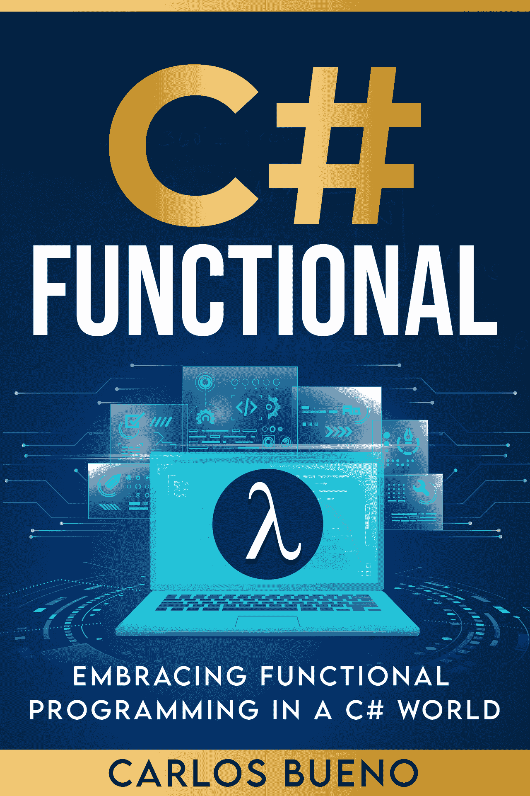

# Functional C#：在 C# 世界中拥抱函数式编程 (C# Functional Book 1)





## 献辞

献给我亲爱的妻子 Ewa Walęga-Bueno，

你一如既的支持和灵感源是这段旅程的基石。你无的爱、鼓励和耐心是我的指路之星，帮助我导航并克服每一个挑战，使这本书成为现实。

感谢你始终相信我，感谢你对我能力的坚定信念，感谢在我最黑暗的时刻成为我的光。

献给我珍爱的孩子们：Luiz Carlos Bueno、Gustavo Bueno 和 Mikołaj Walęga-Bueno，

你们是我的骄傲和快乐，是未来希望与梦想的体现。你们的笑声和好奇心驱动了我创造、激励和追求远大梦想的欲望。

献给我亲爱的兄弟 Cleber Bueno，

多年来，你的陪伴与团结是无价之宝。你在我生活中的存在是力量和快乐的源泉，提醒着我们之间那份不可破灭的纽带。

献给我亲爱的母亲 Celia Bueno 和父亲 Carlos Roberto Bueno，

你们的引导、牺牲和无条件的爱塑造了今天的我。你们教会了我许多价值观和美德，任何语言都无法完全表达我的感激之情。

献给我已故的祖母 Anna Fantucci，

你的记忆是我贴近心心的珍宝。尽管你离世已超过 25 多年，但你的影响依然是我生活中一股强大的力量。你曾是我世界中最重要的人，是智慧、爱与善良的灯塔。你的遗产每天都在激励并引导着我。

这本书献给你们所有人，作为我深切爱、感激和尊重的证明。你们中的每个人在这旅程中都扮演了重要角色，我非常荣幸能与你们分享这一成就。

Carlos Bueno


让我们用一个更复杂的例子来对比查询语法和方法语法。假设我们要将作者列表与书籍列表连接，然后按作者对书籍分组：

```csharp
// 查询语法
var booksByAuthorQuery = from author in authors
                        join book in books on author.Id equals book.Id
                        group book by author.Name into bookGroup
                        select new { Author = bookGroup.Key, Books = bookGroup.ToList() };

// 方法语法
var booksByAuthorMethod = authors.Join(books, a => a.Id, b => b.AuthorId, (a, b) => new { a.Name, Book = b })
                                 .GroupBy(x => x.Name, x => x.Book)
                                 .Select(g => new { Author = g.Key, Books = g.ToList() });
```

在这个示例中，对于复杂的查询，查询语法更易读且更容易理解，而方法语法虽然简洁，但对于不熟悉函数编程的开发者来说可能难以掌握。

## 6.2.3 使用自定义查询操作符扩展 LINQ


虽然 LINQ 提供了一套全面的操作符，但你有时可能需要针对特定需求自定义操作符。通过利用扩展方法，你可以创建自定义查询操作符，并且它们可以在查询语法（Query Syntax）和方法语法（Method Syntax）中无缝使用。在本节中，我们将演示如何创建一个小型的自定义 LINQ 操作符库。

### 6.2.3.1 自定义 Map 操作符

让我们创建一个自定义的 `Map` 操作符，它的行为类似于 `Select`。我们首先在 `IEnumerable` 上定义一个扩展方法：

```csharp
using System;
using System.Collections.Generic;
using System.Linq;

public static class LinqExtensions
{
    public static IEnumerable<TResult> Map<TSource, TResult>(this IEnumerable<TSource> source, Func<TSource, TResult> selector)
    {
        return source.Select(selector);
    }
}
```

现在我们可以使用方法语法调用我们自定义的 `Map` 操作符：

```csharp
var numbers = new List<int> { 1, 2, 3, 4, 5 };
var squaredNumbers = numbers.Map(x => x * x);
```

若要在查询语法中使用我们自定义的 `Map` 操作符，我们需要创建一个自定义的查询关键字。我们将在 `IEnumerable` 上定义一个带有 `map` 关键字的扩展方法：

```csharp
public static class LinqExtensions
{
    public static IEnumerable<TResult> map<TSource, TResult>(this IEnumerable<TSource> source, Func<TSource, TResult> selector)
    {
        return source.Select(selector);
    }
}
```

现在我们可以使用查询语法调用我们自定义的 `Map` 操作符：

```csharp
var squaredNumbersQuery = from n in numbers select n;
```

### 6.4.2 Bind 操作符

让我们创建一个自定义的 `Bind` 操作符，它的行为类似于 `SelectMany`。我们将在 `IEnumerable` 上定义一个扩展方法：

```csharp
public static class LinqExtensions
{
    public static IEnumerable<TResult> Bind<TSource, TResult>(this IEnumerable<TSource> source, Func<TSource, IEnumerable<TResult>> selector)
    {
        return source.SelectMany(selector);
    }
}
```

现在我们可以使用方法语法调用我们自定义的 `Bind` 操作符：

```csharp
var names = new List<string> { "Luke", "Leia", "Han" };
var letterCombos = names.Bind(name => name.CharArray());
```

若要在查询语法中使用我们自定义的 `Bind` 操作符，我们需要创建一个自定义的查询关键字。我们将在 `IEnumerable` 上定义一个带有 `bind` 关键字的扩展方法：

```csharp
public static class LinqExtensions
{
    public static IEnumerable<TResult> bind<TSource, TResult>(this IEnumerable<TSource> source, Func<TSource, IEnumerable<TResult>> selector)
    {
        return source.SelectMany(selector);
    }
}
```

现在我们可以使用查询语法调用我们自定义的 `Bind` 操作符：

```csharp
var letterCombosQuery = from name in names from letter in name.CharArray() select letter;
```

在下一个示例中，我们将使用查询语法创建一个 LINQ 查询，用于从两家不同的航空公司寻找最便宜的票价。我们将使用扩展方法来保持代码的函数化和整洁。

首先，让我们创建表示航班信息的类：

```csharp
public class Flight
{
    public string Airline { get; set; }
    public string Origin { get; set; }
    public DateTime DepartureDate { get; set; }
    public decimal Fare { get; set; }
}
```

接下来，我们将创建一个包含扩展方法的静态类，用于从虚假航空公司获取航班数据：

```csharp
using System.Collections.Generic;

public static class AirlineExtensions
{
    public static IEnumerable<Flight> GetFlightsAirline1(this string origin)
    {
        // 从 Airline1 获取（用于演示的假数据）
        return new List<Flight>
        {
            new Flight { Airline = "Airline1", Origin = origin, Destination = "New York", DepartureDate = DateTime.Now.AddDays(1), Fare = 500 },
            new Flight { Airline = "Airline1", Origin = origin, Destination = "Los Angeles", DepartureDate = DateTime.Now.AddDays(2), Fare = 800 }
        };
    }

    public static IEnumerable<Flight> GetFlightsAirline2(this string origin)
    {
        // 从 Airline2 获取（用于演示的假数据）
        return new List<Flight>
        {
            new Flight { Airline = "Airline2", Origin = origin, Destination = "New York", DepartureDate = DateTime.Now.AddDays(3), Fare = 550 },
            new Flight { Airline = "Airline2", Origin = origin, Destination = "Los Angeles", DepartureDate = DateTime.Now.AddDays(4), Fare = 700 }
        };
    }
}
```

现在，让我们使用查询语法创建一个 LINQ 查询来从两家航空公司获取最便宜的票价：

```csharp
using System;
using System.Linq;

class Program
{
    static void Main()
    {
        string origin = "San Francisco";
        string destination = "Los Angeles";
        var bestFares = from airline1Flight in origin.GetFlightsAirline1()
                         from airline2Flight in origin.GetFlightsAirline2()
                         where airline1Flight.Destination == destination && airline2Flight.Destination == destination
                         let minFare = Math.Min(airline1Flight.Fare, airline2Flight.Fare)
                         orderby minFare
                         select new { Airline = (airline1Flight.Fare <= airline2Flight.Fare) ? airline1Flight.Airline : airline2Flight.Airline, Fare = minFare };

        Console.WriteLine($"Best flight fares from {origin} to {destination}:");
        foreach (var fare in bestFares)
        {
            Console.WriteLine($"{fare.Airline}: {fare.Fare}");
        }
    }
}
```

在这个示例中，我们使用了查询语法来处理大型数据集。为了让之前的代码并行运行，可以使用 `AsParallel()` 扩展方法。我们需要为扩展方法添加 `System.Threading` 命名空间：

```csharp
using System;
using System.Collections.Generic;
using System.Linq;
using System.Threading.Tasks;

public static class AirlineExtensions
{
    public static IEnumerable<Flight> GetFlightsAirline1Async(this string origin)
    {
        return Task.Run(() =>
        {
            // 模拟异步调用
            Task.Delay(500).Wait();
            return new List<Flight>
            {
                new Flight { Airline = "Airline1", Origin = origin, Destination = "New York", DepartureDate = DateTime.Now.AddDays(1), Fare = 500 },
                new Flight { Airline = "Airline1", Origin = origin, Destination = "Los Angeles", DepartureDate = DateTime.Now.AddDays(2), Fare = 800 }
            };
        }) as IEnumerable<Flight>;
    }

    public static IEnumerable<Flight> GetFlightsAirline2Async(this string origin)
    {
        return Task.Run(() =>
        {
            // 模拟异步调用
            Task.Delay(500).Wait();
            return new List<Flight>
            {
                new Flight { Airline = "Airline2", Origin = origin, Destination = "New York", DepartureDate = DateTime.Now.AddDays(3), Fare = 550 },
                new Flight { Airline = "Airline2", Origin = origin, Destination = "Los Angeles", DepartureDate = DateTime.Now.AddDays(4), Fare = 700 }
            };
        }) as IEnumerable<Flight>;
    }
}
```


```csharp
using System.Threading.Tasks;

class Program
{
    static async Task Main()
    {
        string origin = "San Francisco";
        string destination = "Los Angeles";
        var airline1FlightsTask = origin.GetFlightsFromAirline1Async();
        var airline2FlightsTask = origin.GetFlightsFromAirline2Async();
        var airline1Flights = await airline1FlightsTask;
        var airline2Flights = await airline2FlightsTask;
        var bestFares = from airline1Flight in airline1Flights.AsParallel()
        from airline2Flight in airline2Flights.AsParallel()
        where airline1Flight.Destination == destination && airline2Flight.Destination == destination
        let minFare = Math.Min(airline1Flight.Fare, airline2Flight.Fare)
        orderby minFare
        select new { Airline = (airline1Flight.Fare <= airline2Flight.Fare) ? airline1Flight.Airline : airline2Flight.Airline, Fare = minFare };
        Console.WriteLine($"Best flight fares from {origin} to {destination}:");
        foreach (var fare in bestFares)
        {
            Console.WriteLine($"Airline:{fare.Airline}, Fare: ${fare.Fare}");
        }
    }
}
```

在这个更新后的示例中，我们把扩展方法改为了异步，并使用了 `Task.Run()` 来模拟 API 调用。在 `Main()` 方法中，我们调用了这些异步方法，并使用 `AsParallel()` 来并行执行我们的 LINQ 查询。这种方法在处理大型数据集或复杂操作时，有助于提高性能。

## 6.3 常用 LINQ 操作符

在本节中，我们将探索一些你在 C# 函数式编程之旅中经常用到的常用 LINQ 操作符。这些操作符可以分为过滤、投影、聚合和排序操作。

### 过滤操作符（Filtering Operators）
这些操作符帮助根据特定条件过滤数据。常用的过滤操作符有：

- **Where**: 根据给定的谓词过滤元素序列。
  ```csharp
  IEnumerable<int> numbers = new[] { 1, 2, 3, 4, 5, 6 };
  IEnumerable<int> evenNumbers = numbers.Where(n => n % 2 == 0);
  ```
- **OfType**: 根据元素的运行时类型过滤元素序列。
  ```csharp
  IEnumerable<object> objects = new[] { "string", 42, 3.14 };
  IEnumerable<int> integers = objects.OfType<int>();
  ```

### 投影操作符（Projection Operators）
这些操作符帮助你转换元素序列。常用的投影操作符有：

- **Select**: 将序列中的每个元素投影到新的形式。
  ```csharp
  IEnumerable<int> numbers = new[] { 1, 2, 3, 4, 5 };
  IEnumerable<int> squaredNumbers = numbers.Select(n => n * n);
  ```
- **SelectMany**: 将序列中的每个元素投影为一个 `IEnumerable`，并将产生的序列平化为单一序列。
  ```csharp
  IEnumerable<string> words = new[] { "Hello", "World" };
  IEnumerable<char> characters = words.SelectMany(w => w);
  ```

### 聚合操作符（Aggregation Operators）
这些操作符帮助你从元素序列中计算单个值。常用的聚合操作符有：

- **Count**: 返回序列中的元素数量。
  ```csharp
  IEnumerable<int> numbers = new[] { 1, 2, 3, 4, 5 };
  int count = numbers.Count();
  ```
- **Sum**: 计算数值序列之和。
  ```csharp
  IEnumerable<int> numbers = new[] { 1, 2, 3, 4, 5 };
  int sum = numbers.Sum();
  ```
- **Average**: 计算数值序列的平均值。
  ```csharp
  IEnumerable<int> numbers = new[] { 1, 2, 3, 4, 5 };
  double average = numbers.Average();
  ```
- **Min and Max**: 分别返回序列中的最小值和最大值。
  ```csharp
  IEnumerable<int> numbers = new[] { 1, 2, 3, 4, 5 };
  int minValue = numbers.Min();
  int maxValue = numbers.Max();
  ```

### 排序操作符（Ordering Operators）
这些操作符帮助你对元素序列。常用的排序操作符有：

- **OrderBy and OrderByDescending**: 根据键对序列元素进行升序或降序排序。
  ```csharp
  IEnumerable<int> numbers = new[] { 5, 3, 1, 4, 2 };
  IEnumerable<int> ascending = numbers.OrderBy(n => n);
  IEnumerable<int> descending = numbers.OrderByDescending(n => n);
  ```
- **ThenBy and ThenByDescending**: 根据键对序列中的元素进行后续的升序或降序排序。它通常在 `OrderBy` 或 `OrderByDescending` 之后使用。
  ```csharp
  IEnumerable<string> words = new[] { "apple", "orange", "kiwi" };
  IEnumerable<string> sortedWords = words.OrderBy(w => w.Length).ThenBy(w => w);
  ```

### 集合操作符（Set Operators）
这些操作符帮助对序列执行集合操作。常用的集合操作符有：

- **Distinct**: 移除序列中的重复元素。
  ```csharp
  IEnumerable<int> numbers = new[] { 1, 2, 2, 3, 4, 4, 5 };
  IEnumerable<int> distinctNumbers = numbers.Distinct();
  ```
- **Union**: 返回两个序列的并集。
  ```csharp
  IEnumerable<int> set1 = new[] { 1, 2, 3 };
  IEnumerable<int> set2 = new[] { 3, 4, 5 };
  IEnumerable<int> union = set1.Union(set2);
  ```
- **Intersect**: 返回两个序列的交集。
  ```csharp
  IEnumerable<int> set1 = new[] { 1, 2, 3 };
  IEnumerable<int> set2 = new[] { 3, 4, 5 };
  IEnumerable<int> intersection = set1.Intersect(set2);
  ```
- **Except**: 返回两个序列的差集。
  ```csharp
  IEnumerable<int> set1 = new[] { 1, 2, 3 };
  IEnumerable<int> set2 = new[] { 3, 4, 5 };
  IEnumerable<int> difference = set1.Except(set2);
  ```

### 分组操作符（Grouping Operators）
这些操作符帮助你根据指定的键对元素进行分组。常用的分组操作符有：

- **GroupBy**: 根据键选择器函数对元素进行分组。
  ```csharp
  IEnumerable<int> numbers = new[] { 1, 2, 3, 4, 5, 6 };
  IEnumerable<IGrouping<int, int>> groupedNumbers = numbers.GroupBy(n => n % 2);
  ```

通过精通这些 LINQ 操作符，你可以利用 C# 函数式编程的真正威力。有了它们的帮助，你可以构建高效且易于理解的代码来处理最具挑战性的任务。

# 第 7 章：错误处理与函数编程

在本章中，我们将探索如何在 C# 函数式编程中处理错误。我们将从讨论 C# 的传统错误处理方法，转向使用 `Result` 和 `Either` 类型更具函数的替代方案。最后，我们将引入轨道式编程。

## 7.1 C# 中的传统错误处理：异常

在 C# 中，处理错误的常用方法是使用异常。异常是表示程序执行期间发生错误或异常情况的对象。当发生错误时，会抛出异常并中断程序的正常流程。为了处理异常，你可以使用 `try-catch` 块，它允许你定义发生异常时执行的代码块。

这是一个使用异常进行错误处理的函数示例：

```csharp
int Divide(int numerator, int denominator)
{
    if (denominator == 0)
    {
        throw new DivideByZeroException("不能除以零。");
    }
    return numerator / denominator;
}
```

虽然异常在 C# 中广泛广泛，但在函数式编程方面有一些缺点：

- 异常破坏了函数的引用透明性，使得代码推理变得困难。
- 抛出和捕获异常会对性能产生负面影响。


处理多个异常会导致复杂的嵌套的 `try-catch` 块。

## 7.2. Result 和 Either 类型

作为异常的替代方案，函数式编程语言通常使用专门的类型来表示错误，如 `Result` 和 `Either`。这些类型可以在 C# 中用于提供一种更具函数式的错误处理方式。

`Either` 类型是 `Result` 的更通用的版本。它可以表示两种可能的类型之一，通常用于表示成功结果或错误。在本节中，我们将使用 `Language-Ext` 库来演示如何使用 `Either` 类型处理错误。我们将在第 10 章中详细讨论 `Language-Ext` 库。

要安装 `Language-Ext`，请向你的项目添加 NuGet 包：

```
Install-Package LanguageExt.Core
```

假设我们有一个“贷款申请”场景，我们需要从 `MongoDB` 数据库中获取申请人的数据。使用 `Language-Ext` 的 `Either` 类型，我们可以定义一个返回成功结果（申请人数据）或错误的函数。

首先，让我们定义一个 `Applicant` 类：

```csharp
public class Applicant
{
    public ObjectId Id { get; set; }
    public string FullName { get; set; }
    public string Email { get; set; }
    public decimal LoanAmount { get; set; }
}
```

接下来，我们将定义一个 `Error` 类：

```csharp
public class Error
{
    public string Message { get; set; }
}
```

现在，让我们创建一个从 `MongoDB` 数据库获取申请人数据的函数。如果发生异常，它将返回一个 `Error` 对象。否则，它将返回一个 `Applicant` 对象。

```csharp
using LanguageExt;
using MongoDB.Driver;

public async Task<Either<Error, Applicant>> GetApplicantAsync(ObjectId id)
{
    try
    {
        var client = new MongoClient("mongodb://localhost:27017");
        var database = client.GetDatabase("LoanApp");
        var collection = database.GetCollection<Applicant>("Applicants");
        var applicant = await collection.Find(app => app.Id == id).FirstOrDefaultAsync();
        return applicant;
    }
    catch (Exception ex)
    {
        return new Error { Message = ex.Message };
    }
}
```

有了 `GetApplicantAsync` 函数，我们现在可以创建一个 Minimal API 端点，用于获取申请人数据并使用 `Either` 类型处理错误：

```csharp
using Microsoft.AspNetCore.Builder;
using Microsoft.Extensions.DependencyInjection;
using LanguageExt;

var builder = WebApplication.CreateBuilder(args);
builder.Services.AddControllers();
var app = builder.Build();

app.MapGet("/applicants/{id}", async (string id) =>
{
    ObjectId objectId = ObjectId.Parse(id);
    var result = await GetApplicantAsync(objectId);
    return result.Match<IActionResult>(
        Right: applicant => Results.Ok(applicant),
        Left: error => Results.BadRequest(new { error = error.Message }));
});

app.Run();
```

在上面的示例中，我们使用 `Either` 类型以函数式方式处理错误。我们不再抛出和捕获异常，而是返回一个成功结果或错误。这种方法使得我们的代码更容易理解，并允许我们以更函数式的方式处理错误。

除了 `Either` 类型外，还有另一种常用的以函数式方式表示错误的类型：`Result` 类型。`Result` 类型与 `Either` 类型类似，但更专门。它代表一个成功结果或失败。让我们看看如何使用 `Language-Ext` 中的 `Result` 类型重构之前的示例。

首先，让我们创建一个从 `MongoDB` 数据库获取申请人数据的函数。如果发生异常，它将返回一个封装在 `Result` 中的 `Error` 对象。否则，它将返回一个封装在 `Result` 中的 `Applicant` 对象。

```csharp
using LanguageExt;
using MongoDB.Driver;

public async Task<Result<Applicant, Error>> GetApplicantAsync(ObjectId id)
{
    try
    {
        var client = new MongoClient("mongodb://localhost:27017");
        var database = client.GetDatabase("LoanApp");
        var collection = database.GetCollection<Applicant>("Applicants");
        var applicant = await collection.Find(app => app.Id == id).FirstOrDefaultAsync();
        return Result<Applicant, Error>.Success(applicant);
    }
    catch (Exception ex)
    {
        return Result<Applicant, Error>.Failure(new Error { Message = ex.Message });
    }
}
```

有了 `GetApplicantAsync` 函数，我们现在可以创建一个 Minimal API 端点，用于获取申请人数据并使用 `Result` 类型处理错误：

```csharp
using Microsoft.AspNetCore.Builder;
using Microsoft.Extensions.DependencyInjection;
using LanguageExt;

var builder = WebApplication.CreateBuilder(args);
builder.Services.AddControllers();
var app = builder.Build();

app.MapGet("/applicants/{id}", async (string id) =>
{
    ObjectId objectId = ObjectId.Parse(id);
    var result = await GetApplicantAsync(objectId);
    return result.Match<IActionResult>(
        Right: applicant => Results.Ok(applicant),
        Left: error => Results.BadRequest(new { error = error.Message })); // 注意：Match 逻辑可能会根据实现而变化
});

app.Run();
```

在这个示例中，我们使用 `Result` 类型以函数式方式处理错误。它类似于 `Either` 类型，但专门为成功或失败而定制。

## 7.3. 轨道式编程

轨道式编程（Railway-Oriented Programming, ROP）是一种函数式编程模式，允许你以一种更易于管理和显式的方式组合函数。该概念基于拥有两条“轨道”的想法，代码可以在其上运行：一条用于成功情况，另一条用于失败情况。在 ROP 中，函数被设计为返回 `Result` 或 `Either` 类型，表示成功或失败。

让我们考虑一个银行贷款申请的示例。我们将使用轨道式原则来实现过程。

首先，定义我们的 `LoanApplication` 类：

```csharp
public class LoanApplication
{
    public Applicant Applicant { get; set; }
    public decimal LoanAmount { get; set; }
    public int LoanTermInMonths { get; set; }
}
```

接下来，我们将创建表示贷款申请步骤的函数。每个函数都将返回 `Result` 类型：

*   `CheckCreditScore`：该函数检查申请人的信用评分，并返回 `Result` 表示评分是否在接受范围内。
*   `EvaluateDebtIncomeRatio`：该函数评估申请人的债务收入比，并返回 `Result` 表示比例是否在接受范围内。
*   `ApproveLoan`：该函数根据申请人的信用评分和债务收入比批准贷款。

让我们实现这些函数：

```csharp
public Result<int, Error> CheckCreditScore(Applicant applicant)
{
    // 模拟检查信用（例如通过调用信用局 API）
    int creditScore = new Random().Next(300, 850);
    if (creditScore < 620)
    {
        return Result<int, Error>.Failure(new Error { Message = "信用分太低。" });
    }
    return Result<int, Error>.Success(creditScore);
}

public Result<decimal, Error> EvaluateDebtToIncomeRatio(Applicant applicant)
{
    // 模拟计算债务收入比
    decimal debtToIncomeRatio = new Random().Next(1, 100) / 100m;
    if (debtToIncomeRatio > 0.43m)
    {
        return Result<decimal, Error>.Failure(new Error { Message = "债务收入比太高。" });
    }
    return Result<decimal, Error>.Success(debtToIncomeRatio);
}

public Result<LoanApplication, Error> ApproveLoan(Applicant applicant, decimal loanAmount, int loanTermInMonths)
{
    // 实现逻辑在此
}
```


// // 申请人的信用评分和债务收入比

```csharp
var creditScoreResult = CheckCreditScore(applicant);

var debtToIncomeRatioResult = EvaluateDebtToIncomeRatio(applicant);

// 如果两项评估都成功，则批准贷款
if (creditScoreResult.IsSuccessful && debtToIncomeRatioResult.IsSuccessful)
{
    var loanApplication = new LoanApplication
    {
        Applicant = applicant,
        LoanAmount = loanAmount,
        LoanTermInMonths = loanTermInMonths
    };
    return Result<LoanApplication, Error>.Success(loanApplication);
}

// 如果任一评估失败，返回相应的错误
return creditScoreResult.Match<Result<LoanApplication, Error>>(
    Success: _ => Result<LoanApplication, Error>.Failure(debtToIncomeRatioResult.FailureValue),
    Failure: error => Result<LoanApplication, Error>.Failure(error));
```

现在我们已经实现了这些函数，让我们使用轨道式编程（railway-oriented programming）原则将它们组合进一个 `ProcessLoanApplication` 函数中：

```csharp
public Result<LoanApplication, Error> ProcessLoanApplication(Applicant applicant, decimal loanAmount, int loanTermInMonths)
{
    return CheckCreditScore(applicant)
        .Bind(creditScore => EvaluateDebtToIncomeRatio(applicant)
        .Map(debtToIncomeRatio => ApproveLoan(applicant, loanAmount, loanTermInMonths)));
}
```

在 `ProcessLoanApplication` 函数中，我们首先调用 `CheckCreditScore`，然后使用 `Bind` 方法链式调用 `EvaluateDebtToIncomeRatio` 的结果。如果两个评估都成功，我们接着使用 `Map` 方法调用 `ApproveLoan`。如果过程中的任何步骤失败，错误将通过链传递并作为最终结果返回。

现在，让我们创建一个示例函数来模拟处理贷款申请：

```csharp
public static async Task Main()
{
    var applicant = new Applicant { Name = "Alice", AnnualIncome = 80000m };
    decimal loanAmount = 250000m;
    int loanTermInMonths = 360;
    var result = ProcessLoanApplication(applicant, loanAmount, loanTermInMonths);
    result.Match(
        Success: loanApplication => Console.WriteLine("Loan approved!"),
        Failure: error => Console.WriteLine($"Loan denied. Reason: {error.Message}")
    );
}
```

让我们通过添加更多步骤来扩展我们的贷款处理流水线，以使轨道式编程的概念更加清晰。我们向向流水线中添加以下新函数：

* `CheckEmploymentHistory`：此函数检查申请人的工作历史，并返回一个 `Result`，指示其是否符合最低工作年限要求。
* `VerifyIdentity`：此函数验证申请人的身份，并返回一个 `Result`，指示身份验证是否成功。
* `EvaluateLoanRisk`：此函数评估贷款的整体风险，并返回一个 `Result`，指示风险是否在接受范围内。

现在，让我们实现这些函数：

```csharp
public Result<bool, Error> CheckEmploymentHistory(Applicant applicant)
{
    // 模拟检查工作历史（例如通过调用就业验证 API）
    int employmentDurationInMonths = new Random().Next(0, 120);
    if (employmentDurationInMonths < 24)
    {
        return Result<bool, Error>.Failure(new Error { Message = "Insufficient employment history." });
    }
    return Result<bool, Error>.Success(true);
}

public Result<bool, Error> VerifyIdentity(Applicant applicant)
{
    // 模拟验证申请人的身份（例如通过调用身份验证 API）
    bool identityVerified = new Random().Next(0, 2) == 1;
    if (!identityVerified)
    {
        return Result<bool, Error>.Failure(new Error { Message = "Identity verification failed." });
    }
    return Result<bool, Error>.Success(true);
}

public Result<bool, Error> EvaluateLoanRisk(Applicant applicant, decimal loanAmount, int loanTermInMonths)
{
    // 模拟评估贷款风险（例如使用机器学习模型）
    bool isAcceptableRisk = new Random().Next(0, 2) == 1;
    if (!isAcceptableRisk)
    {
        return Result<bool, Error>.Failure(new Error { Message = "Loan risk too high." });
    }
    return Result<bool, Error>.Success(true);
}
```

现在，让我们更新 `ProcessLoanApplication` 函数，将这些新步骤包含在流水线：

```csharp
public Result<LoanApplication, Error> ProcessLoanApplication(Applicant applicant, decimal loanAmount, int loanTermInMonths)
{
    return CheckCreditScore(applicant)
        .Bind(creditScore => EvaluateDebtToIncomeRatio(applicant)
        .Bind(debtToIncomeRatio => CheckEmploymentHistory(applicant)
        .Bind(employmentHistory => VerifyIdentity(applicant)
        .Bind(identityVerified => EvaluateLoanRisk(applicant, loanAmount, loanTermInMonths)
        .Map(risk => ApproveLoan(applicant, loanAmount, loanTermInMonths))));
}
```

在更新后的 `ProcessLoanApplication` 函数中，我们使用 `Bind` 方法包含了 `CheckEmploymentHistory`、`VerifyIdentity` 和 `EvaluateLoanRisk`。

# 第 8 章：函数式风格的异步编程

## 8.1 Async/Await 与基于的异步模式

在编程世界中，无法避免处理异步操作，特别是在处理 I/O 密集型任务时。C# 在提供管理异步的工具方面取得了巨大进展，使其变得更容易。在本章中，我们将从函数的角度探索异步编程。

基于的异步模式（TAP）是 C# 异步编程模型的核心。它依赖 `Task` 类来表示产生结果或简单完成的工作。

让我们先看一个使用 `async/await` 执行异步操作的简单示例：

```csharp
public async Task<string> FetchDataFromWebAsync()
{
    using (var httpClient = new HttpClient())
    {
        var response = await httpClient.GetAsync("https://api.example.com/data");
        var content = await response.Content.ReadAsStringAsync();
        return content;
    }
}
```

在这个示例中，我们使用 `HttpClient` 从 Web API 获取数据。`async` 关键字表示该方法包含异步代码。`await` 关键字暂停方法的执行，直到 `Task` 表示的异步操作完成。该方法返回一个 `Task`，代表正在进行的字符串操作。

现在，让我们探索如何将函数式编程概念应用于 C# 的异步编程。一种方法是使用单 ad，特别是 `Task` 单 ad。就像 `Option` 和 `Either` 一样，`Task` 单 ad 可以用于以函数方式链式调用和组合异步操作。

例如，让我们使用 `Task` 单 ad 和函数式风格重写 `FetchDataFromWebAsync` 方法：

```csharp
public Task<string> FetchDataFromWebFuncAsync()
{
    return new HttpClient().GetAsync("https://api.example.com/data")
        .Bind(response => response.Content.ReadAsStringAsync());
}
```

在这个版本中，我们使用 `Bind` 方法链式 `GetAsync` 和 `ReadAsStringAsync` 调用。`Bind` 方法可以被视为 LINQ 中 `SelectMany` 的异步等价物。它允许我们以函数式风格组合多个异步操作。方法仍然返回一个表示正在进行操作的 `Task`。


请注意，我们不再需要 `async` 和 `await` 关键字，因为 `Bind` 方法在后台处理了异步性。这是一个展示函数式编程如何帮助我们编写更整洁、更易维护的代码，同时利用 C# 强大的异步特性的示例。

## 8.2. 异步函数式流水线

在上一节中，我们查看了如何使用 `Task` 单元和 `Bind` 方法以函数式风格编写异步代码。现在，让我们扩展这一概念，使用 LINQ 查询语法构建异步函数式流水线。

首先，我们将为 `Task` 创建几个扩展方法，这将允许我们在异步操作中使用 LINQ 查询语法：

```csharp
public static class TaskExtensions
{
    public static async Task<TResult> Select<TSource, TResult>(this Task<TSource> task, Func<TSource, TResult> selector)
    {
        var source = await task.ConfigureAwait(false);
        return selector(source);
    }

    public static async Task<TResult> SelectMany<TSource, TResult>(this Task<TSource> task, Func<TSource, Task<TResult>> selector)
    {
        var source = await task.ConfigureAwait(false);
        return await selector(source).ConfigureAwait(false);
    }

    public static async Task<TResult> SelectMany<TSource, TCollection, TResult>(this Task<TSource> task, Func<TSource, Task<TCollection>> collectionSelector, Func<TSource, TCollection, TResult> resultSelector)
    {
        var source = await task.ConfigureAwait(false);
        var collection = await collectionSelector(source).ConfigureAwait(false);
        return resultSelector(source, collection);
    }
}
```

这些扩展方法（`Select`、`SelectMany` 以及带有结果选择器的 `SelectMany` 重载）使我们能够对 `Task` 使用 LINQ 查询语法。现在，让我们使用这些扩展创建一个复杂的银行相关的示例。

假设我们有一个银行系统，它需要异步获取客户数据、账户数据和最近交易。我们将使用以下类来表示我们的数据：

```csharp
public class Customer
{
    public int Id { get; set; }
    public string Name { get; set; }
}

public class Account
{
    public int Id { get; set; }
    public decimal Balance { get; set; }
}

public class Transaction
{
    public int Id { get; set; }
    public decimal Amount { get; set; }
    public DateTime Date { get; set; }
}
```

现在，让我们创建模拟异步获取这些数据的方法：

```csharp
public async Task<Customer> GetCustomerAsync(int customerId)
{
    // 模拟异步获取客户数据
    await Task.Delay(100);
    return new Customer { Id = customerId, Name = "John Doe" };
}

public async Task<Account> GetAccountAsync(int accountId)
{
    // 模拟异步获取账户数据
    await Task.Delay(100);
    return new Account { Id = accountId, Balance = 5000 };
}

public async Task<List<Transaction>> GetRecentTransactionsAsync(int accountId)
{
    // 模拟异步获取最近交易
    await Task.Delay(100);
    return new List<Transaction>
    {
        new Transaction { Id = 1, Amount = -100, Date = DateTime.UtcNow.AddDays(-1) },
        new Transaction { Id = 2, Amount = 200, Date = DateTime.UtcNow.AddDays(-2) },
        new Transaction { Id = 3, Amount = -50, Date = DateTime.UtcNow.AddDays(-3) }
    };
}
```

现在，让我们使用我们的 `Task` 扩展方法和 LINQ 查询语法构建一个异步函数式流水线：

```csharp
public async Task<(Customer, Account, List<Transaction>)> FetchCustomerAccountDataAsync(int customerId, int accountId)
{
    var result = await (from customer in GetCustomerAsync(customerId)
                        from account in GetAccountAsync(accountId)
                        from transactions in GetRecentTransactionsAsync(accountId)
                        select (customer, account, transactions));
    return result;
}
```

在 `FetchCustomerAccountDataAsync` 方法中，我们使用 LINQ 查询语法结合扩展方法组合了客户数据、账户数据和最近交易的获取。这允许我们创建一个既可读又易于维护的异步流水线。

现在，让我们使用我们的流水线创建另一个示例。这次，我们将过滤超过阈值的最近交易：

```csharp
public async Task<(Customer, Account, List<Transaction>)> FetchFilteredAccountDataAsync(int customerId, int accountId, decimal threshold)
{
    var result = await (from customer in GetCustomerAsync(customerId)
                        from account in GetAccountAsync(accountId)
                        from transactions in GetRecentTransactionsAsync(accountId)
                        let filteredTransactions = transactions.Where(t => Math.Abs(t.Amount) > threshold).ToList()
                        select (customer, account, filteredTransactions));
    return result;
}
```

在此方法中，我们在 LINQ 查询中添加了一个新步骤，在返回结果之前对交易进行过滤。`let` 关键字允许我们引入一个 `filteredTransactions` 变量，该变量持有过滤后的列表。`Where` 函数用于根据给定的阈值过滤交易。

现在我们已经看到了如何使用 LINQ 语法构建异步流水线，让我们来探索如何在这些流水线中处理错误。在函数式世界中，`Result` 类型（也称为 Either 单元）通常用于表示可能失败的结果。为了在我们的流水线集成 `Result` 类型，让我们创建一个表示可能失败的异步计算的 `TaskResult<T>`：

```csharp
public class TaskResult<T>
{
    public Task<T> Value { get; }
    public TaskResult(Task<T> value)
    {
        Value = value;
    }
}
```

现在，我们可以为 `TaskResult` 类创建类似于 `Task` 扩展方法的扩展方法。这将允许我们以函数式方式处理流水线中的错误。

```csharp
public static class TaskResultExtensions
{
    public static async TaskResult<TResult> Select<TSource, TResult>(this TaskResult<TSource> taskResult, Func<TSource, TResult> selector)
    {
        var result = await taskResult.Value.ConfigureAwait(false);
        return result.Success
            ? new TaskResult<TResult>(Task.FromResult(new Result<TResult>(selector(result.Value))))
            : new TaskResult<TResult>(Task.FromResult(new Result<TResult>(result.ErrorMessage)));
    }

    public static async TaskResult<TResult> SelectMany<TSource, TResult>(this TaskResult<TSource> taskResult, Func<TSource, TaskResult<TResult>> selector)
    {
        var result = await taskResult.Value.ConfigureAwait(false);
        return result.Success
            ? selector(result.Value)
            : new TaskResult<TResult>(Task.FromResult(new Result<TResult>(result.ErrorMessage)));
    }

    public static async TaskResult<TResult> SelectMany<TSource, TCollection, TResult>(this TaskResult<TSource> taskResult, Func<TSource, TaskResult<TCollection>> collectionSelector, Func<TSource, TCollection, TResult> resultSelector)
    {
        var result = await taskResult.Value.ConfigureAwait(false);
        if (result.Success)
        {
            var source = result.Value;
            var collectionResult = await collectionSelector(source).Value.ConfigureAwait(false);
            return collectionResult.Success
                ? new TaskResult<TResult>(Task.FromResult(new Result<TResult>(resultSelector(source, collectionResult.Value))))
                : new TaskResult<TResult>(Task.FromResult(new Result<TResult>(collectionResult.ErrorMessage)));
        }
        else
        {
            return new TaskResult<TResult>(Task.FromResult(new Result<TResult>(result.ErrorMessage)));
        }
    }
}
```


既然我们已经有了 `TaskResultExtensions`，让我们创建一个新的示例，使用这些扩展方法来构建一个带有错误处理的异步函数流水线。

```csharp
public async Task<Result<(Customer, Account, List<Transaction>)>> FetchCustomerAccountDataAsync(int customerId, int accountId)
{
    var result = await (from customerResult in GetCustomerAsync(customerId)
                        from accountResult in GetAccountAsync(accountId)
                        from transactionsResult in GetRecentTransactionsAsync(accountId)
                        select (customerResult, accountResult, transactionsResult));

    return result.IsSuccess
      ? new Result<(Customer, Account, List<Transaction>)>((result.Value.Item1, result.Value.Item2, result.Value.Item3))
      : new Result<(Customer, Account, List<Transaction>)>(result.ErrorMessage);
}
```

在这个示例中，我们使用 LINQ 查询语法，结合 `TaskResult` 和 `TaskResultExtensions` 构建了一个异步函数流水线，用于获取客户数据、账户数据和最近的交易记录。如果在任何操作中发生错误，流水线将返回一个带有错误信息的 `Result<(Customer, Account, List)>`。否则，它将返回一个包含获取到的数据的成功结果。

`TaskResultExtensions` 使我们能够创建以函数式方式处理错误的异步函数流水线，使代码更具读性和可维护性。它促进了关注点分离，因为流水线中的每个方法都负责其自身的错误处理，并且更容易处理异步操作过程中可能发生的不同类型的错误。

总之，使用 LINQ 查询语法和 Task 扩展方法构建异步函数流水线可以编写更简洁、易读且可维护的代码。它还促进了关注点分离，并更容易以函数式方式处理错误。通过将这种方法扩展到处理 `Result` 类型，我们可以在 C# 中创建健壮且高效的异步流水线。

## 8.3 异步处理错误

在本节中，我们将探索如何在函数式 C# 中异步处理错误。异步编程是现代软件开发的一个重要方面，它允许我们在执行非阻塞 I/O 操作的同时释放资源。在函数式编程中，我们通常使用 `Either`、`Option` 或 `Result` 等单数结构来处理错误。

为了方便操作，我们将使用 `Functional-Ext` 库，该库提供了许多实用的工具和扩展，使 C# 的函数式编程更加方便。该库将在第 10 章中详细介绍。

### 8.3.1 使用 Result 进行异步错误处理

`Result` 是一种单数结构，表示计算的结果，该结果可能是成功也可能是错误。它可以包含一个成功值，也可以包含一个错误。在异步编程中，我们可以将 `Result` 与 `Task` 结合，以兼容 async/await 的方式处理错误。

考虑以下示例，我们有一个可能会抛出异常的函数：

```csharp
async Task<string> LoadDataAsync(string url)
{
    // 从 URL 加载数据并将结果作为字符串返回
}
```

为了以函数的方式处理错误，我们可以将返回类型封装在 `Result` 中：

```csharp
using Functional;
using System.Threading.Tasks;

async Task<Result<string, Exception>> LoadDataResultAsync(string url)
{
    try
    {
        var data = await LoadDataAsync(url);
        return Result.Ok<string, Exception>(data);
    }
    catch (Exception ex)
    {
        return Result.Error<string, Exception>(ex);
    }
}
```

现在，我们可以消费该函数并处理成功和错误两种情况：

```csharp
async Task MainAsync()
{
    var result = await LoadDataResultAsync("https://example.com/data");
    result.Match(
        ok: data => Console.WriteLine($"Data: {data}"),
        error: ex => Console.WriteLine($"Error: {ex.Message}")
    );
}
```

### 8.3.2 组合异步函数

在异步编程中使用 `Result` 的主要优势之一是我们可以轻松地组合函数，即使它们可能会失败。`Functional-Ext` 库提供了各种扩展，例如 `BindAsync`，来帮助实现。

假设我们有两个函数，`LoadDataResultAsync` 和 `ProcessDataResultAsync`：

```csharp
async Task<Result<string, Exception>> LoadDataResultAsync(string url) { /* ... */ }
async Task<Result<int, Exception>> ProcessDataResultAsync(string data) { /* ... */ }
```

我们可以使用 `BindAsync` 组合这些函数：

```csharp
async Task MainAsync()
{
    var url = "https://example.com/data";
    var result = await LoadDataResultAsync(url).BindAsync(data => ProcessDataResultAsync(data));
    result.Match(
        ok: processedData => Console.WriteLine($"Processed data: {processedData}"),
        error: ex => Console.WriteLine($"Error: {ex.Message}")
    );
}
```

在这个示例中，`BindAsync` 组合了函数并短路了错误。如果 `LoadDataResultAsync` 返回错误，则不会调用 `ProcessDataResultAsync` 函数，错误将传播到 `Match` 函数。

### 8.3.3 并行计算中的错误处理

`Functional-Ext` 库还提供了在执行并行操作时处理错误的方法。例如，考虑一种情况：我们需要并行从多个 URL 下载数据并对其进行处理。该库提供了 `Traverse` 方法来实现这一目的。

假设我们有一个 URL 列表，用于从中加载并处理数据：

```csharp
using Functional;
using System.Threading.Tasks;

async Task MainAsync()
{
    List<string> urls = new List<string>
    {
        "https://example.com/data1",
        "https://example.com/data2",
        "https://example.com/data3"
    };
    var result = await urls.Traverse(async url => await LoadDataAsync(url).BindAsync(data => ProcessDataResultAsync(data)));
    result.Match(
        ok: processedDataList =>
        {
            Console.WriteLine("Processed data:");
            foreach (var processedData in processedDataList)
            {
                Console.WriteLine(processedData);
            }
        },
        error: ex => Console.WriteLine($"Error: {ex.Message}")
    );
}
```

在这个示例中，`Traverse` 并行的将异步函数应用于 `urls` 列表的每个元素，然后将结果合并为一个 `Result`。如果任何操作失败，`Result` 将持有首次遇到的错误，成功情况将包含处理后的数据列表。

### 8.3.4 重试异步操作

在某些情况下，如果异步操作失败，你可能想重试它。`Functional-Ext` 库提供了一个方便的 `RetryAsync` 扩展方法用于此目的。这里有一个示例演示了如何配合 `LoadDataResultAsync` 函数使用 `RetryAsync`：

```csharp
async Task MainAsync()
{
    var url = "https://example.com/data";
    int maxRetries = 3;
    var result = await LoadDataResultAsync(url).RetryAsync(maxRetries, async (url, retryCount) =>
    {
        Console.WriteLine($"Retrying {retryCount + 1}/{maxRetries}...");
        await Task.Delay(1000); // 重试前等待 1 秒
    });

    result.Match(
        ok: data => Console.WriteLine($"Data: {data}"),
        error: ex => Console.WriteLine($"Error: {ex.Message}")
    );
}
```

在这个示例中，`RetryAsync` 扩展方法用于在 `LoadDataResultAsync` 操作失败时重试，最多尝试 `maxRetries` 次。如果操作在所有重试后仍然失败，错误将传播到 `Match` 函数。


使用这些概念和技术将帮助你在函数式 C# 应用程序中构建健壮且可维护的错误处理策略，使你能够以一致且可组合的方式处理成功和失败情况。

# 第 9 章：函数式设计模式

在本章中，我们将探索函数式编程中常用的函数式设计模式。这些设计模式帮助你利用函数式编程概念编写更整洁、更可复用且易于维护的代码。

## 9.1 Functor（算子）、Applicative（应用器）和 Monad（单数）

在函数式编程中，`Functor`、`Applicative` 和 `Monad` 是处理副作用计算的设计模式。它们帮助我们组合在计算上下文中产生值的函数，例如错误处理、异步操作或可能产生副作用的计算。让我们详细讨论这些模式，并使用各种示例在 C# 中从零实现它们。

### Functor（算子）
`Functor` 是一种涉及使用具有 `map` 操作泛型数据类型的设计模式。`Functors` 允许你将函数应用于计算上下文中的值，而不需要显式地管理上下文。在 C# 中，你可以将 `IEnumerable` 和 `Task` 视为算子的示例。`LINQ` 的 `Select` 方法就是 `map` 操作的示例。

让我们创建一个简单的 `Maybe` 类型，并将 `map` 操作实现为扩展方法：

```csharp
public abstract class Maybe<T>
{
    public static Maybe<T> None() => new None<T>();
    public static Maybe<T> Some(T value) => new Some<T>(value);
}

public class None<T> : Maybe<T> { }

public class Some<T> : Maybe<T>
{
    public T Value { get; }
    public Some(T value)
    {
        Value = value;
    }
}

public static class MaybeExtensions
{
    public static Maybe<TResult> Map<TSource, TResult>(
        this Maybe<TSource> maybe,
        Func<TSource, TResult> selector)
    {
        return maybe switch
        {
            Some<TSource> some => Maybe<TResult>.Some(selector(some.Value)),
            _ => Maybe<TResult>.None(),
        };
    }
}
```

现在，让我们为 `IEnumerable` 类型实现 `map` 操作：

```csharp
public static class EnumerableExtensions
{
    public static IEnumerable<TResult> Map<TSource, TResult>(
        this IEnumerable<TSource> source,
        Func<TSource, TResult> selector)
    {
        return source.Select(selector);
    }
}
```

对于 `Task` 类型也是：

```csharp
public static class TaskExtensions
{
    public static async Task<TResult> Map<TSource, TResult>(
        this Task<TSource> task,
        Func<TSource, TResult> selector)
    {
        return selector(await task);
    }
}
```

### Applicative（应用器）
`Applicative` 通过扩展了 `Functor` 概念，允许你将封装在计算上下文中的函数应用于相同上下文中的值。在 C# 中，我们可以使用之前相同的 `Maybe` 类型创建一个 `Applicative`，并实现 `Apply` 扩展方法：

```csharp
public static class MaybeExtensions
{
    // ...
    public static Maybe<TResult> Apply<TSource, TResult>(
        this Maybe<Func<TSource, TResult>> maybeFunc,
        Maybe<TSource> maybeValue)
    {
        return maybeFunc switch
        {
            Some<Func<TSource, TResult>> someFunc =>
                maybeValue.Map(value => someFunc.Value(value)),
            _ => Maybe<TResult>.None(),
        };
    }
}
```

现在，让我们为 `IEnumerable` 类型实现 `Apply` 操作：

```csharp
public static class EnumerableExtensions
{
    // ...
    public static IEnumerable<TResult> Apply<TSource, TResult>(
        this IEnumerable<Func<TSource, TResult>> sourceFuncs,
        IEnumerable<TSource> sourceValues)
    {
        return from func in sourceFuncs
               from value in sourceValues
               select func(value);
    }
}
```

对于 `Task` 类型：

```csharp
public static async Task<TResult> Apply<TSource, TResult>(
    this Task<Func<TSource, TResult>> taskFunc,
    Task<TSource> taskValue)
{
    var func = await taskFunc;
    var value = await taskValue;
    return func(value);
}
```

### Monad（单数）
`Monad` 是一种泛化操作链概念的设计模式。`Monads` 允许你展平嵌套的上下文并执行操作。`monad` 必须提供一个 `bind` 操作（在 C# 中也称为 `SelectMany`）。

让我们为我们的 `Maybe` 类型实现 `bind` 操作：

```csharp
public static class MaybeExtensions
{
    // ...
    public static Maybe<TResult> Bind<TSource, TResult>(
        this Maybe<TSource> maybe,
        Func<TSource, Maybe<TResult>> selector)
    {
        return maybe switch
        {
            Some<TSource> some => selector(some.Value),
            _ => Maybe<TResult>.None(),
        };
    }
}
```

现在，让我们为 `IEnumerable` 类型实现 `bind` 操作：

```csharp
public static class EnumerableExtensions
{
    // ...
    public static IEnumerable<TResult> Bind<TSource, TResult>(
        this IEnumerable<TSource> source,
        Func<TSource, IEnumerable<TResult>> selector)
    {
        return source.SelectMany(selector);
    }
}
```

对于 `Task` 类型：

```csharp
public static async Task<TResult> Bind<TSource, TResult>(
    this Task<TSource> task,
    Func<TSource, Task<TResult>> selector)
{
    return await selector(await task);
}
```

我们已经了 `Functor`、`Applicative` 和 `Monad` 用于三种不同的计算上下文：`Maybe`、`IEnumerable` 和 `Task`。通过这些概念，你可以创建更可复用和可组合的代码。


# 任务示例

考虑一个向不同服务进行多次 API 用的应用程序，我们希望顺序处理这些结果。我们可以使用 `Task` 单元来实现这一目标。

```csharp
public async Task<string> FetchDataFromApi(string url)
{
    // 使用 Task.Delay 模拟 API 调用
    await Task.Delay(1000);
    return $"Data from {url}";
}

public async Task<string> ProcessData(string data)
{
    // 使用 Task.Delay 模拟数据处理
    await Task.Delay(500);
    return $"Processed {data}";
}

public async Task<string> FetchAndProcessDataAsync(string url)
{
    return await FetchDataFromApi(url).Bind(ProcessData);
}

public async Task ExecuteExample()
{
    var urls = new List<string> { "https://api1.example.com", "https://api2.example.com" };
    foreach (var url in urls)
    {
        var result = await FetchAndProcessDataAsync(url);
        Console.WriteLine(result);
    }
}

await ExecuteExample();
```

在这个示例中，我们使用 `Task<T>` 单元来链式异步调用并顺序处理结果。这使得代码更加整洁且易于管理，同时保留了操作的顺序性。

总之，理解并实现 `Functor`、`Applicative` 和 `Monad` 设计模式可以可以用函数式编程风格编写更简洁、可复用且易于维护的代码。通过结合 `Maybe<T>`、`IEnumerable<T>` 和 `Task<T>` 等不同的计算上下文利用这些模式，你可以创建出可组合且多功能的代码，以处理广泛的场景。

## 10.3 Task 单元的扩展方法

在本节中，我们将通过一些额外的扩展方法来扩展 `Task` 单元，以处理重试和从错误中恢复。我们将实现的方法是 `OrElse`、`Recover`、`Bind` 和 `Map`。

让我们从创建一个包含扩展方法的 `TaskExtensions` 类开始：

```csharp
public static class TaskExtensions
{
    public static async Task<TResult> OrElse<TSource, TResult>(
        this Task<TSource> task,
        Func<Task<TResult>> fallback)
    where TSource : TResult
    {
        try
        {
            return await task;
        }
        catch
        {
            return await fallback();
        }
    }

    public static async Task<T> Recover<T>(
        this Task<T> task,
        Func<Exception, T> recoverFunc)
    {
        try
        {
            return await task;
        }
        catch (Exception ex)
        {
            return recoverFunc(ex);
        }
    }

    public static async Task<TResult> Bind<TSource, TResult>(
        this Task<TSource> task,
        Func<TSource, Task<TResult>> selector)
    {
        return await selector(await task);
    }

    public static async Task<TResult> Map<TSource, TResult>(
        this Task<TSource> task,
        Func<TSource, Result> selector)
    {
        return selector(await task);
    }
}
```

现在，让我们来解释每个方法：

- `OrElse`:如果 `task` 失败，它将执行 `fallback` 函数并返回一个新的 `task`。它适用于实现重试机制或在操作失败时提供备用结果。
- `Recover`:如果 `task` 失败，它将执行 `recoverFunc` 函数，该函数接收异常并返回一个默认值。它适用于从错误中恢复并在操作失败时提供默认值。
- `Bind` 和 `Map`:这些方法在前面的章节中已经解释过，它们是 `Task` 单元的基础操作。

现在，让我们创建一些示例来展示这些方法的用法。

```csharp
public async Task<string> FetchDataFromApiWithErrors(string url)
{
    // 模拟有时会抛出异常的 API 调用
    if (url.Contains("error"))
    {
        throw new InvalidOperationException("Error fetching.");
    }
    await Task.Delay(1000);
    return $"Data from {url}";
}

public async Task ExecuteExampleWithExtensions()
{
    var urls = new List<string> {
        "https://api1.example.com",
        "https://api2.example.com/error",
        "https://api3.example.com"
    };
    foreach (var url in urls)
    {
        var dataTask = FetchDataFromApiWithErrors(url);
        var recoveredDataTask = dataTask.Recover(ex => $"Recovered data for {url}");
        var processedDataTask = recoveredDataTask.Map(data => $"Processed {data}");
        var result = await processedDataTask;
        Console.WriteLine(result);
    }
}

await ExecuteExampleWithExtensions();
```

在这个示例中，我们使用 `Recover` 和 `Map` 方法来处理错误并处理来自 API 用的数据。利用为 `Task` 单元提供的扩展方法，产生了更健壮且简洁的代码。

## 用例 1：股票数据 API

假设我们有一个从 API 获取股票数据的应用程序。有两个 API 提供者，一个主和一个备用。如果主 API 失败，应用程序应该回退到备用 API。此外，如果两个 API 都失败了，我们应该返回一个默认股票值。

首先，让我们创建一个 `Stock` 类和获取股票数据的函数：

```csharp
public class Stock
{
    public string Symbol { get; set; }
    public double Price { get; set; }
}

public async Task<Stock> FetchStockFromPrimaryApi(string symbol)
{
    // 模拟可能失败的 API 调用
    if (symbol == "FAIL")
    {
        throw new InvalidOperationException("Primary API failed.");
    }
    await Task.Delay(1000);
    return new Stock { Symbol = symbol, Price = 100.0 };
}

public async Task<Stock> FetchStockFromSecondaryApi(string symbol)
{
    // 模拟可能失败的 API 调用
    if (symbol == "FAIL")
    {
        throw new InvalidOperationException("Secondary API failed.");
    }
    await Task.Delay(1000);
    return new Stock { Symbol = symbol, Price = 200.0 };
}

public Stock DefaultStock(string symbol)
{
    return new Stock { Symbol = symbol, Price = 0.0 };
}
```

现在，让我们使用 `OrElse` 和 `Recover` 方法创建一个创建一个容错能力的获取股票数据的函数：

```csharp
public async Task<Stock> FetchStockDataAsync(string symbol)
{
    return await FetchStockFromPrimaryApi(symbol)
        .OrElse(() => FetchStockFromSecondaryApi(symbol))
        .Recover(ex => DefaultStock(symbol));
}

public async Task ExecuteStockData()
{
    var symbols = new List<string> { "AAPL", "MSFT", "FAIL" };
    foreach (var symbol in symbols)
    {
        var stock = await FetchStockDataAsync(symbol);
        Console.WriteLine($"Symbol: {stock.Symbol}, Price: {stock.Price}");
    }
}

await ExecuteStockData();
```

## 用例 2：地理编码与天气 API

假设我们有一个应用程序通过地理编码 API 获取位置坐标（纬度和经度），然后使用天气 API 获取天气数据。应用程序应该处理可能的 API 失败并在必要提供默认数据。

首先，让我们创建 `Location` 和 `Weather` 类以及从 API 获取数据的函数：

```csharp
public class Location
{
    public string Address { get; set; }
    public double Latitude { get; set; }
    public double Longitude { get; set; }
}

public class Weather
{
    public string Description { get; set; }
    public double Temperature { get; set; }
}

public async Task<Location> FetchLocationAsync(string address)
{
    // 模拟可能失败的 API 调用
    if (address == "FAIL")
    {
        throw new InvalidOperationException("Geocoding API failed.");
    }
    await Task.Delay(1000);
    return new Location { Address = address, Latitude = 40.7128, Longitude = -74.0060 };
}

public async Task<Weather> FetchWeatherAsync(double latitude, double longitude)
{
    // 模拟可能失败的 API 调用
    if (latitude == 0.0 && longitude == 0.0)
    {
        throw new InvalidOperationException("Weather API failed.");
    }
}
```


```csharp
await Task.Delay(1000);

return new Weather { Description = "Sunny", Temperature = 25.0 };
}

public Location DefaultLocation(string address)
{
    return new Location { Address = address, Latitude = 0.0, Longitude = 0.0 };
}

public Weather DefaultWeather()
{
    return new Weather { Description = "Unknown", Temperature = 0.0 };
}
```

现在，让我们使用 `Bind`、`Map`、`OrElse` 和 `Recover` 方法创建一个容错函数，用于获取给定地址的天气数据：

```csharp
public async Task<Weather> FetchWeatherForAddressAsync(string address)
{
    return await FetchLocationAsync(address)
        .Recover(ex => DefaultLocation(address))
        .Bind(location => FetchWeatherAsync(location.Latitude, location.Longitude))
        .Recover(ex => DefaultWeather());
}

public async Task ExecuteWeatherExample()
{
    var addresses = new List<string> { "123 Main St", "456 Broadway", "FAIL" };
    foreach (var address in addresses)
    {
        var weather = await FetchWeatherForAddressAsync(address);
        Console.WriteLine($"Address: {address}, Weather: {weather.Description}, Temperature: {weather.Temperature}");
    }
}

await ExecuteWeatherExample();
```

在这些示例中，我们使用了 `Map`、`OrElse`、`Bind` 和 `Recover` 方法来处理涉及 API 用的真实场景中的失败并提供容错机制。通过结合这些方法，我们可以创建能够优雅处理错误并在必要时提供回备数据的应用程序。

在本节中，我们探索了 `Functor`、`Applicative` 和 `Monad` 设计模式以及它们在 C# 函数式编程中的应用。我们为 `Task` 单 ad 实现了自定义的扩展方法，如 `Map`、`OrElse`、`Bind` 和 `Recover`，以提高真实场景中的错误处理能力和健壮性。

我们通过各种示例展示了这些模式的力量，包括股票数据获取、地理编码和天气信息检索。这些示例展示了如何优雅地处理错误、提供回备数据，并保持代码的可读性和可维护性。

通过在项目中理解并实现这些函数式设计模式，你可以构建出更健壮、可组合且高性的应用程序，能够处理各种计算上下文和场景。

在接下来的章节中，我们将继续 C# 函数式编程之旅，涵盖更多主题和概念，进一步提高你的编程技能和对函数式编程原理的理解。

# 单群 (Monoids) 与半群 (Semigroups)

在本节中，我们将探索 `Monoids` 和 `Semigroups`，它们是函数式编程中的基础代数结构。这些结构允许你以简单且一致的方式对操作进行建模和组合。我们将从半群的概念，过渡到单群，提供示例并解释它们在 C# 函数式编程中的实际应用。

## 10.4 半群 (Semigroups)

`Semigroup` 是一个由值集合和一个结合二元运算组成的代数结构。二元运算必须满足以下规则：

- **封闭性 (Closure)**：二元运算的结果必须是集合中的成员。
- **结合律 (Associativity)**：对于集合中的所有元素 `a`、`b` 和 `c`，满足 `(a _ b) _ c = a _ (b _ c)`。

为了更好地理解 `Semigroup`，让我们在 C# 中实现一个简单的示例。我们将创建一个 `Sum Semigroup` 来表示整数的加法：

```csharp
public class SumSemigroup
{
    public int Value { get; }
    public SumSemigroup(int value)
    {
        Value = value;
    }
    public SumSemigroup Combine(SumSemigroup other)
    {
        return new SumSemigroup(Value + other.Value);
    }
}
```

`SumSemigroup` 表示整数，并有一个 `Combine` 方法，可以将两个 `SumSemigroup` 实例相加，产生一个新的 `SumSemigroup`。`Combine` 方法具有结合律，这意味着它满足了 `Semigroup` 的要求。

让我们使用 `SumSemigroup` 创建一个简单的示例：

```csharp
var a = new SumSemigroup(1);
var b = new SumSemigroup(2);
var c = new SumSemigroup(3);
var result1 = a.Combine(b).Combine(c);  // (1 + 2) + 3
var result2 = a.Combine(b.Combine(c));  // 1 + (2 + 3)
Console.WriteLine($"Result1: {result1.Value}, Result2: {result2.Value}");  // Result1: 6, Result2: 6
```

该示例演示了 `SumSemigroup` 中 `Combine` 方法的结合律属性。

## 10.5 单群 (Monoids)

`Monoid` 是 `Semigroup` 的扩展，增加了单位元（identity element）。单位元是一个值，当它使用二元运算与其他任何元素结合时，结果仍为该元素。换句话说，对于集合中的任何元素 `a`，`a _ identity = identity _ a = a`。

在 C# 中创建 `Monoid`，我们可以继承自 `Semigroup` 并添加一个单位元：

```csharp
public class SumMonoid : Semigroup
{
    public SumMonoid(int value) : base(value) { }
    public static SumMonoid Identity => new SumMonoid(0);
}
```

在这个示例中，单位元是 `0`，这意味着当我们将任何 `SumMonoid` 实例与它结合时，结果将是元素本身。

```csharp
var a = new SumMonoid(1);
var identity = SumMonoid.Identity;
var result1 = a.Combine(identity);
var result2 = identity.Combine(a);
Console.WriteLine($"Result1: {result1.Value}, Result2: {result2.Value}"); // Result1: 1
```

`Monoids` 和 `Semigroups` 提供了一种一致且可组合的方式来建模操作，例如字符串拼接或列表合并。

## 10.6 实际应用

现在让我们看看 C# 中 `Monoids` 的实际应用。

## 10.7 字符串拼接单群 (String Concatenation Monoid)

`Monoid` 的经典示例是字符串的拼接。二元运算是字符串拼接，单位元是空字符串 `""`。

```csharp
public class StringMonoid
{
    public string Value { get; }
    public StringMonoid(string value)
    {
        Value = value;
    }
    public StringMonoid Combine(StringMonoid other)
    {
        return new StringMonoid(Value + other.Value);
    }
    public static StringMonoid Identity => new StringMonoid("");
}
```

这是一个如何使用 `StringMonoid` 的简单示例：

```csharp
var a = new StringMonoid("Hello, ");
var b = new StringMonoid("World");
var identity = StringMonoid.Identity;
var result = a.Combine(b).Combine(identity);
Console.WriteLine($"Result: {result.Value}"); // Result: Hello, World
```

## 10.8 列表合并单群 (List Merging Monoid)

另一个 `Monoid` 示例是列表的合并。二元运算是列表拼接，单位元是空列表。

```csharp
public class ListMonoid<T>
{
    public List<T> Value { get; }
    public ListMonoid(List<T> value)
    {
        Value = value;
    }
    public ListMonoid<T> Combine(ListMonoid<T> other)
    {
        var result = new List<T>(Value);
        result.AddRange(other.Value);
        return new ListMonoid<T>(result);
    }
    public static ListMonoid<T> Identity => new ListMonoid<T>(new List<T>());
}
```

这是一个如何使用 `ListMonoid` 合并整数列表的示例：

```csharp
var a = new ListMonoid<int>(new List<int> { 1, 2, 3 });
var b = new ListMonoid<int>(new List<int> { 4, 5, 6 });
var identity = ListMonoid<int>.Identity;
var result = a.Combine(identity).Combine(b);
Console.WriteLine($"Result: {string.Join(", ", result.Value)}"); // Result: 1, 2, 3, 4, 5, 6
```


我们提供了实际示例，并演示了这些结构如何让函数式编程能够以简单、一致且可组合的方式建模操作。在项目中理解并应用 `Monoids`（单元）和 `Semigroups`（半群）可以构建更具维护性和健壮性的应用程序。

在接下来的章节中，我们将继续 C# 函数式编程之旅，涵盖更多主题和概念，进一步提高你的编程技能以及对函数式编程原理的理解。

## 10.9 Free Monads（自由 Monad）

在本节中，我们将探索 Free Monads，这是一种高级函数式编程概念，能够构建可组合、灵活且可扩展的程序。Free Monads 将程序的构建与解释分离，使得创建通用且复用的代码成为可能。

Free Monads 基于代数效应（algebraic effects）的思想，即你定义一组操作而不指定它们的实现。这种关注点的分离允许你创建可重用且可组合的程序，这些程序可以在不同的环境中被不同的解释。

## 10.9.1 在 C# 中实现 Free Monad

要在 C# 中实现 Free Monad，我们将使用 `Functor` 概念。让我们创建一个简单的示例来演示如何构建和使用 Free Monads。我们将定义一个包含以下操作的控制台程序：`WriteLine` 和 `ReadLine`。

### 10.9.1.1 控制台操作

首先，我们将定义控制台操作的抽象基类，它将实现 `IFunctor` 接口：

```csharp
public abstract class ConsoleOp<A> : IFunctor<A>
{
    public abstract IFunctor<TResult> Map<TResult>(Func<A, TResult> f);
}
```

现在，让我们定义 `WriteLine` 和 `ReadLine` 具体实现，分别代表向控制台写入和从控制台读取：

```csharp
public class WriteLine : ConsoleOp<Unit>
{
    public string Message { get; }
    public WriteLine(string message)
    {
        Message = message;
    }
    public override IFunctor<TResult> Map<TResult>(Func<Unit, TResult> f)
    {
        return new WriteLine(Message).Map(f);
    }
}

public class ReadLine : ConsoleOp<string>
{
    public override IFunctor<TResult> Map<TResult>(Func<string, TResult> f)
    {
        return new ReadLine().Map(f);
    }
}
```

### 10.9.1.2 Free Monad 数据结构

接下来，我们将定义 `Free` 数据结构，用于表示 Free Monad 中的计算。这是一个递归数据结构，包含两种情况：`Pure`（代表一个纯值）和 `Suspend`（代表一个副作用操作）。

```csharp
public abstract class Free<F, A> where F : IFunctor<A>
{
    public static Free<F, A> Pure(A value) => new Pure<F, A>(value);
    public static Free<F, A> Suspend(F functor) => new Suspend<F, A>(functor);
    private class Pure : Free<F, A>
    {
        public A Value { get; }
        public Pure(A value)
        {
            Value = value;
        }
    }
    private class Suspend : Free<F, A>
    {
        public F Functor { get; }
        public Suspend(F functor)
        {
            Functor = functor;
        }
    }
}
```

## 10.9.2 使用 Free Monads 构建程序

有了定义的 `Free` 数据结构和控制台操作，我们现在可以使用 Free Monads 构建一个简单的控制台程序。

### 10.9.2.1 创建程序

让我们创建一个简单的程序，它向控制台写入消息、读取用户输入，然后将用户的输入写回控制台：

```csharp
var program = Free<ConsoleOp<Unit>, Unit>.Suspend(new WriteLine("Please enter your name:"))
    .Bind(_ => Free<ConsoleOp<string>, string>.Suspend(new ReadLine())
    .Bind(name => Free<ConsoleOp<Unit>, Unit>.Suspend(new WriteLine($"Hello, {name}!"))));
```

在这里，我们构建了一个使用 Free Monads 以可组合方式使用 `WriteLine` 和 `ReadLine` 操作的程序。`Bind` 函数将这些操作链在一起，使得复杂的程序逻辑变得简单。

### 解释 Free Monads

Free Monads 的核心优势之一是程序构建与解释的分离。我们可以为 Free Monad 定义多个解释器，允许我们在各种上下文中解释程序。解释器是一个函数，接收一个 Free Monad 并根据所需的行为处理其操作。让我们为我们的控制台创建一个解释器：

```csharp
public static async Task<A> ConsoleInterpreter<F, A>(Free<F, A> program) where F : IFunctor<A>
{
    if (program is Free<F, A>.Pure pure)
    {
        return pure.Value;
    }
    else if (program is Free<F, A>.Suspend suspend)
    {
        var functor = suspend.Functor;
        if (functor is WriteLine writeLine)
        {
            Console.WriteLine(writeLine.Message);
            return await ConsoleInterpreter(writeLine.Map(_ => default));
        }
        else if (functor is ReadLine readLine)
        {
            var input = Console.ReadLine();
            return await ConsoleInterpreter(readLine.Map(_ => input));
        }
        else
        {
            throw new NotSupportedException($"Unsupported functor: {functor.GetType()}");
        }
    }
    else
    {
        throw new NotSupportedException($"Unsupported program case: {program.GetType()}");
    }
}
```

### 运行解释器

现在我们已经为控制台程序准备解释器，可以通过将程序传递给解释器来执行它：

```csharp
await ConsoleInterpreter(program);
```

这将运行控制台程序，按照解释器的定义向控制台写入消息并从控制台读取输入。


持久化数据类型：不可变且高效的数据结构，例如持久化列表、映射和集合，它们能够实现安全且高效的函数式编程。代数数据类型：支持和类型（也称为判别联合），允许你建模复杂数据类型并以更精确的方式表示数据。单 ad（Monads）和单 ad 变换器：单 ad 和单 ad 变换器的集合，包括 `Option`、`Either`、`Try`、`Task` 和 `State`，帮助你以函数式方式管理副作用、错误和状态。高阶函数：丰富的高阶函数集，例如 `Map`、`Bind`、`Fold` 和 `Filter`，能够实现强大且表现性的数据操作。透镜（Lenses）和光学（Optics）：用于处理不可变数据结构的工具，允许你在无需要过多样板代码的情况下操作深层嵌套的数据。要开始使用 `Language-Ext`，你可以安装 NuGet 包：

```bash
Install-Package LanguageExt.Core
```

安装包后，你可以通过添加适当的 `using` 语句在 C# 代码中开始使用该库。例如，要使用 `Option` 单 ad，你可以添加：

```csharp
using LanguageExt;
using static LanguageExt.Prelude;
```

让我们探索一个在 C# 程序中使用 `Language-Ext` 的简单示例。我们将使用 `Option` 单 ad 来表示一个可空值，并演示如何使用 `Map` 和 `Match` 函数来处理它。

```csharp
Option<string> GetName(int id)
{
    if (id == 1) return Some("Alice");
    if (id == 2) return Some("Bob");
    return None;
}

var name = GetName(1);
var upperName = name.Map(s => s.ToUpper());
var result = upperName.Match(
    Some: s => $"Name: {s}",
    None: () => "Name not found"
);
Console.WriteLine(result);  // 输出: "Name: ALICE"
```

在这个示例中，我们定义了一个 `GetName` 函数，它返回一个表示可空名称的 `Option`。我们我们使用 `Map` 函数将名称转换为大写，并使用 `Match` 函数处理处理 `Some` 和 `None` 情况。

# 在继续学习本章，我们将探索更多功能和库，帮助你在 C# 中利用函数式编程技术。

# 第 11 章：结合 Language-Ext 使用单 ad

`Language-Ext` 提供了一组丰富的单 ad，可以帮助你以函数式方式管理副作用、错误和状态。在本节中，我们将通过实际示例演示 `Language-Ext` 中提供的各种单 ad。

注意：假设你已经安装了 `Language-Ext` NuGet 包并在代码中添加了适当的 `using` 语句。

## Option 单 ad

`Option` 单 ad 表示一个可空值，允许你以安全且函数式的方式处理可能缺失的数据。

```csharp
Option<int> Divide(int numerator, int denominator)
{
    return denominator == 0 ? None : Some(numerator / denominator);
}

var result = Divide(10, 2)
    .Map(x => x * 2)
    .Match(
        Some: x => $"Result: {x}",
        None: () => "Cannot divide by zero"
    );
Console.WriteLine(result);  // 输出: "Result: 10"
```

## Either 单 ad

`Either` 单 ad 表示一个可以是两种类型之一的值，通常用于错误处理，其中一种类型表示错误，另一种类型表示成功。

```csharp
Either<string, int> SafeDivide(int numerator, int denominator)
{
    return denominator == 0 ? Left("Cannot divide by zero") : Right(numerator / denominator);
}

var result = SafeDivide(10, 2)
    .Map(x => x * 2)
    .Match(
        Left: error => $"Error: {error}",
        Right: value => $"Result: {value}"
    );
Console.WriteLine(result);  // 输出: "Result: 10"
```

## Try 单 ad

`Try` 单 ad 用于以函数式方式捕获和管理异常。

```csharp
Try<int> ParseInt(string input)
{
    return Try(() => int.Parse(input));
}

var result = ParseInt("42")
    .Map(x => x * 2)
    .Match(
        Fail: ex => $"Error: {ex.Message}",
        Succ: value => $"Result: {value}"
    );
Console.WriteLine(result);  // 输出: "Result: 84"
```

## Task 单 ad

`Task` 单 ad 表示异步计算，可以结合 `Language-Ext` 使用，以函数式方式管理异步操作。

```csharp
async Task<Option<string>> GetNameAsync(int id)
{
    await Task.Delay(1000);
    return id == 1 ? Some("Alice") : None;
}

var result = await GetNameAsync(1)
    .Map(name => name.ToUpper())
    .Match(
        Some: name => $"Name: {name}",
        None: () => "Name not found"
    );
Console.WriteLine(result);  // 输出: "Name: ALICE"
```

## State 单 ad

`State` 单 ad 允许你以函数式方式管理可变状态。

```csharp
using LanguageExt.Instances;

State<Dictionary<string, int>, int> IncrementCounter(string key)
{
    return state =>
    {
        if (!state.ContainsKey(key))
        {
            state[key] = 0;
        }
        state[key]++;
        return (state, state[key]);
    };
}

var initialState = new Dictionary<string, int>();
var (updatedState, counterValue) = IncrementCounter("A").Run(initialState);
Console.WriteLine($"Counter value: {counterValue}"); // 输出: "Counter value: 1"
```

在本节中，我们提供了使用 `Language-Ext` 中各种单 ad 的实际示例，包括 `Option`、`Either`、`Try`、`Task` 和 `State`。

## C 的其他函数式库

除了 `Language-Ext`，还有其他适用于 C 的函数式库。在本节中，我们将要介绍这些库的功能，它们可以进一步丰富你的函数式编程体验。

### FSharpx.Extras

`FSharpx.Extras` 是一个为 C# 提供一组工具函数和类型的库，旨在填补语言在函数式功能方面的空白。FSharpx.Extras 的功能包括：

*   判别联合：一种可以是多个命名情况之一的类型。
*   函数组合：用于组合和操作函数的工具，如 `compose`、`curry` 和 `uncurry`。
*   额外的单 ad：支持 `Reader`、`Writer` 和 `Cont` 单 ad。
*   异步扩展：使用 `Task` 类型处理异步计算的扩展。

你可以通过 NuGet 包安装 `FSharpx.Extras`：

```bash
Install-Package FSharpx.Extras
```

### CSharpFunctionalExtensions

`CSharpFunctionalExtensions` 是一个专注于为 C 提供简单且轻量级函数式编程工具的库。它包含了用于错误处理的 `Result` 单 ad，以及一组用于处理空类型、集合和其他 C 语言构造体的更函数式方式的扩展方法。

你可以通过 NuGet 包安装 `CSharpFunctionalExtensions`：

```bash
Install-Package CSharpFunctionalExtensions
```

### FsCheck

`FsCheck` 是一个用于属性测试的库，该测试技术源自 Haskell 的 `QuickCheck` 库。属性测试允许你表达代码应该满足的属性，`FsCheck` 将生成测试用例来检查这些属性是否成立。这种测试方法可以用更少的人用测试创建实现更全面的测试。

你可以通过 NuGet 包安装 `FsCheck`：

```bash
Install-Package FsCheck
```

### MoreLINQ

`MoreLINQ` 是一个扩展了 LINQ to Objects 运算符额外功能的库，提供了更强大且具表现性的函数式方式来处理集合。`MoreLINQ` 包含了许多处理序列的方法，例如 `DistinctBy`、`Partition`、`TakeEvery` 和 `Scan` 等。


您可以使用 NuGet 包管理器安装 `MoreLINQ`：

```
Install-Package MoreLinq
```

## 11.4. MoreLINQ: 实用示例

在本节中，我们将探索使用 `MoreLINQ` 的实用示例，以函数式风格对集合进行更强大且更具表现力的操作。

注意：为了运行这些示例，请确保已安装 `MoreLINQ` NuGet 包，并在代码中添加了相应的 `using` 语句：

```csharp
using MoreLinq;
```

### 11.4.1 DistinctBy

`DistinctBy` 允许你根据键选择函数（key selector function）过滤掉集合中的重复元素。

```csharp
class Employee
{
 public int Id { get; set; }
 public string Name { get; set; }
}

var employees =  new List<Employee>
{
 new Employee { Id = 1, Name = "Alice" },
 new Employee { Id = 2, Name = "Bob" },
 new Employee { Id = 1, Name = "Alice" }
};

var distinctEmployees = employees.DistinctBy(e => e.Id).ToList();

foreach (var employee in distinctEmployees)
{
    Console.WriteLine($"Employee Id: {employee.Id}, Name: {employee.Name}");
}

// Output:
// Employee Id: 1, Name: Alice
// Employee Id: 2, Name: Bob
```

### 11.4.2 Partition

`Partition` 根据谓词函数（predicate function）将集合分为两个独立的集合。

```csharp
var numbers =  new[] { 1, 2, 3, 4, 5, 6 };
var (evens, odds) = numbers.Partition(n => n % 2 == 0);
Console.WriteLine($"Evens: {string.Join(",  ", evens)}");  // Output: "Evens: 2, 4, 6"
Console.WriteLine($"Odds: {string.Join(",  ", odds)}");  // Output: "Odds: 1, 3, 5"
```

### 11.4.3 TakeEvery

`TakeEvery` 从集合中选取每 N 个元素。

```csharp
var numbers = Enumerable.Range(1, 10);
var everyThirdNumber = numbers.TakeEvery(3);
Console.WriteLine($"Every third number: {string.Join(",  ", everyThirdNumber)}");  // Output: "Every third number: 3, 6, 9"
```

### 11.4.4 Scan

`Scan` 对集合执行滚动聚合，对每个元素应用一个函数并累加结果。

```csharp
var numbers =  new[] { 1, 2, 3, 4, 5 };
var runningTotals = numbers.Scan(0, (total, x) => total + x);
Console.WriteLine($"Running totals: {string.Join(",  ", runningTotals)}");  // Output: "Running totals: 1, 3, 6, 10, 15"
```

在本节中，我们简要介绍了几个用于 C# 的函数式编程库，这些库补充并扩展了语言的核心特性。通过探索并将这些库整合到你的项目中，你可以进一步增强函数式编程技能，并充分利用 C# 中的函数式编程范式。

# 第 12 章：现实世界应用与案例研究

## 12.1 Web 开发中的函数式编程：一场受科幻启发的冒险

在不遥远的星系中，一组函数式编程先驱开启了一项任务，勇敢地前往没有任何开发者踏足过的地方。他们试图将函数式编程和事件溯源相结合，以创建更优雅、易于维护且可扩展的 Web 应用程序。他们以 C# 为首选编程语言，展示函数式编程和事件溯源在现代 Web 开发中的威力。

### Language-Ext：函数式编程的跃速引擎

在 C# 宇宙中，`Language-Ext` 是一个强大的库，将函数式编程的精华带入了 .NET 世界。通过利用不可变数据结构、单子（monads）和代理（agents）等高级特性，开发者可以创建高效且安全的 Web 应用程序。在旅程中，我们将创建一个钱包 API，允许用户使用函数式方法向钱包添加和移除银河积分，使用代理来避免并发问题，并使用事件溯源跟踪更改。

### 事件溯源：时间基本指令

事件溯源是一种架构模式，将应用程序的状态表示为事件序列。而不是直接更新状态，而是将更改记录为事件，允许通过重放这些事件来重建状态。这种方法提供了许多优势，例如改进的可扩展性、简化的调试和内置的审计轨迹。通过将事件溯源集成到我们的钱包 API 中，我们将遵循“时间基本指令”，确保钱包余额变化的正确历史记录。

### MongoDB：星际数据库

为了存储我们的事件，我们将使用 `MongoDB`，这是一个流行且灵活的 NoSQL 数据库。这将允许我们持久化事件并在需要时重建钱包状态。首先，设置 MongoDB 连接并创建一个存储钱包事件的集合。

通过添加以下包安装 C# 的 MongoDB 驱动：

```
dotnet add package MongoDB.Driver
```

现在，让我们设置 MongoDB 连接并创建一个 `WalletEventRepository` 来处理事件的保存和加载。

```csharp
using MongoDB.Driver;

public class WalletEventRepository
{
    private readonly IMongoCollection<WalletEvent> _walletEvents;
    public WalletEventRepository(string connectionString, string databaseName, string collectionName)
    {
        var client = new MongoClient(connectionString);
        var database = client.GetDatabase(databaseName);
        _walletEvents = database.GetCollection<WalletEvent>(collectionName);
    }
    public async Task SaveEvent(WalletEvent walletEvent) => await _walletEvents.InsertOneAsync(walletEvent);
    public async Task<List<WalletEvent>> GetAllEvents() => await _walletEvents.Find(_ => true).ToListAsync();
}
```

### 带有事件溯源的钱包代理

首先，我们使用 `Actor` 类创建钱包代理。该代理将处理并发并确保一次只执行一个操作。我们将事件溯源集成到钱包中以更改，并使用 `MongoDB` 存储事件。

```csharp
using LanguageExt;
using Prelude;
using System.Collections.Immutable;

public class WalletAgent
{
    private readonly Actor<ImmutableList<WalletEvent>> agent;
    private readonly WalletEventRepository eventRepository;
    public WalletAgent(WalletEventRepository eventRepository)
    {
        this.eventRepository = eventRepository;
        agent = Actor<ImmutableList<WalletEvent>>.Create(async (events, msg) => msg switch
        {
            AddMoney addMoney =>
            {
                var newEvent = new WalletEvent.Added(addMoney.Amount);
                await eventRepository.SaveEvent(newEvent);
                return events.Add(newEvent);
            },
            RemoveMoney removeMoney =>
            {
                var newEvent = new WalletEvent.Removed(removeMoney.Amount);
                await eventRepository.SaveEvent(newEvent);
                return events.Add(newEvent);
            },
            _ => events
        }, ImmutableList<WalletEvent>.Empty);
    }
    public async Task<ImmutableList<WalletEvent>> AddMoney(decimal amount) => await agent.Ask<ImmutableList<WalletEvent>>(new AddMoney(amount));
    public async Task<ImmutableList<WalletEvent>> RemoveMoney(decimal amount) => await agent.Ask<ImmutableList<WalletEvent>>(new RemoveMoney(amount));
    public async Task<decimal> GetBalance()
    {
        var events = await eventRepository.GetAllEventsAsync();
        return events.Aggregate(0m, (balance, evt) => evt switch
        {
            WalletEvent.Added added => balance + added.Amount,
            WalletEvent.Removed removed => balance - removed.Amount,
            _ => balance
        });
    }
}
```

现在我们已经了具有事件溯源能力和 MongoDB 集成的钱包代理，让我们定义它将处理的消息和事件：

```csharp
public abstract record WalletMessage;
public record AddMoney(decimal Amount) : WalletMessage;
public record RemoveMoney(decimal Amount) : WalletMessage;
public record GetBalance() : WalletMessage;

public abstract record WalletEvent;
public static class WalletEvent
{
 public record Added(decimal Amount) : WalletEvent;
 public record Removed(decimal Amount) : WalletEvent;
}
```


```csharp
public record Removed(decimal Amount) : WalletEvent;
```

### 函数式钱包 API：结合事件溯源和 MongoDB 开启曲速模式

有了我们的钱包代理、事件溯源和 MongoDB，现在是时候使用 ASP.NET Core 的最小化托管（minimal hosting）创建一个函数式钱包 API 了。这将允许我们以简洁且丰富的方式利用函数式编程、事件溯源和 MongoDB 的力量。

```csharp
using Microsoft.AspNetCore.Builder;
using Microsoft.AspNetCore.Http;
using Microsoft.Extensions.DependencyInjection;

var builder = WebApplication.CreateBuilder(args);

builder.Services.AddSingleton<WalletEventRepository>(new WalletEventRepository("mongodb://localhost:27017", "wallet", "events"));

builder.Services.AddSingleton<WalletAgent>();

var app = builder.Build();

app.MapPost("/api/wallet/add", async (WalletAgent walletAgent, decimal amount) =>
{
    var newEvents = await walletAgent.AddMoney(amount);
    return Results.Ok(newEvents);
});

app.MapPost("/api/wallet/remove", async (WalletAgent walletAgent, decimal amount) =>
{
    var newEvents = await walletAgent.RemoveMoney(amount);
    return Results.Ok(newEvents);
});

app.MapGet("/api/wallet/balance", async (WalletAgent walletAgent) =>
{
    var balance = await walletAgent.GetBalance();
    return Results.Ok(balance);
});

app.Run();
```

在这个示例中，我们把函数式编程技术与最小化托管、事件溯源和 MongoDB 结合，创建了一个现代且表达丰富的 Web 应用程序。通过使用事件溯源和函数式编程原则，我们的钱包 API 可以根据需要轻松地维护和扩展。

### 勇直前行

当我们结束这段科幻小说启发的函数式 Web 开发之旅时，请记住，函数式编程不仅仅是一套工具或技术，更是一种可以帮助我们编写更健壮、更易维护且优雅代码的心态。所以，开启你的曲速驱动，探索 C# 中函数式编程的广阔宇宙，让星辰成为你这段激动旅程的指南吧。

### 11.2. 使用函数式编程进行数据处理和分析

在本节中，我们将探索如何将函数式编程技术应用于 C# 中的数据处理和分析任务。我们将使用 `Language-Ext` 和 MongoDB C# 驱动创建一个简单的数据处理流水线，以展示函数式编程在此背景下的优势。

在开始之前，请确保已安装了必要的 NuGet 包：

```bash
Install-Package LanguageExt.Core
Install-Package MongoDB.Driver
```

在这个示例中，我们将处理一个表示产品集合的简单数据模型：

```csharp
public class Product
{
    public ObjectId Id { get; set; }
    public string Name { get; set; }
    public decimal Price { get; set; }
    public string Category { get; set; }
}
```

假设我们有一个包含产品数据的 MongoDB 集合，并且想要执行以下任务：

* 从数据库中检索所有产品。
* 按特定类别过滤产品。
* 计算产品的平均价格。

我们将首先建立与数据库的连接并获取产品数据：

```csharp
using MongoDB.Bson;
using MongoDB.Driver;

IMongoClient client = new MongoClient("mongodb://localhost:27017");
IMongoDatabase database = client.GetDatabase("test");
IMongoCollection<Product> collection = database.GetCollection<Product>("products");

List<Product> products = await collection.Find(_ => true).ToListAsync();
```

拿到数据后，我们现在可以使用 `Language-Ext` 创建我们的处理流水线：

```csharp
using LanguageExt;
using static LanguageExt.Prelude;

decimal AveragePrice(IEnumerable<Product> products)
{
    return products.Any() ? products.Average(p => p.Price) : 0m;
}

Option<decimal> CalculateAverageByCategory(IEnumerable<Product> products, string category)
{
    return products
        .Where(p => p.Category == category)
        .ToOption()
        .Map(AveragePrice);
}

var averagePrice = CalculateAverageByCategory(products, "Electronics")
    .Match(
        price => $"Average price: {price}",
        () => "No products found"
    );

Console.WriteLine(averagePrice);
```

在这个示例中，我们定义了 `CalculateAverageByCategory`，它接受一个 `IEnumerable<Product>` 和一个 `string`，返回一个 `Option<decimal>`。我们使用 `Option` 单单来处理没有产品的可能。

为了演示在数据处理中使用代理（agents），我们现在将引入代理来安全地处理共享可变状态。首先，安装必要的 NuGet 包：

```bash
Install-Package Microsoft.AspNetCore.Diagnostics
```

现在，我们将创建一个并发接收请求的代理：

```csharp
using LanguageExt;
using static LanguageExt.Prelude;

record AveragePriceRequest(string Category, IObserver<decimal?> Response);

Agent<AveragePriceRequest> CreateAveragePriceAgent(IEnumerable<Product> products)
{
    return Agent.Start<AveragePriceRequest>(async request =>
    {
        var averagePrice = CalculateAverageByCategory(products, request.Category);
        await request.Response.OnNextAsync(averagePrice.ToNullable());
    });
}
```

现在，让我们创建一个暴露此此功能的最小化 API：

```csharp
using Microsoft.AspNetCore.Builder;
using Microsoft.Extensions.DependencyInjection;

var builder = WebApplication.CreateBuilder(args);
var app = builder.Build();

app.UseRouting();

var products = await FetchProductsAsync(); // 假设此函数从数据库获取产品

var averagePriceAgent = CreateAveragePriceAgent(products);

app.MapGet("/api/average-price/{category}", async (string category, IObserver<decimal?> response) =>
{
    var request = new AveragePriceRequest(category, response);
    averagePriceAgent.Tell(request);
    await Task.CompletedTask;
});

app.UseEndpoints(endpoints => endpoints.MapControllers());

await app.RunAsync();
```

在这个示例中，我们创建了一个带有单个 GET 终点的最小化 API，它使用 `averagePriceAgent` 按类别计算平均价格。代理并发处理传入的请求，确保 API 即使在重负载下也能保持响应。

在上一个示例中使用代理带来了许多益处，特别是在处理并发数据处理任务时。使用代理的一些主要优势包括：

* 共享可变状态的安全管理：代理封装了共享状态并允许安全的访问和修改。它们按顺序处理消息并提供对状态的排他访问，从而在不需要锁或复杂的并发机制的情况下消除了竞态条件和同步问题。


- 异步处理：Agent 在后台运行并并发处理传入的请求。这意味着它们可以同时处理多个请求而不会阻塞主执行线程。因此，即使在处理大量请求或执行计算密集型任务时，应用程序仍然保持响应状态。

- 简化错误处理与恢复：Agent 提供了一种简洁且一致的方式来处理错误并从故障中恢复。通过将错误处理逻辑隔离在 Agent 内部，应用程序可以在继续处理传入请求的同时，确保状态保持一致且无错误。

- 可扩展性与性能：通过并发处理请求并将工作负载分布到多个核心或处理器上，Agent 可以帮助提高应用程序的整体性能和可扩展性。这允许应用程序充分利用现代硬件，并高效地处理海量数据。

- 函数式和声明式编程：Agent 与函数式和声明式编程原则完美契合。它们鼓励使用不可变数据结构，并促进状态管理与计算之间的清晰分离。这使得代码更具维护性、可测试性且易于理解。

通过结合函数式编程技术、Agent 和 `Language-Ext`，我们可以创建一个高效且安全的数据处理流水线，并通过极简 API 轻松暴露。这展示了函数式编程模式的力量及其在现实场景中的实际应用。

### 参考文献

