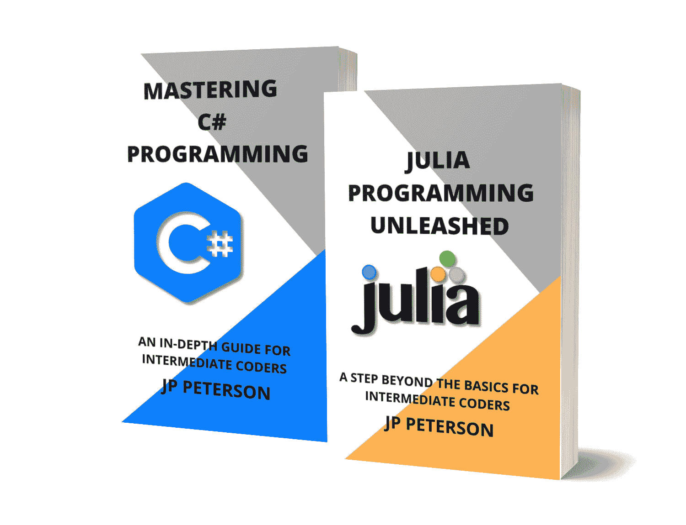

# Julia 编程释放 + C# 编程精通：进阶之路；中级程序员 2 本合 1





## 引言

欢迎阅读《释放 Julia 编程潜力：进阶编码者的基础进阶》。在这份详尽指南中，我们将深入探索 Julia 编程的强大世界，带你超越基础知识，并赋予你成为熟练 Julia 程序员的技能。无论你是希望扩展技能树的资深编码者，还是渴望探索一种多功能语言的编程爱好者，本书都是你精通 Julia 的门径。

凭借其高性能特性和易于使用的语法，Julia 已经在从科学计算到数据分析和机器学习的各个领域赢得了广泛认可。本书专为已经具备编程概念基础知识，并希望在项目能够充分发挥 Julia 潜能的中级程序员者设计。

在接下来的章节中，我们将探索 Julia 的高级特性、实际示例和现实应用。这段旅程结束时，你将能够应对复杂的编程任务，并使用 Julia 创建高效、优雅的解决方案。

# 第 1 章：Julia 编程简介

Julia 是一种高性能的动态编程语言，它已经席卷了科学计算、数据分析和机器学习领域。它结合了两个世界的优点：像 Python 等动态语言的易用性，以及像 C 和 Fortran 等低级语言的运行速度。在本章中，我们将开启探索 Julia 基础、历史、特性，以及它为何成为数据科学家、工程师和研究人员首选语言的之旅。

## Julia 的诞生

在深入研究 Julia 的细节之前，了解它的起源至关重要。Julia 由一群才华横溢的人创造，包括 Jeff Bezanson、Stefan Karpinski、Viral B. Shah 和 Alan Edelman，他们旨在解决现有科学计算编程语言的。。愿景是开发一种能够将高层编程与高性能执行无缝结合的语言。

Julia 于 2012 年正式向公众发布，从那以后，它获得了一个忠实且不断增长的用户和贡献者社区。其开源性质以及对免费开源软件的承诺在其快速采纳中发挥了关键作用。

## Julia 哲学

Julia 的构建基于一组核心原则，支撑了其设计和开发。这些原则使 Julia 成为科学计算和数据分析的卓越语言：

### 1. 性能

Julia 的主要目标之一是提供与低级语言相当的性能。Julia 通过使用即时编译（JIT）实现了这一点，在运行时将代码编译为机器码，从而获得接近原生的性能。

### 2. 易用性

Julia 拥有表达且直观的语法，易于阅读和编写。它与 Python 和 MATLAB 等流行语言的相似性使其适用于不同背景的程序员。

### 3. 开源

Julia 是一种开源语言，这意味着源代码任何人查看、修改和贡献。这培养了一个协作的社区。

### 4. 多重分发

Julia 的多重分发系统允许根据所有参数的类型对函数进行特化，实现了代码的高度灵活。

### 5. 交互性

Julia 在调用 C 和 Fortran 函数方面具有良好的支持，使其能够无缝集成现有的库和库。

### 6. 生态系统

Julia 拥有针对科学和技术领域快速发展的生态系统。该生态系统不断进化，进一步增强了 Julia 的功能。

## 安装 Julia

在开始 Julia 编程之旅之前，我们需要设置开发环境。幸运的是，安装 Julia 的过程简单：

1. **下载 Julia**：访问 Julia 官网 `julialang.org/downloads/` 并根据你的操作系统（Windows、macOS 或 Linux）选择合适的版本。
2. **安装 Julia**：按照特定操作系统的安装说明进行。Julia 的安装通常涉及下载包并运行安装程序。
3. **验证安装**：安装完成后，打开终端或命令行提示符并输入 `julia`。如果 Julia 无错误启动，说明安装成功。

## Julia REPL：你的交互式编码 playground

Julia 提供了一个强大的交互式编码环境，被称为 REPL（读取-求值打印循环）。REPL 允许你交互式执行 Julia 代码，是学习和实验的绝佳工具。

要启动 REPL，只需打开终端或命令行提示符并输入 `julia`。你会看到一个提示符，可以在其中输入 Julia 代码并立即查看结果。尝试输入 `1+1` 并回车。你将在屏幕上看到结果 `2`。


Julia REPL 是尝试代码片段、测试想法以及动手探索语言特性的不可或缺的工具。

## 运行 Julia 脚本


虽然 REPL 对于交互式编码非常出色，但你通常会想要编写并执行更代码脚本。Julia 允许你像任何其他编程语言一样创建和运行脚本。

以下是创建和运行简单 Julia 脚本的方法：

1. **创建文本文件**：使用你喜欢的文本编辑器（例如 Windows 上的记事本、Linux 上的 Vim 或 macOS 上的文本编辑），创建一个文本文件并将其保存为 `.jl` 扩展名。例如，你可以将其命名为 `my_script.jl`。
2. **编写 Julia 代码**：打开文本文件并在其中编写你的 Julia 代码。例如，你可以添加以下行：

```julia
println("Hello, Julia!")
```

3. **运行脚本**：打开你的终端或命令提示符，导航到保存脚本的目录，并输入 `julia my_script.jl`。这将执行脚本，你将在屏幕上看到输出。

运行此脚本将产生以下输出：

```
Hello, Julia!
```

恭喜！你已成功创建并执行了一个 Julia 脚本。

# 了解变量和数据类型

在 Julia 中，与任何编程语言一样，变量是存储和处理数据的基础构建模块。让我们来探索变量的工作原理以及 Julia 中可用的各种数据类型。

## Julia 中的变量

在 Julia 中，你可以通过指定名称并为其赋值值来声明变量。例如：

```julia
x = 10
```

在这个示例中，我们创建了一个名为 `x` 的变量并为其赋值了值 `10`。Julia 会根据赋值的值自动推断变量的数据类型。在这种情况下，`x` 的类型是 `Int64`，这是一个 64 位整数。

你也可以显式地指定变量的数据类型：

```julia
y::Float64 = 3.14
```

在这个示例中，我们声明了一个变量 `y` 并显式指定它应该是 `Float64` 类型，即浮点数。

## Julia 中的基本数据类型

Julia 提供了多种基本数据类型来表示不同类型的数据。以下是一些最常用的数据类型：

### 整数
- `Int8`: 8 位符号整数
- `Int16`: 16 位符号整数
- `Int32`: 32 位符号整数
- `Int64`: 64 位符号整数
- `Int128`: 128 位符号整数

### 浮点数
- `Float16`: 16 位浮点数（半精度）
- `Float32`: 32 位浮点数（单精度）
- `Float64`: 64 位浮点数（双精度）

### 布尔值
- `Bool`: 布尔值 `true` 和 `false`

### 字符
- `Char`: 单个 Unicode 字符，例如 `'A'`

### 字符串
- `String`: 字符序列，例如 `"Hello, Julia!"`

## 符号 (Symbols)
- `Symbol`: 轻量级标识符，通常用作字典的键

### 元组 (Tuple)
- `Tuple`: 不同类型元素的有序集合

### 数组
- `Array`: 同一类型元素的同质集合，包括数字、字符或其他数据类型的数组

### 字典
- `Dict`: 键值对集合

Julia 处理广泛数据类型的能力使其在各种编程任务中都非常多能。

## 类型推断：Julia 的动态特性

Julia 的突出特性之一是它的动态类型，结合了可选的类型注解。这意味着你并不总是需要显式指定数据类型；Julia 经常可以为你推断。

例如，考虑以下代码：

```julia
a = 42
b = 3.14
c = "Hello, Julia!"
```

在这段代码中，Julia 推断的数据类型如下：
- `a` 的类型是 `Int64`，因为它被赋值了一个整数。
- `b` 的类型是 `Float64`，因为它被赋值了一个浮点数。
- `c` 的类型是 `String`，因为它被赋值了一个字符串。

Julia 执行类型推断的能力有助于保持代码简洁易读，同时从强类型中获益。

## 探索多重分发 (Multiple Dispatch)

多重分发是一项强大的特性，使 Julia 与许多其他编程语言区分开来。它允许函数不仅根据参数的类型，还根据所有参数的类型进行特化处理，从而实现高度灵活且可扩展的代码。

在 Julia 中，你可以根据参数类型的特定组合定义行为不同的函数。这允许你编写可以处理各种数据类型的泛型函数，提供了在其他语言中难以实现的抽象和可重用性。

这里有一个简单的示例来说明多重分发：

```julia
## 定义一个接受两个任意类型参数的函数 foo
function foo(x, y)
    println("Generic foo: x is of type $(typeof(x)), y is of type $(typeof(y))")
end

## 为整数定义 foo 的特殊版本
function foo(x::Int, y::Int)
    println("Specialized foo for integers: x = $x, y = $y")
end

## 为字符串定义 foo 的特殊版本
function foo(x::String, y::String)
    println("Specialized foo for strings: x = $x, y = $y")
end

### 调用函数
foo(1, 2)
```


在这段代码中，Julia 推断出的数据类型如下：

- `a` 的类型为 `Int64`，因为它被赋值了一个整数。
- `b` 的类型为 `Float64`，因为它被赋值了一个浮点数。
- `c` 的类型为 `String`，因为它被赋值了一个字符串。

Julia 的动态类型在高级层语言的灵活性和底层语言的性能之间取得了平衡。

## 数值数据类型

Julia 提供了广泛数值类型来表示不同类型的数字。理解这些数据类型对于高效执行数值计算至关重要。

### 整数

整数表示整个数字，例如 -3, -2, -1, 0, 1, 2, 3 等。Julia 提供了几种整数类型，每种类型都有不同的范围：

- `Int8`: 8 位符号整数，范围从 -128 到 127。
- `Int16`: 16 位符号整数，范围从 -32,768 到 32,767。
- `Int32`: 32 位符号整数，范围从 -2³¹ 到 2³¹ - 1。
- `Int64`: 64 位符号整数，范围从 -2⁶³ 到 2⁶³ - 1。
- `Int128`: 128 位符号整数，范围极广。

以下是如何声明各种整数类型的变量：

```julia
x::Int8 = 10
y::Int16 = -100
z::Int32 = 1000
```

这些声明为每个变量指定了精确的整数类型，允许你控制内存使用和性能。

### 浮点数

浮点数表示带有小数实数。Julia 提供了不同精度的浮点类型：

- `Float16`: 16 位浮点数（半精度）。
- `Float32`: 32 位浮点数（单精度）。
- `Float64`: 64 位浮点数（双精度）。

浮点类型的选择取决于计算所需的精度。由于其高精度，双精度（`Float64`）通常用于大多数科学和工程应用。

以下是如何声明各种浮点类型的变量：

```julia
a::Float16 = 3.14
b::Float32 = 2.71828
c::Float64 = 1.61803398875
```

选择合适的数值类型可以确保你的 Julia 程序既准确又能高效地使用内存。

## 布尔值与逻辑操作

布尔值表示真或假值，是编程中决策的基础。Julia 提供了布尔类型 `Bool`，它具有两个可能的值：`true` 和 `false`。

你可以使用逻辑操作来处理和比较布尔值。Julia 中常见的逻辑操作包括：

- `&&`（逻辑与）：如果两个操作数都为 `true`，则返回 `true`。
- `||`（逻辑或）：如果至少有一个操作数为 `true`，则返回 `true`。
- `!`（逻辑非）：返回操作数的反值。

以下是一些示例：

```julia
a = true
b = false
result1 = a && b
result2 = a || b
result3 = !a
```

## 字符与字符串

字符和字符串用于表示文本数据。Julia 提供了用于单个字符和字符序列的类型。

### 字符 (`Char`)

字符表示单个字符。Julia 为字符提供了 Unicode 支持。

```julia
my_char = 'A'
```

### 字符串 (`String`)

字符串是字符序列。Julia 允许你使用插值在字符串中嵌入表达式。

```julia
name = "Alice"
greeting = "Hello, $name"
```

## 符号 (Symbols)

符号是作为键使用的轻量级标识符。用冒号表示。

```julia
user_info = Dict(:name => "Alice", :age => 30, :city => "Wonderland")
```

## 元组 (Tuples)

元组是有序集合，与数组不同，它是不可变的。

```julia
my_tuple = (1, "apple", 3.14)
```

### 数组

数组是 Julia 中多灵活的数据结构之一，所有元素具有相同的类型。

```julia
my_array = [10, 20, 30, 40, 50]
```

### 索引与切片

你可以使用方括号和索引访问数组的单个元素。Julia 使用从 1 开始的索引，这意味着第一个元素位于索引 1。

```julia
element = my_array[3] # 30
sub_array = my_array[2:4] # 20, 30, 40
```

### 逐元素操作

Julia 允许对数组执行逐元素操作，这意味着操作会被单独应用于每个元素上。

```julia
original_array = [1, 2, 3, 4, 5]
result_array = 2 .* original_array # [2, 4, 6, 8, 10]
```

### 字典

字典 (`Dict`) 是键值对的集合，每个键都关联一个值。字典用于将唯一键映射到对应的值。

```julia
my_dict = Dict("name" => "Alice", "age" => 30, "city" => "Wonderland")
```


类型稳定性（Type stability）是 Julia 中的一个重要概念，指的是函数或代码块的某种属性，即其返回类型根据其输入类型是已知且一致的。确保类型稳定性对于编写高性能的 Julia 代码至关重要。

让我们来看一个类型声明和类型稳定性的示例：

```julia
function add(a::Int, b::Int)
return a + b
end
```

在这个代码中，`add` 函数显式地指定了它的参数 `a` 和 `b` 应该是 `Int` 类型。通过这样做，编译器可以生成高效的代码，因为它知道了所涉及的类型。

## 结论

在本章中，我们深入了 Julia 的数据类型和变量，涵盖了整数、浮点数、布尔值、字符、字符串、符号、元组、数组、字典、类型声明和类型稳定性。理解这些基础概念对于编写有效的 Julia 程序和利用该语言的力量至关重要。

# 第 3 章：Julia 中的控制流与决策

在之前的章节中，我们探索了 Julia 的基础知识，包括它的数据类型和变量。现在，在第 3 章，我们将进入控制流和决策的世界。这些概念对于编写能够做出决策、重复操作并对不同情况做出动态响应的程序至关重要。

## 条件语句

条件语句允许你根据是否满足特定条件执行特定的代码块。在 Julia 中，你可以使用 `if`、`else` 和 `elseif` 结构来创建条件语句。

### `if` 语句

`if` 语句用于在指定条件为 `true` 时执行代码块。这里有一个基础示例：

```julia
x = 10
if x > 5
println("x is greater than 5")
end
```

在这个示例中，`if` 块中的代码被执行，因为条件 `x > 5` 为 `true`。结果是打印了消息“x is greater than 5”。

### `else` 子句

你可以用 `else` 子句扩展 `if` 语句，以指定当条件为 `false` 时发生的情况。这里有一个示例：

```julia
x = 3
if x > 5
println("x is greater than 5")
else
println("x is not greater than 5")
end
```

在这种情况下，由于 `x` 不大于 5，`else` 块中的代码被执行，并打印了“x is not greater than 5”。

### `elseif` 子句

有时，可能有多个条件需要检查。在这种情况下，你可以使用 `elseif` 子句来指定要评估的额外条件。这里有一个示例：

```julia
x = 3
if x > 5
println("x is greater than 5")
elseif x < 5
println("x is less than 5")
else
println("x is equal to 5")
end
```

在代码中，Julia 首先检查 `x` 是否大于 5。由于不是，它继续进入 `elseif` 子句并检查 `x` 是否小于 5，在这种情况下这是 `true`。因此，打印了“x is less than 5”。

### 嵌套条件

你可以将条件语句嵌套在一起，以处理更复杂的场景。

```julia
x = 10
y = 5
if x > 5
println("x is greater than 5")
if y > 3
println("y is greater than 3")
else
println("y is not greater than 3")
end
else
println("x is not greater than 5")
end
```

## 循环

循环用于重复执行代码块。Julia 提供了几种类型，包括 `for` 和 `while`。

### `for` 循环

`for` 循环通常用于遍历集合（如数组）。这里有一个示例：

```julia
fruits = ["apple", "banana", "cherry"]
for fruit in fruits
println(fruit)
end
```

### `while` 循环

`while` 循环只要指定条件为 `true` 就会运行。这里有一个示例：

```julia
n = 1
while n <= 5
println("Count: $n")
n += 1
end
```

### 循环控制语句

Julia 提供了控制流的语句：

- `break`: 提前终止循环。
- `continue`: 跳过当前迭代。

这是一个使用 `break` 和 `continue` 的示例：

```julia
for i in 1:10
if i == 5
continue
end
if i == 8
break
end
println(i)
end
```

### 使用范围（Ranges）进行循环

范围（Ranges）经常用于循环中以遍历一个序列。这里有一个示例：

```julia
for i in 1:5
println("Number: $i")
end
```

### `do` 块

在 Julia 中，你可以使用 `do` 块来为像 `map` 的的操作定义匿名函数。这里有一个使用 `do` 块配合 `map` 的示例：

```julia
numbers = [1, 2, 3, 4, 5]
squared = map(numbers) do x
x²
end
println(squared)
```

## 结论

控制流和决策是编程中的核心概念，允许你创建动态且响应的应用程序。在本章中，我们探索了条件语句（`if`、`else`、`elseif`）、循环（`for`、`while`）、循环控制语句（`break`、`continue`）、范围循环以及 `do` 块的使用。

对这些控制流结构有了坚实的理解，你已经准备好编写更复杂的程序。

# 第 4 章：Julia 中的函数与方法

在之前的章节中，我们探索了 Julia 的基础方面，包括数据类型、变量、控制流和决策。现在，在第 4 章，我们将深入研究 Julia 最关键强大的组件之一：函数和方法。理解如何定义和使用函数对于编写模块化高效的代码至关重要。

## 定义函数

函数是执行特定任务或计算的自包含代码块。函数有助于组织代码，提高复用性，并允许你将复杂问题分解为易管理的部分。在 Julia 中，你可以使用 `function` 关键字定义函数。

### 函数语法

这是在 Julia 中定义函数的语法语法：

```julia
function function_name(arg1, arg2, ...)
## 函数体
## 操作
return result
end
```

- `function_name`: 替换为所需的函数名称。
- `arg1, arg2, ...`: 这些是函数的参数。你可以有零或多个参数。
- `result`: 函数被调用时返回的值。你可以使用 `return` 关键字指定结果，但在 Julia 中它是可选的。

### 函数示例

让我们定义一个计算数字平方的简单函数：

```julia
function square(x)
return x²
end
```


在这个示例中，我们定义了一个名为 `square` 的函数，它接受一个参数 `x`。在函数内部，我们计算 `x²` 并返回结果。

### 调用函数

一旦定义了函数，你就可以通过使用它的名称并提供必要的参数来调用它。以下是调用 `square` 函数的方式：

```julia
result = square(5)  # 使用参数 5 调用 square 函数
println(result)     # 打印 25
```

`square` 函数被带参数 `5` 调用，返回结果 `25`，然后将其打印出来。

## 函数方法与多重分发

Julia 以其多重分发（multiple dispatch）系统而闻名，它允许函数根据参数的类型有不同的实现。这种被称为方法分发（method dispatch）的特性让你能够编写通用且高效的代码。

### 方法分发

在 Julia 中，函数可以有多个方法，每个方法对应一组不同的参数类型。当你调用一个函数时，Julia 会根据参数类型分发到最特定的方法，以确保执行正确的实现。

这里有一个方法分发的示例：

```julia
## 为整数定义一个 add 函数
function add(a::Int, b::Int)
    return a + b
end

## 为浮点数定义一个 add 函数
function add(a::Float64, b::Float64)
    return a + b
end

## 使用不同类型的参数调用函数
result1 = add(2, 3)         # 调用整数的 add 函数
result2 = add(2.0, 3.0)    # 调用浮点数的 add 函数
println(result1)  # 打印 5
println(result2)  # 打印 5.0
```

在这个示例中，我们有两个版本的 `add` 函数——一个用于整数，另一个用于浮点数。Julia 会根据参数类型自动分发到相应的方法。

### 通用函数

Julia 的多重分发系统允许你创建适用于各种数据类型的通用函数。你可以定义一个单一的函数，它会根据参数的类型以不同的方式运行。

这里有一个通用 `add` 函数的示例：

```julia
## 定义一个适用于多种类型的通用 add 函数
function add(a, b)
    return a + b
end

## 使用不同类型的参数调用函数
result1 = add(2, 3)         # 调用整数的通用 add 函数
result2 = add(2.0, 3.0)    # 调用浮点数的通用 add 函数
println(result1)  # 打印 5
println(result2)  # 打印 5.0
```

在这段代码中，`add` 函数没有限于特定的参数类型。它可以处理整数、浮点数甚至其它类型，具有高度的通用性。

## 可选参数与关键字参数

Julia 允许你定义带有可选参数和关键字参数的函数，增强了函数的灵活性。

### 可选参数

可选参数是在调用函数时不需要提供值的参数。你可以为这些参数指定默认值，如果未提供，将使用默认值。

这里有一个带有可选参数的示例：

```julia
### 定义一个带有可选参数的函数
function greet(name, greeting="Hello")
    return "$greeting, $name!"
end

# 分带和不带可选参数调用函数
message1 = greet("Alice")             # 使用默认问候语
message2 = greet("Bob", "Hi")        # 使用提供的问候语
println(message1)  # 打印 "Hello, Alice!"
println(message2)  # 打印 "Hi, Bob!"
```

在这个示例中，`greet` 函数有一个可选参数 `greeting`，其默认值为 "Hello"。你可以提供或不提供 `greeting` 参数来调用函数。

### 关键字参数

关键字参数允许你在调用函数时通过名称指定参数，从而清楚地知道哪个参数对应哪个值。

这里有一个带有关键字参数的示例：

```julia
### 定义一个带有关键字参数的函数
function compute_total(price; tax_rate=0.10, discount=0.0)
    total = price * (1 + tax_rate) * (1 - discount)
    return total
end

### 使用关键字参数调用函数
total1 = compute_total(100.0, tax_rate=0.08)           # 将 tax_rate 指定为关键字参数
total2 = compute_total(100.0, discount=0.15)           # 将 discount 指定为关键字参数
total3 = compute_total(100.0, tax_rate=0.08, discount=0.15)  # 同时指定两个参数
println(total1)  # 打印 108.0
println(total2)  # 打印 85.0
println(total3)  # 打印 92.4
```

在这段代码中，`compute_total` 函数使用了关键字参数。

## 匿名函数 (Lambdas)

Julia 允许使用 `->` 语法创建匿名函数，也称为 lambda 函数。这些函数没有名称，通常用于短操作。

这里有一个匿名函数的示例：

```julia
### 定义一个计算平方的匿名函数
square = x -> x²

### 调用函数
result = square(5)
```

在这个示例中，我们创建了一个匿名函数 `square`。

### 广播

Julia 提供了一了一种名为广播（broadcasting）的强大功能，允许你对数组或集合逐元素地应用函数。这简化了数组操作。

这里有一个广播的示例：

```julia
### 定义一个计算平方的函数
square(x) = x²

### 创建一个数组
numbers = [1, 2, 3, 4, 5]

### 使用广播对数组求平方
squared_numbers = square.(numbers)

println(squared_numbers)  # 打印 [1, 4, 9, 16, 25]
```

在这段代码中，`square` 函数被应用于 `numbers` 数组。

## 总结

函数和方法是 Julia 编程的基础组件。它们允许你封装逻辑、提高代码重用性并利用 Julia 的多重分发系统。在本章中，我们探索了定义函数的语法、方法分发、通用函数、可选与关键字参数、匿名函数以及广播。


Julia 提供了 `zeros`、`ones` 和 `rand` 等函数来创建具有特定值的数组：

```julia
## 创建一个零数组
zeros_array = zeros(3, 3)

## 创建一个全 1 数组
ones_array = ones(2, 4)

## 创建一个包含 0 到 1 之间随机值的数组
random_array = rand(4, 3)
```

这些函数在填充数据之前初始化数组非常有用。

## 数组索引与切片

数组索引和切片允许你访问和操作数组的单个元素或子集。

### 索引

在 Julia 中，数组是从 1 开始索引，这意味着第一个元素的索引为 1。你可以使用方括号和索引访问元素：

```julia
numbers = [10, 20, 30, 40, 50]
first_element = numbers[1]  # 访问第一个元素 (10)
third_element = numbers[3]  # 访问第三个元素 (30)
```

### 切片

切片允许你提取数组的一部分。你可以使用冒号 `:` 来指定索引范围：

```julia
numbers = [10, 20, 30, 40, 50]
subset = numbers[2:4]  # 提取索引 2 到 4 的元素 (20, 30, 40)
```

切片会创建一个引用原始数据的新数组，因此子集中的更改会影响原始数组，反之亦然。

### 关键字

Julia 提供了 `end` 关键字来表示数组的最后一个索引。你可以在切片中使用它指定从某个索引到末的范围：

```julia
numbers = [10, 20, 30, 40, 50]
last_three = numbers[3:end]  # 提取从索引 3 到结束的元素 (30, 40, 50)
```

## 数组操作

Julia 支持对数组进行各种操作，包括逐元素操作、广播以及聚合和处理函数。

### 逐元素操作

你可以使用标准算术操作符对数组执行逐元素操作：

```julia
### 创建数组
array1 = [1, 2, 3]
array2 = [4, 5, 6]

## 逐元素相加
result = array1 + array2  # 结果是 [5, 7, 9]

## 逐元素乘法
result = array1 .* array2  # 结果是 [4, 10, 18]
```

### 广播

广播允许你对数组或值集合逐元素应用函数或操作。你可以使用 `.` 符号表示广播：

```julia
### 对数组广播平方函数
array = [1, 2, 3]
squared = square.(array)  # 结果是 [1, 4, 9]
```

广播简化了数组操作并提高了代码的可读性。

### 聚合函数

Julia 提供了几个用于聚合数组中数据的函数，例如 `sum`、`mean`、`minimum`、`maximum` 和 `std`（标准差）：

```julia
### 创建数组
data = [10, 20, 30, 40, 50]
### 元素求和
total = sum(data)  # 结果是 150
### 元素平均值
average = mean(data)  # 结果是 30.0
### 元素的最小值和最大值
minimum_value = minimum(data)  # 结果是 10
maximum_value = maximum(data)  # 结果是 50
### 标准差
std_deviation = std(data)  # 结果是 15.8114...
```

这些函数对于统计计算和数值计算非常有用。

## 多维数组（矩阵）

在 Julia 中，多维数组通常用于表示矩阵和张量。你可以在创建数组时指定维度来创建多维数组。

### 创建矩阵

要创建一个矩阵（2D 数组），你可以使用 `Array{T}(undef, dims)` 构造函数，其中 `T` 是元素类型，`dims` 是指定维度的元组：

```julia
### 创建一个 2x3 的零矩阵
matrix_zeros = zeros(Float64, 2, 3)
### 创建一个带有预定义值的 3x2 矩阵
matrix_values = [1 2; 3 4; 5 6]
```

### 矩阵索引与切片

矩阵索引和切片的操作与数组类似，但涉及行和列的两个索引：

```julia
### 创建一个 2x3 矩阵
matrix = [1 2 3; 4 5 6]
### 访问元素
element = matrix[1, 2]  # 访问第一行第二列的元素 (2)
### 切片行和列
row = matrix[2, :]      # 访问整个第二行 (4 5 6)
column = matrix[:, 3]  # 访问整个第三列 (3; 6)
```

### 矩阵操作

Julia 提供了大量的矩阵操作和线性代数函数来处理矩阵：

```julia
### 创建矩阵
A = [1 2; 3 4]
B = [5 6; 7 8]
### 矩阵加法
A + B
### 矩阵乘法
A * B
### 矩阵转置
transpose(A)
### 矩阵行列式
det(A)
### 矩阵逆
inv(A)
### 矩阵特征值
eigenvalues(A)
### 矩阵特征向量
eigenvectors(A)
```

这些操作对于各种科学和工程应用至关重要。


在这个示例中，我们有一个外部模块 `MyOuterModule`，它包含一个内部模块 `MyInnerModule`。`multiply` 函数定义在内部模块中。

### 使用 `using` 模块

除了 `import` 之外，你还可以使用 `using` 关键字来直接访问模块中的函数和类型：

```julia
using MyModule

message = greet("Bob")

println(message)  # 输出 "Hello, Bob!"
```

使用 `using` 允许你直接调用 `greet`，而无需为其加上 `MyModule.` 前缀。

## 探索外部包

Julia 的包生态系统包含了由社区创建的各种外部包。这些包在各个领域提供了专门化的功能。让我们来探索几个著名的包：

### DataFrames.jl

`DataFrames.jl` 是一个用于处理表格数据的流行包，类似于 R 中的 data frames 或 Python 中的 pandas。它允许你高效地操作、过滤和分析数据。

```julia
using DataFrames

### 创建一个 DataFrame

df = DataFrame(ID=[1, 2, 3], Name=["Alice", "Bob", "Charlie"], Age=[25, 30, 22])

### 过滤数据

young_people = filter(row -> row.Age < 30, df)

### 打印结果

println(young_people)
```

### Plots.jl

`Plots.jl` 是一个多功能的绘图包，支持多种后端，包括 PyPlot、Plotly 和 GR。它为创建出版级的可视化提供了统一接口。

```julia
using Plots

### 创建一个简单的图

x = 1:10

y = x .^ 2

plot(x, y, label="y=x²", xlabel="x", ylabel="y", title="Simple Plot")
```

### JuMP.jl

`JuMP.jl` 是一个用于数学优化的强大包。它为线性、非线性混合整数规划问题提供了用户友好的建模语言。

```julia
using JuMP, GLPK

### 创建一个 JuMP 模型

model = Model(with_optimizer(GLPK.Optimizer))

### 定义变量

@variable(model, x >= 0)
@variable(model, y >= 0)

### 定义目标函数

@objective(model, Max, 3x + 2y)

### 添加约束

@constraint(model, 2x + y <= 10)
@constraint(model, x + 3y <= 12)

### 求解优化问题

optimize!(model)

### 显示结果

println("Optimal Solution:")
println("x = ", value(x))
println("y = ", value(y))
```

这些示例展示了 Julia 外部包的功能。你可以探索 Julia 包生态系统以寻找适合你特定需求的包。

## 创建 way 自己的模块和包

除了使用外部包，Julia 还允许你创建自己的模块和包。当你想要在不同项目之间封装和重用代码时，这特别为有用。

### 创建模块

要创建自己的模块，请遵循以下步骤：

1. 创建一个以你的模块命名的 `.jl` 文件，例如 `MyModule.jl`。
2. 使用 `module` 关键字定义你的模块，并导出你希望在模块外访问的函数和类型。
3. 将文件保存到 Julia 可以访问的目录中。

这是一个简单的模块文件 `MyModule.jl` 示例：

```julia
module MyModule

export greet

function greet(name)
return "Hello, $name!"
end

end  # 模块结束
```

在代码中使用此模块，只需如前所示使用 `import` 或 `using` 导入它即可。

### 创建包

创建一个 Julia 包涉及一个更具结构化的过程：

1. 将你的代码组织到具有特定结构的包目录。
2. 创建 `Project.toml` 文件以指定包的依赖关系。
3. 在包目录内定义你的模块和函数。

有关创建 Julia 包的详细信息，请参阅 Julia 官方文档。

## 结论

探索 Julia 中的包和模块对于充分利用语言的潜力至关重要。包扩展了 Julia 的功能，允许你利用 Julia 社区和外部库的工作。模块帮助你组织代码、防止命名冲突并创建可重用的组件。

# 第 7 章：Julia 中的文件输入输出操作

文件输入输出（I/O）操作对于从外部读取数据以及将结果或数据写入文件至关重要。在本章中，我们将探索如何在 Julia 中执行文件 I/O 操作，包括读取和写入文本文件、二进制文件以及处理不同的文件格式。

## 读取和写入文本文件

文本文件是存储和交换数据最常见的格式之一。Julia 提供了读取和写入文本文件的简单方法。

### 读取文本文件

在 Julia 中从文本文件中读取数据，你可以使用 `open` 函数结合 `read` 或 `readlines` 函数。这里有一个逐行读取文本文件的示例：

```julia
### 以读模式打开文本文件

file = open("sample.txt", "r")

### 逐行读取文件

for line in eachline(file)
println(line)
end

### 关闭文件

close(file)
```

在这段代码中：

- 我们以读模式（`"r"`）打开文件 `"sample.txt"`。
- 我们使用 `for` 循环通过 `eachline` 遍历文件的每一行。
- 在循环内部，我们打印每一行。
- 最后，我们使用 `close` 函数关闭文件以释放资源。

### 写入文本文件

向文本文件写入数据，你可以使用 `open` 函数配合写入模式。这里有一个写入文本文件的示例：

```julia
### 以写入模式打开文件

file = open("output.txt", "w")

### 写入内容

println(file, "Hello, Julia!")

### 关闭文件

close(file)
```

在这段代码中：

- 我们以写入模式（`"w"`）打开文件 `"output.txt"`。
- 我们使用 `println` 写入内容。
- 最后，我们关闭文件。

## 读取和写入二进制文件

除了文本文件，Julia 还支持读取和写入二进制文件。二进制文件用于存储图像、音频或序列化对象等。

### 读取二进制文件

要从二进制文件中读取数据，你可以使用 `read` 函数配合相应的类型。这里有一个读取二进制数据的示例：

```julia
### 以读模式打开文件

file = open("data.bin", "rb")

### 读取 32 位整数

value = read(file, Int32)

### 关闭文件

close(file)
```

在这段代码中：

- 我们以读模式（`"rb"`）打开文件 `"data.bin"`。
- 我们使用 `read` 函数读取 32 位整数并存储在 `value` 中。
- 最后，我们关闭文件。

### 写入二进制文件

向二进制文件写入数据，你可以使用 `write` 函数。这里有一个写入二进制数据的示例：

```julia
### 以写模式打开文件

file = open("output.bin", "wb")

### 写入 32 位整数

write(file, Int32(42))

### 关闭文件

close(file)
```

在这段代码中：

- 我们以写模式（`"wb"`）打开文件 `"output.bin"`。
- 我们使用 `write` 函数写入值为 42 的 32 位整数。
- 最后，我们关闭文件。

## 处理不同的文件格式

Julia 支持多种文件格式，你可以使用外部库读取和写入这些格式的数据。让我们探索几个示例：

### CSV 文件

要在 Julia 中读取和写入 CSV（逗号分隔值）文件，你可以使用 `CSV.jl` 包。首先安装该包：

```julia
using Pkg
Pkg.add("CSV")
```

然后，你可以这样读取和写入 CSV 文件：

```julia
using CSV

### 将 CSV 文件读取为 DataFrame
df = CSV.File("data.csv") |> DataFrame

### 将 DataFrame 写入 CSV 文件
CSV.write("output.csv", df)
```

### JSON 文件

要处理 JSON（JavaScript 对象表示）文件，你可以使用 `JSON.jl` 包。如下如下安装包：

```julia
using Pkg
Pkg.add("JSON")
```

然后，你可以这样读取和写入 JSON 文件：

```julia
using JSON

### 读取 JSON 文件
data = JSON.parse(read("data.json"))

### 将字典写入 JSON 文件
write("output.json", json(data))
```


```julia
using JSON

# 从文件读取 JSON 数据

data = JSON.parsefile("data.json")

# 将数据写入 JSON 文件

JSON.print(IOBuffer(), data, "output.json")
```

### Excel 文件

要处理 Excel 文件（读取和写入），你可以使用 `XLSX.jl` 包。通过以下命令安装它：

```julia
using Pkg

Pkg.add("XLSX")
```

以下是如何读取和写入 Excel 文件的示例：

```julia
using XLSX

# 将 Excel 文件读取为 DataFrame

df = DataFrame(XLSX.readtable("data.xlsx", "Sheet1")...)

### 将 DataFrame 写入 Excel 文件

XLSX.writetable("output.xlsx", collect(DataFrame(df)), "Sheet1")
```

这些示例演示了如何使用外部 Julia 软件包来处理不同格式的文件。根据你的数据和需求，你可以找到支持各种格式的包，例如 `HDF5`、`SQLite` 等。

## 文件操作错误处理

在处理文件时，优雅地处理潜在错误至关重要。Julia 提供了使用 `try`、`catch` 和 `finally` 块进行错误处理的机制。

这是一个文件操作错误处理的示例：

```julia
try
### 尝试打开文件
file = open("nonexistent.txt", "r")

### 从文件中读取数据
data = read(file, String)

### 关闭文件
close(file)

# 处理数据（此示例未显示）
catch e
### 处理错误
println("发生了错误：$e")
finally
# 确保即使在发生错误时也会关闭文件
if !isempty(file)
close(file)
end
end
```

在这段代码中：

- 我们使用 `try` 来尝试文件操作。
- 如果发生错误，将执行 `catch` 块中的代码，并打印错误信息。
- `finally` 块确保即使发生错误，文件也会关闭。

适当的错误处理有助于防止意外崩溃并提高你代码的健壮性。

## 结论

文件输入和输出操作是使用 Julia 处理数据和外部资源的基础。。在本章中，我们探索了如何使用外部包读取和写入文本文件、二进制文件以及不同的文件格式。我们还讨论了文件操作的错误处理技术。

这些技能对于数据处理、科学计算以及构建与文件和外部数据源交互的应用程序至关重要。

# 第 8 章 Julia 中的错误处理与异常处理

错误处理是任何编程语言的一个关键方面，包括 Julia。它允许你预测并管理程序执行过程中可能出现的意外情况。在本章中，我们将探索 Julia 中的错误处理和异常处理，包括如何抛出、捕获和优雅地处理异常。

## 理解 Julia 中的错误

在 Julia 中，错误可能由于多种原因发生，例如输入错误、意外情况或外部资源问题。当发生错误时，Julia 通常会抛出一个异常，异常是一个表示错误并提供何处错误的信息的对象。

### 常见错误类型

Julia 将错误分为几类，包括：

1. **语法错误 (Syntax Errors)：** 当你的代码违反 Julia 语言的规则时会发生。示例包括拼写错误、缺少括号或关键字使用不当。语法错误通常由 Julia 解析器捕获并作为编译错误报告。
2. **运行时错误 (Runtime Errors)：** 在程序执行期间发生，且未被解析器检测。运行时错误包括除以零、访问未定义的变量或尝试打开不存在的文件。运行时错误通常由异常信号指示。
3. **逻辑错误 (Logic Errors)：** 当你的代码由于逻辑缺陷或算法错误未能产生预期结果时，就会发生逻辑错误。这些错误并不一定会导致异常，但可能导致程序行为错误。

### 异常对象

在 Julia 中，异常表示为继承自 `Exception` 抽象类型的类型对象。Julia 中常见的异常类型包括：

- `ErrorException`：用于指示运行时错误的异常的基类型。
- `BoundsError`：当索引超出范围时抛出。
- `DivideError`：当发生除以零时抛出。
- `KeyError`：当字典或类字典对象不包含指定键时抛出。
- `TypeError`：当值具有意外类型时抛出。
- `ArgumentError`：当函数的参数无效时抛出。
- `LoadError`：当加载模块或文件时出现问题时抛出。

## Julia 中的异常处理

Julia 提供了捕获和处理异常的机制，允许你优雅地响应错误并继续程序执行或执行清理操作。Julia 中用于异常处理的关键结构是 `try`、`catch` 和 `finally`。

### `try` 和 `catch` 块

`try` 块用于封装可能抛出异常的代码。如果在 `try` 块内部发生异常，Julia 会寻找匹配的 `catch` 块来处理异常。

这是一个基础示例：

```julia
try
### 可能抛出异常的代码
result = 10 / 0  # 除以零
catch e
### 处理异常
println("发生了一个异常：$e")
end
```

在这段代码中：

- `try` 块包含可能抛出异常的代码，在本例中是除以零。
- `catch` 块紧随在 `try` 块之后，并指定了如何处理异常。它接收异常对象作为 `e`，可以使用它来访问有关异常的信息。

### 处理特定异常

你可以通过在 `catch` 块中指定异常类型来捕获和处理特定类型的异常：

```julia
try
### 可能抛出异常的代码
result = "42" + 10  # 类型错误
catch e::TypeError
# 处理类型错误
println("发生了类型错误：$e")
catch e
### 处理其他异常
println("发生了一个异常：$e")
end
```

### 抛出异常

你可以在 `catch` 块中重新抛出异常，以便将其传递给外层的异常处理器。当你想要执行某些自定义处理但仍允许异常在其他地方被处理时，这非常有用。

```julia
try
### 可能抛出异常的代码
result = "42" + 10  # 类型错误
catch e::TypeError
# 处理类型错误
println("发生了类型错误：$e")
# 重新抛出异常
throw(e)
catch e
### 处理其他异常
println("发生了一个异常：$e")
end
```

### `finally` 块

除了 `try` 和 `catch`，Julia 还提供了 `finally` 块，无论是否发生异常，它都会执行。该块通常用于清理操作，例如关闭文件或释放资源。

这是一个示例：

```julia
try
### 可能抛出异常的代码
open("file.txt", "r")
catch e
### 处理异常
println("发生了一个异常：$e")
finally
# 确保清理执行
println("正在清理资源...")
close(file)
end
```

在这段代码中：

- `try` 块包含可能抛出异常的代码，例如打开文件。
- `catch` 块处理文件处理期间发生的任何异常。
- `finally` 块确保即使发生异常，文件也会关闭。

### 自定义异常

Julia 允许你通过创建 `Exception` 抽象类型的子类型来定义自己的自定义异常类型。这在你想要代码中指示特定的错误状况时非常有用。

这是一个定义和使用自定义异常的示例：


```julia
# Define a custom exception type

struct MyCustomError <: Exception
  message::String
end

# Function that may raise the custom exception
function my_function(x)
  if x < 0
    throw(MyCustomError("Value cannot be negative"))
  end
end

try
  my_function(-5)
catch e::MyCustomError
  println("Custom exception caught: $(e.message)")
end
```

在此代码中，我们定义了一个自定义异常类型 `MyCustomError` 并在 `my_function` 函数中使用它。当向 `my_function` 传递负值时，它会抛出一个 `MyCustomError` 异常，我们会捕获并处理它。

## 异常传播

在 Julia 中，异常沿着调用栈向上传播，直到被适当的 `catch` 块捕获。如果异常未被捕获，将终止程序并显示错误信息。

考虑以下示例：

```julia
function foo()
  println("Entering foo")
  bar()
  println("Exiting foo")
end

function bar()
  println("Entering bar")
  baz()
  println("Exiting bar")
end

function baz()
  println("Entering baz")
  throw(ErrorException("An error occurred in baz"))
  println("Exiting baz")
end

try
  foo()
catch e
  println("Exception caught: $e")
end
```

在此代码中，我们有三个嵌套函数：`foo`、`bar` 和 `baz`。当 `foo` 调用 `bar`，而 `bar` 又调用 `baz` 时，异常在 `baz` 中抛出并沿调用栈向上传播。最后，它被 `try-catch` 结构中的 `catch` 块捕获，程序继续执行。

## 结论

错误处理和异常处理是编写健壮可靠的 Julia 程序的基础技能。理解如何抛出、捕获和处理异常，允许你优雅地预测并管理意外情况，确保你的代码在发生错误时行为也是可预测的。

在本章中，我们探索了 Julia 错误处理的基础，包括 `try`、`catch` 和 `finally` 块。我们还讨论了如何处理特定异常、重新抛出异常、创建自定义异常类型以及允许异常沿调用栈向上传播。

# 第 9 章：Julia 中的面向对象编程

面向对象编程（OOP）是一种广泛使用的编程范式，侧于将代码组织成对象，每个对象代表一个自包含的数据和行为单元。Julia 是一种多功能高性能的编程语言，支持 OOP 概念并鼓励使用它们来构建代码。在本章中，我们将探索 Julia 中面向对象编程的基础，包括定义类、创建对象、封装、继承和多态。

## 面向对象编程的基础

OOP 构建在抽象、封装、继承和多态原则之上，通常被称为 OOP 的四大支柱。让我们简要理解这些概念：

1. **抽象 (Abstraction):** 抽象通过将复杂系统分解为更小、更易管理的部分来简化系统。在 OOP 中，类被用于表示建模现实实体的抽象数据类型。
2. **封装 (Encapsulation):** 封装是将数据（属性）和操作这些数据的方法（函数）封装在一个名为类的单一单元中。它限制了对对象内部状态的直接访问，并强调使用公共接口进行交互。
3. **继承 (Inheritance):** 继承允许类继承另一个类的属性和行为。
4. **多态 (Polymorphism):** 多态允许不同类的对象被视为共同父类的对象。

## 在 Julia 中创建类

在 Julia 中，使用 `struct` 关键字定义类。让我们从一个示例开始：

```julia
mutable struct Person
  name::String
  age::Int
end
```

在此代码中：
- 我们定义了一个带有 `name` 和 `age` 的 `Person` struct。
- `mutable` 关键字允许对对象进行修改。

## 创建对象（实例）

一旦定义了类，我们可以通过调用构造函数创建实例：

```julia
alice = Person("Alice", 30)
bob = Person("Bob", 25)
```

在这里，我们创建了实例：`alice` 和 `bob`。

## 为类定义方法

方法定义类的行为。为我们的 `Person` 类添加一个 `greet` 方法：

```julia
function greet(person::Person)
  println("Hello, my name is $(person.name) and I'm $(person.age) years old.")
end
```

现在，我们可以对 `alice` 调用 `greet` 方法：

```julia
greet(alice) # 输出: Hello, my name is Alice and I'm 30 years old.
```

## 构造函数与析构函数

构造函数是负责创建和初始化对象的特殊方法。在 Julia 中，构造函数是一个与类型同名的函数：

```julia
function Person(name::String, age::Int)
  return Person(name, age)
end
```

而 Julia 不直接支持析构函数。Julia 依赖垃圾回收来释放内存。

## Julia 中的封装

封装是将数据和方法封装在单一单元（类）中并控制对内部状态访问的概念。在 Julia 中，可以使用抽象类型和限制对属性的访问来实现封装。

让我们用封装增强我们的 `Person` 类：

```julia
abstract type AbstractPerson end

mutable struct Person < AbstractPerson
  private_name::String
  private_age::Int

  function Person(name::String, age::Int)
    return new(name, age)
  end

  function greet()
    println("Hello, my name is $(private_name) and I'm $(private_age) years old.")
  end
end
```

在此代码中：
- 我们定义了一个抽象类型 `AbstractPerson` 来表示公共接口。
- `Person` struct 拥有私有属性 `private_name` 和 `private_age`，无法从类外部直接访问。

## Julia 中的继承

继承是一种强大的机制，允许类（子类或派生类）从另一个类（父类或基类）继承属性和方法。在 Julia 中，通过指定父类为子类型来实现继承。

让我们创建一个继承 `Person` 类的 `Student` 类：


```julia
mutable struct Student <: AbstractPerson

name::String
age::Int
student_id::String

function Student(name::String, age::Int, student_id::String)
return new(name, age, student_id)
end

end
```

在此代码中：

- 我们定义了一个继承自 `AbstractPerson` 的 `Student` 结构体，后者是表示父类的抽象类型。
- `Student` 结构体拥有额外的属性，如 `student_id`。
- 我们为 `Student` 类提供了一个构造函数。

现在，我们可以创建 `Student` 对象并调用继承自 `Person` 类的 `greet` 方法：

```julia
# 创建一个 Student 对象并调用 greet 方法
jane = Student("Jane", 20, "S12345")
jane.greet()  # 输出: Hello, my name is Jane and I'm 20 years old.
```

继承允许 `Student` 对象在访问 `Person` 类中定义的行为的同时，添加它们自己的属性和方法。

## Julia 中的多态

多态允许不同类的对象被视为共同父类的实例。

### Julia 中，多态通过在不同的子类中定义相同名称的方法来实现。

让我们通过添加一个同样继承自 `AbstractPerson` 的 `Teacher` 类来扩展示例：

```julia
mutable struct Teacher <: AbstractPerson

name::String
age::Int
subject::String

function Teacher(name::String, age::Int, subject::String)
return new(name, age, subject)
end

function greet()
println("Hello, my name is $(name), I'm $(age) years old, and I teach $(subject).")
end

end
```

在此代码中：

- 我们定义了一个继承自 `AbstractPerson` 的 `Teacher` 结构体。
- `Teacher` 结构体有一个额外的属性 `subject`。
- 我们为 `Teacher` 类提供了一个构造函数。
- 我们定义了特定于 `Teacher` 类的 `greet` 方法，它覆盖了继承自 `AbstractPerson` 的 `greet` 方法。

现在，我们可以创建 `Teacher` 对象并观察多态的应用：

```julia
# 创建一个 Teacher 对象并调用 greet 方法
john = Teacher("John", 40, "Mathematics")
john.greet()  # 输出: Hello, my name is John, I'm 40 years old, and I teach Mathematics.
```

多态允许我们对不同类的对象调用 `greet` 方法，并根据对象的实际类型调用相应的实现。

## 结论

面向对象编程 (OOP) 是一种强大的范式，它帮助帮助代码组织成可重用和可维护的结构。Julia 为 OOP 概念提供了稳健的支持，允许你有效地定义类、创建对象并实现继承和多态。

在本章中，我们探索了 Julia 中 OOP 的基础知识，从定义类和构造函数到封装、继承和多态。这些概念对于在 Julia 中构建复杂的软件系统、库和应用程序至关重要。通过利用 OOP，你可以编写出更有组织性、模块化且可扩展的代码。

# 第 10 章：Julia 中的并行与多线程编程

并行和多线程编程是充分利用现代计算机硬件（特别是多核处理器）性能的关键技术。Julia 特别适合处理并行和并发，使其成为既适用于科学计算也适用于通用计算的多用途语言。在本章中，我们将探索如何利用 Julia 的特性进行并行和多线程编程，包括任务、并行循环和分布式计算。

## 理解并行与并发

在深入研究 Julia 的并行和多线程能力之前，有必要明确“并行 (Parallelism)”和“并发 (Concurrency)”这两个术：

- **并行 (Parallelism)：** 并行涉及同时执行多个任务或操作以获得更快的结果。它利用了多核处理器并能够显著提升性能。并行适用于可以分成独立子任务的任务。
- **并发 (Concurrency)：** 并发是对在时间上可能重叠的多个任务的管理。它更多关注关注高效的任务调度，并不一定意味着在多个核心上同时执行。并发适用于频繁进行上下文切换或异步 I/O 操作的任务。

Julia 同时支持并行和并发，允许你针对特定问题选择最佳方法。

## Julia 中基于任务的并行

Julia 的基于任务的并行构建在任务的概念之上，任务是可以并发执行的轻量级工作单元。任务是 Julia 并行并发编程的基础构建。

### 创建任务

你可以使用 `@task` 宏或 `Task` 构造函数来创建任务。以下是一个使用 `@task` 宏的示例：

```julia
task1 = @task begin
# 此处编写任务代码
println("Task 1 started")
sleep(2)
println("Task 1 completed")
end

task2 = Task(begin
println("Task 2 started")
sleep(1)
println("Task 2 completed")
end)
```

在此代码中，`task1` 和 `task2` 是两个带有各自代码块的独立任务。

### 启动与同步任务

你可以使用 `schedule` 函数或 `@async` 宏来启动任务。`@async` 宏对于同时创建和启动任务更加方便：

```julia
@async begin
println("Main task started")
wait(task1)  # 等待 task1 完成
wait(task2)  # 等待 task2 完成
println("Main task completed")
end
```

在这个示例中，主任务使用 `@async` 宏启动 `task1` 和 `task2` 并等待它们完成。

### 并行循环

Julia 提供了一种使用 `@distributed` 宏对循环并行化的便捷方法。该宏会在工作进程之间分配迭代，利用多核处理器。

这是一个计算数组每个元素平方的并行循环示例：

```julia
using Distributed

### 启动工作进程
addprocs(4)

### 定义并行循环
@distributed for i in 1:10
result = i²
println("进程 $(myid()) 计算了 $result")
end
```

在此代码中：

- 我们使用 `addprocs` 函数启动四个工作进程（你可以根据 CPU 核心数调整数量）。
- `@distributed` 宏将循环迭代分配给进程。`myid()` 函数返回进程 ID。

## Julia 中的多线程

多线程是并发的一种，涉及在单个进程内执行多个线程。Julia 提供了多线程支持。要在 Julia 中使用多线程，你需要在启动 Julia 时启用多个线程（例如，运行 `julia --threads 4` 来启用四个线程）。

### 创建与管理线程

你可以使用 Julia 中的 `Threads` 模块来创建和管理线程：

```julia
using Threads

# 创建并启动两个线程
thread1 = Thread() do
println("Thread 1 started")
sleep(2)
println("Thread 1 completed")
end

thread2 = Thread() do
println("Thread 2 started")
sleep(1)
println("Thread 2 completed")
end

# 等待线程完成
for t in (thread1, thread2)
wait(t)
end
```

在此代码中，我们使用 `Thread` 构造函数创建两个线程，并指定每个线程内执行的代码。然后我们使用 `wait` 函数等待两个线程完成。

### 共享数据与同步

多线程引入了共享数据访问和同步的挑战。在 Julia 中，你可以使用锁、原子操作和线程安全的数据结构来管理线程对共享数据的访问。


```julia
using Threads

# 共享计数器和锁

counter = Threads.Atomic{Int}(0)

counter_lock = ReentrantLock()

# 安全增加计数器的函数

function increment_counter()
lock(counter_lock)
counter[] += 1
unlock(counter_lock)
end

# 创建并启动多个线程

threads = [Thread() do

for _ in 1:1000
increment_counter()
end
end for _ in 1:4]

# 等待线程完成

for t in threads
wait(t)
end

println("最终计数器值: $(counter[])")
```

在此示例中：

- 我们使用 `Atomic{Int}` 对象来创建一个线程安全的整数计数器。
- 我们使用 `ReentrantLock` 来保护对计数器的访问。
- 多个线程在循环中增加计数器，确保通过锁对访问进行同步。

## Julia 中的分布式计算

Julia 的分布式计算允许你将任务分到运行在不同机器或核心上的多个进程中执行。这可以显著加速可并行问题的计算。

### 设置分布式计算

要启动一个分布式 Julia 会话，你可以使用 `addprocs` 函数来添加工作进程。例如，启动四个工作进程：

```julia
using Distributed

# 启动四个工作进程

addprocs(4)
```

## 远程调用与数据传输

Julia 中的分布式计算涉及在工作进程上执行远程函数调用，并在主进程与工作进程之间传输数据。

这是一个分布式计算的简单示例：

```julia
using Distributed

# 定义在工作进程上执行的函数

@everywhere function mycomputation(x)
return x²
end

# 创建一个存储结果的数组

results = Vector{Int}(undef, 10)

# 分发计算并收集结果

@distributed for i in 1:10

results[i] = mycomputation(i)
end

# 等待所有任务完成

wait()

### 打印结果

println(results)
```

在此代码中：

- 我们使用 `@everywhere` 宏在所有工作进程上定义 `mycomputation` 函数。
- `@distributed` 宏将循环迭代分到可用的工作进程上，每个工作进程执行 `mycomputation` 函数。

## 结论

Julia 对并行和多线程编程的支持，结合分布式计算，使其成为一种充分利用现代硬件的多功能语言。无论你是在处理计算密集型任务、数据处理还是并发操作，Julia 都提供了编写高效且可扩展代码的工具和灵活性。

在本章中，我们探索了并行和并发的概念，学习了如何在 Julia 中处理任务、并行循环和多线程，并讨论了分布式计算。通过这些技术，你可以应对各种计算挑战，并充分利用你的硬件资源。

# 第 11 章：使用 Julia 进行数据处理与分析

数据处理和分析是许多应用的核心，从科学研究到商业智能。。Julia 以其高性能和灵活性著称，为数据处理和分析提供了丰富的库和工具生态系统。在本章中，我们将探索 Julia 中数据处理和分析的关键概念和技术，包括数据结构、数据导入导出、数据清洗和探索性数据分析。

## Julia 中的数据结构

Julia 提供了各种数据结构来高效处理不同类型的数据。理解这些数据结构对于数据处理和分析至关重要。

### 数组

数组是 Julia 中最常用的数据结构之一。它们可以存储同构数据，适用于数值计算。

```julia
### 创建一个数组

data = [1, 2, 3, 4, 5]

### 访问元素

println(data[1])  # 输出: 1

### 修改元素

data[1] = 10

## 数组操作

sum_data = sum(data)  # 所有元素的和
```

### DataFrames

DataFrames 是处理结构化数据的流行选择。它们类似于表格或数据库，可以存储异构数据类型，非常适合数据集。

```julia
using DataFrames

### 创建一个 DataFrame

df = DataFrame(Name=["Alice", "Bob", "Charlie"], Age=[25, 30, 35])

### 查看数据

println(df)
```

### 字典

字典以键值对的形式存储数据，适用于快速查找和关联。

```julia
### 创建字典

grades = Dict("Alice" => 25, "Bob" => 30, "Charlie" => 35)

### 访问值

println(grades["Alice"])
```

## 数据导入与导出

Julia 提供了从各种格式导入和导出数据，如 CSV、JSON、Excel 等。

### 导入数据

```julia
using CSV

### 从 CSV 导入数据

data = CSV.read("data.csv", DataFrame)

# 查看前几行

first(data)
```

### 导出数据

```julia
### 将数据导出为 CSV 文件

CSV.write("data.csv", data)
```

## 数据清洗与转换

在深入数据分析之前，清洗和转换数据是关重要的。常见数据清洗任务包括处理缺失值、去重等。

### 处理缺失值

```julia
### 检查缺失值

missing_count = sum(ismissing.(df))

### 删除包含缺失值的行

df_cleaned = dropmissing(df)
```

### 去重

```julia
### 去重

df_unique = unique(df)
```

### 类型转换

```julia
# 转换类型

df.Age = parse.(Int, df.Age)
```

## 探索性数据分析 (EDA)

探索性数据分析 (EDA) 是理解数据的关键步骤。EDA 涉及总结和可视化数据以识别模式、趋势和潜在的异常值。

### 描述性统计

```julia
### 描述性统计

describe(df)
```

### 数据视化

```julia
using Plots

### 直方图

histogram(df.Age, bins=10, xlabel="年龄", ylabel="频率", title="年龄分布")

### 散点图

scatter(df.Age, df.Salary, xlabel="年龄", ylabel="工资", title="年龄 vs 工资")
```

### 相关性分析

```julia
### 相关性矩阵

cor(df)
```


数据可视化对于获取洞察和有效展示结果至关重要。Julia 的 `Plots.jl` 包提供了丰富的可视化选项。

```julia
using Plots

### 箱线图
boxplot(df.Group, df.Value, xlabel="Group", ylabel="Value", title="Value by Group")

### 时间序列图
plot(df.Date, df.Value, xlabel="Date", ylabel="Value", title="Value Over Time", legend=false)
```

## 结论
数据处理和分析是从数据中提取洞察和知识的必备技能。Julia 的性能、多功能性和丰富的包生态系统使其成为处理数据的有力工具，涵盖了从导入、清洗到分析和可视化的各个方面。

在本章中，我们探索了 Julia 中用于数据处理和分析的关键概念和技术。我们涵盖了数据结构、导入/导出、数据清洗、探索性数据分析、统计分析以及数据可视化。掌握了这些技能和 Julia 强大的工具，你可以从容地应对数据驱动的项目，并做出基于数据的决策。

# 第 12 章：使用 Julia 创建用户界面
用户界面（UI）在现代软件应用中起着至关重要的作用，使用户能够有效地与软件功能交互并进行控制。Julia 以高性能和多功能性著名，为创建用户界面提供了多种选择，从命令行界面（CLI）到图形用户界面（GUI）不等。在本章中，我们将探索在 Julia 中开发用户界面的各种方法和工具，包括文本界面和图形界面，并附带实用示例。

## 用户界面简介
用户界面是用户与软件或硬件系统交互的媒介。它允许用户输入命令或数据，并接收系统响应的反馈或视觉表示。用户界面主要分为两类：

1. **命令行界面 (CLI)：** 这些界面基于文本，主要依赖于文本命令和响应。CLI 经常用于系统管理、数据分析和软件开发。
2. **图形用户界面 (GUI)：** GUI 为用户提供了一种视觉交互方式，通过窗口、按钮和菜单等图形元素与软件进行交互。GUI 在桌面应用和用户友好软件中非常流行。

Julia 同时支持 CLI 和 GUI，让开发者能够为自己的应用程序选择最合适的界面。

## 创建命令行界面 (CLI)
CLI 是基于文本的界面，接受文本输入的用户命令并提供文本输出。Julia 内置了创建 CLI 的工具，使其成为开发命令行程序和脚本的极佳选择。

### 使用 `ArgParse` 包
`ArgParse.jl` 包简化了 Julia 中解析命令行参数和选项的过程。

```julia
using ArgParse

# 创建一个参数解析器
parser = ArgParser(description="A simple CLI tool")

# 定义一个位置参数
add_argument(parser, "input_file", help="Input file")

# 定义一个可选参数
add_argument(parser, "--output", help="Output file")

### 解析命令行参数
args = parse_args(parser)

# 访问解析后的参数
input_file = args["input_file"]
output_file = get(args, "--output", "output.txt")

### 在此处执行应用逻辑
println("Input file: $input_file")
println("Output file: $output_file")
```
示例中，我们定义了一个参数解析器，指定了位置参数和可选参数，并通过访问解析后的参数来执行应用逻辑。使用命令行参数如 `--input input.txt --output output.txt` 运行此脚本将正确解析并显示文件名。

### 创建交互式 CLI
对于交互式 CLI，你可以使用 Julia 的 `REPL`（读取-求值-打印循环）作为用户交互强大环境。你可以将交互式提示和响应整合到你的 CLI 脚本或应用程序中。

```julia
# 交互式 CLI
println("Welcome to the Interactive CLI")

### 获取用户输入
name = readline("Please enter your name: ")

### 根据用户输入执行操作
println("Hello, $name! How can I assist you today?")
```
在此代码中，`readline` 函数用于捕获用户输入，允许你创建交互式命令行程序。

## 创建图形用户界面 (GUI)
图形用户界面为用户与软件的交互提供了视觉方式。Julia 提供了多个创建 GUI 程序的库和框架。最受欢迎的选择之一是 `Gtk.jl`，它提供了对 GTK+ 工具包的绑定。

### 使用 Gtk.jl 构建基础 GUI
要开始使用 `Gtk.jl`，如果你还没有安装包，需要先安装：

```julia
using Pkg
Pkg.add("Gtk")
```
这是一个使用 `Gtk.jl` 创建带有按钮的 GUI 窗口的简单示例：

```julia
using Gtk

# 创建一个新应用
app = Gtk.Application()

# 定义按钮的回调函数
function on_button_clicked(button)
  println("Button clicked!")
end

# 创建一个窗口
win = Gtk.Window(app, "Julia GUI Example")

# 创建一个按钮
button = Gtk.Button("Click me!")

# 将按钮点击事件连接到回调函数
signal_connect(button, :clicked, on_button_clicked)

### 将按钮添加到窗口
set_gtk_property!(win, :child, button)

### 显示所有元素
showall(app)

### 运行 Gtk 主循环
run(app)
```
在此代码中，我们创建了一个带有按钮的基础 GUI 窗口。当按钮被点击时，会调用 `on_button_clicked` 函数并在控制台打印消息。

### 创建复杂的 GUI
`Gtk.jl` 允许你创建具有复杂组件应用程序。你可以设计多窗口应用、实现菜单并自定义 GUI 的外观。

```julia
using Gtk

# 创建一个新应用
app = Gtk.Application()

# 创建一个窗口
main_window = Gtk.Window(app, "GUI App")

# 创建用于组件的框容器
box = Gtk.Box(:v)

# 创建一个标签
label = Gtk.Label("Hello, Julia GUI!")

# 创建一个按钮
button = Gtk.Button("Click me!")

# 创建按钮的回调
function on_button_clicked(btn)
  set_gtk_property!(label, :label, "Button clicked!")
end

# 将按钮点击事件连接到回调
signal_connect(button, :clicked, on_button_clicked)

### 将组件添加到框
append!(box, label)
append!(box, button)

### 将框设置为主窗口的子
set_gtk_property!(main_window, :child, box)

### 显示所有元素
showall(app)

### 运行 Gtk 主循环
run(app)
```
示例中，我们创建了一个包含标签和按钮的复杂 GUI。当按钮被点击时，标签的内容会更新。此代码演示了如何在容器（框）中排列组件，并将组件事件连接到回调函数。

## 部署 GUI 应用
一旦你开发了 GUI 应用，可能需要将其部署给用户。Julia 提供了创建应用程序独立执行二进制文件的选项，方便向他人分发。

### 使用 `PackageCompiler`
`PackageCompiler.jl` 包允许你创建包含所有依赖的独立 Julia ，适用于 GUI 应用。

```julia
using PackageCompiler

# 创建包含所需包的 sysimage
create_sysimage(
  ["Gtk", "Cairo", "Fontconfig", "Glib"],
  sysimage_path="my_app_sysimage.so",
)

### 使用 sysimage 编译应用程序
compile_executable("my_app.jl", "my_app", sysimage="my_app_sysimage.so")
```
此代码通过包含所需包的自定义 sysimage，将 Julia 脚本（`my_app.jl`）编译为独立执行文件（`my_app`）。


在 Julia 中创建用户界面允许你构建强大且交互式的软件应用程序，无论你是需要一个命令行工具还是一个完整的图形化应用程序。通过利用 Julia 用于 CLI 和 GUI 的库和框架，你可以开发出满足各种用户需求和偏好的应用程序。

在本章中，

我们介绍了 CLI 和 GUI 的概念，演示了如何使用 `ArgParse.jl` 创建命令行界面和交互式 CLI，并探索了使用 `Gtk.jl` 进行 GUI 开发。我们还讨论了使用 `PackageCompiler.jl` 部署 GUI 应用程序。

通过这些工具和技术，你可以通过提供用户友好的界面来增强软件的易用性和访问性，将你的 Julia 项目提升到新的层次。

# 第 13 章：使用 Julia 进行 Web 开发

Web 开发是软件工程领域中一个动态且至关重要的领域，能够创建触及全球观众的交互式网站和 Web 应用程序。Julia 以其高性能和多功能性闻名，也可以用于 Web 开发任务。在本章中，我们将探索使用 Julia 进行 Web 开发，涵盖 Web 技术基础、框架以及实际示例。

## Web 开发简介

Web 开发涵盖网站和 Web 应用程序的设计、创建和维护。它涉及多种技术和技能，包括前端开发、后端开发和数据库管理。以下是 Web 开发的关键组件：

1. **前端开发：** 这涉及创建网站或 Web 应用程序的用户界面（UI）和用户体验（UX）。前端开发者使用 HTML、CSS 和 JavaScript 来设计和构建交互式网页。

2. **后端开发：** Web 应用程序的后端处理服务器端逻辑、数据库管理以及前端与服务器之间的通信。后端开发者通常使用服务器端语言和框架。

3. **数据库管理：** Web 应用程序通常需要数据库来高效存储和检索数据。数据库管理包括设计数据库模式、查询数据以及确保数据安全。

4. **Web 服务器：** Web 服务器处理来自客户端（浏览器）的入 HTTP 请求，并响应相应的内容。常见的 Web 服务器软件包括 Apache、Nginx，以及在 Julia 的情况下使用 `HTTP.jl`。

## 使用 Julia 进行 Web 开发

虽然 Julia 主要以其在科学计算和数值分析方面的优势闻名，但它也可以用于 Web 开发。以下是使用 Julia 进行 Web 开发的一些关键方面：

1. **HTTP.jl：** Julia 的 `HTTP.jl` 包允许你创建 Web 应用程序和 Web 服务。它提供了处理 HTTP 请求和响应、路由以及中间件的工具。

2. **模板：** 你可以使用 Julia 的模板引擎如 `Mustache.jl` 或 `Genie.jl`，通过将数据嵌入 HTML 模板中来生成动态 Web 内容。

3. **Web 框架：** Julia 拥有如 `Genie.jl`、`Mux.jl` 和 `Franklin.jl` 等 Web 框架，它们为构建 Web 应用程序和 RESTful API 提供了结构化的方法。

4. **数据库连接：** Julia 可以连接到各种数据库，包括 `SQLite`、PostgreSQL 和 MySQL，为 Web 应用程序存储和检索数据。

5. **前端集成：** Julia 可以与 HTML、CSS 和 JavaScript 等前端技术集成，以构建全栈 Web 应用程序。

## 使用 Genie.jl 创建简单的 Web 应用程序

为了演示 Julia 的 Web 开发，我们将使用 `Genie.jl` 框架创建一个基础 Web 应用程序。Genie 是一个强大且用户友好的 Julia Web 框架，简化了 Web 开发任务。

### 安装

首先，你需要通过将 `Genie.jl` 添加到你的 Julia 项目中安装它：

```julia
using Pkg

Pkg.add("Genie")
```

### 创建 Web 应用程序

让我们创建一个简单的 Web 应用程序，在首页上显示“Hello, Julia!”消息。

```julia
using Genie

### 创建一个新的 Genie 应用
app = Genie()

### 为首页定义一个路由
route("/", begin

return "Hello, Julia!"

end)

### 启动 Genie 应用
up(app)
```

将上述代码保存到文件中，例如 `myapp.jl`。你可以通过在 Julia REPL 中执行此脚本来运行你的 Web ：

```julia
include("myapp.jl")
```

你的 Genie Web 应用程序将启动，你可以通过打开浏览器并导航到 `http://localhost:8000` 来访问它。你应该能看到显示的“Hello, Julia!”消息。

### 添加动态内容

为了让应用程序更有趣，让我们添加动态内容。我们将创建一个路由，根据作为 URL 参数提供的用户名称显示个性化的问候。

```julia
### 定义一个接受 name 参数的动态路由
route("/greet/:name", begin

name = route_arg(:name)

return "Hello, $name!"

end)
```

现在，当你访问 `http://localhost:8000/greet/John` 时，你会看到写着“Hello, John!”的问候消息。

### 模板

Genie.jl 还支持用于渲染动态内容的模板。你可以创建一个带有数据占位符的 HTML 模板文件，并使用 Julia 代码填充这些占位符。例如，创建一个名为 `greet.html` 的模板文件：

```html
<!DOCTYPE html>
<html>
<head>
<title>Greeting</title>
</head>
<body>

<h1>Hello, {{ name }}!</h1>
</body>
</html>
```

现在，你可以在你的路由中渲染此模板：

```julia
### 定义一个渲染模板的路由
route("/greet/:name", begin

name = route_arg(:name)
return render("greet.html", name=name)

end)
```

当你访问 `http://localhost:8000/greet/John` 时，你会看到同样的问候消息，但现在它是使用 HTML 模板渲染的。

## 部署 Web 应用程序

一旦创建了 Web 应用程序，你可能希望将其部署到 Web 服务器以便用户访问。以下是部署 Julia Web 应用程序的一些常见选项：

1. **托管服务：** 许多托管主机支持 Julia Web 应用程序。你可以选择 AWS、Google Cloud 或 Heroku 等云平台。

2. **Docker 容器：** 你可以将 Julia Web 应用程序封装在 Docker 容器中，并部署到 Kubernetes 等容器编排平台。

3. **共享托管：** 部分共享主机提供 Julia Web 应用程序的支持。你可以通过 FTP 或 SSH 将应用程序文件上传到托管服务器。

4. **自托管：** 如果你有专用服务器或虚拟服务器 (VPS)，你可以设置并配置 Web 服务器（例如 Nginx 或 Apache）来运行你的 Julia Web 应用程序。

## 总结

使用 Julia 进行 Web 开发为利用 Julia 的性能和多功能的 Web 应用程序和服务开启了新的可能。无论是构建简单的 Web 应用程序还是复杂的 Web 服务，Julia 的 Web 开发工具和框架（如 `Genie.jl`）都为你的项目提供了坚实的基础。

在本章中，我们介绍了 Web 开发概念，讨论了 Web 开发的组件，并探索了如何使用 Julia 进行 Web 开发任务。我们还演示了使用 `Genie.jl` 创建简单的 Web 应用程序，并提供了部署选项的概述。

Web 开发是一个拥有许多层面的广阔领域，Julia 的能力使其成为 Web 开发者和工程师工具箱中极价值的补充。


机器学习和数据科学已成为利用数据做出明智决策、获取洞察以及构建智能系统的基础。Julia 以其高性能和表现力丰富的语法而闻名，是胜任机器学习和数据科学任务的极佳选择。在本章中，我们将探索 Julia 在这些领域的能力，涵盖必要的库、工具和实际示例。

# 机器学习与数据科学简介

机器学习是人工智能（AI）的一个子领域，侧重于开发算法和模型，使计算机能够从数据中学习并做出预测或决策。另一方面，数据科学是一个更广泛的领域，涵盖了收集、清洗、分析和可视化数据的各种技术，以提取有意义的洞察。

以下是机器学习和数据科学中的一些核心概念：

1. **数据收集：** 从各种来源收集并组织数据，可能包括结构化数据（例如数据库）和非结构化数据（例如文本、图像）。
2. **数据清洗：** 对数据进行预处理和清洗，以处理缺失值、异常值和不一致性。
3. **探索性数据分析 (EDA)：** 对数据进行分析和可视化，以理解其特征并识别模式或趋势。
4. **特征工程：** 从数据中选择并转换相关的特征（属性），以提高模型性能。
5. **机器学习模型：** 使用线性回归、决策树、神经网络等算法开发并训练机器学习模型。
6. **评估与验证：** 评估模型性能、调优超参数并验证模型，以确保它们对未见数据具有良好的泛化能力。
7. **部署：** 将机器学习模型集成到应用程序、服务或系统中，以进行预测或自动化决策。

## Julia 中的机器学习与数据科学

Julia 为机器学习和数据科学提供了一个稳健的生态系统，使其成为处理数据相关挑战的多功能语言。以下是 Julia 中用于这些领域的一些关键库和工具：

1. **DataFrames.jl：** `DataFrames.jl` 为处理结构化数据提供了强大的工具集，类似于其他编程语言中的数据框（data frames）。它允许数据操作、过滤和转换。
2. **CSV.jl：** `CSV.jl` 是一个用于读取和写入 CSV 文件的流行库，CSV 是数据科学中常用的数据存储格式。
3. **Statistics.jl：** Julia 的 `Statistics` 包提供了基本统计分析的函数，包括平均值、中位数、标准差等。
4. **Plots.jl：** `Plots.jl` 是一个多功能的绘图库，用于创建各种类型的图表和可视化，这对于数据探索和展示至关重要。
5. **ScikitLearn.jl：** `ScikitLearn.jl` 为 Python 中的综合机器学习库 `Scikit-Learn` 提供了 Julia 绑定。它提供了广泛的机器学习算法和工具。
6. **Flux.jl：** `Flux.jl` 是一个用于深度学习和神经网络的 Julia 库。它允许你为各种任务（包括图像分类和自然语言处理）构建、训练和部署神经网络。
7. **Distributions.jl：** `Distributions.jl` 提供了一系列概率分布和统计函数，对于数据建模和模拟模拟。

## 使用 Julia 进行数据分析

让我们通过一个示例来使用 Julia 进行数据分析。我们将从加载 CSV 文件开始，进行基础数据探索并对数据可视化。

### 示例：探索性数据分析 (EDA)

```julia
using CSV, DataFrames, Statistics, Plots

### 将 CSV 文件加载到 DataFrame
df = CSV.File("data.csv") |> DataFrame

### 显示数据的基本统计信息
println("Summary Statistics:")
println(describe(df))

### 绘制数值列的直方图
histogram(df.Age, bins=20, xlabel="Age", ylabel="Frequency", title="Age Distribution")

### 绘制两个数值列之间的散点图
scatter(df.Age, df.Income, xlabel="Age", ylabel="Income", title="Age vs. Income")
```

在这个示例中，我们将 CSV 文件加载到 `DataFrame` 中，计算汇总统计信息，并创建了两个图：年龄分布的直方图和显示年龄与收入之间关系的散点图。这些可视化提供了对数据的初步洞察。

## 使用 Julia 进行机器学习

Julia 通过 `ScikitLearn.jl` 等库提供了广泛机器学习算法。让我们使用著名的 Iris（鸢尾花）数据集走过一个简单的机器学习示例。

### 示例：使用 Iris 数据集进行监督学习

```julia
using ScikitLearn, Random, DataFrames

### 加载 Iris 数据集
@sk_import datasets: load_iris
iris = load_iris()

# 将数据集分为特征 (X) 和标签 (y)
X, y = iris["data"], iris["target"]

### 将数据分为训练集和测试集
Random.seed!(123)  # 设置随机种子以保证复现性
@sk_import model_selection: train_test_split
X_train, X_test, y_train, y_test = train_test_split(X, y, test_size=0.2)

### 训练机器学习分类器（例如支持向量机）
@sk_import svm: SVC
clf = SVC(probability=true)
fit!(clf, X_train, y_train)

### 在测试集上进行预测
y_pred = predict(clf, X_test)

# 评估分类器的性能
@sk_import metrics: classification_report
report = classification_report(y_test, y_pred)
println("Classification Report:\n", report)
```

在这个示例中，我们加载了 Iris 数据集，将其分为特征 (`X`) 和标签 (`y`)，然后将数据分为训练集和测试集。我们在训练数据上训练了一个支持向量机 (`SVM`) 并评估了它的性能。

## 使用 Flux 进行深度学习

Julia 的 `Flux.jl` 库为深度学习提供了强大的框架。让我们探索一个使用神经网络进行图像分类的级示例。

### 示例：使用 Flux.jl 进行图像分类

```julia
using Flux, Data.MNIST, Flux: onehotbatch, onecold, crossentropy, ADAM

### 加载 MNIST 数据
train_data, test_data = MNIST.traindata(), MNIST.testdata()

### 定义卷积神经网络 (CNN)
model = Chain(
    Conv((2, 2), 16, relu),
    x -> maxpool(x, (2,2)),
    Conv((2, 2), 32, relu),
    x -> maxpool(x, (2,2)),
    x -> reshape(x, :, 4)),
    Dense(288, 10),
    softmax
)

### 损失函数和优化器
loss(x, y) = crossentropy(model(x), y)
optimizer = ADAM(params(model))

# 对标签进行独热编码并准备训练数据
function prepare_data(data)
    images = hcat(float.(data[1]), :)....) |> gpu
    labels = onehotbatch(data[2], 0:9) |> gpu
    return (images, labels)
end

train_set = prepare_data(train_data)
test_set = prepare_data(test_data)

### 训练循环
epochs = 10
for epoch in 1:epochs
    for batch in DataLoader(train_set, batchsize=128, shuffle=true)
        x, y = batch
        gradient = Flux.gradient(() -> loss(x, y), params(model))
        Flux.update!(optimizer, params(model), gradient)
    end
    println("Epoch $epoch completed.")
end

# 在测试集上评估模型
accuracy(x, y) = mean(onecold(model(x)) .== onecold(y))
test_accuracy = accuracy(test_set...)
println("Test accuracy: $test_accuracy")
```

在这个示例中，我们使用 `Flux.jl` 定义了一个用于图像分类的卷积神经网络 (CNN)。我们加载了 MNIST 数据集，定义了损失函数和优化器，准备了数据并训练了模型。最后，我们评估了模型在测试集上的准确率。

## 结论

Julia 的多功能性和性能使其成为机器学习和数据科学任务的有价值选择。通过 `DataFrames.jl`、`ScikitLearn.jl`、`Flux.jl` 等许多库，Julia 为数据操作、分析和建模提供了丰富的生态系统。


在本章中，我们使用 Julia 探索了数据分析、机器学习和深度学习的基础知识。我们涵盖了数据探索、监督学习和深度学习示例，以展示了 Julia 在这些领域的强大功能和灵活性。

无论你是在处理一个数据驱动的项目、构建预测模型，还是在探索神经网络，Julia 都提供了应对复杂数据科学和机器学习挑战的工具和能力。

# 第 15 章：在 Julia 中构建图形化可视化

图形化可视化是以易于理解的格式传达数据中的信息、模式和洞察的本质工具。Julia 以其高性能闻名，提供了一系列库和工具来创建令人惊叹的图形化可视化。在本章中，我们将探索在 Julia 中构建图形化可视化的艺术，涵盖流行的库、技术和实际示例。

## 数据可视化的力量

数据可视化是通过图表、图形、地图和信息图等视觉元素表示数据的实践。有效的数据可视化具有几个优势：

1. `清晰性：` 可视化简化了复杂数据并使其更易理解。
2. `模式识别：` 可视化帮助用户识别数据中的趋势、异常值和相关性。
3. `故事性：` 可视化讲述了一个故事，使数据更具吸引力和记忆点。
4. `决策支持：` 可视化通过提供清晰的洞察来辅助决策。
5. `沟通：` 可视化促进了向广泛观众传播数据驱动的发现。

## Julia 中的数据可视化

Julia 提供了多个用于数据可视化的库和工具，允许你创建各种图表和图形。以下是 Julia 中用于数据可视化的关键库：

### 1. `Plots.jl:` `Plots.jl` 是一个多功能的绘图库，为各种后端提供了统一的接口，包括 `GR`、`PyPlot` 和 `Plotly`。它支持广泛的图表类型和自定义选项。
### 2. `StatsPlots.jl:` `StatsPlots.jl` 构建在 `Plots.jl`之上，简化了统计图的创建。它对于可视化数据分布、回归和相关性特别有用。
### 3. `VegaLite.jl:` `VegaLite.jl` 是 Vega-Lite 可视化语法的 Julia 封装。它允许你为 Web 应用程序创建交互式的声明式可视化。
### 4. `Makie.jl:` `Makie.jl` 是一个高性能且灵活的 Julia 绘图库，适用于创建交互式的 2D 和 3D 可视化。
### 5. `PlotlyJS.jl:` `PlotlyJS.jl` 提供了 Plotly JavaScript 库的接口，能够创建交互式且适合 Web 的可视化。

## 在 Julia 中创建可视化

让我们通过一些实际示例在 Julia 中创建可视化。

### 示例 1：使用 `Plots.jl` 创建简单的折线图

```julia
using Plots

# Sample data

x = 1:10

y = [2, 4, 1, 8, 7, 6, 9, 5, 3, 10]

# Create a line chart

plot(x, y, label="Line Chart", xlabel="X-axis", ylabel="Y-axis", title="Simple Line Chart")
```

在这个示例中，我们使用 `Plots.jl` 创建了一个简单的折线图。我们指定了 `x` 和 `y` 值，为轴添加了标签，并为图表提供了标题。

### 示例 2：使用 `StatsPlots.jl` 创建柱状图

```julia
using StatsPlots

# Sample data

categories = ["A", "B", "C", "D"]

values = [25, 40, 30, 55]

# Create a grouped bar chart

@df DataFrame(Category=categories, Value=values) bar(:Category, :Value, legend=false, title="Grouped Bar Chart")
```

在这个示例中，我们使用 `StatsPlots.jl` 创建了一个分组柱状图。我们定义了类别和相应的值，然后创建了一个用于绘图的 `DataFrame`。使用 `bar` 函数生成图表。

### 示例 3：使用 `PlotlyJS.jl` 创建交互式散点图

```julia
using PlotlyJS

# Sample data

x = [1, 2, 3, 4, 5]

y = [10, 11, 8, 14, 9]

# Create an interactive scatter plot

scatter_plot = scatter(x=x, y=y, mode="markers", text=["A", "B", "C", "D", "E"])

layout = Layout(title="Interactive Scatter Plot", xaxis_title="X-axis", yaxis_title="Y-axis")

plot(scatter_plot, layout)
```

在这个示例中，我们使用 `PlotlyJS.jl` 创建了一个交互式散点图。我们指定了 `x` 和 `y` 值，自定义了绘图模式和标签，并定义了布局。

## 自定义可视化

Julia 的可视化库提供了广泛的自定义选项以以你的需求定制可视化。你可以修改图表的各个方面，包括颜色、标签、图例和注释。这里是一个使用 `Plots.jl` 自定义图图的快速示例：

```julia
using Plots

# Sample data

x = 1:10

y = [2, 4, 1, 8, 7, 6, 9, 5, 3, 10]

# Create a customized line chart

plot(x, y,
label="Line Chart",
xlabel="X-axis",
ylabel="Y-axis",
title="Customized Line Chart",
linecolor=:red,
linewidth=2,
legend=:topright,
legendfontsize=10,
grid=true,
background_color=:lightgrey,
foreground_color=:black,
legend_title="Legend",
legend_fontsize=12)
```

在这个示例中，我们自定义了折线线的各种元素，包括线条颜色、宽度、图例位置、网格和颜色方案。

## 使用 `VegaLite.jl` 进行交互式可视化

`VegaLite.jl` 是创建交互式可视化的极选择。它遵循 Vega-Lite ，允许你轻松创建复杂的可视化。这是一个简单的散点图示例：

```julia
using VegaLite

# Sample data

x = [1, 2, 3, 4, 5]

y = [10, 11, 8, 14, 9]

labels = ["A", "B", "C", "D", "E"]

# Create an scatter plot

@vlplot(
mark=:point,
x=:x,
y=:y,
text=:labels,
width=400,
height=300,
title="Interactive Scatter Plot",
encoding={
x={field=:x, type=:quantitative},
y={field=:y, type=:quantitative},
text={field=:labels, type=:nominal},
},
)
```

在这个示例中，我们使用 `VegaLite.jl` 创建了一个交互式散点图。我们定义了 `x` 和 `y` 值并为数据点添加了标签。

## 总结

在 Julia 中创建图形化可视化是有效传播数据驱动洞见的强大方式。Julia 丰富的绘图库生态系统包括 `Plots.jl`、`StatsPlots.jl`、`VegaLite.jl`、`Makie.jl` 和 `PlotlyJS.jl`，为构建满足不同需求和偏好的的可视化提供了丰富的选择。


在本书中，我们将专注于提供清晰的解释，并辅以实际示例来阐明我们讨论的概念。每一章都将建立在前一章的基础上，逐步引导你探索 C# 编程的错综之处。在这段旅程结束时，你将牢牢掌握 C#，并拥有应对复杂编码挑战的信心。

那么，让我们开启这段学习冒险，释放 C# 编程的全部潜力吧！

# 第 1 章：C# 简介

欢迎来到精彩的 C# 编程世界！在本章中，我们将开启探索 C# 基础知识、历史、特性以及它在编程领域中角色的旅程。无论你是初出茅庐的代码，还是探索新语言的资深程序员，本章都将作为你的指南，带你进入 C# 的领域。

## C# 的诞生

C#（读作 "C sharp"）是一种由微软开发的现代、多功能且强大的编程语言。它在 21 世纪初作为微软 .NET 倡议的一部分首次亮相。Anders Hejlsberg 是一位极具远见的程序员，他曾为 Turbo Pascal 和 Delphi 的创建做过贡献，并在 C# 的设计中发挥了关键作用。从 C++、Java 和其他语言中汲取灵，Hejlsberg 旨在创建一个兼具易用性和构建健壮高效应用程序能力的语言。

## 为什么选择 C#？

C# 提供了许多特性，使其成为程序员极具吸引力的选择：

### 1. 多功能性：C# 不限于特定领域。你可以用它开发各种类型的应用程序，包括桌面软件、Web 应用程序、移动应用，甚至游戏。

### 2. 面向对象：C# 遵循面向对象编程 (OOP) 范式，促进类、对象和继承的使用。这有助于创建组织良好且模块化的。

### 3. 内存管理：C# 通过一种名为“垃圾回收”的过程包含了自动内存管理。这简化了内存的分配和释放，降低了与内存相关的错误风险。

### 4. 丰富的标准库：C# 自带有一个功能全的标准库，为各种任务提供了预构建的函数和类。这允许你专注于解决特定问题，而不是重复造轮子。

### 5. 互操作性：C# 的设计旨在与 C、C++ 甚至其他 .NET 语言无缝交互。这使你能够利用现有的代码和库。

## 你的 C# 程序

让我们直接进入实践，编写你的第一个 C# 程序：经典的“Hello, World!”示例。这个程序将向你介绍 C# 程序的本质组件。

```csharp
using System;

namespace HelloWorld
{
class Program
{
    static void Main(string[] args)
    {
        Console.WriteLine("Hello, World!");
    }
}
}
```

**解释**：

- `using System;`：这一行告诉编译器使用 `System` 命名空间，其中包含了基础类和函数。
- `namespace HelloWorld`：命名空间提供了一种组织代码的方法。在这里我们定义了一个名为 `HelloWorld` 的命名空间。
- `class Program`：在 C# 中，代码组织成类。我们定义了一个名为 `Program` 的类。
- `static void Main(string[] args)`：每个 C# 程序都从 `Main` 方法开始执行。它被标记为 `static`，是因为它是程序的入口，不需要创建类的实例。
- `Console.WriteLine("Hello, World!");`：这一行使用 `System` 命名空间中的 `Console` 类在屏幕上显示文本“Hello, World!”。

## 集成开发环境 (IDEs)

为了编写和运行 C# 程序，你需要一个集成开发环境 (IDE)。微软提供了 Visual Studio，这是一个强大且功能丰富的 IDE，专为 C# 开发而设计。Visual Studio 提供了代码高亮、调试工具和项目管理等功能。

如果你正在寻找一种轻量级的选择，Visual Studio Code 是一个流行的选择。它是一个带有 C# 扩展的多功能代码编辑器，可以将 Visual Studio 的许多功能带到更简洁环境中。

## 总结

在本章中，我们开启了探索 C# 编程世界的旅程。我们学习了 C# 的起源及其创建背后的愿景。我们讨论了 C# 的多功能性及其在软件开发各个领域的相关性。此外，我们编写了第一个 C# 程序——“Hello, World!”示例，它向我们介绍了命名空间、类和 `Main` 方法等关键组件。

当你继续阅读本书时，请记住这一章仅仅是一个开始。C# 还有很多可以提供的，从高级编程概念到构建复杂的应用程序。所以，系好安全带，准备好深入探索精彩的 C# 编程世界吧！

# 第 2 章：理解数据类型和变量

在编程世界中，数据是构建一切的基础。。将数据想象成程序员操作和转换以创建惊人软件应用程序的原材料。数据类型和变量构成了我们在 C# 编程中处理和操作这些数据的最基础。

## 数据类型的作用

在我们深入研究数据类型和变量的错综之处之前，让我们先掌握数据类型的基本概念。在编程中，数据类型定义了变量可以持有的数据性质。它指定了变量可以取的值范围、可以对其执行的操作以及它所占的内存。

C# 提供了一组丰富的内置数据类型，每种类型都为了服务于特定目的而设计。这些数据类型可以大致分为两大类：值类型和引用类型。

### 值类型

值类型顾如名，直接存储值。它们包括简单类型，如整数、浮点数、字符和布尔值（Boolean）。当你创建一个值类型的变量时，实际的值被存储在该变量的内存空间中。这意味着对一个变量的更改不会影响持有相同值的其他变量。

### 整数类型

整数是不带任何小数点的全数字。C# 提供了不同尺寸的整数类型以适应不同范围的值。最常用的整数类型包括：

- `int`：代表 32 位有符号整数。
- `short`：代表 16 位有符号整数。
- `long`：代表 64 位有符号整数。

### 浮点类型

浮点类型用于表示带有小数点的数字。它们包括：

- `float`：代表 32 位单精度浮点数。
- `double`：代表 64 位双精度浮点数。

### 引用类型

引用类型存储指向实际数据的引用或地址。它们包括更复杂的数据结构，如类、接口和数组。当你创建一个引用类型的变量时，该变量持有指向存储实际数据的内存位置的引用。这意味着对一个变量的更改可能会影响指向相同数据的其他变量。

## 变量：数据的容器

现在我们理解了数据类型，让我们探索变量。变量就像一个存储特定数据类型值的容器。它为存储数据的内存位置提供名称。你可以将变量想象成一个带有标签的盒子，可以在其中存储和检索值。

在 C# 中，变量使用以下语法声明：

```csharp
data-type variable-name;
```

例如：

```csharp
int age;
double salary;
char grade;
```

### 初始化变量

在声明变量后，良好的做法是它分配一个初始值。这个过程被称为初始化变量。未初始化的变量可能包含垃圾值，这可能会导致你的程序出现意想不到的行为。


```csharp
int age = 25;
double salary = 55000.75;
char grade = 'A';
```

### 算术运算

当我们对变量进行操作时，变量才变得真正有用。C# 支持在数值数据类型上执行的各种算术操作。这些操作包括加、减、乘、除。

让我们考虑这样一个例子：我们根据产品的价格和数量计算产品的总价：

```csharp
double pricePerUnit = 10.99;
int quantity = 5;
double totalPrice = pricePerUnit * quantity;
```

### 类型转换

在程序编程中，你可能需要将值从一种数据类型转换为另一种数据类型。C# 支持隐式和显式类型转换。

当预计不会发生数据丢失时，隐式转换会自动发生。例如，你可以轻松地将一个 `int` 值赋值给 `double` 变量而没有任何任何问题。

```csharp
int score = 95;
double averageScore = score; // 隐式转换
```

当你想要转换一个可能导致数据丢失的值时，则需要显式转换（也称为强制类型转换）。例如，将 `double` 转换为 `int` 可能会截断小数部分。

```csharp
double totalAmount = 123.45;
int roundedAmount = (int)totalAmount; // 显式转换
```

## 结论

在本章中，通过探索数据类型和变量的世界，我们为 C# 编程之旅奠定了基础。我们讨论了理解数据类型的重要性，以及它们如何决定变量的行为。我们还深入探讨了值类型和引用类型之间的区别，这将塑造我们在整个编码尝试过程中管理和操作数据的方式。

此外，我们学习了变量作为数据容器的概念。我们发现了如何声明变量、为它们赋值，甚至如何使用这些变量执行基础的算术运算。此外，我们探索了类型转换以及在处理不同数据类型时强制转换的意义。

随着你不断阅读这本书，请记住，掌握本章介绍的概念对于你成为一名成功的 C# 程序员至关重要。现在建立坚实的基础将为后续章节中深入探索 C# 编程及其应用铺平道路。所以，系好带，让我们继续进入 C# 编程的核心之旅吧！

# 第 3 章：控制流与决策

在之前的章节中，我们探索了 C# 编程的基础，并编写了我们的第一个“Hello, World!”程序。现在，是时候深入研究编程的核心了：控制流和决策。这些概念使我们能够创建适应不同情况的动态响应式程序。在本章中，我们将揭开分支和循环的奥秘，使我们能够编写更复杂、高效的代码。

## 条件语句：做出决策

想象你正在编写一个程序来判断学生是否通过了考试。这就是条件语句发挥用场的地方。条件语句允许程序根据某些条件做出决策。

### `if` 语句

条件语句的最简单形式是 `if` 语句。它评估一个条件，如果条件为 `true`，则执行与其相关的代码块。

让我们考虑一个例子：

```csharp
int score = 85;
if (score >= 60)
{
    Console.WriteLine("Congratulations! You passed the exam.");
}
```

在这个例子中，`if` 语句检查 `score` 是否大于或等于 60。如果是，将显示消息“Congratulations! You passed the exam.”。

### `else` 子句

通常，当条件为 `false` 时，你想提供备选操作。这就是 `else` 子句派上用场。

```csharp
int score = 45;
if (score >= 60)
{
    Console.WriteLine("Congratulations! You passed the exam.");
}
else
{
    Console.WriteLine("Unfortunately, you did not pass.");
}
```

在这里，如果 `score` 小于 60，程序将显示“Unfortunately, you did not pass.”

### `else if` 子句

在某些情况下，你可能有多个条件需要检查。这就是 `else if` 子句很有用的地方。

```csharp
int score = 75;
if (score >= 90)
{
    Console.WriteLine("You received an A.");
}
else if (score >= 80)
{
    Console.WriteLine("You received a B.");
}
else if (score >= 70)
{
    Console.WriteLine("You received a C.");
}
else
{
    Console.WriteLine("You need to improve your score.");
}
```

在这里，程序检查多个条件，并根据 `score` 提供相应的消息。

## 循环：重复操作

想象你被指派打印五次“Hello, World!”。与其编写五行相同的代码，不如使用循环来自动执行重复任务。

### `for` 循环

`for` 循环是按指定次数重复代码块的常用方法。

```csharp
for (int i = 0; i < 5; i++)
{
    Console.WriteLine("Hello, World!");
}
```

在这个例子中，循环将执行五次 `Console.WriteLine` 语句，每次增加 `i` 的值。

### `while` 循环

`while` 循环只要指定的条件保持为 `true`，就会继续执行代码块。

```csharp
int countdown = 10;
while (countdown > 0)
{
    Console.WriteLine("Countdown: " + countdown);
    countdown--;
}
```

这段代码将显示倒计时 10。

### `do while` 循环

与 `while` 循环类似，`do while` 循环只要条件保持为 `true` 就会执行代码块。关键区别在于条件是在执行后检查的。

```csharp
int count = 0;
do
{
    Console.WriteLine("Count: " + count);
    count++;
} while (count < 5);
```

此循环将显示 0 到 4

## 结合控制结构

你可以结合条件语句和循环来创建更复杂、多功能的程序。

```csharp
for (int i = 1; i <= 100; i++)
{
    if (i % 3 == 0 && i % 5 == 0)
    {
        Console.WriteLine("FizzBuzz");
    }
    else if (i % 3 == 0)
    {
        Console.WriteLine("Fizz");
    }
    else if (i % 5 == 0)
    {
        Console.WriteLine("Buzz");
    }
    else
    {
        Console.WriteLine(i);
    }
}
```

在这个例子中，我们使用循环遍历 1 到 100。根据数字是否被 3、5 或两者都能整除，我们显示“Fizz”、“Buzz”、“FizzBuzz”或数字本身。

## 结论

在本章中，我们深入了 C# 控制流与决策的世界。我们探索了 `if`、`else` 和 `else if` 等条件语句，它们允许程序根据条件做出决策。我们还揭示了 `for`、`while` 和 `do while` 等循环结构的力量，使我们能够自动重复任务并迭代数据。

通过结合这些控制结构，你可以创建复杂的程序。当你继续 C# 编程之旅时，请记住，掌握控制流对于构建高效、灵活且健壮的应用程序至关重要。所以，拥抱决策和循环的力量，让你的代码活跃起来！

# 第 4 章：循环与迭代

欢迎来到循环与迭代的世界，在这里我们将能够在 C# 程序中重复操作并高效处理数据的能力。循环是本质工具，允许我们节省时间、减少冗余并优雅地处理重复任务。在本章中，我们将探索不同类型的循环，学习如何控制它们的行为，并发现迭代在现代编程中起着至关重要的作用。

## 循环的力量


想象你是一个老师，有一份学生名单，你需要对他们的作业进行评分。与其手动批改每份作业，不如使用循环来自动完成这个过程。循环允许我们多次执行某项任务，而无需反复编写相同的代码。

### `for` 循环
`for` 循环是一种多功能且通用的迭代结构。它允许你指定代码块执行的次数。

```csharp
for (int i = 1; i <= 5; i++)
{
    Console.WriteLine("Iteration: " + i);
}
```

在例例中，循环将执行五次，每次都会增加 `i` 的值。

### 控制循环行为
循环可以进行自定义以适应各种场景。你可以通过调整初始化、条件和迭代表达式来控制循环的行为。

```csharp
for (int i = 10; i >= 0; i -= 2)
{
    Console.WriteLine("Countdown: " + i);
}
```

在这里，循环将通过在每次迭代减去 2，从 10 倒数到 0。

### `while` 循环
`while` 循环只要指定的条件保持为 `true`，就会重复执行代码块。

```csharp
int number = 1;
while (number <= 5)
{
    Console.WriteLine("Number: " + number);
    number++;
}
```

此循环将显示从 1 到 5 的数字。

### `do while` 循环
`do while` 循环与 `while` 循环类似，但它保证无论条件的初始值如何，代码块至少执行一次。

```csharp
int count = 0;
do
{
    Console.WriteLine("Count: " + count);
    count++;
} while (count < 5);
```

在这里，循环将显示从 0 到 4 的数字。

### 循环控制语句
### `break` 语句
`break` 语句允许你提前退出循环，即使循环条件尚未满足。

```csharp
for (int i = 1; i <= 10; i++)
{
    if (i == 6)
    {
        break;
    }
    Console.WriteLine("Value: " + i);
}
```

在例中，循环会在 `i` 达到 6 时停止。

### `continue` 语句
`continue` 语句允许你跳过当前迭代并进入下一次迭代。

```csharp
for (int i = 1; i <= 5; i++)
{
    if (i == 3)
    {
        continue;
    }
    Console.WriteLine("Value: " + i);
}
```

在这里，循环将跳过 `i` 为 3 的迭代。

## 嵌套循环
循环可以嵌套彼此之间以实现更复杂的迭代模式。

```csharp
for (int i = 1; i <= 3; i++)
{
    for (int j = 1; j <= 3; j++)
    {
        Console.WriteLine("i: " + i + ", j: " + j);
    }
}
```

在例中，对于 `i` 的每一个值，内层循环都会运行三次，结果导致九次迭代。

## 无限循环
在编写循环时要小心，避免出现无限循环（即条件永远不会变为 `false`）。这可能导致程序挂起或崩溃。

```csharp
while (true)
{
    Console.WriteLine("This is an infinite loop!");
}
```

要退出无限循环，你可以使用 `break` 语句或包含一个在特定情况下会变为 `false` 的条件。

## 总结
在本章中，我们开启了 C# 循环和迭代的旅程。我们探索了循环在自动化重复性任务和处理各种场景方面的威力。我们深入研究了 `for`、`while` 和 `do while` 循环，每种循环都提供了控制重复的独特方式。

我们学习了如何通过调整初始化、条件和迭代表达式来自定义循环行为。此外，我们发现了如 `break` 和 `continue` 这样的循环控制语句，它们提供了改变循环内执行流的方法。

通过掌握循环和迭代，你可以创建高效且动态的程序，以响应变化的数据和需求。当你继续 C# 编程之旅时，请记住，循环是你解决复杂问题、提高效率以及让代码活起来的伙伴。因此，拥抱迭代的艺术，让你的程序蓬勃发展吧！

# 第 5 章：函数与方法
欢迎来到函数和方法的世界，这是 C# 中模块化和组织化编程的基石。函数和方法允许我们将复杂任务分解为更小、易于管理的代码段。在本章中，我们将探索函数的各种、其语法以及它们如何增强代码的可用性、可读性和可维护性。

## 函数的本质
想象你正在烤蛋糕。与其一次性完成混合原料、烘焙蛋糕和抹奶油，不如将过程拆分为几个步骤。每一步都专注于一个特定的任务，使得整个过程变得更加顺畅。同样，函数允许我们将程序拆分为执行特定任务的更小、自包含模块。

## 创建函数
在 C# 中，函数使用 `function` 关键字定义，后面紧跟名称、括号中的参数列表以及大括号中的代码块。

```csharp
// 函数定义
int Add(int a, int b)
{
    int sum = a + b;
    return sum;
}

// 函数调用
int result = Add(5, 3);
Console.WriteLine("Result: " + result); // Output: 8
```

在例中，我们定义的 `Add` 接收参数 `a` 和 `b`。它计算和。

## 参数与返回值
### 参数
参数是在调用函数时传递的值。它们为函数提供了输入，使其根据这些执行操作。

```csharp
string Greet(string name)
{
    return "Hello, " + name + "!";
}

string message = Greet("Alice");
Console.WriteLine(message); // Output: Hello, Alice!
```

在这里，`Greet` 函数接收字符串参数 `name` 并返回问候。

### 返回值
函数还可以返回值，将输出返回给调用者。

```csharp
int Square(int number)
{
    return number * number;
}

int result = Square(4);
Console.WriteLine("Square: " + result); // Output: 16
```

`Square` 函数返回数字的平方。

## 方法重载
C# 允许你定义名称相同但参数列表不同的函数。这被称为方法重载。

```csharp
int Add(int a, int b)
{
    return a + b;
}

double Add(double a, double b)
{
    return a + b;
}

int intResult = Add(3, 5);
double doubleResult = Add(2.5, 3.7);
Console.WriteLine("Integer Result: " + intResult); // Output: 8
Console.WriteLine("Double Result: " + doubleResult); // Output: 6.2
```

在这里，我们定义了两个 `Add` 函数——一个针对整数，一个针对双精度浮。根据参数的数据类型，调用相应的函数。

## Void 函数
并不是所有函数返回值。某些函数的设计是为了执行任务而不产生输出。这些被称为 void 函数。

```csharp
void DisplayMessage(string message)
{
    Console.WriteLine("Message: " + message);
}

DisplayMessage("Welcome to the world of C#!"); // Output: Message: Welcome to the world of C#!
```

在例中，`DisplayMessage` 函数显示消息但不返回任何值。

## 局部作用域与全局作用域
在函数内部定义的变量具有局部作用域。它们仅在该函数内部是可用的。

```csharp
void Calculate()
{
    int x = 10; // 局部变量
    int y = 5;  // 局部变量
    int result = x + y;
    Console.WriteLine("Result: " + result);
}

Calculate(); // Output: Result: 15
// Console.WriteLine(x); // 错误：'x' 在此处不可访问
```

在任何函数外部定义的变量（通常在文件顶部）具有全局作用域。它们可以从代码的任何部分访问和修改。


在本章中，我们深入研究了 C# 中函数和方法的世界。我们探索了函数如何允许我们将复杂任务拆分为易于管理的代码片段，从而提高代码的重用性、可读性和可维护性。我们学习了如何定义函数、传递参数以及返回值。我们还发现了方法重载的概念，它允许我们创建具有相同名称但不同参数列表的函数。

函数是结构化编程的骨柱，使我们能够创建组织且模块化的代码。当你继续 C# 编程之旅时，请记住掌握函数和方法的艺术将使你能够构建优雅高效的软件解决方案。因此，请拥抱模块化和面向函数的设计的力量，让你的代码蓬勃发展！

# 第 6 章：面向对象编程概念

欢迎来到面向对象编程（OOP）的世界，这种范式为 C# 程序带来了新层级的结构和组织。面向对象编程允许你在代码中对现实世界的实体、其属性和行为进行建模。在本章中，我们将探索 OOP 的核心概念，如类、对象、继承和封装，以及它们如何塑造我们设计和构建软件的方式。

## 理解面向对象编程

面向对象编程的核心是将一切视为一个“对象”。对象是类的实例，而类本质上是创建对象的蓝图或模板。OOP 鼓励我们从实体及其交互的角度来思考代码，镜像了现实世界。

## 类与对象

### 类：对象的蓝图

类是一种用户定义的数据类型，定义了对象的属性（字段）和行为（方法）。将类类比一个描述该类型对象应该如何结构的蓝图。

```csharp
class Person
{
    public string Name;
    public int Age;
    public void SayHello()
    {
        Console.WriteLine("Hello, my name is " + Name + " and I am " + Age + " years old.");
    }
}
```

在这个示例中，我们定义了一个 `Person` 类，具有属性 `Name` 和 `Age`，以及一个方法 `SayHello`。

### 对象：类的实例

对象是类的实例。它是使用类提供的蓝图创建的，并可以拥有它自己的属性值。

```csharp
Person alice = new Person();
alice.Name = "Alice";
alice.Age = 25;
alice.SayHello(); // 输出：Hello, my name is Alice and I am 25 years old.
```

在这里，我们创建了 `Person` 类的对象 `alice` 并设置了它的属性。然后我们在 `alice` 对象上调用了 `SayHello` 方法。

## 封装：数据保护

封装是将数据（属性）和操作这些数据的方法组合成单个单元（类）的原则。它通过控制对对象内部状态的访问来提供数据保护。

```csharp
class BankAccount
{
    private double balance;
    public void Deposit(double amount)
    {
        if (amount > 0)
        {
            balance += amount;
        }
    }
    public void Withdraw(double amount)
    {
        if (amount > 0 && amount <= balance)
        {
            balance -= amount;
        }
    }
    public double GetBalance()
    {
        return balance;
    }
}
```

在这个示例中，`balance` 字段被封装在 `BankAccount` 类中，其值只能通过 `Deposit` 和 `Withdraw` 方法进行修改。

## 继承：构建层次结构

继承允许你基于现有类创建新类，并继承其属性和行为。新类被称为派生类，现有类被称为基类。

```csharp
class Animal
{
    public void Eat()
    {
        Console.WriteLine("The animal is eating.");
    }
}
class Dog : Animal
{
    public void Bark()
    {
        Console.WriteLine("Woof woof!");
    }
}
```

在这里，`Animal` 类有一个 `Eat` 方法，而 `Dog` 类继承自 `Animal` 并增加了一个 `Bark` 方法。

## 多态：一种接口，多种实现

多态允许不同类通过通用接口被视为同一类实例的能力。它允许更灵活、更动态的代码。

```csharp
class Shape
{
    public virtual void Draw()
    {
        Console.WriteLine("Drawing a shape.");
    }
}
class Circle : Shape
{
    public override void Draw()
    {
        Console.WriteLine("Drawing a circle.");
    }
}
class Square : Shape
{
    public override void Draw()
    {
        Console.WriteLine("Drawing a square.");
    }
}
```

在这个示例中，`Draw` 方法在派生类中被重写，允许每个形状都有它自己的绘制实现。

## 结论

在本章中，我们开启了探索 C# 面向对象编程（OOP）概念世界的旅程。我们探索了 OOP 背后的基本思想，包括类、对象、继承、封装和多态。

我们学习了类如何作为创建具有属性和行为对象的蓝图。封装使我们能够保护数据并控制对数据的访问。继承允许我们构建类层次结构并高效地重用代码。多态通过允许不同类通过通用接口被视为同一类的实例，实现了动态且灵活的代码。

当你继续 C# 编程之旅时，请记住面向对象编程是一种增强代码组织、重用性和可维护性的强大范式。拥抱 OOP 的原则，让它们引导你的开发。

# 第 7 章：类与对象的操作

欢迎来到类与对象的实战世界！在本章中，我们将更深入地探讨类和对象的实际方面。我们将探索创建对象、初始化属性、构造函数等方面。在本章结束时，你将掌握如何利用类和对象的力量来构建功能丰富的程序。

## 创建对象

面向对象编程的核心在于对象的概念——类的实例。创建对象涉及实例化类以使用其属性和方法。

```csharp
class Car
{
    public string Make;
    public string Model;
    public int Year;
}
Car myCar = new Car();
myCar.Make = "Toyota";
myCar.Model = "Corolla";
myCar.Year = 2022;
```

在这里，我们定义了一个具有 `Make`、`Model` 和 `Year` 属性的 `Car` 类。然后我们创建一个名为 `myCar` 的 `Car` 实例并设置了它的属性。

## 构造函数：初始化对象

构造函数是类中的特殊方法，用于在创建对象时初始化。它们允许你设置对象的初始状态。

```csharp
class Student
{
    public string Name;
    public int Age;
    public Student(string name, int age)
    {
        Name = name;
        Age = age;
    }
}
Student alice = new Student("Alice", 20);
Student bob = new Student("Bob", 22);
```

在这个示例中，`Student` 类有一个接受 `name` 和 `age` 参数的构造函数。当我们创建类的实例时，我们为构造函数提供值以设置初始状态。

## 实例方法：添加行为

类中的方法定义了与类对象相关的行为。这些方法可以执行操作并处理对象的数据。

```csharp
class Rectangle
{
    public double Width;
    public double Height;
    public double CalculateArea()
    {
        return Width * Height;
    }
}
Rectangle myRectangle = new Rectangle();
myRectangle.Width = 5;
myRectangle.Height = 3;
double area = myRectangle.CalculateArea(); // 返回 15
```

在这里，`Rectangle` 类有一个 `CalculateArea` 方法，它根据宽度和高度计算矩形的面积。


## 字段：存储数据

字段是定义在类中的变量，用于存储属于该类对象的数据。字段封装了与对象相关的数据。

```csharp
class Employee
{
public string Name;

private double Salary;

public void SetSalary(double amount)
{
if (amount >= 0)
{
Salary = amount;
}
}

public double GetSalary()
{
return Salary;
}
}

Employee john = new Employee();
john.Name = "John Doe";
john.SetSalary(50000);
double johnSalary = john.GetSalary(); // 返回 50000
```

在这个示例中，`Employee` 类有一个私有字段 `Salary`，用于存储员工的工资。`SetSalary` 和 `GetSalary()` 方法允许对该字段进行受控访问。

## 访问修饰符：控制访问

访问修饰符决定了类成员（字段、方法、属性等）可见性和可访问性。C# 提供了几种访问修饰符：`public`、`private`、`protected` 和 `internal`。

- `public`：成员可以从任何地方访问。
- `private`：成员仅在定义它的类内部访问。
- `protected`：成员可以在定义它的类及其派生类中访问。
- `internal`：成员可以在同一个程序集（项目）内访问。

## 构造函数链

在某些情况下，你可能希望为一个类拥有多个构造函数。你可以通过使用 `this` 关键字构建构造函数链来实现这一点。

```csharp
class Book
{
public string Title;

public string Author;

public int Year;
public Book(string title, string author) : this(title, author, 2022)
{
}

public Book(string title, string author, int year)
{
Title = title;
Author = author;
Year = year;
}
}
```

在这个示例中，`Book` 类有两个构造函数——一个带有两个参数，另一个带有三个参数。两个参数的构造函数使用 `this` 调用了三个参数的构造函数。

## 结论

在本章中，我们深入探讨了在 C# 中操作类和对象的实际应用。我们探索了如何创建对象、使用构造函数初始化属性、为行为定义实例方法以及使用字段存储数据。

我们还讨论了访问修饰符在控制类成员可见性方面的重要性，以及如何通过构造函数链来提供不同的对象初始化方式。

当你继续 C# 编程之旅时，请记住类和对象是构建动态和模块化应用程序的核心。拥抱面向对象编程的力量，创建组织良好、可重用且适应良好的代码。所以，放去创建你自己的类，设计你的对象，让你的代码活起来！

# 第 8 章：继承与多态

欢迎继承和多态的世界，在这里，面向对象编程的力量真正大放异。在本章中，我们将探索继承如何允许你构建类层次结构，以及多态如何实现动态且灵活的代码。通过理解这些概念，你将能够在 C# 中创建更具通用性和可扩展性的程序。

## 继承：构建层次结构

继承是面向对象编程中的一个基本概念，允许你基于现有类创建新类。新类继承现有类的属性和方法，从而实现代码复用和组织。

### 基类与派生类

继承涉及两种类：基类（也称为父类）和派生类（也称为子类）。派生类继承基类的成员，也可以添加自己的成员。

```csharp
class Animal
{
public void Eat()
{
Console.WriteLine("动物正在吃东西.");
}
}

class Dog : Animal
{
public void Bark()
{
Console.WriteLine("汪汪!");
}
}
```

在这里，`Animal` 是带有 `Eat` 方法的基类，而 `Dog` 是继承了 `Eat` 方法并添加 `Bark` 方法的派生类。

### 访问基类成员

派生类可以使用 `base` 关键字访问基类的成员。

```csharp
class Child
{
public void Speak()
{
Console.WriteLine("我是一个孩子。");
}
}

class Teenager : Child
{
public new void Speak()
{
base.Speak(); // 调用基类方法
Console.WriteLine("我是一个青少年。");
}
}
```

在这个示例中，`Teenager` 类中的 `Speak` 方法在添加自己的消息之前，使用 `base.Speak()` 调用了基类的 `Speak` 方法。

## 多态：一个接口，多种实现

多态是指不同的类能够通过共同接口被视为同类实例的能力。它允许产生更灵活、动态的代码。

### 方法重写

多态通常通过方法重写实现，派生类为基类中定义的方法提供自己的实现。

```csharp
class Shape
{
public virtual void Draw()
{
Console.WriteLine("正在画一个形状.");
}
}

class Circle : Shape
{
public override void Draw()
{
Console.WriteLine("画一个圆形.");
}
}

class Square : Shape
{
public override void Draw()
{
Console.WriteLine("画一个正方形.");
}
}
```

在这个示例中，`Shape` 类有一个虚拟方法 `Draw`，而 `Circle` 和 `Square` 类都用它们自己的实现重写了这个方法。

### 多态行为

多态允许你将派生类对象视为其基类的实例。这在处理对象集合时特别有用。

```csharp
List<Shape> shapes = new List<Shape>();
shapes.Add(new Circle());
shapes.Add(new Square());

foreach (Shape shape in shapes)
{
shape.Draw();
}
```

在这个示例中，`Shape` 列表包含了 `Circle` 和 `Square` 对象。

## 抽象类与接口

### 抽象类

抽象类是一种不能实例化的类，作为其他类的蓝图。它可以包含抽象方法（没有实现的方法），这些方法必须由其派生类重写。

```csharp
abstract class Vehicle
{
public abstract void Start();

public void Stop()
{
Console.WriteLine("车辆已停止.");
}
}

class Car : Vehicle
{
public override void Start()
{
Console.WriteLine("汽车正在启动.");
}
}
```

在这个示例中，`Vehicle` 是一个抽象类。

### 接口

接口是一种定义了类必须实现的方法组的约。与抽象类不同，一个类可以实现多个接口。

```csharp
interface IPlayable
{
void Play();
}

class MusicPlayer : IPlayable
{
public void Play()
{
Console.WriteLine("正在播放音乐.");
}
}
```

在这里，`IPlayable` 是一个带有 `Play` 方法的接口。`MusicPlayer` 类实现了 `IPlayable` 接口并提供了 `Play` 方法的自己的实现。

## 结论

在本章中，我们深入探讨了 C# 继承与多态神奇的世界。我们探索了继承如何允许你构建类层次结构、复用代码并创建通用的软件结构。我们还深入了多态，它通过允许不同的类通过共同接口被视为同一类的实例，实现了动态且灵活的代码。


欢迎编写健壮且可靠代码的关键环节：异常处理和调试。在本章中，我们将探索如何优雅地处理程序执行过程中可能出现的意外错误，并学习有效的调试技术来识别和解决问题。通过掌握这些技能，你将能够胜任地创建不仅运行良好，而且在面对意外挑战时仍保持韧性的软件。

## 异常处理：处理错误

错误是编程中不可避免的一部分，且它们可能由于多种原因引起，例如用户输入错误、系统故障或意外数据。异常处理提供了一种管理这些错误的结构化方法，确保你的程序能够从意外情况中优雅地恢复。

### `try`-`catch` 块

C# 异常处理的核心是 `try`-`catch` 块。`try` 块中的代码会被监控异常，如果发生异常，将执行相应的 `catch` 块来处理错误。

```csharp
try
{
    int result = 10 / 0; // This will cause a DivideByZeroException
}
catch (DivideByZeroException ex)
{
    Console.WriteLine("Error: " + ex.Message);
}
```

在这里，`try` 块尝试除以零，导致了 `DivideByZeroException`。`catch` 块捕获该异常并显示错误消息。

### 处理多种异常类型

你可以拥有多个 `catch` 块来处理不同类型的异常。

```csharp
try
{
    int[] numbers = { 1, 2, 3 };
    int result = numbers[5]; // This will cause an IndexOutOfRangeException
}
catch (IndexOutOfRangeException ex)
{
    Console.WriteLine("Index out of range: " + ex.Message);
}
catch (Exception ex)
{
    Console.WriteLine("General error: " + ex.Message);
}
```

在这个示例中，第一个 `catch` 块处理 `IndexOutOfRangeException`，第二个 `catch` 块处理任何其他异常。

### `finally` 块

`finally` 块用于指定无论是否发生异常都应该执行的代码。

```csharp
try
{
    // Code that might cause an exception
}
catch (Exception ex)
{
    // Handle the exception
}
finally
{
    // Code that will be executed no matter what
}
```

即使 `try` 块中发生了异常或完全没有发生异常，`finally` 块中的代码都会执行。

## 调试：发现并修复问题

调试是识别和修复代码中错误的过程。有效的调试技术可以帮助你定位问题的根源并快速解决它们。

### 使用断点

断点允许你在特定的代码行处暂停程序的执行。这让你能够检查变量、单步执行代码并理解程序的运行行为。

### 逐步执行代码

调试器提供了逐行执行代码的选项。这有助于你理解执行流并识别任何意料之外的行为。

### 检查变量

在调试期间，你可以检查程序中不同点的变量值。这有助于你识别错误的值或意料之外的行为。

### 异常断点

异常断点会在抛出特定异常时暂停程序的执行。这允许你在异常发生时立即捕获它们并检查其上下文环境。

### 高效调试的技巧

1. **隔离问题**：使用断点缩小错误发生的确切范围。
2. **审查代码**：检查逻辑以寻找可能出错的地方。
3. **使用版本控制**：使用如 Git 等系统来跟踪更改，并在需要回滚。
4. **日志记录**：添加日志语句可以帮助追踪程序流。
5. **使用 IDE 工具**：集成开发环境提供了强大的工具来发现问题。

## 总结

在本章中，我们探讨了 C# 中异常处理和调试的基本核心概念。通过掌握这些技术，你将更好地准备好创建健壮且可靠的软件。


```csharp
using System;
using System.IO;

class Program
{
    static void Main()
    {
        string filePath = "data.dat"; // Path to the binary file
        using (BinaryReader reader = new BinaryReader(File.Open(filePath, FileMode.Open)))
        {
            int intValue = reader.ReadInt32();
            double doubleValue = reader.ReadDouble();
            string stringValue = reader.ReadString();
            Console.WriteLine("Int value: " + intValue);
            Console.WriteLine("Double value: " + doubleValue);
            Console.WriteLine("String value: " + stringValue);
        }
    }
}
```

在这个示例中，`BinaryReader` 从二进制文件中读取了一个整数、一个 `double` 和一个 `string`。

### 写入二进制文件
要写入二进制文件，你可以使用 `BinaryWriter` 类。该类提供了写入各种类型二进制数据的方法。

```csharp
using System;
using System.IO;

class Program
{
    static void Main()
    {
        string filePath = "output.dat"; // Path to the binary output file
        using (BinaryWriter writer = new BinaryWriter(File.Open(filePath, FileMode.Create)))
        {
            int intValue = 42;
            double doubleValue = 3.14;
            string stringValue = "Binary data";
            writer.Write(intValue);
            writer.Write(doubleValue);
            writer.Write(stringValue);
        }
    }
}
```

在这个示例中，`BinaryWriter` 将一个整数、一个 `double` 和一个 `string` 写入二进制文件。

## 文件 I/O 中的异常处理
文件 I/O 操作可能会遇到异常，例如找不到文件、权限问题或磁盘错误。处理这些异常对于确保程序的稳定性至关重要。

```csharp
try
{
    using (StreamReader reader = new StreamReader("nonexistent.txt"))
    {
        string line = reader.ReadLine();
    }
}
catch (FileNotFoundException ex)
{
    Console.WriteLine("File not found: " + ex.Message);
}
catch (IOException ex)
{
    Console.WriteLine("An I/O error occurred: " + ex.Message);
}
```

在这个示例中，我们处理了文件读取过程中可能出现的 `FileNotFoundException` 和 `IOException` 异常。

## 结论
在本章中，我们探索了 C# 中文件处理和 I/O 操作的基本技能。我们学习了如何使用 `StreamReader` 和 `StreamWriter` 类读写文本文件，并使用 `BinaryReader` 和 `BinaryWriter` 类深入研究了二进制文件 I/O。

请记住，文件处理对于许多应用程序中的数据管理至关重要。无论是存储用户偏好、记录事件还是处理大型数据集，与文件交互的能力都是你编程工具箱中强大的工具。拥抱文件 I/O 的世界，练习良好的异常处理，并创建能够有效存储和检索信息的应用程序。因此，利用文件处理和 I/O 操作的力量，让你的程序与周围的数字世界无缝交互吧！

# 第 11 章：集合与泛型
欢迎来到 C# 集合和泛型的世界！在本章中，我们将探索如何使用各种集合类型有效地管理数据组，以及如何使用泛型创建多功能且类型代码。通过掌握这些概念，你将能够轻松地操作和组织程序中的数据，并创建更健壮、灵活的代码。

## 集合：管理数据组
集合是允许你存储和操作一组相关数据项的数据结构。它们提供了一种高效管理、搜索和操作数据的强大方式。

### 列表：动态数组
`List` 是一种动态数组，可以根据需要增大或收小。它提供了添加、删除和访问元素的方法。

```csharp
using System;
using System.Collections.Generic;

class Program
{
    static void Main()
    {
        List<int> numbers = new List<int>();
        numbers.Add(5);
        numbers.Add(10);
        numbers.Add(15);
        foreach (int number in numbers)
        {
            Console.WriteLine(number);
        }
    }
}
```

在这个示例中，我们创建了一个整数 `List` 并向其添加了三个数字。然后 `foreach` 循环遍历列表并打印每个数字。

### 字典：键值对
`Dictionary` 是一种存储键值对的集合。它允许你根据关联的键快速检索值。

```csharp
using System;
using System.Collections.Generic;

class Program
{
    static void Main()
    {
        Dictionary<string, int> ages = new Dictionary<string, int>();
        ages["Alice"] = 25;
        ages["Bob"] = 30;
        ages["Charlie"] = 28;
        Console.WriteLine("Alice's age: " + ages["Alice"]);
    }
}
```

在这里，我们创建了一个将名称映射到年龄的 `Dictionary`。我们使用名字作为键来检索并打印年龄。

### 队列与栈：先进先出和后进出
`Queue` 和 `Stack` 是专门的集合，分别实现了先进先出 (FIFO) 和后进出 (LIFO) 数据结构。

```csharp
using System;
using System.Collections.Generic;

class Program
{
    static void Main()
    {
        Queue<string> queue = new Queue<string>();
        queue.Enqueue("First");
        queue.Enqueue("Second");
        while (queue.Count > 0)
        {
            string item = queue.Dequeue();
            Console.WriteLine(item);
        }

        Stack<string> stack = new Stack<string>();
        stack.Push("First");
        stack.Push("Second");
        while (stack.Count > 0)
        {
            string item = stack.Pop();
            Console.WriteLine(item);
        }
    }
}
```

在这个示例中，我们展示了 `Queue` 和 `Stack` 的用法。

## 泛型：类型安全的重用性
泛型允许你创建处理不同类型的类、方法和接口。

### 泛型类
泛型类是处理任何类型的类。例如，`List<T>` 可以持有任何类型的元素。

```csharp
using System;
using System.Collections.Generic;

class GenericContainer<T>
{
    public T Content { get; set; }
}

class Program
{
    static void Main()
    {
        GenericContainer<int> intContainer = new GenericContainer<int>();
        intContainer.Content = 42;
        Console.WriteLine(intContainer.Content);

        GenericContainer<string> stringContainer = new GenericContainer<string>();
        stringContainer.Content = "Hello";
        Console.WriteLine(stringContainer.Content);
    }
}
```

在这个示例中，我们使用了泛型类 `GenericContainer<T>`。

### 泛型方法
泛型方法允许你创建无需重写代码的方法。

```csharp
using System;

class Program
{
    static void Swap<T>(ref T a, ref T b)
    {
        T temp = a;
        a = b;
        b = temp;
    }

    static void Main()
    {
        int x = 5, y = 10;
        Console.WriteLine("Before: x = " + x + ", y = " + y);
        Swap(ref x, ref y);
        Console.WriteLine("After: x = " + x + ", y = " + y);
    }
}
```

在这里，`Swap` 方法是泛型的，允许交换不同类型的值。

## 泛型约束
你可以对泛型类型参数应用约束以限制可类型。常见的约束包括 `where T : class`（引用类型）、`where T : struct`（值类型）和 `where T : new()`（无参数构造函数）。

```csharp
using System;

class Program
{
    static T FindMax<T>(T[] array) where T : IComparable<T>
    {
        T max = array[0];
        foreach (T item in array)
        {
            if (item.CompareTo(max) > 0)
            {
                max = item;
            }
        }
        return max;
    }

    static void Main()
    {
        int[] numbers = { 5, 10, 3, 8, 2 };
        int maxNumber = FindMax(numbers);
        Console.WriteLine("Maximum number: " + maxNumber);

        string[] words = { "apple", "banana", "cherry" };
        string maxWord = FindMax(words);
        Console.WriteLine("Maximum word: " + maxWord);
    }
}
```

在这个示例中，`FindMax` 方法使用了 `where T : IComparable<T>` 约束，确保泛型类型参数 `T` 实现了 `IComparable<T>` 接口以便进行比较。


在本章中，我们探索了 C# 中集合（collections）和泛型（generics）的世界。我们学习了如何使用各种数据结构（包括列表、字典、队列和栈）来高效地管理数据组。我们还深入研究了泛型的威力，它允许我们编写可以与不同数据类型工作的可重用且类型安全的代码。

通过掌握集合和泛型，你将具备有效操纵数据以及创建多功能且易维护代码的必备技能。无论你是在构建数据驱动的应用，还是在创建可重用的组件，这些概念在你的编程之旅中都将发挥至关重要的作用。因此，请拥抱集合和泛型的力量，让你的代码在灵活性、可重用效率上蓬勃发展！

# 第 12 章：委托、事件和 Lambda 表达式

欢迎来到 C# 委托（Delegates）、事件（Events）和 Lambda 表达式（Lambdas）的世界！在本章中，我们将探索能够帮助你创建更灵活、响应更快的程序的强大工具。我们将深入研究委托（它允许你将方法视为对象）、促进组件间通信的事件，以及能够编写简洁且表达力强的代码的 Lambda 表达式。通过掌握这些概念，你将提升编程技能，并设计出更模块化、交互性且优雅的应用程序。

## 委托：C# 中的函数指针

委托是 C# 中的一个基本概念，允许你将方法视为一等对象。它们提供了一种封装方法并将方法作为参数传递的方法，实现了动态和模块化编程。

### 定义和使用委托

委托是一种表示具有特定签名方法的引用类型。它提供了一种通过委托实例间接调用方法的方法。

```csharp
using System;

delegate int Calculator(int a, int b);

class Program
{
static int Add(int x, int y)
{
    return x + y;
}

static int Multiply(int x, int y)
{
    return x * y;
}

static void Main()
{
    Calculator calc = Add;
    int result = calc(5, 3);
    Console.WriteLine("Addition result: " + result);

    calc = Multiply;
    result = calc(5, 3);
    Console.WriteLine("Multiplication result: " + result);
}
}
```

在这个示例中，我们定义了一个委托 `Calculator`，它表示具有两个 `int` 参数和一个 `int` 返回类型的方法。然后，我们将方法 `Add` 和 `Multiply` 赋值给委托实例并动态地调用它们。

### 多路委托

多路委托是一种可以持有多个方法引用的委托。当调用时，所有方法都会按照它们添加的顺序被调用。

```csharp
using System;

delegate void Logger(string message);

class Program
{
static void LogToFile(string message)
{
    Console.WriteLine("Logging to file: " + message);
}

static void LogToConsole(string message)
{
    Console.WriteLine("Logging to console: " + message);
}

static void Main()
{
    Logger log = LogToFile;
    log += LogToConsole;
    log("Hello, delegates!");

    log -= LogToConsole;
    log("Console logger removed.");
}
}
```

在这里，我们定义了一个多路委托 `Logger`，它可以持有方法 `LogToFile` 和 `LogToConsole` 的引用。我们将这两个方法都添加到委托实例中，并在委托被调用时观察它们的执行情况。

## 事件：实现组件通信

事件是程序中不同组件之间通信的机制。它们允许对象订阅并在特定操作发生时接收通知。

### 定义和使用事件

事件是一个对使用方式有限制的委托。它只能在定义它的类内部调用，并且可以在类外部进行订阅。

```csharp
using System;

class Publisher
{
public event Action<string> NewMessage;

public void PublishMessage(string message)
{
    NewMessage?.Invoke(message);
}
}

class Subscriber
{
public void OnMessage(string message)
{
    Console.WriteLine("Received: " + message);
}
}

class Program
{
static void Main()
{
    Publisher publisher = new Publisher();
    Subscriber subscriber = new Subscriber();

    publisher.NewMessage += subscriber.OnMessage;
    publisher.PublishMessage("Hello, events!");

    publisher.NewMessage -= subscriber.OnMessage;
}
}
```

## Lambda 表达式：C# 中的匿名函数

Lambda 表达式提供了一种简洁定义匿名函数的方法。

### 配合委托使用 Lambda

Lambda 表达式可以用于定义委托，使代码非常简洁。

```csharp
using System;

delegate int Operation(int a, int b);

class Program
{
static void Main()
{
    Operation add = (a, b) => a + b;
    Console.WriteLine("Addition: " + add(5, 3));

    Operation multiply = (a, b) => a * b;
    Console.WriteLine("Multiplication: " + multiply(5, 3));
}
}
```

### 配合 LINQ 使用 Lambda

Lambda 表达式常与 LINQ 使用，用于过滤数据。

```csharp
using System;
using System.Linq;
using System.Collections.Generic;

class Program
{
static void Main()
{
    List<int> numbers = new List<int> { 1, 2, 3, 4, 5 };
    var evenNumbers = numbers.Where(x => x % 2 == 0);

    foreach (int number in evenNumbers)
    {
        Console.WriteLine(number);
    }
}
}
```


## LINQ to Objects：集合查询

LINQ to Objects 允许你查询和操作存储在集合中的数据，例如数组、列表和字典。

### 使用 LINQ 进行查询

```csharp
using System;
using System.Linq;
using System.Collections.Generic;

class Program
{
    static void Main()
    {
        List<int> numbers = new List<int> { 1, 2, 3, 4, 5 };
        var evenNumbers = from num in numbers
        where num % 2 == 0
        select num;
        foreach (int number in evenNumbers)
        {
            Console.WriteLine(number);
        }
    }
}
```

在这个示例中，我们使用 LINQ 从列表中过滤出偶数。查询表达式使用 `from`、`where` 和 `select` 子句来执行操作。

### 投影与转换

```csharp
using System;
using System.Linq;
using System.Collections.Generic;

class Program
{
    static void Main()
    {
        List<string> fruits = new List<string> { "apple", "banana", "cherry" };
        var uppercaseFruits = from fruit in fruits
        select fruit.ToUpper();
        foreach (string fruit in uppercaseFruits)
        {
            Console.WriteLine(fruit);
        }
    }
}
```

在这个示例中，我们使用 `select` 子句将列表中的元素转换为大写。

## LINQ to SQL：数据库查询

LINQ to SQL 允许你使用 LINQ 查询来查询和操作存储在关系型数据库中的数据。

### 连接数据库

```csharp
using System;
using System.Linq;

class Program
{
    static void Main()
    {
        string connectionString = "Data Source=(localdb)\\MSSQLLocalDB;Initial Catalog=SampleDB;Integrated Security=True";
        DataContext dataContext = new DataContext(connectionString);
        var employees = from emp in dataContext.Employees
        where emp.Department == "IT"
        select emp;
        foreach (var employee in employees)
        {
            Console.WriteLine(employee.Name);
        }
    }
}
```

在这个示例中，我们使用 LINQ 查询名为 `Employees` 的数据库表，并获取 IT 部门的员工。

## LINQ to XML：XML 数据查询

LINQ to XML 允许你使用 LINQ 查询来查询和操作 XML 数据。

```csharp
using System;
using System.Linq;
using System.Xml.Linq;

class Program
{
    static void Main()
    {
        string xml = @"<books>
        <book>
        <title>Introduction to LINQ</title>
        <author>John Smith</author>
        </book>
        <book>
        <title>Mastering C#</title>
        <author>Jane Doe</author>
        </book>
        </books>";
        XDocument doc = XDocument.Parse(xml);
        var bookTitles = from book in doc.Descendants("book")
        select book.Element("title").Value;
        foreach (string title in bookTitles)
        {
            Console.WriteLine(title);
        }
    }
}
```

在这个示例中，我们使用 LINQ 查询 XML 数据并从 XML 文档中获取书名。

## 结论

在本章中，我们探索了 C# 中 LINQ（语言集成查询）的力量。我们看到 LINQ 如何提供一种一致且表现力强来查询和操作来自各种源的数据，包括集合、数据库和 XML。无论你是在处理数组、数据库还是 XML 文档，LINQ 都提供了一种统一的查询语言，简化了复杂的数据操作并增强了代码的可读性。

通过掌握 LINQ，你将能够轻松检索、转换和过滤数据，创建更高效、更易维护的代码。因此，拥抱 LINQ 的功能吧，让你的编程之旅以数据驱动的效率、丰富的查询和令人愉悦的代码为标记吧！

# 第 14 章：异步编程

欢迎来到 C# 异步编程的世界！在本章中，我们将探索如何编写可以并发执行任务的代码，以提高应用程序的性能和响应能力。我们将深入探讨异步编程的概念、异步方法以及如何有效地处理异步操作。通过掌握异步编程，你将能够创建同时处理多个任务的应用程序，从而带来流畅的用户体验和更好的资源利用。

## 理解异步编程

异步编程是一种允许你的应用程序并发执行任务而不阻塞主执行线程的技术。这对于涉及等待的任务（例如 I/O 操作或网络请求）尤为重要，因为如果管理不当，会导致应用程序变得无响应。

### 同步 vs 异步

在同步编程中，任务按顺序一个接一个地执行。如果一个任务花费了大量时间，它可能会阻塞整个程序，导致糟糕的用户体验。

相比之下，异步编程允许任务并发执行。当一个任务在等待缓慢的操作时，其他任务可以继续执行。这使得系统资源的利用和响应得到了提高。

## 异步方法与 `async` 关键字

在 C# 中，你可以使用 `async` 和 `await` 关键字创建异步方法。`async` 关键字用于标记方法为异步的，而 `await` 关键字用于指示方法应该等待异步操作完成的点。

### 创建异步方法

```csharp
using System;
using System.Net.Http;
using System.Threading.Tasks;

class Program
{
    static async Task Main()
    {
        await DownloadContentAsync();
        Console.WriteLine("Website downloaded.");
    }
    static async Task DownloadContentAsync()
    {
        using (HttpClient client = new HttpClient())
        {
            string content = await client.GetStringAsync("https://www.example.com");
            Console.WriteLine(content.Substring(0, 100)); // 显示前 100 个字符
        }
    }
}
```

在这个示例中，我们使用 `async` 和 `await` 关键字创建一个名为 `DownloadContentAsync` 的异步方法。该方法使用 `HttpClient` 异步下载网站内容。

## 异步编程模式

异步编程引入了一些模式来有效地管理异步操作。

### 放即忘 (Fire and Forget)

```csharp
using System;
using System.Threading.Tasks;

class Program
{
    static async Task Main()
    {
        Console.WriteLine("Starting task...");
        FireAndForget();
        Console.WriteLine("Task started.");
    }
    static async void FireAndForget()
    {
        await Task.Delay(1000);
        Console.WriteLine("Fire and forget task completed.");
    }
}
```

在这个示例中，`FireAndForget` 方法被标记为 `async void`，这意味着它是一个发即忘的方法。`Main` 方法调用它时没有进行等待，允许其独立执行。

### Task.Run

```csharp
using System;
using System.Threading.Tasks;

class Program
{
    static async Task Main()
    {
        Console.WriteLine("Starting task...");
        await Task.Run(() => DelayAndPrint());
        Console.WriteLine("Task completed.");
    }
    static async Task DelayAndPrint()
    {
        await Task.Delay(1000);
        Console.WriteLine("Delayed task completed.");
    }
}
```

在这个示例中，`Task.Run` 方法用于在单独线程上运行方法。这对于可能会阻塞主线程的 CPU 密集型操作非常。

## 异步代码中的异常处理

在异步代码中处理异常需要注意，因为在异步任务中抛出的异常可能无法被传统的 `try-catch` 块捕获。

### 处理异常

```csharp
using System;
using System.Threading.Tasks;

class Program
{
    static async Task Main()
    {
        try
        {
            await ThrowExceptionAsync();
        }
        catch (Exception ex)
        {
            Console.WriteLine("Exception caught: " + ex.Message);
        }
    }
    static async Task ThrowExceptionAsync()
    {
        await Task.Delay(100);
        throw new Exception("An async exception occurred.");
    }
}
```

在这个示例中，我们使用 `try-catch` 块来捕获异步方法抛出的异常。注意，来自异步方法的异常在被捕获时会自动包装在 `AggregateException` 中。


在本章中，我们探索了 C# 异步编程的世界。我们学习了如何使用 `async` 和 `await` 关键字创建异步方法，允许任务并发执行并提高我们应用程序的响应能力。我们讨论了诸如“发后不管”（fire and forget）模式以及使用 `Task.Run` 有效管理异步任务的模式。

异步编程对于构建能够同时处理多个任务的现代应用程序至关重要，无论是从互联网下载数据、处理大型数据集，还是与外部服务交互。通过掌握异步编程，你将能够创建提供流畅用户体验和高效资源利用的应用程序。因此，请拥抱异步编程的力量，让你的应用程序在响应性和并发方面大放异彩！

# 第 15 章：使用 WPF (Windows Presentation Foundation) 构建用户界面

欢迎来到使用 C# 和 WPF (Windows Presentation Foundation) 进行现代用户界面开发的世界！在本章中，我们将深入探索为应用程序创建丰富且交互性用户界的世界。我们将探索 WPF 的核心概念、创建布局、设计控件以及处理事件。通过掌握 WPF，你将能够构建出视觉吸引力且用户友好的界面，增强应用程序的整体用户体验。

## WPF 简介

WPF 是 Windows 中的一个图形子系统，为创建桌面应用程序的用户界面提供了一个强大的框架。它提供了一种灵活且基于 XAML 的界面设计方法，允许开发者将 UI 设计与逻辑分离。

### WPF 的主要特性

1. **XAML (可扩展应用程序标记语言)**：WPF 使用 XAML 定义用户界面，实现了 UI 与后置代码的清晰。
2. **丰富的控件**：WPF 提供了广泛的可定制控件，这些控件可以进行样式以匹配你的应用程序设计。
3. **布局灵活性**：WPF 引入了强大的布局控件，如 `Grid`、`StackPanel` 和 `DockPanel`，用于创建响应式和动态布局。
4. **数据绑定**：WPF 支持数据绑定，允许你轻松同步 UI 与后端逻辑之间的数据。

## 创建简单的 WPF 

让我们从创建一个具有基础界面的简单 WPF 程序开始。

```xaml
<Window x:Class="WpfApp.MainWindow"
xmlns="http://schemas.microsoft.com/winfx/2006/xaml/presentation"
xmlns:x="http://schemas.microsoft.com/winfx/2006/xaml"
Title="My First WPF App" Height="300" Width="400">
<Grid>
  <TextBlock HorizontalAlignment="Center" VerticalAlignment="Center" FontSize="20">
    Welcome to WPF!
  </TextBlock>
</Grid>
</Window>
```

在这个示例中，我们定义了一个包含具有居中 `TextBlock` 的 `Grid` 布局的窗口。这段 XAML 标记代表了我们应用程序的用户界面。

## WPF 中的布局控件

WPF 提供了各种布局控件来组织和结构化用户界面中的元素。

### Grid 布局

```xaml
<Grid>
  <Grid.RowDefinitions>
    <RowDefinition Height="*"/>
    <RowDefinition Height="2*"/>
  </Grid.RowDefinitions>
  <TextBlock Grid.Row="0" Text="Top Area"/>
  <TextBlock Grid.Row="1" Text="Bottom Area"/>
</Grid>
```

在这个示例中，我们使用 `Grid` 布局创建了具有比例高度的两行。`TextBlock` 元素被放置在不同的行中。

### StackPanel

```xaml
<StackPanel>
  <Button Content="Click Me"/>
  <Button Content="Or Click Me"/>
  <Button Content="Or Even Click Me"/>
</StackPanel>
```

`StackPanel` 将其子元素在单列或单行中排列，一个接一个地堆叠。

## 样式与模板

WPF 允许你使用样式和模板自定义控件的外观。

### 应用样式

```xaml
<Window.Resources>
  <Style TargetType="Button">
    <Setter Property="Background" Value="LightBlue"/>
    <Setter Property="FontSize" Value="14"/>
  </Style>
</Window.Resources>
<StackPanel>
  <Button Content="Styled Button 1"/>
  <Button Content="Styled Button 2"/>
</StackPanel>
```

在这个示例中，我们为 `Window` 内的所有 `Button` 控件定义了一个样式。该样式更改了按钮的背景颜色和字体大小。

## 数据绑定

WPF 的数据绑定能力允许你将 UI 元素绑定到数据源，实现自动同步。

### 绑定数据

```xaml
<StackPanel>
  <TextBlock Text="{Binding UserName}" FontSize="18"/>
  <TextBox Text="{Binding UserName, Mode=TwoWay}"/>
</StackPanel>
```

在这个示例中，我们将一个 `TextBlock` 和 `TextBox` 绑定到 `UserName` 属性。`TextBox` 中的更改会自动反映到 `TextBlock` 中。

## 处理事件

WPF 提供了一个健壮的事件系统来处理用户交互。

### 事件处理

```xaml
<Button Content="Click Me" Click="Button_Click"/>
```

```csharp
private void Button_Click(object sender, RoutedEventArgs e)
{
  MessageBox.Show("Button clicked!");
}
```

在这个示例中，我们在 XAML 中定义了一个 `Button` 并在后置代码中处理它的 `Click` 事件。

## 总结

在本章中，我们探索了使用 C# 和 WPF (Windows Presentation Foundation) 构建用户界的世界。我们涵盖了 WPF 的基本概念，包括 XAML 标记、布局控件、样式、数据绑定和事件处理。WPF 为你的桌面应用程序创建视觉吸引力且交互式的界面提供了一个强大且灵活的框架。

通过掌握 WPF，你将能够设计出兼顾用户体验和功能的界面。无论你是在构建小工具还是复杂的应用程序，WPF 都能赋予你创建吸引用户并增强软件整体易用性界的能力。因此，请潜入 WPF 的领域，让你的用户界面在创意、交互和现代设计的下焕发生机！

感谢

