# 通过 Unity 开发游戏学习 C#：使用 Unity 引擎构建、定制并优化专业游戏


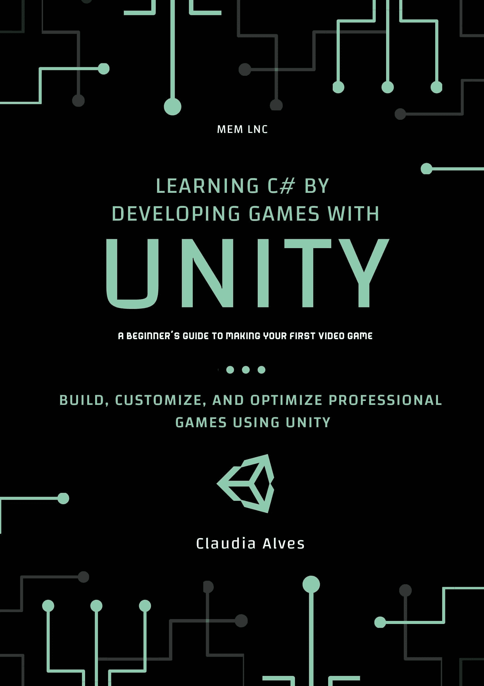


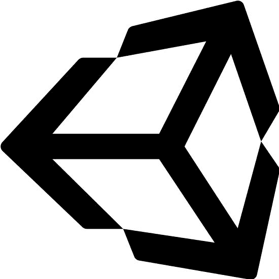


联系方式：
(alabamamond@gmail.com, memlnc)
[`www.memlnc.com`](http://www.memlnc.com)

第一版：2020.11

通过 Unity 开发游戏来学习 C#

“编程不在于你所知道什么，而是在于你能解决什么问题。” - Chris Pine

## 本书是给谁读的？

如果你对通用编程一无所知，不知道如何写代码、如何写脚本，或者不知道该从何处开始，那么这本书非常适合你。如果你想制作游戏并需要学习如何编写 `C#` 脚本或代码，那么这本书是你的理想之选。

## 引言

## 2D 或 3D 项目

### 全 3D
### 正交投影 3D
### 全 2D
### 带有 3D 图形的 2D 游戏

## 为什么我们要使用游戏引擎？

## 上手 Unity 引擎的快速步骤

# 第二章

## 脚本编程


# 脚本编程 (85)

## MonoDevelop (85)
### MonoDevelop 中的帮助 (86)
### 语法错误 (86)
### 错误消息传递 (87)
### 可用的编程语言 (87)

## 为什么选择 C#? (88)

## Unity 的继承结构 (88)
### Object (89)
### GameObject (90)
### ScriptableObject (90)
### Component (90)
### Transform (91)
### Behavior (91)
### MonoBehaviour (92)

## 创建脚本 (92)
### 重命名脚本 (93)

## 脚本框架 (94)
### Unity 的事件方法 (95)
### Update (96)
### FixedUpdate (97)
### 更改时间间隔 (97)
### Awake (98)
### begin (98)
### OnGUI (99)
### LateUpdate (100)

## 组件编程 (101)
### 访问 GameObjects (101)
### FindWithTag (103)
### FindGameObjectsWithTag (103)
### Find (104)
### 激活与禁用 GameObjects (105)
### 销毁 GameObjects (106)
### 创建 GameObject (107)
### 访问组件 (107)
### GetComponent (108)
### 减少流量 (109)
### SendMessage (110)
### 变量访问 (111)
### 添加组件 (112)
### 移除组件 (112)
### 激活与禁用组件 (113)

### 随机值 (113)
### 并行执行代码 (115)
### WaitForSeconds (118)
### 使用 Invoke 进行延迟和重复函数调用 (118)
### Invoke (118)
### InvokeRepeating, IsInvoking 和 CancelInvoke (119)

## 保存与加载数据 (122)
### PlayerPrefs 偏好 (122)
### 保存数据 (123)
### 检查键值 (124)
### 清除 (124)
### 保存 (125)
### 跨场景数据 (125)
### 使用 PlayerPrefs 传递值 (126)

## 使用启动菜单进行初始化 (128)
### 防止销毁 (130)
### 将 DontDestroyOnLoad 作为单例使用 (131)

## Debug 类 (132)
### 编译顺序 (134)
### 执行顺序 (135)

# 第 3 章 (137)
### 投射物的特殊攻击 (152)
### 喷射器 (159)

## 引言

Unity 是一个跨平台开发平台，最初用于开发游戏，但现在用于许多领域，如架构、艺术、儿童应用、信息管理、教育、娱乐、营销、医疗、军事、物理装置、模拟、训练等。Unity 承担了开发游戏及类似交互体验的许多复杂性，并在后台进行处理，让人们能够专注于游戏的设计和开发。这些复杂性包括图形渲染、世界物理和编译。更高级用户可以根据需要对其进行交互和调整，但初学者无需担心这些。在 Unity 中，游戏开发分为两个部分：第一部分是在 Unity 编辑器内完成的，第二部分是使用代码，特别是 `C#`。Unity 绑定了 MonoDevelop 或 `Visual Studio 2019 Community` 来编写 `C#`。

## 2D 或 3D 项目


Unity 同样适用于创建 2D 和 3D 游戏。但它们之间的区别是什么呢？当你 Unity 中创建一个新项目时，你可以选择以 2D 或 3D 模式启动。你可能已经知道想构建什么，但有几个细微之处可能会影响你选择哪种模式。选择从 2D 还是 3D 模式启动决定了 Unity 编辑器的某些设置——例如，图像是被导入为纹理（textures）还是精灵（sprites）。不过不用担心选错，无论你在创建项目时设置了何种模式，你都可以随时在 2D 或 3D 模式之间切换。以下是一些可以帮助你选择的指南。

### 全 3D (Full 3D)

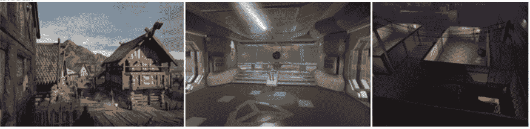

3D 游戏通常利用三维几何体，并在这些对象的表面渲染材质和纹理，使它们看起来像构成你游戏世界的实体环境、角色和物体。相机可以在场景中自由移动，光影以写实的方式投射在世界。3D 游戏通常使用透视渲染场景，因此物体在靠近相机时在屏幕上显示得越大。对于所有符合这一描述的游戏，请从 3D 模式下启动。

### 正交 3D (Orthographic 3D)

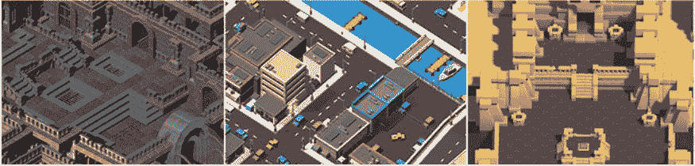

有时游戏使用 3D 几何体，但使用正交相机而不是透视相机。这在提供俯瞰视角的游戏中很常见，有时被称为“2.5D”。如果你正在制作这样的游戏，也应该在 3D 模式下使用编辑器，因为尽管没有透视效果，你仍然在处理 3D 模型和资产。不过，你需要将相机和场景视图切换到正交（Orthographic。（上面的场景来自 Synty Studios 和 BITGEM）

### 全 2D (Full 2D)

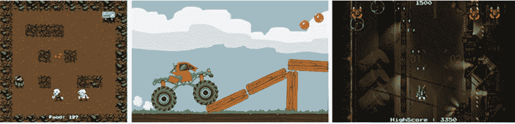

许多 2D 游戏使用扁平化图形，有时称为精灵（sprites），这些图形完全没有三维几何体。它们作为扁平图像绘制在屏幕上，游戏相机没有透视关系。对于这类游戏，你应该在 2D 模式下启动编辑器。

### 2D 玩法 + 3D 图形 (2D gameplay with 3D graphics)

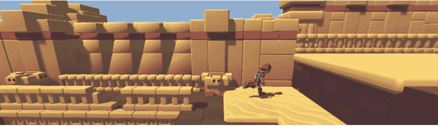

一些 2D 游戏使用 3D 几何体作为环境和角色，但将玩法限制在二维空间。例如，相机可能显示“侧滚视图”，玩家只能在两个维度上移动，但游戏仍然使用 3D 模型作为障碍物，并对相机使用 3D 透视。对于这些游戏，3D 效果可能出于风格性而非功能性的目的。这类游戏有时也被称为“2.5D”。尽管玩法是 2D 的，但你大部分时间都在操作 3D 模型来构建游戏，因此你应该在 3D 模式下启动编辑器。

也许游戏行业是这个时代最困难的行业之一，在许多方面，这种困难始于技术挑战，穿过难以满足的观众（如果产品没有达到要求的水平，即使对大公司来说也是冷酷的），而且还面临着激烈的竞争、高失败率，以及实现覆盖高昂制作成本的利润的困难。

另一方面，该行业也有一些特征使得在其中生存成为可能。从技术方面来说，例如绝大多数游戏并不缺乏相似的功能和重复的数据处理模式，这使得复用之前游戏的软件模块来创建新游戏成为可能。这反过来有助于克服技术障碍并缩短时间和精力投入。

当你谈论制作游戏时，你指的是一个巨大的过程，涉及到在许多领域完成的几十个甚至可能上百个任务。制作游戏意味着生产、营销和发布游戏，以及这些操作中涉及的所有行政、技术、财务和法律程序和步骤。然而，对于我们这系列课程来说，重要的是技术方面，即**游戏开发**，它是构建包含所有组件的最终软件产品的过程。这个过程并不一定包含游戏设计，因为设计过程具有更广泛的视角，关注于故事、游戏的整体特征、关卡的形状和对手的本质，以及游戏的规则、目标和胜负判定条件等。

回到游戏开发过程，我们发现许多专业领域和技能对这个过程做出了贡献。除了当然的程序员之外，还有画家、模型设计师、动画技术人员、音效工程师和导演。了解这种全面的视角很重要，程序员在制作游戏中的角色只是其他团队成员角色不可或缺的一部分，尽管这种形象正随着独立开发者（Indie Developers）的出现而发生变化，他们在执行编程之外还承担许多任务。

### 功能较少，前景更多 (Fewer features, more promise)

如果你玩过《越野迅猛龙游猎》（Off-Road Velociraptor Safari）以及 Blurst 网站上的其他游戏，你将更好地理解在没有经验丰富的韩国 MMO 开发者团队的情况下用 Unity 能做什么。该游戏有 3D 模型、物理效果（控制物体如何写实移动的代码）、碰撞（检测物体何时碰撞的代码）、音乐和音效。就像《融合坠》（Fusion Fall）一样，游戏可以通过 Unity Web Player 插件在浏览器中运行。Flashbang Studios 还销售其游戏的下载版本，证明了 Unity 也可以生成可执行的游戏文件。

### 也许我们应该制作《越野迅猛龙游猎》？(Maybe we should build Off-Road Velociraptor Safari?)

好吧！我们现在还不能创建《融合坠》，但完全可以创建一个像《越野迅猛龙游猎》这样的小游戏，对吧？嗯……不。再次，这本书并不是为了灭你的游戏开发梦想。但事实是，《越野迅猛龙游猎》是由五个非常有才华且经验丰富的专家花费了八周的全职时间完成的，从那时他们一直在对其进行调整和改进。


如果我们想更详细地讨论程序员在游戏行业中的角色，我们会发现即使在编程层面，也有几个角色必须被承担：有图形编程、输入系统、资源导入系统、人工智能、物理模拟以及其他如音效库和辅助工具等。正如我之前提到的，所有这些任务都可以以重用软件模块的形式完成，因此这些单元共同构成了所谓的`Game Engine`（游戏引擎）。通过使用由它构成的引擎和软件库，你将自己的工作减少到构建`I / O system`、模拟物理、甚至是部分人工智能所需的精力上。剩下的工作就是编写你自己的游戏逻辑，并创建出让它与其他游戏区分开来的特性。最后一点将是接下来系列课程的核心，尽管与开发整个游戏相比这项任务看起来非常微小，但正如我们所看到的，正因为它的微小，在设计和实现上才投入巨大的精力。

## 快速上手 Unity 引擎的快速步骤

如果你之前没有该引擎的经验，可以阅读这篇快速介绍；如果你之前接触过该引擎，则可以跳过。我不会详细阐述这些步骤，因为有很多课程（无论是阿拉伯语还是英语）供你参考，但我们在这里是为了确保每个系列的读者在开始之前具有相同程度的初始知识。

### 第一步：下载并安装引擎

要下载引擎的最新版本（版本 19），请直接访问网站 `http://unity3d.com`，然后根据你正在使用的操作系统下载相应的版本。请注意，引擎的免费版本具有巨大的潜力，并且满足我们本系列课程项目的目的。

### 第二步：创建项目

安装完成后运行引擎，将出现启动界面，点击 `New Project` 显示一个如下方图片所示的屏幕。你只需要选择类型 `2D`，然后选择你将创建的新项目的名称和位置，最后点击 `Create Project`。

1. 默认默认名称为 `New Unity Project`，但你可以将其更改为任何你喜欢的。在 `Project name` 字段中输入你想为项目命名的名称。
2. `location`（位置）默认位于你计算机上的主文件夹，但你可以更改它。或者(a) 在 `Location` 字段中输入你想在计算机上存储项目的位置。或者(b) 点击三个蓝点`...`。这将打开你电脑的`Finder (Mac OS X)`或`File Explorer (Windows OS)`。
3. 然后，在`Finder`或`File Explorer`中，选择你想存储新项目的项目文件夹，并选择“Choose”。
4. 为你的项目类型选择 `3D or 2D`。默认是 `3D`，显示为红色表示已选中。（`2D` 将 Unity 编辑器设置为显示其 2D 功能，而 `3D` 显示 3D 功能。如果你不确定选哪一个，请保留为 `3D`；你以后可以更改此设置。）
5. 有一个选择`Asset packages...`（资源包）将其包含在项目中。资源包是预制的内容，例如图像、样式、光照效果和游戏角色控制，以及许多其他实用的游戏创建工具和内容。这里提供的资源包是免费的，随 Unity 一起提供，你可以用它们开始项目。或者：如果你现在不想导入这些捆绑资源，或者不确定，只需忽略此选项；你以后可以通过 Unity 编辑器添加这些资源以及许多其他资源。或者：如果你现在想导入这些捆绑资源，选择 `Asset packages...` 显示可用资源列表，勾选你想要的项，然后点击 `Done`。
6. 现在选择 `Create project`，你就一切就绪了！

### 第三步：认识主程序窗口

起初我们在 Unity 中有 4 个主要窗口。以下是它们功能的总结：

- **Scene Window（场景窗口）**：用于构建游戏场景，向其中添加不同的对象并将其分布在 2D 空间中。最初该窗口只包含一个对象，即相机。
- **Hierarchy（层级面板）**：包含一个树形结构，其中所有已添加到场景的对象，并帮助你组织它们之间的关系，因为可以将对象作为其他对象的子，正如我们将看到的，子对象受父对象的影响。最初该窗口只包含一个对象，即相机。
- **Project Browser（项目浏览器）**：显示项目文件夹中的所有文件，无论是否已添加到场景。项目最初包含一个名为 `Assets` 的文件夹，我们将在其中添加所有其他文件和文件夹。
- **Inspector Properties Window（检查器属性窗口）**：从场景层级、场景窗口或项目浏览器中选择任何对象时，其属性将显示在此窗口中，你可以从那里进行更改。
- **Console（控制台）**：控制台标签用于显示错误和警告消息。如果你编写了编程错误，例如 Unity 会在这里显示它们。但作为开发者，你也可以对此发布报告。


必须纠正的错误消息（errors）在窗口中以红色显示。相比之下，警告（warnings，即非关键错误）显示黄色。普通信息消息以白色显示。你还可以使用右侧的三个符号根据这些级别对消息进行过滤。除了三个过滤器外，上方控制台栏还有几个按钮。它们的含义如下：

- `Clear`：删除所有条目。
- `Collapse`：抑制重复消息。
- `Clear on Play`：通过播放按钮启动游戏时删除所有条目。
- `Error Pause`：一旦执行 `Debug.LogError("error text")`，游戏中断。

在介绍中，我们回顾了 Unity 的初步界面，并对游戏行业进行了简单介绍，在接下来的课程中，我们将通过一个实战项目学习如何创建一个真实的完整的游戏！

# 第 1 章

## C# 与 Unity


`C#` 由微软开发，属于所谓的面向对象的编程语言。它的开发是为了使用 `.NET Framework` 来开发应用程序，该平台提供了广泛的类库、编程接口和工具。然而，Unity 结合 `Mono Framework` 使用这种语言，`Mono Framework` 是 `.NET Framework` 的开源变，这意味着 `C#` 应用程序也可以在非微软系统上运行（称为 `mono project`）。这门语言非常广泛，我在随后的内容中将不会向你介绍 `C#` 的所有可能性，而是特别关注对你作为 Unity 程序员感兴趣的话题。如果你想获得更多关于 `C#` 语言的信息，可以通过知名的搜索引擎找到你想要找的内容。还有很多好书，例如：Walter Doberenz 和 Thomas Profitus 写的 `Visual C#` 系列书籍，它们涵盖了该语言的方方面面。

如果你不能立即理解某些主题，不要绝望。如果你也读了书的其他章节并在以后重新阅读这些段落，你会有可能会或某些豁然开朗的效果。游戏将是编程。脚本用于管理生命值，被玩家和对手共同使用。

### HealthController

```csharp
using UnityEngine;
using System.Collections;

public class HealthController : MonoBehaviour {

    public float health = 5;

    private bool isDead = false;

    void ApplyDamage(float damage) {
        health -= damage;
        if(health <= 0 && !isDead) {
            isDead = true;
            Dying();
        }
        else {
            Damaging();
        }
    }

    public virtual void Damaging() {
    }

    public virtual void Dying () {
    }
}
```

### 语法

首先，关于基础编程的几句话：程序代码（也称为源代码）由逐行处理的代码行组成。为了让计算机也能理解这些行，它们会被一个名为编译器的程序翻译成机器语言，这就是所谓的编译。为了让编译器也知道单行代码何时结束，在 `C#` 中会在行末尾添加一个分号 `;`。`C#` 中的其他重要字符是花括号 `{}`。它们被用于识别连贯的代码块。

### 注释

除了实际代码外，你可能还想给代码添加一些不供计算机运行的注释。这些不执行的行也被称为注释。使用双斜杠 `//` 标记注释。双斜杠之后到下一个换行符之间的任何内容都被视为不可执行代码。该行双斜杠之前的内容被视为可执行！

数字 1 中的单行注释；`// 这是一个也会编译的命令行。Number 1 = 2;`；如果你想将多行标记为注释，可以在开头写 `/*` 并在结尾写 `*/`：

多行注释
```csharp
/* This is old Codeint life 
Points;
lifePoints = 2;
*/
```
```csharp
int lifePoints = 2;
// This is the new code
```

通常，开发环境中的注释会用颜色突出，例如绿色或红色。

### 变量

首先，变量仅仅是存储值的占位符。变量名必须始终唯一，并由你指定。即使起初并不重要，你也必须确保它不包含任何特殊字符、重音符号或空格。此外，变量名不能以数字开头。

### 命名规范

为了让程序代码更易读，有一些你应该遵守的规范。首先，变量名应该描述变量的内容。最好使用英语术语，例如：`speed`。此外，变量名应该始终以小字母开头。对于由多个单词组成的名称，应该用大写字母分开，例如：`enemySpeed`。这种拼法也称为驼峰命名法（camel case）。

### 数据类型

为了让编译器知道变量中可以存储什么值（数字、字母等），你必须告诉变量数据类型。这被称为变量声明。Unity 开发中常用的数据类型有：
- `string` 用于文本
- `int` 用于整数
- `float` 用于浮点数
- `bool` 用于布尔
- `enum` 用于枚举

在 `C#` 中，变量声明以数据类型开始，后面是变量名。最后当然跟着分号：

变量声明
```csharp
int lifePoints;
float height;
string name;
```

为了给这些变量赋值，`C#` 中使用等号 `=`：

赋值
```csharp
lifePoints = 2;
name = "Carsten";
height = 1.5F;
```

如你所示，除了文本本身，我还使用引号来告诉编译器赋值的文本从哪里开始，到哪里结束。当我分配逗号（我需要 float 数据类型）时，我用点 `.` 而不是逗。除了文本本身，我还使用引号来告诉编译器赋值的文本从哪里开始，到哪里结束。当我分配逗号（我需要 float 数据类型）时，我用点 `.` 而不是逗。除了文本本身，我还使用引号来告诉编译器赋值的文本从哪里开始，到哪里结束。当我分配逗号（我需要 float 数据类型）时，我用点 `.` 而不是逗。除了文本本身，我还使用引号来告诉编译器赋值的文本从哪里开始，到哪里结束。当我分配逗号（我需要 float 数据类型）时，我用点 `.` 而不是逗。除了文本本身，我还使用引号来告诉编译器赋值的文本从哪里开始，到哪里结束。当我分配逗号（我需要 float 数据类型）时，我用点 `.` 而不是逗。除了文本本身，我还使用引号来告诉编译器赋值的文本从哪里开始，到哪里结束。当我分配逗号（我需要 float 数据类型）时，我用点 `.` 而不是逗。除了文本本身，我还使用引号来告诉编译器赋值的文本从哪里开始，到哪里结束。当我分配逗号（我需要 float 数据类型）时，我用点 `.` 而不是逗。除了文本本身，我还使用引号来告诉编译器赋值的文本从哪里开始，到哪里结束。当我分配逗号（我需要 float 数据类型）时，我用点 `.` 而不是逗。（注：提供的源文本包含重复，我已根据内容清理了结构。）


```csharp
int [0] = 20; // 之前是 30
int [4] = 140; // 之前是 120
```

## 确定数组所有项的数量

数组也可以自动创建。如果你想知道数组现在包含多少个项，可以使用 `Length` 属性来确定：

```csharp
int len = speedLimits.Length;
```

## 多维数组

你也可以创建一个具有多个维度的数组，假设你想用一个数组表示一个正方形网格区域（例如棋盘）。这时，创建一个包含 64 个元素的数组会很混乱。更容易的方法是创建一个两个维度的数组，第一个索引表示 X 轴（在国际象棋中是 A 到 H 的字母），第二个索引表示 Y 轴。在 C# 中这种定义如下：

```csharp
[,] tile = new int [8,8];
```

再次，请记住数组中的每个索引都从 0 开始。如果你现在用数字对数字进行加密（0 表示没有棋子，1 代表兵兵，2 是车），你就可以轻松地在数组数组中保存棋子的位置：

```csharp
[0.0] = 2; // A1 上有一辆车。
tile [0,1] = 1; // A2 上有一个兵。
tile [1,1] = 1; // B2 上有一个兵。
tile [0.2] = 0; // A3 上没有棋子。
```

## 常数

总有一些不应该或不能更改的值。你可以将这些定义为常量，这意味着它们不能再被更改。要做到这一点，你必须在数据类型之前写入 `const` 关键字。在声明时也必须初始化常量：

```csharp
const float gravity = 9.81F;
```

## 枚举

你可以使用枚举来创建易读的常量列表。听起来有点神秘，但其实非常实用的。假设你想保存一个棋子的状态。它有三种状态：站立、行走、跳跃。为了查询棋子的当前状态，你想将其保存在变量中。为此，你首先定义一个包含这三个值的枚举（简写为 enum）。我们只需要声明这个枚举即可：

```csharp
enum state {idle, walk, jump}
```

然后你可以创建一个该枚举类型的变量，并将其分配为三个值之一：

```csharp
myState State; myState = State.Idle;
```

## 类型转换

也可以将一种类型的变量转换为另一种类型。前提是，当然，它在内容上也是匹配的。整数变量（int）始终可以转换为浮点数变量（float）。反向操作只有在浮点数没有小数部分值时才有效。在转换类型时，只需在要转换的值之前的括号中输入目标类型即可：

```csharp
int lifePoints; string lifePointsText = "2";
lifePoints = (int) lifePointsText;
```

将数字转换为字符串更加简单。它们本身带有一个执行此任务的方法/函数（我稍后会解释那是什么）。要做到这一点，在数字变量后输入一个点，然后输入文本 `ToString()`。一旦你点击该点，MonoDevelop 中就会出现一个选择框，使此命令可用：

```csharp
lifePointsText = lifePoints.ToString ();
```

这个函数非常有用，因为通过这种方式整数变量可以像字符串一样处理：

```csharp
lifePointsText = "You own" + lifePoints.ToString() + "Life Points.";
```

如你所见，你可以在 C# 中使用 `+` 符号拼接字符串。此过程被称为字符串拼接，经常用于文本输出。

## 分支（逻辑影响）

现在你已经学习了编程所需的所有重要基础知识，我们终于可以开始实际编程了。因为这不仅仅关于定义变量并为其填充值，而是关于根据这些值做出决策，这正是所谓的“分支（ramifications）”发挥作用的地方。你根据定义的条件决定下一步执行哪些代码块。

## if 语句

最简单的分支是所谓的 `if` 语句。它的工作方式像一个开关，可以根据条件执行某些代码。此外，还可以指定一个在条件不满足时执行的备选代码，使得整个代码的行为如下：“如果条件成立，则执行此操作，否则执行该操作。” `if` 语句通过信号词 `if` 引入，后面跟着括号括内的条件。实际代码随后在大括号中跟随。可选的备选代码通过单词 `else` 启动：

```csharp
if (lifePoints == 2) {
  message = "You have 2 lives";
} else {
  message = "I don't know how many lives you have." + "But there are definitely no 2.";
}
```

如果代码块或 `else` 分支只包含一行，则也可以省略大括号：

```csharp
if (lifePoints == 2) message = "You have 2 lives";
```

## switch 语句

使用 `if` 语句，你始终最多有两个可能执行的代码段。虽然你可以通过嵌套 `if` 语句来表示多个状态，但到某个程度就会变得非常混乱。`switch` 语句可以提供帮助。通过它，你可以检查任何数量的状态，然后执行适用于相应 case 代码。

```csharp
int damage = 1;
string title;
switch (damage) {
  case 0:
    message = "Beside!";
  case 1:
    message = "Oh, just a scratch!";
    break;
  case 2:
    message = "Damn it hurts!";
    break;
  default:
    message = "Arrrgh!";
}
```

switch 语句的每个 case 需要用 `break` 结束。如果一个 case 都不，可以使用 `default`。

## 循环

除了分支，循环是另一个重要元素。它们确保某些部分重复执行直到满足终止条件。

### for 循环

经典的循环是 `for` 循环。用于已知代码重复的次数。使用这种循环时，为变量（计数器）分配初始值并增加：

```csharp
int counter = 0;
for (counter = 0; counter <10; counter++) {
}
```

在上面的示例中，计数器设置为初始值 0 并运行十次。这是由于 `counter++`，它每次运行都会增加计数的值。

### 负步长

下一个示例显示了步长为 -2，并在计数器大于 0 时运行代码。此外，这里计数器在 `for` 循环中定义：

```csharp
for (int counter = 10; counter> 0; counter-=2)
}
```

### Break

`for` 循环并不总是运行到结束。它可以使用 `break` 关键字取消：

```csharp
int [] speedLimits = new int [5] {30,50,80,100,120};
int currentSpeed = 100;
int currentGear;
for (int counter = 0; counter <5; counter++) {
  if (speedLimits[counter] >= currentSpeed) {
    currentGear = counter +1; break;
  }
}
```

### Foreach 循环

`foreach` 循环用于遍历数组。这里使用了一个额外的运行变量，它获取数组当前元素的值。由于它是原始值的副本，无法通过这种方式更改数组的内容。需要注意的是你只需要循环中定义运行变量：

```csharp
foreach (int currentLimit in speedLimits) {
  if (currentLimit == 80) {
    // code ...
  }
}
```


`while` 循环会持续执行，直到满足中止条件。终止条件在循环的开始时进行查询，因此循环可能根本不会执行，也就是说如果从一开始开始就已经满足了终止条件。

```sharp
int enemyIndex = 0;

while (enemyIndex <5) {
    if (enemyIndex == 3)
        break; // 代码...

    enemyIndex ++;
}
```

此循环也可以通过 `break` 命令简单地结束，而无需满足实际的终止条件。此外，还有 `continue` 命令。它确保当遇到 `continue` 命令时，循环的行为就像已经到达了循环代码的末尾，从而开始循环的下一次迭代。

## do 循环

与在开始时检查终止条件的 `while` 循环不同，`do` 循环中的条件只在结束时进行检查。结果是循环至少会执行一次，无论从开始时是否满足该条件。

```sharp
int enemyIndex = 0;
do {
    // 代码...
    enemyIndex ++;
} while (enemyIndex < 5);
```

在 `do` 循环中，同样可以使用 `break` 命令提前退出循环。

## 类

正如前面提到的，在 C# 中，类是面向对象编程的基础。它将相关的数据和方法封装在一起。类就像一个蓝图，根据这个蓝图可以创建多个对象。类可以包含属性（变量）、方法（函数）以及构造器。通过 `new` 关键字可以创建类的实例（对象）。

```csharp
public class Player {
    public int health;
    public void TakeDamage(int amount) {
        health -= amount;
    }
}

Player player = new Player();
player.TakeDamage(10);
```

## 方法 / 函数

方法是类中的代码块，用于执行特定的任务。方法可以接收参数（输入），并返回结果（输出）。如果方法不需要返回值，则使用 `void` 关键字。

```csharp
public int Add(int a, int b) {
    return a + b;
}
```

方法参数是指你在调用方法时传递给方法的值。参数有两种传递方式：

1. **值传递**（Pass by value）：方法接收参数的副本。在方法内部对参数的修改不会影响外部的变量。
2. **引用传递**（Pass by reference）：方法接收的是变量的引用。方法内部对参数的修改会直接影响外部的变量。这通常使用 `ref` 关键字来实现。

```csharp
public void Increment(ref int value) {
    value++;
}

int x = 5;
Increment(ref x); // x 现在变为了 6
```

## 实例化

实例化是指根据类的蓝图创建具体对象的过程。在 C# 中，使用 `new` 关键字来实例化。此操作会在堆上分配内存，并调用类的构造函数。

```csharp
Player myPlayer = new Player();
```


为了彻底让你困惑，我想告诉的是，字符串变量也是引用类型。但是（这是一个好消息）-字符串具有值语义（value semantics）。这意味着字符串的行为在很大程度上类似于值类型。因此，你通常可以使用与 `int` 变量或 `Booleans` 完全相同的方式使用字符串。对于之前的示例方法，这意味着你可以在方法内部更改 `stringA` 的值，而不会影响传递进去的 `myName` 变量的值。

## 重载方法

在 C# 中，还可以在类中定义两个同名的方法。如果传递的参数不同，这种方法就是可行的。这种技术被称为方法重载（overloading）。

```csharp
static bool IsEqual (string stringA, string stringB)
{// code ...}

static bool IsEqual (string stringA, string stringB, bool ignoreCase)
{// code ...}
```

## 局部变量和全局变量

根据你在类中声明自定义变量的位置，它们只存在于一个函数中或存在于整个类中。局部变量在方法内部声明，仅存在于该方法内部。全局变量在方法外部声明，适用于整个类。

## 通过此避免混淆

由于作用域的不同，可能会出现局部变量和全局变量同名的情况。为了避免误解，C# 提供了关键字 `this`，它指向你自己的类实例。在这种情况下，如果你想访问局部变量，只需编写变量名即可。如果你想访问全局变量，先写 `this`，然后加一个点，最后是变量名。

```csharp
int quantity = 0;

void Add (int quantity) {
    this.quantity += quantity;
}
```

## 访问与可见性

全局变量以及所有方法都可以使用额外的访问修饰符进行扩展。这些修饰符决定了它们仅在类内部可见（因此可以使用），还是也可以被另一个类或实例访问。

- `public` 允许从任何地方访问。公共变量也会在 Unity 的 Inspector（检查器）中显示。
- `private` 将访问限制在你自己的类中。
- `protected` 将访问限制在你自己的类以及所有继承自它的类中。
- `internal` 将访问限制在你程序集中的所有类中（对于 DLL 非常重要）。

如果你没有指定这些关键字中的一个，C# 中的变量和方法会被自动视为 `private`。顺便说一下，类只能被赋予 `public` 和 `internal`。如果缺少关键字，则被视为 `internal`。

```csharp
public class test {
    private int health;
    public bool IsEqual (string stringA, string stringB) {
      //Code...
    }
}
```

## 静态类和类成员

在某些情况下，你编写的方法或变量应该独立于创建的实例运行，例如，该类之前创建的所有实例的计数器。在这种情况下，当然，并不是每个实例都拥有自己的计数机制，结果甚至可能不同。所谓的静态方法/变量被用于此类应用程序…………也称为通用类成员。（相比之下，传统的方法/变量……被称为实例成员。）它们使用关键字 `static` 声明，并且不能通过实例访问，而是直接通过类名访问。Unity 在此利用了这一点，例如在它的数学类 `Mathf` 中。

```csharp
int myInteger = Mathf.RoundToInt (1.5f);
```

静态方法的声明如下：

```csharp
public static void SetLevelSettings (int levelIndex) {
//Code...
}
```

`Mathf` 类更进了一步。在这里，整个类被声明为静态的，因此编译器只允许类成员。成员（Member）是类中可以存在的所有“东西”的统称，例如：方法、变量等。静态类的定义如下：

```csharp
public static class GameSettings {
    public static string playerName = "";
    public static void SetLevelSettings (int levelIndex) {
      //Code...
    }
}
```

## 引用与输出参数

在某些情况下，你编写的方法或变量应该独立于创建的实例运行，例如，该类之前创建的所有实例的计数器。在这种情况下，当然，并不是每个实例都拥有自己的计数机制，结果甚至可能不同。传递的变量（无论它是值类型还是引用类型）在方法内部没有影响，除非使用 `ref` ` `。 `，`使用 `out` 修饰符来确保在方法中可以被赋值。

```csharp
public bool IsEqual (ref stringA, string stringB) {
    bool result = false;
    if (stringA == stringB) {
        result = true;
    }
    return result;
}
```

使用 `ref` 修饰符调用方法：

```csharp
string myName = "Player";
string colliderName = "player";
equal = IsEqual (ref myName, colliderName);
```

在上述情况下，`myName` 的初始值为 "Player"，`colliderName` 的值为 "player"。

- `ref` 请求一个初始化的变量。传递的变量必须有一个值。
- `out` 不需要初始化的变量。但是，必须在方法中对其赋值。一个巨大的优势是你现在可以从方法返回多个值。例如，如果击中了某些东西，你可以通过 `out` 参数获取击中的信息。

```csharp
RaycastHit hit;
if (Physics.Raycast (transform.position, Vector3.down, out hit))
    float distanceToGround = hit.distance;
```

## 使用 params 传递数组

除了上述修饰符，还有 `params` 修饰符。它简化了向方法传递数组，使得你在传递多个值时并不需要定义数组。

```csharp
public int DamageAddition (params int [] damageValues) {
    int val = 0;
    foreach (int current in damageValues) {
        val += current;
    }
    return val;
}
```

在方法中，传递参数 `damageValues` 被视为一个普通的 `int` 类型数组。这起初并没有特别之处。只有当数组传递给方法时，特殊性才会体现。

```csharp
int sum;
int damage1 = 5;
int damage2 = 3;
sum = DamageAddition (damage1, damage2);

int [] damageArray = new int [2];
damageArray [0] = 5;
damageArray [1] = 3;
sum = DamageAddition (damageArray);
```

## 属性和属性方法假设你有一个 NPC 类，它有一个公共变量 `health`。你当然可以给该类的对象分配任何值，即使这不允许对象具有负的健康值。与其在每次处理该值的地方都考虑这种情况，不如从一开始就确保这种情况不会发生。为了实现这一点，在 C# 中有所谓的“属性方法”，它们可以在值被传递时立即检查并更改该值。属性方法（简称为属性）由两个子方法 `get` 和 `set` 访问器组成。

- `get` 用于查询值。
- `set` 用于分配值。


实际变量（在我们的案例中是 `health`）被声明为私有（private），因此只能通过属性方法访问。这种过程也被称为数据封装。类 `NPC` 带有这些访问器后看起来如下所示：

```csharp
public class NPC {
  private int health;
  public int health {
    get {
      return health;
    }
    set {
      health = value;
      if (health <0)  
        health = 0;
    }
  }
}
```

注意大小写：属性方法大大写开头且是公的（public）。变量为小写且是私有的（private）。

`NPC npc = new NPC ();`

`int h = 3;`

`npc.Health = 3; // 将私有变量 `health` 设置为 3`

`npc.Health - = 5; // 从当前值减去 5，因此 `health` 实际上将变为 -2`

`h = npc.Health; // `Health` 返回 0`

由于 Unity 的检查器（Inspector）只显示公共变量而不显示属性方法，因此属性方法在 Unity 中并不经常使用。

## 继承

面向对象编程的一个重要特性是继承的可能性。这意味着作为程序员，你可以开发一个新类，该类可以使用另一个类的所有方法、变量等作为基础，而无需重写代码。这个新类也称为派生类（derived class）。它所继承的类被称为基类（base class）。如果一个类现在要继承另一个类，则在类名后写一个冒号，后面跟着基类的名称。

```csharp
public class MyScriptName: MonoBehaviour {
//Code
}
```

即使你可能可能并不经常使用继承，但对于 Unity 程序员来说，这是一个非常重要的问题。在 Unity 中创建并准备作为组件使用的每个类必须继承自 Unity 类 `MonoBehaviour`。这包含了类能够作为组件使用所需的所有内容。你可以在第 4 节“脚本编程”中找到更多相关信息。

## 基类与派生类

如果一个类在 C# 中要继承另一个类，必须在类名后写一个冒号，后面跟上基类的名称。假设我们有一个类 `person`，它有一个公共变量 `name` 和一个私有变量 `points`。

```csharp
public class person {
  public string name = "";
  private int points = 0;
}
```

派生类 `NPC` 应该有一个额外的变量 `health`，那么它看起来如下：

```csharp
public class NPC: person {
  public int health;
}
```

现在你可以创建一个 `NPC` 类的对象并使用两个公共变量：

`NPC npc = new NPC ();`

`npc.name = "Legolas";`

`npc.health = 10;`

## 继承与可见性

即使在上面的示例中 `NPC` 类继承了基类 `Person`，我之前解释的可见性规则仍然适用。你不能在派生类中访问基类的私有变量或私有方法。如果你仍然想允许访问，可以使用 `protected` 关键字代替 `private` 来定义这些成员。

```csharp
public class person {
  public string name = "";
  protected int points = 0;
}
```

这意味着变量 `points` 仍然对外部不可见，但在派生类 `NPC` 中可以被访问。

```csharp
public class NPC: person {
  public int health;
  public void DoSomething () {
    points = 100;
  }
}
```

## 重写继承的方法

假设你有一个基础类 `person`，它除了各种变量和方法外，还有一个名为 `Shoot` 的方法。为了显示此功能，应首先在控制台（console 标签页）中输出一段短文本。你可以通过使用 `Debug.Log` 命令来实现。虽然 `Person` 类提供了标准文本 "Peng!"，但 `NPC` 类现在应该说点别的。为了这个目的，在 C# 中有重写方法的可能性。要做到这一点，被重写的方法必须首先在基类中声明为可重写。这是通过 `virtual` 关键字实现的。

```csharp
public class person {
  public virtual void Shoot () {
    Debug.Log ("Peng!");
  }
}
```

派生类可以（但不必）重写此方法。这里的关键字是 `override`。

```csharp
public class NPC: person {
  public override void Shoot () {
    Debug.Log ("Tie!");
  }
}
```

## 对基类的访问

如果你现在在派生类中重写了基类的方法，但现在想访问基类的方法，自然会产生如何做的问题。这是通过 `base` 关键字实现的。你通过 `base` 访问基类的方法、变量等。

```csharp
public class NPC: person {
  public override void shoot () {
    base.shoot();
    Debug.Log ("Tie!");
  }
}
```

## 密封类

继承的另一种方式是通过密封（sealing）。这意味着防止类的被继承。换句话说，如果你在类定义前面加上 `sealed` 关键字，则没有其他类可以继承它。

```csharp
public sealed class NPC: person {
```

## 多态

面向对象编程提供了另一种实用的技能：多态。你可以以相同的方式处理具有共同基类的对象。脚本并不关心对象实际上是否是某个特定类型。

```csharp
void LetsShoot (Person person) {
  person.Shoot();
}

Person person = new Person();
NPC npc = new NPC();
LetsShoot (person);
LetsShoot (npc);
```

## 接口

C# 面向对象的另一个特性是接口（interfaces）。通过这些接口你可以定义不同类的共同特征并对其进行处理。通过这种方式你可以平等地对待不同的类，这在某些情况下非常有用。微软已经定义了一些通用接口，对于某些功能很重要，你也可以定义自己的接口。

## 定义接口

定义接口使用 `interface` 关键字。按照约定，接口的名称始终以 `I` 开头，因此在示例中它是 `Shootable`。接口的其余部分与类相似，区别在于方法没有被实现。这只发生在实现该接口的类中。`Shootable` 接口看起来如下：

```csharp
public interface IShootable {
  void shoot ();
}
```

类和接口的一个重要区别在于访问修饰符。类中没有访问修饰符的内容被认为是私有的，而接口被认为是内部的。毕竟接口也用于描述类的外部影响。除了 `public` 和 `internal` 之外，接口对其他访问修饰符都是禁止的。

## 实现接口

如果一个类要实现接口，其方法与继承类完全相同，即使用冒号。如果既继承类又实现一个（或多个）接口，可以在基类名称后面用逗号隔开列出这些接口。`IShootable` 接口的实现看起来如下。请注意，脚本拥有 `Shoot` 方法，这是接口实现的强制要求的。

```csharp
using UnityEngine;
using System.Collections;

public class gun: MonoBehaviour, IShootable {
  private WeaponController weaponController;
  void Awake () {
    weaponController = gameObject.GetComponent <WeaponController>();
  }
  public void UseMe () {
    weaponController.Switch (this);
  }
  public void Shoot () {
    Debug.Log ("Peng!");
  }
}
```


脚本的各个部分目前并不那么重要，将在其他章节中进行详细介绍。尽管如此，我想先预告一下这里正在发生什么。一旦 `Awake` 方法被调用，系统就会搜索脚本组件 `WeaponController`（其代码稍后会处理）并将其赋值给一个私有变量。如果现在调用 `UseMe` 方法，Gun 自身的脚本实例将传递到 `WeaponController` 的 `switch` 方法中。最后，`Shoot` 方法仅为了演示之目的向 Unity 控制台写入文本“Peng!”。稍后在这里会编写代码，例如 B 发射一个投射体。

## 来自 MonoDevelop 的支持

编程环境 `Mono-Develop` 可以帮助你实现接口。如果你在上面的示例中 `MonoBehaviour` 之后编写了实现 `IShootable`，请将鼠标指针移动到 `IShootable` 并点击右键。在弹出的右菜单中，选择 `Refactor / Implement implicit`（重构 / 实现隐）。然后所有属性、方法等都会自动添加到你的类中。你现在只需要就是为它注入灵魂。当然，你可以删除默认插入的异常（错误消息）。

## 通过接口访问

要访问接口，你可以像使用变量类型一样使用接口。在下面的脚本中，接口用于 `Switch` 方法的参数定义，也用于公共变量的定义。这意味着只要任何类拥有 `IShootable` 接口并因此也拥有 `shoot` 函数，就可以传递给 `Switch`。

```csharp
using UnityEngine;
using System.Collections;

public class WeaponController: MonoBehaviour {
    public IShootable weapon;

    public void switch (IShootable newWeapon) {
        weapon = newWeapon;
    }

    public void ShootCurrentWeapon () {
        weapon.Shoot ();
    }
}
```

## 命名空间

如果我们在本书末尾开发演示游戏，你会发现 Unity 项目期间创建了许多类。此外，Unity 在后台用于编程的框架也提供了许多类。为了让你不会失去视图并产生混乱，存在所谓的“命名空间”（namespaces）。命名空间是组织结构，用于将相关的类型（类等）结构化并将它们分组为逻辑单元。你可以将其比为文件系统上的一个文件夹，其中包含各种文件。如果你现在想在 Unity 中使用某种类型，必须引用项目中的命名空间并将其集成到类中。通常 Unity 会处理所有这一切。只有当你想要使用特殊类型时才需要自己这样做。

你使用关键字 `using` 在脚本文件的开头包含命名空间。接下来的示例类包含了 `System.Collections.Generic` 命名空间以便使用 `List` 类型。

```csharp
using System.Collections.Generic;

public class TestClass {
    private list <string> myStringList;
}
```

如果你再次查看接口示例，你会注意到命名空间已经通过这种方式集成了，即 `UnityEngine` 和 `System.Collections` 命名空间。你可以在“脚本编程”章节找到更多关于这两个命名空间的信息。

## 泛型类和方法

面向对象编程中的“泛型”（generic）一词实际上意味着例如方法或类，即不无论类型如何设计。最终使用的类型（或方法）通过角括号传递给类（或方法）。在 C# 中，这种要分配的类型通常用泛型类（或方法）中的字母 `T` 表示。

```csharp
using UnityEngine;
using System.Collections;

public class MyGeneric <T> {
    public T current;
}
```

在泛型类中使用类型参数 `T` 的地方，稍后都会使用传递的类型。因此，变量 `current` 将具有你在声明实例时所指定的数据类型。

```csharp
MyGeneric <string> test = new MyGeneric <string> ();
test.current = "ddd";

MyGeneric <int> test2 = new MyGeneric <int> ();
test2.current = 2;
```

## 巧妙运用

Unity 项目中经常使用的泛型类型是 `List<T>`。它的工作原理与数组类似，但该类型提供的功能比普通数组多得多。你可以使用 `Add` 方法向这些对象添加许多新元素，使用各种命令搜索它们，或使用 `Remove` 删除特定元素。创建列表对象时只需输入对象应包含的类型。在接下来的示例中，你应该特别注意 `System.Collections.Generic` 的 `myNumbers` 变量声明。

```csharp
using UnityEngine;
using System.Collections;
using System.Collections.Generic;

public class GenericTest: MonoBehaviour {
    private list <int> myNumbers = new list <int> ();

    void Start () {
        myNumbers.Add(2);
        myNumbers.Add(3);
        myNumbers.Add(7);
        if (myNumbers.IndexOf(3) == 0)
            myNumbers.Remove(3);
        Debug.Log(myNumbers.Count.ToString()); // 输出 2
    }
}
```

## 排序对象

`List` 类的另一个优势是使用 `Sort` 方法对不同元素进行排序。然而，你应该注意并不是每个类型都可以排序。只有当后者实现了 `system` 命名空间中的 `IComparable` 接口时才有效。你可以在互联网上找到更多关于这个主题的信息（“IComparable interface”）。

## 字典

你应该知道的泛型命名空间中的另一个类是简称为 `Dictionary<TKey, TValue>`。它有两个泛型参数。字典存储所谓的键值对。第一个值表示唯一标识（键），第二个表示该键的值。每个键在字典中只能出现一次。下一个示例使用简单的库存展示了该类的一些功能。展示了你如何使用 `ContainsKey` 判断此键是否存在，如何使用 `Add` 方法创建新的键值对，以及如何使用键访问关联的值并进行更改。

```csharp
using System.Collections;
using System.Collections.Generic;

public static class SimpleInventory {
    private static dictionary <string, int> items = new dictionary <string, int> ();

    public static void AddItems (string key, int val) {
        if (items.ContainsKey(key))
            items[key] += val;
        else
            items.Add(key, val);
    }

    public static bool RemoveItems (string key, int val) {
        if (items.ContainsKey(key)) {
            if (items[key] >= val) {
                items[key] -= val;
                return true;
            }
        }
        return false;
    }
}
```


Unity 提供了 `MonoDevelop` 编程环境用于编写脚本。`MonoDevelop` 是一个面向软件开发者的开源开发环境，作为 `Mono` 项目的一部分开发的，`Mono` 是微软 .NET 框架的开源替代方案。Unity 提供了一个特别适配的版本，其功能之一是能够结合 Unity 方便调试。在 Unity 中双击脚本会自动打开 `MonoDevelop` 并加载相应的脚本。如果 `MonoDevelop` 已经打开了另一个脚本，则会创建一个包含相应脚本的新标签页。另一个脚本仍保持在 `MonoDevelop` 中打开，因此可以在不同脚本之间切换。

作为一名 Unity 开发人员，`MonoDevelop` 的主窗口尤为重要，各种脚本的代码显示在其标签页中。左侧的 `Solution Explorer`（解决方案资源管理器）也很有帮助。它显示了按编程语言排序的 Unity 项目所有代码文件，并允许打开其他脚本文件。`MonoDevelop` 的存储功能非常简单，你可以使用 `File / Save` 或组合键 `[Ctrl] + [S]`。在 Unity 中需要进行的调整必须始终在 `MonoDevelop` 中保存。我们将在“故障排除与性能”章节中讨论同样重要的调试功能。

如果你已经其他开发环境的经验并偏好特定的环境（例如 `Visual Studio`），可以使用它代替 `MonoDevelop`。在这种情况下，你可以在 `Edit / Preferences` 的 `External Tools` 区域将替代 IDE 保存为 `External Script Editor`。

### MonoDevelop 中的帮助
Unity 附带的 `MonoDevelop` 版本有一些特殊修改，包括一个额外的帮助功能，可引导开发者直接进入 Unity 的脚本引用。要执行此操作，选择你想要获取更多信息的命令，并在德国电脑键盘上按下 `[Ctrl] + [Shift] + [']`。或者，你可以通过 `MonoDevelop` 菜单 `Help / Unity API Reference` 实现。如果你在 `MonoDevelop` 中只有一个类名，例如输入应用程序并调用帮助，它将给你有关该类提供的方法和变量的所有信息。

### 语法错误
如果你在脚本中存在语法错误，例如忘记了分号（`"parsing error"`）或使用了未实例化的变量，Unity 将在你保存此错误脚本后显示错误消息。该消息会显示在 Unity 窗口的底部和控制台（console 标签页）中。如果你点击此消息，`MonoDevelop` 将打开并带你到达错误发生的地方。

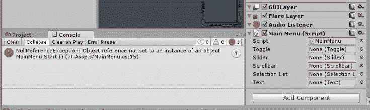

### 错误信息的传递
点击控制台中的错误消息并不总是直接指向开发者编写编程错误的位置。例如，如果你在行末尾忘记了分号，编译器可能只认为下一行是错误的，因为（之前的）代码行尚未完成，而这个新命令不应该在此时出现。特别是对于初学者来说，这有时会导致长时间的错误搜索，因为错误所在的地方与其显示的地方不同。

### 可用的编程语言
在编写脚本时，你可以在 `JavaScript`、`Boo` 和 `C#` 编程语言之间选择。虽然你可以在 Unity 项目中任意混合使用这些语言（但在同一个脚本内不能！），但在可行范围内建议避免这样做。在项目内部混合语言本身并不是问题。但一旦你尝试从一个脚本访问另一个语言，就可能会出现问题。我将在第 4.14 节“编译顺序”中介绍细节。因此，我建议尽可能在一个项目内限制仅使用一种语言。

### 为什么选择 C#
正如你所注意到的，我在书中使用了 `C#` 语言。起初，Unity 专注于 `JavaScript` 语言。然而，随着时间的推移，这种情况发生了巨大变化，因此 `C#` 现在是重点。`C#` 提供了更多功能，并且比专门为 Unity 改的 JavaScript 分支（通常称为 `UnityScript`）更广泛。

## Unity 的继承结构
正如我在上一章“C# 与 Unity”中提到的，所有作为组件使用的脚本必须继承自 `MonoBehaviour` 类。然而，该类继承自另一个类。最终，组件和 `GameObject` 甚至拥有起源，即来自 `UnityEngine` 命名空间的 `Object` 类。图 4.3 在类图中显示了 `Unity` 引擎命名空间中最重要类之间的关系。箭头始终从派生类指向相应的基类。

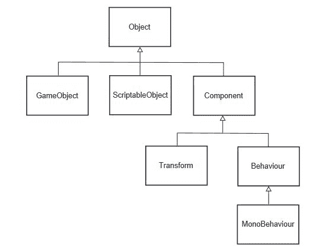

### Object
`Object` 是 Unity 中所有对象的父类。它提供了一些基本属性和方法，例如用于销毁对象的静态方法 `Destroy`，以及我将在本章解释的 `DontDestroyOnLoad` 方法。`GameObject`、`Component` 和 `ScriptableObject` 类都派生自此类。对于更有经验的 `C#` 开发者，应该再次指出，这是一个 Unity 对象类，而不是 .NET 框架提供的那个类。

### GameObject
`GameObject` 直接继承自 `Object`，它是场景中所有对象的基类。大多数 `GameObjects` 是通过编辑器主菜单 `GameObject` 创建的。如果你想通过代码创建 `GameObject` 实例，则使用 `new` 关键字像普通类对象一样对其进行实例化。

### ScriptableObject
`ScriptableObject` 也直接继承自 `Object`。首先，`ScriptableObjects` 是继承自 `ScriptableObject` 的通用脚本，通常用于存储大量数据。这些类的实例是通过 `ScriptableObject` 类的静态方法 `CreateInstance` 创建的，可以在运行时和开发期间创建。`ScriptableObjects` 更多用于特殊情况，例如创建可以在场景之外存储、配置并在需要时读取的数据容器。

### Component
`Component` 类也继承自 `Object`，它是所有可以附加到 `GameObject` 类的基础。这就是为什么它们是通过 `GameObject` 方法 `AddComponent` 被添加到相应的实例中的原因。其他重要类也继承自 `Component`，我想以 `Transform` 和 `Behavior` 类为例。因为在 Unity 中，所有这些类都派生自 `Component` 类，被称为组件的类在德语中通常被称为 "components"。

### Transform
`Transform` 类继承自 `Component`，并默认添加到每个 `GameObject` 中。只有当你用代码创建 `GameObject` 时，它才不会自动拥有 transform 组件。反之，`RectTransform` 类继承自 `Transform`，它被 GUI 设计中的 uGUI 系统。

### Behavior
`Behavior` 类继承自 `Component` 类。继承自 `Behavior` 的类也称为 Behavior 或泛泛地称为组件，并通过 `enabled` 属性开启或关闭。派生自 Behavior 的类示例包括 `Light` 或 `NavMeshAgent`，我将在其他章节中讨论。最后，`MonoBehaviour` 类也继承自 `Behavior`。

### MonoBehaviour
`MonoBehaviour` 类是 Unity 中所有作为组件使用并可以附加到 `GameObject` 的脚本类的基类。即使 `MonoBehaviour` 继承自 `Behavior`，你必须记住，当 `enabled` 属性未激活时，`Start`、`Awake`、`Update` 和 `OnGUI` 方法的执行会被阻止。其他方法仍然可以调用和执行，例如物理方法 `OnTriggerEnter` 或 `OnCollisionEnter`。


在 Unity 中，每个脚本恰好包含一个类。脚本名称始终与类名相同。否则，如果你以后想使用它，将会导致错误。因此，在选择脚本名称时，还适用以下规则：不要使用空格或特殊字符。通过以下方式之一创建脚本：

- 你使用主菜单 `Assets / Create` 并选择所需的脚本类型（在本例中为 `C# Script`）。
- 你使用 `Project Browser`（位于上方）的 `Create` 菜单，你也可以在那里找到列出的脚本类型。
- 你使用 `Project Browser` 的右菜单（可以通过右键访问）。你也可以通过 `Create` 菜单分支找到脚本类型。
- 你使用 `Inspector` 中 `Add Component` 按钮的 `New Script` 选项。一旦你在层级（hierarchy）中选择了一个 `GameObject`，你就会在该 `GameObject` 已添加的所有组件中找到它。脚本默认创建在项目浏览器的根目录下，并附加到选中的 `GameObject` 上。

双击创建的脚本将在标准开发环境 `MonoDevelop` 中打开它。

### 重命名脚本

如果你随后在项目浏览器或脚本本身中更改了脚本名称，则对应的类名必须同时更改。如果它们不一致（即使只是大小写不同），稍后将会报错，或者你无法将其添加到 `GameObject` 中。因此，在重命名时，最好使用 `MonoDevelop` 中的重命名功能。这不仅会重命名类，还会重命名脚本以及脚本在项目中的所有引用。只需将光标置于类名上，即可通过右键 `Refactor / Rename` 访问此功能。如果你想重命名相关变量，`Rename` 函数也有意义。在这种情况下，所有已使用过这些变量的位置也将重命名。

### 重命名脚本

如果你重命名了一个已经附加到场景中 `GameObject` 的脚本，重命名后你可能会发现显示 `"Missing (MonoBehaviour )` 而不是脚本。在这种情况下，删除此条目并重新添加重命名后的脚本。删除此条目最简单的方法是使用组件右菜单中的 `Remove Component` 函数（由 `Inspector` 中的齿轮符号表示）。

## 脚本框架

如果你按照上述说明创建新的 `C#` 脚本并现在双击打开它，你将看到以下基础结构：

```csharp
using UnityEngine;
using System.Collections;

public class MyScriptName: MonoBehaviour {

    // 用于初始化
    void Start () {

    }

    // Update 每一帧调用一次
    void Update () {

    }
}
```

在前两行中，集成了带有两个命名空间的 `using` 命令。特别是 `UnityEngine` 命名空间，对于 `MonoBehaviour` 脚本是强制性的，不能删除。如有必要，当然可以在上方添加额外的命名空间。命名空间之后是带有 `MonoBehaviour` 继承的类定义。默认情况下，每个脚本都继承自此类，该类还提供了 `start` 和 `update` 方法。必要时你也可以删除这些方法。你也可以更改或完全移除继承。只有这样，这些类在逻辑上才无法再作为组件使用。

# Unity 事件方法

你现在知道如何在 Unity 中编写脚本了。现在的问题是这些脚本中的代码实际上何时会被执行。Unity 的处理流程如下：`MonoBehaviour` 提供了几个方法，这些方法由某些事件触发，或由 Unity 定期调用。在这里，Unity 会遍历所有的 `GameObjects` 及其脚本实例，并在那里执行对应的方法。我在下面简要介绍其中一些重要方法。请记住，每个脚本可以 / 可能拥有这些方法，但不必实现它们。相反，如果方法没有填充代码，那么删除它们更好。因为以下每个方法都是根据定义被调用的，即使它们是空的，也会消耗性能。

### Update

Unity 中最重要的方法是 `Update` 方法。大部分代码都在这里编写。`Update` 在整个游戏过程中运行，在每一帧渲染之前运行，即在显示器上绘制新帧之前运行。请注意，单个帧的渲染时间可能有所不同。如果你想在 `update` 代码中编写与帧无关的代码，则应将值再次乘以类 `Time` 的时间值 `deltaTime`。该值代表上上一帧到当前帧之间的时间。例如，如果你使用 `Transform` 组件直接为 `GameObject` 添加运动。每当 `Update` 被调用时，物体就会向前移动一点。你可以在第 5 章“三维空间中的对象”中了解更多关于 `Transform` 的信息。

```csharp
void Update ( ) {
    float speed = 20.0F;
    float distance = speed * Time.deltaTime;
    transform.Translate (Vector3.forward * distance);
}
```

### FixedUpdate

`FixedUpdate` 方法在定义的时间间隔内被调用，如果你需要访问 `Rigidbodys`（`Rigidbodys` 负责物理行为），则应该使用它。背景是物理引擎不是基于帧工作的，而是以离散的时间间隔运行，即在固定的时间周期内。因此，在 Unity 每次进行物理计算之前，`MonoBehaviour` 脚本中的所有 `FixedUpdate` 方法都会执行。你可以在“Physics”中找到更多关于物理的信息。以下示例在每次 `FixedUpdate` 调用中为刚体添加一个力矩，使其绕 Y 轴旋转。

```csharp
void FixedUpdate ( ) {
    rigidbody.AddTorque (0, 2, 0);
}
```

# 修改时间间隔

默认情况下，调用 `FixedUpdate` 的时间间隔为 0.2 秒。你可以通过 `Edit / Project Settings / Time / Fixed Timestep` 更改此。

### Awake

此方法在脚本实例加载时执行一次。在加载场景时，场景中的所有对象最初初始化。然后按随机顺序调用各个 `GameObjects` 的 `Awake` 方法。由于所有 `GameObjects` 已经最初初始化，现在就可以找到 `GameObjects` 并分配变量。

```csharp
private GameObject cam;

void Awake ( ) {
    cam = GameObject.FindWithTag ("MainCamera");
}
```

# begin

`Start` 方法的行为与 `Awake` 类似。然而，与 `Awake` 不同，此方法只在激活实例上执行。如果脚本实例在开始时被禁用，随后被设置为启用，则 `Start` 只在那个时刻被调用。此外，`Start` 方法在所有 `Awake` 方法执行后才会被调用，这使得控制初始化顺序和延迟某些执行变得容易。示例使用 `FindWithTag` 方法查找玩家角色。将 `HealthController` 类的脚本实例赋值给临时变量。下一步是查询当前的血量值并将其赋予自己的私有变量。

```csharp
private int playerHealth;

void Start ( ) {
    HealthController hc = GameObject.FindWithTag ("Player").GetComponent <HealthController > ();
    playerHealth = hc.health;
}
```

### OnGUI

`OnGUI` 方法是 Unity 自有的面向编程的 GUI 系统的一部分。在这个方法中，为该系统编写控件。由于该系统不是基于帧的，而是基于事件的（其中事件由用户输入或 Unity 内部渲染过程触发），因此该方法也被相应调用。由于这个原因，`OnGUI` 每帧也可能会被调用多次。你可以在同名章节中找到更多关于 GUI 的信息。

```csharp
void OnGUI ( ) {
    GUI.Label (new Rect ( 0,0,100,30), "Hello World!");
}
```

### LateUpdate


另一种不那么常用，但仍然重要的方法是 `LateUpdate` 方法。它在所有 update 方法被调用之后、但在渲染之前执行。因此，该方法经常被使用，特别是对于相机脚本。如果相机跟踪一个在 `update` 方法中移动的目标，那么相机可以在最终渲染之前在 `LateUpdate` 中重新定位。以下示例可以添加到一个相机中，使其始终指向另一个 Object 的的方向，更精确地说，是朝其 transform（变换）组件所在的方向。例如，这可以用于监控摄像头的控制，它固定安装在一个地方，但会一直跟踪房间内的玩家。

```csharp
public transform target;

void LateUpdate () {
    transform.LookAt (target.position);
}
```

## 组件编程

Unity 的一个重要原则是每个 `GameObject` 都有它自己的组件。因此，你编写的不是一个管理所有敌人生命值的生命系统，而是一个只管理单个敌人生命值的脚本。然后，该脚本会被再次添加到每个敌人中，这样每个敌人都有它自己的管理单元，而且在某些情况下，这个原则可以（也应该）不被严格遵守。但首先，你应该确保每个 `GameObject` 都有自己的组件。顺便提一下，这在访问组件时也有巨大差异，因为 Unity 经常为访问自己的组件提供简化方法，你从下面也会看到。

### 访问 GameObjects

访问组件所属的 `GameObject` 非常简单。只需使用小写变量 `gameObject` 即可。这使得访问自己的 `GameObjects` 的组件变得非常容易，我稍后会介绍这一点。

```csharp
OtherScript otherScript = gameObject.GetComponent <OtherScript > ( );
```

要访问其他的 `GameObjects`，有几种方法可以在开发和运行时使用。第一种方法对性能最友善，是 Inspector（检查器）赋值，在其中你创建一个公共变量，在开发期间可以将另一个 `GameObject` 拖入。

```csharp
public GameObject player;

void Update ( ) {
    //Code...
    if ( player != null) {
        //Code...
    }
}
```

但你也可以在运行时访问其他的 `GameObjects`。如果你想更频繁地访问它们，请确保将它们保存在变量中。这带来了巨大的性能优势，因为在最坏的情况下，Unity 必须遍历场景中所有的 `GameObjects` 才能找到正确的那一个。如果你随后在 update 方法中也进行这种访问，它将在每一帧中发生。

### FindWithTag

你可以通过标签（tag）查找 `GameObject`。为此，`GameObject` 类提供了 `FindWithTag` 方法。如果场景中有多个带有此标签的 `GameObjects`，将随机选择其中一个。

```csharp
GameObject cam; 
void Awake () {
    cam = GameObject.FindWithTag ("MainCamera");
}
```

### FindGameObjectsWithTag

如果有多个具有相同标签的对象，但你又想将它们全部收集到一个数组中，你应该使用 `FindGameObjectsWithTag` 方法。作为返回值，你将收到一个包含所有找到标签对象的 `GameObject` 数组。

```csharp
GameObject [ ] enemies;

void Awake ( ) {
    enemies = GameObject.FindGameObjectsWithTag ("Enemy");
}
```

### Find

你可以通过名称查找 `GameObject`。`GameObject` 类的静态方法 `Find` 适用于此。

```csharp
GameObject leftArm;
leftArm = GameObject.Find ("Left Arm");
```

你还可以通过输入你正在查找的 `GameObject` 的父对象来进一步指定查询。使用斜杠字符 `/` 分隔不同的 `GameObjects`。要显示一个对象是最后一个且其本身没有父对象（根对象），你可以在前面加一个斜杠。

```csharp
leftArm = GameObject.Find ("Bob / Left Arm"); // Left Arm 有父对象 Bob
leftArm = GameObject.Find ("/ Bob / Left Arm"); // Bob 是根对象
```

## 激活和禁用 GameObjects

每个 `GameObject` 都提供了 `SetActive` 方法。你可以用它来激活或禁用整个 `GameObject`。给该方法传递你想要实现的状态。

```csharp
void Start ( ) {
    gameObject.SetActive (false);
}
```

注意，只有当你已经可以访问某个被禁用的对象（例如通过 Inspector 赋值）时才能激活它。使用上述查找方法没有机会找到被禁用的对象。

### 销毁 GameObjects

要完全销毁一个 `GameObject`，你将对象传递给 `Destroy` 方法。

```csharp
void DestroyPlayer ( ) {
    GameObject player;
    player = GameObject.FindWithTag ("Player");
    Destroy (player);
}
```

你还可以给 `Destroy` 方法传递一个浮点参数，按相应的秒数延迟销毁。

```csharp
Destroy (player, 2.5F);
```

## 创建 GameObjects

大多数时候，你会通过主菜单或制体（prefabs，参见“Prefabs”章节）创建 `GameObjects`。但当然你也可以在运行时创建全新的 `GameObjects`。通过标准的 C# 方式创建 `GameObject` 类的新实例来实现。无论实例是局部变量还是全局变量，或者具有何种访问修饰符并不重要。由于每个 `GameObject` 默认名称为 "New GameObject"，你也可以在实例化时给你的 `GameObject` 命名。

```csharp
GameObject go = new GameObject ( );
GameObject go2 = new GameObject ( "My Name");
```

### 访问组件

有几种方法访问组件。访问其他 `GameObjects` 组件的最简单方法是声明一个组件类型的公共变量，并在开发期间将该组件的 `GameObject` 拖入。该变量指向的不是 `GameObject`，而是该 `GameObject` 的组件。如果 `GameObject` 没有此组件，则变量的内容为 null。

```csharp
public transform player;

void Start ( ) {
    if ( player != null) {
        player.position = Vector3.zero;
    }
}
```

### GetComponent

每个 `GameObject` 都有 `GetComponent` 方法，通过它可以你可以访问相应 `GameObject` 的所有组件。如果你在调用时不带上 `GameObject`，该方法会在你自己的 `GameObject` 中查找此组件。以下示例搜索了玩家的 `HealthController` 以及它自己的，并分配给两个不同的变量以便使用。

```csharp
HealthController playerHc;
HealthController myHc;

void Awake ( ) {
    GameObject player;
    player = GameObject.FindWithTag ("Player");
    playerHc = player.GetComponent <HealthController>();
    myHc = GetComponent <HealthController> ();
}

void Update () {
    if (playerHc.health > 0) {
        //Code...
    }
}
```

## 减少流量

尽量减少 `GetComponent` 的访问。对于更频繁的访问，将组件保存在变量中。

### SendMessage

调用方法的一种非常有趣的方法是 `SendMessage` 方法。`SendMessage` 由 `GameObject` 类提供，它会遍历 `GameObject` 的所有 `MonoBehaviour` 脚本，调用所有同名的方法。因此你甚至不需要知道它在哪个脚本中。可选，你还可以给 `SendMessage` 传递一个传递参数以及一个类型为 `SendMessageOptions` 的选项参数。后者决定了接收方法是否绝对必要的。如果是必要的但未找到，则会触发错误。

以下示例脚本可以附加到任何带有碰撞器的武器或陷阱上，以便在接触时造成伤害。脚本尝试在另一个 `GameObject` 中调用名为 `ApplyDamage` 的方法，并将伤害值 1 传递给它。为此，它访问了传递的碰撞参数的 `GameObject` 并调用了 `SendMessage`。


```csharp
using UnityEngine;
using System.Collections;

public class damage: MonoBehaviour {
    public float amount = 1;

    void OnCollisionEnter (Collision collision) {
        collision.gameObject.SendMessage("ApplyDamage", amount, SendMessageOptions.DontRequireReceiver);
    }
}
```

`DontRequireReceiver` 参数表示不需要接收者。这意味着如果目标对象没有使用该方法的脚本，则不会触发错误。你可以在“Unity 中的物理（Physics in Unity）”章节中找到更多关于碰撞的知识。

### 变量访问

如果你想访问自己 GameObject 的组件，Unity 为某些组件提供了通过变量访问的方法，这极大地简化了编程工作。这包括例如 `AudioSource` 组件、`rigidbody` 组件或 `transform` 组件。

```csharp
audio.Play ();
rigidbody.AddForce (0, 1, 0);
transform.Translate (0, 10, 0);
```

### 添加组件

想在运行时为 `GameObject` 添加新组件，你可以运行每个 `GameObject` 提供的 `AddComponent` 方法。下面的示例为自己的 `GameObject` 添加了一个脚本组件 `HealthController` 和一个 `Rigidbody`。

```csharp
gameObject.AddComponent <HealthController> ();
gameObject.AddComponent <Rigidbody> ();
```

### 移除组件

要从 `GameObject` 移除组件，使用 `Destroy` 方法，就像销毁 `GameObject` 一样。如果你想销毁自己的脚本，使用关键字 `this`。在这里，你也可以第二个参数引入时间延迟。

```csharp
Destroy (rigidbody); // 销毁自己的刚体
Destroy (this, 2); // 二秒后销毁你的脚本实例
```

### 激活与禁用组件

与其立即完全移除组件，将其禁用可能更有意义。优点是你可以稍后重新激活它。一个经典的例子是光。下面的示例访问你自己 GameObject 的 `Light` 组件，并使用逻辑非运算符（感叹号）来反转 `enabled` 状态。效果是开启的灯被关闭，关闭的灯被开启。

```csharp
void Switch () {
    light.enabled =! light.enabled;
}
```

### 随机值

随机值是让游戏变得有趣的元素。应用范围从分配随机参数值（如 `strength`）到生成并放置 `GameObjects` 直到创建整个关卡。为此，Unity 提供了 `Random` 类，它提供了几个生成随机值的有趣方法。最常用的是 `Range` 方法。请注意有两个不同的版本。

- 用于 `float` 值的 `Range` 生成一个位于 `start` 和 `end` 值之间的随机值。`start` 和 `end` 值也可以作为结果返回。
- 用于 `int` 值的 `Range` 生成一个从 `start` 值开始的随机值，但必须小于（!）`end` 值。

```csharp
using UnityEngine;
using System.Collections;

public class RandomXPosition: MonoBehaviour {
    void Start () {
        float xPos = Random.Range (0.0F, 5.0F);
        Vector3 pos = new Vector3 (xPos, 10.0);
        transform.position = pos;
    }
}
```

该类还提供了随机计算的几种变体。通过静态变量 `rotation` 实现 `Quaternion` 类型的随机旋转，或者通过 `insideUnitSphere` 获得一个 `Vector3` 格式的随机值，其中 `x`、`y` 和 `z` 各自有一个在 –1 到 1 之间的随机值。

```csharp
using UnityEngine;
using System.Collections;

public class randomize: MonoBehaviour {
    public float radius = 3;
    void Start () {
        transform.position = Random.insideUnitSphere * radius;
        transform.rotation = random.rotation;
    }
}
```

### 并行执行代码

通过 `Coroutines`（协程），你可以选择与实际的 `Update` 和 `LateUpdate` 调用并行执行方法。虽然 `update` 方法中的普通代码每帧运行，但你可以使用 `Coroutines` 编写跨越任意帧数的代码块。

```csharp
string message = "";
IEnumerator Countdown () {
    yield return WaitForSeconds (1);
    message = "3";
    yield return WaitForSeconds (1);
    message = "2";
    yield return WaitForSeconds (1);
    message = "1";
    yield return WaitForSeconds (1);
    message = "Go!";
}
```

要启动协程，使用 `StartCoroutine`。

```csharp
void Start () {
    StartCoroutine (Countdown ());
}
```

`IEnumerator` 接口允许这种操作。`yield return null` 可用于暂停执行直到下一帧。

### WaitForSeconds

通过 `yield return WaitForSeconds (2.5F)`，你可以中断协程的执行一段时间。传递的 `float` 参数指定了等待时间。因此，如果每帧持续 0.02 秒，`WaitForSeconds` 的精度就无法更高了。

```csharp
IEnumerator FrameTest () {
    for (int i = 0; i < 10; i++) {
        Debug.Log (Time.time);
        yield return null;
    }
}
```

## 使用 Invoke 延迟和重复函数调用

Unity 提供了选项，你可以在 `MonoBehaviour` 内部延迟其他方法并重复调用它们。为此 Unity 提供了所谓的 `Invoke` 命令。

### Invoke

`Invoke` 方法期望一个要启动的方法和一个表示延迟的第二个值。在命令执行后，代码将继续正常运行。指定的方法在时间到达后才会触发。指定的方法必须在同一个脚本中。你可以使用 `IsInvoking` 来判断方法是否已经通过 `Invoke` 延迟调用（稍后会介绍）。下面的示例在执行 `Start` 方法 2.5 秒后执行 `DelayedMessage` 方法。这会将一个欢迎文本赋值给变量，该变量的内容可以显示 GUI 中。

```csharp
public string welcomeMessage = "";

void Start () {
    Invoke ("DelayedMessage", 2.5F);
}

void DelayedMessage () {
    welcomeMessage = "Welcome, Master!";
}
```

### InvokeRepeating, IsInvoking 和 CancelInvoke

`InvokeRepeating` 的工作方式与 `Invoke` 类似，不同之处该方法不仅调用一次，还会多次调用。你将重复间隔作为第三个参数。第二个参数也决定了首次执行的延迟。你还可以使用 `IsInvoking` 方法检查方法是否已经通过 `Invoke` 命令启动。然后你可以使用 `CancelInvoke` 取消这些语句。传递你想取消的方法名称。如果你不传递任何参数，所有通过 `Invoke` 命令启动的方法都会终止。下面的示例可能来自一个 `Spawner` 脚本，它在游戏开始三秒后，每秒在随机位置创建一个对象。

```csharp
public GameObject go;
public bool isGameOver = false;

void Start () {
    // 启动延迟重试 RandomInstantiation
    InvokeRepeating ("RandomInstantiation", 3.1);
}

void Update () {
}
```


```csharp
// 检查 RandomInstantiation 是否仍在运行
if (IsInvoking ("RandomInstantiation")) {
    // 当游戏结束时
    // 需要取消 RandomInstantiation
    if (isGameOver) CancelInvoke ("RandomInstantiation");
}
}

void RandomInstantiation () {
    // prefab 应该实例化的位置
    Vector3 pos = new Vector3 ();
    pos = Random.insideUnitSphere * 10;
    // 所有轴的随机值 pos.y = 0;
    // 将 Y 设置为 0。X 和 Z 于 -10 到 10 之间 // 生成 prefab
    Instantiate ( go, pos , Quaternion.identity);
}
```

## 保存和加载数据

通过 `PlayerPrefs` 类，Unity 为你提供了一种极佳的方法，可以在任何系统上保存值。无论是在 Windows、`Mac OSX`、Web 播放器还是 `Android` 上，你只需要将要保存的值传递给 `PlayerPrefs` 方法即可。Unity 会处理这些值最终存储的位置。在下一节中有一个小型应用程序示例。

### PlayerPrefs 偏好

即使所有平台上的路径不同，它们都使用存储在 Unity 中的相同的 `Company Name`（公司名称）和 `Product Name`（产品名称）。在 Windows 系统上，使用的是注册表路径 `HKCU \ Software \ [独立应用程序使用公司名称] \ [产品名称]`；Web 播放器应用程序写入 Windows 系统上的目录 `% APPDATA% \ Unity \ WebPlayerPrefs`。

可以在 `Player Settings`（`Edit / Project Settings / Player`）中更改公司名称和产品名称。默认情况下，`Company Name` 设置为 `"DefaultCompany"`，`Product Name` 为项目名称。

### 保存数据

`PlayerPrefs` 提供了三个静态方法来将值保存为 `int`、`float` 或 `string`。这三个方法都期望接收两个参数。向第一个参数传递一个代表唯一标识符的字符串，即 `key`（值的 ID 或名称）。第二个参数则是特定数据类型中的实际值。

```csharp
PlayerPrefs.SetInt ("Lifepoints", 4);
PlayerPrefs.SetFloat ("Speed", 2.5F);
string playerName = "Carsten";
PlayerPrefs.SetString ("Name", playerName);
```

还有三个静态方法用于加载数据。你在这里同样需要传递 `key`。

```csharp
int myLifepoints = PlayerPrefs.GetInt ("Lifepoints");
float speed = PlayerPrefs.GetFloat ("Speed");
string playerName = PlayerPrefs.GetString ("Name");
```

## 检查键 key

在加载数据（即访问 `key`）之前，首先检查它是否存在通常是有意义的。即使 Unity 在此处不会报错，但为变量分配默认值仍然很有意义。你可以通过 `HasKey` 命令来实现这一点。

```csharp
if (! PlayerPrefs.HasKey ("Lifepoints"))
PlayerPrefs.SetInt ("Lifepoints", 5);
```

### 清除

当然，你不仅可以新条目，还可以删除它们。在这里你可以使用静态方法 `DeleteKey`。要一次删除所有保存的值，可以使用 `DeleteAll`。

```csharp
PlayerPrefs.DeleteKey ("Lifepoints");
PlayerPrefs.DeleteAll ();
```

### 保存

在某些平台上（例如 Web 播放器），Unity 在调用 `SetInt`、`SetFloat` 和 `SetString` 方法时不会将值写入硬盘。相反，Unity 将它们临时保存。只有当你退出应用程序时（对于 Web 播放器来说就是关闭标签页或浏览器），这些值才会被写入磁盘。Unity 在后台处理这一切，这种行为对于初学者来说没有区别。只有在发生错误时（例如浏览器崩溃），这些值可能无法再写入。针对这一点，Unity 现在提供了 `Save`，你可以用它强制执行保存。

```csharp
PlayerPrefs.Save ();
```

### 跨场景数据

GameObject 仅存在于场景中。如果启动了新场景，之前的场景会被销毁，加载新场景通过 `Application.LoadLevel` 完成。你可以传递名称或索引。

```csharp
Application.LoadLevel (1);
```

### 使用 PlayerPrefs 传递值

你已经掌握了第一种方法：在开始时使用 `PlayerPrefs`。如果启动了新场景，脚本会读取值。（等等，让我重新格式化代码逻辑）：

```csharp
public class HealthValue: MonoBehaviour {
    public int health = 2;
    void Start () {
        if (PlayerPrefs.HasKey ("Health"))
            health = PlayerPrefs.GetInt ("Health");
    }
    void OnDestroy () {
        PlayerPrefs.SetInt ("Health", health);
    }
}
```

## 使用启动菜单初始化

在使用上述脚本时，有几点需要考虑。例如，当游戏结束并重启时，变量总是被赋值上一次游戏的值。这在继续旧游戏时可能是理想的，但在重启游戏时显然不合理。为了防止这种情况发生，有一个简单的解决方案：你可以在上游场景中（例如启动菜单场景）设置带有初始值的键（keys）。这使得你即使在没有 `HasKey` 查询的情况下也能使用上述脚本。你还可以使用启动菜单询问玩家是想继续旧游戏还是开始新游戏。这样的脚本可能像这样：

```csharp
public class InitValues: MonoBehaviour {
    public int health = 2;
    void OnGUI ( ) {
        if (ILayout.Button ("New")) {
            PlayerPrefs.SetInt ("Health", health);
            Application.LoadLevel (1);
        }
        if (PlayerPrefs.HasKey ("Health")) {
            if (GUILayout.Button ("Continue")) {
                Application.LoadLevel (1);
            }
        }
    }
}
```


上述方法存在一些缺点。因此，如果你想保存可自定义 GUI、玩家或背包的所有参数，这可能会非常昂贵。但至少当你想要将纹理和材质从一个场景传输到另一个场景时，你会在这里遇到一个问题。对于纹理，你无法通过 `PlayerPrefs` 保存。为了解决这个问题，父类 `Object` 有一个静态方法 `DontDestroyOnLoad`，它可以防止任何对象在加载过程中被销毁。由于传递参数也是 `Object` 类型，你可以将它传输到任何对象上（参见“Unity 的继承结构”），即使通常传递的是一个 `GameObject`。接面的示例脚本可以防止附加在后续脚本上的 `GameObject` 及其所有组件被销毁。如果场景结束并启动了新场景，整个 `GameObject` 将被传输到下一个场景。以下示例脚本防止附加在后续脚本上的 `GameObject` 及其所有组件被销毁。


```cpp
// 在每帧渲染时调用一次

void Update () {

}

// 允许玩家控制此弹体，只要它尚未被发射
public void AllowControl ()

{
    if (! launched)
    {
        controllable = true;
    }
}

// 在玩家开始时调用，持有弹体以准备发射
public void Hold ()
{
    if (controllable &&! held &&! launched)
    {
        held = true;
        holdPosition = transform.position;
        // 发送消息告诉玩家已抓住弹体
        SendMessage ("ProjectileHeld");
    }
}

// 使用提供的力发射弹体
public void Launch (float forceMultiplier)
{
    if (controllable && held &&! launched)
    {
        // 计算发射向量
        Vector2 launchPos = transform.position;
        Vector2 launchForce = (holdPosition - launchPos) * forceMultiplier;
        // 将计算出的释放力加到刚体
        Rigidbody2D myRB = GetComponent <Rigidbody2D> ();
        myRB.isKinematic = false;
        myRB.AddForce (launchForce, ForceMode2D.Impulse);
        // 设置新的状态变量
        launched = true;
        held = false;
        controllable = false;
        // 在指定的秒数后销毁弹体以留在场景中
        Destroy (gameObject, lifeSpan);
        // 发送消息告知已发射
        SendMessage ("ProjectileLaunched");
    }
}

// 在弹体发射后执行其特殊攻击
public void PerformSpecialAttack ()
{
    if (! attackPerformed && launched)
    {
        // 仅允许攻击一次
        attackPerformed = true;
        SendMessage ("DoSpecialAttack", SendMessageOptions.DontRequireReceiver);
    }
}

// 将弹体拖到指定位置，只要它可以被玩家操控
public void Drag (Vector2 position)
{
    if (controllable && held &&! launched)
    {
        transform.position = position;
    }
}

// 告知玩家是否正持有弹体以准备发射
public bool IsHeld ()
{
    return held;
}
// 告知弹体是否已经发射
public bool IsLaunched ()
{
    return launched;
}
```

请注意，此程序唯一的通用变量是 `lifeSpan`，它决定了弹体在发射后留在场景中的时长。此外，我们有状态变量 `launched`、`held`、`controllable` 和 `attackPerformed`，它们都是私有的，只能通过发送消息或调用函数来控制。除了这个通用变量，我们还有四个特殊变量，反映了弹体从游戏开始到发射直到最终从场景消失的各种情况。这些变量是 `controllable`、`held`、`launched` 和 `attackPerformed`，它们的初始值为 `false`。不同的弹体模式按以下顺序出现：

游戏开始时，弹体被放置在弹弓旁的地面上，期间保持静态，在回合开始前玩家无法进行控制。在这种情况下，`controllable` 变量值为 `false`，这阻止了玩家控制弹体。

一旦弹体变为发射器并放置在发射台上，就会调用 `AllowControl()` 函数，它将 `controllable` 值改为 `true` 并允许玩家控制弹体。其他三个变量保持为 `false`。

一旦玩家点击弹体，就会调用 `Hold()` 函数，这假设 `held` 变量的值改为 `true`。由于此变量表示玩家正持有弹体，因此必须首先通过检查 `controllable` 值来确保玩家允许控制它，还应该通过检查 `held` 变量本身来确保它没有被持有，最后必须检查 `launched` 的值以确保弹体尚未释放，因为弹体在释放后无法被持有。在验证了三个条件后，玩家持有弹体的位置被存储在 `holdPosition` 变量中，并发送 `ProjectileHeld` 消息报告弹体已被抓取。

抓取后，玩家开始移动弹体以准备发射，即向后下方拉以准备发射。在持有弹体期间，允许玩家调用 `Drag()` 函数，将弹体移动到特定位置。如你所示，通过此函数移动的过程取决于弹体是可操作的且当前被持有，并且尚未发射。

当玩家松开弹体时，就会调用 `Launch()` 函数，可以传入一个代表发射力系数的数值。该系数使我们能够创建多个具有不同发射力的弹弓。调用时，此函数会验证弹体处于玩家控制下、玩家正持有它，且尚未发射。满足这些条件后，发射力通过弹体持有位置与释放位置之间的距离计算得出，并乘以函数提供的运算符，因为进一步拉伸弹体会会产生更大的发射力。随后，通过将 `isKinematic` 变量设置为 `false` 来激活刚体对象，从而重新激活刚体对外力的响应。发射执行后，状态变量会更新：通过将 `controllable` 改为 `false` 防止玩家控制弹体，通过将 `launched` 改为 `true` 激活发射状态，并将 `held` 重置为 `false` 因为玩家不再持有弹体。最后发送 `ProjectileLaunched` 消息告知其他程序弹体已发射。

发射弹体后，玩家可以采取的最后一步是执行弹体攻击，例如分裂成三个、双倍或其他弹体。玩家可以通过调用 `PerformSpecialAttack()` 函数执行此攻击，该函数会确保 `attackPerformed` 值为 `false`；此攻击仅允许一次。除了此条件外，必须通过检查 `launched` 变量确保弹体已经发射；此攻击只有在弹体发射后才能执行。如你所示，此函数实际上并没有执行攻击，而是发送了一个 `DoSpecialAttack` 消息，另一个程序将接收并相应执行实际攻击。通过将调用与攻击分离，我们继续遵循关注点分离原则，并使我们能够编写超过一种类型的攻击，而不影响基础程序结构。

与这些阶段不同，`IsHeld()` 和 `IsLaunched()` 函数允许其他程序读取特殊变量的值但不能更改其值。正如稍后我们将看到的，对于工作依赖弹体程序的程序，读取这两个变量将感兴趣。另一个注意是在发送 `DoSpecialAttack` 消息时使用 `SendMessageOptions.DontRequireReceiver` 选项，这样我们不需要消息接收者。由于这种攻击是可选的，弹体没有特殊攻击也是可以的。

到此，我们确定了基础的可编程弹道，并准备了一些辅助功能的小型程序。

第一个程序是 `ProjectileSounds`，负责弹道声音。该程序简单的工作是接收 `ProjectileHeld` 消息并触发 `ProjectileLaunched`，并为每个过程播放选定的音频文件。以下叙述说明了该程序：


```
using UnityEngine;

using System.Collections;

public class ProjectileSounds: MonoBehaviour {

    // Audio file for launch
    public AudioClip launchSound;

    // Audio file for constipation
    public AudioClip holdSound;

    // Called once at startup
    void Start () {
    }

    // Called once when rendering each frame
    void Update () {
    }

    void ProjectileHeld ()
    {
        AudioSource.PlayClipAtPoint (holdSound, transform.position);
    }

    void ProjectileLaunched ()
    {
        AudioSource.PlayClipAtPoint (launchSound, transform.position);
    }
}
```

我们将讨论的弹体模板脚本中的第二个脚本，是用于在发射后绘制弹体运动路径的脚本。绘制的路径将由点组成，这些点沿着弹体从离开发射弹弓那一刻到最后一点的路径，并以固定距离间隔分布。在解释该脚本之前，我们将先构建一个代表点对象的模板，并将使用该模板来绘制路径。要构建该模板，只需向场景中添加一个新的空白对象，然后为它添加 `SpriteRenderer` 组件。接着如图像所示，点击组件中 `Sprite` 单元的浏览按钮，滚动到窗口底部，你那里可以找到 Unity 用于构建用户界面的一组默认图像。选择 `Knob` 图像并关闭窗口。然后将新模板命名为 `PathPoint`，并将其 x 和 y 轴的尺寸缩小为 0.75：

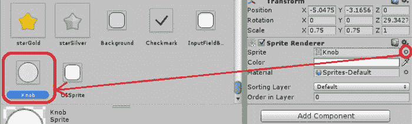

现在我们可以编写绘制路径的脚本并将其添加到弹体模板中。该脚本的叙述描述如下：

```
using UnityEngine;

using System.Collections;

public class PathDrawer: MonoBehaviour {

    // The template used to draw points
    public GameObject pathPointPrefab;

    // Distance between two consecutive points
    public float pointDistance = 0.75f;

    // Parent object for path point objects
    Transform pathParent;

    // Variable to store the location of the last point added
    Vector2 lastPointPosition;

    // Internal variable to see if the projectile was launched or not
    bool launched = false;

    // Called once at startup
    void Start () {
        // Path Find the parent object of the named path points
        pathParent = GameObject.Find ("Path").transform;
    }

    // Called once when rendering each frame
    void Update () {
        if (launched)
        {
            float dist = Vector2.Distance (transform.position, lastPointPosition);
            if (dist >= pointDistance)
            {
                // It's time to add a new point
                AddPathPoint ();
            }
        }
    }

    void ProjectileLaunched ()
    {
        // The projectile is just launched so delete the previous track
        for (int i = 0; i <pathParent.childCount; i ++)
        {
            Destroy (pathParent.GetChild (i).gameObject);
        }
        AddPathPoint ();
        // Update the variable value as the projectile has been launched
        launched = true;
    }

    // Adds a new point to the path
    void AddPathPoint ()
    {
        // Create a new point using the template
        GameObject newPoint = (GameObject) Instantiate (pathPointPrefab);
        // Create a new point using the template
        newPoint.transform.position = transform.position;
        // Create a new point using the template
        newPoint.transform.parent = pathParent;
        // Create a new point using the template
        lastPointPosition = transform.position;
    }
}
```

`PathDrawer` 脚本使用 `PathPoint` 模板沿弹体轨迹绘制点。它跟踪当前位置与 `lastPointPosition` 之间的距离；当距离超过 `pointDistance` 时，它会实例化一个新的点。当调用 `ProjectileLaunched()` 时，现有的轨迹点会被清除，并开始一条新路径。

## 弹体的特殊攻击

为了完善我们制造的弹体，我们设计了一种玩家在发射后可以执行的特殊攻击。这种攻击在原始游戏《愤怒的小鸟》中有多种图像形式，我们在本系列课程中引用了它们。我们只需用两个示例来说明这些攻击是如何构建的。第一个是速度攻击，我们将将其用于鸟形弹体，它会双倍弹体的速度，使其在撞击积木或对手时产生更大的影响力。第二个我们为长鹿和大象弹体采用分裂攻击，在这种攻击中，原始弹体会被分成若干个较小的弹体，可以命中多个目标。

让我们从最简单的攻击——速度攻击开始。由于各种攻击的逻辑非常不同，我们必须将每种攻击分离到独立的脚本。这些攻击之间的唯一共同点是它们都会接收 `DoSpecialAttack` 消息，该消息是在调用 `PerformSpecialAttack()` 函数并检查执行此攻击的必要条件时由 `Projectile` 发送的。速度攻击实现脚本名为 `SpeedAttack`，它的功能是引入实体并在不改变其方向的情况下按一定倍数提高速度。

```
using UnityEngine;

using System.Collections;

public class SpeedAttack: MonoBehaviour {

    // Multiply the current velocity of the projectile by this
    // Amount when carrying out the attack
    public float speedFactor = 1.5f;

    // It is called once at startup
    void Start () {
    }

    // It is called once when each frame is rendered
    void Update () {
    }

    // Consequently, it performs the DoSpecialAttack speed attack that receives the message
    public void DoSpecialAttack ()
    {
    }
}
```


```cs
// 获取弹体物体的刚体组件
Rigidbody2D myRB = GetComponent<Rigidbody2D>();

// 通过乘法加速速度，然后将对象的速度设置为新的输出
myRB.velocity = myRB.velocity * speedFactor;

}
}
```

我们之前提到的第二种特殊攻击是“裂变攻击”，它会导致弹体分解成更小的弹体（碎片），这些碎片随后会散布到较大的区域。在开始为这种攻击编写程序器代码之前，我们需要注意，它的实现将需要创建新对象，即由攻击实现逻辑负责散布的碎片。这意味着我们需要为这些碎片构建模具，具体会有两个模具：一个用于大象形挤出的碎片，另一个用于长鹿形挤出的碎片。我将这两个模板命名为 `ElephantCluster` 和 `GiraffeCluster`，除了显示的图像外，它们在其他所有方面几乎完全相同。这两个模具非常简单，每个都带有原始弹体的图像，并将对象在 x 和 y 轴上缩放到 0.75，以使碎片比原始弹体更。此外，我们还将添加一个 `Rigid Body 2D` 刚体组件和一个 `Circle Collider 2D` 碰撞组件，使碎片模具准备就。

实现这种类型攻击的小程序称为 `ClusterAttack`，其逻辑描述如下：

```cs
using UnityEngine;

using System.Collections;

public class ClusterAttack: MonoBehaviour {

    // 用于创建碎片的模板
    public GameObject clusterPrefab;

    // 每个碎片在被销毁并从场景移除之前的生存秒数
    public float clusterLife = 4.0f;

    // 从该弹体会产生多少个碎片
    public int clusterCount = 3;

    // 启动时调用一次
    void Start () {
    }

    // 渲染每一帧时调用一次
    void Update () {
    }

    // 相应地实现 DoSpecialAttack 裂变攻击以接收消息
    public void DoSpecialAttack ()
    {
        // 获取原始弹体的当前速度
        Rigidbody2D myRB = GetComponent<Rigidbody2D>();
        float originalVelocity = myRB.velocity.magnitude;

        // 在数组中存储所有碎片的碰撞组件
        Collider2D [] colliders = new Collider2D [clusterCount];
        Collider2D myCollider = GetComponent<Collider2D>();

        for (int i = 0; i <clusterCount; i ++)
        {
            // 创建新碎片
            GameObject cluster = (GameObject) Instantiate (clusterPrefab);
            // 设置碎片对象的位置、名称和父级
            cluster.transform.parent = transform.parent;
            cluster.name = name + "_cluster_" + i;
            cluster.transform.position = transform.position;

            // 在数组中存储当前位置的碎片碰撞组件
            colliders [i] = cluster.GetComponent<Collider2D>();

            // 忽略此碎片与之前创建的碎片之间可能发生的碰撞
            // 同时忽略碎片与原始对象之间可能发生的碰撞
            Physics2D.IgnoreCollision(colliders [i], myCollider);

            for (int a = 0; a <i; a ++)
            {
                Physics2D.IgnoreCollision(colliders [i], colliders [a]);
            }

            Vector2 clusterVelocity;
            // 随着每个新碎片的产生，减少水平速度并增加垂直速度以确保碎片效果
            clusterVelocity.x = (originalVelocity / clusterCount) * (clusterCount - i);
            clusterVelocity.y = (originalVelocity / clusterCount) * -i;

            //为新碎片添加刚体对象组件
            Rigidbody2D clusterRB = cluster.GetComponent<Rigidbody2D>();
            clusterRB.velocity = clusterVelocity;

            // 选择原始对象的质量
            clusterRB.mass = myRB.mass;

            // 在生命周期结束后销毁碎片
            Destroy(cluster, clusterLife);
        }
    }
}
```


```csharp
// 橡胶弹射绳索可以延伸的最大长度
public float maxStretch = 1.0f;

// 当前弹药在被玩家持有之前将放置的位置
public Transform launchPosition;

// 弹射器上的当前弹药
public Projectile currentProjectile;

// 场景中所有的弹药是否已发射完毕？
private bool projectilesConsumed = false;

// 在启动时调用一次
void Start ()
{
}

// 在每帧渲染时调用一次
void Update ()
{
    if (projectilesConsumed)
    {
        // 无需执行操作
        return;
    }
    if (currentProjectile != null)
    {
        // 如果弹药没有被发射，它也没有被玩家抓住
        // 则将弹药带到发射点
        if (!currentProjectile.IsHeld() && !currentProjectile.IsLaunched())
        {
            BringCurrentProjectile();
        }
    }
    else
    {
        // 目前弹射器上没有弹药
        // 寻找最近的弹药并将其带到发射点
        currentProjectile = GetNearestProjectile();
        if (currentProjectile == null)
        {
            // 所有弹药已消耗，发送消息通知它们
            projectilesConsumed = true;
            SendMessageUpwards("ProjectilesConsumed");
        }
    }
}

// 寻找最近的弹药并返回它
Projectile GetNearestProjectile ()
{
    Projectile[] allProjectiles = FindObjectsOfType<Projectile>();
    if (allProjectiles.Length == 0)
    {
        // 已经没有弹药了
        return null;
    }
    // 搜索最近的弹药并返回
    Projectile nearest = allProjectiles[0];
    float minDist = Vector2.Distance(nearest.transform.position, transform.position);
    for (int i = 1; i < allProjectiles.Length; i++)
    {
        float dist = Vector2.Distance(allProjectiles[i].transform.position, transform.position);
        if (dist < minDist)
        {
            minDist = dist;
            nearest = allProjectiles[i];
        }
    }
    return nearest;
}

// 让当前弹药平滑地向发射点移动一步
void BringCurrentProjectile ()
{
    // 弹药移动之间的位置
    Vector2 projectilePos = currentProjectile.transform.position;
    Vector2 launcherPos = launchPosition.transform.position;
    if (projectilePos == launcherPos)
    {
        // 已经在发射点挤出，实际上不需要移动
        return;
    }
    // 使用帧之间经过的时间进行线性插值以平滑移动
    projectilePos = Vector2.Lerp(projectilePos, launcherPos, Time.deltaTime * 5.0f);
    // 将弹药置于新位置
    currentProjectile.transform.position = projectilePos;
    if (Vector2.Distance(launcherPos, projectilePos) < 0.1f)
    {
        // 弹药非常接近，直接将其放置在发射点
        currentProjectile.transform.position = launcherPos;
        currentProjectile.AllowControl();
    }
}

// 持有当前弹药
public void HoldProjectile ()
{
    if (currentProjectile != null)
    {
        currentProjectile.Hold();
    }
}

// 将当前弹药拖到新位置
public void DragProjectile (Vector2 newPosition)
{
    if (currentProjectile != null)
    {
        // 确保不超过最大绳索张力
        float currentDist = Vector2.Distance(newPosition, launchPosition.position);
        if (currentDist > maxStretch)
        {
            // 将提供的位置更改为允许的最远点
            float lerpAmount = maxStretch / currentDist;
            newPosition = Vector2.Lerp(launchPosition.position, newPosition, lerpAmount);
        }
        // 将弹药放在新位置
        currentProjectile.Drag(newPosition);
    }
}

// 如果玩家持有当前弹药，则释放并发射它
public void ReleaseProjectile ()
{
    if (currentProjectile != null)
    {
        currentProjectile.Launch(launchForce);
    }
}
```

此小程序中的通用变量包括 `launchForce`（代表发射力）、`maxStretch`（代表在张力期间弹药与发射位置之间允许的最大距离，即橡胶线的最大延伸）以及 `launchPosition`（一个用于存储名为 `LaunchPos` 的发射点对象的变量，这是我们在创建弹弓模板时添加的）。


我们使用这种技术来计算弹体在向发射点移动过程的新位置，在这种情况下，插值发生在当前的最小 `projectilePos` 与我们想要达到的最大目标 `launcherPos` 之间。插值的值相对较低，即它更接近目标，该值是自上一帧渲染以来所经过的时间乘以 5。。在这里使用时间值的重要性在于，并不是所有帧都是以相同的速度渲染的。帧率不是固定的，可能会增加或减少。因此，为了保持恒定的移动速度，我们必须乘以时间（时间会随着每秒帧数的减少而增加，反之亦然），从而使得玩家看到的移动速度无论帧率高低都保持恒定。

这三个函数 `HoldProjectile()`、`DragProjectile()` 和 `ReleaseProjectile()` 分别调用了当前弹体 `currentProjectile` 的 `Hold()`、`Drag()` 和 `Launch()` 函数。这里需要解释的函数是 `DragProjectile()`，因为它包含一个 `Projectile` 中不具备的额外步骤，即验证在向后拉时弹体距离初始发射点的距离是否超过了橡皮弹弓允许的拉伸长度。这个拉伸长度在 `maxStretch` 变量中定义。我们实施这种最大长度的方法也应该考虑到控制的便利性，如果玩家将光标拉到允许长度之外，弹体不应随之移动，但同时必须能够改变发射角度。为了实现这一机制，我们将再次使用线性插值，这种用法描述在第 131 行和 132 行。

其思路是计算发射位置与当前位置 `currentDist` 之间的距离，并与最大伸展值 `maxStretch` 进行比较。如果此距离超过了限制，我们将 `maxStretch` 除以 `currentDist`，从而获得原始 `launchPosition.position` 与新位置 `newPosition` 之间所需的插值。该值会随着光标到发射点距离的增加而自然减少，从而保持与发射点的距离恒定为 `maxStretch` 距离。通过完成插值，我们得到了正确的 `newPosition` 而不影响平滑运动，然后使用 `Drag()` 函数移动弹体。有必要使用这个函数而不是直接移动弹体，因为它会验证条件，即弹体是否正被玩家持有且尚未发射，而这正是游戏规则的移动条件。

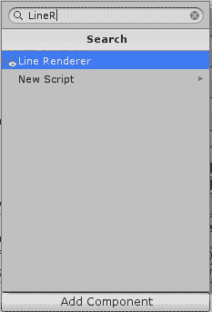

编写完脚本后，我们必须将其添加到空空的 `Object Launcher` 中，它是组成弹弓的所有层级对象的根节点。我们将添加的下一个脚本将在弹弓的端点和弹体之间绘制橡皮绳。但在继续下一个脚本之前，我们必须添加负责绘制代表这条绳子的线条的组件。我们要添加的组件称为 `Line Renderer`，可以像通常一样通过 `Add Component` 按钮添加，然后如如下所示输入组件名称。该组件会在通过 `positions` 数组分配给它的一组点之间绘制一条实线，从数组中的第一个点到最后一个点：

添加组件后，我们必须调整它的部分键值：首先，我们必须将绘制 `positions` 线的点数改为 3，然后通过将 `Start Width` 和 `End Width` 均更改为 0.1 来使其变细，最后我们将起点和终点的颜色改为红色（当然，你也可以选择任何其他颜色）。这些设置在如下所示：

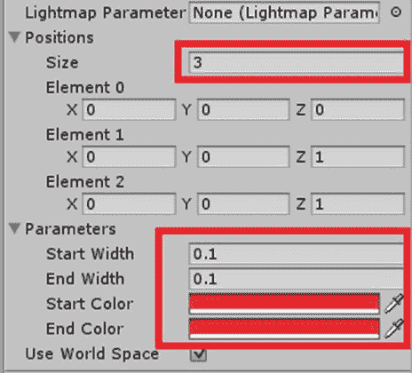

现在让我们启动 `LauncherRope`，它负责在弹弓的端点和弹体之间绘制这条线。该脚本的叙述描述如下：

```csharp
using UnityEngine;

using System.Collections;

public class LauncherRope: MonoBehaviour {

    // 绳子左端的位置
    public Transform leftEnd;

    // 绳子右端的位置
    public Transform rightEnd;

    // 发射器脚本的引用
    Launcher launcher;

    // 对添加的渲染组件的引用
    LineRenderer line;

    // 启动时调用一次
    void Start () {
        launcher = GetComponent <Launcher>();
        line = GetComponent <LineRenderer>();
        // 最初通过禁用组件隐藏线条
        line.enabled = false;
    }

    // 每帧渲染时调用一次
    void Update () {
        // 只有当弹体被玩家持有时才显示线条
        if (launcher.currentProjectile != null &&
            launcher.currentProjectile.IsHeld ()) {
            if (! line.enabled) {
                line.enabled = true;
            }
            // 从左端（弹体）开始绘制线条
            line.SetPosition(0, leftEnd.position);
            line.SetPosition(1, launcher.currentProjectile.transform.position);
            line.SetPosition(2, rightEnd.position);
        } else {
            line.enabled = false;
        }
    }
}
```

你可以看到这个脚本是多么简单。它所做的只是先禁用线条，然后检查弹体的状态。如果它被玩家持有，则激活 `LineRenderer`，使线条可见。记住这两个弹弓对象：`leftEnd` 和 `rightEnd`。我们使用 `SetPosition` 函数来定义位置。当你玩时，线条看起来像这样：

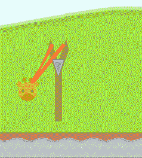

因此，弹弓的任务已经完成，我们必须添加一个程序来读取玩家输入。这个脚本被称为 `LauncherMouse`，它的任务是读取玩家的鼠标。接下来的叙述说明了这一点：

```csharp
using UnityEngine;

using System.Collections;

public class LauncherMouse: MonoBehaviour {

    // 脚本引用
    private Launcher launcher;

    // 启动时调用一次
    void Start () {
        launcher = GetComponent <Launcher>();
    }

    // 每帧渲染时调用一次
    void Update () {
        CheckButtonDown();
        CheckDragging();
        CheckButtonUp();
    }

    void CheckButtonDown () {
        if (Input.GetMouseButtonDown(0)) {
            // 左鼠标键刚刚被按下
            // 是否有弹体？
            if (launcher.currentProjectile != null) {
                // 将光标位置从屏幕坐标转换为场景空间坐标
                Vector2 mouseWorldPos = Camera.main.ScreenToWorldPoint (Input.mousePosition);
                // 从对象中提取碰撞组件
                Collider2D projectileCol = launcher.currentProjectile.GetComponent <Collider2D>();
                // 鼠标是否在弹体的碰撞组件范围内？
                if (projectileCol.bounds.Contains (mouseWorldPos)) {
                    //
                }
            }
        }
    }
}
```


```cpp
// 是的，这意味着鼠标按钮在弹药上方被按下
// 保持弹药
launcher.HoldProjectile ();
}
    }
}
}
}

// 检查玩家是否使用左键拖拽
void CheckDragging ()
{
    if (Input.GetMouseButton (0))
    {
        Vector2 mouseWorldPos = Camera.main.ScreenToWorldPoint (Input.mousePosition);
        launcher.DragProjectile (mouseWorldPos);
    }
}

// 检查左鼠标键是否松开
void CheckButtonUp ()
{
    if (Input.GetMouseButtonUp (0))
    {
        // 左键被松开
        // 发射弹药
        launcher.ReleaseProjectile ();
    }
}
```

该程序中的 `Update()` 函数分别调用了另外三个函数：`CheckButtonDown()`、`CheckDragging()` 和 `CheckButtonUp()`。

在 `CheckButtonDown()` 函数中，首先检查弹弓上是否存在弹药。如果找到，则将鼠标指针从屏幕坐标转换为场景坐标，然后检查该位置是否落在弹药碰撞组件的范围内。此条件意味着玩家点击了弹药上的左键并抓住了它，因此调用了 `launcher` 中的 `Hold()` 函数。

在 `CheckDragging()` 函数中，会检查左鼠标键，在这种情况下通过调用 `DragProjectile()` 函数将弹药移动到光标位置。记住，此函数防止投射器超过皮筋的最大拉伸限制，因此无论指示器在哪里，弹药都将保持在该范围内。

最后，`CheckButtonUp()` 函数检查玩家是否松开了左键，如果是的话，则调用 `launcher` 程序中的 `ReleaseProjectile()` 函数，直到弹药发射。下图表示了发射弹弓模板的最终组件：

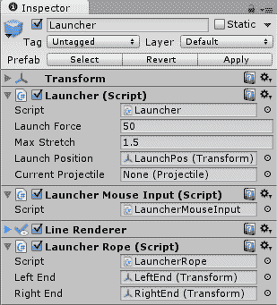

好了，我们现在有了背景、地板、建筑块、对手、发射器和弹药，也就是说所有游戏元素已准备就绪，我们可以尝试构建场景并进行游戏了。下面的图片显示了我们在经过这些艰辛努力后达到的阶段！

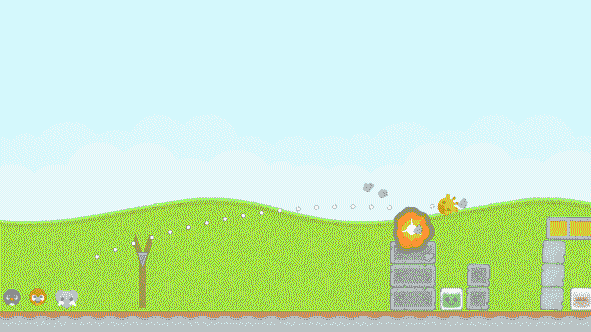

