# C# 学习 RabbitMQ：IT 世界的魔法工具


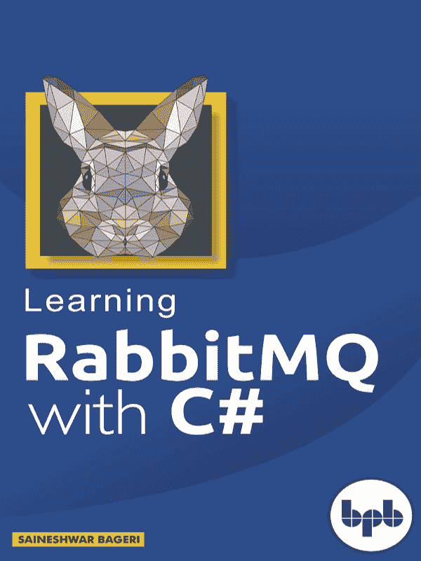


# 目录

我想感谢以下人员：

感谢我的父母的支持和鼓励。

感谢 Manish Jain 给我提供写这本书的书的机会。

感谢 Shivprasad Koirala 和 Sukesh Marla 支持并鼓励我写这本书。

并感谢所有其他在本书准备过程中发挥过作用的人。感谢大家的辛勤工作！

# RabbitMQ 简介

## 什么是 RabbitMQ？

RabbitMQ 是一个 AMQP 消息中间件，它是最流行的开源且跨平台消息中间件。

它基于 Erlang 构建，WhatsApp 也使用它进行通信。

RabbitMQ 也是一种应用程序之间交换数据的方法，例如从 .Net 应用发送的消息可以被 Node.js 应用或 Java 应用读取。

RabbitMQ 轻量级且易于在本地和云端部署。它支持多种消息协议。RabbitMQ 可以采用分布式和联邦配置部署，以满足高规模、高可用性的需求。

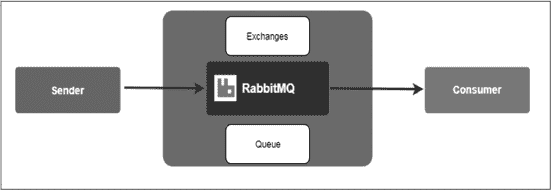

## 为什么以及何时应该使用 RabbitMQ？

我们应该使用 RabbitMQ 是因为它是开源且易于使用的，支持 .Net、Java、Python、Ruby、Node Js 等许多语言。

我们可以使用 RabbitMQ 从我们的 Web 应用程序中移除一些繁重的工作，例如以电子邮件、Excel 或 Pdf 格式发送报告，或者发送电子邮件、短信或其他任务（如触发其他应用程序开始处理的器）。

现在，大多数人将所有这些任务（发送邮件或短信、报告）都放在单个应用程序中完成，这是一项相当繁重的任务，由 IIS 处理。如果你将此任务分离出来，IIS 将获得更多空间（内存）来提供更多请求。

在简单了解 RabbitMQ 之后，接下来我们将在 Windows 上安装 Erlang 和 RabbitMQ。

## 什么是 AMQP？

`高级消息队列协议`（`AMQP`）是一种面向消息的开放标准应用层协议，AMQP 的定义特征是面向消息的、队列化、路由（包括点对点和发布/订阅）、可靠性和安全性。

它由摩根大通和 iMatix 公司开发。

### 主要特性

AMQP 设计的目标是具有以下主要特征：

• 安全性 
• 可靠性
• 互操作性
• 标准性
• 开源

### 各种客户端库

RabbitMQ 支持多种操作系统和各种语言，并为不同语言提供了各种客户端，例如：

1. .Net
2. Java
3. Spring Framework
4. Ruby
5. Python
6. PHP
7. Objective-C 和 Swift
8. JavaScript
9. GO
10. Perl


# RabbitMQ 安装

在这一部分，我们将学习如何一步步设置 RabbitMQ：

1. 什么是 Erlang
2. 下载 Erlang
3. 安装 Erlang
4. 下载 RabbitMQ
5. 安装 RabbitMQ
6.  RabbitMQ 服务器
7. 启用 Web 管理插件
8. Web 管理插件
9. 结论

## 什么是 Erlang

Erlang 是一种通用编程语言和运行时环境。

Erlang 内置了对并发、分布式和容错的支持。

Erlang 被爱立信的多个大型电信系统使用。

引用自：[`erlang.org/faq/introduction.html`](http://erlang.org/faq/introduction.html)

### 下载 Erlang 的链接

[`www.erlang.org/downloads`](http://www.erlang.org/downloads)

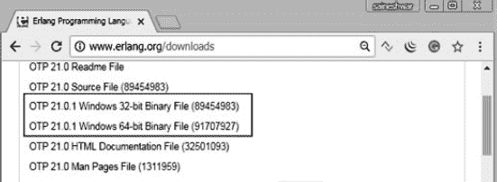

下载 Erlang 后，现在我们将安装 Erlang。


# 安装 Erlang

在这一部分，只需点击你下载的 Erlang 安装程序进行安装。

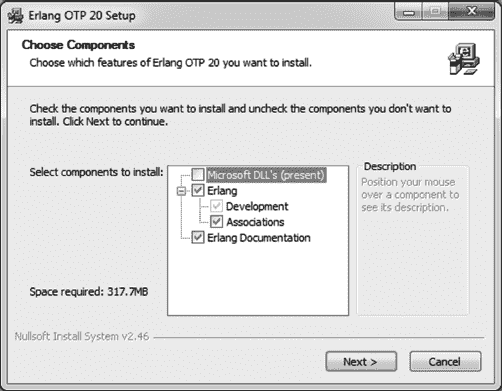

下载 Erlang 安装程序后，直接安装即可，安装完成后我们将下载 RabbitMQ。

## 下载 RabbitMQ

首先，我们将从以下链接下载 Windows 版 RabbitMQ 安装程序：

[`www.rabbitmq.com/download.html`](https://www.rabbitmq.com/download.html)

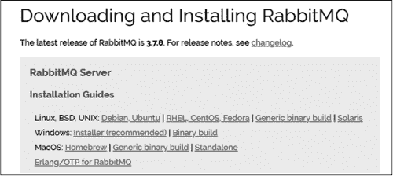

下载 RabbitMQ 后，现在我们将安装 RabbitMQ。

## 安装 RabbitMQ

在这一部分，只需点击你下载的 RabbitMQ 安装程序进行安装。

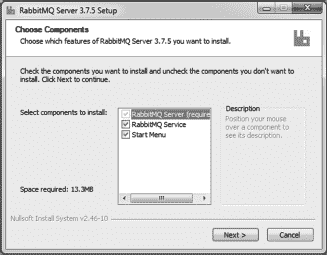

安装 RabbitMQ 后，搜索 RabbitMQ 命令提示符并以管理员权限打开它。

## 启动 RabbitMQ 服务器

在这一部分，我们将以管理员权限打开 `RabbitMQ Command Prompt` 以检查 RabbitMQ 服务器的状态。

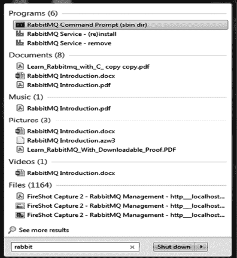

打开命令提示符后，输入 `rabbitmqctl status` 来检查 RabbitMQ 服务器的状态。

```
rabbitmqctl status
```

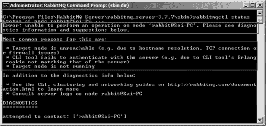

如果你遇到如下错误，需要按照以下步骤操作：

1. 在资源管理器中，导航到你的用户目录。（在地址栏输入 `%userprofile%）
2. 如果那里已经有了 `.erlang.cookie` 文件，将其删除。如果没有，直接进入下一步。
3. 在第二个资源管理器中，导航到 `C:\Windows\System32\config`。
4. 找到 `.erlang.cookie` 文件并将其复制到你的用户目录。
5. 现在 `rabbitmqctl` 应该可以通过身份验证。

### 解决方案链接

• [`stackoverflow.com/questions/478939/authentication-failed-rejected-by-the-node-please-check-the-erlang-coo?rq=1`](https://stackoverflow.com/questions/478939/authentication-failed-rejected-by-the-node-please-check-the-erlang-coo?rq=1)
• [`stackoverflow.com/questions/2825832/rabbitmq-has-nodedown-error`](https://stackoverflow.com/questions/2825832/rabbitmq-has-nodedown-error)

完成步骤后，再次运行相同的命令 `rabbitmqctl status`，应该出现以下屏幕。

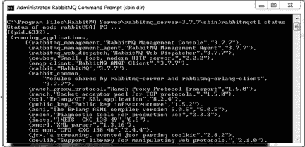

```
rabbitmq-plugins enable rabbitmq_management
```

执行此命令后，你将看到以下插件将被启用。

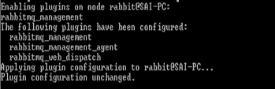

屏幕是相同的，但由于我已经启用了插件，所以显示的信息不同

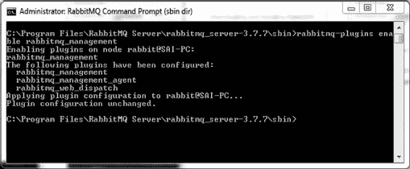

现在我们已经启动了服务器，接下来我们将启用 RabbitMQ 的 Web 管理插件。

### Web 管理插件

现在使用 Web 管理插件，在浏览器中输入本地地址 `http://localhost:15672/`。

在浏览器中输入本地地址后，它会要求访问 Web 管理插件的凭据。

管理插件的默认`用户名`和`密码`为 `guest`（用户名："guest" | 密码："guest"）。

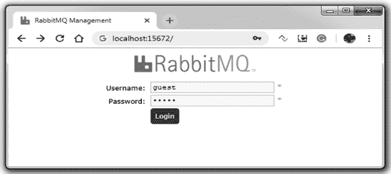

使用默认凭据登录后，将出现以下概览屏幕。

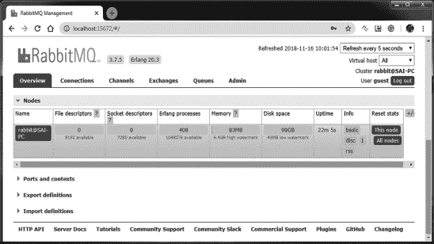


有关所有标签页的详细信息，您可以访问：[`www.cloudamqp.com/blog/2015-05-27-part3-rabbitmq-for-beginners_the-management-interface.html#overview`](https://www.cloudamqp.com/blog/2015-05-27-part3-rabbitmq-for-beginners_the-management-interface.html#overview)


# RabbitMQ 交换机 (Exchanges)

## 什么是交换机？

当生产者创建消息时，消息不会直接发送到队列，而是发送到交换机，随后路由代理根据头属性、绑定和路由键读取并发送到适当的队列。共有四种交换机以不同的方式路由消息，此外，还可以设置各种参数，如 `Type`（类型）、`Durability`（持久性）、`Auto-delete`（自动删除）和 `Internal`（内部）。

### 直接交换机 (Direct Exchange)

**Direct：** 直接交换机根据消息路由键将消息传递到队列。在直接交换机中，消息被路由到绑定键与消息路由键完全匹配的队列。

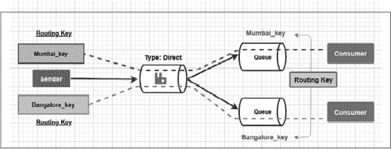

### 广播交换机 (Fanout Exchange)

**Fanout：** 广播交换机将消息路由到所有绑定到它的队列。

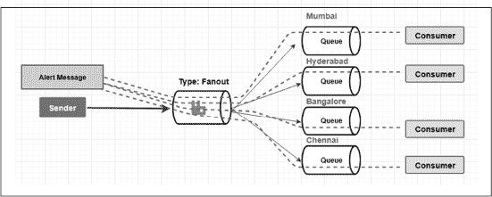

### 主题交换机 (Topic Exchange)

**Topic：** 主题交换机在路由键和绑定中指定的路由模式之间进行通配配符匹配。

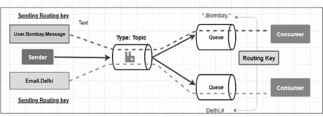

### 头部交换机 (Headers Exchange)

**Headers：** 头部交换机使用消息头属性进行路由。

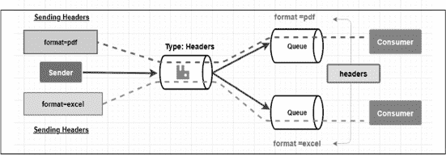

### 属性详情

### 名称 (Name)

名称将是您设置的交换机名称，它必须是唯一的。

### 类型 (Type)

**Direct：** 直接交换机根据消息路由键将消息传递到队列。在直接交换机中，消息被路由到绑定键与消息路由键完全匹配的队列。

**Fanout：** 广播交换机将消息路由到所有绑定到它的队列。

**Topic：** 主题交换机在路由键和绑定中指定的路由模式之间进行通配符匹配。

**Headers：** 头部交换机使用消息头属性进行路由。

### 持久性 (Durability)

持久性是交换机的一个属性，告知消息是否可以在服务器重启后（代理重启）。

有两种持久性选项：

1. 持久 (Durable)
2. 瞬态 (Transient / 非持久)

1. **Durable：** 如果您将交换机标记为持久，则它将在服务器重启后依然存在。
2. **Transient：** 如果您将交换机标记为瞬态，则它将在服务器重启后丢失。

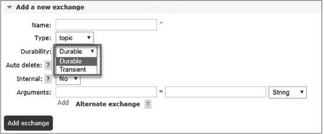

### 自动删除 (Auto delete)

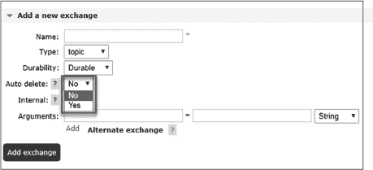

自动删除有两个选项：

1. 是
2. 否

如果是，在至少有一个队列或交换机绑定到该交换机且所有队列或交换机都解绑后，该交换机将删除自己。例如：在此部分中，如果您创建一个交换机并将其绑定到队列，当您解绑队列时，它也会删除该交换机。

### 内部 (Internal)

如果设置，交换机可能无法被发布者直接使用，只有在绑定到其他交换机时可以使用。内部交换机用于构建应用程序不可见的接线。

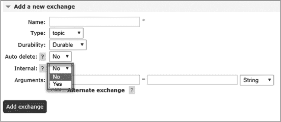

### 备用交换机 (Alternate-exchange)

如果在向交换机发布消息时出现问题，您可以指定备用交换机，它会将消息发送到另一个队列。

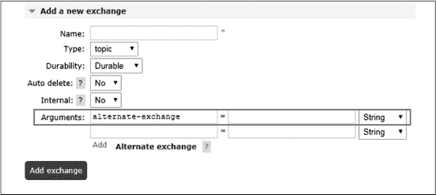

## 添加交换机

要添加交换机，我们首先将使用默认凭据登录，然后选择 Exchanges（交换机）标签页。

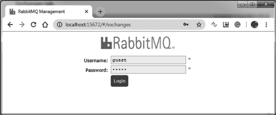

选择标签页后，您将看到“Add a new exchange panel（添加新交换机面板）”，点击该面板即可展开。展开后会要求输入交换机名称，为了演示，我们将交换机命名为 `demoexchange`，并在类型中选择 *"direct"，然后点击添加按钮进行创建。

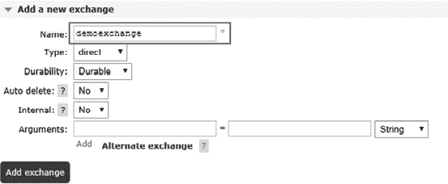

输入所有详情后，我们将点击 **Add exchange**（添加交换机）按钮来创建交换机。

## 添加交换机后的快

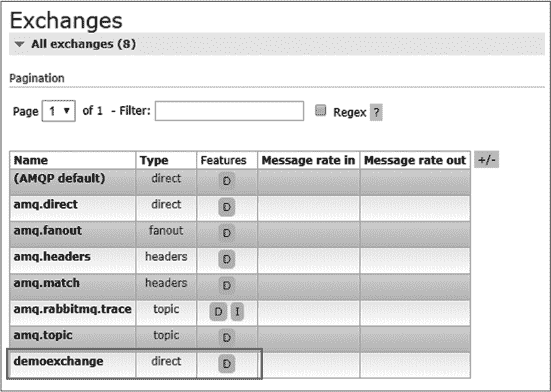

以类似的方式，我们可以添加不同类型的交换机。


# RabbitMQ 队列 (Queues)

## 什么是队列？

队列是一个存储从交换机发送到队列的消息的缓冲区。


## 队列参数详情

### 名称 (Name)

队列的名称，我们可以在应用程序中引用。名称必须是唯一的，且不能是系统定义的队列名称。

### 持久性 (Durability)

持久性是队列的一个属性，告知消息是否可以在服务器重启后（代理重启）。

有两种持久性选项：

1. 持久 (Durable)
2. 瞬态 (Transient / 非持久)

1. **Durable：** 如果您将队列标记为持久，则它将在服务器重启后依然存在。
2. **Transient：** 如果您将交换标记为瞬态，则它将在服务器重启后丢失。（注：此处原文误为 exchange，应为 queue）

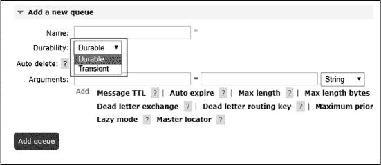

### 自动删除 (Auto delete)

自动删除有两个选项：

1. 是
2. 否

如果是，在至少有一个队列或交换机绑定到该交换机且所有队列或交换机都解绑后，该交换机将删除自己。例如：在此部分中，如果您创建一个交换机并将其绑定到队列，当您解绑队列时，它也会删除该交换机。

### 参数 (Arguments)

参数（可选；用于插件和特定功能，如消息 TTL、队列长度等）

### 生存时间 (Time-to-live)

在此部分中，您可以为队列设置过期时间，达到时间后将丢弃。

时间为毫秒。

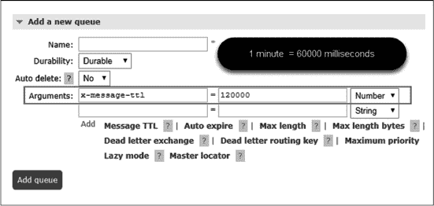

### 自动过期 (Auto expire)

在此部分中，您可以通过设置此属性为队列设置过期。

这控制队列未使用多久后自动删除。

未使用意味着队列没有消费者、队列未被重新声明，且至少没有调用过 `basic.get`。

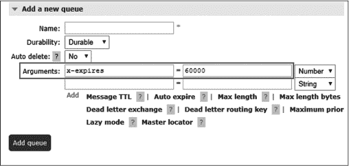

### 最大长度 (Max Length)

队列在开始丢弃头部之前可以包含的（就绪）消息数量。

通过在队列声明参数中提供非负值 `x-max-length` 设置消息数量。

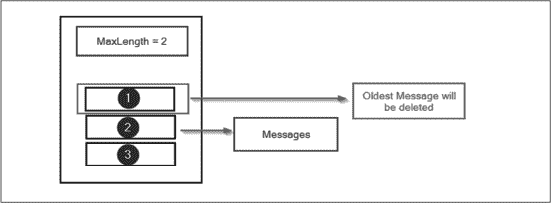

例如，如果您设置 `x-max-length = 2` 且向队列发布了三条消息，则队列将保留两条，最旧的删除。

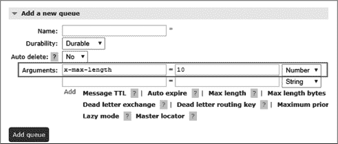

### 最大长度字节 (Max Length Bytes)

队列在开始丢弃头部之前可以包含的就绪消息的总大小。

通过在队列声明参数中提供非负整数值 `x-max-length-bytes` 设置最大字节数。

（设置 `x-max-length-bytes` 参数。） *1000000 bytes = 1MB*

例如，如果您设置 `x-max-length-bytes = 1000000` 并向队列发布消息导致队列大小超过 1 MB，则最旧的消息删除（从头部丢弃）。

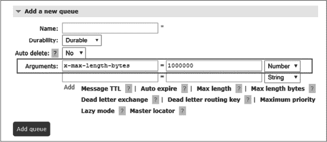

### 溢出行为 (Overflow Behaviour)

设置队列溢出行为。这决定了当达到最大长度时会发生什么。有效值为 `drop-head`（丢头部）或 `reject-publish`（拒绝发布）。


### 死信交换机 (Dead Letter Exchange)

当消息被拒绝或过期时，将重新发布到的可选交换机名称。

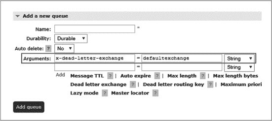

### 死信路由键 (Dead Letter Routing Key)

当消息进入死信时使用的可选替换路由键。如果没有设置，将使用消息的原始路由键。


例如，如果你向一个路由键为 `foo` 的交换机发布消息，且该消息进入了死信队列，它将带有路由键 `foo` 被发布到其对应的死信交换机中。如果消息最初落入的队列在声明时将 `x-dead-letter-routing-key` 设置为 `bar`，那么该消息将带有路由键 `bar` 被发布到其对应的死信交换机中。

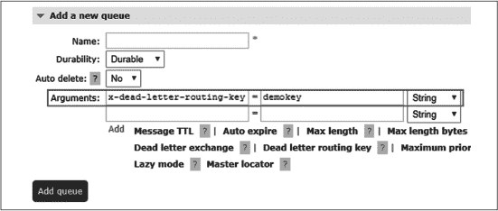

### 最大优先级 (Maximum Priority)

队列支持的最大优先级层数；如果没有设置，则队列将不支持消息优先级。

（设置 `x-max-priority` 参数。）

要声明优先级队列，请使用可选的队列参数 `x-max-priority`。该参数应该是 1 到 255 之间的正整数，表示队列应该支持的最大优先级。

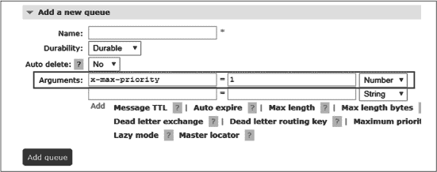

### 懒惰模式 (Lazy Mode)

将队列设置为懒惰模式，尽可能将更多消息保留在磁盘上以减少 RAM 占用；如果没有设置，队列将保留内存缓存以尽可能快的速度递送消息。

（设置 `x-queue-mode` 参数。）

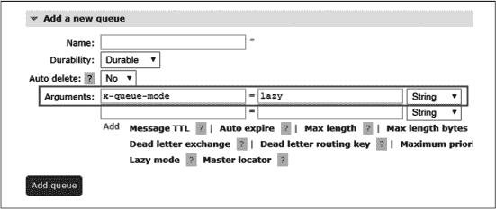

### 主节点定位器 (Master Locator)

将队列设置为主节点模式，确定在节点集群上声明队列时定位队列主节点的规则。

（设置 `x-queue-master-locator` 参数。）

### 添加队列 (Adding Queue)

要创建队列，你需要点击 Web 管理插件中的队列标签页。

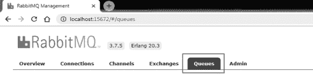

点击队列标签页后，你将看到一个带有箭头的“添加队列”面板，只需点击该面板即可展开。

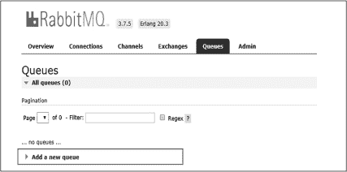

点击“添加新队列”后，新队列面板将会展开，我们将进入队列详情设置。

首先，我们将从队列名称开始，将其命名为 `demoqueue`，然后选择将持久性设置为 `Durable`（持久化），最后一个选项，我们将将自动删除设置为 `No`，并点击“添加队列”按钮来创建队列。

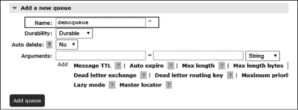

添加队列后，你可以看到最近添加的队列，它位于“添加队列”面板上方。

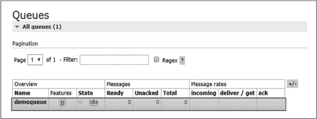


# RabbitMQ 中的绑定 (Binding in RabbitMQ)

## 什么是绑定 (What is Binding)

绑定是我们在队列和交换机之间配置的连接。

**简单来说：**绑定是交换机与队列之间的关系。

在这一部分，我们将使用路由键将交换机与队列绑定，这将用于直接类型（direct type）交换机。交换机将根据路由键将请求路由到特定的队列。

要进行绑定，点击你输入的 `demoqueue` 队列名称，点击后，绑定面板将会展开，接下来它会询问交换机名称，输入我们创建的交换机名称 `demoexchange` 和路由键 `demokey`，然后点击绑定按钮。

### 队列列表 (Queues)

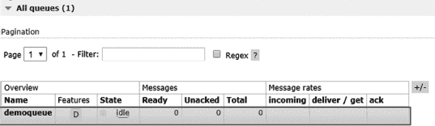

### 绑定后的快 (Snapshot after Binding)

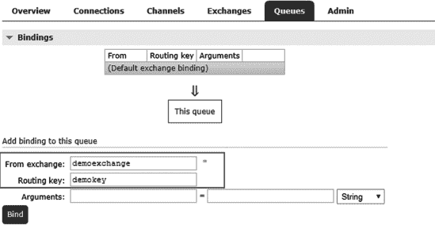

####为此队列添加绑定 (Add binding to this queue)

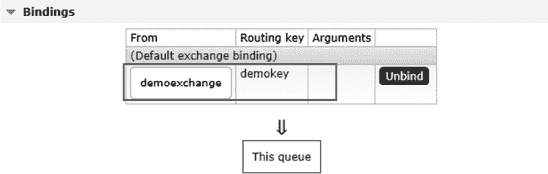

绑定后，如果你想取消绑定，可以点击 `Unbind` 按钮移除绑定。


# RabbitMQ 用户 (RabbitMQ Users)

在这一部分，我们将学习如何创建一个新用户并给新用户授予权限。

要创建新用户，我们需要使用默认凭据登录 Web 管理插件。

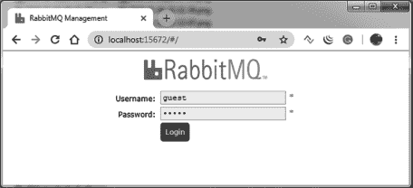

登录应用程序后，我们将选择 `Admin` 标签页。

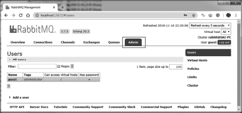

选择 admin 标签页后，我们可以看到默认用户名 `guest`，它下方具有 `administrator`（标签）权限，下方我们可以看到添加新用户的面板。

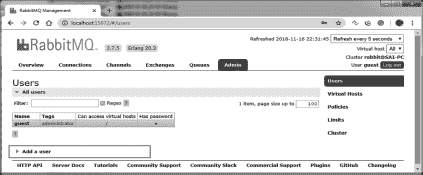

点击 `Add a User` 面板来创建新用户。

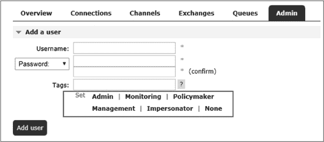

在继续之前，让我们先看看标签（Tags）。这一部分中的标签是分配给创建用户的权限（特权）。如果需要，我们可以为用户设置单个或多个权限，如果需要多个权限，只需用逗号分隔的形式设置权限（例如 `administrator, management`）。

## 管理插件当前支持的功能 (Currently Supported by the Management Plugin)

### 管理 (Management)
用户可以访问管理插件。

### 策略制定者 (Policymaker)
用户可以访问管理插件，并对其拥有访问权限的虚拟主机（vhosts）管理策略和参数。

### 监控 (Monitoring)
用户可以访问管理插件，并查看所有连接、通道以及节点相关的信息。

### 管理员 (Administrator)
用户可以执行监控功能的所有操作，管理用户、虚拟主机和权限，关闭其他用户的连接，并管理所有虚拟主机的策略和参数。

## 创建用户 (Creating Users)

在这一部分，我们将创建一个新用户并将用户名设置为 `demouser`，然后将密码设置为 `123456`，之后我们将给该用户的权限设置为 `administrator`（只需点击 Admin 链接，它就会在 tags 字段中设置 `administrator`），最后点击 `Add user` 创建新用户。

添加队列后，你可以在面板中看到新添加的 `demouser`，我们可以看到 `No`，这意味着我们没有访问权限。

### 为虚拟主机设置权限 (Setting Privilege to Virtual Hosts)

要设置权限，只需点击 `demouser`。

权限设置完成后，你将在网格中看到 `demouser`。

# RabbitMQ 虚拟主机 (Virtual Hosts)

## 什么是虚拟主机？ (What are Virtual Hosts?)

虚拟主机就像一个虚拟盒子，包含了连接、交换机、队列、绑定、用户权限等的逻辑分组。

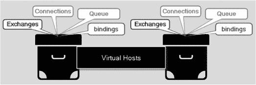

我们可以创建不同的虚拟主机，每个虚拟主机都有自己的用户。

## 创建虚拟主机 (Creating Virtual host)

要创建一个虚拟主机，我们首先使用默认凭据登录，然后选择 `admin` 标签页。

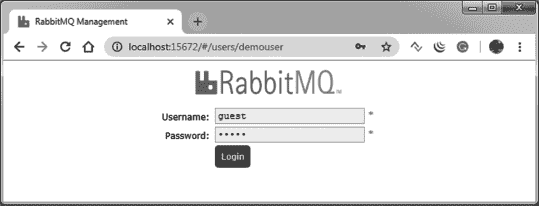

选择 admin 标签页后，你将在页面右侧看到垂直菜单中的 `Virtual Hosts`。

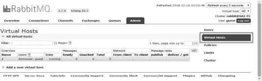

选择 `Virtual Hosts` 后，你会看到已经存在的默认 `Virtual Hosts`，下方有一个 `Add a new virtual host` 面板，点击它即可展开。

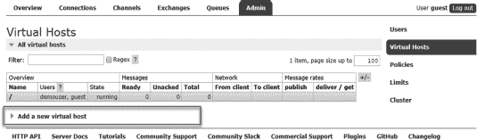

展开后可以看到添加虚拟主机需要添加 `Name` 参数，我在这里输入名称为 `demohost`，接下来点击 `Add a new virtual host` 按钮创建 `demohost` 虚拟主机。

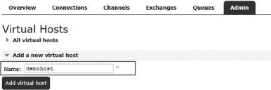

添加虚拟主机后，你可以在 `All virtual hosts` 面板中看到新添加的虚拟主机。


添加用户后，你只需要展开所有用户的面板，即可看到所有用户。在展开后，你可以看到新用户 `virtualuser`，但在网格中，你可以看到 `Can access virtual hosts`（访问虚拟主机）列，其值为 `No access`（无访问），这意味着我们没有访问虚拟主机的权限。


## 设置访问虚拟主机的权限

设置权限，只需点击我们创建的用户名 `virtualuser`。


点击 `virtualuser` 后，进入权限面板，它位于概述（overview）面板下方。

展开权限面板，并点击设置权限（set permission）按钮即可为 `virtualuser` 设置权限。


默认值为 `".*"`，它允许访问虚拟主机中的所有交换机和队列。

权限设置完成后，你将看到如下所示的 `Current permission`（当前权限）：


现在你应该能够以此 `virtualuser` 身份登录 RabbitMQ Web 管理插件。

让我们使用新用户 `virtualuser` 登录 RabbitMQ Web 管理插件。


以下是用新用户 `virtualuser` 登录 RabbitMQ Web 管理插件后的快照。


现在我们已经完成了新虚拟主机的创建，并且我们必须为其分配一个新用户。


# 连接 (Connections)

连接（connection）是你的应用程序与 RabbitMQ 代理之间的 TCP 连接。

引用自：[`www.cloudamqp.com/blog/2015-05-18-part1-rabbitmq-for-beginners-what-is-rabbitmq.html`](https://www.cloudamqp.com/blog/2015-05-18-part1-rabbitmq-for-beginners-what-is-rabbitmq.html)

在连接（connection）选项卡中，将显示消息生产者和消息消费者的实时连接，同时它还会显示每个连接的用户名以及连接状态；如果你使用 SSL/TLS，连接将用一个深色点 `.` 标记。它还会显示使用了什么协议，随后在网络部分显示从客户端和到客户端的网络利用率。


如果你想查看每个连接的详情，请点击连接名称。

## 连接 (Connections)


点击连接名称后，将显示连接的所有详情，包括数据速率、通道（channels）、客户端属性、运行时指标，最后关闭连接。


如果你想关闭连接，可以打开 `Close this connection`（关闭此连接）标签页，输入原因并点击 `Force Close`（强制关闭）按钮。


# 通道 (Channels)

通道（channel）是连接内部的虚拟连接当你从队列发布或消费消息时——所有操作都是通过通道完成的。**引用自：** [`www.cloudamqp.com/blog/2015-05-18-part1-rabbitmq-for-beginners-what-is-rabbitmq.html`](https://www.cloudamqp.com/blog/2015-05-18-part1-rabbitmq-for-beginners-what-is-rabbitmq.html)

在通道（channel）选项卡中，将显示消息生产者和消息消费者的实时通道，同时会显示模式（mode）。有两种模式：C - 确认通道（confirm channel）发送流式发布确认；T - 事务通道（transactional channel）是事务性的，随后将显示通道状态。后续详情中 `Unconfirmed`（未确认）列将显示尚未确认的发布消息数量；`Unconfirmed` 列旁边是 `Prefetch`（预取）列，显示每个通道限制的详情；`Prefetch` 列旁边是 `Unacked` 列，`Unacked` 表示消费者已承诺处理但尚未确认已处理；此外我们还有消息速率，显示发布和确认速率，以及投递和确认详情。

## 模式的说明

通道保证模式。可以是以下之一，或两者皆非：

C - confirm（确认模式）
通道将发送流式发布确认。

T - transactional（事务模式）
通道是事务性的。

## 预取计数数的说明

通道预取计数（prefetch counts）。

每个通道可以有两个预取计数：每个消费者的计数（限制通道上创建的每个新消费者）以及全局计数（在通道上的所有消费者之间共享）。

如果设置了限制，此列将显示其中一个、另一个或两个限制。


如果你想查看每个通道的详情，点击通道名称 `[::11:57086 (1)]`，将显示与该通道相关的所有详情。


# 发布消息 (Publishing Message)

要发布消息，使用凭据登录 web 管理插件。


登录 web 管理插件后，下一步点击队列 `(demoqueue)`。


点击 demoqueue "queue" 后，在绑定（bindings）面板下方是发布消息面板，在其中只需输入消息即可。


## 发布消息后的快照


# 读取消息 (Reading Message)

要读取消息，使用凭据登录 web 管理插件。


登录 web 管理插件后，下一步点击队列 `(demoqueue)`。


要读取消息，在这里你可以输入消息数量并点击 `Get Message`（获取消息）即可获取消息。


## 读取消息时的快照


# 删除消息 (Delete Message)

要删除消息，使用凭据登录 web 管理插件。


登录 web 管理插件后，点击队列 `(demoqueue)`。

要删除消息，你可以展开删除面板，在其中你会看到删除按钮。只需点击即可删除。


点击删除按钮后会弹出一个确认消息，如所示：


如果我们点击 `OK` 按钮将删除该队列。


# 使用 C# 向 RabbitMQ 发布消息

在本部分，我们将学习如何逐步使用 .Net 和 RabbitMQ.Client 向 RabbitMQ 发布消息。

## 创建 RequestRabbitMQ 

让我们创建一个名为 `RequestRabbitMQ` 的简单控制台应用程序。


创建应用程序后，我们将添加 `RabbitMQ.Client` 包。

## 添加 RabbitMQ.Client NuGet 包

在本部分，为了创建与 RabbitMQ 服务器的连接，我们需要从 NuGet 包中添加 `RabbitMQ.Client` 包。

安装命令：`Install-Package RabbitMQ.Client -Version 5.1.0`


安装 `RabbitMQ.Client` NuGet 包后，我们将从 web 管理控制台创建一个交换机。

## 添加直接交换机 (Adding Direct Exchange)

在本部分，我们将创建一个交换机，为此我们首先使用 `RabbitMQ.Client` 创建与 RabbitMQ 服务器的连接，连接后我们将凭据连同 `HostName` 传递给 `connectionFactory`，之后通过调用 `CreateConnection` 方法创建连接，接下来添加交换机时调用了 `ExchangeDeclare` 方法并传递了*交换机名称*和*交换类型*等参数。

```csharp
using RabbitMQ.Client;
using System;

namespace RequestRabbitMQ
{
    class Program
    {
        static void Main(string[] args)
        {
            string UserName = "guest";
            string Password = "guest";
            string HostName = "localhost";
            //RabbitMQ .NET AMQP 的主入口点
            client
            var c o n e c t i o n F a c t o r y = new
```


`RabbitMQ.Client.ConnectionFactory()`

```csharp
{
    UserName = UserName,
    Password = Password,
    HostName = HostName
};

var connect i on = connectionFactory.CreateConnection();
var model = connection.CreateModel();
//// Create Exchange
model.ExchangeDeclare("demoExchange", ExchangeType.Direct);
Console.ReadLine();
}
}
}
```

让我们运行应用程序来检查结果。


添加交换后，让我们检查 Web 管理插件，你会看到我们已成功创建了交换。


### 添加队列

现在我们将添加一个队列。

为了实现这一点，我们将调用 `QueueDeclare` 方法并向其传递参数。

### 方法定义：

```csharp
/// <summary> 声明队列。</summary>
[AmqpMethodDoNotlmplement(null)]
QueueDedareOk QueueDedare(string queue, bool durable, bool exclusive, bool autoDelete, IDictionary<string, object> arguments)
```

第一个参数是队列名称 `demoqueue`。

第二个参数是持久性 `true`。

第三个参数是专属 `false`。

第四个参数是自动删除 `false`。

第五个参数是参数 `null`。

```csharp
// 创建队列
model.QueueDeclare("demoqueue", true, false, false, null);
```

### 代码片段

```csharp
using RabbitMQ.Client;
using System;
namespace RequestRabbitMQ
{
    class Program
    {
        static void Main(string[] args)
        {
            string UserName = "guest";
            string Password = "guest";
            string HostName = "localhost";
            // RabbitMQ .NET AMQP 客户端的主入口点
            var connectionFactory = new RabbitMQ.Client.ConnectionFactory()
            {
                UserName = UserName,
                Password = Password,
                HostName = HostName
            };
            var connection = connectionFactory.CreateConnection();
            var model = connection.CreateModel();
            //// 创建交换
            //model.ExchangeDeclare("demoExchange", ExchangeType.Direct);
            //Console.WriteLine("Creating Exchange");
            // 创建队列
            model.QueueDeclare("demoqueue", true, false, false, null);
            Console.WriteLine("Creating Queue");
            Console.ReadLine();
        }
    }
}
```

让我们运行应用程序来检查结果。


添加队列后，让我们检查 Web 管理插件，你会看到我们已成功创建了队列。


添加队列后，我们将队列绑定到交换上。

# 将 demoqueue 绑定到 demoExchange

在绑定时，我们将输入交换名称 `demoExchange` 并输入路由键为 `directexchange_key`。

### 方法定义：


第一个参数是队列名称 `demoqueue`。

第二个参数是交换 `demoExchange`。

第三个参数是路由键 `directexchange_key`。

```csharp
// 创建绑定
model.QueueBind("demoqueue", "demoExchange", "directexchange_key");
Console.WriteLine("Creating Binding");
```

### 代码片段

```csharp
using RabbitMQ.Client;
using System;
namespace RequestRabbitMQ
{
    class Program
    {
        static void Main(string[] args)
        {
            string UserName = "guest";
            string Password = "guest";
            string HostName = "localhost"
            // RabbitMQ .NET AMQP 客户端的主入口点
            var connectionFactory = new RabbitMQ.Client.ConnectionFactory()
            {
                UserName = UserName,
                Password = Password,
                HostName = HostName
            };
            var connection = connectionFactory.CreateConnection();
            var model = connection.CreateMode();
            //// 创建交换
            //model.ExchangeDeclare("demoExchange", ExchangeType.Direct);
            //Console.WriteLine("Creating Exchange");
            //// 创建队列
            //model.QueueDeclare("demoqueue", true, false, false, null);
            //Console.WriteLine("Creating Queue");
            // 创建绑定
            model.QueueBind("demoqueue", "demoExchange", "directexchange_key");
            Console.WriteLine("Creating Binding");
            Console.ReadLine();
        }
    }
}
```


创建绑定后，让我们检查 Web 管理插件，你会看到我们已成功创建了绑定。


现在让我们从控制台应用程序向 `demoqueue` 推送消息。

## 添加 Directmessages 类

我们创建了一个 `Directmessage` 类，在这个类中，我们将创建请求并推送到 RabbitMQ。

（注：原文此处存在大量重复句子，已根据文档工程师规范进行精简）

## 使用 C# 从 RabbitMQ 消费消息

在本部分，我们将学习如何使用 .Net 逐步从 RabbitMQ 消费消息。

## 创建 RabbitMQConsumer 

让我们创建一个另一个控制台应用程序，从队列中消费消息。


## 添加 RabbitMQ.Client NuGet 包

在本部分，为了与 RabbitMQ 服务器建立连接以创建请求，我们需要从 NuGet 包添加 `RabbitMQ.Client` 包。

安装命令：`Install-Package RabbitMQ.Client -Version 5.1.0`


安装 `RabbitMQ.Client` 后，我们将添加一个名为 `MessageReceiver` 的类。


### MessageReceiver 类代码片段

在此部分中，我们创建了 `MessageReceiver` 类，该类继承自来自 `RabbitMQ.Client` 的 `DefaultBasicConsumer` 类。接下来我们需要重写 `HandleBasicDeliver` 方法，该方法负责接收消息体，随后我们将像控制台中看到的那样写入这些消息。

```csharp
using System;
using System.Text;
using RabbitMQ.Client;
namespace RabbitMQConsumer
{
    public class MessageReceiver : DefaultBasicConsumer
    {
        private readonly IModel _channel;
        public MessageReceiver(IModel channel)
        {
            _channel = channel;
        }
        public override void HandleBasicDeliver(string consumerTag, ulong deliveryTag, bool redelivered, string exchange, IBasicProperties properties, byte[] body)
        {
            Console.WriteLine($"Consuming Message");
            Console.WriteLine($"Message received from the exchange {exchange}");
            Console.WriteLine($"Consumer tag:{consumerTag}");
            Console.WriteLine($"Delivery tag:{deliveryTag}");
            Console.WriteLine($"Routing tag: {properties.RoutingKey}");
            Console.WriteLine($"Message: {Encoding.UTF8.GetString(body)}");
            _channel.BasicAck(deliveryTag, false);
        }
    }
}
```

理解 `MessageReceiver` 类的代码片段后，接下来我们将在 main 方法中调用该类。

#### Main 方法代码片段

在 main 方法中，我们创建了 `ConnectionFactory` 类并传递了凭据和 `Hostname`。之后创建了连接，接着创建了通道并将 `prefetchCount` 设置为 `1`，这告诉 RabbitMQ 不要一次向工作者发送多条消息。接下来，我们创建了 `MessageReceiver` 实例并将 `IModel` (`channel`) 传递给它。最后一步，我们调用了 `BasicConsume` 方法并将队列名称 `demoqueue` 传递给它，同时将 `autoAck` 设置为 `false` 并传递了 `messageReceiver` 实例。

```csharp
using System;
using System.Collections.Generic;
using System.Linq;
using System.Text;
using System.Threading.Tasks;
using RabbitMQ.Client;
namespace RabbitMQConsumer
{
    class Program
    {
        private const string UserName = "guest";
        private const string Password = "guest";
        private const string HostName = "localhost";
        static void Main(string[] args)
        {
            ConnectionFactory connectionFactory = new ConnectionFactory()
            {
                HostName = HostName,
                UserName = UserName,
                Password = Password,
            };
            var connection = connectionFactory.CreateConnection();
            var channel = connection.CreateModel();
            // accept only one unack message at a time
            // uint prefetchSize, ushort prefetchCount, bool
            channel.BasicQos(0, 1, false);
            MessageReceiver messageReceiver = new MessageReceiver(channel);
            channel.BasicConsume("demoqueue", false, messageReceiver);
            Console.ReadLine();
        }
    }
}
```

**注意：** `prefetchCount`

我们将计数设置为 `1`。这告诉 RabbitMQ 不要一次向工作者发送多于一条消息。换句话说，在工作者处理并确认之前的消息之前，不要分发新消息。相反，它会将消息发送给下一个空闲的工作者。

现在我们已经完成了工作机制。让我们从 `RequestRabbitMQ` 控制台创建请求并在 `RabbitMQConsumer` 中消费消息。

## 队列为空

![images/065-01.jpg)

在我们看到队列 `demoqueue` 是空的之后，我们将向 `demoqueue` 发布消息。

### 发布消息

![images/065-02.jpg)

发布消息后，让我们查看 `demoqueue` 队列。

## 发送消息后的队列

![images/065-03.jpg)

向 `demoqueue` 推送消息后，控制台应用程序将开始消费，如下：

### 从 demoqueue 消费的消息

![images/065-04.jpg)

最后，我们完成了从 RabbitMQ 队列的消息消费。

![images/logo.jpg)

# 使用 .Net 使用 RabbitMQ Direct 交换器

在此部分，我们将使用 Direct 交换器，通过 .Net 应用程序和 `RabbitMQ.Client` 向 RabbitMQ 推送消息，并使用 .Net 应用程序和 `RabbitMQ.Client` 读取消息。

![images/066-01.jpg)

## 交换器类型

1. Direct（直接型）
2. fanout（广播型）
3. Headers（头部型）
4. Topic（主题型）

### 交换器详情

1. **Direct**: Direct 交换器根据路由键传递消息。在 Direct 交换器中，消息被路由到键完全匹配的队列。
2. **Fanout**: Fanout 交换器将消息路由到所有绑定的队列。
3. **Topic**: Topic 交换器在路由键和模式之间进行通配匹配。
4. **Headers**: Headers 交换器使用头部属性进行路由。

## 创建 RequestRabbitMQ

让我们创建应用程序 `RequestRabbitMQ`。

![images/067-01.jpg)

## 添加 RabbitMQ.Client 包

在此部分我们需要添加 `RabbitMQ.Client` NuGet 包。

![images/067-02.jpg)

## 添加 Direct 交换

命令：`Install-Package RabbitMQ.Client -Version 5.1`

![images/067-03.jpg)

安装包后，访问 `http://localhost:15672/#exchanges`，命名为 `request.exchange`，输入名称后选择类型为 `direct` 并点击 Add 按钮进行创建。

### 添加队列

添加交换器 `request.exchange` 后，接下来我们需要添加队列 (`request.queue`)。

![images/068-01.jpg)

访问 `http://localhost:15672/#queues`，添加队列：`request.queue`。

## 将 request.queue 绑定到交换器

添加队列后，我们将队列与交换器绑定。

在绑定中，我们将输入交换器名称 `request.exchange` 并输入路由键为 `direct_key`。

![images/068-02.jpg)

我们创建了一个 `Directmessage` 类，在此类中我们将创建请求并推送到 RabbitMQ。

首先，我们把 `Username`、`Password` 和 `HostName` 定义为常量。之后，我们创建了一个名为 `SendMessage` 的方法，在该方法中使用通过 `RabbitMQ.Client` 创建了到 RabbitMQ 服务器的连接。创建连接后，我们将凭据连同 `Hostname` 传递给 `connectionFactory`。接着，我们写了一条简单的消息 `Direct Message` 并以字节数组形式获取，最后，我们将所有这些值赋值给 `RabbitMQ.Client` 的 `BasicPublish` 方法。

### BasicPublish 

![images/069-01.jpg)

### 传递给它的参数

Exchange: `request.exchange`
Routingkey: `direct_key`


```csharp
var connection = connectionFactory.CreateConnection();
var model = connection.CreateModel();
var properties = model.CreateBasicProperties();
properties.Persistent = false;
byte [] messagebuffer = Encoding.Default.GetBytes("Direct Message");
model.BasicPublish("request.exchange", "directexchange_key", properties, messagebuffer);
Console.WriteLine("Message Sent");
}
}
```

### 主代码片段

```csharp
using System;
namespace RequestRabbitMQ
{
    class Program
    {
        static void Main(string[] args)
        {
            Directmessages directmessages = new Directmessages();
            directmessages.SendMessage(); Console.ReadLine();
        }
    }
}
```

完成整个流程后，让我们保存并运行应用程序。运行后，你将在控制台窗口看到“message sent”消息，仅用于通知。


发送消息后，现在让我们来看队列 `request.queue`。

# 现在让我们查看队列状态 request.queue

如果你查看队列状态，你会看到 `Ready "1"`，这意味着我们已经成功地向 `request.queue` 发布了了消息。


发布消息后，接下来我们将创建一个 .Net 控制台应用程序来从队列中消费消息。

## 创建 RabbitMQConsumer 应用程序

让我们创建一个名为 `RabbitMQConsumer` 的控制台应用程序，用于从队列消费消息。


创建应用程序后，我们将添加 `RabbitMQ.Client` NuGet 包。

## 添加 RabbitMQ.Client NuGet 包

在此部分，为了创建与 RabbitMQ 服务器的连接以发送请求，我们需要从 NuGet 包添加 `RabbitMQ.Client` 包。

**安装命令：** `Install-Package RabbitMQ.Client -Version 5.1.0`


安装 `RabbitMQ.Client` 后，我们将添加一个名为 `MessageReceiver` 的类。

### MessageReceiver 类代码片段

在此部分中，我们创建了 `MessageReceiver` 类，该类继承自来自 `RabbitMQ.Client` 的 `DefaultBasicConsumer` 类。我们需要重写 `HandleBasicDeliver` 方法，该方法接收消息体，接下来我们将按照我们在控制台中看到的方式写入这些消息。

```csharp
using System;
using System.Text;
using RabbitMQ.Client;
namespace RabbitMQConsumer
{
    public class MessageReceiver : DefaultBasicConsumer
    {
        private readonly IModel channel;
        public MessageReceiver(IModel channel)
        {
            channel = channel;
        }
        public override void HandleBasicDeliver(string consumerTag, ulong deliveryTag, bool redelivered, string exchange, string routingKey, IBasicProperties properties, byte[] body)
        {
            Console.WriteLine($"Consuming Message");
            Console.WriteLine(string.Concat("Message received from the exchange ", exchange));
            Console.WriteLine(string.Concat("Consumer tag:", consumerTag));
            Console.WriteLine(string.Concat("Delivery tag:", deliveryTag));
            Console.WriteLine(string.Concat("Routing tag:", routingKey));
            Console.WriteLine(string.Concat("Message: ", Encoding.UTF8.GetString(body)));
            _channel.BasicAck(deliveryTag, false);
        }
    }
}
```

理解 `MessageReceiver` 类代码片段后，我们将在主方法中调用该类。

### 主方法代码片段

在主方法中，我们创建了 `connectionFactory` 类并传递了凭据和 `Hostname`。之后我们创建了连接，接着创建了通道并将 `prefetchCount` 设置为 1，这将告诉 RabbitMQ 不要一次向工作节点发送多条消息。接下来，我们创建了 `MessageReceiver` 类的实例并将 `IModel` (`channel`) 传递给它。最后一步，我们调用了 `BasicConsume` 方法并将队列名称 `"request.queue"` 传递给它，同时我们将 `autoAck` 设置为 `false` 并 `messageReceiver` 实例传递给它。

```csharp
using System;
using System.Collections.Generic;
using System.Linq;
using System.Text;
using System.Threading.Tasks;
using RabbitMQ.Client;
namespace RabbitMQConsumer
{
    class Program
    {
        private const string UserName = "guest";
        private const string Password = "guest";
        private const string HostName = "localhost";
        static void Main(string[] args)
        {
            ConnectionFactory connectionFactory = new ConnectionFactory()
            {
                HostName = HostName,
                UserName = UserName,
                Password = Password,
            };
            var connection = connectionFactory.CreateConnection();
            var model = connection.CreateModel();
            var properties = model.CreateBasicProperties();
            properties.Persistent = false;
            byte [] messagebuffer = Encoding.Default.GetBytes("Direct Message");
            model.BasicPublish("request.exchange", "directexchange_key", properties, messagebuffer);
            Console.WriteLine("Message Sent");
        }
    }
}
```


# 添加 Topic Exchange（交换机）

访问 `http://localhost:15672/#/exchanges`，输入名称后命名为 `topic.exchange`，将 `Type` 选择为 `topic` 并点击添加交换机按钮进行创建。

添加 `topic.exchange` 后，接下来我们将添加 2 个队列。

### 添加队列

在这一部分，我们将为同一个 `topic.exchange` 创建两个具有不同路由键的队列。

访问 `http://localhost:15672/#/queues`

1. `topic.bombay.queue`
2. `topic.delhi.queue`

添加名为 `topic.bombay.queue` 的第一个队列。


添加第二个队列 `topic.delhi.queue`。


添加队列后，将显示已添加的队列。


添加队列后，我们将把队列与 `topic.exchange` 绑定。

### 将 topic.bombay.queue 绑定到 topic.exchange

在这一部分，我们正在使用唯一路由键模式 `"*.Bombay.*"` 将 `topic.exchange` 与 `topic.bombay.queue` 绑定。


### 绑定截图


## 将 topic.delhi.queue 绑定到 topic.exchange

在这一部分，我们正在使用唯一路由键模式 `"Delhi.#"` 将 `topic.exchange` 与 `topic.delhi.queue` 绑定。


### 绑定截图


在完成绑定后，我们将发布消息。

## 添加 Topicmessages 类

我们创建了一个 `Topicmessage` 类，在这个类中，我们将创建请求并将其推送到 RabbitMQ。

首先，我们把 `Username`、`Password` 和 `HostName` 定义为常量。之后，我们创建了一个名为 `SendMessage` 的方法，在该消息中我们使用 `RabbitMQ.Client` 创建了到 RabbitMQ 服务器的连接；创建连接后，我们将凭据以及 `HostName` 传递给 `connectionFactory`。接下来，我们写了一条简单的消息 `Message from Topic Exchange 'Bombay'` 并获取其字节数组格式，最后，我们将所有这些值赋值给 `RabbitMQ.Client` 的 `BasicPublish` 方法。

路由模式：`"any text .Bombay. any text"`

路由键示例：
- `"Order.Bombay.Pizza"`
- `"Book.Bombay.Hotels"`
- `"Visit.Bombay.Parks"`
- `"List.Bombay.Colleges"`

### 传递给它的参数

交换机：`"topic.exchange"`
路由键：`"Message.Bombay.Email"`

### 代码片段

```sharp
public class Topicmessages
{
    private const string UserName = "guest";
    private const string Password = "guest";
    private const string HostName = "localhost";
    public void SendMessage()
    {
        //Main entry point to the RabbitMQ .NET AMQP
        client
        var connectionFactory = new RabbitMQ.Client.ConnectionFactory()
        {
            UserName = UserName,Password = Password,HostName = HostName
        };
        var connection = connectionFactory.CreateConnection();
        var model = connection.CreateModel();
        var properties = model.CreateBasicProperties();
        properties.Persistent = false;
        byte [] messagebuffer = Encoding.Default.GetBytes("Message from Topic Exchange 'Bombay' ");
        model . BasicPublish ("topic . exchange", "Message.Bombay.Email", properties, messagebuffer);
        Console.WriteLine("Message Sent From :- topic.exchange ");
        Console .WriteLine ( " Routing Key : - Message.Bombay.Email");
        Console.WriteLine("Message Sent");
    }
}
```

### 主代码片段

```sharp
using System;
namespace RequestRabbitMQ
{
    class Program
    {
        static void Main(string[] args)
        {
            Topicmessages topicmessages = new Topicmessages();
            topicmessages.SendMessage();
            Console.ReadLine();
        }
    }
}
```

完成整个过程后，让我们保存应用程序并运行。运行程序后，你将在控制台窗口看到“Message sent”的消息，仅作为通知，这意味着我们已成功地向 `"topic.bombay.queue"` 队列发布了消息。

## 发布到 "topic.bombay.queue" 的消息


### 现在来看队列状态 "request.queue"

如果你查看队列状态，将看到 `Ready "1"`，这意味着我们已成功地向 `topic.bombay.queue` 发布了消息。


添加队列后，我们将把队列与 `topic.exchange` 绑定。

### 将 topic.bombay.queue 绑定到 topic.exchange

在这一部分，我们正在使用唯一路由键模式 `"*.Bombay.*"` 将 `topic.exchange` 与 `topic.bombay.queue` 绑定。


### 绑定截图


```
// message to a worker until it has
// processed and acknowledged the previous one.
Instead, it will dispatch it to t
// the next worker that is not still busy.
MessageReceiver messageReceiver = new
MessageReceiver(channel);
channel.BasicConsume("topic.bombay.queue", false,
messageReceiver);
Console.ReadLine();
}
}
}
```
现在我们拥有了完整的工作机制。让我们从 `RequestRabbitMQ` 控制台创建请求，并从 `RabbitMQConsumer` 应用程序消费消息。

队列中有一个我们已经发布的请求。

下面的快照仅包含我们已经发布的 `topic.bombay.queue` 中的某条消息。


### 从 topic.bombay.queue 消费的消息


在成功从 `topic.bombay.queue` 消费消息后，我们将把一条消息发布到另一个队列，即 `topic.delhi.queue`。

## 发布到 topic.delhi.queue 的消息

在 `topicmessage` 类中，我对路由键 `Delhi.TicketBooking` 以及发送以向 `topic.delhi.queue` 发布消息的消息内容进行了细小的改动。

路由模式："Delhi. [任何文本]"

路由键示例："Delhi.Pizza", "Delhi.Hotels", "Delhi.Parks", "Delhi.Colleges"

### 代码片段

```cpp
public class Topicmessages
{
    private const string UserName = "guest";
    private const string Password = "guest";
    private const string HostName = "localhost";
    public void SendMessage()
    {
        //Main entry point to the RabbitMQ .NET AMQP
        client
        var connectionFactory       = new RabbitMQ.Client.ConnectionFactory()
        {
            UserName = UserName,
            Password = Password,
            HostName = HostName
        };
        var connection      = connectionFactory.CreateConnection();
        var model = connection.CreateModel();
        var properties = model.CreateBasicProperties();
        properties.Persistent = false;
        byte[] messagebuffer = Encoding.Default.GetBytes("Message from Topic Exchange 'Delhi' ");
        model.Basic Publish("topic.exchange", "Delhi.TicketBooking", properties, messagebuffer);
        Console.WriteLine("Message Sent From :- topic.exchange ");
        Console.WriteLine("Routing Key :- Delhi.TicketBooking");
        Console.WriteLine("Message Sent");
    }
}
```

进行更改后，让我们保存并运行应用程序，以向 `topic.delhi.queue` 发布消息。

## 发布到 "topic.delhi.queue" 的消息


队列中有一个我们已经发布的请求


### RabbitMQConsumer 消费 "topic.delhi.queue" 的 Main 方法代码片段

在这一部分，我仅将 `RabbitMQConsumer` 应用程序中的队列名称更改为 `topic.delhi.queue`。

```csharp
using System;
using RabbitMQ.Client;
namespace RabbitMQConsumer
{
    class Program
    {
        private const string UserName = "guest";
        private const string Password = "guest";
        private const string HostName = "localhost
        static void Main(string[] args)
        {
            ConnectionFactory connectionFactory = new ConnectionFactory
            {
                HostName = HostName,
                UserName = UserName,
                Password = Password,
            };
            var connection = connectionFactory.CreateConnection();
            var channel = connection.CreateModel();
            // accept only one unack-ed message at a time
            // uint prefetchSize, ushort prefetchCount, bool
            global
            channel.BasicQos(0, 1, false);
            // ==== prefetchCount
            // In order to defeat that we can set the prefetch
            // count with the value of 1
            // This tells RabbitMQ not to give more than one
            // message to a worker at a time.
            // Or, in other words, don't dispatch a new
            // message to a worker until it has
            // processed and acknowledged the previous one.
            // Instead, it will dispatch it to t
            // the next worker that is not still busy.
            MessageReceiver messageReceiver = new
            MessageReceiver(channel);
            channel.BasicConsume("topic.delhi.queue", false,
            messageReceiver);
            Console.ReadLine();
        }
    }
}
```

## 从 topic.delhi.queue 消费的消息


最后，我们完成了 `topic.delhi.queue` 的操作。

## 结论

在这一部分，我们学习了如何使用 Topic Exchanges（主题交换机）并将消息推送到 RabbitMQ。

# 使用 Exchanges 使用 RabbitMQ Fanout

在这一部分，我们将使用 fanout 交换机。

.

例如，在 fanout 中，`routing key`（路由键）是被忽略的。

当你想要向所有分支发布一条通用消息时，可以使用 fanout 交换机。创建 RequestMQ 应用程序

创建应用程序后，我们将添加 `RabbitMQ.Client` 程序包。

```.


## 什么是 Fanout Exchange？

fanout 交换机会将消息路由到所有绑定到它的队列。

当你想要向所有分支发布一条通用消息时，可以使用 fanout 交换机。创建 RequestMQ 应用程序


创建应用程序后，我们将添加 `RabbitMQ.Client` 程序包。

## 添加 RabbitMQ.Client 程序包

在这一部分，为了与 RabbitMQ 服务器连接，我们需要从 NuGet 添加 `RabbitMQ.Client` 程序包。

```bash
Install-Package RabbitMQ.Client
```


接下来我们将 web 管理控制创建一个交换交换。

## 添加 Fanout Exchange

访问 `http://localhost:15672/#exchanges`，命名交换机为 `fanout.exchange`，选择类型为 "fanout"，然后点击 add 按钮创建。


添加 `fanout.exchange` 后，接下来我们将添加 4 个队列并将其绑定到交换机。

### 添加队列

在这一部分，我们将为同一个 `fanout.exchange` 创建不同路由键的 4 个队列。

访问 `http://localhost:15672/#queues`

1. Mumbai

2. Hyderabad

3. Bangalore

4. Chennai

添加名为 `Mumbai.` 的第一个队列。


以类似的方式，我如下快照所示添加了其余队列。


添加所有队列后，我们将队列绑定到 `fanout.exchange`。

### 将队列 (Bangalore, Chennai, Hyderabad, Mumbai) 绑定到 fanout.exchange

在这一部分，我们将 `fanout.exchange` 绑定到所有队列 (Bangalore, Chennai, Hyderabad, Mumbai)。

我们将绑定的第一个队列是 Bangalore。


### 绑定快照


完成绑定后，我们将发布消息。

## 添加 Fanoutmessages 类

我们创建了一个 `fanoutmessage` 类，在此类中我们将创建请求并推送到 RabbitMQ。


首先，我们把 `Username`、`Password` 和 `HostName` 定义为常量。之后，我们创建了一个名为 `SendMessage` 的方法，在该方法中，我们使用 `RabbitMQ.Client` 创建了到 RabbitMQ 服务器的连接。创建连接后，我们将凭据同 `HostName` 传递给 `connectionFactory`。接下来，我们写了一条简单的消息 `Message is of fanout Exchange type` 并将其转换为字节数组形式，最后，我们将所有这些值赋值给 `RabbitMQ.Client` 的 `BasicPublish` 方法。

在赋值时，我们将交换机（exchange）设置为 `fanout.exchange`，并且 fanout 交换机不需要路由键（routing key）。

### 代码片段

```csharp
using System;
using RabbitMQ.Client;
using System.Text;
namespace RequestRabbitMQ
{
    public class Fanoutmessages
    {
        private const string UserName = "guest";
        private const string Password = "guest";
        private const string HostName = "localhost";
        public void SendMessage()
        {
            //RabbitMQ .NET AMQP 的主入口点
            var connectionFactory = new RabbitMQ.Client.ConnectionFactory()
            {
                UserName = UserName,
                Password = Password,
                HostName = HostName
            };
            var connection = connectionFactory.CreateConnection();
            var model = connection.CreateModel();
            var properties = model.CreateBasicProperties();
            properties.Persistent = false;
            byte[] messagebuffer = Encoding.Default.GetBytes("Message is of fanout Exchange type");
            model.BasicPublish("fanout.exchange", "", properties, messagebuffer);
            Console.WriteLine("Message Sent From :- fanout.exchange ");
            Console.WriteLine("Routing Key :- Routing key is Not required for fanout exchange");
            Console.WriteLine("Message Sent");
        }
    }
}
```

### 主代码片段

```csharp
using System;
namespace RequestRabbitMQ
{
    class Program
    {
        static void Main(string[] args)
        {
            Fanoutmessages fanoutmessages = new Fanoutmessages();
            fanoutmessages.SendMessage();
            Console.ReadLine();
        }
    }
}
```

完成整个过程后，让我们保存并运行应用程序。运行程序后，你将在控制台窗口看到“Message sent”消息，这仅作为通知，意味着我们已成功向 "fanout.exchange" 交换机的所有队列发布了消息。

### 发布到 "fanout.exchange" 所有队列的消息


### 现在让我们查看队列状态（Bangalore, Chennai, Hyderabad, Mumbai 队列）

如果你查看队列状态，你会看到 `Ready "1"`，这意味着我们已成功向 fanout 交换机的所有队列发布了消息。


发布消息后，接下来创建一个 .Net 控制台应用程序来从队列中消费消息。

### 创建 RabbitMQConsumer


让我们创建另一个控制台应用程序来从队列消费消息。创建应用程序后，我们将添加 `RabbitMQ.Client` 包。

## 添加 RabbitMQ.Client NuGet 包

在这一部分，为了创建与 RabbitMQ 服务器的连接以发送请求，我们需要从 NuGet 添加 `RabbitMQ.Client` 包。安装命令为：`Install-Package RabbitMQ.Client -Version 5.1.0`


安装 `RabbitMQ.Client` 后，接下来我们将添加一个名为 `MessageReceiver` 的类。

### MessageReceiver 类

在这一部分，我们创建了 `MessageReceiver` 类，该类继承自来自 `RabbitMQ.Client` 的 `DefaultBasicConsumer` 类。接下来我们必须重写 `HandleBasicDeliver` 方法，该方法接收消息体，接下来我们将如在控制台中看到的那样写出这些消息。

```csharp
public class MessageReceiver : DefaultBasicConsumer
{
    private readonly IModel _channel;
    public MessageReceiver(IModel channel)
    {
        _channel = channel;
    }
    public override void HandleBasicDeliver(string consumerTag, ulong deliveryTag, bool redelivered, string exchange, string routingKey, IBasicProperties properties, byte[] body)
    {
        Console.WriteLine($"Consuming fanout Message");
        Console.WriteLine(string.Concat("received from the exchange ", exchange));
        Console.WriteLine(string.Concat("Consumer tag:", consumerTag));
        Console.WriteLine(string.Concat("Delivery tag:", deliveryTag));
        Console.WriteLine(string.Concat("Routing tag: ", routingKey));
        Console.WriteLine(string.Concat("Message: ", Encoding.UTF8.GetString(body)));
        _channel.BasicAck(deliveryTag, false);
    }
}
```

理解 `MessageReceiver` 类的代码片段后，接下来我们将在主方法中调用该类。

### 消费 "Mumbai" 队列的主方法代码片段

在主方法中，我们创建了 `connectionFactory` 类并传递了凭据和 `Hostname`，之后我们创建了连接，接着创建了通道（channel）并将 `prefetchCount` 设置为 1，这样它就会告诉 RabbitMQ 不要一次向工作人员发送多一条消息。接下来创建了 `MessageReceiver` 类的实例并将 `IModel (channel)` 传递给它。在最后一步，我们调用了 `BasicConsume` 方法并将队列名 "Mumbai" 传递给它，同时我们将 `autoAck` 设置为 false 并将 `messageReceiver` 实例传递给它。


```csharp
using System;
using RabbitMQ.Client;
namespace RabbitMQConsumer
{
    class Program
    {
        private const string UserName = "guest";
        private const string Password = "guest";
        private const string HostName = "localhost";
        static void Main(string[] args)
        {
            ConnectionFactory connectionFactory = new ConnectionFactory()
            {
                HostName = HostName,
                UserName = UserName,
                Password = Password
            };
            var connection = connectionFactory.CreateConnection();
            var channel = connection.CreateModel();
            // 只接受一个未确认的消息
            // uint prefetchSize, ushort prefetchCount, bool
            channel.Qos(0, 1, false);
            // ==== prefetchCount
            // 为了克服这一点，我们可以将 prefetch count 设置为 1
            // 这告诉 RabbitMQ 不要一次向工作人员发送多一条消息。
            // 或者换句话说，在工作人员处理并确认之前的消息之前，不要向其分发新消息。
            // 相反，它将分发给
            // 下一个不忙的工作人员。
            MessageReceiver messageReceiver = new MessageReceiver(channel);
            channel.BasicConsume("Mumbai", false, messageReceiver);
            Console.ReadLine();
        }
    }
}
```

现在我们拥有了完整的工作机制。让我们从 `RequestRabbitMQ` 控制台创建请求并在 `RabbitMQConsumer` 应用程序消费消息。

### 队列有一个我们发布的请求

下面的快照显示所有队列都有一个通过 fanout 交换机发布的消息。


### 从 Mumbai 队列消费的消息

此消息仅从 Mumbai 队列消费，其他队列直到为止尚未被读取。


### 从 Mumbai 队列读取消息后的队列状态


以类似的方式，如果我们从 Bangalore 队列读取消息，那么只需要在 `RabbitMQConsumer` 中更改“队列名”。

### 从 Bangalore 队列消费的消息


```csharp
ConnectionFactory connectionFactory = new ConnectionFactory
{
    HostName = HostName,
    UserName = UserName,
    Password = Password,
    var connection = connectionFactory.CreateConnection();
    var channel = connection.CreateModel();
    // 每次只接受一个未确认（ack）的消息
    // uint prefetchSize, ushort prefetchCount, bool
    channel.BasicQos(0, 1, false);
    #region MyRegion
    // ==== prefetchCount
    // 为了实现这一点，我们可以将 prefetch 
    // 计数设置为 1
    // 这会告诉 RabbitMQ 不要一次性向工作线程 
    // 发送多于的一条消息。
    // 或者，换句话说，在处理并 
    // 确认上一条消息之前，不要向工作线程
    // 分发新消息。
    // 相反，它将消息发送给
    // 下一个没有在忙的工作线程。
    #endregion
    MessageReceiver messageReceiver = new MessageReceiver(channel);
    channel.BasicConsume("Bangalore", false, messageReceiver);
    Console.ReadLine();
}
}
```

让我们保存并运行应用程序以从 Bangalore 队列读取消息。


从 Bangalore 队列读取消息后的队列状态。


最后，我们学习了扇出（fanout）交换机是如何工作的，以及我们如何一步步地从扇出交换机发布和消费消息。

## 结论

在这一部分，我们学习了如何使用 Fanout 消息交换机，如何为 Fanout 交换机创建交换机和队列，如何使用 .Net 应用和 `RabbitMQ.Client` 将消息推送到 RabbitMQ，并使用 .Net 应用和 `RabbitMQ.Client` 逐步从 RabbitMQ 读取消息。


# 使用 .Net 应用使用 RabbitMQ Headers 消息交换机

在这一部分，我们将使用 Headers 消息交换机，通过 .Net 应用和 `RabbitMQ.Client` 将消息推送到 RabbitMQ，并使用 .Net 应用和 `RabbitMQ.Client` 逐步从 RabbitMQ 读取消息。


## 什么是 Headers 交换机？

Headers 交换机使用消息头属性进行路由。

当你想要向队列发送消息时使用这种交换机，但这次它不依赖于路由键（routing key），而是根据头属性发送到队列。

## 创建 RequestRabbitMQ 

让我们创建一个名为 "RequestRabbitMQ" 的简单控制台应用程序。


创建应用程序后，我们将添加 "RabbitMQ.Client" NuGet 包。

## 添加 RabbitMQ.Client NuGet 包

在这一部分，为了创建与 RabbitMQ 服务器的连接以创建请求，我们需要从 NuGet 包添加 `RabbitMQ.Client` 包。

安装命令：`Install-Package RabbitMQ.Client -Version 5.1.0`


安装 "RabbitMQ.Client" NuGet 包后，接下来我们将从 Web 管理控制台创建一个交换机。

**注意：**

Headers 交换机根据头值而不是路由键来路由消息。

一个名为 `x-match` 的特殊参数有 2 个值 {all, any}，其中 all 是 headers 绑定的默认值。

- `x-match = all` : 意味着所有值必须匹配
- `x-match = any` : 意味着只需要一个匹配的头值

***引用自：*** [`javasampleapproach.com/spring-framework/spring-boot/springboot-rabbitmq-headers-exchange`](http://javasampleapproach.com/spring-framework/spring-boot/springboot-rabbitmq-headers-exchange)

## 添加 Fanout 交换机

访问 http://localhost:15672/#/exchanges，输入名称后将交换机命名为 `headers.exchange`，选择类型为 "headers" 并点击 add exchange 按钮创建。


添加 "headers.exchange" 后，我们将添加两个队列并绑定到同一个交换机。

### 添加队列

在这一部分，我们将创建两个具有不同路由键但属于同一个 "headers.exchange" 的队列。

访问 http://localhost:15672/#/queues:

1. ReportPDF
2. ReportExcel


类似地，我按照下快照所示添加了其余队列。


添加所有队列后，我们将把队列与 "headers.exchange" 绑定。

## 绑定队列

在这一部分，我们将 `headers.exchange` 绑定到 "ReportPDF" 队列，并在绑定过程中设置诸如 `format=pdf` 和 `x_match=all` 等参数，这些参数需要生产者在头中传递，以便消息能发送到准确的队列。


### 绑定快照


在这一部分，我们将 `headers.exchange` 绑定到 "ReportPDF" 队列，并在绑定过程中设置诸如 `format=pdf` 和 `x-match=all` 等参数，这些参数需要生产者在头中传递，以便消息能够发送到准确的队列。


### 绑定快照


## Headersmessages 类

```csharp
public class Headersmessages
{
    private const string UserName = "guest";
    private const string Password = "guest";
    private const string HostName = "localhost";

    public void SendMessage()
    {
        ConnectionFactory connectionFactory = new ConnectionFactory()
        {
            HostName = HostName,
            UserName = UserName,
            Password = Password
        };
        var connection = connectionFactory.CreateConnection();
        var model = connection.CreateModel();
        var properties = model.CreateBasicProperties();
        properties.Persistent = false;
        Dictionary<string,object> dictionary = new Dictionary<string,object>();
        dictionary.Add("format", "pdf");
        properties.Headers = dictionary;
        byte[] messagebuffer = Encoding.Default.GetBytes("Message to Headers Exchange 'format=pdf' ");
        model.BasicPublish("headers.exchange", "", properties, messagebuffer);
        Console.WriteLine("Message Sent From :- headers.exchange ");
        Console.WriteLine("Routing Key Does not need routing key");
        Console.WriteLine("Message Sent");
    }
}
```

### 主代码片段

```csharp
using System;
namespace RequestRabbitMQ
{
    class Program
    {
        static void Main(string[] args)
        {
            Headersmessages headersmessages = new Headersmessages();
            headersmessages.SendMessage();
            Console.ReadLine();
        }
    }
}
```

**发布消息到 "Headers.exchange" 的 Reportpdf 队列**


**现在让我们来看看队列状态**


如果你查看 `Reportpdf` 队列的状态，你会看到 `Ready "1"`，这意味着我们已经成功通过头部交换机（headers exchanges）向 `Reportpdf` 队列发布了一条消息。


在发布消息之后，我们将创建一个 .Net 控制台应用程序来从队列中消费消息。

## 创建 RabbitMQConsumer 应用程序

让我们创建另一个控制台应用程序，使用 `RabbitMQConsumer` 队列中的消息。


创建应用程序后，我们将添加 `RabbitMQ.Client` NuGet 包。

## 添加 RabbitMQ.Client NuGet 包

在这一部分，为了创建与 RabbitMQ 服务器的连接以创建请求，我们需要从 NuGet 包中添加 `RabbitMQ.Client` 包。

安装命令：`Install-Package RabbitMQ.Client -Version 5.1.0`


安装 `RabbitMQ.Client` 后，我们将添加一个名为 `"MessageReceiver"` 的类。

### MessageReceiver 类代码片段

在这一部分，我们创建了 `MessageReceiver` 类，该类继承自 `RabbitMQ.Client` 中的 `DefaultBasicConsumer` 类。接下来我们需要重写 `HandleBasicDeliver` 方法，该方法接收消息体，接下来我们将像在控制台中所示写入这些消息。

```csharp
using System;
using System.Text;
using RabbitMQ.Client;
namespace RabbitMQConsumer
{
public class MessageReceiver : DefaultBasicConsumer
{
    private readonly IModel channel;
    public MessageReceiver(IModel channel)
    {
    channel = channel;
    }
    public override void HandleBasicDeliver(string
    consumerTag, ulong deliveryTag, bool
    redelivered, string exchange, string routingKey,
    IBasicProperties properties, byte[] body)
    {
      Console.WriteLine($"Consuming Headers Message");
      Console.WriteLine(string.Concat("Message received
from the exchange ", exchange));
      Console.WriteLine(string.Concat("Consumer tag:`
", consumerTag));
      Console.WriteLine(string.Concat("Delivery tag:`
", deliveryTag));
      Console.WriteLine(string.Concat("Routing tag: ",
routingKey));
      Console.WriteLine(string.Concat("Message: ",
Encoding.UTF8.GetString(body)));
      _channel.BasicAck(deliveryTag, false);
    }
}
}
}
```

在理解 `MessageReceiver` 类代码片段后，接下来将在主方法中调用此类。

### 消费 "Mumbai" 队列的主方法代码片段

在主方法中，我们创建了 `connectionFactory` 类并传递了凭据和主机名，之后我们创建了连接，接着创建了通道并将 `prefetchCount` 设置为 1，这样可以告诉 RabbitMQ 不要一次向工作负载发送多条消息。接下来，我们创建了 `MessageReceiver` 类实例并将 `IModel` (`channel`) 传递给它，在最后一步，我们调用了 `"BasicConsume"` 方法并将队列名称 `"ReportPDF"` 传递给它，同时我们将 `autoAck` 设置为 false，并将 `messageReceiver` 实例传递给它。


```csharp
using System;
using RabbitMQ.Client;
namespace RabbitMQConsumer
{
class Program
{
private const string UserName = guest";
private const string Password = guest";
private const string HostName = localhost";
static void Main(string[] args)
{
ConnectionFactory connectionFactory = new
ConnectionFactory
{
HostName = HostName,
UserName = UserName,
Password = Password,
};
var connection = connectionFactory.CreateConnection();
var channel = connection.CreateModel();
// accept only one unack-ed message at a time
// uint prefetchSize, ushort prefetchCount, bool
global
channel.BasicQos(0, 1, false);
// ==== prefetchCount
      // In order to defeat that we can set the prefetch
count with the value of 1
// This tells RabbitMQ not to give more than one
message to a worker at a time.
// Or, in other words,在工作负载处理
//并确认之前的消息之前，不要向其
// 分发新消息。
Instead, it will dispatch it to t
// the next worker that is not still busy.
MessageReceiver messageReceiver = new
MessageReceiver(channel);
channel.BasicConsume("ReportPDF", false,
messageReceiver);
Console.ReadLine();
}
}
}
```

现在我们已经完成了消费模块。让我们从已经发布的 `"ReportPDF"` 队列中消费一条消息。

## 队列中有一条我们发布的请求

下面的快照显示 ReportPDF 队列有一条我们使用头部交换机发布的的消息。


### 从 ReportPDF 队列消费的消息

消费消息时的快照显示仅从 ReportPDF 队列消费。


从 ReportPDF 队列读取消息后的队列状态。队列


我们已经完成了从 ReportPDF 队列消费消息的操作。

## 结论

在这一部分，我们学习了如何使用头部交换机（headers Message Exchanges）、如何为头部交换机创建交换机和队列，如何使用 .Net 应用程序和 RabbitMQ.Client 向 RabbitMQ 推送消息，并逐步使用 .Net 应用程序和 RabbitMQ.Client 从 RabbitMQ 中读取消息。


