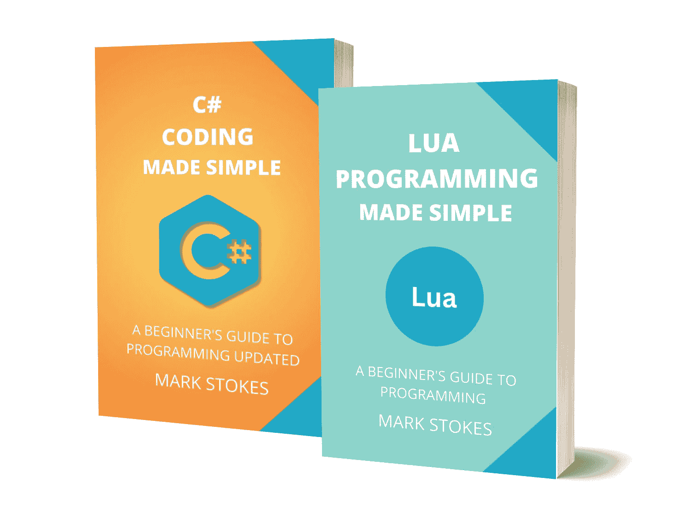

# Lua 与 C# 编程简明：编程初学者指南 - 二本合一





# 图书介绍

《Lua 编程简单易学——学者编程指南》是一本旨在帮助初学者快速轻松学习 Lua 编程的全面性书籍。无论你是编程新手，还是对其他语言已有一定经验，这本书都将为你奠定 Lua 的坚实基础。

Lua 是一种强大且轻量级的脚本语言，以其简单性和多功能而闻名。它被广泛应用于各个领域，包括游戏开发、嵌入式系统和应用程序脚本。凭借简洁的语法和灵活的特性，Lua 是初学者和经验丰富的者的优秀选择。

本书分为十五章，每章都聚焦于 Lua 编程的一个特定方面。从基础开始，你将逐步进入更高级的主题，在此过程中对该语言建立深入理解。每一章都包含清晰的解释、实用示例和动手练习，以强化你的学习。

读完这本书，你将牢牢掌握 Lua 编程概念，并能够自信地编写自己的 Lua 脚本。无论你的目标是创建游戏、自动化任务还是开发应用程序，《Lua 编程简单易学》都将是你的指南。

# 第 1 章：Lua 编程入门

在本章中，我们将探索 Lua 编程的基础知识，并引导你开始编写第一个 Lua 程序。Lua 是一种轻量级高级脚本语言，以其简单、高效和易于集成而闻名。无论你是新手还是有之前的编程经验，本章都将为你开启 Lua 编程之旅奠定基础。

## 开始学习 Lua

要开始，你需要为 Lua 编程搭建开发环境。请按照以下步骤开始：

1. **安装 Lua：** 首先下载并安装适用于你操作系统的 Lua 解释器。Lua 适用于 Windows、macOS 和 Linux。访问 Lua 官方网站（https://www.lua.org/）并导航到“Downloads”部分。选择适用于你系统的安装程序并按照安装说明进行操作。
2. **选择文本编辑器：** Lua 程序可以用任何文本编辑器编写。你可以使用 Sublime Text、Visual Studio Code 或 Atom 等流行的文本编辑器，它们提供了语法高亮和其他有助于编码的特性。
3. **编写你的第一个 Lua 程序：** 在你选择的文本编辑器中创建一个新文件并以 `.lua` 扩展名保存。该扩展名表示文件包含 Lua 代码。让我们写一个简单的“Hello, World!”程序来开始吧：

```lua
-- hello.lua
print("Hello, World!")
```

保存文件并记住你保存的位置。我们将在下一步运行此程序。

## 运行 Lua 程序

现在你已经写好了 Lua 程序，让我们运行它并查看输出。请遵循以下步骤：

1. **打开终端或命令行符：** 在你的系统上启动终端或命令行符。
2. **导航到目录：** 使用 `cd` 命令进入保存文件的目录。例如，如果你在 macOS 或 Linux 上：

```bash
cd ~/Desktop
```

在 Windows 上，命令为：

```bash
cd C:\Users\Username\Desktop
```

将 `Username` 替换为你的用户名。
3. **运行 Lua 程序：** 在终端或命令行符输入以下命令：

```bash
lua hello.lua
```

如果设置正确，你应该看到输出 `Hello, World!`

恭喜！你成功编写并运行了第一个 Lua 程序。你现在准备好深入学习 Lua 了。

## 理解 Lua 基础

现在已经尝试了 Lua 编程，让我们探索一些基本概念：

1. **变量：** 变量用于存储数据。你可以使用语法 `variableName = value` 定义变量。Lua 是一种动态类型语言，这意味着你不需要显式指定类型。
2. **数据类型：** Lua 支持多种类型，包括数字、字符串、布尔值、表等。数字可以是整数或浮点数。字符串是封装在单引号或双引号中的字符序列。布尔值可以是 `true` 或 `false`。表是 Lua 创建数组、字典等主要的数据结构。
3. **算术运算：** Lua 提供了标准的算术运算，如加 (+)、减 (-)、乘 (*)、除 (/) 和取模 (%)。你可以在 Lua 数值上执行这些操作。
4. **字符串：** Lua 提供了强大的字符串处理能力。你可以使用 `..` 运算符拼接字符串，使用方括号 [] 访问单个字符，并使用各种字符串函数进行搜索、替换和格式化。
5. **控制流：** 控制语句允许你做出决策并重复操作。Lua 提供了用于条件执行的 `if-else` 语句，以及用于重复的 `while` 和 `for` 循环。
6. **函数：** 函数是执行特定任务的可复用代码块。在 Lua 中，你可以使用 `function` 关键字定义自己的函数。函数可以接受参数并返回值。

在接下来的章节中，我们将详细探讨这些概念，并学习如何将其应用于现实场景。


在本章中，你已经学习了如何为 Lua 编程设置开发环境，编写了第一个 Lua 程序并成功运行了它。我们还涵盖了一些核心概念，包括变量、数据类型、算术运算、字符串、控制流和函数。

现在你已经打下了坚实的基础，是时候深入研究 Lua 编程了。在第 2 章“设置开发环境”中，我们将引导你完成安装 Lua 和配置开发环境的过程，以获得无缝的编程体验。

# 第 2 章：设置开发环境

在本章中，我们将引导你完成在系统上设置 Lua 并配置开发环境，以获得无缝的 Lua 编程体验。拥有正确的工具和环境对于高效高效的编码至关重要。让我们开始吧！

## 第 1 步：安装 Lua

首先，你需要在系统中安装 Lua 解释器。请根据你的操作系统遵循以下步骤：

### 对于 Windows：

1. 访问 Lua 官方网站 `https://www.lua.org/`。
2. 转到“Downloads”（下载）部分。
3. 下载 Windows 的二进制分发版，它以 ZIP 压缩包的形式提供。
4. 将 ZIP 压缩包的内容解压到你选择的目录。例如，你可以在喜欢的位置创建一个名为“Lua”的文件夹。
5. 将 Lua 可执行文件添加到系统的 `PATH` 变量中：
   - 右键点击“此电脑”或“我的电脑”图标并选择“属性”。
   - 点击左侧的“高级系统设置”。
   - 在“系统属性”窗口中，点击“环境变量”按钮。
   - 在“系统变量”下，找到 `Path` 变量并点击“编辑”。
   - 将 Lua 可执行文件的路径（例如 `C:\Lua`）添加到列表中。
   - 点击“确定”保存更改。

### 对于 macOS：

1. 打开终端（Terminal）应用程序。
2. 运行以下命令使用 Homebrew 安装 Lua：

```shell
brew install lua
```

### 对于 Linux：

1. 打开终端窗口。
2. 使用适用于你发行版的特定包管理器安装 Lua。例如：
- 对于 Ubuntu 和基于 Debian 的系统：
```shell
sudo apt-get install lua5.3
```
- 对于 Fedora 和基于 Red Hat 的系统：
```shell
sudo dnf install lua
```
- 根据你的包管理器和 Lua 版本调整命令。

## 第 2 步：选择文本编辑器

接下来，你需要选择一个文本编辑器来编写你的 Lua 代码。虽然 Lua 程序可以在任何文本编辑器中编写，但使用提供语法高亮、代码补全和调试支持等功能的专用代码编辑器可以极大提升你的编码体验。以下是几个流行的选项：

- **Visual Studio Code:** 从官方网站（https://code.visualstudio.com/）下载并安装 Visual Studio Code。安装后，你可以通过 Visual Studio Code 市场中心安装“Lua”扩展来进一步增强你的 Lua 开发体验。
- **Sublime Text:** 从官方网站（https://www.sublimetext.com/）下载并安装 Sublime Text。安装后，你可以通过 Sublime Text 的包管理器安装如 "LuaExtended" 或 "SublimeLinter-lua" 等包，以启用 Lua 专有的功能。
- **Atom:** 从官方网站（https://atom.io/）下载并安装 Atom。Atom 为 Lua 开发提供了一系列扩展和包，例如用于语法高亮的“language-lua”和用于代码补全的“autocomplete-lua”。

请根据你的喜好和要求自由选择适合的文本编辑器。

## 第 3 步：创建 Lua 文件

现在你已经安装了 Lua 并设置好了文本编辑器，是时候创建你的第一个 Lua 文件了。遵循以下步骤：

1. 打开你喜欢的文本编辑器。
2. 通过选择“文件”然后“新建”或使用相关的键盘快捷键创建一个新文件。
3. 以 `.lua` 扩展保存文件。例如，你可以将其保存为 `myprogram.lua` 或任何你喜欢的描述性名称。
4. 选择一个目录保存你的 Lua 文件。建议为你的 Lua 项目创建一个专用文件夹，以保持整洁。

## 第 4 步：编写你的第一个 Lua 程序

现在你已经准备好了 Lua 文件，让我们写一个简单的程序来测试你的设置。这是一个“Hello, World!”程序示例：

```lua
-- myprogram.lua
-- 打印问候消息
print("Hello, Lua!")
```

编写代码后保存文件。

## 第 5 步：运行你的 Lua 程序

要运行你的 Lua 程序，请遵循以下步骤：

### 对于 Windows：

1. 按 Windows 键 + R，在运行框中输入“cmd”并按回车。打开命令提示符。
2. 使用 `cd` 命令导航到保存 Lua 文件的目录。例如：
```shell
cd C:\Path\To\Your\Lua\Program
```
3. 通过运行以下命令执行 Lua 程序：
```shell
lua myprogram.lua
```

### 对于 macOS 和 Linux：

1. 打开终端。
2. 使用 `cd` 命令导航到保存 Lua 文件的目录。例如：
```shell
cd /path/to/your/lua/program
```
3. 运行以下命令执行 Lua 程序：
```shell
lua myprogram.lua
```

如果一切设置正确，你应该能在终端或命令提示符中看到输出的“Hello, Lua!”

恭喜你！你已成功搭建了 Lua 开发环境并执行了第一个 Lua 程序。你现在准备好开始编写复杂的代码并探索 Lua 编程的巨大可能性了。


4. **表格（Tables）：** 表格是 Lua 中多功能的数据结构，允许你创建数组、字典、集合等。它们可以存储不同类型的值，并提供了一种组织和处理数据的强大方式。这里是一个示例：

```lua
local person = {
name = "Alice",
age = 30,
isStudent = true
}
```

5. **Nil：** `nil` 值表示值的缺失。它通常用于表示变量不存在或删除了表格中的条目。

## 变量命名规范

在 Lua 中为变量命名时，有几个规范需要遵循：

- 变量名应该具有描述性，并指示变量的用途。
- 对于多单词的变量名，使用小写字母和下划线（例如，`my_variable`）。
- 避免使用保留关键字作为变量名。

## 变量赋值与操作

在 Lua 中，你可以使用赋值运算符（`=`）为变量赋值。你可以在程序的任何一点为变量分配新值。这里有一个示例：

```lua
local age = 25
print(age)  -- 输出: 25
age = 30
print(age)  -- 输出: 30
```

## 类型转换

Lua 提供了函数将值从一种数据类型转换为另一种类型。例如，你可以使用 `tostring()` 函数将数字转换为字符串，或者使用 `tonumber()` 函数将字符串转换为数字。

```lua
local num = 42
local str = tostring(num)
print(str)  -- 输出: "42"
local strNum = "123"
local num = tonumber(strNum)
print(num)  -- 输出: 123
```

### 总结

在本章中，我们探索了 Lua 中的变量和数据类型。我们学习了如何声明变量并给变量赋值，并检查了 Lua 中可用的各种数据类型，包括数字、字符串、布尔值、表格和 nil。理解变量和数据类型是编写高效 Lua 程序的基础。

在下一章“控制流：条件语句和循环”中，我们将深入研究控制流结构，允许你根据某些条件做出决策并重复执行代码执行。请持续关注！

# 第 4 章：控制流与循环

在本章中，我们将探索 Lua 中的控制流结构，这些结构使我们能够根据某些条件做出决策并重复代码执行。理解控制流对于编写动态和交互式的 Lua 程序至关重要。让我们开始吧！

## 条件语句

条件语句允许我们根据指定的条件执行不同的代码块。在 Lua 中，我们使用 `if`、`elseif` 和 `else` 关键字创建条件语句。这里有一个示例：

```lua
local age = 18
if age < 18 then
print("你的年龄还不能投票.")
elseif age >= 18 and age < 21 then
print("你可以投票但不能喝酒。")
else
print("你可以投票也可以喝酒。")
end
```

在上面的代码段中，我们使用 `if` 语句检查 `age` 变量的值。如果条件为真，则执行相应的代码块。

## 逻辑运算符

Lua 提供了逻辑运算符来组合更复杂的表达式：

- `and` 运算符：当两个条件都为真时返回真。
- `or` 运算符：当至少一个条件为真时返回真。
- `not` 运算符：反转布尔值。

这里是一个使用逻辑运算符的示例：

```lua
local score = 80
if score >= 60 and score <= 100 then
print("你通过了考试!")
elseif score >= 40 then
print("你及格了。")
else
print("你没及格。")
end
```

## 循环

循环允许我们重复执行代码块。Lua 提供了两种循环：

### while 循环

`while` 循环只要指定的条件为真就会一直执行代码。这里有一个示例：

```lua
local count = 1
while count <= 5 do
print("计数:", count)
count = count + 1
end
```

### for 循环

`for` 循环允许我们遍历范围。常见的用法有两种：

1. 遍历数字：

```lua
for i = 1, 5 do
print("数字:", i)
end
```

2. 遍历表格元素：

```lua
local fruits = {"apple", "banana", "orange"}
for index, fruit in ipairs(fruits) do
print("水果:", fruit)
end
```

## 控制流关键字

Lua 提供了控制流关键字来修改执行流：

- `break` 关键字：立即终止循环。
- `continue` 关键字：跳过当前迭代的剩余部分（注意：标准 Lua 并不原生支持 continue，通常通过逻辑实现）。


在上面的代码段中，`divide` 函数计算除法的商和余数。我们调用该函数并将返回值接收到单独的变量 `q` 和 `r` 中。

# Lua 中的模块 (Modules)

模块提供将相关的函数、变量和其他 Lua 代码组织到单独文件的方法。它们促进了代码的可重用性和封装。让我们看看如何在 Lua 中创建和使用模块。

要创建一个模块，你只需要定义一个带有 `.lua` 扩展名的 Lua 文件，其中包含所需的函数和变量。这里有一个名为 `mathUtils.lua` 的模块示例：

```lua
-- mathUtils.lua

local M = {}

function M.add(a, b)
return a + b
end

function M.subtract(a, b)
return a - b
end

return M
```

在上面的代码段中，我们定义了一个名为 `mathUtils` 的模块，包含 `add` 和 `subtract` 函数。我们将函数存储在表 `M` 中，并在最后返回该表。

要在另一个 Lua 文件中使用该模块，我们需要 `require` 它。这是一个使用 `mathUtils` 模块的示例：

```lua
-- main.lua

local mathUtils = require("mathUtils")

local sum = mathUtils.add(5, 3)

print(sum)  -- 输出: 8

local difference = mathUtils.subtract(10, 7)
print(difference)  -- 输出: 3
```

在上面的代码段中，我们引入了 `mathUtils` 模块并使用其函数 `add` 和 `subtract` 来执行数学运算。

### 总结

在本章中，我们探索了 Lua 中的函数和模块。函数允许我们将代码封装成可重用的块、接受参数并返回值。模块提供了一种将相关的函数和变量组织到单独文件的方法，促进了代码的可重用性和封装。

# 第 6 章：表 (Tables) 与元表 (Metatables)

在本章中，我们将探索 Lua 中的表和元表。表是一种多功能的数据结构，允许你存储和组织相关数据，而元表则提供了一种自定义表行为的方法。理解表和元表对于处理复杂数据结构和在 Lua 中创建强大的抽象至关重要。让我们开始吧！

## Lua 中的表

Lua 中的表是存储和组织数据的主要数据结构。它们可以用作数组、字典，甚至是两者的结合。这里是一个简单的表示例：

```lua
-- 创建一个表
local fruits = {"apple", "banana", "orange"}

-- 访问元素
print(fruits[1])  -- 输出: apple
print(fruits[2])  -- 输出: banana
print(fruits[3])  -- 输出: orange
```

在上面的代码段中，我们创建了一个名为 `fruits` 的表，包含三个元素。我们可以使用方括号和元素的索引来访问单个元素（Lua 数组是从 1 开始索引的）。

Lua 表并不限于存储单一数据类型的值。它们可以存储不同类型的值，包括其他表。这里有一个示例：

```lua
-- 创建包含混合数据类型的表
local person = {
name = "John Doe",
age = 25,
isMale = true,
hobbies = {"reading", "gaming", "hiking"}
}

-- 访问元素
print(person.name)         -- 输出: John Doe
print(person.age)          -- 输出: 25
print(person.isMale)       -- 输出: true
print(person.hobbies[1])   -- 输出: reading
```

在上面的代码段中，我们创建了一个名为 `person` 的表，其元素包含各种数据类型。我们可以使用点符号符号访问命名字段，并使用方括号访问数组类字段。

Lua 表也非常灵活，允许对其结构进行动态操纵。你可以在运行时添加、删除或修改元素。这里有一个示例：

```lua
-- 创建一个空表
local myTable = {}

-- 添加元素
myTable[1] = "Hello"
myTable[2] = "world"

-- 修改元素
myTable[1] = "Hi"

-- 删除元素
myTable[2] = nil

-- 打印表
for key, value in ipairs(myTable) do
print(key, value)
end
```

在上面的代码段中，我们创建了一个空表 `myTable` 并对其执行了各种操作。我们添加了元素、修改了一个元素，并删除了一个元素。最后，我们使用 `ipairs` 迭代器遍历表并打印它的键值对。

## Lua 中的元表

元表允许你自定义表的行为。它们允许你为表定义加法、减法、比较等更多操作。通过为表设置元表，你可以定义 Lua 如何处理在这些表上的操作。这里有一个示例：

```lua
-- 创建两个表
local table1 = {10, 20, 30}
local table2 = {40, 50, 60}

-- 为 table1 设置元表
local mt = {
__add = function(left, right)
local result = {}
for i = 1, #left do
result[i] = left[i] + right[i]
end
return result
end
}
setmetatable(table1, mt)

-- 对表进行加法
local sum = table1 + table2

-- 打印结果
for key, value in ipairs(sum) do
print(key, value)
end
```

在上面的代码段中，我们创建了两个表 `table1` 和 `table2`。我们为 `table1` 设置了元表 `mt`，其中 `__add` 函数定义了如何将两个表相加（通过逐元素元素并返回新表）。通过 `setmetatable(table1, mt)`，我们允许了 `table1 + table2` 的操作。

### 总结

在本章中，我们探索了 Lua 中的表和元表。表提供了存储和组织数据的灵活数据结构。它们可以用作数组或字典，其结构可以动态修改。元表允许你自定义表的行为，定义操作。

# 第 7 章：字符串 (Strings) 与模式匹配 (Pattern Matching)

在本章中，我们将探索 Lua 中的字符串和模式匹配。字符串是表示字符序列的基本类型，而模式匹配提供了强大的字符串处理机制。理解字符串对于处理文本数据至关重要。让我们开始吧！

## Lua 中的字符串

Lua 中的字符串用于表示和处理文本数据。它们可以包含在单引号 `'like this'` 或双引号 `"this"` 中。这里有一个简单的字符串示例：

```lua
-- 创建一个字符串
local message = "Hello, world!"

-- 访问字符
print(message:sub(1, 5))  -- 输出: Hello
print(message:sub(-6))    -- 输出: world!
```

在上面的代码段中，我们创建了一个名为 `message` 的字符串，包含 "Hello, world!"。我们可以使用 `sub` 函数访问字符串的单个字符，该函数接受起始和结束索引作为参数。

Lua 字符串是不可变的，这意味着它们不能被直接修改。但是你可以通过拼接或修改现有字符串来创建新字符串。这里有一个示例：

```lua
-- 拼接字符串
local name = "John"
local greeting = "Hello, " .. name .. "!"
print(greeting)  -- 输出: Hello, John!
```

在上面的代码段中，我们拼接了字符串 "Hello, "、变量 `name` 的值以及感叹号。结果被赋值给变量 `greeting`。

## Lua 中的模式匹配

Lua 中的模式匹配允许你使用模式搜索和处理字符串。模式是表示一组字符串或特定字符串格式的字符序列。Lua 提供了 `string.match` 函数来执行模式匹配。这里有一个示例：

```lua
-- 执行模式匹配
local email = "john.doe@example.com"
local username = string.match(email, "([^@]+)")
print(username)  -- 输出: john.doe
```

在上面的代码段中，我们使用模式匹配从电子邮件地址中提取用户名。模式 `"([^@]+)"` 匹配任何非 `@` 符号的字符序列。


Lua 模式可以包含称为“模式修饰符”的特殊字符，用于指定匹配条件。一些常见的模式修饰符有：

- `+` 匹配前一个模式的一次或多次出现。
- `*` 匹配前一个模式的零或多次出现。
- `?` 匹配前一个模式的一次或一次出现。
- `%a` 匹配任何字母。
- `%d` 匹配任何数字。
- `%s` 匹配任何空白字符。

下面是一个演示模式修饰符使用的示例：

```lua
-- 使用修饰符进行模式匹配
local text = "The quick brown fox jumps over the lazy dog"
local words = {}
for word in string.gmatch(text, "%a+") do
  table.insert(words, word)
end

-- 打印单词
for _, word in ipairs(words) do
  print(word)
end
```

在上面的代码段中，我们使用 `%a+` 模式通过模式匹配从给定的文本中提取所有单词。`%a+` 模式匹配一个或多个字母。我们使用 `string.gmatch` 函数来遍历匹配项并将它们收集到表中。

### 总结

在本章中，我们探索了 Lua 中的字符串和模式匹配。字符串用于表示文本数据，可以通过拼接或修改进行操作。模式匹配提供了一种强大的机制，可以使用模式来搜索和处理字符串。Lua 模式包含了特殊字符来指定匹配条件。

# 第 8 章：文件 I/O 操作

在本章中，我们将探索 Lua 中的文件输入/输出（I/O）操作。文件 I/O 操作允许你从外部文件读取并写入数据，能够处理持久化数据并与文件系统交互。理解文件 I/O 操作对于处理存储在文件中以及将 Lua 程序与更广泛的计算环境集成至关重要。让我们开始吧！

### 打开和关闭文件

在执行任何文件 I/O 操作之前，你需要使用 `io.open` 函数打开文件。该函数接受文件路径和模式作为参数，并返回一个文件句柄。这是一个示例：

```lua
-- 打开文件读取
local file = io.open("data.txt", "r")
-- 执行文件操作...
-- 关闭文件
file:close()
```

在上面的代码段中，我们以只读模式 (`"r"`) 打开了一个名为 `"data.txt"` 的文件。`io.open` 函数返回一个文件句柄，我们可以用它执行各种文件操作。一旦完成，重要的是使用文件句柄的 `close` 方法关闭它以释放系统资源。

### 从文件中读取

Lua 提供了几种从文件中读取数据的方法。最常用的方法是 `read`、`readline` 和 `read("*all")`。下面是一个演示每个方法的示例：

```lua
-- 打开文件读取
local file = io.open("data.txt", "r")
-- 读取单个字符
local char = file:read(1)
print(char)  -- 输出:第一个字符
-- 读取一行
local line = file:readline()
print(line)  -- 输出: 第一行
-- 读取整个文件
local content = file:read("*all")
print(content)  -- 输出: 文件的全部内容
-- 关闭文件
file:close()
```

在上面的代码段中，我们使用不同的方法从文件中读取数据。`read` 方法允许你指定读取的字符数，`readline` 读取单行，而 `read("*all")` 读取文件的全部内容。

### 写入文件

Lua 还提供了将数据写入文件的方法。最常用的方法是 `write` 和 `writeline`。下面是一个演示如何向文件写入数据的示例：

```lua
-- 打开文件写入
local file = io.open("output.txt", "w")
-- 将数据写入文件
file:write("Hello, world!\n")
file:writeline("This is a new line.")
-- 关闭文件
file:close()
```

在上面的代码段中，我们以写入模式 (`"w"`) 打开了一个名为 `"output.txt"` 的文件。我们使用 `write` 方法向文件写入字符串，并使用 `writeline` 方法写入字符串并在后跟一个换行符。

### 文件 I/O 错误处理

在执行文件 I/O 操作时，处理可能发生的错误是非常重要的。Lua 提供了 `io.open` 函数，如果文件操作失败，它会返回 `nil` 以及一个错误消息。下面是一个打开文件时的错误处理示例：

```lua
local file, error = io.open("data.txt", "r")
if not file then
  print("打开文件错误: " .. error)
else
  -- 执行文件操作...
  file:close()
end
```

在上面的代码段中，如果 `io.open` 函数无法打开文件，它将返回 `nil` 作为文件句柄，并将错误消息作为第二个值。我们可以检查文件句柄是否为 `nil`并在发生错误时显示错误消息。

### 总结

在本章中，我们探索了 Lua 中的文件 I/O 操作。我们学习了如何打开和关闭文件、使用不同方法从文件中读取数据、向文件写入数据以及处理文件 I/O 错误。文件 I/O 操作对于处理外部数据并将 Lua 程序与文件系统集成至关重要。

在下一章“错误处理与调试”中，我们将深入研究 Lua 中提供的错误处理技术和调试工具。请请关注！

# 第 9 章：错误处理与调试

在本章中，我们将探索 Lua 中的错误处理技术和调试。错误处理允许你优雅地处理并从错误中恢复，而调试工具则协助识别和解决代码中的问题。理解错误处理和调试对于开发健壮可靠的 Lua 程序至关重要。让我们开始吧！

### 使用 `pcall` 和 `assert` 进行错误处理

Lua 提供了 `pcall` 函数，代表“受保护调用”（protected call），以受控的方式处理错误。`pcall` 函数执行给函数并捕获其执行过程中发生的任何错误。这是一个示例：

```lua
-- 定义一个可能引发错误的函数
local function divide(a, b)
  if b == 0 then
    error("不能除以零！")
  else
    return a / b
  end
end

-- 使用 pcall 调用函数
local success, result = pcall(divide, 10, 0)
if success then
  print("结果:", result)
else
  print("错误:", result)
end
```

在上面的代码段中，`divide` 函数将 `a` 除以 `b`。如果 `b` 为 0，则使用 `error` 函数抛出错误。我们使用 `pcall` 调用 `divide` 函数并捕获任何错误。如果函数调用成功，`success` 将为 `true`，`result` 将返回值。否则，`success` 将为 `false`，`result` 将包含错误消息。

另一个用于错误处理的实用函数是 `assert`。它检查给条件，如果条件为 `false` 则抛出错误。这是一个示例：

```lua
local x = 10
local y = 20
assert(x == y, "x 和 y 必须相等!")
```

在上面的代码段中，`assert` 检查 `x` 是否等于 `y`。如果条件为 `false`，将抛出指定的错误消息。如果条件为 `true`，程序将继续执行。

### 使用 `print` 和 `debug` 进行调试

`print` 函数是 Lua 中简单而有效的调试工具。通过在代码中有策略地放置 `print` 语句，你可以输出变量值或中间结果以跟踪执行流并识别潜在问题。这是一个示例：

```lua
local x = 10
local y = 5
print("开始计算...")
print("x =", x)
print("y =", y)
local result = x + y
print("结果 =", result)
print("计算结束.")
```

在上面的代码段中，`print` 语句用于显示 `x` 和 `y` 的值以及计算结果。通过检查输出，你可以验证值的正确性并确保程序按预期运行。


Lua 还提供了 `debug` 库，它提供了更高级的调试功能。它包含了诸如 `debug.traceback` 用于检索堆栈跟踪，以及 `debug.getlocal` 用于访问函数内部局部变量等函数。这些函数在深度调试场景中非常有用。

## 处理运行时错误

在程序执行期间，Lua 可能会遇到并非由代码显式抛出的运行时错误。这些错误可能包括访问 `nil` 值、调用未定义的函数或使用不存在的键索引表等问题。处理此类错误对于防止程序崩溃并向用户提供有意义的错误信息至关重要。

Lua 提供了一种使用 `error` 函数处理运行时错误的内置机制。你可以使用此函数在某些特定条件不满足时抛出自定义错误。通过提供描述性的错误信息，你可以帮助识别错误产生。这是一个示例：

```lua
local function validateInput(value)
  if not value then
    error("Invalid input: value must not be nil.")
  end
  -- 额外的验证逻辑...
end

local input = getUserInput()
-- 验证输入
local success, error = pcall(validateInput, input)
if not success then
  print("Input validation failed:", error)
end
```

在上面的代码段中，`validateInput` 函数检查输入值是否为 `nil`，如果是，则抛出一个带有相应消息的错误。我们使用 `pcall` 调用 `validateInput` 函数并捕获任何发生的错误。如果捕获到错误，我们会打印一个用户友好的错误信息。

## 调试技术

Lua 提供了几种调试技术来帮助识别和解决代码中的问题。以下是一些常用技术：

1. **逐行执行**：通过逐行执行代码，你可以观察程序状态的变化，并追踪任何异常行为。
2. **检查变量值**：你可以使用 `print` 语句或调试器在执行的不同阶段输出变量的值，帮助你理解它们的值并检测任何异常。
3. **使用断点**：断点允许你在特定的行或条件处停止代码的执行，使你能够检查该特定点的程序状态和变量。
4. **堆栈跟踪**：堆栈跟踪提供了导致错误点之前的函数调用层次结构的快照。它们可以帮助识别是哪个函数或代码行触发了错误。

记住，调试是一个迭代过程。通过分析输出、观察变量值并使用适当调试技术，你可以更有效地定位并解决 Lua 代码中的错误。

### 总结

在本章中，我们探索了 Lua 中的错误处理和调试技术。错误处理有助于通过 `pcall` 和 `assert` 等函数优雅地处理程序执行期间的错误。如 `print`、`debug` 库和检查运行时错误等调试技术让你能够识别并解决 Lua 代码中的问题。

# 第 10 章：Lua 中的面向对象编程

在本章中，我们将探索 Lua 中的面向对象编程 (OOP)。虽然 Lua 并不是一种严格的面向对象的语言，但它提供了强大的功能允许你实现 OOP 原则。理解 Lua 中的面向对象编程使你能够创建模块化可重用的代码。让我们开始吧！

## 面向对象编程介绍

面向对象编程是一种编程范式，将代码组织成对象，对象封装了数据和行为。它促进了模块化、可重性和代码组织。在 Lua 中，可以通过多种技术实现 OOP，例如表、元表（metatables）和函数。让我们通过示例探索这些技术。

## 表作为对象

在 Lua 中，可以通过将表定义为字段（数据）和方法（函数）的集合来将其作为对象使用。这是一个演示将表作为对象使用的示例：

```lua
-- 定义一个人对象
local person = {
  name = "",
  age = 0,
}

-- 为人对象定义方法
function person:setName(name)
  self.name = name
end

function person:setAge(age)
  self.age = age
end

function person:getInfo()
  return "Name: " .. self.name .. ", Age: " .. self.age
end

-- 创建一个人对象的实例
local john = person
-- 设置属性
john:setName("John Doe")
john:setAge(30)
-- 获取信息
print(john:getInfo())  -- 输出: Name: John Doe, Age: 30
```

在上面的代码段中，我们定义了一个代表人对象的 `person` 表。它有字段（`name` 和 `age`）和方法（`setName`、`setAge` 和 `getInfo`）。通过使用 `self` 关键字，我们可以在方法内部引用对象的当前实例。我们创建了一个名为 `john` 的 `person` 对象的实例，并使用它的方法设置属性和检索信息。

## 元表与对象行为

Lua 中的元表提供了一种为表定义自定义行为的方法，允许我们实现继承和运算符重载等概念。这是一个演示使用元表实现对象的示例：

```lua
-- 定义一个基础对象
local shape = {
  area = 0,
}

-- 为 shape 对象定义一个带有方法的元表
local shapeMetatable = {
  __index = shape,
}

-- 为 shape 对象定义方法
function shape:calculateArea()
  -- 计算面积
end

function shape:displayArea()
  print("Area:", self.area)
end

-- 创建一个 shape 对象实例
local myShape = setmetatable({}, shapeMetatable)
-- 设置面积
myShape.area = 100
-- 显示面积
myShape:displayArea()  -- 输出: Area: 100
```

在上面的代码段中，我们定义了一个 `shape` 表作为基础对象。然后我们定义了一个包含 `__index` 字段的元表 `shapeMetatable`，这使得 `shape` 表作为 `myShape` 实例原型。通过 `setmetatable` 设置元表，我们允许 `myShape` 实例继承 `shape` 表定义的方法。

### Lua 中的面向对象库

Lua 还提供了一些辅助面向对象编程的库，例如 `MiddleClass`、`LÖVE` 和 `Penlight`。这些库为在 Lua 中实现 OOP 概念提供了额外的功能和便利。你可以探索这些库这些库。

### 总结

在本章中，我们探索了 Lua 中的面向对象编程。我们学习了如何将表作为对象、定义方法并利用元表提供对象行为。理解这些技术让你可以使用 OOP 原则创建模块化可重用的代码。

# 第 11 章：库与包的使用

在本章中，我们将探索 Lua 中库和包的使用。库和包提供了组织和重用代码的方法，允许你扩展 Lua 程序的功能。理解如何使用库和包对于高效开发至关重要。让我们开始吧！

## 库与包介绍

Lua 中的库是提供特定功能的函数和数据的集合。它们被设计为可重用，并可以轻松集成到程序中。另一方面，包是多个文件的集合，形成一个完整的模块或应用程序。包允许更好的代码组织和依赖管理。

## 加载与使用库

Lua 提供 `require` 函数来加载和使用库。`require` 函数会查找包含指定库的 Lua 文件并执行它，使库的功能在你的程序中可用。这是一个示例：


```lua
-- Load the math library
local mathLib = require("math")

-- Use the library functions
local x = 10
local y = 5
local result = mathLib.add(x, y)
print("Result:", result)
```

在上面的代码段中，我们使用 `require` 加载了 `math` 库。`math` 库可能存储在一个名为 `math.lua` 的独立 Lua 文件。一旦加载，我们就可以使用库中的函数（例如 `add`）来执行计算。

## 创建和发布库

在 Lua 中创建一个库，你通常需要定义一个包含库函数和数据的 文件。该文件应该返回一个表示该库的表（table）。这是一个创建一个简单库的示例：

```lua
-- math.lua

-- Define the math library
local mathLib = {}

-- Add function
function mathLib.add(a, b)
return a + b
end

-- Subtract function
function mathLib.subtract(a, b)
return a - b
end

-- Return the library table
return mathLib
```

在上面的代码中，我们定义了包含 `add` 和 `subtract` 函数的 `mathLib` 表。然后我们在文件末尾返回 `mathLib` 表，以便在库被加载时可以访问它。

要发布你的库，你可以将其封装为 Lua 模块（module）或直接共享 Lua 文件。`LuaRocks` 是一个流行的 Lua 包管理器，允许你轻松地共享和安装 Lua 库。

## 使用包

Lua 包（packages）提供了一种组织和管理由多个 Lua 文件组成代码库的方法。包通常遵循特定的目录结构，并使用 `init.lua` 文件作为入口点。让我们考虑一个包结构：

```
my_package/
├── init.lua
├── utils.lua
└── calculations.lua
```

在上面的包结构中，`init.lua` 文件作为入口点，其他 Lua 文件（如 `utils.lua` 和 `calculations.lua`）包含特定的功能。你可以按照以下方式加载并使用包中的函数：

```lua
-- Load the package
local myPackage = require("my_package")

-- Use the package functions
myPackage.utils.doSomething()
local result = myPackage.calculations.add(10, 5)
print("Result:", result)
```

## 第三方库和模块

Lua 拥有一个由社区开发的活跃的第三方库和模块生态系统。这些库涵盖了广泛的领域，包括网络、图形、Web 开发等。一些流行的 Lua 库包括 `LuaSocket`、`LÖVE`、`LuaSQL` 和 `LuaFileSystem`。你可以探索这些库并利用它们的功能来增强你的 Lua 程序。

### 总结

在本章中，我们探索了在 Lua 中处理库和包的方法。我们学习了如何使用 `require` 函数加载和使用库，创建并发布自己的库，以及将代码组织成包。我们还讨论了第三方库和模块的可用性。

## 第 12 章：高级 Lua 技术

在本章中，我们将深入探讨 Lua 编程语言的高级技术和特性。这些技术将帮助你编写更高效、更灵活且健壮的代码。让我们探索一些高级的 Lua 技术吧！

## 元编程

元编程是一种程序可以在运行时修改或生成代码的技术。在 Lua 中，元编程通过其强大的反射能力以及将 Lua 代码作为数据进行处理的能力来实现。这允许你动态地创建和修改函数、表以及其他 Lua 构造。

元编程的一个常见用途是在 Lua 内部创建 DSL（领域特定语言）。通过定义自定义的语法和语义，你可以定制 Lua 以更好地适应你项目或领域的特定需求。

## 基于协程的并发

Lua 提供了协程（coroutines），它们是轻量级的协作式线程，允许并发执行。协程允许你编写可以暂停和恢复的代码，从而更容易地处理异步任务、事件驱动编程和非阻塞 I/O 操作。

这里是一个演示如何在 Lua 中使用协程的示例：

```lua
-- Define a coroutine
local function myCoroutine()
print("Coroutine started.")
coroutine.yield()
print("Coroutine resumed.")
end

-- Create an instance of the coroutine
local co = coroutine.create(myCoroutine)

-- Start the coroutine
coroutine.resume(co)  -- 输出：Coroutine started.
coroutine.resume(co)  -- 输出：Coroutine resumed.
```

在上面的代码段中，我们定义了一个协程函数 `myCoroutine`。我们使用 `coroutine.create` 创建协程实例，然后使用 `coroutine.resume` 来启动和恢复协程的执行。

## 元表和元方法

元表（metatables）和元方法（metamethods）允许你自定义 Lua 中表的行为。元表是定义了当对其他表执行某些操作时其行为的表。元方法是元表内部的函数，用于定义特定操作（如加法、减法、比较等）的行为。

通过利用元表和元方法，你可以实现运算符重载，定义自定义迭代行为，并创建更灵活、表现力的数据结构。

## 尾调用优化

Lua 采用了尾调用优化，这意味着当函数调用是函数中执行的最后一个动作时，该调用会被优化。优化的尾调用不会创建新的栈帧，而是用新的栈帧替换当前的栈帧，从而节省内存并避免栈溢出错误。

这种优化在处理递归算法或编写自调用的函数时特别有用。它允许你编写递归函数而无须担心栈溢出的风险。

### 总结

在本章中，我们探索了可以增强代码灵活性、性能表现能力的先进 Lua 技术。元编程实现了动态代码生成和修改，协程提供了并发和异步编程，元表和元方法允许自定义表的行为，而尾调用优化提高了递归函数的效率。

通过利用这些技术，你可以充分利用 Lua 在各种编程场景中的多功能性和强大。

# 第 13 章：Lua 与游戏开发

Lua 因其简单性、灵活性和性能，在游戏开发行业中作为脚本语言广受欢迎。在本章中，我们将探索 Lua 如何用于游戏开发以及它的各种应用。

## 作为脚本语言的 Lua

Lua 的轻量级和易于集成使其成为游戏脚本的极佳选择。许多游戏引擎如 `Unity`、`Corona SDK` 和 `Love2D` 都支持 Lua 作为脚本语言。Lua 脚本可以控制游戏机制、AI 行为、事件处理等。

## 使用 Lua 扩展游戏引擎


除了在现有游戏引擎中使用 `Lua` 作为脚本语言外，还有一些完全围绕 `Lua` 构建的游戏开发框架。这些框架提供了一套专门为基于 `Lua` 的游戏开发设计的完整工具、库和实用程序。

诸如 `Love2D`、`Moai` 和 `Gideros` 等框架为 `Lua` 开发者提供了一个创建游戏的全面环境。它们提供了图形和音频渲染、输入处理、物理模拟以及从零开始构建游戏所需的其他核心组件。这些框架拥抱了 `Lua` 的简单性，并为游戏开发提供了必要的抽象。

## 移动游戏开发中的 Lua

`Lua` 的轻量级特性和高效的性能使其特别适用于移动游戏开发。许多移动游戏引擎（如 `Corona SDK` 和 Defold）利用 `Lua` 作为其主要的脚本语言。这些引擎提供了跨平台开发功能，允许开发者使用 `Lua` 为 iOS、Android 和其他移动平台创建游戏。

`Lua` 通过 `FFI`（外部函数接口）与原生代码交互的能力允许开发者利用设备特定功能和 API。这使得开发者能够在保持 `Lua` 提供的易用性和灵活性的同时，能够创建高性能的移动游戏。

## 结语

在本章中，我们探索了 `Lua` 在游戏开发中的作用。我们讨论了 `Lua` 作为游戏引擎脚本语言的流行程度、它在扩展游戏引擎功能方面的应用，以及以 `Lua` 为中心的游戏开发框架的可用性。我们还强调了 `Lua` 在移动游戏开发中的适用性。

`Lua` 的简单性、灵活性性能使其成为游戏开发者宝贵的工具，能够实现快速原型设计、定制和跨平台开发。

在下一章“用于 Web 开发的 Lua”中，我们将探索 `Lua` 在 Web 开发中的存在以及它在构建动态 Web 应用和 API 中的应用。请请关注！

## 第 14 章：Lua 与 Web 开发

`Lua` 在 Web 开发中的应用不如 `JavaScript` 或 `Python` 等语言那样广泛，但在某些 Web 开发场景中它拥有一席之地。在本章中，我们将探索 `Lua` 在 Web 开发中的存在以及它在构建动态 Web 应用和 API 中的应用。让我们深入研究 `Lua` 和 Web 开发吧！

## Web 服务器环境中的 Lua

`Lua` 通常用于 Web 服务器环境以提供服务器端脚本能力。流行的 Web 服务器（如 `Nginx` 和 `Apache`）提供 `Lua` 作为扩展语言，允许开发者将 `Lua` 代码直接嵌入服务器配置中。这使得创建动态网页、URL 路由、请求处理和其他服务器端任务成为可能。

`Lua` 的轻量级和快速执行使其适合处理高大量的 Web 流量。它的简单性和灵活性允许开发者自定义和优化服务器行为，而无需更复杂的服务器端脚本语言。

## 用于 Web API 的 Lua

`Lua` 可用于创建 Web API（应用程序接口），为其他应用程序提供可供的功能和数据。基于 `Lua` 的框架（如 `Lapis` 和 `OpenResty`）提供了构建 RESTful API、处理 `HTTP` 请求以及与数据库和其他服务集成的工具和库。

`Lua` 的易用性和表达丰富的语法使其非常适合定义 API 端点、处理请求参数以及为响应生成 `JSON` 或其他数据格式。基于 `Lua` 的 Web API 可用于驱动各种应用程序，从移动 App 到客户端 `JavaScript` 应用均有。

## Web 应用框架中的 Lua

尽管 `Lua` 在 Web 应用开发中不如 `JavaScript` 或 `Python` 那么常用，但确实存在利用 `Lua` 能力的框架。诸如 `Sailor` 和 `Lapis` 等框架为构建 Web 应用提供了一个结构化环境，配备了路由、模板、数据库集成等功能。

这些基于 `Lua` 的 Web 应用框架通过提供处理常见 Web 开发任务的约定和抽象，旨在简化开发过程。虽然 `Lua` 可能没有其他 Web 开发语言那样广泛的生态系统和工具链，但基于 `Lua` 的框架为 Web 应用开发提供了一种精简且专注的方法。

## Web 游戏脚本的 Lua

`Lua` 的简单性和灵活性使其成为 Web 游戏逻辑脚本的流行选择。如 `Defold` 和 `LÖVE` 等游戏引擎提供 `Lua` 作为脚本语言，允许开发者使用 `Lua` 创建基于浏览的游戏。`Lua` 的轻量级特性和与游戏引擎的轻松集成使其成为构建交互且引胜的 Web 游戏的吸引人的选择。

`Lua` 脚本可以控制游戏机制、处理用户输入并与游戏资产交互，使得创建复杂且浸式的 Web 游戏体验成为可能。

## 结语

在本章中，我们探索了 `Lua` 在 Web 开发中的存在及其各种应用。我们讨论了 `Lua` 在 Web 服务器环境中用于服务器端脚本的使用、它在构建 Web API 中的作用，以及融入基于 `Lua` 的 Web 应用框架的情况。我们还强调了 `Lua` 在 Web 游戏逻辑脚本中的流行。

虽然 `Lua` 在 Web 开发中可能不如其他语言普及，但它的简单性、性能和集成能力使其在特定的 Web 开发场景中成为可行的选择。

## 第 15 章：Lua 与嵌入式系统

`Lua` 的轻量级、简单性和多功能使其成为嵌入式系统编程的极佳选择。在最后一章，我们将探索 `Lua` 在嵌入式系统中的应用及其在该领域的优势。让我们深入研究 `Lua` 和嵌入式系统吧！

## 用于嵌入式系统的 Lua

嵌入式系统是用于在大型系统中执行特定任务的专用计算机系统。这些系统通常资源受限，内存、处理能力和存储容量有限。`Lua` 的小内存占用和高效执行使其非常适合此类环境。

`Lua` 可用于编写固件、控制和监控设备、实现传感器接口以及处理嵌入式系统中的实时任务。它的简单语法、动态类型以及与 `C` 和其他语言的轻松集成，使其成为开发嵌入式应用的流行选择。

## Lua 与物联网（IoT）

物联网（IoT）是相互连接并通信交换数据的设备网络。`Lua` 的简单性、灵性和低资源需求使其成为 IoT 应用的理想语言。`Lua` 可用于为 IoT 设备编写固件、控制 IoT 网关并在 IoT 平台上处理数据和分析。

`Lua` 的轻量级特性允许其在资源受限的设备上运行，适用于处理能力和内存有限的 IoT 设备。它与其他 IoT 技术和协议的集成能力实现了 IoT 生态系统中无缝的通信和互操作。

## 机器人中的 Lua

机器人是另一个 `Lua` 应用的领域。`Lua` 可用于为机器人控制系统、定义机器人行为并与传感器和执行器集成。其高级脚本允许允许机器人应用中进行快速开发和实验。

`Lua` 的轻量级设计和与 `C`、`C++` 的轻松集成使其成为机器人系统脚本的首选。通过 `Lua`，开发者可以创建复杂的机器人控制算法、处理传感器数据并与机器人生态系统的其他软件组件交互。

## 可穿戴设备中的 Lua


可穿戴设备（如智能手表和健身追踪器）通常资源有限，需要高效的编程。Lua 占用内存小、执行效率高，使其成为开发可穿戴设备应用的理想语言。Lua 可用于实现用户界面、收集和处理传感器数据，以及与移动设备进行交互。

Lua 的简单性和灵活允许可穿戴设备应用进行快速原型设计和定制。它与蓝牙、移动平台等技术的集成，实现了与更广泛生态系统的无缝连接和交互。

### 总结

在最后一章中，我们探索了 Lua 在嵌入式系统中的应用。我们讨论了 Lua 适用于资源受限的环境、它在物联网（IoT）应用中的作用、在机器人技术中的应用，以及在可穿戴设备中的用法。Lua 轻量级的设计、简单性以及集成能力使其成为嵌入式系统领域非常有价值的工具。

我们希望《Lua 编程简上手：学者编程指南》这本书为你提供了关于 Lua 及其各种应用的全面介绍。请记住继续探索和练习 Lua 编程，以提高你的技能并释放这种多功能语言的全部潜力。

编码愉快！


## 图书简介

欢迎阅读《C# 编程轻松学》。这本书旨在为渴望学习编程基础的初提供 C# 编程语言的全面介绍。无论你是没有之前的编程经验，还是来自不同的编程背景，这本书都将带你开启从最基础到高级概念的旅程。

编程有时可能会令人生畏，特别是对于初学者来说。这就是为什么这本书的设计初衷是以清晰且易于理解的方式呈现概念。我们将涵盖 C# 编程中的所有核心主题，将它们分解成一个个短小的章节，并在其中充满示例、解释和练习，以强化你的学习。

# C# 编程

# 第 1 章：C# 与编程简介

欢迎来到精彩的编程世界！在本章中，我们将开启探索 C# 基础的之旅，并理解为为你未来的编程活动奠定的基础概念。

## 1.1 什么是编程？

编程是向计算机发出指令执行特定任务的艺术。它涉及在编程语言中编写一组指令（称为代码），计算机可以理解并执行这些指令。编程允许我们创建软件应用程序、网站、游戏等。

## 1.2 为什么要学习 C#？

C#（读作 "C sharp”）是由微软开发的一种多功能编程语言。它广泛用于构建各种应用程序，从 Windows 桌面应用程序到 Web 服务和移动应用。C# 以其简单性、可读性和强大的特性闻名，是初学者的极佳选择。

## 1.3 C# 简史

C# 是微软在 21 世纪初作为其 .NET 计划的一部分创建的。它的灵感源自各种编程语言，包括 C++、Java 和 Visual Basic。多年来，C# 已演变为一种成熟且广泛采用的语言，并有定期的更新和增强。

## 1.4 C# 的关键特性

C# 提供了许多关键特性，使其成为程序员之间的热门选择：

### 1.4.1 面向对象编程 (OOP)

C# 是一种面向对象的编程语言，这意味着它强调将代码组织成可重用的对象。这种方法允许更好的代码组织、模块化和代码复用，使程序更容易开发和维护。

### 1.4.2 简单语法

C# 具有简洁直观的语法，易于阅读和编写。它的语法与其他 C 风格语言（如 C++ 和 Java）相似，这使得在这些语言之间转换变得容易。

### 1.4.3 类型安全

C# 强制执行类型检查，这有助于在编译时捕捉错误并增强程序的可靠性。这一特性确保了变量和对象被正确使用，减少了运行时错误的概率。

### 1.4.4 自动内存管理

C# 包含一个垃圾回收器，自动管理内存的分配和释放。这一特性减轻了开发人员手动内存管理的负担，使 C# 程序较少出现内存泄漏和其他内存相关问题。

### 1.4.5 丰富的标准库

C# 自带一个庞大的标准库，根据版本的不同被称为 .NET Framework 或 .NET Core。该库提供了广泛的内置类和函数，简化了常见的编程任务，例如文件 I/O、网络连接和数据库访问。

## 1.5 设置你的开发环境

在深入学习 C# 编码之前，你需要设置你的开发环境。以下是基本步骤：

### 1.5.1 安装 Visual Studio

Visual Studio 是一个用于 C# 和其他编程语言的强大集成开发环境 (IDE)。它提供了一系列工具，包括代码编辑器、调试器和项目管理功能。访问微软官方网站下载并安装最新版本的 Visual Studio。

### 1.5.2 创建新项目

一旦安装了 Visual Studio，打开它并创建一个新的 C# 项目。你可以根据你想要构建的应用程序类型从各种项目模板中进行选择。Visual Studio 将为你生成必要的项目文件和文件夹结构。

### 1.5.3 编写你的第一个 C# 程序

项目设置好后，你就可以开始编写你的第一个 C# 程序了。Visual Studio 提供了一个代码编辑器，你可以在其中编写和编辑 C# 代码。输入你的代码，以“.cs”扩展名保存文件，并点击“运行 (Run)”按钮执行程序。Visual Studio 将编译你的代码并在控制窗口中显示输出。

## 1.6 你的第一个 C# 程序

让我们从一个简单的“Hello, World!”程序开始，这通常是任何编程语言中编写的第一个程序。该程序将在控制台上显示问候语：

```csharp
using System;

class Program
{
    static void Main()
    {
        Console.WriteLine("Hello, World!");
    }
}
```

让我们拆解一下代码：

- `using System;` 告诉编译器包含 `System` 命名空间，它包含了基本的类和函数。
- 我们使用 `class` 关键字定义了一个名为 `Program` 的类。在 C# 中，程序通常按类组织。
- 在 `Program` 类内部，有一个 `Main` 方法，它是程序的入口。执行从这里开始。
- `Main` 方法标记为 `static`，这意味着它属于类本身，而不是类的实例。
- `void` 关键字表示 `Main` 方法不返回值。
- 在 `Main` 方法中，我们使用 `Console.WriteLine` 函数在控制台上显示“Hello, World!”消息。

## 1.7 运行你的程序

要运行程序，请点击 Visual Studio 中的“启动 (Start)”或“运行 (Run)”按钮。这将编译并执行你的代码。控制窗口将会出现并显示输出：“Hello, World!”

恭喜！你成功编写并运行了第一个 C# 程序。这个简单的程序演示了 C# 程序的基本结构和语法。

## 1.8 下一步工作

现在你已经对 C# 有了基本的了解并编写了第一个程序，是时候进一步探索了。在接下来的章节中，我们将深入学习 C# 编程的核心概念。

我们将学习变量、数据类型、控制结构、数组、方法、面向对象编程等。每个章节都将引入新概念，并提供示例和练习来巩固你的理解。


读完本书后，你将获得从容编写 C# 程序的必要知识和技能。无论你是渴望成为一名专业的软件开发者，还是仅仅想探索编程的世界，这本书都将成为你这段激动人心旅程的指南。

所以，让我们不要再浪费时间了。翻页，让我们一起开启 C# 编程之旅吧！

# 第 2 章：理解变量和数据类型

在本章中，我们将深入探讨 C# 中的变量和数据类型。理解变量至关重要，因为它们允许我们在程序中存储和操作数据。此外，我们还将探索 C# 中提供的各种数据类型，并学习如何有效地声明和使用它们。

## 2.1 变量简介

在编程中，变量是一个可以存储值的命名的存储位置。可以将变量想象成是存储数据的容器，这些数据可以在整个程序中对其进行修改和访问。变量提供了灵活性，并使我们能够执行计算、做出决策以及存储信息以备后用。

## 2.2 声明变量

在使用变量之前，我们需要对其进行声明，指定它的名称和数据类型。在 C# 中，变量必须在使用之前先声明。声明变量的语法如下：

```csharp
data_type variable_name;
```

在这里，`data_type` 代表变量将存储的数据类型，`variable_name` 是为变量选择的名称。

## 2.3 C# 数据类型

C# 提供了多种内置数据类型以满足不同类型的数据。让我们探索一些常用的数据类型：

- **数值数据类型：**
  - `int`：表示整数（例如 1, 10, -5）。
  - `double`：表示带有小数点的浮点数（例如 3.14, -0.5）。
  - `decimal`：表示高精度的小数（例如 3.14159265358979323846）。
- **文本数据类型：**
  - `string`：表示字符序列（例如 "Hello", "World"）。
- **布尔数据类型：**
  - `bool`：表示布尔值，即 `true` 或 `false`。
- **其他数据类型：**
  - `char`：表示单个字符（例如 'a', '7'）。

## 2.4 为变量赋值

在声明变量后，我们可以使用赋值运算符 (`=`) 为其赋值。所赋的值必须与变量的数据类型匹配。这里有一个示例：

```csharp
int age;
age = 25;
```

在这个示例中，我们声明了一个类型为 `int` 的名为 `age` 的变量，并为其赋值了值 `25`。

## 2.5 初始化变量

可以在一步内完成变量声明并赋值。这被称为变量初始化。这里有一个示例：

```csharp
string name = "John";
int quantity = 10;
```

在这种情况下，我们声明并初始化了值为 "John" 的 `name` 变量，以及初始化了值为 "10" 的 `quantity` 变量。

## 2.6 变量命名规则

在 C# 中选择变量名时，请记住以下规则：

- 变量名是区分大小写的（`age` 和 `Age` 是不同的变量）。
- 变量名必须以字母或下划线开头。
- 变量名中的后续字符可以是字母、数字或下划线。
- 变量名不能包含空格或特殊字符（!, @, #, 等）。
- 避免使用保留关键字作为变量名（例如 `int`, `string`, `class`）。

## 2.7 拼接变量和字符串

在 C# 中，我们可以使用拼接运算符 (`+`) 将变量与字符串拼接。这允许我们将文本和变量数据结合起来。考虑以下示例：

```csharp
string name = "Alice";
int age = 30;
string message = "Hello, " + name + "! You are " + age + " years old.";
```

在这个示例中，我们声明了一个类型为 `string` 的 `name` 变量和一个类型为 `int` 的 `age` 变量。然后我们使用拼接运算符 (`+`) 将这些变量与字符串结合，创建了 `message` 变量。生成的消息将是 "Hello, Alice! You are 30 years old."

## 2.8 使用常量

除了变量，C# 还允许使用常量。常量是在赋值后无法修改的值。它提供了一种存储在整个程序中保持不变的数据的方法。常量使用 `const` 关键字声明。这里有一个示例：

```csharp
const double PI = 3.14159;
```

在这个示例中，我们声明了一个名为 `PI` 的常量，值为 `3.14159`。在处理固定值（如数学常量或配置设置）时，常量非常有用。

## 2.9 类型转换

在编程中，我们经常需要将数据从一种类型转换为另一种类型。C# 提供了在兼容数据类型之间转换机制。例如，将 `int` 转换为 `double` 或将 `string` 转换为 `int`。这些转换被称为类型转换（type casting）。

C# 支持两种类型的转换：隐式和显式。当没有数据丢失的风险时，编译器会自动执行隐式转换。显式转换（也称为类型转换）需要显式标记，如果处理不当，可能会导致数据丢失或异常。

## 2.10 类型推断

C# 还提供名为类型推断的功能，允许编译器根据值自动确定变量的类型。这里有一个示例：

```csharp
var score = 90;
```

在这个示例中，编译器推断出 `score` 是 `int` 类型。

## 2.11 总结

在本章中，我们探索了变量的概念并学习了 C# 中的各种数据类型。我们发现了如何声明变量、赋值以及初始化它们。此外，我们涵盖了变量命名规则、变量与字符串的拼接、常量的使用、类型转换以及类型推断。理解变量和数据类型是编程的基础，它们允许我们有效地存储和操作数据。在下一章中，我们将探索控制结构，它们使我们能够做出决策并控制程序的流程。

# 第 3 章：控制结构：做出决策和重复操作

在本章中，我们将深入探讨 C# 中的控制结构。控制结构允许我们根据条件做出决策并重复操作。通过利用控制结构，我们可以控制程序的流程并使其更加动态和响应。

## 3.1 条件语句：做出决策

条件语句允许我们根据某些条件执行不同的代码块。在 C# 中，我们有以下条件语句：

### 3.1.1 if 语句

`if` 语句用于在指定条件为真时执行代码块。这里有一个示例：

```csharp
int age = 25;
if (age >= 18)
{
    Console.WriteLine("You are eligible to vote!");
}
```

在这个示例中，`if` 语句检查 `age` 是否大于或等于 18。如果条件为真，将显示 "You are eligible to vote!"。

### 3.1.2 if-else 语句

`if-else` 允许允许根据条件执行不同的代码块。如果条件为真，执行 `if` 块中的代码；否则，执行 `else` 块中的代码。这里有一个示例：

```csharp
int temperature = 25;
if (temperature > 30)
{
    Console.WriteLine("It's hot outside!");
}
else
{
    Console.WriteLine("It's not too hot today.");
}
```

在这个示例中，如果温度大于 30，将显示 "It's hot outside!"。否则，将显示 "It's not too hot today."。

### 3.1.3 if-else if 语句

`if-else if` 语句允许我们检查多个条件并相应地执行不同的代码块。


```csharp
int score = 85;

if (score >= 90)
{
    Console.WriteLine("Excellent!");
}
else if (score >= 80)
{
    Console.WriteLine("Good job!");
}
else if (score >= 70)
{
    Console.WriteLine("Keep it up!");
}
else
{
    Console.WriteLine("You can do better!");
}
```

在这个示例中，根据 `score` 变量的值，将显示相应的消息。

# 3.2 循环结构：重复操作

循环结构允许我们多次执行一组语句。在 C# 中，我们有以下几种循环结构：

## 3.2.1 For 循环

`for` 循环用于我们提前知道迭代次数的情况。它由三部分组成：初始化、条件和迭代。这是一个示例：

```csharp
for (int i = 1; i <= 5; i++)
{
    Console.WriteLine("Iteration: " + i);
}
```

在这个示例中，循环将迭代五次，显示从 "Iteration: 1" 到 "Iteration: 5" 的消息。

### 3.2.2 While 循环

`while` 循环用于当条件为真时重复执行一段代码块。这是一个示例：

```csharp
int count = 0;
while (count < 5)
{
    Console.WriteLine("Count: " + count);
    count++;
}
```

在这个示例中，只要 `count` 变量小于 5，循环就会一直迭代，显示当前的计数器值。

### 3.2.3 Do-While 循环

`do-while` 循环与 `while` 循环类似，但在检查条件之前会至少执行一次代码块。这是一个示例：

```csharp
int count = 0;
do
{
    Console.WriteLine("Count: " + count);
    count++;
} while (count < 5);
```

在这个示例中，代码块将执行一次，然后检查条件 `count < 5`。如果条件为真，循环将继续执行，显示当前的计数器值。

## 3.3 控制结构：嵌套与流程控制

控制结构可以相互嵌套，以创建更复杂的逻辑。通过结合条件语句和循环结构，我们可以创建强大的算法来解决各种问题。

此外，我们可以使用如 `break` 和 `continue` 等控制语句来控制程序的流程。`break` 语句用于提前退出循环，而 `continue` 语句用于跳过当前迭代并移动到下一次。

## 3.4 总结

在本章中，我们探索了 C# 中的控制结构。我们学习了如 `if`、`if-else` 和 `if-else if` 等条件语句，它们允许我们根据条件做出决策。我们还检查了 `for`、`while` 和 `do-while` 等循环结构，它们使我们能够重复操作。我们发现了如何嵌套控制结构并使用如 `break` 和 `continue` 等语句来控制程序的流程。

通过有效使用控制结构，我们可以编写出适应不同情况并更高效执行任务的程序。在下一章中，我们将深入研究数组，数组提供了一种存储和操作数据集合的方法。

# 第 4 章：数组：存储和操作数据集合

在本章中，我们将探索 C# 中数组的概念。数组允许我们在单个变量中存储多个相同类型的值。我们将学习如何声明、初始化、访问和操作数组，以便高效处理数据集合。

## 4.1 数组简介

数组是一种存储固定大小相同类型元素序列的数据结构。数组中的每个元素都通过索引识别，索引从 0 开始。数组为处理数据集合提供了方便的方法，例如数字列表、名称列表或任何其他类型的信息。

## 4.2 声明和初始化数组

在 C# 中声明数组，我们需要指定它将包含的元素类型，然后是数组名称和方括号。这是一个示例：

```csharp
int[] numbers;
```

在这个示例中，我们声明了一个名为 `numbers` 的数组，它将存储整数。但是，此时数组是未初始化的，并且不包含任何元素。

要初始化数组，我们可以使用 `new` 关键字后跟类型和所需的大小。这是一个示例：

```csharp
int[] numbers = new int[5];
```

在这种情况下，我们初始化了大小为 5 的 `numbers` 数组。数组的元素最初设置为它们的默认值（整数为 0）。

或者，我们可以在声明时使用数组初始化器用特定值初始化数组。这是一个示例：

```csharp
int[] numbers = { 1, 2, 3, 4, 5 };
```

在这个示例中，我们声明并初始化了值为 1, 2, 3, 4 和 5 的 `numbers` 数组。

## 4.3 访问数组元素

可以使用索引来访问数组元素。索引代表元素在数组中的位置。第一个元素的索引为 0，第二个元素的索引为 1，以此此类推。这是一个示例：

```csharp
int[] numbers = { 1, 2, 3, 4, 5 };
Console.WriteLine(numbers[0]);
Console.WriteLine(numbers[1]);
```

在这个示例中，我们通过索引访问了 `numbers` 数组的前两个元素。

## 4.4 修改数组元素

通过向索引赋值新值来修改数组元素。这是一个示例：

```csharp
int[] numbers = { 1, 2, 3, 4, 5 };
numbers[1] = 10;
```

在这个示例中，我们将 `numbers` 数组的第二个元素修改为了 10。

## 4.5 数组长度

数组的长度代表它所包含的元素总数。在 C# 中，我们使用 `Length` 属性。这是一个示例：

```csharp
int[] numbers = { 1, 2, 3, 4, 5 };
Console.WriteLine(numbers.Length);
```

在这个示例中，我们获取了 `numbers` 数组的长度，即 5。注意数组索引是从 0 到长度-1。访问此范围外的元素会导致 `IndexOutOfRangeException`。

## 4.6 遍历数组

要处理数组中的每个元素可以使用循环，如 `for` 循环或 `foreach` 循环。

### 4.6.1 For 循环

`for` 循环常用于遍历数组。可以使用数组属性来确定迭代次数。这是一个示例：

```csharp
int[] numbers = { 1, 2, 3, 4, 5 };
for (int i = 0; i < numbers.Length; i++)
{
    Console.WriteLine(numbers[i]);
}
```

在这个示例中，我们使用 `for` 循环遍历 `numbers` 数组的每个元素。循环变量 `i` 代表索引。

### 4.6.2 Foreach 循环

`foreach` 循环通过自动处理索引简化了遍历数组的过程。这是一个示例：

```csharp
int[] numbers = { 1, 2, 3, 4, 5 };
foreach (int number in numbers)
{
    Console.WriteLine(number);
}
```

在这个示例中，`foreach` 循环遍历 `numbers` 数组的每个元素并将其赋值给变量 `number`。

## 4.7 多维数组

C# 还支持多维数组，即具有多个维度或轴的数组。最常见的类型是二维数组，通常表示为矩阵或网格。这是一个示例：

```csharp
int[,] matrix = new int[3, 3]
{
    { 1, 2, 3 },
    { 4, 5, 6 },
    { 7, 8, 9 }
};
```

在这个示例中，我们声明并初始化了一个名为 `matrix` 的二维数组。它包含 3 行 3 列。

要访问多维数组中的元素，我们需要指定每个维度的索引。这是一个示例：

```csharp
int[,] matrix = new int[3, 3]
{
    { 1, 2, 3 },
    { 4, 5, 6 },
    { 7, 8, 9 }
};
Console.WriteLine(matrix[1, 2]); // 输出: 6
```

在这个示例中，我们访问了 `matrix` 数组中第二行（索引 1）和第三列（索引 2）的元素。


## 4.8 总结

在本章中，我们探索了 C# 中的数组。我们学习了如何声明、初始化、访问和修改数组元素。我们还讨论了数组长度和边界的概念，以及如何使用 `for` 和 `foreach` 循环遍历数组。此外，我们还简要介绍了多维数组。

数组为存储和操作数据集合提供了一种强大的方式。它们被广泛应用于各种编程场景中。在下一章中，我们将深入研究方法，方法允许我们封装可重用的代码块，并增强程序的的模块化程度。

## 第 5 章：方法：封装可重用的代码

在本章中，我们将探索 C# 中的方法。方法允许我们将代码块封装成可重用的单元，为组织和模块化我们的程序提供了一种方法。我们将学习如何定义方法、传递参数、返回结果，并利用它们的力量来创建高效且易于维护的代码。

## 5.1 方法简介

方法是执行特定任务或操作的代码块。它们提供了一种封装功能的方法，使我们的程序更有组织且更易于理解。方法可以接受输入参数、执行操作，并可选地返回结果。

## 5.2 方法声明与语法

在 C# 中声明一个方法，我们需要指定其访问级别、返回类型、名称以及任何输入参数。这里是通用语法：

```csharp
accessibility return_type MethodName(parameters)
{
    // 方法体
}
```

- `accessibility` 决定了方法的可见性（例如，`public`、`private` 等）。
- `return_type` 代表方法返回的值的类型（如果不返回任何值，则使用 `void`）。
- `MethodName` 是方法的名称，应该遵循命名规范。
- `parameters` 指定方法所需的输入值（可选）。

## 5.3 Void 方法：执行操作

`void` 方法是不返回任何值的方法。当我们希望方法执行某个特定操作而不返回结果时，就会使用这种方法。这是一个示例：

```csharp
public void SayHello()
{
    Console.WriteLine("Hello!");
}
```

在这个示例中，我们声明了一个名为 `SayHello()` 的 `void` 方法，它仅仅是向控制台输出 "Hello!"。该方法不返回任何值。

要调用 `void` 方法，我们使用其名称后跟括号。这是一个示例：

```csharp
SayHello();
```

通过调用 `SayHello()` 方法，控制台将显示 "Hello!" 信息。

## 5.4 带参数的方法：接受输入

方法可以接受输入参数，允许我们将数据传递到方法中处理。参数在方法内部充当变量，其值在方法被调用时被确定。这是一个示例：

```csharp
public void GreetUser(string name)
{
    Console.WriteLine("Hello, " + name + "!");
}
```

在这个示例中，我们定义了一个名为 `GreetUser()` 的 `void` 方法，它接受一个名为 `name` 的字符串参数。该方法通过将提供的名称与问候消息拼接来问候用户。

要调用带参数的方法，我们在进行方法调用时传递对应的值。这是一个示例：

```csharp
GreetUser("John");
```

通过带参数 "John" 调用 `GreetUser()` 方法，该方法将输出 "Hello, John!"。

## 5.5 有返回值的方法：产生结果

方法还可以使用 `return` 关键字返回值。方法的返回类型应该与所返回值的类型匹配。这是一个示例：

```csharp
public int AddNumbers(int a, int b)
{
    int sum = a + b;
    return sum;
}
```

在这个示例中，我们定义了一个名为 `AddNumbers()` 的方法，它接受两个整数参数 `a` 和 `b`。该方法将两个数字相加并返回和。

要利用方法的返回值，我们可以将其赋值给变量或直接使用。这是一个示例：

```csharp
int result = AddNumbers(5, 3);
Console.WriteLine(result); // 输出: 8
```

通过带参数 5 和 3 调用 `AddNumbers()` 方法，返回的和 8 被赋值给变量 `result`，然后该变量被打印到控制台。。

## 5.6 方法重载：多个签名

在 C# 中，我们可以拥有多个同名但不同参数列表的方法。这被称为方法重载。重载允许我们定义执行相似操作但不同输入参数的方法。这是一个示例：

```csharp
public void GreetUser(string name)
{
    Console.WriteLine("Hello, " + name + "!");
}

public void GreetUser(string firstName, string lastName)
{
    Console.WriteLine("Hello, " + firstName + " " + lastName + "!");
}
```

在这个示例中，我们有两个 `GreetUser()` 方法，一个接受单个字符串参数作为名称，另一个接受两个字符串参数作为名和姓。根据所提供的参数的数量和类型，将调用相应的方法。

```csharp
GreetUser("John"); // 输出: Hello, John!
GreetUser("John", "Doe"); // 输出: Hello, John Doe!
```

通过使用不同的参数调用 `GreetUser()` 方法，我们可以相应调整问候。

## 5.7 总结

在本章中，我们探索了 C# 中的方法。我们学习了如何声明方法、指定返回类型、传递参数以及利用返回值。我们看到了 `void` 方法如何执行操作、带参数的方法如何接受输入以及有返回值的方法如何产生结果。我们还讨论了方法重载，它允许拥有同名但不同参数列表的方法。方法是组织和封装代码的强大工具，通过有效利用方法，我们可以创建更高效的程序。在下一章中，我们将深入研究面向对象概念，包括类和对象，这些是 C# 的基础。

## 第 6 章：面向对象编程：类与对象

在本章中，我们将探索 C# 中面向对象编程（OOP）的基础概念。我们将学习类、对象、属性和方法，这些都是 OOP 的构建石。理解这些概念将使我们能够创建健壮的可扩展应用程序。

## 6.1 面向对象编程简介

面向对象编程（OOP）是一种将代码组织为重用的自包含对象的编程范式。对象是类的实例，类是模板。OOP 提供了封装、继承和多态等概念，允许我们创建模块化且易于维护的代码。

## 6.2 类：对象的蓝图

类是一种自定义数据类型，将数据和行为封装在一个单元中。它作为创建对象的蓝图或模板。在 C# 中，我们使用 `class` 关键字定义类。这是一个示例：

```csharp
public class Person
{
    // 类成员
}
```

在这个示例中，我们定义了一个名为 `Person` 的类。该类封装了人的特征和行为。

## 6.3 对象：类的实例

对象是类的实例。它代表一个特定的实体或概念。我们根据类定义的蓝图创建对象。这是一个示例：

```csharp
Person person1 = new Person();
Person person2 = new Person();
```

在这个示例中，我们根据 `Person` 类创建了两个对象 `person1` 和 `person2`。每个对象都有自己的数据集并可以执行类定义的操作。

## 6.4 属性：访问和修改数据

属性是类的成员，允许我们访问和修改其数据。它们提供了一种封装数据并控制其访问级别的方法。属性具有获取（getter）和可选的设置（setter），分别用于检索和赋值。这是一个示例：


```csharp
public class Person
{
    public string Name { get; set; }
    public int Age { get; set; }
}
```

在这个示例中，`Person` 类有两个属性，`Name` 和 `Age`，它们分别代表人的名字和年龄。`get` 访问器用于检索值，而 `set` 访问器允许我们分配一个新值。

要访问和修改属性，我们使用点表示法。这里有一个示例：

```csharp
Person person = new Person();
person.Name = "John";
person.Age = 25;
Console.WriteLine(person.Name); // 输出: John
Console.WriteLine(person.Age); // 输出: 25
```

在这个示例中，我们创建了一个名为 `person` 的 `Person` 对象，并为它的 `Name` 和 `Age` 属性分配了值。然后我们访问并显示了这些值。

## 6.5 方法：定义行为

方法是类的成员，定义了对象可以执行的行为或操作。它们封装了一个代码块，当方法被调用时会被执行。这里是一个示例：

```csharp
public class Person
{
    public string Name { get; set; }
    public int Age { get; set; }
    public void SayHello()
    {
        Console.WriteLine("Hello, my name is " + Name + "!");
    }
}
```

在这个示例中，`Person` 类有一个名为 `SayHello()` 的方法，它输出包含人名字的问候消息。

要调用方法，我们使用点表示法。这里有一个示例：

```csharp
Person person = new Person();
person.Name = " John";
person.SayHello(); // 输出: Hello, my name is John!
```

在这个示例中，我们创建了一个名为 `person` 的 `Person` 对象，并将名字 "John" 赋值给它的 `Name` 属性。然后我们调用了 `SayHello()` 方法，该方法在控制台上打印了问候消息。

## 6.6 构造函数：初始化对象

构造函数是一种在对象创建时调用的特殊方法。它用于初始化对象的状态并设置它的初始值。在 C# 中，构造函数的名称与类名相同。这里有一个示例：

```csharp
public class Person
{
    public string Name { get; set; }
    public int Age { get; set; }
    public Person(string name, int age)
    {
        Name = name;
        Age = age;
    }
    public void SayHello()
    {
        Console.WriteLine("Hello, my name is " + Name + "!");
    }
}
```

在这个示例中，`Person` 类有一个接受两个参数（`name` 和 `age`）的构造函数用于初始化 `Name` 和 `Age` 属性。

要使用构造函数创建对象，我们在创建对象时传递所需的值。这里有一个示例：

```csharp
Person person = new Person("John", 25);
person.SayHello(); // 输出: Hello, my name is John!
```

在这个示例中，我们创建了一个名为 `person` 的 `Person` 对象，并将值 "John" 和 25 传递给构造函数。构造函数初始化了 `Name` 和 `Age` 属性，`SayHello()` 方法显示了问候消息。

## 6.7 总结

在本章中，我们探索了 C# 中面向对象编程的核心概念。我们学习了类（作为创建对象的蓝图）和对象（类的实例）。我们讨论了属性（提供对类数据的访问途径）和方法（定义类的行为）。我们还涵盖了初始化对象状态的构造函数。

面向对象编程允许我们通过将数据和行为封装在类中来创建模块化和可重用的代码。通过利用类、对象、属性和方法，我们可以构建健壮且可扩展的应用程序。在下一章中，我们将深入学习继承，这是一种促进面向对象编程中代码重用和层次结构的强大机制。

# 第 7 章：继承：类的重用与扩展

在本章中，我们将使用 C# 探索面向对象编程中的继承概念。继承允许我们根据现有的类创建新类，从而实现代码重用和扩展功能的能力。我们将学习基类、派生类、继承层次结构以及它们为程序带来的益处。

## 7.1 继承简介

继承是面向对象编程中的一个基本概念，它允许我们根据现有的类（基类）创建新类（派生类）。派生类继承基类的属性和方法，还可以添加新成员或覆盖现有的成员。这促进了代码重用、模块化扩展性。

## 7.2 基类与派生类

继承涉及两种类型的类：基类和派生类。基类是为派生类提供基础的现有类。派生类是继承自基类的的新类，获得访问其成员的权限。

要创建派生类，我们使用 `:` 符号后跟基类的名称。这里有一个示例：

```csharp
public class BaseClass
{
    // 基类成员
}
public class DerivedClass : BaseClass
{
    // 派生类成员
}
```

在这个示例中，我们有一个名为 `BaseClass` 的基类和一个名为 `DerivedClass` 的派生类，后者继承自 `BaseClass`。

## 7.3 继承成员

当一个类继承基类时，它会自动继承基类所有的公共（public）和保护（protected）成员。这包括属性、方法、字段和事件。派生类可以访问并使用这些继承的成员。

```csharp
public class BaseClass
{
    public void BaseMethod() { }
}
public class DerivedClass : BaseClass
{
    public void DerivedMethod() { }
}
DerivedClass derivedObj = new DerivedClass();
derivedObj.BaseMethod(); // 访问继承的方法
derivedObj.DerivedMethod(); // 访问派生的方法
```

在这个示例中，`DerivedClass` 继承了 `BaseClass` 的 `BaseMethod()` 并定义了它自己的 `DerivedMethod()`。

# 7.4 覆盖成员

在某些情况下，派生类可能需要修改继承成员的实现。通过使用 `override` 关键字覆盖基类成员来实现。派生类中被覆盖的成员必须与基类成员具有相同的签名（名称、返回类型和参数）。

```csharp
public class BaseClass
{
    public virtual void SomeMethod()
    {
        // 基类方法实现
    }
}
public class DerivedClass : BaseClass
{
    public override void SomeMethod()
    {
        // 派生类方法实现
    }
}
DerivedClass derivedObj = new DerivedClass();
derivedObj.SomeMethod(); // 调用派生类中被覆盖的方法
```

在这个示例中，`BaseClass` 定义了一个虚（virtual）方法 `SomeMethod()`，该方法可以在派生类中被覆盖。`DerivedClass` 使用自己的实现对其覆盖。

## 7.5 继承层次结构

继承可以在类之间创建层次关系，从而形成继承层次结构。在层次结构中，派生类可以成为另一个派生类的基类，形成继承链。

```csharp
public class Animal
{
    // 动物基类
}
public class Mammal : Animal
{
    // 代表哺乳动物的派生类
}
public class Dog : Mammal
{
    // 代表狗的派生类
}
public class Cat : Mammal
{
    // 代表猫的派生类
}
```

在这个示例中，我们有一个作为基类的 `Animal` 类，一个继承自 `Animal` 的 `Mammal` 类，以及继承自 `Mammal` 的 `Dog` 和 `Cat` 类。这形成了一个继承层次结构，其中 `Mammal` 继承自 `Animal`，而 `Dog` 和 `Cat` 继承自 `Mammal`。

## 7.6 继承的益处

继承为面向对象编程提供了许多益处：


## 继承

1. **代码复用**：继承允许我们通过继承基类的属性和方法来复用代码。这减少了代码重复并提升了模块化。
2. **可扩展性**：派生类可以添加新成员或覆盖现有的成员，允许我们根据特定需求扩展基类的功能。
3. **多态**：继承实现了多态，允许派生类对象被视为其基类对象。这增强了灵活性和抽象性。
4. **模块化与可维护性**：继承有助于将代码组织成逻辑单元，使其更易理解、维护和更新。

## 7.7 总结

在本章中，我们探索了 `C#` 中的继承概念及其在面向对象编程中的作用。我们学习了基类、派生类和继承层次结构。我们看到了派生类如何继承并可以修改其基类的成员。我们还讨论了继承的优势，包括代码复用、可扩展性、多态、模块化和可维护性。

通过有效使用继承，我们可以创建出更高效、可扩展且可重用的代码。在下一章中，我们将深入探讨另一个重要的 OOP 概念：多态，并探索它如何增强程序的灵活性和模块化。

# 第 8 章：多态：灵活性与模块化

在本章中，我们将探索 `C#` 中的多态概念。多态允许不同类型的对象被视为共同基类型的对象。通过允许代码在更高抽象层次的对象上运行，它增强了程序的灵活性和模块化。

## 8.1 多态简介

多态是面向对象编程的一项关键特性，允许不同类型的对象相互使用。它基于“一种接口，多种实现”的原则。多态促进了代码复用、扩展性和灵活性。

## 8.2 基类作为引用类型

多态依赖于使用基类作为引用类型来引用不同派生类的对象。这允许我们以统一的方式处理不同类型的对象。考虑以下示例：

```csharp
public class Animal
{
    public virtual void MakeSound()
    {
        Console.WriteLine("Animal makes a sound");
    }
}

public class Dog : Animal
{
    public override void MakeSound()
    {
        Console.WriteLine("Dog barks");
    }
}

public class Cat : Animal
{
    public override void MakeSound()
    {
        Console.WriteLine("Cat meows");
    }
}

Animal animal1 = new Dog();
Animal animal2 = new Cat();
```

在这个示例中，我们有一个基类 `Animal` 和两个派生类 `Dog` 和 `Cat`。我们创建了 `Dog` 和 `Cat` 的对象，但将它们赋值给 `Animal` 类型的变量。这是可能的，因为派生类对象可以隐式转换为其基类类型。

## 8.3 多态行为

通过使用基类引用类型，我们可以调用基类中定义的方法或访问属性。然而，如果方法在派生类中被覆盖，则覆盖实现将在运行时执行。考虑以下示例：

```csharp
animal1.MakeSound(); // 输出: Dog barks
animal2.MakeSound(); // 输出: Cat meows
```

在这个示例中，`MakeSound()` 方法在 `Dog` 和 `Cat` 类中被重写。当我们使用基类引用调用该方法时，会执行派生类中相应的覆盖实现。这被称为多态行为。

## 8.4 多态与方法重写

多态与方法重写结合工作，重写允许派生类为基类中定义的方法提供它们自己的实现。方法重写实现了动态分发，即实际对象类型在运行时确定适当的方法实现。

要重写一个方法，我们在派生类中使用 `override` 关键字。基类中的方法必须声明为 `virtual` 或 `abstract`。考虑以下示例：

```csharp
public class Shape
{
    public virtual void Draw()
    {
        Console.WriteLine("Drawing a shape");
    }
}

public class Circle : Shape
{
    public override void Draw()
    {
        Console.WriteLine("Drawing a circle");
    }
}

public class Rectangle : Shape
{
    public override void Draw()
    {
        Console.WriteLine("Drawing a rectangle");
    }
}

Shape shape1 = new Circle();
Shape shape2 = new Rectangle();
shape1.Draw(); // 输出: Drawing a circle
shape2.Draw(); // 输出: Drawing a rectangle
```

## 8.5 总结

多态是面向对象编程中一个强大的概念，增强了我们代码的灵活性和模块化。通过将不同类型的对象视为共同基类型的对象，我们可以编写可以与多种实现协作的代码，而无需进行显式的类型检查。

在本章中，我们探索了 `C#` 中的多态，以及它如何允许我们利用基类中定义的共同行为，同时允许派生类提供它们自己的实现。我们看到了如何通过方法重写实现多态行为，以及它如何促进运行时的动态分发。

多态使我们能够编写出更适应变化的代码，促进代码复用，并通过允许系统由可交换的部分组成来简化复杂系统。它在创建模块化、可维护和可扩展的应用方面起着关重要的作用。

在下一章中，我们将深入另一个重要主题：封装。封装允许我们隐藏类的内部细节，并对其成员提供受控制的访问。

# 第 9 章：封装：保护数据和行为

在本章中，我们将探索 `C#` 中的封装概念。封装是面向对象编程的基本原则之一，允许我们将数据和行为封装进一个称为类的单一单元中。它通过方法提供受控制的访问。

## 9.1 封装简介

封装是隐藏类内部细节并对其成员提供受控制访问的过程。它允许我们在类周围创建一个边界，保护其数据和行为免受未经授权的访问和修改。

将数据和行为封装在一起，我们可以创建更健壮、更易维护的代码。封装促进了代码重用、模块化和数据完整性。

## 9.2 访问修饰符

`C#` 中的访问修饰符控制类型和成员的可见性和访问权限。它们通过定义对类成员的访问级别在封装中起着至关重要的作用。

`C#` 中的四个访问修饰符是：

- `public`: 代码均可访问。
- `private`: 方法仅在包含类内可见。
- `protected`: 方法在包含类及其派生类中可见。
- `internal`: 方法在同一程序集（项目）内可见。

通过有效使用访问修饰符，我们可以强制封装并控制类成员的可见性。

## 9.3 属性

属性是 `C#` 中的一种机制，为类的封装数据提供受控制的访问。它们允许我们定义 getter 和 setter 方法来访问和修改数据。

属性封装了底层数据并提供了一个抽象层，允许我们执行验证、进行计算并控制对数据的访问。

这是一个带有属性的类的示例：


```csharp
public class Person
{
    private string name;
    public string Name
    {
        get { return name; }
        set { name = value; }
    }
}
```

在这个示例中，`Name` 属性封装了 `name` 字段，并通过 getter（get）和 setter（set）方法提供了受控的访问。

## 9.4 封装与数据隐藏

封装涉及隐藏类的内部数据，并通过方法或属性提供受控的访问。这有助于维护数据的完整性，并防止外部代码直接修改数据。

通过隐藏内部实现细节，封装允许我们在不影响使用该类的代码的情况下更改实现方式。这提供了一种抽象的层次，并增强了代码的可维护性。

## 9.5 封装与信息隐藏

信息隐藏是一个与封装紧密相关的原则。它涉及只暴露必要的信息，并隐藏类的内部细节。

通过隐藏内部实现细节并仅通过方法或属性暴露核心信息，封装确保了类用户通过定义良好的接口与类进行交互。这降低了代码的复杂性，并促进了模块化。

## 9.6 封装的处处

封装在面向对象编程中提供了许多处处：

1. **数据保护**：封装保护数据免受直接外部访问，防止未经授权的修改并确保数据完整性。
2. **模块化**：封装允许我们将相关数据和行为封装到单个单元（类）中，促进代码的模块化和重用性。
3. **抽象**：封装通过隐藏内部实现细节并仅通过方法或属性暴露核心信息，提供了一种抽象层次。
4. **代码可维护性**：封装使得代码更容易于维护和更新，因为内部实现的更改不会影响使用该类的代码。

## 9.7 总结

在本章中，我们探索了 C# 中的封装概念及其在面向对象编程中的重要性。我们学习了访问修饰符、属性以及它们如何有助于封装。我们讨论了封装如何帮助保护数据和行为、促进模块化，并确保对类成员的受控访问。

我们看到 `public`、`private`、`protected` 和 `internal` 等访问修饰符在定义类成员的可性和访问性方面起着至关重要的作用。它们通过限制对类内部状态的直接访问来帮助强制封装。

属性被引入作为封装数据和通过 getter 和 setter 方法提供受控访问的机制。属性允许我们定义访问和修改封装数据的规则和验证逻辑。

我们还讨论了数据隐藏和信息隐藏的概念，它们与封装紧密相关。数据隐藏涉及隐藏内部实现细节，而信息隐藏侧重于通过定义良好的接口仅暴露必要的信息。

通过有效利用封装，我们可以创建更具维护性、模块化且健壮的类。封装帮助我们保护类的内部状态，为其成员提供受控的访问，并允许在不影响使用该类的代码的情况下更改实现。

在下一章中，我们将探索 C# 的另一个核心概念：抽象。抽象允许我们使用简化的模型来表示复杂的系统，并关注于定义本质特征，同时隐藏实现细节。

# 第 10 章：抽象：简化复杂系统

在本章中，我们将深入探讨 C# 中的抽象概念。抽象是面向对象编程的基本原则，允许我们使用简化的模型来表示复杂系统。它关注于定义本质特征和行为，同时隐藏实现细节。

## 10.1 抽象简介

抽象涉及将现实世界的实体表示为程序中的类或对象。它允许我们捕捉实体的本质特征和行为，同时省略无关的细节。

通过将复杂系统抽象为更简单、更易管理的模型，我们可以创建更容易理解、维护和扩展的代码。

## 10.2 抽象类

在 C# 中，抽象类是一种无法直接实例化的类，用作派生类的蓝图。它旨在被子类继承，并可以包含抽象和非抽象的方法、属性和字段。

抽象类可以有抽象方法，这些方法在抽象类中声明时没有实现。这些抽象方法必须在派生类中实现。

这是一个抽象类的示例：

```csharp
public abstract class Shape
{
    public abstract double CalculateArea();
}

public class Circle : Shape
{
    private double radius;
    public Circle(double radius)
    {
        this.radius = radius;
    }

    public override double CalculateArea()
    {
        return Math.PI * radius * radius;
    }
}
```

在这个示例中，`Shape` 类被声明为抽象类。它包含一个抽象方法 `CalculateArea()`，该方法在抽象类中没有实现。`Circle` 类派自 `Shape` 并为 `CalculateArea()` 方法提供了实现。

## 10.3 接口

C# 中的接口提供了一种为类定义合约的方法，通过指定类必须实现的一组方法和属性。它们定义了类应该表现的行为，但不包含任何实现细节。

接口可以被视为一种纯抽象，因为它只关注所需的行为而不提供任何实现。

这是一个接口的示例：

```csharp
public interface IResizable
{
    void Resize(double scaleFactor);
}

public class Rectangle : IResizable
{
    public void Resize(double scaleFactor)
    {
        // Rectangle 的 Resize 实现
    }
}
```

在这个示例中，`IResizable` 接口定义了一个方法 `Resize()`。`Rectangle` 类实现了 `IResizable` 接口，并为 `Resize()` 方法提供了所需的实现。

## 10.4 抽象的处

抽象在面向对象编程中提供了许多：

1. **简化**：抽象通过关注本质特征并隐藏实现细节来简化系统。它允许我们处理更高的概念，而不是迷失在系统的细节中。
2. **代码重用**：抽象通过在抽象类或接口中定义共同的行为和特征来促进代码重用。派生类可以继承或实现这些抽象，减少代码重复。
3. **模块化**：抽象通过分离关注点并将相关的行为和属性封装在类或接口中，有助于创建模块化的代码。
4. **灵活性和扩展性**：抽象通过定义可以由不同类实现的合约，提供了灵活性和扩展性。它允许通过创建遵循定义抽象的新类来轻松地添加新功能。

## 10.5 总结

在本章中，我们探索了 C# 中的抽象概念及其在简化复杂系统的作用。我们学习了抽象类，它作为派生类的蓝图，并可以包含抽象和非抽象成员。我们还讨论了接口，它为类定义了必须遵守的合约，指定了所需的行为而不提供实现细节。


抽象允许我们创建关注系统核心方面的代码，同时隐藏底复杂性。它简化了开发过程，提高了代码的重用性，促进了模块化，并赋予了灵活性和扩展性。

通过利用抽象类和接口，我们可以创建一个共享共同行为和特征的类层次结构。这种层次结构允许代码重用，并为构建复杂系统提供了结构化的方法。

抽象还增强了代码的可维护性和扩展性。由于实现细节被隐藏在抽象之后，可以在抽象类或接口内部进行更改或更新，而不影响使用它们的代码。这促进了关注点分离，并允许轻松地修改或添加新功能。

此外，抽象有助于创建更易理解、更易操作的代码。通过关注本质特征和行为，开发者可以在更高层次的抽象上工作，从而降低复杂性并提高生产力。

在下一章中，我们将探索 C# 的另一个重要方面：错误处理和异常处理。异常处理允许我们优雅地处理并从运行时错误中恢复，确保应用程序的稳定可靠。

# 第 11 章：错误处理与异常处理

在本章中，我们将深入探讨 C# 中错误处理和异常处理的概念。在软件开发中，错误和异常是不可避免的，有效地处理它们对于构建健壮可靠的应用程序至关重要。

## 11.1 错误处理简介

错误处理是识别、报告和解决程序执行过程中发生的错误的过程。错误可能来自各种源，例如错误的用户输入、硬件故障或代码中的逻辑缺陷。

有效的错误处理可以确保当错误发生时，程序能够优雅地响应，向用户提供适当的反馈，并采取修正措施防止应用程序崩溃或产生错误结果。

## 11.2 错误类型

在 C# 中，错误大致分为两类：编译错误和运行时错误。

编译错误也称为语法错误，发生在程序的编译阶段。当代码违反编程语言规则并导致程序无法成功编译时，就会发生。编译错误的示例包括语法错误、类型错误以及缺失或不匹配的方法调用。

另一方面，运行时错误发生在程序的执行期间。它们可能由各种因素引起，例如无效的用户输入、意外的数据条件或资源不可用。运行时错误可能导致程序崩溃、结果错误或意外行为。

## 11.3 C# 中的异常处理

异常处理是 C# 中的一种机制，允许我们处理并从运行时错误中恢复，确保应用程序的稳定可靠。异常代表程序执行期间发生的异常情况或错误。

当出现异常情况时，C# 会抛出一个异常，可以使用 `try-catch` 块进行捕获和处理。`try` 块包含可能抛出异常的代码，而 `catch` 块通过指定要采取的操作来处理异常。

这是一个 C# 异常处理的示例：

```csharp
try
{
    // 可能抛出异常的代码
}
catch (Exception ex)
{
    // 处理异常
    Console.WriteLine("An error occurred: " + ex.Message);
}
```

在这个示例中，`try` 块内部的代码会被监控异常。如果抛出异常，它将被 `catch` 块捕获，并执行指定的错误处理代码。捕获的异常对象 (`ex`) 提供了有关异常的信息，例如其消息和堆栈跟踪。

## 11.4 处理不同类型的异常

C# 提供了一个异常类层次结构，允许我们恰当地处理不同类型的异常。`Exception` 类是 C# 中所有异常的基类，它有多个派生类来表示特定类型的异常。

C# 中一些常见的异常类包括 `ArgumentException`、`ArgumentNullException`、`InvalidOperationException` 和 `DivideByZeroException`。通过捕获特定的异常，我们可以根据情况对它们进行不同的处理。

## 11.5 Finally 块与资源清理

除了 `try-catch` 块外，C# 还提供了 `finally` 块，允许我们指定无论是否抛出异常都应该执行的代码。`finally` 块用于资源清理或最终化任务。

这是一个演示 `finally` 块使用的示例：

```csharp
try
{
    // 可能抛出异常的代码
}
catch (Exception ex)
{
    // 处理异常
    Console.WriteLine("An error occurred: " + ex.Message);
}
finally
{
    // 清理或最终化代码
    // 无论是否发生异常，此代码都始终执行
}
```

在这个示例中，`finally` 块中的代码将始终执行，无论是否捕获了异常。这确保了在程序继续执行之前执行了必要的清理操作。

## 11.6 自定义异常类

除了内置异常类外，C# 还允许我们创建自定义异常类来处理应用程序特定的错误。自定义异常可以派生自 `Exception` 类或其任何派生类。

通过创建自定义异常类，我们可以提供更有意义的错误信息，封装特定的错误处理逻辑，并区分应用程序中不同类型的异常。

这是一个自定义异常类的示例：

```csharp
public class InvalidInputException : Exception
{
    public InvalidInputException(string message)
    : base(message)
    {
    }
}
```

在这个示例中，我们定义了一个继承自基类 `Exception` 的自定义异常类 `InvalidInputException`。我们提供了一个接受消息参数的构造函数，并将其传递给基类 `Exception` 构造函数。

## 11.7 异常处理的最佳实践

为了确保 C# 应用程序中异常处理异常异常壮，请考虑以下最佳实践：

- **捕获特定异常**：捕获特定异常允许进行细粒度的错误处理。它让你能够对不同类型的异常进行不同的处理，并向用户提供更好的反馈。
- **提供有意义的错误消息**：在抛出或捕获异常时，包含信息的错误消息，描述问题并引导用户解决。
- **记录异常**：将异常记录到文件或数据库有助于诊断问题和跟踪应用程序行为。包含相关细节，如异常消息、堆栈跟踪和任何额外上下文。
- **使用多个 catch 块**：在处理多个类型的异常时，使用多个 `catch` 块分别处理每种异常类型。这允许根据遇到的特定异常进行更具针对性的错误处理。
- **使用 finally 块进行清理**：使用 `finally` 块执行必要的资源清理，例如关闭文件、释放数据库连接或释放对象。这确保了无论是否发生异常，资源都能被正确释放。
- **避免吞掉异常**：避免在没有适当处理的情况下简单忽略或抑制异常。吞掉异常会导致隐藏的 Bug 并增加调试的难度。

## 11.8 总结


在本章中，我们探讨了 C# 应用中错误处理和异常处理的重要性。我们学习了不同类型的错误，包括编译时错误和运行时错误。我们还讨论了异常处理以及它如何允许我们优雅地从从运行时错误中恢复。

我们探索了使用 `try-catch` 块来处理异常，以及用于资源清理的 `finally` 块。此外，我们讨论了创建自定义异常类以及遵循有效异常处理的最佳实践。

通过实现适当的错误处理和异常处理技术，我们可以构建健壮且可靠的应用程序，它们能够优雅地处理错误并提供更好的用户体验。

在下一章中，我们将深入研究 C# 中的文件输入和输出操作，这将使我们能够读取和写入文件、操作目录以及执行文件相关的任务。

# 第 12 章：文件输入和输出操作

在本章中，我们将探索 C# 中的文件输入/输出 (I/O) 操作。文件 I/O 操作允许我们从文件中读取数据、向文件中写入数据、操作目录并执行各种文件相关任务。处理文件是许多应用程序中的共同需求，理解文件 I/O 操作对于有效的文件处理至关重要。

## 12.1 文件和目录类

C# 在 `System.IO` 命名空间中提供了 `File` 和 `Directory` 类来处理文件和目录。这些类提供了广泛的方法和属性来执行文件 I/O 操作。

`File` 类提供了用于创建、删除、复制、移动和操作文件的方法。它还允许使用不同的模式和编码从文件读取和写入文件。

`Directory` 类提供了创建、删除、移动和枚举目录的方法。它允许我们处理目录并执行此类操作，如创建新目录、检索目录信息和遍历目录结构。

## 12.2 从文本文件中读取内容

为了在 C# 中从文本文件中读取数据，我们可以使用 `StreamReader` 类，它是 `System.IO` 命名空间的一部分。`StreamReader` 类提供了读取字符、行或整个文件的方法。

这里是一个使用 `StreamReader` 类从文本文件中内容的示例：

```csharp
string filePath = "path/to/file.txt";

using (StreamReader reader = new StreamReader(filePath))
{
    string line;
    while ((line = reader.ReadLine()) != null)
    {
        Console.WriteLine(line);
    }
}
```

在此示例中，我们通过将文件路径传递给构造函数来创建一个 `StreamReader` 对象。我们使用 `using` 语句来确保 `StreamReader` 在使用后被正确释放。

然后，我们使用 `StreamReader` 类的 `ReadLine()` 方法从文件中读取每一行。循环一直持续到没有更多可读行，每行都会显示在控制台上。

## 12.3 向文本文件写入内容

为了在 C# 中向文本文件写入数据，我们可以使用 `StreamWriter` 类，它也是 `System.IO` 命名空间的一部分。`StreamWriter` 类提供了向文件写入字符、字符串或格式化数据的方法。

这里是一个使用 `StreamWriter` 类向文本文件写入内容的示例：

```csharp
string filePath = "path/to/file.txt";

using (StreamWriter writer = new StreamWriter(filePath, append: true))
{
    writer.WriteLine("Hello, World!");
    writer.WriteLine("This is a new line of text.");
}
```

在此示例中，我们通过将文件路径传递给构造函数来创建一个 `StreamWriter` 对象。我们将 `append` 参数设置为 `true`，以便如果文件已存在则将数据追加到文件中，如果不存在则创建一个新文件。

然后，我们使用 `StreamWriter` 类的 `WriteLine()` 方法向文件写入文本行。数据被写入文件的末尾。

## 12.4 文件和目录操作

C# 提供了多种执行文件和目录操作的方法。以下是一些常见操作：

- 创建和删除文件：`File` 类提供了如 `Create()`、`Delete()`、`Move()` 和 `Copy()` 等方法，用于创建、删除、移动和复制文件。
- 创建和删除目录：`Directory` 类提供了如 `CreateDirectory()`、`Delete()`、`Move()` 和 `EnumerateDirectories()` 等方法，用于创建、删除、移动和枚举目录。
- 检查文件和目录是否存在：`File` 和 `Directory` 类提供了如 `Exists()` 等方法来检查文件和目录是否存在。`Exists()` 方法返回布尔值，表示指定的文件或目录是否存在。

这里有一个检查文件和目录存在的示例：

```csharp
string filePath = "path/to/file.txt";
string directoryPath = "path/to/directory";
bool fileExists = File.Exists(filePath);
bool directoryExists = Directory.Exists(directoryPath);

if (fileExists)
{
    Console.WriteLine("File exists!");
}

if (directoryExists)
{
    Console.WriteLine("Directory exists!");
}
```

在此示例中，我们分别使用 `File.Exists()` 和 `Directory.Exists()` 方法来检查指定的文件和目录是否存在。如果文件或目录存在，我们就显示相应的消息。

## 12.5 文件和目录操作

C# 提供了额外的方法来操作文件和目录，例如重命名、移动和检索文件信息。以下是几个示例：

- 重命名文件或目录：`File` 和 `Directory` 类提供了如 `Move()` 和 `Rename()` 等方法来重命名文件和目录。
- 检索文件信息：`File` 类提供了如 `GetCreationTime()`、`LastWriteTime()` 和 `GetAttributes()` 等方法来检索文件的信息，例如创建时间、写入时间和属性。
- 复制文件：`File` 类包含 `Copy()` 方法可以将文件从一个位置复制到另一个位置。

这些只是 C# 中提供的许多文件和目录操作方法的示例。通过利用这些方法，你可以对文件和目录进行操作。

## 12.6 处理文件异常

在处理文件和目录时，处理可能发生的异常是非常重要的。文件相关的异常可能 `FileNotFoundException`、`IOException`、`UnauthorizedAccessException` 等。

为了处理异常，你可以使用 `try-catch` 块。这里有一个示例：

```csharp
string filePath = "path/to/file.txt";

try
{
    // 执行文件操作
    File.Delete(filePath);
}
catch (IOException ex)
{
    Console.WriteLine("执行文件操作时发生错误：" + ex.Message);
}
```

## 12.7 总结

在本章中，我们探索了 C# 中的文件输入和输出操作。我们学习了 `File` 和 `Directory` 类，它们提供了处理文件和目录的广泛方法。

我们讨论了如何使用 `StreamReader` 类从文本文件中读取内容、使用 `StreamWriter` 类向文本文件写入内容，以及执行各种文件和目录操作，如创建、删除、移动和操作文件和目录。

此外，我们涵盖了检查文件和目录是否存在、文件和目录操作方法以及处理文件相关的异常。

通过掌握 C# 中的文件 I/O 操作，你将能够有效地处理文件相关任务并在应用程序中处理文件数据。

在下一章中，我们将探索 C# 的另一个重要主题：处理数据库和执行数据库操作。


在本章中，我们将深入探讨如何在 C# 中操作数据库。数据库对于应用程序中存储、检索和管理结构化数据至关重要。C# 提供了各种库和框架来与数据库交互，使我们能够高效地执行数据库操作。

## 13.1 数据库简介

数据库是组织良好的数据集合，数据以系统化的方式进行结构化、索引和存储。数据库提供了一种可靠且高效的数据存储和检索方式，使其成为许多应用程序的关键组成部分。

目前有多种类型的数据库，例如关系型数据库（如 `MySQL`、`SQL Server`、`Oracle`）、NoSQL 数据库（如 `MongoDB`、`Couchbase`）以及内存数据库（如 `Redis`）。每种类型根据应用需求都有自己的优势和适用场景。

## 13.2 C# 中的数据库连接

要在 C# 中连接并与数据库交互，我们依赖于 `ADO.NET` 框架。`ADO.NET` 提供了一系列类和接口，使我们能够执行数据库操作，如查询数据、插入、更新和删除记录。

`ADO.NET` 支持多种数据库提供程序，包括 `SQL Server`、`Oracle`、`MySQL` 和 `SQLite` 等。每个提供程序都提供一组特定的类和方法，用于与相应的数据库协作。

要与数据库建立连接，我们通常使用连接字符串，其中包含了服务器名称、数据库名称、凭据和其他与连接特定的详细信息。

## 13.3 执行 SQL 查询

SQL（结构化查询语言）是与关系型数据库交互的标准语言。在 C# 中，我们可以使用 `ADO.NET` 的一部分——`SqlCommand` 类来执行 SQL 查询。

以下是在 C# 中执行 SQL 查询的示例示例：

```csharp
string connectionString = "your_connection_string";

string query = "SELECT * FROM Customers";

using (SqlConnection connection = new SqlConnection(connectionString))
{
    SqlCommand command = new SqlCommand(query, connection);
    connection.Open();
    SqlDataReader reader = command.ExecuteReader();
    while (reader.Read())
    {
        // 从读取器访问数据
        string customerName = reader["CustomerName"].ToString();
        int age = Convert.ToInt32(reader["Age"]);
        // 处理数据
        Console.WriteLine("Customer: {0}, Age: {1}", customerName, age);
    }
    reader.Close();
}
```

在此示例中，我们使用 `SqlConnection` 类建立到数据库的连接并提供了连接字符串。然后，我们创建了一个包含 SQL 查询和连接的 `SqlCommand` 对象。

我们使用 `Open()` 方法打开连接，并使用 `ExecuteReader()` 方法执行查询。`ExecuteReader()` 方法返回一个 `SqlDataReader` 对象，允许我们读取检索到的数据。

在 `while` 循环内部，我们使用 `SqlDataReader` 的 `Read()` 方法遍历数据行。我们通过使用列名或索引来访问列的值。

## 13.4 执行数据库更新

除了读取数据外，我们经常需要执行数据库更新，例如插入、更新或删除记录。`ADO.NET` 也提供了执行这些操作的方法。

以下是使用 `ADO.NET` 向数据库插入数据的示例：

```csharp
string connectionString = "your_connection_string";

string query = "INSERT INTO Customers (CustomerName, Age) VALUES (@name, @age)";

using (SqlConnection connection = new SqlConnection(connectionString))
{
    SqlCommand command = new SqlCommand(query, connection);
    // 向命令添加参数
    command.Parameters.AddWithValue("@name", "John Doe");
    command.Parameters.AddWithValue("@age", 30);
    connection.Open();
    int rowsAffected = command.ExecuteNonQuery();
    Console.WriteLine("Rows affected: " + rowsAffected);
}
```

在此示例中，我们创建了一个 SQL 查询来将数据插入到 `Customers` 表中。我们使用带有参数化值的 `INSERT INTO` 语句，以确保数据插入的安全和可靠。

我们创建了一个 `SqlCommand` 对象，并使用 `Parameters.AddWithValue()` 方法向命令添加参数。参数名（`@name` 和 `@age`）与 SQL 查询中的占位符对应。

打开连接后，我们使用 `ExecuteNonQuery()` 方法执行查询，该方法返回受操作影响的行数。

## 13.5 处理事务

在处理需要作为单个单元执行的多个数据库操作时，事务至关重要。事务通过提交所有更改或在发生错误时回滚更改，来确保数据的完整性和一致性。

`ADO.NET` 提供了 `SqlTransaction` 类来处理事务。以下是在 C# 中使用事务的示例：

```csharp
string connectionString = "your_connection_string";

using (SqlConnection connection = new SqlConnection(connectionString))
{
    connection.Open();
    SqlTransaction transaction = connection.BeginTransaction();
    try
    {
        // 在事务内执行数据库操作
        SqlCommand command1 = new SqlCommand("INSERT INTO Customers (Name) VALUES ('John Doe')", connection, transaction);
        command1.ExecuteNonQuery();
        SqlCommand command2 = new SqlCommand("UPDATE Orders SET Status = 'Shipped' WHERE CustomerId = 1", connection, transaction);
        command2.ExecuteNonQuery();
        // 如果所有操作成功，则提交事务
        transaction.Commit();
    }
    catch (Exception ex)
    {
        // 如果发生错误，则回滚事务
        transaction.Rollback();
        Console.WriteLine("An error occurred: " + ex.Message);
    }
}
```

在此示例中，我们使用 `SqlConnection` 类的 `BeginTransaction()` 创建事务。我们将事务传递给 `SqlCommand` 构造函数以将命令与事务关联。

在 `try` 块内部，我们在事务中执行数据库操作。如果所有操作成功，我们调用 `Commit()`。否则，如果发生异常，我们会调用 `Rollback()` 撤销更改。

13.6 总结

在本章中，我们探讨了 C# 中的数据库操作。我们学习了使用 `ADO.NET` 连接数据库、执行 SQL 查询、执行数据库更新以及处理事务。

我们讨论了数据库连接的重要性、连接字符串的使用以及使用 `SqlCommand` 类执行查询。通过理解并利用这些概念和技术，你将能够在 C# 应用程序中有效地与数据库交互并执行各种数据库操作。


```csharp
// Code that may throw an exception
}

catch (ExceptionType exceptionVariable)
{

// Code to handle the exception
}
```

在这种结构中，`try` 块中的代码会被监控以检测异常。如果发生异常，它将由 `catch` 块捕获，该块包含了处理异常的代码。

## 14.3 捕获特定异常

除了通用的 `Exception` 类外，C# 还提供了一系列特定的异常类层次结构，允许进行更精确的异常处理。通过捕获特定异常，你可以根据发生的异常类型来定制错误处理。

以下是一个捕获特定异常的示例：

```csharp
try
{
// Code that may throw exceptions
}
catch (FileNotFoundException ex)
{
// Handle file not found exception
}
catch (IOException ex)
{
// Handle I/O exception
}
catch (Exception ex)
{
// Handle other exceptions
}
```

在这个示例中，我们在不同的 `catch` 块中捕获了不同类型的异常，例如 `FileNotFoundException` 和 `IOException`。通过根据异常特定类型处理异常，我们可以提供更有针对性的错误处理和恢复策略。

# 14.4 Finally 块

`finally` 块用于指定无论是否发生异常都应该执行的代码。它通常用于清理资源或释放已获取的锁。

在使用 `finally` 块的示例：

```csharp
try
{
// Code that may throw an exception
}
catch (Exception ex)
{
// Handle the exception
}
finally
{
// Code that always executes
}
```

在这个示例中，`try` 块中的代码可能会抛出异常。`catch` 块负责处理异常，而 `finally` 块中的代码无论是否发生异常都会执行。

## 14.5 抛出异常

除了捕获异常，你还可以使用 `throw` 关键字手动抛出异常。抛出异常允许你根据特定的条件或需求生成并传播异常。

以下是一个抛出异常的示例：

```csharp
void Divide(int dividend, int divisor)
{
if (divisor == 0)
{
throw new DivideByZeroException("Divisor cannot be zero.");
}
// Perform division operation
}
```

在这个示例中，`Divide` 方法检查除数是否为零。如果是，该方法将抛出一个带有自定义错误信息的 `DivideByZeroException`。抛出异常将终止当前执行，并向上调用栈传播异常，直到它被捕获并处理。

## 14.6 自定义异常

虽然 C# 提供了许多内置异常类型，但你也可以创建自定义异常来处理代码中的特定场景。自定义异常可以封装根据应用程序定制的额外信息和行为。

要创建一个自定义异常，你需要定义一个派自基类 `Exception` 或其派生类的新类。你可以根据需要添加自定义属性、方法和构造函数。

```csharp
public class CustomException : Exception
{
public CustomException(string message) : base(message)
{
// Additional initialization or behavior
}
// Additional custom properties or methods
}
```


```
在本示例中，我们定义了一个名为 `CustomException` 的自定义异常类，它继承自基类 `Exception`。我们提供了一个自定义构造函数，接受一个消息参数并使用 `base` 关键字将其传递给基类构造函数。

你可以根据应用程序的需求，为自定义异常类扩展额外的属性、方法或行为。

## 14.7 日志与错误报告

有效的错误处理不仅涉及捕获和处理异常，还包括记录日志和报告错误，以协助故障排除和维护应用程序。

日志记录允许你记录有关异常的信息，包括类型、消息、堆栈跟踪和额外的上下文。你可以使用如 `NLog`、`Serilog` 或 `.NET` 内置的日志功能将异常详细信息记录到各种目标，例如文件、数据库或日志服务。

错误报告机制（例如电子邮件通知或与 `Sentry` 或 `Application Insights` 等错误跟踪工具集成）可以帮助实时通知人员异常情况，为应用程序中异常的发生、频率和影响提供见解。

通过实施适当的日志和错误报告策略，你可以获得有关应用程序健康状况和性能的宝贵见解，使你能够及时诊断并解决问题。

## 14.8 总结

在本章中，我们探索了 C# 中错误处理和异常管理的重要性。我们学习了使用 `try-catch` 块进行异常处理的基础、捕获特定异常以及利用 `finally` 块。

我们还讨论了抛出异常、创建自定义异常以及日志记录和错误报告在维护应用程序稳定性和可靠性方面的意义。

通过有效处理异常并实施稳健的错误处理策略，你可以提高 C# 代码的韧性和可维护性，确保你的应用程序能够优雅地处理意外情况。

在下一章中，我们将探索 C# 中多线程和异步编程的概念，使你的应用程序能够高效执行并发操作。

# 第 15 章：多线程与异步编程

在本章中，我们将深入研究 C# 多线程和异步编程的世界。多线程允许并发执行多个线程，从而实现系统资源的高效利用并增强应用程序的响应能力。

## 15.1 多线程简介

多线程涉及在单个进程中同时执行多个线程。线程代表一个独立的执行路径，可以与其他线程并发运行。通过利用多线程，你可以并行执行任务，提高性能和响应速度。

在 C# 中，你可以使用 `System.Threading` 命名空间下的 `Thread` 类来创建和管理线程。可以通过实例化 `Thread` 类并提供要执行的方法来创建线程。然后调用 `Start()` 方法开始执行线程。

## 15.2 同步与线程安全

当多个线程并发访问共享资源时，同步对于确保数据完整性以及防止竞态条件变得至关重要。竞态条件发生在并发操作的结果取决于线程执行的时机和交错顺序。

在 C# 中，你可以使用 `locks`、`mutexes` 和 `semaphores`（互信号量）等同步技术来控制对共享资源的访问。这些机制允许线程同步，确保一次只有一个线程可以访问共享资源。

此外，C# 在 `System.Collections.Concurrent` 命名空间中提供了线程安全的集合，例如 `ConcurrentQueue`、`ConcurrentStack` 和 `ConcurrentDictionary`，这些集合设计用于安全的并发访问，无需显式同步。

## 15.3 使用 Async/Await 的异步编程

异步编程允许你编写可以执行非阻塞操作的代码，在等待可能耗时的操作完成时，可以释放线程并将其用于其他任务。

在 C# 中，异步编程通过 `async` 和 `await` 关键字得以实现。`async` 关键字用于定义异步方法，而 `await` 关键字用于挂起异步方法的执行，直到等待的任务完成。

通过使用异步编程技术，你可以提高应用程序的响应和扩展性，特别是在处理网络请求、文件 I/O 或数据库查询等操作时。

## 15.4 任务并行库 (TPL)

C# 中的任务并行库 (TPL) 为处理多线程和并行编程提供了更高层次的抽象。它简化了任务的创建和管理，任务是可以并发执行的工作单元。

TPL 引入了 `Task` 类，它封装了异步操作并提供了同步和延续的方法。任务可以使用 `ContinueWith`、`WhenAll` 和 `WhenAny` 等各种组合器进行组合，从而实现复杂的异步工作流。

此外，TPL 通过 `Parallel` 类引入了并行循环的概念，允许对迭代操作进行轻松的并行化，例如遍历集合并并发对每个元素执行计算。

## 15.5 异步 I/O 操作

异步 I/O 操作（例如从文件、网络套接字或流读取或写入数据）是利用 C# 异步编程的常见用例。异步 I/O 操作允许线程在等待 I/O 完成时释放，提高整体系统效率。

在 C# 中，你可以使用由 `FileStream`、`HttpClient` 或 `NetworkStream` 等类提供的 I/O 方法的异步版本。这些方法通常带有 `Async` 后缀并返回表示异步操作的 `Task` 或 `Task<T>`。

通过采用异步 I/O 操作，你可以实现高性能 I/O 处理并避免阻塞线程，从而构建更有响应性和扩展性的应用程序。

## 15.6 总结

在本章中，我们探索了 C# 中的多线程和异步编程。我们学习了多线程的优势（包括提高性能和响应能力），并讨论了同步和线程安全的技术。

我们还深入研究了使用 `async` 和 `await` 关键字的异步编程，这允许执行非阻塞操作并高效利用系统资源。我们讨论了任务并行库 (TPL) 及其简化并行编程的功能，包括任务、并行循环和异步工作流。

通过利用多线程和异步编程技术，你可以开发出高扩展性和响应快速的应用程序，并高效利用系统资源。然而，必须考虑潜在的陷阱（如竞态条件和死锁），并应用适当的同步机制以确保线程安全。

感谢
```

