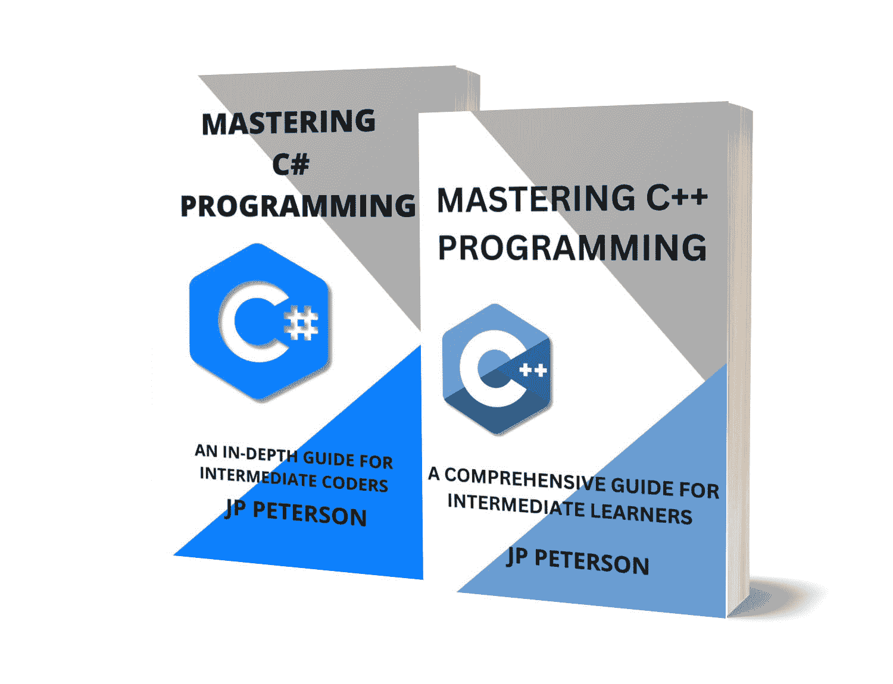

# 精通 C++ 与 C# 编程：中级学习者全面深度指南 - 2 本合 





## 引言
欢迎《精通 C++ 编程：针对中间学习者的全面指南》。这本书旨在将你的 C++ 编程技能提升到新的高度，让你对该语言及其实际应用有深入的理解。无论你是希望扩展编程知识的学生，还是旨在提升 C++ 技能的专业人士，这本书都是你的理想资源。

本指南关注清晰与简洁，采用易于理解的英语编写，并包含了大量的真实示例，帮助你毫不费力地掌握复杂概念。我们将从基础知识开始，逐步深入更高级的主题，确保中间学习者拥有平稳的学习曲线。

# 第 1 章：C++ 编程入门
C++ 是一门卓越的编程语言，拥有悠远的历史，并在当今技术驱动的世界中有着广泛的应用。在本章中，我们将开启一段探索 C++ 编程基础的旅程。无论你是渴望扩展编程知识的学生，还是寻求加深技能的专业人士，理解 C++ 的精髓都是一项宝贵的资产。

## 编程的意义
在数字时代，编程语言已成为无数技术奇迹的支柱。从驱动智能手机的软件到驱动搜索引擎的算法，编程是塑造我们世界的无形力量。学习编程语言就像获得了与机器通信的能力，指示它们执行从简单计算到复杂模拟等的任务。

## C++ 的诞生
在深入研究 C++ 的细节之前，让我们花一点时间欣赏它的起源。C++（通常读作 "see plus plus"是由 Bjarne Stroustrup 在 20 世纪 80 年代初在贝尔实验室创建的。Stroustrup 试图通过引入面向对象的特性来扩展 C 语言语言的能力。

## 面向对象编程 (OOP)
“面向对象编程”这个词听起来很复杂，但其核心概念非常直观。将编程想象成使用乐高积木进行建筑。每个乐高积木都是一个对象，拥有自己独特的属性和行为。你可以组合这些积木来创建复杂的结构。同样，在 OOP 中，我们处理的是对象，即类的实例。类定义了对象的结构和行为，允许我们通过组装这些对象来创建复杂的系统。

## 为什么选择 C++？
现在你已经对编程和 C++ 的起源有了基本的了解，让我们探索一下为什么你应该选择 C++ 作为你的学习语言。

### 多功能性
C++ 是一门多功能的语言，可以应用于多个领域，从游戏开发、科学计算到嵌入式系统。它在低级和高级抽象之间取得了独特的平衡。

### 性能
如果你对开发高性能应用程序感兴趣，C++ 是一个极佳的选择。与可能会引入开销的高级语言不同，C++ 对内存和系统资源提供了精确的控制。

### 与 C 的兼容性
C++ 的一个独特特性是与 C 语言兼容。这意味着你可以无缝将现有 C 代码集成到你的 C++ 程序中。这一特性在维护和升级旧系统中非常有价值。

## 设置开发环境
在开始编写 C++ 代码之前，你需要设置你的开发环境。你的开发环境由编写、编译和运行 C++ 程序所需的工具和软件组成。

### 文本编辑器与开发环境 (IDE)
编写 C++ 代码，你可以选择使用简单的文本编辑器或集成开发环境 (IDE)。像 `Notepad++` 或 `Visual Studio Code` 这样的编辑器提供极简的界面，通常被资深程序员青睐。相反，像 `Visual Studio` 或 `Code::Blocks` 这样的 IDE 提供了代码补全、调试和项目管理等全面功能。

### 选择编译器
编译器是开发环境中的关键组件。它将人类可读的 C++ 代码翻译成机器可执行指令。有多种 C++ 编译器可用，你的选择取决于操作系统和个人偏好。

### Visual C++
如果你使用 Windows 系统，微软的 `Visual C++` 编译器是一个流行的选择。配套的 IDE 为 C++ 开发提供了友好的界面。

#### GNU 编译器集合 (GCC)
`GCC` 是一个广泛使用的开源编译器套，支持包括 Linux 和 Windows 在内的多个平台。它以其健壮性和对标准的遵循而闻名。

### 创建你的第一个 C++ 程序
现在你已经设置好了开发环境，让我们来写你的第一个 C++ 程序。传统的起点是“Hello, World!”程序，这是一个在屏幕上显示“Hello, World!”文本的简单程序。

```cpp
#include <iostream>

int main() {
    std::cout << "Hello, World!" << std::endl;
    return 0;
}
```

让我们拆解这段代码：
- `#include <iostream>`：这一行包含了标准输入输出库，允许我们执行输入和输出操作。


- `int main()`: 这是程序的主函数。每个 C++ 程序都必须有一个执行开始开始的 `main` 函数。
- `{}`: 这些大括号定义了 `main` 函数的作用范围，指示了它的开始和结束位置。
- `std::cout << "Hello, World!" << std::endl;`: 这一行代码使用 `std::cout` 对象在屏幕上显示文本 "Hello, World!"。`<<` 运算符用于将数据发送到标准输出流。
- `return 0;`: 最后，我们返回一个整数值 0，表示程序执行成功。

## 编译并运行你的程序

写完代码后，你需要将其编译，以创建一个可以在你的计算机上运行的可执行文件。编译过程取决于你选择的开发环境和编译器。

### Visual Studio

如果你正在使用 Visual Studio，可以通过选择菜单中的“生成（Build）”来构建项目。此操作会编译你的代码并生成一个可执行文件。

### GCC

如果你在命令行中使用 GCC，请导航到 C++ 文件所在的目录，并使用以下命令进行编译：

```bash
g++ your_program.cpp -o output_program
```

将 `your_program.cpp` 替换为你的 C++文件名，并将 `output_program` 替换为所需的可执行文件名。编译成功后，你可以通过输入来运行程序：

```bash
./output_program
```

## 总结

在本章中，我们迈向 C++ 编程的世界迈出了第一步。我们学习了编程的重要性、C++ 的诞生以及面向对象编程（OOP）的原理。此外，我们还探索了为什么 C++ 对程序员来说是一个极具价值的选择，因为它具有多功能性、高性能以及与 C 语言兼容性。

你还配置了开发环境，在文本编辑器和集成开发环境（IDE）之间进行了选择，并挑选了适合你需求的编译器。最后，你编写并执行了第一个 C++ 程序——经典的“Hello, World!”应用程序。

现在，你已经涉足了 C++ 的水域，请准备好在后续章节中深入探索。我们将探索变量、数据类型和基础编程概念，为你的通精 C++ 编程的之旅奠下坚实的基础。

因此，请保持关注，坚持练习，并拥抱令人兴奋的 C++ 编程世界！

这就是《精通 C++ 编程：中级学习者指南》第一章的结束。在后续章节中，我们将深入探讨更高级的主题和实践示例，以提升你的 C++ 专业知识。

# 第 2 章：上手 C++

在上一章中，我们向你介绍了 C++ 编程的世界，并涵盖了基本概念，如它的历史、意义以及为什么你应该考虑学习 C++。现在，是时候深入编写和运行 C++ 程序的实践方面了。在本章中，我们将引导你完成上手 C++ 的过程，确保你拥有可以实的基础的基础。

## 安装 C++ 编译器

要开始编写 C++ 代码，你需要在计算机上安装一个 C++ 编译器。编译器是一种软件工具，可将人类可读的 C++ 代码翻译成计算机可以执行的机器指令。有多种 C++ 编译器可用，我们将介绍两个流行的选项：GCC（GNU 编译器集合）和 Visual C++

### GCC (GNU Compiler Collection)

GCC 是一个免费的开源编译器套件，支持 Linux 和 Windows 在内的多个平台。它以健壮性、对 C++ 标准的遵循以及丰富的功能而闻名。以下是在不同操作系统上安装 GCC 的方法：

### Linux

许多 Linux 发行版都预装了 GCC。要检查系统是否安装了它，请打开终端并输入：

```bash
g++ --version
```

如果没有安装 GCC，你可以使用包管理器进行安装。例如，在 Ubuntu 或基于 Debian 的系统中，使用：

```bash
sudo apt-get update
sudo apt-get install g++
```

### Windows

在 Windows 上，你可以使用 MinGW（Windows 版最小 GNU）项目安装 GCC。MinGW 提供了 GCC 编译器的 Windows 原生移植。

1. 访问 MinGW 网站（https://mingw-w64.org/doku.php）并下载适用于系统的安装程序。
2. 运行安装程序并按照说明操作。安装期间，确保选择 C++ 编译器组件。
3. 安装完成后，打开命令提示符并运行以下命令检查 GCC 是否可用：

```bash
g++ --version
```

### Visual C++

如果你使用 Windows 操作系统，微软的 Visual C++ 编译器是一个流行且强大的选择。它与 Visual Studio IDE 深度集成，提供了无缝的开发体验。以下是开始使用 Visual C++ 的方法：

1. 下载并安装 Visual Studio 社区版，它是 Visual Studio 的免费版本，包含对 C++ 开发的支持。你可以从 Visual Studio 网站（https://visualstudio.microsoft.com/visual-cpp-build-tools/）下载。
2. 安装期间，确保选择“使用 C++ 的桌面开发”工作负载。这将安装必要的 C++ 开发工具。
3. 安装完成后，启动 Visual Studio 并创建一个新的 C++ 项目或打开现有项目以开始编写 C++ 代码。

## 编写你的第一个 C++ 程序

现在你已经安装了 C++ 编译器，是时候编写你的第一个 C++ 程序了。我们将从经典的“Hello, World!”程序开始，这是任何编程语言的简单但重要的起点。

```cpp
#include <iostream>

int main() {
    std::cout << "Hello, World!" << std::endl;
    return 0;
}
```

让我们拆解这段代码：

- `#include <iostream>`：这一行包含了标准输入输出库，它提供了从控制台读取和写入数据的函数。
- `int main()`：这是程序的主函数，是执行开始的地方。每个 C++ 程序都必须有一个 `main` 函数。
- `{}`：这些大括号定义了 `main` 函数的作用范围，指示了它的开始和结束位置。
- `std::cout << "Hello, World!" << std::endl;`：这一行使用 `std::cout` 对象在屏幕上显示文本 "Hello, World!"。`<<` 运算符用于将数据发送到标准输出流。
- `return 0;`：最后，我们返回一个整数值 0，表示程序执行成功。习惯上，返回值 0 表示程序在没有错误的情况下运行。


- `#include <iostream>`: 这一行包含了标准输入输出库，它提供了用于向控制台打印内容的 `std::cout` 对象。
- `int main()`: 这是程序的主函数。它是你代码执行的入口点。`main` 之前的 `int` 表示该函数返回一个整数值。
- `{}`: 这些大括号定义了 `main` 函数的作用范围。这些大括号之间的所有内容都是 `main` 函数的一部分。
- `std::cout << "Hello, World!" << std::endl;`: 这一行使用 `std::cout` 对象向控制台打印文本 "Hello, World!"。`<<` 运算符用于将多个输出元素链联在一起。
- `return 0;`: 最后，使用 `return` 语句退出 `main` 函数并向操作系统返回一个值。在这种 particular 情况下，我们返回 0，表示程序执行成功。

# 变量与数据类型

在 C++ 中，数据是基础。每个程序都以以某种方式处理和操作数据。为了有效地处理数据，你需要理解变量和数据类型。

## 变量

变量是一个可以存储值的命名的内存位置。你可以把它想象成一个带有标签的盒子，可以在其中存储和检索信息。在 C++ 中，变量名是用户定义的，它们应该具有意义，以使你的代码更具可读性。

以下是在 C++ 中声明变量的方法：

```cpp
data_type variable_name;
```

- `data_type`: 这指定了变量可以存储的数据类型。例如，`int` 用于整数，`double` 用于浮点数，`char` 用于字符。
- `variable_name`: 这是你给变量起的名字。它必须遵循某些命名规则，例如以字母开头并由字母、数字和下划线组成。

这是一个示例：

```cpp
int age; // 声明一个名为 'age' 的变量，可以存储整数值。
```

你还可以在声明时初始化变量：

```cpp
int score = 100; // 声明并初始化 'score'，其值为 100。
```

## 数据类型

C++ 提供了多种数据类型来表示不同类型的值。以下是一些常见的数据类型：

- `int`: 表示整数（全数字），例如 42 或 -17。
- `double`: 表示浮点数（带有小数点的数字），例如 3.14159 或 -0.001。
- `char`: 表示单个字符，例如 'A' 或 '$'。
- `bool`: 表示布尔值，可以是 `true` 或 `false`。

变量和数据类型是 C++ 程序的构建块。它们允许你高效地存储和操作信息。

## 输入与输出

在许多程序中，你需要通过读取输入和显示输出与用户交互。C++ 提供了 `<iostream>` 库来处理输入输出操作。

### 使用 `std::cout` 输出

我们已经见过如何使用 `std::cout` 向控制台显示文本。这里进行回顾：

```cpp
std::cout << "Hello, World!" << std::endl;
```

你也可以使用 `std::cout` 输出变量和表达式：

```cpp
int age = 25;
std::cout << "My age is: " << age << std::endl;
```

在这个示例中，我们使用 `<<` 将文本 "My age is: " 与存储在 `age` 变量的值连接，然后使用 `std::endl` 结束该行并移动到下一行。

### 使用 `std::cin` 输入

要从用户处读取输入，可以使用 `std::cin`。以下是如何提示用户输入并将其存储在变量中的：

```cpp
int number;
std::cout << "Enter a number: ";
std::cin >> number;
```

在这段代码中，我们使用 `std::cout` 显示提示，然后使用 `std::cin` 将用户的输入读入 `number` 变量中。

## 注释

注释对于记录代码以及让你自己和其他可能阅读你代码的人更容易理解至关重要。在 C++ 中，你有两种方式添加注释：

- 单行注释以 `//` 开始，持续到行尾。例如：

```cpp
// 这是一个单行注释。
```

- 多行注释以 `/*` 开始，以 `*/` 结束。它们可以跨多行。例如：

```cpp
/* 这是一个
多行注释。 */
```

注释会被编译器忽略，旨在供阅读代码的人类读者阅读。它们是解释代码逻辑、提供上下文以及记录程序中任何复杂部分的宝贵工具。

## 总结

在本章中，我们为你的 C++ 编程之旅奠定了基础。你学习了如何安装 C++ 编译器、编写第一个 C++ 程序，并理解了变量和数据类型的基础。此外，我们探索了使用 `std::cin` 和 `std::cout` 进行输入输出操作，并讨论了注释在记录代码方面的重要性。

在你继续你的 C++ 学习之旅时，请记住实践是关键。尝试代码，探索不同的数据类型，并熟练输入输出操作。在下一章中，我们将深入研究 C++ 编程概念，包括运算符和表达式，以进一步提升你的技能。

所以，保持编码，继续学习！


- 为你的变量使用具有意义且描述性的名称，以提高代码的可读性。例如，`totalScore` 相比于 `ts` 包含更多信息。

### 变量声明示例

以下是 C++ 中变量声明的一些示例：

```cpp
int age;                // 声明一个名为 'age' 的整数变量。
double temperature;     // 声明一个名为 'temperature' 的双精度变量。
char grade;             // 声明一个名为 'grade' 的字符变量。
bool isStudent;         // 声明一个名为 'isStudent' 的布尔变量。
```

记住，声明变量不会分配内存或设置其初始值；它只是告诉编译器变量的存在及其数据类型。

## 常见数据类型

C++ 提供了几种内置数据类型来表示不同的值。选择合适的数据类型对于高效使用内存和准确表示数据至关重要。让我们探索一些常见的数据类型：

### 整数类型

#### `int`

`int` 数据类型用于表示整数值。在大多数系统上，它通常占用 4 字节内存，可以存储特定范围内的整数，例如在 32 位系统上，范围为 -2,147,483,648 到 2,147,483,647。

```cpp
int count = 10; // 整数变量的示例。
```

#### `long` 和 `long long`

`long` 和 `long long` 用于表示可能无法放入 `int` 范围的型整数值。`long` 通常使用 4 字节，而 `long long` 使用 8 字节。

```cpp
long population = 7800000000;      // 'long' 变量的示例。
long long largeNumber = 1234567890; // 'long long' 变量的示例。
```

### 浮点类型

#### `float` 和 `double`

`float` 和 `double` 数据类型用于表示浮点数，包括带有小数点的实数。`float` 通常使用 4 字节内存，而 `double` 使用 8 字节，提供更高的精度。

```cpp
float pi = 3.14159f;    // 'float' 变量的示例。
double salary = 55000.5; // 'double' 变量的示例。
```

### 字符类型

#### `char`

`char` 数据类型表示单个字符。它使用 1 字节内存来存储单个字符，如字母、数字或符号。

```cpp
char grade = 'A'; // 'char' 变量的示例。
```

### 布尔类型

#### `bool`

`bool` 数据类型表示布尔值，其值可以是 `true`（真）或 `false`（假）。它通常用于 C++ 程序中的条件判断和决策。

```cpp
bool isStudent = true; // 'bool' 变量的示例。
```

### 自定义数据类型

除了内置类型外，C++ 还允许你使用结构体（struct）和类（class）创建自定义数据类型。这些自定义类型允许你定义复杂的数据结构和对象，使你的代码更有组织且易于维护。

在处理现实实体（如员工、学生或产品）时，自定义数据类型特别有用，因为你可以将属性和行为封装在结构化格式中。

```cpp
// 定义一个表示人的结构体。
struct Person {
    std::string name;
    int age;
};

// 创建 'Person' 结构体的实例。
Person person1;
person1.name = "Alice";
person1.age = 30;

Person person2;
person2.name = "Bob";
person2.age = 25;
```

在这个示例中，我们使用结构体定义了一个自定义数据类型 `Person`。每个 `Person` 都有一个名字和一个年龄，允许我们以结构化的方式表示个人。

## 类型推断 (auto)

C++11 引入了 `auto` 关键字，允许编译器根据初始化器自动推断变量的数据类型。此功能简化了变量声明，并使代码更加简洁易读。

以下是使用 `auto` 的方法：

```cpp
auto x = 42;           // 'x' 被推断为 'int'。
auto pi = 3.14159;   // 'pi' 被推断为 'double'。
auto name = "Alice"; // 'name' 被推断为 'const char*'。
```

通过使用 `auto`，你让编译器决定合适的数据类型，减少了类型相关错误的概率，并使你的代码更加灵活。

## 常量

除了变量外，C++ 还允许你定义常量。常量是在程序执行期间不会改变的值。它们对于定义不应意外修改的固定值有用。

### `const` 关键字

在 C++ 中，可以使用 `const` 关键字声明常量。

```cpp
const int maxLimit = 100; // 此值无法更改。
```

### 常量的优点

- **可读性**：使用常量比使用“魔数字”（magic numbers）使代码更具信息量。
- **安全性**：使用 `const` 可以防止意外修改固定值。
- **维护性**：如果某个值需要更改，你只需要在一个地方更新它。

## 类型修饰符

C++ 提供了更改数据类型特征的修饰符，例如大小或符号位。

### `unsigned`

`unsigned` 修饰符与整数类型一起使用，表示变量只能存储非值。它移除了符号位，为正数提供了更大的范围。

```cpp
unsigned int distance = 500; // 'distance' 必须是非负的。
```

### `signed`

`signed` 修饰符用于指示变量可以存储正负两个值。它是大多数整数类型的默认值，因此你通常不需要显式使用它。

```cpp
int temperature = -10; // 'temperature' 可以存储负值。
```

### `short` 和 `long`

`short` 和 `long` 修饰符与整数类型一起使用以指定其大小。`short int` 通常使用 2 字节，而 `long int` 使用 4 字节。

```cpp
short int smallNumber = 42; // 'smallNumber' 使用 2 字节。
long int bigNumber = 1234567890; // 'bigNumber' 使用 4 字节。
```

### 类型转换

有时，你需要将值从一种数据类型转换为另一种。这种过程被称为类型转换，C++ 两种主要方法：隐式显式类型转换。

### 隐式类型转换（自动类型转换）

隐式类型转换发生在编译器自动将一种数据类型转换为另一种，而不需要程序员的显式指令。它也称为自动类型转换。

以下是隐式类型转换的示例：

```cpp
int num1 = 42;
double num2 = num1; // 隐式将 'num1' (int) 转换为 'num2' (double)。
```

### 显式类型转换（类型转换）

显式类型转换需要程序员显式指定类型转换。它也称为类型转换或类型转换。你可以使用 C++ 转换运算符来实现此目的。

#### C 风格强制转换

C 风格转换运算符允许你执行显式类型转换。其语法如下：

```cpp
(type)expression
```


```cpp
new_type(expression)
```

这里有一个示例：

```cpp
double price = 49.99;
int discountedPrice = (int)price; // 显式将 'price' (double) 转换为 'discountedPrice' (int)。
```

在这种情况下，我们显式地将 `price` 中的 `double` 值转换为 `discountedPrice` 中的 `int` 值。

### C++ 转换运算符

C++ 引入了四个强制转换运算符，以便对类型转换提供更精确的控制。这些运算符是：

- `static_cast`
- `dynamic_cast`
- `const_cast`
- `reinterpret_cast`

最常用的转换运算符是 `static_cast`，它允许你执行各种安全的类型转换。以下是使用 `static_cast` 的方法：

```cpp
double value = 3.14159;
int intValue = static_cast<int>(value); // 显式将 'value' (double) 转换为 'intValue' (int)。
```

使用 `static_cast` 优于 C 风格的强制转换，因为它提供了更好的类型检查和安全性。

## 总结

在本章中，我们探索了 C++ 中变量和数据类型的核心概念。你学习了如何声明和初始化变量，理解了它们的命名规则，并为表示不同的数值选择了合适的数据类型。

我们涵盖了常见的内置数据类型，例如整数、浮点数、字符和布尔值。你还看到了如何使用 `struct` 创建自定义数据类型以有效地结构化你的数据。

常量的引入是为了在代码中定义固定值，增强可读性、安全维护性。此外，我们还讨论了类型修饰符和类型转换，它们允许你修改数据类型并在它们之间进行转换。

在你继续 C++ 之旅时，记住为变量选择正确的数据类型对于高效使用内存和准确表示数据至关重要。练习创建和操作不同数据类型的变量，为你的编程技能打下坚实的基础。

在下一章中，我们将深入运算符和表达式的世界，让你能够在 C++ 程序中进行计算和做出决策。所以，保持好奇，继续编码吧！

# 第 4 章：运算符与表达式

在之前的章节中，我们通过介绍变量、数据类型和编写 C++ 代码的基础，为你的 C++ 编程之旅奠定了基础。现在，是探索运算符和表达式的世界了。运算符是对一个或多个操作数执行操作的符号或关键字，而表达式是运算符和操作数的组合，用于产生结果。

## 算术运算符

算术运算符允许你在 C++ 中执行基本的数学运算。这些运算符作用于数值数据类型，如整数和浮点数。以下是常见的算术运算符：

### 加法 `+`

加法运算符 `+` 用于两个或多个值相加。

```cpp
int sum = 5 + 3; // 'sum' 将包含值 8。
```

### 减法 `-`

减法运算符 `-` 用于从左操作数减去右操作数。

```cpp
int difference = 10 - 4; // 'difference' 将包含值 6。
```

### 乘法 `*`

乘法运算符 `*` 用于两个或多个值相乘。

```cpp
int product = 6 * 7; // 'product' 将包含值 42。
```

### 除法 `/`

除法运算符 `/` 用于左操作数除以右操作数。

```cpp
double result = 8.0 / 2; // 'result' 将包含值 4.0。
```

### 取模 `%`

取模运算符 `%` 返回左操作数除以右操作数所得的余数。

```cpp
int remainder = 15 % 4; // 'remainder' 将包含值 3。
```

### 运算顺序

当表达式中组合多个算术运算符时，C++ 遵循标准的运算顺序（PEMDAS/BODMAS）：

1. 括号 `( )`：括号内的操作最执行。
2. 幂 `^`（尽管 C++ 不使用此符号）：下一步求幂。
3. 乘法 `*` 和除法 `/`：这些运算符从左到右计算。
4. 加法 `+` 和 减法 `-`：这些运算符从左到右计算。

例如，在表达式 `3 + 2 * 4` 中，乘法（`2 * 4`）首先计算，得到 `8`，然后执行加法（`3 + 8`），得出最终结果 `11`。

你可以像在普通数学中一样使用括号来改变运算顺序。例如，`(3 + 2) * 4` 的计算结果为 `20`。

## 赋值运算符

赋值运算符用于给变量赋值。它们不仅可以赋值，还可以在同时执行操作。以下是一些常见的赋值运算符：

### `=`

赋值运算符 `=` 用于给变量赋值。

```cpp
int x = 10; // 将值 10 赋值给 'x'。
```

### `+=`

`+=` 运算符是一个复合赋值运算符，将右操作数加到左操作数上并将结果赋值给左操作数。

```cpp
int y = 5;
y += 3; // 等于 y = y + 3; 'y' 变为 8。
```

### `-=`

`-=` 运算符从左操作数中减去右操作数并将结果赋值给左操作数。

```cpp
int z = 10;
z -= 2; // 等于 z = z - 2; 'z' 变为 8。
```

### `*=`

`*=` 运算符将左操作数乘以右操作数并将结果赋值给左操作数。

```cpp
int a = 6;
a *= 4; // 等于 a = a * 4; 'a' 变为 24。
```

### `/=`

`/=` 运算符将左操作数除以右操作数并将结果赋值给左操作数。

```cpp
double b = 20.0;
b /= 5; // 等于 b = b / 5; 'b' 变为 4.0。
```

### `%=`

`%=` 运算符计算左操作数除以右操作数的余数，并将结果赋值给左操作数。

```cpp
int c = 15;
c %= 7; // 等于 c = c % 7; 'c' 变为 1。
```

赋值运算符对于简洁地对变量操作并更新其值非常方便。

## 比较运算符

比较运算符用于比较两个值并产生布尔结果（`true` 或 `false`）。这些运算符通常用于条件语句和循环中以做出决策。以下是常见的比较运算符：

### `==`

等于运算符 `==` 检查两个值是否相等。

```cpp
int num1 = 5;
int num2 = 7;
bool isEqual = (num1 == num2); // 'isEqual' 将为 'false'。
```

### `!=`

不等于运算符 `!=` 检查两个值是否不等。

```cpp
int x = 10;
int y = 5;
bool isNotEqual = (x != y); // 'isNotEqual' 将为 'true'。
```

### `>`

大于运算符 `>` 检查左操作数是否大于右操作数。

```cpp
int a = 8;
int b = 6;
bool isGreater = (a > b); // 'isGreater' 将为 'true'。
```

### `<`

小于运算符 `<` 检查左操作数是否小于右操作数。

```cpp
int p = 3;
int q = 9;
bool isLess = (p < q); // 'isLess' 将为 'true'。
```

### `>=`

大于等于运算符 `>=` 检查左操作数是否大于或等于右操作数。

```cpp
int m = 7;
int n = 7;
bool isGreaterOrEqual = (m >= n); // 'isGreaterOrEqual' 将为 'true'。
```

### `<=`

小于等于运算符 `<=` 检查左操作数是否小于或等于右操作数。

```cpp
int r = 4;
int s = 4;
bool isLessOrEqual = (r <= s); // 'isLessOrEqual' 将为 'true'。
```

比较运算符对于程序中的决策至关重要。它们通常被用于 `if` 语句、循环和其他控制结构，以决定代码的执行流。


逻辑运算符用于对布尔值（`true` 或 `false`）执行逻辑操作。它们通常用于条件语句，以组合或否定条件。以下是常见的逻辑运算符：

### 逻辑与 `&&`

逻辑与运算符 `&&` 在两个操作数都为 `true` true 返回返回 `true`，否则返回 `false`。

```cpp
bool isSunny = true;
bool isWarm = true;
bool isGoodWeather = (isSunny && isWarm); // 'isGoodWeather' 将为 'true'。
```

### 逻辑或 `||`

逻辑或运算符 `||` 在操作数中至少有一个为 `true` 时返回 `true`，如果两个操作数都为 `false` 则返回 `false`。

```cpp
bool isRaining = false;
bool isSnowing = true;
bool isBadWeather = (isRaining || isSnowing); // 'isBadWeather' 将为 'true'。
```

### 逻辑非 `!`

逻辑非运算符 `!` 反转其操作数的值。如果操作数为 `true`，`!` 使其变为 `false`，反之亦然。

```cpp
bool isSunny = true;
bool isNotSunny = !isSunny; // 'isNotSunny' 将为 'false'。
```

逻辑运算符对于代码中组合和处理条件至关重要。它们帮助你简洁地表达复杂的逻辑。

## 递增和递减运算符

递增递减运算符用于将变量的值增加或减少 `1`。它们通常用于循环和管理计数器。

### 递增 `++`

递增运算符 `++` 将操作数的值加 `1`。

```cpp
int count = 5;
count++; // 'count' 递增 1；'count' 变为 6。
```

### 递减 `--`

递减运算符 `--` 从操作数的值中减 `1`。

```cpp
int score = 10;
score--; // 'score' 递减 1；'score' 变为 9。
```

### 前置和后置递增/递减

递增递减运算符有两种使用方式：作为前置运算符（`++x`, `--x`）或后置运算符（`x++`, `x--`）。

- 前置运算符（`++x`, `--x`）先递增或递减变量，然后返回更新值。

```cpp
int a = 5;
int b = ++a; // 'a' 递增 1 并赋值给 'b'；'a' 和 'b' 都变为 6。
```

- 后置运算符（`x++`, `x--`）返回变量的当前值，然后对其递增或递减。

```cpp
int p = 5;
int q = p++; // 将 'p' 的当前值赋值给 'q' 然后递增 'p'；'p' 变为 6，'q' 为 5。
```

使用前置或后置形式取决于你需要在表达式中使用变量的原始还是更新的值。

## 位运算符

位运算符对整数值的每个位进行操作。它们被用于底层编程和某些优化任务。以下是常见的位运算符：

### 位与 `&`

位与运算符 `&` 在两个整数的对应位之间执行位与逻辑操作。

```cpp
int x = 5;   // 二进制: 0101
int y = 3;   // 二进制: 0011
int result = x & y; // 结果: 0001 (十进制 1)
```

### 位或 `|`

位或运算符 `|` 在两个整数的对应位之间执行位或逻辑操作。

```cpp
int a = 5;   // 二进制: 0101
int b = 3;   // 二进制: 0011
int result = a | b; // 结果: 0111 (十进制 7)
```

### 位异异 `^`

位异异运算符 `^` 在两个整数的对应位之间执行位异或（互或）操作。

```cpp
int p = 5;   // 二进制: 0101
int q = 3;   // 二进制: 0011
int result = p ^ q; // 结果: 0110 (十进制 6)
```

### 位非 `~`

位非运算符 `~` 反转整数的所有位。

```cpp
int num = 5;      // 二进制: 0000 0101
int result = ~num; // 结果: 1111 1010 (由于补码表示，十进制为 -6)
```

### 左移 `<<`

左移运算符 `<<` 将整数的位向左移动指定的位数。

```cpp
int x = 5;      // 二进制: 0000 0101
int result = x << 2; // 结果: 0001 0100 (十进制 20)
```

### 右移 `>>`

右移运算符 `>>` 将整数的位向右移动指定的位数。

```cpp
int a = 20;      // 二进制: 0001 0100
int result = a >> 2; // 结果: 0000 0101 (十进制 5)
```

位运算符用于需要操作整数内部单个位的场景，例如底层硬件编程和某些算法。

## 三元运算符 `? :`

三元运算符 `? :` 是一种允许你编写简洁条件表达式的条件运算符。三元运算符 `? :` 是一种允许你编写简洁条件表达式的条件运算符。三元运算符 `? :` 是一种允许你编写简洁条件表达式的条件运算符。

## 运算符优先级

C++ 中的运算符具有特定的优先级，这决定了运算符求值的顺序。以下是从高到低的运算符优先级简单概述：

## 表达式

表达式是运算符、操作数和变量的组合，用于产生一个值。表达式可以是简单的（仅涉及一个变量），也可以是复杂的（多个运算符和操作数）。是一些表达式的示例：

```cpp
int sum = 3 + 4; // 计算和的简单表达式。
bool isTrue = (x > 5) && (y <= 10); // 组合了比较的复杂表达式。
int result = (a * b) + (c / d) - (e % f); // 使用算术运算符的表达式。
```

在 C++ 中，表达式被广泛用于计算、决策和数据处理。

## 总结

在本探讨了 C++ 中的运算符和表达式。你学习了用于数学计算的算术运算符、用于更新变量值的赋值运算符、用于逻辑比较的比较运算符，以及用于组合布尔值的逻辑运算符。

我们探索了用于修改变量的递增递减运算符，以及用于操作整数单个位的位运算符。此外，你还看到了允许编写简洁条件表达式的三元运算符，并学习了决定运算符求值顺序的运算符优先级。

运算符和表达式是 C++ 编程的基石。它们允许执行从基础算术到复杂决策的各种任务。随着 C++ 经验的增加，你将发现自己经常使用这些工具来创建高效且表达的代码。


在编程世界中，控制结构是你用于决定代码流的工具。它们允许你做出决策、重复操作并根据条件执行代码。在本章中，我们将探索 C++ 控制结构，包括 `if` 语句、循环等，以帮助你对程序进行完全的控制。

## 使用 `if` 的条件语句

`if` 语句是 C++ 中基础基础控制结构之一。它允许你根据指定条件的求值结果有条件地执行代码块。以下是 `if` 语句的基本语法：

```cpp
if (condition) {
    // 如果 'condition' 为真，则执行代码
}
```

让我们通过示例来分析 `if` 语句的工作原理：

```cpp
#include <iostream>

int main() {
  int x = 10;
  if (x > 5) {
    std::cout << "x is greater than 5." << std::endl;
  }
  return 0;
}
```

在这个示例中，我们声明了一个值为 `10` 的变量 `x`。`if` 语句检查 `x` 是否大于 `5`。如果条件（`x > 5`）为真，则执行大括号内的代码，并在控制台打印“x is greater than 5.”。

### `else` 子句

你可以通过 `else` 子句扩展 `if` 语句，以指定当条件为假时执行哪些代码。以下是语法：

```cpp
if (condition) {
    // 如果 'condition' 为真，则执行代码
} else {
    // 如果 'condition' 为假，则执行代码
}
```

这是一个示例：

```cpp
#include <iostream>

int main() {
  int x = 3;
  if (x > 5) {
    std::cout << "x is greater than 5." << std::endl;
  } else {
    std::cout << "x is not greater than 5." << std::endl;
  }
  return 0;
}
```

在这种情况下，由于 `x` 不大于 `5`，因此执行 `else` 块中的代码，并打印出“x is not greater than 5.”。

### `else if` 子句

你可以使用 `else if` 子句按顺序测试多个条件，从而进一步完善你的条件逻辑。以下是语法：

```cpp
if (condition1) {
    // 如果 'condition1' 为真，则执行代码
} else if (condition2) {
    // 如果 'condition1' 为假且 'condition2' 为真，则执行代码
} else {
    // 如果 'condition1' 和 'condition2' 为假，则执行代码
}
```

让我们来看一个示例：

```cpp
#include <iostream>

int main() {
  int x = 10;
  if (x > 15) {
    std::cout << "x is greater than 15." << std::endl;
  } else if (x > 10) {
    std::cout << "x is greater than 10 but not 15." << std::endl;
  } else {
    std::cout << "x is not greater than 10." << std::endl;
  }
  return 0;
}
```

在这个示例中，`if` 语句按照指定的顺序检查条件。由于 `x` 不大于 `15`，它移动到下一个条件，该条件的结果为真。因此，打印出“x is greater than 10 but not 15.”。

### 嵌套 `if` 语句

你还可以将 `if` 语句嵌套在一起以创建更复杂的条件逻辑。每个 `if` 语句都会根据其条件独立求值。以下是一个嵌套 `if` 语句的示例：

```cpp
#include <iostream>

int main() {
  int x = 10;
  int y = 5;
  if (x > 5) {
    std::cout << "x is greater than 5." << std::endl;
    if (y > 3) {
      std::cout << "y is greater than 3." << std::endl;
    }
  }
  return 0;
}
```

在这个示例中，外部的 `if` 语句检查 `x` 是否大于 `5`。如果该条件为真，它进入内部的 `if` 语句并检查 `y` 是否大于 `3`。两个条件都为真，因此两条消息都打印到控制台。

### 短路求值

C++ 在求值 `if` 语句内的逻辑表达式时使用短路求值。这意味着一旦逻辑表达式的结果确定，如果没有必要，将停止进一步的评估。例如：

```cpp
if (x > 5 && y > 10) {
    // 代码
}
```

在这种情况下，如果 `x` 不大于 `5`，`&&` 运算符就不会去评估条件的后部分（`y > 10`），因为如果第一部分为假，整个表达式就不可能为真。

### `if` 语句中的三元运算符

你可以在 `if` 语句中使用三元运算符来进行简洁的条件赋值。这是一个示例：

```cpp
#include <iostream>

int main() {
  int age = 18;
  std::string status = (age >= 18) ? "Adult" : "Minor";
  std::cout << "You are " << status << "." << std::endl;
  return 0;
}
```
*(注：原文示例代码块似乎不完整，此处已根据逻辑补全并翻译)*

## 使用 `while` 循环

循环对于重复执行代码至关重要。C++ 中简单的循环结构之一是 `while` 循环。它只要条件为真就会执行代码。其语法如下：

```cpp
while (condition) {
    // 代码
}
```

来看一个示例：

```cpp
#include <iostream>

int main() {
  int count = 0;
  while (count < 5) {
    std::cout << "Count: " << count << std::endl;
    count++;
  }
  return 0;
}
```

在这个示例中，我们声明了 `count` 并使用 `while` 来增加它。

## 无限循环

在使用 `while` 循环时要小心，因为可能会导致无限循环。无限循环是指条件始终为真的循环。这是一个示例：

```cpp
while (true) {
    // 这无限循环
}
```

为了避免无限循环，请确保你的条件会变为假。

### `do-while` 循环

C++ 的另一种循环结构是 `do-while` 循环。它与 `while` 循环相似，但它在检查条件之前至少执行一次代码块。其语法如下：

```cpp
do {
    // 代码至少一次
} while (condition);
```

来看一个示例：

```cpp
#include <iostream>

int main() {
  int count = 0;
  do {
    std::cout << "Count: " << count << std::endl;
    count++;
  } while (count < 5);
  return 0;
}
```

在这个示例中，首先执行 `do` 块中的代码，然后检查条件 `count < 5`。如果条件为真，循环继续；否则，终止。

### 使用 `break` 和 `continue` 控制循环

你可以使用 `break` 语句提前退出循环。当在循环中遇到 `break` 语句时，循环会立即终止，程序继续执行循环后的语句。这是一个示例：

```cpp
#include <iostream>

int main() {
  for (int i = 0; i < 10; i++) {
    if (i == 5) {
      std::cout << "Loop terminated at i = " << i << std::endl;
      break; // 当 i 等于 5 时退出循环
    }
    std::cout << "i = " << i << std::endl;
  }
  return 0;
}
```

在这个示例中，当 `i` 等于 `5` 时触发了 `break` 语句。

相反，`continue` 语句允许你跳过循环的当前迭代并进入下次迭代。这是一个示例：

```cpp
#include <iostream>

int main() {
  for (int i = 0; i < 5; i++) {
    if (i == 2) {
      std::cout << "Skipping i = " << i << std::endl;
      continue; // 跳过 i = 2 的循环剩余部分
    }
    std::cout << "i = " << i << std::endl;
  }
  return 0;
}
```

在这个示例中，当 `i` 等于 `2` 时，遇到了 `continue` 语句，循环跳转到下一次迭代，跳过了该特定值 `i` 的循环剩余部分。


像 `break` 和 `continue` 这样的循环控制语句允许你精细地调整循环的行为。无论你是需要提前退出循环还是跳过特定的迭代，这些语句都能帮助你实现对循环的精确控制。

## 使用 `for` 循环迭代

`for` 循环是一种多用途的循环结构，允许你在一行代码中指定循环的初始化、条件和迭代。其语法如下：

```cpp
for (initialization; condition; iteration) {
// 当 'condition' 为真时执行的代码
}
```

让我们来拆解 `for` 循环的各个组成部分：

- **初始化 (Initialization)**：这部分在循环开始时执行一次，通常用于初始化循环控制变量。
- **条件 (Condition)**：只要该条件为真，循环就会继续执行。如果求值结果为假，循环将终止。
- **迭代 (Iteration)**：在循环每次迭代后都会执行此部分。它通常用于更新循环控制变量。

这是一个示例：

```cpp
#include <iostream>

int main() {
for (int i = 0; i < 5; i++) {
std::cout << "Iteration " << i << std::endl;
}
return 0;
}
```

在这个示例中，`for` 循环将 `i` 初始化为 `0`，只要 `i` 小于 `5` 就继续执行，并在每次迭代后将 `i` 加 1。循环会在控制台打印 "Iteration 0" 到 "Iteration 4"。

### 多初始化与迭代

你可以在 `for` 循环中有多个初始化和迭代表达式，并用逗号分隔。这允许你同时处理多个变量。这是一个示例：

```cpp
#include <iostream>

int main() {
for (int i = 0, j = 10; i < 5 && j > 5; i++, j--) {
std::cout << "i = " << i << ", j = " << j << std::endl;
}
return 0;
}
```

在这个示例中，我们有两个变量 `i` 和 `j`，分别初始化为 `0` 和 `10`。只要 `i` 小于 `5` 且 `j` 大于 `5`，循环就会继续。每次迭代后，`i` 递增`j` 递减。

### 无限 `for` 循环

与 `while` 循环一样，在使用 `for` 循环时要小心避免死循环。确保你的循环条件最终会变为假。

## 使用 `for-each` 循环

C++ 提供了一种方便的方法来遍历集合（例如数组、vector）中的元素，即使用 `for-each` 循环。这种循环也被称为基于范围的 `for` 循环。它简化了遍历元素的过程，不需要显式的索引。其语法如下：

```cpp
for (element_type element : collection) {
// 处理 'element' 的代码
}
```

让我们看一个使用数组的示例：

```cpp
#include <iostream>

int main() {
int numbers[] = {1, 2, 3, 4, 5};
for (int number : numbers) {
std::cout << "Number: " << number << std::endl;
}
return 0;
}
```

在这个示例中，`for-each` 循环遍历 `numbers` 数组中的每个元素，当前元素被存储在变量 `number` 中。循环将每个数字打印到控制台。

### `for-each` 中的 `auto` 关键字

你可以使用 `auto` 关键字让编译器推导出集合中元素的类型。这在处理复杂数据类型时特别有用。这是一个示例：

```cpp
#include <iostream>
#include <vector>

int main() {
std::vector<std::string> fruits = {"Apple", "Banana", "Cherry"};
for (auto fruit : fruits) {
std::cout << "Fruit: " << fruit << std::endl;
}
return 0;
}
```

在这个示例中，`auto` 关键字用于遍历一个 `std::vector<std::string>`，`fruit` 的类型由编译器自动推断。

## 带有 `while` 和 `for` 的条件循环

循环通常涉及条件，你可以将 `while` 或 `for` 循环与 `if` 语句结合起来创建更复杂的循环逻辑。例如：

```cpp
#include <iostream>

int main() {
int i = 0;
while (i < 5) {
if (i % 2 == 0) {
std::cout << "Even: " << i << std::endl;
} else {
std::cout << "Odd: " << i << std::endl;
}
i++;
}
return 0;
}
```

在这个示例中，我们使用 `while` 循环从 `0` 迭代到 `4`。在循环内部，我们使用 `if` 语句检查 `i` 的当前值是偶数还是奇数。根据条件，打印 "Even" 或 "Odd" 以及 `i` 的值。

同样，你可以将条件逻辑整合到 `for` 循环中以实现程序所需的行为。

## 总结

控制结构是编程中至关重要的工具，用于决策、循环和控制代码流。在本章中，我们探索了 `if`、`else` 和 `else if` 条件语句。

# 第 6 章：函数与作用域

在本章中，我们将深入探讨函数和作用域。函数是任何程序的的基础，使程序更容易维护。此外，我们还将探索作用域的概念，它决定了变量的可见性和生命周期。

## 理解函数

### 什么是函数

C++ 函数是执行特定任务的命名代码块。函数提供了将程序拆分为更小、更易管理的部分的方法，使开发更加容易。它们还实现了复用，你可以多次调用函数。

函数的结构如下：

```cpp
return_type function_name(parameters) {
// 函数体
// 执行任务的代码
return result; // 可选的返回语句
}
```

让我们拆解函数的组件：

- **返回值 (Return Type)**：指定函数完成后返回的值的数据类型。它可以是任何 C++ 数据类型，如 `int`、`double`、`string`，甚至是不返回任何值的 `void`。
- **函数名 (Function Name)**：你选择的表示函数的标识符。它应该具有意义并遵循命名规范。
- **参数 (Parameters)**：在函数名括号内定义的变量。它们是调用函数时传递值的占位符。函数可以有零或多个参数。
- **函数体 (Function Body)**：函数体包含执行函数分配的任务的实际代码。它封装在大括号 `{}` 中。
- **返回语句 (Return Statement)**：用于将值传回调用代码。它是可选的，特别是对于类型为 `void` 的函数。当遇到 `return` 语句时，函数退出，并将指定的值传回给调用者。

### 函数示例

让我们看一个计算数字平方的简单函数示例：

```cpp
#include <iostream>

// 函数声明
int square(int num) {
int result = num * num;
return result;
}

int main() {
// 函数调用
int number = 5;
int squared = square(number);
std::cout << "The square of " << number << " is " << squared << std::endl;
return 0;
}
```


在这个示例中，我们有一个名为 `square` 的函数，它接受一个整数参数 `num`。在函数内部，我们计算 `num` 的平方并返回结果。在 `main` 函数中，我们调用 `square(5)` 并传入 `5` 作为参数。结果存储在变量 `squared` 中并打印到控制台。

## 函数原型 (Function Prototypes)

在 C++ 中，函数通常在使用之前进行声明。这种声明被称为函数原型，它为编译器提供了有关函数的返回类型、名称和参数列表的信息。函数原型允许你在代码中实际定义函数之前使用它。

以下是声明函数原型的方法：

```cpp
return_type function_name(parameters);
```

例如：

```cpp
#include <iostream>

// 函数原型
int square(int num);

int main() {
int number = 5;
int squared = square(number);
std::cout << "The square of " << number << " is " << squared << std::endl;
return 0;
}

// 函数定义
int square(int num) {
int result = num * num;
return result;
}
```

在此段代码中，我们在程序开头声明了 `square` 函数原型。这允许我们在程序末尾实际定义函数之前，在 `main` 函数中使用 `square` 函数。

## 函数重载 (Function Overloading)

C++ 支持函数重载，允许你定义多个同名但参数列表不同的函数。编译器根据传递的参数的数量或类型来决定调用哪个函数。

以下是函数重载的示例：

```cpp
#include <iostream>

// 加两个整数的函数
int add(int a, int b) {
return a + b;
}

// 加两个双精度浮点数的函数
double add(double a, double b) {
return a + b;
}

int main() {
int sum_int = add(5, 10);
double sum_double = add(3.5, 2.7);
std::cout << "Sum of integers: " << sum_int << std::endl;
std::cout << "Sum of doubles: " << sum_double << std::endl;
return 0;
}
```

在这个示例中，我们有两个具有不同参数类型（整数和双精度浮点数）的 `add` 函数。当调用 `add` 时，编译器根据参数类型选择合适的函数版本。

## 默认参数 (Default Arguments)

C++ 允许为函数参数指定默认值。这意味着如果调用者没有为特定参数提供值，则将使用默认值。默认参数使函数更加灵活，并可以简化函数调用。

这是一个示例：

```cpp
#include <iostream>

// 带有默认参数的函数
int power(int base, int exponent = 2) {
int result = 1;
for (int i = 0; i < exponent; i++) {
result *= base;
}
return result;
}

int main() {
int square = power(5); // 使用默认指数值 2
int cube = power(3, 3); // 提供自定义指数值
std::cout << "Square: " << square << std::endl;
std::cout << "Cube: " << cube << std::endl;
return 0;
}
```

在代码段代码中，`power` 函数的 `exponent` 参数有一个默认值 `2`。当我们调用 `power(5)` 时，它将使用默认值计算平方（因为我们没有提供指数）。当我们调用 `power(3, 3)` 时，我们指定了自定义的指数值 `3`。

## 变量的作用域 (Scope of Variables)

作用域是指变量定义并可以的区域或上下文。在 C++ 中，变量有不同的作用域，它们的可见性和生命周期取决于声明的位置。

### 局部作用域 (Local Scope)

在函数内部声明的变量具有局部作用域。它们只能在该函数内部被访问，对其他函数或函数外部的代码不可见。当函数退出时，其局部变量会被销毁。

```cpp
#include <iostream>

void myFunction() {
int x = 10; // 作用域限于 myFunction 的局部变量
std::cout << "Inside myFunction: x = " << x << std::endl;
}

int main() {
myFunction();
// 取消下面一行的注释将导致错误
// std::cout << "Outside myFunction: x = " << x << std::endl;
return 0;
}
```

在此示例中，在 `myFunction` 内部声明的变量 `x` 是该函数的局部变量。无法从 `main` 访问它，因为这样做会导致错误。

### 全局作用域 (Global Scope)

在任何函数之外声明的变量（通常在程序开头）具有全局作用域。它们在整个程序（包括所有函数）中可见且可访问。

```cpp
#include <iostream>

int globalVar = 20; // 具有程序范围作用域的全局变量
void myFunction() {
std::cout << "Inside myFunction: globalVar = " << globalVar << std::endl;
}

int main() {
std::cout << "In main: globalVar = " << globalVar << std::endl;
myFunction();
return 0;
}
```

代码中，`globalVar` 在全局作用域声明，在 `main` 和 `myFunction` 中均可访问。

### 作用域解析运算符 (::)

当局部变量与全局变量同名时，你可以使用作用域解析运算符 `::` 来指定你想要访问的变量。

```cpp
#include <iostream>

int x = 10; // 全局变量

void myFunction() {
int x = 5; // 与全局变量同名的局部变量
std::cout << "Local x: " << x << std::endl;
std::cout << "Global x: " << ::x << std::endl; // 全局 x
}

int main() {
myFunction();
return 0;
}
```

## 变量的生命周期 (Lifetime of Variables)

变量的生命周期是其在内存中存在并持有有效值的时间。变量的生命周期取决于它的作用域和存储期。

### 自动存储期 (Automatic Storage Duration)

具有自动存储期的变量（局部变量的默认类型）其生命周期从程序执行进入定义变量的块开始，在退出该块时结束。换句话说，它们在函数调用时创建，在函数退出时销毁。

```cpp
#include <iostream>

void myFunction() {
int x = 10; // 具有自动存储期的局部变量
std::cout << "Inside myFunction: x = " << x << std::endl;
} // x 跳出作用域并被销毁

int main() {
myFunction();
// 取消下面一行的注释将导致错误
// std::cout << "Outside myFunction: x = " << x << std::endl;
return 0;
}
```

代码中，变量 `x` 具有自动存储期，在调用 `myFunction` 时创建，在函数退出时销毁。尝试在外部访问它将导致错误。

### 静态存储期 (Static Storage Duration)

具有静态存储期的变量（全局变量或声明为 `static` 的局部变量）其生命周期贯穿整个程序执行。它们在程序启动时创建，在程序结束时销毁。

```cpp
#include <iostream>

void myFunction() {
static int x = 10; // 具有静态存储期的静态局部变量
std::cout << "Inside myFunction: x = " << x << std::endl;
} // x 保留值并在整个程序周期内持续

int main() {
myFunction();
myFunction(); // 如果 x 自增，这里仍是 10，但在这里只是持续存在
return 0;
}
```

示例中，变量 `x` 是静态局部变量。它在第一次调用 `myFunction` 时创建，在函数调用之间保留值，并在程序结束时销毁。

### 动态存储期 (Dynamic Storage Duration)

具有动态存储期的变量由程序员使用动态内存分配函数（如 `new` 和 `delete`，或 C 中的 `malloc` 和 `free`）显式地创建和销毁。它们的生命周期由程序员决定。


```cpp
#include <iostream>

int main() {
int* dynamicVar = new int; // 具有动态存储期的动态变量
*dynamicVar = 42;
std::cout << "DynamicVar: " << *dynamicVar << std::endl;
delete dynamicVar; // 销毁动态变量
return 0;
}
```

在此代码中，我们使用 `new` 为动态变量分配内存，为其赋值，并稍后使用 `delete` 释放内存。程序员对动态变量的生命周期拥有完全控制。

## 函数作用域

在函数内部定义的局部变量具有函数作用域，这意味着它们仅在该函数内部可见并可访问。这个概念通常被称为块作用域，因为它扩展到了定义变量的块（大括号 `{}` ）。

```cpp
#include <iostream>

void myFunction() {
int localVar = 5; // 具有函数作用域的局部变量
std::cout << "Inside myFunction: localVar = " << localVar << std::endl;
} // localVar 在此处离开作用域并被销毁

int main() {
myFunction();
// 取消注释下面这一行会导致错误
// std::cout << "Outside myFunction: localVar = " << localVar << std::endl;
return 0;
}
```

在这个示例中，`localVar` 具有函数作用域，仅在 `myFunction` 块内可用。

## 全局作用域

如前所述，全局变量具有全局作用域，这意味着可以在程序的任何部分访问，包括函数内部。

```cpp
#include <iostream>

int globalVar = 20; // 具有全局作用域的全局变量

void myFunction() {
std::cout << "Inside myFunction: globalVar = " << globalVar << std::endl;
}

int main() {
std::cout << "In main: globalVar = " << globalVar << std::endl;
myFunction();
return 0;
}
```

在此代码中，`globalVar` 具有全局作用域，可以在 `main` 和 `myFunction` 中被访问。

## 命名空间作用域

除了全局和函数作用域，C++ 还提供了命名空间作用域。命名空间是将代码组织成独立逻辑组的方式，在命名空间内定义的变量具有命名空间作用域。

这是一个简化的示例：

```cpp
#include <iostream>

namespace MyNamespace {
int x = 5; // 具有命名空间作用域的变量
}

int main() {
std::cout << "Inside main: x = " << MyNamespace::x << std::endl;
return 0;
}
```

在此代码中，`x` 在 `MyNamespace` 命名空间内具有命名空间作用域。我们使用作用域解析运算符 `::` 指定命名空间来访问它。

## 生命周期与作用域总结

- **生命 (Lifetime)** 指变量在内存中存在的时间。
- **作用域 (Scope)** 定义了变量在何处可见并可以访问。
- **自动存储期 (Automatic storage duration)** 适用于局部变量，它们在函数调用时创建，在退出时销毁。
- **静态存储期 (Static storage duration)** 适用于全局变量和静态局部变量，它们持续整个程序生命周期。
- **动态存储期 (Dynamic storage duration)** 涉及程序员显式创建和销毁的动态变量。
- **函数作用域 (Function scope)** 将变量的可见性限制在定义它的函数中。
- **全局作用域 (Global scope)** 允许从程序的任何地方访问变量。
- **命名空间作用域 (Namespace scope)** 适用于在命名空间内定义的变量，使其在该命名空间内可访问。

## 函数原型与定义

在 C++ 中处理函数时，你经常会遇到需要在实际函数定义之前声明函数原型形的情况。这在函数相互调用或它们的定义顺序很重要时尤为如此。

### 函数原型

函数原型是一种声明，告诉编译器关于函数的名称、返回类型和参数列表。它为编译器在实际定义之前理解如何调用该函数提供了必要信息。

函数原型的语法如下：

```cpp
return_type function_name(parameters);
```

让我们用一个示例来说说明：

```cpp
#include <iostream>

// 函数原型
int add(int a, int b);

int main() {
int result = add(3, 4); // 函数调用
std::cout << "Result: " << result << std::endl;
return 0;
}

// 函数定义
int add(int a, int b) {
return a + b;
}
```

在此代码中，我们在 `main` 函数之前使用原型声明了函数 `add`。这允许我们在 `main` 中调用 `add`，即使函数的定义出现在代码的后面。

### 为什么要使用函数原型？

函数原型有几个重要用途：

1. **实现前向引用**：原型允许在实际定义之前调用函数，这当函数相互调用或组织方式需要前向引用时非常有用。
2. **捕获错误**：原型有助于在编译过程中早期发现错误。如果你在原型中误写了函数名、返回类型或参数列表，编译器将生成错误。
3. **改进代码组织**：原型为程序中使用的函数及其签名提供了清晰的概述，使代码更有组织且具可读性。
4. **促进团队开发**：在涉及多个程序员的大型项目中，原型有助于定义函数的接口，确保用例的一致性。

### 多个函数原型

你可以为同一个函数声明多个函数原型，只要它们的函数名相同但参数列表不同。这被称为函数重载。

```cpp
#include <iostream>

// 不同参数列表的函数原型
int add(int a, int b);
double add(double a, double b);

int main() {
int result_int = add(3, 4); // 调用 int 版本
double result_double = add(1.5, 2.5); // 调用 double 版本
std::cout << "Result (int): " << result_int << std::endl;
std::cout << "Result (double): " << result_double << std::endl;
return 0;
}

// 函数定义
int add(int a, int b) {
return a + b;
}

double add(double a, double b) {
return a + b;
}
```

在这个示例中，我们有两个 `add` 函数的版本，其中一个接收 `int` 参数，另一个接收 `double` 参数。多个原型允许根据参数类型调用相应的版本。

### 函数定义

函数定义提供了函数的实际实现。它们指定了函数在被调用时做什么。一个函数只能定义一次，但可以使用原型进行多次声明。

函数定义的结构如下：

```cpp
return_type function_name(parameters) {
    // 函数体
    // 执行任务的代码
    return result; // 可选的返回语句
}
```

让我们重新回顾之前带有函数定义的示例：

```cpp
#include <iostream>

// 函数原型
int add(int a, int b);

int main() {
int result = add(3, 4); // 函数调用
std::cout << "Result: " << result << std::endl;
return 0;
}

// 函数定义
int add(int a, int b) {
return a + b;
}
```

在此代码中，我们同时拥有 `add` 的函数原型和函数定义。函数定义出现在 `main` 函数之后，并提供了加法操作的实际实现。

### 函数定义与声明

函数声明（如原型）提供了关于函数名称、返回类型和参数列表的信息。然而，声明并没有提供函数的实现细节。定义则包含了实现代码。

在实践中，你可以在代码中使用函数原型或函数定义。如果你只需要声明函数的签名并打算在程序的其他地方定义它，原型就足够了。


在本章中，我们将探索 C++ 中数组和字符串的核心概念。这些数据结构是组织和操作数据集合的基础，无论它是数字列表、字符列表还是更复杂的信息。

## 数组

### 什么是数组？

数组是一种数据结构，允许你在单个变量名下存储多个相同数据类型的值。你可以将其视为相关元素的集合，所有元素都存储在连续的内存位置中。数组在编程中被广泛使用，因为它们为处理大型数据集提供了一种高效的方法。

以下是在 C++ 中声明数组的方法：

```cpp
data_type array_name[array_size];
```

- `data_type`: 指定数组中元素的数据类型，例如 `int`、`double` 或 `char`。
- `array_name`: 你为数组选择的名称。
- `array_size`: 数组可以容纳的元素数量。数组一旦声明，该大小就是固定不变的。

### 数组初始化

你可以在声明数组时通过提供一个包含在大括号 `{}` 内的值列表来初始化数组。值的数量必须与数组的大小匹配。

```cpp
int numbers[5] = {1, 2, 3, 4, 5};
```

在这个示例中，我们声明了一个大小为 5 的整数数组 `numbers`，并用值 1 到 5 初始化了它。数组现在包含 `[1, 2, 3, 4, 5]`。

如果你在声明时没有指定数组的大小，编译器将根据提供的值数量推断大小：

```cpp
int numbers[] = {1, 2, 3, 4, 5}; // 编译器推断大小为 5
```

### 访问数组元素

要访问数组中的单个元素，你需要使用索引，索引是一个表示元素在数组中位置的整数。C++ 中的数组索引从 0 开始，这意味着第一个元素位于索引 0，第二个元素位于索引 1，以此此类推。

```cpp
int numbers[5] = {1, 2, 3, 4, 5};

int firstNumber = numbers[0]; // 访问第一个元素 (1)
int secondNumber = numbers[1]; // 访问第二个元素 (2)
```

在这段代码中，我们分别使用索引 0 和 1 访问 `numbers` 数组的第一个和第二个元素。

### 修改数组元素

你可以通过使用赋值运算符 (`=`) 给数组中的元素分配新值来更改其值。

```cpp
int numbers[5] = {1, 2, 3, 4, 5};

numbers[2] = 10; // 将第三个元素的值改为 10
```

在这个示例中，我们通过为其赋值值 10 修改了 `numbers` 数组的第三个元素（其索引为 2）。

### 数组大小

数组的大小在声明时是固定的，在程序执行期间不能更改。尝试访问或修改边界之外的元素可能会导致未定义行为和内存损坏。因此，在处理数组时，留意其大小至关重要。

### 遍历数组

在处理数组时，一个常见的任务是遍历所有元素。你可以使用循环（例如 `for` 循环）来实现这一点。这里有一个打印数组所有元素的示例：

```cpp
#include <iostream>

int main() {
    int numbers[] = {1, 2, 3, 4, 5};
    for (int i = 0; i < 5; i++) {
        std::cout << numbers[i] << " ";
    }
    return 0;
}
```

在这段代码中，我们使用 `for` 循环遍历 `numbers` 数组并打印每个元素。循环从 `i = 0` 运行到 `i = 4`，涵盖了数组的所有索引。

### 多维数组

除了一维数组，C++ 还支持多维数组。这些具有多个维度的数组，实际上创建了一个元素网格或表格。

一个常见的例子是二维数组，通常用于表示矩阵或网格：

```cpp
int matrix[3][3] = {
    {1, 2, 3},
    {4, 5, 6},
    {7, 8, 9}
};
```

在这个示例中，我们声明了一个 3x3 的整数矩阵并用值初始化它。你可以使用两个索引访问单个元素，一个用于行，另一个用于列：

```cpp
int element = matrix[1][2]; // 访问第二行第三列的元素（值: 6）
```

### 数组与函数

在 C++ 中，数组可以作为参数传递给函数。当数组被传递给函数时，它被视为指向数组第一个元素的指针。这允许函数在不知道数组大小的情况下对其进行操作。

以下是将数组传递给函数以计算其元素和的示例：

```cpp
#include <iostream>

// 计算数组和的函数
int sumArray(int arr[], int size) {
    int sum = 0;
    for (int i = 0; i < size; i++) {
        sum += arr[i];
    }
    return sum;
}

int main() {
    int numbers[] = {1, 2, 3, 4, 5};
    int total = sumArray(numbers, 5);
    std::cout << "Sum: " << total << std::endl;
    return 0;
}
```


```cpp
#include <iostream>
#include <string>

int main() {
    std::string greeting = "Hello, world!";
    // Append to the string
    greeting += " Welcome to C++";
    // Get the length of the string
    int length = greeting.length();
    std::cout << "Modified string: " << greeting << std::endl;
    std::cout << "Length: " << length << std::endl;
    return 0;
}
```

在此代码中，我们声明了一个 `string` 变量 `greeting` 并使用其成员函数向字符串添加内容并获取其长度。

## C 风格字符串与 `string` 类之间的主要区别

虽然 C 风格字符串和 `string` 类都用于文本处理，但它们之间存在重要的区别：

1. **空终止符 (Null Terminator)**：C 风格字符串在末尾需要一个空字符，如果处理不当，可能会导致出错。`string` 对象在内部管理空终止符，减少了缓冲区溢出的风险。
2. **动态大小 (Dynamic Sizing)**：`string` 对象可以动态地增长或缩小，使其在处理变长文本时更加灵活。C 风格字符串的大小在声明时就已经确定了。
3. **安全性 (Safety)**：`string` 对象提供了更安全的操作和边界检查，减少了运行时错误发生的概率。
4. **标准库 (Standard Library)**：`string` 是 C++ 标准库的一部分，并提供了许多用于字符串操作的成员函数。

## 在 C 风格字符串与 `string` 之间转换

你可以使用 `string` 类提供的成员函数和构造函数在 C 风格字符串和 `string` 对象之间进行转换。以下是从 `string` 转换为 C 风格字符串以及反之的示例：

```cpp
#include <iostream>
#include <string>

int main() {
    // 从 string 转换为 C 风格字符串
    std::string cppString = "Hello, C++";
    const char* cString = cppString.c_str();
    std::cout << "C-Style String: " << cString << std::endl;
    // 从 C 风格字符串转换为 string
    const char* cString2 = "C++ is powerful";
    std::string cppString2(cString2);
    std::cout << "C++ String: " << cppString2 << std::endl;
    return 0;
}
```

在代码的第一部分，我们使用 `c_str()` 成员函数将 `string` 对象 (`cppString`) 转换为 C 风格字符串 (`cString`)。在第二部分，我们通过将 C 风格字符串 (`cString2`) 传递给 `string` 构造函数来创建一个 `string` 对象 (`cppString2`)。

## 结论

数组和字符串是 C++ 中的基础数据结构，允许你处理数据集合，无论是数字还是文本。理解如何声明、初始化、访问和操作数组及字符串，对于开发能够有效处理各种数据的 C++ 程序至关重要。此外，了解 C 风格字符串与 `string` 类之间的区别有助于你根据特定的编程需求选择合适的字符串表示形式。

# 第 8 章：指针与引用

在本章中，我们将探索 C++ 中迷人的指针和引用世界。这些概念为处理内存、数据和函数提供了强大的方法，允许更高级、高效的编程技术。

## 指针

### 什么是指针？

指针是一个存储另一个变量内存地址的变量。指针不是直接持有值，而是指向内存中存储该值的位置。指针是 C++ 中的基本概念，提供了一种直接操作内存的方法。

以下是在 C++ 中声明指针的方法：

```cpp
data_type* pointer_name;
```

- `data_type`：指定指针将指向的变量的数据类型，例如 `int`、`double` 或用户定义的类型。
- `pointer_name`：你为指针变量选择的名字。

### 创建和初始化指针

要创建指针，你需要使用适当的数据类型对其进行声明，并可以使用取地址符 `&` 使用现有变量的地址对其进行初始化。这是一个示例：

```cpp
int number = 42;      // 声明并初始化一个整数变量
int* ptrToNumber;     // 声明一个整数指针
ptrToNumber = &number; // 使用 'number' 的地址初始化指针
```

在此代码中，我们创建了一个整数变量 `number` 和一个整数指针 `ptrToNumber`。然后我们用 `number` 变量的地址初始化 `ptrToNumber`。

### 指针解引用

要访问指针指向的内存位置上存储的值，你需要使用解引用运算符 `*`。解引用指针让你直接访问它所指向的值。这里是一个示例：

```cpp
int number = 42;      // 声明并初始化一个整数变量
int* ptrToNumber;     // 声明一个整数指针
ptrToNumber = &number; // 使用 'number' 的地址初始化指针
int value = *ptrToNumber; // 解引用指针获取值 (42)
```

在此代码中，我们使用 `*ptrToNumber` 解引用指针并获取存储在 `number` 变量中的值。

### 空指针

指针还可以有一个特殊的值，称为“空指针”。空指针不指向任何有效的内存位置，通常用于指示指针没有引用任何内容。在 C++ 中，你可以使用 `nullptr` 创建空指针：

```cpp
int* nullPointer = nullptr; // 指针
```

空指针对于避免未定义行为非常重要。

### 指针与内存分配

指针最常见的用例之一是动态分配。你可以在运行时分配内存并处理指针。C++ 中用于内存分配的主要运算符是 `new` 和 `delete`。

#### `new` 运算符

`new` 运算符在堆上为数据类型分配内存并返回指向该分配内存的指针。这是一个示例：

```cpp
int* dynamicInteger = new int; // 在堆上分配一个整数
```

在此代码中，我们使用 `new` 为整数分配内存，`dynamicInteger` 指向分配的内存。

#### `delete` 运算符

`delete` 运算符用于释放之前通过 `new` 分配的内存。未能释放内存会导致内存泄漏，导致程序随时间推移消耗更多内存。

```cpp
int* dynamicInteger = new int; // 在堆上分配一个整数
// ... 使用 dynamicInteger
delete dynamicInteger; // 释放内存
```

在示例中，我们使用 `delete` 释放 `dynamicInteger` 所指向的内存。

### 指针算术

指针支持允许遍历内存的算术操作。你可以对指针进行加减运算，这使其成为处理数组和数据结构的强大工具。以下是一些指针算术操作：

- 给指针加上一个整数会向前移动若干元素。
- 从指针上减去一个整数会向后移动若干元素。
- 从一个指针减去另一个指针可以计算它们之间的偏移量。

这是一个说明指针算术的示例：

```cpp
int numbers[] = {1, 2, 3, 4, 5};
int* ptr = numbers; // 指向第一个元素的指针
int thirdNumber = *(ptr + 2); // 使用指针算术访问第三个元素（值为 3）
```

在此代码中，我们通过 `ptr` 指针使用指针算术访问 `numbers` 数组的第三个元素。

### 二级指针

指针也可以指向其他指针。这些被称为“指向指针的指针”。通常用于需要操作指针或将指针作为参数传递给函数的情况。

这是一个指向指针的示例：

```cpp
int number = 42;
int* ptrToNumber = &number; // 指向整数的指针
int** ptrToPtr = &ptrToNumber; // 指向指针的指针
```


在此代码中，`ptrToPtr` 是一个指向另一个指针（`ptrToNumber`）的指针，而该指针又指向一个整数（`number`）。

## 指针与函数

指针在 C++ 函数中起着至关重要的作用，特别是在传递参数或返回动态分配的值时。你可以将指针传递给函数，允许函数修改指针所指向的数据。

这里有一个将指针传递给函数的示例：

```cpp
#include <iostream>

void modifyValue(int* ptr) {
  *ptr = 99; // 将 ptr 指向的值改为 99
}

int main() {
  int number = 42;
  int* ptrToNumber = &number;
  modifyValue(ptrToNumber);
  std::cout << "Modified value: " << *ptrToNumber << std::endl; // 输出: 99
  return 0;
}
```

在此代码中，我们将指针 `ptrToNumber` 传递给 `modifyValue` 函数，该函数随后更改了指针所指向的值。

## 引用

### 什么是引用？

引用是现有变量的别名或替代名称。与存储内存地址的指针不同，引用直接引用它别名的变量。引用通常用于创建更具可读性和更直观的代码。

以下是在 C++ 中声明引用的方式：

```cpp
data_type& reference_name = existing_variable;
```

- `data_type`: 指定变量的数据类型。
- `reference_name`: 你为引用选择的名字。
- `existing_variable`: 你想要通过引用为其创建别名的变量。

### 初始化引用

引用在声明时必须初始化，并且在初始化后不能更改为指向不同的变量。这使得引用比指针更安全、更可预测。

```cpp
int number = 42;      // 声明并初始化一个整数变量
int& refToNumber = number; // 声明并初始化指向 'number' 的引用
```

在此代码中，`refToNumber` 是直接引用 `number` 变量的引用。

### 使用引用

引用可以像它们所别名的变量一样使用。当你修改引用时，你实际上是在修改它所引用的变量。这是一个示例：

```cpp
int number = 42;      // 声明并初始化一个整数变量
int& refToNumber = number; // 声明并初始化指向 'number' 的引用
refToNumber = 99; // 通过引用修改 'number' 的值
```

在此代码中，更改 `refToNumber` 的值也会更改 `number` 的值，因为它们本质上是同一个变量。

### 引用与函数

引用通常用于函数参数，以通过引用方式传递变量，允许函数直接修改原始变量。

这里是将变量通过引用传递给函数的示例：

```cpp
#include <iostream>

void modifyValue(int& ref) {
  ref = 99; // 通过引用修改 'number' 的值
}

int main() {
  int number = 42;
  modifyValue(number);
  std::cout << "Modified value: " << number << std::endl; // 输出: 99
  return 0;
}
```

在此代码中，我们通过引用将 `number` 变量传递给 `modifyValue` 函数，该函数随后修改了原始 `number` 变量。

### 指针与引用的区别

虽然指针和引用都提供了间接访问和修改变量的方法，但它们之间存在一些重要的区别：

1. **初始化**：引用在声明时必须初始化，且不能更改为指向不同的变量。指针可以在声明时不初始化，也可以可以更改为指向不同的变量。
2. **可空性**：指针可以为空（不指向任何有效的内存位置），而引用始终引用有效对象。
3. **算术运算**：指针支持算术操作（例如指针加减法），而引用不支持。
4. **语法**：引用在访问所引用的变量时使用更简洁的语法，因为它们不需要指针那样的解引用运算符。
5. **安全性**：引用通常更安全，因为它们保证引用有效对象，而指针可能为空或未初始化，如果使用不当，会导致未定义行为。

### 何时使用指针或引用

在指针和引用之间做出选择取决于程序的具体需求：

- 当你需要表示对象的缺失时（例如使用空指针）、当你想要更改指针指向不同的对象时，或者当你需要指针算术运算时，请使用指针。
- 当你想创建更可读、更直观的代码时、当你想避免空值问题时，或者你想通过引用将变量传递给函数进行修改时，请使用引用。

## 结论

指针和引用是 C++ 中的基本概念，提供了处理内存、数据和函数的强大方法。指针提供了对内存的直接控制，对于动态内存分配至关重要；而引用提供了一种更直观、安全的变量处理方式。

理解何时使用指针或引用对于编写高效且可维护的 C++ 代码至关重要。有了这些编程工具，你可以充满信心地探索更高级的技术，并应对复杂的编程挑战。在接下来的章节中，我们将深入更高级的 C++ 主题，进一步提升你作为 C++ 编程中间学习者的技能。

# 第 9 章：面向对象编程

面向对象编程 (OOP) 是 C++ 中一种强大的范式，允许你围绕对象的概念组织和构建代码。对象是类的实例，类是创建对象的蓝图。在本章中，我们将深入 OOP 的基础，探索类、对象、继承和封装。

## 类与对象

### 什么是类？

在 C++ 中，类是一种用户定义的数据类型，作为对象的蓝图。它定义了对象的结构和行为。类封装了数据（属性）和操作这些数据的函数（方法），为建模现实实体提供了一种整洁有序的方式。

以下是在 C++ 中声明类的方式：

```cpp
class ClassName {
  // 成员变量（属性）
  data_type attribute1;
  data_type attribute2;

public:
  // 成员函数（方法）
  return_type method1(parameters);
  return_type method2(parameters);
};
```

- `ClassName`: 类名。
- `data_type`: 类属性的数据类型。
- `attribute1`, `attribute2`: 代表类的成员变量。
- `return_type`: 类方法的返回类型。
- `method1`, `method2`: 定义类行为的方法函数。

### 什么是对象？

对象是类的实例。它是类蓝图的具体实现，拥有自己的属性值值。对象允许你处理数据并根据定义的方法执行操作。

以下是在 C++ 中创建对象的方式：

```cpp
ClassName objectName; // 创建一个类的类的对象
```

创建对象后，你可以使用点 (`.`) 运算符访问其属性并调用其方法：

```cpp
objectName.attribute1 = value; // 访问并修改属性
return_type result = objectName.method1(parameters); // 调用方法
```

### 类构造函数与析构函数

类可以拥有特殊的成员函数，称为构造函数和析构函数。构造函数在对象创建时被调用，允许初始化其属性并分配资源。析构函数在对象离开作用域或显式删除时被调用，允许释放对象获取的所有资源。

这是一个构造函数和析构函数的示例：


```cpp
class MyClass {
int data;
public:
  // Constructor
  MyClass(int initialData) {
    data = initialData;
    std::cout << "Object created with data: " << data << std::endl;
  }
  // Destructor
  ~MyClass() {
    std::cout << "Object destroyed with data: " << data << std::endl;
  }
};
```

在此代码中，构造函数初始化了 `data` 属性，而析构函数在对象销毁时提供一条消息。

### 继承

继承是面向对象编程（OOP）中的核心概念，允许你基于现有类（基类或父类）创建一个新类（派生类或子类）。派生类继承基类的属性和方法，也可以拥有自己的额外的属性和方法。继承促进了代码重用，并允许你建模类之间的“是一个”（is-a）关系。

以下是在 C++ 中定义继承关系的方法：

```cpp
class BaseClass {
  // 基类成员
};

class DerivedClass : public BaseClass {
  // 派生类成员
};
```

- `BaseClass`: 派生类继承的基类。
- `DerivedClass`: 继承自基类的派生类。

在上面的示例中，`DerivedClass` 继承了 `BaseClass` 的成员。

### 继承中的访问控制

C++ 为继承的成员提供了三个访问控制修饰符：`public`、`protected` 和 `private`。这些修饰符控制如何从派生类访问继承的成员。

- `public`: 继承的成员的访问方式与它们在基类中的相同。
- `protected`: 继承的成员在派生类中被视为 `protected`，这意味着它们只能在派生类或其子类内部访问。
- `private`: 继承的成员在派生类中被视为 `private`，使其无法从基类外部访问。

以下是一个示例：

```cpp
class BaseClass {
public:
  int publicMember;
protected:
  int protectedMember;
private:
  int privateMember;
};

class DerivedClass : public BaseClass {
  // publicMember 仍然是 public
  // protectedMember 仍然是 protected
  // privateMember 无法从 DerivedClass 访问
};
```

### 多态

多态是 OOP 中的一个基本概念，允许将不同类的对象被视为共同基类的对象。这一概念允许你编写能够统一地处理各种派生类的代码。多态通过函数重写和虚拟函数实现。

#### 函数重写

函数重写发生在派生类为基类中已定义的方法提供了特定实现时。派生类中被重写的方法具有与基类方法相同的名称和签名。

以下是一个示例：

```cpp
class Animal {
public:
  virtual void makeSound() {
    std::cout << "Animal makes a sound" << std::endl;
  }
};

class Dog : public Animal {
public:
  void makeSound() override {
    std::cout << "Dog barks" << std::endl;
  }
};

class Cat : public Animal {
public:
  void makeSound() override {
    std::cout << "Cat meows" << std::endl;
  }
};
```

在此代码中，`makeSound()` 方法在 `Dog` 和 `Cat` 类中均被重写，以提供特定的实现。当你对基类 `Animal` 的对象调用 `makeSound()` 时，将调用相应的派生类方法。

### 虚拟函数

为了实现多态和动态绑定，可以使用虚拟函数。虚拟函数在基类中通过 `virtual` 关键字声明，并可以在派生类中被重写。当通过基类类型的指针或引用访问派生类对象时，会在运行时调用相应的派生类虚拟函数。

以下是声明虚拟函数的方法：

```cpp
class BaseClass {
public:
  virtual void virtualFunction() {
    // 基类实现
  }
};

class DerivedClass : public BaseClass {
public:
  void virtualFunction() override {
    // 派生类实现
  }
};
```

### 抽象类

抽象类是无法被实例化的类，通常用作其他类的基类。抽象类通常包含一个或多个纯虚拟函数，这些函数使用 `virtual` 关键字声明，且在基类中没有实现。派生类必须为所有纯虚拟函数提供实现，从而使其成为具体类。

以下是一个抽象类的示例：

```cpp
class Shape {
public:
  virtual double area() const = 0; // 纯虚拟函数
  virtual double perimeter() const = 0; // 纯虚拟函数
};
```

在此代码中，`Shape` 类是抽象类，定义了两个纯虚拟函数：`area()` 和 `perimeter()`。派生类（如 `Circle` 或 `Rectangle`）必须实现这些函数才能成为具体类。

### 封装

封装是 OOP 的核心原则之一，涉及将数据（属性）和操作这些数据的方法（函数）封装在一个名为类的单一单元中。它还包括通过定义访问修饰符（public、protected、private）来控制对数据的访问。封装有助于隐藏类的内部细节，并为对象交互提供清晰的接口。

以下是封装的示例：

```cpp
class BankAccount {
private:
  double balance;
public:
  BankAccount(double initialBalance) {
    balance = initialBalance;
  }
  double getBalance() const {
    return balance;
  }
  void deposit(double amount) {
    if (amount > 0) {
      balance += amount;
    }
  }
  void withdraw(double amount) {
    if (amount > 0 && amount <= balance) {
      balance -= amount;
    }
  }
};
```

在此代码中，`balance` 属性被封装在 `BankAccount` 类中。对 `balance` 的访问通过 `getBalance()`、`deposit()` 和 `withdraw()` 方法进行控制。


-   成员函数（方法）：这些是在类内部声明的函数，定义了类对象可以执行的行为和动作。它们可以是 `public`、`protected` 或 `private`，用于控制它们的访问可见性。

### 示例类定义

让我们创建一个名为 `Person` 的简单类来说说明这个概念：

```cpp
class Person {
private:
  std::string name;
  int age;
public:
  // 构造函数
  Person(std::string n, int a) : name(n), age(a) {}
  // 获取名字的成员函数
  std::string getName() {
    return name;
  }
  // 获取年龄的成员函数
  int getAge() {
    return age;
  }
};
```

在这个 `Person` 类中：
- 我们有两个私有成员变量 `name` 和 `age`，它们无法从类外部直接访问，以维护封装性。
- 存在一个构造函数，允许我们在创建 `Person` 对象时初始化 `name` 和 `age` 属性。
- 两个公共成员函数 `getName` 和 `getAge` 提供了对私有属性的访问。这些函数允许我们安全地获取 `name` 和 `age` 的值。

## 创建对象

一旦定义了类，你就可以创建该类的对象（实例）。对象是代表类实例的具体实体，可以通过操作来存储和检索数据并执行动作。

以下是创建类对象的方法：

```cpp
ClassName objectName; // 创建一个 ClassName 类的对象
```

在我们的 `Person` 类示例中，你可以这样创建一个 `Person` 对象：

```cpp
Person person1("Alice", 30); // 创建一个名字为 "Alice" 年龄为 30 的 Person 对象
```

在这段代码中，`person1` 是 `Person` 类的一个对象。我们将值 `"Alice"` 和 `30` 传递给构造函数以初始化它的属性。

## 访问属性和方法

一旦创建了对象，你就可以使用点运算符 (`.`) 来访问它的属性和方法。该运算符允许你与对象交互并执行各种操作。

### 访问属性

要访问对象的属性（成员变量），你使用点运算符后跟属性名。然而，请记住，如果属性被定义为私有（private），你应该使用公共成员函数（方法）来访问和修改它们，以确保适当的封装性。

以下是访问属性的方法：

```cpp
objectName.attributeName = value; // 设置属性的值
data_type attributeValue = objectName.attributeName; // 获取属性的值
```

对于我们的 `Person` 类，你可以如下所示访问 `name` 和 `age` 属性：

```cpp
std::string name = person1.getName(); // 获取名字属性
int age = person1.getAge(); // 获取年龄属性
```

### 调用方法

方法（成员函数）定义了对象的行为。你可以在对象上调用方法来执行特定动作或检索数据。要调用对象上的方法，请使用点运算符，后跟方法名以及任何所需的参数。

以下是调用方法的方法：

```cpp
objectName.methodName(parameters); // 调用方法
```

在我们的 `Person` 类中，我们可以调用 `getName` 和 `getAge` 方法来获取人的名字和年龄：

```cpp
std::string name = person1.getName(); // 调用 getName 方法
int age = person1.getAge(); // 调用 getAge 方法
```

## 构造函数和析构函数

构造函数和析构函数是 C++ 类中特殊的成员函数，分别用于对象的初始化和清理。

### 构造函数

构造函数是在类对象创建时自动被调用的成员函数。它初始化对象的属性、分配资源并执行任何必要的设置。构造函数的名称与类相同，并可以带有参数用于自定义初始化。

这是我们在 `Person` 类中构造函数的示例：

```cpp
Person(std::string n, int a) : name(n), age(a) {}
```

在这段代码中，`Person` 是构造函数，它接受两个参数：用于名字的 `n` 和用于年龄的 `a` 初始化对象的 `name` 和 `age` 属性。

### 析构函数

析构函数是一个以波浪号 (`~`) 字符开头的特殊名称成员函数，例如 `~ClassName()`。当对象超出作用域或被显式删除时，它会被调用。析构函数用于释放资源、关闭文件或对对象执行任何必要的清理。

这是我们在 `Person` 类中析构函数的示例：

```cpp
~Person() {
  // 此处编写析构代码（如果需要）
}
```

在这种情况下，`Person` 类的析构函数是空的，因为没有资源需要释放，但你可以根据需要包含清理代码。

## 成员访问控制

在 C++ 中，类成员（属性和方法）可以具有不同的访问控制修饰符，决定了它们从类外部的可见性和可访问性。主要的访问控制修饰符有：`public`、`protected` 和 `private`。

### public（公共）

声明为 `public` 的成员可以在程序的任何地方访问，包括类外部。它们为类提供了公共接口，并可与类的对象交互。

### protected（保护）

声明为 `protected` 的成员可以在类内部及派生类中访问。不能从外部直接访问。

### private（私有）

声明为 `private` 的成员只能在类内部访问。

以下是一个演示类访问控制的示例：

```cpp
class MyClass {
public:
  int publicMember; // 公共成员
protected:
  int protectedMember; // 保护成员
private:
  int privateMember; // 私有成员
};
```

## 静态成员

除了常规实例（非静态）成员外，C++ 类还可以拥有静态成员。静态成员属于类本身，而不是类的实例。它们被类的所有对象共享，并且可以在不创建实例的情况下进行访问。

### 静态变量

静态变量在类内部使用 `static` 关键字声明。它们通常用于表示所有对象共享的数据。

这是一个静态变量的示例：

```cpp
class MyClass {
public:
  static int staticVar; // 静态变量
};
```

### 静态方法

静态方法（成员函数）使用 `static` 关键字声明，并且不操作特定实例的数据。它们只能访问类的静态成员。

这是一个静态方法的示例：

```cpp
class MyClass {
public:
  static void staticMethod() {
    // 此处编写静态方法代码
  }
};
```

静态方法通过类本身调用，而不是类的实例：

```cpp
MyClass::staticMethod(); // 调用静态方法
```

## 常量正确性 (Const-Correctness)

常量正确性涉及确保对象及其成员函数在声明为 `const` 时行为符合预期的概念。使用 `const` 对象或成员函数不会修改对象状态是一种良好的实践。

### 常量成员函数

你可以将成员函数声明为 `const` 以表示它们不会修改对象的数据。这允许这些函数在 `const` 对象上调用，并确保对象状态保持不变。

这是一个常量成员函数的示例：

```cpp
class MyClass {
public:
  int getData() const {
    return data;
  }
private:
  int data;
};
```


在此段代码中，`getData` 方法被声明为 `const`，这意味着它不会修改 `data` 属性。这允许在 `MyClass` 的 `const` 对象上调用 `getData`。

### Const 对象

你也可以创建 `const` 对象，这些对象在经过初始赋值后无法被修改。`const` 对象对于确保数据完整性和防止意外更改特别有用。

以下是创建 `const` 对象的方法：

```cpp
const ClassName constObjectName;
```

例如，你可以像这样创建一个 `Person` 类的 `const` 对象：

```cpp
const Person constPerson("Alice", 30); // 创建一个 const Person 对象
```

一旦一个对象被声明为 `const`，你就不能对它调用非 `const` 成员函数，这确保了对象的状态保持不变。

## 运算符重载

运算符重载是 C++ 中的一项特性，允许你在与类对象一起使用运算符时为运算符定义自定义行为。它允许你的类对象以一种直观且符合应用程序逻辑的方式与运算符协同工作。

### 示例：`+`（加法）的运算符重载

假设你有一个表示复数的类 `Complex`，并且你能够使用 `+` 运算符相两个 `Complex` 对象。

```cpp
class Complex {
private:
    double real;
    double imag;
public:
    Complex(double r, double i) : real(r), imag(i) {}
    // 重载 + 运算符
    Complex operator+(const Complex& other) const {
        double newReal = real + other.real;
        double newImag = imag + other.imag;
        return Complex(newReal, newImag);
    }
    // 显示复数的成员函数
    void display() const {
        std::cout << real << " + " << imag << "i" << std::endl;
    }
};
```

在此段代码中，我们重载了 `+` 运算符来加两个 `Complex` 对象。`operator+` 函数接收另一个 `Complex` 对象作为参数，并返回一个表示和的新的 `Complex` 对象。

现在，你可以使用 `+` 运算符来加 `Complex` 对象了：

```cpp
Complex a(3.0, 4.0);
Complex b(1.5, 2.5);
Complex result = a + b; // 使用 + 运算符加复数
result.display(); // 输出: 4.5 + 6.5i
```

## 结论

类和对象是 C++ 中的基本概念，使你能够创建组织化、可重用且模块化的代码。通过定义带有属性和方法的类，你可以模拟现实世界的实体并封装它们的行为。对象是类的实例，代表可以存储数据并执行操作的具体实体。

构造函数和析构函数用于对象的初始化和清理，确保对象处于有效状态并妥善管理资源。访问控制修饰符（`public`、`protected`、`private`）允许你控制类成员的可见性，从而实现封装。

静态成员由类的所有实例共享，用于表示共享数据或行为。`const` 正确（Const-correctness）通过允许你创建 `const` 对象并将成员函数声明为 `const`，有助于确保数据完整性。运算符重载则允许你在处理类对象时为运算符定义自定义行为。

理解并掌握类和对象对于进行有效的 C++ 编程至关重要。这些概念是构建复杂系统、库和应用程序的基础。

# 第 11 章：继承与多态

继承和多态是面向对象编程 (OOP) 中的两个基本概念，它们能够创建类的层次结构并开发灵活、具可扩展的代码。在本章中，我们将探索继承的核心原理，理解它如何促进代码复用，并深入研究多态概念——在态态，不同类的对象可以被统一的方式对待。

## 继承：在现有类的基础上构建

### 继承的概念

继承是 OOP 中的一个基本概念，允许你基于现有类创建新类。继承在类与类之间建立了一种“是一种”（is-a）的关系，其中新类（被称为派生类或子类）继承自现有类（被称为基类或父类）的属性和行为。这种机制实现了代码复用、层次结构建模以及将类组织成逻辑结构。

派生类继承基类的属性和方法，它也可以添加自己独特的属性和行为。这种继承关系形成了一个层次结构，派生类是基类的特化版本。继承的主要目标是提高代码的可用性并保持清晰、逻辑性的类结构。

### 基类与派生类

在 C++ 中创建继承关系时，你需要定义一个基类和一个派生类。基类包含相关类共享的公共属性和行为，而派生类继承这些成员并对其进行扩展或特化。

以下是定义派生类的基本语法：

```cpp
class BaseClass {
    // 基类成员
};

class DerivedClass : accessSpecifier BaseClass {
    // 派生类成员
};
```

- `BaseClass`: 基类的名称。
- `DerivedClass`: 派生类的名称。
- `accessSpecifier`: 指定继承关系的访问控制（`public`、`protected` 或 `private`）。这决定了基类成员在派生类中的是可访问性。

### 继承中的访问控制

C++ 为被继承的成员提供了三种访问控制修饰符：`public`、`protected` 和 `private`。这些修饰符控制了在派生类内部以及类层次结构外部访问继承成员的方式。

- `public`: 被继承的成员保留其原始的访问控制。如果一个成员在基类中是 `public` 的，那么它在派生类中也是 `public`，并且可以从类外部访问。
- `protected`: 被继承的成员在派生类中被视为 `protected`，这意味着它们只能在派生类或其子类内部访问。它们无法从类外部直接访问。
- `private`: 被继承的成员在派生类中被视为 `private`，导致在基类外部无法访问。这种访问控制级别在实践中很少使用。

这里是一个说明继承访问控制的示例：

```cpp
class BaseClass {
public:
    int publicMember;
    void publicMethod() {
        // ...
    }
protected:
    int protectedMember;
    void protectedMethod() {
        // ...
    }
private:
    int privateMember;
    void privateMethod() {
        // ...
    }
};

class DerivedClass : public BaseClass {
    // 被继承的成员保留其访问控制
    // publicMember 和 publicMethod 是 public
    // protectedMember 和 protectedMethod 是 protected
    // privateMember 和 privateMethod 不可访问
};
```

在此段代码中，`DerivedClass` 根据指定的访问控制继承了 `BaseClass` 的成员。

### 继承中的构造函数和析构函数

在涉及继承时，构造函数和析构函数在对象的生命周期中起着至关重要的作用。当你有一个基类和一个派生类时，基类构造会在派生类构造函数之前调用，而基类析构会在派生类析构之后调用。

继承中构造的调用方式如下：

1. `基类构造函数`:当你创建一个派生类对象时，首先调用基类构造函数来初始化基类部分。
2. `派生类构造函数`: 基类构造函数完成后，调用派生类构造函数来初始化派生类部分。
3. `派生类析构函数`:当对象离开作用或被显式删除时，首先调用派生类析构函数以执行针对派生类的清理工作。


## 4. 基类析构函数
在派生类析构函数完成后，会调用基类析构函数来执行基类特定的清理工作。

### 示例：继承的应用

让我们通过一个涉及形状的实际示例来探讨继承。我们将从一个基类 `Shape` 开始，它定义了公共属性和行为。然后，我们将创建两个派生类 `Circle`（圆形）和 `Rectangle`（矩形），它们自 `Shape` 并引入了自身的属性和行为。

```cpp
class Shape {
protected:
    double width;
    double height;
public:
    Shape(double w, double h) : width(w), height(h) {}
    virtual double area() const {
        return width * height;
    }
};

class Circle : public Shape {
private:
    double radius;
public:
    Circle(double r) : Shape(0, 0), radius(r) {}
    double area() const override {
        return 3.14159 * radius * radius;
    }
};

class Rectangle : public Shape {
public:
    Rectangle(double w, double h) : Shape(w, h) {}
};
```

在此段代码中：
- `Shape` 是基类，包含属性 `width` 和 `height` 以及一个用于计算面积的方法 `area()`。
- `Circle` 是一个继承自 `Shape` 的派生类。它添加了 `radius` 属性并重写了 `area()` 方法来计算圆面积。
- `Rectangle` 是另一个继承自 `Shape` 的派生类。它接受 `width` 和 `height` 作为构造参数。

现在，让我们创建这些类的对象并演示如何使用它们：

```cpp
Circle circle(5.0);
Rectangle rectangle(4.0, 6.0);
Shape* shape1 = &circle;
Shape* shape2 = &rectangle;
double area1 = shape1->area(); // 调用 Circle 的 area() 方法
double area2 = shape2->area(); // 调用 Rectangle 的 area() 方法
```

在这个示例中，我们创建了 `Circle` 和 `Rectangle` 对象，并使用基类 `Shape` 的指针来计算它们的面积。这演示了当不同派生类的对象共享一个公共基类时，如何能够统一对待它们。

## 多态：统一地处理对象

### 多态的概念

多态是面向对象编程（OOP）中的一个基本概念，它允许不同类的对象被视为同一基类的对象。它允许你编写能够以统一方式处理各种类型对象的代码。多态通过函数重写和虚函数实现。

多态背后的核心思想是：你可以编写在基类对象上运行通用代码，而在运行时，将根据对象的实际类型调用正确的派生类方法版本。这种灵活性促进了代码的可重用，并能够创建可以轻松适应不断变化的系统。

### 函数重写：多态的核心

函数重写是多态的一个关键方面。当派生类为基类中已定义的方法提供了特定的实现时，就会发生重写。派生类中被重写的方法与基类方法具有相同的名称和签名。

这里有一个演示函数重写的示例：

```cpp
class Animal {
public:
    virtual void makeSound() const {
        std::cout << "Animal makes a sound" << std::endl;
    }
};

class Dog : public Animal {
public:
    void makeSound() const override {
        std::cout << "Dog barks" << std::endl;
    }
};
```

在此段代码中，我们有一个带有虚函数 `makeSound()` 的基类 `Animal`，以及一个重写了 `makeSound()` 方法的派生类 `Dog` 以为狗提供特定的实现。

现在，让我们创建这两个类的对象并演示多态：

```cpp
Animal* animal1 = new Animal;
Animal* animal2 = new Dog;
animal1->makeSound(); // 调用 Animal 的 makeSound()
animal2->makeSound(); // 调用 Dog 的 makeSound()
```

在此段代码中，我们创建了两个指向基类 `Animal` 的指针。第一个指针 `animal1` 指向一个 `Animal` 类对象，而第二个指针 `animal2` 指向一个 `Dog` 类对象。当我们这些指针上调用 `makeSound()` 方法时，多态发挥了作用：
- `animal1->makeSound()` 调用 `Animal` 类的 `makeSound()` 方法，因为它指向一个 `Animal` 对象。
- `animal2->makeSound()` 调用 `Dog` 类的 `makeSound()` 方法，因为它指向一个 `Dog` 对象。这演示了动态绑定，即在运行时根据实际对象类型确定正确的方法。

### 虚函数：多态的基础

为了实现多态和函数重写，你应该将基类函数声明为 `virtual`（虚）。虚函数是基类中的成员函数，可以被派生类重写。它允许根据对象的实际类型调用函数的派生类版本。

以下是虚声明虚函数：

```cpp
class BaseClass {
public:
    virtual void virtualFunction() {
        // 基类中的虚函数实现
    }
};

class DerivedClass : public BaseClass {
public:
    void virtualFunction() override {
        // 派生类特定的实现
    }
};
```

在上述代码中，`BaseClass` 中的 `virtualFunction()` 方法被声明为 `virtual`。然后 `DerivedClass` 使用 `override` 关键字用自己的实现重写了该虚函数。

### 抽象类：促进具体实现

抽象类是无法直接实例化的类，旨在作为其他类的基类。它通常包含一个或多个纯虚函数，纯虚函数是在基类中没有默认实现的虚函数。派生类必须为这些虚函数提供具体的实现。

这是一个带有纯虚函数的抽象类示例：

```cpp
class AbstractShape {
public:
    // 纯虚函数
    virtual double area() const = 0;
    // 普通成员函数
    void printArea() const {
        std::cout << "Area: " << area() << std::endl;
    }
};
```

在此段代码中，`AbstractShape` 是一个带有纯虚函数 `area()` 的抽象类。像 `Circle` 或 `Rectangle` 这样的派生类必须提供 `area()` 自己的实现才能成为具体类。

### 多态与对象切片：注意事项

在处理多态时，理解对象切片（Object Slicing）的概念至关重要。当将派生类对象赋值给基类对象时，就会发生对象切片。在此过程中，派生类的特定属性和行为会被“切掉”，只剩下基类部分。

这是一个演示对象切片的示例：

```cpp
class Base {
public:
    int baseValue;
    Base(int value) : baseValue(value) {}
    virtual void display() const {
        std::cout << "Base: " << baseValue << std::endl;
    }
};

class Derived : public Base {
public:
    int derivedValue;
    Derived(int baseVal, int derivedVal) : Base(baseVal), derivedValue(derivedVal) {}
    void display() const override {
        std::cout << "Derived: " << baseValue << ", " << derivedValue << std::endl;
    }
};

int main() {
    Derived derivedObj(42, 101);
    Base baseObj = derivedObj; // 对象切片
    baseObj.display(); // 调用 Base 的 display()
    return 0;
}
```

在此段代码中，我们有一个基类 `Base` 和一个派生类 `Derived`。`Derived` 类通过添加额外的属性 `derivedValue` 扩展了基类。在 `main()` 函数中，我们创建了一个 `Derived` 对象并将其赋值给一个 `Base` 对象。这次赋值导致了对象切片。

当我们调用 `baseObj.display()` 时，它调用的是基类的 `display()` 方法而不是派生类的，因为 `baseObj` 是一个 `Base` 对象。


继承和多态是 C++ 和面向对象编程的基础概念。继承允许你创建类层次结构、重用代码并在类之间之间建立逻辑关系。它使你能够以结构化且组织良好的类结构来设计软件系统。

另一方面，多态让你的代码能够统一的方式处理不同类的对象。它提高了灵活性和适应性，使你的软件更加健壮且易于维护。

理解如何设计类层次结构、利用继承以及利用多态，对于在 C++ 中构建复杂且可扩展的软件系统至关重要。这些概念为创建能够适应不断变化的所需的高效组织代码提供了基础。

# 第 12 章：模板与泛型编程

模板和泛型编程是 C++ 中强大的特性，允许你编写灵活、可重用的代码以处理不同的数据类型。在本章中，我们将探索模板的概念，学习如何创建泛型函数和类，并理解模板如何提高 C++ 程序的多功能性和效率。

## 泛型编程的必要

在编写 C++ 代码时，经常会遇到想要创建一个可以处理多种数据类型的函数或类的情况。例如，你可能需要一个可以对整数数组、浮点数甚至自定义对象进行排序的算法。为每种数据类型编写单独的函数或类既不实用也不高效。

这就是泛型编程大显身手的地方。它允许你编写独立于特定数据类型的代码，使你的代码更加通用并减少冗余。模板是 C++ 中泛型编程的基础。

## 模板简介

### 什么是模板？

C++ 中的模板是一种创建泛型代码的机制，可以在不牺牲类型安全的情况下对不同数据类型运行。模板本质上是生成类或函数的蓝图。当你使用模板时，你定义了泛型结构，C++ 编译器会在你使用模板时为特定的数据类型生成具体的代码。

当你想要创建处理各种数据类型的同时又能确保类型安全并尽可能减少代码重复的算法、数据结构或函数时，模板变得特别有用。

### 函数模板

函数模板允许你创建可以处理不同数据类型的泛型函数。以下是定义函数模板的基本符号语法：

```cpp
template <typename T>
T add(T a, T b) {
    return a + b;
}
```

在这个示例中，`add` 是一个函数模板，它接受两个类型为 `T` 的参数并返回它们的和。`<typename T>` 部分指定了模板参数，`T` 是函数被调用时将使用的实际数据类型的占位符。

你可以使用各种数据类型使用此模板，如 `int`、`double` 甚至用户定义的类型：

```cpp
int result1 = add(5, 10);           // 调用 add<int>(5, 10)
double result2 = add(3.5, 2.7);    // 调用 add<double>(3.5, 2.7)
```

### 类模板

类模板将模板的概念扩展到类。它们允许你创建处理不同数据类型的泛型类。这是一个泛型栈的类模板示例：

```cpp
template <typename T>
class Stack {
private:
    std::vector<T> elements;
public:
    void push(T value) {
        elements.push_back(value);
    }
    T pop() {
        if (empty()) {
            throw std::runtime_error("Stack is empty");
        }
        T top = elements.back();
        elements.pop_back();
        return top;
    }
    bool empty() const {
        return elements.empty();
    }
};
```

在这个示例中，`Stack` 是一个可以存储任何数据类型 `T` 元素的类模板。模板参数用于指定元素类型。

你可以随后为不同的数据类型创建 `Stack` 类的实例：

```cpp
Stack<int> intStack;
Stack<double> doubleStack;
```

### 模板特化

模板特化允许你为特定数据类型提供专门实现，同时为其他类型保持泛型模板。当你需要对某些类型优化或自定义行为时，这非常有用。

这是一个计算数字平方的泛型函数的模板特化示例：

```cpp
template <typename T>
T square(T x) {
    return x * x;
}
//  char 的模板特化
template <>
char square<char>(char x) {
    return '!';
}
```

在此代码中，`square` 函数模板针对 `char` 数据类型进行了特化，返回感叹号。对于其他数据类型，则使用泛型模板。

### 模板参数

模板参数是在模板内部使用的数据类型或值的占位符。模板参数有两种类型：类型参数（`typename` 或 `class`）和非类型参数（`int`、`double` 等）。

这是一个同时带有类型参数和非类型参数的函数模板示例：

```cpp
template <typename T, int N>
T multiplyByN(T value) {
    return value * N;
}
```

在这个模板中，`T` 是类型参数，`N` 是一个默认值为 2 的非类型参数。你可以用不同的数据类型和 `N` 的值使用此模板：

```cpp
int result1 = multiplyByN<int, 3>(4);      // 结果: 12
double result2 = multiplyByN<double>(2.5); // 结果: 5
```

## 模板的优势

### 代码重用
模板通过允许编写处理多种数据类型的通用算法和数据结构来促进重用。这减少了冗余代码并简化了维护。

### 类型安全
模板提供了类型安全，因为编译器确保生成的代码与指定类型兼容。类型错误在编译时被捕获，减少了运行时错误的可能性。

### 性能
模板可以带来更高效的代码，因为编译器为模板使用的每个类型生成专门的代码。这种特化可以产生针对类型定制的机器码。

### 表达力
模板通过允许编写更容易阅读和理解的通用代码，使 C++ 代码更具表达力。这在处理复杂算法和数据结构时特别有用。

### 标准库
C++ 标准库广泛使用模板提供通用数据结构和算法。这允许你在自己的代码中使用经过测试的组件。

## 挑战与最佳实践

### 编译时间
大量模板会导致编译时间延长，特别是在处理复杂代码时。为了缓解这一点，考虑将模板声明与实现分离，并尽可能使用前置声明。

### 错误信息
模板相关的错误信息可能冗长且难以解析。学会解释这些信息并理解模板元编程等概念有助于调试模板问题。

### 代码可读性
过度复杂的模板会降低代码的可读性。在代码通用性和清晰度之间取得平衡至关重要。尽可能为你的模板提供清晰的文档说明和注释。

### 最佳实践
为了在 C++ 代码中充分利用模板，请考虑以下最佳实践：

1. **保持模板简单**：在模板设计中优先考虑简单性。复杂的元编程技术应谨慎使用，因为它们可能会使代码难以理解。


2. **分离声明与实现**：将模板类和函数的声明与实现分离，以提高编译时间。

3. **使用不同数据类型进行测试**：使用各种数据类型测试你的模板代码，以确保正确性和效率。

4. **使用标准库模板**：尽可能利用 C++ 标准库中的模板类和算法，避免重复造轮子。

5. **模板文档**：详细为你的模板编写文档，包括其预期用途以及对模板参数的任何限制。

6. **遵循命名规范**：遵循模板及其模板参数的命名规范，提高代码的可读性和可维护性。

## 结论：拥抱模板的多功能性

模板和泛型编程是 C++ 中的核心特性，它们使你能够编写能够处理不同数据类型的通用、可重用代码。无论你是在创建通用算法、数据结构还是实用函数，模板都为构建表达力且高效的 C++ 程序提供了强大的工具集。

通过理解模板的原理、拥抱最佳实践并明智地使用模板特化，你可以编写出既通用又具有类型安全的代码。模板不仅减少了代码冗余，还增强了 C++ 应用程序的表达能力和灵活性。

# 第 13 章：文件处理

文件处理是现代软件开发的一个重要方面。在 C++ 中，它允许你从文件中读取数据、向文件中写入数据并操作文件内容。无论你是在处理配置文件、日志文件还是数据存储，掌握文件处理都是任何 C++ 程序员的基本技能。在本章，我们将探索如何在 C++ 中执行文件输入输出操作，涵盖从基础的文件读写到更高级技术的技巧。

## 打开和关闭文件

### 打开文件

在向文件读取或写入数据之前，你必须先打开它。C++ 提供了 `fstream` 库来处理文件。打开文件时，可以使用以下模式之一：

- `ios::in`: 用于读取打开（输入）。
- `ios::out`: 用于写入打开（输出）。
- `ios::app`: 追加模式（在文件末尾写入）。
- `ios::ate`: 打开并寻道到文件末尾。
- `ios::trunc`: 如果文件已存在，则截断（清空）其内容。

你可以使用位或运算符（`|`）组合这些模式，以同时指定多个模式。

```cpp
#include <iostream>
#include <fstream>

int main() {
std::fstream file;
// 打开文件进行写入（创建一个新文件或覆盖现有文件）
file.open("example.txt", std::ios::out);

if (!file.is_open()) {
    std::cerr << "Error opening the file." << std::endl;
    return 1;
}
// 向文件写入数据
file << "Hello, File Handling in C++!" << std::endl;
// 关闭文件
file.close();
return 0;
}
```

在这个示例中，我们打开了一个名为 "example.txt"的文件进行写入（`std::ios::out`）。如果文件不存在，它将被创建。然后我们使用 `fstream` 对象的成员函数 `is_open()` 检查文件是否成功打开。向文件写入数据后，我们使用 `close()` 成员函数将其关闭。

### 关闭文件

关闭文件对于释放系统资源和确保任何待处理更改被保存至关重要。你可以像上一个示例一样使用 `fstream` 对象的 `close()` 成员函数来关闭文件。一旦文件关闭，在再次打开它之前，你无法对其执行任何读取或写入操作。

## 从文件中读取

### 逐行读取

逐行从文件读取数据是一常见任务。你可以使用 C++ 标准库提供的 `getline()` 函数从文件中读取行。这里有一个示例：

```cpp
#include <iostream>
#include <fstream>
#include <string>

int main() {
std::ifstream file("example.txt");

if (!file.is_open()) {
    std::cerr << "Error opening the file." << std::endl;
    return 1;
}
std::string line;
while (std::getline(file, line)) {
    std::cout << line << std::endl;
}
file.close();
return 0;
}
```

在这个示例中，我们打开了 "example.txt" 文件进行读取（`std::ifstream`）。然后我们使用 `while` 循环通过 `std::getline()` 从文件中读取行。每一行都存储在 `line` 变量中，并将其打印到控制台。最后我们关闭文件。

### 读取单个数据类型

如果你的文件包含结构化数据（例如整数或浮点数），你可以直接将它们读取到对应数据类型的变量中。这是一个从文件中整数的示例：

```cpp
#include <iostream>
#include <fstream>

int main() {
std::ifstream file("numbers.txt");

if (!file.is_open()) {
    std::cerr << "Error opening the file." << std::endl;
    return 1;
}
int num;
while (file >> num) {
    std::cout << "Read: " << num << std::endl;
}
file.close();
return 0;
}
```

在这个示例中，我们打开了 "numbers.txt" 文件进行读取，然后我们使用 `while` 循环通过 `>>` 运算符从文件中读取整数。每个整数都存储在 `num` 变量中，并将其打印到控制台。

### 检查文件结束

在从文件中读取时，必须检查文件结束以避免读取超出数据。你可以使用 `eof()` 函数检查是否已到达文件末尾。这里有一个示例：

```cpp
#include <iostream>
#include <fstream>

int main() {
std::ifstream file("numbers.txt");

if (!file.is_open()) {
    std::cerr << "Error opening the file." << std::endl;
    return 1;
}
int num;
while (file >> num) {
    std::cout << "Read: " << num << std::endl;
}
file.close();
return 0;
}
```

## 向文件写入

### 写入文本数据

向文件中写入文本数据，你可以使用 `ofstream` 类和插入运算符 `<<`。这是一个向文件中写入数据的示例：

```cpp
#include <iostream>
#include <fstream>

int main() {
std::ofstream file("output.txt");

if (!file.is_open()) {
    std::cerr << "Error opening the file." << std::endl;
    return 1;
}
file << "Hello, File Handling in C++!" << std::endl;
file << "Writing to files is easy." << std::endl;
file.close();
return 0;
}
```

在这个示例中，我们打开了 "output.txt" 文件进行写入（`std::ofstream`），然后使用 `<<` 运算符向文件中写入文本。每个 `<<` 操作都会将数据追加到文件中。最后我们关闭文件。

### 写入单个数据类型

你可以使用 `ofstream` 类和插入运算符 `<<` 向文件中写入单个数据类型（例如整数或浮点数）。这里有一个示例：

```cpp
#include <iostream>
#include <fstream>

int main() {
std::ofstream file("numbers.txt");

if (!file.is_open()) {
    std::cerr << "Error opening the file." << std::endl;
    return 1;
}
int num1 = 42;
double num2 = 3.14159;
file << num1 << std::endl;
file << num2 << std::endl;
file.close();
return 0;
}
```

在这个示例中，我们打开了 "numbers.txt" 文件进行写入，然后使用 `<<` 运算符向文件中写入一个整数（`num1`）和一个双精度浮（`num2`）。每个数据项后面都跟着 `std::endl` 以插入换行符。

## 文件位置与寻道

在处理文件时，你可能需要移动文件位置以便读取或写入文件内特定位置的数据。C++ 提供了文件寻道函数来实现这一目标。

### 用于输入的 `seekg()` 和 `tellg()`

- `seekg(pos)`: 将输入文件位置移动到指定的绝对位置 `pos`。
- `seekg(offset, direction)`: 根据指定的 `direction` 偏移指定的 `offset` 字节来移动输入文件位置。


- `tellg()`: 返回当前输入文件位置的绝对位置。

以下是一个使用 `seekg()` 和 `tellg()` 从文件中特定位置读取数据的示例：

```cpp
#include <iostream>
#include <fstream>

int main() {
    std::ifstream file("data.txt");
    if (!file.is_open()) {
        std::cerr << "Error opening the file." << std::endl;
        return 1;
    }
    // Read data from the beginning of the file
    int num1;
    file >> num1;
    std::cout << "Read: " << num1 << std::endl;
    // Move the file position to a specific location (e.g., byte 5)
    file.seekg(5);
    // Read data from the new position
    int num2;
    file >> num2;
    std::cout << "Read: " << num2 << std::endl;
    // Get the current file position
    std::streampos position = file.tellg();
    std::cout << "Current position: " << position << std::endl;
    file.close();
    return 0;
}
```

在这个示例中，我们首先从文件开头读取数据。然后，我们使用 `seekg(5)` 将文件位置移动到文件中的第 5 字节处。在从新位置读取数据后，我们使用 `tellg()` 获取并打印当前文件的位置。

### 用于输出的 `seekp()` 和 `tellp()` 

对于输出操作，你可以使用 `seekp()` 和 `tellp()` 函数来操作文件位置：

- `seekp(pos)`: 将输出文件位置移动到指定的绝对位置 `pos`。
- `seekp(offset, direction)`: 按指定的 `direction` 移动输出文件位置指定的 `offset` 字节。
- `tellp()`: 返回当前输出文件位置的绝对位置。

以下是一个使用 `seekp()` 和 `tellp()` 在文件特定位置写入数据的示例：

```cpp
#include <iostream>
#include <fstream>

int main() {
    std::ofstream file("output.txt");
    if (!file.is_open()) {
        std::cerr << "Error opening the file." << std::endl;
        return 1;
    }
    // Write data at the beginning of the file
    file << "First line of text." << std::endl;
    // Move the file position to a specific location (e.g., byte 10)
    file.seekp(10);
    // Write data at the new position
    file << "Inserted text." << std::endl;
    // Get the current file position
    std::streampos position = file.tellp();
    std::cout << "Current position: " << position << std::endl;
    file.close();
    return 0;
}
```

在这个示例中，我们首先在文件开头写入数据。然后，我们使用 `seekp(10)` 将文件位置移动到文件中的第 10 字节处。在为此位置写入数据后，我们使用 `tellp()` 获取并打印当前文件的位置。

## 错误处理

文件操作可能会因为各种原因失败，例如文件不存在、权限不足或磁盘空间已。为了优雅地处理这些情况，在文件处理操作期间进行错误检查至关重要。

### 检查打开失败

你可以通过在尝试打开文件后检查文件流对象（`ifstream` 或 `ofstream`）的状态来检查打开文件是否失败。`is_open()` 成员函数在文件成功打开时返回 `true`，在出错时返回 `false`。

```cpp
#include <iostream>
#include <fstream>

int main() {
    std::ifstream file("nonexistent.txt");
    if (!file.is_open()) {
        std::cerr << "Error opening the file." << std::endl;
        return 1;
    }
    // Continue with file operations
    file.close();
    return 0;
}
```

在这个中，我们尝试打开一个不存在的文件，如果打开操作失败，我们会打印错误信息。

### 检查读/写失败

在向文件读取或写入数据时，你也应该检查这些操作期间的失败。你可以使用 `fail()` 成员函数检查读取或写入操作是否失败。此外，`good()` 成员函数在流状态良好（无失败）时返回 `true`，而 `bad()` 在发生严重错误时返回 `true`。

以下是一个检查读写失败的示例：

```cpp
#include <iostream>
#include <fstream>

int main() {
    std::ifstream inFile("nonexistent.txt");
    if (!inFile.is_open()) {
        std::cerr << "Error opening the file for reading." << std::endl;
        return 1;
    }
    int num;
    inFile >> num;
    if (inFile.fail()) {
        std::cerr << "Error reading data from the file." << std::endl;
        inFile.close();
        return 2;
    }
    inFile.close();
    std::ofstream outFile("output.txt");
    if (!outFile.is_open()) {
        std::cerr << "Error opening the file for writing." << std::endl;
        return 3;
    }
    outFile << "Writing to the file." << std::endl;
    if (outFile.fail()) {
        std::cerr << "Error writing data to the file." << std::endl;
        outFile.close();
        return 4;
    }
    outFile.close();
    return 0;
}
```


```cpp
#include <iostream>
#include <fstream>

int main() {
    std::ifstream inputFile("source.txt");
    if (!inputFile.is_open()) {
        std::cerr << "Error opening the source file for reading." << std::endl;
        return 1;
    }
    std::ofstream outputFile("destination.txt");
    if (!outputFile.is_open()) {
        std::cerr << "Error opening the destination file for writing." << std::endl;
        inputFile.close();
        return 2;
    }
    char ch;
    while (inputFile.get(ch)) {
        outputFile.put(ch);
    }
    inputFile.close();
    outputFile.close();
    return 0;
}
```

在这个示例中，我们打开了一个输入文件流(`inputFile`) 用于从 `"source.txt"` 读取内容，并打开了一个输出文件流(`outputFile`) 用于向 `"destination.txt"` 写入内容。我们使用一个 `while` 循环从输入文件中读取字符并将其写入输出文件，从而实现了将一个文件的内容复制到另一个文件的目标。

## 文件处理最佳实践

在 C++ 中处理文件时，请考虑以下最佳实践：

1. **错误处理**：在打开、读取或写入文件时，始终要检查错误。使用 `is_open()`、`fail()` 和 `bad()` 等函数来优雅地处理错误。
2. **关闭文件**：在完成文件的读取或写入后，确保关闭文件。关闭文件可以释放系统资源并确保数据完整性。
3. **二进制模式**：在处理二进制数据时，使用 `std::ios::binary` 标志以二进制模式打开文件。这确保了在读写过程中不会发生任何字符编码修改。
4. **缓冲**：分大块（缓冲区）读写数据可以显著提高文件 I/O 。在处理大文件或高吞吐量操作时，考虑使用缓冲区。
5. **文件存在**：在尝试打开或操作文件之前，检查文件是否存在。你可以使用平台特定的函数或库来执行此检查。
6. **文件位置**：了解如何使用 `seekg()`、`seekp()`、`tellg()` 和 `tellp()` 等函数来操作文件位置，以便在文件中执行随机访问和定位。
7. **安全性**：避免在代码中硬编码文件路径。相反，使用用户指定或可配置的路径以确保灵活性并防止意外的数据丢失。
8. **资源管理**：考虑使用 C++ RAII（资源获取初始化）技术结合智能指针或自定义类来管理文件资源。这有助于确保在出现异常时文件也能被正确关闭。

## 结论

文件处理是 C++ 程序员的一项基本技能。无论是读取配置文件、解析数据还是保存用户偏好，处理文件的能力在各种应用程序中都至关重要。在本章中，我们探索了如何在 C++ 中打开、读取和写入文件。我们讨论了错误处理、二进制文件操作以及最佳实践，帮助你精通文件处理。通过掌握这些技术，你将能够胜任 C++ 项目中的各种文件相关任务，并构建更健壮、多用途的应用程序。

# 第 14 章：异常处理

异常处理是现代 C++ 编程的一个重要方面，它为处理运行时错误和异常情况提供了结构化的方法。在本章中，我们将探索 C++ 中的异常处理原理，包括如何有效地抛出、捕获和处理异常。异常处理对于编写健壮且可维护且能够从意外情况下优雅恢复的代码至关重要。

## 理解异常

在 C++ 中，异常是程序在执行过程中发生并中断正常指令流的事件。这些事件的范围从除以零、非法内存访问到文件未找到错误以及网络通信失败。异常处理提供了一种识别和响应此类事件的机制，允许你的程序根据情况优雅地恢复或正常终止。

### 常见异常类型

C++ 在 `<stdexcept>` 头文件中提供了一组标准异常类型，包括：

- `std::runtime_error`：表示通用的运行时错误。
- `std::logic_error`：表示程序中的逻辑错误。
- `std::domain_error`：当函数接收到的参数超出其有效域范围时抛出。
- `std::invalid_argument`：用于无效的函数参数。
- `std::length_error`：当容器（如 vector 或 string）超过最大长度时抛出。
- `std::out_of_range`：表示索引或迭代器超出范围。
- `std::overflow_error` 和 `std::underflow_error`：分别表示算术溢出和下溢。

这些标准异常类型涵盖了许多潜在问题，你也可以创建自定义异常类来处理应用程序中的特定错误。

### 异常层次结构

C++ 中的异常类组织成一个层次结构，基类 `std::exception` 位于顶端。这种层次结构允许你捕获更通用类型的异常，或者进行更具体地处理异常。

例如，你可以捕获 `std::exception` 来处理任何标准异常，也可以捕获特定的异常类型（如 `std::runtime_error` 或 `std::invalid_argument`）来处理特定的错误场景。

```cpp
try {
    // 可能会抛出异常的代码
} catch (const std::exception& e) {
    // 处理类型为 std::exception（异常异常派或类）的）
```

## 异常处理语法

在 C++ 中，异常处理通过 `try-catch` 块实现。`try` 块包含可能抛出异常的代码，而 `catch` 块则处理这些异常。

以下是 `try-catch` 块的基本语法：

```cpp
try {
    // 可能会抛出异常的代码
} catch (const std::exception& e) {
    // 处理类型为 std::exception（或其派生类）的异常
}
```

try {
    // 可能会抛出异常的代码
} catch (ExceptionType1& e1) {
    // 处理 ExceptionType1
} catch (ExceptionType2& e2) {
    // 处理 ExceptionType2
} catch (...) {
    // 处理其他异常
}
```

- `try` 块封装了预期发生异常的代码。
- 每个 `catch` 块指定了它能处理的异常类型。当抛出异常时，C++ 运行时系统会根据异常类型搜索相应的 `catch` 块。第一个匹配（或其基类）的 `catch` 块将被执行。
- 最后一个 `catch` 块中的省略号 (`...`) 是一个通捕块，处理未被之前的 `catch` 块捕获的所有异常。它通常作为最后的手段。

### 抛出异常

要在 C++ 中抛出（raise）异常，你使用 `throw` 关键字后跟异常对象。异常对象可以是任何类型，包括标准异常类型或自定义异常类。

```cpp
if (error_condition) {
    throw std::runtime_error("发生错误了.");
}
```

在这个示例中，如果 `error_condition` 为真，则会抛出一个带有“发生错误了。”信息的 `std::runtime_error` 异常。你也可以抛出自定义异常类的对象。这些类应该派自 `std::exception` 或其派生类，以符合异常层次结构。

### 捕获异常

当 `try` 块中抛出异常时，C++ 运行时系统会搜索匹配的 `catch` 块。如果找到了匹配的 `catch` 块，将被执行，程序从该点继续运行。

```cpp
try {
    // 可能会抛出异常的代码
} catch (const std::exception& e) {
    // 处理类型为 std::exception（或其派生类）的异常
}
```

在这个示例中，如果在 `try` 块中抛出了任何派自 `std::exception` 的异常，它将由 `catch` 块捕获并处理。


你可以通过引用（如上所示）或值来捕获异常。通过引用捕获通常更高效，因为避免了对异常对象的拷贝。

### 异常安全

异常安全是 C++ 异常处理中的一个重要概念。它指的是程序处理异常而不会导致资源泄漏或进入不一致状态的能力。C++ 提供了三个级别的异常安全：

1. `不抛出异常保证（No-throw guarantee）`：保证函数不会抛出异常。这种级别的安全性是最理想的，因为它确保了资源不会泄漏，且程序保持在一致状态。

2. `基本异常安全（Basic exception safety）`：函数保证如果抛出异常，就不会泄漏资源。然而，程序的状态可能是不一致的。如何处理这种不一致状态取决于调用者的决定。

3. `强异常安全（Strong exception safety）`：函数保证如果抛出异常，程序的状态将保持不变。这种级别的安全性在实现上最具挑战性，但它确保了最高水平的可靠性。

## 实践中的异常处理

为了演示实践中的异常处理，让我们考虑一个简单的示例：从用户处读取一个整数并同时处理可能的异常。

```cpp
#include <iostream>
#include <stdexcept>

int main() {
    try {
        std::cout << "Enter an integer: ";
        int num;
        std::cin >> num;
        if (std::cin.fail()) {
            // 输入失败；抛出异常
            throw std::runtime_error("Invalid input: not an integer.");
        }
        // 使用输入的整数（在此情况下，只是打印它）
        std::cout << "You entered: " << num << std::endl;
    } catch (const std::exception& e) {
        // 处理类型为 std::exception（或其派生类）的异常
        std::cerr << "Exception caught: " << e.what() << std::endl;
    }
    return 0;
}
```

在这个程序中：

1. 我们使用 `try` 块来封装可能抛出异常的代码。
2. 我们尝试使用 `std::cin` 从用户处读取一个整数。如果输入失败（例如，用户输入了非整数值），`std::cin.fail()` 返回 `true`。
3. 在输入失败的情况下，我们抛出一个带有描述性错误消息的 `std::runtime_error` 异常。
4. 在 `catch` 块中捕获类型为 `std::exception`（或其派生类）的异常，并使用 `e.what()` 打印错误消息，它提供了异常的描述。

## C++ 中的 `finally` 概念

C++ 没有像其他编程语言那样内置的 `finally` 块（例如 `Java` 或 `C#`）。在这些语言中，`finally` 块包含无论是否抛出异常都会运行的代码。在 C++ 中，资源管理和清理通常以不同的方式处理，通常使用 RAII（资源获取初始化）原则。

RAII 将将资源的生命周期（如内存分配或文件打开）与 C++ 对象的生命周期绑定。当对象离开范围时，它的析构函数会被调用，确保资源被正确释放。这种技术有助于防止资源泄漏，并确保在存在异常的情况下也能清理。

这里有一个文件处理的 RAII 简化示例：

```cpp
#include <iostream>
#include <fstream>
#include <stdexcept>

class FileGuard {
public:
    FileGuard(const std::string& filename) : file(filename) {
        if (!file.is_open()) {
            throw std::runtime_error("Error opening file: " + filename);
        }
    }
    ~FileGuard() {
        file.close();
    }
    // 此处可以添加读取/写入文件的额外方法
private:
    std::ifstream file;
};

int main() {
    try {
        FileGuard file("example.txt");
        // 执行文件操作，可能会发生异常
    } catch (const std::exception& e) {
        // 处理异常
        std::cerr << "Exception caught: " << e.what() << std::endl;
    }
    return 0;
}
```

在这个示例中，`FileGuard` 类管理文件的打开和关闭。当创建 `FileGuard` 对象时，它会尝试打开文件。如果文件打开失败，它会抛出一个异常。当 `FileGuard` 对象离开范围时（例如在 `try` 块结束时），它的析构函数会被调用，从而关闭文件。这确保了即使抛出了异常，文件也能被正确关闭。

## 异常处理中的最佳实践

有效的异常处理对于编写可靠且可维护的 C++ 代码至关重要。考虑以下最佳实践：

1. `谨慎使用异常`：异常应该保留给特殊情况，例如运行时错误或意外状况。避免将异常用于正常的程序流，或可以使用返回码或其他机制处理的错误处理。
2. `使用描述性的异常消息`：在抛出异常时，提供具有描述性的错误消息，以传递有关问题的有用信息。这有助于开发者在调试时理解问题。
3. `在正确的级别捕获异常`：在代码中可以有效处理异常的级别捕获异常。这可能涉及在异常发生的地方附近捕获，或者将其向上传播到调用栈中更高层次的处理器。
4. `避免全能捕获块`：尽量减少全能捕获块（`catch (...)`）的使用，因为它们可能会使调试和诊断变得困难。谨慎使用全能捕获块，且仅用于意外或未处理的异常。
5. `按引用捕获异常`：通过引用（`const ExceptionType&`）而不是值（`ExceptionType`）来捕获异常。按引用捕获避免了对异常对象的拷贝。
6. `使用 RAII 管理资源`：使用 RAII 原则进行资源管理（例如文件句柄）。RAII 确保即使在存在异常的情况下，资源在离开范围时自动释放。
7. `保持异常处理简洁`：异常处理代码应保持简洁，专注于错误恢复或报告。避免在 `catch` 块中使用复杂的逻辑，这会导致代码更难理解和维护。
8. `避免混合错误处理机制`：在代码库中保持错误处理方法一致。将异常与其他处理机制（例如返回码）混合会导致混乱和错误。
9. `记录异常保证`：记录函数提供的异常安全保证。这有助于其他开发者在存在异常的情况下安全地使用你的代码。
10. `测试异常路径`：测试代码的异常路径以确保异常处理按预期工作。这包括测试抛出异常以及捕获处理异常的情况。

## 结论

异常处理是 C++ 中的一项强大功能，它让你能够编写健壮且灵活的代码，从运行时错误和异常状况中优雅恢复。通过理解异常处理原理、掌握语法并遵循最佳实践，你可以创建在正常情况下运行良好，并以结构化且可靠的方式处理意外情况的 C++ 程序。

# 第 15 章：C++ 高级主题

在 C++ 之旅中，我们涵盖了基础知识，从基本语法到面向对象编程以及异常处理。现在，是时候深入研究让 C++ 成为无限可能的语言的高级主题。本章探讨几个高级概念和特性，每一项都扩展了你作为精通 C++ 程序员的工具箱。

## 1\. **模板与泛型编程**


模板是 C++ 的一项强大特性，允许你编写可以处理多种数据类型的代码。它们实现了泛型编程，你可以在不牺牲类型安全的情况下，创建可以操作不同数据类型的函数和类。常见的模板类型是函数模板和类模板。

```cpp
template <typename T>
T Max(T a, T b) {
return (a > b) ? a : b;
}

int main() {
int intResult = Max(5, 10); // 调用 Max<int>
double doubleResult = Max(3.14, 2.71); // 调用 Max<double>
// ...
}
```

在这个示例中，`Max` 函数模板可以同时处理 `int` 和 `double` 数据类型。模板是标准库容器（如 `std::vector`）和算法（如 `std::sort`）的基础，对于泛型编程至关重要。

## 2. STL (标准模板库)

标准模板库是一组预构建的 C++ 类和函数，它们提供了常见的数据结构和算法。它简化了许多编程任务，是 C++ 开发者的核心资产。STL 包含了容器（例如 vectors、lists、maps）、算法（例如排序、搜索）和迭代器（用于遍历容器）。

```cpp
#include <iostream>
#include <vector>
#include <algorithm>

int main() {
std::vector<int> numbers = {5, 2, 9, 1, 5};
// 对向量进行排序
std::sort(numbers.begin(), numbers.end());
// 寻找最大元素
int max = *std::max_element(numbers.begin(), numbers.end());
std::cout << "Max: " << max << std::endl;
// ...
}
```

利用 STL 可以避免重复造轮子并促进代码复用。掌握其组件可以极大地提高你的编程效率。

## 3. 并发与多线程

在当今的计算领域，利用多个 CPU 核心对于实现最优性能至关重要。C++ 通过 `<thread>` 和 `<mutex>` 头文件为并发和多线程提供了稳健的支持。你可以创建线程、管理它们的执行，并同步它们对共享资源的访问。

```cpp
#include <iostream>
#include <thread>
#include <mutex>

std::mutex mtx;
void PrintNumbers() {
for (int i = 0; i < 10; ++i) {
mtx.lock();
std::cout << i << std::endl;
mtx.unlock();
}
}

int main() {
std::thread t(PrintNumbers);
PrintNumbers(); // 主线程也打印数字
t.join(); // 等待线程完成
// ...
}
```

这段代码演示了线程和用于同步的 `mutex` 的简单用法。适当的多线程可以显著提高各个领域应用程序的性能，包括游戏开发、科学计算和服务器编程。

## 4. 智能指针

手动管理内存（特别是在大型项目中）会导致内存泄漏和难以调试的错误。C++ 提供了智能指针来缓解这些问题。智能指针会自动管理动态分配对象的生命周期，并确保它们在不再需要时被正确释放。

```cpp
#include <memory>
int main() {
std::shared_ptr<int> sharedPtr = std::make_shared<int>(42);
std::unique_ptr<double> uniquePtr = std::make_unique<double>(3.14);
// 无需显式删除对象；智能指针会处理
// ...
}
```

`std::shared_ptr` 允许对象的共享所有权，而 `std::unique_ptr` 代表独占所有权。使用智能指针减少了内存泄漏的概率并简化了资源管理。

## 5. Lambda 表达式

Lambda 表达式为 C++ 提供了一种定义匿名函数的简洁方式。当你需要为 `std::for_each` 等算法提供小型的一次性函数，或者作为 `std::sort` 等函数的参数时，它们特别有用。

```cpp
#include <iostream>
#include <vector>
#include <algorithm>

int main() {
std::vector<int> numbers = {1, 2, 3, 4, 5};
// 使用 lambda 表达式对每个元素平方
std::for_each(numbers.begin(), numbers.end(), [](int& x) {
x = x * x;
});
for (int num : numbers) {
std::cout << num << " ";
}
// 输出: 1 4 9 16 25
}
```

Lambda 表达式通过将功能封装在使用的作用域内，提高了代码的可读性和可维护性。

## 6. 移动语义与右值引用

C++11 引入了移动语义，允许在对象之间高效传输资源（例如内存、对象所有权）。右值引用 (`&&`) 能够识别临时对象或即将被移动的对象。

```cpp
#include <vector>
int main() {
std::vector<int> source = {1, 2, 3};
// 将 source 的内容移动到 destination
std::vector<int> destination = std::move(source);
// 现在，source 处于有效但未指定的状态
// ...
}
```

移动语义和右值引用是创建高性能、资源高效利用型 C++ 代码的基础。

## 7. 自定义内存管理

C++ 提供了针对特定情况自定义内存运行的机制。你可以通过重载 `new` 和 `delete` 运算符来实现自定义内存池。

```cpp
class MyCustomAllocator {
public:
void* allocate(size_t size) {
// 自定义分配逻辑
}
void deallocate(void* ptr) {
// 自定义释放逻辑
}
};

int main() {
// 使用自定义分配器
MyCustomAllocator allocator;
int* data = static_cast<int*>(allocator.allocate(sizeof(int)));
// ...
allocator.deallocate(data);
}
```

在标准分配不佳的情况下，自定义内存管理对于优化性能至关重要。

## 8. 设计模式

设计模式是解决反复设计问题的成熟解决方案。掌握设计模式可以显著提高设计灵活、可维护软件的能力。模式包括单例模式、工厂模式、观察者模式和策略模式。

```cpp
class Singleton {
public:
static Singleton& Instance() {
static Singleton instance;
return instance;
}
// 其他单例方法和数据
private:
Singleton() {} // 私有构造函数
Singleton(const Singleton&) = delete; // 禁止拷贝构造
Singleton& operator=(const Singleton&) = delete; // 禁止拷贝赋值
};

int main() {
Singleton& s = Singleton::Instance();
// ...
}
```

## 9. 自定义数据结构与算法

随着 C++ 开发的深入，你可能会发现标准库数据结构和算法不足的情况。开发自定义数据结构（例如自定义链表）和算法（例如图遍历）是一次收获且富有教育意义的体验。

```cpp
template <typename T>
class MyLinkedList {
public:
// 自定义链表实现
// ...
};

int main() {
MyLinkedList<int> list;
// ...
}
```

## 10. 分析与优化

对 C++ 代码进行性能优化既是一门艺术也是一科学。分析工具有助于识别瓶颈、内存泄漏和改进区域。代码优化、并行化和数据结构选择等技术可以显著提升效率。

```cpp
#include <iostream>
#include <chrono>

int main() {
auto start = std::chrono::high_resolution_clock::now();
// 需要分析和优化的代码
auto end = std::chrono::high_resolution_clock::now();
std::chrono::duration<double> duration = end - start;
std::cout << "执行时间: " << duration.count() << "秒" << std::endl;
}
```

分析和优化是创建高性能应用程序的必备技能，特别是在游戏开发和科学计算等领域。

## 11. 与其他语言交互


C++ 经常与其他编程语言结合使用，特别是在需要高性能计算的场景下（例如在 Python 中使用 C++ 库）。理解如何通过语言绑定或 API 与 Python、Java 或 C# 等语言进行交互是非常有价值的。

## 12. 安全考量

高级 C++ 程序员还必须关注安全问题。理解并实施安全编码实践（例如输入验证、防止缓冲区溢出和数据加密）这对于开发健壮且安全的应用程序至关重要。

## 13. 调试与测试技术

随着项目变得日益复杂，调试和测试变得愈发关键。精通调试工具和技术（包括断点调试、内存调试和单元测试）对于维护代码质量至关重要。

## 14. 项目组织与协作

在现实开发中，协作和项目组织是关键。诸如 `Git` 等版本控制系统、项目结构设计以及协作工具（例如问题跟踪器）对于高效的团队工作至关重要。

## 15. 持续学习

最后，软件开发的世界在不断演进。保持关注 C++ 标准（例如 `C++11`、`C++14`、`C++17`、`C++20` 及以后），关注行业趋势并不断学习和适应。参与在线社区、阅读书籍和文章并参加会议以开阔眼界。

## 结论

C++ 的高级主题为软件开发开启了无限可能。掌握了这些高级概念后，你就可以应对复杂项目，优化代码以实现高性能，并为尖端软件的开发做出贡献。

记住，精通 C++ 就像任何技能一样，需要时间加实践。保持耐心，探索各个领域，并通过新项目和新问题不断挑战自己。作为高级 C++ 程序员的旅程是一段激动且富有回报的经历，充满了创造创新和有影响力软件解决方案的机会。因此，拥抱挑战，保持好奇，继续编写代码吧！

感谢

精通 C# 编程

面向中级编码者的深度指南

JP PETERSON

## 引言

欢迎阅读《精通 C# 编程：面向中级编码者的深度指南》（Mastering C# Programming: An In-Depth Guide for Intermediate Coders）。在这份全面的指南中，我们将深入 C# 编程的世界，让你成为精通 C# 程序员所需的知识和技能。无论你是寻求提升编程能力的学生，还是寻求扩展技能树的专业人士，本书都是为你的需求量身定制的。

C# 是由微软开发的一种多功能编程语言。它广泛用于构建各种应用程序，从桌面软件到 Web 应用程序甚至是游戏。本指南假设你对编程概念有基本的了解，并熟悉 C# 语法。如果你是编程初学者或需要复习，我们建议在深入学习本书之前先从入门指南开始。

在整本书中，我们将专注于提供清晰的解释，并辅以实际示例来阐述我们讨论的概念。每个章节都将建立在上章节的基础上，逐步引导你探索 C# 编程的错综之处。这段旅程结束时，你将对 C# 有坚实的掌握，并拥有应对复杂编码挑战的信心。

那么，让我们开启这段学习冒险，释放 C# 编程的全部潜力吧！

# C# 编程

# 第 1 章：C# 简介

欢迎来到兴奋的 C# 编程世界！在本章中，我们将开启发现 C# 基础知识、历史、特性以及它在编程版图中角色的旅程。无论你是初露茅角的编码员，还是探索新语言的资深程序员，本章都将作为你穿越 C# 领域的指南针。

## C# 的诞生

C#（读作 "C sharp"）是一种由微软开发的现代、多功能且强大的编程语言。它在 21 世纪初作为微软 .NET 计划的一部分亮相。Anders Hejlsberg 是一位富有远见的程序员，他也为 Turbo Pascal 和 Delphi 的创建做过贡献，在设计 C# 时起了关键作用。从 C++、Java 和其他语言中灵感，Hejlsberg 旨在创建一种兼具易用性和构建健壮高效应用程序能力的语言。

## 为什么选择 C#？

C# 提供了许多特性，使其成为程序员非常有吸引力的选择：

### 1. 多功能：C# 不限于特定领域。你可以使用它开发各种类型的应用程序，包括桌面软件、Web 应用程序、移动应用甚至游戏。

### 2. 面向对象：C# 遵循面向对象编程 (OOP) 范式，促进类、对象和继承的使用。这有助于创建组织良好且模块化的代码。

### 3. 内存管理：C# 通过名为“垃圾回收”的过程包含自动内存管理。这简化了内存分配和释放，降低了与内存相关的错误风险。

### 4. 丰富的标准库：C# 附带了一个全面的标准库，为各种任务提供了预定义的函数和类。这允许你专注于解决特定问题，而不是重复造轮子。

### 5. 交互性：C# 设计上能够与 C、C++ 甚至其他 .NET 语言进行无缝交互。这使你能够利用现有的代码和库。

## 你的第一个 C# 程序

让我们直接进入实践，编写你的第一个 C# 程序：经典的“Hello, World!”示例。这个程序将向你介绍 C# 程序的精要组成部分。

```csharp
using System;

namespace HelloWorld
{
class Program
{
    static void Main(string[] args)
    {
        Console.WriteLine("Hello, World!");
    }
}
}
```

**解释**：

- `using System;`: 这行告诉编译器使用 `System` 命名空间，它包含了基础类和函数。
- `namespace HelloWorld`: 命名空间提供了一种组织代码的方法。在这里我们定义了一个名为 `HelloWorld` 的命名空间。
- `class Program`: 在 C# 中，代码被组织成类。我们定义了一个名为 `Program` 的类。
- `static void Main(string[] args)`：每个 C# 程序都从 `Main` 方法开始执行。它被标记为 `static` 是因为它是程序的入口，不需要创建实例。
- `Console.WriteLine("Hello, World!");`: 这行使用 `System` 命名空间中的 `Console` 类在屏幕上显示“Hello, World!”

集成开发环境 (IDE)

为了编写和运行 C# 程序，你需要一个集成开发环境 (IDE)。微软提供了 Visual Studio，这是一个专为 C# 开发设计的强大功能丰富的 IDE。Visual Studio 提供了代码高亮、调试工具和项目管理等功能。

如果你正在寻找轻量选项，Visual Studio Code 是一个热门选择。它是一个多功能编辑器，通过 C# 扩展可以将 Visual Studio 的许多功能带到更简洁环境中。

## 结论

在本章中，我们开启了探索 C# 编程世界的旅程。我们了解了 C# 的起源及其背后的愿景。我们讨论了 C# 的多功能及其在软件开发各个领域的适用性。此外，我们编写了第一个 C# 程序——“Hello, World!”示例，这向我们介绍了了命名空间、类和 `Main` 方法等核心组件。


当你继续阅读本书时，请记住这一章只是一个开始。`C#` 有许多内容供你探索，从高级编程概念到构建复杂的应用程序。所以，系好安全带，准备好深入探索精彩的 `C#` 编程世界吧！

# 第 2 章：理解数据类型和变量

在编程世界中，数据是构建一切的基石。将数据想象成程序员用来处理和转换以创建惊人软件应用程序的原材料。数据类型和变量构成了我们在 `C#` 编程中处理和操作这些数据的基石。

## 数据类型的作用

在我们深入研究数据类型和变量的复杂性之前，让我们先掌握数据类型的基本概念。在编程中，数据类型定义了变量可以包含的数据的性质。它规定了变量可以取值的范围、可以对其执行的操作，以及它所占用的内存空间。

`C#` 提供了丰富的内置数据类型，每种类型都为实现特定目的而设计。这些数据类型可以大致分为两大类：值类型和引用类型。

### 值类型

值类型顾如其名，直接存储值。它们包括整数、浮点数、字符和 `Booleans` 等简单类型。当你创建一个值类型的变量时，实际值存储在该变量的内存空间中。这意味着对一个变量的更改不会影响持有相同值的其他变量。

### 整数类型

整数是不带任何小数点的整数。`C#` 提供了不同大小的整数类型以适应范围范围。最常用的整数类型包括：

- `int`:代表一个 32 位有符号整数。
- `short`:代表一个 16 位有符号整数。
- `long`:代表一个 64 位有符号整数。

### 浮点类型

浮点类型用于表示带有小数点的数字。它们包括：

- `float`:代表一个 32 位单精度浮点数。
- `double`:代表一个 64 位双精度浮点数。

### 引用类型

引用类型存储指向实际数据的引用或地址。它们包括更复杂的数据结构，如类、接口和数组。当你创建一个引用类型的变量时，该变量持有指向存储实际数据的内存位置的引用。这意味着对一个变量的更改可能会指向相同数据的其他变量。

## 变量：数据的容器

现在我们已经理解了数据类型，让我们来探索变量。变量就像一个容器，存储特定数据类型的值。它为存储数据的内存位置命名。你可以将变量想象成一个带标签的盒子，你可以在其中存储和检索值。

在 `C#` 中，使用以下语法声明变量：

```csharp
data-type variable-name;
```

例如：

```csharp
int age;
double salary;
char grade;
```

### 初始化变量

在声明变量后，为它分配初始值是一个良好的习惯。这个过程被称为初始化变量。未初始化的变量可能包含垃圾值，这可能会导致程序出现意外行为。

```csharp
int age = 25;
double salary = 55000.75;
char grade = 'A';
```

### 算术运算

当我们对变量执行操作时，它们就变得真正有用。`C#` 支持在数值数据类型上执行的各种算术运算。这些操作包括加法、减法、乘法法。

让我们考虑一个例子，我们要根据价格和数量计算产品的总价：

```csharp
double pricePerUnit = 10.99;
int quantity = 5;
double totalPrice = pricePerUnit * quantity;
```

### 类型转换

在编程中，你可能需要将值从一种数据类型转换为另一种。`C#` 支持隐式和显式类型转换。

当预计不会数据丢失时，隐式转换会自动发生。例如，你可以将 `int` 值赋值给 `double` 变量而不会产生任何问题。

```csharp
int score = 95;
double averageScore = score; // 隐式转换
```

显式转换（也称为强制转换）在你想要转换可能导致数据丢失的值时所需的。例如，将 `double` 转换为 `int` 可能会截断小数部分。

```csharp
double totalAmount = 123.45;
int roundedAmount = (int)totalAmount; // 显式转换
```

## 总结

在本章中，我们通过探索数据类型和变量的世界，为 `C#` 编程之旅奠定了基础。我们讨论了理解数据类型的重要性以及它们如何决定变量的行为。我们还深入了值类型和引用类型之间的区别，这将塑造我们在整个编码过程中管理和操作数据的方式。

此外，我们学习了变量作为数据容器的概念。我们发现了如何声明变量、为它们赋值，甚至使用这些变量执行基础的算术运算。此外，我们还探索了类型转换以及在处理不同数据类型时强制转换的重要性。

随着你继续阅读本书，请记住，掌握本章介绍的概念对于你成为一名成功的 `C#` 程序员是至关重要的。现在建立一个坚实的基础将为未来章节中深入探索 `C#` 编程及其应用铺平道路。所以，系好带，让我们继续进入 `C#` 编程的核心之旅吧！

# 第 3 章：控制流与决策

在之前的章节中，我们探索了 `C#` 编程的基础，并编写了第一个“Hello, World!”程序。现在，是时候深入研究编程的核心了：控制流和决策。这些概念使我们能够创建适应不同情况的动态响应程序。在本章中，我们将揭开分支和循环的谜团，使我们能够编写更复杂的代码。

## 条件语句：做出决策

假设你正在编写一个判断学生是否通过考试的程序。这就是条件语句大显用场的地方。条件语句允许程序根据某些条件做出决策。

### `if` 语句

条件语句的最简单形式是 `if` 语句。它评估一个条件，如果条件为 `true`，则执行相关的代码块。

让我们考虑一个例子：

```csharp
int score = 85;
if (score >= 60) {
    Console.WriteLine("恭喜通过考试！");
}
```

在这个例子中，`if` 语句检查 `score` 是否大于等于 60。如果是，将显示“恭喜通过考试！”。

### `else` 子句

通常，你可能会在条件为 `false` 时提供另一种操作。这就是 `else` 子句的作用所在。

```csharp
int score = 45;
if (score >= 60) {
    Console.WriteLine("恭喜通过考试！");
} else {
    Console.WriteLine("遗憾，没有通过考试.");
}
```

在这里，如果 `score` 小于 60，程序将显示“遗憾你没有通过考试。”

### `else if` 子句

在某些情况下，你可能需要检查多个条件。这就是 `else if` 子句有用的地方。

```csharp
int score = 75;
if (score >= 90) {
    Console.WriteLine("你获得了 A.");
} else if (score >= 80) {
    Console.WriteLine("你获得了 B.");
} else if (score >= 70) {
    Console.WriteLine("你获得了 C.");
} else {
    Console.WriteLine("你需要提高分数.");
}
```

在这里，程序检查多个条件，并根据 `score` 给出相应消息。

## 循环：重复操作


想象你被要求打印五次“Hello, World!”。与其编写五行相同的代码，不如使用循环来自动处理这些重复性任务。

### `for` 循环

`for` 循环是按特定次数重复代码块的常用方法。

```csharp
for (int i = 0; i < 5; i++)
{
    Console.WriteLine("Hello, World!");
}
```

在这个示例中，循环将执行五次 `Console.WriteLine` 语句，每次都会增加 `i` 的值。

### `while` 循环

`while` 循环在指定条件保持为 `true` 的情况下会继续执行代码块。

```csharp
int countdown = 10;
while (countdown > 0)
{
    Console.WriteLine("Countdown: " + countdown);
    countdown--;
}
```

这段代码将显示从 10 到 1 的倒计时。

### `do while` 循环

与 `while` 循环类似，`do while` 循环在条件保持为 `true` 的情况下也会重复代码块。关键区别在于是在执行代码块后检查条件，确保代码至少运行一次。

```csharp
int count = 0;
do
{
    Console.WriteLine("Count: " + count);
    count++;
} while (count < 5);
```

此循环将显示数字 0 到 4。

## 组合控制结构

你可以将条件语句和循环结合起来创建更复杂、更灵活的程序。

```csharp
for (int i = 1; i <= 100; i++)
{
    if (i % 3 == 0 && i % 5 == 0)
    {
        Console.WriteLine("FizzBuzz");
    }
    else if (i % 3 == 0)
    {
        Console.WriteLine("Fizz");
    }
    else if (i % 5 == 0)
    {
        Console.WriteLine("Buzz");
    }
    else
    {
        Console.WriteLine(i);
    }
}
```

在这个示例中，我们使用循环遍历从 1 到 100 的数字。根据数字是否能被 3、5 或两者整除，我们显示 "Fizz"、Buzz"、FizzBuzz" 或数字本身。

## 结论

在本章中，我们深入研究了 C# 中控制流和决策的世界。我们探索了 `if`、`else` 和 `else if` 等条件语句，它们允许我们的程序根据条件做出决策。我们还发现了 `for`、`while` 和 `do while` 等循环结构的力量，使我们能够自动处理重复任务并对数据进行迭代。

通过结合这些控制结构，你可以创建对不同场景动态响应的复杂程序。在你继续 C# 编程之旅时，请记住掌握控制流对于构建高效、灵活且健壮的应用至关重要。因此，拥抱决策和循环的力量，让你的代码活起来吧！

# 第 4 章：循环与迭代

欢迎来到循环和迭代的世界，在这里我们开启了在 C# 程序中重复操作和高效处理数据的能力。循环是基本的工具，允许我们节省时间、减少冗余并优雅地处理重复任务。在本章中，我们将探索不同类型的循环，学习如何控制它们的行为，并发现迭代在现代编程中起着关键作用。

## 循环的力量

想象你是一个老师，有一份学生名单，你需要给他们的作业打分。与其手动为每份作业评分，不如使用循环来自动处理这一过程。循环允许我们多次执行某项任务，而无需反复编写相同的代码。

### `for` 循环

`for` 循环是一种多功能且常用的迭代结构。它允许你指定代码块执行的次数。

```csharp
for (int i = 1; i <= 5; i++)
{
    Console.WriteLine("Iteration: " + i);
}
```

在这个示例中，循环将执行五次，每次都会增加 `i` 的值。

### 控制循环行为

循环可以进行定制化以适应各种场景。你可以通过调整初始化、条件和迭代表达式来控制循环行为。

```csharp
for (int i = 10; i >= 0; i -= 2)
{
    Console.WriteLine("Countdown: " + i);
}
```

在这里，循环将通过每次迭代减去 2，从 10 倒计时到 0。

### `while` 循环

`while` 循环在指定条件保持为 `true` 的情况下重复执行代码块。

```csharp
int number = 1;
while (number <= 5)
{
    Console.WriteLine("Number: " + number);
    number++;
}
```

此循环将显示从 1 到 5 的数字。

### `do while` 循环

`do while` 循环与 `while` 循环类似，但它保证无论条件的初始值如何，代码块至少会被执行一次。

```csharp
int count = 0;
do
{
    Console.WriteLine("Count: " + count);
    count++;
} while (count < 5);
```

在这里，循环将显示从 0 到 4 的数字。

## 循环控制语句

### `break` 语句

`break` 语句允许提前退出循环，即使循环条件尚未满足。

```csharp
for (int i = 0; i < 10; i++)
{
    if (i == 5)
    {
        break;
    }
    Console.WriteLine(i);
}
```

在这个示例中，当 `i` 达到 5 时，循环将停止。

### `continue` 语句

`continue` 语句允许跳过当前迭代并继续下一次。

```csharp
for (int i = 0; i < 5; i++)
{
    if (i == 2)
    {
        continue;
    }
    Console.WriteLine(i);
}
```

在这里，循环将跳过 `i` 为 2 的迭代。

## 嵌套循环

循环可以相互嵌套以实现复杂的模式。

```csharp
for (int i = 1; i <= 3; i++)
{
    for (int j = 1; j <= 3; j++)
    {
        Console.WriteLine("i: " + i + ", j: " + j);
    }
}
```

在这个示例中，对于每个 `i` 的值，内部循环都会运行三次。

## 无限循环

在编写循环时要小心避免出现无限循环，即条件永远不会变为 `false`。这会导致程序挂起或崩溃。

```csharp
while (true)
{
    Console.WriteLine("这是一个无限循环！");
}
```

要退出无限循环，你可以使用 `break` 语句或包含一个变为 `false` 的条件。

## 结论

在本章中，我们开启了 C# 循环和迭代的之旅。我们探索了循环在自动处理重复任务和应对各种场景的力量。我们深入了 `for`、`while` 和 `do while` 循环，它们提供了不同的重复控制方式。

我们学习了如何通过调整初始化、条件和迭代表达式来定制循环行为。此外，我们发现了 `break` 和 `continue` 等循环控制语句，它们提供了改变循环执行流的方法。

# 第 5 章：函数与方法

欢迎来到函数和方法领域，它们是 C# 模块化编程的构建模块。函数和方法允许我们将复杂任务分解为更小、易于管理的代码。在本章中，我们将探索函数的基础、语法以及它们如何增强代码的可用性、可读性和可维护性。

## 函数的本质

想象你正在烘焙蛋糕。与其一次性完成混合原料、烘烤蛋糕和装饰，不如将过程分解为几个步骤。每个步骤都专注于一个特定任务，使得整个过程更加顺畅。同样，函数允许我们将程序分解为执行特定任务的较小、自包含的模块。

## 创建函数

在 C# 中，函数使用 `function` 关键字定义，后跟函数名、括号中的参数列表以及大括号中的代码块。


```csharp
// Function definition
int Add(int a, int b)
{
    int sum = a + b;
    return sum;
}

// Function call
int result = Add(5, 3);
Console.WriteLine("Result: " + result); // Output: Result: 8
```

在这个示例中，我们定义了一个名为 `Add` 的函数，它接收两个整数参数 `a` 和 `b`。它计算参数之和并返回结果。

## 参数和返回值

### 参数

参数是你调用函数时传递给该函数的值。它们为函数提供输入，允许函数根据这些输入执行相应的操作。

```csharp
string Greet(string name)
{
    return "Hello, " + name + "!";
}

string message = Greet("Alice");
Console.WriteLine(message); // Output: Hello, Alice!
```

在这里，`Greet` 函数接收一个字符串参数 `name` 并返回一个问候消息。

### 返回值

函数还可以返回结果，这可以将函数的输出返回给调用者。

```csharp
int Square(int number)
{
    return number * number;
}

int result = Square(4);
Console.WriteLine("Square: " + result); // Output: Square: 16
```

在这个示例中，`Square` 函数返回输入数字的平方。

## 方法重载

C# 允许你定义多个同名但参数列表不同的函数。这被称为方法重载。

```csharp
int Add(int a, int b)
{
    return a + b;
}

double Add(double a, double b)
{
    return a + b;
}

int intResult = Add(3, 5);
double doubleResult = Add(2.5, 3.7);
Console.WriteLine("Integer Result: " + intResult);    // Output: Integer Result: 8
Console.WriteLine("Double Result: " + doubleResult);    // Output: Double Result: 6.2
```

在这里我们定义了两个 `Add` 函数——一个用于整数，另一个用于双精度数字。根据参数的数据类型，系统会调用相应的函数。

## Void 函数

并不是所有函数都需要返回值。某些函数的设计是为了执行任务而不产生输出。这些被称为 void 函数。

```csharp
void DisplayMessage(string message)
{
    Console.WriteLine("Message: " + message);
}

DisplayMessage("Welcome to the world of C#!"); // Output: Message: Welcome to the world of C#!
```

在这个示例中，`DisplayMessage` 函数显示了一条消息但不返回任何值。

## 局部作用域与作用域

在函数内部定义的变量被称为具有局部作用域。它们只在该函数内部可访问。

```csharp
void Calculate()
{
    int x = 10; // Local variable
    int y = 5;  // Local variable
    int result = x + y;
    Console.WriteLine("Result: " + result);
}

Calculate(); // Output: Result: 15
// Console.WriteLine(x); // Error: 'x' is not accessible here
```

在任何函数之外定义的变量（通常在文件顶部）被称为具有全局作用域。它们可以从代码的任何部分进行访问和修改。

## 总结

在本章中，我们深入研究了 C# 中函数和方法的世界。我们探索了函数如何允许我们将复杂任务分解为易于管理的代码段，从而提高了代码的可用性、可读性和可维护性。我们学习了如何定义函数、传递参数和返回值。我们还发现了方法重载的概念，它允许我们创建同名但参数列表不同的函数。

函数是结构化编程的骨石，使我们能够创建组织化且模块化的代码。当你继续 C# 编程之旅时，请记住掌握函数和方法的艺术将使你能够构建优雅高效的软件解决方案。因此，请拥抱模块化和面向函数的设计的力量，让你的代码绽放光！

# 第 6 章：面向对象编程概念

欢迎来到面向对象编程 (OOP) 世界，这种范式为 C# 程序带来了新层次的结构和组织。面向对象编程允许你在代码中对现实世界中的实体、它们的属性和行为进行建模。在本章中，我们将探索 OOP 的核心概念，如类、对象、继承和封装，以及它们如何塑造我们设计和构建软件的方式。

## 理解面向对象编程

从核心上说，面向对象编程围绕着将一切视为“对象”的想法展开。对象是类的实例，而类本质上是创建对象的蓝图或模板。OOP 鼓励我们从实体及其相互作用的角度来思考代码，镜像现实世界。

## 类和对象

### 类：对象的蓝图

类是一种用户定义的数据类型，定义了对象的属性（字段）和行为（方法）。将类类一个蓝图，它描述了该类型的对象应该如何构建。

```csharp
class Person
{
    public string Name;
    public int Age;
    public void SayHello()
    {
        Console.WriteLine("Hello, my name is " + Name + " and I am " + Age + " years old.");
    }
}
```

在这个示例中，我们定义了一个 `Person` 类，具有属性 `Name` 和 `Age`，以及一个方法 `SayHello`。

### 对象：类的实例

对象是类的实例。它是使用蓝图创建的，并拥有具体的值。

```csharp
Person alice = new Person();
alice.Name = "Alice";
alice.Age = 25;
alice.SayHello(); // Output: Hello, my name is Alice and I am 25 years old.
```

在这里，我们创建了 `Person` 类的实例 `alice`。

## 封装：数据保护

封装是将数据（属性）和操作这些数据的方法封装到一个单元（类）中的原则。它通过控制对对象内部状态的访问来提供数据保护。

```csharp
class BankAccount
{
    private double balance;
    public void Deposit(double amount)
    {
        if (amount > 0)
        {
            balance += amount;
        }
    }
    public void Withdraw(double amount)
    {
        if (amount > 0 && amount <= balance)
        {
            balance -= amount;
        }
    }
    public double GetBalance()
    {
        return balance;
    }
}
```

在这个示例中，`balance` 字段封装在 `BankAccount` 类中，可以通过 `Deposit` 和 `Withdraw` 方法进行修改。

## 继承：构建层次结构

继承允许你基于现有类创建一个新类，继承它的属性和行为。新类被称为派生类，而现有类被称为基类。

```csharp
class Animal
{
    public void Eat()
    {
        Console.WriteLine("The animal is eating.");
    }
}

class Dog : Animal
{
    public void Bark()
    {
        Console.WriteLine("Woof woof!");
    }
}
```

在这里，`Animal` 类有一个 `Eat` 方法，`Dog` 类继承自 `Animal` 并增加了一个 `Bark` 方法。

## 多态：一种接口，多种实现

多态是不同类通过共同接口被视为同一类实例的能力。它允许代码更加灵活和动态。

```csharp
class Shape
{
    public virtual void Draw()
    {
        Console.WriteLine("Drawing a shape.");
    }
}

class Circle : Shape
{
    public override void Draw()
    {
        Console.WriteLine("Drawing a circle.");
    }
}

class Square : Shape
{
    public override void Draw()
    {
        Console.WriteLine("Drawing a square.");
    }
}
```

在这个示例中，`Draw` 方法在派生类中被重写，允许每个形状都有自己的绘制实现。


我们学习了类如何作为创建具有属性和行为对象的蓝图。封装使我们能够保护数据并控制对其访问。继承允许我们构建类层次结构并高效地重用代码。多态通过允许不同的类通过通用接口被视为同一类的实例，从而实现动态且灵活的代码。

在你继续 C# 编程之旅时，请记住，面向对象编程是一种强大的范式，它可以增强代码的组织性、重用性和维护性。拥抱 OOP 原则，并让它们引导你创建优雅且模块化的软件解决方案。所以，放吧，用类和对象来建模你的世界，让 OOP 的魔法转化你的代码！

# 第 7 章：类与对象

欢迎来到类和对象的实战世界！在本章中，我们将深入探讨 C# 中处理类和对象的实际方面。我们将探索创建对象、初始化属性、构造函数、实例方法和字段。在本章结束时，你将牢牢理解如何利用类和对象的威力来构建动态且功能丰富的程序。

## 创建对象

面向对象编程的核心是对象概念——类的实例。创建对象涉及实例化一个类以使用其属性和方法。

```csharp
class Car
{
    public string Make;
    public string Model;
    public int Year;
}

Car myCar = new Car();
myCar.Make = "Toyota";
myCar.Model = "Corolla";
myCar.Year = 2022;
```

在这里，我们定义了一个具有 `Make`、`Model` 和 `Year` 属性的 `Car` 类。然后我们创建了一个名为 `myCar` 的 `Car` 类实例并设置了它的属性。

## 构造函数：初始化对象

构造函数是类中的特殊方法，用于在创建对象时初始化。它们允许你设置对象的初始状态。

```csharp
class Student
{
    public string Name;
    public int Age;
    public Student(string name, int age)
    {
        Name = name;
        Age = age;
    }
}

Student alice = new Student("Alice", 20);
Student bob = new Student("Bob", 22);
```

在这个示例中，`Student` 类有一个接收 `name` 和 `age` 参数的构造函数。当我们创建类的实例时，我们为构造函数提供值来设置初始状态。

## 实例方法：添加行为

类中的方法定义了与该类对象相关的行为。这些方法可以执行操作并操作对象的数据。

```csharp
class Rectangle
{
    public double Width;
    public double Height;
    public double CalculateArea()
    {
        return Width * Height;
    }
}

Rectangle myRectangle = new Rectangle();
myRectangle.Width = 5;
myRectangle.Height = 3;
double area = myRectangle.CalculateArea(); // 返回 15
```

在这里，`Rectangle` 类有一个方法 `CalculateArea`，它根据宽度和高度计算矩形的面积。

## 字段：存储数据

字段是定义在类中的变量，用于存储该类对象的数据。字段封装了与对象关联的数据。

```csharp
class Employee
{
    public string Name;
    private double Salary;
    public void SetSalary(double amount)
    {
        if (amount >= 0)
        {
            Salary = amount;
        }
    }
    public double GetSalary()
    {
        return Salary;
    }
}

Employee john = new Employee();
john.Name = "John Doe";
john.SetSalary(50000);
double johnSalary = john.GetSalary(); // 返回 50000
```

在这个示例中，`Employee` 类有一个私有字段 `Salary`，用于存储员工的薪水。`SetSalary` 和 `GetSalary` 方法允许对该字段进行控制访问。

## 访问修饰符：控制访问

访问修饰符决定了类成员（字段、方法、属性等）的可可见性和访问权限。C# 提供了几种访问修饰符：`public`、`private`、`protected` 和 `internal`。

- `public`：成员可见。
- `private`：成员仅在定义类内部可见。
- `protected`：成员在定义类和派生类中可见。
- `internal`：成员在同一个程序集（项目）内可见。

## 构造函数链

在某些情况下，你可能希望为一个类拥有多个构造函数。你可以通过使用 `this` 关键字链式调用构造函数来实现。

```csharp
class Book
{
    public string Title;
    public string Author;
    public int Year;
    public Book(string title, string author) : this(title, author, 2022)
    {
    }
    public Book(string title, string author, int year)
    {
        Title = title;
        Author = author;
        Year = year;
    }
}
```

在这个示例中，`Book` 类有两个构造函数——一个有两个参数，另一个有三个参数。两个参数的构造函数使用 `this` 调用三个参数的构造函数。

## 总结

在本章中，我们深入探讨了 C# 中处理类和对象的实际方面。我们探索了如何创建对象、使用构造函数初始化属性、定义行为实例方法以及使用字段存储数据。

我们还讨论了访问修饰符在控制类成员可见性方面的重要性，以及如何链接构造函数以提供不同的对象初始化方式。

在你继续 C# 编程之旅时，请记住类和对象是构建动态和模块化应用程序的核心。拥抱面向对象编程的力量来创建组织、重用且适应的代码。所以，放吧，创建你自己的类，设计你的对象，让你的代码活起来！

# 第 8 章：继承与多态

欢迎来到继承与多态的世界，在这里面向对象编程的力量大放异彩。在本章中，我们将探索继承如何允许你构建类层次结构，以及多态如何实现动态且灵活的代码。通过理解这些概念，你将能够编写更通用的 C# 程序。

## 继承：构建层次结构

继承是面向对象编程中的一项基本概念，允许你基于现有类创建一个新类。新类继承现有类的属性和方法，从而实现代码复。

### 基类与派生类

继承涉及两种类：基类（称为父类）和派生类（称为子类）。派生类继承基类的成员，也可以添加自己的成员。

```csharp
class Animal
{
    public void Eat()
    {
        Console.WriteLine("动物正在吃东西.");
    }
}

class Dog : Animal
{
    public void Bark()
    {
        Console.WriteLine("汪汪叫!");
    }
}
```

在这里，`Animal` 是具有 `Eat` 方法的基类，而 `Dog` 是继承了 `Eat` 方法并添加了 `Bark` 方法的派生类。

### 访问基类成员

派生类可以使用 `base` 关键字访问基类的成员。

```csharp
class Child
{
    public void Speak()
    {
        Console.WriteLine("我是一个孩子.");
    }
}
class Teenager : Child
{
    public new void Speak()
    {
        base.Speak(); // 调用基类方法
        Console.WriteLine("我是一个青少年.");
    }
}
```

在这个示例中，`Teenager` 类中的 `Speak` 方法在使用 `base.Speak()` 调用基类的 `Speak` 方法之前添加了自己的消息。

## 多态：一种接口，多种实现

多态允许不同的类通过通用接口被视为同一类的实例的能力。它允许更灵活、动态的代码。

### 方法重写

多态通常通过方法重写来实现，即派生类为基类中定义的方法提供自己的实现。


```csharp
class Shape
{
    public virtual void Draw()
    {
        Console.WriteLine("Drawing a shape.");
    }
}

class Circle : Shape
{
    public override void Draw()
    {
        Console.WriteLine("Drawing a circle.");
    }
}

class Square : Shape
{
    public override void Draw()
    {
        Console.WriteLine("Drawing a square.");
    }
}
```

在这个示例中，`Shape` 类有一个虚拟的 `Draw` 方法，而 `Circle` 和 `Square` 类都用它们自己的实现重写了这个方法。

### 多态行为

多态允许你将派生类对象视为基类的实例。这在处理对象集合时特别有用。

```csharp
List<Shape> shapes = new List<Shape>();
shapes.Add(new Circle());
shapes.Add(new Square());

foreach (Shape shape in shapes)
{
    shape.Draw(); // 根据对象的类型调用相应的 Draw 方法
}
```

在这个示例中，一个 `Shape` 对象列表包含了 `Circle` 和 `Square` 的实例。在每个对象上都调用了 `Draw` 方法，多态确保了根据对象的实际类型调用相应的方法。

## 抽象类与接口

### 抽象类

抽象类是一种无法实例化的类，作为其他类的蓝图。它可能包含抽象方法（没有实现的方法），这些方法必须由其派生类重写。

```csharp
abstract class Vehicle
{
    public abstract void Start();
    public void Stop()
    {
        Console.WriteLine("Vehicle has stopped.");
    }
}

class Car : Vehicle
{
    public override void Start()
    {
        Console.WriteLine("Car is starting.");
    }
}
```

在这个示例中，`Vehicle` 是一个带有抽象 `Start` 方法的抽象类。`Car` 类继承自 `Vehicle` 并提供了其 `Start` 方法的自己的实现。

### 接口

接口定义了类必须实现的一组方法的合约。与抽象类不同，一个类可以实现多个接口。

```csharp
interface IPlayable
{
    void Play();
}

class MusicPlayer : IPlayable
{
    public void Play()
    {
        Console.WriteLine("Playing music.");
    }
}
```

在这里，`IPlayable` 是一个带有 `Play` 方法的接口。`MusicPlayer` 类实现了 `IPlayable` 接口并提供了其 `Play` 方法的自己的实现。

## 结论

在本章中，我们深入了 C# 中继承和多态的迷世界。我们探索了继承如何允许你构建类层次结构、重用代码并创建多功能的软件结构。我们还深入研究了多态，它通过允许不同的类通过通用接口被视为相同类的实例，实现了动态且灵活的代码。

我们学习了如何创建基类和派生类、访问基类成员以及重写方法以实现多态行为。我们还探索了抽象类和接口的概念，它们为设计灵活且扩展的代码提供了强大的工具。

# 第 9 章：异常处理与调试

欢迎来到编写健壮且可靠代码的关键领域：异常处理和调试。在本章中，我们将探索如何优雅地处理程序执行过程中可能出现的意外错误，并学习有效的调试技术来识别和解决问题。通过掌握这些技能，你将能够很好地创建不仅运行良好，而且在面对意外挑战时也能保持韧性的软件。

## 异常处理：处理错误

错误是编程中不可避免的一部分，它们可能由于多种原因而引起，例如用户输入错误、系统故障或意外数据。异常处理提供了一种管理这些错误的结构化方法，确保你的程序能够从意外情况中优雅恢复。

### `try-catch` 块

C# 异常处理的核心是 `try-catch` 块。`try` 块中的代码会被监控异常，如果发生异常，将执行相应的 `catch` 块来处理错误。

```csharp
try
{
    int result = 10 / 0; // 这将导致 DivideByZeroException
}
catch (DivideByZeroException ex)
{
    Console.WriteLine("Error: " + ex.Message);
}
```

在这里，`try` 块尝试除以零，导致 `DivideByZeroException`。`catch` 块捕获该异常并显示错误消息。

### 处理多种异常类型

你可以拥有多个 `catch` 块来处理不同类型的异常。

```csharp
try
{
    int[] numbers = { 1, 2, 3 };
    int result = numbers[5]; // 这将导致 IndexOutOfRangeException
}
catch (IndexOutOfRangeException ex)
{
    Console.WriteLine("Index out of range: " + ex.Message);
}
catch (Exception ex)
{
    Console.WriteLine("General error: " + ex.Message);
}
```

在这个示例中，第一个 `catch` 块处理 `IndexOutOfRangeException`，第二个 `catch` 块处理任何其他异常。

### `finally` 块

`finally` 块用于指定无论是否发生异常都应该执行的代码。

```csharp
try
{
    // 可能会导致异常的代码
}
catch (Exception ex)
{
    // 处理异常
}
finally
{
    // 无论如何都会执行的代码
}
```

即使在 `try` 块中发生了异常或者根本没有发生异常，`finally` 块中的代码也会被执行。

## 调试：发现并修复问题

调试是识别和修复错误的过程。有效的调试技术帮助你定位根源并解决问题。

### 使用断点

断点允许你在特定的代码行处暂停程序的执行。这让你能够检查变量、单步执行代码并理解程序的运行方式。

### 单步执行代码

调试器提供了逐行执行代码的选项。这有助于你理解执行流并识别任何异常的行为。

### 检查变量

在调试期间，你可以检查程序中不同点变量的值。这有助于识别错误的值或异常的行为。

### 异常断点

当抛出特定异常时，异常断点会暂停程序的执行。这允许你在异常发生时捕获它们并检查其上下文。

### 日志和调试输出

添加日志语句并使用 `Console.WriteLine` 打印变量值可以帮助理解程序的流程和关键变量的值。

## 有效调试的技巧

1. **隔离问题**：缩小问题发生代码范围。注释掉或简化其他部分以专注于问题所在区域。
2. **查看错误消息**：理解你遇到的错误消息。它们通常为哪里出了问题提供线索。
3. **使用版本控制**：像 Git 这样的版本控制系统可以帮助你跟踪更改，并在需要时提供回到已知状态。
4. **结对编程**：与另一个程序员协作可以提供新的视角，并帮助你发现可能错过的问题。
5. **使用调试工具**：集成开发环境（IDE）提供了高级调试工具，可以极大地简化这一过程。

## 结论

在本章中，我们探索了 C# 异常处理和调试的核心概念。异常处理让你能够优雅地处理错误，并确保程序在面对意外挑战时依然保持健壮。调试技术赋予了你高效识别和解决问题的工具，使你能够创建可靠的软件。


请记住，编程不仅仅是编写代码，还涉及到管理错误和确保你的代码顺利运行。通过精通异常处理和调试，你将做好充分准备，创建出不仅能够运行而且在真实场景中也能保持完整性的软件。因此，拥抱优雅的错误管理和高效调试的艺术，让你的编码之旅充满韧性和成功吧！

# 第 10 章：文件处理与 I/O 操作

欢迎来到 C# 文件处理和输入/输出 (I/O) 操作的世界。在本章中，我们将深入研究从文件读取和写入文件的迷人领域，这是许多应用程序中管理数据的基本技能。通过掌握文件处理和 I/O，你将获得与文件交互、存储和检索信息以及创建更动态、数据数据驱动程序的能力。

## 从文件中读取

从文件中读取涉及从存储在计算机上的文件中提取数据。当你加载加载设置、用户数据或任何其他形式的持久信息时，这尤为有用。

### 读取文本文件

要从文本文件中读取数据，可以使用 `StreamReader` 类。该类提供了逐字符或逐行从文件读取文本的方法。

```csharp
using System;
using System.IO;

class Program
{
    static void Main()
    {
        string filePath = "data.txt"; // Path to the text file
        using (StreamReader reader = new StreamReader(filePath))
        {
            string line;
            while ((line = reader.ReadLine()) != null)
            {
                Console.WriteLine(line);
            }
        }
    }
}
```

在此示例中，`StreamReader` 从文件中读取每一行并打印到控制台。

## 写入文件

向文件中写入涉及将数据存储在计算机的文件中。对于保存用户生成的内容、日志或程序的任何形式的输出非常有用。

### 写入文本文件

要向文本文件写入数据，可以使用 `StreamWriter` 类。该类提供了向文件写入文本的方法。

```csharp
using System;
using System.IO;

class Program
{
    static void Main()
    {
        string filePath = "output.txt"; // Path to the output file
        using (StreamWriter writer = new StreamWriter(filePath))
        {
            writer.WriteLine("Hello, world!");
            writer.WriteLine("This is a sample text file.");
        }
    }
}
```

在此示例中，`StreamWriter` 向文件写入了两行文本。

## 二进制文件 I/O

二进制文件 I/O 涉及以二进制格式而非纯文本读写数据。这适用于存储结构化数据、图像、音频和其他类型的二进制信息。

### 读取二进制文件

```csharp
using System;
using System.IO;

class Program
{
    static void Main()
    {
        string filePath = "data.dat"; // Path to the binary file
        using (BinaryReader reader = new BinaryReader(File.Open(filePath, FileMode.Open)))
        {
            int intValue = reader.ReadInt32();
            double doubleValue = reader.ReadDouble();
            string stringValue = reader.ReadString();
            Console.WriteLine("Int value: " + intValue);
            Console.WriteLine("Double value: " + doubleValue);
            Console.WriteLine("String value: " + stringValue);
        }
    }
}
```

在此示例中，`BinaryReader` 从二进制文件中读取了一个整数、一个双精度浮点数和一个字符串。

### 写入二进制文件

要向二进制文件写入，可以使用 `BinaryWriter` 类。该类提供了写入各种类型二进制数据的方法。

```csharp
using System;
using System.IO;

class Program
{
    static void Main()
    {
        string filePath = "output.dat"; // Path to the binary output file
        using (BinaryWriter writer = new BinaryWriter(File.Open(filePath, FileMode.Create)))
        {
            int intValue = 42;
            double doubleValue = 3.14;
            string stringValue = "Binary data";
            writer.Write(intValue);
            writer.Write(doubleValue);
            writer.Write(stringValue);
        }
    }
}
```

在此示例中，`BinaryWriter` 向二进制文件写入了一个整数、一个双精度浮点数和一个字符串。

## 文件 I/O 中的异常处理

文件 I/O 操作可能会遇到异常，例如找不到文件、权限问题或磁盘错误。处理这些异常对于确保程序的稳定性非常重要。

```csharp
try
{
    using (StreamReader reader = new StreamReader("nonexistent.txt"))
    {
        string line = reader.ReadLine();
    }
}
catch (FileNotFoundException ex)
{
    Console.WriteLine("File not found: " + ex.Message);
}
catch (IOException ex)
{
    Console.WriteLine("An I/O error occurred: " + ex.Message);
}
```

在此示例中，我们处理了文件读取过程中可能发生的 `FileNotFoundException` 和 `IOException` 异常。

## 总结

在本章中，我们探索了 C# 文件处理和 I/O 操作的核心技能。我们学习了如何使用 `StreamReader` 和 `StreamWriter` 类读取和写入文本文件，并深入研究了使用 `BinaryReader` 和 `BinaryWriter` 类进行二进制文件 I/O。

请记住，文件处理对于许多应用程序中的数据管理至关重要。无论你是存储用户偏好、记录日志还是处理大型数据集，与文件交互的能力都是强大的工具。


在这个示例中，我们创建了一个字符串类型的 `Queue` 并入队三个项目。`while` 循环按照它们入队的顺序出队并打印每个项目。

## 泛型：类型安全的可重用

泛型允许你创建可以与不同数据类型工作的类、方法和接口，同时保持类型安全。它们提供了一种创建适应不同数据需求的可重用代码的方法。

### 创建泛型类

泛型类是一种可以处理不同类型的类。例如，`List<T>` 类可以持有任何类型 `T` 的元素。

```csharp
using System;
using System.Collections.Generic;
class Program
{
static void Main()
{
List<int> intList = new List<int>();
intList.Add(5);
intList.Add(10);
List<string> stringList = new List<string>();
stringList.Add("Hello");
stringList.Add("World");
foreach (int number in intList)
{
Console.WriteLine(number);
}
foreach (string str in stringList)
{
Console.WriteLine(str);
}
}
}
}
```

在这个示例中，我们演示了如何对整数和字符串使用泛型 `List<T>` 类。

### 创建泛型方法

泛型方法允许你创建无需重写代码即可与不同数据类型工作的方法。

```csharp
using System;
class Program
{
static void Swap<T>(ref T a, ref T b)
{
T temp = a;
a = b;
b = temp;
}
static void Main()
{
int x = 5, y = 10;
Console.WriteLine("Before: x = " + x + ", y = " + y);
Swap(ref x, ref y);
Console.WriteLine("After: x = " + x + ", y = " + y);
}
}
}
```

在这里，`Swap` 方法是泛型的，允许我们使用相同的代码交换不同类型的值。

## 泛型中的约束

你可以对泛型类型参数应用约束，以限制可以使用使用的类型。常见的约束包括 `where T : class`（引用类型）、`where T : struct`（值类型）和 `where T : new()`（无参数构造函数）。

```csharp
using System;
class Program
{
static T FindMax<T>(T[] array) where T : IComparable<T>
{
T max = array[0];
foreach (T item in array)
{
if (item.CompareTo(max) > 0)
{
max = item;
}
}
return max;
}
static void Main()
{
int[] numbers = { 5, 10, 3, 8, 2 };
int maxNumber = FindMax(numbers);
Console.WriteLine("Maximum number: " + maxNumber);
string[] words = { "apple", "banana", "cherry" };
string maxWord = FindMax(words);
Console.WriteLine("Maximum word: " + maxWord);
}
}
}
```

在这个示例中，`FindMax` 方法使用 `where T : IComparable<T>` 约束来确保泛型类型参数 `T` 实现了 `IComparable<T>` 接口，从而允许比较。

## 结论

在本章，我们我们了 C# 中集合和泛型的世界。我们学习了集合如何允许我们使用各种数据结构（包括列表、字典、队列和栈）高效地管理数据组。我们还深入研究了泛型的力量，它允许我们编写可以处理不同数据类型的可重用且类型安全的代码。

通过掌握集合和泛型，你将具备有效操作数据并创建多功能且可维护代码的基础技能。无论你是在构建数据驱动的应用还是创建可重用的组件，这些概念在你的编程之旅中都将发挥至关重要的作用。因此，拥抱集合和泛型的力量，让你的代码在灵活性、可重用效率上更加高效吧！

# 第 12 章：委托、事件和 Lambda 表达式

欢迎 C# 委托、事件和 Lambda 表达式的世界！在本章中，我们将探索能够让你创建更具活性且响应更快的程序的强大工具。我们将深入研究委托（允许你将方法视为对象）、事件（促进组件之间的通信）以及 Lambda 表达式（能够编写简洁且表达力强的代码）。通过掌握这些概念，你将提升编程技能，并设计出更模块化、交互性且优雅的应用程序。

## 委托：C# 中的函数指针

委托是 C# 中的一个基本概念，允许你将方法视为一等公民。它们提供了一种封装并将方法作为参数传递的方法，实现了动态和模块化编程。

### 定义和使用委托

委托是一种表示具有特定签名方法引用的类型。它提供了一种通过委托实例间接调用方法的方法。

```csharp
using System;
delegate int Calculator(int a, int b);
class Program
{
static int Add(int x, int y)
{
return x + y;
}
static int Multiply(int x, int y)
{
return x * y;
}
static void Main()
{
Calculator calc = Add;
int result = calc(5, 3);
Console.WriteLine("Addition result: " + result);
calc = Multiply;
result = calc(5, 3);
Console.WriteLine("Multiplication result: " + result);
}
}
}
```

在这个示例中，我们定义了一个委托 `Calculator`，它代表具有两个 `int` 参数和 `int` 返回类型的方法。我们将 `Add` 和 `Multiply` 赋值给委托实例并调用。

### 多路委托

多路委托是一种可以持有多个方法的委托。当调用时，将按照它们添加的顺序执行。

```csharp
using System;
delegate void Logger(string message);
class Program
{
static void LogToFile(string message)
{
Console.WriteLine("Logging to file: " + message);
}
static void LogToConsole(string message)
{
Console.WriteLine("Logging to console: " + message);
}
static void Main()
{
Logger log = LogToFile;
log += LogToConsole;
log("Hello, delegates!");
log -= LogToConsole;
log("Console removed.");
}
}
```

在这里，`Logger` 是多路委托，允许我们持有不同类型的方法。

## 事件：实现组件通信

事件是不同组件之间通信的机制。它们允许对象订阅并在操作发生时接收通知。

### 定义和使用事件

事件是带有使用限制的委托。它只能在定义的类内部调用，但可以从外部订阅。

```csharp
using System;
class Publisher
{
public event Action<string> NewMessage;
public void PublishMessage(string message)
{
NewMessage?.Invoke(message);
}
}
class Subscriber
{
public void OnNewMessage(string message)
{
Console.WriteLine("Received message: " + message);
}
}
class Program
{
static void Main()
{
Publisher publisher = new Publisher();
Subscriber subscriber = new Subscriber();
publisher.NewMessage += subscriber.OnNewMessage;
publisher.PublishMessage("Hello, events!");
publisher.NewMessage -= subscriber.OnNewMessage;
}
}
```

在这个示例中，我们在 `Publisher` 类中定义了一个事件 `NewMessage`，并使用 `Subscriber` 类进行订阅。

## Lambda 表达式：简洁的匿名函数

Lambda 表达式提供了在 C# 中定义匿名函数的简洁方式。当你需要将一段短代码作为方法或委托的参数时，它们特别有用。

### 在委托中使用 Lambda

Lambda 表达式可以用于定义匹配委托签名内联方法。

```csharp
using System;
delegate int Operation(int a, int b);
class Program
{
static void Main()
{
Operation add = (x, y) => x + y;
Operation multiply = (x, y) => x * y;
Console.WriteLine("Addition: " + add(5, 3));
Console.WriteLine("Multiplication: " + multiply(5, 3));
}
}
}
```

### 在 LINQ 中使用 Lambda


Lambda 表达式通常用于 `LINQ`（集成语言查询）以对集合执行查询。

```csharp
using System;
using System.Linq;
using System.Collections.Generic;

class Program
{
    static void Main()
    {
        List<int> numbers = new List<int> { 1, 2, 3, 4, 5 };
        var evenNumbers = numbers.Where(x => x % 2 == 0);
        foreach (int number in evenNumbers)
        {
            Console.WriteLine(number);
        }
    }
}
```

在这里，我们在 LINQ 方法 `Where` 内部使用 Lambda 表达式来从列表中过滤出偶数。

## 结论

在本章中，我们探索了 C# 中委托、事件和 Lambda 表达式的世界。委托允许你将方法视为一等对象，提供了灵活性和模块化。事件促进了组件之间的通信，实现了动态交互。Lambda 表达式提供了定义匿名函数的简洁方式，提高了代码的可读性和表达力。

通过掌握这些概念，你将能够有能力创建出更具模块化、响应更迅速且更优雅的程序。无论你是在构建交互式用户界面、设计事件驱动系统，还是编写简洁的代码，委托、事件和 Lambda 表达式都将是你编程库中宝贵的工具。因此，拥抱委托、事件和 Lambda 表达式的力量，让你的代码在灵活性、通信和优雅中绽放吧！

# 第 13 章：使用 LINQ（集成语言查询）

欢迎来到 C# `LINQ`（集成语言查询）的世界！在本章中，我们将探索 `LINQ` 的威力，这是一种强大的查询语言，允许你以简洁且富有力的方式查询和操作数据集合。通过掌握 `LINQ`，你能够轻松地对数据执行复杂操作，并创建更高效、易读的代码。

## LINQ 简介

`LINQ` 是 C# 中的一组技术，允许你编写查询语句，用于从各种数据源检索、处理和转换数据。它提供了一种一致的方式来处理不同类型的数据，包括集合、数据库、XML 等。

### LINQ 的优势

1. **语法简洁**：`LINQ` 使用声明式和流式语法，允许你以更易读、更简洁的方式表达复杂操作。
2. **类型安全**：`LINQ` 是静态类型的，这意味着错误在编译时被捕获，而不是运行时。
3. **高效**：`LINQ` 在内部优化了查询，使许多操作具有更好的性能。
4. **统一查询语言**：无论你处理集合、数据库、XML 还是其他数据源，都可以使用相同的查询语法。

## LINQ to Objects：查询集合

`LINQ to Objects` 允许你查询和操作存储在集合（如数组、列表和字典）中的数据。

### 使用 LINQ 查询

```csharp
using System;
using System.Linq;
using System.Collections.Generic;

class Program
{
    static void Main()
    {
        List<int> numbers = new List<int> { 1, 2, 3, 4, 5 };
        var evenNumbers = from num in numbers
        where num % 2 == 0
        select num;
        foreach (int number in evenNumbers)
        {
            Console.WriteLine(number);
        }
    }
}
```

在这个示例中，我们使用 `LINQ` 从列表中过滤出偶数。查询表达式使用了 `from`、`where` 和 `select` 子句来执行操作。

### 投影与转换

```csharp
using System;
using System.Linq;
using System.Collections.Generic;

class Program
{
    static void Main()
    {
        List<string> fruits = new List<string> { "apple", "banana", "cherry" };
        var uppercaseFruits = from fruit in fruits
        select fruit.ToUpper();
        foreach (string fruit in uppercaseFruits)
        {
            Console.WriteLine(fruit);
        }
    }
}
```

在这个示例中，我们使用 `LINQ` 通过 `select` 子句将列表的元素转换为大写。

## LINQ to SQL：查询数据库

`LINQ to SQL` 允许你使用 `LINQ` 查询查询和操作存储在关系型数据库中的数据。

## 连接数据库

```csharp
using System;
using System.Linq;

class Program
{
    static void Main()
    {
        string connectionString = "Data Source=(localdb)\\MSSQLLocalDB;Initial Catalog=SampleDB;Integrated Security=True";
        DataContext dataContext = new DataContext(connectionString);
        var employees = from emp in dataContext.Employees
        where emp.Department == "IT"
        select emp;
        foreach (var employee in employees)
        {
            Console.WriteLine(employee.Name);
        }
    }
}
```

在这个示例中，我们使用 `LINQ` 查询名为 `Employees` 的数据库表，并检索 IT 部门的员工。

## LINQ to XML：查询 XML 数据

`LINQ to XML` 允许你使用 `LINQ` 查询查询和操作 XML 数据。

### 查询 XML

```csharp
using System;
using System.Linq;
using System.Xml.Linq;

class Program
{
    static void Main()
    {
        string xml = @"<books>
<book>
<title>Introduction to LINQ</title>
<author>John Smith</author>
</book>
<book>
<title>Mastering C#</title>
<author>Jane Doe</author>
</book>
</books>";
        XDocument doc = XDocument.Parse(xml);
        var bookTitles = from book in doc.Descendants("book")
        select book.Element("title").Value;
        foreach (string title in bookTitles)
        {
            Console.WriteLine(title);
        }
    }
}
```

在这个示例中，我们使用 `LINQ` 查询 XML 数据并检索书籍标题。

# 第 14 章：异步编程

欢迎来到 C# 异步编程的世界！在本章中，我们将探索异步编程的威力，这是一种强大的方法，允许你并发执行任务，提高应用程序的性能和响应能力。通过掌握异步编程，你将能够创建响应迅速、资源高效的应用程序。

## 理解异步编程

异步编程是一种允许应用程序并发执行任务而不阻塞主执行线程的技术。这对于涉及等待的任务（如 I/O 操作或网络请求）特别重要，如果不妥善管理，这些任务会导致应用程序无响应。

### 同步与异步

在同步编程中，任务是一个接一个地按顺序执行的。如果某个任务花费很长时间，它可能会阻塞整个程序。

相反，异步编程允许任务并发执行。当一个任务正在等待慢速操作时，其他任务可以继续执行。这使得系统资源的利用更好，响应能力更高。

## 异步方法与 `async` 关键字

在 C# 中，你可以使用 `async` 和 `await` 关键字创建异步方法。`async` 关键字用于标记方法为异步方法，而 `await` 关键字用于指示方法等待异步操作完成的点。


```csharp
using System;
using System.Net.Http;
using System.Threading.Tasks;

class Program
{
    static async Task Main()
    {
        await DownloadWebsiteContentAsync();
        Console.WriteLine("Website content downloaded.");
    }

    static async Task DownloadWebsiteContentAsync()
    {
        using (HttpClient client = new HttpClient())
        {
            string content = await client.GetStringAsync("https://www.example.com");
            Console.WriteLine(content.Substring(0, 100)); // Display first 100 characters
        }
    }
}
```

在这个示例中，我们使用 `async` 和 `await` 关键字来创建一个名为 `DownloadWebsiteContentAsync` 的异步方法。该方法使用 `HttpClient` 异步地下载网站的内容。

## 异步编程模式

异步编程引入了一些模式，用于有效管理异步操作。

### 触发后遗忘（Fire and Forget）

```csharp
using System;
using System.Threading.Tasks;

class Program
{
    static async Task Main()
    {
        Console.WriteLine("Starting task...");
        FireAndForget();
        Console.WriteLine("Task started.");
    }

    static async void FireAndForget()
    {
        await Task.Delay(1000);
        Console.WriteLine("Fire and forget task completed.");
    }
}
```

在这个示例中，`FireAndForget` 方法被标记为 `async void`，这意味着它是一个“触发后遗忘”的方法。`Main` 方法调用此方法时没有进行等待（await），允许它独立执行。

### Task.Run

```csharp
using System;
using System.Threading.Tasks;

class Program
{
    static async Task Main()
    {
        Console.WriteLine("Starting task...");
        await Task.Run(() => DelayAndPrint());
        Console.WriteLine("Task completed.");
    }

    static async Task DelayAndPrint()
    {
        await Task.Delay(1000);
        Console.WriteLine("Delayed task completed.");
    }
}
```

在这个示例中，使用 `Task.Run` 方法在单独线程上运行方法。这对于可能会阻塞主线程的 CPU 密集型操作非常有用。

### 在异步代码中处理异常

处理异步代码中的异常需要一些注意，因为在异步任务中抛出的异常可能无法被传统的 `try`-catch` 块捕获。

### 处理异常

```csharp
using System;
using System.Threading.Tasks;

class Program
{
    static async Task Main()
    {
        try
        {
            await ThrowExceptionAsync();
        }
        catch (Exception ex)
        {
            Console.WriteLine("Exception caught: " + ex.Message);
        }
    }

    static async Task ThrowExceptionAsync()
    {
        await Task.Delay(100);
        throw new Exception("An async exception occurred.");
    }
}
```

在这个示例中，我们使用 `try`-catch` 块来捕获异步方法抛出的异常。请注意，来自异步方法的异常在被捕获时会自动会被包装在 `AggregateException` 中。

## 结论

在本章中，我们探索了 C# 异步编程的世界。我们学习了如何使用 `async` 和 `await` 关键字创建异步方法，允许任务并发执行并提高应用程序的响应能力。我们讨论了诸如触发后遗忘和使用 `Task.Run` 来有效管理异步任务的模式。

异步编程对于构建能够同时处理多个任务的现代应用程序至关重要，无论是从互联网下载数据、处理大型数据集还是与外部服务交互。通过掌握异步编程，你将能够创建提供流畅用户体验和高效资源利用的应用程序。因此，拥抱异步编程的力量，让你的应用程序在响应性和并发性表现出色！

# 第 15 章：使用 WPF (Windows Presentation Foundation) 构建用户界面

欢迎来到使用 C# WPF (Windows Presentation Foundation) 进行现代用户界面开发的世界！在本章中，我们将深入研究为应用程序创建丰富且交互式用户界的世界。我们将探索 WPF 的核心概念、创建布局、设计控件以及处理事件。通过掌握 WPF，你将能够构建出视觉上且用户友好的界面，增强应用程序的整体用户体验。

## WPF 简介

WPF 是 Windows 中的一个图形子系统，为桌面应用程序创建用户界面提供了一个强大的框架。它提供了一种灵活的基于 XAML 的界面设计方法，允许开发者将 UI 设计与逻辑分离。

### WPF 的主要特性

1. **XAML (可扩展应用程序标记语言)**：WPF 使用 XAML 来定义用户界面，实现了 UI 与后台代码（code-behind）的分离。
2. **丰富的控件**：WPF 提供了大量的自定义控件，可以进行样式处理以匹配应用程序的设计。
3. **布局灵活性**：WPF 引入了强大的布局控件，如 `Grid`、`StackPanel` 和 `DockPanel`，用于创建响应性和动态布局。
4. **数据绑定**：WPF 支持数据绑定，允许轻松地在 UI 和后端逻辑之间同步数据。

## 创建简单的 WPF 应用程序

让我们从创建一个具有基础界面的简单 WPF 应用程序。

```xaml
<Window x:Class="WpfApp.MainWindow"
xmlns="http://schemas.microsoft.com/winfx/2006/xaml/presentation"
xmlns:x="http://schemas.microsoft.com/winfx/2006/xaml"
Title="My First WPF App" Height="300" Width="400">
  <Grid>
    <TextBlock HorizontalAlignment="Center" VerticalAlignment="Center" FontSize="20">
    Welcome to WPF!
    </TextBlock>
  </Grid>
</Window>
```

在这个示例中，我们定义了一个包含居中 `TextBlock` 的 `Grid` 布局。此 XAML 代表了应用程序。

## WPF 中的布局控件

WPF 提供了多种布局控件来组织和构建用户界面中的元素。

### Grid 布局

```xaml
<Grid>
  <Grid.RowDefinitions>
    <RowDefinition Height="*"/>
    <RowDefinition Height="2*"/>
  </Grid.RowDefinitions>
  <TextBlock Grid.Row="0" Text="Top Area"/>
  <TextBlock Grid.Row="1" Text="Bottom Area"/>
</Grid>
```

在这个示例中，我们使用 `Grid` 布局创建了两行。`TextBlock` 元素位于不同的行。

### StackPanel

```xaml
<StackPanel>
  <Button Content="Click Me"/>
  <Button Content="Or Click Me"/>
  <Button Content="Or Even Click Me"/>
</StackPanel>
```

`StackPanel` 在单列或单行中排列元素。

## 样式与模板

WPF 允许使用样式和模板自定义控件的外观。

### 应用样式

```xaml
<Window.Resources>
  <Style TargetType="Button">
    <Setter Property="Background" Value="LightBlue"/>
    <Setter Property="FontSize" Value="14"/>
  </Style>
</Window.Resources>

<StackPanel>
  <Button Content="Styled Button 1"/>
  <Button Content="Styled Button 2"/>
</StackPanel>
```

在这个示例中，我们为 `Window` 内的所有 `Button` 定义了样式。该样式更改了按钮的背景颜色和字体大小。

## 数据绑定

WPF 数据绑定功能允许你将 UI 元素绑定到数据源，实现自动同步。

### 绑定数据

```xaml
<StackPanel>
  <TextBlock Text="{Binding UserName}" FontSize="18"/>
  <TextBox Text="{Binding UserName, Mode=TwoWay}"/>
</StackPanel>
```

在这个示例中，我们将 `TextBlock` 和 `TextBox` 绑定到 `UserName` 属性。`TextBox` 中的更改会自动反映在 `TextBlock` 中。

## 处理事件

WPF 提供了一个健的事件系统来处理用户交互。

### 事件处理

```xaml
<Button Content="Click Me" Click="Button_Click"/>
```

```csharp
private void Button_Click(object sender, RoutedEventArgs e)
{
    MessageBox.Show("Button clicked!");
}
```

在这个示例中，我们在 XAML 中定义了一个 `Button` 并在后台代码中处理其 `Click` 事件。


在本章中，我们探索了使用 `C#` 中的 `WPF` (Windows Presentation Foundation) 构建用户界的世界。我们涵盖了 `WPF` 的核心概念，包括 `XAML` 标记、布局控件、样式、数据绑定和事件处理。`WPF` 提供了一个强大且灵活的框架，用于为桌面应用程序创建具有视觉吸引力和交互性的用户界面。

通过掌握 `WPF`，你将能够设计出兼顾用户体验和功能性的界面。无论你是在构建小型实用程序还是复杂的应用程序，`WPF` 都能赋予你创建吸引用户并提升软件整体易用性的能力。因此，投入身 `WPF` 的领域吧，让你的用户界面在创意、互动和现代设计感下焕发生机！

感谢大家

