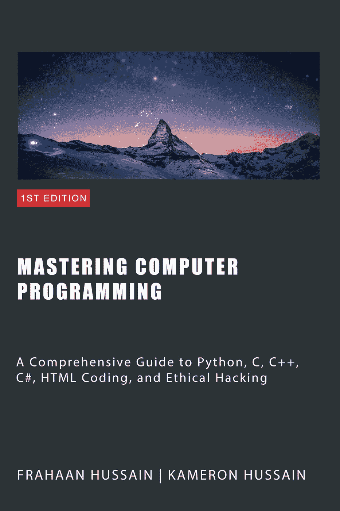

# 精通计算机编程：Python、C、C++、C#、HTML 编码与道德黑客攻击综合指南





## 精通计算机编程


目录

|  |  |  |


# 第 1 章：计算机编程简介](#c101.xhtml__Toc147656489)


# 1.1 节：理解计算机编程](#c101.xhtml__Toc147656490)

编程的逻辑

为什么编程很重要

编程语言的多通用性


# 第 1.2 节：编程在现代技术中的作用

- 技术无处不在
- 软件开发生命周期
- 对业务的影响
- 对科学研究的影响
- 对创意与艺术的影响
- 对教育的影响

# 第 1.3 节：选择合适的编程语言

- 需要考虑的因素
- 流行编程语言

# 第 1.4 节：搭建你的开发环境

- 代码编辑器与集成开发环境 (IDEs)
- 编程语言和工具的安装
- 版本控制与 Git
- 整理你的工作空间

# 第 1.5 节：通往专家之路

1. 设定明确的目标
2. 在做中学习
3. 接受挑战
4. 学习数据结构与算法
5. 探索不同的语言
6. 为开源项目贡献
7. 阅读代码和文档
8. 保持更新
9. 寻求反馈
10. 构建作品集
11. 教学与分享
12. 人人网络与协作
13. 坚持不懈

# 第 2 章：开始学习 Python

## 第 2.1 节：Python 简介

- Python 简史
- Python 的核心特性
- Python 2 vs. Python 3
- 你的第一个 Python 程序
- 运行 Python 代码

## 第 2.2 节：编写你的第一个 Python 脚本

- 创建脚本
- 编写你的第一个 Python 代码
- 运行你的 Python 脚本
- 变量与数据类型
- 基础操作

## 第 2.3 节：Python 中的变量、数据类型和运算符

- 变量
- 数据类型
- 运算符
- 循环 (`for` 和 `while`)
- 控制流关键字：`break` 和 `continue`

## 第 2.5 节：Python 中的输入输出

- 读取用户输入
- 显示输出
- 文件输入输出
- 关闭文件

# 第 3 章：精通 Python 编程

## 第 3.1 节：Python 函数与模块化编程

- 理解函数
- 函数参数
- 返回值
- 模块化编程
- 模块化编程示例

## 第 3.2 节：使用 Python 库和模块

- 什么是 Python 库和模块？
- 导入模块
- 常用的 Python 库
- 安装外部库

## 第 3.3 节：Python 中的文件处理与数据持久化

- 打开与关闭文件
- 从文件中读取
- 写入文件
- 使用 `with` 语句
- 二进制模式及模式
- 文件异常处理

## 第 3.4 节：异常处理与错误管理

- 理解异常
- `try-except` 块
- 处理多个异常
- `else` 和 `finally` 块
- 抛出异常
- 异常处理的最佳实践

## 第 3.5 节：高级 Python 话题（装饰器、生成器等）

1. 装饰器
2. 生成器
3. 上下文管理器
4. 列表推导式


# 5. 多重继承与混入

# 第 4 章：C 语言编程基础

## 第 4.1 节：C 语言编程简介
### 什么是 C 语言编程？
### 配置 C 开发环境
### C 语言编程资源

## 第 4.2 节：C 语法与结构
### 重温 Hello, World!
### 注释
### 变量与数据类型
### 运算符
### 控制流

## 第 4.3 节：C 语言中的变量与数据类型
### 内置数据类型
### 变量声明
### 常量
### 数据类型的大小
### 类型修饰

## 第 4.4 节：C 中的控制流（循环与条件判断）
### 条件语句 (if, else if, else)
### 循环 (for, while, do-while)
### Switch 语句
### Break 和 Continue

## 第 4.5 节：C 中的函数与指针
### 函数
### 指针
### 函数指针

# 第 5 章：精通 C++ 编程

## 第 5.1 节：C++ 编程概述
### C++ 的历史与演变
### C++ 的核心特性
### C++ 版 Hello, World!
### C++ 编译
### C++ vs C

## 第 5.2 节：C++ 中的面向对象编程 (OOP)
### 类与对象
### 封装
### 继承
### 多态
### C++ 中的面向对象

## 第 5.3 节：高级 C++ 特性（模板、Lambda 等）
### 模板
### Lambda 表达式
### 智能指针
### 异常处理

## 第 5.4 节：C++ 标准模板库 (STL)
### 容器
### 算法
### 迭代器
### 仿函数（函数对象）

## 第 5.5 节：C++ 最佳实践与编码规范
### 1. 代码的可读性与一致性
### 2. 头文件与头文件保护符
### 3. 避免全局变量
### 4. 内存管理
### 5. 异常处理
### 6. 性能优化
### 7. 标准库的使用
### 8. 面向对象原则
### 9. 异常安全的代码
### 10. 测试与文档
### 11. 版本控制
### 12. 编码规范

# 第 6 章：探索 C# 编程

## 第 6.1 节：C# 简介
### 1. C# 基础
### 2. 开发环境
### 3.  C# 程序
### 4. 变量与数据类型
### 5. 控制结构
### 6. 面向对象编程 (OOP)
### 7. 结论

## 第 6.2 节：C# 语言基础
### 1. 变量与数据类型
### 2. 运算符
### 3. 控制结构
### 4. 函数与方法
### 5. 数组与集合
### 6. 异常处理
### 7. 结论

## 第 6.3 节：使用 C# 进行面向对象编程
### 1. 类与对象
### 2. 封装
### 3. 继承
### 4. 多态
### 5. 结论

## 第 6.4 节：使用 C 构建 Windows 应用程序


### 1. Windows Forms (WinForms)
### 2. Windows Presentation Foundation (WPF)
### 3. Universal Windows Platform (UWP)
### 4. Visual Studio IDE
### 5. 结论

|  |  |  |


# 第 6.5 节：使用 ASP.NET 开发 Web ](#c129.xhtml__Toc147656670


## 1. ASP.NET Web Forms
### 2. ASP.NET MVC
### 3. ASP.NET Web API
### 4. ASP.NET Core
### 5. 结论

|  |  |  |


# 第 7 章：HTML 编码与 Web 开发](#c130.xhtml__Toc147656676)


# 第 7.1 节：HTML 基础与结构](#c130.xhtml__Toc147656677)

### 1. HTML 文档
### 2. HTML 元素
### 3. HTML 属性
### 4. HTML 注释
## 5. HTML 验证
### 6. 结论

|  |  |  |


# 第 7.2 节：用于 Web 页面设计的 CSS](#c131.xhtml__Toc147656684)


### 1. CSS 语法
## 2. 内联、内部和外部 CSS
### 3. 选择器与属性
### 4. 级联与优先级
### 5. 结论

|  |  |  |


# 第 7.3 节：用于交互性的 JavaScript](#c132.xhtml__Toc147656690)


### 1. JavaScript 基础
### 2. 变量与数据类型
## 3. 函数与事件处理
### 4. DOM 操作
### 5. 结论

|  |  |  |


# 第 7.4 节：构建响应式 Web 设计](#c133.xhtml__Toc147656696)


### 1. 灵活布局
### 2. 媒体查询
## 3. 流媒体图像与视频
## 4. 移动优先设计
### 5. 测试与调试
### 6. 结论

|  |  |  |


# 第 7.5 节：服务器端脚本与 PHP](#c134.xhtml__Toc147656703)


## 1. 什么是服务器端脚本
## 2. 入门 PHP
## 3. 变量与数据类型
### 4. 控制结构
### 5. 数据库交互
## 6. 表单处理
## 7. 框架与 CMS
### 8. 安全性
### 9. 结论

|  |  |  |


# 第 8 章：道德黑客基础](#c135.xhtml__Toc147656713)


# 第 8.1 节：什么是道德黑客](#c135.xhtml__Toc147656714)

### 1. 道德黑客的角色
## 2. 道德黑客的工具包
### 3. 道德黑客类型
### 4. 道德黑客的重要性
## 5. 道德黑客与法律考量
### 6. 结论

|  |  |  |


# 第 8.2 节：理解网络安全](#c136.xhtml__Toc147656721)


### 1. 网络安全基础
## 2. 威胁形势
### 3. 漏洞
### 4. 安全措施
### 5. 合规与法规
### 6. 持续学习
### 7. 结论

|  |  |  |


# 第 8.3 节：侦察与信息收集](#c137.xhtml__Toc147656729)


### 1. 被动侦察 vs. 主动侦察
### 2. 工具与技术
### 3. 足迹扫描与枚举
### 4. 道德考量
### 5. 结论

|  |  |  |


# 第 8.4 节：渗透与漏洞分析](#c138.xhtml__Toc147656735)


### 1. 漏洞识别
### 2. 渗透技术
## 3. 渗透后
### 4. 道德考量
### 5. 报告
### 6. 结论

|  |  |  |


# 第 8.5 节：道德黑客工具与技术](#c139.xhtml__Toc147656742)


### 1. 漏洞扫描器
### 2. 渗透测试框架
## 3. 密码破解工具
## 4. 扫描扫描器
### 5. 无线黑客工具
### 6. 社会工程技术
### 7. 报告工具
### 8. 持续学习
### 9. 法律与道德考量

# 第 9 章：网络安全与渗透测试](#c140.xhtml__Toc147656752)


# 第 9.1 节：网络安全基础](#c140.xhtml__Toc147656753)

### 1. 网络安全目标


### 2. 网络安全威胁
### 3. 网络安全措施
### 4. 渗透测试
### 5. 网络安全策略
### 6. 结论

# 第 9.2 节：渗透测试方法论
### 1. 开源应用安全项目 (OWASP) 方法论
### 2. 渗透测试执行标准 (PTES) 方法论
### 3. 信息系统安全评估框架 (ISSAF) 方法论

# 第 9.3 节：扫描与枚举
### 1. 扫描
### 2. 枚举
### 3. 扫描与枚举工具
### 4. 扫描与枚举的重要性
### 5. 伦理考量

# 第 9.4 节：漏洞利用
### 1. 识别漏洞
### 2. 漏洞技术
### 3. 利用目标
### 4. 伦理考量
### 5. 报告与修复

# 第 9.5 节：报告与伦理考量
### 1. 发现报告
### 2. 伦理考量
### 3. 法律保护
### 4. 负责任报告

# 第 10 章：Web 应用安全
## 第 10.1 节：Web 应用漏洞
### 1. 理解 Web 应用漏洞
### 2. 缓解策略
### 3. 安全开发

## 第 10.2 节：SQL 注入与跨站脚本 (XSS)
## `SQL Injection` (`SQLi`)
## `Cross-Site Scripting` (`XSS`)

## 第 10.3 节：安全头部与 HTTPS
### 安全头部
## `HTTPS` (超文本传输传输安全协议)

## 第 10.4 节：Web 应用防火墙 (WAFs)
## 什么是 Web 应用防火墙 (`WAF`)？
## 使用 `WAF` 的益处
## 实施 `WAF`
## 挑战与考虑

## 第 10.5 节：安全编码实践
### 1. 输入验证
## 2. 身份验证与授权
### 3. 会话管理
### 4. 跨站脚本 (XSS) 预防
## 5. SQL 注入预防
### 6. 错误处理
### 7. 安全头部
## 8. 定期安全审计

# 第 11 章：无线网络安全
## 第 11.1 节：Wi-Fi 安全协议
## 理解 Wi-Fi 安全的重要性
## `WEP` (有线等隐私)
## `WPA` (Wi-Fi 保护访问)
## `WPA2` (Wi-Fi 保护访问 2)
## `WPA3` (Wi-Fi 保护访问 3)
## 配置 Wi-Fi 安全
## 结论

## 第 11.2 节：无线攻击与防御措施
## 常见无线攻击
## 无线入侵检测系统 (`IDS`)
## 无线入侵防御系统 (`IPS`)
## 持续监控
## 安全意识与培训
## 结论

## 第 11.3 节：家庭与企业网络安全
## 家庭网络安全
## 企业网络安全
## 结论

## 第 11.4 节：移动设备安全
## 移动安全的重要性
## 移动设备安全最佳实践
## 移动设备管理 (`MDM`)
## 结论

# 第 11.5 节：IoT 安全挑战


# 不断发展的物联网（IoT）版图

## IoT 安全受关注的问题

## IoT 安全最佳实践
## 面临的 IoT 安全挑战

|  |  |  |


# 第 12 章：恶意软件分析与逆向工程


# 第 12.1 节：理解恶意软件

### 恶意软件分类
## 恶意软件分析目标
## 安全地分析恶意软件

|  |  |  |


# 第 12.2 节：静态分析与动态分析


### 静态分析
### 动态分析
## 结合静态与动态分析

|  |  |  |


# 第 12.3 节：逆向工程工具与技术


## 1. 反汇编器与反编译器
### 2. 调试器
### 3. 反编译器
### 4. 内存分析
## 5. 动态分析工具
## 6. 脚本语言
### 7. 网络分析
## 8. 文件分析工具
## 9. 移动应用逆向工程
### 10. 自动化与脚本

|  |  |  |


# 第 12.4 节：检测与移除恶意软件


### 1. 杀病毒软件
### 2. 终端检测与响应 (EDR)
### 3. 行为分析
### 4. 网络流量分析
## 5. 主机入侵检测系统 (HIDS)
### 6. YARA 规则
### 7. 内存取证
### 8. Rootkit 检测
### 9. 手动分析
## 10. 隔离与封
### 11. 移除工具
### 12. 系统恢复
### 13. 持续监控

|  |  |  |


# 第 2.5 节：威胁情报


### 1. 什么是威胁情报
## 2. 威胁情报类型
### 3. 威胁情报来源
## 4. 威胁情报的重要性
### 5. 情报共享
## 6. 威胁情报的挑战
### 7. 实施威胁情报
### 8. 持续改进

|  |  |  |


# 第 13 章：密码学与加密


# 第 13.1 节：密码学基础

### 1. 术语
### 2. 密码学类型
### 3. 密钥长度
### 4. 机密性与完整性
### 5. 常见密码学技术
### 6. 公钥基础架构 (PKI)
### 7. 密码学协议
### 8. 用例
### 9. 挑战与考虑
### 10. 持续发展

|  |  |  |


# 第 13.2 节：公钥基础架构 (PKI)


### 1. PKI 组件
### 2. 证书生命周期
### 3. PKI 如何工作
### 4. 用例
### 5. 挑战与考虑
### 6. 持续发展

|  |  |  |


# 第 13.3 节：数字签名与证书


### 1. 数字签名
### 2. 证书当局 (CAs)
### 3. 证书验证
### 4. 应用
### 5. 挑战与考虑
### 6. 持续发展

# 第 13.4 节：密码学协议 (TLS/SSL)


### 1. TLS 和 SSL 概述
### 2. 特性
### 3. TLS 握手
### 4. TLS 版本
### 5. SSL/TLS 证书
### 6. HTTPS
### 7. 安全考虑
### 8. TLS/SSL 的未来

|  |  |  |


# 第 13.5 节：数据与通信安全


### 1. 数据加密
### 2. 数据脱敏与令牌化
### 3. 安全通信协议
### 4. 安全编码实践
### 5. 访问控制与身份验证
### 6. 数据保留与处置
### 7. 定期安全审计
### 8. 安全培训与意识

# 第 14 章：网络安全最佳实践


# 第 14.1 节：安全策略的实施

1. 为什么安全策略很重要：
2. 安全策略的类型：
3. 创建有效的安全策略：
4. 强制安全策略：
5. 不合规的后果：
6. 持续改进：
7. 法律与法规合规：

|  |  |  |


# 第 14.2 节：事件响应与恢复


1. 理解事件响应：
2. 事件响应计划：
3. 事件处理阶段：
4. 事件恢复：
5. 法律与法规合规：
6. 持续改进：

|  |  |  |


# 第 14.3 节：风险评估与管理


1. 理解风险评估：
2. 风险管理策略：
3. 风险评估框架：
4. 风险沟通：
5. 事件响应集成：
6. 持续改进：

|  |  |  |


# 第 14.4 节：持续监控与审计


1. 理解持续监控：
2. 审计的角色：
3. 持续监控与审计的益处：
4. 挑战与考虑：

|  |  |  |


# 第 14.5 节：法律与伦理考量


1. 数据隐私与保护：
2. 知识产权：
3. 网络安全与数据泄露：
4. 人工智能与偏见：
5. 负责任的人工智能与自主系统：
6. 道德黑客与研究：
7. 多样性与包容性：
8. 社会责任：
9. 法规合规：
10. 透明度与问责：

|  |  |  |


# 第 11 章：无线网络安全


## 第 11.1 节：Wi-Fi 协议
## 第 11.2 节：无线攻击与防御措施
## 第 11.3 节：家庭与企业网络安全
## 第 11.4 节：移动设备安全
## 第 11.5 节：IoT 安全

# 第 15 章：构建实战项目

## 第 15.1 节：开发 Python 应用

1. 项目规划
2. 选择 Python 框架
3. 设置开发环境
4. 编写代码
5. 数据库操作
6. 用户界面 (UI) 设计
7. 测试与调试
8. 部署

|  |  |  |


# 第 15.2 节：创建一个 C++ 软件工具


1. 问题识别与解决方案设计
2. 设置开发环境
3. 编写 C++ 代码
4. 处理输入与输出
5. 构建命令行界面 (CLI)
6. 内存管理与效率
7. 测试与调试
8. 编译与打包
9. 版本控制与协作

|  |  |  |


# 第 15.3 节：构建 C# Windows 应用程序


1. 选择项目创意
2. 设置开发环境
3. 设计用户界面 (UI)
4. 实现逻辑
5. 数据管理
6. 测试与调试
7. 构建与分发
8. 用户体验
9. 安全考量
10. 未来增强

# 第 15.4 节：设计 Web 应用程序


1. 项目规划
2. 用户界面 (UI) 设计
3. HTML 结构
4. 使用 CSS 样式
5. 使用 JavaScript 添加交互性
6. 后端开发
7. 测试与调试
8. 部署与托管

# 第 15.5 节：道德黑客模拟

1. 道德黑客的重要性
2. 搭建攻击实验室
3. 模拟黑客场景
4. 学习与改进

# 第 16 章：性能优化与可扩展性


# 第 16.1 节：性能分析与调优

## 什么是性能分析？
## 性能分析工具
## 性能分析工作流
## 真实案例

## 第 16.2 节：负载测试与优化

## 负载测试的重要性
## 负载测试工具
## 负载测试策略
## 真实案例

## 第 16.3 节：Web 应用扩展

### 垂直扩展 vs. 水平扩展
### 负载均衡
### 数据库扩展
### 缓存
### 内容分发网络 (CDN)
### 无状态服务
### 自动伸缩
### 可扩展性测试

## 第 16.4 节：网络性能优化

### 内容压缩
### 内容分发网络 (CDN)
### 内容分片
### HTTP/2 和 HTTP/3
### 优化的图像与媒体
### 代码压缩与打包
### 资源预取

## 第 16.5 节：数据库性能调优

### 索引
### 查询优化
### 数据库模式设计
### 连接池
### 数据库缓存
### 定期维护
### 监控与性能分析
### 水平扩展
### 负载测试

# 第 17 章：计算机编程的未来

## 第 17.1 节：新兴技术与趋势

### 人工智能 (AI) 与机器学习
### 量子计算
### 区块链与加密货币
### 边缘计算
### 5G 技术
### 无服务器计算
### 低代码与无代码开发
### 网络安全
### 物联网 (IoT)
### 技术伦理

## 第 17.2 节：演进中的范式

### 函数式编程
### 响应式编程
### 事件驱动架构
### 声明式编程
### 并发与并行编程
### 领域驱动设计 (DDD)
### 无服务器与微服务
### 数据驱动编程
### 以人为本的设计
### 混合方法

## 第 17.3 节：应对技术就业市场

### 多元化的职业路径
### 持续学习
### 构建作品集
### 人脉
### 简历与求职信
### 技术面试
### 软技能
### 公司文化
### 薪资与福利
### 自由职业与零工经济
### 创业
### 导师指导

## 第 17.4 节：持续学习

### 为什么持续学习固重要
## 设定目标
## 在线平台
## MOOC (大规模开放在线课程)
## 挑战与实践
## 开源贡献
## 博客与播客
## 技术活动
## 认证
## 专业领域
## 行业协会
## 导师指导
## 构建个人项目
## 软技能
## 建立习惯
## 评估进度

## 第 17.5 节：塑造计算机编程的未来

### 创新与解决问题
### 开源贡献
### 导师与教学
### 多样性与包容性
### 伦理考量
### 科技向善
### 获取资讯
### 倡导与政策
### 创业
### 协作
### 环境可持续性
### 终身学习
### 公众参与


## 14. 全球挑战
## 15. 加入科技倡议
## 16. 永不止梦想

# 第 18 章：技术中的伦理与责任

## 18.1 节：科技中的伦理考虑
1. 隐私
2. 透明度
3. 可访问性
4. 偏见与公平
5. 责任制
6. 安全性
7. 环境影响
8. 同意与用户控制
9. 知识产权
10. 社会责任
11. 数据伦理
12. 职业责任
13. 持续学习
14. 举报
15. 倡导
16. 法律合规

## 18.2 节：数据隐私与安全伦理
1. 知情同意
2. 数据最小化
3. 匿名化与去标识化
4. 加密
5. 数据访问控制
6. 数据留存策略
7. 事件响应
8. 第三方数据共享
9. 安全审计与评估
10. 培训与意识
11. 法律合规
12. 伦理困境
13. 举报者保护
14. 数据伦理委员会
15. 公众信任
16. 持续改进

## 18.3 节：负责任的 AI 与机器学习
1. 偏见缓解
2. 透明度与可解释性
3. 数据隐私
4. 算法公平
5. 模型安全
6. 人类监督
7. 伦理指南
8. 测试与验证
9. 负责任的使用场景
10. 用户同意与控制
11. 责任与义务
12. 持续监控
13. 协作努力
14. 教育与意识
15. 监管合规
16. 伦理 AI 榜样

## 18.4 节：科技中的多样性与包容性
1. 理解多样性与包容性
2. 多样性的利益
3. 挑战与偏见
4. 包性招聘实践
5. 多元化领导层
6. 包容性工作环境
7. 导师制与赞助
8. 员工资源小组 (ERGs)
9. 多样性指标与责任制
10. 教育外展
11. 包容性设计与产品
12. 科技活动与会议中的多样性
13. 支持性政策
14. 透明度与报告
15. 盟友与倡导者
16. 持续改进
17. 法律合规
18. 数据驱动的方法
19. 庆祝多样性
20. 社区参与

## 18.5 节：科技向善
1. 什么是科技向善？
2. 科技的作用
3. 科技向善的示例
4. 技能与专业知识
5. 参与方式
6. 伦理考虑
7. 衡量
8. 协作与伙伴关系
9. 持续学习
10. 激励他人

# 第 19 章：终身学习与职业成长

## 19.1 节：不断演变的格局
1. 技术变化的速度
2. 终身学习的重要性
3. 为什么终身学习在科技领域至关重要
4. 持续技能开发
5. 适应变化
6. 创建学习计划
7. 平衡工作与学习
8. 科技行业的支持
9. 成长型思维
10. 激励他人

## 19.2 节：保持更新与适应变化
1. 技术过时的挑战
2. 持续学习
3. 人脉建立与协作
4. 导师制与向他人学习
5. 认证与专业化
6. 拥抱变化
7. 反馈与自我评估
8. 时间管理
9. 科技公司的支持
10. 培养成长型思维


# 第 19.3 节：高级认证与专业领域

1. 高级认证的意义
2. 高级认证的类型
3. 选择合适的认证
4. 准备高级认证
5. 认证流程
6. 维护高级认证
7. 专业领域

# 第 19.4 节：制定个人学习计划

1. 为什么个人学习计划至关重要

# 第 19.5 节：在他们的编程之旅中激励他人

1. 导师制与启发的价值
2. 如何激励他人
3. 导师制的最佳实践
4. 影响与传承
5. 结语

# 第 20 章：致谢与结语

# 第 20.1 节：表达感激

1. 为什么要表达感激？
2. 感谢谁
3. 表达感激的方式
4. 涟漪效应
5. 结语

# 第 20.2 节：庆祝你的学习旅程

1. 认可成就
2. 反思进展
3. 庆祝完成
4. 奖励自己
5. 分享你的成就
6. 设定新目标
7. 避免倦怠
8. 接受挑战
9. 旅程

# 第 20.3 节：计算机的影响

1. 驱动技术进步
2. 实现数字化转型
3. 解决复杂问题
4. 信息安全
5. 提高可访问性
6. 塑造体验
7. 推进科学研究
8. 培养创新
9. 赋能创业者
10. 全球连接

# 第 20.4 节：持续自我完善

1. 适应新技术
2. 保持更新
3. 掌握实践
4. 探索新领域
5. 在线课程与教程
6. 认证
7. 开源贡献
8. 导师制
9. 个人项目
10. 人脉拓展
11. 教学他人
12. 休息
13. 设定目标
14. 反思你的进展

# 第 20.5 节：继续掌握计算机编程的鼓励

1. 相信自己
2. 接受挑战
3. 从失败中学习
4. 支持系统
5. 保持好奇
6. 庆祝你的成就
7. 分享你的知识
8. 保持适应力
9. 设定目标
10. 享受过程
11. 保持道德与责任
12. 保持激情
13. 永不停止

# 第 1 章：计算机编程简介

# 第 1.1 节：理解计算机编程

计算机编程是设计和创建运行在计算机上的软件应用程序的过程。它是科技领域的一项基本技能，在塑造现代世界方面起着着性作用。本节概述了什么是计算机编程以及它为什么重要。编程的核心涉及编写计算机可以理解并执行的指令集。这些指令通常使用编程语言编写，语言作为人类可读代码与机器执行代码之间的桥梁。计算机程序可以像计算器应用一样简单，也可以像操作系统一样复杂。

### 编程逻辑

编程本质上是使用逻辑和算法解决问题。算法是解决特定问题或完成特定任务的逐步程序。程序员使用算法来指示计算机如何执行特定操作。

这是一个简单的例子：假设你想写一个程序来计算数字列表的平均值。你需要设计一种算法，获取每个数字，将它们相加，然后将总和除以数字的数量。这种逐步的程序就是编程的精髓。

### 为什么编程很重要

编程已经成为我们日常生活中不可缺的一部分。从智能手机上的应用程序到驱动计算机的软件，编程无处不在。以下是编程至关重要的关键原因：


1. **自动化**：编程允许我们自动执行重复性任务。例如，程序可以自动排序和组织文件，为我们节省时间和精力。
2. **创新**：程序员创建新的软件和技术来驱动创新。他们构建的应用程序解决了现实世界的问题并提高了我们的生活质量。
3. **职业机会**：对熟练程序员的需求在不断增长。学习编程为各行业开启了广泛的职业机会。
4. **解决问题**：编程培养了批判性思维和解决问题的能力。它挑战你将复杂问题分解为可管理的步骤。
5. **创造力**：编程是一项创造性活动。你可以自由设计并构建针对各种问题的独特解决方案。

## 编程语言的多样性

编程语言是程序员用来与计算机通信的工具。目前有很多编程语言，每种语言都有自己的优缺点。编程语言的选择取决于特定任务以及程序员的偏好。

一些流行的编程语言包括：

- `Python`：以简单易读著称，`Python` 是初学者的绝佳选择。它被广泛应用于 Web 开发、数据科学和自动化。
- `Java`：`Java` 以其平台独立性而闻名，适用于构建跨平台应用程序。它通常用于移动 App 开发和大型企业系统。
- `C++`：`C++` 是一种强大的语言，通常用于游戏开发、系统编程和高性能性应用程序。
- `JavaScript`：`JavaScript` 是 Web 语言，对于前端 Web 开发至关重要。它为网站和 Web 应用程序增加了交互性。
- `Ruby`：`Ruby` 以其优雅的语法而闻名，通常用于 Web 开发，特别是配合 `Ruby on Rails` 框架。

这些只是几个例子，还有许多编程语言等待探索。语言的选择通常取决于特定项目以及你作为程序员的目标。

总之，理解计算机编程是成为熟练程序员的第一步。这是一项赋予你能够在数字时代创造、创新和解决复杂问题能力的技能。无论你是初学者还是经验丰富的编码员，掌握计算机编程的旅程都是充满回报且充满机遇的。

 |  | 


# 第 1.2 ：编程在现代技术中的作用


在快速演变的现代技术领域，编程起着至关的作用，影响着我们生活的每一个方面。本节将深入探讨编程在各个领域的深远影响，以及它如何成为塑造世界的不可或缺的工具。

## 无无不在

现代技术已渗透到社会的每个方面，从我们的沟通方式到我们工作、购物和娱乐的方式。驱动这些技术进步的软件是通过编程编写的。无论是智能手机上的操作系统、驱动社交媒体信息流的算法，还是控制自动驾驶汽车的软件，编程都是这些创新的驱动力。

## 软件开发生命周期

创建软件的过程涉及多个阶段，统称为软件开发生命周期 (`SDLC`）。编程是这一过程的核心。以下是 SDLC 阶段的概述：

1. **规划**：在初始阶段，开发者收集需求，定义项目目标并为软件创建路线图。
2. **设计**：程序员设计软件的架构、用户界面和数据结构。这一阶段对于创建项目蓝图至关重要。
3. **编码**：这是编程成为主场的地方。开发者根据设计规范编写代码。他们选择最适合项目要求的编程语言和框架。
4. **测试**：测试是识别和修复 Bug 以及确保软件正常运行的关键步骤。它采用了各种测试技术，包括单元测试和用户验收测试。
5. **部署**：一旦软件经过彻底测试和验证，就会被部署到生产环境中供最终用户访问。
6. **维护**：部署后，软件需要持续维护以解决问题、发布更新并添加新功能。

## 对业务的影响

编程已成为现代业务运营的基石。以下是影响业务的一些方式：

- **自动化**：编程实现了重复任务自动化，提高了效率并减少了人为错误。企业使用软件管理库存、处理工资和处理订单。
- **数据分析**：`Python` 和 `R` 等编程语言被广泛用于数据分析和机器学习，使企业能够从海量数据得出洞察。
- **客户互动**：通过编程开发的 Web 和移动应用程序对于企业接触客户、提供在线服务和进行电子商务至关重要。
- **决策**：编程支持数据驱动决策。算法帮助企业进行预测、优化流程并识别趋势。

## 对科学和研究的影响

编程不仅限于业务；它在科学研究中也起着关键作用。具体如下：

- **模拟**：研究人员使用编程创建复杂现象的模拟，从气候建模到分子动力学等。
- **数据分析**：科学家使用 `R` 和 `Python` 等编程语言分析大型数据集以进行发现并得出结论。
- **仪器控制**：在实验室中，编程用于控制仪器并自动收集数据。
- **协作**：编程促进了全球科学家之间的协作，他们可以共享代码并复制实验。

## 对创造力和艺术的影响

编程的影响已扩展到艺术设计等创意领域：

- **数字艺术**：艺术家使用编程创建交互和生成式艺术，艺术根据算法和用户输入进行演变。
- **视频游戏**：游戏开发高度依赖编程来创建游戏机制、人工智能和视觉效果。
- **媒体制作**：编程用于音频视频制作以自动化任务、增强视觉效果并创建动画。

## 对教育的影响

编程在教育的重要性日益增加。学校和大学认可其在培养学生未来职业方面的价值：

- **计算机科学教育**：编程是计算机科学课程的基础部分，帮助学生培养解决问题和逻辑思维的能力。
- **STEM 学习**：编程整合到科学、技术、工程和数学 (`STEM`) 教育中，以促进创新并为学生从事 `STEM` 职业做准备。
- **代码营**：短期代码营已成为个人快速获取编程技能的一种。

总结来说，编程对现代技术、业务、科学、创造力和教育都有深远影响。它赋予个人和组织创新、自动化和解决问题的的能力。随着技术的不断进步，编程在我们生活中的作用预计将继续增长。


对于任何有出的程序员或开发团队来说，选择合适的编程语言都是至关重要的决策。每种编程语言都有其优点、缺点和应用领域。本节将探索选择编程语言时需要考虑的因素，并对一些流行语言及其用场景提供见解。

## 需要考虑的因素

在决定编程语言时，应该考虑以下几个因素：

1. 项目需求：项目的性质起着重要作用。某些语言更适合 Web 开发，而另一些在数据分析或游戏开发方面表现出色。确定你项目的具体需求。
2. 学习曲线：考虑你对编程的熟悉程度。如果你是初学者，可能想从以简单著称的语言开始，如 `Python` 或 `JavaScript`。
3. 社区与支持：活力且活跃的社区非常有帮助。它提供教程、库和论坛，你可以在那里寻求帮助。
4. 可扩展性：如果你的项目预计会增长，请选择能够随之扩展的语言。某些语言更适合构建大型、复杂的系统。
5. 性能：不同的语言提供的性能水平不相同。如果你的项目需要高速处理，像 `C++` 这样的语言可能更。
6. 生态系统：考虑该语言可用的库、框架和工具。丰富的生态系统可以加速开发。
7. 就业市场：如果你计划从事编程职业，请研究就业市场，以确定你所在的地区或行业对哪些语言需求量大。

## 流行的编程语言

让我们探索一些流行的编程语言及其典型用例：

### 1. Python

• 用例：`Python` 以其简单性和易读性而闻名，是初学者的极佳选择。它广泛用于 Web 开发、科学计算、数据分析、机器学习和自动化。
• 示例代码：

```python
# 一个简单的 Python 程序
print("Hello, world!")
```

### 2. JavaScript

• 用例：`JavaScript` 是 Web 语言，对于前端 Web 开发至关重要。它为网站和 Web 应用增加了交互性。它也可以配合 `Node.js` 用于服务器端开发。
• 示例代码：

```javascript
// 用于显示弹窗警告的 JavaScript 代码
alert("Hello, world!");
```

### 3. Java

• 用例：`Java` 以其平台无关性而闻名，适用于构建跨平台应用程序。它通常用于移动应用开发（Android）、企业级系统和 Web 应用。
• 示例代码：

```java
// 用于打印 "Hello, world!" 的 Java 代码
public class HelloWorld {
    public static void main(String[] args) {
        System.out.println("Hello, world!");
    }
}
```

### 4. C++

• 用例：`C++` 是一种强大的语言，通常用于游戏开发、系统编程和对效率至关的高性能应用。
• 示例代码：

```cpp
// 在控制台显示 "Hello, world!" 的 C++ 代码
#include <iostream>
using namespace std;
int main() {
    cout << "Hello, world!" << endl;
    return 0;
}
```

### 5. Ruby

• 用例：`Ruby` 以其优雅的语法而闻名，通常用于 Web 开发，特别是配合 `Ruby on Rails` 框架。
• 示例代码：

```ruby
# 用于打印 "Hello, world!" 的 Ruby 代码
puts "Hello, world!"
```

这些只是几个例子，还有许多编程语言可以探索。关键是让你的选择与项目需求以及你作为程序员的个人目标相匹配。记住，随着时间的推移学习多种语言可以成为一项宝贵的技能，因为它扩展了你的工具箱以及在不同领域的适应能力。

|  |  |  |


# 第 1.4 节：搭建你的开发环境


建立良好的开发环境对于高效且专注的编程至关重要。本节将引导你完成开发环境配置，包括选择代码编辑器、安装必要的软件以及组织工作空间。

## 代码编辑器与集成开发环境 (IDE)

选择正确的代码编辑器或集成开发环境 (`IDE`) 是搭建开发环境的第一步。以下是一些流行的选项型：

1. Visual Studio Code (VS Code)：`VS Code` 是由微软开发的一个免费开源代码编辑器。它高度可定制，支持广泛的编程语言，并提供许多扩展来增强你的开发体验。
2. PyCharm：`PyCharm` 是一个专为 `Python` 开发设计的强大 `IDE`。它提供了代码补全、调试和集成测试工具等功能。
3. Eclipse：`Eclipse` 是一个多功能的 `IDE`，用于 `Java` 开发，但在插件的帮助下它也支持其他语言。它以强大的调试能力而闻名。
4. IntelliJ IDEA：`IntelliJ IDEA` 是另一个 JetBrains 的 `IDE`，与 `PyCharm` 类似但为 `Java` 和其他基于 `JVM` 的语言定制。
5. Sublime Text：`Sublime Text` 是一个轻量级、快速的代码编辑器，界面简单直观。它因速度和扩展性在开发者中广受欢迎。
6. Atom：`Atom` 是由 GitHub 开发的免费开源代码编辑器。它提供了大量的社区贡献包和主题。

## 编程语言和工具的安装

一旦你选择了代码编辑器或 `IDE`，你需要安装项目所需的编程语言和工具。以下是某些语言的通用指南：

- Python：`Python` 可以从官方网站 (`python.org`) 下载或通过 `Anaconda` 等包管理器安装。考虑使用虚拟环境。
- Java：设置 `Java` 开发需要 Java 开发包 (JDK)。你可以从 Oracle 下载或使用开源替代方案 OpenJDK。`Eclipse` 和 IntelliJ IDEA 等 `IDE` 通常带有 JDK。
- JavaScript：`JavaScript` 开发需要 Web 浏览器和代码编辑器。你可以在浏览器中直接运行 `JavaScript` 代码。考虑使用 Node.js 进行服务器端 JavaScript 开发。
- C/C++：对于 `C` 和 `C++` 开发，你需要一个编译器，如 GCC (GNU Compiler Collection)。你也可以使用 Code::Blocks 等 `IDE` 或在 Windows 上安装 Visual Studio。
- Ruby：Windows 上可以使用 RubyInstaller 安装 Ruby，或在 macOS 和 Linux 上使用 rbenv 或 RVM 等包管理器。

## 版本控制与 Git

版本控制是软件开发的一个关键方面，允许你跟踪更改、与他人协作并在需要时恢复之前的状态。`Git` 是最常用的版本控制系统。以下是入门 `Git` 的方法：

1. 安装 Git：从官方网站 (`git-scm.com`) 下载并安装 `Git`。它提供了命令行工具和图形用户界面。
2. 配置 Git：使用以下命令在 Git 中设置你的姓名和电子邮件地址：

```
git config --global user.name "Your Name"
git config --global user.email "youremail@example.com"
```

3. 创建 Git 仓库：在项目文件夹中使用 `git init` 初始化 Git 仓库。
4. 添加并提交更改：使用 `git add` 暂存更改并使用 `git commit` 将提交到仓库。
5. 远程仓库：如果你计划在线协作或托管代码，考虑使用 GitHub、GitLab 或 Bitbucket 等平台来托管远程仓库。

## 组织你的工作空间

高效地组织工作空间可以提高生产力。以下是一些建议：


-   为每个项目创建一个专门的项目文件夹，以保持代码和相关文件的整洁。
-   为你的项目使用版本控制，以跟踪更改并进行有效的协作。
-   在项目文件夹中保持整洁且组织良好的目录结构，将源代码、文档和资源分开。
-   准备一个笔记本或数字文档，记录灵感、代码片段和项目相关的笔记。
-   自定义你的代码编辑器或 IDE 设置，以匹配你的偏好和编码风格。

搭建开发环境是成功编程的基础基础。花时间按照你的喜好进行配置，并学习如何有效地使用这些工具来简化你的编码工作流。

 |  | 


# 第 1.5 节：通往专家快速径


成为一名专家程序员是一段需要投入、持续学习和实践的旅程。本节将提供如何加速你的编程专家之路的指导。

### 1. 设定明确的目标
为了快速通向专家之境，请设定清晰且具体的目标。定义你作为一名程序员想要实现的目标，无论是精通特定语言、掌握某项技术，还是完成某个项目。拥有明确的目标有助于你保持专注和动力。

### 2. 在做中学习
单凭理论并不能让你成为专家程序员。实践经验至关重要。从你感兴趣的项目开始手。构建现实世界的应用程序（即使是小型项目）将教给你许多宝贵的技能和解决问题的技巧。编写的代码越多，你就会越自信、越强大。

### 3. 拥抱挑战
不要回避挑战性任务或复杂的项目。拥抱挑战是你作为程序员成长的途径。面对困难的问题时，进行研究、实验并在必要时寻求帮助。克服挑战是获得专业能力的可靠方法。

### 4. 学习数据结构和算法
理解数据结构和算法是编程的基础。花时间来学习和练习它们。书籍、在线课程和编程挑战（如 `LeetCode` 和 `HackerRank`）是磨练该领域技能的极佳资源。

### 5. 探索不同的语言
虽然精通一两门语言是有益的，但探索不同的编程语言可以拓宽你的视野。每种语言都有其优缺点，接触多样化的语言可以增强你的解决问题能力和适应能力。

### 6. 贡献开源
为开源项目做贡献是获取专业能力的绝佳方式。它允许你与经验丰富的开发者协作，学习最佳实践，并在现实世界的项目上工作。像 `GitHub` 这样的平台托管了跨多个领域的无数开源项目。

### 7. 阅读代码和文档
阅读经验丰富的程序员编写的代码是一种教育体验。分析开源项目、库和框架，以理解专家是如何组织代码的。此外，定期阅读文档和 API 参考将扩展你的知识面。

### 8. 保持更新
科技行业发展迅速。保持对最新趋势、工具和关注。关注行业博客、参加会议并加入在线社区以保持信息灵通。持续学习是专家程序员的标志。

### 9. 寻求反馈
不要闭门造车地编码。从同行或更有经验的程序员那里寻求对你代码和项目的反馈。建设性的批评可以帮助你发现改进之处并精炼你的技能。

### 10. 构建作品集
当你完成项目并获得专业知识时，创建一个展示你作品的作品集。作品集是你技能和成就的实物体现，在寻找工作机会或自由职业工作时可能是无价之。

### 11. 教学与分享
教他人是巩固知识的强大方式。通过博客文章、教程或指导该领域的新手来分享你所学到的。向他人解释概念可以加强你自己的理解，并帮助社区成长。

### 12. 人脉拓展与协作
人脉关系是职业增长的关键。参加技术聚会、会议和在线论坛，以与志同道合的人建立联系。在项目上协作或加入编程社区可以带来宝贵的机会和合作。

### 13. 保持坚持
成为一名专家程序员需要时间。会有沮丧和挫折的时刻，但坚持是你最大的资产。不断推动自己去学习和改进，随着时间的推移你会看到进步。

总之，通往编程专家的道路既充满挑战又充满回报。它需要持续的学习、实践经验和成长型思维。通过设定明确的目标、拥抱挑战并坚持改进，你可以快速通往成为专家程序员的道路。

 |  | 


# 第 2 章：开始学习 Python

# 第 2.1 节：Python 简介


`Python` 是一种多功能且对初学者友好的编程语言，以简单易读而闻名。在本节中，我们将介绍 `Python`、它的历史、特征，以及为什么它是新手和资深开发者共同青睐。

### Python 简史
`Python` 由荷兰程序员 `Guido van Rossum` 在 20 世纪 80 年代后期创造。于 1991 年 2 月正式发布为 `Python 0.9`。`Python` 的设计哲学强调可读性和简洁、表达丰富的语法。

### Python 的关键特性
`Python` 的流行可归功于几个关键特性：

1. **可读性**：`Python` 的语法设计易于阅读，具有清晰一致的结构。这种可读性降低了程序维护和调试的成本。
2. **多功能性**：`Python` 是一种通用语言，意味着它可以用于广泛的应用程序，从 Web 开发、科学计算到数据分析和自动化。
3. **强大的标准库**：`Python` 自带一个全面的标准库，为常见任务提供了模块和包，减少了从零开始编写代码的需求。
4. **社区与生态系统**：`Python` 拥有一个活力且活跃的社区，促进语言的增长。第三方库和框架（如 `Django` 和 `TensorFlow`）的可用进一步扩展了 `Python` 的功能。
5. **跨平台**：`Python` 可用于多种平台，包括 `Windows`、`macOS` 和 `Linux`，使其极易易性。
6. **解释型语言**：`Python` 是一种解释型语言，这意味着你不需要编译即可运行代码。这使得开发过程更加快速和灵活。
7. **开源**：`Python` 是开源的，这意味着任何人都可以使用并对其进行修改和分发。这种开放性促进了它的广泛采用。

### Python 2 与 Python 3
值得注意的是 `Python` 有两个主要版本：`Python 2` 和 `Python 3`。`Python 2` 多年来被广泛使用，但从 2020 年 1 月 1 日起不再受到官方支持。`Python 3` 是当前且推荐的版本。在学习 `Python` 时，建议学习 `Python 3` 以利用其改进和持续的支持。

### 你的第一个 Python 程序


让我们开始编写你的第一个 Python 程序。在 Python 中，你可以使用 `print()` 函数将文本打印到控制台。这里有一个示例：

# 这是一个简单的 Python 程序

```python
print("Hello, Python!")
```

在这段代码中，`print("Hello, Python!")` 是一条向控制台打印“Hello, Python!”文本的语句。`#`符号表示 Python 中的注释，解释器会忽略它。注释对于为你的代码添加说明和备注非常有用。

## 运行 Python 代码

要运行 Python 代码，你需要在计算机上安装 Python。你可以从官方网站（python.org）下载最新版本的 Python，并按照你操作系统的安装说明进行操作。

一旦安装了 Python，你就可以创建一个 Python 脚本（带有 `.py` 扩展名的文本文件），并使用命令行或集成开发环境（IDE）运行它。许多代码编辑器（包括 Visual Studio Code 和 PyCharm 在内的编辑器）都为 Python 开发提供了内置支持。

总而言之，Python 是一种多功能且对初友好的编程语言，以其简单性、可读性和广泛的应用范围而闻名。对于新手和经验丰富的开发者来说，它都是极佳的选择，我们将在接下来的章节中详细探索这种语言。

|  |  |  |


# 第 2.2 节：编写你的第一个 Python 脚本


既然你已经了解了 Python，现在是时候动手编写你的第一个 Python 脚本了。在本节中，我们将引导你学习创建 Python 脚本的基础知识、运行它，并理解变量、数据类型和基本操作等核心概念。

## 创建 Python 脚本

Python 脚本是带有 `.py` 扩展名的文本文件。你可以使用简单的文本编辑器（如 Windows 记事本）或你喜欢的任何代码编辑器（例如 Visual Studio Code、PyCharm 或 IDLE（内置的 Python IDE））来创建 Python 脚本。以下是创建基础 Python 脚本的方法：

1.  打开你喜欢的代码编辑器或文本编辑器。
2.  创建一个新文件并将其以 `.py` 扩展名保存。例如，你可以将其命名为 `first_script.py`。
3.  在该文件中编写 Python 代码。

## 编写你的第一个 Python 代码

让我们从一个简单的 Python 程序开始，向控制台打印问候消息。打开你的 Python 脚本文件（`first_script.py`）并添加以下代码：

```python
# This is my first Python script
print("Hello, Python!")
```

在这段代码中：

• `# This is my first Python script` 是注释，对你的脚本提供了简要描述。Python 解释器会忽略注释，它们用于为代码添加说明。

• `print("Hello, Python!")` 是主代码行。它使用 `print()` 函数在控制台显示“Hello, Python!”文本。

## 运行你的 Python 脚本

一旦你写好了 Python 脚本，就可以运行它了。操作方法如下：

1.  打开你的命令提示符或终端。
2.  导航到保存 `first_script.py` 文件的目录。你可以使用 `cd`（更改目录）命令导航到包含脚本的文件夹。
3.  通过输入以下命令运行脚本：

```bash
python first_script.py
```

如果你的脚本名称不同，请将 `first_script.py` 替换为你的脚本名称。

1.  按下回车键，你应该能在终端中看到 Python 脚本的输出：

```text
Hello, Python!
```

恭喜！你成功编写并运行了第一个 Python 脚本。

## 变量和数据类型

Python 允许使用变量来存储和处理数据。变量就像可以存放不同信息的容器。Python 支持多种数据类型，包括：

• `int`: 整数（例如 1, 42, -5）。
• `float`: 浮点数（例如 3.14, -0.5）。
• `str`: 字符串（例如“Hello, Python!”，“123”）。
• `bool`: 布尔值（True 或 False）。
• `list`: 项目的有序集合（例如 [1, 2, 3]）。
• `tuple`: 有序、不可变的集合（例如 (1, 2, 3)）。
• `dict`: 键值对（例如 {'name': 'Alice', 'age': 30}）。

以下是在 Python 中使用变量和数据类型的示例：

```python
# Variables and data types
name = "Alice"
age = 30
height = 5.8
is_student = True

# Printing variables
print("Name:", name)
print("Age:", age)
print("Height:", height)
print("Is student?", is_student)
```

在这段代码中，我们创建了不同数据类型的变量 `name`、`age`、`height` 和 `is_student`。使用 `print()` 函数显示这些变量的值。

Python 是动态类型，这意味着你不需要显式声明变量的数据类型。解释器会根据赋值给变量的值来确定数据类型。

## 基本操作

Python 支持对数据的各种操作，例如算术运算、比较运算和逻辑运算。是一些示例：

```python
# Basic operations
a = 10
b = 5

# 算术运算
sum_result = a + b
difference = a - b
product = a * b
division = a / b
remainder = a % b

# 比较运算
is_equal = a == b
is_not_equal = a != b
is_greater = a > b
is_less = a < b

# 逻辑运算
and_result = a and b
or_result = a or b
not_result = not a

# 输出结果
print("Sum:", sum_result)
print("Difference:", difference)
print("Product:", product)
print("Division:", division)
print("Remainder:", remainder)
print("Is Equal:", is_equal)
print("Not Equal:", is_not_equal)
print("Is Greater:", is_greater)
print("Is Less:", is_less)
print("AND Result:", and_result)
print("OR Result:", or_result)
print("NOT Result:", not_result)
```

在这段代码中，我们对 `a` 和 `b` 执行了算术运算，比较了它们的值，并使用逻辑运算符评估条件。结果打印在控制台上。

这结束了我们对 Python 的介绍，在此期间你学习了如何创建、运行和理解第一个脚本，处理变量和数据类型并执行操作。在接下来的章节中，我们将深入探索 Python 的功能和特性。


你可以使用 `type()` 函数检查变量的数据类型：

# 数据类型

```python
age = 30
height = 5.8
name = "Alice"
is_student = True
grades = [85, 90, 78]
person = {'name': 'Bob', 'age': 25}

print("age is of type:", type(age))
print("height is of type:", type(height))
print("name is of type:", type(name))
print("is_student is of type:", type(is_student))
print("grades is of type:", type(grades))
print("person is of type:", type(person))
```

### 运算符

Python 中的运算符用于对变量和值进行操作。Python 支持多种类型的运算符，包括：

- **算术运算符**：用于基础数学运算，如加法、减法、乘法、除法等。

### 算术运算符
```python
a = 10
b = 5
sum_result = a + b
difference = a - b
product = a * b
division = a / b
remainder = a % b

print("Sum:", sum_result)
print("Difference:", difference)
print("Product:", product)
print("Division:", division)
print("Remainder:", remainder)
```

- **比较运算符**：用于比较值并返回布尔结果（True 或 False）。

### 比较运算符
```python
x = 10
y = 5
is_equal = x == y
is_not_equal = x != y
is_greater = x > y
is_less = x < y

print("Is Equal:", is_equal)
print("Is Not Equal:", is_not_equal)
print("Is Greater:", is_greater)
print("Is Less:", is_less)
```

- **逻辑运算符**：用于组合多个条件并评估其逻辑结果。

### 逻辑运算符
```python
p = True
q = False
and_result = p and q
or_result = p or q
not_result = not p

print("AND Result:", and_result)
print("OR Result:", or_result)
print("NOT Result:", not_result)
```

- **赋值运算符**：用于给变量赋值。

### 赋值运算符
```python
x = 10
x += 5 # Equivalent to x = x + 5
x -= 3 # Equivalent to x = x - 3
x *= 2 # Equivalent to x = x * 2

print("Updated x:", x)
```

- **成员运算符**：用于测试值是否存在于序列中。

### 成员运算符
```python
fruits = ['apple', 'banana', 'cherry']
is_apple_present = 'apple' in fruits
is_mango_present = 'mango' in fruits

print("Is 'apple' present?", is_apple_present)
print("Is 'mango' present?", is_mango_present)
```

- **标识运算符**：用于比较两个对象的内存位置。

### 标识运算符
```python
a = [1, 2, 3]
b = a
c = [1, 2, 3]
is_a_same_as_b = a is b
is_a_same_as_c = a is c
is_a_not_same_as_c =
```

##


## 第 2.4 ：控制结构 (if, else, 循环)

Python 中的控制结构允许你根据条件和重复控制程序的流程。在本节中，我们将探索条件语句（if, else）和不同类型的循环（for 和 while），这些对于构建复杂且动态的程序至关重要。

### 条件语句 (if, else)

Python 中的条件语句（如 `if` 和 `else`）允许你根据指定的条件执行不同的代码块。它们的工作原理如下：

#### `if` 语句

`if` 语句用于在条件为真时执行代码块。如果条件为假，则跳过该代码块。


# if 语句

```python
x = 10
if x > 5:
    print("x is greater than 5")
```

在这个示例中，`print()` 语句将执行，因为条件 `x > 5` 为真。

### else 语句

`else` 语句用于在 `if` 语句指定的条件为假时执行一个代码块。

# if-else 语句

```python
y = 3
if y > 5:
    print("y is greater than 5")
else:
    print("y is not greater than 5")
```

在这种情况下，由于条件 `y > 5` 为假，`else` 块中的代码将执行。

### elif 语句

`elif` 语句（“else if”的缩写）允许你按顺序检查多个条件。它通常用于初始 `if` 语句之后。

# if-elif-else 语句

```python
z = 7
if z > 10:
    print("z is greater than 10")
elif z > 5:
    print("z is greater than 5 but not greater than 10")
else:
    print("z is not greater than 5")
```

在这个示例中，第一个条件 `(z > 10)` 为假，因此程序检查下一个条件 `(z > 5)`，如果为真，则执行相应的块。如果两个条件都不为真，则执行 `else` 块。

### 循环 (for 和 while)

Python 中的循环允许你多次执行一个代码块，使得迭代执行任务成为可能。

### for 循环

`for` 循环用于遍历序列（例如 `list`、`tuple` 或 `string`）或任何可迭代对象。它允许为序列中的每个项执行一次代码块。

# for 循环

```python
fruits = ["apple", "banana", "cherry"]
for fruit in fruits:
    print(fruit)
```

在这个示例中，`for` 循环遍历 `fruits` 列表，并为列表中的每个项执行 `print()` 语句。

### while 循环

`while` 循环用于在指定条件为真时重复执行一个代码块。

# while 循环

```python
count = 1
while count <= 5:
    print("Count:", count)
    count += 1
```

在段代码中，`while` 循环只要 `count` 变量小于或等于 5 就会运行，并在迭代中将 `count` 加 1。

### 控制流关键字：break 和 continue

Python 两个控制流关键字 `break` 和 `continue`，用于进一步控制循环的流。

* `break`: 终止当前循环并移动到循环后的下一个语句。

# break 示例

```python
numbers = [1, 2, 3, 4, 5]
for num in numbers:
    if num == 4:
        break
    print(num)
```

在段代码中，`for` 循环在遇到值 4 时停止。

* `continue`: 跳过循环的当前迭代并继续进行下一次迭代。

# continue 示例

```python
numbers = [1, 2, 3, 4, 5]
for num in numbers:
    if num == 3:
        continue
    print(num)
```

在段代码中，值 3 被跳过，循环继续下一次迭代。

`if`、`else`、`for` 和 `while` 等控制结构是构建 Python 复杂且灵活程序的本质工具。通过组合这些结构，你可以创建动态且响应的应用程序，能够处理各种场景和条件。

# 第 2.5 节：Python 中的输入与输出

在本节中，我们将深入研究 Python 中的输入和输出 (I/O) 操作。这些操作允许你的程序与用户交互，从外部源读取数据并将数据写入文件。

### 读取用户输入

要在 Python 中从用户读取输入，你可以使用 `input()` 函数。该函数读取用户输入的一行文本并将其作为字符串返回。这是一个基础示例：

# 读取用户输入

```python
name = input("Enter your name: ")
print("Hello,", name)
```

在段代码中，`input()` 函数显示提示符“Enter your name:”并等待用户输入文本。用户的输入随后存储在 `name` 变量中并打印到控制台。

需要注意的是，`input()` 函数始终返回一个字符串。如果你想对输入进行数值操作，应该使用类型转换将其转换为适当的数据类型（例如 `int` 或 `float`）。

# 将用户输入转换为整数

```python
age_str = input("Enter your age: ")
age = int(age_str)
# 使用用户的年龄进行计算
next_year_age = age + 1
print("Next year, you'll be", next_year_age, "years old.")
```

### 显示输出

要在 Python 中显示输出，你已经看到过如何使用 `print()` 函数。该函数允许你向控制台输出文本和变量。你可以通过逗号分隔多个项或使用字符串拼接来格式化输出。

# 显示输出

```python
x = 5
y = 3
# 使用逗号分隔 print() 中的项
print("The value of x is", x, "and the value of y is", y)
# 使用字符串拼接
message = "The sum of x and y is " + str(x + y)
```

### 文件输入与输出

Python 提供了读取和写入文件的能力。你可以使用 `open()` 函数来打开文件并指定模式（例如 `'r'` 用于读取，`'w'` 用于写入）。

#### 读取文件

```python
file_path = "sample.txt"
with open(file_path, 'r') as file:
    content = file.read()
print("File content:", content)
```

在段代码中，我们以 `'r'` 模式打开名为 `sample.txt` 文件。`with` 语句确保文件正确关闭。

#### 写入文件

```python
output_file_path = "output.txt"
with open(output_file_path, 'w') as output_file:
    output_file.write("Hello, Python!\n")
    output_file.write("This is a sample file created with Python.")
```

在段代码中，我们以 `'w'` 模式打开名为 `output.txt` 文件。

# 第 3 章：掌握 Python 编程

# 第 3.1 节：函数与模块化编程

在本节中，我们将深入研究 Python 中的函数和模块化编程。这些概念允许你将复杂任务分解为可重用的单元。

### 理解函数

Python 中的函数是执行特定任务的代码块。定义函数时使用 `def` 关键字，后跟函数名和括号。

```python
def greet():
    print("Hello, Python!")

# 调用函数
greet()
```

### 函数参数

函数可以接受参数（也称为参数），允许你向函数传递数据。

```python
def add(a, b):
    result = a + b
    print("Sum:", result)

# 带参数调用函数
add(5, 3)
```

在段代码中，`add()` 函数接收两个参数 `a` 和 `b` 并计算它们的和。

### 返回值

函数可以使用 `return` 关键字返回值。这允许你捕捉函数的结果并在代码的其他部分使用。

```python
def multiply(a, b):
    result = a * b
    return result

# 调用函数并存储结果
product = multiply(4, 7)
print("Product:", product)
```

在段示例中，`multiply()` 函数计算两个数的积并返回结果。我们将返回的值赋值给 `product` 变量并打印。

### 模块化编程

模块化编程是一种将程序分解为更小的、可管理的模块或函数的软件开发方法。每个模块关注一个特定的任务或功能，使代码更易理解、维护和测试。

通过将代码组织成函数和模块，你可以获得以下优势：

*   **可重用性**：可以在程序的不同部分或其他项目中重用函数，减少冗余并节省时间。
*   **可读性**：模块化代码更易阅读和理解，因为它将复杂任务分解为更小的单元。
*   **可维护性**：当你需要更改或修复问题时，定位和更新特定的函数或模块比遍历整个代码库要容易得多。
*   **测试**：较小的模块更容易进行隔离测试，有助于高效识别和修复错误。
*   **协作**：模块化代码有助于团队成员之间的协作，因为每个成员可以独立地处理特定的模块。

### 模块化编程示例

```python
def calculate_area(radius):
    return 3.14 * (radius ** 2)

def calculate_circumference(radius):
    return 2 * 3.14 * radius

radius = 5
print(f"Area: {calculate_area(radius)}")
print(f"Circumference: {calculate_circumference(radius)}")
```

在段代码中，我们定义了两个函数 `calculate_area` 和 `calculate_circumference`，然后使用 `radius` 变量调用它们。

# 第 3.2 节：使用 Python 库和模块

在本节中，我们将探索 Python 库和模块的使用。Python 提供了多种工具来处理任务和扩展功能。

### 什么是 Python 库和模块？

*   **库 (Libraries)**：库是预写代码的集合，提供了执行特定任务的函数、类和工具。
*   **模块 (Modules)**：模块是包含 Python 代码的单个文件。模块允许将代码组织到单独的文件。

### 导入模块

要在程序中使用模块，你需要导入它。Python 提供了几种导入模块的方法：

*   **`import` 语句**：你可以使用 `import` 语句后跟模块名来导入整个模块。
    ```python
    import math
    print(math.sqrt(16))
    ```
*   **`from ... import` 语句**：如果你只需要模块中的特定函数或变量，可以使用 `from ... import` 语句。
    ```python
    from math import sqrt
    print(sqrt(16))
    ```
*   **`import ... as` 语句**：你可以使用 `import ... as` 关键字为模块起一个别名，使其在代码中更容易引用。
    ```python
    import math as m
    print(m.sqrt(16))
    ```

### 常用的 Python 库

Python 提供了广泛的库以适应不同的应用领域。以下是一些常用的库及其用途：

*   **NumPy**：用于数值计算的基础库，支持数组和矩阵，并对它们进行数学运算。
*   **pandas**：用于数据操作和分析的库，提供了 `DataFrames` 和 `Series` 等数据结构，便于处理结构化数据。
*   **matplotlib**：用于创建静态、动画和交互式可视化的流行库。
*   **requests**：允许发送 HTTP 请求并与网络服务交互。
*   **scikit-learn**：机器学习库，提供分类、回归、聚类等各种任务的模型评估。
*   **Beautiful Soup**：用于网页爬虫和解析 HTML 和 XML 文档的库，方便从页面提取信息。
*   **Django 和 Flask**：流行的 Web 框架，用于构建 Web 。
*   **OpenCV**：计算机视觉库，提供图像和视频处理工具。

# 第 4 章：C 编程

# 第 4.1 节：C 简介

C 是一种强大且广泛使用的语言，以其效率和多功能著称。在本节中，我们将介绍 C 编程的基础，包括它的历史、特征和开发环境。

### 什么是 C 编程？

C 是由 Dennis Ritchie 在 20 世纪 70 年代在贝尔实验室开发的 B 语言的演变，已成为历史上最具影响力的语言之一。C 的关键特性包括：

*   **过程化编程**：C 遵循过程化范式，这意味着围绕函数构建。函数可以调用其他函数，将复杂问题分解为可管理的部分。
*   **底层内存操作**：C 直接访问内存，允许你控制内存分配并处理指针。这种能力是优势，但需要仔细的内存管理以避免段错误。
*   **效率**：C 程序以速度和效率著称，这使其成为系统编程、嵌入式系统以及对性能至关重要的应用程序的选择。
*   **可移植性**：得益于其标准语法，C 代码可以在极少更改的情况下编译并在各种平台上运行，不依赖平台特性。
*   **标准库**：C 自带一个标准库，提供了用于 I/O、字符串处理和数学操作等广泛函数。

### 设置 C 开发环境

要开始编写 C，你需要一个包含 C 编译器、文本编辑器或集成开发环境 (IDE) 以及必要的构建工具的环境。以下是设置过程的概述：

1. **选择 C 编译器**：你可以从多个 C 编译器中选择，包括 `GCC` (GNU Compiler Collection)、Clang 和 Microsoft Visual C++。安装适合你操作系统的编译器。
2. **文本编辑器或 IDE**：选择用于编写 C 代码的编辑器或 IDE。常见选择包括 Visual Studio Code、Code::Blocks 和 Eclipse，它们通过扩展或插件提供 C/C++ 支持。
3. **编写你的第一个 C 程序**：创建一个简单的 C 程序来开始。这是一个 C 的“Hello, World!”示例：

    ```c
    #include <stdio.h>

    int main() {
        printf("Hello, World!\n");
        return 0;
    }
    ```

将此代码保存为 `.c` 扩展，例如 `hello.c`。

4. **编译并运行**：打开终端或命令提示符并导航到包含 C 源代码的目录。使用选定的编译器编译代码。对于 `GCC`，你可以使用以下命令：`gcc hello.c -o hello`。该命令编译 `hello.c` 并生成一个名为 `hello` 的可执行文件。通过执行生成的可执行文件来运行程序：`./hello`。你应该能在终端中看到“Hello, World!”消息。

### C 编程资源

要精通 C 编程，学习语言的语法、特征和最佳实践是关重要的。以下是一些推荐的资源：

*   **书籍**：考虑阅读 Perry 和 Miller 的《C Programming Absolute Beginner Guide》，或 Kernighan 和 Ritchie 的《The Programming Language》。
*   **在线教程**：有很多在线教程和课程可以学习 C。Geeksforks、Codecademy 和 Coursera 等网站提供 C 课程。
*   **文档**：参考官方文档和标准（如 C99 或 C11），以理解语言的特性和语法。
*   **实践**：学习 C 的最佳方法是编写代码。通过解决问题来强化理解。

# 第 4.2 节：C 语法和结构

在本节中，我们将深入研究 C 的语法。理解结构对于编写正确的程序至关重要。

### Hello, World!

让我们回顾经典的“Hello, World!”程序：

```c
#include <stdio.h>

int main() {
    printf("Hello, World!\n");
    return 0;
}
```

*   `#include <stdio.h>`：这是一个预处理指令，包含了标准输入输出库。
*   `int main()`：主函数，程序执行开始的地方。
*   `{ ... }`：函数体包含在大括号中。
*   `printf("Hello, World!\n");`：打印字符串到控制台。
*   `return 0;`：语句返回 0。

### 注释

C 允许你在代码中包含注释以提供解释。

*   单行注释以 `//` 开头：`// This is a single-line comment`。
*   多行注释以 `/*` 开头并 `*/` 结尾：
    ```c
    /* This is a multi-line comment */
    ```

### 变量和数据类型

在 C 中，变量用于存储数据，每个变量都有特定的数据类型来决定它可以存储的数据种类。

*   `int`：用于整数，例如 `int age = 25;`。
*   `float`：用于浮点数（小数），例如 `float price = 12.99;`。
*   `char`：用于单个字符，例如 `char grade = 'A';`。
*   `bool`：用于布尔值（真或假），例如 `bool isValid = true;`。通过指定数据类型声明变量。

```c
int num1 = 42;
float pi = 3.14;
char letter = 'A';
bool isValid = true;
```

### 运算符

C 提供了各种运算符对变量和值进行操作。常见的运算符包括：

*   **算术运算符**：`+`、`-`、`*`、`/`、`%`。
*   **比较运算符**：`==`、`!=`、`<`、`>=`。
*   **赋值运算符**：`=`、`+=`、`-=`、`*=`、`/=`、`%=`。
*   **逻辑运算符**：`&&` (与)、`||` (或)、!` (非)。
*   **自增和自减运算符**：`++` (增)、`--` (减)。

### 控制流

C 提供控制流语句来控制程序的执行。控制流语句包括：

*   `if`、`else if` 和 `else` 用于条件执行。
*   `switch` 和 `case` 用于处理多个条件。
*   `while` 和 `for` 循环用于重复。
*   `break` 和 `continue` 用于控制循环行为。

`if` 语句示例：

```c
int age = 18;
if (age >= 18) {
    printf("You are an adult.\n");
} else {
    printf("You are not yet adult.\n");
}
```

# 第 4.3 节：C 中的变量和数据类型

在 C 编程中，变量用于存储数据，每个变量都有特定的数据类型来决定它可以存储的数据种类。理解 C 数据类型对于编写正确高效的程序是基础。

### 内置数据类型

C 提供了几种内置数据类型来表示种类的数据。常见数据类型包括：

1. `int`：用于存储整数，例如 `int age = 42;`。
2. `float`：用于浮点数（带小数的数），例如 `float price = 3.14;`。
3. `double`：类似于 `float` 但精度更高；用于更精确的计算。
4. `char`：表示单个字符，例如 `char grade = 'A';`。
5. `bool`（在 C99 及更高版本中）：表示布尔值，真或假。
6. `void`：用于指示函数不返回任何值。

### 变量声明

要在 C 中声明变量，需要指定其数据类型后跟变量名。

```c
int age;
float temperature;
char grade;
```

你也可以在声明期间初始化变量：

```c
int score = 100;
float pi = 3.14159;
char initial = 'Z';
```

### 常量

除了变量之外，C 允许定义常量，即执行期间不能更改的值。你可以使用 `const` 关键字。

```c
const int MAX_USERS = 100;
const float PI = 3.14159;
```

### 数据类型的大小

数据类型的大小取决于平台。你可以使用 `sizeof` 运算符来确定数据类型占用的字节数。

```c
#include <stdio.h>

int main() {
    printf("Size of int: %zu bytes\n", sizeof(int));
    printf("Size of float: %zu bytes\n", sizeof(float));
    printf("Size of char: %zu bytes\n", sizeof(char));
    printf("Size of double: %zu bytes\n", sizeof(double));
    return 0;
}
```

# 第 4.4 节：C 中的控制流 (循环和条件)

控制流语句允许你控制程序的执行。

### 条件语句 (if, else if, else)

条件语句允许你根据条件执行不同的代码块。

```c
int score = 85;
if (score >= 90) {
    printf("Grade: A\n");
} else if (score >= 80) {
    printf("Grade: B\n");
} else {
    printf("Grade: C\n");
}
```

### 循环 (for, while, do-while)

循环用于在满足条件时重复执行代码块。

*   `while` 循环：
    ```c
    int count = 0;
    while (count < 5) {
        printf("%d\n", count);
        count++;
    }
    ```
*   `do-while` 循环（至少执行一次）：
    ```c
    int count = 0;
    do {
        printf("%d\n", count);
        count++;
    } while (count < 5);
    ```
*   `for` 循环：
    ```c
    for (int i = 0; i < 5; i++) {
        printf("%d\n", i);
    }
    ```

### switch 语句

`switch` 语句根据变量的值执行不同的动作。

```c
int choice = 2;
switch (choice) {
    case 1:
        printf("Option 1\n");
        break;
    case 2:
        printf("Option 2\n");
        break;
    default:
        printf("Invalid choice\n");
}
```

