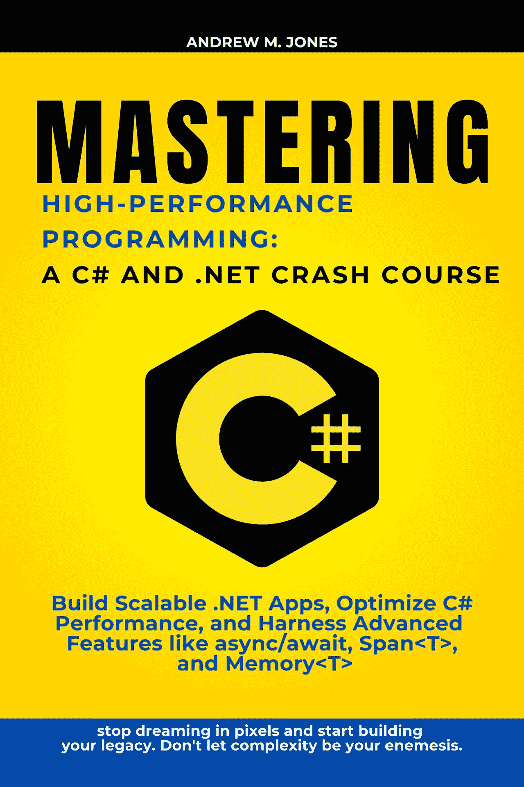

# 精通高性能编程：C# 和 .NET 速成指南：构建可扩展 .NET 应用，优化 C# 性能





构建可扩展的 .NET 应用、优化 C# 性能，并利用 `async/await`、`Span<T>` 和 `Memory<T>` 等高级特性


# 引言

释放内在速度机器：高性能编程速成教程

你是否曾盯着一个运行缓慢的应用程序，希望它能运行快一点？在如今这个响应至上的世界里，缓慢的应用程序是不可行的。但不要担心，程序员！你拥有编写极速 `async/await`、`Span<T>` 和 `Memory<T>` 的力量。

本《精通高性能编程：C# 与 .NET 速成教程》是你成为性能专家的一站式指南。在接下来的章节中，你将深入研究 `.NET` 特性，如异步编程和并行处理。

但这不仅仅是理论。我们将亲手实践，学习如何使用性能分析工具识别瓶颈，并释放一套优化技术库。我们将探索性能为王的真实场景。

所以，系好安全带，准备好编写突破边界的代码。通过本速成教程，你将成为一名高性能程序员，构建出像火箭一样飞行的应用程序！

# 第一章：

# 什么是 GUI 以及为什么要使用它们？

- Qt 框架简介
- 为什么在 Python GUI 开发中使用选择 Qt？（相比其他选项的优势）
- 书籍结构与学习路径预览

# 第二章：

- 搭建你的开发环境
- Qt Designer 简介（可选但推荐）
- 用于 Qt 开发的代码编辑器和 IDE
- 设置你的项目目录

# 第三章：

- 面向 Python 开发者的 Qt 基础知识
- 用组件操作：按钮、标签、文本输入框等
- 理解布局：在屏幕上组织组件（例如：网格布局、箱式布局）
- 信号与槽：对象间的通信机制

# 第四章：

- 使用 PyQt 构建你的第一个 Qt 应用
- 连接信号与槽实现用户交互
- 事件处理：响应用户操作（点击、按键）
- 运行并调试你的第一个 Qt 应用

# 第五章：

- Qt Designer 集成与高级 GUI 设计
- 使用 Qt Designer 组件和布局
- 在 Qt Designer 中连接信号与槽
- 从 Qt Designer 文件生成 Python 代码

# 第六章：

- 使用 PyQt 的高级 GUI 设计技术
- 使用样式表自定义外观
- 菜单、工具栏和对话框：增强用户体验
- 处理图像、图标和多媒体元素

# 第七章：

- 数据处理与外部资源处理
- 实现 MVC 模式以构建组织化且可维护的代码
- 数据模型：列表、表格和其他数据结构

# 第八章：

- 使用 PyQt 集成数据库
- 从数据库中检索和操作数据
- 使用 CRUD 构建数据库驱动的应用
- 操作（创建、读取、更新、删除）
- 将数据库功能集成到你的 GUI 中

# 第九章：

- 高级 Qt 主题与部署
- 实现线程处理后台进程并提高响应性
- 线程间的数据访问同步

# 第十章：

- 打包并部署你的 Qt 应用
- 部署的跨平台考虑
- 分发和共享你的 Qt 应用

# 第十一章：

- 综合运用：项目化学习
- 实现文件列表、导航和操作
- 集成拖放功能

# 第十二章：

- 使用 Qt Designer 和 PyQt 创建记笔记应用（可选）
- 利用 Qt Designer 进行界面设计（可选）
- 实现文本编辑、保存和加载功能
- 添加搜索和文本格式化功能（可选）

# 总结

- 附录
- Qt 和 PyQt 术语表


## 5. 无障碍性 (Accessibility)
GUI 的设计可以兼顾残障用户的需求。屏幕阅读器和键盘快捷键等功能确保了更广泛用户群的包性。

### 设计高效 GUI 的艺术
创建一个用户友好的 `GUI` 不仅仅是在屏幕上随机放置按钮。这里是一些需要记住的关键原则：

- **一致性 (Consistency)**：在整个应用程序中保持视觉风格和布局的一致性。用户期望相似的功能以相同的方式呈现。
- **清晰性 (Clarity)**：标签和图标应该清晰且无歧义。用户不应该猜测某个元素的功能。
- **可用性 (Usability)**：优先考虑用户需求。`GUI` 的设计应该便于用户尝试完成的任务，而不是反过来如此。
- **美学 (Aesthetics)**：虽然功能是至关重要的，但不要忽视视觉吸引力。设计良好的 `GUI` 既可以美观又直观。

通过理解 `GUIs` 的力量并遵循这些设计原则，你可以构建出不仅满足用户需求而且提供愉快用户体验的应用程序。毕竟，在当今世界，用户友好的界面与软件本身同样重要。

## Qt 框架简介
## 深入跨平台开发：Qt 入门指南
软件开发世界需要多功能性。作为一名程序员，创建一个可以在各种操作系统上无缝运行的单一应用程序难道不是理想的吗？这就是 `Qt`，一个强大且多功能的框架，它让你能够实现这一目标。本指南将作为你进入兴奋的 `Qt` 开发领域的跳板。

### 什么是 Qt？
`Qt` 的读音为“cute”（不是 `QT`），它是一个跨平台应用程序开发框架。它为你提供了一套完整的工具包，用于构建具有丰富图形用户界面（`GUIs`）的应用程序，这些程序在不同平台上运行完美，例如：

- **桌面操作系统**：Windows, macOS, Linux
- **移动平台**：Android（通过第三方库）
- **嵌入式系统**：资源有限的设备

这种“一次编写，随运行”（WORA）的哲学是 `Qt` 的核心优势。你只需要编写一次代码库，利用 `Qt` 广泛的库，然后就可以极少的修改将其部署到各种平台。

### 为什么选择 Qt？
除了跨平台能力外，`Qt` 还提供了一系列极具吸引力的优势：

- **丰富的功能 set**：`Qt` 拥有海量的预构建组件和功能库，让你能够专注于核心应用程序逻辑，而不是为常见的 UI 元素重新发明轮子。
- **性能**：`Qt` 应用程序以其速度和响应能力而闻名，使其成为对性能至关重要的任务的理想选择。
- **开源和商业选项**：`Qt` 提供免费的开源 `LGPL v3` 许可证，使个人开发者也可以触及。此外，商业许可选项提供了访问高级功能和支持的机会。
- **庞大的社区和资源**：`Qt` 拥有一个活力且活跃的开发者社区。这意味着有尽的文档、教程以及需要时随处可见的支持。

### 开始使用 Qt：
开启 `Qt` 之旅比你想象的要简单：

1. **下载并安装**：访问 `Qt` 官方网站 ([`www.qt.io/download`](https://www.qt.io/download)）下载并安装框架的最新版本。安装程序包含了 `Qt Creator`，这是一个专门为 `Qt` 开发设计的强大集成开发环境 (IDE)。
2. **学习基础知识**：`Qt` 使用 `C++` 作为主要编程语言。复习 `C++` 基础将大益。`Qt` 还提供了一种名为 `QML` 的声明式 UI 语言，简化了 UI 的创建。
3. **探索示例和教程**：`Qt` 提供了官方和社区创建的丰富示例和教程。这些资源提供了实践经验并展示了框架的能力。

### 窥探 Qt 架构：
在核心部分，`Qt` 由几个几个关键模块组成：

- **QtCore**：基础模块，提供如内存管理、线程和文件 I/O（输入输出）等基本功能。
- **QtGui**：图形模块，负责渲染组件（widgets）并创建应用程序的视觉元素。
- **QtWidgets**：一组预构建组件的集合，如按钮、菜单和文本框，简化了 UI 开发。
- **Qt Quick**：一个声明式 UI 框架，允许你使用如 `QML` 等人类可读的语言设计用户界面。

### 结论：
`Qt` 为跨平台开发开启了一个可能的世界。它丰富的功能、性能和活跃的社区使其成为构建在不同平台上无缝运行的应用程序的有力选择。以本指南为跳板，深入 `Qt` 的世界，开始构建能够征服任何操作系统的应用程序吧！

## 为什么用 Python 进行 GUI 开发？（相比其他选项的优势）
### 释放 Python 的 GUI 潜力：为什么 Qt 脱颖而出
Python 因其可读性和对新手友好而受到喜爱，但在构建丰富的图形用户界面（`GUIs`）方面有时会感到局限。但别担心，Python 们！Python 版 `Qt` 弥补了这一差距，提供了一个强大且多功能的框架来制作惊人的 `GUIs`。本指南探索了为什么 `Qt` 应该是你 Python `GUI` 开发的首选理由，以及它是如何超越其他选项的。

### 基础库之外：
虽然 Python 有如 `Tkinter` 和 `wxPython` 等内置库，但它们通常缺乏专用 `GUI` 框架的功能丰富性和性能。例如，`Tkinter` 在视觉自定义和平台兼容性方面可能显得局限。相反，`Qt` 拥有庞大的预构建组件和功能库，让你能够创建出与原生工具构建的界面相媲美的功能丰富的 `GUIs`。

### 跨平台力量：
想象一下只需编写一次 `GUI` 代码，即可在 Windows、macOS 和 Linux 上完美运行。这就是 `Qt` 的魔力。与某些专注于单一平台的 Python `GUI` 库不同，`Qt` 的跨平台兼容性让你无需大量修改即可触及更广泛的读者。这种“一次编写，随运行”（WORA）的方法简化了开发并节省了宝贵的时间。

### 原生外观：
是否遇到过在特定操作系统上显得不协调的 Python `GUI`？`Qt` 解决了这个问题。它利用每个平台的原生外观，确保你的应用程序与用户环境无缝集成。这增强了用户体验，并让习惯操作系统美学的用户感到熟悉。

### 性能至关重要：
性能对于流畅的用户体验至关重要。`Qt` 应用程序以其响应和效率闻名，使其成为对速度有要求的的理想选择。这对于具有复杂 UI 或实时交互的应用特别重要。与某些基于脚本的 `GUI` 库相比，`Qt` 的 `C++` 核心为性能敏感场景提供了优势。

### Qt Designer 的力量：
`Qt Designer` 是一款与 Python 版 `Qt` 无缝集成的视觉设计工具。它允许你使用拖放界面创建 UI，显著减少了代码并简化了 UI 设计过程。这对于视觉驱动型开发者或偏好更直观的 UI 创建方式的开发者特别有利。

### 繁荣的生态系统：
`Qt` 拥有大型且活跃的开发者社区。这意味着有尽的文档、教程以及随处可见的在线资源。当你遇到挑战时，搜索就能获得帮助。此外，社区创建的海量组件和库进一步扩展了 `Qt` 的功能，让你能够应对最独特的 UI 设计需求。

结论上：


虽然还有其他 Python GUI 选项，但 Qt 以其强大的功能集、跨平台兼容性、原生外观和体验、性能优势、视觉设计工具（`Qt Designer`）以及蓬勃发展的生态系统脱颖而出。无论你是在构建简单的应用程序还是复杂的企业解决方案，Qt for Python 都能让你创建功能丰富、用户友好且在任何平台上都出色的 GUI。因此，下次当你启动 Python GUI 开发项目时，请考虑使用 Qt 的力量！

## 本书结构与学习路径概览

### 开启你的学习之旅：书籍结构指南

欢迎，各位学习者！本指南为引导你书中精彩的内容提供了一个蓝图。我们精心设计了结构和学习路径，以确保你掌握[在此处插入书籍主题]的复杂奥之处。以下是等待着你的冒险预告：

### 第一部分：奠定基础

这一基础性章节建立了一个坚实的基础，你的知识将在基础上蓬勃发展。我们将从揭秘[在此处插入书籍主题]的核心概念开始。这可能涉及：

- 核心术语：定义关键术语并为理解该主题建立通用的语言。
- 底层原理：深入研究支撑该主题的基础理论和框架。
- 历史背景（可选）：探索该领域的历史演变，为其发展过程提供宝贵的见解。
- 现实世界应用：展示概念在各种现实场景中如何体现的实际示例。

这一初始章节对于在深入学习之前建立强有理解至关重要。

### 第二部分：深度学习与技能开发

现在你已经掌握了基础知识，是时候精炼你的技能了！这部分将深入探讨主题的实践方面。预计你会遇到：

- 逐步进式教程：清晰简洁的指令，引导你完成基本任务和程序。
- 代码示例（如适用）：实用的代码样本，展示在编程语言或脚本环境中应用的概念和技术。
- 练习与挑战：通过实际活动测试你的理解并巩固新获取的知识的机会。
- 最佳实践与陷阱：对推荐的方法和需要避免的常见错误提供专家级见解，确保你高效地完成学习过程。

通过积极参与练习和挑战，你将把理论知识转化为实践技能。

### 第三部分：高级概念与精通

凭借坚实的基础和精炼的技能，你已经准备好探索该主题的前沿领域。本节将介绍：

- 高级技术与策略：通过引入复杂的方法和方法论来扩展你的技能树。
- 深度讨论：深入探讨复杂主题，关注细微的理解。
- 行业趋势与未来方向：探索该领域的端进展和不断演变的格局。
- 案例研究与基于项目的学习（可选）：通过案例研究甚至构建自己的项目，将你的知识应用于解决现实世界的问题。

本节让你成为该领域的真正专家，准备好应对高级挑战。

### 第四部分：资源与拓展

你的学习之旅到此并未结束！最后一个章节提供了宝贵的资源，以继续你的探索：

- 推荐阅读列表：精选的书籍、文章和在线资源，供进一步探索。
- 社区论坛与在线资源：指向在线社区、论坛和网站的链接，你可以在那里与同行联系、寻求帮助并关注最新动态。
- 结论与后续步骤：关键要点的回顾，以及将新学知识应用于你的目标的路线图。

通过利用这些资源，你将与[在此处插入书籍主题]这个不断变化的世界保持联系。

记住，这只是一个冰角！在整书中，我们将利用生动的解释、清晰的视觉效果和实际示例，确保你的学习之旅既充满知识性又有趣。所以，拿起你比喻的背包，让我们一起开启这段精彩的冒险吧！

# 第二章：搭建你的开发环境

## 构建你的代码堡垒：开发环境搭建指南

任何成功的编码尝试的基础都是配置良好的开发环境。本指南为你提供所需的知识，根据你的特定需求和喜定制理想的工作空间。以下是设置过程的路线图：

**1. 选择你的武器：文本编辑器 vs. IDE**

- 文本编辑器：轻量级选择，提供灵活性和自定义。热门选择包括 `Sublime Text`、`Atom` 和 `Visual Studio Code`。对于经验丰富的开发者或追求极简风格的人来说理想。
- 集成开发环境 (IDE)：一个包含代码编辑、调试、项目管理和其他功能的全面套件。热门选项包括 `PyCharm`、`IntelliJ IDEA` 和 `Visual Studio`。对于初学者或需要高级功能的项目理想。

在选择时，请考虑项目复杂度、所需功能和个人编码风格等因素。

**2. 软件安装：**

- 下载并安装你选择的文本编辑器或 IDE。大多数都提供简单的安装过程。
- 可选：特定语言工具：如果你在使用特定的编程语言，可能需要编译器、解释器或包管理器等额外工具。请咨询该语言的文档详情。

**3. 项目管理与版本控制：**

- 版本控制系统 (VCS)：采用像 `Git` 这样的版本控制系统来跟踪更改、有效协作并在需要时恢复之前的版本。`GitHub` 是托管 `Git` 仓库的流行平台。
- 项目管理工具（可选）：考虑使用 `Trello`、`Asana` 或 `Jira` 等工具来管理任务、跟踪进度并在大型项目中与团队协作。

**4. 自定义与扩展：**

- 文本编辑器：利用插件和主题来个性化你的文本编辑器并增强其功能。探索流行的仓库，如 `Package Control`（用于 `Sublime Text`）或 `VS Code Marketplace` 扩展。
- IDE：大多数 IDE 提供内置的自定义选项，并支持扩展其功能的插件。根据你的工作流和喜好来定制 IDE。

**5. 舒适度的小提升：**

- 配置快捷键：自定义键盘快捷键以简化工作流并提高编码效率。大多数编辑器和 IDE 都允许大量的快捷键自定义。
- 优化视觉设置：调整字体大小、配色方案和其他视觉设置，创建一个舒适且视觉良好的工作空间。

**记住：**

- 调研：咨询你所选工具和编程语言的文档，以确保设置过程顺利。
- 社区资源：在线论坛、社区和教程是解决安装问题和学习最佳实践的宝贵资源。

通过遵循这些步骤并根据你的特定项目和喜好进行定制，你将建立一个能够高效且舒适编写代码的开发环境。所以，定制你的工具，克服编码挑战，充满信心地开启你的编程之旅！

## Qt Designer 简介（可选但推荐）

### 揭秘魔法：Qt Designer 简介（可选但强大）

虽然在代码中逐行编写 UI 是可能的，但 `Qt Designer` 提供了一个更有吸引力的替代方案。本指南将为你介绍这个视觉设计工具，它是 Qt 开发的宝贵伙伴，特别是对于那些更倾向于直观方法的人来说。

什么是 Qt Designer？


## 用于 Qt 开发的编辑器和 IDE

### 揭秘魔法：Qt Designer 简介（可选但强大）

虽然在代码中逐行编写 UI（用户界面）是可行的，但 `Qt Designer` 提供了一个极具吸引力的替代方案。本指南将向你介绍这一视觉设计工具，它是 Qt 开发的有力伙伴，特别是对于那些偏好更直观方法的人来说。

### 什么是 Qt Designer？

`Qt Designer` 是一个所见即所得（WYSIWYG）GUI 设计工具，与 `Qt` 框架无缝集成。它允许你通过在画布上视觉拖拽预构建控件（widgets）来创建用户界面。想象像构建乐高积木一样构建你的 UI，每个控件都是一个构建块。

### 使用 Qt Designer 的优势：

- **轻松创建 UI**：与从头开始编写 UI 代码相比，拖放功能显著缩短了编码时间。这使你能够专注于应用程序的核心逻辑。
- **可视化表示**：`Qt Designer` 提供 UI 的实时预览，让你能够看到更改如何转化为最终应用程序的观观。这有助于快速迭代和设计优化。
- **提高可维护性**：`Qt Designer` 生成结构良好的 UI 定义文件（通常为 `.ui` 格式），可以轻松集成到你的 `Qt` 代码中。这促进了代码组织并简化了未来的修改。
- **协作**：`Qt Designer` 的视觉化表示可以作为设计师和开发人员之间的桥梁，促进清晰的沟通并确保最终 UI 与设计愿景一致。

### Qt Designer 的核心特性：

- **丰富的控件库**：`Qt Designer` 提供了大量的预构建控件集合，如按钮、文本框、菜单等。这消除了重复造轮子的需求，并确保整个应用程序具有一致的外观和体验。
- **属性编辑器**：直接在 `Qt Designer` 中精调每个控件的属性，如尺寸、颜色、字体和行为。这对 UI 的外观和功能提供了精确控制。
- **信号与槽连接（可选）**：使用 `Qt` 的信号与槽机制（交互的核心概念）在 UI 元素与你的代码之间建立连接。可以在 `Qt Designer` 中通过视觉方式完成，简化流程。

### 学习资源：

- **Qt Designer 文档**：官方 `Qt` 文档提供了使用 `Qt Designer` 的全面指南，包括教程和对其功能的详细解释。
- **在线教程和视频**：许多在线资源提供了深度教程和视频演示，帮助你掌握 `Qt Designer` 并充分释放其全部潜力。

### 结论：

虽然不是强制性的，但 `Qt Designer` 是一个强大的工具，可以简化 `Qt` 应用程序的 UI 开发。它的视觉设计方法结合代码生成和集成能力，使其成为一项宝贵的资产。无论你是经验丰富的 `Qt` 开发人员还是初学者，都应考虑探索 `Qt Designer` 以增强你的工作流，并轻松创建惊艳的用户界面。请记住，这个工具让你能够专注于 UI 设计的创造性方面，同时保持良好的代码结构。

## 设置你的项目目录

### 构建一个组织良好的堡垒：设置你的 Qt 项目目录

结构良好的项目目录是高效 `Qt` 开发的基石。它确保了关注点的清晰分离，简化了代码维护，并为成功的协作奠定了基础。本指南将让你掌握所需的知识，以便为下一个 `Qt` 项目建立稳健的目录结构。

### 核心结构：

- **src**：此文件夹存放应用程序所有的源代码文件，通常包含 C++ 文件 (`.cpp`) 和头文件 (`.h`)。
- **include**：此文件夹存储项目特定的头文件，促进了应用程序内部代码的可重用和封装。
- **ui (可选)**：如果使用 `Qt Designer` 创建 UI，此文件夹存储由工具生成的 UI 定义文件 (`.ui`)。
- **resources**：此文件夹包含应用程序使用的任何其他资源，如图像、图标或数据文件。
- **main.cpp**：应用程序的主入口点，负责初始化 `Qt` 并启动你的程序。

### 可选子目录

- **tests**：对于较大的项目，专门留一个文件夹用于存放使用如 `QtTest` 等框架编写的单元测试。这促进了代码质量并方便了自动化测试。
- **docs**：此文件夹可以存放项目文档，例如解释项目设置或使用说明的 `README` 文件。

### 结构化目录的优势：

- **改进代码组织**：逻辑上分组相关文件增强了可读性和可维护性。
- **更易协作**：清晰的目录结构通过让开发人员更容易导航项目来促进团队工作。
- **可扩展性**：随着项目的增长，定义良好的结构允许更容易地合并新功能和特性。
- **版本控制友好**：一致的结构与 Git 等版本控制系统配合得良好，能够高效地跟踪更改。

### 额外提示：


### 指南

- **使用描述性名称**：为文件夹和子目录使用清晰、简洁的名称。这可以提高理解性和导航性。
- **保持一致性**：在整个项目中遵循所选的结构。这确保了代码库的统一和有序。
- **利用 Qt Creator（可选）**：`Qt Creator` 提供了项目模板，提供基础的目录结构，帮助您在初始化期间节省时间。

示例结构：

```
project_name/
|- src/
|   |- main.cpp
|   |- my_class.cpp
|   |- my_class.h
|- include/
|   |- my_project_header.h
|- ui/ (可选)
|   |- mainwindow.ui
|- resources/
|   |- icon.png
|   |- data.txt
|- tests/ (可选)
|   |- my_class_test.cpp
|- docs/ (可选)
|   |- README.md
```

记住：这是一份通用指南。请根据你项目的特定需求调整结构。随着经验的积累，你可能会进一步自定义目录结构，以适应具有许多子组件的复杂项目。

通过遵循这些原则并根据你的特定需求进行定制，你将建立一个能够简化开发、促进协作并确保你的 Qt 长期健康的项目目录。

# 第 3 章：面向 Python 开发者的 Qt 基础

## 桥接：面向 Python 开发者的 Qt 基础

Python 因其可读性深受喜爱，是处理各种任务的优秀语言。但在构建功能丰富的图形用户界面 (GUI) 时，`Qt` 成为了一个强大的伴侣。本指南作为一个桥梁，为 Python 开发者提供必要的 Qt 基础知识，开启他们的 GUI 开发之旅。

### 内置库之外的世界

虽然 Python 提供了如 `Tkinter` 和 `wxPython` 等内置库，但 `Qt` 在多个方面都超越了它们：

- **丰富的功能 set**：`Qt` 拥有庞大的预制小部件和功能库，允许你创建与原生应用媲美的全功能 GUI。想象一下构建复杂的布局、集成多媒体元素或实现复杂的交互——`Qt` 赋予你实现这一切。
- **跨平台能力**：编写一次代码，即可无缝部署在 Windows、macOS 和 Linux 上。这种“编写一次，随处运行”(WORA) 的哲学简化了开发，并消除了为每个部署目标编写特定平台代码的需求。`Qt` 底层的 C++ 核心确保了跨不同系统的兼容性。
- ** **原生外观和感受**：是否遇到过在特定操作系统上感觉格格不入的 Python GUI？`Qt` 消除了这个问题。它利用每个平台的原生外观和感受，确保你的应用程序与用户环境无缝集成。这增强了用户体验，并避免了外国界面带来的突兀感。

### 拥抱 Python 版 Qt

以下是 `Qt` 如何与 Python 集成，让 Python 开发者能够上手：

- **Qt for Python 绑定**：这些绑定充当桥梁，允许你在 Python 代码中调用 `Qt` 的 C++ 功能。这消除了直接学习 `C++` 的需求，并让你能够在 Python 环境中利用 `Qt` 的力量。
- **Shiboken**：一种流行的工具，用于从 `Qt` 的 C++ 类生成 Python 绑定。它简化了从 Python 与 `Qt` 功能交互的过程。

### 开始使用 Qt for Python

1. **下载并安装**：访问 Qt 官方网站 (`https://download.qt.io/`) 并下载与你的 Python 安装版本兼容的 Qt 版本。安装程序通常包含用于生成 Python 绑定的 `Shiboken`。
2. **选择开发环境**：流行的选项包括带有 `Qt` 插件的 `PyCharm`，或者 Python IDE `Visual Studio Code` 结合 `Qt Designer` 插件。
3. **探索示例和教程**：`Qt` 提供了丰富的官方和社区创建的示例与教程，专为 Python 开发者设计。这些资源提供了实践经验，并展示了 Qt for Python 的能力。

### Python 开发者的核心 Qt 概念

虽然 `Qt` 提供了巨大的生态系统，但掌握这些基础概念至关重要：

- **信号与槽 (Signals and Slots)**：UI 元素与应用程序逻辑之间通信的核心机制。当发生某些事件时（例如点击按钮），小部件会发射信号，槽（你 Python 代码中的函数）可以连接以接收这些信号并做出相应。
- **小部件与布局 (Widgets and Layouts)**：`Qt` 提供了各种预制小部件，如按钮、菜单和文本框。利用布局（如 `QHBoxLayout` 或 `QVBoxLayout`）在 UI 中组织和定位这些小部件。
- **属性 (Properties)**：大多数小部件都有各种控制其外观和行为的属性（例如尺寸、颜色、字体）。你可以从 Python 代码中修改这些属性以自定义 UI 元素。

### 结论

通过理解这些基础知识并利用 Qt for Python 绑定的力量，你作为一名 Python 开发者，可以开始创作惊艳且功能丰富的 GUI。记住，旅程始于足下。所以，深入探索 Qt for Python 的世界，挖掘它的能力，见证它为你的 Python 开发工作开启的潜力！

## 使用常用小部件：按钮、标签、文本输入框等

### 构建基块大盛宴：掌握常用 Qt 小部件

任何用户界面 (UI) 的基础都在于其小部件。`Qt` 作为一个强大的 GUI 开发框架，提供了丰富的预制小部件军库，它们是构建直观且交互式应用的基石。本指南将赋予你有效使用这些常用小部件的知识：

### 1. 按钮：多能的点击触发器

- `QPushButton`：经典的按钮，理想用于用户交互。自定义它的文本、样式，并将其连接到槽以执行操作。
- `QToolButton`：紧凑型按钮，通常用于工具栏快速访问功能。
- `QCheckBox`：可以勾选或取消勾选的按钮，用于二选一。

### 2. 标签：信息伴侣

- `QLabel`：在 UI 上显示静态文本。通过各种属性（如字体大小、颜色、对齐）对文本进行格式化。
- `QLCDNumber`：数字格式显示数值，适用于读数或计数。

### 3. 文本输入框：让输入变得简单

- `QLineEdit`：用于用户数据的单行文本输入框。实现验证（使用正则表达式）以确保用户符合格式。
- `QPlainTextEdit`：多行文本输入框，适用于长文本或代码编辑。

### 4. 容器：整理混乱

- `QWidget`：大多数小部件的基类，作为其他小部件的容器。使用布局（将在后续指南中介绍）在 `QWidget` 内安排小部件。
- `QHBoxLayout`：从左到右水平排列小部件，适用于创建工具栏或按钮行。
- `QVBoxLayout`：从上到下垂直排列小部件，适用于堆叠标签、输入框或其他 UI 元素。

### 5. 其他常用小部件

- `QSlider`：允许用户在特定范围内选择值的图形控件。
- `QComboBox`：下拉菜单，让用户从预定义的列表中进行选择。
- `QListWidget`：显示多个项目的列表视图，通常用于选择或显示数据。

### 利用小部件属性

大多数小部件都有各种控制其外观和行为的属性。探索与以下相关的属性：

- **几何形状**：小部件的尺寸、位置以及最小/最大尺寸。
- **外观**：字体、颜色、文本对齐和背景样式。
- **文本内容**：对于和输入框，修改显示的文本或设置占位符。
- **行为**：启用或禁用用户交互，默认将复选框勾选等。

### 连接小部件与功能：


当你将部件信号（部件发出的事件）连接到代码中的槽（函数）时，魔法就发生了。这允许你对用户交互做出反应并控制应用程序的行为。例如，将按钮的点击信号连接到一个槽，该槽会在按钮被按下时执行特定操作。

请记住：这只是对庞大的 Qt 组件库的一一浅见。随着你的深入，你将发现更多满足各种功能的专业化部件。探索 Qt 文档并尝试不同的部件，以创建你的应用程序所需的用户界面。通过练习，你将成为一名精通部件操作的大师，通过打造出直观且具交互性的 UI，为你的用户赋能！

## 理解布局：在屏幕上组织部件（例如：网格布局、箱式布局）

### 布局的艺术：掌握 Qt 中的布局

在 Qt 开发领域中，构建用户界面（UI）不仅仅是将部件抛到屏幕上。布局，作为 UI 组织的隐形架构师，此时派上了用场。本指南将使你掌握有效使用这些布局管理器的知识，确保你的 Qt 拥有结构良好且美观的 UI。

### 什么是布局？

布局是 Qt 中的 UI 管理类，它们规定了部件在容器部件（如 `QWidget`）中的位置和排列方式。它们像隐形的网格或盒子，确保你的部件以结构化且响应式的方式放置。

### 常见的布局管理器：

- **箱式布局 (Box Layouts)**:
    - `QHBoxLayout`: 从左到右水平排列部件，适用于工具栏、按钮行或简单的表单布局。
    - `QVBoxLayout`: 从上到下垂直堆叠部件，适用于堆叠标签、输入字段或复杂的表单布局。
- **网格布局 (`QGridLayout`)**: 以网格方式组织部件，对行和列的放置提供精确控制。对于具有多行多元素的复杂 UI 非常有用。
- **表单布局 (`QFormLayout`)**: 创建双列布局，左侧为标签，右侧为相应的输入字段（如文本框或复选框），是创建用户配置表的理想选择。

### 使用布局的好处：

- **组织与可读性**：布局确保你的 UI 在视觉上是有组织的，并且便于用户导航。
- **响应式**：当窗口大小 way 时，部件会自动调整大小并重新定位，在不同屏幕分辨率下保持 UI 的完整性。
- **可维护性**：布局通过将 UI 结构与底层逻辑分离，使你的代码更具维护性。

### 使用布局：

1. **创建布局对象**：在代码中实例化所需的布局管理器（例如 `QHBoxLayout`、`QVBoxLayout` 等）。
2. **将部件添加到布局中**：使用布局对象的 `addWidget` 方法将部件添加到布局中，并指定它们的顺序和潜在的伸缩因子（部件可以扩展以填充可用空间的程度）。
3. **将布局设置到容器部件**：将创建的布局对象分配给容器部件的 `setLayout` 方法（即承载排列好的部件的部件）。

### 高级布局技术：

- **间距 (Spacing)**：使用 `setSpacing` 方法控制布局内部件之间的间距。
- **边距 (Margins)**：使用 `setContentsMargins` 方法在容器部件内定义整个布局周围的边距。
- **对齐 (Alignment)**：使用 `setAlignment` 等属性（例如 `Qt::AlignLeft`、`Qt::AlignCenter`）对齐布局内的部件。

请记住：在选择布局时，请考虑所需的 UI 结构和需要排列的部件数量。尝试不同的布局以为你的应用程序实现最佳组织形式。

### 布局的力量：

通过掌握布局，你可以构建出不仅视觉上吸引人，而且适应良好且用户的 UI。布局确保你的部件被策略性地放置，为用户创建凝聚且直观的体验。拥布局的力量，你的 Qt 应用将真正光彩！

## 信号与槽：对象之间的通信机制

### 协调交响乐：Qt 中的信号与槽

在 Qt 开发世界，应用程序不同部分之间的通信至关重要。信号和槽作为 Qt 核心强大的机制，充当指挥家，确保对象之间的无缝交互。本指南将使你掌握成为这种通信交响乐大师的知识。

### 什么是信号和槽？

- **信号 (Signals)**：对象在特定动作发生时发射的事件。这些事件由用户交互（如点击按钮）、内部对象状态变化或外部事件触发。
- **槽 (Slots)**：你代码中的成员函数，旨在接收并响应信号。它们充当响应机制，定义了当发射特定信号时要执行的操作。

### 连接：

当你将信号连接到槽时，魔法就发生了。这在对象之间建立了一个通信通道。当信号被发射时，连接的槽会被自动调用，允许你定义应用程序如何对事件做出反应。

### 信号与槽的好处：

- **松耦合**：对象之间不需要了解彼此的内部运作。它们只需连接信号和槽，促进了代码的可维护性和可重用性。
- **灵活性**：你可以将一个信号连接到多个槽，反之亦然，从而实现对象之间复杂的交互和数据流。
- **类型安全**：Qt 确保信号参数与槽参数匹配，防止由于数据类型不匹配导致的运行时错误。

### 连接信号与槽：

Qt 提供了多种连接信号和槽的方法：

- **在代码中**：使用 `QObject::connect` 函数建立信号与槽之间的连接。你指定发射信号的源对象、包含槽的目标对象，以及信号和槽的名称。
- **Qt Designer (可选)**：如果使用 Qt Designer 创建 UI，可以使用内置的连接编辑器将 UI 元素（如按钮）的信号视觉连接到代码中的槽。

### 高级信号与槽概念：

- **信号参数**：信号可以随事件携带数据。槽可以接收这些参数并做出相应。
- **自定义信号**：你可以在类中创建自定义信号，以发射与应用程序逻辑相关的事件。
- **队列连接 (可选)**：默认情况下，连接在信号发射的线程中进行。队列连接允许你将槽的执行推到特定线程，确保正确处理长时间任务。

请记住：信号和槽是 Qt 通信基石。掌握它们，你就能构建出对象无缝协作的应用程序。探索信号和槽的力量，让你的 Qt 应用充满活力！

## 使用 PyQt 构建第一个 Qt 应用

Qt 世界正在召唤，而 PyQt 作为 Qt 的 Python 绑定提供了一个强大的入口。本指南将使你这样的 Qt 开发者掌握构建第一个 PyQt 应用的知识，为未来的 Qt 冒险奠基础。

### 前提条件：

- **Python**：确保你安装了最新版本的 Python（在终端运行 `python --version` 检查）。
- **PyQt**：使用 `pip install PyQt` 安装 PyQt。这会安装从 Python 使用 Qt 的库。

### 设置开发环境：

- **选择文本编辑器或 IDE**：虽然任何文本编辑器都可以，但可以考虑带有 PyQt 插件的 Visual Studio Code 或带有 Qt 插件的 PyCharm，以获得增强的功能和代码补全。
- **项目目录**：为你的项目创建一个专用目录。这有助于组织并简化未来的维护。


## 构建你的第一个应用程序

### 1. 导入必要的模块
在你的 Python 脚本开始导入必要的 PyQt 模块：

```python
from PyQt5.QtWidgets import QApplication, QWidget, QLabel, QVBoxLayout
```

- `QApplication`：管理应用程序的主事件循环。
- `QWidget`：大多数 UI 元素的基类，作为容器。
- `QLabel`：在 UI 上显示静态文本。
- `QVBoxLayout`：垂直布局组件。

### 2. 创建主窗口类
定义一个继承自 `QWidget` 的类。该类将代表你应用程序的主窗口。

```python
class MainWindow(QWidget):
    def __init__(self):
        super().__init__()
        self.initUI()

    def initUI(self):
        # 创建 UI 元素
        self.label = QLabel("Hello, Qt World!")
        self.layout = QVBoxLayout()
        self.layout.addWidget(self.label)
        self.setLayout(self.layout)

        # 设置窗口属性
        self.setWindowTitle("My First Qt Application")
        self.setGeometry(300, 300, 300, 200)  # 设置窗口位置和大小
```

- `__init__` 方法是构造函数，在创建类实例时被调用。
- `self.initUI` 方法初始化 UI 元素和窗口属性。
- 创建了一个 `QLabel` 来显示文本“Hello, Qt World!”。
- 创建了一个 `QVBoxLayout` 用于管理组件的垂直排列。
- 将标签添加到布局中。
- 将该布局设置为主窗口的布局。
- 设置了窗口标题和几何形状（位置和大小）。

### 3. 实例化应用程序和主窗口

```python
if __name__ == "__main__":
    app = QApplication([])
    window = MainWindow()
    window.show()
    sys.exit(app.exec_())
```

- `if __name__ == "__main__":` 块确保该块内的代码只在脚本被直接运行时执行（而不是作为模块被时）。
- 创建了 `QApplication` 实例，负责管理应用程序的生命周期。
- 创建了 `MainWindow` 类的实例，代表主窗口。
- 在 `window` 上调用 `show` 方法使其可见。
- `sys.exit(app.exec_())` 启动事件循环，它监听用户交互并相应更新 UI。这一行让应用程序持续运行直到用户关闭窗口。

## 运行你的应用程序

1. 将脚本保存为 `my_first_qt_app.py`。
2. 在终端进入项目目录。
3. 使用 `python my_first_qt_app.py` 运行脚本。

完成！你成功构建并启动了你的第一个 PyQt 应用程序，屏幕上显示了“Hello, Qt World!”的消息。

## 下一步
这只是开始。探索 PyQt 和 Qt 的巨大能力。尝试不同的组件、布局、信号和槽，以构建更复杂且交互性强的应用程序。记住，掌握 Qt 之路是一个持续的学习过程。接受挑战，深入研究文档和教程，在你为 Python 应用程序构建卓越的用户界面时，见证 PyQt 的力量！

## 连接信号与槽实现用户交互

### 编排用户交互：Qt 中的信号与槽
在 Qt 开发领域，构建响应迅速且交互性强的用户界面（UI）取决于信号与槽这一强大机制。本指南将使你（Qt 开发者）掌握这种通信交响乐的知识，确保你的应用程序能够无缝响应用户操作。

### 理解这对组合
- **信号 (Signals)**：对象在特定动作发生时发射的事件。这些事件可以由用户交互（如点击按钮）、内部对象状态变化或外部事件触发。
- **槽 (Slots)**：你代码中的成员函数，旨在接收并响应信号。它们作为响应机制，定义了当信号发射时要执行的操作。

### 连接
当你将信号连接到槽时，魔法就发生了。这在对象之间建立了一个通信通道。当用户与 UI 元素交互（例如点击按钮）时，该元素发射信号。连接的槽随后接收此信号并执行定义的代码，允许你控制应用程序如何响应用户的操作。

### 信号与槽用于用户交互的优势
- **直观的交互**：用户期望其操作有即时反馈。信号和槽确保你的应用程序快速响应，创建自然且响应良好的用户体验。
- **解耦设计**：对象不需要了解彼此的内部运作。它们只需连接信号和槽，促进了代码的可维护性和重用性。
- **灵活性**：你可以将单个信号连接到多个槽，反之亦然，允许根据用户操作在对象之间进行复杂的交互和数据流。

### 连接信号与槽
Qt 提供了多种建立连接的方式：
- **代码中**：利用 `QObject::connect` 函数将信号连接到槽。你指定发射信号的源对象、包含槽的目标对象，以及信号和槽名称。

```cpp
connect(button, &QPushButton::clicked, this, &MyClass::onButtonClicked);
```
- **Qt Designer (可选)**：如果使用 Qt Designer 创建 UI，可以使用内置的连接编辑器将 UI 元素的信号视觉化连接到代码中的槽。

### 示例：按钮点击交互
1. **定义一个槽**：在你的类中实现一个槽函数来处理按钮点击。

```cpp
void MyClass::onButtonClicked() {
    // 按钮被点击时执行的代码
}
```
2. **连接信号到槽**：建立按钮信号与槽函数之间的连接。

```cpp
connect(button, &QPushButton::clicked, this, &MyClass::onButtonClicked);
```

### 用于用户交互的高级信号与槽技术
- **信号参数**：信号可以随事件携带数据。槽可以接收这些参数并做出相应响应，允许根据输入进行动态响应。
- **自定义信号 (可选)**：你可以在类中创建自己的自定义信号，以发射与应用程序相关的特定事件。
- **Lambda 函数 (可选)**：利用 Lambda 函数作为槽，以便在连接中编写简洁且感知上下文的代码。


## 事件过滤（可选）：你可以在自定义类中重写基类的 `event()` 实现，以便在事件到达目标接收者之前对其进行过滤。

### 处理特定事件：

Qt 提供了一种在 `event()` 函数中处理特定类型事件的机制：

- `event->type()`：此方法返回正在投递的事件类型。
- 针对特定事件的处理：根据事件类型，你可以实现相应的响应逻辑。
- 针对 `QMouseEvent`：检查点击的按钮（`event->button()`）并根据左键、右键等执行操作。
- 针对 `QKeyEvent`：访问按下的键（`event->key()`）并根据按下的按键执行代码（例如：更新 UI、执行计算）。

### 示例：处理按钮点击：

1. 重写 `event()`（可选）：在你的部件类中，你可以重写基 `event()` 函数来处理事件。

```cpp
void MyWidget::event(QEvent *event) {
  // ... (基类事件处理)
  if (event->type() == QEvent::MouseButtonPress) {
    QMouseEvent *mouseEvent = static_cast<QMouseEvent*>(event);
    if (mouseEvent->button() == Qt::LeftButton) {
      // 左键点击时执行的代码（例如：更新 UI、执行操作）
    }
  }
  // ... (根据需要处理其他事件类型)
}
```

2. 替代方案：使用 `QObject::connect`（可选）：
3. Qt 还允许将部件发射的信号（例如按钮的 `clicked`）连接到代码中的槽函数，以处理用户交互。请参考“连接信号与槽”指南以获取此方法的详细说明。

### 高级事件处理技术：

- 事件过滤器（可选）：实现一个继承自 `QObject` 的自定义事件过滤器类。重写 `eventFilter` 方法在事件到达目标目标之前拦截它们，从而实现中心化的事件处理或修改。
- 自定义事件（可选）：创建自己的自定义事件类，用于封装 Qt 内置事件之外的应用程序特定事件。

记住：事件处理是响应式 Qt 的灵魂。通过掌握这一技术，你确保确保你的应用程序不仅外观精美，还能对用户交互做出优雅响应，营造出真正的交互式用户体验。拥抱事件处理的力量，见证你的 Qt 作品在用户驱动的功能下焕发生！

## 运行和调试你的第一个 Qt 应用

### 揭开你的杰作：运行和调试你的第一个 Qt 应用

恭喜你！你精心构建了第一个 Qt 应用程序——这是你编程实力的证明。现在是见真章的时刻：运行并调试它以亲眼见证它的功能。本指南将作为你的路线图，确保从代码到执行的顺畅之旅。

### 启动前的要素：

- 项目设置：验证你的项目目录结构组织良好。确保主应用程序文件（通常为 `main.cpp`）旁边存在所有必要的头文件（`.h`）和源文件（`.cpp`）。
- 编译器和构建工具：确认你的系统上安装了兼容的 C++ 编译器（如 `GCC` 或 `Clang`）以及 Qt 构建工具（如 `qmake` 和 `moc`）。Qt Creator 在其安装包中包含了这些工具。
- Qt 库：确保在编译期间已将项目链接到相应的 Qt 库（例如 `QtCore`、`QtGui`、`QtWidgets`）。Qt Creator 通常在创建项目时自动处理此操作。

### 运行你的应用程序：

1. 构建应用程序：
- 命令行（可选）：
  a. 在终端中导航到项目目录。
  b. 运行以下命令，将 `<TARGET>` 替换为所需的执行文件名称：
  c. Bash
  ```bash
  qmake -o MyProject.pro MyProject.pro CONFIG+=debug
  make -j <number of cores>
  ```
  d. `qmake` 生成构建文件（`Makefile`）。
  `make` 编译代码并创建可执行文件。
  `CONFIG+=debug`（可选）添加调试符号以便调试。
  将 `<number of cores>` 替换为 CPU 核心数以并行编译（可选）。
- Qt Creator（推荐）：
  a. 在 Qt Creator 中打开你的项目。
  b. 点击“运行”按钮（绿色播放图标）或按 Ctrl+R。
  c. Qt Creator 自动构建并运行应用程序。

2. 执行应用程序：
- 命令行：导航到项目目录并执行生成的可执行文件（例如 `./MyProject`）。
- Qt Creator：应用程序将在 Qt Creator 窗口内启动。

### 调试你的应用程序：

- 调试工具：Qt Creator 提供了一个强大的调试器。或者，你可以使用如 `GDB` 等命令行调试器。
- 设置断点：在代码中放置断点（执行应该暂停的行）。在 Qt Creator 中，点击行号旁边或右键点击并选择“设置断点”。
- 启动调试会话：以调试模式启动应用程序。Qt Creator 提供了“调试”按钮（虫子图标）或 Ctrl+Shift+D。命令行调试器需要特定的命令在调试模式下启动应用程序。

### 调试技术：

- 逐步执行：逐行执行代码，检查每一步的变量值。
- 检查变量：查看执行期间变量的内容以识别潜在问题。
- 调试输出：利用 `qDebug` 语句（类似于 C 中的 `printf`）在执行期间向控制台打印信息，协助故障排除。

记住：运行和调试是一个迭代过程。运行你的应用程序，识别潜在问题，修复它们并重复。Qt Creator 提供了调用栈检查和内存分析等调试功能。

## 基础之外：

- 错误处理：实现适当的错误处理机制以优雅地处理各种情况。
- 测试框架（可选）：考虑使用如 `QtTest` 的测试框架为你的应用程序编写自动化测试，确保随着代码库的演进其功能保持完好。

通过掌握运行和调试的艺术，你把 Qt 应用程序从代码行转变为功能完备的作。拥抱这些技术，见证你的创作经过调试和打磨后焕发生！

# 第五章：Qt Designer 集成与高级 GUI 设计

### 简化 UI 创建：Qt Designer 集成与高级设计技术

在 Qt 开发领域，构建视觉上良好且功能齐全的用户界面 (UI) 至关重要。Qt Designer 是 Qt 框架包含的一个强大工具，它让你能够以可视化的方式创建 UI，简化你的开发流程。本指南将为你这位资深 Qt 开发者提供知识，以利用 Qt Designer 的功能并打造卓越的 UI。

### Qt Designer：视觉优势

- 它是什么？Qt Designer 是一个独立的应用程序，也可以集成在 Qt Creator 中，它允许你使用拖放式界面设计 UI。
- 优势：
  - 快速原型设计：快速尝试 UI 布局和部件排列。
  - 可视化编辑：直接编辑部件的属性，提供即时视觉反馈。
  - 简化代码生成：Qt Designer 生成 UI 代码（`.ui` 文件），以便无缝集成到你的 C++ 代码中。

### 与 C++ 代码集成：

1. 在 Qt Designer 中创建 UI：通过添加部件、设置属性和使用布局排列它们来设计 UI。
2. 生成 UI 代码：使用 Qt Designer 中的“保存到代码”功能生成包含 XML 格式描述的 `.ui` 文件。
3. 包含 .ui 文件：在你的 C++ 代码中使用 `#include "ui_mainwindow.h"` 生成的 `.ui` 文件（假设你的主窗口名为 `MainWindow`）。
4. 加载 UI：在你的 C++ 代码中，利用 `QUiLoader` 类从 `.ui` 文件加载 UI 并将加载的部件分配给类的成员变量。
5. 连接信号与槽：将 UI 元素发射的信号（如按钮点击）连接到你在 C++ 代码中定义的槽函数，以实现用户交互逻辑。


## Qt Designer 中的高级设计技术

- **自定义控件**：在 `C++` 中创建自定义控件类，并在 `Qt Designer` 中使用它们，以实现可复用的 UI 组件。
- **表单布局 (Form Layouts)**：利用表单布局创建带有标签和相应输入字段的结构化布局，非常适用于配置表单。
- **高级布局（可选）**：探索更复杂的布局，例如使用 `QGridLayout` 对控件的放置进行精确控制，或使用 `QHBoxLayout` 和 `QVBoxLayout` 进行嵌套布局。
- **资源集成**：使用 `Qt Designer` 的资源编辑器将图像、图标和样式表等资源嵌入到 UI 中，确保它们与应用程序一起打包。
- **样式表 (Style Sheets)**：应用样式表（`.qss` 文件）自定义 UI 元素的外观，超越 `Qt Designer` 内置属性的限制，实现整个应用程序中独特且一致的视觉风格。

记住：`Qt Designer` 是一个高效创建 UI 的强大工具。然而，它应该结合 `C++` 代码使用，用于定义应用程序逻辑和处理用户交互。

### 基础进阶

- **版本控制**：将 `.ui` 文件与你的 `C++` 代码一起集成到版本控制系统中，以便进行 UI 设计的版本管理。
- **UI 测试（可选）**：考虑使用 `Squish` 等 UI 测试框架来自动化测试你的 `Qt UI` 交互。

通过掌握 `Qt Designer` 及其与 `C++` 代码的集成，你可以打造出既美观又运行流畅的 UI。拥抱这种视觉化的 UI 开发方法，见证你的 `Qt` 应用程序蜕变为以用户为中心的杰作！

## 在 Qt Designer 中使用控件与布局

### 雕刻你的 UI：在 Qt Designer 中掌握控件与布局

在 `Qt` 开发世界，构建迷人的用户界面 (UI) 取于两个基本元素：控件（widgets）和布局（layouts）。`Qt Designer` 作为一个可视化的 UI 创建工具，让你能够轻松地操作这些元素。本指南将使你——一名有志的 `Qt` 开发者——掌握利用 `Qt Designer` 构建结构良好且美观的 UI。

### 理解构建块

- **控件 (Widgets)**：代表视觉元素的基础 UI 组件，如按钮、标签、文本输入字段等。`Qt Designer` 提供了庞大的控件库以满足你的 UI 需求。
- **布局 (Layouts)**：在 UI 中组织和定位控件的隐形容器。它们确保了布局的凝聚性和响应性，能够适应不同的屏幕尺寸。

### 在 Qt Designer 中探索控件

- **控件工具箱**：`Qt Designer` 提供了一个工具箱，包含各种控件类别，如基础控件（按钮、标签）、布局控件（布局本身！）以及高级控件（进度条、滑块）。
- **添加控件**：从工具箱中将所需的控件拖入并释放到 `Qt Designer` 的设计画布上。
- **控件属性**：在属性编辑器中编辑控件属性，以自定义其外观（字体大小、颜色）和行为（标签的文本内容、按钮点击行为）。

### 布局魔法：高效排列控件

- **布局选择**：`Qt Designer` 提供了多种布局类型：
    - 水平盒布局 (`QHBoxLayout`)：从左到右水平排列控件。
    - 垂直盒布局 (`QVBoxLayout`)：从上到下垂直堆叠控件。
    - 网格布局 (`QGridLayout`)：以网格方式定位控件，实现精确控制。
    - 表单布局 (`QFormLayout`)：创建一个两列布局，左侧为标签，右侧为输入字段。
- **添加布局**：从工具箱中将布局控件拖入你的设计画布中。控件可以嵌套在布局中，以构建复杂的 UI 结构。
- **向布局添加控件**：从工具箱或设计区域的现有区域将控件拖入到目标布局容器中。

### 高级控件与布局技术

- **间距与边距**：使用属性编辑器控制布局内控件之间的间距，以及整个布局周围的边距。
- **对齐**：使用如 `Qt::AlignLeft`、`Qt::AlignCenter` 或 `Qt::AlignRight` 等属性对布局内的控件进行水平对齐，并使用类似的垂直对齐选项。
- **拉伸因子（Stretch Factors，可选）**：在盒布局中，为控件定义拉伸因子，以控制它们如何扩展或缩小以填充布局内的可用空间。
- **自定义控件（可选）**：在 `C++` 中创建自己的自定义控件类，并在 `Qt Designer` 中使用它们，以实现可复用且专门的 UI 组件。

记住：成功 UI 的关键在于美学与功能之间取得平衡。有效使用控件表示 UI 元素，并利用布局组织它们，以提供清晰且友好的体验。

### 基础进阶

- **UI 一致性**：通过使用 `Qt 样式表` (`.qss` 文件）为不同类型的控件定义样式，从而保持整个 UI 视觉风格的一致。
- **可访问性（可选）**：考虑快捷键和适当的控件角色等辅助功能，确保你的 UI 所有人都能使用。

通过掌握 `Qt Designer` 中的控件和布局，你将把静态设计转换为动态 UI。拥抱这些工具，见证你的 `Qt` 应用程序进化为视觉上吸引人且功能完备的杰作！

### 在 Qt Designer 中连接信号与槽

## 编排交互：在 Qt Designer 中连接信号与槽

在 `Qt` 开发领域，构建响应式用户界面 (UI) 取决于强大的信号（signals）与槽（slots）机制。`Qt Designer` 作为一个可视化的 UI 创建工具简化了连接这些信号和槽的过程，在你的应用程序中培养直观的用户交互。本指南将使你——一名 `Qt` 开发者——掌握 `Qt Designer` 的能力来实现无缝的信号槽连接。

### 理解这对组合

- **信号 (Signals)**：对象（通常是 UI 元素）发生特定操作时（例如按钮点击、文本更改）发出的事件。
- **槽 (Slots)**：你 `C++` 代码中的成员函数，旨在接收并响应信号。

### 连接桥梁：Qt Designer

- **信号槽编辑器**：`Qt Designer` 提供了一个专门的“编辑信号/槽”模式。该模式允许你可视化地将信号连接到你在 `C++` 代码中定义的槽。
- **优势**：
    - 可视化表示：通过消除手动编写代码的需求简化连接过程。
    - 预防错误：通过确保信号和槽之间的兼容性来减少错误。
    - 提高效率：通过简化连接节省开发时间。

### 在 Qt Designer 中建立连接

1. **进入信号槽编辑器模式**：在 `Qt Designer` 中，打开“编辑”菜单并选择“编辑信号/槽”（或按 `F4`）。
2. **选择源对象和信号**：点击发出你想连接的信号的 UI 元素（源对象）。在属性编辑器的“信号”部分，双击所需的信号。
3. **选择目标对象和槽**：在“连接”对话框中，选择定义槽的目标对象（通常是你的主窗口类或其他自定义类）。在“槽”列表中，双击要连接信号的相应槽。
4. **配置连接（可选）**：`Qt Designer` 允许进一步配置连接。你可以指定从信号传递到槽的参数（如果适用）。
5. **创建连接**：点击“确定”建立信号与槽之间的连接。

### 示例：将按钮点击连接到槽

- 在 `Qt Designer` 中向 UI 添加一个按钮。
- 进入信号槽编辑器模式。
- 点击按钮（源对象）。
- 在“信号”部分双击 `clicked` 信号。
- 在“连接”对话框中，选择你的主窗口类（目标对象）。
- 双击你在 `C++` 代码中定义的处理按钮点击的槽函数（例如 `onButtonClicked()`）。


- 点击“确定”创建连接。

## Qt Designer 中信号与槽连接的高级技术

- **自定义信号（可选）**：如果您在 C++ 类中创建了自定义信号，您也可以在 Qt Designer 中将它们连接到槽。
- **多重连接**：单个信号可以连接到多个槽，允许在信号发射时产生链式反应或并行执行。
- **动态连接（可选）**：虽然 Qt Designer 擅在设计阶段创建连接，但您也可以在 C++ 代码中使用 `QObject::connect` 函数动态地建立连接，以适应更灵活的场景。

记住：在 Qt Designer 中连接信号和槽让您能够以可视化的方式构建响应式 UI。有效利用它来简化开发流程，并创建能够对用户交互做出无缝响应的应用程序。

## 基础知识之外

- **信号参数**：了解信号如何随事件通知携带数据。槽可以接收这些参数并做出相应的响应。
- **代码可维护性**：确保您的信号与槽连接组织良好并有文档记录，以便未来的维护和代码复用。

通过掌握 Qt Designer 中的信号与槽连接，您将把静态的 UI 设计转变为动态交互的应用程序。拥抱这种视觉化方法，在您的 Qt 作品中构建以用户为中心的体验！

# 从 Qt Designer 文件生成 Python 代码

## 弥合差距：从 Qt Designer 文件生成 Python 代码

在 Qt 开发领域，构建视觉上吸引人的用户界面（UI）通常由 Qt Designer 提供帮助。但对于 Python 开发者来说，将 Qt Designer 的 UI 布局与 Python 代码集成需要一个额外的步骤：代码生成。本指南将为您使用 Python 的 Qt 开发者提供知识，使其能够将 Qt Designer 的成果无缝翻译为 Python 代码。

### 理解转换过程

- **Qt Designer 文件**：这些文件通常带有 `.ui` 扩展名，存储了在 Qt Designer 中可视化创建的 UI 设计。它们包含了 UI 元素、属性和布局结构的 XML 表示。
- **代码生成工具**：诸如 `pyuic`（PyQt 的一部分）或 `uic`（PySide 的一部分）等工具会将 `.ui` 文件的 XML 描述翻译 Python 代码。生成的代码定义了代表 UI 布局的类，并处理小部件的创建和配置。

## 利用 pyuic (PyQt)

1. **安装**：确保您已安装 PyQt。`pyuic` 通常包含在 PyQt 包中。
2. **命令行代码生成**：打开终端并导航到包含 `.ui` 文件的目录。运行以下命令，将 `<ui_file.ui>` 替换为实际文件名，并将 `<output_file.py>` 替换为所需的输出文件名（可选）：
3. Bash
```bash
pyuic -o <output_file.py> <ui_file.ui>
```
4. 如果省略了 `<output_file.py>`，生成的代码将与 .ui 文件同名，并带有 `ui_` 前缀。
5. **导入并使用生成的代码**：在您的 Python 代码中，导入生成的模块（例如从 `ui_mywindow` 导入 `Ui_MainWindow`），并创建类的实例（例如 `self.ui = Ui_MainWindow()`），以便访问 UI 元素并根据需要进行配置。

## 高级代码生成技术

- **指定类名（可选）**：使用 `pyuic` 的 `-p <class_name>` 选项为生成的代码指定类名（例如 `pyuic -p MyWindow ui_mainwindow.ui`）。
- **自定义导入（可选）**：利用 `pyuic` 的 `--from-imports` 选项控制输出文件中生成导入语句的方式。
- **资源集成（可选）**：如果您的 UI 使用了图标或图像等资源，请确保它们包含在 Python 项目中，或使用 Qt 资源系统进行打包。

### 替代方案：使用 uic (PySide)

如果使用 PySide 而不是 PyQt，过程是类似的。在 PySide 安装中找到 `uic` 工具，并使用与 `pyuic` 类似的命令。

记住：从 Qt Designer 文件生成代码简化了基于 Python 的 Qt 应用程序中的 UI 开发过程。然而，生成的代码只是基础——您仍然需要编写 Python 代码来连接信号与槽、实现应用程序逻辑并处理用户交互。

## 基础知识之外

- **版本控制**：将生成的 Python 文件与您的主 Python 代码一起包含在版本控制系统中，以便进行适当的 UI 设计版本管理。
- **关注点分离**：考虑将 UI 逻辑与应用程序逻辑分离，以获得更好的可维护性。生成的代码可以处理 UI 创建，而您的 Python 代码则专注于功能实现。

通过掌握从 Qt Designer 生成代码，您将弥合视觉 UI 设计与 Python 开发之间的差距。拥抱这种方法，在 Python 中打造用户友好且视觉惊艳的 Qt 应用程序！

# 第 6 章：

# 使用 PyQt 进行高级 GUI 设计技术

## 突破边界：使用 PyQt 的高级 GUI 设计技术

在 PyQt 开发领域，构建卓越的用户界面（UI）已超越了基础。本指南将为您（PyQt 开发者）提供高级技术，以提升您的 UI 设计，培养既具有功能性又具有视觉吸引力的用户体验。

## 自定义小部件外观

- **子类与样式表**：
    - 在 Python 中创建自定义的小部件子类，继承自现有的 PyQt 小部件并修改其外观或行为。
    - 利用 Qt 样式表（`.qss` 文件）为特定的小部件类或单个小部件定义样式，从而对颜色、字体和视觉元素进行细细粒度的控制。

## 高级布局管理

- **嵌套布局**：采用嵌套布局创建复杂的 UI 结构。组合如 `QHBoxLayout` 和 `QVBoxLayout` 等布局，或利用 `QGridLayout` 在网格结构内实现小部件的精确定位。
- **间隙项（可选）**：在布局中使用间隙项来控制小部件之间的空间分布，确保布局平衡且视觉美观。
- **对齐属性**：使用 `Qt::AlignLeft`、`Qt::AlignCenter` 或 `Qt::AlignHCenter` 等属性，微调布局内小部件的对齐方式。

## 增强用户交互

- **自定义信号与槽**：
    - 在 PyQt 类中定义自己的自定义信号，以发射特定于应用程序的事件。
    - 在代码中创建相应的槽来处理这些自定义信号，在 UI 中建立更灵活的通信机制。
- **拖放功能**：利用 PyQt 的拖放框架实现拖放功能。这允许用户通过拖动元素并将其释放到 UI 内指定的目标上来进行交互。
- **右键菜单（可选）**：通过创建 `QMenu` 并使用 `setContextMenuPolicy` 方法将其与部件关联，为特定的 UI 元素提供上下文。

## 高级 UI 元素

- **模型-视图架构**：在 UI 中利用模型-视图架构进行数据表示。这使得数据模型（包含应用程序数据）与视图（显示数据的小部件）分离，并允许灵活的数据视觉化和操作。
- **自定义 Qt 小部件（可选）**：对于高度定制的 UI 元素，考虑使用 Qt 的部件 API 在 C++ 中创建自定义 Qt 小部件。这些自定义部件可以集成到您的 PyQt 应用程序中以实现定制功能。

## 优化 UI 性能

- **高效布局**：
    - 周全地构建布局以减少小部件嵌套，避免在 UI 更新期间进行不必要的布局计算。
    - 考虑使用 `QStackedWidget` 来管理一组并非同时显示的小部件，通过只渲染当前激活的小部件来提高性能。


- **缓存 (`OptionalOptional`):** 在特定场景下，利用缓存机制来存储频繁访问的数据或预渲染复杂的 UI 元素，以减少运行时重复计算或渲染的需求。

请记住：高级 PyQt UI 设计技术能够让你创建出不仅在视觉上吸引人，而且具有高性能且以用户为中心的 UI。尝试这些技术，见证你的 PyQt 应用程序演变为功能性与美学的杰作。

进阶基础之外：

- **UI 测试**：在开发过程中集成如 `PyAutoGUI` 或 `Robot Framework` 等 UI 测试框架，以自动化 UI 测试，并确保你的设计在代码演进过程中保持功能完性。
- **可访问性**：考虑键盘快捷键和适当的小部件角色等可访问性功能，使你的 UI 供所有人都能使用。

通过采用这些高级 PyQt UI 设计技术，你将把应用程序转化为留下深刻印象的卓越用户体验。

# 使用样式表自定义外观

## 塑造你的愿景：在 Qt 中使用样式表自定义外观

在 Qt 开发世界中，打造视觉上惊艳的用户界面 (UI) 是至关重要的。Qt 样式表（`.qss` 文件）赋予你作为 Qt 开发者利用类似 CSS 的语法的力量，来自定义小部件超越其默认样式的外观。本指南将为你提供利用样式表打造独特且迷人的 UI 体验的知识。

### 理解样式表：

- **它们是什么？**样式表是包含类 CSS 规则的文本文件，这些规则定义了 Qt 小部件的样式。这些样式可以针对特定的小部件类、通过对象名称指定的单个部件，甚至是小部件的状态（例如，悬停状态、按下状态）。
- **优势**：
    a. **集中控制**：在单个样式表中为多个小部件或小部件类型定义样式，提高代码的可维护性。
    b. **平台无关性**：样式表提供了一种平台无关 UI 自定义方法，确保在不同操作系统上的外观一致。
    c. **细粒度控制**：针对特定的小部件元素（背景、边框、文本）进行精细的视觉调整。

### 基础样式表语法：

一个样式表规则由两部分组成：

1. **选择器**：指定要进行样式的小部件。它可以是一个小部件类名（例如 `QPushButton`）、分配给特定小部件实例的对象名称（例如 `#myButton`），或者针对小部件状态的伪类（例如 `QPushButton:hover`）。
2. **声明**：定义要应用的样式属性。它使用类似于 CSS 的属性名（例如 `background-color`、`font-size`）并赋值以自定义外观。

### 示例样式表：

```css
/* 为所有按钮设置蓝色背景和白色文字 */
QPushButton {
  background-color: blue;
  color: white;
}

/* 为对象名称为 "okButton" 的特定按钮设置绿色背景 */
#okButton {
  background-color: green;
}

/* 为处于悬停状态的按钮（当鼠标悬停在上方时）设置较深色的背景 */
QPushButton:hover {
  background-color: darkblue;
}
```

### 高级样式表技术：

- **继承**：样式会沿着继承层次结构向下传递。为父类定义的样式将被其子类继承，除非被更具体的样式覆盖。
- **伪类**：利用 `:hover`、`:pressed` 和 `:checked` 等伪类来针对特定的小部件状态并创建动态视觉效果。
- **自定义属性 (`Optional`)**：使用 Qt 在你的 C++ 类中定义自定义属性。

字体 应用样式表：

- **自定义属性**：使用 Qt 在你的 C++ 类中定义自定义属性。
- **继承**：为父类定义的样式将被其子类继承，除非被更具体的样式覆盖。
- **C++ 类**：使用 Qt 在你的 C++ 类中定义自定义属性。
- **Qt Designer**：使用 `Qt Designer`。
- **C++ 代码**：设置它们的文本、图标（可选），并将它们连接到处理用户选择的槽。
- **性能考虑**：虽然复杂的样式表可能会影响性能。

通过掌握样式表，你将把应用程序转化为卓越的用户体验。

# 使用菜单、工具栏和对话框：增强用户体验

### 丰富交互：菜单、工具栏和对话框

在 Qt 开发世界中，打造视觉上惊艳的用户界面 (UI) 是至关重要的。本指南将赋予你作为 Qt 开发者利用样式表打造独特且迷人的 UI 体验的知识。

理解 理解三剑客：

- **菜单**：提供一种层级结构的选项，通常通过菜单栏访问。
- **工具栏**：提供一组频繁使用的按钮或动作。
- **对话框**：是主窗口之上的临时模态或非模态窗口。

在 PyQt 中创建菜单：

1. **创建 `MenuBar`**：使用 `MenuBar` 类创建菜单栏。
2. **添加菜单**：利用 `MenuBar` 的 `addMenu` 方法向菜单栏添加单个菜单（由 `QMenu` 表示）。
3. **定义菜单动作 (Actions)**：创建 `QAction` 对象来表示菜单项。
4. **将动作添加到菜单**：使用 `QMenu` 的 `addAction` 方法将定义的 `QAction` 对象作为菜单项添加。

工具栏：简化对动作的访问

1. **创建 `QToolBar`**：使用 `QToolBar` 类创建工具栏。
2. **添加动作**：与菜单类似，使用 `QToolBar` 的 `addAction` 方法将代表按钮或动作的 `QAction` 对象添加到工具栏。
3. **工具栏定位**：利用如 `addAction`、`addWidget` 和布局管理器将工具栏定位在你的窗口内。

对话框：针对特定任务的交互式弹出窗口

1. **选择对话框类**：PyQt 提供了各种对话框类，如用于简单消息的 `QMessageBox`、用于文件选择的 `QFileDialog` 以及用于用户输入的 `QInputDialog`。
2. **配置对话框**：根据所选类，使用其特定方法设置对话框的标题、内容和选项。
3. **执行对话框**：使用其 `exec` 方法显示对话框。该方法会阻塞主窗口直到用户与其交互。

菜单、工具栏和对话框的高级技术：

- **子菜单**：通过在主菜单中使用子菜单创建嵌套的菜单结构，以组织大量的选项。
- **可自定义工具栏**：通过允许用户添加、删除或重新排列按钮或动作来让他们自定义工具栏。
- **自定义对话框**：对于特殊任务，可以考虑通过子类现有对话框类来创建自定义对话框，并使用布局和小部件添加自定义 UI 元素。


### 信号与槽

- **信号与槽**：利用信号与槽将用户交互（菜单、工具栏、对话框）与应用程序逻辑中的相关操作连接起来。

**请记住**：菜单、工具栏和对话框是增强 PyQt 应用程序用户体验的核心组件。通过有效利用这些组件，你可以为用户提供一种清晰且直观的方式来与应用程序的功能进行交互。

### 基础之外

- **上下文菜单**：设计上下文敏感菜单，当用户在特定 UI 元素上点击右键时显示，并根据当前上下文提供相关选项。
- **可访问性**：通过提供快捷键和为屏幕阅读器提供适当标签，确保残障用户能够使用菜单、工具栏和对话框。

通过掌握菜单、工具栏和对话框，你将提升 PyQt 应用程序的用户体验。拥抱这三个交互元素，创建出以用户为中心的界面，引导用户轻松使用应用程序的各项功能！

# 处理图像、图标和多媒体元素

### 吸引用户：在 PyQt 中处理图像、图标和多媒体元素

在 PyQt 开发领域，构建具有视觉吸引力的用户界面（UI）通常涉及整合图像、图标甚至音频或视频等多媒体元素。本指南将使 PyQt 开发者具备所需的知识，将这些元素无缝集成到 PyQt 应用程序中，从而丰富用户体验。

### 多媒体集成要素

- **资源系统**：PyQt 利用 Qt 的资源系统来管理和打包应用程序内的多媒体资源。这确保了这些资源在应用程序运行时被包含且可供访问。
- **支持的格式**：PyQt 支持多种图像格式（PNG、JPEG 等）、图标格式（PNG、ICO）以及多媒体格式（取决于 Qt 版本和安装的后端）。

### 集成图像

- **使用 QPixmap 类**：`QPixmap` 类在 PyQt 中表示图像数据。你可以使用 `QPixmap` 构造函数从文件加载图像，或使用 `QPixmap.fromResource` 从 Qt 资源加载。
- **显示图像**：利用 `QLabel` 等图像显示组件在 UI 中显示已加载的 `QPixmap` 对象。将组件的 `pixmap` 属性设置为已加载的 `QPixmap`。

### 图标：添加视觉线索

- **使用 QIcon 类**：`QIcon` 类在 PyQt 中表示图标。你可以使用 `QIcon` 构造函数从文件加载图标，或使用 `QIcon.fromTheme`（系统图标）或 `QIcon.fromResource` 从 Qt 资源加载。
- **设置图标**：将图标应用于各种 UI 元素，如按钮（`QPushButton.setIcon`）、菜单项（`QAction.setIcon`）或应用程序窗口（`QApplication.setWindowIcon`）。

### 超越静态图像：探索多媒体

- **多媒体组件（可选）**：PyQt 提供了 `QMediaPlayer` 和 `QVideoWidget` 等组件用于播放音频和视频文件。根据所选的多媒体后端，这些需要额外的设置和配置。
- **外部库（可选）**：考虑使用 OpenCV OpenCV 进行高级图像处理，或使用 `FFmpeg` 支持更广泛的多媒体格式。将这些库与 PyQt 集成以实现专业的多媒体功能。

### 利用 Qt 资源

1. **创建资源文件**：使用 `qrc` 工具（Qt 的组成部分）创建一个定义资源的 `.qrc` 文件。
2. **指定资源位置**：在 `.qrc` 文件中列出你的图像、图标或多媒体文件，并为它们分配资源路径（例如 `/images/myimage.png`）。
3. **编译资源文件（可选）**：使用 `rcc` 工具（Qt 的组成部分）将 `.qrc` 文件编译为二进制资源文件（通常为 `.rcc`）。此步骤可以在构建过程中自动完成。
4. **访问资源**：在 PyQt 代码中，使用 `QPixmap.fromResource` 或 `QIcon.fromResource` 等方法，并提供你在 `.qrc` 文件中定义的资源路径来加载多媒体元素。

**请记住**：图像、图标和多媒体元素为你的 PyQt 应用程序增了丰富感和参与度。策略性地利用它们来增强视觉吸引力并为用户提供信息线索。

### 基础之外

- **图像处理（可选）**：探索如 `Pillow`（PIL 的分支）等库，在你的 PyQt 代码中执行基础图像处理任务，如调整大小或应用过滤器。
- **主题化**：考虑根据用户选择的主题（例如浅色主题、深色主题）使用不同的图像和图标集，以创建一致的视觉体验。

通过掌握图像、图标和多媒体元素的集成，你将把你的 PyQt 应用程序从功能性转变为视觉吸引力。拥抱这些技术，创建出不仅告知信息还能吸引用户的 UI！

# 第 7 章：# 处理数据和外部资源

### 弥接鸿沟：在 PyQt 中处理数据和外部资源

在 PyQt 开发领域，应用程序通常需要与数据和外部资源交互。本指南将使 PyQt 开发者具备所需的知识，有效地处理数据并将 PyQt 应用程序无缝连接到外部源，从而营造稳健且强大的用户体验。

### 理解数据管理

- **数据结构**：在 Python 中选择合适的数据结构（如列表、字典）来存储和组织应用程序数据。
- **数据模型（可选）**：对于复杂的数据表示，可以考虑利用 Qt 的模型-视图架构。这可以将数据模型（包含数据）与视图（显示数据的组件）分离，提供灵活性和重用性。

### 数据数据源及集成

- **本地文件**：利用 Python 内置的文件处理函数（如 `open` 和 `read`）来访问和处理存储在本地文件（文本、CSV、JSON）中的数据。
- **数据库**：使用相应的 Python 库（例如 `sqlite3` 或 `mysql.connector`）与 `SQLite` 或 `MySQL` 等数据库集成，以检索和存储数据。
- **网络服务（可选）**：对于从在线源获取的数据，利用 Python 的 HTTP 库发送 API 请求。

### 集成本地文件

1. **打开文件**：使用 `open(filename, 'r')` 以只读模式打开文件。
2. **读取数据**：采用 `read()` 或 `readline()` 方法访问文件内容。
3. **解析数据**：根据文件格式，使用 Python 内置函数（如 CSV 的 `str.split()`）或外部库（如 JSON 的 `json`）将数据解析为所需的格式。
4. **处理数据**：利用 Python 的数据结构和算法对检索的数据进行处理，以便在应用程序中进行显示。

### 访问数据库

1. **安装数据库库**：为你所选择的数据库安装相关的 Python 库（例如为 `SQLite` 安装 `sqlite3`）。
2. **连接数据库**：使用库的连接函数建立数据库连接。
3. **执行查询**：创建并执行 SQL 查询以在数据库中检索、插入或更新数据。
4. **处理结果**：获取查询结果并将其转换为 Python 数据结构（如字典列表），以便在 PyQt 应用程序中进行进一步处理。

### 基础之外

- **数据验证**：实现数据验证机制，以确保用户输入或检索的数据符合应用程序的要求。
- **缓存（可选）**：对于频繁访问的数据，考虑缓存机制在本地存储检索的数据，以减少重复请求或数据库查询。

### 连接网络服务

1. **安装 HTTP 库**：通过 `pip install requests` 安装 `requests` 等库。
2. **构建请求**：构建 HTTP 请求对象，指定 URL、方法（如 `GET`、`POST`）以及 API 需要的任何头部或数据。
3. **发送请求**：使用库的函数（如 `requests.get` 或 `requests.post`）向网络服务发送请求。


## 4. 处理响应
处理响应对象，检查成功状态码，并将响应数据（通常为 JSON 或 XML）解析为 Python 数据结构，以便集成到你的 PyQt 应用中。

记住：有效的数据管理和外部资源处理对于构建健壮的 PyQt 应用至关重要。通过掌握这些技术，你将使应用程序能够与周围的世界进行有意义的交互。

### 高级技巧：

- **线程**：利用 Python 的 `threading` 模块或 `Qt` 的线程安全机制来处理耗时的数据检索任务（例如数据库查询、网络服务请求），而不会阻塞 UI 线程。
- **错误处理**：实现健壮的错误处理机制，以优雅地处理数据访问或外部资源交互过程中可能出现的问题。

通过掌握数据和外部资源管理，你将构建出不仅外观吸引而且在现实世界中无缝运行的 PyQt 应用。拥抱这些技术，创建赋能用户的数据驱动应用程序！

# 实现 MVC 模式以获得组织化且可维护的代码

## 关注点分离：实现 MVC 模式以构建良好的 PyQt 应用程序

在 PyQt 开发领域，构建可维护和可扩展的应用程序取决于良好的代码结构。模型-视图-控制器（MVC）设计模式使你（作为 PyQt 开发者）能够通过分离应用程序的核心功能来实现目标。本指南将为你提供在 PyQt 项目中有效实现 MVC 的知识，从而培养整洁且易于维护的代码架构。

### 理解 MVC 三剑斧：

- **模型 (Model)**：代表应用程序的数据和业务逻辑。它封装了数据访问、操作和验证规则，通常与数据库或文件等外部资源进行交互。
- **视图 (View)**：负责应用程序数据的可视化表示。它利用 `PyQt` 控件和布局向用户显示信息，并可能处理基础的用户交互。
- **控制器 (Controller)**：充当 `Model` 和 `View` 之间的中介角色。它从 `View` 接收用户输入，与 `Model` 交互以更新数据或执行操作，并指示 `View` 相应地更新其呈现。

### MVC 在 PyQt 中的优势：

- **改进代码组织**：分离关注点，使代码更整洁、更易于维护。
- **增强可重用性**：`Models` 和 `Views` 可以在不同的应用程序或同一应用程序的不同部分之间复用。
- **可测试性**：每个组件（`Model`、`View` 和 `Controller`）都可以被独立测试，简化了测试过程。

### 在 PyQt 中实现 MVC：

1. **组织项目结构**：组织你的项目目录，设置独立的文件夹分别 `Models`、`Views`（包含 `PyQt` UI）和 `Controllers`。
2. **定义模型**：在 `Models` 文件夹中创建 Python 类或模块，表示你的应用程序的数据和业务逻辑。
3. **设计视图**：在 `Views` 文件夹中使用 `PyQt` 控件和布局开发 UI。这可能包括为每个视图创建单独 `.py` 文件，或使用 `Qt Designer` 进行视觉化 UI 设计。
4. **实现控制器**：在 `Controllers` 文件夹中创建 Python 类来处理来自 `View` 的用户交互。`controller` 与 `Model` 交互以更新数据，并使用信号和槽（或其他通信机制）指示 `View` 更新呈现。

### 组件之间的通信：

- **信号与槽（推荐）**：利用 `Qt` 的信号和槽机制进行 `View` 和 `Controller` 之间的通信。`View` 在用户交互时发射信号，`Controller` 具有相应的槽来处理这些信号并根据需要更新 `Model` 或 `View`。
- **自定义事件（可选）**：或者，在应用程序中定义自定义事件并从 `View` 发射它们。`Controller` 可以监听这些事件并采取相应行动。

## 基础之外：

- **一模型多视图**：单个 `Model` 可以关联到多个 `Views`，允许在你的应用程序内有不同的数据呈现方式。
- **高级数据绑定（可选）**：探索如 `Qt Data Binding` 等库，以实现 `Models` 和 `Views` 之间更高级的双向数据同步。

记住：`MVC` 模式为构建 `PyQt` 应用提供了一种结构化的方法。通过分离关注点，你将增强代码的可维护性、可重用性和可测试性，从而获得更健壮、可持续的代码库。

### 高级实现：

- **分层架构（可选）**：考虑将 `Model` 层进一步划分为“领域模型”（纯数据）和“数据访问层”（处理数据持久化）。
- **演示者模式（Presenter Pattern，可选）**：探索 `Presenter` 模式，它充当 `View` 和 `Model` 之间的协调者，进一步增强关注点的分离。

通过在 PyQt 中掌握 `MVC` 模式，你将能够构建出结构良好且可维护的应用程序。拥抱这种设计方法，构建出不仅功能完备，而且未来易于工作扩展的代码！

# 与数据模型工作：列表、表格和其他数据结构

### 塑造你的数据：在 PyQt 中使用数据模型

在 `PyQt` 开发领域，有效地展示和操作数据至关重要。本指南将为你（`PyQt` 开发者）提供知识，利用各种数据模型在应用程序中显示并与数据交互。通过掌握这些数据结构，你将创建出友好的界面，使用户能够轻松地导航和理解信息。

### 理解数据模型：

- **核心概念**：数据模型代表了在 `PyQt` 应用程序内部组织和管理数据集的结构化方式。它们提供了存储、访问和操作数据元素的框架。
- **常见数据模型**：`PyQt` 为各种数据模型内置支持，每个模型都适用于特定的数据呈现场景。

### 利用列表处理简单数据：

- **Python 列表**：利用 Python 内置的 `list` 数据结构来存储有序的项目集合。
- **显示列表**：使用 `QListWidget` 等控件将列表项显示为单列。你可以根据需要自定义列表控件的外观和行为。
- **优势**：`Lists` 为显示基础的未格式化集合提供了简单性。

### 使用表格处理结构化数据：

- **QStandardItemModel 类**：采用 `QStandardItemModel` 类为表格数据表示创建一个模型。该模型以行和列存储数据，类似于电子表格。
- **填充模型**：使用 `appendRow` 和 `setItem` 等方法向模型中添加数据，为每个单元格（行、列组合）指定数据。
- **显示表格**：利用 `QTableView` 控件将 `QStandardItemModel` 显示为表格。该控件提供了表格数据内排序、过滤和选择的功能。
- **优势**：表格为呈现行列表形式的数据提供了一种结构化方法，适用于关系型或分类信息。

### 使用树形处理层次数据：

- **QStandardItemModel 类（再次）**：虽然 `QStandardItemModel` 擅长处理表格，但它也可以表示层次数据，如文件系统或组织构结构。
- **创建层次结构**：使用模型的方法建立项目之间的父子关系，定义树形结构。
- **显示树形**：利用 `QTreeView` 控件将 `QStandardItemModel` 显示为分级树视图。该控件允许用户展开和折叠树中的分支。
- **优势**：树形结构在可视化具有固有层次关系的数据方面表现出色，使得复杂结构的导航和探索更加直观。

### 自定义数据模型（可选）：


## QAbstractItemModel 的子类

- 对于特定的数据展示需求，可以考虑在 PyQt 中对 `QAbstractItemModel` 类进行子类。这允许你根据独特的数据结构和显示需求定义自定义的数据模型。
- **高级控制**：在你的自定义模型中，对数据访问、展示和操作实现细粒度的控制。

### 选择合适的数据模型

- **数据结构**：数据的内在结构（简单列表、类表格、分层结构）应该引导你选择数据模型。
- **展示需求**：在选择模型及其相应的视图小部件时，考虑你希望用户如何与数据交互（排序、过滤、选择）。

记住：数据模型是 PyQt 中显示和管理数据的基础构建块。通过掌握这些结构，你将使应用程序能够以视觉吸引力且用户友好的方式处理多种数据类型。

### 基础之外

- **数据验证**：在数据模型中实现数据验证机制，以确保用户输入的数据符合应用程序的要求。
- **排序和过滤**：利用数据模型和视图小部件的内置功能，或通过在控制器中创建自定义排序/过滤逻辑，允许用户对表格或列表中显示的数据进行排序和过滤。

通过掌握 PyQt 中的数据模型，你将把应用程序从简单的数据查看器变为交互式数据处理工具。拥抱这些结构，赋予用户在指尖探索和理解信息的能力！

# 第 8 章：与 PyQt 的数据库集成

### 弥接差距：与 PyQt 的无缝数据库集成

在 PyQt 开发领域，应用程序通常需要比本地文件提供的更健壮的数据持久化功能。本指南将使你 PyQt 开发者具备与数据库无缝集的知识，让你的应用程序能够有效地存储、检索和操作数据。

### 理解数据库集成

- **数据持久化**：数据库提供了一种结构化的方式来存储应用程序生命周期之外的数据，确保信息在程序终止后仍然可访问。
- **数据库选择**：根据项目需求选择数据库系统。流行的选项包括 `SQLite`（轻量级、嵌入式）、`MySQL`（强大的关系型）或 `PostgreSQL`（对象关系、高级功能）。

### 集成的必备工具

- **数据库驱动程序**：你需要一个 Python 库作为 PyQt 应用程序与所选数据库系统之间的驱动。这些库通常提供连接、执行查询和管理数据库内数据的函数。
- **SQL 语言**：熟悉结构化查询语言 (`SQL`) 对于与关系型数据库交互至关重要。`SQL`允许你在数据库结构中创建、读取、更新和删除数据。

### 连接数据库

1. **安装驱动库**：使用 `pip` 安装为所选数据库所需的驱动库（例如，为 `SQLite` 使用 `pip install sqlite3`）。
2. **建立连接**：利用库的函数建立到数据库的连接，指定连接细节如数据库文件路径或服务器凭据。
3. **创建游标对象**：`cursor` 对象作为在数据库连接上执行 SQL 语句的中间媒介。

### 执行 SQL 查询

1. **构建查询**：根据所需的操作（`SELECT`、`INSERT`、`UPDATE`、`DELETE`）以及数据库中的目标表或列构建 SQL 查询字符串。
2. **执行查询**：使用 `cursor` 对象的 `execute` 方法在数据库上执行构建 SQL 查询。
3. **处理结果（可选）**：根据查询类型（`SELECT`），利用 `fetchone`、`fetchall` 或 `fetchmany` 等方法将查询结果作为 Python 数据结构（元组列表）检索出来。

示例：从 SQLite 检索数据：

```python
import sqlite3

### 连接到数据库
conn = sqlite3.connect("mydatabase.db")

### 创建游标
cursor = conn.cursor()

### 执行查询
cursor.execute("SELECT * FROM users")

### 获取所有结果
users = cursor.fetchall()

### 关闭连接
conn.close()
```

### 基础之外

- **错误处理**：实现健壮的错误处理，以优雅的方式处理数据库连接、查询执行期间的问题。
- **数据验证**：确保用户输入符合你的数据库模式。
- **事务**：对于复杂的数据库操作，考虑利用事务来确保一致性。

## 与 PyQt UI 集成

- **模型-视图-控制器 (MVC)**：考虑采用 MVC 模式，将数据库交互逻辑与 UI 分离。
- **信号与槽**：利用 PyQt 的信号槽机制在模型和视图之间进行通信。

### 高级集成

- **对象关系映射 (ORM)**：探索如 `SQLAlchemy` 等 ORM，以对数据库交互进行更高层次的抽象。ORM 将 Python 对象映射到数据库表。
- **Qt SQL 模块**：PyQt 提供了自己的 `QtSql` 模块用于数据库交互，尽管与使用专用驱动库相比，它可能需要额外的设置。

通过掌握 PyQt 的数据库集成，你将解锁构建数据驱动应用程序的潜力，赋予你的用户有效管理信息的能力。

# 从数据库检索和操作数据

### 塑造你的数据格局：使用 PyQt 从数据库检索和操作数据

在 PyQt 开发领域，赋予应用程序与数据库交互的能力对于数据持久化和操作至关重要。本指南将使你 PyQt 开发者具备在应用程序中有效检索和操作数据的知识。通过掌握这些技术，你将弥接用户界面与底层数据之间的差距，营造动态且信息丰富的用户体验。

## 理解数据检索

- **SQL 查询**：数据检索的核心在于编写结构良好的 `SQL` 查询。这些查询指定了你想要从数据库中特定表中检索的数据（列、行）。
- **过滤和排序**：在 SQL 查询中使用 `WHERE` 子句根据特定条件过滤数据。此外，`ORDER BY` 子句允许你根据选定的列对检索到的数据进行排序。

### 使用 PyQt 检索数据

1. **建立数据库连接**：如之前的数据库集成指南所述，使用所选驱动库建立到数据库的连接。
2. **创建游标对象**：利用连接的方法创建 `cursor` 对象，它作为执行 SQL 查询的中间媒介。
3. **构建查询**：构建你的 SQL 查询字符串，指定所需的操作（`SELECT`）并针对相关的表和列。


```python
conn = sqlite3.connect("mydatabase.db")
cursor = conn.cursor()

# Query to retrieve users with username starting with "john" and ordered by name
cursor.execute("SELECT * FROM users WHERE username LIKE 'john%' ORDER BY name ASC")

### Fetch all results
users = cursor.fetchall()

### Close the connection
conn.close()

# Process the retrieved user data (users) in your PyQt application logic
```

 在数据库中操作数据

- **数据修改查询**：利用 INSERT、UPDATE 和 DELETE 等 SQL 语句来修改数据库中的数据。这些语句允许你添加新数据、更新现有数据或完全删除数据。
- **数据验证**：在执行数据操作查询之前，考虑在你的 PyQt 应用中实现验证检查，以确保用户输入符合数据库架构的数据类型和约束。

### 示例：在 SQLite 中更新用户邮箱：

```python
import sqlite3

### 连接到数据库
conn = sqlite3.connect("mydatabase.db")
cursor = conn.cursor()

### 准备数据和查询
new_email = "john.doe@example.com"
user_id = 1
cursor.execute("UPDATE users SET email = ? WHERE id = ?", (new_email, user_id))

# 提交更改（对于非 SELECT 查询很重要）
conn.commit()

### 关闭连接
conn.close()

### 在你的 PyQt UI 中通知用户更新
```

### 进阶技巧

- **参数化查询**：使用参数化查询防止 SQL 注入漏洞。这些查询使用占位符 `?` 处理动态数据，并在执行查询时单独传递数据，确保数据与代码分离。
- **事务（可选）**：对于涉及多个查询的复杂数据操作，请考虑使用事务。事务通过提交所有更改或在发生任何错误时回滚来确保数据的一致性。

## 与 PyQt UI 集成

1. **模型-视图-控制器 (MVC)**：利用 MVC 模式在 Controller 组件中分离数据库交互逻辑。这促进了代码的整洁性，并易于与你的 PyQt UI 集成。
2. **信号与槽**：利用 PyQt 的信号与槽机制在 Controller（处理数据库交互）和 View（根据检索或处理的数据更新 UI）之间进行通信。

记住：掌握数据检索和操作使你的 PyQt 能够有效地管理信息。通过有效利用 SQL 查询并将其与 UI 无缝集成，你将创建出不仅显示数据，而且允许用户以意义的方式与数据交互的应用程序。

## 高级技术

- **对象关系映射 (ORM)（可选）**：探索如 SQLAlchemy 之类的 ORM，以对数据库交互提供更高层次的抽象。ORM 将 Python 对象映射到数据库表，简化了数据操作并减少了编写原始 SQL 查询的需求。
- **数据库游标和上下文管理器**：使用上下文管理器配合数据库游标，确保连接的正确处理和游标对象的自动关闭，提高代码的可读性并避免潜在的资源泄漏。

通过掌握 PyQt 中的数据检索和操作，你将释放数据库驱动应用的全部潜力。采用这些技术，让你的用户不仅能够查看信息，还能在应用程序中积极地塑造和管理它们！

# 使用 CRUD 构建数据库驱动应用

### 构建交互：使用 PyQt 使用 CRUD 构建数据库驱动应用

在 PyQt 开发领域，构建与数据库进行有意义交互的应用至关重要。本指南为你这位 PyQt 开发者提供了在应用程序中有效实现 CRUD（创建、读取、更新、删除）操作的知识。通过掌握 PyQt 中的 CRUD，你将使用户不仅能够查看数据，还能在数据库驱动应用中积极地创建、修改和删除信息。

### 理解 CRUD 操作

- **创建 (Create)**：此操作允许用户向数据库添加新的数据条目。你的 PyQt 应用应该在执行数据插入之前提供一个用户界面来收集和验证用户输入。
- **读取 (Read)**：此操作从数据库中检索现有数据。你的应用程序应根据用户的选择或过滤条件处理检索，并在 UI 中以清晰详尽的方式展示检索到的数据。
- **更新 (Update)**：此操作允许用户修改数据库中的现有数据条目。你的应用程序应促进用户交互以编辑数据，并在确认后执行必要的更新。
- **删除 (Delete)**：此操作允许用户从数据库中移除不需要的数据条目。实现确认步骤和适当的错误处理，以确保尽量减少意外的数据删除。

### 在 PyQt 中实现 CRUD

1. **模型-视图-控制器 (MVC)**：采用 MVC 模式分离关注点。Model 处理数据库交互（CRUD 操作），View 显示数据和用户输入元素，Controller 充中间角色，协调 Model 和 View 之间的通信。
2. **数据库连接**：在 Model 组件中使用适当的驱动库建立与所选数据库的连接。

### 构建创建功能

1. **用户输入**：设计你的 PyQt UI 以接受新数据条目的用户输入。根据数据库架构所需的数据类型，使用合适的控件（如文本框、组合框或日期选择器）。
2. **数据验证**：在 Controller 中实现验证逻辑，以确保用户输入符合数据库的数据类型和约束。这可能涉及检查空字段、数据格式或值范围。
3. **数据库插入**：验证成功后，Controller 构建一个 SQL INSERT 查询（带有参数化数据），并在 Model 的数据库连接上执行它。

### 示例：在 SQLite 中创建新用户：

```python
### 简化示例（Controller 逻辑）
def create_user(self, username, email):
    # 验证逻辑（为了简起省略）
    if self.validate_user_data(username, email):
        # 构建并执行 INSERT 查询
        query = "INSERT INTO users (username, email) VALUES (?, ?)"
        self.db.execute(query, (username, email))
        self.db.commit()
        # 通知 View 创建成功（信号）
        self.user_created.emit()
```

### 实现读取、更新和删除

- **读取**：Model 根据用户选择（例如表格中的某行）或根据用户输入构建过滤查询来检索数据。检索到的数据随后传递给 View 进行显示。
- **更新**：与创建类似，Controller 促进用户交互以编辑数据，执行验证，并构建 SQL UPDATE 查询以修改数据库 (Model) 中的选定条目。
- **删除**：Controller 在执行 SQL DELETE 查询从数据库 (Model) 中移除选定数据条目之前，通常会提示确认。

记住：CRUD 操作是交互式数据库应用的基石。通过通过 PyQt 和 MVC 实现它们，你将创建出让用户不仅能够消费信息，还能积极塑造数据格局的应用程序。


## 操作（创建、读取、更新、删除）

### 精通数据流：Python 中的 CRUD 操作

在 Python 编程领域，有效地管理数据对于构建交互式和功能性应用程序至关重要。本指南将赋予你作为 Python 开发者实现 CRUD（创建、读取、更新、删除）操作的知识，让你的应用程序能够与各种数据源进行有意义的交互。通过掌握 CRUD，你将在 Python 程序中培养出动态的数据流。

### 理解 CRUD 操作：

- **创建（Create）**：此操作允许用户或你的程序向选定的数据存储位置添加新的数据条目。这可能涉及向数据库插入数据、向列表添加项或向文件写入信息。
- **读取（Read）**：此操作从数据源检索现有的数据。你的程序应该根据特定标准处理检索，并以清晰、易用的格式展示检索的数据。
- **更新（Update）**：此操作允许用户或你的程序修改现有的数据条目。你的代码应该促进交互以编辑数据，并在选定的存储位置执行必要的更新。
- **删除（Delete）**：此操作允许用户或你的程序移除不需要的数据条目。实现确认步骤和适当的错误处理，以确保减少意外数据删除发生。

### 使用 Python 实现 CRUD：

1. **选择你的数据存储方式**：为你的应用程序选择合适的数据存储机制。常见选择包括数据库（SQLite, MySQL）、内存数据结构（列表、字典）或扁平文件（CSV, JSON）。
2. **数据验证（可选）**：考虑实现数据验证逻辑，以确保在执行 CRUD 操作之前，用户输入或程序化生成的数据符合预期的格式和约束。

### 构建创建功能：

1. **收集新数据**：利用 Python 的内置用户输入函数（例如 `input`）或利用 `prompt_toolkit` 等库进行更高级的用户交互，以收集新条目的所需数据。
2. **数据验证（可选）**：根据你选择的数据存储格式和要求对收集的数据进行验证。这可能涉及检查数据类型、值范围或空字段。
3. **执行创建**：根据你的数据存储方式，这可能涉及为数据库构建并执行 SQL `INSERT` 查询、向列表追加项，或使用 `csv` 或 `json` 等库向文件写入数据。

### 示例：在列表中创建新的用户记录：

```python
### 简化示例（假设有一个用户类）
def create_user(username, email):
    # 验证逻辑（为了简洁已省略）
    if validate_user_data(username, email):
        new_user = User(username, email)
        users.append(new_user)
        print("用户创建成功！")
```

### 实现读取、更新和删除：

- **读取**：代码根据用户的选择（例如从列表中选择一个项）或通过应用过滤标准来检索数据。检索到的数据将在你的程序中使用或展示给用户。
- **更新**：与创建类似，程序促进用户交互以编辑数据，执行验证（如果适用），并修改数据存储位置中的选定条目。
- **删除**：代码通常会在从存储位置移除所选数据条目之前提示用户进行确认。这可能涉及删除列表项、移除数据库记录或擦除文件。

记住：CRUD 操作是交互式 Python 应用程序的基础构建块。通过掌握这些技术，你将使你的程序不仅能够处理数据，还能根据需要动态创建、检索、更新和删除信息。

## 基础之外：

- **错误处理**：在整个 CRUD 操作中实现健壮的错误处理，以优雅地处理潜在问题，如无效的用户输入、数据存储访问错误或意外的数据格式。
- **对象关系映射 (ORM)（可选）**：对于数据库交互，考虑使用如 `SQLAlchemy` 等 ORM。ORM 通过将 Python 对象映射到数据库表来简化数据操作，减少编写原始 SQL 查询的需求。

通过精通 Python 中的 CRUD，你将把程序从静态数据处理器转变为多功能的数据管理工具。拥抱这些技术，构建不仅功能良好而且与各种数据源进行有意义交互的应用程序！

## 将数据库功能集成到你的 GUI 中

### 弥合差距：将数据库功能集成到你的 GUI 中

在 GUI 开发领域，赋予应用程序与数据库交互的能力开启了一个可能的世界。本指南将赋予你作为 GUI 开发者将数据库功能无缝集成到你的用户界面中的知识。通过掌握这种集成，你将打造出不仅外观吸引人，还能让用户有效管理信息的 GUI。

### 理解集成蓝图：

- **数据持久化**：数据库提供了一种结构化的方式，在应用程序生命周期之外存储数据，确保信息在程序终止后仍然保持可访问。
- **GUI 框架**：选择适合你项目需求的 GUI 框架。流行的选项包括 `PyQt` (Python)、`Tkinter` (Python)、`Kivy` (Python) 或针对不同编程语言的框架。
- **数据库连接**：你需要一种将 GUI 应用程序连接到所选数据库的方法。这通常涉及利用作为 GUI 框架和数据库之间驱动程序的库或模块。

### 集成的关键工具：

- **数据库驱动**：选择特定于你选择数据库的库（例如 SQLite 的 `sqlite3`，MySQL 的 `MySQL Connector/Python`），以便 GUI 应用程序与数据库进行通信。
- **SQL 语言**：熟悉结构化查询语言 (SQL) 对于交互关系型数据库至关重要。SQL 允许你在数据库结构内创建、读取、更新和删除数据。

### 连接数据库：

1. **安装驱动库**：利用你的系统包管理器（例如 Python 的 `pip`）安装所选数据库所需的驱动库。
2. **建立连接**：在你的 GUI 应用程序代码中，利用驱动库的函数建立到数据库的连接，指定如数据库文件路径或服务器凭据等连接详情。
3. **创建游标对象**：游标对象作为在数据库连接上执行 SQL 语句的媒介。

### 构建驱动 GUI：

1. **设计用户界面**：利用你选择的 GUI 框架设计应用程序的视觉元素。这可能涉及创建用于数据显示（表格、列表）、用户输入（文本框、下拉列表）以及触发 CRUD（创建、读取、更新、删除）操作的按钮。
2. **关注点分离（可选）**：考虑采用模型-视图-控制器（MVC）模式，将数据库交互逻辑（模型）与用户界面（视图）以及用户交互处理（控制器）分离。这有助于代码的组织和维护。

### 实现 CRUD 操作：

- **创建**：当用户交互时（例如点击“创建”按钮），控制器收集用户输入，执行验证（如果适用），并构建 SQL `INSERT` 查询将新数据添加到数据库（模型）。视图随后可能会更新以反映新创建的条目。
- **读取**：控制器根据用户的选择（例如选择表格中的行）或通过应用过滤标准从数据库（模型）检索数据。检索到的数据将在视图中显示（例如用检索到的信息填充表格）。

```


● 更新：与“创建”类似，用户与视图（View）交互以编辑数据。控制器（Controller）收集修改后的数据，对其进行验证（如果适用），并构建 SQL UPDATE 查询以修改数据库（Model）中的选定条目。视图随后可能会更新以反映更改。

● 删除：控制器在构建并执行 SQL DELETE 查询以从数据库（Model）中移除选定的数据条目之前，通常会提示进行确认。视图随后可能会更新以反映删除操作。

示例（简化版）：从数据库中检索用户：

Python

```python
### 使用 Tkinter 的 Python（示例）

import tkinter as tk
import sqlite3

def display_users():
    # 连接数据库并检索用户
    conn = sqlite3.connect("mydatabase.db")
    cursor = conn.cursor()
    cursor.execute("SELECT * FROM users")
    users = cursor.fetchall()
    conn.close()

    # 更新视图中的用户列表（为了简洁已省略）
    update_user_list(users)

    # ... GUI 设计和 "display_users" 函数的按钮点击处理器 ...
```

记住：无缝的数据库集成使您的 GUI 能够有效地管理信息。通过掌握这些技术，您将创建不仅能显示数据，还能允许用户以意义的方式与数据交互的用户界面，从而营造动态且信息丰富的用户体验。

## 基础之外：

● 错误处理：实现健壮的错误处理机制，优雅地处理数据库连接、查询执行或数据检索/处理过程中可能出现的问题。

● 数据绑定（可选）：探索数据绑定库或技术，在模型（Model）和视图（View）之间建立更自动的双向通信，在数据库更改时简化 UI 中的数据更新。

# 第 9 章：高级 Qt 主题与部署

## 精通技艺：高级 Qt 主题与部署策略

在 Qt 开发领域，超越基础知识将开启一个可能的世界。本指南将为经验丰富的 Qt 开发者提供高级主题和部署策略的知识。通过接受这些概念，您将构建出健壮、高性能且部署高效的 Qt 应用程序。

## 高级 Qt 主题：

● 线程与并发：Qt 提供了多线程机制，允许您执行耗时操作（例如网络请求、数据库交互）而不阻塞主 GUI 线程。探索 `QThread` 和 `QRunnable` 类来管理工作线程和异步任务。

● 信号与槽函数（高级）：深入研究信号与槽连接。利用自定义信号、信号过滤和连接阻塞器等技术，在 Qt 应用程序的对象之间创建更细粒度和更动态的通信。

● 自定义控件：超越预构建的 Qt 控件。通过子类现有控件或使用 Qt 的低级图形 API（`QPainter`）从零开始实现，创建为您的特定需求定制的自定义控件。

● Qt Quick 和 QML：探索 Qt Quick 和声明式语言 QML，用于构建视觉吸引力且动态的用户界面。与传统的 Qt 控件相比，QML 提供了更简洁的方法，使其成为快速 UI 原型和开发的理想选择。

示例：利用线程处理网络请求：

C++

```cpp
#include <QThread>
#include <QtNetwork>

class NetworkWorker : public QRunnable {
public:
    void run() override {
        // 在此处执行网络请求（例如，下载文件）
        // ...
        // 完成后发送带有下载数据的信号
        emit networkRequestFinished(data);
    }

signals:
    void networkRequestFinished(const QByteArray& data);
};

int main() {
    // 创建网络工作线程
    QThread workerThread;
    NetworkWorker* worker = new NetworkWorker;
    worker->moveToThread(&workerThread);

    // 将网络请求完成信号连接到主线程中的槽
    connect(worker, &NetworkWorker::networkRequestFinished,
            // 主线程中处理下载数据的槽
            [](const QByteArray& data) {
                // 在此处处理下载的数据
            });

    workerThread.start();
    // ... 应用程序其余逻辑 ...
    workerThread.quit();
    workerThread.wait();
    delete worker;
    return 0;
}
```

## 部署策略：

● 部署工具：利用 Qt 的部署工具如 `qmake` 和 `lupdate` 来配置构建设置、生成资源文件并为不同的语言翻译应用程序。

● 部署选项：根据项目需求选择部署策略。常见选项包括：

○ 静态部署：创建一个包含所有必要库和资源的单个可执行文件，用于独立运行。

○ 动态部署：带有独立的库和资源文件分发应用程序，提供了更高的灵活性，但需要用户执行额外的安装步骤。

## 针对不同平台的打包：

● 特定平台考量：针对不同的目标平台（Windows、macOS、Linux）定制您的部署方法。考虑使用平台特定的打包工具，如 `NSIS` (Windows)、`dmg` (macOS) 或系统包管理器 (Linux)，以提供无缝的用户体验。

● 部署框架（可选）：探索框架 `Qt Installer Framework` 或工具 `AppImage` (Linux) 以简化跨平台的打包和发布过程。

记住：掌握高级 Qt 主题使您能够创建功能丰富且响应的应用程序。通过有效地部署您的 Qt 作品，您将确保应用程序接触更广泛的观众，并在不同平台上提供流畅的用户体验。

## 基础之外：

● 测试：实现健壮的测试策略以确保您的 Qt 应用程序运行符合预期。利用 `QtTest` 等单元测试框架，并考虑为自定义控件和应用程序逻辑编写自动化测试。

● 版本控制：采用 `Git` 等版本控制系统管理代码更改、与他人协作并跟踪 Qt 项目的演进。

通过掌握高级 Qt 主题和部署策略，您将从一名 Qt 开发者转变为一名 Qt 工匠，打造出卓越的应用程序，不仅外观良好，而且在跨平台表现完美。


## 模拟下载文件（等待 5 秒）

```python
time.sleep(5)
print("Download complete!")
```

## 创建并启动线程

```python
download_thread = threading.Thread(target=download_file)
download_thread.start()
```

### 主线程可以并发继续执行

```python
print("Doing other tasks while downloading...")
```

基础之外：● 信号与队列（可选）：对于线程之间更复杂的通信，可以考虑利用 `queue` 库来实现线程安全的队列，并使用 `multiprocessing` 进行进程间通信（对于需要高 CPU 使用的任务非常有用）。
● 线程安全：在从多个线程访问共享资源（数据结构）时，务必注意线程安全。利用 `locks`（互斥锁）等机制来确保数据一致性。

将线程与 GUI 集成

● GUI 框架：流行的 GUI 框架如 `Tkinter`、`PyQt` 和 `Kivy` 提供了将线程集成到你的 GUI 应用程序的功能。这些框架通常提供了从后台线程安全地更新 UI 的机制。

### 示例（简化版）：从线程更新 GUI 标签（Tkinter）：

```python
import threading
import tkinter as tk

def update_progress():
    # 模拟一些进度（更新进度条值）
    # ...
    progress_label.config(text="Progress: XX%") # 从线程更新 GUI 标签（使用 Tkinter 代理）
    # ... GUI 设计和用于启动线程的按钮点击处理程序 ...

progress_thread = threading.Thread(target=update_progress)
progress_thread.start()
```

记住：线程是处理后台任务和提高应用程序响应能力的强大工具。通过掌握线程概念并将其有效地集成到你的 Python 应用中，你将创建一个更加无缝且易于使用的的体验。

高级技巧：● 线程池：探索 `thread pools` 以管理工作线程池。这种方法通过重用现有线程而不是为每个任务创建新线程，可以提高效率。
● 异常处理：在线程内部实现健壮的异常处理机制，以优雅处理后台任务执行期间可能出现的潜在错误。

通过掌握 Python 中的线程，你将释放构建更响应、更高效应用程序的潜力，让你的程序能够同时处理用户交互和长时间运行的后台进程！

## 线程间数据访问的同步

编排和谐：Python 中线程间数据访问的同步

在 Python 开发领域，涉足多线程开启了无限可能，但也引入了数据同步的挑战。本指南为你——这位 Python 开发者提供了有效同步线程间数据访问的知识。通过掌握同步技术，你将确保数据一致性，并防止多线程应用程序中的竞态条件。

理解数据竞态条件：● 竞态条件：当多个线程并发访问并修改共享数据时，可能会出现意外之外的结果或数据损坏。这被称为 `race condition`。
● 同步的重要性：同步机制确保同一时间只有一个线程访问共享资源（数据），从而防止竞态条件并保证数据完整性。

Python 中的同步原语：● `threading` 模块：内置的 `threading` 模块提供了线程同步的工具。关键类包括：

○ `Lock` (互斥锁)：一种基础的同步原语，授予对共享资源的排他性访问。一次只有一个线程可以获取 `lock`。其他尝试获取 `lock` 的线程将阻塞，直到其被释放。
○ `RLock` (重入锁)：与 `lock` 类似，但允许同一线程多次获取 `lock` 而不会自锁。适用于线程在临界区内多次访问相同数据的场景。
○ `Semaphore` (信号量)：一种控制受限资源访问数的同步对象。适用于你想限制并发访问共享资源的线程数量的场景。

### 示例：同步访问共享计数器：

```python
import threading

counter = 0
lock = threading.Lock()

def increment_counter():
    global counter
    lock.acquire()  # 在访问计数器之前获取锁
    counter += 1
    lock.release()  # 在修改计数器之后释放锁

### 创建并启动多个线程增加计数器
threads = []
for _ in range(10):
    thread = threading.Thread(target=increment_counter)
    thread.start()
    threads.append(thread)

### 等待所有线程完成
for thread in threads:
    thread.join()

print(f"Final counter value: {counter}") # 应该打印 10（假设同步正确）
```

基础之外：● 条件变量：利用 `threading.Condition` 对象创建细粒度的同步。条件变量允许线程在继续执行之前等待特定条件的满足。
● 原子操作（可选）：对于低级同步需求，可以考虑使用 `concurrent.futures` 模块的原子函数，对特定数据类型执行原子操作（不可分割的读-修改-写操作）。

选择正确的同步原语：

同步原语的选择取决于你的具体用例：

○ `Locks`：适用于一次只需要一个线程对共享资源进行排他性访问的场景。
○ `RLocks`：当线程需要在临界区内多次获取同一 `lock` 而不阻塞自身时，使用 `RLocks`。
○ `Semaphores`：适用于限制并发访问共享资源的线程数量（例如限制网络连接数）。
○ Condition Variables：适用于更复杂的同步需求，即线程在继续执行前需要等待特定条件。

记住：数据同步对于确保多线程 Python 应用程序中共享数据的完整性至关重要。通过掌握这些技术并选择合适的同步原语，你将构建出健壮且可靠的多线程程序。

高级技巧：● 死锁：注意潜在的 `deadlocks`，即当线程无限地等待对方的锁时发生。仔细的锁获取顺序和超时有助于防止死锁。
● 高级同步库（可选）：探索 `sync` 或 `threadinglocal` 等库，提供同步原语的高层抽象，简化常见的同步模式。


## 针对特定平台的考量

针对不同的目标平台（Windows, macOS, Linux）定制您的部署方案。考虑使用针对特定平台的打包工具：

- Windows：利用 `NSIS` 或社区开发的解决方案（如 `exedeployqt`）为 Windows 创建自包含安装程序。
- macOS：利用 `pkgbuild` 或 `appdmg` 等工具创建 macOS 应用程序包 (.app bundles)。
- Linux：探索系统包管理器如 `dpkg` (Debian/Ubuntu) 或 `rpm` (Red Hat/Fedora)，以便与 Linux 发行版集成。

### Qt 部署工具

- `qmake` 和 `windeployqt`：利用 Qt 内置工具：

- `qmake`：根据您选择的部署策略配置构建设置。
- `windeployqt`（仅限 Windows）：自动化收集 Windows 部署所需的 Qt 库和插件的过程。

### 示例（简化）使用 `windeployqt`：

```bash
windeployqt MyApplication.exe
```

### 基础之外

- 部署框架（可选）：探索如 `Qt Installer Framework` 等框架或如 `AppImage` (Linux) 等工具，以简化跨平台的打包和分发过程。这些工具可以自动完成依赖收集和创建特定平台安装程序的任务。
- 版本控制与 CI/CD：利用 `Git` 等版本控制系统管理代码更改，并考虑实施持续集成/持续交付 (CI/CD) 流，以自动化每次代码更新的构建、打包和部署过程。

### 高级打包技术

- 代码签名（可选）：为了增强安全用户信任，考虑为特定平台对应用程序进行签名（例如 Windows Authenticode 签名）。
- 资源文件：利用 Qt 的资源系统 (`QResource`) 将应用程序资源（图标、图像、翻译）嵌入可执行文件或库中，确保它们始终与程序打包。

**记住**：有效的打包和部署对于将您的 Qt 推向世界至关重要。通过掌握这些策略并为目标平台选择正确的工具，您将使用户无缝体验您的创作。

### 额外考虑

- 依赖项：清晰记录应用程序所需的任何外部依赖（例如 Qt 未包含的额外库）。
- 文档：为您的应用程序提供清晰简洁的文档，包括安装说明和使用指南。

通过掌握 Qt 中的打包和部署，您将把应用程序从精炼的代码转变为现成的工具，赋予用户利用您的创作并充分发挥您 Qt 开发专业知识的的！

## 部署的跨平台考量

### 弥合差距：应用程序部署的跨平台考量

在软件开发领域，构建在各种操作系统上完美运行的应用程序可以解锁更广泛的用户群和市场范围。本指南将为您（开发者）提供知识，帮助您有效地进行跨平台部署。通过掌握这些考量，您将确保应用程序在不同平台之间无缝切换，提供一致且卓越的用户体验。

### 理解跨平台版图

- 部署目标：识别您希望支持的目标平台（Windows, macOS, Linux, 移动端操作系统）。每个平台都有独特的部署要求和考量。
- 部署策略：选择与您的项目需求和目标观众相匹配的部署策略。常见选项包括：
  - 原生开发：为每个平台开发独立的代码库，利用特定平台的工具和 API 以获得最佳性能并访问原生功能。
  - 跨平台框架：利用如 `Qt`、`React Native` 或 `Flutter` 等框架，构建可以部署到多个平台的单一代码库。

### 使用框架进行跨平台开发

- 优势：跨平台框架提供以下优势：
  - 代码复用性：编写一次代码并部署到多个平台，减少开发时间和精力的。
  - 统一代码库：维护单一代码库，简化维护和更新。
- 缺点：注意潜在的缺点：
  - 性能：可能不如每个平台上的原生开发那样优化。
  - 访问限制：框架可能无法访问每个平台的所有特性。

### 解决跨平台部署挑战

- 用户界面 (UI)：确保您的 UI 适应不同平台的屏幕尺寸、分辨率和输入方法（鼠标键盘与触摸屏）。必要时考虑使用特定平台的 UI 元素和设计模式。
- 依赖项：如果您的应用程序依赖外部库，确保它们在每个目标平台上可用或具有兼容的替代方案。考虑将必要的依赖项封装在应用程序包中。
- 文件路径和系统 API：注意特定的文件路径结构和系统 API。利用抽象层或平台无关的库透明地处理这些差异。

#### 示例（简化）：处理文件路径：

```python
import os

def get_data_file_path(filename):
    # 确定数据文件路径的平台特定逻辑
    if os.name == 'nt':  # Windows
        return os.path.join(os.getenv('APPDATA'), "my_app", filename)
    else:  # 假设 Linux/macOS
        return os.path.join(os.getenv('HOME'), ".my_app", filename)

# 使用
data_file = get_data_file_path("data.txt")
```

### 基础之外

- 测试：实施健壮的测试策略，结合在不同目标平台上进行测试或使用仿真器/模拟器来识别并解决特定平台的问题。
- 部署工具：利用特定平台的打包工具，或探索为各种平台提供统一打包机制的跨平台部署框架。

**记住**：跨平台部署让您能够接触更广泛的观众，但它要求仔细考虑平台差异。通过掌握这些概念并采用适当的策略，您将构建出跨越平台差距的应用程序，全面提供一致且卓越的用户体验。

### 额外考虑

- 本地化（可选）：针对全球观众，考虑本地化策略，使您的应用程序的 UI 和内容适应不同的语言和文化背景。
- 安全性：确保您的应用程序遵循每个目标平台的安全实践，以保护用户数据和系统完整性。


-   开源存储库：利用 `GitHub` 等平台托管开源项目，允许用户下载源代码并做出贡献。
-   应用商店：考虑将您的应用程序发布在特定平台的商店（例如 `Microsoft Store`、`Apple App Store`），以进行商业化分发并获得更可见性。
-   直接下载：通过您的网站或专门的下载页面为独立应用程序提供直接下载，并附带相应的许可条款。

## 准备分发您的应用程序

-   打包：确保您的应用程序针对所选的分发渠道进行了适当打包。利用 `Qt` 部署工具或特定平台的打包工具创建可安装包或压缩包。
-   文档：为您的应用程序提供清晰简洁的文档。根据应用程序的复杂性和目标受众，这可能包括安装说明、使用指南和 API 参考。

### 示例（简化版）在 GitHub 上进行开源分发

1. 创建 `GitHub` 仓库：在公共 `GitHub` 仓库上托管您的应用程序源代码和相关资源。
2. 许可协议：明确指定您的应用程序使用的开源许可（例如 `MIT License`、`GPLv3`）。
3. 文档：在仓库中包含一个 `README.md` 文件，提供安装说明、使用示例和贡献指南。

### 基础之外

-   版本控制：利用 `Git` 等版本控制系统来管理代码更改和发布。这允许用户跟踪更改、在需要时回滚之前的版本，并简化开源项目的协作。
-   社区建设（可选）：对于开源项目，考虑围绕您的应用程序培养社区。利用论坛、讨论板或专门的通信渠道与用户互动、回答问题并收集反馈。

## 有效分享您的工作

-   营销（可选）：制定营销策略（如果适用）来推广您的应用程序，特别是对于商业分发。这可能涉及创建网站、利用社交媒体渠道或针对相关的在线社区。
-   支持：确定您将提供的提供的用户支持级别。考虑创建支持论坛、知识库，或为遇到问题的用户提供电子邮件支持。

**记住：** 分享您的 `Qt` 应用程序为更广泛的采用和用户反馈大门。通过掌握分发策略并有效地准备您的应用程序，您将赋予他人利用您的工作并可能对其的演进做出贡献。

### 额外考虑

-   许可合规性：在分发应用程序及其依赖项时，确保它们符合各自许可协议的条款。
-   安全性：在发布之前解决任何潜在的安全漏洞，以保护用户数据和系统完整性。

通过掌握 `Qt` 开发中的分发和分享，您将自己从一名工匠转变为数字大使，扩展您的创作的影响力，并可能激励 `Qt` 社区中的其他人！

# 第 11 章：整合一切：基于项目的学习

## 通过探索进行构建：基于项目的学习大师课

在教育领域，项目制学习（`PBL`）正成为一种强大的教学法。本指南让您（教育工作者）具备设计和实施参与性 `PBL` 体验的知识。通过掌握这种方法，您将把教室变成一个动态枢纽，学生通过真实世界的项目主动构建知识。

## PBL 哲学

-   以学生为中心：`PBL` 将学生放在学习过程的核心。他们成为积极的参与者，驱动调查、解决问题并创建解决方案。
-   关注现实：项目应对真实的挑战，培养更深层次的理解以及课堂学习与外部世界之间的联系。

## 打造引人入胜的项目

1. 确定驱动问题：制定一个开放的、吸引人的问题，以点燃好奇心并为探索设定阶段（例如：我们如何为偏远村庄设计一个可持续的水过滤系统？）。
2. 定义学习目标：概述学生在整个项目中将获得的特定知识、技能和态度（例如：研究技能、数据分析、协作）。
3. 规划项目阶段：将项目结构分为可管理的阶段，包括研究、规划、开发、实施和反思。

### 示例项目阶段

-   阶段 1：研究与规划：学生调查主题，识别限制，并对潜在解决方案进行脑风暴。
-   阶段 2：开发：学生设计并构建解决方案的原型。
-   阶段 3：实施：学生测试、完善并向观众展示最终解决方案。
-   阶段 4：反思：学生评估他们的学习历程，识别克服的挑战，并考虑未来的改进。

## 增强 PBL 体验

-   与课程整合：将项目主题和学习目标与现有课程标准对齐，以获得连贯的学习体验。
-   差异化：通过在项目任务、资源和演示格式上提供选择，来满足多样化的学习风格。
-   技术整合：利用技术工具进行研究、通信和项目演示，培养数字素养。

### 示例（简化版）：PBL 单元中的技术整合

-   学生使用在线资源和数据库研究环境问题。
-   如 `Google Docs` 等协作工具允许在项目文档上进行实时协作。
-   学生使用多媒体工具创建演示文稿，展示他们的发现和建议解决方案。

**记住：** `PBL` 是一种变革性的方法，赋予学生成为独立学习者和问题解决者。通过精心策划项目并在整个过程中提供指导，您将营造一个培养好奇心、协作和终身学习热爱的教室环境。

### 基础之外

-   评估：开发真实的评估策略，不仅评估最终产品，还评估学习过程本身。利用考虑研究投入、协作技能、解决问题方法和批判性思维的 rubric。
-   反思：在整个项目中整合定期的反思机会。这允许学生内化他们的学习历程，识别改进领域，并为未来的项目设定目标。

通过掌握基于项目的学习，您将自己从一个知识传递者转变为学习促进者，赋予您的学生成为积极的探索者和知识的构建者！

# 实现文件列表、导航和操作

## 精通文件管理：在 Python 中实现列表、导航和操作

在 `Python` 开发领域，构建与文件系统交互的应用程序开启了无限可能。本指南让您（`Python` 开发者）具备在程序中实现文件列表、导航和基本操作的知识。通过掌握这些技术，您将使您的应用程序有效地管理文件和目录。

### 核心工具

-   `os` 模块：内置的 `os` 模块提供了与操作系统交互的功能。关键函数包括：
    - `os.listdir(path)`：列出指定路径下的文件和目录。
    - `os.path.isdir(path)`：检查路径是否指向目录。
    - `os.path.isfile(path)`：检查路径是否指向文件。
    - `os.chdir(path)`：更改当前工作目录。
    - `os.path.join(path1, path2, ...)`：将多个路径段合并为单一路径。

### 列出文件和目录

```python
import os

def list_directory(path):
```


```python
"""Lists files and directories within a specified path."""

if not os.path.exists(path):
    print(f"Error: Path '{path}' does not exist.")
    return

for item in os.listdir(path):
    full_path = os.path.join(path, item)
    if os.path.isdir(full_path):
        print(f"[DIR] {item}")
    else:
        print(f"[FILE] {item}")

# Example usage
list_directory("/path/to/your/directory")
```

## 导航文件系统：

- 更改当前工作目录：利用 `os.chdir(path)` 更改程序运行的目录。记住处理潜在的错误（例如目录未）。

Python
```python
os.chdir("/path/to/new/working/directory")
print(f"Current working directory: {os.getcwd()}")
```

## 基础之外：

- 文件操作：探索各项功能，如使用 `os.remove(path)` 删除文件，`os.rename(old_path, new_path)` 重命名文件，以及使用 `os.makedirs(path, exist_ok=True)` 创建目录（处理目录可能已存在）。
- 错误处理：实现健壮的错误处理，以优雅的方式处理文件系统交互过程中可能出现的异常（例如权限错误、文件未）。
- 用户输入：集成用户输入机制（例如使用 `input` 函数），允许用户动态地指定路径和文件操作。

## 构建类似文件管理器的界面：

- 文本界面界面：利用上述技术配合格式化打印（例如 `f-strings`），创建一个简单的文本式界面，用于列出文件、导航目录和执行基本操作。
- 图形用户界面（可选）：为了获得更易友的体验，探索 `Tkinter`、`PyQt` 或 `Kivy` 等 GUI 框架，以构建一个具有按钮、列表和文件选择功能的图形化文件管理器应用程序。

记住：掌握文件系统交互让你的 Python 应用程序能够有效地管理数据。通过实现这些技术，你将编写出能够定位、导航和操作用户系统中文件的程序。

## 高级技术：

- 递归目录列表：利用函数递归地遍历目录结构，列出子目录中的所有文件。
- 文件选择库（可选）：探索如 `glob` 等基于模式的文件匹配库，或使用 `shutil` 进行更高级的文件和目录操作任务。

通过掌握 Python 中的文件系统操作，你将把应用程序从基础脚本变为强大的工具，能够高效地与用户文件系统交互并管理！

# 集成拖放功能

## 掌握移动的艺术：在 Python 中集成拖放功能

在 Python 开发领域，引入拖放功能通过允许直观的文件和数据操作来增强用户体验。本指南将赋予你（Python 开发者）在应用程序中实现拖放功能的知识。通过掌握这些技术，你将让用户以更自然、高效的方式与你的程序交互。

## 理解拖放机制：

- 拖拽事件：拖放的核心在于处理由用户与 UI 元素交互触发的拖拽事件。这些事件通常涉及：
    - 拖开始：用户通过点击并按住元素启动拖拽操作。
    - 拖动：用户在屏幕上移动元素。
    - 进入/离开：用户将元素拖到应用程序内的特定目标区域。
    - 释放：用户将元素释放到指定的释放目标上。

## 利用 GUI 框架：

- 拖放支持：流行的 GUI 框架如 `Tkinter`、`PyQt` 和 `Kivy` 提供了内置的拖放功能。关键功能包括：
    - 事件绑定：将拖拽事件（开始、移动、进入、离开、释放）绑定到特定的 UI 元素，如按钮、标签或自定义组件。
    - 数据传输：使用 `MIME` 类型（多用途邮件扩展）指定正在拖拽的数据（例如文件名、文本内容）。
    - 释放目标定义：指定应用程序内接受释放数据的区域。

### 示例（简化）使用 Tkinter 实现拖放文件导入：

Python
```python
import tkinter as tk

def on_drag_start(event):
    # 从被拖的组件中提取文件名（假设是标签）
    filename = event.widget.cget("text")
    event.data = {"text/plain": filename} # 设置 MIME 数据

def on_drop(event):
    # 从事件数据中检索释放的文件名
    dropped_file = event.data["text/plain"]
    # 处理释放的文件（例如，打开、显示内容）
    print(f"Dropped file: {dropped_file}")

root = tk.Tk()
label = tk.Label(root, text="Drag file here to import")
label.bind("<ButtonPress-1>", on_drag_start)
root.bind("<Drop>", on_drop)
root.mainloop()
```

## 基础之外：

- 视觉反馈：在拖放过程中提供视觉提示。利用视觉变化（例如高亮释放目标）来指示有效的释放区域并引导用户交互。
- 数据验证：在释放时实现验证释放数据的机制。确保释放的数据符合预期格式（例如，仅接受特定文件类型）。
- 自定义拖拽源（可选）：探索高级技术以创建基础 UI 元素之外的自定义拖拽源。这可能涉及直接从自定义组件或可视化图中拖拽数据。

## 构建带拖放的文件上传器：

- 拖目标区域：指定应用程序内的特定区域作为文件上传的释放目标。
- 数据处理：成功释放后，检索释放的文件名并利用文件 I/O 操作（例如 `open`）访问并处理内容。

记住：拖放功能让你的 Python 应用程序能够直观地与用户数据交互。通过掌握这些技术，你将增强用户体验并创建感觉自然且高效的应用程序。

## 高级技术：

- 拖放框架（可选）：探索如 `EasyND` 或 `dragndrop` 等第三方拖放框架，以获得更高抽象和额外功能。
- 跨平台考虑：在为多个平台开发时，注意不同操作系统之间拖放行为可能存在的差异。

通过掌握 Python 中的拖放集成，你将把应用程序从静态界面转变为利用用户直觉力量的交互式工具，允许无缝的数据操作！

# 第 12 章：

# 使用 Qt Designer 和 PyQt 创建笔记类应用程序（可选）

## 为想法构建完美的平台：一个 Qt 笔记类应用程序

在 Qt 开发领域，编写笔记类应用程序可以展示 Qt 在构建易用桌面应用程序方面的强大和多功能性。本指南将赋予你（PyQt 开发者）使用 Qt Designer 和 PyQt 创建基础笔记应用程序的知识。通过遵循这些步骤，你将走上开发个人笔记天堂的道路。

## 设计用户界面 (UI)：

1. 启动 Qt Designer：打开 Qt 包含的可视 UI 创建工具。
2. 创建新表单：选择“Widget”作为基类并设计你的 UI 布局。考虑包含以下元素：
    - 文本编辑器：用于编写笔记的核心组件。利用 `QPlainTextEdit` 用于富文本（可选）。
    - 菜单栏：菜单栏 (`QMenuBar`)，用于“文件”（新建、打开、保存、退出）和“编辑”（撤销、重做、复制、粘贴）功能。
    - 工具栏（可选）：带有图标的工具栏 (`QToolBar`) 用于常用操作（例如，新建笔记、保存、加粗、斜体）。

## 将 UI 元素连接代码：

1. 保存 UI 设计：将你的 UI 设计保存为 `.ui` 文件（例如 `notes.ui`）。


## 2. 生成 Python 代码
使用 `pyuic6` 命令行工具或 IDE 内的 PyQt 插件将 `.ui` 文件转换为 Python 代码。此代码将处理 UI 元素的创建和布局管理。

### 构建应用程序逻辑

1. **导入必要的模块**：从 `PyQt` 导入 `sys` 和 `QtWidgets`。此外，从你的 `.ui` 文件导入生成的 UI 代码（例如，从 `notes_ui` 导入 `Ui_MainWindow`
2. **创建主窗口类**：定义一个继承自 `QtWidgets.QMainWindow` 的类。
    * **初始化 UI**：在类的构造函数中，创建生成的 UI 类的实例（例如 `self.ui = Ui_MainWindow()`），并将其设置为主窗口的中心部件。
    * **连接信号与槽**：将 UI 元素发射的信号（例如按钮点击、菜单选择）连接到在你类中定义的自定义槽（函数）。这些槽将处理用户交互并实现应用程序逻辑。

#### 示例（简化版）连接“新笔记”按钮点击：

```python
class MainWindow(QtWidgets.QMainWindow, Ui_MainWindow):
    def __init__(self):
        super().__init__()
        self.ui.setupUi(self)
        self.ui.btnNewNote.clicked.connect(self.create_new_note)

    def create_new_note(self):
        # 清空文本编辑器内容
        self.ui.plainTextEdit.setPlainText("")
```

### 基础之外
* **文件 I/O**：使用 `open` 函数和字符串处理技术实现向文本文件中保存和加载笔记的功能。
* **文本格式化（可选）**：如果使用 `QPlainTextEdit`，探索其富文本格式功能（粗体、斜体、下划线），并将其连接到菜单栏/工具栏操作以供用户控制。
* **笔记列表与选择（可选）**：对于高级应用程序，考虑在侧边显示现有笔记列表，并允许选择以打开或编辑特定笔记。

**记住**：本指南为构建基础笔记应用程序提供了基础。通过掌握这些技术并进一步探索 Qt 功能，你可以打造出一个功能丰富且用户友好的笔记伴侣！

### 高级技巧
* **项目结构**：将你的项目代码组织成模块以获得更好的可维护性（例如，为 UI 逻辑和文件 I/O 分离模块）。
* **事件处理**：探索 PyQt 中的高级事件处理机制以捕捉额外的用户交互（例如键盘快捷键、鼠标事件）。
* **持久化（可选）**：考虑利用数据库（例如 `SQLite`）进行持久性笔记存储，而不是依赖文本文件。

通过超越此基础示例并结合高级技巧，你将把笔记应用程序从一个简单的工具转变为一个强大且个性化的知识管理系统！

# 利用 Qt Designer 进行界面设计（可选）

## 优化你的工作流：利用 Qt Designer 进行界面设计
在 Qt 开发领域，构建直观且具有视觉吸引力的用户界面 (UI) 是至重要的。本指南使你作为 Qt 开发者能够利用 Qt Designer 这一视觉化 UI 创建工具的力量。通过掌握 Qt Designer，你将简化开发工作流并为你的 Qt 应用程序创建卓越的 UI。

### Qt Designer 的威力
* **视觉化界面创建**：使用拖放功能视觉化地设计 UI。Qt Designer 提供了各种部件（按钮、标签、文本框、布局）来构建你的 UI 元素。
* **快速原型**：快速尝试不同的 UI 布局和配置，允许迭代设计和快速原型制作。
* **代码生成**：生成表示设计 UI 的 Python 代码，消除了手动编写 UI 代码的需求并节省了开发时间。

### 开始使用 Qt Designer
1. **启动 Qt Designer**：找到并启动 Qt Designer，它通常包含在 Qt 安装中。
2. **创建新表单**：选择所需的基类（例如用于基础窗口的 `QWidget`）并开始设计你的 UI 布局。
3. **利用部件箱**：将部件箱中的部件拖放到表单上以填充你的 UI。Qt Designer 提供了适用于各种用途的完整部件。
4. **定义布局管理**：使用布局管理器（例如 `QHBoxLayout`、`QVBoxLayout`）在表单内安排和定位你的部件。布局管理器确保了 UI 在不同屏幕分辨率下的正确缩放和适应。

#### 示例（简化版）设计一个基础窗口：
* 从部件箱拖入一个 `QWidget` 到表单上。
* 拖入一个 `QLabel` 并将其文本设置为“Hello, Qt Designer!”。
* 拖入一个 `QPushButton` 并将其文本设置为“Click Me!”。
* 利用 `QVBoxLayout` 在表单内垂直堆叠标签和按钮部件。

### 基础之外
* **属性编辑器**：属性编辑器允许对每个 UI 元素的外和行为进行精细控制。自定义字体、颜色、大小和其他属性以实现你所需的视觉样式。
* **信号与槽**：虽然 Qt Designer 不处理应用程序逻辑，但你可以利用“信号与槽编辑器”视觉化地连接 UI 元素发射的信号（例如按钮点击）到代码中未来槽（函数）的占位符。这为稍后的实现提供了基础关联。
* **表单预览**：在任何时候预览你的 UI 设计以视觉化其外观和行为。Qt Designer 提供了实时预览功能，查看你的 UI 在运行的应用程序中的样子。

**记住**：Qt Designer 赋予你视觉化创建 UI 的能力，节省开发时间并允许快速迭代。通过掌握其功能，你将创建不仅功能完全而且美观且直观的用户界面。

### 高级技巧
* **自定义部件（可选）**：探索在 Qt 中创建自定义部件以处理特殊的 UI 元素。Qt Designer 也可以处理自定义部件。
* **UI 资源**：利用 Qt Designer 管理如图标和图像之类的 UI 资源，将 UI 设计和资产组织在一个文件中。
* **版本控制**：将 Qt Designer 文件 (`.ui`) 与代码一起集成到版本控制系统中进行高效的项目管理。

通过利用 Qt Designer 的功能并探索高级技巧，你将从一个代码开发者转变为全能的 UI 设计师，为你的 Qt 应用程序创建卓越体验！

# 实现文本编辑、保存和加载功能

## 掌握文字：Python 中的文本编辑、保存和加载
在 Python 开发领域，构建处理文本的应用程序让用户能够有效地创建、编辑和存储信息。本指南使 Python 开发者能够在程序中实现文本编辑、保存和加载功能。通过掌握这些技术，你将把应用程序转变为处理数据的多功能工具。

### 核心工具
* **tkinter 模块（可选）**：对于基础文本编辑界面，考虑使用内置的 `tkinter` 模块。它提供了 `Entry` 和 `Text` 用于单行和多行文本输入。
* **第三方 GUI 框架（可选）**：对于更高级的 UI 和功能，探索如用于跨平台开发的 `Tkinter`、用于原生 Qt 集成的 `PyQt` 或用于触摸式方案的 `Kivy` 等框架。这些框架提供了丰富的文本编辑组件和功能。

### 构建文本编辑器（基础示例）：

```python
# 使用 tkinter (可选)
from tkinter import Tk, Label, Entry, Button

def save_text():
    # 实现将 Entry 部件中的文本保存到文件的逻辑
    pass

root = Tk()
root.title("简单文本编辑器")

label = Label(root, text="输入你的文本:")
label.pack()

text_entry = Entry(root, width=50)
text_entry.pack()

save_button = Button(root, text="Save", command=save_text)
save_button.pack()

root.mainloop()
```

### 实现保存和加载：


## 文件 I/O
- 利用内置的 `open` 函数来打开和写入文本文件。
- 使用 `"w"` 模式进行写入（创建新文件或覆盖现有内容）。
- 使用 `"r"` 模式读取现有文件内容。

## 数据处理
- 保存时，将用户输入的文本写入打开的文件。加载时，读取整个文件内容并将其显示在文本编辑控件中。

### Python
```python
def save_text():
    filename = "my_text.txt" # Replace with desired filename
    with open(filename, "w") as file:
        file.write(text_entry.get()) # Get text from the Entry widget (tkinter example)

def load_text():
    filename = "my_text.txt" # Replace with desired filename
    try:
        with open(filename, "r") as file:
            text_entry.delete(0, tk.END)  # Clear text entry (tkinter example)
            text_entry.insert(0, file.read())  # Insert loaded text (tkinter example)
    except FileNotFoundError:
        # Handle potential file not found errors
        pass
```

### 基础之外
- **富文本编辑（可选）**：如果使用 GUI 框架，请探索其文本编辑控件的功能。某些框架提供字体选择、粗体/斜体格式化以及基础文本操作功能。
- **自动保存（可选）**：实现定期保存机制，以防止程序意外终止导致的数据丢失。利用 `tkinter` 中的 `after` 函数或其他框架中的类似机制来定期间隔触发自动保存功能。
- **文件选择对话框（可选）**：为了获得更友好的用户体验，使用 `filedialog` 模块或所选 GUI 框架内的功能集成文件选择对话框。这允许用户为保存和加载操作指定文件名和位置。

记住：文本编辑、保存和加载功能让你的 Python 能够有效地管理文本数据。通过掌握这些技术，你将创建出满足各种写作和编辑需求的程序。

## 高级技术
- **文本验证（可选）**：实现验证机制以确保输入的文本符合特定格式或约束（例如，限制字符数、过滤特殊字符）。
- **撤销/重做功能（可选）**：探索高级文本编辑功能，如撤销/重做功能，为用户提供撤销文本内容更改的能力。
- **语法高亮（可选）**：对于代码编辑器或特殊的文本编辑应用，考虑实现语法高亮以提高代码的可读性和可维护性。

通过结合这些技术并探索高级功能，你把你的文本编辑应用从基础工具转变为作家、程序员以及任何处理文本数据的人士功能丰富的伙伴！

# 添加如搜索和文本格式化等功能（可选）

## 在基础之上：通过搜索和格式化增强文本编辑器（可选）
在 Python 开发领域，构建文本编辑器超越了编辑、保存和加载的核心功能。本指南赋予了你（Python 开发者）相关知识，以便在应用程序中实现搜索和文本格式化（可选）等高级功能。通过掌握这些技术，你将把文本编辑器转换为高效进行文本操作的健壮工具。

### 增强文本搜索
- **搜索功能**：实现一个搜索栏或菜单选项，允许用户输入搜索词。
- **正则表达式（可选）**：利用正则表达式（`re` 模块）的力量对文本内容进行更复杂的模式匹配。
- **搜索高亮（可选）**：对于代码编辑器或特殊的文本编辑应用，考虑实现语法高亮以提高代码的可读性和可维护性。

### 搜索功能示例
```python
def search_text(text):
    # Implement search logic
    pass

def update_highlighting(matches):
    # Highlight occurrences
    pass
```

### 文本格式化（可选）
- **文本样式（可选）**：如果使用 GUI 框架，请探索其文本编辑控件的功能。某些框架提供字体选择、粗体/斜体、下划线等功能。
- **自定义格式化（可选）**：允许用户根据选择定义格式规则。

### 应用格式化示例
```python
def bold_selection():
    # Apply bold formatting
    selection_start, selection_end = text_entry.get_selection()
    if selection_start != selection_end:
        text_entry.apply("bold", selection_start, selection_end)
```

### 基础之外
- **增量搜索**：随着用户的输入，实时更新搜索结果。
- **查找和替换**：实现替换出现项的功能。
- **多行搜索（可选）**：考虑在特定行或整个文档中进行搜索。

## 高级技术
- **搜索历史（可选）**：维护搜索历史允许用户重新访问搜索词。
- **大小写敏感选项（可选）**：提供对大小写的控制。
- **正则表达式编辑器（可选）**：对于高级用户，考虑使用可视化正则表达式编辑器来辅助构建搜索模式。

### 结论
## 结论：在 Python 中掌握文本编辑
本指南赋予了你（Python 开发者）设计并在应用程序中实现强大的文本编辑功能的知识。通过掌握文本编辑、保存、加载、搜索和可选文本格式化的核心技术，你将正处于开发多功能工具的道路上。

### 要点总结
- 利用 `tkinter` 等内置模块，或探索 `PyQt` 或 `Kivy` 等 GUI 框架来构建带有文本编辑控件的用户界面。
- 使用基础字符串处理技术和文件 I/O 操作实现文本编辑功能。
- 通过搜索功能增强你的文本编辑器，利用正则表达式进行高级模式匹配（可选）。
- 根据你所选 GUI 框架的能力，考虑加入文本格式化选项（可选）。

### 前方的路
当你深入探索文本编辑器开发时，可以考虑以下功能：
- 文本编辑的撤销/重做机制。
- 代码编辑器的语法高亮。
- 与拼写检查器和语法工具集成。
- 用于实时编辑的协作功能（更复杂的开发）。

# 附录


以下是根据你可能选择的选项提供的潜在大纲：

## 附录 A：用于文本编辑的额外 GUI 框架

- `wxPython`: 一个成熟的跨平台 GUI 工具包，提供了丰富的组件集（包括文本编辑控件），用于构建桌面应用程序。它在易用性和扩展功能性之间取得了平衡。
- `Kivy`: 一个专注于创建触控型用户界面的跨平台框架。虽然不是专门为文本编辑器设计的，但 `Kivy` 的 `TextInput` 组件可以用于基本的文本输入和处理，适用于移动或基于触摸的文本编辑应用程序。
- `QtWebEngine`（可选）：如果你的目标是创建基于 Web 的文本编辑器，可以考虑 `QtWebEngine`，它允许你在 `PyQt` 中嵌入 Chromium Web 引擎。这使你能够利用 HTML、CSS 和 JavaScript 等网络技术，在 浏览器环境中构建文本编辑功能。

## 附录 B：高级搜索技术

- `模糊匹配`（Fuzzy Matching）：探索如 `fuzzywuzzy` 或 `difflib` 等库，来实现模糊匹配算法，该算法可以识别拼写细微差异或输入错误的搜索术语。这增强了搜索准确性和用户体验。
- `通配符搜索`（可选）：如果你的框架支持，可以考虑包含通配符搜索功能，使用 `*`（任意字符）或 `?`（单个字符）等模式，允许用户搜索更广泛的文本模式。

## 附录 C：文本格式选项

- `自定义样式`（可选）：允许用户定义基本格式之外的自定义样式。这可能涉及指定字体族、颜色、背景颜色，甚至是特定文本区域的内联样式。像 `PyQt` 等框架提供了管理和应用自定义样式的功能。
- `语法高亮库`（可选）：对于代码编辑器，探索如 `pygments` 或 `colormath` 等库来实现语法高亮。这些库为各种编程语言提供了预定义的样式，使代码更具读性和可维护性。

请选择最能补充你决定在文本编辑器中实现的功能附录章节。此外，考虑包含相关库、教程或文档的引用，以便进一步探索这些高级主题。

# Qt 和 PyQt 术语表

本术语表对你在使用 `Qt` 和 `PyQt` 进行应用开发时会遇到的常用术语进行了解释。

### Qt 术语：

- `Qt`: 一个跨平台应用程序开发框架。它提供了一套用于构建用户界面、网络、图形等的完整 API。
- `Widget`（小部件）：`Qt` 中用户界面的基础构建模块。部件代表按钮、标签、文本框等元素。
- `Layout Manager`（布局管理器）：一种在窗口或容器内安排和定位部件的机制。`Qt` 提供了各种布局管理器，如 `QHBoxLayout`（水平）和 `QVBoxLayout`（垂直）。
- `Signal`（信号）：由 `Qt` 对象发出的事件（例如按钮点击），用于通知其他对象特定操作。
- `Slot`（槽）：定义在应用程序代码中的函数，旨在接收和处理由 `Qt` 对象发出的信号。
- `Signal & Slot Mechanism`（信号槽机制）：`Qt` 对象之间一种强大的通信方法，允许应用程序逻辑中实现松耦合和模块化。
- `UI`（用户界面）：用户在应用程序中与之交互的视觉布局和元素。`Qt` 提供了设计和构建用户界面的工具和功能。
- `Designer`（Qt Designer）：`Qt` 附带的视觉 UI 创建工具。它允许你通过拖放部件并定义其属性来设计 UI。
- `MOC`（元对象编译器）：一种根据你的 `Qt` 类定义生成代码的工具。生成的代码通过启用信号与槽之间的连接来促进信号槽机制。

### PyQt 术语：

- `PyQt`: `Qt` 框架的 Python 绑定。它允许你使用 Python 代码而不是 C++ 来开发 `Qt` 应用程序。
- `PyQt5/PySide2`: `Qt` 的不同流行绑定。`PyQt5` 绑定到 `Qt 5`，而 `PySide2` 绑定到一个略有不同的商业 `Qt` 版本。两者都为 Python 开发 `Qt` 提供了相似的功能。
- `QtWidgets`: 一个 `PyQt` 模块，包含了构建用户界面的核心部件，如 `QPushButton`、`QLabel` 和 `QLineEdit`。
- `QtCore`: 一个 `PyQt` 模块，提供事件处理、定时器和文件 I/O 等核心功能，对应用程序逻辑至关重要。
- `QUiLoader`: 一个 `PyQt` 类，用于将由 `Qt Designer` 生成的 UI 文件（`.ui`）加载到你的 Python 代码中。

### 额外术语：

- `Cross-Platform`（跨平台）：使用 `Qt` 和 `PyQt` 构建的应用程序可以在各种操作系统（Windows、 macOS、Linux）上运行，只需少量代码更改。
- `GUI`（图形用户界面）：利用窗口、按钮和菜单等图形元素进行交互的用户界面。
- `API`（应用程序编程接口）：`Qt` 提供的一系列函数和工具，开发者可以使用它们来构建应用程序。

本术语表是理解 `Qt` 和 `PyQt` 术语的起点。随着你深入开发，你将遇到与高级功能和特定模块相关的更具体的术语。请随时咨询 `Qt` 和 `PyQt` 文档以获取更多详情！
