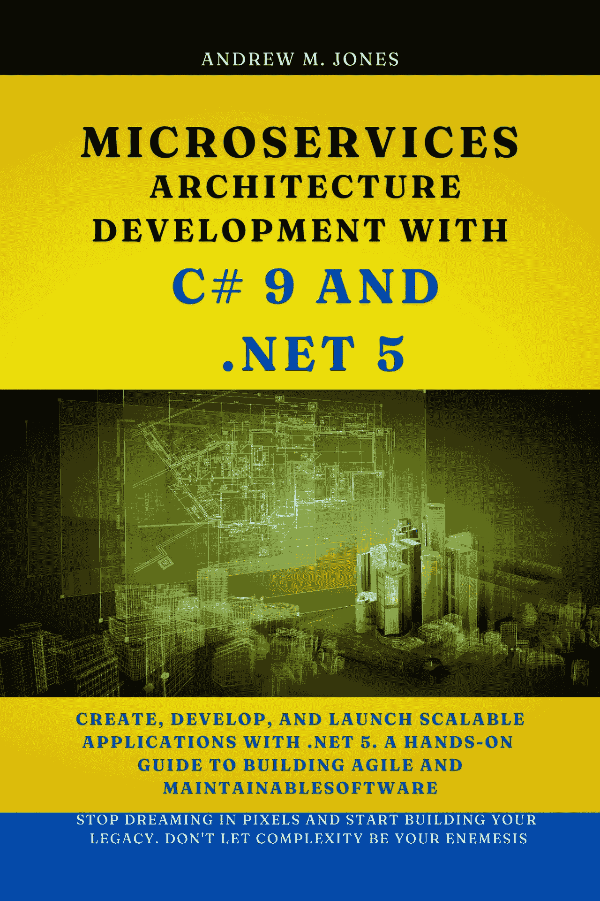

# C# 9 and .NET 5 微服务架构开发：使用 .NET 5 创建、开发并发布可扩展应用程序





版权声明：
版权所有 © 2024 由 Andrew M. Jones 所有。

本书受版权法保护。未经出版者书面许可，您不得复制、共享或分发本书的任何部分，但用于评论的短幅引用或其他非商业目的除外。

美国印刷


## 引言

使用 C# 9 和 .NET 5 开发微服务架构

软件领域正在发生剧变，这种变化源于对敏捷、可扩展性和韧性的不断追求。微服务架构已成为一种主流范式，使组织能够通过一组独立部署的服务来构建复杂的系统。本书是指导你利用 C# 9 和 .NET 5 的前沿能力掌握这一风格的全面指南。

无论你是希望提升微服务专业知识的资深开发者，还是渴望开启这一转型之旅的新手，本书都为你提供了构建和部署健壮、可扩展且可维护的微服务的知识和实践技能。通过清晰的解释、实践示例和深度探索，本书将引导你完成微服务开发的整个周期，从概念化到部署。你将学习如何有效地解构单体应用、设计弹性且松耦合的服务、实现高效的通信模式，并利用云原生技术来实现业务目标。

准备好利用 C# 9 和 .NET 5 的力量释放微服务架构的潜力，创建创新且高效的软件系统。

# 第 1 章

## 单体应用的挑战

单体应用的挑战

单体应用是一个包含所有功能的单一、不可分割的单元。在开始时它可能看起来很简单，但随着应用程序的增长，它会带来巨大的挑战。

复杂性和可维护性

随着单体应用的扩展，其代码库变得越来越复杂。这种错综复杂的依赖关系使得理解、修改和调试变成了一项艰巨的任务。


在这个简化的示例中，`OrderProcessor` 类与多个组件交互。随着应用程序的增长，依赖项的数量和 `ProcessOrder` 方法的复杂度将呈指数级增长。这种紧耦合使得在不影响应用程序其他部分的情况下难以隔离问题、引入新功能或重构代码。

## 部署挑战
部署单体应用通常是一个耗时且具有高风险的过程。任何更改，无论多微小，都需要重新构建和部署整个应用程序。这可能导致停机时间延长、错误率增加以及上市时间变慢。

## 可扩展性局限性
扩展单体应用可能具有挑战性。为了处理增加的负载，你通常需要扩展整个应用程序，即使某个特定组件正在经历高需求。这可能导致资源利用率低效和成本增加。

## 技术锁定
单体应用通常绑定到特定的技术栈。升级或替换组件可能是困难且耗时的。例如，将单体应用从 `.NET Framework` 迁移到 `.NET Core` 需要付出巨大的努力。

## 团队协作与生产力
随着代码库的增长，开发者独立工作变得越来越困难。一个开发者所做的更改可能会影响人的工作，导致冲突并降低生产力。此外，新团队成员通常需要陡峭的学习曲线才能理解整个代码库。

## 故障隔离
在单体应用中，一个组件中的错误可能会导致整个系统的崩溃。这种缺乏故障隔离使得难以从故障中恢复并维护系统的可靠性。

结论，虽然单体应用可能适用于小型简单的项目，但随着应用程序的增长，它们会迅速变得难以管理。与复杂、部署、可扩展性、技术锁定、团队协作和故障隔离相关的挑战凸显了对替代架构方法的需求，例如微服务。

通过理解这些局限性，你可以就何时以及如何过渡到微服务架构做出明智的。

## 微服务范式

与单体架构相比，微服务提供了一种去中心化的软件开发方法。微服务架构由独立部署的服务组成，每个服务负责一个特定的业务能力。这种模块化的结构带来了许多优势，但也引入了新的挑战和考虑。

## 微服务的核心原则
- **独立部署性**：每个微服务独立部署，允许快速迭代和部署，而不影响其他服务。
- **边界上下文**：微服务与特定的业务领域对齐，强制执行的边界并减少耦合。
- **分布式治理**：团队在技术选择和开发实践方面具有自主权，促进创新。
- **去中心化数据管理**：每个微服务拥有自己的数据，促进数据隔离和一致性。
- **基础设施自动化**：持续集成和部署 (CI/CD) 流水线对于高效的微服务管理至关重要。

## 微服务架构的优势
- **可扩展性**：微服务可以独立扩展，允许高效的资源利用。
- **韧性**：隔离的故障不太可能影响整个系统，增强整体可靠性。
- **技术异质性**：不同的团队可以根据其特定需求选择最佳工具。
- **敏捷性**：由于独立部署，开发周期和上市时间更短。
- **组织对齐**：微服务可以与组织结构对齐，提高团队自主性。

## 微服务架构的挑战
- **分布式系统复杂性**：管理分布式系统引入了网络延迟、容错和分布式事务等挑战。
- **运营开销增加**：部署、管理和监控多个服务需要额外的努力。
- **数据一致性**：在多个服务之间维护数据一致性可能是复杂的。
- **测试**：全面的测试策略对于确保整个系统的质量至关重要。
- **开发者技能**：团队需要具备分布式系统、云计算和 DevOps 的技能。

## 简单示例
为了说明这一概念，请考虑一个以单体形式构建的简化电子商务应用程序：

```csharp
public class OrderProcessor
{
    // ... (处理订单的代码，包括产品、客户和货运逻辑)
}
```

在微服务架构中，该应用程序将分解为多个单独的服务：
- **产品服务**：处理产品目录、库存、定价等。
- **客户服务**：管理客户信息、订单、地址等。
- **货运服务**：计算货运费用、生成货运标签等。
- **订单服务**：编排订单过程，与其他服务交互。

```csharp
// 订单服务
public class OrderService
{
    private HttpClient productClient;
    private HttpClient customerClient;
    private HttpClient shippingClient;

    public OrderService(HttpClient productClient, HttpClient customerClient, HttpClient shippingClient)
    {
        // ...
    }

    public async Task ProcessOrder(Order order)
    {
        // 调用产品服务检查可用性
        // 调用客户服务验证客户信息
        // 调用货运服务计算货运费用
        // ... (订单处理逻辑)
    }
}
```

此示例演示了微服务如何将单体应用分解为更小的、独立部署的服务，从而促进可扩展性、韧性和灵活性。

虽然微服务提供了显著优势，但它们并不是万能灵药。仔细考虑挑战和权衡对于成功实施至关重要。通过理解核心原则和优势，组织可以就采用微服务架构做出明智的决策。

在下一节中，我们将深入研究微服务的的设计，并应用领域驱动设计 (DDD) 原则。

# 微服务架构的优势

微服务架构相比单体系统提供了许多优势。通过将应用程序分解为更小的、独立部署的服务，组织可以实现更大的敏捷性、可扩展性和韧性。

## 改进的可扩展性
微服务最大的优势之一是能够独立扩展单个服务的能力。这种细粒度允许高效的资源分配和成本优化。例如，如果产品目录服务在促销活动期间流量激增，它可以进行水平扩展，而不影响应用程序的其他组件。

## 增强的韧性
微服务架构促进故障隔离。一个服务的故障不太可能导致整个系统的崩溃。例如，如果支付服务出现停机，应用程序的其他部分可以继续运行。这种韧性提高了系统的可用性和用户体验。

```csharp
// 使用 Polly 实现重试和断路器的韧性微服务示例
public async Task<PaymentResponse> ProcessPayment(PaymentRequest request)
{
    return await Policy
        .Handle<Exception>()
        .WaitAndRetryAsync(3, retryAttempt => TimeSpan.FromSeconds(Math.Pow(2, retryAttempt)))
        .ExecuteAsync(async () =>
        {
            // 调用支付服务
        });
}
```

## 更快的上市时间


微服务允许团队独立工作，加速开发和部署周期。特定服务的更改可以独立发布，而不会影响整个应用程序。这种灵活性允许组织快速响应市场需求和客户反馈。

## 技术异构性
微服务架构支持对不同的服务使用不同的技术。团队可以根据任务选择最合适的工具，从而提高生产力和创新能力。例如，实时消息服务可以使用 `Node.js` 和 `WebSocket` 实现，而数据处理服务则可能利用 `Python` 和 `Spark`。

## 改进组织对齐
微服务可以与组织结构保持对齐，培养自主性和所有权意识。团队可以专注于特定的业务能力，从而提高效率和工作满意度。

## 可测试性
由于微服务规模较小且边界明确，通常更容易测试。单元测试、集成测试和端到端测试可以集中于单个服务，降低测试复杂性并提高代码质量。

## 持续交付
微服务架构与持续交付实践高度契合。较小的独立服务可以更频繁地部署，降低部署失败的风险。

## 组织灵活性
微服务允许组织更轻松地适应变化的业务需求。可以添加新服务或修改现有服务，而不会影响整个系统。这种灵活性在当今快速变化的市场中至关重要。

微微提供了许多优势，但考虑潜在的挑战也很重要，例如操作复杂性的增加和分布式系统的管理。通过仔细规划和执行向微服务架构的迁移，组织可以受益并构建可扩展、弹性且适应良好的软件系统。

在下一节中，我们将探索从单体架构迁移到基于微服务的系统的挑战。

# 旅程概览：从单体到微服务

从单体架构迁移到基于微服务的系统是一项复杂的工程，需要仔细的规划和执行。本节提供了该转换涉及的关键步骤概述。

## 识别合适的微服务候选者
并非单体应用的所有组件都是微服务的理想候选者。专注于识别具有高复杂度或频繁变更的独立业务能力。这些领域通常是微服务分解的良好起点。

```csharp
// 带有潜在微服务候选者的单体应用示例

public class OrderProcessor
{
    // ... (复杂的订单处理逻辑)

    private ProductCatalog productCatalog;
    private CustomerService customerService;
    private ShippingService shippingService;
}
```

在这个示例中，`ProductCatalog`、`CustomerService` 和 `ShippingService` 可能会被提取为独立的微服务。

## 分解单体
将单体拆分为微服务涉及对领域边界和依赖关系的仔细考虑。使用领域驱动设计（DDD）来识别边界上下文和聚合边界。

```csharp
// 微服务接口示例

public interface IProductService
{
    Task<Product> GetProductByIdsync(int productId);
    Task<IEnumerable<Product>> GetProductsAsync();
}
```

## 设计微服务
一旦确定了微服务，就专注于设计它们的接口和数据模型。遵循 RESTful API 原则以实现有效的通信。

```csharp
// RESTful API 控制器示例

[ApiController]
[Route("api/[controller]")]
public class ProductsController : ControllerBase
{
    private readonly IProductService _productService;

    public ProductsController(IProductService productService)
    {
        _productService = productService;
    }

    [HttpGet("{id}")]
    public async Task<ActionResult<Product>> GetProduct(int id)
    {
        var product = await _productService.GetProductByIdsync(id);
        if (product == null)
        {
            return NotFound();
        }
        return product;
    }
}
```

## 数据管理策略
确定如何在各个微服务之间管理数据。选项包括每个服务一个数据库、共享数据库或事件溯源。考虑数据一致性要求和性能影响。

## 基础设施与部署
搭建支持微服务的基础设施，包括容器化、编排和 CI/CD 流线。考虑使用 `Docker` 和 `Kubernetes` 等平台进行高效管理。

## 逐步迁移
避免“大爆炸”式的一次到位。从一个较小的独立微服务开始，逐渐迁移其他组件。这种迭代方法可以最大限地降低风险，并允许学习和适应。

## 测试策略
开发全面的测试策略以确保微服务的质量。专注于单元测试、集成测试和端到端测试。考虑使用合约测试（contract testing）来验证服务之间的交互。

## 组织变更
调整组织结构以匹配微服务团队。赋予团队决策权并让他们拥有其负责的服务。

## 持续学习与适应
微服务架构是一个演进过程。持续评估微服务的有效性，并准备根据需要重构或合并服务。

## 挑战与考量
向微服务的迁移并非没有挑战。分布式数据管理、网络延迟和操作复杂性等问题需要仔细处理。

通过遵循这些步骤并考虑潜在的挑战，组织可以成功开启向微服务的之旅，并从这种架构风格中获益。

记住，迁移到微服务是一个渐进的过程。从小处开始，从经验中学习，并不断完善你的方法。

# 第 2 章

# C# 9: 增强你的微服务开发

C# 9 引入了一系列语言特征，显著提高了开发者的生产力和代码可读性。这些特征在开发微服务时特别有利，因为简洁且高效的代码在其中至关重要。

## Records：不可变数据结构
C# 9 的特色之一是 records，它提供了一种定义不可变数据结构的简洁方式。这对于在微服务中创建数据传输对象（DTOs）特别有用。

```csharp
public record Product(int Id, string Name, decimal Price);
```

通过使用 records，你消除了属性、构造函数等等性检查的模板代码。这提高了代码的可维护性并减少了可能出现的错误。

## 顶级语句
顶级语句允许你在不显式定义 `Main` 方法的情况下编写 C# 代码。虽然它们主要用于脚本，但也可以用于微服务中的简单入口点或测试场景。

```csharp
Console.WriteLine("来自顶级语句的问!");
```

## 模式匹配增强
C# 9 扩展了模式匹配功能，使代码更具表达力且简洁。你可以使用属性模式来解构对象，并使用 switch 表达式进行优雅的条件逻辑。

```csharp
public record Order(int Id, string CustomerName, List<OrderItem> Items);

public void ProcessOrder(Order order)
{
    switch (order)
    {
        case { Items.Count: 0 }:
            Console.WriteLine("空订单");
            break;
        case { Items.Count: var count } when count > 10:
            Console.WriteLine($"包含 {count} 个物品的大订单");
            break;
        default:
            Console.WriteLine($"普通订单");
            break;
    }
}
```

## 空合并赋值


空合并赋值运算符 (`??=`) 提供了一种在变量为 `null` 时向其赋值数值的简洁方法。这在处理可选参数或默认值时非常有用。

C#
```csharp
string? customerName = null;
customerName ??= "Default Customer";
```

### 目标类型 new (Target-Typed New)

目标类型 new 表达式简化了特定上下文下的对象创建。这在为方法参数或返回类型构造对象时非常有帮助。

C#
```csharp
var product = new Product(1, "Product A", 19.99);
```

## 性能提升

C# 9 包含了可以使微服务受益的性能改进，例如更快的泛型数学和改进的 P/Invoke 封送。虽然这些改进可能没有语言特性那样直观，但它们对应用程序的整体性能有所贡献。

### 在微服务中有效使用 C# 9

为了最大化 C# 9 在微服务中的优势，请考虑以下指南：

- 利用 `records` 编写 DTO：提高代码的可读性和可维护性。
- 使用顶层语句（top-level statements）编写简单的入口点：减少样板代码。
- 利用模式匹配（pattern matching）：编写更具表现力且简洁的代码。
- 利用 `空合并赋值`：简化赋值操作。
- 创建对象时考虑 `target-typed new`：提高代码可读性。
- 对应用程序进行性能分析：识别性能热点，并在适当的地方应用 C# 9 优化。

通过将这些 C# 9 特性整合到你的微服务开发中，你可以创建更具维护性、高效且高性能的应用程序。

请记住平衡新语言特性的优势与潜在的兼容性考虑。

# 用于精简服务设计的 Minimal APIs

## Minimal APIs：使用 C# 进行精简服务设计

Minimal APIs 在 ASP.NET Core 6 中引入，提供了一种轻量且高效的构建 Web API 的方法。Minimal APIs 是微服务的理想选择，它们专注于核心功能而消除了不必要的复杂性。

### 核心概念

Minimal APIs 构建于以下核心概念：

- 顶层语句（Top-Level Statements）：消除了对 `Program` 类的需求，允许编写简洁的入口点。
- 端点定义（Endpoint Definition）：直接使用 Lambda 表达式定义端点。
- 依赖注入（Dependency Injection）：与 `.NET` 依赖注入系统无缝集成。
- 中间件（Middleware）：支持用于跨切关注点的自定义中间件。

## 创建 Minimal API

```csharp
var builder = WebApplication.CreateBuilder(args);
var app = builder.Build();

app.MapGet("/products", () => {
    var products = new[] { new { Id = 1, Name = "Product A" }, new { Id = 2, Name = "Product B" } };
    return products;
});

app.Run();
```
这个简洁的示例演示了如何创建一个带有单个返回产品集合端点的 Minimal API。

## 依赖注入

Minimal APIs 与依赖注入无缝集成。要注入服务，请在 `builder` 实例中注册它们：

```csharp
var builder = WebApplication.CreateBuilder(args);
builder.Services.AddScoped<IProductService, ProductService>();

var app = builder.Build();

app.MapGet("/products", (IProductService productService) => {
    return productService.GetProducts();
});

app.Run();
```

## 中间件

Minimal APIs 支持用于处理身份验证、授权、日志和错误处理等跨切关注点的中间件：

```csharp
var builder = WebApplication.CreateBuilder(args);
var app = builder.Build();

app.Use(async (context, next) => {
    Console.WriteLine("Request incoming");
    await next(context);
    Console.WriteLine("Request handled");
});

app.MapGet("/", () => "Hello from Minimal API");

app.Run();
```

## 高级功能

Minimal APIs 支持构建健壮 API 的各种功能：

- 输入和输出格式：使用 `[FromBody]` 绑定请求体并使用 `[Produces]` 指定响应格式。
- 错误处理：使用 `app.UseExceptionHandler` 定义自定义错误处理器。
- OpenAPI 支持：为 API 文档生成 OpenAPI 文档。
- 身份验证与授权：与身份验证和授权机制集成。

## Minimal APIs 的优势

- 样板代码：与传统的 ASP.NET Core APIs 相比，所需的代码更少。
- 提高性能：专注于核心功能带来带来提升。
- 简化测试：更容易编写单元测试和集成测试。
- 微服务的理想选择：与微服务架构专注于小型、独立服务的关注点保持一致。

## 何时使用 Minimal APIs

Minimal APIs 非常适用于小型、专注于特定功能的 API 和微服务。对于具有广泛要求的复杂 API，请考虑传统的 ASP.NET Core MVC。

通过利用 Minimal APIs，你可以使用 C# 构建高效、可维护且高性能的微服务。

# 用于增强数据建模的 Records

## C# 9 中用于增强数据建模的 Records

C# 9 引入了 `records`，这是一种用于定义不可变数据结构的强大功能。这种对传统类的偏离为数据建模提供了许多优势，特别是在微服务的语境下。

## 理解 Records

`record` 是一种结合了 `class` 和 `struct` 特性的引用类型。它为声明属性、构造函数和等效成员提供了简洁的语法。Records 默认情况下是不可变的，促进了数据完整性并减少了潜在错误。

C#
```csharp
public record Product(int Id, string Name, decimal Price);
```
此简单的声明定义了一个具有三个属性（`Id`、`Name` 和 `Price`）的 `Product` record。编译器会自动生成构造函数、属性的访问器以及 `Equals`、`GetHashCode` 和 `ToString` 的实现。

### Records 用于数据建模的关键优势

- 不可变性：Records 固有是不可变的，防止了意外修改，增强了数据完整性和代码的可推导性。
- 简洁性：定义 records 的语法比传统类更简洁，减少了样板代码。
- 比较：编译器生成的 `Equals` 确保了基于属性的比较。
- 解构：记录可以通过模式匹配解构为各个部分，使代码更具可读性。

## 现实示例：订单处理

考虑一个订单处理系统。使用 records，我们可以这样建模 `Order` 和 `OrderItem`：

C#
```csharp
public record Order(int Id, DateTime OrderDate, List<OrderItem> Items);
public record OrderItem(int ProductId, int Quantity, decimal UnitPrice);
```
这些 records 清晰地定义了订单及其项目的结构。

### 高级 Record 特性

- With 表达式：可以使用 `with` 表达式根据现有记录创建新记录：
C#
```csharp
var updatedOrder = order with { OrderDate = DateTime.Now };
```
- 位置记录：对于简单的数据结构，可以省略属性名：
C#
```csharp
public record Customer(int Id, string Name, string Email);
```
- 部分记录（Partial Records）：定义一个基础记录然后创建变体：
```csharp
public partial record Product(int Id, string Name, decimal Price);
public partial record ProductWithDiscount(Product BaseProduct, decimal Discount)
{
    public decimal TotalPrice => BaseProduct.Price - Discount;
}
```

## 将 Records 集成到微服务

Records 在微服务之间通信的数据传输对象 (DTO) 中表现出色。它们的不可变性和简洁语法使其成为 API 交换数据的 ideal 选择。

C#
```csharp
// 返回 Product record 的 API 控制器
[HttpGet("{id}")]
public IActionResult GetProduct(int id)
{
    var product = _productService.GetProductById(id);
    return Ok(product);
}
```

## 注意事项与最佳实践

- 性能：虽然 records 有优势，但请考虑大型数据结构的性能影响。在这种情况下，传统的类可能更高效。


- **可变性 (Mutability)**：如果你需要可变数据，请考虑使用 `classes` 或探索可变记录模式（mutable record patterns）。
- **空引用 (Nullability)**：使用 `records` 时要注意空值，因为是引用类型。
- **领域建模**：使用 `records` 用于自然符合不可变概念的值对象和实体。

通过在你的 C# 9 项目中有效利用 `records`，你可以增强代码的可读性、维护性和数据完整性，从而构建更健壮、高效的微服务。

# 用于简洁性的顶层语句

## 顶层语句：简化 C# 开发

C# 9 引入的顶层语句（top-level statements）通过消除对 `Main` 方法的需求，提供了一种更简洁的 C# 代码写法。这对于小型脚本和简单的控制台应用程序特别有用，但在某些微服务场景中也很有益。

## 基础用法

要使用顶层语句，只需在文件顶部开始编写代码，而无需声明 `Main` 方法：

```csharp
Console.WriteLine("Hello, world!");
```

这段代码在执行时将产生预期的输出。

### 更复杂的示例

虽然顶层语句主要用于简单场景，但它们可以与其他语言特性结合以实现更复杂的逻辑：

```csharp
var numbers = new[] { 2, 4, 6, 8 };
var result = numbers.Sum();
Console.WriteLine(result);
```

此示例演示了顶层语句中的变量声明、数组初始化和方法调用。

## 局限性与考虑

- **单一入口点**：一个文件中只能有一个顶层语句。
- **依赖注入**：虽然可行，但在顶层语句中使用依赖注入需要额外的设置。
- **测试**：对顶层语句进行单元测试比测试传统的 `Main` 方法更复杂。
- **可维护性**：对于较大的应用程序，使用 `Main` 方法通常可以提高代码的组织性和可读性。

## 在微服务中的用例

虽然顶层语句可能不是构建复杂微服务的首选，但它们在特定场景下非常有价值：

- **小型工具服务**：对于功能有限的简单服务，顶层语句可以提供简洁的实现。
- **测试辅助**：使用顶层语句创建较小的辅助函数或脚本用于测试目的。
- **命令行工具**：为微服务管理或调试构建简单的命令行工具。

#### 示例：一个简单的健康检查微服务

```csharp
using Microsoft.AspNetCore.Mvc;

var builder = WebApplication.CreateBuilder(args);
var app = builder.Build();
app.MapGet("/healthcheck", () => new { Status = "Healthy" });
app.Run();
```

虽然这个示例使用了 `WebApplication`，但 `app` 变量中的顶层语句演示了如何在没有传统 `Program` 类的情况下创建一个最小的 API 端点。

## 最佳实践

- 审慎地使用顶层语句。它们最适合小型、集中的代码片段。
- 考虑简洁性与可维护性之间的权衡。
- 对于复杂的应用程序，坚持使用传统的 `Main` 方法。
- 将顶层语句与其他 C# 特性结合，以提高表现力。

## 结论

顶层语句提供了一种编写简洁 C# 代码的方便方法。虽然它们可能并不适用于所有场景，但它们是你开发工具箱中非常有用的工具。通过理解它们的优点和局限性，你可以有效地使用它们来提高代码的可读性和可维护性。

# 利用 C# 9 进行微服务开发

## 利用 C# 9 进行微服务开发

C# 9 引入了若干语言特性，可以显著增强微服务的开发。通过采用这些特性，开发者可以编写更简洁、更于维护且高效的代码。

### Records：不可变数据传输对象

Records 是在微服务中定义不可变数据传输对象（DTO）的完美选择。它们的不可变性确保了数据完整性并防止意外修改。

```csharp
public record Product(int Id, string Name, decimal Price);
```

这个简单的 record 定义了一个带有 `Id`、`name` 和 `price` 的产品。编译器会自动生成属性、构造函数和相等性成员。

### 用于 Minimal APIs 的顶层语句

虽然与微服务架构没有直接关系，但顶层语句可以结合 Minimal APIs 使用来创建简洁的微服务：

```csharp
var builder = WebApplication.CreateBuilder(args);
var app = builder.Build();
app.MapGet("/products", () =>
{
    var products = new[] { new Product(1, "Product A", 19.99), new Product(2, "Product B", 29.99) };
    return products;
});
app.Run();
```

这段代码定义了一个返回产品列表的简单微服务。

### 用于健壮逻辑的模式匹配

C# 9 的模式匹配能力可以编写更具表现力和更简洁的代码来处理不同的场景。

```csharp
public record Order(int Id, List<OrderItem> Items);
public record OrderItem(int ProductId, int Quantity);

public void ProcessOrder(Order order)
{
    switch (order)
    {
        case { Items.Count: 0 }:
            Console.WriteLine("Empty order");
            break;
        case { Items.Count: var count } when count > 10:
            Console.WriteLine($"Large order with {count} items");
            break;
        default:
            Console.WriteLine($"Normal order");
            break;
    }
}
```

此示例演示了如何根据物品数量使用模式匹配来处理不同的订单场景。

### 用于处理空值的空合并赋值

空合并赋值运算符（`??=`）可用于处理空值。

```csharp
string? customerName = null;
customerName ??= "Default Customer";
```

## 性能提升

不像语言特性那样直观，但 C# 9 包含了对微服务有益的性能改进。这些改进泛型数学和 P/Invoke。

## 在微服务中使用 C# 9 的最佳实践

- 明智选择特性：并非所有 C# 9 特性都适用于微服务。请考虑服务的具体需求。
- 优先考虑不可变性：尽可能使用 `records` 创建不可变结构。
- 编写整洁可维护的代码：即使语法简洁，也要关注代码的可读性和维护性。
- 考虑性能影响：虽然 C# 9 提供了性能改进，但请对您的应用程序进行分析以识别潜在瓶颈。
- 与其他最佳实践结合：将 C# 9 与领域驱动设计、CQRS 等微服务最佳实践结合使用。

通过有效利用 C# 9 特性，开发者可以构建更健壮、高效且易于维护的微服务。Records、模式匹配和其他语言增强的结合可以显著提高代码质量。


# 使用 .NET 5 构建微服务的构建组件

- **ASP.NET Core**: 构建 Web API 的基础。
- **依赖注入 (Dependency Injection)**: 有效管理依赖。
- **配置 (Configuration)**: 处理应用程序设置和环境变量。
- **日志 (Logging)**: 对于故障排除和监控至关重要。
- **错误处理 (Error Handling)**: 提供处理异常和返回信息响应的机制。

## 示例：简单的产品微服务

```csharp
using Microsoft.AspNetCore.Mvc;

var builder = WebApplication.CreateBuilder(args);

var app = builder.Build();

app.MapGet("/products", () =>
{
    var products = new[] { new { Id = 1, Name = "Product A" }, new { Id = 2, Name = "Product B" } };
    return products;
});

app.Run();
```

此最小 API 定义了一个返回产品列表的简单产品微服务。

## 微服务之间的通信

- **RESTful APIs**: 最常用的方法，使用 HTTP 方法（`GET`、`POST`、`PUT`、`DELETE`）进行增删改操作。
- **消息队列 (Message Queues)**: 用于异步通信和解解耦。
- **gRPC**: 用于高性能和高效的通信。

## 挑战与考虑

- **分布式系统的复杂性**: 管理分布式系统会带来网络延迟、容错和分布式事务等挑战。
- **数据一致性**: 在多个服务之间维护数据一致性可能是复杂的。
- **测试**: 综合测试策略对于确保整个系统的质量至关重要。
- **部署与编排**: 需要 `Docker` 和 `Kubernetes` 等工具进行有效管理。

## 最佳实践

- **从小开始**: 从单个微服务开始以积累经验。
- **领域驱动设计 (DDD)**: 使微服务与业务能力对齐。
- **API 网关**: 考虑使用 API 网关进行负载均衡、身份验证和安全。
- **断路器 (Circuit Breakers)**: 实现断路器以优雅地处理服务故障。
- **监控与日志**: 监控微服务的性能和错误。

通过遵循这些原则和最佳实践，你可以使用 `.NET 5` 构建健壮且可扩展的微服务。请要仔细评估应用程序的需求，并选择合适的设计模式和技术。

## 微服务的通信策略

微服务之间的有效通信对于微服务架构的成功至关重要。通信策略的选择取决于性能需求、数据一致性需求以及服务之间所需的耦合程度等因素。

## 同步通信

同步通信涉及服务之间直接的请求-响应交互。

### HTTP/REST
- 因其简单性和通用而被广泛采用。
- 适用于 CRUD 操作和无状态通信。
- 使用 `ASP.NET Core` 的示例：

```csharp
[HttpGet("{id}")]
public IActionResult GetProduct(int id)
{
    // 使用 HttpClient 调用另一个微服务
    var client = new HttpClient();
    var response = await client.GetAsync($"http://other-service/api/product/{id}");
    // ...
}
```

### gRPC
- 与 `HTTP` 相比，提供了更高的性能和效率。
- 适用于高频、低延迟的通信。
- 需要为客户端和服务器生成代码。

## 异步通信

异步通信涉及发送消息而不期望即时响应。

### 消息队列
- 解耦服务，提高可扩展性和可靠性。
- 适用于异步工作流和事件驱动架构。
- 热门选择包括 `RabbitMQ`、`Apache Kafka` 和 `Azure Service Bus`。

```csharp
// 生产者
var producer = new RabbitMqProducer();
producer.SendMessage("OrderCreated", new OrderCreatedMessage { OrderId = 123 });

// 消费者
var consumer = new RabbitMqConsumer();
consumer.Subscribe("OrderCreated", (message) =>
{
    // 处理订单
});
```

### 事件驱动架构
- 基于发布/订阅模式。
- 实现实时更新和可扩展的系统。
- 通常与消息队列配合使用。

## API 网关

- 作为微服务架构的单一入口点。
- 处理负载均衡、身份验证、授权和速率限制。
- 可以简化客户端交互。

```json
// API 网关配置示例
{
  "routes": [
    {
      "path": "/products/{id}",
      "upstream": "product-service"
    },
    {
      "path": "/orders",
      "upstream": "order-service"
    }
  ]
}
```

## 选择正确的策略

- **同步 vs 异步**: 考虑对即时响应、消息持久性和解耦的需求。
- **性能**: 评估延迟和吞吐量需求。
- **数据一致性**: 评估对强一致性或最终一致性的需求。
- **复杂性**: 权衡简单性与灵活性。

## 最佳实践

- **清晰契约**: 服务之间定义清晰的 API 和契约。
- **错误处理**: 实现健壮的错误处理机制。
- **断路器**: 防止服务故障。
- **速率限制**: 防止滥用和过载。
- **安全**: 实现身份验证、授权和加密。
- **监控与日志**: 监控通信模式和性能。

通过仔细考虑这些通信策略和最佳实践，你可以构建高效且具有韧性的微服务架构。

## 为松耦合和高内聚进行设计

松耦合和高内聚是构建健壮且可维护的微服务的的基本原则。松耦合最小化了服务之间的依赖关系，而高内聚则确保了每个服务都有清晰且集中的职责。

### 理解松耦合

松耦合意味着微服务应该是独立的，彼此之间的依赖降至最低。这促进了灵活性、可扩展性和韧性。

- **基于接口的通信**: 使用定义良好的接口或 API 在服务之间定义清晰的契约。
- **异步通信**: 利用消息队列或事件驱动架构来减少依赖。
- **避免紧耦合**: 最小化服务之间的共享数据结构和依赖。

## 实现高内聚

高内聚意味着微服务应该具有定义的职责，并专注于单一业务能力。

- **单一职责原则**: 每个微服务只有一个变化的原因。
- **领域驱动设计 (DDD)**: 将微服务与边界上下文对齐以确保内聚。
- **识别核心功能**: 清晰定义每个微服务的内核职责。

### 代码示例：基于接口的松耦合

```csharp
public interface IProductService
{
    Task<Product> GetProductById(int id);
}

public class ProductService : IProductService
{
    // 实现细节
}
```

通过接口，调用者只需要契约，而不需要 `ProductService` 的实现细节。

### 代码示例：基于单一职责的高内聚

```csharp
public class OrderService
{
    private readonly IProductService _productService;

    public OrderService(IProductService productService)
    {
        _productService = productService;
    }

    public async Task CreateOrder(Order order)
    {
        // 订单创建逻辑
        var product = await _productService.GetProductById(order.ProductId);
        // ...
    }
}
```

`OrderService` 专注于创建订单，并依赖 `IProductService` 获取产品信息，展示了高内聚。

## 松耦合和高内聚的益处

- **提高可维护性**: 服务的更改对其他服务的影响降最低。
- **增强可测试性**: 服务可以进行独立测试。
- **增加可扩展性**: 服务的独立扩展变得可能。
- **加速开发**: 团队可以独立地开发不同的服务。


- 降低风险：孤立的故障不太可能影响整个系统。

## 挑战与考虑

- 增加复杂性：管理多个服务可能会引入开销。
- 分布式系统复杂性：需要解决网络延迟和容错问题。
- 数据一致性：在服务之间维持数据一致性可能具有挑战性。

## 最佳实践

- 从小处开始：从几个核心微服务开始。
- 迭代开发：持续完善服务边界。
- 领域驱动设计：应用 `DDD` 原则进行有效的解耦。
- API 网关：考虑使用 API 网关来管理通信。
- 监控与日志：跟踪服务间的交互和性能。

通过努力应用松耦合和高内聚的原则，你可以创建出具有韧性、可扩展且易于维护的微服务。请记住，这些是指导性原则，最佳的设计将取决于应用程序的具体需求。

## 在微服务中实现领域驱动设计 (DDD)

在微服务中实现领域驱动设计 (DDD)

领域驱动设计（`DDD`）是一种专注于理解和建模问题领域的软件开发方法。当它应用于微服务时，`DDD` 有助于使架构与业务领域对齐，从而产生更具维护性、可扩展性和韧性的系统。

## DDD 核心概念

- 边界上下文 (Bounded Context)：定义特定领域的边界，在该边界内术语和模型具有一致的含义。
- 实体 (Entity)：代表一个随时间持续具有唯一身份的对象。
- 聚合 (Aggregate)：一组关联的对象，被视为一个单元进行数据更改。
- 值对象 (Value Object)：代表一个没有概念身份的不可变对象。
- 领域服务 (Domain Service)：包含不自然地属于实体或值对象中的领域逻辑。
- 存储库 (Repository)：管理领域对象的持久化。

## 将 DDD 与微服务对齐

- 边界上下文作为微服务：每个边界上下文都可以是一个独立的微服务。
- 共享内核 (Shared Kernel)：对于跨多个边界上下文使用的概念，创建一个共享库。
- 反腐败层 (Anti-Corruption Layer)：将技术实现细节与领域模型隔离。

## 代码示例：订单微服务

```csharp
public class Order : AggregateRoot
{
    public int Id { get; private set; }
    public DateTime OrderDate { get; private set; }
    public List<OrderItem> OrderItems { get; private set; } = new();
    // ... 其他属性和方法
}

public class OrderItem : ValueObject
{
    public int ProductId { get; }
    public int Quantity { get; }
    public decimal Price { get; }
    // ... 其他属性和方法
}
```

这段代码演示了代表订单微服务中订单及其条目的的实体和值对象。

## 挑战与考虑

- 通用语言 (Ubiquitous Language)：在开发者和领域专家之间维持共享语言可能是具有挑战性的。
- 上下文映射 (Context Mapping)：确定边界上下文之间的边界需要细致的分析。
- 数据一致性：确保微服务之间的一致可能是复杂的。
- 团队协作：领域专家与开发团队之间的有效协作至关重要。

## 最佳实践

- 从小处开始：从单个边界上下文开始并逐渐扩展。
- 迭代开发：`DDD` 是一个迭代过程，因此要准备好完善模型。
- 关注领域：优先理解业务领域，而非技术实现。
- 协作：促进领域专家与开发者之间的密切协作。
- 事件溯源 (Event Sourcing)：考虑对复杂的领域逻辑和审计性使用事件溯源。

## 结论

在微服务中使用 `DDD` 是构建复杂软件系统的强大方法。通过将架构与业务领域对齐，你可以创建更具维护性、可扩展性和适应性的系统。虽然这需要投入投入和知识，但长期收益是巨大的。

记住 `DDD` 是一个旅程，而非终点。持续学习和适应对于成功实施至关重要。

# 第 4 章

## .NET 5：你的微服务架构的基础

.NET 5：你的微服务架构的基础

.NET 5 是一个构建云原生应用的统一平台，为构建微服务架构提供了坚实的基础。它的性能、灵活性和广泛的生态系统使其成为开发可扩展和韧性系统的理想选择。

## 微服务的的核心组件

- ASP.NET Core：构建 Web API 的基石。其最小 API 特性为微服务提供了一种精简的方法。
- 依赖注入 (Dependency Injection)：有效管理依赖关系，促进松耦合。
- 配置 (Configuration)：处理应用程序设置和环境变量以实现灵活性。
- 日志 (Logging)：对于故障排除和监控至关重要。
- Entity Framework Core：为不同的数据库提供数据访问能力。

## 构建基础微服务

```csharp
var builder = WebApplication.CreateBuilder(args);
var app = builder.Build();

app.MapGet("/products", () =>
{
    var products = new[] { new { Id = 1, Name = "Product A" }, new { Id = 2, Name = "Product B" } };
    return products;
});

app.Run();
```

此最小 API 定义了一个简单的产品微服务，展示了 .NET 5 的简洁和高效。

## 微服务开发的关键特性

- 高性能：.NET 5 提供了显著的性能提升，这对于负载下的微服务至关重要。
- 云原生：与 Azure、AWS 和 Google Cloud 等云平台无缝集成。
- 容器化：对 Docker 和 Kubernetes 有强力支持，以便高效部署。
- gRPC：内置对高性能 RPC 支持。
- 韧性：断路器、重试策略和健康检查等功能有助于构建系统。

## 示例：使用依赖注入

```csharp
var builder = WebApplication.CreateBuilder(args);
builder.Services.AddScoped<IProductService, ProductService>();
var app = builder.Build();

app.MapGet("/products", (IProductService productService) =>
{
    return productService.GetProducts();
});

app.Run();
```

这演示了如何将 `ProductService` 注入到端点，促进松耦合。

## 挑战与考虑

- 分布式系统复杂性：管理分布式系统需要仔细考虑网络延迟、容性和数据一致性。
- 数据管理：选择正确的存储策略（例如关系型、NoSQL）至关重要。
- 测试：全面的测试对于确保质量和可靠性是必要的。
- 部署与编排：需要有效的部署管理策略。

## 最佳实践

- 从小处开始：从单个微服务开始积累经验。
- 领域驱动设计 (DDD)：将微服务与业务能力对齐。
- API 网关：考虑使用 API 网关进行负载均衡、认证和安全。
- 断路器：实现断路器以处理服务故障。
- 监控与日志：监控微服务的性能和错误。

.NET 5 为构建微服务提供了坚实的基础。通过利用其特性并遵循最佳实践，你可以创建可扩展、韧性且易于维护的系统。


- **Lambda 表达式**：路由定义和逻辑使用 lambda 表达式编写，促进了函数式风格。
- **依赖注入**：与 .NET 的依赖注入系统无缝集成，简化了服务管理。
- **中间件**：支持自定义中间件允许处理日志和错误处理等跨切关注点。

## Minimal APIs 用于微服务的优势

- **提升开发者体验**：简洁的语法带来了更快的开发速度和更易于理解。
- **减小代码量**：更少的代码意味着更小的微服务体积和更简单的维护。
- **专注于核心功能**：强调每个微服务的核心功能。
- **小型服务的理想选择**：非常适合复杂性和资源资源的服务的服务。

## 构建一个 Minimal API 微服务

```csharp
var builder = WebApplication.CreateBuilder(args);

var app = builder.Build();

app.MapGet("/products", () =>
{
  var products = new[] { new { Id = 1, Name = "Product A" }, new { Id = 2, Name = "Product B" } };
  return products;
});

app.Run();
```

这个简单的示例展示了一个返回产品列表的 Minimal API 端点。

## 微服务的进阶特性

- **输入和输出格式化**：使用 `[FromBody]` 绑定请求体，使用 `[Produces]` 指定响应格式（例如，JSON、XML）。
- **错误处理**：使用 `app.UseExceptionHandler` 定义自定义错误处理器。
- **OpenAPI 支持**：生成 OpenAPI 文档用于 API 文档和服务发现。
- **身份验证与授权**：集成身份验证和授权机制。

## 依赖注入示例

```csharp
var builder = WebApplication.CreateBuilder(args);

builder.Services.AddScoped<IProductService, ProductService>();

var app = builder.Build();

app.MapGet("/products", (IProductService productService) =>
{
  return productService.GetProducts();
});

app.Run();
```

此示例为端点注入了 `IProductService` 依赖以访问产品数据。

## 何时使用 Minimal APIs

Minimal APIs 非常适用于：

- **小型、集中的微服务**：当服务范围和功能有限时，优先考虑它们。
- **开发与原型设计**：受益于使用少量代码进行快速开发和实验。
- **概念验证 (POC)**：在没有大量样板代码的情况下快速实现并验证想法。

## 注意事项与最佳实践

- **复杂性**：对于复杂场景，考虑使用传统的控制器以获得更好的组织。
- **测试**：虽然仍然可以单元测试，但集成测试可能需要额外的规划。
- **可维护性**：对于较大的服务，有效地结构化代码以确保可读性。
- **与其他功能结合**：利用中间件和依赖注入等其他 ASP.NET Core 功能来构建健壮的 API。

## 结论

Minimal APIs 为在 .NET 中构建微服务提供了强大的工具。通过利用简洁代码和精简开发的优势，你可以创建高效且易于维护的服务。然而，根据微服务架构的复杂性和需求选择合适的方法至关重要。

# 用于实现松耦合和可测试性的依赖注入

依赖注入 (DI) 是一种软件设计模式，旨在促进松耦合和可测试性。它涉及将依赖传递到对象中，而不是让对象自己创建依赖。在 `.NET` 中，内置的依赖注入容器简化了这个过程。

### 理解松耦合

松耦合意味着系统的组件应该是独立的，并且彼此之间的依赖降至最低。DI 通过以下方式实现这一点：

- **组件解耦**：对象不再创建它们的依赖项，减少了相互连接。
- **促进代码复用**：组件可以在不同的上下文中配合不同的依赖复用。
- **提高可维护性**：一个组件的变化较少影响其他组件。

### 使用 DI 实现可测试性

DI 通过允许执行以下操作使测试更容易：

- **隔离代码单元**：专注于隔离测试特定的组件。
- **替换依赖项**：为依赖注入模拟（mock）或桩（stub）实现。
- **增加测试覆盖率**：编写更全面的测试。

### 代码示例：ASP.NET Core 中的依赖注入

```csharp
public interface IProductService
{
  IEnumerable<Product> GetProducts();
}

public class ProductService : IProductService
{
  public IEnumerable<Product> GetProducts()
  {
    // 获取产品的逻辑
    return new[] { new Product { Id = 1, Name = "Product A" }, new Product { Id = 2, Name = "Product B" } };
  }
}

public class ProductController : ControllerBase
{
  private readonly IProductService _productService;

  public ProductController(IProductService productService)
  {
    _productService = productService;
  }

  [HttpGet]
  public IActionResult GetProducts()
  {
    return Ok(_productService.GetProducts());
  }
}
```

在此示例中：

- `IProductService` 定义了获取产品的合约。
- `ProductService` 实现了该合约。
- `ProductController` 通过构造函数注入依赖 `IProductService`。

### 依赖注入的优势

- **改进代码组织**：组件之间清晰的关注点分离。
- **增强可测试性**：通过模拟依赖项更易编写单元测试。
- **促进代码复用**：组件可以在不同的上下文中复用。
- **简化维护**：更改被隔离在特定的组件中。

### 常见的依赖注入模式

- **构造函数注入**：通过构造函数传递依赖。
- **属性注入**：在对象创建后设置依赖项。
- **方法注入**：将依赖项作为方法参数传递（较少）。

### 依赖注入的最佳实践

- **优先使用构造函数注入**：这通常被认为是最优的方法。
- **避免模糊的依赖**：清晰定义依赖以防止混淆。
- **使用依赖注入容器**：对于复杂场景，考虑使用如 `Autofac` 或 `StructureMap` 等 DI 容器。
- **彻底测试**：编写单元测试以验证不同依赖下的正确行为。

## 结论

依赖注入是构建松耦合和可测试系统的强大技术。通过理解其核心原理并应用最佳实践，你可以显著提高代码的质量和可维护性。

## .NET 5 微服务中的配置管理

有效的配置管理对于构建灵活且适应良好的微服务至关重要。`.NET 5` 提供了强大的工具和机制来管理跨环境的配置设置。

### 理解微服务中的配置

在微服务架构中，配置数据可以包括：

- 连接字符串
- API 密钥
- 特性标记
- 日志级别
- 应用设置

有效管理这些设置对于以下方面至关重要：

- **特定环境配置**：适应不同的环境（开发、测试、生产）。
- **动态更新**：在不重新部署应用程序的情况下修改配置。
- **密钥管理**：保护敏感信息。

### .NET 5 配置选项

- **AppSettings.json**：存储应用程序设置的 JSON 文件。
- **环境变量**：用于动态配置值。
- **用户密钥**：在开发期间存储敏感信息。
- **配置提供程序**：自定义配置源（例如 `Azure Key Vault`、`Consul`）。

### 代码示例：使用 AppSettings.json

```csharp
var builder = WebApplication.CreateBuilder(args);

var configuration = builder.Configuration;

var connectionString = configuration.GetConnectionString("MyDatabase");

var apiKey = configuration.GetValue<string>("ApiKey");

// ... 使用 connectionString 和 apiKey
```


## 管理特定环境配置

.NET 5 允许你使用环境变量或配置提供程序根据环境来覆盖应用程序设置。

```csharp
var builder = WebApplication.CreateBuilder(args);

builder.Configuration.AddEnvironmentVariables();

// 像 ASPNETCORE_ENVIRONMENT 一样访问环境变量

var environment = builder.Environment.EnvironmentName;
```

## 微服务的配置

- **中心化配置**：对于共享的配置值，请考虑使用如 `Consul` 或 `Azure App Configuration` 等配置服务器。
- **分布式配置**：对于去中心化的配置，请在每个微服务中使用环境变量或应用程序设置。
- **密钥管理**：使用 `Azure Key Vault` 或其他安全存储来处理敏感信息。

## 配置管理最佳实践

- **使用强类型设置**：定义配置模型以获得更好的类型安全性。
- **组织配置文件**：按逻辑结构化组织配置文件。
- **利用环境变量**：用于无需重新部署即可更改的动态设置。
- **使用配置提供程序**：用于从外部源访问配置。
- **保护敏感信息**：安全地存储密钥。
- **配置版本控制**：跟踪配置更改以供审计和回滚。

## 示例：使用 Options 模式

```csharp
public class MySettings
{
    public string ConnectionString { get; set; }
    public string ApiKey { get; set; }
}

var builder = WebApplication.CreateBuilder(args);

builder.Configuration.Bind("MySettings", out MySettings settings);

// 使用 settings.ConnectionString 和 settings.ApiKey
```

## 结论

有效的配置管理对于构建弹性且适应性强的微服务至关重要。通过利用 .NET 5 提供的功能并遵循最佳实践，你可以高效且安全地管理配置。

# 第 5 章

## 为微服务通信设计 RESTful APIs

## 为微服务通信设计 RESTful APIs

RESTful APIs 是微服务之间通信的实事实标准。它们的无状态性、简单性和可扩展性使其非常适用于分布式系统。

## RESTful APIs 的核心原则

- **资源**：将数据表示为具有唯一标识符的资源。
- **无状态性**：每个请求都包含所有必要信息，不依赖服务器端状态。
- **统一接口**：使用标准的 HTTP 方法（`GET`、`POST`、`PUT`、`DELETE`）和状态码。
- **可缓存性**：允许缓存响应以优化性能。
- **分层系统**：支持负载均衡器或 API 网关等中间件。

## 为微服务设计 RESTful APIs

- **基于资源的路由**：使用清晰且一致的 URL 来表示资源（例如 `/products/{id}`）。
- **HTTP 方法**：遵循 HTTP 方法语义（`GET` 用于检索，`POST` 用于创建，`PUT` 用于更新，`DELETE` 用于删除）。
- **响应格式**：根据客户端需求选择合适的响应格式（`JSON`、`XML`）。
- **错误处理**：返回带有带有适当 HTTP 状态码的说明性错误响应。
- **版本控制**：考虑 API 版本控制策略（基于 URL、基于 Header、自定义）。
- **安全性**：实现身份验证和授权机制。

## 代码示例：一个产品微服务 API

```csharp
[ApiController]
[Route("api/[controller]")]
public class ProductsController : ControllerBase
{
    private readonly IProductService _productService;

    public ProductsController(IProductService productService)
    {
        _productService = productService;
    }

    [HttpGet("{id}")]
    public async Task<IActionResult> GetProduct(int id)
    {
        var product = await _productService.GetProductByIdsync(id);
        if (product == null)
        {
            return NotFound();
        }
        return Ok(product);
    }

    [HttpPost]
    public async Task<IActionResult> CreateProduct([FromBody] Product product)
    {
        await _productService.CreateProductAsync(product);
        return CreatedAtAction(nameof(GetProduct), new { id = product.Id }, product);
    }
    // ... 其他 endpoint
}
```

## RESTful APIs 的最佳实践

- **一致性**：保持一致的命名规范和响应结构。
- **超媒体**：考虑使用 `HATEOAS` 来提高发现性（可选）。
- **文档记录**：提供清晰的 API 文档。
- **性能**：优化 API 响应并考虑缓存。
- **安全性**：使用身份验证和授权保护 API。

## 挑战与考虑

- **过度获取**：避免返回不必要的数据。
- **获取不足**：确保客户端拥有足够的信息。
- **API 版本控制**：选择合适的版本控制策略。
- **错误处理**：提供说明性的错误消息。
- **性能优化**：平衡 API 响应速度与资源消耗。

## 结论

设计有效的 RESTful APIs 对于构建成功的微服务架构至关重要。通过遵循这些指南和最佳实践，你可以创建出易于消费、维护和演进 API。

## API 文档与版本控制策略

## API 文档与版本控制策略

清晰且全面的文档对于 API 消费者有效利用你的微服务至关重要。此外，对 API 进行版本控制允许在保持与现有客户端兼容的同时进行演进。

## API 文档

- **OpenAPI 规范 (OAS)**：使用 `OpenAPI` 以机器可读的格式定义 API 的结构、参数和响应。像 `Swagger UI` 等工具可以从此规范生成交互式文档。

```yaml
openapi: 3.0.0
info:
  title: My API
  version: "1.0.0"
paths:
  /products:
    get:
      summary: Gets a list of products
      responses:
        '200':
          description: A list of products
          content:
            application/json:
              schema:
                type: array
              items:
                $ref: '#/components/schemas/Product'
components:
  schemas:
    Product:
      type: object
      properties:
        id:
          type: integer
          format: int64
        name:
          type: string
        price:
          type: number
          format: double
```

- **文档工具**：利用 `Swagger UI`、`Postman` 或 `Apiary` 生成交互式文档。
- **代码注释**：在 API 中包含清晰的注释以说明 endpoint 和参数。
- **版本控制**：在文档中包含 API 版本信息。

## API 版本控制策略

- **URL 版本控制**：将版本信息添加到 API 端点（例如 `/api/v1/products`）。
- **Header 版本控制**：在请求头中包含版本（例如 `Accept: application/json; version=v1`）。
- **自定义 Header 版本控制**：使用自定义 header 进行版本控制。
- **内容协商**：使用 `Accept` header 来协商不同的 API 版本。

```csharp
[HttpGet("{version:apiVersion}/products")]
public IActionResult GetProducts(string version)
{
    // ...
}
```

## API 文档与版本控制最佳实践

- **一致性**：保持一致的文档风格和格式。
- **清晰性**：对 endpoint、参数和响应提供清晰简洁的解释。
- **示例**：包含代码示例以演示 API 使用。
- **错误处理**：记录潜在的错误响应及其含义。
- **版本策略**：明确定义你的版本控制策略并告知客户端。
- **弃用**：为弃用旧 API 版本制定计划并提供迁移指南。
- **文档更新**：保持文档随 API 更改更新。

## 挑战与考虑

- **文档维护**：确保文档更新是一项挑战。
- **版本复杂性**：管理多个 API 版本会增加复杂性。
- **兼容性**：考虑 API 更改对现有客户端的影响。
- **文档工具**：选择合适的文档工具可能会让人无所适从。

## 结论


API 文档和版本控制是微服务成功的关键。通过遵循这些指南并利用可用工具，你可以创建出文档齐全且易于维护的 API，以满足客户的需求。

## API 网关：微服务的门面

API 网关充当客户端应用程序访问系统后端服务和功能的单一入口点。在微服务架构中，它充当门面的角色，抽象了与多个微服务交互的复杂性。

## API 网关的核心职责

- **请求路由**：根据端点、标头或查询参数将传入的请求定向到相应的微服务。
- **负载均衡**：将流量分布到微服务的多个实例上。
- **身份验证与授权**：处理用户身份验证和授权，执行访问控制。
- **缓存**：通过缓存频繁访问的数据来提高性能。
- **限流**：防止滥用并保护微服务免于负载。
- **API 聚合**：聚合多个微服务的数据以创建统一的响应。

## 代码示例：使用 Ocelot 的基础 API 网关

```csharp
public class Program
{
    public static void Main(string[] args)
    {
        var builder = WebApplication.CreateBuilder(args);
        builder.Services.AddOcelot();  
        var app = builder.Build();
        app.UseOcelot();
        app.Run();
    }
}

// ocelot.json 配置文件
{
  "GlobalConfiguration": {
    "BaseUrl": "http://localhost:5000"
  },
  "DownstreamHttpAdapters": {
    "ProductApi": {
      "BaseAddress": "http://localhost:5001"
    },
    "OrderService": {
      "BaseAddress": "http://localhost:5002"
    }
  },
  "Routes": [
    {
      "DownstreamPathTemplate": "/api/products/{id}",
      "UpstreamPathTemplate": "/products/{id}",
      "DownstreamServiceKey": "ProductApi"
    }
    // ... other 路由
  ]
}
```

`Ocelot` 是一个用于 `.NET` 的流行开源 API 网关。配置文件定义了路由、上游服务和其他设置。

## 使用 API 网关的优势

- **简化客户端交互**：为客户端提供单一端点，降低复杂性。
- **提高性能**：缓存和负载均衡可以增强性能。
- **增强安全性**：集中的身份验证和授权。
- **API 聚合**：通过组合多个微服务创建自定义 API 端点。
- **容错性**：实现断路器和重试逻辑。

## 挑战与考虑

- **增加复杂性**：在架构中增加了另一个组件。
- **性能开销**：API 网关可能会引入延迟。
- **单点故障**：API 网关可能成为瓶颈。
- **开发与维护**：需要额外的开发和管理工作。

## API 网关的最佳实践

- **选择合适的 API 网关**：根据功能、性能和扩展性评估选项。
- **从小处开始**：从基础路由开始，逐渐添加功能。
- **安全性**：实现稳健的身份验证和授权。
- **监控**：监控 API 网关的性能和使用情况。
- **故障转移与韧性**：实现容错机制。

通过有效利用 API 网关，你可以增强微服务的整体架构，提高性能并简化客户端交互。

# 第 6 章：通信协议：微服务的语言

微服务之间的有效通信对于微服务架构的整体成功至关重要。协议的选择取决于几个因素，性能性能需求、数据一致性以及服务之间所需的耦合程度。

## 同步通信协议

- **HTTP/REST**：最常用的协议，简单简单且被广泛采用。适用于 CRUD 操作和无状态通信。

```csharp
[HttpGet("{id}")]
public IActionResult GetProduct(int id)
{
    // 使用 HttpClient 调用另一个微服务
    var client = new HttpClient();
    var response = await client.GetAsync($"http://other-service/api/product/{id}");
    // ...
}
```

- **gRPC**：提供高性能和高效率，通常用于微服务生态系统内部的通信。

```csharp
public class ProductService : ProductServiceBase
{
    public override async Task<ProductReply> GetProduct(ProductRequest request, ServerCallContext context)
    {
        // ...
        return new ProductReply { Id = product.Id, Name = product.Name };
    }
}
```

## 异步通信协议

- **消息队列**：解耦服务，实现可靠且可扩展的通信。
- **事件驱动架构**：发布事件并允许感兴趣的服务订阅。

```csharp
// 生产者
var producer = new RabbitMqProducer();
producer.SendMessage("OrderCreated", new OrderCreatedMessage { OrderId = 123 });

// 消费者
var consumer = new RabbitMqConsumer();
consumer.Subscribe("OrderCreated", (message) =>
{
    // 处理订单
});
```

## 选择合适的协议

- **性能**：`gRPC` 的性能通常比 `HTTP/REST` 高。
- **数据一致性**：像 `HTTP/REST` 的同步协议提供了更强的一致性保证。
- **耦合**：消息队列等异步协议促进更松的耦合。
- **复杂度**：与 `HTTP/REST` 相比，`gRPC` 需要更多的配置。

### 混合方法

- **API 网关**：可以作为门面，将请求路由到微服务并提供额外功能。
- **WebSocket**：用于实时双向通信。

## 最佳实践

- **清晰的契约**：为通信定义清晰的接口或契约。
- **错误处理**：实现稳健的错误处理机制。
- **安全性**：采取适当措施保护通信通道。
- **监控**：监控通信模式和性能。
- **协议无关**：设计微服务以适应不同的协议。

## 结论

通信协议的选择会影响微服务系统的架构和行为。仔细评估每个微服务的需求，并选择与其最契合的协议。通常，使用协议组合来实现最佳效果。

## 根据需求选择合适的通信协议

为微服务选择合适的通信协议是一项关键决策，影响性能、扩展性和整个系统架构。本指南概述了在做出此选择时需要考虑的关键因素。

## 理解通信需求

在选择协议之前，清晰地定义你的微服务的通信需求：

- **数据量和传输率**：海量数据传输可能倾向于 `gRPC` 或消息队列等协议。
- **数据一致性**：对于强一致性，同步协议 `HTTP/REST` 可能适用。
- **消息顺序**：如果消息顺序至关重要，请考虑消息队列等协议。
- **可靠性**：评估对保证消息投递的需求。
- **延迟**：低延迟需求可能倾向于 `gRPC` 或内存数据网格。
- **扩展性**：考虑协议处理不断增加负载的能力。
- **复杂度**：评估实现和管理该协议涉及的复杂度。

## 协议对比

| 协议 | 使用场景 | 优点 | 缺点 |
| :--- | :--- | :--- | :--- |
| HTTP/REST | CRUD 操作，无状态通信 | 简单，广泛采用 | 性能较低，频繁交互 |
| gRPC | 高性能、低延迟、双向流 | 高效，强类型 | 配置较复杂，特定语言相关 |
| 消息队列 (RabbitMQ, Kafka) | 异步通信，解耦 | 可扩展性，可靠性 | 增加复杂性，可能丢失数据 |
| WebSocket | 实时双向通信 | 低延迟，推送更新 | 实现复杂，有状态 |


## 代码示例：比较 HTTP/REST 和 gRPC

### HTTP/REST
```csharp
[HttpGet("{id}")]
public async Task<IActionResult> GetProduct(int id)
{
    var client = new HttpClient();
    var response = await client.GetAsync($"http://other-service/api/product/{id}");
    // ...
}
```

### gRPC
```csharp
public override async Task<ProductReply> GetProduct(ProductRequest request, ServerCallContext context)
{
    // ...
    return new ProductReply { Id = product.Id, Name = product.Name };
}
```

### 混合方法
在某些情况下，组合协议可能是最优的：
- **API 网关**：作为门面，使用适当协议将请求路由到不同的微服务。
- **协议适配器**：在不同协议之间翻译消息。

## 最佳实践
- **从简单开始**：对于大多数用例，从 `HTTP/REST` 开始，根据需要考虑其他协议。
- **性能测试**：衡量性能以为协议选择提供依据。
- **安全性**：为每个协议实现适当的安全措施。
- **监控**：监控通信模式和性能指标。
- **灵活性**：设计微服务以适应不同的协议。

## 结论
选择正确的通信协议对于构建高效且可扩展的微服务至关重要。通过仔细考虑应用的特定需求，你可以做出明智的并优化服务之间的通信。

## 使用 Mass Transit 实现异步通信

使用 Mass Transit 实现异步通信

Mass Transit 是一个强大的 `.NET` 库，简化了异步消息系统的构建。它为诸如 `RabbitMQ`、`Kafka` 和 `Azure Service Bus` 等各种消息代理提供了统一的抽象。

### 理解异步通信
异步通信涉及发送消息而不期望即时响应。这种解耦提高了系统的可扩展性、健健性和性能。

### Mass Transit 核心概念
- **发布/订阅 (Publish/Subscribe)**：向主题发送消息并让多个订阅者消费这些消息。
- **请求/响应 (Request/Response)**：发送请求并异步等待响应。
- **Saga 模式**：跨多个服务的长时间运行业务过程。
- **发箱模式 (Outbox Pattern)**：通过在发送之前将出站消息存储在数据库中来确保数据一致性。

### 消息发布与消费
```csharp
using MassTransit;
var builder = WebApplication.CreateBuilder(args);
builder.Services.AddMassTransit(x =>
{
    x.UsingRabbitMq((context, cfg) =>
    {
        cfg.Host("rabbitmq://localhost");
        cfg.ConfigureEndpoints(context);
    });
});
var app = builder.Build();
// 生产者
var publishEndpoint = app.Services.GetRequiredService<ISendEndpointProvider>();
await publishEndpoint.Send<OrderCreated>(new { OrderId = 123 });

// 消费者
app.MapGet("/orders/{id}", async (int id, IPublishEndpoint publishEndpoint) =>
{
    // ... 处理订单
    await publishEndpoint.Publish<OrderShipped>(new { OrderId = id });
});
app.Run();
```

### 请求/响应模式
Mass Transit 使用 `RequestClient` 接口支持请求/响应模式：
```csharp
var requestClient = app.Services.GetRequiredService<IRequestClient<OrderRequest>>();
var response = await requestClient.Request(new OrderRequest { OrderId = 123 });
```

### Saga 模式
Mass Transit 提供了实现 Saga 的工具：
```csharp
public class OrderSaga : SagaStateMachineInstance
{
    public State CurrentState { get; set; }
    public Guid CorrelationId { get; set; }
    // ... 状态机定义
}
```

### 发箱模式
虽然 Mass Transit 没有提供内置的发箱模式，但你可以使用数据库和消息队列来实现它：
```csharp
public class OutboxMessage
{
    public Guid Id { get; set; }
    public string Message { get; set; }
    // ... 其他属性
}
```

### 使用 Mass Transit 的最佳实践
- **清晰的消息契约**：定义清晰的消息方案以便更好的通信。
- **错误处理**：实现重试机制和死信队列。
- **性能优化**：优化消息序列化和网络通信。
- **监控**：监控消息流和性能指标。
- **安全性**：使用适当的安全措施保护消息队列。

## 结论
Mass Transit 通过提供与各种消息代理交互的统一 API，简化了微服务中的异步通信。通过理解其核心概念并遵循最佳实践，你可以构建健壮且可扩展的系统。

# 第 7 章

# Docker 容器简介及其对微服务的优势

Docker 容器简介及其对微服务的优势

Docker 是一个用于在容器中开发、交付和运行应用程序的平台。容器是一个标准的软件单元，封装了代码及其所有的依赖项，使得应用程序能够从一个计算环境快速可靠地运行到另一个。

### 理解容器
容器本质上是一个轻量级、独立的、可执行的软件包，包含了运行应用程序所需的所有内容：代码、运行时、系统工具、系统库和设置。

### Docker 的主要优势
- **隔离性**：每个容器都在隔离环境中运行，防止应用程序之间的冲突。
- **可移植性**：容器可以在不同的环境（开发、测试、生产）中一致地运行。
- **效率**：容器共享宿主机操作系统内核，与虚拟机相比减少了开销。
- **可扩展性**：通过添加或删除容器来轻松扩展应用程序。
- **快速部署**：容器即可启动，实现更快的开发和部署周期。

### Dockerfile 基础
Dockerfile 是一个文本文件，包含用户可以在命令行上调用的所有构建镜像的命令。

```dockerfile
FROM mcr.microsoft.com/dotnet/aspnet:6.0 AS base
WORKDIR /app
EXPOSE 80

FROM mcr.microsoft.com/dotnet/sdk:6.0 AS build
WORKDIR /src
COPY ["MyApplication/MyApplication.csproj", "MyApplication/"]
RUN dotnet restore "MyApplication/MyApplication.csproj"
COPY . .
WORKDIR "/MyApplication"
RUN dotnet build "MyApplication.csproj" -c Release -o /app

FROM base AS publish
WORKDIR /app
COPY --from=build /app .
ENTRYPOINT ["dotnet", "MyApplication.dll"]
```（等待，根据上下文纠正了入口点）

### Docker 与微服务
由于其封装和隔离的能力，Docker 天别适合微服务架构。
- **独立部署**：每个微服务都可以封装成一个独立的 Docker 容器。
- **可扩展性**：根据需求轻松扩展单个微服务。
- **隔离性**：防止微服务之间相互干扰。
- **一致的环境**：确保在不同环境中的行为一致。
- **快速部署**：快速部署和更新微服务。

### 示例：将简单的微服务容器化
```bash
docker build -t my-product-service .
docker run -p 5000:80 my-product-service
```
此命令根据 `Dockerfile` 构建 Docker 镜像并运行它，将宿主机的端口 `5000` 映射到容器的 `80`。

## 挑战与考虑
- **镜像大小**：较大的镜像会影响部署时间和资源消耗。
- **安全性**：适当的安全措施对于保护容器至关重要。
- **编排**：管理多个容器需要 Docker Compose 或 Kubernetes 等工具。
- **网络**：配置容器网络用于服务之间的通信。

## 结论
Docker 为构建和部署微服务提供了强大的基础。通过理解其核心概念和优势，你可以利用容器创建高效、可扩展且健壮的微服务架构。

理解 Docker 镜像层


Docker 镜像是分层构建的。每个 `RUN`、`COPY` 或 `ADD` 指令都会创建一个新层。减少层数可以优化构建时间并缩小镜像大小。

# Docker 镜像创建的最佳实践

- **基础镜像选择**：选择最小化基础镜像以减小镜像大小。
- **层优化**：高效安排 `COPY` 和 `RUN` 指令的顺序以最大限度地减少层数。
- **多阶段构建**：为不同的构建步骤使用多个阶段，减小最终镜像的大小。
- **缓存**：利用 Docker 的构建缓存来加速重新构建。
- **镜像大小优化**：使用压缩工具减小文件大小。

## Dockerfile 示例

```docker
# 使用最小化基础镜像
FROM mcr.microsoft.com/dotnet/aspnet:6.0-alpine AS base
WORKDIR /app

# 拷贝必要文件
COPY ["MyApplication.dll", "./"]

## 暴露端口
EXPOSE 80

# 入点
ENTRYPOINT ["dotnet", "MyApplication.dll"]
```

## 构建 Docker 镜像

```bash
docker build -t my-image .
```
该命令从当前目录构建一个名为 `my-image` 的 Docker 镜像。

## 将 Docker 镜像推送到仓库

为了共享 Docker 镜像，你需要将它们推送到仓库中。Docker Hub 是一个流行的公共仓库，但你也可以使用私有仓库。

```bash
docker push my-image
```
该命令将 `my-image` 推送到默认的 Docker 仓库（Docker Hub）。

# Docker 镜像优化技术

- **多阶段构建**：创建独立的构建和运行阶段以减小最终镜像的大小。
- **层缓存**：利用 Docker 的构建缓存来加速构建。
- **镜像最小化**：使用 `docker image prune` 等工具移除未使用的镜像。
- **基础镜像选择**：选择仅包含必要包的基础镜像。
- **文件压缩**：在将大文件添加到镜像之前对其进行压缩。

## 示例：多阶段构建

```dockerfile
FROM mcr.microsoft.com/dotnet/sdk:6.0 AS build
WORKDIR /app
COPY . .
RUN dotnet restore "MyApplication.csproj"
RUN dotnet build -c Release -o /app/build

FROM mcr.microsoft.com/dotnet/aspnet:6.0-alpine AS runtime
WORKDIR /app
COPY --from=build /app/build .
ENTRYPOINT ["dotnet", "MyApplication.dll"]
```

## 结论
构建优化的 Docker 镜像对于微服务的有效部署至关重要。通过遵循最佳实践并利用 Docker 的特性，你可以创建更小、更快且更安全的镜像。

# 使用 Docker Compose 进行容器编排

Docker Compose 是一个定义和运行多容器 Docker 应用程序强大工具。它使用 `YAML` 文件来配置应用程序所需的服务、网络和卷。

## 理解 Docker Compose

Docker Compose 文件通常包含以下部分：
- **services**：定义要运行的容器。
- **networks**：定义容器间通信的网络。
- **volumes**：定义用于持久存储的数据卷。

##  Docker Compose 示例

```yaml
version: '3.7'
services:
  web:
    build: .
    ports:
      - "5000:80"
  db:
    image: postgres
    environment:
      POSTGRES_PASSWORD: mysecretpassword
```
此示例定义了两个服务：
- **web**：从当前目录下的 `Dockerfile` 构建，在端口 5000 上暴露。
- **db**：使用预构建的 `Postgres` 镜像，并带有密码环境变量。

## 运行 Docker Compose 应用程序

```bash
docker-compose up -d
```
该命令以后台模式启动 `docker-compose.yml` 文件中定义的所有服务。

## Docker Compose 特性

- **环境变量**：为服务定义环境变量。
- **卷**：创建持久化卷。
- **网络**：为容器通信创建自定义网络。
- **Depends On**：指定服务之间的依赖关系。
- **命令覆盖**：覆盖服务的默认命令。

## 高级 Docker Compose 使用

```yaml
version: '3.7'
services:
  web:
    build: .
    ports:
      - "5000:80"
    depends_on:
      - db
    environment:
      CONNECTION_STRING: "postgres://postgres:mysecretpassword@db:5432/mydatabase"
  db:
    image: postgres
    environment:
      POSTGRES_PASSWORD: my secret password
    volumes:
      - db_data:/var/lib/postgresql/data
volumes:
  db_data:
```
此示例演示了：
- `web` 和 `db` 服务之间的依赖关系。
- 数据库连接字符串的环境变量。
- 数据库数据的持久化存储。

## Docker Compose 的优势

- **简化开发**：通过管理多个容器来简化开发流程。
- **一致的环境**：确保开发、测试和生产环境中环境的一致性。
- **快速部署**：快速部署和扩展应用程序。
- **改进协作**：通过定义整个应用程序堆栈来促进团队协作。

## Docker Compose 的局限性

- 主要用于开发和测试环境。
- 不适用于大规模的生产环境部署。
- 与 `Kubernetes` 相比，其编排功能有限。

## 结论
Docker Compose 是开发和测试微服务的不可或缺的工具。它简化了容器管理并提供了一致的环境。

# 第 8 章：使用 Kubernetes 进行大规模微服务编排

Kubernetes（通常缩写为 `K8s`）是一个强大的开源平台，旨在自动化容器化应用程序的部署、扩展和管理。

## 理解 Kubernetes 核心概念

在深入学习编排过程之前，掌握以下 Kubernetes 核心概念至关重要：
- **Pod**：Kubernetes 中最小的部署单元，由一个或多个容器组成。
- **Deployment**：管理一组相同的 Pod 并确保运行所需的副本数量。
- **Service**：将一组 Pod 暴露为网络服务。
- **Ingress**：为服务提供访问。

## 构建并推送 Docker 镜像

1. 创建 `Dockerfile`：定义你微服务的构建步骤。
2. 构建镜像：使用 `docker build -t <image-name> .` 构建镜像。
3. 推送镜像：使用 `docker push <image-name>` 将镜像推送到仓库（如 Docker Hub）。

## 创建 Kubernetes 资源

1. **定义 Deployment**：创建 YAML 文件来指定副本数量、镜像名称和其他配置选项。
2. **定义 Service**：创建 YAML 文件来将 Deployment 暴露为网络服务。
3. **创建 Ingress（可选）**：如果需要外部访问，创建一个 Ingress 资源来路由流量。

## Deployment YAML 示例

```yaml
apiVersion: apps/v1
kind: Deployment
metadata:
  name: my-app-deployment
spec:
  replicas: 3
  selector:
    matchLabels:
      app: my-app
  template:
    metadata:
      labels:
        app: my-app
    spec:
      containers:
      - name: my-app
        image: my-image:latest
        ports:
        - containerPort: 80
```

## 应用 Kubernetes 资源

1. 创建 Kubernetes 集群：使用云提供商或本地 Kubernetes 环境。
2. 应用 YAML 文件：使用 `kubectl apply -f <filename>.yaml` 创建资源。

## 扩展微服务

Kubernetes 简化了微服务的扩展。
1. 更新 Deployment：修改 Deployment YAML 中的 `replicas` 。
2. 应用更改：使用 `kubectl apply -f <filename>.yaml` 更新 Deployment。

## 管理微服务

- **滚动更新**：Kubernetes 可以执行滚动更新以减少停机时间。
- **服务发现**：Kubernetes 提供内置的服务发现，供微服务相互查找。
- **负载均衡**：自动将流量分到微服务的多个实例上。
- **健康检查**：监控微服务的健康状况并重启不健康的实例。

## 其他注意事项

- **配置管理**：使用 `ConfigMaps` 或 `Secrets` 管理配置数据。


# Kubernetes 及其核心组件介绍

Kubernetes，通常缩名为 `K8s`，是一个旨在自动化容器化应用程序部署、扩展和管理的开源平台。它已成为分布式环境中编排复杂应用程序的事实标准。

## Kubernetes 核心概念

- `Cluster`（集群）：一组共同工作以运行容器化应用的机器（节点）。
- `Node`（节点）：集群中的工作机器，用于运行容器化应用。
- `Pod`：Kubernetes 中最小的部署单元。它代表一组始终共同在同一位置并共享资源的容器。
- `Deployment`（部署）：管理一组相同的 `Pods` 并确保运行了预期数量的副本。
- `Service`（服务）：将一组 `Pods` 暴露为网络服务。
- `ReplicaSet`（副本集）：管理 `Deployment` 的副本数量。
- `Label`（标签）：附加到对象上的、用于选择和组织对象的键值对。
- `Selector`（选择器）：用于选择对象的标签集。

## Kubernetes 架构

Kubernetes 采用主从节点架构运行：

- `Master Node`（主节点）：控制集群并管理工作节点。
- `Worker Nodes`（工作节点）：运行容器化应用。

## 示例：创建 Kubernetes 集群

要创建 Kubernetes 集群，可以使用以下工具：

- `Minikube`：用于本地开发和测试。
- `Kubeadm`：用于构建自己的 Kubernetes 集群。
- 云端托管 Kubernetes 服务：由主流云提供商提供（`GKE`、`AKS`、`EKS`）。

有了集群，你可以使用 Kubernetes 资源开始部署应用程序。

# 在 Kubernetes 上部署和管理微服务

Kubernetes (`K8s`) 是一个编排微服务的强大平台。它实现了部署、扩展和管理的自动化，让你能够专注于构建应用程序。

## 微服务的容器化

第一步是使用 `Docker` 将每个微服务容器化。为每个服务构建 `Docker` 镜像并将其推送到容器仓库。

```bash
docker build -t my-product-service .
docker push my-product-service
```

## 创建 Kubernetes 资源

### `Deployment`：定义应用程序的期望状态。

```yaml
apiVersion: apps/v1
kind: Deployment
metadata:
  name: product-service
spec:
  replicas: 3
  selector:
    matchLabels:
      app: product-service
  template:
    metadata:
      labels:
        app: product-service
    spec:
      containers:
        - name: product-service
          image: my-product-service:latest
          ports:
            - containerPort: 80
```

### `Service`：将一组 `Pods` 暴露为网络服务。

```yaml
apiVersion: v1
kind: Service
metadata:
  name: product-service
spec:
  selector:
    app: product-service
  ports:
    - protocol: TCP
      port: 80
      targetPort: 80
```

## 应用 Kubernetes 资源

```bash
kubectl apply -f deployment.yaml
kubectl apply -f service.yaml
```

## 扩展微服务

Kubernetes 简化了扩展：

```bash
kubectl scale deployment/product-service --replicas=5
```

## 管理微服务

- `Rolling Updates`（滚动更新）：Kubernetes 处理滚动更新以尽量减少停机时间。
- `Service Discovery`（服务发现）：Kubernetes 通过 DNS 提供服务发现。
- `Load Balancing`（负载均衡）：将流量分发到多个实例。
- `Health Checks`（健康检查）：监控 `Pods` 的健康状况并重启不健康的 Pod。

## 额外考虑

- `Configuration Management`（配置管理）：使用 `ConfigMaps` 或 `Secrets` 进行配置。
- `Persistent Storage`（持久化存储）：使用 `PersistentVolumes` 和 `PersistentVolumeClaims` 进行数据持久化。
- `Networking`（网络）：配置微服务之间通信的网络策略。
- `Monitoring and Logging`（监控与日志）：集成监控和日志工具以实现可观测性。

## 示例：与微服务交互

```csharp
using System.Net.Http;
var httpClient = new HttpClient();
var response = await httpClient.GetAsync("http://product-service/products");
```

## 挑战与最佳实践

- `Complexity`（复杂性）：Kubernetes 可能非常复杂，需要学习和实践。
- `State Management`（状态管理）：管理有状态应用需要仔细的考虑。
- `Security`（安全性）：实施稳健的安全措施来保护你的集群。
- `Monitoring`（监控）：使用监控工具跟踪性能并识别问题。

通过理解这些核心概念和最佳实践，你可以有效地在 Kubernetes 上部署和管理微服务。

# 第 9 章

## 测试微服务以确保可靠性和稳定性

测试微服务对于确保其可靠性、性能和安全性至关重要。由于微服务的分布式特性，一个全面的测试策略是必不可少的。

## 微服务的测试类型

- `Unit Tests`（单元测试）：孤立测试单个组件。
- `Integration Tests`（集成测试）：测试微服务之间的交互。
- `Contract Tests`（契约测试）：确保服务符合约定的合约。
- `End-to-End Tests`（端端测试）：从用户的角度验证整个系统。

## 微服务的单元测试

单元测试侧重于孤立的单个组件。通常需要对依赖进行 Mock（模拟）或 Stub（存桩）。

```csharp
public class ProductServiceTests
{
    private readonly ProductService _productService;

    public ProductServiceTests()
    {
        _productService = new ProductService();
    }

    [Fact]
    public void GetProductById_ReturnsProduct()
    {
        var product = _productService.GetById(1);
        Assert.NotNull(product);
        Assert.Equal(1, product.Id);
    }
}
```

## 微服务的集成测试

集成测试验证微服务之间的交互。可以使用 `WireMock` 或 `Pact` 等工具。

```csharp
public class OrderServiceTests
{
    private readonly OrderService _orderService;
    private readonly Mock<IProductService> _productServiceMock;

    public OrderServiceTests()
    {
        _productServiceMock = new Mock<IProductService>();
        _orderService = new OrderService(_productServiceMock.Object);
    }

    [Fact]
    public async Task CreateOrder_CallsProductService()
    {
        // Arrange
        var product = new Product { Id = 1, Name = "Product A" };
        _productServiceMock.Setup(s => s.GetById(1)).ReturnsAsync(product);

        // Act
        await _orderService.CreateOrder(new Order { ProductId = 1 });

        // Assert
        _productServiceMock.Verify(s => s.GetById(1), Times.Once);
    }
}
```

## 契约测试

契约测试确保服务符合其约定的合约。可以使用 `Pact` 或 `Spring Cloud Contract`。

```json
{
  "provider": {
    "name": "Product Service"
  },
  "consumer": {
    "name": "Order Service"
  },
  "interactions": [
    {
      "description": "Get product by ID",
      "request": {
        "method": "GET",
        "path": "/products/1"
      },
      "response": {
        "status": 200,
        "body": {
          "id": 1,
          "name": "Product A"
        }
      }
    }
  ]
}
```

## 端端测试

端端测试从用户的角度验证整个系统。可以使用 `Selenium` 或 `Cypress` 进行 UI 测试，而 API 测试框架可以用于后端测试。

## 挑战与考虑

- `Test Data Management`（测试数据管理）：管理测试数据可能很复杂。
- `Test Environment Setup`（测试环境搭建）：设置测试环境可能耗时。
- `Test Execution Time`（测试执行时间）：端端测试可能很慢。
- `Test Maintenance`（测试维护）：测试需要随系统的演而更新。

## 最佳实践

- `Test Pyramid`（测试金字塔）：优先考虑单元测试，然后是集成和端端测试。
- `Continuous Testing`（持续测试）：将测试集成到 `CI/CD` 流水线中。
- `Test Automation`（测试自动化）：尽可能自动化测试。


-   测试数据管理：使用测试数据生成器或数据库。
-   测试环境隔离：为测试创建隔离的环境。

通过遵循这些指南并使用适当的测试工具，你可以构建健壮可靠的微服务。

# 确保服务兼容性的合约测试

合约测试是微服务架构中至关重要的实践，用于保证服务之间的兼容性。它涉及定义显式的合约，概述了服务之间预期的交互。

## 理解合约测试

-   消费者驱动合约 (CDC)：消费者根据其需求和期望定义合约。
-   提供者驱动合约：提供者定义合约并与消费者共享。
-   `Pact`：一种用于合约测试的流行开源工具。

## 创建 Pact 合约

```json
{
  "provider": {
    "name": "ProductService"
  },
  "consumer": {
    "name": "OrderService"
  },
  "interactions": [
    {
      "description": "Get product by ID",
      "request": {
        "method": "GET",
        "path": "/products/123"
      },
      "response": {
        "status": 200,
        "body": {
          "id": 123,
          "name": "Product A"
        }
      }
    }
  ]
}
```

### 消费者测试

```csharp
[Test]
public void OrderService_CreatesOrder_WithValidProduct()
{
    // Arrange
    var product = new Product { Id = 123, Name = "Product A" };
    var pact = new PactBuilder("OrderService", "ProductService")
    .Interactions(interactions =>
    {
        interactions.Given("A product exists")
        .UponReceiving("A request for a product")
        .With(new { method = "GET", path = "/products/123" })
        .WillRespondWith(new { status = 200, body = product });
    })
    .Build();
    // Act
    var orderService = new OrderService(pact);
    var order = new Order { ProductId = 123 };
    orderService.CreateOrder(order);
    // Assert
    // ...
}
```

### 提供者测试

```csharp
[Test]
public void ProductService_ReturnsProduct()
{
    // Arrange
    var server = new PactVerifier("OrderService", "ProductService");
    server.ServiceProvider("ProductService", () =>
    {
        // Start your product service
    });
    // Act
    server.Verify();
}
```

## 合约测试的优势

-   早期发现问题：在集成测试之前识别兼容性问题。
-   增加信心：确保服务符合预期。
-   提高开发速度：允许服务的并行开发。
-   减少集成测试：减少对大量集成测试的需求。

## 挑战与考虑

-   合约维护：保持合约的更新可能具有挑战性。
-   复杂交互：处理复杂的交互可能需要更高级的合约定义。
-   工具选择：选择合适的合约测试工具非常重要。
-   测试深度：合约测试关注的是合约本身，而非内部逻辑。

## 最佳实践

-   及早开始：从开发初期就引入合约测试。
-   合约版本化：管理不同版本的合约。
-   自动化合约测试：将合约测试包含在你的 CI/CD 流水线。
-   考虑双向合约：对于复杂的交互，考虑同时测试消费者和提供者合约。

## 结论

合约测试是健壮微服务架构的重要组成部分。通过定义清晰的合约并确保遵循它们，你可以显著提高系统的可靠性和维护性。

## 混沌工程：构建容错系统

混沌工程是一种对系统进行实验以发现“未知未知”的学科。通过向系统注入故障，你可以识别漏洞并构建韧性。

## 混沌工程的核心原理

-   假设驱动：对系统在故障下的行为制定假设。
-   系统复杂性：混沌工程在复杂系统中最有效。
-   自动化：自动化混沌实验以提高效率和重复性。
-   无责文化：培养一种将失败视为学习机会文化。

## 混沌工程实验

-   网络故障：模拟网络分区、延迟或丢包。
-   实例故障：终止实例或诱发错误。
-   存储故障：模拟磁盘故障或数据损坏。
-   状态更改：修改系统状态以测试恢复机制。

## 混沌工程工具

-   `Chaos Monkey`：Netflix 开发的随机终止实例的开源工具。
-   `Chaos Mesh`：一个云原生混沌工程平台。
-   `LitmusChaos`：轻量级混沌工程。

### 混沌实验示例

```python
import chaoslib as cl

def network_partition():
    experiment = cl.ExperimentBuilder("network-partition")
    .with_state("my-service", 90, 1000)\
    .build()
    cl.run(experiment)
```

## 挑战与考虑

-   风险管理：仔细计划实验以避免生产事故。
-   实验设计：创建有意义的实验来测试相关场景。
-   自动化：自动化实验以提高效率。
-   数据分析：收集并分析实验数据。

## 最佳实践

-   从小开始：从影响较小的实验开始，逐渐增加复杂度。
-   自动化：自动化实验的执行和分析。
-   协作：让来自不同领域的团队参与。
-   持续改进：定期审查和完善混沌工程。

## 结论

混沌工程是构建韧性系统的强大工具。通过拥抱实验和学习的文化，你可以主动处理潜在的故障。

# 第 10 章：构建健壮架构的微安全

微服务的安全对于保护敏感数据和维护系统完整性至关重要。由于微服务的分布式特性，全面的安全策略必不可少。

## 核心安全原则

-   最小权限：为和服务组件授予必要的权限。
-   深度防御：实施多层安全控制。
-   零信任：不假设任何信任并验证所有请求。
-   安全通信：使用加密保护传输数据。

## 微服务通信安全

-   传输层安全 (TLS)：使用 `HTTPS` 加密服务通信。
-   身份验证：实施稳健的身份验证机制（例如 `OAuth`、`OpenID Connect`）。
-   授权：根据用户角色和权限实施访问控制。
-   API 网关：使用 API 网关集中安全策略。

```csharp
// 使用 TLS 的 HttpClient 
var httpClient = new HttpClient();
httpClient.BaseAddress = new Uri("https://api.example.com");
```

## 数据安全

-   数据加密：对静态和传输数据进行加密。
-   数据泄露防护 (DLP)：防止未经授权的数据泄露。
-   访问控制：限制仅授权人员访问数据。

## 防御威胁

-   漏洞管理：定期扫描漏洞并应用补丁。
-   入侵检测与防御系统 (IDPS)：监控网络流量以发现疑活动。
-   Web 应用防火墙 (WAF)：防御常见的 Web 攻击。

## 代码示例：实现 API Key 身份验证

```csharp
[ApiController]
[Route("api/[controller]")]
public class ProductsController : ControllerBase
{
    [HttpGet]
    public IActionResult GetProducts([FromHeader] string ApiKey)
    {
        if (ApiKey != "your_api_key")
        {
            return Unauthorized();
        }
    }
}
```


# 微服务通信通道的安全

确保微服务之间通信的安全对于维护数据完整性和防止未经授权访问至关重要。本节将探索保护微服务交互的关键策略和技术。

## 传输层安全 (TLS)

- 加密传输中的数据：防止数据倾听和篡改。
- 双向身份验证：验证客户端和服务器的身份。
- 配置：使用证书和密钥建立安全连接。

```csharp
var httpClient = new HttpClient();
httpClient.BaseAddress = new Uri("https://api.example.com");
```

## 用于安全编排的 API 网关

- 中心化身份验证：执行身份验证和授权策略。
- 频率限制：防止滥用和 DDoS 攻击。
- WAF 集成：引入 Web 应用防火墙以提供额外保护。

## API 密钥身份验证

- 实施简单：为客户端分配唯一密钥。
- 安全性有限：考虑使用其他身份验证方法。

```csharp
[HttpGet]
public IActionResult GetProduct([FromHeader] string ApiKey)
{
    if (ApiKey != "your_api_key")
    {
        return Unauthorized();
    }
    // ...
}
```

## OAuth 2.0

- 行业标准：为访问受保护资源提供授权。
- 授权类型：选择合适的授权类型（授权码、隐式、客户端凭据等）。
- 令牌管理：安全地存储和管理访问令牌。

## OpenID Connect (OIDC)

- 基于 OAuth 2.0：提供用户身份信息。
- 单点登录 (SSO)：允许用户验证一次后访问多个应用程序。

## API 密钥轮

- 定期更换 API 密钥以降低风险。
- 实现密钥撤销机制。

## API 频率限制

- 防止滥用拒绝服务攻击。
- 使用 `Polly` 等工具实现频率限制。

## 最佳实践

- 深度防御：结合多种安全措施。
- 最小权限原则：仅授予微服务必要的所需的权限。
- 定期安全审计：识别漏洞和缺陷。
- 监控与日志：跟踪网络流量和安全事件。
- 安全测试：进行渗透测试和漏洞评估。

## 挑战与考虑

- 性能影响：安全措施可能会引入开销。
- 复杂性：管理多个安全机制可能具有挑战性。
- 密钥管理：安全地存储和管理加密密钥。
- 平衡安全性与易用性：避免过度限制的措施。

通过遵循这些指南并仔细选择合适的安全措施，你可以显著增强微服务通信通道的安全性。

## 安全微服务开发最佳实践

构建安全的微服务需要一种全方位的方法，考虑开发生命周期中的各个方面。以下是一些本质的最佳实践：

## 设计即安全

- 最小权限原则：仅为微服务授予必要的权限。
- 输入验证：验证所有输入以防止注入攻击。
- 输出编码：正确对输出进行编码以防止跨站脚本 (XSS)。
- 安全编码实践：遵守安全编码指南。

```csharp
// 输入验证示例
public IActionResult CreateProduct([FromBody] Product product)
{
    if (!ModelState.IsValid)
    {
        return BadRequest(ModelState);
    }
    // ...
}
```

## 身份验证与授权

- API 密钥：考虑使用 API 密钥进行简单身份验证，但要与其他方法结合以获得更高的安全性。
- OAuth 2.0：实现 OAuth 以进行委托授权。
- OpenID Connect：用于用户身份和身份验证。
- 基于角色的访问控制 (RBAC)：定义角色和权限。

```csharp
[Authorize]
[HttpGet]
public IActionResult GetSecretData()
{
    // 仅限授权用户访问
}
```

## 数据保护

- 加密：对静态和传输中的敏感数据进行加密。
- 密钥管理：使用安全的密钥管理实践。
- 数据泄露防护 (DLP)：防止授权的数据外泄。

## 网络安全

- TLS/SSL：加密微服务之间的通信。
- Web 应用防火墙 (WAF)：防止常见的 Web 攻击。
- 入侵检测系统 (IDS)：监控网络流量异常。

## 基础设施安全

- 漏洞管理：定期扫描漏洞并应用补丁。
- 安全配置：遵循操作系统和应用程序的安全最佳实践。
- 日志与监控：实施健壮的日志和监控以检测威胁。

## 开发与测试

- 安全编码培训：教育开发者安全最佳实践。
- 安全测试：将安全测试集成到开发生命周期中。
- 代码审查：进行代码审查以识别漏洞。

## 其他考虑

- 零信任架构：假设不进行信任并验证所有请求。
- 应急响应计划：拥有一个响应安全事件的计划。
- 定期安全审计：进行定期安全评估。

## 结论

确保微服务安全需要多方面的方法。通过遵循这些最佳实践并关注新威胁，你可以构建健壮且韧性的应用程序。

# 第 11 章

# 高级微服务概念：微服务的监控与可观测性

## 微服务的监控与可观测性

监控和服务观测性对于理解生产环境中微服务的行为至关重要。它们让你能够识别问题、优化性能并确保系统的整体健康。

## 理解可观测性的三支柱

- 指标 (Metrics)：随时间收集数值数据点，例如 CPU 使用率、内存和响应时间。
- 日志 (Logs)：事件、错误和系统操作的文本记录。
- 追踪 (Traces)：请求在分布式系统中传输的记录。

## 实现监控

- 指标：使用 `Prometheus` 等库将指标作为 HTTP 端点暴露。

```csharp
using Prometheus;

var factory = Metrics.CreateDefaultBuilder()
.AddMeter("my_app")
.Build();

var counter = factory.CreateCounter("requests_total");

counter.Inc();
```

- 日志：使用 `Serilog` 等结构化日志框架捕获事件的详细信息。

```csharp
var logger = new LoggerConfiguration()
.WriteTo.Console()
.CreateLogger();

logger.Information("Request received");
```

- 分布式追踪：使用 `OpenTelemetry` 等工具跨微服务追踪。

## 构建仪表板

- 可视化工具：使用 `Grafana` 等工具创建用于可视化指标和日志的仪表板。


- 告警：基于指标和日志模式设置告警。
- 数据关联：结合指标、日志和链路来理解系统行为。

## 挑战与考虑
- 数据量：管理大量的监控数据可能具有挑战性。
- 数据留存：为不同类型的数据确定适当的留存策略。
- 工具：根据你的特定需求选择正确的工具。
- 成本：考虑存储和处理监控数据的成本。

## 最佳实践
- 从小做起：从核心指标和日志开始。
- 集中日志管理：在集中式位置收集所有微服务的日志。
- 分布式追踪：为复杂系统实现分布式追踪。
- 异常检测：使用机器学习来检测异常。
- 持续改进：定期审查并完善你的监控策略。

## 结论
监控和可观测性对于有效管理微服务至关重要。通过结合指标、日志和链路，你可以获得系统行为的宝贵洞察并识别潜在问题。

## 为微服务选择监控工具和指标

有效的监控对于理解微服务的健康和性能至关重要。本指南将探索关键指标、流行的监控工具以及最佳实践。

## 微服务的关键指标
- 延迟（Latency）：请求的响应时间。
- 错误率（Error rates）：错误的频率。
- 吞吐量（Throughput）：处理的请求数量。
- 资源利用率：CPU、内存、磁盘占用。
- 网络流量：带宽和延迟。
- 自定义指标：与应用程序相关的特定指标。

## 流行的监控工具
- Prometheus：开源时序数据库，适用于收集和存储指标。
- Grafana：用于创建仪表板和探索指标的可视化工具。
- OpenTelemetry：一套用于生成和收集遥测数据的工具、API 和 SDK 集合。
- Jaeger, Zipkin：用于理解请求流的分布式追踪工具。
- Elasticsearch, Logstash, Kibana (ELK)：用于集中式日志管理和分析。

## 示例：使用 Prometheus 和 Grafana

```csharp
using Prometheus;

var factory = Metrics.CreateDefaultBuilder()
.AddMeter("my_app")
.Build();

var counter = factory.CreateCounter("requests_total");

counter.Inc();
```

此代码段演示了如何使用 Prometheus 为每个请求计数器计数。

## 创建有效的仪表板
- 关注关键指标：优先考虑影响用户体验的指标。
- 可视化关系：使用图表和图形展示指标之间如何关联。
- 设置告警：为关键指标定义阈值并触发告警。
- 与日志和链路关联：结合指标、日志和链路以获得更深层的洞察。

## 挑战与考虑
- 数据量：微服务产生海量数据。
- 工具选择：选择与你的基础设施和团队技能匹配的工具。
- 数据留存：为不同类型的数据确定适当的留存策略。
- 告警疲劳：避免过多的告警让团队不堪重负。

## 最佳实践
- 从小做起：从核心指标开始并逐渐扩展。
- 集中日志管理：在集中式位置收集所有微服务的日志。
- 分布式追踪：为复杂系统实现分布式追踪。
- 异常检测：使用机器学习来检测异常行为。
- 持续改进：定期审查并完善你的监控策略。

## 结论
选择正确的监控工具和指标对于确保微服务的健康和性能至关重要。通过仔细选择工具并定义关键指标，你可以获得系统行为的宝贵洞察并识别潜在问题。

## 实现分布式追踪以提升微服务可见性

分布式追踪对于理解跨微服务的请求行为至关重要。它提供了对延迟、错误和依赖关系的洞察。

## 理解分布式追踪
分布式追踪涉及对微服务进行插桩，以记录传入和出的请求的信息。这些数据然后在系统中传播并聚合，以创建请求旅程的完整视图。

## 分布式追踪的关键组件
- 追踪（Trace）：请求的唯一标识符。
- Span（Span）：追踪中的一个命名操作。
- 上下文传递（Context Propagation）：在服务之间传递追踪信息。

## 流行的分布式追踪工具
- OpenTelemetry：遥测数据收集和导出的中立标准。
- Jaeger：一个开源分布式追踪系统。
- Zipkin：另一个流行的开源分布式追踪系统。

## 使用 OpenTelemetry 实现分布式追踪

```csharp
using OpenTelemetry.Trace;

var tracer = TracerProvider.Default.GetTracer("MyApplication");

using var span = tracer.StartActivity("MyOperation");

// ... 执行工作

span.SetAttribute("key", "value");

span.AddEvent("Event description");
```

## 传递追踪上下文
- HTTP Header：在 HTTP 请求头中包含追踪上下文。
- 消息 Header：在异步通信的消息头中传递追踪上下文。

## 可视化追踪
Jaeger 和 Zipkin 等工具提供了视化追踪和识别性能瓶颈的用户界面。

## 挑战与考虑
- 性能开销：分布式追踪会引入开销，尤其是在高流量系统中。
- 数据量：追踪数据可能巨大，需要高效的存储和处理。
- 采样：为了减少数据量，请实现采样策略。
- 工具集成：将追踪工具集成到你的微服务架构中可能是复杂的。

## 最佳实践
- 从小做起：从核心服务开始并逐渐扩展。
- 集中配置：集中管理追踪配置。
- 数据留存：为追踪数据定义适当的留存策略。
- 与指标和日志关联：结合追踪、指标和日志进行全面分析。
- 异常检测：使用机器学习检测异常的追踪模式。

## 结论
分布式追踪对于理解和优化微服务至关重要。通过有效实施，你可以识别性能瓶颈、诊断问题并提高整体系统的可靠性。

# 第 12 章

# 微服务的 DevOps 与持续交付

DevOps 和持续交付 (CD) 对于微服务的成功实施至关重要。它们实现了快速开发、部署和迭代改进。

## 理解 DevOps 和 CD
- DevOps：强调开发和运维团队之间协作的文化转变。
- 持续交付：一种软件开发实践，对代码更改进行构建、测试并准备发布到生产环境。
- 持续部署：代码自动部署到生产环境。

## 微服务的 CI/CD 流线
典型的微服务 CI/CD 流线涉及以下阶段：
- 构建：编译代码、创建 Docker 镜像并运行单元测试。
- 测试：执行集成测试、合约测试和端到端测试。
- 部署：部署到测试环境或生产环境。
- 监控：收集用于分析的指标和日志。

## 使用 Jenkins 的 CI/CD 流线

```groovy
pipeline {
  agent any
  stages {
    stage('Build') {
      steps {
        sh 'docker build -t my-image . '
      }
    }
    stage('Test') {
      steps {
        sh 'docker run my-image:latest test'
      }
    }
    stage('Deploy') {
      steps {
        sh 'kubectl apply -f deployment.yaml'
      }
    }
  }
}
```

## 挑战与考虑
- 依赖管理：管理微服务之间的依赖关系。


- 配置管理：跨不同环境的配置处理。
- 部署策略：选择合适的部署策略（蓝绿部署、金丝雀发布等）。
- 回滚：为失败的部署实现回滚机制。
- 监控与日志：集成监控和日志工具。

## 最佳实践

- 代码即基础设施：使用 `Terraform` 或 `CloudFormation` 等工具管理基础设施。
- 自动化测试：实施全面的测试套件。
- 持续监控：监控应用程序性能和健康状况。
- 蓝绿部署：通过蓝绿部署最小化停机时间。
- 金丝雀发布：向部分用户逐步推出新版本。

## 工具与技术

- CI/CD 工具：`Jenkins`、`GitLab CI/CD`、`CircleCI`、`Travis CI`。
- 容器编排：`Kubernetes`、`Docker Swarm`。
- 配置管理：`Ansible`、`Puppet`、`Chef`。
- 代码即基础设施：`Terraform`、`CloudFormation`。
- 监控：`Prometheus`、`Grafana`、`ELK Stack`。

## 结论

DevOps 和持续交付对于在微服务架构中实现快速可靠的软件交付至关重要。通过遵循最佳实践并利用正确的工具，你可以简化开发和部署流程。

## 实施持续集成与持续交付 (CI/CD)

实施持续集成与持续交付 (CI/CD)

持续集成 (CI) 和持续交付 (CD) 是现代软件开发的基础实践，特别是在微服务背景下。它们使构建、测试和部署过程自动化自动化，提高了效率和软件质量。

## 理解 CI/CD

- 持续集成 (CI)：开发者频繁将代码更改合并到共享仓库中，触发自动化构建和测试。
- 持续交付 (CD)：在测试成功后，自动将代码更改部署到类生产环境中。

## 构建 CI/CD 流水线

典型的 CI/CD 流水线涉及以下阶段：

1. 版本控制：在仓库（`Git`、`SVN`）中存储代码。
2. 构建：编译代码，创建制品并运行单元测试。
3. 测试：执行集成测试、契约测试和端到端测试。
4. 打包：创建部署包（`Docker` 镜像等）。
5. 部署：部署到测试环境或生产环境。
6. 监控：收集指标和日志进行分析。

### 使用 Jenkins 的 CI/CD 流水线示例

```groovy
pipeline {
  agent any
  stages {
    stage('Build') {
      steps {
        sh 'mvn clean install'
        sh 'docker build -t my-image . '
      }
    }
    stage('Test') {
      steps {
        sh 'docker run my-image:latest test'
      }
    }
    stage('Deploy') {
      steps {
        sh 'kubectl apply -f deployment.yaml'
      }
    }
  }
}
```

## 挑战与注意事项

- 工具链选择：根据项目需求选择合适的 CI/CD 工具。
- 流线配置：定义具有多个阶段和条件的复杂流水线。
- 环境管理：管理不同的环境（开发、测试、生产）。
- 部署策略：选择合适的部署策略（蓝绿、金丝雀）。
- 安全性：确保流水线的安全性。

## 最佳实践

- 从小开始：从简单的流水线开始，逐渐增加复杂性。
- 自动化一切：尽可能自动化所有步骤。
- 版本控制：使用版本控制进行流水线配置。
- 监控：集成监控以跟踪流水线性能。
- 持续改进：定期审查并优化流水线。

## 工具与技术

- CI/CD 工具：`Jenkins`、`GitLab CI/CD`、`CircleCI`、`Travis CI`、`GitHub Actions`。
- 容器编排：`Kubernetes`、`Docker Swarm`。
- 配置管理：`Ansible`、`Puppet`、`Chef`。
- 代码即基础设施：`Terraform`、`CloudFormation`。

## 结论

实施 CI/CD 对于实现快速可靠的软件交付至关重要。通过自动化构建、测试和部署过程，你可以提高软件质量，缩短上市时间并提高开发者生产力。

## 自动化微服务的部署与管理

自动化微服务的部署与管理对于实现速度、可靠性和可扩展性至关重要。这涉及利用工具和技术来简化整个生命周期。

## 自动关键组件

- 持续集成与持续交付 (CI/CD)：自动化构建、测试和部署过程。
- 容器化：将微服务封装进 `Docker` 容器以实现移植性和隔离性。
- 编排：使用 `Kubernetes` 或 `Docker Swarm` 管理容器生命周期。
- 配置管理：使用 `Ansible`、`Puppet` 或 `Chef` 等工具管理配置。
- 代码即基础设施 (IaC)：使用代码（`Terraform`、`CloudFormation`）定义基础设施资源。

### CI/CD 流水线示例

```yaml
pipeline {
  agent any
  stages {
    stage('Build') {
      steps {
        sh 'docker build -t my-image . '
      }
    }
    stage('Test') {
      steps {
        sh 'docker run my-image:latest test'
      }
    }
    stage('Deploy') {
      steps {
        sh 'kubectl apply -f deployment.yaml'
      }
    }
  }
}
```

## 部署策略

- 蓝绿部署：运行两个相同的环境，在它们之间切换流量。
- 金丝雀发布：向部分用户逐步推出新版本。
- A/B 测试：比较微服务的不同版本。

### 代码即基础设施

```python
import pulumi
import pulumi_aws as aws

## 创建一个 EC2 实例
instance = aws.ec2.Instance(
    "web-server",
    ami="ami-0c55b159cbfe1f0",
    instance_type="t2.micro",
    key_name="my-key"
)
```

### 配置管理

```yaml
- name: web server
  hosts: web servers
  become: yes
  tasks:
    - name: Install Apache
      apt:
        name: apache2
        state: present
```

## 挑战与注意事项

- 复杂性：管理多个微服务和环境是复杂的。
- 工具链选择：选择合适的工具需要仔细评估。
- 安全性：保护敏感信息和基础设施。
- 监控：实施监控以发现问题。
- 回滚：为部署制定计划。

## 最佳实践

- 从小开始：从简单的设置开始逐渐扩展。
- 自动化：尽可能自动化所有任务。
- 版本控制：对基础设施和配置使用版本控制。
- 测试：在部署前彻底测试更改。
- 持续改进：定期审查并优化部署流程。

## 结论 

自动化微服务的部署与管理对于实现速度、可靠性和可扩展性至关重要。通过利用工具和最佳实践，你可以简化开发和交付流程。

# 第 13 章

# 真实案例：从成功的微服务实施中学习

真实案例：从成功的微服务实施中学习

理解微服务实施的真实案例可以为挑战、最佳实践和潜在陷阱提供宝贵的见解。以下是一些著名的案例：

### Netflix：微服务的先驱

Netflix 是微服务架构的早期采用者。他们从单体架构迁移到基于微服务的平台，以应对增长的流量和复杂性。

- 关键结论：
    - 去中心化治理和团队自治的重要性。
    - 使用 API 网关进行流量管理和安全。
    - 关注容性和韧性。

### Amazon：通过微服务实现扩展性

Amazon 利用微服务构建了巨大的电子商务平台。他们的方法强调自治的团队和服务。

- 关键结论：
    - 优先考虑团队的自主权和所有权。
    - 使用事件驱动架构进行通信。


c. 关注数据一致性和最终一致性。

## Uber: 实时微服务

Uber 平台严重依赖微服务来实现实时订单匹配和其他服务。

### 核心要点：

- a. 低延迟通信和高可用性的重要。
- b. 使用消息队列实现服务解耦。
- c. 关注用于实时分析的数据流。

## 常见挑战与解决方案

- 数据一致性：实现最终一致性模式并使用事件溯源（event sourcing）。
- 网络延迟：优化通信协议并使用缓存。
- 部署复杂度：利用容器化和编排工具（`Docker`, `Kubernetes`）。
- 测试：实施全面的测试策略（单元、集成、合约、端到端测试）。
- 监控：使用健壮的监控工具跟踪性能并识别问题。

### 代码示例：微服务通信

```csharp
// 使用 HttpClient 调用另一个微服务
var httpClient = new HttpClient();
var response = await httpClient.GetAsync("http://other-service/api/data");
```

## 经验教训

- 从小开始：从几个核心微服务开始并逐渐扩展。
- 领域驱动设计（DDD）：将微服务与业务能力对齐。
- DevOps 文化：促进开发与运维团队之间的协作。
- 持续交付：自动化部署和测试流程。
- 监控与日志：实施健壮的监控和日志以跟踪性能。

## 结论

研究成功的微服务实现可以为最佳实践和潜在挑战提供宝贵的见解。通过学习这些案例研究，组织可以在采用微服务架构时做出明智决策。

注意：虽然代码示例可以说明特定的技术方面，但案例研究的核心价值在于理解整体架构决策、组织结构以及有助于成功的文化因素。

# 将案例研究见解应用于自己的项目

利用成功微服务实现的见解对于加速项目进度和增强成果至关重要。本指南概述了有效应用案例学习成果的关键步骤。

## 解构案例研究

- 识别关键成功因素：找出导致案例成功的核心元素。
- 分析挑战与解决方案：理解所面临的障碍以及是如何克服它们的。
- 评估适用性：评估案例研究与你的项目背景的相关性。

## 将见解适配你的项目

- 与业务目标对齐：确保案例研究与你的项目目标一致。
- 考虑组织文化：调整实践以适应你公司的文化和结构。
- 评估资源限制：根据团队的能力评估实施特定解决方案的可行性。

### 示例：应用 Netflix 的微服务方法

- 去中心化治理：赋予开发团队自主权以实现更快决策。
- API 网关：实施 API 网关进行流量管理和安全防护。
- 容错：引入熔断器和重试机制。

### 代码示例：实现熔断器模式

```csharp
using Polly;

var policy = Policy
  .Handle<Exception>()
  .WaitAndRetryAsync(3, retryAttempt => TimeSpan.FromSeconds(Math.Pow(2, retryAttempt)));

await policy.ExecuteAsync(async () =>
{
    // 调用微服务
});
```

## 常见陷阱与缓解策略

- 过度依赖案例：避免在不考虑你独特背景的情况下盲目复制。
- 忽略失败：从案例研究的成功和失败中共同学习。
- 缺乏灵活性：在将案例见解应用于你的项目时保持灵活。

## 应用案例见解的最佳实践

- 持续学习：保持行业趋势和新案例研究的更新。
- 实验：测试不同的方法以找到最适合你项目的方法。
- 迭代改进：根据反馈和结果不断完善你的策略。

## 结论

通过仔细分析和应用成功微服务案例研究的见解，你可以加速项目进展，降低风险并获得更好的结果。记住将这些见解适配到你的特定背景和组织限制。

# 从真实世界部署中总结的最佳实践

在部署微服务方面的真实经验完善了多项最佳实践。这些实践解决了常见挑战并提升了系统的整体可靠性和性能。

## 独立部署

- 容器化：将每个微服务封装到 `Docker` 容器中以便隔离和可移植性。
- 编排：利用 `Kubernetes` 或 `Docker Swarm` 管理容器生命周期。

```bash
docker build -t my-product-service .
docker push my-product-service
```

## 去中心化数据管理

- 分离数据库：每个微服务应该有自己的数据库以避免耦合。
- 最终一致性：在分布式系统中拥抱最终一致性。
- 数据复制：考虑数据复制以实现高可用性和灾难恢复。

## 用于流量管理的 API 网关

- 负载均衡：将流量分发到微服务的多个实例上。
- 身份验证与授权：在中心点执行安全策略。
- 限流：防止滥用和 DDoS 攻击。

## 熔断器

- 实现弹性弹性：使用熔断器防止级联故障。
- 回退机制：在失败时提供替代响应。

```csharp
var policy = Policy
  .Handle<Exception>()
  .WaitAndRetryAsync(3, retryAttempt => TimeSpan.FromSeconds(Math.Pow(2, retryAttempt)));

await policy.ExecuteAsync(async () =>
{
    // 调用微服务
});
```

## 可观测性与监控

- 集中日志：收集所有微服务的日志。
- 分布式追踪：使用 `Jaeger` 或 `Zipkin` 跟踪跨服务的请求。
- 指标：使用 `Prometheus` 监控关键性能指标 (KPI)。

## 持续交付与部署

- 自动化测试：为单元、集成和端到端测试实施全面的测试套件。
- 基础设施代码：使用 `Terraform` 或 `CloudFormation` 管理基础设施。
- 蓝绿部署：通过部署到独立环境并切换流量来减少停机时间。

## 组织文化

- DevOps set：促进开发与运维团队之间的协作。
- 自主团队：授权团队拥有自己的微服务。
- 持续学习：鼓励实验和从失败中学习。

## 结论

通过结合这些最佳实践，你可以构建健壮且可扩展的微服务系统。记住，具体的实现取决于你的项目需求和限制。持续的评估和调整对于长期成功至关重要。

# 第十四章章

# 使用 C# 9 和 .NET 5 构建微服务

C# 9 和 .NET 5 为构建微服务提供了坚实的基础。本指南提供了实用代码示例来说明关键概念。

### 定义极简 API 微服务

```csharp
var builder = WebApplication.CreateBuilder(args);

var app = builder.Build();

app.MapGet("/products", () =>
{
    var products = new[] { new { Id = 1, Name = "Product A" }, new { Id = 2, Name = "Product B" } };
    return products;
});

app.Run();
```

这个简洁的示例展示了一个返回产品列表的简单微服务。

### 利用 Record 定义 DTO

```csharp
public record Product(int Id, string Name, decimal Price);

var builder = WebApplication.CreateBuilder(args);
```


```csharp
var app = builder.Build();

app.MapGet("/products", () =>
{
    var products = new[] { new Product(1, "Product A", 19.99), new Product(2, "Product B", 29.99) };
    return products;
});

app.Run();
```

Records 简化了不可变数据传输对象（DTOs）的创建。

## 实现依赖注入

```csharp
public interface IProductService
{
    IEnumerable<Product> GetProducts();
}

public class ProductService : IProductService
{
    public IEnumerable<Product> GetProducts()
    => new[] { new Product(1, "Product A", 19.99), new Product(2, "Product B", 29.99) };
}
```

```csharp
var builder = WebApplication.CreateBuilder(args);
builder.Services.AddScoped<IProductService, ProductService>();

var app = builder.Build();

app.MapGet("/products", (IProductService productService) =>
{
    return productService.GetProducts();
});

app.Run();
```

依赖注入促进了松耦合和可测试性。

## 使用中间件

```csharp
var builder = WebApplication.CreateBuilder(args);
var app = builder.Build();

app.Use(async (context, next) =>
{
    // 中间件逻辑
    await next(context);
});

app.MapGet("/products", () =>
{
    // ...
});

app.Run();
```

中间件可以用于日志、身份验证和错误处理等交叉关注点。

## 实现错误处理

```csharp
var builder = WebApplication.CreateBuilder(args);
var app = builder.Build();

app.MapGet("/products/{id}", (int id) =>
{
    if (id <= 0)
    {
        return Results.BadRequest("无效的产品 ID");
    }
    // ...
});

app.Run();
```

优雅地处理潜在错误并返回适当 HTTP 状态码。

## 最佳实践

- 遵循 SOLID 原则：遵守 SOLID 原则以保持代码的可维护性。
- 彻底测试：编写单元测试、集成测试和契约测试。
- 使用配置：将配置外部化以提高灵活性。
- 考虑性能：优化代码以提升性能。
- 实现安全：防止漏洞攻击。

## 结论

这些代码示例为使用 C# 9 和 .NET 5 构建微服务奠定了基础。通过将这些元素与最佳实践相结合，你可以创建健壮且可扩展的微服务。

# 使用 RESTful API 实现通信策略

RESTful API 为应用程序之间的交互提供了标准方式。通过遵循 REST 原则，你可以创建高效、可扩展且易维护的微服务。

## 核心 RESTful 原则

- 资源：将数据表示为具有唯一标识符的资源。
- 无状态：每个请求都包含所有必要信息。
- 统一接口：使用标准的 HTTP 方法（`GET`、`POST`、`PUT`、`DELETE`）。
- 可缓存：允许客户端缓存响应。
- 分层：支持负载均衡器等中间件。

## 设计高效的 RESTful API

- 基于资源的路由：使用清晰且一致的 URL 来表示资源。
- HTTP 方法：针对 CRUD 操作遵循 HTTP 方法语义。
- 响应格式：选择适当的响应格式（`JSON`、`XML`）。
- 错误处理：返回带有适当 HTTP 状态码的含义丰富的错误响应。
- 版本控制：考虑 API 版本控制策略（基于 URL、基于标头、自定义）。

## 代码示例：产品微服务 API

```csharp
[ApiController]
[Route("api/[controller]")]
public class ProductsController : ControllerBase
{
    private readonly IProductService _productService;

    public ProductController(IProductService productService)
    {
        _productService = productService;
    }

    [HttpGet("{id}")]
    public async Task<IActionResult> GetProduct(int id)
    {
        var product = await _productService.GetProductById(id);
        if (product == null)
        {
            return NotFound();
        }
        return Ok(product);
    }

    [HttpPost]
    public async Task<IActionResult> CreateProduct([FromBody] Product product)
    {
        await _productService.CreateProductAsync(product);
        return CreatedAtAction(nameof(GetProduct), new { id = product.Id }, product);
    }
}
```

## RESTful API 设计的最佳实践

- 一致性：维护一致的命名规范和响应结构。
- 超媒体：考虑使用 HATEOAS 提高发现性（可选）。
- 文档：提供清晰的 API 文档。
- 性能：优化 API 响应并考虑缓存。
- 安全：实现身份验证和授权。

## 常见挑战与解决方案

- 过度提取（Over-fetching）：避免返回不需要的数据。
- 提取不足（Under-fetching）：确保客户端拥有足够的信息。
- API 版本控制：选择合适的版本控制策略。
- 错误处理：提供丰富的错误信息。

# 构建和部署容器化微服务

## 基础知识

微服务当封装为 Docker 容器时，提供了移植性和隔离性。

## 构建 Docker 镜像

```dockerfile
# 使用最小基础镜像
FROM mcr.microsoft.com/dotnet/aspnet:6.0-alpine AS base
WORKDIR /app
# 拷贝必要文件
COPY ["Application.dll", "./"]
## 暴露端口
EXPOSE 80
# 入点
ENTRYPOINT ["dotnet", "Application.dll"]
```

构建镜像：
```bash
docker build -t product-service .
```

## 运行容器

在本地运行容器：
```bash
docker run -p 5000:80 product-service
```

## 使用 Kubernetes 进行编排

对于生产环境，Kubernetes 是一个流行的选择。

```yaml
apiVersion: apps/v1
kind: Deployment
metadata:
  name: product-service
spec:
  replicas: 3
  selector:
    matchLabels:
      app: product-service
  template:
    metadata:
      labels:
        app: product-service
    spec:
      containers:
      - name: product-service
        image: product-service:latest
        ports:
        - containerPort: 80
```

```yaml
apiVersion: v1
kind: Service
metadata:
  name: product-service
spec:
  selector:
    app: product-service
  ports:
    - protocol: TCP
      port: 80
      targetPort: 80
```

## 部署策略

- 蓝绿部署：运行两个相同的环境并切换流量。
- 金丝雀发布：向部分用户逐步推出新版本。
- A/B 测试：根据行为比较不同版本。

## 持续集成与交付 (CI/CD)

使用 Jenkins、GitLab CI/CD 或 GitHub Actions 等工具将构建、测试和部署集成到 CI/CD 流中。

## 注意事项与最佳实践

- 镜像大小：优化镜像大小加速部署。
- 安全：对 Docker 镜像和容器实施安全最佳实践。
- 监控：使用 Prometheus 和 Grafana 监控容器性能。
- 可扩展性：利用 Kubernetes 功能进行水平扩展。
- 回滚：拥有针对失败部署的回滚策略。

## 结论

容器化微服务并使用 Kubernetes 为现代应用程序开发提供了健壮的基础。通过遵循这些指南，你可以有效地构建、部署和管理微服务。

# 结论：微服务的威力

微服务架构已成为软件开发的一种变革性方法，能够构建可扩展、弹性且可独立部署的系统。通过将单体应用拆分为更小、更专注的服务，团队可以更快创新、缩短上市时间并提高整体系统的敏捷性。

微服务的主要优势包括：

- 改进的可扩展性：根据需求对单个服务进行独立扩展。


-   增强韧性：隔离的故障对整个系统的影响较小。
-   更快的开发：规模小且集中的团队可以更快速地迭代。
-   技术异质性：灵活地不同的服务使用不同的技术。

然而，微服务也带来了挑战：

-   分布式系统复杂性：管理通信和数据一致性。
-   运营开销：增加了管理和监控需求。
-   测试复杂性：需要全面的测试策略。

为了应对这些挑战，组织必须采用等最佳实践，例如：

-   领域驱动设计 (DDD)：将微服务与业务能力对齐。
-   API 网关：管理流量并提供统一接口。
-   容器化与编排：使用 `Docker` 和 `Kubernetes` 进行高效的部署和管理。
-   持续集成与持续交付 (CI/CD)：自动化构建、测试和部署过程。
-   监控与可观测性：获取系统行为的洞察。

通过仔细考虑这些因素并利用适当的技术，组织可以成功利用微服务的力量来构建现代、可扩展且韧性的应用程序。

# 附录

## 附录：额外考虑与高级主题

### 高级微服务模式

-   CQRS (命令查询职责分离)：分离读模型和写模型以提高性能和可扩展性。
-   事件溯源：将应用程序的所有更改存储为事件序列。
-   微服务网格：用于管理微服务通信的专用基础设施层。

### 安全考量

-   身份访问管理 (IAM)：实施稳健的身份验证和授权机制。
-   数据保护：对静态和传输中的敏感数据进行加密。
-   威胁建模：识别潜在的威胁和漏洞。

### 性能优化

-   异步通信：使用消息队列实现解耦和性能优化。
-   缓存：实现缓存策略以减少数据库负载。
-   性能测试：定期进行负载和性能测试。

## 监控与可观测性

-   分布式追踪：使用 `Jaeger` 或 `Zipkin` 等工具跟踪请求流。
-   日志聚合：集中日志以进行分析。
-   异常检测：实现异常检测以尽识别问题。

### 代码示例：断路器模式

```csharp
using Polly;

var retryPolicy = Policy
.Handle<Exception>()
.WaitAndRetryAsync(3, retryAttempt => TimeSpan.FromSeconds(Math.Pow(2, retryAttempt)));

await retryPolicy.ExecuteAsync(async  
()
{
// Call microservice
});
```

### 额外主题

-   无服务器架构：探索使用无服务器函数处理无状态负载。
-   微服务与云平台：利用云原生服务进行基础设施管理。
-   微服务与 DevOps：将微服务集成到 `CI/CD` 流线中。

通过考虑这些高级主题和最佳实践，你可以构建出高韧性、可扩展且高效的微服务架构。

你是否想要深入研究特定主题，例如 `CQRS`、事件溯源或微服务网格？

# 微服务架构关键术语表

### 核心概念

-   微服务 (Microservice)：一种小型的、独立部署的服务，专注于特定的业务能力。
-   微服务架构 (Microservices Architecture)：一种软件架构风格，将应用程序结构化为松耦合服务的集合。
-   单体 (Monolith)：包含所有功能的单一、不可分割的应用。
-   API 网关 (API Gateway)：客户端访问微服务的单一入口点。
-   服务网格 (Service Mesh)：用于处理服务间通信的专用基础设施层。
-   容器 (Container)：一种封装了代码及其所有依赖的标准化软件单元。
-   编排 (Orchestration)：对容器化应用程序进行自动部署、扩展和管理。

## 通信与集成

-   RESTful API：符合 REST 原则的网络 API 架构。
-   `gRPC`：一种用于 RPC 的高性能、开源框架。
-   消息中间件 (Message Broker)：促进软件应用程序之间传递消息的软件应用程序。
-   事件驱动架构 (Event-Driven Architecture)：一种依赖于事件产生和消费的架构模式。

## 部署与管理

-   持续集成 (CI)：将代码更改合并到共享仓库的实践。
-   持续交付 (CD)：将代码更改自动部署到生产环境的过程。
-   DevOps：一种强调开发（Development）与运维（Operations）之间协作的文化转变。
-   基础设施即代码 (IaC)：通过代码管理基础设施。

## 设计与开发

-   领域驱动设计 (DDD)：将软件与业务领域对齐。
-   边界上下文 (Bounded Context)：领域内特定上下文中，其中术语和模型具有一致的含义。
-   聚合 (Aggregate)：一组关联对象，被视为单个单元以进行数据更改。
-   事件溯源 (Event Sourcing)：将系统的所有更改存储为事件序列。

## 其他重要术语

-   可扩展性 (Scalability)：系统处理不断增长的负载的能力。
-   韧性 (Resilience)：系统从故障中恢复的能力。
-   弹性 (Elasticity)：根据需求自动调整资源的能力。
-   容错性 (Fault Tolerance)：系统在面对故障时继续运行的能力。
-   可观测性 (Observability)：根据输出理解系统内部状态的能力。

## 代码示例：简单的 REST API

```csharp
[ApiController]
[Route("api/[controller]")]
public class ProductsController : ControllerBase
{
[HttpGet]
public IEnumerable<string> Get()
{
return new string[] { "value1", "value2" };
}
}
```

此术语表为理解微服务架构提供了基础。通过掌握这些术语，你可以有效地应对构建和管理基于微服务的系统的复杂性。

编码愉快！

