# Microsoft Visual C# 逐步进阶指南 (开发者参考), 第 10 版


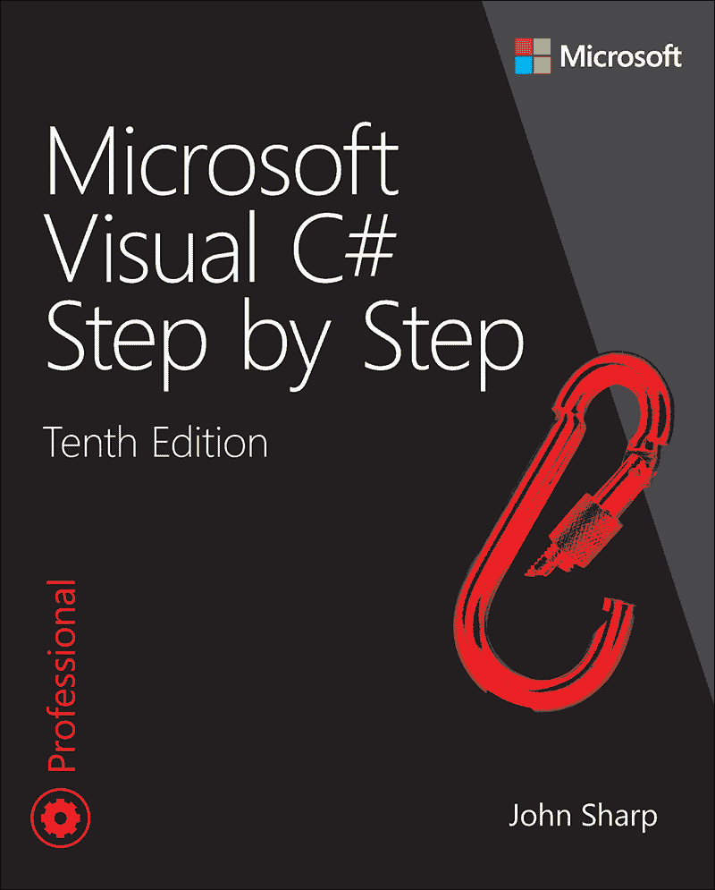


`ScoutAutomatedPrintCode`


## 开发应用程序逻辑

1. 使用 Visual Studio 2022，打开 `DailyRate` 项目，它位于 `Documents` 文件夹下的 `\Microsoft Press\VCSBS\Chapter 3\DailyRate` 文件夹中。

2. 在“解决方案管理器”中，找到 `DailyRate` 项目，双击 `Program.cs` 文件以在“代码和文本编辑器”窗口中显示程序代码。

   此程序仅用于你测试代码的测试框架。当应用程序开始运行时，它会调用 `run` 方法。你将想要尝试的代码添加到 `run` 方法中。（方法的调用方式需要对类有理解，你可以在第 7 章中查看。）

3. 将以下加粗显示的语句添加到 `run` 方法的主体中，位于左括号和右括号之间：

   点击此处查看代码图像

```csharp
void run()
{
    double dailyRate = readDouble("Enter your daily rate: ");
    int noOfDays = readInt("Enter the number of days: ");
    writeFee(calculateFee(dailyRate, noOfDays));
}
```

你刚刚添加到 `run` 方法中的代码块调用了 `readDouble` 方法（你稍后将编写）来询问用户顾问的日薪。下一个语句调用了 `readInt` 方法（你也将编写）来获取天数。最后，调用 `writeFee` 方法（同样由你编写）在屏幕上显示结果。注意，传递给 `writeFee` 的值是 `calculateFee` 方法返回的值，该方法接收日薪和天数，并计算出应付的总费用。

 **注意**

你尚未编写 `readDouble`、`readInt`、`writeFee` 和 `calculateFee` 方法，因此当你输入此代码时，IntelliSense 不显示这些方法。现在不要尝试生成应用程序，因为它会失败。

### 使用生成方法存根向导编写方法

1. 在“代码和文本编辑器”窗口中，在 `run` 方法中，右键点击 `readDouble` 方法调用。

   会出现一个快捷菜单，其中包含用于生成和编辑代码的有用命令。

   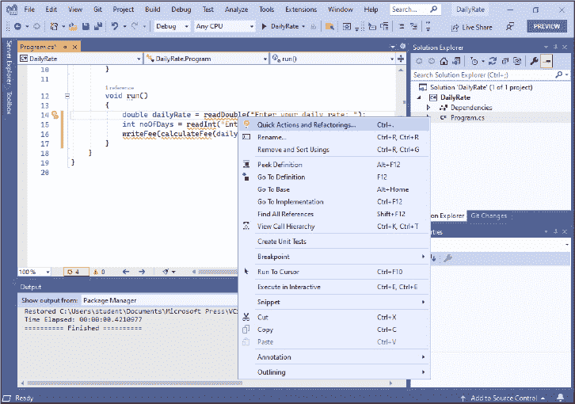

2. 在快捷菜单上，选择**快速操作和重构**（Quick Actions and Refactorings）。

   Visual Studio 验证 `readDouble` 方法不存在，并显示一个向导，允许你为该方法生成存根（stub）。Visual Studio 会检查对 `readDouble` 方法的调用，确定其参数和返回值的类型，并建议一个默认实现。

   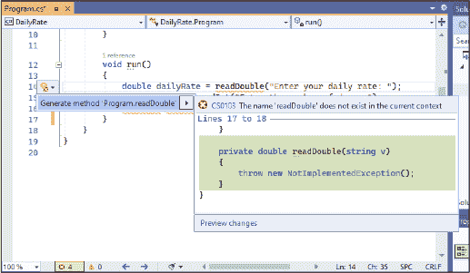

3. 选择**生成方法 `Program.readDouble`**。Visual Studio 向你的代码中添加以下方法：

   点击此处查看代码图像

```csharp
private double readDouble(string v)
{
    throw new NotImplementedException();
}
```

   新方法创建时带有 `private` 修饰符，这在第 7 章中有所描述。该方法的主体目前抛出 `NotImplementedException`。用你自己的代码替换它。

4. 从 `readDouble` 方法中删除 `throw NotImplementedException()` 语句，并替换为以下加粗显示的代码：

   点击此处查看代码图像

```csharp
private double readDouble(string v)
{
    Console.Write(v);
    string line = Console.ReadLine();
    return double.Parse(line);
}
```

   此代码块在屏幕上显示字符串 `v`。该变量是调用方法时传入的 `string`；它包含了提示用户输入日薪的消息。

 **注意**

   `Console.Write` 方法与之前使用的 `WriteLine` 语句相似，不同在于它不在消息后输出换行符。

   用户输入一个值，通过 `ReadLine` 方法读取为 `string`，然后通过 `double.Parse` 方法转换为 `double`。结果作为方法的返回值返回。

 **注意**

   `ReadLine` 方法是 `WriteLine` 的伴侣方法；它从键盘读取用户输入，直到用户按下回车键。用户输入的文本作为返回值返回。该文本以字符串值返回。

5. 在 `run` 方法中，右键点击 `readInt` 方法的调用，选择**快速操作和重构**，然后选择**生成方法 `Program.readInt`**。

   `readInt` 方法生成如下：

   点击此处查看代码图像

```csharp
private int readInt(string v)
{
    throw new NotImplementedException();
}
```

6. 将 `readInt` 方法主体中的 `throw NotImplementedException()` 语句替换为以下加粗显示的代码：

   点击此处查看代码图像

```csharp
private int readInt(string v)
{
    Console.Write(v);
    string line = Console.ReadLine();
    return int.Parse(line);
}
```


这段代码与 `readDouble` 方法的代码相似。唯一的区别是该方法返回一个 `int` 值，因此使用 `int.Parse` 方法将用户输入的 `string` 类型转换为数字。

7. 在 `run` 方法中右键点击 `calculateFee` 方法的调用处，选择“快速操作和重构”（Quick Actions and Refactorings），然后选择“生成方法‘Program.calculateFee’”（Generate Method）。

`calculateFee` 方法的生成如下：

点击此处查看代码图片

```
private object calculateFee(double dailyRate, int noOfDays)
{
    throw new NotImplementedException();
}
```

注意在这种情况下，Visual Studio 使用传入的参数名称来生成参数名称。（当然，如果参数名称不合适，你可以更改它们。）更具趣的是方法返回的类型，它是 `object`。Visual Studio 无法从调用方法的上下文确切判断方法应该返回何种类型的值。`object` 类型仅表示一个“东西”，当你向方法中添加代码时，应该将其更改所需的类型。第 7 章

8. 修改 `calculateFee` 方法的定义，使其返回 `double`，如此处加粗字体所示：

点击此处查看代码图片

```
private double calculateFee(double dailyRate, int noOfDays)
{
    throw new NotImplementedException();
}
```

9. 替换 `calculateFee` 方法的主体，并将其更改为表达式体方法，使用下文加粗显示的表达式；删除大括号并使用 `=>` 来指示定义方法主体的表达式。该语句通过将两个参数相乘来计算应付费用：

点击此处查看代码图片

```
private double calculateFee(double dailyRate, int noOfDays) => dailyRate * noOfDays;
```

10. 在 `run` 方法中右键点击 `writeFee` 方法的调用处，选择“快速操作和重构”，然后选择“生成方法‘Program.writeFee’”。

注意 Visual Studio 使用 `writeFee` 方法的定义来确定其参数应该是 `double`。此外，该方法调用没有使用返回值，因此方法的类型为 `void`：

点击此处查看代码图片

```
private void writeFee(double v)
{
    ...
}
```

 **提示**

如果你对语法足够熟悉，也可以通过直接在代码和文本编辑器中输入来编写方法。你不总是必须使用“生成”选项。

11. 将 `writeFee` 方法主体中的代码替换为以下语句，它计算费用并在显示结果之前加上 10% 的佣金。再次注意，这现在是一个表达式体方法：

点击此处查看代码图片

```
private void writeFee(double v) => Console.WriteLine($"The consultant’s fee is: {v * 1.1}");
```

12. 在“生成”（Build）菜单上，选择“生成解决方案”（Build Solution）。

### 测试程序

1. 在“调试”（Debug）菜单上，选择“开始”（Start）“不调试启动”（Without Debugging）。

Visual Studio 2022 构建程序并运行它。出现一个控制窗口。

2. 在“输入你的日费”（Enter Your Daily Rate）提示符处，输入 **525**。然后按 **回车**。

3. 在“输入天数”（Enter The Number of Days）提示符处，输入 **17**。然后按 **回车**。

程序向控制窗口中写入以下消息：

点击此处查看代码图片

```
The consultant’s fee is: 9817.5
```

4. 按 **回车**键关闭应用程序并返回 Visual Studio 2022。

### 使用 Visual Studio 调试器逐执行方法

Visual Studio 提供了强大的调试功能，允许你逐行查看应用程序的执行情况。当你需要理解为什么程序运行不符合预期，或者想查看由其他开发者编写的应用程序逻辑如何在各种方法之间流动时，这非常有用。

在下一个练习中，你将使用 Visual Studio 2022 调试器以慢动作运行程序。你将看到每个方法何时被调用（这被称为*步入方法*，stepping into the method），然后看到每个 `return` 语句如何将控制传回调用者（也称为*步出方法*，stepping out of the method）。在你步入和步出方法时，可以使用调试工具栏上的工具。然而，当应用程序在调试模式下运行时，调试菜单上也可以提供相同的命令。

#### 使用 Visual Studio 2022 调试器逐执行执行方法

1. 在代码和编辑器窗口中，找到 `run` 方法。

2. 将光标移动到第一语句：

点击此处查看代码图片

```
double dailyRate = readDouble("Enter your rate: ");
```

3. 在此行任意位置右键点击，选择“运行到光标”（Run To Cursor）。

程序启动，运行到该语句。代码编辑器窗口左侧的黄色箭头指示当前语句。该语句本身被高亮。

4. 在“视图”（View）菜单上，指向“工具栏”（Toolbars），然后确保选中了“调试”（Debug）工具栏。

如果它之前可见，调试工具栏会打开。它可能与其他工具栏并排。如果你看不到工具栏，尝试使用工具栏命令来隐藏它，看看哪些按钮消失了。然后重新显示工具栏。

5. 在调试工具栏上，选择“步入”（Step Into）按钮。（这是从左数起第五个。）

调试器步入调用的方法。黄色光标跳转到 `readDouble` 方法起始的大括号。

6. 再次选择“步入”，光标移动到第一个语句：

```
Console.Write(v);
```

 **提示**

你可以按 F11 代替点击调试工具栏上的步入。

7. 在调试工具栏上，选择“逐过”（Step Over）。这是从左数起第六个。）

该方法执行下一语句而不进行调试（不步入其中）。这种操作主要适用于语句调用了方法但你不想调试该方法中的每个语句时。黄色光标移动到方法的第二个语句，程序在控制窗口中显示日费提示。（控制窗口可能在 Visual Studio 后面。）

你可以按 F10 代替点击调试工具栏上的逐过。

8. 在调试工具栏上，再次选择“逐过”。

这次黄色光标消失了，控制窗口获得了焦点，因为程序正在执行 `Console.ReadLine` 方法并等待你输入内容。

9. 在控制窗口中输入 **525**。然后按 **回车**。

控制返回 Visual Studio 2022。黄色光标出现在方法的第三行。

10. 将光标悬停在方法第二行或第三行 `line` 变量的引用上。（无论哪一个都可以。）


会出现一个屏幕提示（ScreenTip），显示 `line` 变量的当前值 ("525")。你可以使用此功能来确保在单步执行方法时，变量已设置为预期值。

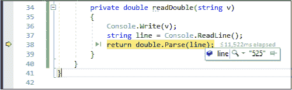

11. 在调试工具栏上，选择**逐出（Step Out）**。（这是从左侧开始的第七个按钮。）

当前方法将不间断地运行到结束。`readDouble` 方法完成，黄色光标返回 `run` 方法的第一条语句。该语句现在已经执行完毕。

 **提示（Tip）**

你可以按 `Shift+F11` 而不是在调试工具栏上选择“逐出”。

12. 在调试工具栏上，选择**逐进入（Step Into）**。

黄色箭头（以及高亮显示）移动到 `run` 方法中的第二条语句：

点击此处查看代码图像

```
int noOfDays = readInt("Enter the number of days: ");
```

13. 在调试工具栏上，选择**逐过程（Step Over）**。

这次，你选择了运行该方法而不进入内部单步执行。控制窗口再次出现，提示你输入天数。

14. 在控制窗口中，输入 **17**。然后按**回车键**。

控制权返回到 Visual Studio 2022。（你可能需要将 Visual Studio 置于顶层。）黄色光标移动到 `run` 方法的第三条语句：

点击此处查看代码图像

```
writeFee(calculateFee(dailyRate, noOfDays));
```

15. 在调试工具栏上，选择**逐进入（Step Into）**。

黄色光标跳转到定义 `calculateFee` 方法体的表达式。该方法在 `writeFee` 之前被调用，因为该方法的返回值被用作 `writeFee` 的参数。

16. 在调试工具栏上，选择**逐出（Step Out）**。

`calculateFee` 方法调用完成，黄色箭头跳回 `run` 方法的第三条语句。

17. 在调试工具栏上，再次选择**逐进入（Step Into）**。

这次，黄色箭头跳转到定义 `writeFee` 方法体的语句。

18. 将鼠标悬停在方法定义中的 `v` 参数上。

`v` 的值 `8925` 显示在屏幕提示中。

19. 在调试工具栏上，选择**逐出（Step Out）**。

控制窗口中显示消息“The consultant’s fee is: 9817.5”。如果该窗口被隐藏在 Visual Studio 2022 后方，你可能需要将控制窗口置于顶层才能显示。）黄色箭头返回 `run` 方法的第三条语句。

20. 在工具栏上，选择**继续（Continue）**继续运行程序，而不在随后的每个语句处停止。

 **提示（Tip）**

如果“继续”按钮不可见，选择调试工具栏末尾出现的“添加或删除按钮”下拉菜单，并选择“继续”。现在“继续”按钮应该出现了。或者，你可以按 `F5` 继续在不调试的情况下运行应用程序。

应用程序完成并结束运行。注意，当应用程序结束时，调试工具栏会消失；默认情况下，调试工具栏仅在以调试模式运行应用程序时显示。

调试器的另一个强大功能是在可以在调试时修改正在运行的代码；也就是说，你不需要停止应用程序并重新启动。这种方法可以大幅缩短调试应用程序所需的时间。在接下来的练习中，你将看到此技术的简单示例。

### 在调试会话期间修改代码

1. 在代码和文本编辑器中，找到 `readDouble` 方法。

2. 右键点击 `Console.Write(v);` 语句，悬停到**断点（Breakpoint）**，然后选择**插入断点（Insert Breakpoint）**。当你以调试模式运行应用程序时，程序将在到达此语句时停止并进入调试器。

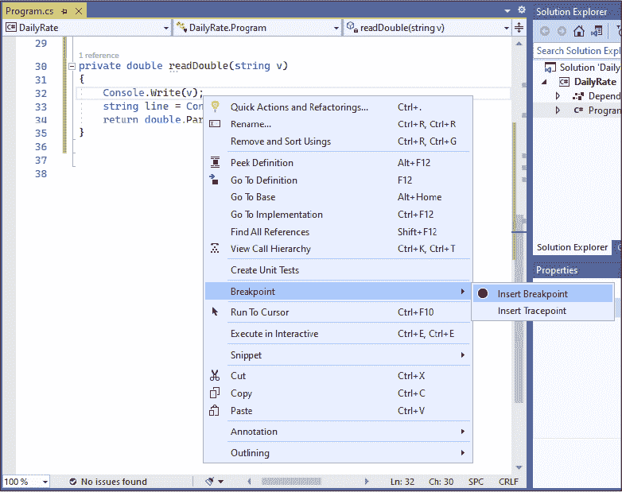

添加断点后，该语句在代码和文本编辑器窗口中高亮显示，同时边距处有一个大红点。

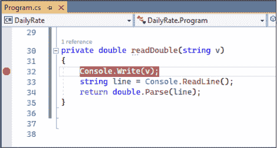

3. 在 Visual Studio 工具栏中，在**调试（Debug）**菜单下，选择**开始调试（Start Debugging）**。

应用程序启动，但在到达标记为断点的语句时停止。

4. 在调试工具栏上，选择**逐过程（Step Over）**以允许此语句执行。

5. 切换到应用程序的控制窗口。它应该显示消息“Enter your daily rate:”，并提示用户在同一行输入值。

你决定更改此消息的显示方式。你想在消息后添加一个换行符。

6. 切换回当前以调试模式运行应用程序的 Visual Studio。

7. 在不停止应用程序的情况下，将语句 `Console.Write(v);` 修改为 `Console.WriteLine(v);`。

8. 右键点击修改后的语句，然后选择**下一语句（Set Next Statement）**。

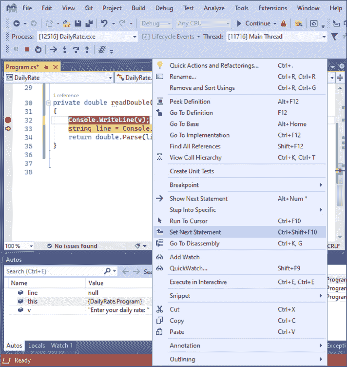

此操作会导致调试器返回该语句，因此当你选择“逐过程”时，该语句将重复执行。

 **注意（Note）**

如果你正在构建 UWP 应用（而不是控制台应用），你可以在调试会话期间修改 XAML 布局。要这样做，请在断点暂停时对 XAML 进行必要的更改。然后，在 Visual Studio 工具栏上，选择应用更改（Apply Changes）按钮。此按钮有一个火焰图标，表示热重载。


9. 在调试工具栏上，选择**逐过程（Step Over）**。修改后的语句现在应该运行。

10. 切换回应用程序的控制窗口。它仍然会显示原始消息，随后是“Enter your daily rate:”。但由于 `WriteLine` 语句添加了换行符，等待用户输入的光标现在位于另一行。


11. 返回 Visual Studio 并点击工具栏上的**继续**。

12. 输入之前相同的值。结果与之前相同。

13. 在**调试**菜单上，选择**删除所有断点（Delete All Breakpoints）**以移除 `readDouble` 方法中的断点。

14. 在出现的 Visual Studio 对话框中，选择**是**以确认要删除断点。

### 重构代码

Visual Studio 2022 的一个非常实的功能是重构代码。通过将代码拆分为更小的、定义良好的部分，可以让代码更具可读性和维护性。

有时你会发现在应用程序的多个地方编写相同（或相似）的代码。当这种情况发生时，你可以突出并右键点击输入的代码块，选择**快速操作和重构（Quick Actions and Refactoring）**并选择**提取方法（Extract Method）**。选中的代码被移动到名为 `NewMethod` 的新方法中。

提取方法向导可以确定方法是否需要任何参数以及是否返回值。生成方法后，你应该通过覆盖输入来更改其名称，并更改生成的语句以使用新名称调用该方法。

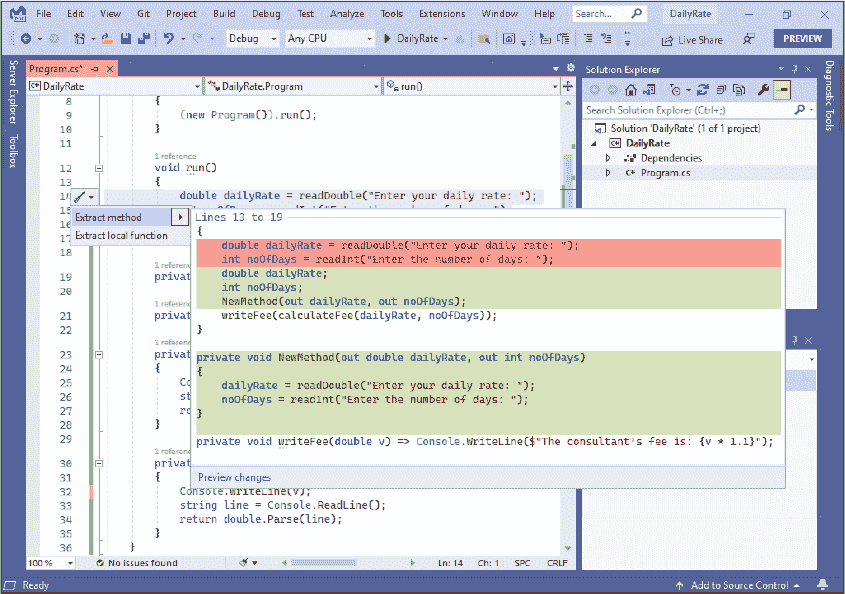

#### 嵌套方法


除了重构之外，有时你可能想将一个大方法拆分为若干较小的部分。你可以将每个部分实现为独立的辅助方法（helper method）。这可以帮助你测试执行复杂过程的方法，并在将它们合并之前，验证大方法的每个部分是否都按预期方式运行。它还能提高可读性，并使大方法更易维护。

 **注意**

`large method`（大方法）和 `helper method`（辅助方法）并不是 C# 的官方术语。我在本文讨论中使用这些术语是为了区分被拆分为多个较小部分的方法（大方法）与实现这些较小部分的方法（辅助方法）。

默认情况下，方法（无论是大方法还是辅助方法）在定义它们的类中都是可访问的，并且可以从该类中的任何其他方法调用。对于仅被一个大方法使用的辅助方法，将这些方法保持在运行它们的大方法内部（局部化）是合理的。这种方法可以确保为特定上下文设计的辅助方法，不会被另一个并非为其设计的方法意外调用。这也是实现封装的良好做法；大方法的内部工作机制（包括它调用的辅助方法）可以与其他方法保持分离。这种做法减少了大方法之间的任何依赖关系；你可以安全地更改大方法及其调用的辅助方法的实现，而不会意外影响应用程序的其他元素。

你可以通过将辅助方法嵌套在使用它们的大方法内部来创建辅助方法，如下一个练习所示。该练习计算阶乘。你可以使用阶乘来确定给定数量物品的多少种排列方式。正整数 `n` 的阶乘以递归方式定义为 `n` 乘以阶乘(`n` – 1)，其中 1 的阶乘为 1。例如，3 的阶乘是 3 * 阶乘(2)，而这又是 2 * 阶乘(1)，结果是 1。该计算结果结果为 3 * 2 * 1，即 6。如果你集合中有三个物品，你可以以六种不同的方式对它们进行排列。同样，如果你有四个物品，你可以以 24 种不同的方式进行排列（`4 * factorial(3)`），你可以以 120 种不同的方式排列五个物品（`5 * factorial(4)`）。

### 计算阶乘

1.  如果 **Visual Studio 2022** 尚未运行，请启动它。
2.  打开 **Factorial** 解决方案，它位于你 **Documents** 文件夹中的 `\Microsoft Press\VCSBS\Chapter 3\Factorial` 文件夹中。
3.  在解决方案资源管理器中，进入 Factorials 项目，双击 `Program.cs` 文件以在代码和文本编辑器窗口中显示程序的代码。
4.  将以下**加粗**的语句添加到 `run` 方法的主体内，即位于大大括号之间：

    点击此处查看代码图像

    ```
    void run()
    {
        Console.Write("Please enter a positive integer: ");
        string inputValue = Console.ReadLine();
        long factorialValue = CalculateFactorial(inputValue);
        Console.WriteLine($"Factorial({inputValue}) is  {factorialValue}");
    }
    ```

    此代码提示用户输入一个数值，然后在显示结果之前使用该值调用 `CalculateFactorial` 函数（你接下来将编写该函数）。
5.  在 `run` 方法下方添加一个名为 `CalculateFactorial` 的新方法。该方法应该接收一个名为 `input` 的 `string` 参数并返回一个 `long` 整数值，如下：

    点击此处查看代码图像

    ```
    long CalculateFactorial(string input)
    {
    }
    ```

6.  在 `CalculateFactorial` 方法中，在初始大括号之后，添加此处所示**加粗**的语句：

    点击此处查看代码图像

    ```
    long CalculateFactorial(string input)
    {
        int inputValue = int.Parse(input); 
    }
    ```

7.  该语句将作为参数传递的 `string` 值转换为整数。（代码目前没有检查用户是否输入了有效的整数；你将在第 6 章中学习如何这样做。）
8.  在 `CalculateFactorial` 函数中添加一个名为 `factorial` 的嵌套方法。`factorial` 方法应该接收一个 `int` 值并返回一个 `long`。你将使用此方法来计算输入参数的阶乘：

    点击此处查看代码图像

    ```
    long CalculateFactorial(string input)
    {
        int inputValue = int.Parse(input); 
        long factorial (int dataValue)
        { 
        }
    }
    ```

9.  在 `factorial` 方法体内，添加此处所示**加粗**的语句。此代码使用前面描述的递归算法计算输入参数的阶乘：

    点击此处查看代码图像

    ```
    long CalculateFactorial(string input)
    {
        int inputValue = int.Parse(input); 
        long factorial (int dataValue)
        {
            if (dataValue == 1)
            {
                return 1;
            }
            else
            {
                return dataValue * factorial(dataValue - 1);
            }
        }
    }
    ```

10. 在 `CalculateFactorial` 方法中，使用整数值调用 `factorial` 方法并返回结果：

    点击此处查看代码图像

    ```
    long CalculateFactorial(string input)
    {
        int inputValue = int.Parse(input); 
        long factorial (int dataValue)
        {
            if (dataValue == 1)
            {
                return 1;
            }
            else
            {
                return dataValue * factorial(dataValue - 1);
            }
        }

        long factorialValue = factorial(inputValue);
        return factorialValue;
    }
    ```

11. 在**调试**菜单上，选择**转调试启动**。

    Visual Studio 2022 生成程序并运行它。出现了一个控制窗口。
12. 在 **Please Enter a Positive Integer** 提示处，输入 **4**，然后按 **Enter**。

    程序向控制窗口写入了以下消息：

    ```
    Factorial(4) is 24
    ```

13. 按 **Enter** 键关闭应用程序并返回 Visual Studio 2022。
14. 运行应用程序并在提示时输入值 **5**。这次，应用程序应该显示以下消息：

    ```
    Factorial(5) is 120
    ```

15. 尝试其他值。注意，如果你输入的数值过大（例如尝试 **60**），结果将超过 `long` 整数可以存储的范围，你将得到一个错误的结果——很可能是由于数值溢出产生的负数。你将在第 6 章中通过使用检查异常学习更多如何处理这种情况。

### 使用可选参数和命名参数

通过定义重载方法，你可以实现具有不同参数的方法版本。当你构建使用重载方法的应用程序时，编译器会确定应该使用哪些特定的方法实例来满足每个方法调用。这是许多面向对象语言的共同特性，而不仅仅是 C#。


然而，开发者可以使用其他语言和技术来构建不遵循这些规则的 Windows 应用程序和组件。`C#` 以及其他为 `.NET` 设计的语言的一个关键特性是可以与其他技术编写的应用程序和组件交互。许多运行在 .NET 环境之外的 Windows 应用程序和服务的底层技术之一是组件模型（COM）。事实上，`.NET` 使用的通用语言运行时（`CLR`）也高度依赖于 `COM`，Windows 运行时 也是如此。`COM` 不支持重载方法；它可以使用带有可选参数的方法。为了便于将 `COM` 库和组件集成到 `C#` 解决方案中，`C#` 支持可选参数。

可选参数在其他情况下也很有用。当无法使用重载，因为参数类型变化不足，无法让编译器区分不同的实现时，它们提供了一个紧凑且简单的解决方案。例如，考虑以下方法：

点击此处查看代码图像

```
public void DoWorkWithData(int intData, float floatData, int moreIntData) {
    ...
}
```

`DoWorkWithData` 方法接受三个参数：两个 `int` 和一个 `float`。现在，假设你想提供一个只接受两个参数（`intData` 和 `floatData`）的 `DoWorkWithData` 实现。你可以这样重载该方法：

点击此处查看代码图像

```
public void DoWorkWithData(int intData, float floatData)
{
    ...
}
```

如果你编写了一个调用 `DoWorkWithData` 方法的语句，你可以提供两个或三个适当类型的参数，编译器将使用类型信息来确定调用哪个重载版本：

点击此处查看代码图像

```
int arg1 = 99;
float arg2 = 100.0F;
int arg3 = 101;
DoWorkWithData(arg1, arg2, arg3); // 调用三个参数的重载
DoWorkWithData(arg1, arg2);       // 调用两个参数的重载
```

然而，假设你想为 `DoWorkWithData` 实现两个额外的版本，它们只接受第一个参数和第三个参数。你可能会尝试这样做：

点击此处查看代码图像

```
public void DoWorkWithData(int intData)
{
    ...
}
public void DoWorkWithData(int moreIntData)
{
    ...
}
```

这里的问题在于，这两个重载在编译器看来是完全相同的。你的代码将无法编译，而是会产生错误“类型 `typename` 已经定义了名为 `DoWorkWithData` 且参数类型相同的成员”。要理解为什么这样，请思考如果这段代码是合法的会发生什么。考虑以下语句：

```
int arg1 = 99;
int arg3 = 101;
DoWorkWithData(arg1);
DoWorkWithData(arg3);
```

`DoWorkWithData` 的调用将触发哪个或哪些重载？使用可选参数和命名参数可以帮助解决这个问题。

### 定义可选参数

当你通过为参数提供默认值来定义方法时，你就指定了该参数是可选的。你通过使用赋值运算符来明明值。在下文所示的 `optMethod` 方法中，`first` 参数是强制性的，因为它没有指定默认值，但 `second` 和 `third` 参数是可选的：

点击此处查看代码图像

```
void optMethod(int first, double second = 0.0, string third = "Hello") {
    ...
}
```

你必须在任何可选参数之前指定所有强制性参数。

你可以像调用任何其他方法一样调用接受可选参数的方法：你指定方法名并提供任何必要的参数。与接受可选参数的方法的区别在于，你可以省略相应的参数，方法在运行时将使用默认值。在接下来的示例中，对 `optMethod` 方法的第一次调用为三个参数都提供了值。第二次调用仅指定了两个参数，这些值被应用于 `first` 和 `second` 参数。当方法运行时，`third` 参数将接收默认值 `"Hello"`。

点击此处查看代码图像

```
optMethod(99, 123.45, "World"); // 为所有三个参数提供了参数
optMethod(100, 54.321);         // 仅为前两个参数提供了参数
```### 传递命名参数

默认情况下，`C#` 使用每个参数在方法调用中的位置来确定该参数适用于哪个参数。因此，上节所示的 `OptMethod` 方法的第二个示例将两个参数传递给方法的 `first` 和 `second` 参数，因为这是它们在方法声明中的顺序。

在 `C#` 中，你也可以通过名称指定参数。此功能允许你以不同的顺序传递参数。要将参数作为命名参数传递，你需要指定参数名称，后跟冒号和要使用的值。以下示例的功能与前一节所示相同，只是参数是通过名称指定的：

点击此处查看代码图像

```
optMethod(first = 99, second = 123.45, third = "World"); // 为所有三个参数都提供了参数
```

命名参数允许你以任何顺序传递参数。你可以像这样重写调用 `optMethod` 方法的代码：

点击此处查看代码图像

```
optMethod(third = "World", second = 123.45, first = 99);
optMethod(second = 54.321, first = 100);
```

此功能还允许你省略参数。例如，你可以调用 `optMethod` 方法并为 `first` 和 `third` 参数指定值，同时对 `second` 参数使用默认值：

点击此处查看代码图像

```
optMethod(first = 99, third = "World");
```

此外，你可以混合使用位置和命名命名。然而，如果你使用这种技术，必须在 `first` 命名参数之前指定所有的位置参数。

点击此处查看代码图像

```
optMethod(99, third = "World"); // 第一个参数是位置参数
```### 使用可选参数和命名参数解决歧义

使用可选参数和命名参数可能会导致代码中出现某些歧义。你必须理解编译器如何解决这些歧义，否则你的应用程序可能会以意想不到的方式运行。

假设你像下面的示例所示将 `optMethod` 定义为重载方法：

点击此处查看代码图像

```
void optMethod(int first, double second = 0.0, string third = "Hello")
{
    ...
}

void optMethod(int first, double second = 1.0, string third = "Goodbye", int fourth = 100 )
{
    ...
}
```

这是完全法的 `C#` 代码，遵循重载方法的规则。编译器可以区分这些方法，因为它们的参数列表不同。然而，正如示例所示，当你尝试调用 `optMethod` 方法并省略对应一个或多个可选参数的参数时，可能会出现问题：

```
optMethod(1, 2.5, "World");
```

再次，这是完全法的代码，但它运行的是哪个版本的 `optMethod` 方法？答案是最匹配方法调用的版本，因此代码调用了接受三个参数的方法，而不是接受四个参数的版本。这很有道理，所以考虑这一个：


```
optMethod(1, fourth : 101);
```

在此段代码中，对 `optMethod` 的调用省略了 `second` 和 `third` 参数的参数，但通过名称指定了 `fourth` 参数。只有一个版本的 `optMethod` 匹配此调用，因此这不是问题。然而，接下来的示例将引发你的思考：

```
optMethod(1, 2.5);
```

这一次，`optMethod` 方法的两个版本版本都不与提供的参数列表完全匹配。`optMethod` 方法的两个版本都为 `second`、`third` 和 `fourth` 参数提供了可选参数。那么，此语句是调用了接受三个参数的 `optMethod` 版本并对 `third` 参数使用默认值，还是调用了接受四个参数的 `optMethod` 版本并对 `third` 和 `fourth` 参数使用默认值呢？答案是，两者都不是。这是一个无法解决的歧义，编译器不允许你编译该应用程序。

如果你尝试调用 `optMethod` 方法，也会出现相同的情况并得到相同的结果，如下述任何语句所示：

点击此处查看代码图像

```
optMethod(1, third : "World");
optMethod(1);
optMethod(second : 2.5, first : 1);
```

在本章的最后一个练习中，你将重新访问 `DailyRate` 项目，并练习实现带有可选参数的方法，并通过使用命名参数来调用它们。你还将测试 C# 编译器解析涉及可选参数和命名参数的方法调常用示例。

### 定义并调用带有可选参数的方法

1. 使用 Visual Studio 2022 打开 `DailyRate` 解决方案，它位于 `Documents` 文件夹下的 `\Microsoft Press\VCSBS\Chapter 3\DailyRate Using Optional Parameters` 文件夹中。

2. 在解决方案管理器（Solution Explorer）中，找到 `DailyRate` 项目，双击 `Program.cs` 文件以在代码和文本编辑器窗口中显示程序代码。

   此版本的应用程序除了 `Main` 方法和 `run` 方法的骨架版本外，是空的。

3. 在 `Program` 类中，在 `run` 方法之后添加 `calculateFee` 方法。这与你在上一组练习中实现的方法版本相同，不同之处在于它接受两个带有默认值的可选参数。该方法还会打印消息，指示所调用的 `calculateFee` 方法的版本。（你将在接后的步骤中添加此方法的重载实现。）

   点击此处查看代码图像

   ```sharp
   private double calculateFee(double dailyRate = 500.0, int noOfDays = 1)
   {
       Console.WriteLine("calculateFee using two optional parameters");
       return dailyRate * noOfDays;
   }
   ```

4. 在 `Program` 类中添加另一个 `calculateFee` 方法的实现，如下代码所示。此版本接受一个类型为 `double` 的可选参数 `dailyRate`。方法体仅计算并返回一天的费用。

   点击此处查看代码图像

   ```sharp
   private double calculateFee(double dailyRate = 500.0)
   {
       Console.WriteLine("calculateFee using one optional parameter");

       int defaultNoOfDays = 1;
       return dailyRate * defaultNoOfDays;
   }
   ```

5. 在 `Program` 类中添加第三个 `calculateFee` 方法的实现。此版本不接受任何参数，并对费率和天数使用硬编码值。

   点击此处查看代码图像

   ```sharp
   private double calculateFee()
   {
       Console.WriteLine("calculateFee using hardcoded values");
       double defaultDailyRate = 400.0;
       int defaultNoOfDays = 1;
       return defaultDailyRate * defaultNoOfDays;
   }
   ```

6. 在 `run` 方法的开头，添加以下加粗语句以调用 `calculateFee` 并显示结果：

   点击此处查看代码图像

   ```sharp
   public void run()
   {
       double fee = calculateFee();
       Console.WriteLine($"Fee is {fee}");
   }
   ```

    **提示 (Tip)**

   你可以从调用方法的语句快速查看方法的定义。要这样做，请右键点击方法调用，然后选择“查看定义 (Peek Definition)”。以下图像显示了 `calculateFee` 方法的查看定义窗口。如果你的代码跨越多个文件，或者即使在同一个文件中但文件很长，此功能也极其有用。

   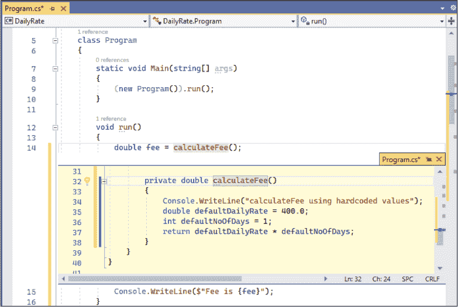

7. 在**调试 (Debug)** 菜单上，选择**不调试直接启动 (Start Without Debugging)** 以生成并运行程序。

   程序在控制窗口中运行并显示以下消息：

   点击此处查看代码图像

   ```
   calculateFee using hardcoded values
   Fee is 400
   ```

   `run` 方法调用了不接受参数的版本。按任意键关闭控制窗口并返回 Visual Studio。

8. 在 `run` 方法中，将语句修改为代码：

   点击此处查看代码图像

   ```sharp
   public void run()
   {
       double fee = calculateFee();
       Console.WriteLine($"Fee is {fee}");
   }
   ```

9. 在**调试 (Debug)** 菜单上，选择**不调试直接启动**以生成并运行程序。

   程序显示以下消息：

   点击此处查看代码图像

   ```
   calculateFee using one optional parameter
   Fee is 650
   ```

   这一次，`run` 方法调用接受一个可选参数的版本。按任意键关闭控制窗口并返回 Visual Studio。

10. 在 `run` 方法中，再次修改调用 `calculateFee` 的语句：

    点击此处查看代码图像

    ```sharp
    public void run()
    {
        double fee = calculateFee(500.0, 3);
        Console.WriteLine($"Fee is {fee}");
    }
    ```

11. 在**调试 (Debug)** 菜单上，选择**不调试直接启动**以生成并运行程序。

    程序显示以下消息：

    点击此处查看代码图像

    ```
    calculateFee using two optional parameters
    Fee is 1500
    ```

    正如你预期的，`run` 方法调用了接受两个可选参数的版本。按任意键关闭控制窗口并返回 Visual Studio。

12. 在 `run` 方法中，修改调用 `calculateFee` 的语句，通过名称指定 `dailyRate` 参数：

    点击此处查看代码图像

    ```sharp
    public void run()
    {
        double fee = calculateFee(dailyRate : 375.0);
        Console.WriteLine($"Fee is {fee}");
    }
    ```

13. 在**调试 (Debug)** 菜单上，选择**不调试直接启动**以生成并运行程序。

    程序显示以下消息：

    点击此处查看代码图像

    ```
    calculateFee using one optional parameter
    Fee is 375
    ```

    正如之前，`run` 方法调用了接受一个可选参数的版本。更改代码以使用命名参数并没有改变编译器在此示例中解析方法调用的方式。


17. 在 `run` 方法中，修改调用 `calculateFee` 的语句，并通过名称指定 `noOfDays` 参数。

    点击此处查看代码图像

```c
public void run()
{
    double fee = calculateFee(noOfDays : 4);
    Console.WriteLine($"Fee is {fee}");
}
```

18. 在 `Debug` 菜单上，选择 `Start Without Debugging`（不调试启动）来编译并运行程序。

    程序显示以下消息：

    点击此处查看代码图像

```
calculateFee using two optional parameters
Fee is 2000
```

    这一次，`run` 方法调用了带有两个可选参数的 `calculateFee` 版本。该方法调用省略了第一个参数（`dailyRate`），并通过名称指定了第二个参数。带有两个可选参数的 `calculateFee` 方法版本是唯一匹配该调用的。

19. 按任意键关闭控制窗口并返回 Visual Studio。

20. 修改带有两个可选参数的 `calculateFee` 方法的实现。将第一个参数 own 更改为 `theDailyRate`，并更新 `return` 语句以匹配下方代码中**加粗**的内容：

    点击此处查看代码图像

```csharp
private double calculateFee(double theDailyRate = 500.0, int noOfDays = 1)
{
    Console.WriteLine("calculateFee using two optional parameters");
    return theDailyRate * noOfDays;
}
```

21. 在 `run` 方法中，修改调用 `calculateFee` 的语句，并通过名称指定 `theDailyRate` 参数。

    点击此处查看代码图像

```csharp
public void run()
{
    double fee = calculateFee(theDailyRate : 375.0);
    Console.WriteLine("Fee is {fee}");
}
```

22. 在 `Debug` 菜单上，选择 `Start Without Debugging`（不调试启动）来编译并运行程序。

    程序显示以下消息：

    点击此处查看代码图像

```
calculateFee using two optional parameters
Fee is 375
```

    上一次你指定了费用但没有指定每日率（第 14 步），`run` 方法调用了带有一个可选参数的 `calculateFee` 版本。这一次，`run` 方法调用了带有两个可选参数的 `calculateFee` 版本。在这种情况下，使用命名参数更改了编译器解析方法调用的方式。如果你指定了命名参数，编译器会将参数名称与方法声明中指定的参数名称进行比较，并选择具有具有匹配名称参数的方法。如果你在调用 `calculateFee` 方法时将参数指定为 `aDailyRate: 375.0`，程序将无法编译，因为没有任何版本的方法具有此名称的参数。

23. 按任意键关闭控制窗口并返回 Visual Studio。

### 总结

在本章中，你学习了如何定义方法来实现命名的代码块。你了解了如何向方法传递参数以及如何从方法返回数据。你还学习了如何调用方法、传递参数并获取返回值。你学习了如何定义具有不同参数列表的重载方法，并看到了变量的作用域如何决定它哪里被访问。然后，你使用 Visual Studio 2022 调试器在代码运行时逐步执行。最后，你学习了如何编写带有可选参数的方法，以及如何使用命名参数调用方法。

*   如果你想继续学习下一章，请保持 Visual Studio 2022 运行并转到第 4 章“使用判断语句”。

*   如果你现在想退出 Visual Studio 2022，在文件（File）菜单上选择 `Exit`（退出）。如果看到保存对话框，选择 `Yes`（是）并保存项目。

### 快速参考

| | 操作 |
| :--- | :--- |
| 声明方法 | 在类内部编写方法。指定方法名、参数列表和返回类型，然后在大括号之间编写方法体。例如：点击此处查看代码图像 <br>```int addValues(int leftHandSide, int rightHandSide) { ... }``` | |
| 从方法内部返回值 | 在方法内部编写 `return` 语句。例如：点击此处查看代码图像 <br>```return leftHandSide + rightHandSide;``` | |
| 从方法内部返回多个值 | 编写一个返回元组的 `return` 语句。例如：点击此处查看代码图像 <br>```return (division, remainder);``` | |
| 在方法结束前从方法 | 在方法内部编写 `return` 语句。例如：`return;` | |
| 定义表达式体方法 | 使用 `=>` 序列，后跟定义方法体的表达式和结束分号。例如：点击此处查看代码图像 <br>```double calculateFee(double dailyRate, int noOfDays) => dailyRate * noOfDays;``` | |
| 调用方法 | 编写方法名，并在括号内写上任何参数。例如：`addValues(39, 3);` | |
| 调用返回元组的方法 | 按照之前所示调用方法，但将结果赋值一组括在括号内的变量。对于返回的元组中的每个值应对应一个变量。例如：点击此处查看代码图像 <br>```int division, remainder; (division, remainder) = divide(leftHandSide, rightHandSide);``` | |
| 使用生成方法存根向导 | 右键点击方法调用处，然后选择 `Generate Method Stub`（生成方法存根）。 | |
| 创建嵌套方法 | 在另一个方法的体内定义该方法。例如：点击此处查看代码图像 <br>```long CalculateFactorial(string input) { ... long factorial (int dataValue) { if (dataValue == 1) { return 1; } else { return dataValue * factorial(dataValue - 1); } } ... }``` | |


第 3 章中的方法非常直观，每条语句在前一条语句完成后按顺序执行。然而，为了解决许多现实世界的问题，你还必须能够编写能够选择性执行不同动作，并根据情况在方法中采取不同路径的代码。在本章，你将学习如何完成这项任务。

### 声明布尔变量

在 C#编程世界中（与现实世界不同），一切非黑即白、非对即错、真即假。例如，如果你创建一个名为 `x` 的整数变量，给它赋值为 `99`，然后询问 `x` 是否包含值 `99`，答案无疑是 `true`。如果你询问 `x` 是否小于 `10`，答案无疑是 `false`。这些都是布尔表达式的示例。布尔表达式的结果结果始终为 `true` 或 `false`。

 **注意**

这些问题的答案对于所有其他编程语言并不一定是定的。未赋值的变量具有未定义的值，例如，你不能说它一定小于 `10`。此类问题是 C 和 C++ 程序中常见的错误源。Microsoft Visual C# 编译器通过确保你在检查变量之前始终对其赋值一个值来解决此问题。如果你尝试检查未赋值变量的内容，你的程序将无法编译。

Visual C# 提供了一了一种名为 `bool` 的数据类型。`bool` 变量可以持有两个值之一：`true` 或 `false`。例如，以下三条语句声明了一个名为 `areYouReady` 的 `bool` 变量，给该变量赋值 `true`，然后将其值写入控制台：

点击此处查看代码图像

```c
bool areYouReady;
areYouReady = true;
Console.WriteLine(areYouReady); // 向控制台输出 True
```

### 使用布尔运算符

布尔运算符执行计算结果为 `true` 或 `false` 的计算。C# 有几个非常有用的布尔运算符，其中最简单的是 `NOT` 运算符，用感叹号（`!`）表示。`!` 运算符反转布尔值，产生该值的反面结果。在上述示例中，如果变量 `areYouReady` 的值为 `true`，则表达式 `!areYouReady` 的值为 `false`。

#### 理解等等和关系运算符

你将频繁使用的两个布尔运算符是等等（`==`）和不等（`!=`）。这些是二元运算符，通过你可以判断一个值是否与相同类型的另一个值相同，并产生布尔结果。下表总结了这些运算符的工作方式，以名为 `age` 的 `int` 变量为例：

| 运算符 | 含义 | 示例 | 如果 `age` 为 42 的结果 |
| --- | --- | --- | --- |
| == | 等于 | `age == 100` | false |
| != | 不等于 | `age != 0` | true |

不要将等等运算符 `==` 与赋值运算符 `=` 混淆。表达式 `x == y` 比较 `x` 和 `y`，如果值相同，则值为 `true`。表达式 `x = y` 将 `y` 的值赋值给 `x` 并返回 `y` 的值作为结果。

与 `==` 和 `!=` 密切相关的是关系运算符。你使用这些运算符来判断一个值是否小于或大于相同类型的另一个值。下表显示了如何使用这些运算符：

| 运算符 | 含义 | 示例 | 如果 `age` 为 42 的结果 |
| --- | --- | --- | --- |
| < | 小于 | `age < 21` | false |
| <= | 小于等于 | `age <= 18` | false |
| > | 大于 | `age > 16` | true |
| >= | 大于等于 | `age >= 42` | true |

#### 理解条件逻辑运算符

C# 提供了两个二元布尔运算符：逻辑 `AND` 运算符（用 `&&` 符号表示）和逻辑 `OR` 运算符（用 `||` 符号表示）。统称为条件逻辑运算符。它们的目的是是将两个布尔表达式或值合并为单个布尔结果。这些运算符与等等和关系运算符相似之处在于，它们所出现的表达式的值为 `true` 或 `false`，但不同之处在于，它们所操作的值也必须是 `true` 或 `false`。

`&&` 运算符的结果当且仅当它所评估的两个布尔表达式均为 `true` 时才为 `true`。以下示例摘自选艺比赛的评判标准。对参赛者的舞蹈和唱歌能力进行评估。评委为每项能力给出从 0（完全没有天赋）到 10（应为专业水平）的分值。只要参赛者的各项能力得分达到 7 分或以上即可进入比赛的下一阶段：

点击此处查看代码图像

```csharp
int dancingAbility = ...; // 评委赋值
int singingAbility = ...; // 评委赋值
bool canMoveToNextStage;
canMoveToNextStage = (dancingAbility >= 7) && (singingAbility >= 7);
```

 **提示**

此示例中的括号实际上是多余的，但它们有助于明确表达式的。`||` 运算符的结果当它评估的两个布尔表达式之一为 `true` 时为 `true`。例如，如果 `dancingAbility` 的值小于 7 或 `singingAbility` 的值小于 7，以下语句会将 `true` 赋值给 `eliminateContant`：

点击此处查看代码图像

```csharp
bool eliminateContant;
eliminateContant = (dancingAbility < 7) || (singingAbility < 7);
```

#### 短路

`&&` 和 `||` 运算符都表现出称为“短路”的特性。短路描述了在确定条件逻辑表达式的结果时不需要评估两个操作数的情况。例如，如果 `&&` 运算符的左侧操作数为 `false`，则无论右侧操作数如何，整个表达式的结果均为 `false`。同样，如果 `||` 运算符的左侧操作数为 `true`，则无论右侧操作数如何，整个表达式的结果均为 `true`。在这些情况下，`&&` 和 `||` 运算符跳过了对右侧操作数的评估。考虑所示第一个示例：

点击此处查看代码图像

```csharp
(dancingAbility >= 7) && (singingAbility >= 7)
```

现在考虑第二个示例：

点击此处查看代码图像

```csharp
(dancingAbility < 7) || (singingAbility < 7);
```

如果你仔细设计使用条件逻辑运算符的表达式，可以通过避免不必要的工作来提高代码性能。将易于评估的布尔表达式放在条件逻辑运算符的左侧，将更复杂的表达式放在右侧。在许多情况下，你会发现程序不需要评估更复杂的表达式。


布尔表达式可以调用返回真/假（true/false）值的布尔方法。请注意，在使用短路逻辑的布尔表达式中，方法可能并不总是会被执行。

## 总结运算符优先级和结合性

下表总结了你目前为止学习的所有运算符的优先级和结合性。同一类别的运算符具有相同的优先级。表格中靠上的运算符优先级高于表格中靠下的运算符。

| 类别 | 运算符 | 描述 | 结合性 |
| --- | --- | --- | --- |
| 原始运算符 | `()++--` | 优先级覆盖 / 后置增 1 后置减 1 | 左结合 |
| 元运算符 | `!+–++--` | 逻辑 `NOT` / 返回操作数不变的值 / 返回操作数的取反 / 前置增 1 前置减 1 | 左结合 |
| 乘法运算符 | `*/%` | 乘法 除法 取余（取模） | 左结合 |
| 加法运算符 | `+–` | 加法 减法 | 左结合 |
| 关系运算符 | `<<=>>=` | 小于 小于等于 大于 大于等于 | 左结合 |
| 等于运算符 | `==!=` | 等于 不等于 | 左结合 |
| 条件逻辑 `AND` | `&&` | 条件逻辑 `AND` | 左结合 |
| 条件逻辑 `OR` | `||` | 条件逻辑 `OR` | 左结合 |
| 赋值运算符 | `=` | 将右侧操作数赋值给左侧并返回赋值的值 | 右结合 |

注意 `&&` 运算符和 `||` 运算符的优先级不同：`&&` 的优先级高于 `||`。

## 模式匹配

C# 8.0 引入了模式匹配（pattern matching）。模式扩展了 `if` 语句的能力。它们也可以让代码比以前更加简洁和易于阅读。

模式匹配使用 `is` 运算符。解释模式匹配最简单的方法是通过另一个示例。只有当 `percent` 变量大于 0 且小于 100 时，以下语句会将 `validPercentage` 赋值为 `true`：

查看代码示例

```csharp
bool validPercentage = percent > 0 && percent < 100;
```

模式匹配允许你简化表达式：

查看代码示例

```csharp
bool validPercentage = percent is > 0 and < 100;
```

`is` 运算符支持 `&&`（逻辑与，连接）和 `||`（逻辑或，离散）。`is` 运算符可以与 `&&` 或 `||` 运算符结合。例如，如果 `dancingAbility` 是 7 或者是 `singingAbility` 是 7：

查看代码示例

```csharp
bool result = dancingAbility is 7 || singingAbility is 7;
```

模式匹配还提供了 `not` 运算符，用于 `if` 语句。例如，当 `percent` 变量不等于 0 时，`if` 语句执行：

查看代码示例

```csharp
bool notZero = percent is not 0;
```

## 使用 if 语句进行决策

在 `if` 语句中，你可以根据布尔表达式的结果执行不同的操作。`if` 语句的语法如下：

查看代码示例

```csharp
if (condition)
{
    // 如果条件为真，执行此代码
}
```

如果 `condition` 为假，则可以执行 `else` 分支。`else` 关键字是可选的。

查看代码示例

```csharp
if (seconds == 59)
{
    seconds = 0;
}
else
{
    seconds++;
}
```

注意，即使 `if` 语句只包含一条语句，良好的习惯也是使用大括号 `{}`。这可以避免在后续代码时出现错误。例如：

查看代码示例

```csharp
if (condition)
{
    statement1;
}
```

## 使用块 语句

`if` 语句可以嵌套在其他 `if` 语句中。这样，你可以根据多个布尔表达式来链式决策。

```csharp
if (condition1)
{
    if (condition2)
    {
        // 当两个条件都为真时执行
    }
}
```

块还会开启一个新的作用域。你可以在块内部定义变量，但它们在块结束时就会消失。查看代码示例

```csharp
if (condition)
{
    int myVar = 0;
    // myVar 在这里可以使用
} // myVar 在这里消失
else
{
    // myVar 在这里不可使用
}
```

## 级联 if 语句

你可以使用 `else if` 来连接多个 `if` 语句。通过这种方式，你可以连接一系列布尔表达式，直到其中一个评估为 `true`。在下面的示例中，如果 `day` 的值为 `0`，第一个测试为 `true`，`dayName` 被赋值为 `"Sunday"`。如果 `day` 不是 `0`，第一个测试失败，控制权传递到 `else` 分句，运行第二个 `if` 语句并比较 `day` 与 1。

```csharp
if (day == 0)
{
    dayName = "Sunday";
}
else if (day == 1)
{
    dayName = "Monday";
}
```

第二个 `if` 语句只在第一个测试为假时执行。同样，第三个 `if` 语句只有在第一个和第二个测试均为假时才执行，依此类推。

```csharp
if (day == 0)
{
    dayName = "Sunday";
}
else if (day == 1)
{
    dayName = "Monday";
}
else if (day == 2)
{
    dayName = "Tuesday";
}
else if (day == 3)
{
    dayName = "Wednesday";
}
else if (day == 4)
{
    dayName = "Thursday";
}
else if (day == 5)
{
    dayName = "Friday";
}
else if (day == 6)
{
    dayName = "Saturday";
}
else
{
    dayName = "unknown";
}
```

在接下来的练习中，你将编写一个使用级联 `if` 语句来比较日期的方法。

编写 if 语句

1.  启动 Microsoft Studio 2022，如果它尚未运行。


2. 打开 `Selection` 解决方案，它位于 `Documents` 文件夹下的 `\Microsoft Press\VCSBS\Chapter 4\Selection` 文件夹。

3. 在 `Debug` 菜单上，选择 `Start Debugging`。

   Visual Studio 2022 会编译并运行应用程序。表单显示两个 `DatePicker` 控件，分别称为 `firstDate` 和 `secondDate`。它们的标签为 First 和 Second。

   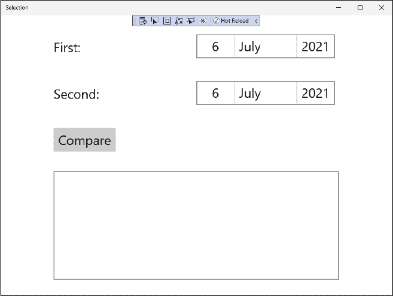

4. 选择 `Compare`。

   窗口下半部分的框中出现以下文本：

   点击此处查看代码图像

   ```
firstDate == secondDate : False
firstDate != secondDate : True
firstDate <  secondDate : False
firstDate <= secondDate : False
firstDate >  secondDate : True
firstDate >= secondDate : True
```

   布尔表达式 `firstDate == secondDate` 应该为 `true`，因为 `firstDate` 和 `secondDate` 都被设置为当前日期。但实际上，只有小于运算符和大于等于运算符似乎在正常工作。

5. 返回 Visual Studio 2022。在 `Debug` 菜单上，选择 `Stop Debugging`。

6. 在代码和文本编辑器窗口中显示 `MainPage.xaml.cs` 文件的代码。

7. 找到 `compareClick` 方法，它看起来如下：

   点击此处查看代码图像

   ```
private void compareClick(object sender, RoutedEventArgs e)
{
    int diff = dateCompare(firstDate.Date.LocalDateTime, secondDate.Date.LocalDateTime);
    info.Text = "";
    show("firstDate == secondDate", diff == 0);
    show("firstDate != secondDate", diff != 0);
    show("firstDate < secondDate", diff < 0);
    show("firstDate <= secondDate", diff <= 0);
    show("firstDate > secondDate", diff > 0);
    show("firstDate >= secondDate", diff >= 0);
}
```

   每当用户选择表单上的 Compare 按钮时，此方法就会运行。表达式 `firstDate.Date.LocalDateTime` 和 `secondDate.Date.LocalDateTime` 持有 `DateTime` 值；它们代表应用程序其他地方中 `firstDate` 和 `secondDate` 控件中显示的日期。`DateTime` 数据类型只是另一种数据类型，类似于 `int` 或 `float`，区别在于它包含子元素，你可以通过这些元素访问日期的各个部分，例如年、月或日。

   `compareClick` 方法将两个 `DateTime` 值传递给 `dateCompare` 方法。该方法的作用是比较日期，如果它们相同则返回整数值 `0`，如果第一个日期小于第二个日期则返回 `-1`，如果第一个日期大于第二个日期则返回 `+1`。如果一个日期在时间顺序上于另一个日期，则认为它大于后者。你将在下一步中检查 `dateCompare` 方法。

   `show` 方法在表单下部分的 info 框中显示比较结果。

8. 找到 `dateCompare` 方法，它看起来如下：

   点击此处查看代码图像

   ```
private int dateCompare(DateTime leftHandSide, DateTime rightHandSide)
{
    // TO DO
    return 42;
}
```

   无论参数值如何，此方法目前每次都返回相同的值，而不是 `0`、`1` 或 `+1`。这解释了为什么应用程序没有按照预期工作。你必须在此方法中实现逻辑以正确比较两个日期。

9. 从 `dateCompare` 方法中删除 `// TO DO` 注释和 `return` 语句。

10. 在 `dateCompare` 方法体中添加以下加粗显示的语句：

    点击此处查看代码图像

   ```
private int dateCompare(DateTime leftHandSide, DateTime rightHandSide)
{
    int result = 0;
    if (leftHandSide.Year < rightHandSide.Year)
    {
        result = -1;
    }
    else if (leftHandSide.Year > rightHandSide.Year)
    {
        result = 1;
    }
}
```

    **注意**

   现在不要尝试生成应用程序。`dateCompare` 方法尚未完成，生成将失败。

   如果表达式 `leftHandSide.Year < rightHandSide.Year` 为 `true`，则 `leftHandSide` 中的日期必须早于 `rightHandSide` 中的日期，因此程序将 result 变量设置为 `1`。否则，如果表达式 `leftHandSide.Year > rightHandSide.Year` 为 `true`，则 `leftHandSide` 中的日期必须晚于 `rightHandSide` 中的日期，程序将 result 变量设置为 `1`（注意：源文本包含一个逻辑错误，声称它两次设置为 1，但根据指令保留了语义）。

11. 找到 `dateCompare` 方法。在上一步输入的代码之后，为 `dateCompare` 方法添加以下加粗显示的语句：

    点击此处查看代码图像

   ```
private int dateCompare(DateTime leftHandSide, DateTime rightHandSide)
{
    ...
    else if (leftHandSide.Month < rightHandSide.Month)
    {
        result = -1;
    }
    else if (leftHandSide.Month > rightHandSide.Month)
    {
        result = 1;
    }
}
```

   这些语句用于比较年份。

   如果表达式 `leftHandSide.Month < rightHandSide.Month` 为 `false` 且 `leftHandSide.Month > rightHandSide.Month` 也为 `false`，则两个日期的月份属性必须相同，因此程序需要比较日期的日期。

12. 在上一步输入的代码之后，为 `dateCompare` 方法体添加以下加粗显示的语句。同时删除之前添加的 `return 42` 语句：

    点击此处查看代码图像

   ```
private int dateCompare(DateTime leftHandSide, DateTime rightHandSide)
{
    ...
    if (leftHandSide.Day < rightHandSide.Day)
    {
        result = -1;
    }
    else if (leftHandSide.Day > rightHandSide.Day)
    {
        result = 1;
    }
    else 
    {
       result = 0;
    }

    return result;
}
```

   你现在应该认识这种逻辑的形式了。

   如果 `leftHandSide.Day < rightHandSide.Day` 和 `leftHandSide.Day > rightHandSide.Day` 均为 `false`，则变量中的 `Day` 值必须相同。月份值和年份也必须分别相同，程序逻辑才能执行到此处。因此，两个日期是相同的，所以程序将 result 设置为 `0`。

   最后的语句返回存储在 `result` 变量值。

13. 在 `Debug` 菜单上，选择 `Start Debugging` 以重新生成并运行应用程序。

14. 选择 `Compare`。

   框中出现以下文本：

   点击此处查看代码图像

   ```
firstDate == secondDate : True
firstDate != secondDate : False
firstDate <  secondDate : False
firstDate <= secondDate : True
firstDate >  secondDate : False
firstDate >= secondDate : True
```

   这些是相同日期的正确结果。

15. 选择 `DatePicker` 控件为第二个日期选择一个较晚的日期（点击控件底部的标记确认选择）。然后选择 **Compare**。

   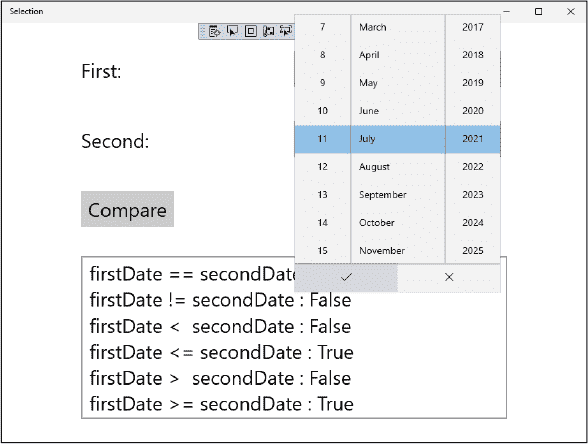

   框中出现以下文本：


点击此处查看代码

```
firstDate == secondDate: False
firstDate != secondDate: True
firstDate <  secondDate: True
firstDate <= secondDate: True
firstDate >  secondDate: False
firstDate >= secondDate: False
```

再次，当第一个日期早于第二个日期时，这些都是正确的运行。

16. 测试其他日期并验证结果是否符合你的预期。

17. 返回 Visual Studio 2022 并在完成后停止调试。

### 使用 switch 语句

有时当你编写级联的 `if` 语句时，每个 `if` 语句看起来都很相似，因为它们都在评估相同的表达式。唯一的区别在于，每个 `if` 都会将表达式的结果与不同的值进行比较。

例如，考虑以下代码块，它使用 `if` 语句来检查 `day` 变量中的值并确定它是星期几：

```
if (day == 0)
{
    dayName = "Sunday";
}
else if (day == 1)
{
    dayName = "Monday";
}
else if (day == 2)
{
    dayName = "Tuesday";
}
else if (day == 3)
{
    ...
}
else
{
    dayName = "Unknown";
}
```

在这些情况下，你可以将级联的 `if` 语句重写为 `switch` 语句，使你的程序更高效、更易读。

#### 理解 switch 语句语法

`switch` 语句的语法如下（`switch`、`case` 和 `default` 是关键字）：

点击此处查看代码

```
switch ( controllingExpression )
{
    case constantExpression :
        statements
        break;
    case constantExpression :
        statements
        break;
    ...
    default :
        statements
        break;
}
```

`controllingExpression` 必须在括号内，并且会被评估一次。然后，控制跳转到由 `constantExpression` 标识的代码块，该值等于 `controllingExpression` 的结果。（`constantExpression` 标识符也称为 case 标签。）

执行一直持续到 `break` 语句为止，此时 `switch` 语句结束，程序从 `switch` 语句右大括号后的第一个语句继续执行。如果没有一个 `constantExpression` 值等于 `controllingExpression` 的值，则运行可选的 `default` 标签下的语句。

 **注意**

每个 `constantExpression` 值必须是唯一的，这样 `controllingExpression` 才会只匹配其中一个。如果 `controllingExpression` 的值不匹配任何 `constantExpression` 值且没有 `default` 标签，程序执行将从 `switch` 语句右大括号后的第一个语句继续执行。

因此，你可以将之前的级联 `if` 语句重写为如下的 `switch` 语句：

点击此处查看代码

```
switch (day)
{
    case 0 :
        dayName = "Sunday";
        break;
    case 1 :
        dayName = "Monday";
        break;
    case 2 :
        dayName = "Tuesday";
        break;
    ...
    default :
        dayName = "Unknown";
        break;
}
```

#### 遵循 switch 语句规则

基本的 `switch` 语句非常有用，但你编写的任何 `switch` 语句必须遵循以下规则：

*   你只能对某些数据类型使用 `switch`，例如 `int`、`char` 或 `string`。对于任何其他类型，你必须使用 `if` 语句。

     **注意**

    你可以对 `float` 和 `double` 数据类型使用 `switch`，但这样做可能没有意义。这是因为浮点值是以近似值（尽管是非常精确的近似值）而不是确定值存储的。只有 `int`、`long` 和 `decimal` 等数值类型才有保证的值。

*   `case` 标签必须是常量表达式，例如如果 `switch` 数据类型是 `int`，则是 `42`；如果 `switch` 数据类型是 `char`，则是 `'42'`；如果 `switch` 数据类型是 `string`，则是 `"42"`。如果你需要在运行时计算你的 `case` 标签值，必须使用 `if` 语句。

*   `case` 标签必须是唯一的表达式。句话句话，两个 `case` 标签不能具有相同的值。

*   你可以通过提供一个 `case` 标签列表且中间没有插入语句，来指定你想对多个值运行相同的语句。在这种情况下，列表中最后一个标签的代码将为该列表中的所有情况执行。然而，如果一个标签有一个或多个关联语句，则执行将不能贯穿（fall through）到后续标签；在这种情况下，编译器会生成错误。以下代码片段说明了这些点：

    点击此处查看代码

    ```
    switch (trumps)
    {
        case "Hearts" :
        case "Diamonds" :    // 允许贯穿 - 中间没有代码
            color = "Red";    // 为 Hearts 和 Diamonds 执行代码
            break;
        case "Clubs" :
            color = "Black";    // 错误 - 标签之间有代码
            break;
        case "Spades" :
            color = "Black";
            break;
    }
    ```

     **注意**

`break` 语句是停止贯穿的最常用方法，但你也可以使用 `return` 语句退出方法或使用 `throw` 语句生成异常并终止 `switch` 语句。


`copyOne` 方法将作为输入参数指定的字符复制到下方框中显示的文本末尾。目前，`copyOne` 包含一个带有单一默认（default）操作的 `switch` 语句。在接下来的几个步骤中，你将修改此 `switch` 语句，将 XML 中有意义的字符转换为相应的 XML 映射。例如，`<` 字符将被转换为字符串 `&lt;`。

8. 在 `switch` 语句的左括号之后、`default` 标签之前，添加以下**加粗**显示的语句：

    点击此处查看代码图片

    ```
    switch (current)
    {
        case '<' :
            target.Text += "&lt;";
            break;
        default:
            target.Text += current;
            break;
    }
    ```

    如果当前复制的字符是左角括号（`<`），则前面的代码会将字符串 `"&lt;"` 附加到输出的文本中以替换它。

9. 在 `switch` 语句中，位于你刚刚添加的 `break` 语句之后、`default` 标签之上，添加以下**加粗**显示的 case：

    点击此处查看代码图片

    ```sharp
    case '<' :
        target.Text += "&lt;";
        break;
    case '>' :
        target.Text += "&gt;";
        break;
    case '&' :
        target.Text += "&amp;";
        break;
    case '\"' :
        target.Text += "&#34;";
        break;
    case '\'' :
        target.Text += "&#39;";
        break;
    default:
        target.Text += current;
        break;
    ```

     注意事项

    单引号（`'`）和双引号（`"`）在 C# 中有特殊含义。它们被用于界定字符常量和字符串常量。最后两个 `case` 标签中的反斜杠（`\`）是转义字符，它使 C# 编译器将这些字符视为字面量而不是分隔符。

10. 在**调试**（Debug）菜单上，选择**开始调试**（Start Debugging）。

11. 在上方框中输入以下文本：

    点击此处查看代码图片

    ```
    inRange = (lo <= number) && (hi >= number);
    ```

12. 选择**复制**（Copy）。

    该语句被复制到下方框中。这一次，每个字符都经过了 `switch` 语句中实现的 XML 映射。目标框显示以下文本：

    点击此处查看代码图片

    ```
    inRange = (lo &lt;= number) &amp;&amp; (hi &gt;= number);
    ```

13. 使用其他字符串进行实验，并验证所有特殊字符（`<`、`>`、`&`、`"` 和 `'`）都被正确处理。

14. 返回 Visual Studio 并停止调试。

### 使用模式匹配的 switch 表达式

使用模式匹配的 switch 表达式

`switch` 语句非常强大，但有时可能难以理解。`switch` 表达式与 `switch` 语句类似，不同之处在于简洁得多。假设你想确定 `current` 落在哪个范围。下面的 `switch` 表达式展示了点击此处查看代码图片

```csharp
range = current switch
{
    '<' => "&lt;",
    '>' => "&gt;",
    '&' => "&amp;";
    '\"' => "&#34;";
    '\'' => "&#39;";
    _ => current
};
```

关于 `switch` 表达式的关键点：

*   `switch` 表达式必须产生一个值。
*   `switch` 表达式必须是完备的（它必须处理所有可能的值）。使用下划线 `_` 作为通配符模式。
*   `=>` 运算符将模式与结果分开。
*   `switch` 表达式不使用 `break` 语句。

使用 switch 表达式

1. 返回你之前过的 **Switch** 练习。它目前看起来是这样：点击此处查看代码图片

    ```csharp
    private void copyOne(char current)
    {
        switch (current)
        {
            case '<':
                target.Text += "&lt;";
                break;
            case '>':
                target.Text += "&gt;";
                break;
            case '&':
                target.Text += "&amp;";
                break;
            case '\"':
                target.Text += "&#34;";
                break;
            case '\'':
                target.Text += "&#39;";
                break;
            default:
                target.Text += current;
                break;
        }
    }
```

2. 移除整个 `switch` 语句并将其替换为如下所示 `switch` 表达式：点击此处查看代码图片

    ```csharp
    private void copyOne(char current)
    {
        target.Text += current switch
        {
            '<' => "&lt;",
            '>' => "&gt;",
            '&' => "&amp;",
            '\"' => "&#34;",
            '\'' => "&#39;";
            _ => current
        };
    }
    ```

    该表达式通过模式匹配来确定附加到屏幕输出的值。注意结尾的通配 case 使用下划线（`_`）作为模式。此外，忘记在语句结尾添加分号。

    此表达式比使用的 `switch` 语句更简洁、更易读。

3. 在**调试**（Debug）菜单上，选择**开始调试**（Start Debugging）。

4. 在上方框中输入以下文本：

    ```csharp
    inRange = (lo <= number) && (hi >= number);
    ```

5. 选择**复制**。然后验证程序功能是否与之前一致。

6. 返回 Visual Studio 并停止调试。

### 总结

在本章中，你学习了布尔表达式和变量。你了解了如何在 `if` 和 `switch` 语句中使用布尔表达式让程序做出决策，并通过布尔运算符组合了布尔表达式。

*   如果你想继续下一章，请保持 Visual Studio 2022 运行并转到第 5 章“使用复合赋值和迭代语句](#ch05.xhtml_ch05)”。

*   如果你现在想退出 Visual Studio 2022，在“文件”菜单上选择“退出”。如果看到保存对话框，选择“是”并保存项目。

### 快速参考

| 要 | 执行此操作 |


| 确定两个值是否等价 | 使用 `==` 运算符或 `!=` 运算符。例如：`answer == 42` |
| 比较两个表达式的值 | 使用 `<`, `<=`、`>` 或 `>=` 运算符。例如：`age >= 21` |
| 布尔变量 | 使用 `bool` 关键字作为变量的类型。例如：`bool inRange;` |
| 创建仅当两个条件都为真时为真的布尔表达式 | 使用 `&&` 运算符。例如：点击此处查看代码图片
```
inRange = (lo <= number) && (number <= hi);
``` |
| 创建两个条件任一为真时为真的布尔表达式 | 使用 `||` 运算符。例如：点击此处查看代码图片
```
outOfRange = (number < lo) || (hi < number);
``` |
| 如果条件为真则执行语句 | 使用 `if` 语句。例如：
```
if (inRange)
    process();
``` |
| 如果条件为真则执行多条语句 | 使用 `if` 语句和块。例如：
```
if (seconds == 59)
{
    seconds = 0;
    minutes++;
}
``` |
| 根据控制表达式的不同值关联不同的语句 | 使用 `switch` 语句。例如：
```
switch (current)
{
    case 0:
        ...;
    case 1:
        ...;
    default:
        ...;
}
``` |
| 根据控制表达式的不同值为变量赋值 | | 使用 `switch` 。。：[此处此处查看代码
```
 result result switch
{
    < 0 => "below zero",
    0 => "zero",
    > 0 and < 100 => "between zero and a hundred",
    _ => "greater than a hundred"
};


# 5 章 复合赋值与循环语句

完成本章后，你将能够：

* 使用复合赋值运算符更新变量的值。
* 编写 `while`、`for` 和 `do` 循环语句。
* 通过 `do` 语句并观察变量值的变化。

第 4 章判断语句](#ch04.xhtml)”演示了如何使用 `if` 和 `switch` 结构来选择性地执行语句。在本章中，你将学习如何使用各种迭代（或循环）语句来重复执行一个或多个语句。编写迭代语句时，通常需要控制迭代的次数。为了简化这一过程，你将开始学习特殊的赋值运算符，在这种情况下你应该在每次迭代时更新变量的值，并在变量达到特定值时停止过程。

### 使用复合赋值运算符

你已经见过如何使用算术运算符创建新值。例如，以下语句使用加运算符（`+`）向控制台显示比变量 `answer` 大 2 的值：点击此处查看代码图片
```
Console.WriteLine(answer + 2);
```
```)

你还见过如何使用赋值语句来改变变量的值。以下语句使用赋值运算符（`=`）将 `answer` 的值改为 2：

```
answer = 2;
```

如果你想给变量的值加 2，可以结合赋值运算符和加运算符。例如，以下语句将 `answer` 加 2。执行该语句后，`answer` 的值比之前增加了 2：

```
answer = answer + 2;
```

虽然这种语句有效，但你可能永远看不到资深程序员这样写代码。给变量赋值是非常常见的操作，因此 C# 提供了一种使用 `+=` 运算符以快捷方式完成此任务的方法。因此，为了给 `answer` 加 2，你可以写以下语句：

```
answer += 2;
```

你可以使用这种符号将任何算术运算符与赋值运算符结合，如下所示。这些运算符统称为复合赋值运算符。

| 不要这样写 | 这样写 |
| --- | --- |
| `variable = variable * number;` | `variable *= number;` |
| `variable = variable / number;` | `variable /= number;` |
| `variable = variable % number;` | `variable %= number;` |
| `variable = variable + number;` | `variable += number;` |
| `variable = variable - number;` | `variable -= number;` |

 **提示**

复合赋值运算符的优先级与简单赋值运算符（`=`）相同。

`+=` 运算符也作用于字符串；它将一个字符串附加另一个字符串的末尾。例如，以下代码显示“Hello”：

```
string name = "John";
string greeting = "Hello ";
greeting += name;
Console.WriteLine(greeting);
```

 **提示**

在对变量进行加减时，使用增加（`++`）和递减（`--`）运算符而不是复合赋值。例如，将

```
count += 1;
```

替换为

```
count++;
```

## 编写 while 语句

你使用 `while`语句在条件为真时重复执行语句。`while`语句的语法如下：

```
while ( booleanExpression )
    statement
```

评估布尔表达式（必须放在括号内）。如果结果为 `true`，则执行语句，并再次评估布尔表达式。如果结果仍为 `true`，则重复语句并再次评估布尔表达式。这个过程一直持续，直到布尔表达式结果为 `false`，此时 `while` 语句退出。执行将继续 `while` 语句之后的第一个语句。

`while`语句与`if`语句具有以下语法上的相似性（事实上，除了关键字外完全相同）：

* 表达式必须是一个布尔表达式。
* 布尔表达式必须写在括号内。
* 如果布尔表达式首次评估时为 `false`，则语句不执行。
* 如果你想在`while`语句的控制下执行两个或多个语句，必须使用大括号将这些语句分组在一个块中。

这里有一个`while`语句向控制台写入 `0` 到 `9` 的值。注意，一旦变量 `i` 达到值 `10`，`while`语句就会结束，语句块中的代码将不再执行：

```
int i = 0;
while (i < 10)
{
    Console.WriteLine(i);
    i++;
}
```

所有的 `while`语句都应该在某个点终止。初学者常见的错误是忘记包含一个语句使布尔表达式最终结果为 `false` 并终止循环，这会导致程序无限运行。在示例中，`i++;`语句承担了这一角色。

 **注意**

`while`循环中的变量 `i` 控制了循环执行的迭代次数。这是一种惯用法，执行该角色的变量有时被称为哨变量。你还可以创建嵌套循环（循环内部循环）。在这种情况下，通常会扩展这种命名模式，使用字母 `j`、`k` 甚至 `l` 作为控制这些循环迭代的哨变量名。


与 `if` 语句一样，建议你始终为 `while` 语句使用块，即使该块只包含一条语句。这样，如果你以后决定向 `while` 构造体的体中添加更多语句，就能清楚地看出应该将它们添加到块中。如果你不这样做，只有紧跟在 `while` 构造中布尔表达式后面的第一条语句将作为循环的一部分执行，从而导致类似难以发现的错误：

```c
int i = 0;
while (i < 10)
    Console.WriteLine(i);
    i++;
```

这段代码会无限迭代，显示无限数量的零，因为只有 `Console.WriteLine` 语句作为 `while` 构造的一部分执行，而不是 `i++;` 语句。

在接下来的练习中，你将编写一个 `while` 循环来逐行遍历文本文件的内容，并将每行写入表单中的一个文本框中。

## 编写 while 语句

1. 使用 Microsoft Visual Studio 2022，打开 `WhileStatement` 解决方案，它位于你**文档**（Documents）文件夹中的 `\Microsoft Press\VCSBS\Chapter 5\WhileStatement` 文件夹下。

2. 在**调试**（Debug）菜单上，选择**开始调试**（Start Debugging）。Visual Studio 2022 会编译并运行应用程序。该应用程序是一个简单的文本查看器，你可以用它选择文本文件并显示其内容。

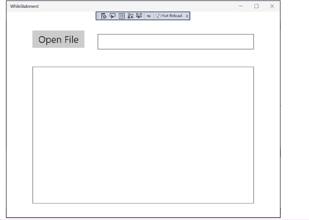

3. 选择**打开文件**（Open File）。打开对话框将出现并显示文档文件夹中的文件。（你计算机上的文件和文件夹列表可能与此处显示的不同。）你可以使用此对话框移动到文件夹并选择一个文件进行显示。

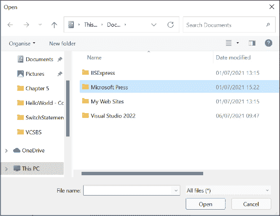

4. 移动到你**文档**文件夹中的 `\Microsoft Press\VCSBS\Chapter 5\WhileStatement\WhileStatement` 文件夹。

5. 选择文件 `MainPage.xaml.cs`，然后选择**打开**（Open）。文件名 `MainPage.xaml.cs` 出现在表单顶部的框中，但文件内容没有出现在大文本框中。这是因为你还没有实现读取文件内容并将其显示的代码。你将在接下来的步骤中添加此功能。

6. 返回 Visual Studio 2022 并停止调试。

7. 在代码和文本编辑器（Code and Text Editor）窗口中显示 `MainPage.xaml.cs` 文件的代码，并找到 `openFileClick` 方法。当用户在打开对话框中选择打开按钮选择文件时，会运行此方法。此时你不需要理解该方法如何运作的确切细节；只需接受该方法会提示用户选择文件（使用 `FileOpenPicker` 对象）并打开所选文件进行读取即可。

`openFileClick` 方法中的最后两个语句非常重要。它们看起来如下：

点击此处查看代码图像

```csharp
TextReader reader = new StreamReader(inputStream.AsStreamForRead()); 
displayData(reader);
```

第一条语句声明了一个名为 `reader` 的 `TextReader` 变量。`TextReader` 是 .NET 库提供的一个类。你可以使用此类从文件等源读取字符流。它位于 `System.IO` 命名空间。这条语句使得用户在 `FileOpenPicker` 对象中指定的文件数据对 `TextReader` 对象可用，然后可以使用它来从文件中读取数据。

最后一条语句调用了名为 `displayData` 的方法，并将 `reader` 作为参数传递给该方法。`displayData` 方法使用 `reader` 对象读取数据并显示在屏幕上（一旦你编写了完成此任务的代码，它就会执行操作）。

8. 检查 `displayData` 方法。它目前看起来如下：

点击此处查看代码图像

```csharp
private void displayData(TextReader reader)
{
    // TODO: add while loop here
}
```

你可以看到，除了注释外，此方法目前是空的。这里是你需要添加获取和显示数据的地方。

9. 将 `// TODO: add while loop here` 注释替换为以下语句：

`source.Text = "";`

`source` 变量指的是表单上的大框。将其 `Text` 属性设置为空字符串（`""`）将清除框中当前显示的任何文本。

10. 在你添加到 `displayData` 方法的上一行之后，添加以下语句：

`string line = reader.ReadLine();`

这条语句声明了一个名为 `line` 的 `string` 变量，并调用 `reader.ReadLine` 方法从文件中读取第一行到此变量中。该方法返回文件的下一行文本，或者在没有更多可读行时返回一个特殊值 `null`。

11. 在你刚刚输入的代码之后，向 `displayData` 方法添加以下语句：

点击此处查看代码图像

```csharp
while (line is not null)
{
    source.Text += line + '\n';
    line = reader.ReadLine();
}
```

这是一个 `while` 循环在 `line` 不为空时运行，直到没有更多可用行。循环头部表达式检查 `line` 变量的值。如果不为空，循环体会将当前行追加到 `source.Text`，并带上换行符（`'\n'`）。（`ReadLine` 方法在读取时会剥离换行符，因此代码需要将其添加回来。）`while` 循环随后读取下一行文本进行下一次迭代。

12. 在 `while` 循环结束的大括号之后，输入以下语句：

`reader.Dispose();`

这条语句释放与文件相关的资源并将其关闭。这是一种良好的做法，因为它允许其他应用程序使用文件，并释放访问文件所需的内存和其他资源。

13. 在**调试**菜单上，选择**开始调试**。

14. 当表单出现时，选择**打开文件**。

15. 在打开对话框中，移动到**文档**文件夹中的 `\Microsoft Press\VCSBS\Chapter 5\WhileStatement\WhileStatement` 文件夹，选择文件 `MainPage.xaml.cs`，然后选择**打开**。

>**注意：**

不要尝试打开不包含文本的文件。例如，如果你尝试打开可执行程序或图形文件，应用程序将仅显示文件二进制信息的文本表示。如果文件很大，可能会导致应用程序挂起，需要你强制终止。

这次，所选文件的内容出现在框中；你应该能认出正在编辑的代码。下面的图像显示了运行的应用程序：

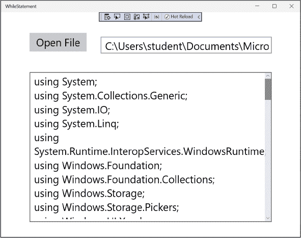

16. 滚动框中的文本并找到 `displayData` 方法。验证该方法包含你刚刚添加的代码。

17. 返回 Visual Studio 并停止调试。

## 编写 for 语句

在 C# 中，大多数 `while` 语句具有以下通用结构：

```csharp
initialization
while (Boolean expression)
{
  statement
  update control variable
}
```


C# 中的 `for` 语句通过结合初始化、布尔表达式以及更新控制变量的代码，为这种结构提供了一个更正式的版本。你会发现 `for` 语句非常有用，因为在 `for` 语句中，很难不小心遗漏掉初始化或更新控制变量的代码，所以你写出无限循环代码的可能性更小。以下是 `for` 语句的语法：

点击此处查看代码图像

```
for (初始化; 布尔表达式; 更新控制变量) 语句
```

构成 `for` 结构主体的语句可以是单行代码，也可以是花括号括起来的代码块。

你可以将之前显示的显示 0 到 9 整数的 `while` 循环重写为如下 `for` 循环：

```
for (int i = 0; i < 10; i++)
{
    Console.WriteLine(i);
}
```

初始化只发生一次，位于循环的最开始处。然后，如果布尔表达式的值为 `true`，则执行该语句。接着进行控制变量的更新，然后重新评估布尔表达式。如果条件仍然为 `true`，则再次执行该语句，更新控制变量，再次评估布尔表达式，以此此类推。

注意，初始化只发生一次，循环体中的语句始终在更新之前执行，而更新发生在布尔表达式重新评估之前。

 提示

与 `while` 语句一样，即使 `for` 循环的主体只包含单个语句，始终使用代码块也被认为是一种良好的做法。如果你以后在 `for` 循环体中添加了更多语句，这种方法有助于确保你的代码始终作为每次迭代的一部分执行。

你可以省略 `for` 语句的三个部分中的任何部分。如果你省略了布尔表达式，它默认为 `true`，因此接下来的 `for` 语句将无限运行：

点击此处查看代码图像

```
for (int i = 0; ;;++)
{
    Console.WriteLine("somebody stop me!")
}
```

如果你省略了初始化和更新部分，你就得到了一个拼写奇特的 `while` 循环：

```int
int i = 0;
for (; i < 10; )
{
    Console.WriteLine(i);
    i++;
}
```

 注意

`for` 语句的初始化、布尔表达式和更新控制变量部分始终始终分号隔开，即使在被省略时也是如此。

你还可以在 `for` 循环中提供多个初始化和多个更新。（不过，你只能有一个布尔表达式。）要实现这一点，请用逗号分隔各种初始化和更新，如下例所示：

点击此处查看代码图像

```
for (int i = 0, j = 10; i <= j; i++, j--)
{
    ...
}
```

作为最后一个示例，这里是将上一个练习中的 `while` 循环重构为 `for` 循环的写法：

点击此处查看代码图像

```
for (string line = reader.ReadLine(); line is not null; line = reader.ReadLine())
{
    source.Text += line + '\n';
}
```

### 编写 do 语句

`while` 和 `for` 语句都在循环开始时测试它们的布尔表达式。这意味着如果表达式在第一次测试时评估为 `false`，则循环体不会运行（即使只有一次）。`do` 语句则不同：它的布尔表达式在每次迭代后评估，因此循环体至少执行一次。

`do` 语句的语法如下（不要忘记最后的分号）：

```
do
    语句
while (布尔表达式);
```

如果循环体包含多个语句，你必须使用语句块。（如果不这样做，编译器将报告语法错误。）这里有一个使用 `do` 语句向控制台输出 0 到 9 的示例：

```
int i = 0;
do
{
    Console.WriteLine(i);
    i++;
}
while (i < 10);
```

接下来的练习中，你将编写一个 `do` 语句将正整数转换为八进制表示。该程序基于以下算法，它遵循一个已知的数学步骤：

点击此处查看代码图像

```
将十进制数存储在变量 dec 中
do
    将 dec 除以 8 并存储余数
将 dec 设置为上一步的商
while dec 不等于零
反序组合每次计算存储的余数
```

例如，假设你想将十进制数字 999 转换为八进制。执行以下步骤：

1. 999 除以 8，商为 124，余数为 7。
2. 124 除以 8，商为 15，余数为 4。
3. 15 除以 8，商为 1，余数为 7。
4. 1 除以 8，商为 0，余数为 1。
5. 反序组合每次计算存储的余数：177。

要实现此功能，请打开 `MainPage.xaml.cs` 并找到 `showStepsClick` 方法。目前该方法是空的：

```csharp
private void showStepsClick(object sender, RoutedEventArgs e)
{
    int amount = int.Parse(number.Text);
    steps.Text = "";
    string current = "";
}
```

将以下 `do` 语句（加粗部分）添加到 `showStepsClick` 方法中：

```csharp
private void showStepsClick(object sender, RoutedEventArgs e)
{
    int amount = int.Parse(number.Text);
    steps.Text = "";
    string current = "";

    do
    {
        int nextDigit = amount % 8;
        amount /= 8;
        int digitCode = '0' + nextDigit;
        char digit = Convert.ToChar(digitCode);
        current = digit + current;
        steps.Text += current + "\n";
    }
    while (amount != 0);
}
```


请注意循环体至少运行一次。这种行为正是所需的，因为即使是数字 `0` 也有一个八进制位。

仔细观察代码；你会发现 `do` 循环执行的第一条语句是这个：

```
int nextDigit = amount % 8;
```

该语句声明了一个名为 `nextDigit` 的 `int` 变量，并将其初始化为 `amount` 中的值除以 `8` 后的余数。这将会是 0 到 7 之间的某个数字。

`do` 循环中的下一条语句是：

```
amount /= 8;
```

这是一个复合赋值语句，等同于编写 `amount = amount / 8`。如果 `amount` 的值为 `999`，在执行该语句后 `amount` 的值变为 `124`。

下一条语句是：

点击此处查看代码图像

```
int digitCode = '0' + nextDigit;
```

这条语句需要稍微解释一下。根据操作系统使用的字符集，字符都有唯一的代码。在 Windows 操作系统经常使用的字符集中，字符 `'0'` 的代码整数值为 48。字符 `'1'` 的代码是 49，字符 `'2'` 的代码是 50，以此此类推，直到字符 `'9'` 的代码，其整数值为 57。

在 C# 中，你可以将字符视为整数并对其进行算术运算，但当你这样做时，C# 使用字符的代码作为值。因此，表达式 `'0' + nextDigit` 实际上的结果是 48 到 55 之间的某个值（记住 `nextDigit` 将在 0 到 7 之间），对应于相应八进制位的代码。

`do` 循环中的第四条语句是：

点击此处查看代码图像

```
char digit = Convert.ToChar(digitCode);
```

该语句声明了一个名为 `digit` 的 `char` 变量，并将其初始化为 `Convert.ToChar(digitCode)` 方法调用的结果。`Convert.ToChar` 方法接收一个持有字符代码的整数并返回相应的字符。例如，如果 `digitCode` 的值为 `54`，`Convert.ToChar(digitCode)` 将返回字符 `'6'`。

总结一下，`do` 循环中的前四条语句确定了代表用户输入数字的对应的最低位（最右侧）八进制位的字符。下一个任务是将此数字附加到要输出的字符串前面，如下所示：

```
current = digit + current;
```

`do` 循环中的下一条语句是这个：

```
steps.Text += current + "\n";
```

该语句向 Steps 框中添加了包含为止该数字八进制表示所产生的数字的字符串。它还追加了一个换行符，以便转换的每个阶段都显示在框中单独的一行。

最后，对循环末尾 `while` 子句中的条件进行评估：

```
while (amount != 0);
```

由于 `amount` 的值尚未为 0，循环将执行另一次迭代。

在本章的最后一个练习中，你将使用 Visual Studio 2022 调试器逐步执行之前的 `do` 语句，帮助你理解它是如何工作的。

### 逐步执行 do 语句

1. 在显示 `MainPage.xaml.cs` 文件的代码和文本窗口中，将光标移动到 `showStepsClick` 方法的第一条语句：

点击此处查看代码图像

```
int amount = int.Parse(number.Text);
```

2. 在第一条语句的任意位置点击右键，然后选择**运行到光标**（Run To Cursor）。

3. 表单出现后，在左侧 Number Box 中输入 **999**，然后选择**显示步骤**（Show Steps）。

程序停止，你进入了 Visual Studio 2022 调试模式。代码和文本窗口左侧边距中的黄色箭头和代码上的黄色高亮表示当前语句。

4. 在代码和文本窗口下方的窗口中，选择**本地变量**（Locals）选项卡，如下图所示：

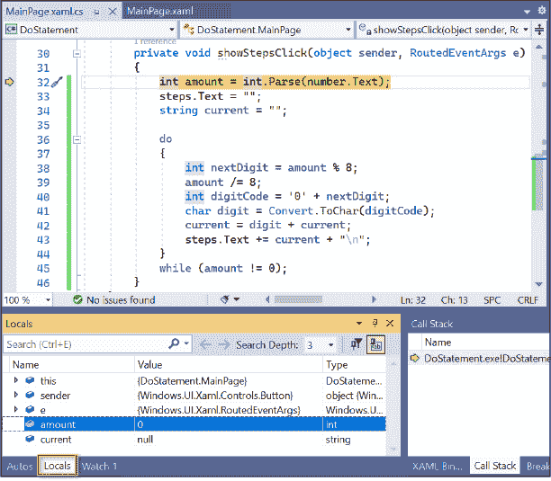

本地变量窗口显示了当前方法中局部变量的名称、值和类型，包括 `amount` 局部变量。注意 `amount` 的值当前为 `0`。

5. 如果调试工具栏可见，请显示它。（在**视图**（View）菜单上，悬停在**工具栏**（Toolbars）上，然后选择**调试**（Debug）。）

 **注意**

调试工具栏上的命令在菜单栏上显示的调试菜单中也可用。

6. 在调试工具栏上，选择**单步**（Step Into）按钮。

调试器执行以下语句：

点击此处查看代码图像

```
int amount = int.Parse(number.Text);
```

`amount` 的值变为 `999`，黄色箭头移动到下一条语句。

7. 选择**单步**（Step Into）。

调试器执行这条语句：

```
steps.Text = "";
```

该语句不影响本地变量，因为 `steps` 是表单控件而非局部变量。光标移动到下一条语句。

8. 选择**单步**（Step Into）。

调试器执行此语句：

```
int nextDigit = amount % 8;
```

本地变量中 `nextDigit` 的值变为 `7`。这是 999 除以 8 后的余数。

9. 选择**单步**（Step Into）。

调试器执行此语句：

```
amount /= 8;
```

本地变量中 `amount` 的值变为 `124`。

10. 选择**单步**（Step Into）。

调试器执行此语句：

点击此处查看代码图像

```
int digitCode = '0' + nextDigit;
```

本地变量中 `digitCode` 的值变为 `55`。这是字符 `'7'` 的代码（48 + 7）。

11. 选择**单步**（Step Into）。

调试器继续执行此语句：

```
char digit = Convert.ToChar(digitCode);
```

本地变量中 `digit` 的值变为 `'7'`。本地变量窗口显示 `char` 值同时使用了数值（此处为 `55`）和字符表示（`('7')`）。

注意本地变量窗口中 `current` 变量的值仍为 `""`。

12. 选择**单步**（Step Into）。

调试器执行以下语句：

```
current = current + digit;
```

本地变量中 `current` 的值变为 `'7'`。

13. 选择**单步**（Step Into）。

调试器执行此处语句：

```
steps.Text += current + "\n";
```

该语句在 Steps 框中显示文本 `7`，并在其追加一个换行符，以便后续输出显示在框中的下一行。（该表单当前被 Visual Studio 遮住了，所以你无法看到。）光标移动到 `do` 循环结束处的大括号。

14. 选择**单步**（Step Into）。

黄色箭头移动到 `while` 语句以评估 `do` 循环是否已完成或需要进行另一次迭代。

15. 选择**单步**（Step Into）。

调试器执行此语句。


```
while (amount != 0);
```

`amount` 的值为 `124`，表达式 `124 != 0` 的求值为 `true`，因此 `do` 循环会执行另一次迭代。黄色箭头跳回 `do` 循环开始处的大括号。

18. 选择 `Step Into`（逐入）。

黄色箭头再次移动到 `do` 内部的第一语句。

19. 重复选择 `Step Into` 以逐步执行 `do` 循环的下三次迭代，并观察 `Locals`（局部）窗口中变量值的变化。

20. 在循环第四次迭代结束时，`amount` 的值为 `0`，`current` 的值为 `"1747"`。黄色箭头位于 `do` 循环结束处的 `while` 条件处：

```
while (amount != 0);
```

由于 `amount` 的值现在为 `0`，表达式 `amount != 0` 的求值为 `false`，因此 `do` 循环终止。

21. 选择 `Step Into`（逐入）。

调试器评估 `while` 语句。

正如预期的，`do` 循环结束，黄色箭头移动到 `showStepsClick` 方法结束处的大括号。

22. 在 `Debug`（调试）菜单上，选择 `Continue`（继续）。

表单出现，显示了创建 999 的八进制表示所使用的四个步骤：7、47、747 和 1747。

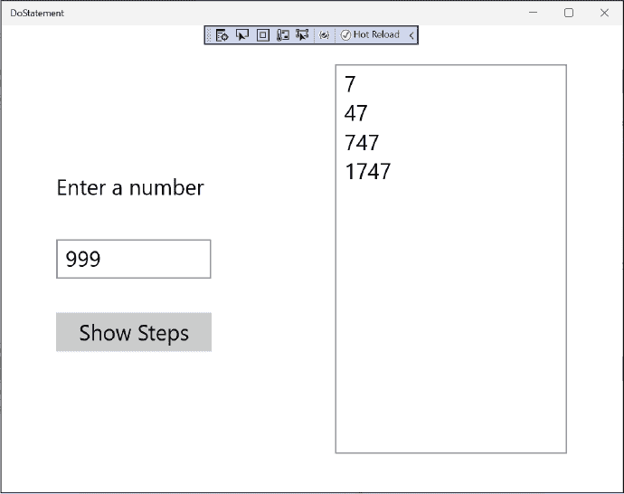

23. 回到 Visual Studio 2022。在 `Debug`（调试）菜单上，选择 `Stop Debugging`（停止调试）。

### 总结

在本章中，你学习了如何使用复合赋值运算符来更新数值变量并将一个字符串附加到另一个字符串末尾（注：此处原文意为“将一个字符串附加到另一个”）。你还了解了如何使用 `while`、`for` 和 `do` 语句在某些布尔条件为 `true` 时重复执行代码。

*   如果你想继续下一章，请保持 Visual Studio 2022 运行并转到第 6 章“管理错误和异常](#ch06.xhtml_ch06)”。

*   如果你现在想退出 Visual Studio 2022，在 `File`（文件）菜单上选择 `Exit`（退出）。如果看到保存对话框，选择 `Yes`（是）并保存项目。

### 快速参考

| 目的 | 执行操作 |
| --- | --- |
| 给变量增加数值 | 使用复合加运算符。例如：``variable += amount;` |
| 从变量中减去数值 | 使用复合减运算符。例如：``variable -= amount;` |
| 当条件为真时零次或多次运行一条或多个语句 | 使用 `while` 语句。例如:点击此处查看代码图像 

```
int i = 0; while (i < 10) 
{ 
    Console.WriteLine(i); 
    i++; 
}
```
或者，使用 `for` 语句。例如：
```
for (int i = 0; i < 10; i++) 
{ 
    Console.WriteLine(i); 
}
``` |
| 重复执行语句一次或多次 | 使用 `do` 语句。例如： 

```
int i = 0;
do 
{ 
    Console.WriteLine(i); 
    i++; 
} 
while (i < 10);
``` |

## 第 6 章

## 管理错误和异常

**完成本章后，你将能够：**

*   使用 `try`、`catch` 和 `finally` 语句处理异常。
*   使用 `checked` 和 `unchecked` 关键字控制整数溢出。
*   使用 `throw` 关键字从你自己的方法抛出异常。
*   通过使用 `finally` 块确保代码在发生异常后始终始终运行。

你现在已经了解了执行常见任务所需的 C# 核心语句，例如编写方法、声明变量、使用运算符创建值、编写 `if` 和 `switch` 语句以选择性地运行代码，以及编写 `while`、`for` 和 `do` 语句以重复运行代码。然而，此前的章节还没有考虑出现问题的可能性（或概率）。

坏事有时会发生是生活的事实。轮胎会爆胎，电池会耗尽，螺丝刀永远不在你放过的地方，而你的应用程序的用户会以不可预测的方式行为。在计算机世界中，硬盘会损坏，运行在程序程序同一台计算机上的其他程序会失控并耗尽所有可用内存，无线网络连接会在最尴尬的时刻消失。即使是自然现象，如附近的闪电，如果它导致停电或网络故障，也会产生影响。程序运行时几乎在任何阶段都可能发生错误，而且许多错误实际上并不是你应用程序的错。那么，你如何检测它们并尝试恢复它们呢？

多年年来，已经进化出了几种机制。像 UNIX 等旧系统采用的典型方法是让操作系统在方法失败时设置一个特殊的全局变量。然后，在每次调用方法后，你检查全局变量以查看该方法是否成功。C# 和大多数其他现代面向对象的语言并不以这种方式处理错误；这太痛苦了。相反，它们使用异常。如果你想编写健壮的 C# 代码，你需要了解异常。

在第一部分的最后一个章节中，你将学习 C# 如何使用异常表示发生了错误，以及如何使用 `try`、`catch` 和 `finally` 语句来捕获和处理这些。在本章结束时，你将掌握 C# 的所有基础元素，并在第二部分中在此基础上构建。

### 测试代码并捕获异常

确保代码按预期工作非常困难。失败可能由于很多原因，其中许多是你无法控制的。你编写任何应用程序都必须检测失败并优雅地处理，要么采取相应的纠正措施，要么在不可能的情况下以清晰的方式向用户报告失败原因。

错误可能发生在任何时间。使用传统技术在每个语句周围手动添加错误检测代码既费时又容易出错。如果每个语句都需要扭的错误处理逻辑来管理每个错误，你可能会丢失应用程序的主流程。

幸运的是，C# 通过异常和异常处理程序使错误处理代码与实现程序逻辑的代码分离。要编写异常感知程序，你需要做两件事：

*   将你的代码写在 `try` 块中（`try` 是 C# 关键字）。当代码运行时，它尝试执行 `try` 块中的所有语句，如果没有任何语句生成异常，它们将按顺序全部执行直到完成。然而，如果发生错误条件，执行将跳出 `try` 块并进入另一个旨在捕获和处理异常的代码：`catch` 处理程序。

*   在 `try` 块之后立即编写一个或多个 `catch` 处理程序（`catch` 是另一个 C# 关键字），以处理任何可能的错误情况。`catch` 处理程序旨在捕获并处理特定类型的异常。你可以在 `try` 块之后有多个 `catch` 处理程序，每个程序都设计用于拦截和处理特定的异常。这允许你为 `try` 块中可能出现的错误提供不同的处理器。如果 `try` 块中的任何一个语句导致错误，运行时将抛出异常。运行时随后检查 `try` 块之后的 `catch` 处理程序，并将控制权转移到第一个匹配的处理器处。


这是一个 `try` 块的示例，其中包含的代码尝试将用户在表单某些框中输入的字符串转换为整数值。代码随后调用一个方法来计算一个值，并将结果写入另一个框中。将字符串转换为整数要求该字符串包含一组有效的数字，而不是某些任意的字符序列。如果字符串包含无效字符，`int.Parse` 方法将抛出 `FormatException`，执行将转移到相应的 `catch` 处理器。当 `catch` 处理器执行完毕后，程序将继续执行该处理器之后的第一个语句。（如果没有与异常相对应的处理器，则称该异常为未处理的；稍后将描述这种情况。）

点击此处查看代码图像

```
try
{
    int leftHandSide = int.Parse(lhsOperand.Text);
    int rightHandSide = int.Parse(rhsOperand.Text);
    int answer = doCalculation(leftHandSide, rightHandSide);
    result.Text = answer.ToString();
}
catch (FormatException fEx)
{
    // Handle the exception
    ...
}
```

`catch` 处理器使用的语法类似于方法参数的语法，用于指定要捕获的异常。在前面的示例中，当抛出 `FormatException` 时，变量 `fEx` 将填充一个包含异常详细信息的对象。

`FormatException` 类型有几个属性可以进行检查，以确定异常的的确切原因。这些属性中的许多是所有异常共的。例如，`Message` 属性包含导致异常的错误的文本描述。你可以在处理异常时使用这些信息，例如将详细信息记录在日志文件中，或向用户显示有意义的消息，然后要求用户重试。

### 未处理的异常

如果 `try` 块抛出异常且没有相应的 `catch` 处理器，会发生什么？在前面的示例中，`lhsOperand` 框可能包含有效整数的字符串表示，但该字符串所代表的整数超出了 C# 支持的有效整数范围（例如`"2147483648"`）。在这种情况下，`int.Parse` 语句将抛出 `OverflowException`，该异常不会被 `FormatException` `catch` 处理器捕获。如果发生这种情况，且 `try` 块是某个方法的一部分，该方法将立即退出，执行返回到调用方法。如果调用方法使用了 `try` 块，运行时将尝试查找并执行与该 `try` 块匹配的 `catch` 处理器。如果调用方法没有使用 `try` 块，或者没有匹配的 `catch` 处理器，调用方法将立即退出，执行返回到其调用者，并在该处重复此过程。如果最终找到了匹配的 `catch` 处理器，该处理器将运行，执行继续到捕获方法中 `catch` 处理器之后的第一个语句。

 **重要**

注意，在捕获异常后，执行将在包含捕获该异常的 `catch` 块的方法中继续。如果异常发生在包含 `catch` 处理器的方法之外，控制权不会返回到引发异常的方法中。

如果在回溯整个调用方法列表后，运行时无法找到匹配的 `catch` 处理器，程序将由于未处理的异常而终止。

你可以轻松地检查由应用程序生成的异常。如果你在 Microsoft Visual Studio 2022 的调试模式下运行应用程序（即在 Debug 菜单中，你选择了 Start Debugging 来运行应用程序）并且发生了异常，会弹出一个与此处所示类似的对话框，应用程序将暂停，帮助你确定异常的原因。

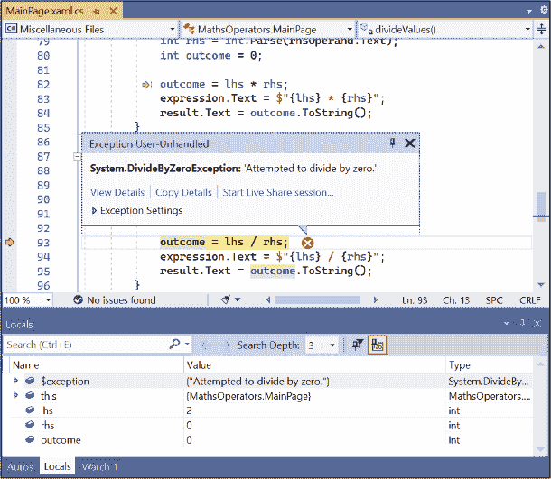

应用程序停止在导致异常的语句处，并让你进入调试器。在调试器中，你可以使用调试工具和各种调试窗口检查变量的值、更改变量的值，并从异常发生点逐行执行你的代码。

### 使用多个 catch 处理器

之前的讨论强调了不同的错误如何抛出不同类型的异常来表示不同类型的失败。为了应对这些情况，你可以连续提供多个 `catch` 处理器，如下例所示：

点击此处查看代码图像

```
try
{
    int leftHandSide = int.Parse(lhsOperand.Text);
    int rightHandSide = int.Parse(rhsOperand.Text);
    int answer = doCalculation(leftHandSide, rightHandSide);
    result.Text = answer.ToString();
}
catch (FormatException fEx)
{
    //..
}
catch (OverflowException oEx)
{
    //...
}
```

如果 `try` 块中的代码抛出 `FormatException` 异常，则执行 `FormatException` 异常的 `catch` 块中的语句。如果代码抛出 `OverflowException` 异常，则执行 `OverflowException` 异常的 `catch` 块。

 **注意**

如果 `FormatException` `catch` 块中的代码生成了 `OverflowException` 异常，它不会导致相邻的 `OverflowException catch` 块运行。相反，异常将传播到调用此代码的方法，正如本节之前所述。

### 捕获多个异常

C# 和 .NET 异常捕获机制非常完善。.NET 库定义了许多类型的异常，你编写的任何程序都可以抛出其中大多数异常。

你不太可能为代码可能抛出的每种异常编写 `catch` 处理器。那么，你如何确保你的程序捕获并处理所有可能的异常呢？

这个问题的答案在于不同异常之间的关系方式。异常被组织成称为继承层次结构的族群。（你将在第 12 章中的“使用继承”中学习继承知识。）`FormatException` 和 `OverflowException` 都属于一个名为 `SystemException` 的族，其他许多异常也是如此。`SystemException` 本身是一个简单地称为 `Exception` 的更广泛家族的成员，它是所有异常的太祖父。如果你捕获 `Exception`，该处理器将捕获可能发生的每种异常。

 **注意**

`Exception` 族包含了各种异常，其中许多异常是供 .NET 的各个部分使用的。其中某些异常相当晦涩，但了解如何捕获它们仍然是有用的。

接下来的示例展示了如何捕获所有可能的异常：

点击此处查看代码图像

```
try
{
    int leftHandSide = int.Parse(lhsOperand.Text);
    int rightHandSide = int.Parse(rhsOperand.Text);
    int answer = doCalculation(leftHandSide, rightHandSide);
    result.Text = answer.ToString();
}
catch (Exception ex) // 这是一个通用的 catch 处理器
{
    //...
}
```

 **注意**

如果你想捕获 `Exception`，实际上可以从 `catch` 处理器中省略它的名称，因为它是默认异常：

```
catch
{
    // ...
}
```

然而，不建议这样做。传递给 `catch` 处理器的异常对象可以包含有关异常的有用信息，当使用这种版本的 `catch` 结构时，这些信息是无法访问的。


在此时，你应该问最后一个问题是：如果同一个异常匹配了 `try` 块末部的多个 `catch` 处理器，会发生什么？例如，如果你在两个不同的处理器中分别捕获 `FormatException` 和 `Exception`，哪一个会运行？（还是两个都会执行吗？）

当异常发生时，运行时将使用它找到的第一个匹配该异常的处理器，其他处理器将被忽略。因此，如果你将 `Exception` 处理器放在 `FormatException` 处理器之前，那么 `FormatException` 处理器将永远不会运行。因此，你应该将更具体的 `catch` 处理器放在通用处理器之上，并放在 `try` 块之后。如果没有任何特定的处理器匹配异常，则通用的处理器将执行。

### 过滤异常

你可以过滤匹配 `catch` 句器的异常，确保只有在满足附加条件时才触发 `catch` 处理器。这些条件以 `when` 关键字引导的布尔表达式形式存在。以下示例说明了语法：点击此处查看代码图像 when (catchErrors == true)
{
    // 只有当 catchErrors 为 true 时处理异常
}
```

此示例捕获所有异常（Exception 类型）取决于 `catchErrors` 布尔变量的值。如果该变量为 `false`，则不会发生异常，使用的是应用程序的默认处理机制。如果 `catchErrors` 为 `true`，则运行 `catch` 块的代码。在后续练习中，你将看到应用程序抛出未处理异常的情况，然后编写一个 `try` 块来捕获并处理异常。

### 观察应用程序报告未处理的异常

1. 启动 Visual Studio 2022（如果尚未运行）。
2. 打开 `MathOperators` 解决方案，这是第 2 章的程序版本，演示了不同的变量、操作符和表达式。
3. 在 **Debug** 菜单上，选择 **Start Without Debugging**。


   对于练习，确保在不调试的情况下运行应用程序。表单会出现。你现在将在 **Left Operand** 框中输入某些文本，会导致异常。这演示了该版本程序健壮性的缺失。
4. 在 **Left Operand** 框中输入 `John`，在 **Right Operand** 框中输入 `2`。
5. 选择 **+ Addition** 按钮，然后选择 **Calculate**。

此输入触发了异常处理。应用程序直接终止，你返回到了桌面，没有任何关于错误的解释！既然你已经看到了当发生未处理异常时应用程序的行为，下一步是通过处理无效输入并防止未处理异常产生来使应用程序更加健壮。

### 编写 try/catch 语句

1. 返回 Visual Studio 2022。
2. 在 **Debug** 菜单上，选择 **Start Debugging**。


   这次要在调试模式下运行应用程序。
3. 当表单出现时，在 **Left Operand** 框中输入 `John`，在 **Right Operand** 框中输入 `2`。
4. 选择 **+ Addition** 按钮，然后选择 **Calculate**。

此输入应该导致与上一个练习相同的异常，但现在你处于调试模式运行，所以 Visual Studio 捕获并报告了它。Visual Studio 显示了你的代码并高亮了导致异常的语句。它还显示了一个描述异常的对话框，在这种情况下是“输入字符串格式不正确。”


   提示：某些异常是早期引发的其他异常的结果。Visual Studio 报告的异常只是链中的最后一个异常，但通常是早期异常突出了问题的真正原因。你可以通过展开 View Detail 对话框中的 `InnerException` 属性来深入这些早期异常。内部异常可能有异常，因此你应该继续挖掘直到找到一个 `InnerException` 属性设置为 `null` 的异常（如之前的图像所示）。此时，你已经到达初始异常，此异常通常突出了你需要解决的问题。
6. 在 QuickWatch 对话框中选择 **Close**。
7. 在 Visual Studio 中，在 **Debug** 菜单上，选择 **Stop Debugging**。
8. 在代码和文本编辑器窗口显示文件 `MainPage.xaml.cs` 的代码，并找到 `addValues` 方法。
9. 在此方法的语句周围添加 `try` 块（包括括号），以及针对 `FormatException` 异常的 `catch` 处理器，如下所示：

点击此处查看代码图像;
    int rhs = int.Parse(rhsOperand.Text);
    int outcome = 0;

    outcome = lhs + rhs;
    expression.Text = $"{lhs} + {rhs}";
    result.Text = outcome.ToString();
}
catch (FormatException fEx)
{
    result.Text = fEx.Message;
}
```

现在，如果发生了 `FormatException` 异常，`catch` 处理器会将异常 `Message` 属性中的文本显示在表单底部的 Result 框中。
10. 在 **Debug** 菜单上，选择 **Start Debugging**。
11. 当表单出现时，在 **Left Operand** 框中输入 `John`，在 **Right Operand** 框中输入 `2`。
12. 选择 **+ Addition** 按钮，然后选择 **Calculate**。

`catch` 处理器成功捕获了 `FormatException`并将并将输入字符串格式不正确”写入 Result 框。应用程序现在变得健壮了一些。

![显示由异常处理器生成的信息的 MathOperators 应用程序](graphics/f0162-01.jpg

13. 在 **Left Operand** 框中将 `John` 替换为 `10`。在 **Right Operand** 框中输入 `Sharp`。然后选择 **Calculate**。

`try` 块封装了解析两个框的语句，因此相同的异常处理器处理了两个框的用户输入错误。
14. 在 **Right Operand** 框中将 `Sharp` 替换为 `20`，选择 **+ Addition** 按钮，然后选择 **Calculate**。

应用程序现在按预期工作，并在 Result 框中显示值 30。
15. 在 **Left Operand** 框中将 `10` 替换为 `John`，选择 **– Subtraction** 按钮，然后选择 **Calculate**。

Visual Studio 再次进入调试器并报告 `FormatException` 异常。这次，错误发生在 `subtractValues` 方法中，该方法不包含必要的 `try`/`catch` 处理。你很快就会解决这个问题。
16. 在 **Debug** 菜单上，选择 **Stop** **Debugging**。


在 `addValues` 方法中添加 `try`/`catch` 块使得该方法更加健壮，但你需要对其他方法应用相同的异常处理，即：`subtractValues`、`multiplyValues`、`divideValues` 和 `remainderValues`。这些异常处理程序的代码可能会非常相似，导致你在每个方法中编写相同的代码。

当用户选择计算按钮时，这些方法中的每一个会被 `calculateClick` 方法调用。因此，为了避免异常处理代码的重复，将其移动到 `calculateClick` 方法是合理的。如果在 `subtractValues`、`multiplyValues`、`divideValues` 或 `remainderValues` 方法中发生 `FormatException`，它将传播回 `calculateClick` 方法，并按照本章较之前“未处理的异常”节所述进行处理。

---

### 将异常传回调用方法

1. 在代码和文本编辑器窗口中显示 `MainPage.xaml.cs` 文件的代码，并找到 `addValues` 方法。
2. 从 `addValues` 方法中移除 `try` 块和 `catch` 处理程序，将其恢复到原始状态，如下代码所示：
   点击此处查看代码图像
   ```
   private void addValues()
   {
       int leftHandSide = int.Parse(lhsOperand.Text);
       int rightHandSide = int.Parse(rhsOperand.Text);
       int outcome = 0;

       outcome = lhs + rhs;
       expression.Text = lhsOperand.Text + " + " + rhsOperand.Text
       result.Text = outcome.ToString();
   }
   ```
3. 找到 `calculateClick` 方法。向此方法添加如下示例中粗体所示 `try` 块和 `catch` 处理程序：
   点击此处查看代码图像
   ```
   private void calculateClick(object sender, RoutedEventArgs e)
   {
       try
       {
           if ((bool)addition.IsChecked)
           {
               addValues();
           }
           else if ((bool)subtraction.IsChecked)
           {
               subtractValues();
           }
           else if ((bool)multiplication.IsChecked)
           {
               multiplyValues();
           }
           else if ((bool)division.IsChecked)
           {
               divideValues();
           }
           else if ((bool)remainder.IsChecked)
           {
               remainderValues();
           }
       }
       catch (FormatException fEx)
       {
           result.Text = fEx.Message;
       }
   }
   ```
4. 在 **Debug** 菜单上，选择 **Start Debugging**。
5. 当表出现时，在 **Left Operand** 框中输入 **John**，在 **Right** 框中输入 **2**。
6. 选择 **+ Addition** 按钮，然后选择 **Calculate**。
   与之前一样，`catch` 处理程序成功捕获了 `FormatException`，并将消息“Input string was not in a correct format”写入结果框。然而，尽管异常是在 `addValues` 方法中抛出的，但处理程序是在 `calculateClick` 方法中捕获它的。
7. 选择 **– Subtraction** 按钮，然后选择 **Calculate**。
   这次，`subtractValues` 方法导致了异常，但它被传回 `calculateClick` 方法，并像之前一样被处理。
8. 选择 **Multiplication**、**/ Division** 和 **% Remainder** 按钮，验证 `FormatException` 异常是否被正确捕获并处理。
9. 返回到 Visual Studio 并停止调试。
    **注意**
   是否在方法中显式捕获未处理的异常，取决于你正在构建的应用程序的性质。在某些情况下，尽可能在异常发生的地方捕获异常是合理的。在其他情况下，让异常传播回调用抛出异常的例程的方法并在那里处理错误会更有用。

---

### 使用 checked 和 unchecked 整数算术

第 2 章 讨论了如何在 `int` 和 `double` 等原始数据类型上使用如 `+` 和 `*` 等二元算术运算符。你应该还记得原始数据类型具有固定的大小。例如，C# 的 `int` 是 32 位的。由于 `int` 有固定的大小，你确切知道它可以容纳的值范围：–2147483648 到 2147483647。

    **提示**
   如果你想在代码中引用 `int` 的最小值或最大值，可以使用 `int.MinValue` 或 `int.MaxValue` 属性。

`int` 固定的大小创建了一个问题。例如，如果给一个当前值为 `2147483647` 的 `int` 加 1 会发生什么？答案取决于应用程序是如何编译的。默认情况下，C# 编译器生成的代码允许计算静默溢出，你将得到错误的答案。（事实上，计算会回绕到最大的负整数值，生成的的结果为 –2147483648。）这种行为的原因是性能考虑：整数算术是每个程序中的常用操作。

无论你如何编译应用程序，都可以使用 `checked` 和 `unchecked` 关键字在应用程序中需要（或不需要）的范围内开启或关闭溢出检查。

#### 编写 checked 语句

`checked` 语句是由 `checked` 关键字开头的块。`checked` 语句中的所有整数算术在整数计算溢出时始终会抛出 `OverflowException`，如下例所示：
点击此处查看代码图像

```
int number = int.MaxValue;
checked
{
    int willThrow = number++;
    Console.WriteLine("这里不会执行");
}
```
 **重要**
   只有 `checked` 块内部的整数算术会受溢出检查。例如，如果 `checked` 语句之一是方法调用，则检查不适用于调用方法中运行的代码。

你还可以使用 `unchecked` 关键字创建一个 `unchecked` 块语句。`unchecked` 块中的所有整数算术都不进行检查，永远永远抛出 `OverflowException`。例如：

点击此处查看代码图像

```
int number = int.MaxValue;
unchecked
{
    int wontThrow = number++;
    Console.WriteLine("这里会被执行");
}
```

#### 编写 checked 表达式

你也可以通过在单个括号表达式之前加加 `checked` 或 `unchecked` 关键字，来控制整数表达式的溢出检查，如下例所示：
点击此处查看代码图像

```cpp
int wontThrow = unchecked(int.MaxValue + 1);
int willThrow = checked(int.MaxValue + 1);
```


复合运算符（如 `+=` 和 `–=`）以及增运算符（`++`）和减运算符（`--`）都是算术运算符，可以使用 `checked` 和 `unchecked` 关键字进行控制。记住，`x` `+=` `y` 等于 `x` = `x` + `y`。

 **重要**

你不能使用 `checked` 和 `unchecked` 关键字来控制浮点（非整数）算术。`checked` 和 `unchecked` 关键字仅适用于使用 `int` 和 `long` 等数据类型的整数算术。浮点算术永远不会抛出 `OverflowException` 异常——即使在除以 0.0 时也是如此。（回想第 2 章

    ```
    private void multiplyValues()
    {
        int lhs = int.Parse(lhsOperand.Text);
        int rhs = int.Parse(rhsOperand.Text);
        int outcome = 0;

        outcome = lhs * rhs;
        expression.Text = $"{lhs} * {rhs}";
        result.Text = outcome.ToString();
    }
    ```

    语句 `outcome = lhs * rhs;` 包含了静默溢出的乘法操作。
7.  编辑此语句以对计算值进行检查，如下：

    ```
    outcome = checked(lhs * rhs);
    ```

    现在乘法是经过检查的，它将抛出 `OverflowException` 异常，而不是静默返回错误的答案。
8.  在**调试（Debug）** 菜单上，选择**开始调试（Start Debugging）**。
9.  在**左侧操作数（Left Operand）**框中，输入 `9876543`。在**右侧操作数**框中，输入 `9876543`。
10. 选择**乘法（Multiplication）**按钮，然后选择**计算（Calculate）**。这次，Visual Studio 进入了调试器并报告乘法导致了 `OverflowException` 异常。你必须添加一个处理器来捕获此异常，并以比仅报错失败更优雅的方式处理它。
11. 在**调试（Debug）** 菜单上，选择**停止调试（Stop Debugging）**。
12. 在显示 `MainPage.xaml.cs` 文件的代码和文本编辑器中，找到 `calculateClick` 方法。
13. 在此方法中现有的 `FormatException` `catch` 处理器之后立即添加以下 `catch` 处理器（加粗显示）：

    点击查看代码图像

    ```sharp
    private void calculateClick(object sender, RoutedEventArgs e)
    {
        try
        {
            ...
        }
        catch (FormatException fEx)
        {
            result.Text = fEx.Message;
        }
        catch (OverflowException oEx)
        {
            result.Text = oEx.Message;
        }
    }
    ```

    此 `catch` 处理器的逻辑与 `FormatException` `catch` 处理器相同。然而，仍然值得将这些处理器分开，而不是简单地编写一个通用的 `Exception` `catch` 处理器；在未来，你可能会以不同的方式处理这些异常。
14. 在**调试（Debug）** 菜单上，选择**开始调试（Start Debugging）**以编译并运行应用程序。
15. 在**左侧操作数（Left Operand）**框中，输入 `9876543`。在**右侧操作数**框中，输入 `9876543`。
16. 选择**乘法（Multiplication）**按钮，然后选择**计算（Calculate）**。第二个 `catch` 处理器成功捕获了 `OverflowException` 并在结果框中显示消息“Arithmetic operation resulted in an overflow”。
17. 返回 Visual Studio 并停止调试。

### 抛出异常

假设你正在实现一个名为 `monthName` 的方法，该方法接受单个 `int` 参数并返回相应的月份名称。例如，`monthName(1)` 返回 `"January"`，`monthName(2)` 返回 `"February"`，以此此类推。问题是，如果整数参数小于 1 或大于 12，该方法应该返回什么？最好的答案是该方法不应该返回任何内容，而是应该抛出异常。

.NET 类库包含许多专门为此类情况设计的异常类。大多数情况下，你会发现这些类中的一个可以描述你的异常。如果没有，你可以轻松创建自己的异常类，但在那之前你需要更多地了解 C# 语言。在这种情况下，现有的 .NET `ArgumentOutOfRangeException` 类正合适。你可以通过 `throw` 语句抛出异常。以下示例使用 `switch` 表达式将月份转换为月份名称：

```csharp
public string monthName(int month) => month switch {
    1 => "January",
    2 => "February",
    ...
    12 => "December",
    _ => throw new ArgumentOutOfRangeException("Bad month")
 };
```

`throw` 语句需要一个异常对象。该对象包含异常的细节，包括任何错误消息。此示例创建一个新的 `ArgumentOutOfRangeException` 对象。通过使用构造函数初始化对象并填充其 `Message` 属性。构造将在第 7 章“创建和管理类和对象”中详细介绍。

在接下来的练习中，你将修改 `MathOperators` 项目，以便在用户尝试在未选择选项按钮的情况下执行计算时抛出异常。

 **注意**

这个练习略显刻意，因为任何良好的应用程序设计都会初始选择一个默认选项按钮，但此应用程序旨在说明一个观点。

### 抛出异常

1.  返回 Visual Studio 2022。
2.  在**调试（Debug）** 菜单上，选择**开始调试（Start Debugging）**。
3.  在**左侧操作数（Left Operand）**框中，输入 `24`。在**右侧操作数**框中，输入 `36`。然后选择**计算（Calculate）**。

表达式和结果框中什么都没有出现。你没有选择运算符选项这一点并不显而易见。在结果框中编写一条诊断消息将很有用。
4.  返回 Visual Studio 并停止调试。
5.  在显示 `MainPage.xaml.cs` 的代码和文本编辑器中，找到并检查 `calculateClick` 方法，它目前看起来如下：

    点击查看代码图像


```csharp
private int calculateClick(object sender, RoutedEventArgs e)
{
    try
    {
        if ((bool)addition.IsChecked)
        {
            addValues();
        }
        else if ((bool)subtraction.IsChecked)
        {
            subtractValues();
        }
        else if ((bool)multiplication.IsChecked)
        {
            multiplyValues();
        }
        else if ((bool)division.IsChecked)
        {
            divideValues();
        }
        else if ((bool)remainder.IsChecked)
        {
            remainderValues();
        }
    }
    catch (FormatException fEx)
    {
        result.Text = fEx.Message;
    }
    catch (OverflowException oEx)
    {
        result.Text = oEx.Message;
    }
}
```

加、减、乘、除和余数字段是出现在表上的按钮。每个按钮都有一个名为 `IsChecked` 的属性，用于指示用户是否选择了它。`IsChecked` 属性是一个可空布尔值（nullable Boolean），如果按钮被选中，其值为 `true`，否则为 `false`。（你将在第 8 章“理解值和引用”中学习更多关于可空值的知识。）级联 `if` 语句依次检查每个按钮以找到哪一个被选中。（选项按钮是互斥的，因此用户只能选择一个选项按钮。）如果没有任何按钮被选中，则没有一个 `if` 语句将为 `true`，且没有计算方法方法被调用。

你可以尝试通过在 `if-else` 级联中再添加一个 `else` 语句来解决这个问题，向表上的结果（Result）框写入一条消息，但更好的解决方案是将错误的检测和信号传递与对错误的捕获和处理分离。

### 6. 在 `if-else` 语句列表的末尾添加另一个 `else` 语句并抛出 `InvalidOperationException`，如后续代码中**加粗**部分所示：

点击此处查看代码图像

```csharp
if ((bool)addition.IsChecked)
{
    addValues();
}
...
else if ((bool)remainder.IsChecked)
{
    remainderValues();
}
else
{
    throw new InvalidOperationException("No operator selected");
}
```

### 7. 在 **Debug** 菜单上，选择 **Start Debugging** 以生成并运行应用程序。

### 8. 在 **Left Operand** 框中输入 **24**。在 **Right** **Operand** 框中输入 **36**。然后选择 **Calculate**。

Visual Studio 检测到你的应用程序抛出了 `InvalidOperationException`，一个异常对话框随之打开。你的应用程序抛出了一个异常，但代码尚未捕获它。

### 9. 在 **Debug** 菜单上，选择 **Stop Debugging**。

现在你已经写了一个 `throw` 语句并验证了它会抛出异常，接下来你将编写一个 `catch` 处理器来处理此异常。

### 要捕获异常

1. 在显示 `MainPage.xaml.cs` 的代码和文本编辑器窗口中，在 `calculateClick` 方法两个现有的 `catch` 处理器下方立即添加如下**加粗**所示的 `catch` 处理器：

    点击此处查看代码图像

```csharp
...
catch (FormatException fEx)
{
    result.Text = fEx.Message;
}
catch (OverflowException oEx)
{
    result.Text = oEx.Message;
}
catch (InvalidOperationException ioEx)
{
    result.Text = ioEx.Message;
}
```

此代码捕获了用户未选择操作选项按钮时抛出的 `InvalidOperationException`。

2. 在 **Debug** 菜单上，选择 **Start Debugging**。

3. 在 **Left** **Operand** 框中输入 **24**。在 **Right** **Operand** 框中输入 **36**。然后选择 **Calculate**。

结果框中出现了消息“No operator selected”。

 **注意**

如果你的应用程序进入了 Visual Studio 调试器，那么你可能已经启用了 Visual Studio 在抛出所有公共语言运行时 (CLR) 异常时捕获它们。如果发生这种情况，请在 Debug 菜单上选择 Continue。记住，在完成本次练习后，禁用 Visual Studio 在抛出 CLR 异常时捕获它们！

4. 返回 Visual Studio 并停止调试。

应用程序现在健壮得多。然而，仍然可能出现若干未捕获的异常并会导致应用程序失败。例如，如果你尝试除以 0，将抛出一个未处理的 `DivideByZeroException` 异常。（与浮点数除以零不同，整数除零确实会抛出异常。）解决此问题的方法之一是在 `calculateClick` 方法内部编写大量的 `catch` 处理器。另一种解决方案是在 `catch` 处理器列表的末尾添加一个捕获 `Exception` 的通用型处理器。这将捕获你可能忘记的所有意外异常，或者由于极其不寻常的情况引起的异常。

 **注意**

使用全捕处理器来捕获 `Exception` 异常并不是省略捕获特定异常的借口。你对异常的处理越精确，维护代码和发现任何复发问题的原因就越容易。只有在真正、确实“异常”的情况下才使用 `Exception` 异常。在接下来的练习中，“除以零”异常就属于这一类。然而，既然已经确定这种异常在专业应用程序中可能出现，良好的做法是为应用程序添加一个 `DivideByZeroException` 处理器。

### 要捕获未处理的异常

1. 在显示 `MainPage.xaml.cs` 的代码和文本编辑器窗口中，在现有 `catch` 处理器列表的末尾添加以下 `catch` 处理器：

```csharp
catch (Exception ex)
{
    result.Text = ex.Message;
}
```

此 `catch` 处理器将捕获所有尚未待处理的异常，无论其具体类型为何。

 **注意**

确保将此处理器添加到列表的末尾。如果你将其放在开头，它将掩盖其他的异常处理器。

2. 在 **Debug** 菜单上，选择 **Start Debugging**。

你现在将尝试执行一些已知会导致异常的计算，并确认它们都被正确处理了。

3. 在 **Left** **Operand** 框中输入 **24**。在 **Right** **Operand** 框中输入 **36**。

4. 选择 **Calculate**。

确认结果框中仍然显示消息“No operator selected”。该消息是由 `InvalidOperationException` 处理器生成的。

5. 在 **Left Operand** 框中输入 **John**，选择 **+ Addition** 按钮，然后选择 **Calculate**。

确认结果框中出现消息“Input string was not in a correct format”。该消息是由 `FormatException` 处理器生成的。

6. 在 **Left Operand** 框中输入 **24**。在 **Right** **Operand** 框中输入 **0**。选择 **/ Division** 按钮，然后选择 **Calculate**。

确认结果框中出现消息“Attempted to divide by zero”。该消息是由通用 `Exception` 处理器生成的。

7. 尝试其他数值组合并验证异常情况已处理且没有导致应用程序停止。

8. 完成后，返回 Visual Studio 并停止调试。


`throw` 异常在语义上与 `throw` 语句相似，不同之处在于可以在任何可以使用表达式的地方使用。例如，假设你想将 `string` 变量 `name` 设置为表单中 `nameField` 框输入的值，但前提是用户确实在该字段中输入了值；否则，你想抛出一个“Missing input”（缺少输入）异常。你可以使用以下代码：

点击查看代码图像

```c
string name;
if (nameField.Text != "")
{
    name = nameField.Text;
}
else 
{
    throw new Exception("Missing input"); //这是一个 throw 语句
}
```

虽然这段代码可以工作，但它显得有些笨拙且冗长。你可以通过使用 `throw` 表达式配合另一个名为条件冒号的运算符 `?:` 来简化此块。条件冒号运算符相当于表达式的内联 `if…else` 语句。它是一个三元运算符，接收三个操作数：一个布尔表达式、当布尔表达式为 `true` 时要求值并返回的表达式，以及当布尔表达式为 `false` 时要求值并返回的另一个表达式。你可以这样配合 `throw` 表达式使用：

点击查看代码图像

```csharp
string name = nameField.Text != 
    "" ? nameField.Text : throw new Exception("Missing input"); //这是一个 throw 表达式
```

在这种情况下，如果 `nameField` 框不为空，则 `Text` 属性的值被存储在 `name` 变量中。否则，将求值 `throw` 表达式，从而抛出异常。这段代码比之前的示例简洁得多。

### 使用 finally 块

当异常被抛出时，它会改变程序程序的执行流。因此，你无法保证某条语句在前一条语句完成后始终会运行，因为前一条语句可能会抛出异常。在这种情况下，在 `catch` 处理器运行之后，控制流将在包含该处理器的代码块中的下一个语句处恢复，而不是紧随引发异常的代码随后的语句。

看接下来的示例，该示例改编自 第 5 章 中的代码，“使用复合赋值和迭代语句](#ch05.xhtml_ch05)”。人们很容易假设在 `while` 循环完成后对 `reader.Dispose` 的调用总是会发生。毕竟，它就在代码里。

点击查看代码图像

```csharp
TextReader reader = ...;
...
string line = reader.ReadLine();
while (line is not null)
{
    ...
    line = reader.ReadLine();
}
reader.Dispose();
```

有时，某个特定语句没有运行并不是问题，但在很多情况下，这可能是一个大问题。如果该语句释放了在之前的语句中获取的资源，未能执行该语句将导致资源被保留。这个示例就是此类情况：当你打开文件进行读取时，此操作获取了一个资源（文件句柄），你必须确保调用 `reader.Dispose` 来释放该资源。如果不这样做，早晚你会耗尽文件句柄，并无法打开更多文件。（如果你觉得文件句柄微不足道，可以考虑数据库连接。）

确保某个语句（无论是否抛出异常）始终运行的方法是将该语句写在 `finally` 块内部。`finally` 块紧跟在 `try` 块之后，或者在 `try` 块后的最后一个 `catch` 处理器之后。只要程序进入与 `finally` 块关联的 `try` 块，`finally` 块就会始终运行，即使发生了异常。如果异常被本地捕获，则异常处理器首先执行，然后执行 `finally` 块。如果异常未在本地捕获（即运行时必须搜索调用方法列表以寻找处理器），则先运行 `finally` 块。关键点是 `finally` 块总是执行。

`reader.Dispose` 问题的解决方案如下：

点击查看代码图像

```csharp
TextReader reader = ...;
...
try
{
    string line = reader.ReadLine();
    while (line is not null)
    {
        ...
        line = reader.ReadLine();
    }
}
finally
{
    if (reader is not null)
    {
        reader.Dispose();
    }
}
```

即使在读取文件时发生异常，`finally` 块也能确保 `reader.Dispose` 语句始终执行。你将在第 14 章“使用垃圾回收和资源管理”中看到处理这种情况的另一种方法。

### 总结

在本章中，你学习了如何使用 `try` 和 `catch` 结构来捕获和处理异常。你看到了如何使用 `checked` 和 `unchecked` 关键字来开启和关闭整数溢出检查。你学习了当代码检测到异常时如何抛出异常，并看到了如何使用 `finally` 块来确保关键代码始终运行，即使发生了异常。

-   如果你想继续下一章，请保留 Visual Studio 2020。


在第二部分中，你将学习类和结构，这是你用于建模构成典型 C# 应用程序的实体和其他项目的两种基本类型。特别是，你将看到 C# 如何根据类和结构的定义创建对象和值类型，以及 `.NET` 如何管理这些项目的生命周期。你将发现如何使用继承来创建类族，并学习如何使用数组来聚合项目。

## 第 7 章

### 创建和管理类与对象

**完成本章后，你将能够：**

* 理解分类和封装的概念。
* 定义一个包含一组相关方法和数据项的类。
* 使用 `public` 和 `private` 关键字控制成员的访问权限。
* 编写并调用你自己的构造函数。
* 使用 `static` 关键字创建可供同类所有实例共享的方法和数据。
* 创建匿名类。

类为应用程序操作的实体提供了一种方便的机制。实体可以表示一个特定的项目，例如客户，也可以表示更抽象的东西，例如事务。任何系统的设计过程的一部分，都关注于确定对系统所实现的进程重要的实体，然后进行分析以查看这些实体需要持有哪些信息以及它们应该执行哪些操作。你将类所持有的信息存储为字段，并使用方法来实现类可以执行的操作。

 **注意**

`.NET` 广泛使用类。`.NET` 库包含数千个类。你已经用过了其中几个，包括 `Console` 和 `Exception`。

### 理解分类

*Class*（类）是*classification*（分类）一词的根。当你设计一个类时，你系统地将信息和行为排列成有意义的实体。这种排列是一种分类行为，是每个人都会做的事情——不仅仅是程序员。例如，所有的汽车都有共同的行为（它们可以转向、停止、加速等）和共同的属性（它们有方向盘、引擎等）。人们使用*car*（汽车）这个词表示这些共同行为和属性的对象。只要大家对一个词的含义达成一致，这个系统就能良好工作，你可以用简洁的形式表达复杂但精确的想法。如果没有分类，很难想象人们如何进行思考或交流。

鉴于分类如此深地根植于我们的思维和交流方式，通过对问题及其解决方案中固有的不同概念进行分类，然后在编程语言中对这些类进行建模来尝试编写程序是有意义的。这正是你使用面向对象的编程语言（包括 Microsoft Visual C#）时可以做到的。

### 封装的目的

封装是定义类时的一个重要原则。其核心思想是：使用类的程序不需要考虑该类内部实际上是如何工作的；程序只需创建类的实例并调用该类的方法。只要这些方法执行了它们设计的功能，程序就不需要知道它们是如何实现的。例如，当你调用 `Console.WriteLine` 方法时，你不想被 `Console` 类如何在物理上安排安排数据写入屏幕的各种复杂细节所困扰。一个类可能需要维护各种内部状态信息以执行它的各种方法。这些额外的状态信息和活动对使用该类的程序是隐藏的。因此，封装有时被称为信息隐藏。封装实际上有两个目的：

* 在类内部组合方法和数据——换句话说，是为了支持分类
* 控制方法和数据的访问权限——换句话说，是为了控制类的使用

定义 定义和使用类

在 C# 中，你使用 `class` 关键字来定义一个新类。类的数据和方法出现在类体中的这对大括号之间。以下是一个名为 `Circle` 的 C# 类，它包含一个方法（计算圆的面积）和一个数据项（圆的半径）：

点击此处查看代码图片

```c
class Circle
{
    int radius;
    double Area()
    {
        return Math.PI * radius * radius; 
    }
}
```

 **注意**

`Math` 类包含了用于执行数学计算的方法和包含数学常数的字段。`Math.PI` 字段包含值 `3.14159265358979`，它近似于圆周率 pi 的值。

类的的主体包含普通方法（如 `Area`）和字段（如 `radius`）。记住，类中的变量被称为字段。第 2 章“使用变量、运算符和表达式”展示了如何声明变量，而第 3 章“编写方法和应用作用域”演示了如何编写方法，因此这里几乎没有新语法。

你可以像使用已经遇到过的其他类型一样使用 `Circle` 类。你创建一个指定 `Circle` 为其类型的变量，然后用一些有效数据初始化该变量。这里有一个例子：

点击此处查看代码图片

```csharp
Circle c; // 创建一个 Circle 变量
c = new Circle(); // 初始化它
```

这段代码中一个值得强调的点是 `new` 关键字的使用。以前，当你初始化如 `int` 或 `float` 这样的变量时，你只是给它赋值：

```csharp
int i;
i = 42;
```

你不能对类类型的变量这样做。原因之一是 C# 并没有提供赋值字面值的语法。你无法编写这样的语句：

```csharp
Circle c;
c = 42;
```

毕竟，`Circle` 对应的 `42` 是什么？另一个原因是运行时对类类型变量内存的分配方式。这将在第 8 章中进一步讨论。现在，只需接受 `new` 关键字会创建类的实例，这通常被称为对象。

然而，你也可以将类的实例直接赋值给另一个相同类型的变量，如下：

```csharp
Circle c;
c = new Circle();
Circle d;
d = c;
```

然而，这并不像初看起来那么简单，原因在第 8 章中描述。

 **重要**

不要混淆类和对象这两个词。类是类型的定义。对象是程序运行时创建的类型实例。多个不同的对象可以是同一个类的实例。

### 控制访问权限

令人的是，`Circle` 类目前没有任何实际用途。默认情况下，当你将方法和数据封装在类内部时，该类与外部世界形成了一个边界。类定义的字段（如 `radius`）和方法（如 `Area`）可以被类内部的方法使用，但不能被外部世界使用；它们对于类是私有的。因此，尽管你可以在程序中创建 `Circle` 对象，但无法访问它的 `radius` 字段或调用它的 `Area` 方法，这就是为什么该类目前还没有用处！然而，你可以使用 `public` 和 `private` 关键字修改字段或方法的定义，以控制它们是否可以从外部访问：


*   如果一个方法或字段仅从类内部访问，则它是 `private`（私有的）。要声明一个方法或字段为 `private`，你需要在其声明之前写入 `private` 关键字。如之前提到的，这实际上是默认设置，但显式地声明字段和方法为 `private` 是一个良好的习惯，可以避免任何混淆。

*   如果一个方法或字段在类内部和类外部均可见，则它是 `public`（公共的）。要声明一个方法或字段为 `public`，你需要在其声明之前添加 `public` 关键字。

这里是 `Circle` 类。这次，`Area` 被声明为公共方法，而 `radius` 被声明为私有字段：

点击此处查看代码图片

```
class Circle
{
    private int radius;
    public double Area()
    {
        return Math.PI * radius * radius; 
    }
}
```

 **注意**

如果你是 C++ 程序员，请注意 `public` 和 `private` 关键字后没有冒号。你必须为每个字段和方法声明重复该关键字。

尽管 `radius` 被声明为私有字段且无法从类外部访问，但 `radius` 在 `Circle` 类内部是可以访问的。`Area` 方法位于 `Circle` 类内部，因此 `Area` 的方法体可以访问 `radius`。然而，该类的价值仍然有限，因为没有办法初始化 `radius` 字段。为了修复这个问题，你可以使用构造函数。

 **提示**

在方法中声明的变量默认不会初始化。然而，类中的字段会自动初始化为 `0`、`false` 或 `null`，具体取决于它们的类型。尽管如此，为字段提供一种显式的初始化方法 仍然是一个良好的习惯。

 **重要**

不要声明两个仅在大小写上不同的公共类成员。如果你这样做了，使用其他不区分大小写的语言（如 Microsoft Visual Basic）的开发者可能无法将你的类集成到他们的解决方案中。

### 使用构造函数

当你使用 `new` 关键字创建对象时，运行时需要根据类的定义来构造该对象。运行时必须从操作系统获取一段内存，用类中定义的字段对其进行填充，然后调用构造函数来执行任何所需的初始化。

构造函数是一种特殊的方法，它在你创建类的实例时会自动运行。它的名称与类名相同，可以接受参数，但不能返回值（即使是 `void` 行）。每个类都必须有一个构造函数。如果你不写，编译器会自动为你生成一个默认构造函数（尽管编译器生成的默认构造函数实际上什么都不做）。

你可以非常轻松地编写自己的默认构造函数。只需添加一个不返回值的 `public` 方法，并赋予它与类相同的名称。以下示例显示了带有默认构造函数的 `Circle` 类，该函数将 `radius` 字段初始化为 `0`：

点击此处查看代码图片

```
class Circle
{
    private int radius; 
    public Circle() // 默认构造函数
    {
        radius = 0; 
    }

    public double Area()
    {
        return Math.PI * radius * radius; 
    }
}
```

 **注意**

在 C# 中，如果你编写了自己的构造函数，编译器将不再生成默认构造函数。因此，如果你编写了接受一个或多个参数的自定义构造函数，并且还需要一个默认构造函数，你就必须自己编写默认构造函数。

在接下来的练习中，你将声明一个模拟二维空间中点的类。该类将包含两个 `private` 字段，用于存储点的 x 和 y 坐标，并提供用于初始化这些字段的构造函数。


```cs
class Program
{
    static void doWork()
    {
        // TODO: Test the Point class:
    }

    static void Main(string[] args)
    {
        try
        {
            doWork();
        }
        catch (Exception ex)
        {
            Console.WriteLine(ex.Message);
        }
    }
}
```

5. 在“代码和文本编辑器”窗口中显示 `Point.cs` 文件。

此文件定义了一个名为 `Point` 的类，你将用它来表示二维空间中的点，由一对 `x` 和 `y` 坐标定义。目前 `Point` 类除了另一个 `// TODO:` 注释外，是空的。

6. 返回到 `Program.cs` 文件。在 `Program` 类中，编辑 `doWork` 方法体，并将 `// TODO:` 注释替换为以下语句：

```cs
var origin = new Point();
```

该语句创建了 `Point` 类的一个新实例并调用了它的默认构造函数。

7. 在“生成（Build）”菜单上，选择“生成解决方案（Build Solution）”。

代码无错误生成，因为编译器会自动为 `Point` 类生成默认构造函数的代码。然而，你看不到此构造函数的 C# 代码，因为编译器没有生成任何源语言语句。

8. 返回到 `Point.cs` 文件中的 `Point` 类。将 `// TODO:` 注释替换为一个 `public` 构造函数，它接受两个 `int` 参数（分别称为 `x` 和 `y`），并调用 `Console.WriteLine` 方法在控制台上显示这些参数的值，如下面代码示例中的**粗体**类型所示：

点击此处查看代码图像

```cs
class Point 
{ 
    public Point(int x, int y) 
    { 
        Console.WriteLine($"x:{x}, y:{y}"); 
    } 
}
```

9. 在“生成（Build）”菜单上，选择“生成解决方案”。

编译器现在报告了一个错误：

点击此处查看代码图像

```
There is no argument that corresponds to the required formal parameter ‘x’ of 
‘Point.Point(int, int)’
```

这条相当冗长的信息意味着，`doWork` 方法中对默认构造函数的调用现在是无效的，因为不再有默认构造函数了。你为 `Point` 类编写了自己的构造函数，所以编译器不再生成默认构造函数。你现在将通过编写自己的默认构造函数来修复此。

10. 编辑 `Point` 类，添加一个 `public` 默认构造函数，该函数调用 `Console.WriteLine` 向控制台写入字符串 `"Default constructor called"`，如下下文示例中的**粗体**类型所示。`Point` 类现在应该像这样：

点击此处查看代码图像

```cs
class Point 
{ 
    public Point() 
    { 
        Console.WriteLine("Default constructor called"); 
    } 

    public Point(int x, int y) 
    { 
        Console.WriteLine($"x:{x}, y:{y}"); 
    } 
}
```

11. 在“生成（Build）”菜单上，选择“生成解决方案”。

程序现在应该可以成功生成。

12. 在 `Program.cs` 文件中，编辑 `doWork` 方法体。声明一个类型为 `Point` 的变量 `bottomRight`，并使用带有两个参数的构造函数将其初始化为新的 `Point` 对象，如下代码中的**粗体**类型所示。提供值 `2496` 和 `1664`，代表基于分辨率 2496 × 1664 的屏幕右下角的坐标（这是配备 15 英寸屏幕的 Microsoft Surface 3 笔记本电脑的像素）。`doWork` 方法现在应该像这样：

点击此处查看代码图像

```cs
static void doWork() 
{ 
    var origin = new Point(); 
    var bottomRight = new Point(2496, 1664); 
}
```

13. 在“调试（Debug）”菜单上，选择“转调试启动（Start Without Debugging）”。

程序生成并运行，在控制台上显示以下消息：

```text
Default constructor called
x:2496, y:1664
```

14. 按 `Enter` 键结束程序并返回 Visual Studio 2022。

你现在将为 `Point` 类添加两个 `int` 字段来表示点的 `x` 和 `y` 坐标，并将修改构造函数以初始化这些字段。

15. 编辑 `Point.cs` 文件中的 `Point` 类，添加两个类型为 `int` 的私有字段，称为 `x` 和 `y`，如下代码中的**粗体**类型所示。`Point` 类现在应该像这样：

点击此处查看代码图像

```cs
class Point 
{ 
    private int x, y; 

    public Point() 
    { 
        Console.WriteLine("default constructor called"); 
    } 

    public Point(int x, int y) 
    { 
        Console.WriteLine($"x:{x}, y:{y}"); 
    } 
}
```
*(注：原文此处代码块逻辑似乎有错乱，已根据上下文逻辑修正翻译)*

---
*(纠正说明：根据原文第 15-18 步的逻辑，原文提供的文本描述和代码块顺序似乎出现了严重的错乱。以下是基于逻辑的还原性翻译：)*

15. 编辑 `Point.cs` 文件中的 `Point` 类，添加两个类型为 `int` 的私有字段，称为 `x` 和 `y`，如下代码中的**粗体**类型所示。`Point` 类现在应该像这样：

点击此处查看代码图像

```cs
class Point 
{ 
    private int x, y; 

    public Point() 
    { 
        Console.WriteLine("default constructor called"); 
    } 

    public Point(int x, int y) 
    { 
        Console.WriteLine($"x:{x}, y:{y}"); 
    } 
}
```
*(注：原文文本中 15-18 步的描述与代码块位置发生了错位，翻译时已按照技术逻辑进行了对齐)*

16. 修改带有两个参数的构造函数，将 `Console.WriteLine` 语句替换为如下**粗体**类型所示的代码：

```cs
public Point(int x, int y) 
{ 
    this.x = x; 
    this.y = y; 
}
```

17. 编辑默认构造函数，将 `x` 和 `y` 字段初始化为 `-1`，如下**粗体**类型所示。注意，尽管没有参数引起混淆（Visual Studio 会弹出一个提示你不需要使用 this），但这种方式引用字段仍然是一个良好的习惯：

```cs
public Point() 
{ 
    this.x = -1; 
    this.y = -1; 
}
```

18. 在“生成（Build）”菜单上，选择“生成解决方案”。确认代码无错误或警告通过编译。（你可以运行它，但它还没有产生任何输出。）

属于类并操作特定类实例所属的数据的方法称为实例方法。（你将在本章晚些时候学习其他类型的方法。）在下面的练习中，你将为 `Point` 类编写一个名为 `DistanceTo` 的实例方法，用于计算两个点之间的距离。

### 编写和调用实例方法

1. 在 Visual Studio 2022 的 `Classes` 项目中，在 `Point` 构造函数之后添加以下名为 `DistanceTo` 的 `public` 实例方法。该方法接受一个名为 `other` 的 `Point` 参数并返回一个 `double`。

`DistanceTo` 方法应该像这样：

点击此处查看代码图像

```cs
class Point 
{ 
    ... 
     public double DistanceTo(Point other) 
     { 
     } 
}
```


在接下来的步骤中，你将在 `DistanceTo` 实例方法的体中添加代码，以计算并返回调用的 `Point` 对象与作为参数传递的 `Point` 对象之间的距离。为了实现这一点，你必须计算 x 坐标和 y 坐标之间的差值。

2. 在 `DistanceTo` 方法中，声明一个名为 `xDiff` 的局部 `int` 变量，并用 `this.x` 与 `other.x` 之间的差对其初始化，如下粗所示：

   点击此处查看代码图像

```
public double DistanceTo(Point other) 
{ 
      int xDiff = this.x - other.x; 
}
```

3. 声明另一个名为 `yDiff` 的局部 `int` 变量，并用 `this.y` 与 `other.y` 之间的差对其初始化，如下粗体所示：

   点击此处查看代码图像

```
public double DistanceTo(Point other) 
{ 
    int xDiff = this.x - other.x; 
    int yDiff = this.y - other.y; 
}
```

 **注意**

虽然 `x` 和 `y` 字段是私有的，但同一类的其他实例仍然可以访问它们。重要的是要理解 `private` 术语作用于类级别，而不是对象级别；作为同一类实例的两个对象可以访问彼此的私有数据，但作为其他类实例的对象则不能。

要计算距离，你可以使用勾股定理，并计算 `xDiff` 平方与 `yDiff` 平方和的平方根。`System.Math` 类提供了 `Sqrt` 方法，可以用它来计算平方根。

4. 声明一个类型为 `double` 的变量名为 `distance`，并使用它来存储上述计算的结果。

   点击此处查看代码图像

```
public double DistanceTo(Point other) 
{ 
    int xDiff = this.x - other.x; 
    int yDiff = this.y - other.y; 
}
```

5. 在 `DistanceTo` 方法的末尾添加 `return` 语句，并返回 `distance` 变量的值：

   点击此处查看代码图像

```
public double DistanceTo(Point other) 
{
    int xDiff = this.x - other.x; 
    int yDiff = this.y - other.y; 
    double distance = Math.Sqrt((xDiff * xDiff) + (yDiff * yDiff));
    return distance; 
}
```

你现在将测试 `DistanceTo` 方法。

6. 返回 `Program` 类中的 `doWork` 方法。在声明和初始化 `origin` 和 `bottomRight` 变量之后，声明一个类型为 `double` 的变量 `distance`。

7. 通过在 `origin` 对象上调用 `DistanceTo` 方法并将 `bottomRight` 对象传递给它，初始化 `double` 变量。

`doWork` 方法现在应该是这样的：

   点击此处查看代码图像

```
static void doWork()
{
    Point origin = new Point();
    Point bottomRight = new Point(2496, 1664); 
    double distance = origin.DistanceTo(bottomRight); 
}
```

 **注意**

在 `origin` 后输入点时，Microsoft IntelliSense 应该显示 `DistanceTo` 方法。

8. 在 `doWork` 方法中添加另一个语句，使用 `Console.WriteLine` 方法将 `distance` 变量的值写入控制台。

完成的 `doWork` 方法应该是：

   点击此处查看代码图像

```
static void doWork()
{
    Point origin = new Point();
    Point bottomRight = new Point(2496, 1664); 
    double distance = origin.DistanceTo(bottomRight);
    Console.WriteLine($"Distance is: {distance}"); 
}
```

9. 在**调试**菜单上，选择**不调试启动**。

10. 确认值 `1568.45637264` 已写入控制台，然后按**Enter** 关闭 Visual Studio 2022。

#### 解构对象

你使用构造函数来创建并初始化对象，通常是通过填充它包含的字段。解构构造（deconstructor）允许你检查对象并提取其字段的值。利用上一个练习中的 `Point` 类，你可以实现一个获取 `x` 和 `y` 字段值的解构构造：

   点击此处查看代码图像

```
class Point
{
    private int x, y;
    ...

    public void Deconstruct(out int x, out int y)
    {
        x = this.x;
        y = this.y;
    }
}
```

关于解构构造你应该注意以下点：

*   它始终命名为 `Deconstruct`。
*   它必须是一个 `void` 方法。
*   它必须接受一个或多个参数。这些参数将用对象的值填充。
*   参数标记有 `out` 修饰符。这意味着如果你给它们赋值，这些值将返回给调用者。（你将在第 8 章学习更多关于 `out` 修饰符的知识。）
*   方法体的代码将返回的值分配给参数。

你调用解构构造的方法类似于调用返回元组的方法（第 3 章描述）。你只需创建一个元组并将对象赋值给它，如下：

   点击此处查看代码图像

```
Point origin = new Point();
...
(int xVal, int yVal) = origin;
```

在后台，C# 运行解构构造并将元组中定义的变量作为参数传递给它。解构构造的代码填充了这些变量。假设你没有修改 `Point` 类的默认构造函数，`xVal` 和 `yVal` 变量都包含值 `-1`。

 **注意**

除了解构构造，还有其他获取对象字段值的方法。第 15 章“实现属性以访问字段”描述了另一种常用的策略。

### 理解静态方法和数据

在上一个练习中，你使用了 `Math` 类的 `Sqrt` 方法。同样，在查看 `Circle` 类时，你读取了 `Math` 类的 `PI` 字段。如果你想一下，调用 `Sqrt` 方法或读取 `PI` 字段的方式略显奇怪。你是在类本身上调用方法或读取字段，而不是在 `Math` 类型的对象上。这就像在你在上一个练习中添加的代码中，尝试编写 `Point.DistanceTo` 而不是 `origin.DistanceTo`。那么，到底发生了什么？它是如何工作的？

并不是所有方法都自然属于类的实例。它们是工具方法；提供提供于于特定类实例的有用函数。书中广泛使用的 `Console` 类的 `WriteLine` 方法就是一个常见的例子。`Sqrt` 方法是另一个。如果 `Sqrt` 是 `Math` 的实例方法，你将不得不创建一个 `Math` 对象以便在其上调用 `Sqrt`：

```
Math m = new Math(); 
double d = m.Sqrt(42.24);
```

这样做将非常麻烦。`Math` 对象在计算平方根的过程中没有起任何作用。`Sqrt` 所需的所有输入数据都是通过参数列表提供的，而结果通过方法的返回值传给调用者。这里并不真正需要对象，因此强制将 `Sqrt` 放入实例的束缚中并不是一个好主意。


除了包含 `Sqrt` 方法和 `PI` 字段外，`Math` 类还包含许多其他数学工具方法，如 `Sin`、`Cos`、`Tan` 和 `Log`。

在 C# 中，所有方法都必须在类内部声明。然而，如果你将方法或字段声明为 `static`（静态），你就可以通过类名来调用该方法或访问该字段。不需要实例化。这就是 `Math` 类中 `Sqrt` 方法的的方式：

点击此处查看代码图像

```
class Math 
{
    public static double Sqrt(double d) 
    { 
        ... 
    } 
    ... 
}
```

你可以像这样调用 `Sqrt` 方法：

```
double d = Math.Sqrt(42.24);
```

静态方法不依赖于类的实例，它无法访问类中定义的任何实例字段或实例方法；它只能使用被标记为 `static` 的字段和其他方法。

### 创建共享字段

将字段定义为 `static` 可以创建一个单一字段实例，该实例由从同一个类创建的所有对象所共享。（非静态字段是每个对象实例局部的。）在下面的示例中，每当创建一个新的 `Circle` 对象时，`Circle` 构造函数就会递增 `Circle` 类中的静态字段 `NumCircles`：

点击此处查看代码图像

```
class Circle 
{ 
    private int radius; 
    public static int NumCircles = 0;

    public Circle() // 默认构造函数 
    { 
        radius = 0; 
        NumCircles++; 
    } 

    public Circle(int initialRadius) // 重载构造函数 
    { 
        radius = initialRadius; 
        NumCircles++; 
    } 
}
```

所有的 `Circle` 对象共享 `NumCircles` 字段的同一个实例，因此语句 `NumCircles++` 在每次创建新实例时都会增加同一份数据。请注意，你不能用 `this` 关键字前缀 `NumCircles`，因为 `NumCircles` 不属于某个特定的对象。

你可以通过指定 `Circle` 类而不是 `Circle` 对象从类外部访问 `NumCircles` 字段，例如下面的示例：

点击此处查看代码图像

```
Console.WriteLine($"Number of Circle objects: {Circle.NumCircles}");
```

 **注意**

静态方法也被称为类方法。然而，静态字段通常不被称为类字段；它们直接被称为静态字段（有时称为静态变量）。

### 使用 const 关键字创建静态字段

通过在字段前加上 `const` 关键字，你可以声明一个字段是 `static`（静态的），但其值永远不会改变。`const` 关键字是 constant（常量）的缩写。`const` 字段在声明时不使用 `static` 关键字，但它仍然是静态的。然而，由于超出本书涉及范围的原因，只有当字段为数值类型（如 `int` 或 `double`）、字符串或枚举时，你才能将字段声明为 `const`。（你将在第 9 章中的“使用枚举和结构体创建值类型”中学习枚举。）例如，这里是 `Math` 类将 `PI` 声明为 `const` 字段的：

点击此处查看代码图像

```
class Math 
{ 
    ... 
    public const double PI = 3.14159265358979; 
}
```

### 理解静态类

C# 语言的另一个特性是可以将类声明为 `static`（静态）。静态类只能包含静态成员。（通过使用该类创建的所有对象都共享这些成员的单一副本。）

静态类的目的纯粹作为工具方法和字段的持有者。静态类不能包含任何实例数据或方法，而且尝试使用 `new` 运算符从静态类创建对象是毫无意义的。事实上，即使你想这样做，也无法实际上使用 `new` 使用静态类创建对象的实例。（如果你尝试这样做，编译器将报告错误。）如果你需要执行任何初始化，静态类可以有一个默认构造函数，只要它也被声明为静态的即可。任何其他类型的构造函数都是非法的，编译器会对此进行报告。

如果你在定义自己的 `Math` 类版本（一个只包含静态成员的类），它看起来像这样：

点击此处查看代码图像

```
public static class Math 
{ 
    public static double Sin(double x) {...} 
    public static double Cos(double x) {...} 
    public static double Sqrt(double x) {...} 
    ... 
}
```

 **注意**

真实的 `Math` 类并不是这样定义的，因为它实际上包含一些实例方法。

### 静态 using 语句

每当你调用静态方法或引用静态字段时，必须指定它所属的类。静态 `using` 语句允许你在访问静态成员时省略类名。下面的示例说明了如何使用它们：

点击此处查看代码图像

```
using static System.Math;
using static System.Console;
...
var root = Sqrt(99.9);
WriteLine($"The square root of 99.9 is {root}");
```

注意 `using` 语句中的 `static`。编译器确定了每个方法所属的类。这里存在潜在的维护问题。虽然你编写的代码更少了，但当其他人需要维护代码以跟踪错误时，这会让情况变得复杂。Visual Studio 的 IntelliSense 在某种程度上有帮助，但所以请谨慎使用静态 `using` 语句。（我的首选风格是不使用它们，尽管你可以自由选择！）在本章的最后一个练习中，你将为 `Point` 类添加一个私有静态字段并将其初始化为 `0`。你将在两个构造函数中递增此计数。最后，你将编写一个公共静态方法来返回此私有静态字段的值。通过这个字段，你可以发现了多少个 `Point` 对象。

编写静态成员和调用静态方法

1.  在 Visual Studio 2022 中，在代码文本编辑器中显示 `Point` 类。
2.  在 `Point` 类第一个构造函数之前添加一个类型为 `int` 的私有静态字段 `objectCount` 并进行初始化，如下所示：

    点击此处查看代码图像

    ```
    class Point 
    { 
        private int x, y; 
        private static int objectCount = 0;

        public Point()
        {
            ...
        }
        ... 
    }
    ```

     **注意**

    在声明如 `objectCount` 的字段时，可以任何顺序编写 `private` 和 `static` 关键字。然而，首选顺序是 `private`在前，`static` 在后。

3.  在两个 `Point` 构造函数中添加语句递增 `objectCount` 字段，如下所示代码示例中的粗体所示。

    `Point` 类现在应该像这样：

    点击此处查看代码图像


```cs
class Point 
{ 
    private int x, y; 
    private static int objectCount = 0;

    public Point() 
    { 
        this.x = -1; 
        this.y = -1; 
        objectCount++; 
    }

    public Point(int x, int y) 
    { 
        this.x = x; 
        this.y = y; 
        objectCount++; 
    } 
    ...
}
```

每当创建一个对象时，其构造函数就会被调用。只要你在每个构造函数（包括 `default` 构造函数）中增加 `objectCount`，`objectCount`就会保存为止创建的对象数量。这种策略之所以有效，是因为 `objectCount` 是一个共享静态字段。如果 `objectCount` 是一个实例字段，则每个对象将拥有自己的 `objectCount` 字段，且其值将被设置为 `1`。

现在的问题是：`Point` 类的用户如何发现创建了多少 `Point` 对象？目前，`objectCount` 字段是私有的，在类外部无法访问。一种糟糕的解决方案是将 `objectCount` 字段设为公共。这种策略会破坏类的封装性，你将无法保证 `objectCount` 字段的值是正确的，因为任何人都可以更改该字段的值。一个好得多的想法是提供一个公共 `static` 方法，返回 `objectCount` 字段的值。这正是你现在要做的。

4. 在 `Point` 类的末尾添加一个名为 `ObjectCount` 的公共 `static` 方法，它返回一个 `int` 但不接受任何参数。该方法应该返回 `objectCount` 字段的值，如下所示粗体字体所示：

点击此处查看代码图像

```cs
class Point 
{ 
    ... 
    public static int ObjectCount() => objectCount; 
}
```

5. 在代码和文本编辑器窗口中显示 `Program` 类。在 `doWork` 方法中添加一条语句，将 `Point` 类的 `ObjectCount` 方法返回的值写入屏幕，如下所示代码示例中的粗体字体所示：

点击此处查看代码图像

```cs
static void doWork() 
{ 
    Point origin = new Point(); 
    Point bottomRight = new Point(2496, 1664); 
    double distance = origin.distanceTo(bottomRight);
    Console.WriteLine($"Distance is: {distance}");
    Console.WriteLine($"Number of Point objects: {Point.ObjectCount()}");
}
```

`ObjectCount` 方法是通过引用类名 `Point` 来调用的，而不是通过 `Point` 变量名（如 `origin` 或 `bottomRight`）。因为在调用 `ObjectCount` 时已经创建了两个 `Point` 对象，该方法应该返回值 `2`。

6. 在**调试（Debug）** 菜单上，选择**不调试启动（Start Without Debugging）**。

确认消息 `"Number of Point objects: 2 "` 已写入控制台窗口（在显示距离变量值的消息之后）。

7. 按 **Enter 键** 关闭程序并返回 Visual Studio 2022。

### 匿名类

匿名类没有名称。这听起来相当奇怪，但在你稍后将在某些情况下它实际上非常有用，特别是在使用查询表达式时。（你将在第 20 章 中的“解耦应用程序逻辑和处理事件”中学习查询表达式。）。）现在，你只需要深信它们是有用的。

你只需通过使用 `new` 关键字和一对大括号来定义你想让类包含的字段和值，就可以创建一个匿名类，如下所示：

点击此处查看代码图像

```cs
myAnonymousObject = new { Name =  "John ", Age = 47 };
```

该类包含名为 `Name`（初始化为字符串 `"John"`）和 `Age`（初始化为整数 `47`）的公共字段。编译器根据你指定的用于初始化这些字段的数据类型来推断字段的类型。

当你定义一个匿名类时，编译器会为该类合成它自己的名称，但它不会告诉你是具体是什么。因此，匿名类引发了一个潜在的有趣难题：如果你不知道类的名称，如何创建适当类型的对象并将该类的实例赋值给它呢？在前面的代码示例中，变量 `myAnonymousObject` 的类型应该是什么？答案是你并不知道，而这正是匿名类的意义！但是，如果你使用 `var` 关键字将 `myAnonymousObject` 声明为隐式类型变量，这就不是问题了，如下：

点击此处查看代码图像

```cs
var myAnonymousObject = new { Name =  "John ", Age = 47 };
```

记住 `var` 关键字会导致编译器创建一个与表达式相同类型的变量。你可以使用点符号法访问对象的字段，此处所示：

点击此处查看代码图像

```cs
Console.WriteLine($"Name: {myAnonymousObject.Name} Age: {myAnonymousObject.Age}");
```

你甚至可以创建不同值的同类实例，如下：

点击此处查看代码图像

```cs
var anotherAnonymousObject = new { Name = "Diana ", Age = 53 };
```

C# 编译器使用字段的名称、类型、数量和顺序来确定两个实例是否具有相同的类型。这意味着可以在它们之间执行赋值语句，如下：

点击此处查看代码图像

```cs
anotherAnonymousObject = myAnonymousObject;
```

注意：匿名类的内容有很多限制。例如，匿名类只能包含公共字段，所有字段必须初始化，它们不能是静态的，并且不能为它们定义任何方法。你将在书中经常使用匿名类并学习更多。

### 总结

在本章中，你看到了如何定义新类。你了解到默认情况下，类的字段和方法是私有的，类外部无法访问，但你可以使用 `public` 关键字向外部暴露字段和方法。你看到了如何使用 `new` 关键字创建类的新实例，以及如何定义初始化类实例构造函数。最后，你看到了如何实现静态字段和方法，以提供独立于类实例的数据和操作。

*   如果你想继续下一章，请保持 Visual Studio 2022 运行并转到第 8 章](#ch08.xhtml_ch08)。
*   如果你现在想退出 Visual Studio 2022，在文件（File）菜单上，选择退出（Exit）。如果看到保存对话框，选择是并保存项目。

### 快速参考

| 目标 | 做法 |
| --- | --- |
| 声明一个类 | 编写关键字 `class`，后跟类的名称，跟跟左括号和右括号。类的方法和字段在大括号和右括号之间声明。例如： 

```cs
class Point 
{ 
    ... 
}
``` |


| 声明构造函数 | 编写一个名称与类名相同且没有返回类型（即使是 `void` 也）的方法。例如：点击此处查看代码图像 |

```
class Point 
{ 
    public Point(int x, int y) 
    { 
        ... 
    } 
}
``` |

| 调用构造函数 | 使用 `new` 关键字并带一组适当参数指定构造函数。例如：点击此处查看代码图像 |

```
Point origin = new Point(0, 0);
``` |

| 声明静态方法 | 在方法声明之前写入 `static` 关键字。例如：点击此处查看代码图像 |

```
class Point 
{ 
    public static int ObjectCount() 
    { 
        ... 
    } 
}
``` |

| 调用静态方法 | 写入类名，后跟一个点，然后是方法名。例如：点击此处查看代码图像 |

```
int pointsCreatedSoFar = Point.ObjectCount();
``` |

| 声明静态字段 | 在字段类型之前使用 `static` 关键字。例如：点击此处查看代码图像 |

```
class Point 
{ 
    ... 
    private static int objectCount; 
}
``` |

| 声明常量字段 | 在字段声明之前写入 `const` 关键字并省略 `static` 关键字。例如：点击此处查看代码图像 |

```
class Math 
{ 
    ... 
    public const double PI = ...; 
}
``` |

| 访问静态字段 | 写入类名，后跟一个点，然后是静态字段名。例如：点击此处查看代码图像 |

```
double area = Math.PI * radius * radius;
``` |

[/content]

以下是第 8 章内容的翻译：

[content]

## 第 8 章

## 理解值和引用

**完成本章后，你将能够：**

* 说明值类型和引用类型之间的区别。
* 理解 `null` 值以及可空类型的工作原理。
* 通过 `ref` 和 `out` 关键字修改作为方法参数传递的方式。
* 描述计算机内存如何组织以支持值类型和引用类型。
* 使用装箱（boxing）将值转换为引用。
* 使用拆箱（unboxing）和强制转换（casting）将引用转换回值。

第 7 章 “创建和管理类与对象”演示了如何声明你自己的类以及如何使用 `new` 关键字创建对象。该章还向你展示了如何使用构造函数初始化对象。在本章，你将学习 `int`、`double` 和 `char` 等原始类型的特征与类特征有何不同。

### 复制值类型变量和类

C# 内置的大多数原始类型，如 `int`、`float`、`double` 和 `char`（但不包括 `string`，原因稍后会介绍）被统称为*值类型*。这些类型具有固定的大小，当你将变量声明为值类型时，编译器会生成代码，分配一块足够大的内存块来容纳对应的值。例如，声明一个 `int` 变量会导致编译器分配 4 字节内存（32 位）来存储整数值。给 `int` 赋值一个值（如 `42`）的语句会将该值复制到此内存块中。

类类型（如 `Circle`，已在 第 7 章 中描述）的处理方式不同。当你声明一个 `Circle` 变量时，编译器*不会*生成分配足够容纳 `Circle` 对象的内存块的代码。它做的只是分配一小块内存，该内存可能可以存放另一个包含 `Circle` 对象的内存块的地址（或引用）。（地址指定了项目在内存中的位置。）实际 `Circle` 对象的内存仅在使用 `new` 关键字创建对象时才会被分配。

类是*引用类型*的一个示例。引用类型持有指向内存块的引用。要编写高效的 C# 代码，必须理解值类型和引用类型之间的区别。

 **注意**

C# 中的 `string` 类型实际上是一个类。这是因为字符串没有标准大小（不同的字符串可以包含不同数量的字符），在程序运行时动态地为字符串分配内存比在编译时进行静态分配要高效得多。本章对引用类型（如类）的描述也适用于 `string` 类型。事实上，C# 中的 `string` 关键字仅仅是 `System.String` 类的别名。

考虑一种情况：你声明一个名为 `i` 的变量为 `int` 类型并赋值赋值为 `42`。如果你声明另一个变量 `copyi` 为 `int` 类型并将 `i` 赋值给 `copyi`，则 `copyi` 将获得 `i` 的副本。

```cs
int i = 42;
int copyi = i;
i++; // i 现在为 43，但 copyi 仍为 42
```


你正在使用 `static` 关键字定义此方法以保持练习的简单。你可以直接在 `Pass` 类上调用 `Value` 方法，而无需先创建一个新的 `Pass` 对象。此练习中演示的原理同样适用于实例方法。

5. 在“代码和文本编辑器”窗口中显示 `Program.cs` 文件，然后找到 `Program` 类的 `doWork` 方法。

当程序开始运行时，`Main` 方法会调用 `doWork` 方法。正如第 7 章所示，该方法调用被封装在一个 `try` 块中，并在之后跟着一个 `catch` 处理器。

6. 为 `doWork` 方法添加四个语句来执行以下任务：

* 声明一个名为 `i` 的局部 `int` 变量并将其初始化为 `0`。
* 使用 `Console.WriteLine` 将 `i` 的值写入控制台。
* 调用 `Pass.Value`并将 `i` 作为参数传递。
* 再次使用 `Console.WriteLine` 将 `i` 的值写入控制台。

通过在调用 `Pass.Value` 之前和之后运行 `Console.WriteLine`，你可以看到 `Pass.Value` 方法是否真的修改了 `i` 的值。完成后的 `doWork` 方法看起来恰好如下：

```
static void doWork() 
{ 
    int i = 0; 
    Console.WriteLine(i); 
    Pass.Value(i); 
    Console.WriteLine(i); 
}
```

7. 在**调试**菜单上，选择**不调试调试启动**以编译并运行程序。

8. 确认值 `0` 被两次写入了控制台窗口。

`Pass.Value` 方法内部更新参数并将其设置为 `42` 的赋值语句使用的是传入的参数的副本，原始参数 `i` 完全不受影响。

9. 按 **回车** 键关闭应用程序。

现在你将看到当传递一个封装在类中的 `int` 参数时会发生什么。

10. 在“代码和文本编辑器”窗口中显示 `WrappedInt.cs` 文件。该文件包含 `WrappedInt` 类，除了一个 `// TODO:` 注释外，它是空的。

11. 为 `WrappedInt` 类中添加一个类型为 `int` 的公共实例字段 `Number`，如下代码中的加粗字体所示：

```
namespace Parameters 
{ 
    class WrappedInt 
    { 
        public int Number; 
    } 
}
```

12. 在“代码和文本编辑器”窗口中显示 `Pass.cs` 文件。为 `Pass` 类添加一个名为 `Reference` 的公共静态方法。该方法应接受一个名为 `param` 的 `WrappedInt` 参数，返回类型为 `void`。`Reference` 方法体应将 `42` 赋值给 `param.Number`，如下：

点击此处查看代码

```c
public static void Reference(WrappedInt param) 
{ 
    param.Number = 42; 
}
```

13. 在“代码和文本编辑器”窗口中显示 `Program.cs` 文件。注释掉 `doWork` 方法中现代码，并添加四个语句来执行以下任务：

* 声明一个名为 `wi` 的局部 `WrappedInt` 变量，并通过调用默认构造函数将其初始化为新的 `WrappedInt` 对象。
* 将 `wi.Number` 的值写入控制台。
* 调用 `Pass.Reference` 方法并将 `wi` 作为参数传递。
* 再次将 `wi.Number` 的值写入控制台。

与之前一样，通过对 `Console.WriteLine` 调用，你可以看到调用 `Pass.Reference` 是否修改了 `wi.Number` 的值。`doWork` 方法现在看起来恰好如下（新语句为加粗字体）：

点击此处查看代码

```c
static void doWork() 
{ 
    // int i = 0; 
    // Console.WriteLine(i); 
    // Pass.Value(i); 
    // Console.WriteLine(i); 
    var wi = new WrappedInt(); 
    Console.WriteLine(wi.Number); 
    Pass.Reference(wi); 
    Console.WriteLine(wi.Number); 
}
```

14. 在**调试**菜单上，选择**不调试调试启动**以编译并运行应用程序。

这一次，控制台窗口中显示的两个值对应于调用 `Pass.Reference` 方法之前之后 `wi.Number` 的值。你应该看到显示的值 `0` 和 `42`。

15. 按 **回车** 键关闭应用程序并返回 Visual Studio 2022。

为了解释上一个练习显示的内容，`wi.Number` 的值是由编译器生成的默认构造函数初始化为 `0` 的。变量 `wi` 包含新创建的 `WrappedInt` 对象的引用（该对象包含一个 `int`）。然后变量 `wi` 被作为参数传递给 `Pass.Reference` 方法。由于 `WrappedInt` 是类（引用类型），`wi` 和 `param` 都指向同一个对象。

### 理解 null 和可空类型

当你声明变量时，初始化它总是一个好主意。对于值类型，经常会看到这样的代码：

```csharp
int i = 0;
double d = 0.0;
```

要初始化引用变量（如类），可以这样做：

```csharp
var c = new Circle(42);
```

这很好，但如果你并不想创建一个新对象呢？也许变量的目的仅仅是为了存储现有对象的引用。在下面的代码示例中，`Circle` 变量 `copy` 被初始化了：

点击此处查看代码

```csharp
var c = new Circle(42);
copy = new Circle(99); // 初始化 copy 的值
copy = c;             // copy 和 c 指向同一个对象
```

将 `c` 赋值给 `copy` 后，用于初始化 `copy` 的原始 `99` 对象发生了什么？没有东西指向它了。在这种情况下，运行时可以通过执行垃圾垃圾回收来回收内存，你将在第 14 章学习更多关于“垃圾回收和资源管理”的内容。现在需要理解的重要点是垃圾回收是一个可能耗时的操作。

你可能会认为，如果一个变量在程序的某个时刻会被赋值对象，那么初始化它就没有意义。然而，这是一种糟糕的编程习惯，会导致问题。例如，你不可避免地会遇到这样的情况：只有当变量不包含引用时，才将变量引用到一个对象，如下代码示例所示：

点击此处查看代码

```csharp
var c = new Circle(42); 
Circle copy; // 未初始化 !!!
if (copy == null) // 只有在未初始化时赋值给 copy（但这里填什么？）
{ 
    copy = c; // copy 和 c 指向同一个对象
}
```

`if` 语句的目的是测试 `copy` 变量是否已初始化，但应该与哪个值进行比较？答案是使用一个名为 `null` 的特殊值。

在 C# 中，你可以将 `null` 值赋值给任何引用变量。`null` 值表示该变量不指向内存中的任何对象。


点击此处查看代码图片

```c
Circle c = new Circle(42);
Circle copy = null; // 初始化 
... 
if (copy is null) 
{ 
    copy = c; // copy 和 c 指向同一个对象 
    ... 
}
```

 **注意**

你也可以使用 `== null` 来检查空引用。然而，`is null` 读起来更自然。同样，你也可以使用 `is not null` 以及 `!= null` 来检查非空引用。

#### 空值条件运算符和空值合并运算符

空值条件运算符（null-conditional operator）允许你以非常简洁的方式测试 `null` 值。要使用空值条件运算符，你需要在变量名后添加一个问号（`?`）。

例如，假设你尝试在一个值为 `null` 的 `Circle` 对象上调用 `Area` 方法：

点击此处查看代码图片

```c
Circle c = null; 
Console.WriteLine($"The area of circle c is {c.Area()}");
```

在这种情况下，`Circle.Area` 方法会抛出 `NullReferenceException`，这是合理的，因为你无法计算一个不存在的圆面积。

为了避免此异常，你可以在尝试调用 `Circle.Area` 方法之前测试 `Circle` 对象是否为 `null`：

点击此处查看代码图片

```c
if (c is not null) 
{ 
    Console.WriteLine($"The area of circle c is {c.Area()}"); 
}
```

在这种情况下，如果 `c` 为 `null`，则不在命令行窗口写入任何内容。或者，你可以在尝试调用 `Circle.Area` 方法之前，对 `Circle` 对象使用空值条件运算符：

点击此处查看代码图片

```c
Console.WriteLine($"The area of circle c is {c?.Area()}");
```

空值条件运算符告诉 C# 运行时，如果你应用运算符的变量为 `null`，则忽略当前语句。在这种情况下，命令行窗口将显示以下文本：

```
The area of circle c is
```

两种方法都是有效的，并且可能在不同的场景下满足你的需求。空值条件运算符可以帮你保持代码简洁，特别是当你处理具有嵌套引用类型且可能全为 `null` 的复杂属性时。

除了空值条件运算符外，C# 还提供了两个空值合并运算符（null-coalescing operators）。其中第一个 `??` 是一个二元运算符，如果左侧的操作数不是 `null`，则返回左侧操作数的值；否则，返回右侧操作数的值。在下面的示例中，如果 `c` 不是 `null`，则变量 `c2` 被赋值为 `c` 的引用；否则，被赋值为一个新 `Circle`对象的引用：

点击此处查看代码图片

```c
Circle c = ...; // 可能是 null，也可能是新的 Circle 对象
...
var c2 = c ?? new Circle(42) ;
```

空值合并赋值运算符 `??=` 仅在左侧操作数为 `null` 时，将右侧操作数的值赋值给左侧操作数。如果左侧操作数引用其他值，则保持不变。

点击此处查看代码图片

```c
Circle c = ...; // 可能是 null，也可能是新的 Circle 对象
Circle c3 = ...; // 可能是 null，也可能是新的 Circle 对象
...
var c3 ??= c; // 仅当 c3 为 null 时才赋值，否则保持不变；
```

#### 使用可空类型

`null` 值对于初始化引用类型非常有用。然而，有时你为值类型（value types）需要一个等效的值。`null` 本身是一个引用，因此你不能将其赋值给值类型。因此，以下语句在 C# 中是非法的：

```csharp
int i = null; // 非法
```

然而，C# 定义了一个修饰符，你可以用它声明一个变量为可空值类型。可空值类型的行为与原始值类型类似，但你可以向它分配 `null` 值。你使用问号（`?`）来表示值类型是可空的，如下所示：

```csharp
int? i = null; // 合法
```

你可以像测试引用类型一样，通过测试它来确定可空变量是否包含 `null`。

```csharp
if (i is null) 
      ...
```

你可以直接将相应值类型的表达式赋值给可空变量。以下示例均都是合法的：

点击此处查看代码图片

```csharp
int? i = null;
int j = 99; 
i = 100; // 将值类型常量拷贝到可空类型 
i = j; // 将值类型变量拷贝到可空类型
```

你应该注意，反过来是不成立的。你不能将可空变量赋值给普通的值类型变量。因此，给定变量 `i` 和 `j` 的定义，以下操作是不允许的：

```csharp
j = i; // 不允许
```

考虑到 `i` 可能包含 `null` 而 `j` 是不包含 `null` 的值类型，这是合理的。这意味着此方法调用将无法编译：

点击此处查看代码图片

```csharp
int? i = 99;
Pass(i); // 编译错误
```

 **注意**

不要将可空类型与空值运算符混淆。可空类型通过在类型后添加问号来指示，而空值运算符是附加在变量名上的。

#### 理解可空类型的属性

可空类型暴露了两个属性，你可以利用它们来确定类型是否有值以及该值是什么。`HasValue` 属性指示是否包含值。你可以通过读取 `Value` 属性来获取非空可空类型的值，如下所示：

点击此处查看代码图片

```csharp
int? i = null; 
... 
if (!i.HasValue) 
{ 
    // 如果 i 为 null，则将其赋值为 99
    i = 99; 
} 
else 
{ 
    // 如果 i 不是 null，则显示其值
    Console.WriteLine(i.Value); 
}
```

在第 4 章 “决策语句”中，你看过 `NOT` 运算符（`!`）否定布尔值。前面的代码片段测试了可空变量 `i`，如果它没有值（即为 `null`），则给它赋值 `99`；否则。在这个示例中，使用 `HasValue` 属性对于直接测试 `null` 值并没有任何优势。此外，读取 `Value` 属性是读取变量内容的一种冗长方式。然而，这些表面上的缺点由于 `int?` 是一个非常简单的可空类型引起的。你可以创建更复杂的值类型并使用它们来声明可空变量，此时 `HasValue` 和 `Value` 属性的优势将变得明显。你将在第 9 章 “使用枚举和结构体创建值类型”中看到一些示例。


通常情况下，当你向方法传递参数时，相应的参数会用该参数的副本进行初始化。无论参数是值类型（如 `int`）、可空值类型（如 `int?`）还是引用类型（如 `WrappedInt`），这一情况均成立。这种安排意味着对参数的任何更改都不可能影响传入参数的值。例如，在下面的代码中，输出到控制台的值是 `42`而不是 `43`。在此所示，`doIncrement` 方法增加的是参数（`arg`）的*副本**而不是*原始参数：

点击此处查看代码图像

```
static void doIncrement(int param) 
{ 
    param++; 
} 

static void Main() 
{ 
    int arg = 42; 
    doIncrement(arg); 
    Console.WriteLine(arg); // writes 42, not 43 
}
```

在前面的练习中，你已经看到，如果方法的参数是引用类型，那么使用该参数所做的任何更改都会改变传入参数所引用的数据。关键点在于：虽然所引用的数据发生了变化，但作为参数传递的参数并没有没有。它仍然引用同一个对象。换句话说，虽然可以通过参数修改参数所引用的对象，但无法修改参数本身——例如，无法将其设置为引用一个完全不同的对象。在大多数情况下，这种保证是非常用的，可以帮助减少程序中的 bug 数量。然而，偶尔你可能想要编写实际上需要修改参数的方法。C# 提供了 `ref` 和 `out` 关键字，以便你实现这一点。

### 创建 ref 参数

如果你在参数前加上 `ref` 关键字，C# 编译器将生成的代码将传递实际参数的引用，而不是参数的副本。当使用 `ref` 参数时，你对参数执行的任何操作也会应用于原始参数，因为参数和参数都引用了相同的数据。

当你将参数作为 `ref` 参数传递时，也必须在传入的参数前加上 `ref` 关键字。这种语法为程序员提供了一个有用的视觉提示，说明该参数可能会发生变化。这里是之前的例子，这次修改为使用 `ref` 关键字：

点击此处查看代码图像

```
static void doIncrement(ref int param) // using ref 
{ 
    param++; 
} 

static void Main() 
{ 
    int arg = 42; 
    doIncrement(ref arg); // using ref 
    Console.WriteLine(arg); // writes 43 
}
```

这一次，`doIncrement` 方法接收的是原始参数的引用而不是副本，因此方法通过使用该引用所做的任何更改实际上都更改了原始值。这就是为什么控制台上显示的值是 `43`。

请记住，C# 强制执行这样一条规则：在读取变量之前，必须为变量赋值。这同样的规则也适用于方法参数；即使参数被定义为 `ref` 参数，你不能将未初始的值作为参数传递给方法。例如，在下面的示例中，`arg` 未初始化，因此这段代码将无法编译。这种失败发生是因为 `doIncrement` 方法内部的语句 `param++;` 实际上是语句 `arg++;` 的别名，而只有在 `arg` 具有定义值时才允许执行此操作：

点击此处查看代码图像

```
static void doIncrement(ref int param) 
{ 
    param++; 
} 

static void Main() 
{ 
    int arg; // not initialized 
    doIncrement(ref arg); 
    Console.WriteLine(arg); 
}
```

### 创建 out 参数

编译器在调用方法之前会检查 `ref` 参数是否已赋过值。然而，有时你可能希望方法本身来初始化参数。你可以使用 `out` 关键字来实现这一点。

`out` 关键字在语法上与 `ref` 关键字相似。你可以在参数前加上 `out` 关键字，使该参数成为参数的别名。与使用 `ref` 时一样，你对参数执行的任何操作也会应用于原始参数。当你将参数传递给 `out` 参数时，也必须在传入的参数前加上 `out` 关键字。

`out` 关键字是 *output*（输出）的缩写。当你将 `out` 参数传递给方法时，方法在结束或返回之前*必须*为其赋值，如下例例所示：

点击此处查看代码图像

```
static void doInitialize(out int param) 
{ 
    param = 42; // Initialize param before finishing 
}
```

下面的示例无法编译，因为 `doInitialize` 没有为 `param` 赋值：

点击此处查看代码图像

```
static void doInitialize(out int param) 
{ 
    // Do nothing 
}
```

因为 `out` 参数必须由方法赋值，所以你允许在不初始化参数的情况下调用方法。例如，下面的代码调用了 `doInitialize` 来初始化变量 `arg`，然后将其显示在控制台上：

点击此处查看代码图像

```
static void doInitialize(out int param) 
{ 
    param = 42; 
}

static void Main() 
{ 
    int arg; // not initialized 
    doInitialize(out arg); 
    Console.WriteLine(arg); // writes 42 
}
```

在下一个练习中，你将练习使用 `ref` 参数。

### 使用 ref 参数

1. 返回 Visual Studio 2022 中的 Parameters 项目。
2. 在代码和编辑器窗口中显示 `Pass.cs` 文件。
3. 编辑 `Value` 方法，使其接受 `ref` 参数作为其参数。

   `Value` 方法应该看起来所示：

   点击此处查看代码图像

   ```
   class Pass 
   { 
       public static void Value(ref int param) 
       { 
           param = 42; 
       } 
       ... 
   }
   ```

4. 在代码和编辑器窗口中显示 `Program.cs` 文件。
5. 取消前四个语句的注释。

   注意 `doWork` 方法的第三条语句 `Pass.Value(i)` 表示一个错误。该错误的发生是因为 `Value` 方法现在期望一个 `ref` 参数。

6. 编辑此语句，使 `Pass.Value` 方法调用将其参数作为 `ref` 参数传递。

   保持创建和测试 `WrappedInt` 对象的四条语句不变。

   `doWork` 方法现在应该看起来所示：

   ```
   class Program 
   { 
     static void doWork() 
     { 
       int i = 0; 
       Console.WriteLine(i); 
       Pass.Value(ref i); 
       Console.WriteLine(i); 
       ... 
     } 
   }
   ```

7. 在 **Debug**（调试）菜单上，选择 **Start Without Debugging**（不调试启动）来编译并运行程序。

   这次写入控制台窗口的前两个值是 `0` 和 `42`。此结果显示对 `Pass.Value` 方法的调用成功修改了参数 `i`。

8. 按 **Enter** 关闭应用程序并返回 Visual Studio 2022。


操作系统和语言运行时（如 C# 使用的运行时）经常将用于存储数据的内存分为两个独立的区域，每个区域都以不同的方式进行管理。这两个内存区域传统上被称为 `stack`（栈）和 `heap`（堆）。栈和堆有不同的用途：

* 当你调用一个方法时，其参数和局部变量所需的内存是从 `stack` 获取的。当方法执行完毕时（因为返回了值或抛出了异常），为参数和局部变量获取的内存会自动释放回 `stack`，以便在调用另一个方法时再次可用。`stack` 上的方法参数和局部变量具有定义良好的生命周期：它们在方法开始时产生，在方法完成时立即消失。

  同样的生命周期也适用于定义在在大括号包围的任何代码块中的变量。在下面的代码示例中，变量 `i` 在 `while` 循环体开始时创建，但在 `while` 循环结束时消失，执行在闭合括号后继续进行：

  点击此处查看代码图像

  ```
  while (...) 
  { 
      int i = …; // i 在这里创建于栈上
      ... 
  } 
  // i 在这里从栈中消失
  ```

* 当你使用 `new` 关键字创建一个对象（类的一个实例）时，构建该对象所需的内存是从 `heap` 获取的。你已经看到，可以使用引用变量从多个地方引用同一个对象。当对对象的最后一个引用消失时，该对象使用的内存将再次可用（尽管它可能不会被立即收回）。因此，在 `heap` 上创建的对象具有更不确定的生命周期；对象通过使用 `new` 关键字创建，但只有在对象的最后一个引用被移除后的某个某时候才会消失。第 14 章包含了关于如何回收堆内存的更详细的讨论。

 **注意**

所有值类型都创建在 `stack` 上。默认情况下，引用类型（对象）创建在 `heap` 上，尽管引用本身是在 `stack` 上。（该规则有一些例外，你将在后面的章节中学习这些例外。）可空类型对象（Nullable objects）实际上是引用类型，它们创建在 `heap` 上。

`stack` 和 `heap` 的名称来源于运行时管理内存的方式：

* `stack` 内存的组织像整齐堆叠在一起的盒子。当调用一个方法时，每个参数都会被放置于一个添加到 `stack` 顶部的盒子中。每个局部变量同样被分配一个盒子，并放置在 `stack` 上已有盒子的上方。当方法执行完毕时，可以将其想象为从 `stack` 中移除了一个盒子。

* `heap` 内存像散落在房间里的一大堆盒子，而不是整整齐地堆叠在一起。每个盒子都有一个标签，标明它是否正在被使用。当创建一个新对象时，运行时会寻找一个空盒子并将其分配给该对象。对对象的引用存储在 `stack` 上的局部变量中。运行时跟踪每个盒子的引用计数。（记住：两个变量可以引用同一个对象。）当最后一个引用消失时，运行时会将该盒子标记为未在使用；在未来的某个时间点，它会清空该盒子并使其变为可用。

### 使用栈和堆

现在，让我们看看当调用一个名为 `Method` 的方法时会发生什么：

```
void Method(int param) 
{
    Circle c; 
    c = new Circle(param); 
    ... 
}
```

假设传递给 `param` 的参数值为 `42`。当调用该方法时，从 `stack` 分配一块足够容纳 `int` 的内存，并将其初始化为值 `42`。随着执行进入方法内部，还会从 `stack` 分配另一块足够容纳引用（内存地址）的内存，但保持未初始化。这是为了 `Circle` 变量 `c` 准备的。，从 `heap` 分配另一块足够容纳 `Circle` 对象的内存。这就是 `new` 关键字的作用。`Circle` 构造函数运行，将此原始的堆内存转换为 `Circle` 对象。指向该 `Circle` 对象的引用存储在变量 `c` 中。接下来的插图展示了这一过程：

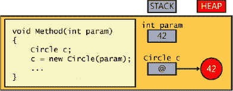

此时，你应该注意以下两点：

* 尽管对象存储在 `heap` 上，但对对象的引用（变量 `c`）存储在 `stack` 上。

* 堆内存不是无限的。如果堆内存耗尽，`new` 运算符将抛出一个 `OutOfMemoryException` 异常，且对象不会被创建。

 **注意**

`Circle` 构造函数也可能抛出异常。如果发生这种情况，分配给 `Circle` 对象的内存将被收回，构造函数返回的值将是 `null`。

当方法结束时，参数和局部变量超出范围。为 `c` 和 `param` 获取的内存会自动释放回 `stack`。运行时注意到 `Circle` 对象不再被引用，并在未来的某个时间点将安排 `heap` 回收其内存。（参见第 14 章。）

### System.Object 类

.NET 中最重要的引用类型之一是 `System` 命名空间下的 `Object` 类。为了充分理解 `System.Object` 类的意义，你必须理解继承，这在第 12 章 的“处理继承”中中已有描述。现在，只需接受所有类都是 `System.Object` 的特化类型，并且你可以使用 `System.Object` 创建可以引用任何引用类型的变量。`System.Object` 是一个如此重要的类，以至于 C#  `object` 关键字作为 `System.Object` 的别名。在你的代码中，可以使用 `object`，也可以写 `System.Object`。它们的意思相同。

 **提示**

使用 `object` 关键字而不是 `System.Object`。它更直接，并且与其他类的类的同义关键字保持一致，例如用于 `System.String` 的 `string` 以及[第 9 章]中涵盖的其他内容。

在下面的示例中，变量 `c` 和 `o` 都引用同一个 `Circle` 对象。`c` 的类型为 `Circle` 而 `o` 的类型为 `object`（`System.Object` 的别名）这一事实实际上为内存中的同一项提供了两种不同的视图。

```
Circle c; 
c = new Circle(42); 
object o; 
o = c;
```

接下来的图展示了变量 `c` 和 `o` 如何引用堆上的同一个项目：

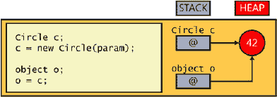

### 装箱（Boxing）

正如你刚刚看到的，`object` 类型的变量可以引用任何引用类型的任何项目。然而，`object` 类型的变量也可以引用值类型。例如，下面的两条语句初始化变量 `i`（类型为 `int`，值类型）为 `42`，然后初始化变量 `o`（类型为 `object`，引用类型）为 `i`：

```
int i = 42; 
object o = i;
```


第二个陈述需要稍作解释以理解实际发生了什么。请记住 `i` 是一个值类型，它存储在栈上。如果 `o` 内部的引用直接指向 `i`，那么该引用将指向栈。然而，引用应该指向堆上的对象。对栈上的项创建不受控制的引用可能会严重危及运行时的健壮性，并可能导致安全漏洞，因此这是被允许的。因此，运行时从堆上分配一块内存，将整数 `i` 的值拷贝到这块内存中，然后让对象 `o` 指向这个拷贝。这种从栈到堆的项的自动拷贝操作被称为**装箱**（`boxing`）。接下面的图显示了结果：

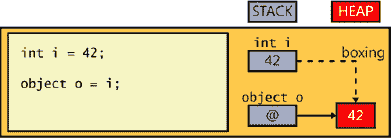

 **重要**

如果你修改了变量 `i` 的原始值，通过 `o` 引用的堆上的值将不会改变。同样，如果你修改了堆上的值，变量的原始值也不会改变。

### 解箱 (Unboxing)

由于 `object` 类型的变量可以引用某个值的装箱拷贝，因此允许你通过该变量获取该装箱值是合理的。你可能期望可以使用如下所示的简单赋值语句来访问变量 `o` 引用的装箱 `int` 值：

```
int i = o;
```

然而，如果你尝试这种语法，你将得到编译错误。如果你仔细考虑，发现不能使用 `int i = o;` 语法是相当合。。毕竟，`o` 可能引用任何类型的内容，而不仅仅是 `int`。考虑一下如果允许该语句，在下面的代码中会发生什么：

点击此处查看代码图像

```
Circle c = new Circle(); 
int i = 42; 
object o; 
o = c; // o 指向一个圆形 
i = o; // i 中存储了什么？
```

要获取装箱拷贝的值，你必须使用所谓的**强制类型转换**（`cast`）。这种操作在实际进行拷贝之前，会检查将一种类型的项转换为另一种类型是否是安全的。你在 `object` 变量前加上带括号的类型名称，例如例所示：

点击此处查看代码图像

```
int i = 42; 
object o = i; // 装箱 
i = (int)o; // 编译通过
```

这种强制转换的效果是微妙的。编译器注意到你在强制转换中指定了类型 `int`。接下来，编译器生成代码以在运行时检查 `o` 实际上引用了什么。它可以是任何东西。仅仅因为你的强制转换说 `o` 指向一个 `int`，并不意味着它实际上确实如此。如果 `o` 确实引用一个装箱的 `int` 且所有内容匹配，则强制转换成功，编译器生成的代码将从装箱的 `int` 中提取值并将其拷贝到 `i`。（在本例中，装箱值随后被存储在 `i` 中。）这被称为**解箱**（`unboxing`）。接下面的图显示了发生的情况：

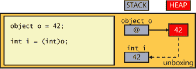

另一方面，如果 `o` 不引用装箱的 `int`，则存在类型不匹配，导致强制转换失败。编译器生成的代码会在运行时抛出 `InvalidCastException` 异常。这里是一个失败的解箱强制转换示例：

点击此处查看代码图像

```
Circle c = new Circle(42); 
object o = c; // 没有装箱，因为 Circle 是引用变量 
int i = (int)o; // 编译通过但在运行时抛出异常
```

接下面的图阐明了这种情况：

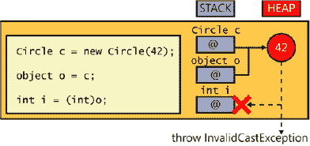

你将在随后的练习中使用装箱和解箱。请记住，装箱和解箱是非常开销的操作，因为需要大量的检查并且需要分配额外的堆内存。装箱有其用处，但盲目使用会严重损害程序的性能。你将在第 17 章，“引出泛型](#ch17.xhtml_ch17)”中看到装箱的替代方案。

### 安全地进行数据强制转换

通过使用强制转换，你可以指定你认为对象引用的数据具有特定类型，并且使用该类型引用该对象是安全的。这里的关键短语是“你认为”。C# 编译器不会检查这种情况是否成立，但运行时会检查。如果内存中对象的类型与强制转换不匹配，运行时将像前一节描述的那样抛出 `InvalidCastException`。你应该准备好在异常发生时捕获该异常并进行适当处理。

然而，当对象的类型不是你预期的时捕获异常并尝试恢复是一种相当繁琐的方法。C# 提供了两个非常有用的运算符，可以帮助你以更优雅的方式执行强制转换：`is` 和 `as` 运算符。

### is 运算符

你以前见过 `is` 运算符，是在检查是否为 `null` 的时候。由于 `object` 类型的变量可以引用某个值的装箱拷贝，因此允许你通过该变量获取该装箱值是合理的。你可能期望可以使用如下所示的简单赋值语句来访问变量 `o` 引用的装箱 `int` 值：

```
int i = o;
```

然而，如果你尝试这种语法，你将得到编译错误。如果你仔细考虑，发现不能使用 `int i = o;` 语法是相当合。毕竟，`o` 可能引用任何类型的内容，而不仅仅是 `int`。

`is` 运算符接受两个操作数：左侧是对象的引用，右侧是类型名称（或 `null`）。如果对象的类型匹配 `is` 运算符指定的类型，则 `is` true 为 `true`；否则为 `false`。

`is` 运算符的另一种形式允许你通过结合类型检查和赋值来简化代码，如下：

点击此处查看代码图像

```
WrappedInt wi = new WrappedInt();
...
object o = wi;
if (o is WrappedInt)
{
    ... // 在此处使用 temp
}
```

在本例中，如果 `WrappedInt` 类型测试成功，`is` 运算符会创建一个引用变量（名为 `temp`）并将其分配 `WrappedInt` 对象。

### as 运算符

`as` 运算符的作用与 `is` 类似，但方式略有。你如下所示使用 `as` 运算符：

点击此处查看代码图像

```
WrappedInt wi = new WrappedInt();
...
object o = wi;
WrappedInt temp = o as WrappedInt;
if (temp is not null)
{
    ... // 强制转换成功
}
```

与 `is` 运算符一样，`as` 运算符接受对象和类型作为操作数。运行时尝试将对象转换为指定的类型。如果强制转换成功，则返回结果并在本例中赋值给 `WrappedInt` 变量 `temp`。如果转换失败，`as` 运算符将求值为 `null` 并将其赋值给 `temp`。

### 回顾 switch 语句

如果你需要对引用检查多种类型，可以使用一系列 `if…else` 语句结合 `is` 运算符。下面的示例假设你定义了 `Circle`、`Square` 和 `Triangle` 类。构造函数接受几何形状的半径（`radius`）或边长（`side`）作为参数：

点击此处查看代码图像


```
var c = new Circle(42);       // 半径为 42 的圆
var s = new Square(55);       // 边长为 55 的正方形
var t = new Triangle(33);     // 边长为 33 的三角形
...
object o = s;
...
if (o is Circle myCircle)
{
    ... // o 是圆，在 myCircle 中可以使用引用 
}
else if (o is Square mySquare)
{    
    ... // o 是正方形，在 mySquare 中可以使用引用 
}
else if (o is Triangle myTriangle)
{    
    ... // o 是三角形，在 myTriangle 中可以使用引用 
}
```

和任何很长的 `if…else` 语句组一样，这种方法很快就会变得复杂且难以阅读。幸运的是，你可以在这种情况使用 `switch` 语句，如下：

点击此处查看代码图片

```
switch (o)
{
    case Circle myCircle:
        ... // o 是圆，在 myCircle 中可以使用引用
        break;

    case Square mySquare:
        ... // o 是正方形，在 mySquare 中可以使用引用
        break;

    case Triangle myTriangle:
        ... // o 是三角形，在 myTriangle 中可以使用引用
        break;                    

        default:
            throw new ArgumentException("variable is not a recognized shape");
        break;
}
```

在两个示例中（使用 `is` 运算符和 `switch` 语句），创建的变量（`myCircle`、`mySquare` 和 `myTriangle`）的作用范围限于相应 `if` 块或 `case` 块内部的代码。

`switch` 语句中的 `case` 选择器还支持 `when` 表达式，你可以用它进一步限定选择 `case` 的情况。例如，下面的 `switch` 语句显示了匹配不同尺寸几何形状的 `case` 选择器：

点击此处查看代码图片

```
switch (o)
{
    case Circle myCircle when myCircle.Radius > 10:
        ... 
        break;
    case Square mySquare when mySquare.SideLength == 100:
        ... 
    break;
        ...                    
}
```

### 总结

在本章中，你学习了直接在栈上存储其值的**值类型**与间接引用堆上对象的**引用类型**之间重要区别。你还学习了如何在方法参数上使用 `ref` 和 `out` 关键字来获取访问权限。你看到给 `System.Object` 类的变量赋值一个值（如 `int` 类型 `42`）会在堆上创建一个该值的装箱（boxed）副本，然后导致 `System.Object` 变量引用该装箱副本。你还看到从 `System.Object` 类的变量赋值给值类型变量（如 `int`）是如何复制（或拆箱 `unboxes`）该值的。

* 如果你想继续阅读下一章，请保持 Visual Studio 2022 运行并转到第 9 章。
* 如果你现在想退出 Visual Studio 2022，在“文件”菜单上选择“退出”。如果你看到“保存”对话框，选择“是”并保存项目。

### 快速参考

| 操作 | 执行此操作 |
| :--- | :--- |
| 复制值类型变量 | 直接进行复制即可。因为变量是值类型，你将拥有两个相同值的副本。例如：
```
int i = 42;
int copy = i;
``` |
| 复制引用类型变量 | 直接进行复制即可。因为变量是引用类型，你将有两个指向同一个对象的引用。例如：
```
Circle c = new Circle(42);
Circle ref = c;
``` |
| 声明一个可以存储值类型或 `null` 值的变量 | 在类型后使用 `?` 修饰符声明变量。例如：
```
int? i = null;
``` |
| 向 `ref` 参数传递参数 | 在参数前缀加 `ref` 关键字。这使得参数成为实际参数的别名，而不是参数的副本。方法可能会更改参数的值，此更改发生在实际参数上而不是本地副本。例如：
```
static void Main()
{
    int arg = 42;
    doWork(ref arg);
    Console.WriteLine(arg);
}
``` |
| 向 `out` 参数传递参数 | 在参数前缀加 `out` 关键字。这使得参数成为实际参数的别名，而不是参数的副本。方法必须为参数赋值，且此值将应用于实际参数上。例如：
```
static void Main()
{
    int arg;
    doWork(out arg);
    Console.WriteLine(arg);
}
``` |
| 装箱一个值 | 使用值初始化或为 `object` 类型变量赋值。例如：
```
object o = 42;
``` |
| 拆箱一个值 | 将引用装箱值的对象引用强制转换为该值的类型。例如：
```
int i = (int)o;
``` |
| 安全地强制转换对象 | 使用 `is` 运算符测试转换是否有效。例如：点击此处查看代码图片
```
if (o is Circle c)
{
    ...
}
``` |

# 第 9 章

## 使用枚举和结构体创建值类型

完成本章后，你将能够：

* 声明枚举类型并创建枚举变量。
* 声明结构体类型并创建结构体变量。
* 解释结构体与类之间的区别。

第 8 章“理解值和引用”涵盖了 C# 中的两种基本类型：值类型直接在栈上持有值，而引用类型持有堆上对象的引用。第 7 章“创建和管理类”演示了如何通过定义类来创建引用类型。在本章中，你将学习如何创建自己的值类型。

### 使用枚举

假设你想在程序中表示季节。你可以使用整数 `0`、`1`、`2` 和 `3` 分别代表春、夏、秋、冬。这种方法可行，但并不直观。如果你在代码中使用整数 `0`，并不知道它代表春天。这也不是一个健壮的解决方案，因为可以赋值 `0-3` 之外的任何合法整数值。C# 提供了一个更好的解决方案：你可以创建一个枚举（有时称为 `enum` 类型），其值被限于一组符号名称。

#### 声明枚举

通过使用 `enum` 关键字，并在大括号内包含一组该类型可以拥有的合法符号来定义枚举。以下是声明一个名为 `Season` 的枚举的方法，其字面量值限于 `Spring`、`Summer`、`Fall` 和 `Winter`：

点击此处查看代码图片

```
enum Season { Spring, Summer, Fall, Winter }
```


```
enum Season { Spring, Summer, Fall, Winter } 
class Example 
{ 
    public void Method(Season parameter) // method parameter example 
    { 
        Season localVariable; // local variable example 
        ... 
    } 

    private Season currentSeason; // field example 
}
```

在读取枚举变量的值之前，必须先为它分配一个值。你只能将枚举定义的数值赋值给枚举变量，如下所示：

点击此处查看代码图片

```
Season colorful = Season.Fall; 
Console.WriteLine(colorful); // 写出 ‘Fall’
```

 **注意**

与所有值类型一样，你可以通过使用 `?` 修饰符创建枚举变量的可空版本（nullable version）。然后，你可以将 `null` 值以及枚举定义的数值赋值给该变量：

```c
Season? colorful = null;
```

请注意，你必须编写 `Season.Fall` 而不仅仅是 `Fall`。所有枚举字面量名称都受其枚举类型的作用域限制，这使得不同的枚举可以包含名称相同的字面量。

此外，请注意当你使用 `Console.WriteLine` 显示枚举变量时，编译器会生成代码，输出与变量值匹配的字面量名称。如果需要，你可以使用所有枚举自动包含的内置 `ToString` 方法，将枚举变量显式转换为表示其当前值的字符串，如下例所示：

点击此处查看代码图片

```c
string name = colorful.ToString(); 
Console.WriteLine(name); // 也写出 ‘Fall’
```

你可以在枚举变量上使用许多用于整数变量的标准运算符（位运算和移位运算符除外，这些运算符在第 16 章“处理二进制数据和使用索引器”中有所介绍）。例如，你可以使用等号运算符 (`==`) 比较两个相同类型的枚举变量是否相等，你甚至可以在枚举变量上进行算术运算——尽管结果并不总是有意义的

### 选择枚举字面量值

在内部，枚举类型将整数值与枚举的每个元素关联。默认情况下，编号从第一个元素的 0 开始，并以 1 递增。

可以获取枚举变量的底层整数值。要做到这一点，你必须将其转换为其底层类型。第 8 章中关于拆箱的讨论解释说，只要转换有效且有意义，类型转换就会将数据从一种类型转换为另一种类型。下面的代码示例输出了值 `2` 而不是单词 `Fall`（记住，在 `Season` 枚举中，`Spring` 是 `0`，`Summer` 是 `1`，`Fall` 是 `2`，`Winter` 是 `3`）：

点击此处查看代码图片

```c
enum Season { Spring, Summer, Fall, Winter } 
... 
Season colorful = Season.Fall; 
Console.WriteLine(colorful); // 写出 ‘Fall’
```

点击此处查看代码图片

```c
enum Season { Spring, Summer, Fall, Winter } 
... 
Season colorful = Season.Fall; 
Console.WriteLine((int)colorful); // 写出 2
```

点击此处查看代码图片

```c
enum Season { Spring, Summer, Fall, Winter } 
... 
Season colorful = Season.Fall; 
Console.WriteLine((int)colorful); // 写出 2
```


点击此处查看代码图片

```cpp
static void doWork() 
{ 
    Month first = Month.January; 
    Console.WriteLine(first); 
    first++; 
    Console.WriteLine(first); 
}
```

10. 在 `Debug` 菜单上，选择 `Start Without Debugging`（无调试启动）。

Visual Studio 2022 编译并运行程序。确认控制台输出了 `January` 和 `February` 单词。

注意，在枚举变量上执行数学运算（如递增操作）会更改变量的内部整数值。当变量被写入控制台时，将显示相应的枚举值。

11. 按 `Enter` 关闭程序并返回 Visual Studio 2022 编程环境。

12. 修改 `doWork` 方法中的第一条语句，将 `first` 变量初始化为 `Month.December`，如下所示**加粗**所示：

点击此处查看代码图片

```cpp
static void doWork() 
{ 
    Month first = Month.December; 
    Console.WriteLine(first); 
    first++; 
    Console.WriteLine(first); 
}
```

13. 在 `Debug` 菜单上，选择 `Start Without Debugging`（无调试启动）。

Visual Studio 2022 编译并运行程序。这次，控制台输出了单词 `December`，随后是数字 `12`。

尽管你可以对枚举进行算术运算，但如果运算结果超出了枚举定义的数值范围，运行时所做的只是将变量的值解释为相应的整数值。

14. 按 `Enter` 关闭程序并返回 Visual Studio 2022 编程环境。

### 使用结构体

第 8 章 阐述了类（class）定义了始终在堆上创建的引用类型。在某些情况下，类包含的数据非常少，以至于管理堆的开销变得变得正比例。在这些情况下，将类型定义为结构体（structure）更好。结构体是一种值类型。由于结构体存储在栈上，只要结构体足够较小，内存管理的开销通常就会减少。与类一样，结构体可以拥有自己的字段、方法以及构造函数（在本章稍后的部分将讨论一个重要的例外）。

#### 声明结构体

要声明你自己的结构体类型，你使用 `struct` 关键字，后跟类型名称，然后用大括号和右括号将结构体的体括起来。在语法上，此过程与声明类相似。例如，这里有一个名为 `Time` 的结构体，它包含三个名为 `hours`、`minutes` 和 `seconds` 的公共 `int` 字段：

点击此处查看代码图片

```cpp
struct Time 
{
    public int hours, minutes, seconds; 
}
```

与类一样，在大多数情况下都不建议将结构体的字段设为公共（public）；因为没有办法控制公共字段中持有的值。例如，任何人都可以将 `minutes` 或 `seconds` 的值设置为大于 60。更好的主意是将字段设为私有（private），并为你的结构体提供构造函数和方法来初始化和操作这些字段，如下例所示：

点击此处查看代码图片

```cpp
struct Time 
{ 
    private int hours, minutes, seconds; 
    ... 
    public Time(int hh, int mm, int ss) 
    { 
        this.hours = hh % 24; 
        this.minutes = mm % 60; 
        this.seconds = ss % 60; 
    } 

    public int Hours() 
    { 
        return this.hours; 
    } 
}
```

 **注意**

默认情况下，你无法在你自己的结构体类型上使用许多常用运算符。例如，你不能使用相等运算符（`==`）或不等运算符（`!=`）来比较结构体类型变量。然而，你可以使用所有结构体暴露内置 `Equals()` 方法来比较结构体类型变量。你也可以显式地为自己的结构体类型声明并实现运算符。实现此操作的语法将在第 21 章“使用查询表达式查询内存中的数据”中进行介绍。

当你复制一个值类型变量时，你会得到两个值的副本。相比之下，当你复制一个引用类型变量时，你得到的是指向同一个对象的引用。总结来说，对于小型数据值使用结构体，因为复制值的效率与复制地址一样高效或接近高效。对于大到无法高效复制的复杂数据，请使用类。

 **提示**

使用结构体来实现简单的概念，这些概念的主要特征是它们的值而不是它们所提供的功能。

#### 理解结构体和类之间的区别

结构体和类在语法上是类似的，但它们有一些重要的区别。让我们来看其中的一些变化：

*   你不能为结构体声明默认构造函数（无参数的构造函数）。在类中，如果你不写一个，编译器会合成一个。结构体的编译器生成的默认构造函数始终将字段设置为 `0`、`false` 或 `null`——就像类一样。因此，你应该确保由默认构造函数创建的结构体逻辑上是合理的且符合这些默认值的。点击此处查看代码图片

```cpp
struct Time 
{ 
    public Time() { ... } // 编译错误
    ... 
}
```

你可以通过提供非默认构造函数为字段初始化不同的值。然而，当你这样做时，你的非默认构造函数必须显式初始化结构体中的所有字段；不再发生默认初始化。如果你失败，将得到编译错误。例如，虽然以下示例在 Time 是类时可以编译，但由于 `Time` 是结构体，它编译失败：点击此处查看代码图片

```cpp
struct Time 
{ 
    private int hours, minutes, seconds; 
    ... 
    public Time(int hh, int mm) 
    { 
        this.hours = hh; 
        this.minutes = mm; 
    } // 编译错误：seconds 未初始化
}
```

* 在类中，你可以在声明处实例化字段；在结构体中，你不能这样做。以下示例在 Time 是类时可以编译，但由于 `Time` 是结构体，它会导致编译错误：点击此处查看代码图片

```cpp
struct Time 
{ 
    private int hours = 0; // 编译错误 
    private int minutes; private int seconds; 
    ... 
}
```

下表总结了结构体和类之间的主要区别：

| 问题 | 结构体 | 类 |
| --- | --- | --- |
| 是值类型还是引用类型？ | 结构体是值类型。 | 类是引用类型。 |
| 实例在栈上还是堆上？ | 结构体实例被称为*值*，通常在栈上。 | 类实例被称为*对象*，通常在堆上。 |
| 可以声明默认构造函数吗？ | 否 | 是 |
| 如果声明了自己的构造函数，编译器还会生成默认构造函数吗？ | 是 | 否 |


| 如果你没有在自己的构造函数中初始化字段，编译器会自动为你初始化它吗？ | 否 | 是 |
| 你是否允许在声明处初始化实例字段？ | 否 | 是 |

 **注意**

在某些情况下，`struct` 会创建在堆（heap）而不是栈（stack）上。最常见的情况是类声明了一个类型为 `struct` 的字段。当创建此类类的对象时，该 `struct` 的内存将作为对象的一部分分配在堆上，而不是单独分配在栈上。

类和结构体（struct）之间在继承方面还有其他差异。这些差异在第 12 章 的“处理继承”中介绍。

## 声明结构体变量

在定义了结构体类型之后，你可以像使用任何其他类型一样使用它。例如，如果你定义了 `Time` 结构体，你可以创建 `Time` 类型的变量、字段和参数，如下例所示：

点击此处查看代码图像

```
struct Time
{
    private int hours, minutes, seconds;
    ...
}

class Example
{
    private Time currentTime; 

    public void Method(Time parameter) 
    {
        Time localVariable; 
        ... 
    }
}
```

 **注意**

与枚举一样，你可以使用 `?` 修饰符创建结构体变量的可空版本。然后你可以将 `null` 值赋值给该变量，如下：

```
Time? currentTime = null;
```

## 理解结构体初始化

在本章较早之前，你已经了如何使用构造函数初始化结构体中的字段。如果你调用构造函数，之前描述的各种规则将保证结构体中的所有字段都会被初始化：

```
var now = new Time();
```

接下来的插图描述了该结构体中字段的状态：

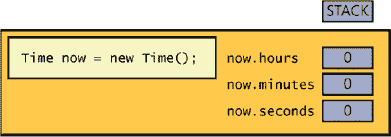

然而，由于结构体是值类型，你也可以在不调用构造函数的情况下创建结构体变量，如下例：

```
Time now;
```

这一次，变量被创建，但它的字段处于未初始化的状态。接下来的插图描述了 `now` 变量中字段的状态。任何读取结构体或访问这些字段中值的尝试都会导致编译器错误“使用未赋值的局部变量”。

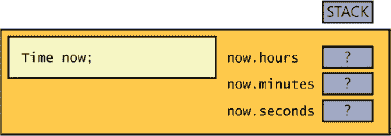

 **注意**

在这两种情况下，`now` 变量都是创建在栈上的。

如果你已经编写了自己的结构体构造函数，你也可以使用它来初始化结构体变量。正如在本章之前解释的那样，结构体构造函数必须显式地初始化其所有字段。例如：

点击此处查看代码图像

```
struct Time
{
    private int hours, minutes, seconds; 
    ... 

    public Time(int hh, int mm) 
    {
        hours = hh; 
        minutes = mm; 
        seconds = 0; 
    }
}
```

接下来的示例通过调用用户定义的构造函数来初始化 `now`：

```
Time now = new Time(12, 30);
```

接下来的插图显示了该示例的效果：

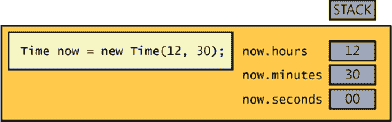

是时候将这些知识付诸实践了。在练习中，你将创建并使用结构体来表示日期。

### 创建和使用结构体类型

1. 在 `StructsAndEnums` 项目中，在代码和文本编辑器窗口显示 `Date.cs` 文件。
2. 将 `// TODO:` 注释替换为 `StructsAndEnums` 命名空间内名为 `Date` 的结构体。

   该结构体应包含三个私有字段：一个名为 `year` 的 `int` 类型字段，一个名为 `month` 的 `Month` 类型（使用你在上一个练习中创建的枚举），以及一个名为 `day` 的 `int` 类型字段。`Date` 结构体应该完全如下所示：

   ```go
   struct Date 
   { 
       private int year; 
       private Month month; 
       private int day; 
   }
   ```

   考虑编译器为 `Date` 生成的默认构造函数。该构造函数将 `year` 设置为 `0`，`month` 设置为 `0`（一月的值），`day` 设置为 `0`。`year` 值 `0` 是无效的（因为没有 0 年），且 `day` 值 `0` 也是无效的（因为每个月从 1 号开始）。解决这个问题的一种方法是通过实现 `Date` 结构体来转换 `year` 和 `day` 值，使得当 `year` 字段持有值 `Y` 时，该值代表年份 `Y + 1900`（你可以根据喜选择不同的世纪），当 `day` 字段持有值 `D` 时，该值代表第 `D + 1` 天。

   如果你可以重写默认构造函数并编写自己的构造函数，这就不是问题了。但你无法这样做。

   尽管你不能重写默认构造函数，但定义非默认构造函数仍然是一个良好的习惯，允许用户显式地初始化有意义的值。

3. 在 `Date` 结构体的构造函数之后添加一个公共构造函数。该构造函数应接受三个参数：用于年份的 `int` `ccyy`、用于月份的 `Month` `mm` 以及用于日期的 `int` `dd`。使用这三个参数来初始化相应的字段。`year` 字段的值 `Y` 代表年份 `Y + 1900`，因此你必须将 `year` 字段初始化为 `ccyy - 1900`。`day` 字段的值 `D` 代表第 `D + 1` 天，因此你需要将 `day` 字段初始化为 `dd - 1`。

   `Date` 结构体现在应该如下（构造函数加粗显示）：

   点击此处查看代码图像

   ```go
   struct Date
   {
       private int year; 
       private Month month; 
       private int day; 

       public Date(int ccyy, Month mm, int dd)
       {
           this.year = ccyy - 1900; 
           this.month = mm; 
           this.day = dd - 1; 
       }
   }
   ```

4. 在 `Date` 结构体的构造函数之后添加一个名为 `ToString` 的公共方法。该方法不接受参数并返回日期的字符串表示。记住，`year` 字段的值代表 `year + 1900`，而 `day` 字段的值代表 `day + 1`。


`ToString` 方法与你目前看到的其他略有不同。每种类型（包括你定义的结构体和类）无论你是否想要，都自动有一个 `ToString` 方法。它的默认行为是将变量中的数据转换为该数据的字符串表示。有时这种默认行为是有意义的；而在其他时候则意义不大。例如，为 `Date` 结构体生成的 `ToString` 方法的默认行为只是生成字符串 `StructsAndEnums.Date`。引用道格拉斯·亚当斯（Douglas Adams）在《宇宙尽头处的餐厅》（Pan Macmillan, 1980）中书中扎福德·比布尔布罗克斯的话说，这是“精明，但很乏味”。你需要使用 `override` 关键字定义该方法的新版本，以覆盖默认行为。关于重写方法的话题将在第 12 章中进行更详细的讨论。

`ToString` 方法应该如下：

点击此处查看代码图像

```c
struct Date 
{ 
    ... 
    public override string ToString() 
    { 
        string data = $"{this.month} {this.day + 1} {this.year + 1900}"; 
        return data; 
    } 
}
```

在此方法中，你使用 `month` 字段值的文本表示、表达式 `this.day + 1` 以及表达式 `this.year + 1900` 构建一个格式化字符串。`ToString` 方法将该格式化字符串作为结果返回。

5. 在“代码和文本编辑器”窗口中显示 `Program.cs` 文件。

6. 在 `doWork` 方法中，注释掉现四个语句。

7. 在 `doWork` 方法中添加语句，声明一个名为 `defaultDate` 的局部变量，并使用默认 `Date` 构造函数构造的 `Date` 值初始化。在 `doWork` 中添加另一个语句，通过调用 `Console.WriteLine` 在控制台上显示 `defaultDate` 变量。

 **注意**

`Console.WriteLine` 方法会自动调用其参数的 `ToString` 方法，将参数格式化为字符串。

`doWork` 方法现在应该像这样：

点击此处查看代码图像

```csharp
static void doWork() 
{ 
    ... 
    var defaultDate = new Date(); 
    Console.WriteLine(defaultDate); 
}
```

 **注意**

当你输入 `new Date(` 时，IntelliSense 会自动检测到 `Date` 类型有两个可用的构造函数。

8. 在**调试**菜单上，选择**不调试调试启动**以编译并运行程序。验证控制台上是否输出了日期 `January 1 1900`。

9. 按 **Enter** 键返回 Visual Studio 2022 编程环境。

10. 在“代码和文本编辑器”窗口中，返回 `doWork` 方法并添加两个语句。在第一个语句中，声明一个名为 `weddingAnniversary` 的局部变量，并将其初始化为 2021 年 7 月 4 日。（实际上是在美国独立日结婚的，尽管那是很多年前的事，而且是在英国。）在第二个语句中，将 `weddingAnniversary` 的值写入到控制台。

`doWork` 方法现在应该像这样：

点击此处查看代码图像

```csharp
static void doWork() 
{ 
    ... 
    Date weddingAnniversary = new Date(2021, Month.July, 4);
    Console.WriteLine(weddingAnniversary); 
}
```

11. 在**调试**菜单上，选择**不调试调试启动**，然后确认日期 `July 4 2021` 写入之前信息下控制台中。

12. 按 **Enter** 关闭程序并返回 Visual Studio 2022。

#### 复制结构体变量

允许将一个结构体变量初始化或赋值给另一个结构体变量，但前提是右侧的结构体变量已完全初始化（即其所有字段都填充了有效数据而非未定义的值）。以下示例可以通过编译，是因为 `now` 已完全初始化。插图显示了此类赋值的结果。

点击此处查看代码图像

```csharp
Date now = new Date(2012, Month.March, 19); 
Date copy = now;
```

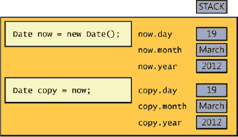

以下示例无法编译，是因为 `now` 未初始化：

点击此处查看代码图像

```csharp
Date now; 
Date copy = now; // 编译错误：未给 now 赋值
```

当你复制结构体变量时，左侧的每个字段都直接使用右侧对应的字段进行初始化。这种复制是作为单个快速操作完成的。


第一条消息显示 `weddingAnniversary` 变量的初始值（`July 4 2021`）。第二条消息显示 `weddingAnniversaryCopy` 变量的值。你可以看到它包含了与 `weddingAnniversary` 变量中相同的日期（`July 4 2021`）。第三条消息显示在将月份改为 8 月后 `weddingAnniversary` 变量的值（`August 4 2021`）。最后一条语句显示了 `weddingAnniversaryCopy` 变量的值。请注意，它没有从其原始值 `July 4 2021` 发生变化。

如果 `Date` 是一个类，那么创建一个副本将引用内存中与原始实例相同的同一个对象。因此，更改原始实例中的月份也将更改通过副本引用的日期。你将在接下来的步骤中验证这一断言。

8.  按 `Enter` 并返回 Visual Studio 2022。

9.  在代码和文本编辑器窗口中显示 `Date.cs` 文件。

10. 将 `Date` 结构体更改为类，如下代码示例中的**粗体**所示：

```
class Date 
{ 
    ... 
}
```

11. 在 `Debug` 菜单上，选择 `Start Without Debugging`（不调试启动）重新编译并运行应用程序。验证控制台窗口是否显示以下消息：

点击此处查看代码

```
July 4 2021 
Value of copy is July 4 2021 
New value of weddingAnniversary is August 4 2021 
Value of copy is still August 4 2021
```

前三条消息与之前相同。然而，第四条消息显示 `weddingAnniversaryCopy` 变量的值已更改为 `August 4 2021`。

12. 按 `Enter` 并返回 Visual Studio 2022。

### 总结

在本章中，你学习了如何创建和使用枚举和结构体。你学习了结构体和类之间的一些相似之处和区别，并看到了如何定义构造函数来初始化结构体中的字段。你还学习了如何通过重写 `ToString` 方法将结构体表示为字符串。

*   如果你想继续阅读下一章，请保持 Visual Studio 2022 运行并转到第 10 章，“使用数组](#ch10.xhtml_ch10)”。
*   如果你现在想退出 Visual Studio 2022，在文件（File）菜单上选择 `Exit`（退出）。如果你看到保存对话框，选择 `Yes`（是）并保存项目。

### 快速参考

|  | 操作 |
| --- | --- |
| 声明枚举 | 编写关键字 `enum`，后跟类型名称，然后是一个包含逗号分隔的枚举字面量名称列表的大括号。例如：点击此处查看代码 |

```
enum Season { Spring, Summer, Fall, Winter }
``` |
| 声明枚举变量 | 在左侧编写枚举名称，后跟变量名称，最后加分号。例如： | |

```
Season currentSeason;
``` |
| 给枚举变量赋值 | 将枚举字面量名称与其所属的枚举名称结合使用。例如：点击此处查看代码 |

```
currentSeason = Season.Spring; // 正确
但注意：
currentSeason = Spring; // 错误
``` |
| 声明结构体类型 | 编写关键字 `struct`，后跟结构体类型名称，然后是结构体的体（构造函数、方法和字段）。例如：点击此处查看代码 |

```
struct Time 
{ 
    public Time(int hh, int mm, int ss) 
    { ... } 
    ... 
    private int hours, minutes, seconds; 
}
``` |
| 声明结构体变量 | 编写结构体类型名称，后跟变量名称，最后加分号。例如： | |

```
Time now;
``` |
| 初始化结构体变量的值 | 将变量初始化为调用结构体构造函数创建的结构体值。例如：点击此处查看代码 |

```
Time lunch = new Time(12, 30, 0);
``` |

## 第 10 章

## 使用数组

**完成本章后，你将能够：**

*   声明数组变量。
*   创建数组实例。
*   用一组数据项填充数组并访问这些项。
*   复制数组。
*   创建并使用多维数组。

你已经学习了如何创建和使用许多不同类型的变量。然而，你目前为止看到的所有变量都有一个共同点：它们持有关于单个项目的信息（一个 `int`、`float`、`Circle`、`Date` 等）。但如果你需要处理一组项时呢？

一种解决方案是为集合中的每个项创建一个变量，但这会导致一些进一步的问题：

*   你需要多少变量？
*   你应该如何命名它们？
*   如果你需要对集合中的每个项执行相同的操作，如何避免重复代码？

此外，为集合中的每个项使用变量假设你在编写程序时已经知道多少个项。例如，如果你正在编写一个从数据库读取记录的应用程序，这种情况概率有多大？

数组提供了解决这些问题的机制。*数组*是项的无序序列。与通过名称访问的结构体或类不同，数组中的所有项具有相同的类型。而且，数组项存储在连续的内存中，并通过索引进行访问。

### 声明数组变量

通过指定元素类型、后跟一对方括号、最后是变量名称来声明数组变量。方括号表示该变量是一个数组。例如，要声明一个名为 `pins` 的 `int` 数组，可以这样写：

点击此处查看代码

```
int[] pins; // 个人识别
```

如果你是 Microsoft Basic 程序员，请注意使用的是方括号而不是括号。如果你熟悉 C 和 C++，请注意数组的大小不是声明的一部分。此外，方括号必须放在变量名之前。

你不局限于使用基本类型作为数组元素。你还可以创建结构体、枚举和类的数组。例如，你可以这样创建一个 `Date` 结构体的数组：

```
Date[] dates;
```

为数组变量使用复数名称通常有用，例如 `places`（每个元素是 `Place`）、`people` (每个元素是 `Person`）或 `times`（每个元素是 `Time`）。

### 创建数组实例

无论元素类型如何，数组都是引用类型。这意味着数组变量引用的是堆上存储数组元素的连续内存块，就像类变量引用堆上的对象一样。（关于值和引用以及栈和堆之间的描述，请参见第 8 章](#ch08.xhtml_ch08），“理解值和引用”）


请记住，当你声明类变量时，只有在你使用 `new` 关键字创建实例后，才会为该对象分配内存。数组遵循相同的模式：当你声明一个数组变量时，不需要声明它的大小，也不会分配内存（栈上存储引用的内存除外）。只有在创建实例时，数组才会被赋予内存；这也是指定数组大小的点。

要创建一个数组实例，你使用 `new` 关键字，紧接着是元素类型，然后是在方括号 `[]` 中指定你正在创建的数组大小。创建数组还会使用现在熟悉的默认值（根据类型是数值型、引用类型还是布尔类型，分别对应 `0`、`null` 或 `false`）来初始化其元素。例如，要为之前声明的 `pins` 变量创建并初始化一个包含四个整数的新数组，你可以这样写：

```
pins = new int[4];
```

接下来的插图展示了声明数组以及之后创建数组实例时发生的情况：

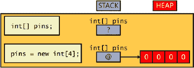

因为数组实例的内存是动态分配的，所以数组的大小不必是常数；它可以在运行时计算，如下例所示：

点击此处查看代码图像

```
int size = int.Parse(Console.ReadLine()); 
int[] pins = new int[size];
```

你也可以创建一个大小为 0 的数组。这听起来可能很奇怪，但它适用于数组大小动态确定且可能为 0 的情况。大小为 0 的数组不是 `null` 数组；它是包含零元素的数组。

### 填充和使用数组

当你创建一个数组实例时，数组的所有元素都会根据其类型初始化为默认值。例如，所有数值值默认为 `0`，对象初始化为 `null`，`DateTime` 值被设置为日期和时间 `"01/01/0001 00:00:00"`，字符串初始化为 `null`。

如果你愿意，也可以修改这种行为并将数组的元素初始化为特定值。你可以通过在一对括号之间提供用逗号分隔的值列表来实现。例如，要将 `pins` 初始化为包含四个值为 `9`、`3`、`7` 和 `2` 的 `int` 变量数组，你可以这样写：

点击此处查看代码图像

```
int[] pins = new int[4]{ 9, 3, 7, 2 };
```

括号之间的值不必是常数；它们可以是运行时计算的值，如下例所示，该示例用四个随机数填充了 `pins` 数组：

点击此处查看代码图像

```
Random r = new Random(); 
int[] pins = new int[4]{ r.Next() % 10, r.Next() % 10, r.Next() % 10, r.Next() % 10 };
```

 **注意**

`System.Random` 类是一个伪随机数生成器。`Next` 方法默认返回 `0` 到 `Int32.MaxValue` 范围内的非负随机整数。`Next` 方法被重载了，其他版本允许你指定范围的最小值和最大值。`Random` 类的默认构造函数使用依赖于时间的种子值为随机数生成器种子，这减少了该类重复随机数序列的可能性。使用重载的构造函数，你可以提供自己的种子值。这样，你就可以为测试生成可重复的随机数序列。

括号之间的值数量必须与创建的数组实例的大小完全匹配：

点击此处查看代码图像

```
int[] pins = new int[3]{ 9, 3, 7, 2 }; // 编译时错误 
int[] pins = new int[4]{ 9, 3, 7 }; // 编译时错误 
int[] pins = new int[4]{ 9, 3, 7, 2 }; // OK
```

以此这种方式初始化数组变量时，实际上可以省略 `new` 表达式和数组的大小。在这种情况下，编译器会根据初始化器的数量计算大小并生成创建数组的代码，如下例所示：

```
int[] pins = { 9, 3, 7, 2 };
```

如果你创建一个结构体或对象的数组，可以通过调用结构体或类的构造函数来初始化数组中的每个结构体，如下所示：

点击此处查看代码图像

```
Time[] schedule = { new Time(12,30), new Time(5,30) };
```

### 创建隐式类型数组

声明数组时，元素类型必须与你尝试存储在数组中的元素类型匹配。例如，如果你声明了一个 `int` 数组，就不能在其中存储 `string`。

如果你使用以下语法，C# 编译器可以推断出数组类型：

```
int[] pins = { 9, 3, 7, 2 };
```

如果你创建一个结构体或对象的数组，可以通过调用结构体或类的构造函数来初始化数组中的每个结构体：

```
Time[] schedule = { new Time(12,30), new Time(5,30) };
```


所有的数组元素访问都经过了边界检查。如果你指定的索引小于 0 或大于或等于数组的长度，编译器将抛出 `IndexOutOfRangeException` 异常，如下例所示：

点击此处查看代码图片

```
try 
{ 
    int[] pins = { 9, 3, 7, 2 }; 
    Console.WriteLine(pins[4]); // ，第四个元素（最后一个元素）的索引为 3 
} 
catch (IndexOutOfRangeException ex) 
{ 
    ... 
}
```

## 访问系列数组元素

C# 允许你使用 `x..y` 形式的索引从数组中检索一组连续的元素。返回从元素 `x` 开始到 `y` 结束但（注意，这很重要）**不包含 `y` 的序列。结果是另一个包含所检索元素的数组。在接接的示例中，`subset` 数组包含 `names` 数组中的第 0 和 1 个元素：

点击此处查看代码图片

```
var names = new[] { new { Name = "John", Age = 57 }, 
                                new { Name = "Diana", Age = 57 }, 
                                new { Name = "James", Age = 30 }, 
                                new { Name = "Francesca", Age = 26 } };

var subset = names[0..2];
```

`subset` 数组将包含 `John` 和 `Diana` 的值（元素 0 和 1）。范围的第一个数字必须小于或等于第二个数字；否则你将得到 `System.ArgumentOutOfRangeException` 异常。如果范围内的第一个数字和第二个数字相同，结果是一个长度为 0 的数组。

你还可以指定 `^x` 形式的表达式作为起始元素。在这种情况下，将从元素 `x` 向后计数检索 `y – 1` 个元素（尽管元素仍然按正序检索的）。在下述语句中，`subset` 数组包含 `Diana`、`James` 和 `Francesca` 的值（从元素 3 或 4 – 1 向后开始）：

```
var subset = names[³..4];
```

## 遍历数组

所有数组在 .NET 库中实际上都是 `System.Array` 类的实例，该类定义了一些实用的属性和方法。例如，你可以查询 `Length` 属性来发现数组包含多少元素，并使用 `for` 语句遍历数组的所有元素。下面的示例代码将 `pins` 数组的元素元素值写入控制台：

点击此处查看代码图片

```
int[] pins = { 9, 3, 7, 2 }; 
for (int index = 0; index < pins.Length; index++) 
{ 
    int pin = pins[index]; 
    Console.WriteLine(pin); 
}
```

 **注意**

`Length` 是一个属性而不是方法，这就是为什么在调用它时不需要使用括号。你将在第 15 章 中的“实现属性以访问字段”中学习属性。

新程序员经常忘记数组从元素 0 开始，并且最后一个元素的编号为 `Length` – 1。幸运的是，C# 提供了 `foreach` 语句，通过它你可以遍历数组的元素而不必担心这些问题。例如，这里是将上述的 `for` 语句重写为等效的 `foreach` 语句：

点击此处查看代码图片

```
int[] pins = { 9, 3, 7, 2 }; 

foreach (int pin in pins) 
{ 
    Console.WriteLine(pin); 
}
```

`foreach` 语句声明了一个迭代变量（在本例中为 `int pin`），它会自动获取数组中每个元素的值。该变量的类型必须与数组元素的类型匹配。`foreach` 语句是遍历数组的首选方式；它直接表达了代码的意图，并且所有的 `for` 循环脚架都消失了。然而，在某些情况下，你会发现必须改回 `for` 语句：

* `foreach` 语句总是遍历整个数组。如果你只想遍历数组的已知部分（例如，前半部分）或跳过某些元素（例如，每三个元素），使用 `for` 语句更简单。
* `foreach` 语句总是从索引 0 遍历到索引 `Length` – 1。如果你想反向遍历或按其他顺序遍历，使用 `for` 语句更简单。
* 如果循环体需要知道元素的索引而不仅仅是元素的值，你必须使用 `for` 语句。
* 如果你需要修改数组的元素，你必须使用 `for` 语句。这是因为数组的迭代变量是只读的。

 **注意**

`Length` 是一个属性而不是方法，这就是为什么在调用它时不需要使用括号。你将在第 15 章中的“实现属性以访问字段”中学习属性。

新程序员经常忘记数组从元素 0 开始，并且最后一个元素的编号为 `Length` – 1。幸运的是，C# 提供了 `foreach` 语句，通过它你可以遍历数组的元素而不必担心这些问题。例如，这里是将上述的 `for` 语句重写为等效的 `foreach` 语句：

点击此处查看代码图片

```
int[] pins = { 9, 3, 7, 2 }; 

foreach (int pin in pins) 
{ 
    Console.WriteLine(pin); 
}
```

`foreach` 语句声明了一个迭代变量（在本例中为 `int pin`），它会自动获取数组中每个元素的值。该变量的类型必须与数组元素的类型匹配。`foreach` 语句是遍历数组的首选方式；它直接表达了代码的意图，并且所有的 `for` 循环脚架都消失了。然而，在某些情况下，你会发现必须改回 `for` 语句：

* `foreach` 语句总是遍历整个数组。如果你只想遍历数组的已知部分（例如，前半部分）或跳过某些元素（例如，每三个元素），使用 `for` 语句更简单。
* `foreach` 语句总是从索引 0 遍历到索引 `Length` – 1。如果你想反向遍历或按其他顺序遍历，使用 `for` 语句更简单。
* 如果循环体需要知道元素的索引而不仅仅是元素的值，你必须使用 `for` 语句。
* 如果你需要修改数组的元素，你必须使用 `for` 语句。这是因为数组的迭代变量是只读的。

## 数组的传递与返回

你可以定义将数组作为参数的方法，或将它们返回。

将数组作为参数传递的语法与数组相似。例如，接下来的代码示例定义了一个名为 `ProcessData` 的方法，它接收整数数组作为参数。方法体遍历数组并对每个元素进行某些处理：

点击此处查看代码图片

```
public void ProcessData(int[] data)
{
    foreach (int i in data)
    {
        ...
    }
}
```

数组是引用对象，因此如果你在如 `ProcessData` 方法内部修改了作为参数的数组的内容，这些修改是可见的。

要从方法返回数组，你需要指定数组的类型作为返回类型。在方法中，你创建并填充数组。接下来的示例提示输入数组的大小，然后是每个元素的数据。由方法创建的数组作为返回值传递：

点击此处查看代码图片

```
public int[] ReadData()
{
    Console.WriteLine("How many elements?");
    string reply = Console.ReadLine();
    int numElements = int.Parse(reply);

    int[] data = new int[numElements];
    for (int i = 0; i < numElements; i++)
    {
        Console.WriteLine($"Enter data for element {i}");
        reply = Console.ReadLine();
        int elementData = int.Parse(reply);
        data[i] = elementData;
    }
    return data;
}
```

你可以这样调用 `ReadData` 方法：

```
int[] data = ReadData();
```

## 复制数组

数组是引用类型。（记住数组是 `System.Array` 类实例。）数组变量包含指向数组实例的引用。这意味着当你复制数组变量时，你实际上得到了指向同一个数组实例的两个引用，如下例所示：

点击此处查看代码图片


```
int[] pins = { 9, 3, 7, 2 }; 
int[] alias = pins; // alias 和 pins 指向同一个数组实例
```

在这个示例中，如果你修改了 `pins[1]` 处的值，那么通过读取 `alias[1]` 也能看到该变化。

如果你想为数组变量所引用的数组实例（堆上的数据）创建一个副本，你必须做两件事：

1. 创建一个与要复制的数组类型相同且长度相同的新数组实例。
2. 将数据逐个元素从原始数组复制到新数组中，如本例所示：

   点击此处查看代码图像

   ```
   int[] pins = { 9, 3, 7, 2 };
   int[] copy = new int[pins.Length];
   for (int i = 0; i < pins.Length; i++)
   {
       copy[i] = pins[i];
   }
   ```

注意，此代码使用原始数组的 `Length` 属性来指定新数组的大小。

复制数组实际上是许多应用程序的常见需求——以至于 `System.Array` 类提供了一些你可以用来复制数组的有用方法。例如，`CopyTo` 方法根据指定的起始索引将一个数组的内容复制到另一个数组中。接下来的示例从元素 0 开始将 `pins` 数组的所有元素复制到 `copy` 数组中：

点击此处查看代码图像

```
int[] pins = { 9, 3, 7, 2 }; 
int[] copy = new int[pins.Length]; 
pins.CopyTo(copy, 0);
```

另一种复制值的方法是使用名为 `Copy` 的 `System.Array` 静态方法。与 `CopyTo` 一样，在调用 `Copy` 之前必须初始化目标数组：

点击此处查看代码图像

```
int[] pins = { 9, 3, 7, 2 }; 
int[] copy = new int[pins.Length]; 
Array.Copy(pins, copy, copy.Length);
```

 **注意**

确保为 `Array.Copy` 方法的长度参数指定一个有效值。如果你提供负值，该方法将抛出 `ArgumentOutOfRangeException` 异常。如果你指定的值大于源数组中的元素个数，该方法将抛出 `ArgumentException` 异常。

另一种替代方案是使用名为 `Clone` 的 `System.Array` 实例方法。你可以调用此方法一次性创建整个数组并进行复制：

点击此处查看代码图像

```
int[] pins = { 9, 3, 7, 2 }; 
int[] copy = (int[])pins.Clone();
```

 **注意**

`Clone` 方法在第 8 章 中描述过。`Array` 类的 `Clone` 方法返回的是一个对象而不是数组，这就是为什么在使用它时必须将其强制转换为适当类型的数组。此外，`Clone`、`CopyTo` 和 `Copy` 方法都会创建数组的浅拷贝（浅拷贝和深拷贝在第 8 章 中也有描述）。如果被复制数组中的元素包含引用，则 `Clone` 方法仅复制引用而不是对象。复制后，两个数组都指向同一组对象。如果你需要为这样的数组创建深拷贝，则必须在 `for` 循环中使用适当的代码。

### 使用多维数组

到目前为止的数组都包含单个维度，你可以将它们视为值的简单列表。然而，你可以创建多一个维度的数组。例如，要创建一个二维数组，你需要指定一个需要两个索引的数组。以下代码创建了一个名为 `items` 的二维数组：

```
int[,] items = new int[4, 6];
```

 **提示**

如果这有帮助，你可以将数组想象成一个表格，第一个维度指定行数，第二个维度指定列数。要访问数组中的元素，你需要提供两个索引值来指定持有该元素的“单元格”（行和列的交点）。以下代码显示了使用 `items` 数组的一些示例：

点击此处查看代码图像

```
items[2, 3] = 99;           // 设置单元格(2,3)的元素为 99
items[2, 4] = items[2, 3];  // 将单元格(2, 3)中的元素复制到单元格(2, 4)
items[2, 4]++;              // 将单元格(2, 4)处的整数值加 1
```

数组指定的维度数量没有限制。下一个代码示例创建并使用了一个名为 `cube` 的三维维数组。注意，你必须指定三个索引来访问数组中的每个元素。

点击此处查看代码图像

```
int[,,] cube = new int[5, 5, 5];
```


如果你想创建数组的数组的数组，而不是矩形三维数组，等等，你可以进一步扩展这个想法。

 # Note

如果你用 Java 编写过代码，你应该对这个概念非常熟悉。Java 并没有多维数组；相反，你可以完全按照刚才描述的那样创建数组的数组。

在接下来的练习中，你将使用数组来实现一个处理纸牌游戏中扑牌的应用程序。该应用程序将显示一个表单，其中从一副标准的（52 张）扑克牌中随机分发四手牌。你将完成为每手牌分发牌的代码。

### 使用数组实现纸牌游戏

1. 启动 Microsoft Visual Studio 2022，如果它尚未运行。
2. 打开 `Cards` 解决方案，它位于 `Documents` 文件夹下的 `\Microsoft Press\VCSBS\Chapter 10\Cards` 文件夹中。
3. 在 `Debug` 菜单上，选择 `Start Debugging` 以生成并运行应用程序。
   出现一个标题为 Card Game 的表单，以及四个四个被标记为 North（北）、South（南）、East（东）和 West（西）的文本框。底部有一个带有省略号（…）的命令栏。
4. 选择省略号以展开命令栏。会出现一个标题为 `Deal`（发牌）的按钮。
   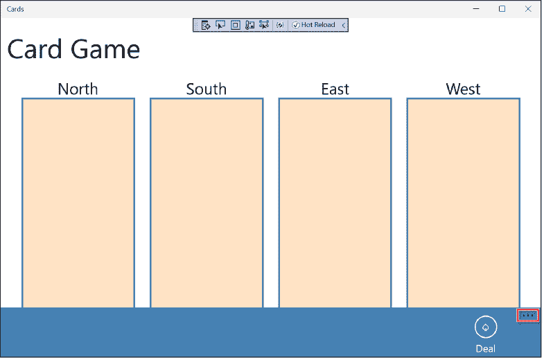

    # Note   这里使用的技术是通用 Windows 平台 (UWP) 应用中定位命令按钮的首选机制。从现在起，书中介绍的所有 UWP 应用都将遵循这种风格。
5. 选择 `Deal`。
   什么都没有发生。你还没有实现分发牌的代码，这正是你将在练习中要做的。
6. 回到 Visual Studio 2022。在 `Debug` 菜单上，选择 `Stop Debugging`。
7. 在解决方案管理器（Solution Explorer）中，找到 `Value.cs` 文件并在代码和文本编辑器窗口中打开它。
   该文件包含一个名为 `Value` 的枚举，它代表牌可以拥有的不同值，按升序排列：
   点击此处查看代码图像
   ```
   enum Value { Two, Three, Four, Five, Six, Seven, Eight, Nine, Ten, Jack, Queen, King, Ace }
   ```
8. 在代码和文本编辑器窗口中打开 `Suit.cs` 文件。
   该文件包含一个名为 `Suit` 的枚举，它代表标准牌组中的花色：
   点击此处查看代码图像
   ```
   enum Suit { Clubs, Diamonds, Hearts, Spades }
   ```
9. 在代码和文本编辑器窗口中打开 `PlayingCard.cs` 文件。
   该文件包含 `PlayingCard` 类。该类模型了单张扑克牌。
   点击此处查看代码图像
   ```
   class PlayingCard
   {
       private readonly Suit suit;
       private readonly Value value;

       public PlayingCard(Suit s, Value v)
       {
           this.suit = s;
           this.value = v;
       }

       public override string ToString()
       {
           string result = $"{this.value} of {this.suit}";
       return result;
       }

       public Suit CardSuit()
       {
           return this.suit;
       }

       public Value CardValue()
       {
           return this.value;
       }
   }
   ```
   该类有两个 `readonly` 字段，代表牌的值和花色。构造函数初始化了这些字段。

    # Note   有两个 `readonly` 字段代表牌的值和花色。构造函数初始化了这些字段。
   `readonly` 字段对于初始化后不应更改的数据是有用的。你可以在声明时通过构造函数给 `readonly` 字段赋值，但之后无法修改它。
   该类 `PlayingCard` 类模型了单张扑克牌。

    # Note
   `readonly` 字段对于初始化后不应更改的数据是有用的。你可以在声明时通过构造函数给 `readonly` 字段赋值，但之后无法修改它。
   该类 `PlayingCard` 类模型了单张扑克牌。
10. 在代码和文本编辑器窗口中打开 `Pack.cs` 文件。
    该文件包含一个 `Pack` 类，它模型了一副扑克牌。
    `Pack` 类顶部的两个 `const int` 字段是 `NumSuits` 和 `CardsPerSuit`。它们分别代表花色的数量和每花色的牌数。
    `private cardPack` 变量是 `PlayingCard` 对象的二维数组。
    `randomCardSelector` 变量是一个生成的随机数。你将使用 `randomCardSelector` 变量在分发前对其进行洗牌。
    点击此处查看代码图像
    ```
   class Pack
   {
       public const int NumSuits = 4;
       public const int CardsPerSuit = 13;
   ```
11. 定位到 `Pack` 类的默认构造函数。目前该构造函数除了 `// TODO:` 注释外是空的。删除注释并添加以下语句来实例化 `cardPack` 数组：
    点击此处查看代码图像
    ```
    public Pack() 
    { 
        cardPack = new PlayingCard[NumSuits, CardsPerSuit]; 
    }
    ```
12. 向 `Pack` 构造函数添加以下加粗代码。这些语句将 `cardPack` 数组填充为整副牌牌。
    点击此处查看代码图像
    ```
    public Pack()
    {
        this.cardPack = new PlayingCard[NumSuits, CardsPerSuit];
        for (var suit = Suit.Clubs; suit <= Suit.Spades; suit++)
        {
            for (var value = Value.Two; value <= Value.Ace; value++)
            {
                this.cardPack[(int)suit, (int)value] = new PlayingCard(suit, value);
            }
        }
    }
    ```
    外层 `for` 循环遍历 `Suit` 枚举中的值，内层 `for` 循环遍历每花色可能拥有的值。内层 `for` 循环还创建了指定花色和值的新 `PlayingCard` 对象，并将其添加到 `cardPack` 数组的相应元素中。


此语句使用 `randomCardSelector` 对象的 `Next` 方法来返回一个与花色对应的随机数。`Next` 方法的参数指定了所用范围的开区间上界；选中的值位于 0 和该值减 1 之间。请注意返回的值是一个 `int`，因此在将其赋值给 `Suit` 变量之前，必须对其进行类型转换。

始终存在没有剩余所选花色扑牌的情况。你需要处理这种情况，并在必要时选择另一个花色。

### 14. 在随机选择花色的代码之后，添加以下 `while` 循环（如加粗所示）：

点击此处查看代码图片

```csharp
public PlayingCard DealCardFromPack()
{
    var suit = (Suit)randomCardSelector.Next(NumSuits);
    while (this.IsSuitEmpty(suit))
    {
        suit = (Suit)randomCardSelector.Next(NumSuits);
    }
}
```

此循环调用 `IsSuitEmpty` 方法来判断牌组中是否还有指定花色的牌。（你稍后将实现该方法的逻辑。）如果没有，它会随机选择另一个花色——或者实际上可能会再次选到同一个花色——然后再次检查。循环重复此过程，直到找到一个至少包含一张牌的花色。

现在你已经随机选择了一个至少包含一张牌的花色。下一个任务是在该花色中随机选择一张牌。你可以使用随机数生成器来选择一个牌面点数，但和之前一样，无法保证所选点数的牌没有被发过。不过，你可以使用与之前相同的惯用方法：调用 `IsCardAlreadyDealt` 方法（你稍后将检查并完成它）。你使用此方法来确定该牌是否已经发过，如果是，则随机选择另一张牌并重试——重复此过程直到找到一张牌为止。

### 15. 在 `DealCardFromPack` 方法的现有代码之后，添加以下加粗所示的语句，以调用 `IsCardAlreadyDealt` 方法：

点击此处查看代码图片

```csharp
public PlayingCard DealCardFromPack()
{
    ...
    var value = (Value)randomCardSelector.Next(CardsPerSuit);
    while (this.IsCardAlreadyDealt(suit, value))
    {
        value = (Value)randomCardSelector.Next(CardsPerSuit);
    }
}
```

### 16. 现在你已经选择了一张之前没有发过的随机扑牌。在 `DealCardFromPack` 方法的末尾添加以下代码，以返回此牌并将 `cardPack` 数组中的相应元素设为 `null`：

点击此处查看代码图片

```csharp
public PlayingCard DealCardFromPack()
{
    ...
    var card = this.cardPack[(int)suit, (int)value];
    this.cardPack[(int)suit, (int)value] = null;
    return card;
}
```

### 17. 定位 `IsSuitEmpty` 方法。记住，该方法的目的是接收一个 `Suit` 参数并返回一个布尔值，表示牌组中是否还存在该花色的牌。删除该方法中的注释和抛出 `NotImplementedException` 异常的语句，然后添加以下加粗所示的代码：

点击此处查看代码图片

```csharp
private bool IsSuitEmpty(Suit suit)
{
    bool result = true;
    for (var value = Value.Two; value <= Value.Ace; value++)
    {
        if (!IsCardAlreadyDealt(suit, value))
        {
            result = false;
            break;
        }
    }
    return result;
}
```

此代码遍历所有可能的牌值，并使用 `IsCardAlreadyDealt` 方法（你将在接一步中完成它）来判断 `cardPack` 数组中是否存在具有指定花色和点数的牌。如果循环找到了牌，`result` 的值被设为 `false`，`break` 语句会导致循环终止。如果循环完成时没有找到牌，`result` 将保持其初始值 `true`。`result` 的值将作为方法的返回值返回。

### 18. 找到 `IsCardAlreadyDealt` 方法。该方法的目的是判断指定花色和点数的牌是否已经发过并从牌组中移除。你稍后会看到当 `DealCardFromPack` 方法发牌时，它会将牌从 `cardPack` 数组中移除并将相应元素设为 `null`。用下加粗所示的代码替换该方法的体：

点击此处查看代码图片

```csharp
private bool IsCardAlreadyDealt(Suit suit, Value value) 
  => (this.cardPack[(int)suit, (int)value] == null);
```

如果 `cardPack` 数组中对应花色和点数的元素为 `null`，则该方法返回 `true`，否则返回 `false`。

### 19. 下一步是将未发过的扑牌添加到手牌中。打开 `Hand.cs` 文件并在代码编辑器中显示。该文件包含 `Hand` 类，它实现了发给玩家的手牌。该文件包含一个 `public const int` 字段 `HandSize`，它被设置为手牌的大小（13）。

点击此处查看代码图片

```csharp
class Hand
{
    public const int HandSize = 13;
    private PlayingCard[] cards = new PlayingCard[HandSize];
    private int playingCardCount = 0;
    ...
}
```

`ToString` 方法生成手牌中牌的字符串表示。它使用 `foreach` 循环遍历 `cards` 数组，并对其找到每个 `PlayingCard` 对象调用 `ToString` 方法。这些字符串之间用换行符连接（使用 `Environment.NewLine` 常量指定换行符）。

点击此处查看代码图片

```csharp
public override string ToString()
{
    string result = "";
    foreach (PlayingCard card in this.cards)
    {
        result += $"{card.ToString()}{Environment.NewLine}";
    }
    return result;
}
```

### 20. 定位 `Hand` 类中的 `AddCardToHand` 方法。该方法的目的是将指定的扑牌添加到手牌中。删除注释，然后在方法中添加以下加粗所示的语句：

点击此处查看代码图片

```csharp
public void AddCardToHand(PlayingCard cardDealt)
{
    if (this.playingCardCount >= HandSize)
    {
        throw new ArgumentException("Too many cards");
    }
    this.cards[this.playingCardCount] = cardDealt;
    this.playingCardCount++;
}
```

此代码检查手牌是否已满。如果手牌已满，则抛出一个 `ArgumentException` 异常。（这种情况永远不会发生，但为了安全进行检查是良好的做法。）否则，将牌添加到 `playingCardCount` 变量指定的 `cards` 数组中，然后递增该变量。


[content]

## 23. 删除注释，并将此处**加粗**显示的语句添加到 `try` 块中：

点击此处查看代码图片

```csharp
private void dealClick(object sender, RoutedEventArgs e)
{
    try
    {
        pack = new Pack();
    }
    catch (Exception ex)
    {
        ...
    }
}
```

该语句只是创建了一个新的牌组（`pack`）。你之前看到该类包含一个持有牌组中牌片的二维数组，并且构造函数向该数组填充了每张牌片的详细信息。你现在需要从这个牌组中创建四手牌。

## 24. 将以下**加粗**显示的语句添加到 `try` 块中：

点击此处查看代码图片

```csharp
try
{
    pack = new Pack();

    for (var handNum = 0; handNum < NumHands; handNum++)
    {
        hands[handNum] = new Hand();
    }
}
catch (Exception ex)
{
    ...
}
```

这个 `for` 循环从牌组中创建了四手牌，并将它们存储在一个名为 `hands` 的数组中。每手牌最初都是空的，因此你需要将牌片从牌组分发到每手牌中。

## 25. 将以下**加粗**显示的代码添加到 `for` 循环中：

点击此处查看代码图片

```csharp
try
{
    ...
    for (var handNum = 0; handNum < NumHands; handNum++)
    {
        hands[handNum] = new Hand();
        for (var numCards = 0; numCards < Hand.HandSize; numCards++)
        {
            var cardDealt = pack.DealCardFromPack();
            hands[handNum].AddCardToHand(cardDealt);
        }
    } 
}
catch (Exception ex)
{
    ...
}
```

内层 `for` 循环通过使用 `DealCardFromPack` 方法从牌组中随机获取一张牌片，并使用 `AddCardToHand` 方法将此牌片添加到某手牌中，从而填充每手牌。

## 26. 将以下**加粗**显示的代码添加到外层 `for` 循环之后：

点击此处查看代码图片

```csharp
try
{
    ...
    for (int handNum = 0; handNum < NumHands; handNum++)
    {
        ...
    }

    north.Text = hands[0].ToString();
    south.Text = hands[1].ToString();
    east.Text = hands[2].ToString();
    west.Text = hands[3].ToString();
}
catch (Exception ex)
{
    ...
}
```

当所有牌片分发完毕后，此代码将在表上的文本框中显示每手牌。这些文本框被称为 `north`、`south`、`east` 和 `west`。代码使用每手牌 `ToString` 方法来格式化输出。

如果在任何点发生异常，`catch` 处理程序将显示一个带有异常错误消息的消息框。

## 27. 在**调试（Debug）**菜单上，选择**开始调试（Start Debugging）**。当纸牌窗口出现时，展开命令栏并选择**发牌（Deal）**。

牌组中的牌片应该随机分发到每手牌中，每手牌中的牌片应显示在表单上，如下所示：

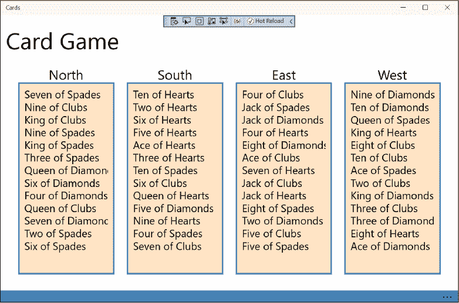

## 28. 再次选择**发牌（Deal）**。验证是否发了一组新牌，并且每手牌中的牌片发生了变化。

## 29. 返回 Visual Studio 并停止调试。

### 访问包含值类型的数组

你可以将数组认为按索引排序的简单数据集合。如果你知道它的索引，就可以轻松地检索项；但如果你想根据其他属性查找数据，通常通常需要实现一个执行搜索并返回所需项索引的辅助方法。

例如，考虑以下代码，它创建了一个 `Person` 对象的数组，其中 `Person` 是一个类：

点击此处查看代码图片

```csharp
class Person
{
    public string Name;
    public int Age;

    public Person(string name, int age)
    {
        this.Name = name;
        this.Age = age;
    }
}
...
var names = new[] { new { Name = "John", Age = 57 }, 
                    new { Name = "Diana", Age = 57 }, 
                    new { Name = "James", Age = 30 }, 
                    new { Name = "Francesca", Age = 26 } };
```

你想在 `Person` 数组中找到家族中最年轻的成员，因此你写了以下方法：

点击此处查看代码图片

```csharp
Person findYoungest()
{
    int youngest = 0;
    for (int i = 1; i < family.Length; i++)
    {
        if (family[i].Age < family[youngest].Age)
        {
            youngest = i;
        }
    }
    return youngest;
}
```
[/content]


当你调用该方法时，你必须进行几处相应的更改：

点击此处查看代码图像

```
ref var mostYouthful = ref findYoungest();
```

这些修改表示 `mostYouthful` 是 `family` 数组中某个项的引用。你仍然像以前一样访问该项中的字段；C# 编译器知道它应该通过该变量引用该数据。结果是，下面的递增语句更新的是数组中的数据，而不是副本：

```
mostYouthful.Age++;
```

当你打印数组的内容时，Francesca 的年龄已经发生了变化：

点击此处查看代码图像

```
foreach (Person familyMember in family)
{
    Console.WriteLine($"Name: {familyMember.Name}, Age: {familyMember.Age}");
}

Name: John, Age: 57
Name: Diana, Age: 57
Name: James, Age: 30
Name: Francesca, Age: 27
```

这种方式从方法返回引用数据是一种强大的技术，但你必须谨慎对待它。你只能返回在方法结束时仍然存在的数据引用，例如数组中的元素。例如，你不能返回方法在栈上创建的局部变量引用：

点击此处查看代码图像

```
// 不要尝试这样做；这将无法编译   
ref int danglingReference()
{
    int i;
    ... // 使用 i 计算一个值
    return ref i;
}
```

这在旧的 C 程序中是一个常见问题，被称为“悬空引用”（dangling reference）。幸运的是，C# 编译器防止了你提交此类错误！

### 总结

在本章中，你学习了如何创建和使用数组来操作一组数据。你看到了如何声明和初始化数组、访问数组中存储的数据、将数组作为参数传递给方法以及从方法返回数组。你还学习了如何创建多维数组以及如何使用数组数组。

- 如果你想继续阅读下一章，请保持 Visual Studio 2022 运行并转到第 11 章“理解参数数组](#ch11.xhtml_ch11)”。
- 如果你现在想退出 Visual Studio 2022，在文件菜单中选择“退出”。如果你看到保存对话框，选择“是”并保存项目。

### 快速查阅

| 目的 | 执行操作 |
| --- | --- |
| 声明数组变量 | 编写元素类型的名称，后跟方括号，然后是变量名，最后是分号。例如： |
```
bool[] flags;
``` |
| 创建数组实例 | 编写关键字 `new`，后跟元素类型的名称，然后是括在方括号内的数组大小。例如： |

```
bool[] flags = new bool[10];
``` |
| 将数组元素初始化为特定值 | 对于数组，在大括号内以逗号分隔列表写入特定值。例如：点击此处查看代码图像 |

```
bool[] flags = { true, false, true, false };
``` |
| 查找数组中的元素数量 | 使用 `Length` 属性。例如：点击此处查看代码图像 |

```
bool[] flags = ...; 
... 
int noOfElements = flags.Length;
``` |
| 访问单个数组元素 | 编写数组变量的名称，后跟整数索引。记住，索引从 0 开始。例如： |

```
flags[0]
```
| 遍历数组元素 | 使用 `for` 语句或 `foreach` 语句。例如：点击此处查看代码图像 |

```
bool[] flags = { true, false, true, false };
for (int i = 0; i < flags.Length; i++)
{
    Console.WriteLine(flags[i]);
}
foreach (bool flag in flags)
{
    Console.WriteLine(flag);
}
``` |
| 声明多维数组变量 | 写入元素类型的名称，后跟表示维度数量的方方括号，然后是变量名，最后是分号。例如，使用以下代码创建一个具有四行六列的二维数组 `table`： |

```c
int[,] table = new int[4, 6];
``` |
| 声明数组数组变量 | 声明为数组数组。你可以初始化嵌套数组具有不同的长度。例如，使用以下代码创建一个数组数组 `items`： |

```
int[][] items = new int[4][];
items[0] = new int[3];
items[1] = new int[4];
``` |

##十一章

### 理解参数数组

完成本章后，你将能够：

- 使用 `params` 关键字编写可以接受任意数量参数的方法。
- 结合 `params` 关键字和 `object` 类型编写可以接受任意类型的方法。
- 解释参数数组方法与可选参数方法之间的区别。

如果你熟悉对象概念，本章将描述你如何使用参数数组来解决这种情况。

#### 重载：回顾

*重载*是指在相同作用域内声明多个同名方法的专业术语。当你想要对不同类型执行相同操作时，方法重载非常有用。

C# 中重载的经典示例是 `Console.WriteLine` 方法。该方法重载了多次，以便传递任何原始参数。下面的代码示例说明了 `WriteLine` 方法在 `Console` 类中的某些定义方式：

点击此处查看代码图像

```
class Console
{
      public static void WriteLine(Int32 value)
      public static void WriteLine(Double value)
      public static void WriteLine(Decimal value)
      public static void WriteLine(Boolean value)
      public static void WriteLine(String value)
      ...
}
```

 **注意**

`WriteLine` 方法的文档使用了 `System` 命名空间定义的结构类型，而不是 C# 别名。例如，打印 `int` 值的重载版本实际接收的是 `Int32`。请参阅第 9 章“使用枚举和结构创建值类型”，获取这些结构类型到 C# 别名映射的列表。

尽管重载非常有用，但它并没有涵盖所有情况。特别是，重载无法轻松处理类型不变化但参数数量变化的情况。例如，如果你想向控制台写入许多值呢？你是否必须提供可以接受两个参数组合的 `Console.WriteLine` 版本，其他接受三个参数的版本，以此类推？这很快就会变得乏味。而且，这些重载方法的大量重复是否会让你感到担心？确实应该。


幸运的是，有一种方法可以编写一个接收可变参数的方法（变长方法）：你可以使用参数数组，该数组通过使用 `params` 关键字声明。为了理解 `params` 数组如何解决此问题，首先理解普通数组的用途和缺点会有所帮助。

### 使用数组参数

假设你想编写一个方法来确定传递作为参数的一组值中的最小值。一种方法是使用数组。例如，为了找到几个 `int` 值中的最小值，你可以编写一个名为 `Min` 的静态方法，它接收单个参数，该参数代表 `int` 值数组：

点击此处查看代码图像

```
class Util
{
    public static int Min(int[] paramList)
    {
        // 验证调用者是否至少提供了一个参数。
        // 如果没有，则抛出 ArgumentException 异常——在空列表中
        // 最小值是不可能的。
        if (paramList == null || paramList.Length == 0)
        {
            throw new ArgumentException("Utils.Min: not enough arguments");
        }

        // 将参数列表中找到的当前最小值值设置为第一个项。
        int currentMin = paramList[0];

        // 遍历参数列表，查找是否有任何一个项
        // 小于 currentMin 持有的值。
        foreach (int i in paramList)
        {
            // 如果循环找到了一个比 currentMin 持有的值
            // 小的项目，则将 currentMin 设置为此值。
            if (i < currentMin)
            {
                currentMin = i;
            }
        }
        // 在循环结束，currentMin 持有参数列表中
        // 最小项的值，因此返回此值。
        return currentMin;
    }
}
```

 注意

`ArgumentException` 类专门设计用于在提供的参数不满足方法要求时由方法抛出。

要使用 `Min` 方法找到命名为 `first` 和 `second` 的两个 `int` 变量的最小值，你可以这样写：

```
int[] array = new int[2];
array[0] = first;
array[1] = second;
int min = Utils.Min(array);
```

要使用 `Min` 方法找到三个 `int` 变量（命名为 `first`、`second` 和 `third`）的最小值，你可以这样写：

```
int[] array = new int[3];
array[0] = first;
array[1] = second;
array[2] = third;
int min = Utils.Min(array);
```

你可以看到这种解决方案避免了对大量重载的需求，但付出了代价：你必须编写额外的代码来填充你传递的数组。当然，如果你愿意，也可以使用匿名数组，如下所示：

点击此处查看代码图像

```
int min = Utils.Min(new int[] {first, second, third});
```

然而，问题的点在于，你仍然需要创建并填充一个数组，而且语法可能会有点令人困惑。解决方案是使用 `params` 数组作为 `Min` 方法的参数，让编译器为你编写这部分代码。

### 声明 params 数组

使用 `params` 数组，你可以向方法传递可变数量的参数。在定义方法参数时，通过使用 `params` 关键字作为数组参数修饰符来指示 `params` 数组。例如，这里是 `Min`——这次将它的数组参数声明为 `params` 数组：

点击此处查看代码图像

```
class Util
{
     public static int Min(params int[] paramList)
     {
         // 代码与之前完全相同
     }
}
```

`params` 关键字对 `Min` 方法的作用是，它允许你使用任意数量的整数参数调用该方法，而无需担心创建数组。例如，要找到两个整数值的最小值，你只需要这样写：

点击此处查看代码图像

```
int min = Utils.Min(first, second);
```

编译器将此调用翻译为如下的代码：

```
int[] array = new int[2];
array[0] = first;
array[1] = second;
int min = Utils.Min(array);
```

要找到三个整数值的最小值，你编写此处所示的代码，它也会由编译器转换为使用数组的相应代码：

点击此处查看代码图像

```
int min = Utils.Min(first, second, third);
```

对 `Min` 的两次调用（一个带两个参数，另一个带三个参数）都解析为带有 `params` 关键字的同一个 `Min` 方法。而且正如你可能猜到的，你可以用任意数量的 `int` 参数调用此 `Min` 方法。编译器只需计算 `int` 参数的数量，创建一个相同大小的 `int` 数组并填充该数组。

 注意

如果你是 C 或 C++ 程序员，你可能认为 `params` 相当于 `stdarg.h` 文件中 `varargs` 宏的类型等价物。Java 也有类似的 `varargs` 。关于 `params` 有几点需要注意：

- 你不能对多维数组使用 `params`。例如，以下示例代码将无法编译：

点击此处查看代码图像

```
// 编译错误
public static int Min(params int[,])
```

- 你不能仅根据 `params` 关键字来重载方法。`params` 关键字并不构成方法签名的一部分，如下所示。在这里，编译器在调用这些方法时无法区分它们：

点击此处查看代码图像

```
// 编译错误：重复声明
public static int Min(int[] paramList)
public static int Min(params int[] paramList)
```

- `params` 数组不允许指定指定 `ref` 或 `out` 修饰符，如下所示：

点击此处查看代码图像

```
// 编译错误
public static int Min(ref int[] paramList)
public static int Min(out int[] paramList)
```

- `params` 数组必须是最后一个参数。（这意味着每个方法只能有一个 `params` 数组。）考虑示例：

点击此处查看代码图像

```
// 编译错误
public static int Min(params int[] paramList, int i)
```

- 非 `params` 方法始终优先于 `params` 方法。这意味着你仍然可以为常见情况创建方法的重载版本，如下所示：

点击此处查看代码图像

```c
public static int Min(int leftHandSide, int rightHandSide)
public static int Min(params int[] paramList)
```

当使用两个 `int` 参数调用时，使用 `Min` 方法的第一个版本。当提供其他数量的 `int` 参数时，使用第二个版本。这包括了不带参数调用方法的情况。添加非 `params` 数组方法可能是一种有用的优化技术，因为编译器将不再需要创建和填充这么多数组。


`int` 类型的参数数组非常有用。通过它，你可以在方法调用中传递任意数量的 `int` 参数。然而，如果不仅参数的数量发生变化，参数的类型也发生变化呢？C# 也有解决此问题的方法。该技术基于两个事实：`object` 是所有类的根类型，并且编译器可以使用装箱（boxing）技术将值类型（非类实体）转换为 `object`，这如第 8 章中“理解值和引用”所描述的那样。

你可以使用 `object` 类型的参数数组来声明一个接受任意数量 `object` 参数的方法，从而允许传递的参数可以是任何类型。看这个示例：

点击此处查看代码图像

```c
class Black 
{ 
    public static void Hole(params object[] paramList) 
    ... 
}
```

我将此方法命名为 `Black.Hole`，因为没有任何参数可以逃脱它：

*   你可以不向方法传递任何参数，在这种情况下，编译器将传递一个长度为 0 的对象数组：

    点击此处查看代码图像

    ```c
    Black.Hole(); // 转换为 Black.Hole(new object[0]);
    ```

*   你可以通过传递 `null` 作为参数来调用 `Black.Hole` 方法。数组是引用类型，因此允许用 `null` 初始化数组：

    ```c
    Black.Hole(null);
    ```

*   你可以向 `Black.Hole` 方法传递一个实际数组。换句话说，你可以手动创建编译器正常生成的数组：

    点击此处查看代码图像

    ```c
    object[] array = new object[2]; 
    array[0] = "forty two"; 
    array[1] = 42; 
    Black.Hole(array);
    ```

*   你可以向 `Black.Hole` 方法传递不同类型的参数，这些参数将自动包装在 `object` 数组中：

    点击此处查看代码图像

    ```c
    Black.Hole("forty two", 42); 
    // 转换为 Black.Hole(new object[]{"forty two", 42});
    ```

### 使用 params 数组

在接下来的练习中，你将实现并测试一个名为 `Sum` 的静态方法。该方法的目的是计算传递给它的任意数量 `int` 参数的和，并将结果作为 `int` 返回。你将通过编写 `Sum` 方法使其接收一个 `params int[]` 参数来实现来实现。你将对 `params` 参数进行两个检查，以确保 `Sum` 方法完全健壮。然后，你将使用各种不同的参数调用 `Sum` 方法对其进行测试。

### 编写 params 数组方法

1.  启动 Microsoft Visual Studio 2022（如果它尚未运行）。
2.  打开 **ParamsArray** 解决方案，它位于你**文档**（Documents）文件夹中的 `\Microsoft Press\VCSBS\Chapter 11\ParamsArray` 文件夹中。
    `ParamsArray` 项目包含 `Program.cs` 文件中的 `Program` 类，包括你在前面的章节中看到的 `doWork` 方法框架。你将把 `Sum` 方法实现为名为 `Utils`（utility 的缩写）的另一个类的静态方法，你把该类添加到项目中。
3.  在解决方案管理器中，右键点击 ParamsArray 解决方案中的 **ParamsArray** 项目，指向**添加**（Add），然后选择**类**（Class）。
4.  在**添加新项 ParamsArray** 对框中，在中间面板中选择**类**（Class）模板。在**名称**（Name）框中输入 `Utils.cs`，然后选择**添加**（Add）。
    `Utils.cs` 文件被创建并添加到项目中。它包含 `ParamsArray` 命名空间中一个名为 `Utils` 的空类。
5.  向 `Utils` 类中添加一个名为 `Sum` 的公共静态方法。该方法应返回 `int` 并接受一个名为 `paramList` 的 `int` 值的 `params` 数组。它看起来应该是这样的：

    点击此处查看代码图像

    ```c
    public static int Sum(params int[] paramList) 
    { 
    }
    ```

    实现 `Sum` 方法的第一步是检查 `paramList` 参数。该参数可以包含一组有效的整数，可以是 `null`，也可以是一个长度为 0 的数组。在后两种情况下，很难计算出和，因此最佳选择是抛出一个 `ArgumentException` 异常。（你可以认为零长度数组中整数的和为 0，但在本示例中，我们将这种情况视为异常。）
6.  向 `Sum` 中添加此处**粗体**所示的代码。如果 `paramList` 为 `null`，此代码将抛出 `ArgumentException` 异常。`Sum` 方法现在看起来应该是这样：

    点击此处查看代码图像

    ```c
    public static int Sum(params int[] paramList) 
    { 
        if (paramList == null)
        {
            throw new ArgumentException();
        }
    }
    ```

7.  在 `Sum` 中添加此处**粗体**所示的代码。如果参数长度为 0，则抛出 `ArgumentException` 异常，如下：

    点击此处查看代码图像

    ```c
    public static int Sum(params int[] paramList) 
    { 
        if (paramList == null)
        {
            throw new ArgumentException();
        }
        if (paramList.Length == 0)
        {
            throw new ArgumentException();
        }
    }
    ```

    如果数组通过了这些测试，下一步是添加数组中的所有元素。你可以使用 `foreach` 语句来实现，并且你需要一个局部变量来保存总和。

8.  在前面的代码之后声明一个名为 `sumTotal` 的整数变量并初始化为 `0`。

    ```c
    public static int Sum(params int[] paramList) 
    { 
        if (paramList == null)
        {
            throw new ArgumentException();
        }
        if (paramList.Length == 0)
        {
            throw new ArgumentException();
        }
        int sumTotal = 0;
    }
    ```

9.  向 `Sum` 方法添加 `foreach` 语句以遍历 `paramList` 数组。此 `foreach` 循环体会将数组中的每个元素加到 `sumTotal`。在方法末尾，使用 `return` 语句返回 `sumTotal` 的值，如下：

    ```c
    public static int Sum(params int[] paramList) 
    { 
        if (paramList == null)
        {
            throw new ArgumentException();
        }
        if (paramList.Length == 0)
        {
            throw new ArgumentException();
        }
        int sumTotal = 0;
        foreach (int i in paramList)
        {
            sumTotal += i;
        }
        return sumTotal;
    }
    ```

10. 在**生成**菜单上选择**生成解决方案**，然后确认你的解决方案没有错误。

### 测试 Utils.Sum 方法

1.  在代码编辑器窗口中显示 `Program.cs` 文件。
2.  在代码编辑器窗口中，删除 `//:`:`释并在 `doWork` 方法中添加以下语句：

    ```csharp
    Console.WriteLine(Utils.Sum(null));
    ```

3.  在**调试**菜单上，选择**转调试启动**。

    程序生成并运行，在控制台上输出以下消息：

    ```
    Exception: Utils.Sum: null
    ```

    这确认了方法中的第一个检查是有效的。
4.  按 **Enter** 键关闭程序并返回 Visual Studio 2022。
5.  在代码编辑器窗口中，所示修改 `doWork` 中对 `Console.WriteLine` 的调用：

    ```csharp
    Console.WriteLine(Utils.Sum());
    ```

    这次，调用时没有传递任何参数。编译器会将空参数列表转换为空数组。


程序编译并运行，向控制台输出以下消息：

点击此处查看代码图像

```
Exception: Utils.Sum: empty parameter list
```

这确认了方法中的第二次检查是生效的。

7. 按 `Enter` 关闭程序并返回 Visual Studio 2022。

8. 将 `doWork` 方法中对 `Console.WriteLine` 的调用修改如下：

点击此处查看代码图像

```
Console.WriteLine(Utils.Sum(10, 9, 8, 7, 6, 5, 4, 3, 2, 1));
```

9. 在**调试**（Debug）菜单上，选择**不调试调试启动**（Start Without Debugging）。

验证程序是否已编译、运行并向控制台写入值 `55`。

10. 按 `Enter` 关闭应用程序并返回 Visual Studio 2022。

### 比较参数数组和可选参数

第 3 章，“编写方法和应用范围](#ch03.xhtml_ch03)”说明了如何定义接受可选参数的方法。从初看，使用参数数组的方法与接受可选参数的方法之间存在某种重叠。然而，它们之间存在本质区别：

*   接受可选参数的方法仍然有一个固定的参数列表，你不能传递任意的参数列表。编译器生成的代码会在方法运行之前，将任何缺失参数的默认值插入到栈中，而且该方法并不知道哪些参数是调用者提供的，哪些是编译器生成的默认值。

*   使用参数数组的方法实际上具有完全任意的参数列表，且其中任何一个都没有默认值。此外，该方法可以精确地确定调用者提供了多少个参数。

通常，你会在接受任意数量参数（包括零个）的方法中使用参数数组，而只有在不方便强制调用者为每个参数提供参数时，才使用可选参数。

还有一种值得思考的情况。如果你定义了一个接受参数列表的方法，并提供了一个接受可选参数的重载，当调用语句中的参数列表同时匹配这两个方法签名时，将调用哪个版本的方法并不总是一而易见的。你将在本章的最后一个练习中研究这一场景。

#### 比较 params 数组和可选参数

1. 返回 Visual Studio 2022 中的 `ParamsArray` 解决方案，并在代码和文本编辑器中显示 `Utils.cs` 文件。

2. 在 `Utils` 类的 `Sum` 方法的开头添加以下粗体显示的 `Console.WriteLine` 语句：

点击此处查看代码图像

```
public static int Sum(params int[] paramList)
{
    Console.WriteLine("Using parameter list");
    ...
}
```

3. 在 `Utils` 类中添加 `Sum` 方法的另一种实现。此版本应该接受四个可选的 `int` 参数，每个参数的默认值均为 `0`。


*   使用 `protected` 关键字限制继承层次结构中的可访问性。
*   将扩展方法定义为使用继承的替代机制。

继承是面向对象编程世界中的一个核心概念。你可以将继承作为工具，在定义具有某些共同特征且彼此关系非常密切的不同类时避免重复代码。

假设你正在编写一个模拟工厂的应用程序，并且你想指定经理（managers）和体力工人（manual workers）具有一些相似特征，但也有一些不同之处。例如，它们都被分配了员工参考编号，但执行的任务各不相同。

这就是继承其实用之处。通过继承，你可以创建三个不同的类——`managers`、`manual workers` 和 `all employees`（所有员工），其中 `managers` 和 `manual workers` 类继承 `all employees` 类的某些特征。这就是本章要介绍。

## 什么是继承？

如果你询问几位经验丰富的程序员 `inheritance`（继承）一词的含义，你通常会得到不同且冲突的答案。这种困惑部分源于 `inheritance` 一词本身有几个细微不同的含义。如果某人在遗嘱中留下了某物给你，就被认为继承了它。同样，我们说你从母亲那里继承了一半基因，从父亲那里继承了一半基因。这两个词用法与编程中的继承几乎没有关系。

编程中的继承完全关于类的分类，或者更准确地说，类与类之间的关系。例如，当你在学校时，你可能学习过哺乳动物，马和鲸都是哺乳动物的例子。每种动物都拥有哺乳动物的所有属性（呼吸空气、哺乳幼崽、恒温动物等），但每种动物也有自己的特殊特征（马有蹄子，而鲸有鱼鳍和尾鳍）。

你如何在程序中为马和鲸建立模型？一种方法是创建名为 `Horse` 和 `Whale` 的两个不同类。每个类都可以以自己的方式实现该类型哺乳动物特有的行为，例如 `Trot`（奔跑）或 `Swim`（游泳）。但马和鲸共有的行为呢，例如 `Breathe`（呼吸）和 `SuckleYoung`（哺乳）？虽然你可以在这两个类中都添加这些同名的重复方法，但这种情况会变成维护的噩梦，特别是当你还决定开始对其他类型的哺乳动物（如 `Human`（人类）和 `Aardvark`（土豚））进行建模时。

在 C# 中，你可以使用类继承来解决这些问题。马、鲸、人类和土豚都是哺乳动物类型，所以你可以创建一个名为 `Mammal`（哺乳动物）的类，提供这些类型展示的共同功能。然后声明 `Horse`、`Whale`、`Human` 和 `Aardvark` 类都继承自 `Mammal`。这些类自动包含了 `Mammal` 类的功能（`Breathe`、`SuckleYoung` 等）以及特定类型哺乳动物特有的功能（例如 `Horse` 类的 `Trot` 方法和 `Whale` 类的 `Swim` 方法）。然后，如果你需要修改 `Breathe` 等公共方法的工作方式，你只需要在一个地方进行更改：即 `Mammal` 类。

## 使用继承

你通过以下语法声明一个类继承自另一个类：

点击此处查看代码图像

```cs
class DerivedClass : BaseClass 
{
    ...
}
```

派生类（DerivedClass）继承自基类（BaseClass），基类中的方法成为派生类的一部分。

在 C# 中，一个类最多派自一个基类；一个类*不能*派自两个或多个类。然而，除非 `DerivedClass` 被声明为 `sealed`（密封），否则你可以使用相同的语法派生自 `DerivedClass` 的其他类。（你将在第 13 章 的“创建接口和定义抽象类””中学习密封类。）

点击此处查看代码图像

```cs
class DerivedSubClass : DerivedClass
{
    ...
}
```

继续之前描述的示例，你可以如下定义 `Mammal` 类。`Breathe` 和 `SuckleYoung` 方法是所有哺乳动物共。

点击此处查看代码图像

```cs
class Mammal
{
    public void Breathe()
    {
        ...
    }

    public void SuckleYoung()
    {
        ...
    }
    ...
}
```

然后你可以为每种不同类型的哺乳动物定义类，根据需要添加更多方法，如下例所示：

点击此处查看代码图像

```cs
class Horse : Mammal
{
   ...
    public void Trot()
    {
        ...
    }
}

class Whale : Mammal
{
    ...
    public void Swim()
    {
        ...
    }
}
```

 **注意**

如果你是 C++ 程序员，请注意你不需要也无法显式指定继承是公有的（public）、私有的（private）还是保护的（protected）。C# 继承始终是隐式公共。如果你熟悉 Java，请注意冒号的使用以及没有 `extends` 关键字。

如果你在应用程序中创建一个 `Horse` 对象，可以调用 `Trot`、`Breathe` 和 `SuckleYoung` 方法：

点击此处查看代码图像

```cs
Horse myHorse = new Horse();
myHorse.Trot();
myHorse.Breathe();
myHorse.SuckleYoung();
```

同样，你可以创建一个 `Whale` 对象，但这次你可以调用 `Swim`、`Breathe` 和 `SuckleYoung` 方法；`Trot` 不可用，因为它只定义在 `Horse` 类中。

 **重要**

继承适用于类，不适用于结构。你不能为结构定义自己的继承层次结构，也无法定义派自类或其他结构的。

所有结构实际上继承自一个名为 `Type` 的抽象类。（第 13 章探讨了抽象类。）这纯粹是 .NET 库定义栈类型通用行为的实现细节；你不太会在自己的应用程序中直接使用 `ValueType`。

### 重新回顾 System.Object 类

`System.Object` 类是所有类的根。所有类都隐式派自 `System.Object`。因此，C# 编译器静默地将 `Mammal` 类重写为以下代码（如果你真的想，可以显式编写）：

点击此处查看代码图像

```cs
class Mammal : System.Object
{
    ...
}
```

`System.Object` 类中的任何方法都会自动沿着继承链传递给派自 `Mammal` 的类，例如 `Horse` 和 `Whale`。在实际操作中，这意味着你定义的所有类自动继承 `System.Object` 类的特征。这包括 `ToString` 方法（在第 2 章“处理变量、运算符和表达式”中讨论），该方法将对象转换为字符串，通常用于显示。

#### 调用基类构造函数

除了继承的方法外，派生类自动包含基类的所有字段。这些字段在创建对象时通常需要初始化。你通常在构造函数中执行这种初始化。记住，所有类都至少有一个构造函数。（如果你不提供，编译器会为你生成一个默认构造函数。）


在派生类的构造函数中，调用其基类的构造函数是一种良好的做法，这使得基类构造函数能够执行它所需的任何初始化。在定义继承类的构造函数时，你可以指定 `base` 关键字来调用基类构造函数，例所示：

点击此处查看代码图像

```
class Mammal // 基类
{
    public Mammal(string name)  // 基类的构造函数
    {
        ...
    }
    ...
}
class Horse : Mammal // 派生类
{
    public Horse(string name)
        : base(name) // 调用 Mammal(name)
    {
        ...
    }
    ...
}
```

如果你没有在派生类的构造函数中显式地调用基类构造函数，编译器会在执行派生类构造函数中的代码之前，尝试静地插入对基类默认构造函数的调用。回到之前的示例，编译器将将其重写如下：

点击此处查看代码图像

```
class Horse : Mammal
{
    public Horse(string name)
    {
        ...
    }
    ...
}
```

如下所示：

点击此处查看代码图像

```
class Horse : Mammal
{
    public Horse(string name)
        : base()
    {
        ...
    }
    ...
}
```

如果 `Mammal` 有一个公共的默认构造函数，这种方法就是有效的。然而，并不是所有类都有公共默认构造函数。例如，请记住只有当你没有编写任何非默认构造函数时，编译器才会生成默认构造函数。在这种情况下，忘记调用正确的基类构造函数会导致编译时错误。

### 类的赋值

本书中之前的示例展示了如何使用类类型声明变量，以及如何使用 `new` 关键字创建对象。还有示例展示了 C# 的类型检查规则如何防止你将一个类型的对象赋值给声明为不同类型的变量。例如，给定此处所示的 `Mammal`、`Horse` 和 `Whale` 类的定义，接在这些定义的代码是非法的：

点击此处查看代码图像

```
class Mammal
{
    ...
}

class Horse : Mammal
{
    ...
}

class Whale : Mammal
{
    ...
}
...
Horse myHorse = new Horse(...);
Whale myWhale = myHorse;             //  - 类型不同
```

然而，只要使用的类型是继承层次结构中位置的类，就可以通过不同类型的变量引用对象。因此，以下语句是合法的：

点击此处查看代码图像

```
Horse myHorse = new Horse(...);
Mammal myMammal = myHorse; // 合法，Mammal 是 Horse 的基类
```

如果你从逻辑角度考虑，所有的马都是哺乳动物，因此你可以安全地将 `Horse` 类型的对象赋值给 `Mammal` 类型的变量。继承层次结构意味着你可以将 `Horse` 对象简单地看作一种特殊的 `Mammal` 对象；它拥有 `Mammal` 对象的所有的所有内容，以及你添加到 `Horse` 类中的任何方法和字段定义的少量额外部分。你也可以让 `Mammal` 变量引用一个 `Whale` 对象。

然而，有一个重要的限制：当使用 `Mammal` 变量引用 `Horse` 或 `Whale` 对象时，只能访问 `Mammal` 类中定义的方法。`Horse` 类中定义的方法不可见。

点击此处查看代码图像

```
Horse myHorse = new Horse(...);
Mammal myMammal = myHorse;
myMammal.Breathe(); // OK - Breathe 是 Mammal 类的一部分
myMammal.Trot();    // 错误 - Trot 不是 Mammal 类的一部分
```

 **注意**

前面的讨论解释了为什么你可以将几乎任何内容赋值给 `object` 变量。请记住 `object` 是一个别名，所有的类都直接或间接地继承自 `Object`。

警告的是，相反的情况是不成立的。你不能将 `Mammal` 对象赋值给 `Horse` 变量，除非你首先检查该 `Mammal` 对象确实是 `Horse` 对象，方法是通过 `as` 或 `is` 操作符：

点击此处查看代码图像

```
Mammal myMammal = new Mammal(...);
Horse myHorse = myMammal; // 错误
```

这看起来是一个奇怪的限制，但请记住并不是所有的 `Mammal` 对象都是 `Horse` 对象。有些是 `Whale` 对象。（第 7 章](#）

### 定义新方法

计算机编程领域最困难的任务之一就是为标识符想独特且有意义的名字。如果你正在为一个类定义方法，并且该类属于继承体系，早晚你会尝试重用一个已经被某个类使用的名称。

派生类中的方法会屏蔽（或隐藏）基类中具有相同签名的方法。例如，如果你编译以下代码，编译器会生成一个警告，通知你 `Horse.Talk` 隐藏了方法 `Mammal.Talk`：

点击此处查看代码图像

```
class Mammal
{
    ...
    public void Talk() // 假设哺乳动物会说话
    {
        ...
    }
}

class Horse : Mammal
{
           ...
    public void Talk()  // 马的说话方式与其他哺乳动物不同！
    {
        ...
    }
}
```

方法签名指的是方法的名称以及参数的数量和类型，但不包括其返回类型。两个具有名称和相同参数列表的方法具有相同的签名，即使它们的返回类型不同。

尽管你的代码可以编译并运行，但你应该认真地对待这个警告。如果另一个类继承自 `Horse` 并调用 `Talk` 方法，它可能期望调用在 `Mammal` 类中实现的方法。然而，`Horse` 类中的 `Talk` 方法隐藏了 `Mammal` 类中的 `Talk` 方法，取而代之的是 `Horse.Talk` 方法。

大多数情况下，这种巧合最多是混乱的根源，你应该考虑重命名方法以避免冲突。然而，如果你确定想让这两个方法具有相同的签名，从而隐藏 `Mammal.Talk` 方法，你可以通过 `new` 关键字来消除警告，如下：

点击此处查看代码图像

```
class Mammal
{
    ...
    public void Talk()
    {
        ...
    }
}

class Horse : Mammal
{
    ...
    new public void Talk()
    {
        ...
    }
}
```


像这样使用 `new` 关键字并不会改变这两个方法完全无关的事实，而且隐藏（hiding）仍然会发生。它只是关闭了警告。实际上，`new` 关键字的意思是：“我知道我在做什么，所以别再向我显示这些警告了。”

### 声明虚方法

有时，你确实想要隐藏某个方法在基类中是如何实现的。作为一个例子，考虑 `System.Object` 中的 `ToString` 方法。`ToString` 的目的是将对象转换为其字符串表示。因为这个方法非常有用，它是 `System.Object` 类的成员，因此自动为所有类提供了一个 `ToString` 方法。然而，由 `System.Object` 实现的 `ToString` 版本是如何知道将派生类的实例转换为字符串的呢？派生类可能包含许多具有有趣值的字段，而这些值本应该是字符串的一部分。答案是，`System.Object` 中 `ToString` 的实现实际上有点简单。它所能做的只是将对象转换为包含其类型名称的字符串，例如 `"Mammal"` 或 `"Horse"`。毕竟，这并没有什么用处。那么，为什么要提供一个如此没用的方法呢？第二个问题的答案需要一些详细的思考。

显然，`ToString` 在概念上是一个很好的主意，所有类都应该提供一个可以将对象转换为字符串以便显示或调试的方法。只需要关注实现即可。事实上，你并不需要调用 `System.Object` 定义的 `ToString` 方法；它只是一个占位符。相反，你可能会发现在你定义的每个类中提供你自己的 `ToString` 方法版本更有用，从而重写 `System.Object` 中的默认实现。`System.Object` 中的版本仅作为一种安全网存在，以防某个类没有实现或不需要它特定的 `ToString` 方法版本。

 **Note**

你应该清楚重写（overriding）一个方法和隐藏（hiding）一个方法之间的区别。*重写*一个方法是为相同方法提供不同实现的一种机制；这些方法之间都是关联的，因为它们旨在执行相同的任务，但是以特定类的方式执行。*隐藏*一个方法是用另一个方法替换另一个的方法；这些方法通常是无关的，并且可能执行完全不同的任务。重写方法是一个非常有用的编程概念；而隐藏方法通常是一个错误。

意图被重写的方法称为*虚*方法（*virtual method*）。你可以通过 `virtual` 关键字将方法标记为虚方法。例如，`System.Object` 类中的 `ToString` 方法定义如下：

点击此处查看图片

```
namespace System
{
    class Object
    {
        public virtual string ToString()
        {
            ...
        }
        ...
    }
    ...
}
```

 **Note**

如果你有 Java 开发经验，你应该注意 C# 方法默认不是虚的。

### 声明重写方法

如果基类声明某个方法是虚的，则派生类可以使用 `override` 关键字来声明该方法的另一种实现，如下所示：

点击此处查看图片

```
class Horse : Mammal
{
    ...
    public override string ToString()
    {
        ...
    }
}
```

派生类中方法的新实现可以使用 `base` 关键字调用基类中方法的原始实现，如下所示：

点击此处查看图片

```
public override string ToString()
{
    string temp = base.ToString();
    ...
}
```

当你使用 `virtual` 和 `override` 关键字声明态方法时，必须遵循一些重要规则（见后文“虚方法与多态”）：

-   虚方法不是私有的；它对继承它的类开放。同样，重写方法具有一种特殊的隐私形式，即*保护访问*（protected access）。
-   重写方法的签名必须相同；它们具有相同的名称和参数数量。此外，方法必须返回相同的类型。
-   你只能重写虚方法。如果基类方法不是虚，你会得到编译错误。这是合理的，由基类的设计者决定其方法是否可以被重写。
-   如果派生类没有使用 `override` 关键字声明方法，它并没有重写基类方法；而是隐藏了方法。换句话说，它变成了一个同名的完全不同的实现。正如之前提到的，这将导致警告，可以使用 `new` 关键字来消除。
-   重写方法，虚方法可以在进一步的派生类中被重写。然而，你被允许通过 `virtual` 关键字显式地声明该方法是虚的。

### 理解保护访问

`public` 和 `private` 关键字创建了访问性的两个极端：

-   类的公共字段方法对所有人可见。
-   类的私有字段方法仅对类本身可见。

当孤立考虑类时，这两个极端是足够的。然而，正如所有面向对象的程序员所知，孤立的类无法解决复杂问题。继承是连接类的强大方式，派生类与其基类之间显然存在着特殊且密切的关系。通常，基类允许派生类访问其某些成员，同时对不在继承体系中的类隐藏这些成员。在这种情况下，可以使用 `protected` 关键字标记成员。它的工作原理如下：

-   如果类 A 派自类 B，它可以访问 B 的保护类成员。换句话说，在派生类 A 中，B 的保护成员实际上是公开的。
-   如果类 A 没有派自类 B，它无法访问 B 的任何保护成员。因此，在类 A 中，B 的保护成员实际上是私有的。

C# 允许程序员完全自由将方法和字段声明为保护的。然而，大多数面向对象的编程指南建议尽可能将字段严格保持为私有，仅在必要时才放宽限制。公共字段违反了封装，因为类的所有用户对字段都有直接、无限制的访问。保护字段为类的用户维护了封装，因为对这些用户来说字段是不可访问的。然而，保护字段仍然允许继承自基类的类违反封装。


在接下来的练习中，你将定义一个简单的类层次结构来为不同类型的车辆。你定义一个名为 `Vehicle` 的基类以及名为 `Airplane` 和 `Car` 的派生类。你将在 `Vehicle` 类中定义名为 `StartEngine` 和 `StopEngine` 的公共方法，并为两个派生类添加一些特定于这些类的方法。最后，你将在 `Vehicle` 类中添加一个名为 `Drive` 的虚方法，并在两个派生类中重写该方法的默认实现。

### 创建类层次结构

1. 启动 Microsoft Visual Studio 2022（如果它尚未运行）。

2. 打开 `Vehicles` 解决方案，它位于 `Documents` 文件夹下的 `\Microsoft Press\VCSBS\Chapter 12\Vehicles` 文件夹。

   `Vehicles` 项目包含 `Program.cs` 文件，该文件定义了 `Program` 类，以及你在之前的练习中见过的 `Main` 和 `doWork` 方法。

3. 在解决方案管理器（Solution Explorer）中，右键点击 `Vehicles` 项目，指向 `Add`（添加），然后选择 `Class`（类）。

   打开“Add New Item – Vehicles”对话框。

4. 在“Add New Item – Vehicles”对话框中，确认选中了 `Class` 模板。在 `Name`（名称）框中输入 `Vehicle.cs`，然后选择 `Add`（添加）。

   创建 `Vehicle.cs` 文件并将其添加到项目中，它将出现在代码和文本编辑器窗口中。该文件包含名为 `Vehicle` 的空类的定义。

5. 在 `Vehicle` 类中添加 `StartEngine` 和 `StopEngine` 方法，如下文加粗所示：

   点击此处此处查看代码图像

``````
class Vehicle
{
    public void StartEngine(string noiseToMakeWhenStarting)
    {
        Console.WriteLine($"Starting engine: {noiseToMakeWhenStarting}");
    }

    public void StopEngine(string noiseToMakeWhenStopping)
    {
        Console.WriteLine($"Stopping engine: {noiseToMakeWhenStopping}");
    }
}
```

   所有派自 `Vehicle` 类的类都将继承这些方法。`noiseToMakeWhenStarting` 和 `noiseToMakeWhenStopping` 参数的值对于每种类型的车辆都是不同的，这将帮助你之后识别哪种车辆正在启动或停止。

6. 在 `Project`（项目）菜单上，选择 `Add Class`（添加类）。

   再次打开“Add New Item – Vehicles”对话框。

7. 在 `Name` 框中输入 `Airplane.cs`，然后选择 `Add`（添加）。

   包含名为 `Airplane` 的类的新文件被添加到项目中，并出现在代码和文本编辑器窗口中。

8. 在代码和文本编辑器窗口中，修改 `Airplane` 类的定义使其继承自 `Vehicle` 类，如下加粗所示：

``````
class Airplane : Vehicle
{
}
```

9. 在 `Airplane` 类中添加 `TakeOff` 和 `Land` 方法，如下述代码加粗所示：

   点击此处此处查看代码图像

``````
class Airplane : Vehicle
{ 
    public void TakeOff()
    {
        Console.WriteLine("Taking off");
    }

    public void Land()
    {
        Console.WriteLine("Landing");
    }
}
```

10. 在 `Project` 菜单上，选择 `Add Class`（添加类）。

   再次打开“Add New Item – Vehicles”对话框。

11. 在 `Name` 文本框中输入 `Car.cs`，然后选择 `Add`（添加）。

   包含名为 `Car` 的类的新文件被添加到项目中，并出现在代码和文本编辑器窗口中。

12. 在代码和文本编辑器窗口中，修改 `Car` 类的定义使其派自 `Vehicle` 类，如下加粗所示：

``````
class Car : Vehicle
{
}
```

13. 在 `Car` 类中添加 `Accelerate` 和 `Brake` 方法，如下述代码加粗所示：

   点击此处此处查看代码图像

``````
class Car : Vehicle
{
    public void Accelerate()
    {
        Console.WriteLine("Accelerating");
    }

    public void Brake()
    {
        Console.WriteLine("Braking");
    }
}
```

14. 在代码和文本编辑器窗口中显示 `Vehicle.cs` 文件。

15. 在 `Vehicle` 类中添加虚方法 `Drive`，如此处加粗所示：

   点击此处此处查看代码图像

``````
class Vehicle
{
    ...
    public virtual void Drive()
    {
        Console.WriteLine("Default implementation of the Drive method");
    }
}
```

16. 在代码和文本编辑器窗口中显示 `Program.cs` 文件。

17. 在 `doWork` 方法中，删除 `// TODO:` 注释并添加加粗代码以创建 `Airplane` 类的实例，并通过模拟乘飞机快速旅行来测试其方法，如下所示：

   点击此处此处查看代码图像

``````
static void doWork()
{
    Console.WriteLine("Journey by airplane:");
    Airplane myPlane = new Airplane();
    myPlane.StartEngine();
    myPlane.Drive();
    myPlane.Land();
    myPlane.StopEngine();
}
```


## 26. 将此处所示的**粗体**语句添加到 `doWork` 方法的末尾：

点击点击此处查看代码图片

```
static void doWork()
{
    ...
    Console.WriteLine("\nTesting polymorphism");
    Vehicle v = myCar;
    v.Drive();
    v = myPlane;
    v.Drive();
}
```

这段代码测试了虚拟 `Drive` 方法提供的多态性。代码通过使用 `Vehicle` 变量创建了 `Car` 对象的引用（这是安全的，因为所有 `Car` 对象都是 `Vehicle` 对象），然后使用该 `Vehicle` 变量调用 `Drive` 方法。最后两个语句将 `Vehicle` 变量指向 `Airplane` 对象，并再次调用看似相同的 `Drive` 方法。

## 27. 在 `Debug`（调试）菜单上，选择 `Start Without Debugging`（不调试直接启动）。

## 28. 在控制窗口中，验证是否出现了与之前相同的消息，紧接着是以下文本：

```
Testing polymorphism 
Motoring 
Flying
```

`Drive` 方法是虚拟的，因此运行时（而不是编译器）会在通过 `Vehicle` 变量调用它时，根据该变量引用的对象的实际类型确定调用哪个版本的 `Drive` 方法。在第一情况下，`Vehicle` 对象指向一个 `Car` 对象，因此应用程序调用 `Car.Drive` 方法。在第二情况下，`Vehicle` 对象指向一个 `Airplane` 对象，因此应用程序调用 `Airplane.Drive` 方法。

## 29. 按 `Enter`（回车键）关闭应用程序并返回 Visual Studio 2022。

### 创建扩展方法

继承是一项强大的功能，允许你通过创建一个派自该类的新类来扩展类的功能。然而，有时使用继承并不是添加新行为的最合适机制，特别是当你需要在不影响现有代码的情况下快速扩展某种类型时。

例如，假设你想为 `int` 类型添加一个新功能，例如名为 `Negate` 的方法，该方法返回整数当前包含的负等效值。（当然，你可以简单地使用一元负号运算符 `–` 来完成相同的任务，但请听我说……）实现此点的方法之一是定义一个名为 `NegInt32` 的新类型，它继承自 `System.Int32`（`int` 是 `System.Int32` 的别名），并添加 `Negate` 方法：

点击点击此处查看代码图片

```
class NegInt32 : System.Int32
{
    public int Negate()
    {
        ...
    }
}
```

理论上，`NegInt32` 将继承与 `System.Int32` 类型相关的所有功能。但是，有两个原因导致你可能不想采用这种方法：

*   此方法仅适用于 `NegInt32` 类型。如果你想在代码的现有 `int` 变量中使用它，你必须将每个 `int` 变量的定义改为 `NegInt32` 类型。
*   `System.Int32` 类型实际上是一个结构（struct），而不是类（class），你不能对结构使用继承。

这就是扩展方法变得非常有有用。使用扩展方法，你可以用额外的静态方法来扩展现有类型（类或结构）。这些静态方法可以在任何引用被扩展类型数据的语句中，立即供你的代码使用。

你在静态类中定义扩展方法，并将方法适用的类型作为方法的第一个参数，并带上 `this` 关键字。这里的示例展示了如何为 `int` 类型实现 `Negate` 扩展方法：

点击点击此处查看代码图片

```
static class Utils
{
    public static int Negate(this int i)
    {
        return -i;
    }
}
```

这种语法看起来有点奇怪，但正是由于 `this` 关键字缀在 `Negate` 参数之前，才将其标识为扩展方法，而且由于 `this` 前缀的参数是 `int`，意味着你正在扩展 `int` 类型。

要使用扩展方法，请将 `Utils` 类引入作用范围。（如有必要，添加一个 `using` 语句来指定 `Utils` 类所属的命名空间，或者使用 `using static` 语句直接指定 `Utils` 类。）然后，你就可以简单地使用点符号表示（`.`）来引用该方法，如下所示：

点击点击此处查看代码图片

```
int x = 591;
Console.WriteLine($"x.Negate {x.Negate()}");
```

注意，在调用 `Negate` 方法的语句中，你不需要引用 `Utils` 类。C# 编译器会自动从作用范围内的所有静态类中检测出给定类型的所有扩展方法。

你也可以通过传递一个 `int` 作为参数并使用之前见过的普通语法来调用 `Utils.Negate` 方法，尽管这种用法抵消了将方法定义为扩展方法的目的：

点击点击此处查看代码图片

```
int x = 591; Console.WriteLine($"x.Negate {Utils.Negate(x)}");
```

在接接的练习中，你将为 `int` 类型添加一个扩展方法。通过这个扩展方法，你可以将 `int` 变量中的值从 110 进制转换为该值在不同进制下的表示。

### 创建扩展方法

1.  在 Visual Studio 2022 中，打开 **ExtensionMethod** 解决方案，它位于你 **Documents** 文件夹中的 **\Microsoft Press\VCS\Chapter 12\ExtensionMethod** 文件夹。
2.  在代码和编辑器窗口中显示 `Utils.cs` 文件。该文件包含一个命名空间 `Extensions` 中名为 `Utils` 的静态类。记住，你必须在静态类内部定义扩展方法。除了 `// TODO:` 注释外，该类是空的。
3.  删除注释并在 `Utils` 类中声明一个名为 `ToBase` 的公共静态方法。该方法应接受两个参数：
    *   名为 `i` 的 `int` 参数，带有 `this` 关键字，以指示该方法是 `int` 类型的扩展方法
    *   另一个名为 `baseToConvertTo` 的普通 `int` 参数
   该方法将 `i` 中的值转换为由 `baseToConvertTo` 指定的进制。该方法应返回一个包含转换后值的 `int`。
   `ToBase` 方法应该如下所示：
   点击点击此处查看代码图片
   ```
   static class Utils
   { 
       public static int ConvertToBase(this int i, int baseToConvertTo)
       {
       }
   }
   ```
4.  向 `ToBase` 方法添加一个 `if` 语句，检查 `baseToConvertTo` 参数的值是否在 `2` 到 `10` 之间。
   本练习使用的算法在此值范围之外无法可靠运行。如果 `baseToConvertTo` 的值超出此范围，请抛出一个带有适当消息的 `ArgumentException` 异常。
   `ToBase` 方法应该如下所示：
   点击点击此处查看代码图片
   ```
   public static int ConvertToBase(this int i, int baseToConvertTo)
   {
       if (baseToConvertTo < 2 || baseToConvertTo > 10)
       {
           throw new ArgumentException("Value cannot be converted to base " + 
               baseToConvertTo.ToString());
       }
   }
   ```
5. 将将此处所示的**粗体**语句添加到 `ToBase` 方法中，位于抛出 `ArgumentException` 异常的语句块之后。

   点击点击此处查看代码图片


```sharp
public static int ConvertToBase(this int i, int baseToConvertTo)
{
    ...
    int result = 0;
    int iterations = 0;
    do
    {
        int nextDigit = i % baseToConvertTo;
        i /= baseToConvertTo;
        result += nextDigit * (int)Math.Pow(10, iterations);
        iterations++;
    }
    while (i != 0);
    return result;
}
```

此代码实现了一种著名的算法，用于将数字从 10 进制转换为不同的进制。（第 5 章，“使用复合赋值和迭代语句”展示了该算法的一个版本，用于将十进制数转换为八进制。）

6. 在代码和文本编辑器窗口中显示 `Program.cs` 文件。

7. 在文件顶部的 `using System;` 指令之后添加以下 `using` 导指令：

```csharp
using Extensions;
```

此语句将包含 `Utils` 类的命名空间引入作用范围。编译器可能会显示警告 `"using directive is unnecessary"`；然而，如果你不执行此任务，`Program.cs` 文件将无法显示 `ConvertToBase` 扩展方法。

8. 在 `Program` 类的 `doWork` 方法中添加以下加粗语句，替换 `// TODO:` 注释：

点击此处查看代码图像

```csharp
static void doWork()
{
    int x = 591;
    for (int i = 2; i <= 10; i++)
    {
        Console.WriteLine($"{x} in base {i} is {x.ConvertToBase(i)}");
    }
}
```

此代码创建了一个名为 `x` 的 `int` 变量并将其设置为 `591`。（你可以选择任何你需要的整数值。）随后代码使用循环打印出 2 到 10 之间所有进制下的数值 `591`。

注意，当你在 `Console.WriteLine` 语句中的 `x` 之后输入点 (`.`) 时，`ConvertToBase` 会作为扩展方法出现在 IntelliSense 中。

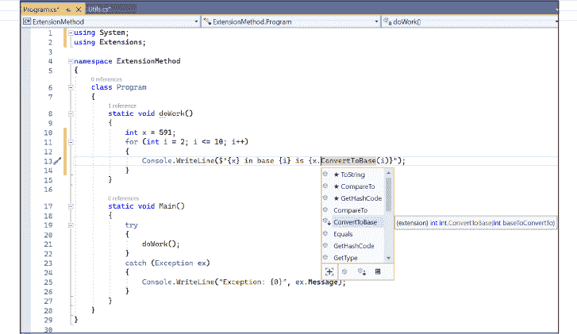

9. 在**调试 (Debug)** 菜单上，选择**不调试启动 (Start Without Debugging)**。确认程序在控制台中显示了不同进制下的数值 591，如下：

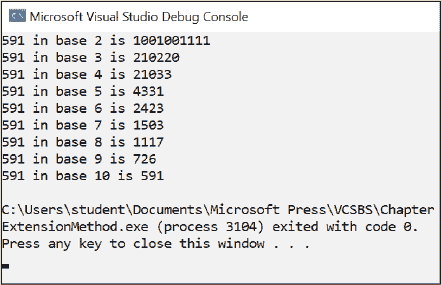

10. 按 **Enter** 关闭程序并返回 Visual Studio 2022。

### 总结

在本章中，你学习了如何使用继承来定义类的层次结构，现在你应该理解如何重写继承的方法以及实现虚方法。你还学习了如何为现有类型添加扩展方法。

*   如果你想继续阅读下一章，请保持 Visual Studio 2022 运行并转到第 13 章。

*   如果你现在想退出 Visual Studio 2022，在“文件 (File)”菜单中，选择“退出 (Exit)”。如果你看到保存对话框，选择“是 (Yes)”并保存项目。

### 快速参考

| 目标 | 执行此操作 |
| --- | --- |
| 从基类创建派生类 | 声明新类名，后跟冒号和基类名。例如：点击此处查看代码图像 |

```csharp
class DerivedClass : BaseClass
{
     ...
}
``` |
| 在继承类的构造函数中调用基类构造函数 | 在派生类构造函数体之前，在构造函数定义后加上对 `base` 的调用，并为 `base` 构造函数提供任何必要的参数。例如：点击此处查看代码图像 |

```csharp
class DerivedClass : BaseClass
{
    ...
    public DerivedClass(int x) : base(x)
    {
        ...
    }
    ...
}
``` |
| 声明虚方法 | 在声明方法时使用 `virtual` 关键字。例如：点击此处查看代码图像 |

```csharp
class Mammal 
{
    public virtual void Breathe()
    {
        ...
    }
    ...
 }
``` |
| 在派生类中实现重写继承的虚方法 | 在派生类中声明方法时使用 `override` 关键字。例如：点击此处查看代码图像 |

```csharp
class Whale : Mammal 
{
      public override void Breathe()
      {
           ...
      }
      ...
}
``` |
| 为类型定义扩展方法 | 在静态类中添加一个静态公共方法。第一个参数必须是被扩展的类型，并以前 `this` 关键字开头。例如：点击此处查看代码图像 |

```csharp
static class Utils
{
    public static int Negate(this int i)
    {
        return -i;
    }
}
``` |

## 第 13 章

## 创建接口和抽象类

完成本章后，你将能够：

*   定义指定签名和返回类型的接口。
*   在结构或类中实现接口。
*   通过接口引用类。
*   在抽象类中捕获通用实现。
*   实现无法继承的密封类

继承类是一种强大的机制，但继承的真正威力来自于继承接口。接口不包含任何代码或数据；它只是指定了继承接口的类必须提供的方法。

抽象类在许多方面与接口相似，但它们可以包含代码和数据。然而，你可以将抽象类的某些方法指定为虚方法，以便继承抽象类的类可以提供自己的实现。

抽象类通常与接口配合使用。它们共同提供了构建可扩展框架的关键技术，正如你在本章中所发现的。

### 理解接口

假设你想定义一个新的类，在其中存储集合，就像使用数组一样。然而，与数组不同，你希望提供一个名为 `RetrieveInOrder` 的方法，以便应用程序根据集合包含的对象类型来检索对象。（对于普通数组，你可以遍历其内容，并且默认根据索引检索项。）例如，如果集合包含字母数字对象（如字符串），集合应该允许应用程序根据计算机的排序顺序检索这些字符串；如果集合包含数字对象（如整数），集合应该允许应用程序按数值顺序检索对象。

当你定义集合类时，不想限制它所包含的对象类型。（这些对象甚至可以是类或结构类型。）因此，你不知道如何对这些对象进行排序。


如果你仔细思考一下，问题在于：集合中对象的排序方式取决于集合中对象的类型，而不是取决于集合本身。解决方案是要求所有对象都提供一个方法（例如下例所示的 `CompareTo` 方法），集合的 `RetrieveInOrder` 方法可以调用该方法，使得集合能够对这些对象进行比较：

点击此处查看代码图像

```
int CompareTo(object obj)
{
    // 如果此实例与 obj 相等，则返回 0
    // 如果此实例小于 obj，则返回 < 0
    // 如果此实例大于 obj，则返回 > 0
    ...
}
```

你可以为可收集的对象定义一个接口，该接口包含 `CompareTo` 方法，并规定集合类只能包含实现该接口的类。通过这种方式，接口类似于一个契约。如果一个类实现了一个接口，该接口就保证了该类包含了接口中指定的所有方法。这种机制确保你能够对集合中的所有对象调用 `CompareTo` 方法并对它们进行排序。

使用接口，你可以真正地将“做什么”与“如何做”分离开。接口只给你提供方法的名称、返回类型和参数。方法的具体实现方式并不是接口关注的问题。接口描述了类应该提供的功能，而不是这些功能是如何被实现的。

### 定义接口

定义接口在语法上与定义类相似，区别在于你使用 `interface` 关键字而不是 `class` 关键字。在接口内部，你声明方法的方式与类或结构体完全相同，但你永远不会指定访问修饰符（`public`、`private` 或 `protected`）。此外，接口中的方法没有实现；它们仅仅是声明，所有实现该接口的类型必须提供它们自己的实现。因此，你用分号替换方法体。这里有一个示例：

点击此处查看代码图像

```
interface IComparable
{
    int CompareTo(object obj);
}
```

 **提示**

Microsoft .NET 文档建议你的接口名称应以大写字母 `I` 开头。这种约定是 C# 中匈牙利表示法的最后的遗迹。顺便提一下，`System` 命名空间已经定义了所示的 `IComparable` 接口。

 **重要**

接口不能包含任何数据；你不能向接口添加字段（即使是私有字段也不行）。

### 实现接口

要实现接口，你需要声明一个继承自接口的类或结构体，并实现接口指定的所有方法。这本质上不是真正意义上的继承，尽管语法是相同的，而且你在本章后面看到的某些语义也带有许多继承的特征。

 **注意**

与类继承不同，结构体也可以实现接口。

例如，假设你正在定义第 12 章中描述的 `Mammal`（哺乳动物）层次结构，但你需要指定陆栖哺乳动物提供一个名为 `NumberOfLegs` 的方法，该方法返回 `int` 哺乳动物腿的数量。（海栖哺乳动物不实现此接口。）你可以如下所示定义包含该方法的 `ILandBound` 接口：

```
interface ILandBound
{
    int NumberOfLegs();
}
```

然后你可以在 `Horse` 类中实现此接口。你继承该接口并为接口定义的每个方法提供实现（在这种情况下，只有一个方法 `NumberOfLegs`）。

点击此处查看代码图像

```
class Horse : ILandBound
{
    ...
    public int NumberOfLegs()
    {
        return 4;
    }
}
```

当你实现接口时，必须确保每个方法都与其对应的接口方法完全匹配，并遵循以下规则：

*   方法名称和返回类型完全匹配。
*   任何参数（包括 `ref` 和 `out` 关键字修饰符）完全匹配。
*   所有实现接口的方法必须是公开可见的。但是，如果你使用的是显式接口实现，则方法不应有访问限定符。

如果接口定义与其声明的实现之间存在任何差异，类将无法编译。

 **提示**

Microsoft Visual Studio 集成开发环境 (IDE) 可以帮助减少由于未实现接口方法导致的编码错误。“实现接口”（Implement Interface）向导可以为类实现的接口中的每个项目生成存根。然后你可以在这些存根中填充适当的代码。你将在本章稍后的练习中看到如何使用此向导。

一个类可以同时继承另一个类并实现一个接口。在这种情况下，C# 并不像 Java 那样使用特定的关键字来区分基类和接口。相反，C# 使用位置表示法。基类总是排在第一个，后面跟一个逗号，然后是接口。下面的示例将 `Horse` 定义为一个 `Mammal` 类，但它额外实现了 `ILandBound` 接口：

点击此处查看代码图像

```
interface ILandBound
{
    ...
} 

class Mammal
{
    ...
}

class Horse : Mammal, ILandBound
{
    ...
}
```

 **注意**

接口（例如 `InterfaceA`）可以继承另一个接口 `InterfaceB`。从技术上讲，这被称为扩展而不是继承。在这种情况下，任何实现 `InterfaceA` 的类或结构体必须提供 `InterfaceB` 中所有方法的实现。

### 通过接口引用类

与使用定义在层次较高的类变量来引用对象的方法类似，你可以使用对象所实现的接口变量来引用对象。以之前的示例为例，你可以使用 `ILandBound` 变量来引用 `Horse` 对象：

点击此处查看代码图像

```
Horse myHorse = new Horse(...);
ILandBound iMyHorse = myHorse; // 合法
```

之所以这样做是因为所有的马都是陆栖哺乳动物。然而，反之则不然；如果不先进行类型转换，你无法将 `ILandBound` 对象赋值给 `Horse` 变量。

通过接口引用对象的技巧非常有用，因为你可以利用它来定义接受不同类型参数的方法——只要这些类型实现了指定的接口。例如，此处所示的 `FindLandSpeed` 方法可以接受任何 `ILandBound` 接口的参数：

点击此处查看代码图像

```
int FindLandSpeed(ILandBound landBoundMammal)
{
    ...
}
```

你可以使用 `is` 运算符验证对象是否为实现特定接口的类实例，这在第 8 章 “理解值和引用”中有所介绍。你使用 `is` 运算符确定对象是否具有指定的类型，它既适用于接口也适用于类和结构体。例如，以下代码块在将 `myHorse` 赋值给 `ILandBound` 变量之前，会检查 `myHorse` 是否确实实现了 `ILandBound` 接口：


点击此处查看代码图像

```
if (myHorse is ILandBound)
{
    ILandBound iLandBoundAnimal = myHorse;
}
```

 **注意**

当通过接口引用对象时，你只能调用通过接口可见的方法。

### 使用多个接口

一个类最多可以有一个基类，但允许实现无限数量的接口。类必须实现这些接口中声明的所有方法。

如果结构体或类实现了多个接口，你用用逗号分隔的列表来指定这些接口。如果一个类还有一个基类，则接口将列在基类*之后*。例如，假设你定义了另一个名为 `IGrazable` 的接口，它包含一个用于所有食草动物的 `ChewGrass` 方法。你可以这样定义 `Horse` 类：

点击此处查看代码图像

```
class Horse : Mammal, ILandBound, IGrazable
{
    ...
}
```

### 显式实现接口

目前为止的示例了隐式实现接口的类。如果你重新查看 `ILandBound` 接口和 `Horse` 类（如下），你会发现虽然 `Horse` 类实现了 `ILandBound` 接口，但在 `Horse` 类中 `NumberOfLegs` 方法的实现中，没有任何地方说明它是 `ILandBound` 接口的一部分：

点击此处查看代码图像

```
interface ILandBound
{
     int NumberOfLegs();
}

class Horse : ILandBound
{
    ...
    public int NumberOfLegs()
    {
        return 4;
    }
}
```

在简单的情况下这可能不是一个问题，但假设 `Horse` 类实现了多个接口。没有什么可以阻止多个接口指定相同名称的方法，尽管它们的语义可能不同。例如，假设你想实现一个基于马车的运输系统。一次漫长的旅程可能被分为几个阶段，或者几段路程（legs）。如果你想跟踪每只马拉马车跑了多少段路程，你可能会定义以下接口：

```
interface IJourney 
{
     int NumberOfLegs();
}
```

现在，如果你在 `Horse` 类中实现此接口，你就遇到了一个有趣的问题：

点击此处查看代码图像

```
class Horse : ILandBound, IJourney
{
    ...
    public int NumberOfLegs()
    {
         return 4;
    }
}
```

这是法的代码，但马是有四条腿，还是它已经拉马车跑了四段路程？从 C# 的角度来看，答案两者都是！默认情况下，C# 不区分该方法实现的是哪个接口，因此同一个方法实际上同时实现了两个接口。

为了解决这个问题并区分哪个方法属于哪个接口实现，你可以显式地实现接口。要这样做，你需要在实现方法时指定它属于哪个接口，如下所示：

点击此处查看代码图像

```
class Horse : ILandBound, IJourney
{
    ...
    int ILandBound.NumberOfLegs()
    {
        return 4;
    }

    int IJourney.NumberOfLegs()
    {
        return 3;
    }
}
```

现在你可以看到马有四条腿，并且拉马车跑了三段路程。

除了在方法名称前加上接口名称外，这种语法中还有另一个细微的区别：方法没有被标记为 public。你不能为显式接口实现的方法指定保护访问级别。这导致了另一个有趣的现象。如果你在代码中创建一个 `Horse` 变量，你实际上无法调用任何 `NumberOfLegs` 方法，因为它们是不可见的。对于 `Horse` 类来说，它们都是私有的。事实上，这是合理的。如果这些方法通过 `Horse` 类可见，以下代码实际上会调用哪一个方法？是 `ILandBound` 接口的，还是 `IJourney` 接口的？

点击此处查看代码图像

```
Horse horse = new Horse();
...
// 下述语句将编译
int legs = horse.NumberOfLegs();
```

那么，你如何访问这些方法？答案是通过适当的接口引用 `Horse` 对象，如下所示：

点击此处查看代码图像

```
Horse horse = new Horse();
...
IJourney journeyHorse = horse;
int legsInJourney = journeyHorse.NumberOfLegs();
ILandBound landBoundHorse = horse;
int legsOnHorse = landBoundHorse.NumberOfLegs();
```

 **提示**

我建议在可能的情况下显式实现接口。

### 使用接口处理版本控制

接口是定义类*形状*的极佳工具，允许多个开发者更轻松地协作复杂项目，并增加扩展性。例如，一旦开发者规定了通过接口可用的方法和操作，其他开发者就可以实现此接口并预期它可以正常工作。此外，多个类型可以实现同一个接口。这些类型本质上变得互换，并且可以无缝工作。

然而，在历史上，接口在处理版本控制方面并不理想。接口被视为类型的不可变定义。一旦确定了接口，要修改它而不要求修改所有应用程序将变得非常困难。考虑以下场景。

你定义了以下简单的接口：

点击此处查看代码图像

```
public interface IMyInterface
{
    public void DoSomeWork();
}
```

稍后，另一个开发者创建一个实现此接口的类：

点击此处查看代码图像

```
public class myClass : IMyInterface
{
    void IMyInterface.DoSomeWork()
    {
        // Implementation
        ...
    }
}
```

一段时间后，你决定扩展接口并添加另一个方法：

点击此处查看代码图像

```
public interface IMyInterface
{
    public void DoSomeWork();
    public void DoAdditionalWork();
}
```

此更改将破坏所有使用原始接口的现有应用程序，因为它们没有实现 `DoAdditionalWork` 方法。

解决此问题的传统方法是创建一个扩展现有接口的新接口，如下所示：

点击此处查看代码图像

```
public interface IMyExtendedInterface : IMyInterface
{
    public void DoAdditionalWork();
}
```

使用原始接口的现有应用程序将继续正常运行，而新应用程序可以实现 `myExtendedInterface`。

遗憾的是，随着接口随时间推演变，这种方法可能会变得混乱，导致产生复杂的接口链，难以跟踪和维护。Visual C# 9 解决了这个问题，它允许你在接口中提供一个方法的默认实现，如下所示：

点击此处查看代码图像

```
public interface IMyInterface
{
    public void DoSomeWork();
    public void DoAdditionalWork()
    {
        throw new NotImplementedException();
    }
}
```

任何实现接口但没有创建自己的 `DoAdditionalWork` 方法版本的类型都将自动使用此默认实现。


你可以在默认方法的实现中执行任何喜欢的 C# 操作；它是一个普通的 C# 方法。然而，我的倾向是如前文所示，简单地抛出一个 `NotImplementedException` 异常。现有的应用程序不会调用此方法，而任何使用扩展版本接口的新应用程序都应该为该方法提供自己的实现。要实现这一点，类只需创建一个具有相同签名的方法即可。不要像从类继承那样使用 `override` 关键字：

点击此处查看代码图片

```cs
public class myNewClass : IMyInterface
{
    void IMyInterface.DoSomeWork()
    {
        // Implementation
        ...
    }

    void IMyInterface.DoAdditionalWork()
    {
        // Implementation
        ...
    }
}
```

## 接口限制

保持方法默认实现简单的另一个原因是：本质上，接口不是类，你不应该将其视为类。请记住，接口是类型形状（shape）的定义，而不是对类型的实现。以下限制是这种特性的自然产生结果：

* 你不允许在接口中定义任何字段，即使是静态字段也不行。字段是类或构造的实现细节。
* 你不允许在接口中定义任何构造函数。构造函数也被认为是类或结构的实现细节。
* 你不允许在接口中定义析构函数。析构函数包含用于销毁对象实例的语句。（析构函数的描述见第 14 章，“使用垃圾回收和资源管理”）
* 你不能为任何方法指定访问修饰符。接口中的所有方法隐式地为公共（public）。
* 你不能在接口内部嵌套任何类型（例如枚举、结构、类或接口）。
* 接口不允许继承结构体、record 或类，尽管接口可以继承另一个接口。结构体、record 和类包含实现细节；如果允许接口继承这些任何一种类型，那么它将继承某些实现细节。

### 定义和使用接口

在接下来的练习中，你将定义并实现构成简单图形绘图包部分的接口。你将定义两个名为 `IDraw` 和 `IColor` 的接口，然后定义实现它们的类。每个类都将定义一个可以在表单画布上绘制的形状。（画布是一个你可以用于在屏幕上绘制线条、文本和形状的控件。）

`IDraw` 接口定义了以下方法：

* `SetLocation`：通过此方法，你可以指定左上角的位置作为形状在画布上的 x 坐标和 y 坐标。
* `Draw`：此方法实际上通过使用 `SetLocation` 方法指定的位置在画布上绘制该形状。

`IColor` 接口定义了以下方法：

* `SetColor`：你使用此方法指定形状的颜色。当形状在画布上绘制时，它将以这种颜色显示。

### 定义 IDraw 和 IColor 接口

1. 启动 Microsoft Visual Studio 2022（如果它尚未运行）。
2. 打开 **Drawing** 解决方案，它位于你**文档**（Documents）文件夹下的 `\Microsoft Press\VCSBS\Chapter 13\Drawing` 文件夹中。
   Drawing 项目是一个图形应用程序。它包含一个名为 `DrawingPad` 的表单。该表单包含一个名为 `drawingCanvas` 的画布控件。你将使用此表单和画布来测试你的代码。
3. 在解决方案管理器（Solution Explorer）中，选择 **Drawing** 项目。在**项目**（Project）菜单上，选择**新建项**（Add New Item）。
4. 在“新建项 – Drawing”对话框的左侧窗格中，选择**Visual C#**，然后选择**代码**（Code）。在中间窗格中，选择**接口**（Interface）模板。在**名称**（Name）框输入 `IDraw.cs`，然后选择**添加**。
   Visual Studio 创建 `IDraw.cs` 文件并将其添加到你的项目。`IDraw.cs` 文件出现在代码和文本编辑器窗口中，看起来如下：
   点击此处查看代码图片

```cs
using System;
using System.Collections.Generic;
using System.Linq;
using System.Text;
using System.Threading.Tasks;

namespace Drawing
{
    interface IDraw
    {
    }
}
```

5. 在 `IDraw.cs` 文件中，在文件顶部的列表中添加以下 `using` 指令：
   点击此处查看代码图片

```cs
using Windows.UI.Xaml.Controls;
```
   你将在此接口中引用 `Canvas` 类。`Canvas` 类位于用于通用 Windows 平台（UWP）应用程序的 `Windows.UI.Xaml.Controls` 命名空间中。
6. 在 `IDraw` 接口中添加此处加粗显示的方法：
   点击此处查看代码图片

```cs
interface IDraw
{
     void SetLocation(int xCoord, int yCoord);
     void Draw(Canvas canvas);
}
```

7. 在**项目**菜单上，再次选择**新建项**。
8. 在“新建项 – Drawing”对话框中，在中间窗格中，选择**接口**（Interface）模板。在**名称**（Name）框输入 `IColor.cs`，然后选择**添加**。
   Visual Studio 创建 `IColor.cs` 文件并将其添加到你的项目。`IColor.cs` 文件出现在代码和文本编辑器中。
9. 在 `IColor.cs` 文件的顶部，向列表添加以下 `using` 指令：

```cs
using Windows.UI;
```
你将在此接口中引用 `Color` 类，它位于 UWP 应用程序的 `Windows.UI` 命名空间中。
10. 在 `IColor` 接口定义中添加此处加粗显示的方法：
    点击此处查看代码图片

```cs
interface IColor
{
    void SetColor(Color color);
}
```

你现在定义了 `IDraw` 和 `IColor` 接口。下一步是实现它们的类。在下面的练习中，你将创建两个名为 `Square` 和 `Circle` 的形状类。这些类实现了这两个接口

### 创建 Square 和 Circle 类并实现接口

1. 在**项目**菜单上，选择**类**。
2. 在“新建项 – Drawing”对话框中，在中间窗格中，确认选择了**类**（Class）模板。在**名称**（Name）框输入 `Square.cs`，然后选择**添加**。
   Visual Studio 创建 `Square.cs` 文件并显示在代码和文本编辑器中。
3. 在 `Square.cs` 文件的顶部，向列表添加以下 `using` 指令：
   点击此处查看代码图片

```cs
using Windows.UI;
using Windows.UI.Xaml.Media;
using Windows.UI.Xaml.Shapes;
using Windows.UI.Xaml.Controls;
```
4. 修改 `Square` 类的定义使其实现 `IDraw` 和 `IColor` 接口，如此处加粗所示：

```cs
class Square : IDraw, IColor
{
}
```
5. 在 `Square` 类中添加此处加粗显示的 `private` 变量：
   点击此处查看代码图片

```cs
class Square : IDraw, IColor
{
    private int sideLength;
    private int locX = 0, locY = 0;
    private Rectangle rect = null;
}
```
   这些变量将保存 `Square` 对象在画布上的位置和大小。`Rectangle` 类位于 UWP 应用程序的 `Windows.UI.Xaml.Shapes` 命名空间中。你将使用该类来绘制正方形。
6. 在 `Square` 类中添加此处加粗显示的构造函数：
   点击此处查看代码图片


```cs
class Square : IDraw, IColor
{
    ...
    public Square(int sideLength)
    {
          this.sideLength = sideLength;
    }
}
```

此构造函数初始化了 `sideLength` 字段并指定了正方形边的长度。

7. 在 `Square` 类的定义中，将鼠标悬停在 `IDraw` 接口上。选择出现的灯泡上下文菜单，然后选择 `Implement All Members Explicitly`（显式实现所有成员），所示：

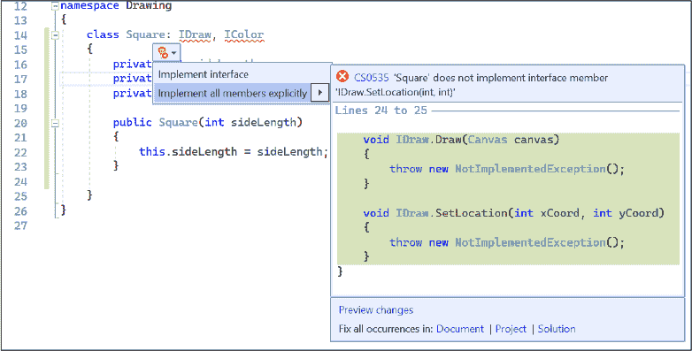

此功能会导致 Visual Studio 生成 IDraw 接口中方法的默认实现。如果你愿意，也可以手动将这些方法添加到 `Square` 类中。下面的示例显示了 Visual Studio 生成的代码：

点击此处查看代码

```cs
void IDraw.Draw(Canvas canvas)
{
     throw new NotImplementedException();
}

void IDraw.SetLocation(int xCoord, int yCoord)
{
     throw new NotImplementedException();
}
```

这些方法中的每一个都会抛出一个 `NotImplementedException` 异常。你需要用自己的代码替换这些方法的体体。

8. 在 `IDraw.SetLocation` 方法中，将现有的抛出 `NotImplementedException` 异常的代码替换为如下**加粗**的语句：

点击此处查看代码

```cs
void IDraw.SetLocation(int xCoord, int yCoord) 
{
     this.locX = xCoord;
     this.locY = yCoord;
}
```

此代码将通过参数传递的值存储在 `Square` 对象的 `locX` 和 `locY` 字段中。

9. 将 `IDraw.Draw` 方法中生成的异常代码替换为如下**加粗**的语句：

点击此处查看代码

```cs
void IDraw.Draw(Canvas canvas)
{
    this.rect = new Rectangle();
    this.rect.Height = this.sideLength;
    this.rect.Width = this.sideLength;
    Canvas.SetTop(this.rect, this.locY);
    Canvas.SetLeft(this.rect, this.locX);
    canvas.Children.Add(this.rect); 
}
```

该方法通过在画布上绘制 `Rectangle` 形状来渲染 `Square` 对象。（正方形简单来说就是四条边等长的矩形。）`Rectangle` 的高度和宽度使用 `sideLength` 字段的值来设置。`Rectangle` 形状在画布上的位置通过使用 `Canvas` 类的静态 `SetTop` 和 `SetLeft` 方法来设置，然后将 `Rectangle` 形状添加到画布中。（这会导致它被显示出来。）

10. 将 `IColor` 接口的 `SetColor` 方法添加到 `Square` 类中，所示：

点击此处查看代码

```cs
void IColor.SetColor(Color color)
{
     if (this.rect is not null)
     {
        SolidColorBrush brush = new SolidColorBrush(color);
        this.rect.Fill = brush;
    }
}
```

此方法检查 `Square` 对象是否已显示。（如果尚未渲染，`rect` 字段将为 `null`。）该代码使用 `SolidColorBrush` 对象用指定的颜色设置 `rect` 字段的 `Fill` 属性。（`SolidColorBrush` 类的工作原理超出了本文讨论的范围。）

11. 在 `Project`项目）菜单上，选择 `Add Class`添加类）。

12. 在 Add New Item（添加新建项）对话框中，在 `Name` 框中输入 `Circle.cs`，然后选择 `Add`添加）。

Visual Studio 创建 `Circle.cs` 文件并在代码和文本编辑器窗口中显示它。

13. 在 `Circle.cs` 文件的顶部，向列表添加以下 `using` 指令：

点击此处查看代码

```cs
using Windows.UI;
using Windows.UI.Xaml.Media;
using Windows.UI.Xaml.Shapes;
using Windows.UI.Xaml.Controls;
```

14. 修改 `Circle` 类的定义，使其如此处**加粗**所示实现 `IDraw` 和 `IColor` 接口：

```cs
class Circle : IDraw, IColor 
{
}
```

15. 在 `Circle` 类中添加如下**加粗**的 `private` 私有变量：

点击此处查看代码

```cs
class Circle : IDraw, IColor
{
     private int diameter;
     private int locX = 0, locY = 0;
     private Ellipse circle = null; 
}
```

这些变量将保存 `Circle` 对象在画布上的位置和大小。`Ellipse` 类提供了你将用于画圆的功能。

16. 在 `Circle` 类中添加此处**加粗**的构造函数：

点击此处查看代码

```cs
class Circle : IDraw, IColor
{
    ...
    public Circle(int diameter)
    {
        this.diameter = diameter; 
    }
}
```

此构造函数初始化了 `diameter` 字段。

17. 将 `IDraw` 接口的以下 `SetLocation` 方法添加到 `Circle` 类中：

点击此处查看代码

```cs
void IDraw.SetLocation(int xCoord, int yCoord)
{
    this.locX = xCoord;
    this.locY = yCoord;
}
```

此方法与 `Square` 类的方法相同。你将在本章后面的部分看到如何重构它。

18. 在 `Circle` 类中添加此处所示的 `Draw` 方法：

点击此处查看代码

```cs
void IDraw.Draw(Canvas canvas)
{
    this.circle = new Ellipse();
    this.circle.Height = this.diameter;
    this.circle.Width = this.diameter;
    Canvas.SetTop(this.circle, this.locY);
    Canvas.SetLeft(this.circle, this.locX);
    canvas.Children.Add(this.circle);
}
```

此方法也是 `IDraw` 接口的一部分。它与 `Square` 类中的 `Draw` 方法类似，只是它通过在画布上绘制 `Ellipse` 形状来渲染 `Circle` 对象。（圆只是宽高相相同的椭圆。）与 `SetLocation` 方法一样，你将在本章后面看到如何重构这些代码以减少重复。

19. 为 `Circle` 类添加以下 `SetColor` 方法：

点击此处查看代码

```cs
void IColor.SetColor(Color color)
{
     if (this.circle is not null)
      {
         SolidColorBrush brush = new SolidColorBrush(color);
         this.circle.Fill = brush;
      }
}
```

此方法是 `IColor` 接口的一部分。它与 `Square` 类的方法相似。

你已经完成了 `Square` 和 `Circle` 类。现在可以使用表单来测试它们。

### 测试 Square 和 Circle 类

1. 在 Design View（设计视图）窗口中显示 `DrawingPad.xaml` 文件。

2. 在表单上，选择大的阴影区域。

   表单阴影区域是 `Canvas` 对象。选择此区域是为了设置对象的焦点。

3. 在 Properties（属性）窗口中，选择 `Event Handlers`（事件处理器）按钮。（按钮有一个像闪电的图标。）

4. 在事件列表中找到 `Tapped` 事件，然后双击 `Tapped` 框。

Visual Studio 为 `DrawingPad` 类创建了一个名为 `drawingCanvas_Tapped` 的方法并在代码和文本编辑器窗口中显示它。这是一个用户用手指触摸画布或用鼠标左键点击画布运行时的事件处理器。你可以在第 20 章了解更多关于事件处理器的信息。


5. 在 `DrawingPad.xaml.cs` 文件的顶部，向列表添加以下 `using` 指令：

```sharp
using Windows.UI;
```

`Windows.UI` `namespace` 包含了 `Colors` `class` 的定义，你将在绘制形状并设置其颜色时使用它。

6. 在 `drawingCanvas_Tapped` 方法中添加以下**粗体显示**的代码：

点击此处查看代码图片

```sharp
private void drawingCanvas_Tapped(object sender, TappedRoutedEventArgs e)
{
     Point mouseLocation = e.GetPosition(this.drawingCanvas);
     Square mySquare = new Square(100);
     if (mySquare is IDraw)
     {
         IDraw drawSquare = mySquare;
             drawSquare.SetLocation((int)mouseLocation.X, (int)mouseLocation.Y);
             drawSquare.Draw(drawingCanvas);
     }
}
```

该方法中的 `TappedRoutedEventArgs` 参数提供了关于鼠标位置的有用信息。特别是，`GetPosition` 方法返回一个包含鼠标 x 和 y 坐标的 `Point` 结构体。你添加的代码创建了一个新的 `Square` 对象。然后它检查该对象是否实现了 `IDraw` 接口。（这是良好的做法，有助于确保当你尝试通过对象未实现的接口引用该对象时，代码在运行时不会失败。）接下来，它使用此接口创建该对象的引用。记住，当你显式实现一个接口时，由接口定义的方法仅通过创建该接口的引用才可用（`SetLocation` 和 `Draw` 方法是 `Square` `class` 的私有方法，仅通过 `IDraw` 接口可用）。随后，代码将 `Square` 形状的位置设置为用户手指或鼠标的位置。请注意，`Point` 结构体中的 x 和 y 坐标实际上是 `double` 值，因此此代码将它们强制转换为 `int`。最后，代码调用 `Draw` 方法来显示 `Square` 对象。

7. 在 `drawingCanvas_Tapped` 方法的末尾，添加以下**粗体显示**的代码：

点击此处查看代码图片

```sharp
private void drawingCanvas_Tapped(object sender, TappedRoutedEventArgs e)
{
    ...
    if (mySquare is IColor)
    {
       IColor colorSquare = mySquare;
       colorSquare.SetColor(Colors.BlueViolet);
    }
}
```

此代码测试了 `Square` `class` 以验证它是否实现了 `IColor` 接口。如果是，代码将通过此接口创建 `Square` `class` 的引用，并调用 `SetColor` 方法将 `Square` 对象的颜色设置为 `Colors.BlueViolet`。

 **重要**：你必须在调用 `SetColor` 之前调用 `Draw`，因为 `SetColor` 方法只有在 `Square` 已渲染后才会设置颜色。如果你在 `Draw` 之前调用 `SetColor`，颜色将不会被设置且 `Square` 对象将不会出现。

8. 返回设计视图（Design View）中的 `DrawingPad.xaml` 文件，然后选择 `Canvas` 对象。

9. 在事件列表中，找到 `RightTapped` 事件，然后双击 `RightTapped` 框。当用户点击、按住然后释放画布时会发生此事件。

10. 在 `drawingCanvas_Tapped` 方法中添加以下**粗体显示**的代码：

点击此处查看代码图片

```sharp
private void drawingCanvas_Tapped(object sender, TappedRoutedEventArgs e)
{
     Point mouseLocation = e.GetPosition(this.drawingCanvas);
     Circle myCircle = new Circle(100);
     if (myCircle is IDraw)
    {
        IDraw drawCircle = myCircle; 
        drawCircle.SetLocation((int)mouseLocation.X, (int)mouseLocation.Y);
        drawCircle.Draw(drawingCanvas);
    }

    if (myCircle is IColor)
    {
        IColor colorCircle = myCircle;
        colorCircle.SetColor(Colors.HotPink);
    }
}
```

此代码中的逻辑与 `drawingCanvas_Tapped` 方法中的逻辑相似，不同在于这段代码绘制并填充的是圆形而不是正方形。

11. 在 `Debug` 菜单上，选择 `Start Debugging` 以编译并运行应用程序。

12. 当 `Drawing Pad` 窗口打开时，在窗口显示的画布上任意位置点击或点击。应该出现一个紫色正方形。

13. 在画布上任意位置点击、按住并释放，或右键点击。应该出现一个粉色圆形。你可以任意点击鼠标左键和右键；每次点击都会在鼠标位置绘制一个正方形或圆形。

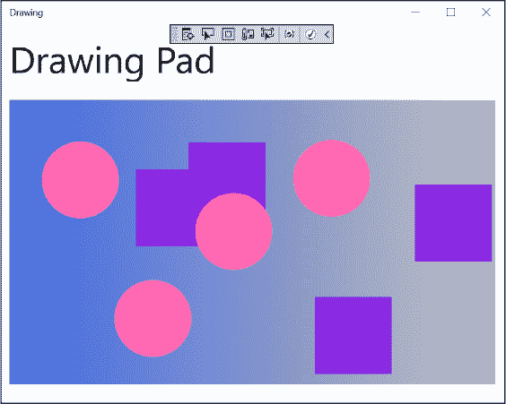

14. 返回 Visual Studio 并停止调试。

### 抽象类

你可以在许多不同的类中实现在上一组练习之前讨论过的 `ILandBound` 和 `IGrazable` 接口，这取决于你想在 C# 中建模多少种类型的哺乳动物。在这样的情况下，通常派生类共享公共实现。例如，以下两个类的重复代码显而易见：

点击此处查看代码图片

```csharp
class Horse : ILandBound, IGrazable
{
    ...
    void IGrazable.ChewGrass()
    {
        Console.WriteLine( "Chewing grass "); // 相同的草代码
    }
}
class Sheep : ILandBound, IGrazable
{
    ...
    void IGrazable.ChewGrass()
    {
        Console.WriteLine( "Chewing grass "); // 与 Horse 相同的吃草代码
    }
}
```

代码重复是一个警告信号。如果可能，你应该重构代码以避免重复并降低维护成本。实现此目标的一种方法是将公共实现放入专门为此创建的新类中。实际上，你可以在类层次结构中插入一个新类，如下代码所示：

点击此处查看代码图片

```csharp
class GrazingMammal : Mammal, IGrazable
{
    ... 
    void IGrazable.ChewGrass()
    {
        // 公共吃草代码
        Console.WriteLine( "Chewing grass ");
    }
}

class Horse : GrazingMammal, ILandBound
{
    ...
}

class Sheep : GrazingMammal, ILandBound
{
    ...
}
```

这是一个很好的解决方案，但仍有一点不太对：你实际上可以创建 `GrazingMammal` 类的实例（同样的 `Mammal` 类也是如此）。这并不合理。`GrazingMammal` 类的存在是为了提供公共的默认实现。它的唯一目的是作为被继承的类。`GrazingMammal` 类是功能的抽象，而不是一个独立的实体。

要声明不允许创建类的实例，你可以通过 `abstract` 关键字将类声明为抽象类，如下例所示：

点击此处查看代码图片

```sharp
abstract class GrazingMammal : Mammal, IGrazable
{
   ...
}
```

如果你现在尝试实例化一个 `GrazingMammal` 对象，代码将无法编译：

```csharp
GrazingMammal myGrazingMammal = new GrazingMammal(...); // 非法
```


抽象类可以包含抽象方法。抽象方法在原理上类似于虚方法（在第 12 章中介绍过），不同在于它不包含方法体。派生类*必须*重写此方法。抽象方法不能是私有的。下面的示例在 `GrazingMammal` 类中将 `DigestGrass` 方法定义为抽象方法；食草哺乳动物可能使用相同的代码来咀嚼草，但它们必须为 `DigestGrass` 方法提供自己的实现。如果一个方法在抽象类中提供默认实现没有意义，但你又想确保继承类提供该方法的自有实现，那么抽象方法就是很有用的。

点击此处查看代码图像

```
abstract class GrazingMammal : Mammal, IGrazable
{
    public abstract void DigestGrass();
    ...
}
```

 **注意**

从表面上看，抽象类和具有默认方法实现的接口可能看起来很相似，但它们在本质上是完全不同的物种。抽象类可以包含字段、构造函数、析构函数、私有方法以及你在任何类中都能常见的其他成员。接口仅仅是类应该是什么样子的规范。

### 密封类 (Sealed classes)

使用继承并不总是容易的，而且需要深考虑。如果你创建一个接口或抽象类，你是在有意识地编写某些将来将要继承的内容。问题在于，预测未来是一项困难的任务。通过实践和经验，你可以培养出构建灵活、易用的接口、抽象类和类之层次结构的技能，但这需要付出努力，并对你正在建模的问题有深入的理解。换句话说，除非你有意识地设计一个类并打算将其作为基类，否则它极不可能作为基类良好地工作。

在 C# 中，如果你决定某个类不应该作为基类，可以使用 `sealed` 关键字来防止它被用作。例如，在下面的代码中，如果任何类尝试使用 `Horse` 作为基类，将生成编译时错误：

点击此处查看代码图像

```
sealed class Horse : GrazingMammal, ILandBound
{
    ...
}
```

 **注意**

密封类不能声明任何虚方法。抽象类不能被密封密封。

### 密封方法 (Sealed methods)

你也可以使用 `sealed` 关键字来声明非密封类中的某个方法是密封的。这意味着派生类不能重写此方法。你只能密封一个使用 `override` 关键字声明的方法，并且你将该方法声明为 `sealed override`。你可以将 `interface`、`virtual`、`override` 和 `sealed` 关键字按如下理解：

*   接口引入了方法的名称。
*   `virtual` 方法是方法的第一次实现。
*   `override` 方法是方法的另一种实现。
*   `sealed` 方法是方法的最终实现。

### 实现和使用抽象类

接下来的练习使用抽象类来对你在上一个练习中开发的某些代码进行合理化处理。`Square` 和 `Circle` 类包含高比例的重复代码。将这些代码重构到名为 `DrawingShape` 的抽象类中是有意义的，因为这将有助于未来对 `Square` 和 `Circle` 类的维护。

#### 创建 DrawingShape 抽象类

1.  返回 Visual Studio 中的 Drawing 项目。
2.  在解决方案管理器中，选择 Drawing 解决方案中的 **Drawing** 项目。在**项目** 菜单上，选择**添加类**。
    将打开“添加新建项 – Drawing”对话框。
3.  在**名称** 框中中，输入 `DrawingShape.cs`，然后选择**添加**。
    Visual Studio 将创建该类并在代码和文本编辑器窗口中显示它。
4.  在 `DrawingShape.cs` 文件中，在文件顶部的列表中添加以下 `using` 指令：
    点击此处查看代码图像

    ```
     using Windows.UI;
            using Windows.UI.Xaml.Media;
            using Windows.UI.Xaml.Shapes;
            using Windows.UI.Xaml.Controls;
    ```

    该类的目的是包含 `Circle` 和 `Square` 类公共代码。程序不应该能够实例化 `DrawingShape` 对象。
5.  修改 `DrawingShape` 类的定义，将其声明为抽象类，如下文加粗所示：

    ```
     abstract class DrawingShape
            {
            }
    ```

6.  向 `DrawingShape` 类添加此处加粗所示的以下 `protected` 变量：
    点击此处查看代码图像

    ```
    abstract class DrawingShape
    {
        protected int size;
        protected int locX = 0, locY = 0;
        protected Shape shape = null;
    }
    ```

    `Square` 和 `Circle` 类都使用 `locX` 和 `locY` 字段来指定对象在画布上的位置，因此你可以将这些字段移动到抽象类。同样，`Square` 和 `Circle` 类都使用一个字段来指示渲染时对象的大小。（注：原文此处存在大量重复性描述，已根据语意精简翻译）。

*(注：此处翻译保持了原始逻辑结构，但对原文本中异常重复的句子描述进行了清理，以符合文档工程师规范)*


```cs
abstract class DrawingShape 
{
    ...
    public virtual void Draw(Canvas canvas)
    {
        if (this.shape is null)
        {
            throw new InvalidOperationException("Shape is null ");
        }

        this.shape.Height = this.size;
        this.shape.Width = this.size;
        Canvas.SetTop(this.shape, this.locY);
        Canvas.SetLeft(this.shape, this.locX);
        canvas.Children.Add(this.shape);
    }
}
```

你现在已经完成了 `DrawingShape` 抽象类。后续步骤是修改 `Square` 和 `Circle` 类，使其继承此类，然后从 `Square` 和 `Circle` 类中的重复代码。

### 要修改 `Square` 和 `Circle` 类以继承 `DrawingShape` 类

1.  在代码和文本编辑器窗口中显示 `Square` 类的代码。

2.  修改 `Square` 类的定义，使其在实现 `IDraw` 和 `IColor` 接口的同时，也继承 `DrawingShape` 类。

    点击此处查看代码图像

    ```cs
    class Square : DrawingShape, IDraw, IColor
    {
        ...
    }
    ```

    注意，你必须在 `Square` 类实现的任何接口之前，指定它所继承的类。

3.  在 `Square` 类中，删除 `sideLength`、`rect`、`locX` 和 `locY` 字段的定义。这些字段不再需要，因为它们现在由 `DrawingShape` 类提供。

4.  将现有的构造函数替换为下面加粗的代码，该代码调用了基类中的构造函数：

    点击此处查看代码图像

    ```cs
    class Square : DrawingShape, IDraw, IColor
    {
        public Square(int sideLength) 
            : base(sideLength)
        {
        }
        ...
    }
    ```

    注意，此构造函数的体是空的，因为基类构造函数执行了所有所需的初始化。

5.  从 `Square` 类中删除 `IDraw.SetLocation` 和 `IColor.SetColor` 方法。`DrawingShape` 类提供了这些方法的实现。

6.  修改 `Draw` 方法的定义。使用 `public override` 声明它，并删除对 `IDraw` 接口的引用。同样，`DrawingShape` 类已经提供了该方法的基础功能，但你用 `Square` 类所需的特定代码对其进行扩展。

    点击此处查看代码图像

    ```cs
    public override void Draw(Canvas canvas)
    {
        ...
    }
    ```

7.  将 `Draw` 方法的体替换为此处所示加粗代码：

    点击此处查看代码图像

    ```cs
    public override void Draw(Canvas canvas)
    {
        if (this.shape is not null)
        {
            canvas.Children.Remove(this.shape);
        }
        else
        {
            this.shape = new Rectangle();
        }

        base.Draw(canvas);
    }
    ```

    这些语句如果 `shape` 字段尚未实例化，则会将继承自 `DrawingShape` 类的字段实例化为 `Rectangle` 类的新实例。然后，它们会调用 `DrawingShape` 类中的 `Draw` 方法。

8.  对 `Circle` 类重复步骤 2 到 7，区别在于构造函数应带有参数 `diameter`，且在 `Draw` 方法中，应将 `shape` 字段实例化为新的 `Ellipse` 对象。`Circle` 类的完整代码如下：

    点击此处查看代码图像

    ```cs
    class Circle : DrawingShape, IDraw, IColor
    {
        public Circle(int diameter)
            :base(diameter)
        {
        }

        public override void Draw(Canvas canvas)
        {
            if (this.shape is not null)
            {
                canvas.Children.Remove(this.shape);
            }
            else
            {
                this.shape = new Ellipse();
            }

            base.Draw(canvas);
        }
    }
    ```

9.  在 **Debug** 菜单中，选择 **Start Debugging**。

10. 当 Drawing 窗口打开时，验证左键点击窗口时会出现 `Square` 对象，右键点击时会出现 `Circle` 对象。应用程序的行为与之前相同。

11. 返回 Visual Studio 并停止调试。

### 总结

在本章中，你学习了如何定义和实现接口以及抽象类。下表总结了为接口、类和结构体定义方法时各种有效（是）和无效（否）的关键字组合。

| 关键字 | 接口 | 抽象类 | 类 | 密封类 | 结构体 |
| --- | --- | --- | --- | --- | --- |
| `abstract` | 否 | 是 | 否 | 否 | 否 |
| `new` | 是 | 否 | 是 | 否 | 否 |
| `override` | 否 | 否 | 是 | 否 | 否 |
| `private` | 否 | 否 | 是 | 否 | 否 |
| `protected` | 否 | 是 | 是 | 否 | 否 |
| `public` | 是 | 是 | 是 | 是 | 是 |
| `sealed` | 否 | 否 | 否 | 是 | 否 |
| `virtual` | 否 | 是 | 是 | 否 | 否 |

[1] 接口可以扩展另一个接口并引入新方法。
[2] 结构体不支持继承，因此它们会隐藏方法。
[3] 结构体不支持继承，因此它们不能重写方法。
[4] 结构体不支持继承；结构体是密封的，不能被派生。

*   如果你想继续下一章节，请保持 Visual Studio 2022 运行。
*   如果你现在想退出 Visual Studio 2022，在 **File** 菜单中选择 **Exit**。如果看到保存对话框，选择 **Yes** 并保存项目。


在前面的章节中，你已经学习了如何创建变量和对象，并且应该理解了在创建变量和对象时内存是如何分配的。（如果你忘记了，值类型创建在栈上，而引用类型则从堆上分配内存。）计算机的内存不是无限的，因此当一个变量或对象不再被需要时，必须回收其内存。值类型在超出作用域时会被销毁并回收其内存。这部分比较简单。但引用类型呢？你通过 `new` 关键字创建一个对象，但对象是如何以及何时被销毁的？这就是本章的全部内容。

# 对象的生命周期与时代

首先，让我们回顾一下创建对象时发生了什么。你通过使用 `new` 运算符创建一个对象。接下来的示例创建了第 13 章中讨论的 `Square` 类的一个新实例，“创建接口和定义抽象类](#ch13.xhtml_ch13)。”

点击此处查看代码图像

```
int sizeOfSquare = 99;
Square mySquare = new Square(sizeOfSquare); // Square 是一个引用类型
```

从你的角度来看，`new` 操作是一个单一步骤，但在底层，对象的创建实际上是一个两个阶段的过程：

1.  `new` 操作从堆上分配一块原始内存。你对对象创建的这一阶段没有控制权。
2.  `new` 操作将这块原始内存转换为对象，以便对对象进行初始化。你可以通过使用构造函数来控制这一阶段。

 **注意**

如果你是 C++ 程序员，你应该注意，在 C# 中，你无法通过重载 `new` 操作来控制内存分配。

在你创建一个对象后，你可以使用点运算符（`.`）访问它的成员。例如，`Square` 类包含一个名为 `Draw` 的方法，你可以调用它：

```
mySquare.Draw();
```

 **注意**

这段代码基于继承自 `DrawingShape` 抽象类的 `Square` 类版本，并且没有显式实现 `IDraw` 接口。更多信息请参阅第 13 章。

当 `mySquare` 变量超出作用域时，`Square` 对象不再被活动引用。因此，`Square` 对象可以被销毁，它所使用的内存也可以被回收。（然而，这可能不会立即发生，正如你稍后看到的。）

与对象创建一样，对象销毁也是两个阶段的过程。销毁的两个阶段与创建的两个阶段完全对应：

1.  .NET 运行时通过释放与对象相关的资源来执行清理工作。你可以通过编写终结器（`finalizer`）来控制这一过程。
2.  .NET 运行时将之前属于对象的内存返回给堆。对象所在的内存必须被释放。你对这一阶段没有控制权。

销毁对象并将内存返回给堆的过程被称为`垃圾回收`（garbage collection）。

 **注意**

如果你用 C++ 编程，请记住 C# 没有 `delete` 运算符。.NET 运行时控制对象何时被销毁。

## 编写终结器

你可以使用终结器来执行对象在对象被垃圾回收时所需的任何清理工作。终结器是一种特殊方法，有点像构造函数，但 .NET 运行时会在对象的最后一个引用消失后调用它。.NET 运行时会自动清理对象使用的任何受托管资源，因此在许多情况下，编写终结器是没有必要的。然而，如果受托管资源很大（例如多维数组），通过将对象对该资源的任何引用置为 `null` 来使该资源可以被立即处理，是有意义的。此外，如果对象直接或间接地引引用了未托管资源，终结器可能会非常有用。

 **注意**

间接的未托管资源相当常见。示例包括文件流、网络连接、数据库连接以及由 Windows 管理的其他资源。例如，如果你在一个方法中打开了一个文件，你可能想添加一个终结器，在对象销毁时关闭该文件。然而，根据你类中代码的结构，可能会有更好、更及时的办法来关闭文件。（更多信息请参阅本章后半部分关于 `using` 语句的讨论。）

编写终结器的语法是波浪号（`~`）后跟类名。例如，这是一个简单的类，它在构造函数中打开文件进行读取，并在终结器中关闭文件。（注意，这仅仅是一个示例；我不建议你总是遵循这种模式来打开和关闭文件。）

点击此处查看代码图像

```
class FileProcessor
{
    FileStream file = null;

    public FileProcessor(string fileName)
    {
        this.file = File.OpenRead(fileName); // 打开文件进行读取
    }

    ~FileProcessor()
    {
        this.file.Close(); // 关闭文件
    }
}
```

终结器受限于一些非常重要的限制：

*   终结器仅适用于引用类型。你不能在值类型（如 `struct`）中声明终结器：

    点击此处查看代码图像

    ```
    struct MyStruct
    {
        ~MyStruct() { ... } // 错误
    ```

*   不能为终结器指定访问修饰符（如 `public`）。你不在自己的代码中调用终结器；.NET 运行时的一部分——垃圾回收器会为你执行此操作。

    点击此处查看代码图像

    ```
    public ~FileProcessor() { ... } // 错误
    ```

*   终结器不能带有任何参数。再次，这是因为你不调用终结器：

    点击此处查看代码图像

    ```
    ~FileProcessor(int parameter) { ... } // 错误
    ```

*   你无法依赖终结器的运行时间，甚至无法确定它是否会运行。当应用程序结束时，任何尚未终化的对象可能直接被丢弃而不运行终结器。你可以在代码中强制垃圾回收器执行终结器，但这绝对不推荐。由于如此，终结代码应该只关注释放资源。永远在终结器中包含任何关键的应用逻辑。

     **重要**

    C# 终结器不像 C++ 的析构函数，你不应该它们像那样工作。

在内部，C# 编译器会自动将终结器转换为 `Object.Finalize` 方法的重写。编译器将此终结器：

点击此处查看代码图像

```
class FileProcessor 
{ 
    ~FileProcessor() 
    { 
        // 你的代码在这里
    }
}
```

转换为：

点击此处查看代码图像

```c
class FileProcessor
{
    protected override void Finalize()
    {
        try 
        { 
            // 你的代码在这里
        }
        finally 
        { 
            base.Finalize(); 
        }
    }
}
```

编译器生成的 `Finalize` 方法将终结器体包含在 `try` 块中，随后是一个调用基类 `Finalize` 方法的 `finally` 块。（`try` 和 `finally` 关键字在第 6 章“管理错误和异常](#ch06.xhtml_ch06)”中有所描述。）这确保了即使在终结器代码期间发生异常，终结器也会调用其基类的终结器。


只有编译器可以进行这种转换。你不能编写自己的方法来重写 `Finalize`，也无法自行调用 `Finalize`。

## 为什么要使用垃圾回收器？

在回答这个问题之前，请考虑你可以让多个引用变量指向同一个对象。在下面的代码示例中，变量 `myFp` 和 `referenceToMyFp` 指向同一个 `FileProcessor` 对象：

点击此处查看代码图像

```
FileProcessor myFp = new FileProcessor();
FileProcessor referenceToMyFp = myFp;
```

你可以为一个对象创建多少个引用？随你所欲，有多少有多少！但有一个问题：.NET 运行时必须跟踪所有这些引用。如果变量 `myFp` 消失（离开作用域），其他变量（如 `referenceToMyFp`）可能仍然存在，此时 `FileProcessor` 对象使用的资源无法被回收（文件不应被关闭）。因此，对象的寿命不能绑定到特定的引用变量上。只有当指向对象的*所有*引用都消失时，对象才能被销毁并释放内存供重用。

 **重要**

你永远无法通过 C# 代码自己销毁一个对象。因为没有语法可以实现这一点。相反，.NET 运行时会在它认为合适的时间为你完成这项工作。

管理对象的寿命是复杂的，这就是为什么 C# 的设计者决定防止你的代码承担这一责任。如果销毁对象是你的责任，那么早晚会发生以下情况之一：

*   你忘记销毁对象了。这意味着对象的终结器（如果有的话）将不会运行，不会进行清理工作，内存也不会返回到堆中。你可能会很轻易地耗尽内存。
*   你尝试销毁一个正被一个或多个变量持有引用的活动对象——这被称为*悬悬引用*。悬悬引用指向未使用的内存，或者指向现在该该内存的完全不同的对象。无论何种情况，使用悬悬引用的结果其是未定义的，最坏的情况下会导致安全风险。一切都将失效。
*   你尝试多次销毁同一个对象。这可能是灾难性的，也可能不是，取决于终结器中的代码逻辑。

这些问题在像 C# 这样将健壮性和安全性置于设计目标高位的语言中是不可接受的。因此，垃圾回收器为你销毁对象。垃圾回收器提供以下保证：

*   每个对象都会被销毁。当程序结束时，所有待处理的对象都会被销毁。然而，程序结束时尚未运行的任何终结器可能根本不会运行。
*   每个对象最多被销毁一次。
*   每个对象只有在变得不可达时才会被销毁——即在运行你应用程序的进程中，没有指向该对象的引用。

这些保证非常有用，它们让你（程序员）从容易出错的繁琐家务工作中解脱出来。它们让你有奢侈专注于程序本身的逻辑，并提高生产力。

垃圾回收何时发生？这听起来像是个奇怪的问题。毕竟，垃圾回收理应该在对象不再需要时发生吧？没错，它会发生——但不一定立即发生。垃圾回收可能是一个昂贵的过程，因此 .NET 运行时仅在需要时才收集垃圾——例如，当可用内存不足或堆的大小超过系统定义的阈值时——然后它会尽可能地收集。执行几次大规模的内存扫描比执行许多小型的清扫更高效。

 **注意**

你可以通过 `System` 命名空间下的 `GC` 静态类在程序调用垃圾回收器。该类实现了几个静态方法，你可以通过它们控制垃圾回收器执行的一些操作。

你可以通过调用 `GC` 类的静态方法 `Collect` 来触发垃圾回收。然而，除少数情况外，这样做是不推荐的。`GC.Collect` 方法启动垃圾回收器，但该过程是异步运行的——也就是说，`GC.Collect` 方法在返回之前不会等待回收完成，因此你仍然不知道对象是否已经被销毁。

你还可以使用 `GC.WaitForPendingFinalizers` 方法强制应用程序等待所有对象的终结器运行。同样，这被推荐，因为它鼓励开发者在终结过程中引入依赖关系。通常情况下，让 .NET 运行时决定何时收集垃圾最为合适。

垃圾回收器的一个特性是，你不知道——也不应该依赖——对象被销毁的顺序。需要理解的最后一点可能是最重要的：终结器在对象被垃圾回收之前不会运行，而且正如前面提到的，它们可能根本不会运行。因此，你永远不要编写依赖于终结器按特定顺序或在应用程序特定点运行的代码。

## 垃圾回收器是如何工作的？

垃圾回收器在自己的线程中运行，并且只能在特定时间执行——通常当你的应用程序到达方法末尾时。当它运行时，应用程序中运行的其他线程将临时停止，因为垃圾回收器可能需要移动对象并更新对象引用，而它在对象在使用时无法进行这些操作。

 **注意**

*线程*是应用程序中一条独立的执行路径。Windows 使用线程使应用程序能够并发执行多个操作。

垃圾回收器是一个复杂的软件，具有自调优功能，并实现了一些优化，以尝试平衡内存可用性需求与维护应用程序性能的需求。垃圾回收器使用的内部算法和结构的细节超出了本书的范围（微软不断改进垃圾回收器执行工作的方式），但从高层次来说，垃圾回收器采取的步骤如下：

1.  它构建一个所有可达对象的映射。它通过反复跟踪对象内部的引用字段来实现。垃圾回收器非常仔细地构建此映射，并确保循环引用不会导致无限递归。任何不在此映射中的对象都被视为不可达的。
2.  它检查这些不可达对象是否有任何需要运行的终结器（这一过程称为*终结*）。任何需要终结的不可达对象都被放入一个名为*freachable 队列*（读作 F-reachable）的特殊队列中。
3.  它释放剩余的不可达对象（那些不需要终结的对象），通过将可达对象向下移动堆，从而消除堆碎片并释放堆顶部的内存。当垃圾回收器移动可达对象时，它还会更新指向该对象的任何引用。
4.  它允许所有其他线程恢复，然后在自己的线程上运行需要终结的不可达对象（现在位于 freachable 队列中）的 `Finalize` 方法。


包含终结器（finalizers）的类会增加代码和垃圾回收过程的复杂性，导致你的程序运行变慢。如果程序不包含任何终结器，垃圾回收器就不需要将不可的对象放入队列并对其进行终结处理。显然，不做比做某事更快。因此，除非你确实需要通过终结器来回收未托管资源，否则避免使用它们。

编写终结器时要非常小心。特别要注意，如果你的终结器调用了其他对象，这些对象可能已经被垃圾回收器调用过终结器。记住，终结的顺序是不保证的。因此，确保终结器之间互不依赖也不重叠。例如，不要有两个尝试释放相同资源的终结器。

### 资源管理

有时，在终结器中释放资源是明智的。某些资源非常宝，不能让它们长时间闲直到垃圾回收器释放它们。内存、数据库连接和文件句柄等资源需要被释放，而且需要尽快释放。在这种情况下，你唯一的选择是手动释放资源。你可以通过创建一个释放方法（disposal method）来实现这一点——该方法是一个显式释放资源的方法。如果一个类具有释放方法，你就可以调用它并控制资源释放的时间。

 注意

`disposal method` 一术语指的是方法的用途而不是其名称。释放方法可以命名为任何有效的 C# 标识符。

#### 释放方法

实现释放方法的类示例是 `System.IO` 命名空间下的 `TextReader` 类。该类提供了一种从顺序输入流中读取字符的机制。

`TextReader` 类包含一个名为 `Close` 的虚拟方法，用于关闭流。`StreamReader` 类（从流，如打开的文件中读取字符）和 `StringReader` 类（从字符串中读取字符）都派自 `TextReader`，并且都重写了 `Close` 方法。

以下是一个使用 `StreamReader` 类从文件读取文本行并显示在屏幕上的示例：

点击此处查看代码图片

```csharp
TextReader reader = new StreamReader(filename);
string line;
while ((line = reader.ReadLine()) is not null)
{
    Console.WriteLine(line);
}
reader.Close();
```

`ReadLine` 方法从流中读取下一行文本并存入字符串。如果流中没有剩余，`ReadLine` 方法将返回 `null`。在完成 `reader` 操作后调用 `Close` 以释放文件句柄和相关资源是非常。然而，这个示例存在一个问题：它不够安全。如果调用 `ReadLine` 或 `WriteLine` 抛出异常，`Close` 将不会执行（会被跳过）。如果这种情况发生多次，将耗尽文件句柄并无法打开任何文件。

#### 异常安全的释放

确保释放方法（如 `Close`）无论是否存在异常都能被调用的方法，是在 `finally` 块中调用释放方法。以下是使用该技术调整后的前述示例：

点击此处查看代码图片

```csharp
TextReader reader = new StreamReader(filename);
try
{
    string line;
    while ((line = reader.ReadLine()) is not null)
    {
        Console.WriteLine(line);
    }
}
finally
{
    reader.Close();
}
```

像这样使用 `finally` 块是有效的，但它有几个缺点，使其成为不太理想的解决方案：

*   如果你需要释放多个一个资源，代码会迅速变得臃肿。（你将得到嵌套的 `try` 和 `finally` 块。）
*   在某些情况下，你可能需要修改代码以适应这种惯用法。例如，你可能需要重新调整资源引用的声明顺序，记得将引用初始化为 `null`，并记得在 `finally` 块中检查引用是否为 `null`。
*   它未能创建解决方案的抽象。这意味着解决方案难以理解，而且你必须在每个需要此功能的地方重复代码。


终结器（finalizer）的调用可能发生也可能不发生，而且即使发生，你也不知道它会在何时运行。另一方面，你确切知道 `Dispose` 方法调用的时机。然而，你无法确定它是否一定会发生，因为它依赖于使用你类的程序员是否记得编写 `using` 语句或直接调用 `Dispose` 方法。

但是，通过在终结器中调用 `Dispose` 方法，*可以*确保该方法始终运行。这充当了一个实用的备份方案。你可能会忘记调用 `Dispose` 方法，但至少可以确定它会被调用——即使仅是在程序关闭时。

你将在本章末的练习中详细研究这一特性，这里有一个关于如何实现 `IDisposable` 接口的示例：

点击此处查看代码图像

```cs
class Example : IDisposable
{
    private Resource scarce;       // 要管理和释放的稀缺资源
    private bool disposed = false; // 标记资源是否
                                   // 已被释放
    ...
    ~Example()
    {
        this.Dispose(false);
    }

    public virtual void Dispose()
    {
        this.Dispose(true);
        GC.SuppressFinalize(this);
    }

    protected virtual void Dispose(bool disposing)
    {
        if (!this.disposed)
        {
            if (disposing)
            {
                // 在此处释放大型托管资源
                ...
            }
            // 在此处释放非托管资源
            ...
            this.disposed = true;
        }
    }

    public void SomeBehavior() // 示例方法
    {
        checkIfDisposed();
        ...
    }

    ...

    private void checkIfDisposed()
    {
        if (this.disposed)
        {
            throw new ObjectDisposedException("Example: object has been disposed");
        }
    }
}
```

注意 `Example` 类的以下特征：

* 该类实现了 `IDisposable` 接口。
* 公共的 `Dispose` 方法可以被你的应用程序代码随时调用。
* 公共的 `Dispose` 方法调用了受保护的、带有布尔参数的 `Dispose` 重载版本（将在接后的项目符号中描述），并将值 `true` 作为参数传递。该方法实际执行资源释放。
* 终结器调用了受保护的、带有布尔参数的 `Dispose` 重载版本，并将值 `false` 作为参数传递。终结器仅当你的对象被终结时由垃圾回收器调用。
* 你可以安全地多次调用受保护的 `Dispose` 方法。`disposed` 变量指示方法是否已经运行，这是一个安全特性，用于防止方法在并发调用时尝试多次释放资源。（你的应用程序可能会调用 `Dispose`，但在方法完成之前，你的对象可能会被垃圾回收，并且 .NET 运行时将通过终结器再次运行 `Dispose` 方法。）资源仅在方法首次运行时才被释放。
* 受保护的 `Dispose` 方法是实际释放资源的唯一地方。

### 实现异常安全

`IDisposable` 接口有助于确保即使发生异常时，资源也能得到及时释放。`using` 语句和 `Dispose` 方法被用于实现这一点。


```
Calculator being created
120 / 15 = 8
Program finishing
```

注意，`Calculator` 对象的终析器并没有运行——消息 `Calculator being finalized`从未出现。

12. 在控制台窗口中，按 `Enter` 键返回 Visual Studio 2022。

.NET 运行时保证你的应用程序创建的所有对象都将接受垃圾回收，但你不能总是确定任何终析器都会运行。在练习中，程序的运行时间很短，当 .NET 运行时在程序结束时进行清理时，没有必要运行终析器。

13. 在 `Program.cs` 文件中，在 `Main` 函数末尾添加此处**粗体**所示的语句：

点击此处查看代码图像

```csharp
static void Main(string[] args)
{
    try
    {
        doWork();
    }
    catch (Exception ex)
    {
        Console.WriteLine(ex.Message);
    }

    GC.Collect();
    GC.WaitForPendingFinalizers();
}
```

这两条语句强制垃圾回收器运行并等待所有终析器完成。

14. 在 `Debug` 菜单上，选择 `Start Without Debugging`。验证程序显示了以下系列消息：

```
Calculator being created
120 / 15 = 8
Program finishing
Calculator being finalized
```

在更具规模且运行时间更长的应用程序中，你可能会看到周期性发生垃圾回收，并且终析器会自动运行。然而，本次练习的重点在于，并不是所有对象都会在应用程序终止之前一定被终析。

在带有消耗稀缺资源的类的应用程序中，除非你提供了释放机制，否则你的应用程序创建的对象可能会一直保留其资源，直到程序结束。如果资源是文件，这可能会阻止其他用户访问该文件；如果资源是数据库连接，你的应用程序可能会阻止其他用户连接到同一个数据库。理想情况下，你希望在完成对资源的使用后立即释放它们，而不是等待应用程序终止。你需要一种更具确定性的资源管理方法。

在接接的练习中，你将在 `Calculator` 类中实现 `IDisposable` 接口，并使程序能够在它选择的时间内终析 `Calculator` 对象。

### 实现 IDisposable 接口

1. 在代码和文本编辑器窗口中显示 `Calculator.cs` 文件。

2. 修改 `Calculator` 类的定义，使其实现 `IDisposable` 接口，如下所示**粗体**所示：

```csharp
class Calculator : IDisposable
{
    ...
}
```

3. 在 `Calculator` 类末尾添加以下此处**粗体**所示的名为 `Dispose` 的方法。该方法是 `IDisposable` 接口要求的：

点击此处查看代码图像

```csharp
class Calculator : IDisposable
{
    ...
    public void Dispose()
    {
        Console.WriteLine("Calculator being disposed");
    }
}
```

你通常会在 `Dispose` 方法中添加代码来释放对象持有的资源。在这种情况下，没有资源需要释放，该方法中 `Console.WriteLine` 语句的作用只是为了让你看到 `Dispose` 方法何时运行。然而，在真实世界的应用程序中，终析器和 `Dispose` 方法之间可能会存在某些代码重复。为了消除这种重复，你通常会将这些代码放在一处并从另一处调用它。但由于你不能从 `Dispose` 方法中显式调用终析器，因此合理的做法是从终析器中调用 `Dispose` 方法，并将释放资源的逻辑放在 `Dispose` 方法中。

4. 修改终析器使其调用 `Dispose` 方法，如后续代码中此处**粗体**所示。（保留终析器中显示消息的语句，以便你可以看到垃圾回收器何时运行它。）

点击此处查看代码图像

```csharp
~Calculator()
{
    Console.WriteLine("Calculator being finalized");
    this.Dispose();
}
```

当你想要在应用程序中销毁 `Calculator` 对象时，`Dispose` 方法不会自动运行。你的代码必须显式调用它（使用如 `calculator.Dispose()` 的语句），或者在 `using` 语句中创建 `Calculator` 对象。在你的程序中，将采用后者。

5. 在代码和文本编辑器窗口中显示 `Program.cs` 文件。修改 `doWork` 方法中创建 `Calculator` 对象并调用 `Divide` 方法的语句，如下所示**粗体**所示：

点击此处查看代码图像

```csharp
static void doWork()
{
    using (Calculator calculator = new Calculator())
    {
        Console.WriteLine($"120 / 15 = {calculator.Divide(120, 15)}");
    }

    Console.WriteLine("Program finishing");
}
```

6. 在 `Main` 方法中，注释掉调用垃圾回收器并等待终析器完成的语句：

点击此处查看代码图像

```csharp
static void Main(string[] args)
{
    ...
    // GC.Collect();
    // GC.WaitForPendingFinalizers();
}
```

7. 在 `Debug` 菜单上，选择 `Start Without Debugging`。验证程序现在显示了以下系列消息：

```
Calculator being created
120 / 15 = 8
Calculator being disposed
Program finishing
```

`using` 语句在显示 `Program finishing` 的语句之前导致了 `Dispose` 方法的运行。

8. 在控制窗口中，按 `Enter` 键返回 Visual Studio 2022。

9. 在 `Main` 方法中，取消垃圾回收器调用的注释。这将模拟在长时间运行的应用中发生的事件序列。

10. 在 `Debug` 菜单上，选择 `Start Without Debugging`。你现在应该看到以下消息：

```
Calculator being created
120 / 15 = 8
Calculator being disposed
Program finishing
Calculator being finalized
Calculator being disposed
```

你可以看到 `Calculator` 对象的终析器运行时，它再次调用了 `Dispose` 方法。这显然是浪费资源。多次释放对象持有的资源可能可能是致命性的，但绝对不是良好的做法。解决此问题的推荐方法是在类中添加一个私有布尔字段以指示 `Dispose` 方法是否已被调用，然后在 `Dispose` 方法中检查此字段。

### 防止对象多次释放

1. 在代码和文本编辑器窗口中显示 `Calculator.cs` 文件。

2. 在 `Calculator` 类开头添加一个名为 `disposed` 的私有布尔字段。将该字段的值初始化为 `false`，如后续代码中此处**粗体**所示：

点击此处查看代码图像

```csharp
class Calculator : IDisposable
{
    private bool disposed = false;
    ...
}
```

此字段的作用是跟踪对象的状态并指示 `Dispose` 方法是否已被调用。

3. 修改 `Dispose` 方法中的代码，仅当 `disposed` 字段为 `false` 时才显示消息。在显示消息后，将 `disposed` 字段设置为 `true`，如下所示**粗体**所示：

点击此处查看代码图像


```csharp
public void Dispose()
{
    if (!this.disposed)
    {
        Console.WriteLine("Calculator being disposed");
    }

    this.disposed = true;
}
```

4. 在“调试”（Debug）菜单上，选择“转调试调试”（Start Without Debugging）。注意程序显示了以下系列消息：

```
Calculator being created
120 / 15 = 8
Calculator being disposed
Program finishing
Calculator being finalized
```

现在 `Calculator` 对象只被丢弃一次，但析构器（finalizer）仍在运行。同样，这是一种浪费；对于已经释放了资源的对象，运行析构器几乎没有意义。

5. 在控制台窗口中，按 `Enter` 键并返回 Visual Studio 2022。

6. 在 `Calculator` 类中，在 `Dispose` 方法的末尾添加如下加粗所示的语句：

点击此处查看代码图像

```csharp
public void Dispose()
{
    if (!this.disposed)
    {
        Console.WriteLine("Calculator being disposed");
    }

    this.disposed = true;
    GC.SuppressFinalize(this);
}
```

使用 `GC` 类的 `SuppressFinalize` 方法，你可以指示垃圾回收器不要对指定对象执行终结。

 **重要**

`GC` 类暴露了几个方法，可以通过它们配置垃圾回收器。但是，如所述，通常让 .NET 运行时自己管理垃圾回收器更好，因为如果你不加地调用这些方法，可能会严重损害应用程序性能。

7. 在“调试”（Debug）菜单上，选择“转调试调试”（Start Without Debugging）。注意程序显示了以下系列消息：

```
Calculator being created
120 / 15 = 8
Calculator being disposed
Program finishing
```

你可以看到析构器不再运行了，因为 `Calculator` 对象在程序结束之前已经被释放了。

8. 在控制台窗口中，按 `Enter` 键并返回 Visual Studio 2022。

`using` 语句的目的是确保对象始终被丢弃，即使在使用过程中发生了异常。在本章的最后一个练习中，你将在 `using` 块中间生成一个异常来验证这一点。

### 验证对象在异常发生后已释放

1. 在代码和文本编辑器窗口中显示 `Program.cs` 文件。

2. 修改调用 `Calculator` 对象 `Divide` 方法的语句，如加粗所示：

点击此处查看代码图像

```csharp
static void doWork()
{
    using (Calculator calculator = new Calculator())
    {
        Console.WriteLine($"120 / 0 = {calculator.Divide(120, 0)}");
    }
    Console.WriteLine("Program finishing");
}
```

修改后的语句尝试将 120 除以 0。

3. 在 `Main` 方法中，更改 `catch` 语句以捕获 `InvalidOperationException` 异常：

点击此处查看代码图像

```csharp
static void Main(string[] args)
{
    try
    {
        doWork();
    }
    catch (InvalidOperationException ex)
    {
        Console.WriteLine(ex.Message);
    }

    GC.Collect();
    GC.WaitForPendingFinalizers();
}
```

此修改允许 `doWork` 方法抛出的 `DivideByZeroException` 异常保持未处理状态，因此你可以看到这种情况对垃圾回收器产生。

4. 在“调试”（Debug）菜单上，选择“转调试调试”（Start Without Debugging）。

正如你预期的那样，应用程序抛出了 `DivideByZeroException` 异常。

5. 验证当程序终止时，控制台窗口在未处理的异常之后出现了 `Calculator being disposed` 消息。垃圾回收仍然发生了。

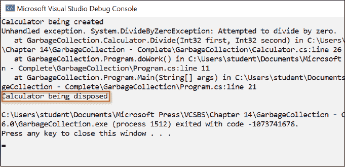

6. 在控制台窗口中，按 `Enter` 键并返回 Visual Studio 2022。

### 处理异步释放

`IDisposable` 接口的 `Dispose` 方法是同步的。如果资源释放需要大量时间，调用 `Dispose` 方法的线程将被阻塞，直到释放完成。如果该线程是处理用户界面的线程，那么你的应用程序可能会变得无响应且难以用。为了应对这个问题，你可以实现异步释放。

要指示应异步释放一个对象，你可以在创建资源的 `using` 语句中使用 `await` 运算符，如下所示：

点击此处查看代码图像

```csharp
await using (BigDisposableType myObject = new BigDisposableType())
{
    ...
}
```

在对象正在释放期间，在 `using` 块结束时，当前线程将释放以执行其他工作。当释放完成后，线程可以切换回右大括号后的第一个语句。

 **注意**

你将在第 24 章中学习更多关于 `await` 运算符、异步操作以及确保应用程序保持响应的知识。

要支持异步释放，类必须实现 `IAsyncDisposable` 接口。该接口暴露了一个方法：`DisposeAsync`。该方法的常用实现模式是将大型资源的异步释放委托给另一个方法（通常命名为 `DisposeCore`），然后使用 `IDisposable` 的 `Dispose` 方法来释放对象：

点击此处查看代码图像

```csharp
class BigDisposableType: IDisposable, IAsyncDisposable
{
    private bool disposed = false;
    ...

    public void Dispose()
    {
        if (!disposed)
        {
            // 执行同步释放
            ...
        }

        disposed = true;
        GC.SuppressFinalize(this);
    }

    public async ValueTask DisposeAsync()
    {
        await DisposeCore();
        Dispose();
    }

    private Task DisposeCore()
    {
        // 释放大型对象
        ...
    }
}
```

第 24 章 将详细详细介绍异步操作。

### 总结

在本章中，你了解了垃圾回收器的工作原理以及 .NET 如何使用它释放对象并回收内存。你学习了如何编写析构器在垃圾回收器回收内存时清理资源。你还看到了如何使用 `using` 语句来实现异常安全的释放，以及如何实现 `IDisposable` 接口以支持这种对象释放方式。

*   如果你想继续下一章，请保持 Visual Studio 2022 运行并转到第 15 章“访问字段的属性。”
*   如果你现在想退出 Visual Studio 2022，在“文件”菜单上选择“退出”。如果看到保存对话框，选择“是”并保存项目。

### 快速参考

| 为了 | 执行此操作 |
| --- | |
| 编写析构器 | 编写一个与类名相同且带有波浪号 (`~`) 前缀的方法。该方法不能有访问修饰符（如 `public`），且不能有任何参数或返回值。例如：

```csharp
class Example
{
    ~Example()
    {
        ...
    }
}
``` |
| 调用析构器 | 你不能调用析构器。只有垃圾回收器可以调用析构器。 |


| 强制垃圾回收（不推荐） | 调用 `GC.Collect`。 |
| 在已知点释放资源（但如果异常中断执行，可能会导致资源泄漏） | 编写一个释放方法（一个释放资源的方法）并从程序显式地调用它。例如：此处查看代码图像 |

```
class TextReader
{
    ...
    public virtual void Close()
    {
         ...
    }
}

class Example
{
    void Use()
    {
        TextReader reader = ...;
        // use reader
        reader.Close();
    }
}
``` |

| 在类中支持异常安全的释放 | 实现 `IDisposable` 接口。例如：此处查看代码图像 |

```
class SafeResource : IDisposable
{
    ...
    public void Dispose()
    {
        // 在此处释放资源
    }
}
``` |

| 为实现 `IDisposable` 接口的对象实现异常安全的释放 | 在 `using` 语句中创建对象。例如：此处查看代码图像 |

```
using (SafeResource resource = new SafeResource())
{
    // 在此处使用 SafeResource
    ...
}
``` |

# 第三部分

## 理解 C# 对象模型

- 第 15 章** 实现属性以访问字段
- 第 16 章** 处理二进制数据和使用索引器
- 第 17 章** 介绍泛型
- 第 18 章** 使用集合
- 第 19 章** 枚举集合
- 第 20 章** 解耦应用程序逻辑和处理事件
- 第 21 章** 使用查询表达式查询内存数据
- 第 22 章** 运算符重载

第一部分 和 第二部分 向你介绍了 C# 语言的核心语法，并向你展示如何使用结构、枚举和类来构建新类型。你还看到了程序运行时公共语言运行时 (CLR) 是如何管理变量和对象使用的内存的，现在你应该理解 C# 对象的生命周期。第三部分 中的章节基于这些信息，向你展示如何使用 C# 创建可扩展组件——即可以在许多应用程序中重用的高功能数据类型。

在第三部分 中，你将学习 C# 的更多高级特性，如属性、索引器、泛型和集合类。你将看到如何通过事件构建响应式系统，以及如何使用委托在不紧密耦合类的情况下从一个类调用另一个类的应用程序逻辑——这是一个构建高度可扩展系统的强大技术。你还将学习语言集成查询 (LINQ)，它让你能够以清晰、自然的方式对对象集合执行复杂查询。你还将看到如何重载运算符，以自定义常用 C# 运算符在你类和结构上的功能方式。

## 第 15 章

## 实现属性以访问字段

**完成本章后，你将能够：**

* 使用属性封装逻辑字段。
* 通过声明 `get` 访问器和 `set` 访问器来控制属性的读写访问。
* 解释属性的限制条件。
* 创建声明属性的接口。
* 使用结构和类实现包含属性的接口。
* 根据字段定义自动生成属性。
* 使用属性初始化对象。
* 根据属性值实现记录 (records)。

本章探讨了如何定义和使用属性来封装类中的字段和数据。之前的章节强调，你应该将类中的字段设置为私有，并提供方法来向其中存储值并检索这些值。这种方法确保了对字段的安全和受控访问。

你也可以使用这种方法封装有关允许值的额外逻辑和规则。然而，这种方式访问字段的语法是不自然的。当你想要读取或写入变量时，通常使用赋值语句，因此调用方法来对字段实现相同的效果（毕竟字段只是一个变量）感觉有些笨拙。属性的设计是为了消除这种尴尬感。

### 使用方法实现封装

首先，让我们回顾一下使用方法隐藏字段的原始动机。考虑以下结构，它将计算机屏幕上的位置表示为一对坐标：`x` 和 `y`。假设 `x` 坐标的有效值范围是 0 到 1279 之间，`y` 坐标的有效值范围是 0 到 1023 之间。

此处查看代码图像

```
struct ScreenPosition
{
    public int X;
    public int Y;

    public ScreenPosition(int x, int y)
    {
        this.X = x;
        this.Y = y;
    }

    private static int rangeCheckedX(int x)
    {
        if (x < 0 || x > 1279)
        {
            throw ArgumentRangeException("x");
        }
        return x;
    }

    private static int rangeCheckedY(int y)
    {
        if (y < 0 || y > 1023)
        {
            throw ArgumentRangeException("y");
        }
        return y;
    }
}
```
（注：提示词中提供的文本包含一些碎片的代码/逻辑，我根据上下文重构了它们，以确保格式正确。）


### 什么是属性？

`property`（属性）是字段和方法之间的结合体——它看起来像一个字段，但行为像一个方法。你使用访问字段的相同语法来访问属性。然而，编译器会自动将这种类字段的语法翻译为对访问器方法的调用（有时称为`属性访问器` `property getters` 和`属性设置器` `property setters`）。

属性声明的语法如下：

点击此处查看代码图片

```cs
AccessModifier Type PropertyName
{
    get
    {
        // 读取访问器代码
    }

    set
    {
        // 写入访问器代码
    }
}
```

一个属性可以包含两个代码块，由 `get` 和 `set` 关键字开头。`get` 块包含在读取属性时执行的语句，而 `set` 块包含在写入属性时运行的语句。属性的类型指定了由 `get` 和 `set` 访问器所读取和写入的数据类型。

下一个代码示例展示了使用属性重写的 `ScreenPosition` 结构体。在查看此代码时，请注意以下点：

* 小写的 `_x` 和 `_y` 是私有字段。
* 大写的 `X` 和 `Y` 是公有属性。
* 所有 `set` 访问器都通过一个名为 `value` 的隐藏内置参数传递了要写入的数据。

点击此处查看代码图片

```cs
struct ScreenPosition
{
    private int _x, _y;

    public ScreenPosition(int X, int Y)
    {
        this._x = rangeCheckedX(X);
        this._y = rangeCheckedY(Y);
    }

    public int X
    {
        get { return this._x; }
        set { this._x = rangeCheckedX(value); }
    }

    public int Y
    {
        get { return this._y; }
        set { this._y = rangeCheckedY(value); }
    }

    private static int rangeCheckedX(int x) { ... }
    private static int rangeCheckedY(int y) { … }
}
```

在这个示例中，一个私有字段直接实现了每个属性，但这仅是实现属性的一种方法。所要求的是 `get` 访问器返回一个指定类型的值。这种值可以很容易地动态计算，而不是简单地从存储的数据中检索，在这种情况下，可能不需要物理字段。

 **注意**

尽管本章的示例展示了如何为结构体定义属性，但属性同样适用于类；其语法是相同的。

对于简单属性，你可以使用表达式体成员（expression-bodied members）而不是完整的方法语法来编写 `get` 和 `set` 访问器。例如，你可以像这样简化上一个示例所示的 `X` 和 `Y` 属性：

点击此处查看代码图片

```cs
public int X
{
    get => this._x;
}

public int Y
{
    get => this._y;
}
```


```cs
struct ScreenPosition
{
    private int _x, _y;
    ...
    public int X
    {
        get => this._x; 
        private set => this._x = rangeCheckedX(value);
    }

    public int Y
    {
        get => this._y;
        private set => this._y = rangeCheckedY(value);
    }
    ...
}
```

在定义访问性彼此不同的访问器时，你必须遵守某些规则：

- 在定义访问器时，你只能更改其中**一个**访问器的访问性。如果你将一个属性定义为 `public`，但最终又将两个访问器的访问性都改为 `private`，这并没有太大意义。

- 修饰符指定的访问性不能比属性本身的访问性更低。例如，如果属性被声明为 `private`，则你不能将读取访问器指定为 `public`。（相反情况下，你应该将属性设为 `public`，并将写入访问器设为 `private`。）

### 理解属性的限制

当你使用属性来读写数据时，属性看起来、用起来和感觉都像字段。然而，它们并不是真正的字段，对它们适用某些限制：

- 只有在结构体或类已初始化后，你才能通过其属性赋值值。下面的代码示例是非法的，因为 `location` 变量尚未初始化（未使用 `new`）：

    点击此处查看代码图像

    ```
    ScreenPosition location;
    location.X = 40; // 编译错误；location 变量未初始化
    ```

    
    **注意**

    这看起来可能微不足道，但如果 `X` 是字段而不是属性，那么代码就是合法的。出于因此，你应该从一开始就使用属性来定义结构体和类，而不是使用以后迁移到属性的字段。在字段改为属性后，使用你的类和结构体的代码可能将无法运行。你将在本章后面的“生成自动属性”部分返回这个主题。

- 你不能将属性作为方法的 `ref` 或 `out` 参数（尽管你可以将可写字段作为 `ref` 或 `out` 参数）。这是合理的，因为属性并没有真正指向内存位置；相反，它指向一个访问器方法，如下例所示：

    点击此处查看代码图像

    ```
    MyMethod(ref location.X); // 编译错误
    ```

- 属性最多包含一个 `get` 访问器和一个 `set` 访问器。属性不能包含其他方法、字段或属性。

- `get` 和 `set` 访问器不能接受任何参数。被赋值的数据通过使用 `value` 变量自动传递给 `set` 访问器。

- 你不能使用 `const` 声明属性，在此所示：

    ```
    const int X 
    { 
        get => ...
        set => ...  
    } // 编译错误
    ```

### 声明接口属性

你在第 13 章“创建接口和定义抽象类](#ch13.xhtml_ch13)”中遇到过接口。你也可以使用接口来定义属性以及方法。要这样做，你需要指定 `get` 或 `set` 关键字（或两者），但你需要用分号替换 `get` 或 `set` 访问器的体，如下所示：

```cs
interface IScreenPosition
{
    int X { get; set; }
    int Y { get; set; }
}
```

实现此接口的任何类或结构体必须使用 `get` 和 `set` 访问器方法（或表达式体成员）实现 `X` 和 `Y` 属性。

点击此处查看代码图像

```cs
struct ScreenPosition : IScreenPosition
{
    ...
    public int X
    {
        get { ... } // 或 get => ...
        set { ... } // 或 set => ...
    }

    public int Y
    {
        get { ... }
        set { ... }
    }
    ...
}
```

如果你在类中实现属性为 `virtual`，这将允许派生类重写这些实现。

点击此处查看代码图像

```cs
class ScreenPosition : IScreenPosition
{
    ...
    public virtual int X
    {
        get { ... }
        set { ... }
    }
    public virtual int Y
    {
        get { ... }
        set { ... }
    }
    ...
}
```


**注意**

此示例展示了一个类。请记住，创建结构体时 `virtual` 关键字是无效的，因为结构体不支持继承。

你也可以选择使用第 13 章涵盖的显式接口实现语法来实现属性。属性的显式实现是非公共且非虚的（且无法被重写）。

点击此处查看代码图像

```cs
struct ScreenPosition : IScreenPosition
{
    ... 
    int IScreenPosition.X
    {
        get { ... }
        set { ... }
    }

    int IScreenPosition.Y
    {
        get { ... }
        set { ... }
    }
    ...
}
```

#### 用属性替换方法

第 13 章教过你如何创建一个可以在画布上放置圆形和正方形的应用程序。在该章中，你将 `Circle` 和 `Square` 类的公共功能提取到名为 `DrawingShape` 的抽象类中。`DrawingShape` 类提供了 `SetLocation` 和 `SetColor` 方法，应用程序使用它们指定形状的位置和颜色。在下面的练习中，你将通过属性暴露位置。

1. 启动 Visual Studio 2022，如果没有运行）。
2. 打开 `Drawing` 解决方案。
3. 在窗口中显示 `DrawingShape.cs` 文件。

    该文件包含 `DrawingShape` 类，根据本章之前的建议，`size` 字段已重命名为 `_size`，`locX` 和 `locY` 字段已重命名为 `_x` 和 `_y`。

    点击此处查看代码图像

    ```cs
    abstract class DrawingShape
    {
        protected int _size;
        protected int _x = 0, _y = 0;
        ...
    }
    ```

4. 在窗口中打开 Drawing 项目的 `IDraw.cs` 文件。

    此接口指定 `SetLocation` 方法，如下：

    点击此处查看代码图像

    ```cs
    interface IDraw
    {
       void SetLocation(int xCoord, int yCoord);
        ...
    }
    ```

    该方法的目的是设置 `DrawingShape` 对象的 `_x` 和 `_y` 字段。此方法可以被一对属性所替换。

5. 删除此方法并将其替换为名为 `X` 和 `Y` 的属性定义，如下所示：

    ```cs
    interface IDraw
    {
        int X { get; set; }
        int Y { get; set; }
        ...
    }
    ```

6. 在 `DrawingShape` 类中，删除 `SetLocation` 方法，并替换为 `X` 和 `Y` 属性的以下实现：

    点击此处查看代码图像

    ```cs
    public int X
    {
        get => this._x;
        set => this._x = value;
    }

    public int Y
    {
        get => this._y; 
        set => this._y = value; 
    }
    ```

7. 在窗口中显示 `DrawingPad.xaml.cs` 文件并找到 `drawingCanvas_Tapped` 方法。

    该方法在用户点击屏幕或点击左鼠标键时运行。它在用户点击或点击的位置绘制一个正方形。


### 8. 找到调用 `SetLocation` 方法的语句，用于设置正方形在屏幕上的位置。它位于 `if` 语句块中，如下**加粗**所示：

点击此处查看代码图像

```
if (mySquare is IDraw)
{
    IDraw drawSquare = mySquare;
    drawSquare.SetLocation((int)mouseLocation.X, (int)mouseLocation.Y);
    drawSquare.Draw(drawingCanvas);
}
```

### 9. 将此语句替换为设置 `Square` 对象的 `X` 和 `Y` 属性的代码，如下所示代码中的**加粗**所示：

点击此处查看代码图像

```
if (mySquare is IDraw)
{
    IDraw drawSquare = mySquare;
    drawSquare.X = (int)mouseLocation.X;
    drawSquare.Y = (int)mouseLocation.Y;
    drawSquare.Draw(drawingCanvas);
}
```

### 10. 找到 `drawingCanvas_RightTapped` 方法。

当用户在屏幕上轻按手指或点击鼠标右键时，会运行此方法。它会在用户轻按或右键点击的位置绘制一个圆。

### 11. 在此方法中，将调用 `Circle` 对象 `SetLocation` 方法的语句替换为设置 `X` 和 `Y` 属性的语句，如下例所示中的**加粗**部分：

点击此处查看代码图像

```
if (myCircle is IDraw)
{
    IDraw drawCircle = myCircle;
    drawCircle.X = (int)mouseLocation.X;
    drawCircle.Y = (int)mouseLocation.Y;
    drawCircle.Draw(drawingCanvas);
}
```

### 12. 在“代码和文本编辑器”窗口中打开 Drawing 项目的 `IColor.cs` 文件。该接口指定了 `SetColor` 方法如下：

点击此处查看代码图像

```
interface IColor
{
   void SetColor(Color color);
}
```

### 13. 删除此方法并将其替换为名为 `Color` 的属性的定义，如下所示：

```cs
interface IColor
{
   Color Color { set; }
}
```

这是一个只写属性，提供了 `set` 访问器但没有 `get` 访问器。你之所以这样定义属性，是因为颜色没有存储在 `DrawingShape` 类中，而是在绘制每个形状时指定的。你实际上无法通过查询一个形状来发现它是什么颜色。

 **注意**

属性与类型同名（在本例中为 `Color`）是一种常见的做法。

### 14. 回到“代码和文本编辑器”窗口中的 `DrawingShape` 类。将该类中的 `SetColor` 方法替换为此处所示的 `Color` 属性：

点击此处查看代码图像

```cs
public Color Color
{
    set
    { 
        if (this.shape is not null)
        {
            SolidColorBrush brush = new SolidColorBrush(value);
            this.shape.Fill = brush;
        }
    }
}
```

 **注意**

`set` 访问器的代码与原始的 `SetColor` 方法几乎相同，区别在于创建 `SolidColorBrush` 对象的语句传递了 `value` 参数。此外，这是一个使用方法语法比使用表达式体成员（expression-bodied member）更合适的示例。

### 15. 回到“代码和文本编辑器”窗口中的 `DrawingPad.xaml.cs` 文件。在 `drawingCanvas_Tapped` 方法中，修改设置 `Square` 对象颜色的语句，使其与下面的**加粗**代码匹配：

点击此处查看代码图像

```cs
if (mySquare is IColor)
{
    IColor colorSquare = mySquare;
    colorSquare.Color = Colors.BlueViolet;
}
```

### 16. 同样，在 `drawingCanvas_RightTapped` 方法中，如**加粗**所示修改设置 `Circle` 对象颜色的语句。

点击此处查看代码图像

```cs
if (myCircle is IColor)
{
    IColor colorCircle = myCircle;
    colorCircle.Color = Colors.HotPink;
}
```

### 17. 在**调试 (Debug)** 菜单上，选择**开始调试 (Start Debugging)** 以生成并运行项目。

### 18. 验证应用程序的操作方式与之前相同。如果你在画布上点击屏幕或点击鼠标左键，应用程序应该绘制一个正方形；如果你轻按或点击鼠标右键，应用程序应该绘制一个圆：


### 19. 回到 Visual Studio 环境并停止调试。

#### 属性的模式匹配

C# 包含了可以利用属性值的模式匹配功能。例如，假设你正在对账户进行建模。你定义了如下接口：

点击此处查看代码图像

```cs
interface IBankAccount
{
    decimal Balance { get; }
    decimal OverdraftLimit { get; }
    void Deposit(decimal amount);
    decimal Withdraw(decimal amount);
}
```

你实现了几种银行账户，每种账户都有不同的限制和利率：

点击此处查看代码图像

```cs
class CurrentAccount : IBankAccount
{
    // 实现部分略
    ...
}

class DepositAccount : IBankAccount
{
    // 实现部分略
    ...
}

class HighInterestSavingsAccount : IBankAccount
{
    // 实现部分略
    ...
}
```

你想编写一个计算任何这些类型利息的方法。支付的金额取决于余额和账户类型。`switch` 语句允许根据模式匹配快速轻松地执行复杂的规则，以确定对象的类型及其属性值。以下代码显示了 `CalculateInterest` 方法：

点击此处查看代码图像

```cs
public static decimal CalculateInterest(IBankAccount acc) =>
        acc switch
        {
            CurrentAccount ca when ca.Balance < 500 => 0.05m,
            CurrentAccount ca when ca.Balance >= 500 && ca.Balance < 5000 => 0.5m,
            CurrentAccount ca when ca.Balance >= 5000 => 0.75m,
            DepositAccount da when da.Balance >= 2000 => 0.75m,
            DepositAccount => 0.5m,
            HighInterestSavingsAccount hisa when hisa.Balance >= 5000 => 2.0m,
            HighInterestSavingsAccount => 1.2m,
            _ => throw new ArgumentException($"Unknown account type")
        };
```

每个 `switch` 表达式的 `when` 子句检查 `Balance` 属性。这种方法清晰简洁；它读起来像是关于计算利息的用户规范，而不是一段 C# 代码。

### 生成自动属性

正如在本章早些提到的，属性的主要目的是从外部隐藏字段的实现。如果你的属性实际上执行了某些有用的工作，那么这样做没有问题；但如果 `get` 和 `set` 访问器只是封装了仅仅读取或为字段赋值的操作，你可能会质疑这种方法的价值。

至少有两个很好的理由，说明了为什么即使在这些情况下，你也应该定义属性而不是公开数据字段：


### 与应用程序的兼容性
字段和属性通过程序集中使用不同的元数据来暴露自己。如果你开发了一个 `class` 并决定使用公共字段，那么任何使用该类的应用程序都将这些项视为字段引用。尽管你读取和写入字段时使用的 C# 语法与读取和写入属性时使用的语法相同，但编译后的代码实际上非常不同——C# 编译器只是向你隐藏了这些差异。如果你以后决定确实需要将这些字段更改为属性（可能业务需求发生了变化，你需要在赋值时执行额外的逻辑），那么现有的应用程序在不重新编译的情况下将无法使用更新版本的类。 如果你已经在组织内的大量设备上部署了该应用程序，这将会非常棘手。虽然有解决办法，但通常最好从一开始就避免陷入这种局面。

### 与接口的兼容性
如果你正在实现一个 `interface`，且该 `interface` 将某个项定义为属性，你必须编写一个符合 `interface` 规范的属性，即使该属性只是在私有字段中读写数据。你不能简单地通过暴露一个同名的公共字段来实现属性。

C# 语言的设计者意识到，程序员是忙碌的人，不应该浪费时间在编写比需要更多的代码上。为此，C# 编译器可以自动生成属性的代码，如下所示：

点击此处查看代码图像

```
class Circle
{
    public int Radius{ get; set; }
    ...
}
```

在这个示例中，`Circle` `class` 包含一个名为 `Radius` 的属性。除了该属性的类型外，你没有指定该属性如何工作——`get` 和 `set` 访问器是空的。C# 编译器会将此定义转换为一个私有字段和一个默认实现，其看起来类似于所示：

点击此处查看代码图像

```
class Circle
{
    private int _radius;
    public int Radius{
        get
        {
            return this._radius;
        }

        set
        {
            this._radius = value;
        }
    }
    ...
}
```

因此，只需花费少量努力，你就可以通过自动生成的代码来实现简单的属性。如果你以后需要包含额外的逻辑，可以在不破坏任何现有应用程序的情况下完成。

 **注意**

定义自动属性的语法与在 `interface` 中定义属性的语法几乎相同。唯一的区别是，自动属性可以指定访问修饰符，如 `private`、`public` 或 `protected`。

你可以通过省略属性声明中的空 `set` 访问器来创建一个只读自动属性，如下所示：

点击此处查看代码图像

```
class Circle
{
    public DateTime CircleCreatedDate { get; }
    ...
}
```

这在你想创建一个不可变属性的场景中非常有用——即一个在对象构造时设置且此后无法更改的属性。例如，你可能想要设置对象创建的日期或创建它的用户的名称，或者你可能想为对象生成一个唯一的标识符值。这些是你通常只想设置一次，然后防止它们被修改的值。考虑到这一点，C# 允许你通过两种方式之一初始化只读自动属性。你可以从构造函数中初始化属性，如下：

点击此处查看代码图像

```
class Circle
{
    public Circle()
    {
        CircleCreatedDate = DateTime.Now;
    }

    public DateTime CircleCreatedDate { get; }
    ...
}
```

或者，你可以在声明的一部分作为初始化属性，如下：

点击此处查看代码图像

```
class Circle
{
    public DateTime CircleCreatedDate { get; } = DateTime.Now;
    ...
}
```

请注意，如果你以这种方式初始化属性，并在构造函数中设置了它的值，构造函数提供的值将覆盖属性初始化器指定的值。使用其中一种方法，不要两种都用！

 **注意**

你不能创建只写入的自动属性。如果你尝试创建一个没有 `get` 访问器的自动属性，你将看到编译错误。

### 使用属性初始化对象

在第 7 章 中，你学习了如何定义构造函数来初始化对象。一个对象可以有多个构造函数，你可以定义具有不同参数的构造函数来初始化对象中的不同元素。例如，你可以定义一个模拟三角形的 `class`，如下：

点击此处查看代码图像

```
public class Triangle
{
    private int side1Length;
    private int side2Length;
    private int side3Length;

    // 默认构造函数 - 所有边的默认值
    public Triangle()
    {
        this.side1Length = this.side2Length = this.side3Length = 10;
    }

    // 指定 side1Length 的长度，其他边的默认值
    public Triangle(int length1)
    {
        this.side1Length = length1;
        this.side2Length = this.side3Length = 10;
    }

    // 指定 side1Length 和 side2Length，side3Length 的默认值
    public Triangle(int length1, int length2)
    {
        this.side1Length = length1;
        this.side2Length = length2;
        this.side3Length = 10;
    }

    // 指定所有边的长度
    public Triangle(int length1, int length2, int length3)
    {
        this.side1Length = length1;
        this.side2Length = length2;
        this.side3Length = length3;
    }
}
```

取决于 `class` 包含多少字段以及你想要允许初始化字段的各种组合，你可能会编写许多构造函数。如果许多字段具有相同类型，还会存在潜在问题：你可能无法为所有字段组合编写唯一的构造函数。例如，在先前的 `Triangle` `class` 中，你无法无法添加一个仅初始化 `side1Length` 和 `side3Length` 字段的构造函数，因为它没有唯一的签名；它接受两个 `int` 参数，而初始化 `side1Length` 和 `side2Length` 的构造函数已经具有该签名。

一种解决方案是定义一个接受可选参数的构造函数并在创建 `Triangle` 对象时使用命名参数指定参数的值。然而，更好且更透明的解决方案是将私有字段初始化一组默认值并将它们暴露为属性，如下所示：

点击此处查看代码图像

```
public class Triangle
{
    private int side1Length = 10;
    private int side2Length = 10;
    private int side3Length = 10;

    public int Side1Length
    {
        set => this.side1Length = value;
    }

    public int Side2Length
    {
        set => this.side2Length = value; 
    }

    public int Side3Length
    {
        set => this.side3Length = value;
    }
}
```

当你创建类的实例时，你可以通过指定任何具有 `set` 访问器的公共属性的名称和值来初始化它。例如，你可以创建 `Triangle` 对象并初始化三边的任何组合，如下：

点击此处查看代码图像


```
Triangle tri1 = new Triangle { Side3Length = 15 };
Triangle tri2 = new Triangle { Side1Length = 15, Side3Length = 20 };
Triangle tri3 = new Triangle { Side2Length = 12, Side3Length = 17 };
Triangle tri4 = new Triangle { Side1Length = 9, Side2Length = 12, Side3Length = 15 };
```

这种语法被称为`对象初始化器`（object initializer）。当你以这种方式调用对象初始化器时，C# 编译器会生成代码，先调用默认构造函数，然后调用每个命名属性的 `set` 访问器，用指定的值对其进行初始化。你也可以将对象初始化器与非默认构造函数结合使用。例如，如果 `Triangle` 类还提供了一个接受单个字符串参数的构造函数，用于描述三角形类型，你就可以调用该构造函数并初始化其他属性，如下：

点击此处查看代码图像

```
Triangle tri5 = new Triangle("Equilateral triangle") 
    { 
        Side1Length = 3,
        Side2Length = 3,
        Side3Length = 3 
    };
```

需要记住的重要点是：构造函数首先运行，之后才设置属性。如果构造函数将对象的字段设为特定值，而你指定的属性又更改了这些值，那么理解这种执行顺序就非常重要。

### 自动属性与不可变性

自动属性的一个缺点是，它们必须是可变的（mutable），以便初始化器能够正常工作。回想一下，对象初始化过程原理是：首先使用构造函数实例化对象，一旦对象创建完成，就将值写入指定的属性。如果一个属性是只读的（它有 `get` 访问器但没有 `set` 访问器），那么在对象实例化后，任何更改属性值的尝试都将失败，即使使用对象初始化语法也是如此。

幸运的是，C# 9.0 及更高版本提供了自动的初始化只读属性（automatic init-only properties）来处理这种情况。你通过使用 `init` 访问器来创建一个初始化只读属性。下面的示例显示了一个用于记录学校学生成绩信息的类：

点击此处查看代码图像

```
class Grade
{
    public int StudentID { get; init; }
    public string Subject { get; init; }
    public char SubjectGrade { get; init; }
}
```

你可以像以前一样创建一个新的 `Grade` 对象并初始化它的值：

点击此处查看代码图像

```
var grade1 = new Grade() { StudentID = 1, Subject = "Math", SubjectGrade = 'A' };
```

然而，任何修改对象中任何字段的尝试都会导致编译器错误：

点击此处查看代码图像

```
grade1.SubjectGrade = 'B'; // 引起编译器错误：
// 初始化只读属性或索引器 'Grade.SubjectGrade' 
// 只能在对象初始化器中赋值
```

在下一个练习中，你将定义一个用于建模正多边形的类，该类包含自动属性，用于提供有关多边形边数以及这些边长度的信息。在本次练习中，将实现 `get` 和 `set` 访问器。你将在本章的最后部分看到 `init` 访问器的实际应用。

#### 定义自动属性并使用对象初始化器

1. 在 Visual Studio 2022 中，打开 `AutomaticProperties` 解决方案，它位于你 `Documents` 文件夹下的 `\Microsoft Press\VCSBS\Chapter 15\AutomaticProperties` 文件夹中。`AutomaticProperties` 项目包含 `Program.cs` 文件，该文件定义了带有 `Main` 方法的 `Program` 类，如文所示（此处未省略 `Main` 方法内容）：
   ```csharp
   class Program
   {
       static void Main(string[] args)
       {
           // TODO: 练习代码
       }
   }
   ```
2. 在 `AutomaticProperties` 解决方案资源管理器中，右键点击 `AutomaticProperties` 项目，选择 `添加`，选择类 Class` 以打开“新建项”对话框。
3. 在 `Name` 框中输入 `Polygon`，然后点击 `添加`。
4. 在代码编辑器中显示 `Polygon` 类，其默认值。
5. 将自动属性 `NumSides` 和 `SideLength` 添加到 `Polygon` 类，如下所示：
   点击此处查看代码图像
   ```
   class Polygon
   {
       public int NumSides { get; set; }
       public double SideLength { get; set; }
   }
   ```
6. 在 `Polygon` 类中添加如下所示的默认构造函数：
   点击此处查看代码图像
   ```csharp
   public Polygon()
   {
       this.NumSides = 4;
       this.SideLength = 10.0;
   }
   ```
7. 在代码编辑器中显示 `Program.cs` 文件。
8. 在 `Main` 方法中添加如下加粗代码，替换 `// TODO:` 注释：
   ```csharp
   static void Main(string[] args)
   {
       Polygon square = new Polygon();
       Polygon triangle = new Polygon { NumSides = 3 };
       Polygon pentagon = new Polygon { SideLength = 15.5, NumSides = 5 };
   }
   ```
   这些语句创建了 `Polygon` 对象。`square` 变量通过默认构造函数初始化。`triangle` 和 `pentagon` 变量也通过默认构造函数初始化，然后代码更改了 `Polygon` 类暴露的属性。对于 `triangle` 变量，`NumSides` 属性被设置为 `3`，但 `SideLength` 属性保持默认值 `10.0`。对于 `pentagon` 变量，代码更改了 `SideLength` 和 `NumSides` 属性。
9. 在 `Main` 方法的末尾添加如下加粗代码：
   ```csharp
   Console.WriteLine($"Square: number of sides is {square.NumSides}, length of each side is {square.SideLength}");
   Console.WriteLine($"Triangle: number of sides is {triangle.NumSides}, length of each side is {triangle.SideLength}");
   Console.WriteLine($"Pentagon: number of sides is {pentagon.NumSides}, length of each side is {pentagon.SideLength}");
   ```
   这些语句显示了每个 `Polygon` 对象的 `NumSides` 和 `SideLength` 属性的值。
10. 在**调试**菜单上，选择**无调试启动**。验证程序已编译并运行，将此处显示的消息写入控制台。
    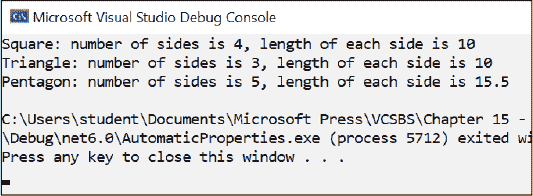
11. 按 **回车** 关闭应用程序并返回 Visual Studio 2022。

### 使用属性 record 实现轻量级结构

你创建结构和类来建模实体。实体中的字段表示实体的状态。在许多情况下，这种状态可能会随着时间改变。然而，在某些情况下，你希望实体是不可变的。

你已经见过如何创建具有只读和只只属性的结构和类来提供这种不可变性。但是，创建此类类型的语法可能有点冗长。当你定义一个不可变对象时，你真的想指定字段的名称和类型，并让编译器为你生成提供实现的代码。C# 9.0 引入的记录（Records）提供了这种能力。


将记录（record）想象为一种轻量级结构。记录是一种值类型，具有支持不可变性的内置能力。记录的另一个特性是它们的等效性概念。当你比较两个对象的相等性时，你实际上在做什么？对于类（class），相等性验证的是对象是否实际上是堆上的同一个项目的引用。对于结构体（struct），相等性是基于值的；如果两个结构体的字段包含相同的数据，则它们就相等。然而，结构体相等性的默认实现是通过继承自 `ValueType` 的 `Equals` 方法实现的。该实现使用反射来查询所比较结构体的字段，然后对两个结构体进行逐字段的检查。

这种方法非常通用，虽然它可以工作，但效率并不高。你可以重写 `Equals` 方法来提供你自己的版本，但如果你这样做了，也应该重写 `GetHashCode` 方法。该方法被 `.NET` 库中的各种方法调用，以确定对象的 ID，任何两个结构体实例都不应该返回相同的值。结果是，一个表面上简单的结构体可能会变得臃肿，以提供使用该结构所需的必要代码基础设施。

 **注意**

在通用 平台（UWP）应用程序和 UWP 类库中创建的结构体实际上并不是基于 `ValueType` 基类型。UWP 应用使用不同的运行时，用于生成这些方法的默认实现。

回到之前的学生成绩示例，你可以像这样将 `Grade` 类型实现为结构体（省略了某些细节）：

点击此处查看代码图像

```
struct Grade
{
    public int StudentID { get; init; }
    public string Subject { get; init; }
    public char SubjectGrade { get; init; }
    public override bool Equals(object obj)
    {
        ...
    }
    public override int GetHashCode()
    {
        ...
    }    
}
```

你可以像以前一样使用对象初始化来实例化 `Grade` 结构体的新实例，并可以在实例之间复制数据：

点击此处查看代码图像

```
var grade1 = new Grade() { StudentID = 1, Subject = "Math", SubjectGrade = 'A' };
var grade2 = new Grade() { StudentID = 1, Subject = "French", SubjectGrade = 'C' };
var grade3 = grade1; // Copy the grade1 instance
```

你可以尝试显示 `Grade` 结构体的内容：

```
Console.WriteLine(grade1);
Console.WriteLine(grade2);
Console.WriteLine(grade3);
```

问题是，除非你像本书之前介绍的那样重写了结构体的 `ToString` 方法，否则输出看起来就像这样：

```
Grade
Grade
Grade
```

要测试相等性，你使用由结构体提供的 `Equals` 方法。

点击此处查看代码图像

```
Console.WriteLine($"{grade1.Equals(grade3)}");
```

该语句的输出是：

```
True
```

学生成绩类型是记录的自然候选者。你可以使用与结构体非常相似的语法来定义记录：

点击此处查看代码图像

```
record Grade
{
    public int StudentID { get; init; }
    public string Subject { get; init; }
    public char SubjectGrade { get; init; }
}
```

然而，记录提供了一种简洁的快捷语法来实现相同的功能。你可以简单地定义相同的记录类型：

点击此处查看代码图像

```
record Grade(int StudentID, string Subject, char SubjectGrade);
```

每个字段都生成了一个 `get` 访问器和一个 `init` 访问器。此外，还创建了一个构造函数允许你为每个字段指定值。你可以这样创建 `Grade` 记录的实例并复制 `Grade` 实例：

点击此处查看代码图像

```
var grade1 = new Grade(1, "Math", 'A');
var grade2 = new Grade(1, "French", 'C');
var grade3 = grade1; // Copy the grade1 instance
```

如果你觉得这种语法有点太简洁，可以为提供给构造函数的每个参数命名：

点击此处查看代码图像

```
var grade1 = new Grade(StudentID:1, Subject:"Math", SubjectGrade:'A');
```

记录真正的乐趣在于，当你发现它们具有内置的 `ToString` 方法实现，可以自动显示记录的内容。以下语句：

```
Console.WriteLine(grade1);
Console.WriteLine(grade2);
Console.WriteLine(grade3);
```

显示此处所示输出：

点击此处查看代码图像

```
Grade { StudentID = 1, Subject = Math, SubjectGrade = A }
Grade { StudentID = 1, Subject = French, SubjectGrade = C }
Grade { StudentID = 1, Subject = Math, SubjectGrade = A }
```

此外，记录类型重写了相等运算符 `==`，允许你编写如下代码，它会显示值 `True`：

点击此处查看代码图像

```
Console.WriteLine($"{grade1 == grade3}");
```

记录提供的另一个技巧是能够从一个记录部分复制数据到另一个记录。如果你想创建一个另一个数学成绩为 `A` 但不同学生的 `Grade` 记录，可以使用以下代码：

点击此处查看代码图像

```
var grade4 = grade1 with { StudentID = 2 };
```

记录类型支持解构（deconstruction），以便你能够快速从记录中检索字段值。你创建一个带有与每个字段匹配变量的元组，然后将记录分配给元组。编译器可以自动推断每个变量的类型。在 `Grade` 示例中，你可以这样解构记录并显示字段值：

点击此处查看代码图像

```
var (studentID, subjectName, grade) = grade1;
Console.WriteLine($"{studentID}, {subjectName}, {grade}");
```

### 定义和使用记录类型

在本章最后一个练习中，你将创建一个记录类型，用于在学生报名时捕捉入学信息。

1. 在 Visual Studio 2022 中，打开 `StudentEnrollment` 解决方案，它位于你 **文档** 文件夹中的 `Microsoft Press\VCSBS\Chapter 15\StudentEnrollment` 文件夹。该项目包含 `Program.cs` 文件，带有你以前过的 `Main` 和 `doWork` 测试框架方法。

2. 在解决方案资源管理器中，右键点击 `StudentEnrollment` 项目，指向 **添加**，然后选择 **类**以打开“新建项 - StudentEnrollment”对话框。

3. 在 **名称** 框中输入 `Enrollment.cs`，然后选择 **添加**。

 **注意** 目前 Visual Studio 未提供记录项模板，因此你将使用类模板并对其修改。

4. 在 `Enrollment.cs` 文件中，将 `Enrollment` 类替换为如下记录定义：

```record Enrollment(int StudentID, string CourseName, DateOnly DateEnrolled);
```

这就是你需要做的全部工作。编译器将为每个字段生成 init-only 属性、一个填充每个字段的构造函数连同相等运算符，以及一个显示记录字段的 `ToString` 方法重写。

5. 在代码和文本编辑器中打开 `Program.cs` 文件。


6. 在 `doWork` 方法中，将 `// TODO:` 注释替换为以下代码，该代码创建一个包含四个 `Enrollment` 记录的数组。第三条记录是第一个记录的拷贝。第四条记录是第一个记录的拷贝，但学生 ID 不同：

点击此处查看代码图像

```c
static void doWork()
{
    var Enrollments = new Enrollment[4];
    Enrollments[0] = new Enrollment(StudentID: 1, CourseName: "Physics",
        DateEnrolled: new DateOnly(2021, 07, 20));
    Enrollments[1] = new Enrollment(StudentID: 1, CourseName: "Chemistry",
        DateEnrolled: new DateOnly(2021, 07, 20));
    Enrollments[2] = Enrollments[0];
    Enrollments[3] = Enrollments[0] with { StudentID = 2};}
}
```

7. 在 `doWork` 方法末尾添加以下**粗体**语句。这些语句将显示每个 `Enrollment` 记录的内容：

点击此处查看代码图像

```csharp
static void doWork()
{
    ...
    foreach (var Enrollment in Enrollments)
    {
        Console.WriteLine($"{Enrollment}");
    }
}
```

8. 在 `doWork` 方法末尾追加以下**粗体**代码。这些语句将将 `Enrollments` 数组中的第一个 `Enrollment` 记录与另外三个记录进行比较，并显示比较结果：

点击此处查看代码图像

```csharp
static void doWork()
{
    ...
    var firstEnrollment = Enrollments[0];
    foreach (var Enrollment in Enrollments[1..4])
    {
        Console.WriteLine($"{firstEnrollment == Enrollment}");
    }
}
```

9. 不调试调试启动解决方案。验证结果是否如下：

点击此处查看代码图像

```text
Enrollment { StudentID = 1, CourseName = Physics, DateEnrolled = 20/07/2021 }
Enrollment { StudentID = 1, CourseName = Chemistry, DateEnrolled = 20/07/2021 }
Enrollment { StudentID = 1, CourseName = Physics, DateEnrolled = 20/07/2021 }
Enrollment { StudentID = 2, CourseName = Physics, DateEnrolled = 20/07/2021 }
False
True
False
```

比较结果显示 `Enrollments[0]` 匹配 `Enrollments[2]`，但不匹配 `Enrollments[1]` 或 `Enrollments[3]`。请记住，记录是值类型，因此比较是基于记录的内容的。它们并不是同一个物理记录。

10. 返回 Visual Studio。

11. 为了测试这些记录的不可变性，在 `doWork` 方法中添加以下语句：

点击此处查看代码图像

```csharp
static void doWork()
{
    ...
    Enrollments[0].DateEnrolled = new DateOnly(2021, 08, 15);
}
```

12. 在 `Build` 菜单上，选择 `Rebuild Solution`。生成应该失败并显示消息：

点击此处查看代码图像

```text
Init-only property or indexer 'Enrollment.DateEnrolled' can only be assigned in an object
initializer, or on 'this' or 'base' in an instance constructor or an 'init' accessor.
```

13. 删除该语句并重新生成项目。它现在应该可以再次成功生成了。

### 总结

在本章中，你学习了如何创建和使用属性对对象中的数据提供受控访问。你还学习了如何创建自动属性以及在初始化对象时使用属性。最后，你学习了如何将 `init` 属性与记录结合使用创建不可变的值类型。

* 如果你想继续下一章，请保持 Visual Studio 2022 运行并转到第 16 章，“处理二进制数据和使用索引器”。

* 如果你想现在退出 Visual Studio 2022，在 File 菜单上选择 Exit。如果看到 Save 对话框，选择 Yes 并保存项目。

### 快速参考

| 目的 | 执行操作 |
| --- | --- |
| 为结构体或类声明读写属性 | 声明属性的类型、名称、`get` 访问器和 `set` 访问器。例如：点击此处查看代码图像 |

```csharp
class Polygon
{
    public int NumSides { get; set; }
}
``` |
| 创建只读自动属性 | 在构造函数或作为属性初始化器中初始化它。例如：点击此处查看代码图像 |

```csharp
class Circle
{
    public DateTime Created { get; }
}
``` |
| 创建不可变类型 | 定义结构体，声明 `init` 属性。例如：点击此处查看代码图像 |

```csharp
struct ScreenPosition
{
    public int X { get; init; }
}
``` |
| 实现接口属性 | 在实现接口的类或结构体中声明属性并实现访问器。例如：点击此处查看代码图像 |

```csharp
struct ScreenPosition : IScreenPosition
{
    public int X { get; init; }
}
``` |
| 创建只写属性 | 声明只有 `set` 访问器的属性。例如：点击此处查看代码图像 |

```csharp
struct ScreenPosition
{
    public int X { set; }
}
``` |
| 创建 `init` 属性 | 在结构体或类中声明具有 `get` 和 `init` 访问器的属性。例如：点击此处查看代码图像 |

```csharp
class Polygon
{
    public int NumSides { get; init; }
}
``` |
| 实例化不可变类型 | 使用对象初始化语法为每个 `init` 属性指定值。例如：点击此处查看代码图像 |

```csharp
class Grade
{
    public int StudentID { get; init; }
    public string Subject { get; init; }
    public char SubjectGrade { get; init; }
}
``` |
| 定义并使用不可变记录类型 | 定义记录并指定其属性。默认情况下，这些属性是不可变的。例如：点击此处查看代码图像 |

```csharp
record Enrollment(int StudentID, string CourseName, DateOnly DateEnrolled);
``` |
| 使用记录生成的默认构造函数创建新记录。例如：点击此处查看代码图像 |

```csharp
var Enrollments = new Enrollment(StudentID: 1, CourseName: "Physics",
    DateEnrolled: new DateOnly(2021, 07, 20));
``` |
| 从记录类型中检索字段值 | 使用元组解构记录。例如：点击此处查看代码图像 |

```csharp
var (studentID, subjectName, grade) = grade1;
``` |


## 处理二进制数据和使用索引器

**完成本章后，你将能够：**

*   解释索引器的用途，并创建和使用索引器来封装对对象的逻辑类数组访问。
*   通过声明访问器（accessors）控制对索引器的读取和写入访问。
*   创建声明索引器的接口。
*   在继承接口的结构体和类中实现索引器。

在第 15 章“实现属性以访问字段”中，我们描述了如何实现和使用属性作为对类字段提供受控访问的手段。对于镜像包含单个值的字段，属性非常有用。然而，如果你想对包含多个值的项提供访问，并希望使用自然且熟悉的语法来实现这一目标，那么索引器将是无价的。

### 什么是索引器？

你可以将 `indexer` 想象成一个智能数组，就像你可以将属性想象成智能字段一样。属性封装了类中的单个值，而索引器则封装了一组值。你用于索引器的语法与用于数组的语法相同。

理解索引器的最好方法是通过示例。首先，你将考虑一个问题并检查一个不使用索引器的解决方案。然后，你将处理相同的问题并查看一个使用索引器的更好解决方案。这个问题涉及整数，更准确地说，是 `int` 类型。示例使用 C# 整数来存储和查询存储为二进制数据的数据，这有助于理解如何使用 C# 中的整数类型来存储和处理二进制值。我们先讨论这一点。

### 存储二进制值

你通常使用 `int` 来保存一个整数值。在内部，`int` 将其值存储为 32 位序列，其中每个位可以是 0 或 1。大多数时候，你并不关心这种内部的二进制表示；你只需要将 `int` 类型作为容器来存放整数值。然而，有时程序员会将 `int` 类型用于其他用途。例如，某些程序将 `int` 用一组二进制标志，并操作 `int` 内部的各个位。如果你像我一样是一个老 C 程序员，那么接下来的内容会让你非常熟悉。

 **注意**

一些较旧程序使用 `int` 类型来节省内存。此类程序通常追溯到计算机内存容量以千字节（KB）而非如今的千字节（GB）为单位的时代，那时内存极其昂贵。单个 `int` 包含 32 位，每位可以是 1 或 0。在某些情况下，程序员分配 1 表示值 `true`，分配 0 表示 `false`，然后将 `int` 作为一组布尔值使用。

为了方便地处理你想要视为二进制值集合的数据，C# 允许你使用二进制表示法指定整数常量。你通过在常量前加上 `0b0` 来指明该常量应被视为二进制表示。例如，以下代码将二进制值 1111（十进制为 15）赋值给变量：

```
uint binData = 0b01111;
```

注意这是一个 4 位值，但整数占用 32 位。任何未指定的位都将初始化为 `0`。你还应该注意到，当你将整数指定为二进制值时，将结果存储为无符号整数 (`uint`) 是一种良好的习惯。事实上，如果你提供了一个完整的 32 位二进制值，C# 编译器将强制你使用 `uint`。

为了应对长长的位字符串，你还可以在数字块之间插入下划线 (`_`) 字符作为分隔符，如下：

点击此处查看代码图像

```
uint moreBinData = 0b0_11110000_01011010_11001100_00001111;
```

在这个示例中，分隔符 `_` 用于标记字节边界（32 位是 4 字节）。你可以在二进制常量的任何地方使用 `_` 分隔符（而不是在字节边界上）；C# 编译器会忽略它，提供它仅是为了提高代码的可读性。

如果你觉得二进制字符串有点长，可以选择使用 `0x0` 前缀通过十六进制（16 进制）表示法来指定值。以下两个语句将上例所示的相同值赋予另一对变量。再次，你可以使用 `_` 字符作为分隔符使值更易读：

点击此处查看代码图像

```
uint hexData = 0x0_0F;
uint moreHexData = 0x0_F0_5A_CC_0F;
```

### 显示二进制值

如果你需要显示整数的二进制表示，可以使用 `Convert.ToString` 方法。`Convert.ToString` 是一个高度重载的方法，可以为存储在不同类型中的范围数据值生成字符串表示。如果你正在转换整数数据，还可以额外指定数值基数（2, 8, 10 或 16），该方法将使用类似于练习题的算法将整数转换为该基数。以下示例打印了 `hexData` 的二进制值：

```
uint hexData = 0x0_0F;
Console.WriteLine(Convert.ToString(hexData, 2));
```

### 操作二进制值

C# 提供了一组运算符，你可以使用它们来操作单个位：

*   **`NOT` (`~`) 运算符**：这是一个一元运算符，执行按位取反。例如，如果对 204 应用 `~`，你将得到 -205（补码形式）。
*   **左移 (`<<`) 运算符**：这是一个二元运算符，执行左移。例如，`204 << 2` 返回值 816。最左侧位被丢弃，从右侧引入零。
*   ***`OR` (`|`) 运算符**：这是一个二元运算符，执行按位 `OR` 操作，返回的值在两个操作数任一个为 1 的位置上包含 1。例如，`204 | 24` 的值为 220。
*   **`AND` (`&`) 运算符**：该运算符执行按位 `AND` 操作。`AND` 与按位 `OR` 运算符类似，但它返回在两个操作数都为 1 的位置上包含 1。因此，`204 & 24` 是 8。
*   **`XOR` (`^`) 运算符**：该运算符执行按位异或操作，在其中一个操作数为为 1 而不是两者都为 1 的每个位上返回 1。（两个 1 产生一个 0；这就是运算符的“异异”部分。）因此，`204 ^ 24` 是 212。


你可以结合使用这些运算符来确定 `int` 中单个位的值。例如，下面的表达式使用了左移 (`<<`) 和按位“与” (`&`) 运算符，用来确定名为 `bits` 的 `byte` 变量从右侧数的第六个位是被设置为 `0` 还是 `1`：

```
(bits & (1 << 5)) != 0
```

 **注意**

位运算符从右到左计算位的位置，且位位从 `0` 开始编号。因此，位 `0` 是最右侧的位，而位置在 `5` 的位是从右数起第六个位。

假设变量 `bits` 包含十进制值 `42`。在二进制中，它是 `0b0_00101010`。十进制值 `1` 在二进制中是 `0b0_00000001`，而表达式 `1 << 5` 的值为 `0b0_00100000`；第六个位是 `1`。在二进制中，表达式 `bits & (1 << 5)` 是 `0b0_00101010 & 0b0_00100000`，该表达式的值为 `0b0_00100000`，非零。如果变量 `bits` 包含值 `65` 或 `0b0_01000001`，则表达式的值为 `0b0_01000001 & 0b0_00100000`，结果为 `0b0_00000000` 或 `0`。

这是一个相当复杂的示例，但与下面的表达式相比就显得微不足道了，后表达式使用了复合赋值运算符 `&=` 将位置 6 的位设置为 `0`：

```
bits &= ~(1 << 5)
```

同样，如果你想将位置 6 的位设置为 `1`，可以使用按位“或” (`|`) 运算符。下面的复杂表达式基于复合赋值运算符 `|=`：

```csharp
bits |= (1 << 5)
```

这些示例的问题在于，尽管它们有效，但理解起来极其困难。它们很复杂，而且解决方案是非常低层级的：它未能为其所解决的问题创建一个抽象，因此，维护执行此类操作的代码会变得非常困难。

## 使用索引器解决相同的问题

让我们暂时跳出上述底层的解决方案，回想一下问题是什么：你希望将一个 `int` 不仅仅视为一个 `int`，而是看作一个位数组。因此，解决此问题的最佳方法是将 `int` 像位数组一样来使用。例如，若要从右侧访问并向 `bits` 变量的六个位置中的任何一个位置写入二进制值，可以使用如下表达式（请记住数组索引从 0 开始）：

```
bits[5];
```

并且，为了将从右侧起第四个位设置为 `true`，你可能希望能够写出这样的代码：

```csharp
bits[3] = true; // 目前是无效代码
```

**注意** 对于经验丰富的开发者来说，布尔值 `true` 与二进制值 `1` 同义，布尔值 `false` 与二进制值 `0` 同义。因此，在 C 中，表达式 `bits[3] = true` 意味着“将 `bits` 变量从右侧起的第四个位设置为 1”。

遗憾的是，你不能对 `int` 使用方括号表示法；它只适用于数组或行为类似于数组的类型。因此，该问题的解决方案是创建一个新类型，它的行为、感觉和用法都像 `bool` 变量数组，但内部使用 `int` 实现。你可以通过定义索引器（indexer）来实现这一壮举。我们将这个新类型命名为 `IntBits`。`IntBits` 将包含一个 `int` 值（在它的构造函数中初始化），但核心思想是你将 `IntBits` 用作 `bool` 变量数组。

**提示** `IntBits` 类型很小且轻量，因此将其创建为结构体（struct）而不是类（class）是有意义的。

```c
struct IntBits
{
    private int bits;

    // 使用表达式体实现的简单构造函数
    public IntBits(int initialBitValue) => bits = initialBitValue;

    // 在此处编写索引器
}
```

要定义索引器，你需要使用一种交叉属性和数组的语法。你通过 `this` 关键字引入索引器，指定索引器返回值的类型，并指定作为方括号内索引的值的类型。`IntBits` 结构体的索引器使用整数作为索引并返回一个布尔值。它看起来如下：

```csharp
struct IntBits
{
     ...
    public bool this [ int index ]
    {
        get => (bits & (1 << index)) != 0;

        set
        {
            if (value) // 如果 value 为 true 则开启位；否则关闭位
                bits |= (1 << index);
            else
                bits &= ~(1 << index);
        }
    }
}
```

注意以下几点：

- 索引器不是方法。它没有包含参数的括号，但有方括号。索引器用于指定要访问的元素。
- `IntBits` 结构体的索引器使用整数作为索引并返回一个布尔值。
- 索引器定义时，方括号中的参数 `index` 用于确定要访问的元素。
- 索引器使用 `this` 关键字。类或结构体最多定义一个索引器（尽管你可以对其重载），并且它始终命名为 `this`。
- 索引器包含 `get` 和 `set` 访问器，就像属性一样。
- `get` 和 `set` 访问器包含了之前讨论的位表达式。
- 当调用索引器时，索引器声明中的索引被填充为索引值。
- `get` 和 `set` 访问器。**注意** 你应该在索引器中对索引值进行范围检查，以防止意外异常的发生。

提供显示该数据的方法也是良好的做法。你可以通过重写 `ToString` 方法将结构体中的值转换为二进制字符串，如下：

```csharp
struct IntBits
{
     ...
    public override string ToString()
    {
        return Convert.ToString(bits, 2);
    }
}
```

创建索引器后，你可以使用 `IntBits` 类型变量代替 `int` 并应用方括号表示法，如下例所示：

```csharp
int adapted = 0b0_0111110;
IntBits bits = new IntBits(adapted);
bool peek = bits[6]; // 获取索引 6 的布尔值；peek 应为 true (1)
bits[0] = true; // 将索引 0 的位设置为 true (1)
bits[3] = false; // 将索引 3 的位设置为 false (0)
Console.WriteLine($"{bits}"); // 显示 1110111 (0b0_0111011)
```

这种语法显然容易理解得多。它直接且简洁地捕捉了问题的本质。

### 理解索引器访问器

当你读取索引器时，编译器会自动将你的数组代码转换为对该索引器 `get` 访问器的调用。考虑以下示例：

```csharp
bool peek = bits[6];
```

该语句被转换为对 `bits` 的 `get` 访问器的调用，`index` 参数被设置为 `6`。

同样，如果你向索引器写入内容，编译器会自动将你的数组代码转换为对该索引器 `set` 访问器的调用，并将方括号内的值设置为 `index` 参数，如下所示：

```csharp
bits[3] = true;
```


也可以在读写混合的上下文中使用索引器。在这种情况下，`get` 和 `set` 访问器都会被使用。查看下述，它使用 `XOR` 运算符（`^`）反转 `bits` 变量中索引为 6 的位的值：

```
bits[6] ^= true;
```

这段代码会被自动转换为以下内容：

```
bits[6] = bits[6] ^ true;
```

这段代码之所以能够工作，是因为索引器同时声明了 `get` 和 `set` 访问器。

 **注意**

你可以声明一个只包含 `get` 访问器的索引器（只读索引器）或只包含 `set` 访问器的索引器（只写索引器）。

## 比较索引器和数组

当你使用索引器时，其语法在刻上刻意设计得非常像数组。然而，索引器和数组之间存在一些重要的区别：

* 索引器可以使用非数字下标，例如字符串（如下例所示），而数组只能使用整数下标。

    点击此处查看代码图像

    ```
    public int this [ string name ] { ... } // OK
    ```

* 索引器可以重载（就像方法一样），而数组不能。

    点击此处查看代码图像

    ```
    public Name this [ PhoneNumber number ] { ... }
    public PhoneNumber this [ Name name ] { ... }
    ```

* 索引器不能用 `ref` 或 `out` 参数，而数组元素可以。

    点击此处查看代码图像

    ```
    IntBits bits; // bits 包含一个索引器
    Method(ref bits[1]); // 编译错误
    ```

## 接口中的索引器

你可以在接口中声明索引器。要这样做，请指定 `get` 关键字、`set` 关键字或两者，但要用分号替换 `get` 或 `set` 访问器的体。任何实现接口的类或结构体必须实现接口中声明的索引器访问器，如下所示：

点击此处查看代码图像

```go
interface IRawInt
{
    bool this [ int index ] { get; set; }
}

struct RawInt : IRawInt
{
    ...
    public bool this [ int index ]
    {
        get { ... }
        set { ... }
    }
    ...
}
```

如果你在类中实现 `interface` 索引器，可以将索引器的实现声明为虚方法（virtual）。这允许进一步的派生类重写 `get` 和 `set` 访问器，如下所示：

点击此处查看代码图像

```
class RawInt : IRawInt
{
     ...
     public virtual bool this [ int index ]
     {
         get { ... }
         set { ... }
     }
}
```

（注：输入中提供的剩余文本似乎是重复或损坏的片段/句子。我已经根据你的指令处理了所提供的核心结构内容。）


访问器的目的是找到与指定电话号码匹配的名称。要实现这一点，你需要调用 `Array` 类的静态方法 `IndexOf`。`IndexOf` 方法遍历数组并返回数组中第一个匹配指定值的项的索引。`IndexOf` 的第一个参数是要从中搜索的数组（`phoneNumbers`）。`IndexOf` 的第二个参数是你要查找的项。如果 `IndexOf` 找到了该元素，它将返回元素的整数索引；否则，它返回 `–1`。如果索引器找到了电话号码，它应该返回相应的名称；否则，它应该返回空的 `Name` 值。（注意 `Name` 是一个结构体，因此默认构造函数会将它的私有 `name` 字段设置为 `null`。）

3.  删除注释 `// TODO: write 2nd indexer here`，并将其替换为 `PhoneBook` 类的第二个公共只读索引器，该索引器返回一个 `PhoneNumber` 并接受单个 `Name` 参数。按照与第一个索引器相同的方式实现此索引器，如下文代码中的**粗体**所示。（再次注意，`PhoneNumber` 是一个结构体，因此始终具有默认构造函数。）第二个索引器应该像这样：

点击此处查看代码图像

```c
sealed class PhoneBook
{
    ...
    public PhoneNumber this [Name name]
    {
        get
        {
            int i = Array.IndexOf(this.names, name);
            if (i != -1)
            {
                return this.phoneNumbers[i];
            }
            else
            {
                return new PhoneNumber();
            }
        }
    }
     ...
}
```

注意，这些重载索引器可以共存，因为它们索引的值类型不同，这意味着它们的签名不同。如果将 `Name` 和 `PhoneNumber` 结构体替换为简单的字符串（它们封装的类型），重载将具有相同的签名，类将无法编译。

4. 在**生成 (Build)** 菜单上，选择**生成解决方案 (Build Solution)**，修正任何语法错误，并在必要重新生成解决方案。

### 调用索引器

1. 在代码和文本编辑器窗口中显示 `MainPage.xaml.cs` 文件，然后找到 `findByNameClick` 方法。

当选择“按名称查找”按钮时，会调用此方法。该方法目前是空的。

2. 将 `// TODO:` 注释替换为后续示例中**粗体**所示的代码：

点击此处查看代码图像

```csharp
private void findByNameClick(object sender, RoutedEventArgs e)
{
    string text = name.Text;
    if (!String.IsNullOrEmpty(text))
    {
        Name personsName = new Name(text);
        PhoneNumber personsPhoneNumber = this.phoneBook[personsName];
        phoneNumber.Text = 
            String.IsNullOrEmpty(personsPhoneNumber.Text) ?
            "Not Found" : personsPhoneNumber.Text;
    }
}
```

此代码执行以下任务：

* 它从表单上的 `name` 框中读取 `Text` 属性的值。这是一个包含用户输入的联系人名称的字符串。

* 如果字符串不为空，代码将使用索引器在 `PhoneBook` 对象中搜索与该名称对应的电话号码。（注意 `MainPage` 类包含一个名为 `phoneBook` 的私有 `PhoneBook` 字段。）它从字符串构造一个 `Name` 对象并将其作为参数传递给 `PhoneBook` 索引器。

* 如果索引器返回的 `PhoneNumber` 结构体的 `Text` 属性不是 `null` 或空，则代码将该属性的值写入表单上的 `phoneNumber` 框；否则，它显示文本 `Not Found`。

除了访问索引器的语句外，此代码中还有两个值得关注的点：

* 使用静态 `String` 方法 `IsNullOrEmpty` 来判断字符串是否为空或包含 `null` 值。这是测试字符串是否包含值的首选方法。如果字符串包含 `null` 值或为空字符串，则返回 `true`；否则，返回 `false`。

* 填充表单上 `phone-Number` 框 `Text` 属性的语句使用了 `?:` 运算符。记住，该运算符的作用类似于表达式的内联 `if…else` 语句。在前面的代码中，如果表达式 `String.IsNullOrEmpty(personsPhoneNumber.Text)` 为 `true`，则表示电话簿中没有找到匹配项，并在表单上显示文本 `Not Found`；否则，显示 `personsPhoneNumber` 变量的 `Text` 属性所持的值。

3. 在 `MainPage.xaml.cs` 文件中找到 `findByPhoneNumberClick` 方法。它位于 `findByNameClick` 方法之后。

当选择“按电话号码查找”按钮时，会调用 `findByPhoneNumberClick` 方法。该方法除一个 `// TODO:` 注释外是空的。

4. 要实现 `findByPhoneNumberClick`，输入以下**粗体**所示的代码：

点击此处查看代码图像

```csharp
private void findByPhoneNumberClick(object sender, RoutedEventArgs e)
{
    string text = phoneNumber.Text;
    if (!String.IsNullOrEmpty(text))
    {
        PhoneNumber personsPhoneNumber = new PhoneNumber(text);
        Name personsName = this.phoneBook[personsPhoneNumber];
        name.Text = String.IsNullOrEmpty(personsName.Text) ?
           "Not Found" : personsName.Text;
    }
}
```

此代码执行以下任务：

* 它从 `phoneNumber` 框读取 `Text` 属性的值。这是一个包含用户输入的电话号码的字符串。

* 如果字符串不为空，它使用索引器在 `PhoneBook` 对象中搜索该号码对应的名称。

* 它将索引器返回的 `Name` 结构体的 `Text` 属性写入表单上的 `name` 框。

5. 在**生成 (Build)** 菜单上，选择**生成解决方案 (Build Solution)**，然后修正发生的错误。

### 测试应用程序

1. 在**调试 (Debug)** 菜单上，选择**开始调试 (Start Debugging)**。

2. 在相应的框中输入你的姓名和电话号码，然后展开命令栏并选择**添加 (Add)**。（可以通过选择省略号展开命令栏。）

当你点击添加按钮时，`Add` 方法会将信息存储在电话簿中并清空框以便进行搜索。

3. 重复步骤 2，输入几次不同的姓名和电话号码，以便电话簿包含若干条目。注意应用程序不对你输入的姓名和电话号码进行检查，你可以多次输入相同的姓名和电话号码。为了演示目的，为了避免混淆，请确保提供不同的姓名和电话号码。

4. 将你在步骤 3 中使用的名称输入到 **Name** 框中，然后选择**按名称查找 (Find By Name)**。

你在步骤 3 中为的联系人添加的电话号码将从电话簿中检索并显示在电话号码框中。

5. 在 **Phone Number** 框中输入另一个联系人的电话号码，然后选择**按电话号码查找 (Find By Phone Number)**。

联系人名称从电话簿中检索并显示在 Name 框中。

6. 将未输入电话簿的名称输入到 **Name** 框中，然后选择**按名称查找 (Find By Name)**。

这次，电话号码框将显示消息 `Not Found`。

7. 关闭表单并返回 Visual Studio 2022。


在本章中，你学习了如何使用索引器（indexers）为类中的数据提供类似数组的访问。你学习了如何使用由 `get` 访问器定义的逻辑来创建可以接收索引并返回相应值的索引器，并查看了如何使用带索引的 `set` 访问器在索引器中填充值。

* 如果你想继续阅读下一章，请保持 Visual Studio 2022 运行并转到第 17 章，“引入泛型”。

* 如果你想现在退出 Visual Studio 2022，请在“文件”菜单上选择`退出`。如果看到“保存”对话框，请选择`是`并保存项目。

### 快速参考

| 目标 | 执行此操作 |
| :--- | :--- |
| 使用二进制或十六进制表示指定整数值 | 使用 `0b0`（二进制值）或 `0x0`（十六进制值）前缀。包含 `_` 分隔符以使数值更易读。例如：点击此处查看代码图像 <br```c
uint moreBinData = 0b0_11110000_01011010_11001100_00001111;
uint moreHexData = 0x0_F0_5A_CC_0F;
``` |
| 将整数值以其二进制或十六进制表示显示 | 使用 `Convert.ToString` 方法，并将 `2`（二进制）或 `16`（十六进制）指定为数基。例如：点击此处查看代码图像 <br```c
uint moreHexData = 0x0_F0_5A_CC_0F;
Console.WriteLine($"{Convert.ToString(moreHexData, 2)}");
// 显示 11110000010110101100110000001111
``` |
| 为类或结构体创建索引器 | 声明索引器的类型，后跟跟关键字 `this`，然后是方括号中的索引器参数。索引器的体可以包含 `get` 和/或 `set` 访问器。例如：点击此处查看代码图像 <br```c
struct RawInt
{
   ...
   public bool this [ int index ]
   {
      get { ... }
      set { ... }
   }
   ...
}
``` | |
| 在接口中定义索引器 | 使用 `get` 和/或 `set` 关键字定义索引器。例如：点击此处查看代码图像 <br```c
interface IRawInt
{
    bool this [ int index ] { get; set; }
}
``` | |
| 在类或结构体中实现接口索引器 | 在实现接口的类或结构体中，定义索引器并实现访问器。例如：点击此处查看代码图像 <br```c
struct RawInt : IRawInt
{
    ...
    public bool this [ int index ]
    {
       get { ... }
       set { ... }
    }
    ...
}
``` | |
| 在类或结构体中使用显式接口实现由接口定义的索引器 | 在实现接口的类或结构体中，指定接口，但不指定索引器的可访问性。例如：点击此处查看代码图像 <br```c
struct RawInt : IRawInt
{
    ...
    bool IRawInt.this [ int index ]
    {
       get { ... }
       set { ... }
    }
    ...
}
``` | |

## 第 17 章

## 引入泛型

**在完成本章后，你将能够：**

* 解释泛型的目的。
* 使用泛型定义类型安全的类，并根据指定为类型参数的类型创建泛型类实例。
* 定义一个泛型方法，实现一个与其操作的数据类型无关的算法。
* 创建并实现泛型接口。

第 8 章，“理解值和引用”向你展示了如何使用 `object` 类型来引用任何类的实例。你可以使用 `object` 类型来存储任何类型的值，并在需要向方法传递任何类型的值时，使用 `object` 类型来定义参数。方法也可以通过将 `object` 指定为返回类型来返回任何类型的值。尽管这种做法非常灵活，但它将记住实际使用了什么种数据的负担留在了程序员身上。如果程序员犯了错误，可能会导致运行时错误。在本章中，你将学习泛型，这是一种旨在帮助你防止此类错误的功能。

### 问题：`object` 类型的问题

为了理解泛型，详细查看它们设计用于解决的问题是值得的。

假设你需要建模一个先入先出的结构，例如队列。你可以创建如下类：

点击此处查看代码图像

```c
class Queue
{
    private const int DEFAULTUESIZE = 100;
    private int[] data;
    private int head = 0, tail = 0;
    private int numElements = 0;

    public Queue()
    {
        data = new int[DEFAULTUESIZE];
    }
    public Queue(int size)
    {
        if (size > 0)
        {
            data = new int[size];
        }
        else
        {
            throw new ArgumentRangeException("size", "Must be greater than zero");
        }
    }

    public void Enqueue(int item)
    {
        if (numElements == data.Length)
        {
            throw new Exception("Queue full");
        }
        data[head] = item;
        head++;
        head %= data.Length;
        numElements++;
    }

    public int Dequeue()
    {
        if (numElements == 0)
        {
            throw new Exception("Queue empty");
        }
        int queueItem = data[tail];
        tail++;
        tail %= data.Length;
        numElements--;
        return queueItem;
    }
}
```

该类使用数组提供数据的循环缓冲区。数组的大小由构造函数指定。应用程序使用 `Enqueue` 方法向队列添加项，使用 `Dequeue` 方法从队列中提取项。私有的 `head` 和 `tail` 字段跟踪向数组插入和从数组提取的位置。`numElements` 字段指示数组中有多少元素。`Enqueue` 和 `Dequeue` 方法使用这些字段进行基础检查。

应用程序可以创建一个 `Queue` 对象并调用这些方法，如下所示。注意项的出的顺序与入队的顺序相同：

```csharp
Queue queue = new Queue(); // 创建一个新的 Queue
queue.Enqueue(100);
queue.Enqueue(-25);
queue.Enqueue(33);
Console.WriteLine($"{queue.Dequeue()}"); // 显示 100
Console.WriteLine($"{queue.Dequeue()}"); // 显示 -25
Console.WriteLine($"{queue.Dequeue()}"); // 显示 33
```

现在，`Queue` 类对于 `int` 队列工作良好，但如果你想创建 `string`、`float` 甚至是更复杂类型的队列（例如 `Circle`，参见第 7 章，“[创建和管理类和对象]”，或 `Horse` 或 `Whale`（参见第 12 章，“[处理继承]”），呢？问题在于 `Queue` 类的实现方式限制了它是 `int` 类型，如果你尝试入队一个 `Horse` 对象，将得到编译时错误。

点击此处查看代码图像

```csharp
Queue queue = new Queue();
Horse myHorse = new Horse();
queue.Enqueue(myHorse); // 编译错误：无法将 Horse 转换为 int
```

绕过此限制的一种方法是指定 `Queue` 类中的数组包含 `object` 类型的项，更新构造函数并修改 `Enqueue` 和 `Dequeue` 方法以接收 `object` 参数并返回 `object`，如下所示：

点击此处查看代码图像

```csharp
class Queue
{
    private const int DEFAULTUESIZE = 100;
    private object[] data;
    private int head = 0, tail = 0;
    private int numElements = 0;

    public Queue()
    {
        data = new object[DEFAULTUESIZE];
    }
    public Queue(int size)
    {
        if (size > 0)
        {
            data = new object[size];
        }
        else
        {
            throw new ArgumentRangeException("size", "Must be greater than zero");
        }
    }

    public void Enqueue(object item)
    {
        if (numElements == data.Length)
        {
            throw new Exception("Queue full");
        }
        data[head] = item;
        head++;
        head %= data.Length;
        numElements++;
    }

    public object Dequeue()
    {
        if (numElements == 0)
        {
            throw new Exception("Queue empty");
        }
        object queueItem = data[tail];
        tail++;
        tail %= data.Length;
        numElements--;
        return queueItem;
    }
}
```


```cs
class Queue
{
    ...
    private object[] data;
    ...
    public Queue()
    {
       this.data = new object[DEFAULTQUEUESIZE];
    }

    public Queue(int size)
    {
       ...
       this.data = new object[size];
       ...
    }

    public void Enqueue(object item)
    {
       ...
    }

    public object Dequeue()
    {
       ...
       object queueItem = this.data[this.tail];
       ...
       return queueItem;
    }
}
```

请记住，你可以使用 `object` 类型来引用任何类型的值或变量。在 Microsoft .NET 中，所有引用类型都自动（直接或间接地）继承自 `System.Object` 类。（在 C# 中，`object` 是 `System.Object` 的别名）。现在，由于 `Enqueue` 和 `Dequeue` 方法操作的是 `objects`，你可以对 `Circle` 对象队列、`Horse` 对象队列、`Whale` 对象队列或你在书中见过的任何其他类的对象的队列进行操作。然而，你必须将 `Dequeue` 方法返回的值强制转换为适当类型，因为编译器不会自动执行从 `object` 类型的转换。

点击此处查看代码图像

```cs
Queue queue = new Queue();
Horse myHorse = new Horse();
queue.Enqueue(myHorse); // 现在合法的 - Horse 是一个对象
...
Horse dequeuedHorse = (Horse)queue.Dequeue(); // 需要将 object 转换回 Horse
```

如果你不对返回的值进行强制转换，将得到编译器错误 `Cannot implicitly convert type 'object' to 'Horse.'`

这种执行显式强制转换的要求削弱了 `object` 类型所提供的许多灵活性。此外，很容易写出像下面的代码：

点击此处查看代码图像

```cs
Queue queue = new Queue();
Horse myHorse = new Horse();
queue.Enqueue(myHorse);
...
Circle myCircle = (Circle)queue.Dequeue(); // 运行时错误
```

尽管代码可以通过编译，但它是无效的，并在运行时抛出 `System.InvalidCastException` 异常。该错误是由于在出队列时尝试将 `Horse` 对象的引用存储在 `Circle` 变量中引起的，这两个类型是不兼容的。此错误直到运行时才被发现，因为编译器没有足够的信息在编译时执行此项检查。出队列对象的真实类型只有在代码运行时才会变得明显。

使用 `object` 方法创建通用泛型类和方法的另一个缺点是，如果运行时需要将 `object` 转换为值类型并反之，可能会消耗额外的内存和处理器时间。考虑以下这段处理 `int` 值队列的代码：

点击此处查看代码图像

```cs
Queue queue = new Queue();
int myInt = 99;
queue.Enqueue(myInt); // 将 int 装箱为 object
...
myInt = (int)queue.Dequeue(); // 将 object 解箱为 int
```

`Queue` 数据类型期望其持有的项目是对象，而 `object` 是引用类型。入队一个值类型（如 `int`）需要对其进行装箱（boxing）以转换为引用类型。同样，出队到 `int` 需要对项目进行解箱（unboxing）以转换回值类型。（详情请参阅 第 8 章 中的“装箱”和“解箱”部分）。虽然装箱和解箱是透明的，但它们会增加性能开销，因为它们涉及到动态内存分配。对于每个项目来说，这种开销很小，但当程序创建大量值类型的队列时，开销就会累积。

### 泛型解决方案

C# 提供了泛型来消除强制转换的需求，提高类型安全性，减少所需的装箱次数，并使创建通用类和方法变得更容易。泛型类和方法接受*类型参数*，这些参数指定了它们操作对象的类型。在 C# 中，你通过在角括号中提供类型参数来指示一个类是泛型的，如下：

```cs
class Queue<T>
{
     ...
}
```

此示例中的 `T` 在编译时充当真实类型的占位符。当你编写代码实例化泛型 `Queue` 类时，你提供应该替换 `T` 的类型（`Circle`、`Horse`、`int` 等）。

在类中定义字段和方法时，使用使用相同的占位符来指示这些项目的类型，如下：

点击此处查看代码图像

```cs
class Queue<T>
{
    ...
    private T[] data; // 数组类型为 'T'，'T' 是类型参数
    ...
    public Queue()
    {
       this.data = new T[DEFAULTQUEUESIZE]; // 使用 'T' 作为数据类型
    }

    public Queue(int size)
    {
       ...
       this.data = new T[size];
       ...
    }

    public void Enqueue(T item) // 使用 'T' 作为方法参数的类型
    {
       ...
    }

    public T Dequeue() // 使用 'T' 作为返回值的类型
    {
       ...
       T queueItem = this.data[this.tail];
       ...
       return queueItem;
    }
}
```


点击此处查看代码图像

```
Queue<Queue<int>> queueQueue = new Queue<Queue<int>>();
```

泛型类可以有多个类型参数。例如，.NET 类库中定义在 `System.Collections.Generic` 命名空间下的泛型类 `Dictionary` 接收两个类型参数：一个用于键的类型，另一个用于值。（该类在第 18 章中有更详细的描述。）

 **注意**

你也可以使用与泛型类相同的类型参数语法来定义泛型结构和接口。

### 泛型与泛化类

使用类型参数的泛型类与设计用于接收可转换为不同类型的参数的*泛化*（generalized）类不同。例如，之前所示的基于对象的 `Queue` 类就是一个泛化类。该类只有一个实现版本，它的方法接收 `object` 参数并返回 `object` 类型。你可以对 `int`、`string` 以及许多其他类型使用此类，但在每种情况下，你使用的都是同一个类的实例，并且你必须将使用的数据在 `object` 类型之间进行强制转换。

将此与 `Queue<T>` 类进行比较。每当你使用类型参数（如 `Queue<int>` 或 `Queue<Horse>`）使用此类时，你都会导致编译器生成一个全新的类，该类恰好具有由泛型类定义的功能。这意味着 `Queue<int>` 与 `Queue<Horse>` 是两个完全不同的类型，但它们恰好具有相同的行为。

你可以将泛型类类为定义了一个模板的类，该模板随后由编译器根据需要生成新的特定类型的类。泛型类的特定类型版本（如 `Queue<int>`、`Queue<Horse>` 等）被称为*构造类型*（constructed types），你应该将它们视为截然不同的类型（尽管这些类型具有相似的方法和属性集合）。

### 泛型与约束

有时，你可能希望确保泛型类所使用的类型参数能够标识一个提供特定方法的类型。例如，如果你正在定义一个 `PrintableCollection` 类，你可能希望确保存储在类中的所有对象都具有 `Print` 方法。你可以通过使用*约束*（constraint）来指定此条件。

通过使用约束，你可以将泛型类的类型参数限制为实现了特定接口集合的类型，从而提供了这些接口定义的方法。例如，如果 `IPrintable` 接口定义了 `Print` 方法，你可以像这样创建 `PrintableCollection` 类：

点击此处查看代码图像

```
public class PrintableCollection<T> where T : IPrintable
```

当用一个类型参数构建此类时，编译器会检查用于 `T` 的类型是否真的实现了 `IPrintable` 接口；如果没有实现，它将停止编译并报告编译错误。

你还可以通过 `struct` 约束强制类型参数为 `struct` 值类型而不是类类型：

点击此处查看代码图像

```
public class StructCollection<T> where T : struct
```

`class` 约束也类似，但它确保了类型参数是一个引用类型（类）。

### 创建泛型类

.NET 类库中的 `System.Collections.Generic` 命名空间包含了一些供你直接使用的泛型类。你也可以定义自己的泛型类，这正是本节将要做的。在在此之前，让我们先回顾一些背景理论。

#### 二叉树理论

在接下来的练习中，你将定义并使用一个表示二叉树的类。*二叉树*是一种你可以用于各种操作的数据结构，包括快速地对数据进行排序和搜索。

 **注意**

关于二叉树的细节已有大量著作，但本书的目的并不是详细介绍这个主题。相反，你将只查看相关的实。如果你想了解更多，请参考 Donald E. Knuth 写的《The Art of Computer Programming, Volume 3: Sorting and Searching, 2nd Edition》（Addison-Wesley Professional, 1998）。尽管出版年代久远，但排序和搜索算法领域公认的开基性著作。

二叉树是一种递归的（自引用）数据结构，可以为空，也可以包含三个元素：一个数据（通常称为*节点*）和两个子树，子树本身也是二叉树。按照惯例，这两个子树被称为*左子树*和*右子树*，因为它们通常被描绘在节点的左侧和右侧。每个左子树或右子树要么为空，要么包含一个节点和其他子树。在理论上，整个结构可以无限延伸。下面的图像显示了一个小型二叉树的结构：

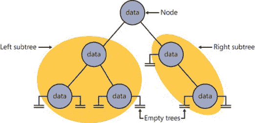

当你使用二叉树对数据进行排序时，它的真正威力就显而易见了。如果你从一个同类型对象的无序序列开始，你可以构建一个有序的二叉树，然后遍历这棵树以按顺序访问每个节点。将项插入到有序二叉树中的算法所示所示：

点击此处查看代码图像

```
如果树 B 为空
Then
  以项 I 为节点构造新树 B，子树为空
Else
  检查树的当前节点 N 的值
  如果 N 的值大于项 I
  Then
    如果 B 的左子树为空
    Then
      以 I 为节点构造 B 的左子树，子树为空
    Else
      将 I 插入 B 的左子树
    End If
  Else
    如果 B 的右子树为空
    Then
      以 I 为节点构造 B 的右子树，子树为空
    Else
      将 I 插入 B 的右子树
    End If
  End If
End If
```

注意此算法是递归的，根据项的值与当前节点的比较结果，调用自身将其插入到左子树或右子树。

 **注意**

*大于*表达式的定义取决于项和节点的数据类型。对于数值数据，大于可以是算比较；对于文本数据，可以是字符串比较。然而，你必须为其他形式的数据提供它们比较值的方法。你将在实现二叉树时学到更多。

如果你从一个空二叉树和一个无序对象序列开始，你可以遍历该无序序列，使用此算法将每个对象插入二叉树，从而得到一棵有序树。下面的图像显示了从一组整数构建树的步骤。

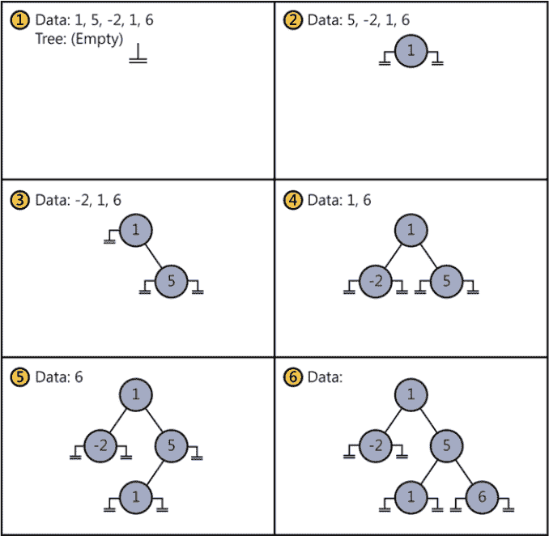

在你构建好一棵有序二叉树后，你可以通过轮访问每个节点并打印找到的值来显示其内容。实现此任务的算法也是递归的：

点击此处查看代码图像

```
如果左子树不为空
Then
  显示左子树的内容
End If
显示节点的值
如果右子树不为空
Then
  显示右子树的内容
End If
```

下面的图像显示了输出树的步骤。注意整数现在按升序显示了。


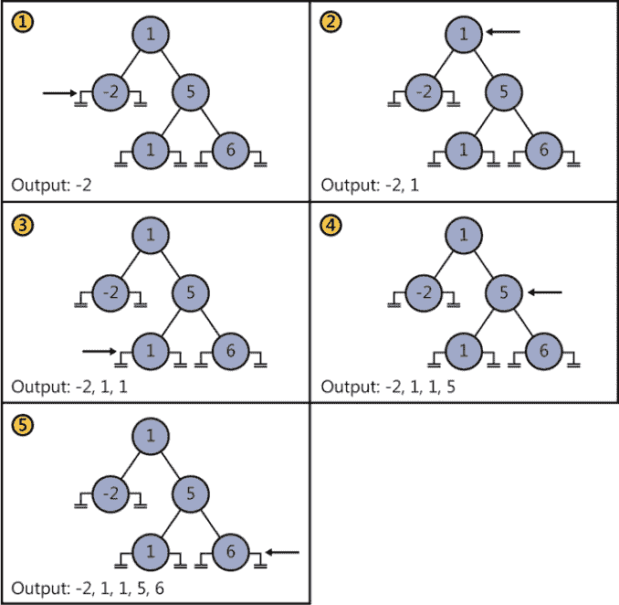

## 使用泛型构建二叉树类

在接下来的练习中，你将使用泛型来定义一个能够存储几乎任何类型数据的二叉树类。唯一的限制是数据类型必须提供一种比较不同实例之间值的方法。

你可能会发现二叉树类在许多不同的应用程序中非常有用。因此，你将将其作为一个类库实现，而不是作为应用程序本身。这样你就可以在其他使用该类，而无需复制源代码并重新编译。`class library`（类库）是一组存储在程序集中的编译类（以及结构体和委托等其他类型）。`assembly`（程序集）是一个通常以 `.dll` 结尾的文件。其他项目和应用程序可以通过对该程序集添加引用，然后通过使用 `using` 指令将其命名空间引入作用域，来使用类库中的项。你将在测试二叉树类时执行此操作。

### 要创建 `Tree<TItem>` 类

1. 启动 Microsoft Visual Studio 2022（如果它尚未运行）。
2. 在 **File**（文件）菜单上，指向 **New**（新建），然后选择 **Project**（项目）。
3. 在 Create a new project 对话框中，将 **Language**（语言）下拉列表设置为 `C#`，**Platform**（平台）下拉列表设置为 `Windows`，**Project Type**（项目类型）下拉列表设置为 `All project types`（所有项目类型）。选择 `Class Library` 模板，然后选择 **Next**（下一步）：
   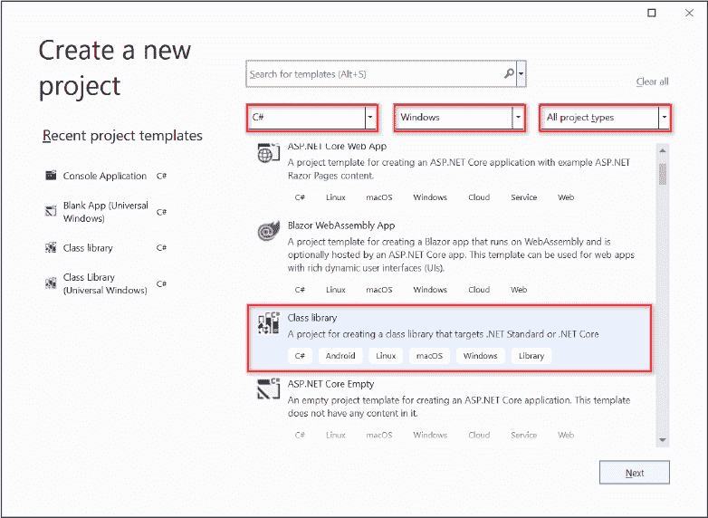
4. 在 Configure your new project 框中，在 **Project name**（项目名称）框中输入 `BinaryTree`。在 **Location**（位置）框中，在 **Documents**（文档）文件夹中指定 `\Microsoft Press\VCSBS\Chapter 17`。然后选择 **Next**。
5. 在 Additional information（附加信息）对话框中，将框架设置为 `.NET 6.0`，然后选择 **Create**（创建）。
   使用 `Class Library` 模板，你可以创建被不同应用程序重用的程序集。要在应用程序中使用类库中的类，你必须先将包含类库编译代码的程序集复制到你的计算机上（如果你没有自己创建），然后向此程序集添加引用。
6. 在 Solution Explorer（解决方案管理器）中，右键点击 `Class1.cs`，选择 **Rename**（重命名），并将文件名更改为 `Tree.cs`。在提示时，允许 Visual Studio 同时更改类名文件名。
7. 在 Code and Text Editor（代码和文本编辑器）窗口中，将 `Tree` 类的定义更改为 `Tree<TItem>`，如下代码中的粗体所示：
   ```csharp
   public class Tree<TItem>
   {
   }
   ```
8. 在 Code and Text Editor 窗口中，修改 `Tree<TItem>` 类的定义，指定类型参数 `TItem` 必须表示实现泛型 `IComparable<TItem>` 接口的类型。修改后的 `Tree<TItem>` 类定义所示：
   点击此处查看代码图像
   ```csharp
   public class Tree<TItem> where TItem : IComparable<TItem>
   {
   }
   ```
9. 为 `Tree<TItem>` 类添加三个公共自动属性：一个名为 `NodeData` 的 `TItem` 属性和两个名为 `LeftTree` 和 `RightTree` 的 `Tree<TItem>` 属性，如下代码示例所示。注意 `LeftTree` 和 `RightTree` 属性都显式声明为可空类型。
   点击此处查看代码图像
   ```csharp
   public class Tree<TItem>
   {
       public TItem NodeData { get; set; }
       public Tree<TItem>? LeftTree { get; set; }
       public Tree<TItem>? RightTree { get; set; }
   }
   ```
10. 在 `Tree<TItem>` 类中添加一个构造函数，接受一个 `TItem` 参数。在构造函数中，将 `NodeData` 属性设置为 `nodeValue`，并将 `LeftTree` 和 `RightTree` 属性初始化为 `null`，如下所示：
    点击此处查看代码图像
    ```csharp
    public class Tree<TItem> where TItem : IComparable<TItem>
    {
        public TItem NodeData { get; set; }
        public Tree<TItem>? LeftTree { get; set; }
        public Tree<TItem>? RightTree { get; set; }

        public Tree(TItem nodeValue)
        {
            NodeData = nodeValue;
            LeftTree = null;
            RightTree = null;
        }
    }
    ```
    **注意**：构造函数的名称不包含 `TItem` 类型。
11. 在 `Tree<TItem>` 类中添加一个名为 `Insert` 的公共方法，接受一个 `TItem` 参数。该方法的定义如下文所示：
    ```csharp
    public class Tree<TItem> where TItem : IComparable<TItem>
    {
        public void Insert(TItem newItem)
        {
        }
    }
    ```
    该方法将实现创建有序二叉树的算法。在方法内部中，检查树是否为空。如果为空，则使用项 I 创建一个新的左子树；否则，将插入插入左子树。
12. 在 `Insert` 方法中，添加一个语句声明类型为 `TItem` 的局部变量 `currentNodeValue`。将其初始化为 `NodeData` 属性的值，如下：
    ```csharp
    public void Insert(TItem newItem)
    {
        TItem currentNodeValue = this.NodeData;
    }
    ```
13. 在 `currentNodeValue` 的定义之后，添加如下所示的 `if...else` 语句。该语句使用 `IComparable<T>` 接口的 `CompareTo` 方法来确定当前节点的值是否大于新项：
    ```csharp
    public void Insert(TItem newItem)
    {
        TItem currentNodeValue = this.NodeData;
        if (currentNodeValue.CompareTo(newItem) > 0)
        {
            // 将新项插入到左子树
        }
        else
        {
            // 将新项插入到右子树
        }
    }
    ```
14. 在代码的 `if` 部分，紧接 `// 将新项插入到左子树` 注释添加以下语句：
    ```csharp
    if (this.LeftTree is null)
    {
        this.LeftTree = new Tree<TItem>(newItem);
    }
    else
    {
        this.LeftTree.Insert(newItem);
    }
    ```
    这些语句检查左子树是否为空。如果是，则使用新项创建一个新树，并将其作为当前节点的左子树；否则，通过递归调用 `Insert` 方法将新项插入到现有的左子树中。
15. 在外部 `if...else` 语句的 `else` 部分，紧接 `// 将新项插入到右子树` 注释，添加等效代码以将新节点插入到右子树。


点击此处查看代码图像

```csharp
if (this.RightTree is null)
{
     this.RightTree = new Tree<TItem>(newItem);
}
else
{
     this.RightTree.Insert(newItem);
}
```

16. 在 `Insert` 方法之后，为 `Tree<TItem>` 类添加另一个名为 `WalkTree` 的公共方法。该方法会遍历树，顺序访问每个节点，并生成树所包含数据的字符串表示。该方法的定义应该如下：

```csharp
public string WalkTree()
{
}
```

17. 将后续代码中以**加粗**显示的的语句添加到 `WalkTree` 方法中。这些语句实现了前面描述的二叉树遍历算法。每当访问一个节点时，节点的值就会附加到方法返回的字符串中：

点击此处查看代码图像

```csharp
public string WalkTree()
{
    string result = "";

    if (this.LeftTree is not null)
    {
        result = this.LeftTree.WalkTree();
    }

    result += $" {this.NodeData.ToString()} ";
    if (this.RightTree is not null)
    {
        result += this.RightTree.WalkTree();
    }
    return result;
}
```

18. 在**生成（Build）**菜单上，选择**生成解决方案（Build Solution）**。该类应该顺利编译，但请修正任何报告的错误并在重新重新生成。

在下一个练习中，你将通过创建整数和字符串的二叉树来测试 `Tree<TItem>` 类。

#### 测试 `Tree<TItem>` 类

1. 在解决方案管理器（Solution Explorer）中，右键点击 `BinaryTree` 解决方案，指向**添加（Add）**，然后选择**新建项目（New Project）**。

     **注意**

    请确保你右键点击的是 `BinaryTree` **解决方案**，而不是 `BinaryTree` 项目。

2. 使用控制台应用程序（Console Application）模板添加一个新项目。将项目命名为 `BinaryTreeTest`。将位置设置为你**文档**文件夹中的 `\Microsoft Press\VCSBS\Chapter 17`，并选择 **.NET 6.0** 框架。

     **注意**

    一个 Visual Studio 2022 解决方案可以包含多个项目。你正在使用此功能为 `BinaryTree` 解决方案添加第二个项目，以便用于测试 `Tree<TItem>` 类。

3. 在解决方案管理器中，右键点击 `BinaryTreeTest` 项目，然后选择**设为启动项目（Set As Startup Project）**。`BinaryTreeTest` 项目会在解决方案管理器中高亮。当你运行应用程序时，将由该项目实际执行。

4. 在解决方案管理器中，右键点击 `BinaryTreeTest` 项目，指向**添加（Add）**，然后选择**项目引用（Project Reference）**。出现引用管理器对话框。你使用此对话框向程序集添加引用。这使你能够在代码中使用由该程序集实现的类和其他类型。

5. 在 `BinaryTreeTest` 对话框的左侧面板中，展开**项目（Projects）**然后选择**解决方案（Solution）**。在中间面板中，选择 `BinaryTree` 项目（确保勾选复选框，而不仅仅是点击程序集），然后选择**确定（OK）**。

    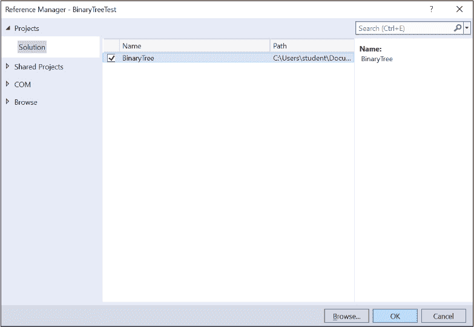

    此步骤将 `BinaryTree` 程序集添加到解决方案管理器中 `BinaryTreeTest` 项目的引用列表中。如果你检查解决方案管理器中 `BinaryTreeTest` 项目的引用文件夹，你应该会在顶部看到列出的 `BinaryTree` 程序集。你现在可以在 `BinaryTreeTest` 项目中创建 `Tree<TItem>` 对象了。

     **注意**

    如果类库项目与使用它的项目不在同一个解决方案中，你必须向程序集（DLL 文件）添加引用，而不是类库项目。你可以通过在引用管理器对话框中浏览程序集来实现。你将在本章的最后一组练习中使用这种技术。

6. 在显示 `Program.cs` 文件中 `Program` 类的代码和文本编辑器中，在类顶部的列表中添加以下 `using` 指令：

    ```csharp
    using BinaryTree;
    ```

7. 将 `Main` 方法中的现有语句替换为此处所示**加粗**的代码：

    点击此处查看代码图像

    ```csharp
    static void Main(string[] args)
    {
         Tree<int> tree1 = new Tree<int>(10);
         tree1.Insert(5);
         tree1.Insert(11);
         tree1.Insert(5);
         tree1.Insert(-12);
         tree1.Insert(15);
         tree1.Insert(0);
         tree1.Insert(14);
         tree1.Insert(-8);
         tree1.Insert(10);
         tree1.Insert(8);
         tree1.Insert(8);
         string sortedData = tree1.WalkTree();
         Console.WriteLine(sortedData);
    ```

    这些语句创建了用于整数的二叉树。`Insert` 语句向树添加节点，树的内容应该是有序的。`WalkTree` 方法生成树内容的字符串表示。

     **注意**


8. 在**生成（Build）**菜单上，选择**生成解决方案（Build Solution）**。修正任何错误。

9. 在**调试（Debug）**菜单上，选择**转调试启动（Start Without Debugging）**。

    验证程序运行并按以下顺序显示：

    点击此处查看代码图像

    ```
    -12 -8 0 5 5 8 8 10 10 11 14 15
    ```

     **注意**

    记住 C# 中的 `int` 关键字只是 `System.Int32` 的别名。当你声明一个 `int` 变量时，你实际上是在声明 `System.Int32`。`System.Int32` 实现了 `IComparable` 和 `IComparable<int>` 接口。

10. 按 **Enter** 键返回 Visual Studio 2022。

11. 在 `Program` 类的 `Main` 方法中，将以下所示**加粗**的语句添加到现有代码之后：

    点击此处查看代码图像

    ```csharp
    static void Main(string[] args)
    {
         ...
         Tree<string> tree2 = new Tree<string>("Hello");
         tree2.Insert("World");
         tree2.Insert("How");
         tree2.Insert("Are");
         tree2.Insert("You");
         tree2.Insert("Today");
         tree2.Insert("I");
         tree2.Insert("Hope");
         tree2.Insert("You");
         tree2.Insert("Are");
         tree2.Insert("Feeling");
         tree2.Insert("Well");
         tree2.Insert("!");
         string sortedData = tree2.WalkTree();
         Console.WriteLine($"Sorted data is: {sortedData}");
    }
    ```

    这些语句创建了另一个用于字符串的二叉树，填充了一些测试数据，然后打印树。这次，数据应该是按字母排序的。`System.String` 类（`string` 是 `System.String` 的别名）实现了 `IComparable` 和 `IComparable<string>` 接口。

12. 在**生成（Build）**菜单上，选择**生成解决方案（Build Solution）**，并验证解决方案编译。如有错误，请修正。

13. 在**调试（Debug）**菜单上，选择**转调试启动（Start Without Debugging）**。

14. 验证程序运行并按之前的显示整数值，随后按以下顺序显示字符串：

    点击此处查看代码图像

    ```
    ! Are Are Feeling Hello Hope How I Today Well World You You
    ```


除了定义泛型类，你还可以创建泛型方法。通过泛型方法，你可以使用类似于定义泛型类时的类型参数来指定参数的类型和返回类型。通过这种方式，你可以定义类型安全的泛化方法，并避免类型转换（在某些情况下还有装箱）的开销。泛型方法经常与泛型类结合使用；当你需要接受泛型类型作为参数的方法或返回类型为泛型类型的方法时，就会用到它们。

你通过与创建泛型类时相同的类型参数语法来定义泛型方法。（你也可以指定约束）。例如，后续代码中的泛型 `Swap<T>` 方法会交换其参数中的值。由于此功能无论交换的数据类型如何都很有用，因此将其定义为泛型方法是有帮助的：

点击此处查看代码图像

```
static void Swap<T>(ref T first, ref T second)
{
   T temp = first;
   first = second;
   second = temp;
}
```

你通过为类型参数指定适当类型来调用该方法。以下示例展示了如何调用 `Swap<T>` 方法交换两个 `int` 和两个 `string`：

点击此处查看代码图像

```
int a = 1, b = 2;
Swap<int>(ref a, ref b);
...
string s1 = "Hello", s2 = "World";
Swap<string>(ref s1, ref s2);
```

 **注意**

就像使用不同的类型参数实例化泛型类会导致编译器生成不同类型一样，`Swap<T>` 方法的每次不同使用都会导致编译器生成该方法的不同版本。`Swap<int>` 和 `Swap<string>` 不是同一个方法——这两个方法恰好是从同一个泛型模板生成的，因此它们表现出相同的行为，尽管作用于不同的类型。

## 定义一个泛型方法来构建二叉树

在在上一个练习中，你创建了一个用于实现二叉树的泛型类。`Tree<TItem>` 类提供了 `Insert` 方法来向树中添加数据项。然而，如果你想添加大量项，反复调用 `Insert` 方法将非常方便。在接下来的练习中，你将定义一个名为 `InsertIntoTree` 的泛型方法，你可以通过单方法调用将数据项列表插入树中。你将通过使用该方法将字符列表插入字符树中来测试此方法。

### 编写 InsertIntoTree 方法

1. 在 Visual Studio 2022 中，在**文件（File）**菜单上，选择**关闭解决方案（Close Solution）**。如果提示，请保存解决方案。
2. 使用控制台应用程序（Console Application）模板创建一个新项目。将项目命名为 **BuildTree**。将位置设置为你**文档（Documents）** 文件夹中的 `\Microsoft Press\VCSBS\Chapter 17`，并选择 `.NET 6.0` 框架。
3. 在**项目（Project）**菜单上，选择**添加项目引用（Add Project Reference）**。
4. 在引用管理器 – `BuildTree` 对话中，选择**浏览（Browse）**按钮（而不是左窗格中的浏览选项卡）。
5. 在选择要引用的文件（Select the files to reference）对话框中，浏览到你**文档（Documents）** 文件夹中的 `\Microsoft Press\VCSBS\Chapter 17\BinaryTree\BinaryTree\bin\Debug\net6.0` 文件夹，选择 `BinaryTree.dll`，然后选择**添加（Add）**。
6. 在引用管理器 – `BuildTree` 对话中，验证 `BinaryTree.dll` 程序集已列出且该程序的复选框已选中，然后选择**确定（OK）**。
7. 在解决方案管理器中，展开**依赖（Dependencies）**，然后展开**程序（Assemblies）**。验证 `BinaryTree` 程序集已添加到项目的引用列表中。

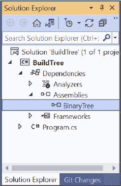

8. 在显示 `Program.cs` 文件的代码和文本编辑器中，在 `Program.cs` 文件的顶部添加以下 `using` 指令：

   ```
   using BinaryTree;
   ```

   记住，此命名空间包含 `Tree<TItem>` 类。
9. 在 `Program` 类的 Main 方法之后，添加一个名为 `InsertIntoTree` 的方法。该方法应该声明为 `static void` 方法，接受一个 `Tree<TItem>` 参数和一个名为 `data` 的 `TItem` 元素的 `params` 数组。树参数应该通过引用传递，原因将在稍后的步骤中描述。

####该方法的定义看起来如下：

   点击此处查看代码图像

   ```
   static void InsertIntoTree<TItem>(ref Tree<TItem> tree, params TItem[] data)
   {
   }
   ```

10. 用于插入二叉树的元素的 `TItem` 类型必须实现 `IComparable<TItem>` 接口。修改 `InsertIntoTree` 方法的定义，并在下面的代码中添加加粗显示的 `where` 子句：

    点击此处查看代码图像

    ```
    static void InsertIntoTree<TItem>(ref Tree<TItem> tree, params TItem[] data)
    where TItem : IComparable<TItem>
    ```
11. 将加粗显示的语句添加到 `InsertIntoTree` 方法中。这些语句遍历 `params` 列表，使用 `Insert` 方法将每个项添加到树中。如果树为 `null`，则创建一个新的 `Tree<TItem>`；这就是树参数通过引用传递的原因。

    点击此处查看代码图像

    ```csharp
    static void InsertIntoTree<TItem>(ref Tree<TItem> tree, params TItem[] data)
    where TItem : IComparable<TItem>
    {
        foreach (TItem datum in data) 
        {
            if (tree is null) 
            {
                tree = new Tree<TItem>();
            }
            else 
            {
                tree.Insert(datum);
            }
        }
    }
```

### 测试 InsertIntoTree 方法

1. 在 `Program` 类的 Main 方法中，替换现有代码并添加以下语句。此代码为字符数据创建一个树，使用 `InsertIntoTree` 方法填充数据，然后使用 `WalkTree` 方法显示它：

   点击此处查看代码图像

   ```csharp
   static void Main(string[] args)
   {
       Tree<char> charTree = null;
       InsertIntoTree(ref charTree, 'M', 'X', 'A', 'M', 'Z', 'Z', 'N');
       string sortedData = charTree.WalkTree();
       Console.WriteLine($"Sorted data is: {sortedData}");
   }
```

2. 在**生成（Build）**菜单上，选择**生成解决方案（Build Solution）**，验证解决方案编译，如有需要修正错误。
3. 在**调试（Debug）**菜单上，选择**转调试启动（Start Without Debugging）**。
4. 验证程序运行并按以下顺序显示字符：

   ```
   A M M N X Z
   ```

5. 按回车返回 Visual Studio 2022。

## 变型与泛型接口

8 章 展示了你可以使用 `object` 类型持有任何其他类型的值或引用。例如，以下代码是完全合法的：

```csharp
string myString = "Hello";
object myObject = myString;
```

记住，在继承术语中，`String` 类派自 `Object` 类，因此所有字符串都是对象。

现在考虑以下泛型接口和类：

点击此处查看代码图像

```csharp
interface IWrapper<T>
{
    void SetData(T data);
    T GetData();
}

class Wrapper<T> : IWrapper<T>
{
    private T storedData;

    void IWrapper<T>.SetData(T data)
    {
        this.storedData = data;
    }

    T IWrapper<T>.GetData()
    {
        return this.storedData;
    }
}
```


`Wrapper<T>` 类提供了对指定类型的简单包装。`IWrapper` 接口定义了 `SetData` 方法，`Wrapper<T>` 类实现了该方法以存储数据；以及 `GetData` 方法，`Wrapper<T>` 类实现了该方法以检索数据。你可以创建该类的实例并使用它来包装字符串，如下：

点击此处查看代码图像

```
Wrapper<string> stringWrapper = new Wrapper<string>();
IWrapper<string> storedStringWrapper = stringWrapper;
storedStringWrapper.SetData("Hello");
Console.WriteLine($"Stored value is {storedStringWrapper.GetData()}");
```

这段代码创建了一个 `Wrapper<string>` 类型的实例。它通过 `IWrapper<string>` 接口引用该对象以调用 `SetData` 方法。（`Wrapper<T>` 类型显式地实现了它的接口，因此你必须通过适当的接口引用来调用方法。）代码还通过 `IWrapper<string>` 接口调用了 `GetData` 方法。如果你运行这段代码，它将输出消息 `Stored value is Hello`。

看下面这行代码：

点击此处查看代码图像

```
IWrapper<object> storedObjectWrapper = stringWrapper;
```

该语句与上一个代码示例中创建 `IWrapper<string>` 引用的语句相似，不同之处类型参数是 `object` 而不是 `string`。这段代码合法吗？记住，所有的字符串都是对象（如之前所示，你可以将 `string` 值赋值给 `object` 引用），因此从理论上说，这个语句看起来是有行的。然而，如果你尝试这样做，该语句将编译失败，并显示消息 `无法将类型 'Wrapper<string>' 转换为 'IWrapper<object>'`。

你可以尝试显式强制转换，如下：

点击此处查看代码图像

```
IWrapper<object> storedObjectWrapper = (IWrapper<object>)stringWrapper;
```

这段代码可以编译，但在运行时会抛出 `InvalidCastException` 异常并失败。问题在于，虽然所有的字符串都是对象，但反之则不然。如果允许这种语句，你就可以编写如下代码，它最终尝试将一个 `Circle` 对象存储在 `string` 字段中：

点击此处查看代码图像

```
IWrapper<object> storedObjectWrapper = (IWrapper<object>)stringWrapper;
Circle myCircle = new Circle();
storedObjectWrapper.SetData(myCircle);
```

`IWrapper<T>` 接口被认为是*不变的*（invariant）。你不能将 `IWrapper<A>` 对象赋值给 `IWrapper<B>` 类型的引用，即使类型 A 派生自类型 B。默认情况下，C# 实现了这种限制以确保代码的类型安全。

### 协变接口

假设你定义了下例所示的 `IStoreWrapper<T>` 和 `IRetrieveWrapper<T>` 接口来代替 `IWrapper<T>`，并在 `Wrapper<T>` 类中实现了这些接口，如下：

点击此处查看代码图像

```
interface IStoreWrapper<T>
{
    void SetData(T data);
}

interface IRetrieveWrapper<T>
{
    T GetData();
}

class Wrapper<T> : IStoreWrapper<T>, IRetrieveWrapper<T>
{
    private T storedData;

    void IStoreWrapper<T>.SetData(T data)
    {
       this.storedData = data;
    }

    T IRetrieveWrapper<T>.GetData()
    {
      return this.storedData;
    }
}
```

从功能上讲，`Wrapper<T>` 类与之前相同，不同在于你通过不同的接口访问 `SetData` 和 `GetData` 方法。

点击此处查看代码图像

```
Wrapper<string> stringWrapper = new Wrapper<string>();
IStoreWrapper<string> storedStringWrapper = stringWrapper;
storedStringWrapper.SetData("Hello");
IRetrieveWrapper<string> retrievedStringWrapper = stringWrapper;
Console.WriteLine($"Stored value is {retrievedStringWrapper.GetData()}");
```

那么，下面的代码合法吗？

点击此处查看代码图像

```
IRetrieveWrapper<object> retrievedObjectWrapper = stringWrapper;
```

简单的回答是不合法，它会产生与之前相同的错误导致编译失败。但如果你仔细考虑，虽然 C# 编译器认为该语句不是类型安全的，但假设此点的理由已经不再成立了。`IRetrieveWrapper<T>` 接口仅允许你通过 `GetData` 方法读取 `Wrapper<T>` 对象中持有的数据，它没有提供任何更改数据的方法。在类似这种类型参数仅作为泛型接口方法返回值的情况下，你可以告知编译器某些隐式转换是合法的，它不需要强制执行严格类型安全。你可以在声明类型参数时指定 `out` 关键字来实现此，如下：

点击此处查看代码图像

```
interface IRetrieveWrapper<out T>
{
   T GetData();
}
```这种特性被称为*协变*（covariance）。只要类型 A 派生自类型 B，你就可以将 `IRetrieveWrapper<A>` 对象赋值给 `IRetrieveWrapper<B>` 引用。以下代码可以编译并按预期运行：

点击此处查看代码图像

```
IRetrieveWrapper<object> retrievedObjectWrapper = stringWrapper;
```

只有当类型参数作为返回值时，你才能对其指定 `out` 修饰符。如果你使用类型参数指定方法的类型，`out` 修饰符是非法的，你的代码将无法编译。此外，协变仅适用于引用类型。这是因为值类型形成层次结构。因此，以下代码无法编译，因为 `int` 是值类型：

点击此处查看代码图像

```
Wrapper<int> intWrapper = new Wrapper<int>();
IStoreWrapper<int> storedIntWrapper = intWrapper; // 这是合法的
// 下述语句不合法 - int 不是对象
IStoreWrapper<object> storedObjectWrapper = intWrapper;
```

.NET 定义的许多接口显示出协变性，包括 `IEnumerable<T>` 接口（在第 19 章详细介绍，“枚举集合”）。

只有接口和委托类型（在第 18 章中介绍）可以声明为协变。你不在泛型类中指定 `out` 修饰符。

### 逆变接口

逆变与协变的原理相似，但方向相反。也就是说，只要类型 B 派生自类型 A，你就可以通过类型 A 的引用使用类型 B 的对象。这听起来很复杂，所以值得查看 .NET 类库中的示例。

.NET 的 `System.Collections.Generic` 命名空间提供名为 `IComparer` 的接口，如下：

点击此处查看代码图像

```
public interface IComparer<in T>
{
    int Compare(T x, T y);
}
```

实现此接口的类必须定义 `Compare` 方法，该方法用于比较两个 `T` 类型的对象。`Compare` 方法预期返回一个整数：如果参数 `x` 和 `y` 值相同则返回 `0`，如果 `x` 小于 `y` 则返回负数，如果 `x` 大于 `y` 则返回正数。

以下代码展示了一个根据哈希码对对象的示例。（`GetHashCode` 方法由 `Object` 类实现。它简单地返回一个标识对象的整数值。所有引用类型都继承此方法，并可以使用自己的实现来重写它。）

点击此处查看代码图像


```sharp
class ObjectComparer : IComparer<Object>
{
    int IComparer<Object>.Compare(Object x, Object y)
    {
      int xHash = x.GetHashCode();
      int yHash = y.GetHashCode();
      if (xHash == yHash) return 0;
      if (xHash < yHash)
          return -1;
      return 1;
    }
}
```

你可以创建一个 `ObjectComparer` 对象，并通过 `IComparer<Object>` 接口调用 `Compare` 方法来比较两个对象，如下所示：

点击此处查看代码图像

```sharp
Object x = ...;
Object y = ...;
ObjectComparer objectComparer = new ObjectComparer();
IComparer<Object> objectComparator = objectComparer;
int result = objectComparator.Compare(x, y);
```

这部分是无聊的。更有趣的是，你可以通过一个比较字符串的 `IComparer` 接口版本来引用同一个对象，如下所示：

点击此处查看代码图像

```sharp
IComparer<String> stringComparator = objectComparer;
```

乍一看，这个语句似乎违反了你所想象的每一个类型安全规则。然而，如果你考虑 `IComparer<T>` 接口的作用，这种方法就是合理的。`Compare` 方法的目的是根据传入的参数之间的比较来返回一个值。如果你可以比较 `Objects`，你一定能够比较 `Strings`，因为 `Strings` 只是 `Objects` 的一种特殊类型。毕竟，`String` 应该能够做 `Object` 能做的任何事情——这就是继承的目的。

然而，这听起来仍然有些自断自是的。C# 编译器如何知道你不会在 `Compare` 方法的代码中执行任何特定类型的操作，而这些操作在通过基于不同类型的接口调用该方法时可能会失败的呢？如果你重新查看 `IComparer` 接口的定义，你会发现类型参数之前有一个 `in` 饰符：

点击此处查看代码图像

```sharp
public interface IComparer<in T>
{
   int Compare(T x, T y);
}
```

`in` 关键字告诉 C# 编译器，你可以将类型 `T` 作为参数类型传递给方法，也可以传递任何派自 `T` 的类型。你不能将 `T` 作为任何方法的返回类型。本质上，这使得你能够通过基于对象类型的泛型接口，或者通过基于派自对象类型的类型的泛型接口来引用对象。基本上，如果类型 A 暴露了一些操作、属性或字段，并且如果类型 B 派自类型 A，那么类型 B 也必须暴露相同的操作（如果它们被重写了，行为可能会不同）、属性和字段。因此，用类型 B 的对象替换类型 A 的对象应该是安全的。

协变（Covariance）和逆变（Contravariance）在泛型世界中似乎是边缘话题，但它们非常有用。例如，`List<T>` 泛型集合类（位于 `System.Collections.Generic` 命名空间下）使用 `IComparer<T>` 对象来实现 `Sort` 和 `BinarySearch` 方法。`List<Object>` 对象可以包含任何类型对象的集合，因此 `Sort` 和 `BinarySearch` 方法需要能够对任何类型的对象进行排序。如果不使用逆变，`Sort` 和 `BinarySearch` 方法将需要包含逻辑来确定正在排序或搜索的项目的真实类型，然后实现特定类型的排序或搜索机制。然而，除非你是一个数学家，否则要记住协变和逆变实际上是做什么的是非常困难的。我根据本节中的示例记忆的方式如下：

*   **协变示例**：如果泛型接口中的方法可以返回字符串，那么它们也可以返回对象。（所有的字符串都是对象。）
*   **逆变示例**：如果泛型接口中的方法可以接受对象参数，那么它们就可以接受字符串参数。（如果你可以使用对象执行某项操作，你就可以使用字符串执行相同的操作，因为所有字符串都是对象。）

 **注意**

与协变一样，只有接口和委托类型可以被声明为逆变的。你不能在泛型类中指定 `in` 饰符。

### 总结

在本章中，你学习了如何使用泛型创建类型安全的类。你看到了如何通过指定类型参数来实例化泛型类型。你还看到了如何实现泛型接口并定义泛型方法。最后，你学习了如何定义可以操作层次结构类型的协变和逆变泛型接口。

*   如果你想继续阅读下一章，请保持 Visual Studio 2022 运行并转到第 18 章。
*   如果你现在想退出 Visual Studio 2022，在“文件”菜单中选择“退出”。如果你看到保存对话框，选择“是”并保存项目。

### 快速参考

| 目标 | 操作 |
| :--- | :--- |
| 使用泛型类型实例化对象 | 指定合适的泛型类型参数。例如：点击此处查看代码图像 <pre><code>Queue&lt;int&gt; myQueue = new Queue&lt;int&gt;</code></pre> | |
| 创建一个新的泛型类型 | 使用类型参数定义类。<pre><code>public class Tree&lt;T&gt;{\n   ...\n}}</pre> |
| 限制可以替换泛型类型的类型 | 在定义类时使用 `where` 子句指定约束。例如：点击此处查看代码图像 <pre><code>public class Tree&lt;TItem&gt;where TItem : IComparable&lt;TItem&gt;\n   ...\n}}</pre> |
| 定义泛型方法 | 使用类型参数定义方法。例如：点击此处查看代码图像 <pre><code>static void InsertIntoTree&lt;TItem&gt;(Tree&lt;TItem&gt; tree, params TItem[] data)\n   ...\n}}</pre> |
| 调用泛型方法 | 为每个类型参数提供类型。例如：点击此处查看代码图像 <pre><code>InsertIntoTree&lt;char&gt;('X');</code></pre> |
| 定义协变接口 | 为协变类型参数指定 `out` 饰符。仅将协变类型参数作为方法的返回类型，而不是方法的参数：点击此处查看代码图像 <pre><code>interface IRetrieveWrapper&lt;out T&gt;\n   T GetData();\n}}</pre> |
| 定义逆变接口 | 为逆变类型参数指定 `in` 饰符。仅将逆变类型参数作为方法的参数，而不是返回类型：点击此处查看代码图像 <pre><code>public interface IComparer&lt;in T&gt;\n   int Compare(T x, T y);\n}}</pre> |

## 18 章 使用集合

**完成本章后，你将能够：**

*   解释 .NET 提供的不同集合的功能并理解如何使用它们。
*   使用集合初始化器填充集合。
*   遍历集合以查找数据。
*   理解集合与数组之间的区别。

第 10 章, “使用数组，”引入了用于保存数据集数组。数组在这方面非常有用，但它们也有缺点。数组提供的功能有限；例如，增加或减少数组的大小并不容易，排序数组中的数据也不是简单的事。此外，数组只提供了一种访问数据的方法：使用整数索引。如果你的应用程序需要使用其他机制来存储和检索数据，例如[第 17 章, “[介绍泛型，”中描述的先先出队列机制，数组可能不是合适的数据结构。这就是集合可以证明其实用的地方。

### 什么是集合类？


Microsoft .NET 提供了若干将元素收集在一起的类，以便可以通过特殊的方式访问这些元素。这些是在第 17 章中提到的集合类，它们位于 `System.Collections.Generic` 命名空间中。

正如命名空间所示，这些集合是泛型类型；它们要求你提供一个类型参数，指示你的应用程序将在集合中存储的数据类型。每个集合类都针对特定数据存储和访问的形式进行了优化，并且每个类提供了支持此功能的特殊方法。例如，`Stack<T>` 类实现了后进先出模型，你通过使用 `Push` 方法向栈顶添加项，通过使用 `Pop` 方法从栈顶取出项。`Pop` 方法始终检索最近推入的项并将其从栈中移除。与此相反，`Queue<T>` 类型提供了在第 17 章中描述的 `Enqueue` 和 `Dequeue` 方法。`Enqueue` 方法将项添加到队列中，而 `Dequeue` 方法按相同顺序从队列中检索项，实现了先进先出模型。还有许多其他集合类可用；下表总结了最常用的类。

| 集合 | 描述 |
| :--- | :--- |
| `List<T>` | 对象的列表，可以通过索引访问（类似于数组），但具有额外的方法，用于搜索列表和排序列表内容。 |
| `Queue<T>` | 一种先进先出的数据结构，具有方法向队列的一端添加项、从另一端移除项，以及在不移除项的情况下检查项。 |
| `PriorityQueue<TElement, TPriority>` | 一种按优先级排序数据的队列。高优先级的元素在低优先级元素之前出队。相同优先级的元素按照它们推入队列的顺序出队。 |
| `Stack<T>` | 一种后进先出的数据结构，具有方法将项推入栈顶、从栈顶弹出项，以及在不移除的情况下检查栈顶项。 |
| `LinkedList<T>` | 一种双端有序列表，针对支持在两端进行插入和删除进行了优化。此集合可以像队列或栈一样工作，但也像列表一样支持随机访问。 |
| `HashSet<T>` | 无序的值集合，针对快速检索数据进行了优化。它提供了面向集合的方法，用于确定其持有的项是否是另一个 `HashSet<T>` 对象的子集，以及计算 `HashSet<T>` 对象的交集并集。 |
| `Dictionary<TKey, TValue>` | 一种可以使用键而不是索引标识和检索值的集合。 |
| `SortedList<TKey, TValue>` | 排序的键值对列表。键必须实现 `IComparable<T>` 接口。 |

以下章节提供了这些集合类的简要概述。有关每个类的更多详细信息，请参阅 .NET 类库文档。

### List<T> 集合类

泛型 `List<T>` 类是集合类中最简单的。你可以像使用数组一样使用它。你可以使用普通的数组表示法（使用方括号和元素索引）引用 `List<T>` 集合中的现有元素，尽管你不能使用数组表示法添加新元素。然而，通常情况下，`List<T>` 类比数组提供了更大的灵活性，并旨在克服数组表现出的以下限制：

*   如果你想调整数组的大小，必须创建一个新数组，复制元素（如果新数组较小则跳过某些元素），然后更新对原始数组的任何引用，以便它们指向新数组。
*   如果你想从数组中删除元素，必须将所有后续元素向上移动一个位置。即使这样做也不完全起作用，因为你最终会得到最后一个元素的副本。
*   如果你想向数组中插入元素，必须将元素向下移动一个位置以腾出空位。然而，你会丢失数组的最后一个元素！

`List<T>` 集合类的以下功能解决了了这些局限性：

*   在创建 `List<T>` 集合时，不需要指定其容量；它可以随着元素的添加而增长和缩小。这种动态行为伴随着一定的开销，如果有必要，你可以指定初始大小。但是，如果超过了此大小，`List<T>` 集合将根据需要自动增长。
*   你可以使用 `Remove` 方法从 `List<T>` 集合中删除指定的元素。`List<T>` 集合会自动重新排列元素并填补间隔。你还可以使用 `RemoveAt` 方法删除 `List<T>` 集合中指定位置的项。
*   你可以使用 `Add` 方法向 `List<T>` 集合的末尾添加元素。你提供要添加的元素。`List<T>` 集合会自动调整大小。
*   你可以使用 `Insert` 方法向 `List<T>` 集合的中间插入元素。再次，`List<T>` 集合会自动调整大小。
*   你可以通过调用 `Sort` 方法轻松地对 `List<T>` 对象中的数据进行排序。

 **注意**

与数组一样，如果你使用 `foreach` 遍历 `List<T>` 集合，可以使用迭代变量修改内容。此外，你不能在 `foreach` 循环中调用 `Remove`、`Add` 或 `Insert` 方法；任何尝试会导致 `InvalidOperationException`。

下面的示例演示了如何创建、操作和遍历 `List<T>` 集合：点击此处查看代码

```csharp
using System;
using System.Collections.Generic;
List<int> numbers = new List<int>();
// 使用 Add 方法填充 List<int>
foreach (int number in new int[]{10, 9, 8, 7, 7, 6, 5, 10, 4, 3, 2})
{
    numbers.Add(number);
}

// 在倒数位置插入元素，并将最后一个项移动
// 第一个参数是位置；第二个参数是要插入的值
numbers.Insert(numbers.Count-1, 99);

// 删除值为 7 的第一个元素（第 4 个元素，索引 3）
numbers.Remove(7);

// 删除现在是第 7 个元素
numbers.RemoveAt(6);

// 使用 for 语句遍历剩余的 11 个元素
Console.WriteLine("使用 for 语句遍历:");
for (int i = 0; i < numbers.Count; i++)
{
    int number = numbers[i]; // 注意数组语法的使用
    Console.WriteLine(number);
}

// 使用 foreach 语句遍历相同的 11 个元素
Console.WriteLine("\n 使用 foreach 语句遍历:");
foreach (int number in numbers)
{
    Console.WriteLine(number);
}
```

这是此代码的输出：点击此处查看代码

```
使用 for 语句遍历:
10
9
8
7
6
5
4
3
2
99
1

 使用 foreach 语句遍历:
10
9
8
7
6
5
4
3
2
99
1
```


与 `List<T>` 类不同，`LinkedList<T>` 不支持使用数组符号来插入或检查元素。相反，你可以使用 `AddFirst` 方法在列表开头插入元素，将原先的第一个项移动，并将其 `Previous` 属性指向新元素。同样地，你可以使用 `AddLast` 方法在列表末尾插入元素，将原先的最后一个项的 `Next` 属性指向新元素。你还可以使用 `AddBefore` 和 `AddAfter` 方法在列表中指定元素之前或之后插入元素。（你必须先获取该元素。）

你可以通过查询 `First` 属性来找到 `LinkedList<T>` 集合中的第一个项，而查询 `Last` 属性则返回列表最后一个项的引用。要遍历链表，你可以从一端开始，通过 `Next` 或 `Previous` 引用逐个移动，直到找到一个该属性属性为 `null` 值的项。或者，你也可以使用 `foreach` 语句，它会正向遍历 `LinkedList<T>` 对象并在末尾自动停止。你通过使用 `Remove`、`RemoveFirst` 和 `RemoveLast` 方法从 `LinkedList<T>` 集合中删除元素。

以下示例展示了 `LinkedList<T>` 集合的实际用法。注意使用 `for` 语句遍历列表的代码是如何通过 `Next`（或 `Previous`）引用进行进的，只有在到达 `null` 引用（即列表末尾）时才会停止：

点击此处查看代码图像

```
using System;
using System.Collections.Generic;
...
LinkedList<int> numbers = new LinkedList<int>();

// 使用 AddFirst 方法填充 List<int>
foreach (int number in new int[] { 10, 8, 6, 4, 2 })
{
    numbers.AddFirst(number);
}

// 使用 for 语句迭代
Console.WriteLine("Iterating using a for statement:");
for (LinkedListNode<int> node = numbers.First; node is not null; node = node.Next)
{
    int number = node.Value;
    Console.WriteLine(number);
}

// 使用 foreach 语句迭代
Console.WriteLine("\nIterating using a foreach statement:");
foreach (int number in numbers)
{
    Console.WriteLine(number);
}

// 反向迭代
Console.WriteLine("\n Iterating list in reverse order:");
for (LinkedListNode<int> node = numbers.Last; node is not null; node = node.Previous)
{
    int number = node.Value;
    Console.WriteLine(number);
}
```

以下是该代码生成的输出：

点击此处查看代码图像

```
Iterating using a for statement:
2
4
6
8
10
Iterating using a foreach statement:
2
4
6
8
10
Iterating list in reverse order:
10
8
6
4
2
```

### Queue<T> 集合类

`Queue<T>` 类实现了先入先出（FIFO）机制。元素在队列尾部插入（`Enqueue` 操作），并从队列头部移除（`Dequeue` 操作）。

以下代码是一个了 `Queue<int>` 集合及其常用操作的示例：

点击此处查看代码图像

```
using System;
using System.Collections.Generic;
...
Queue<int> numbers = new Queue<int>();

// 填充队列
Console.WriteLine("Populating the queue:");
foreach (int number in new int[4]{9, 3, 7, 2})
{
    numbers.Enqueue(number);
    Console.WriteLine($"{number} has joined the queue");
}

// 遍历队列
Console.WriteLine("\n The queue contains the following items:");
foreach (int number in numbers)
{
    Console.WriteLine(number);
}

// 清空队列
Console.WriteLine("\n Draining the queue:");
while (numbers.Count > 0)
{
    int number = numbers.Dequeue();
    Console.WriteLine($"{number} has left the queue");
}
```

以下是该代码的输出：

点击此处查看代码图像

```
Populating the queue:
9 has joined the queue
3 has joined the queue
7 has joined the queue
2 has joined the queue
The queue contains the following items:
9
3
7
2
Draining the queue:
9 has left the queue
3 has left the queue
7 has left the queue
2 has left the queue
```

### PriorityQueue<TElement, TPriority> 集合类

`PriorityQueue<TElement, TPriority>` 类扩展了 `Queue<T>` 类的概念，为每个入队元素关联一个优先级。该类接受两个类型参数：第一个是入队元素的类型，第二个表示优先级的类型（通常是 `int`，但可以是任何可比较类型）。元素在队列尾部入队，但如果它们的优先级比寿命更长的元素高，则可以比它们更早出队。所有具有相同优先级的元素按相同的顺序入队和队列，正如普通队列一样。

以下代码是一个示例，说明了不同优先级的元素是如何入队和出队的。优先级值越小的优先级越高（优先级为 1 的元素会在优先级为 2 的元素之前取出）：

点击此处查看代码图像

```
using System;
using System.Collections.Generic;
...
// 创建队列
// 数据项是字符串。第二个类型参数 (int) 表示优先级
PriorityQueue<string, int> messages = new PriorityQueue<string, int>();

// 向队列添加具有不同优先级的消息
messages.Enqueue("Twas", 1);
messages.Enqueue("Brillig", 1);
messages.Enqueue("and", 2);
messages.Enqueue("the", 3);
messages.Enqueue("Slithy", 2);
messages.Enqueue("Toves", 3);

// 按优先级和队列顺序检索消息
while (messages.TryDequeue(out string item, out int priority))
{
    Console.WriteLine($"Dequeued Item : {item} Priority Was : {priority}");
}
```

在输出中，优先级为 1 的消息首先出现，然后是优先级为 2 的，最后是优先级为 3 的。

点击此处查看代码图像

```
Dequeued Item : Twas Priority Was : 1
Dequeued Item : Brillig Priority Was : 1
Dequeued Item : Slithy Priority Was : 2
Dequeued Item : and Priority Was : 2
Dequeued Item : the Priority Was : 3
Dequeued Item : Toves Priority Was : 3
```

### Stack<T> 集合类

`Stack<T>` 类实现了后入先出（LIFO）机制。元素从栈顶部加入栈（`push` 操作），从栈顶部离开栈（`pop` 操作）。为了视觉化这一点，请想象一叠盘子。新盘子添加到顶部，盘子从顶部移除，使得最后一个放置在栈上的盘子是第一个被移除的。（底部的盘子很少使用，在你在上面放置任何食物之前，它避免地需要清洗，因为满了污垢！）这是一个示例；注意 `foreach` 循环列出项目的顺序：

点击此处查看代码图像

```
using System;
using System.Collections.Generic;
...
Stack<int> numbers = new Stack<int>();

// 填充栈
Console.WriteLine("Pushing items onto the stack:");
foreach (int number in new int[4]{9, 3, 7, 2})
{
    numbers.Push(number);
    Console.WriteLine($"{number} has been pushed on the stack");
}

// 遍历栈
Console.WriteLine("\n The stack now contains:");
foreach (int number in numbers)
{
    Console.WriteLine(number);
}

// 清空栈
Console.WriteLine("\n Popping items from the stack:");
while (numbers.Count > 0)
{
    int number = numbers.Pop();
    Console.WriteLine($"{number} has been popped off the stack");
}
```


```
向栈中推入项目：
9 已推入栈
3 已推入栈
7 已推入栈
2 已推入栈
栈现在包含：
2
7
3
9
从栈中弹出项目：
2 已从栈弹出
7 已从栈弹出
3 已从栈弹出
9 已从栈弹出
```

### `Dictionary<TKey, TValue>` 集合类

数组和 `List<T>` 类型提供了一种将整数索引映射到元素的方法。你可以在方括号内指定一个整数索引（例如 `[4]`），并获取索引为 (4) 的元素（实际上是第 5 个元素，从 0 开始）。然而，有时你可能想要实现一种映射，其中用于映射的类型不是 `int` 而是其他类型，例如 `string`、`double` 或 `Time`。在其他语言中，这通常被称为**关联数组**（associative array）。

`Dictionary<TKey, TValue>` 类通过在内部维护两个数组来实现此功能：一个用于存储映射的键（keys），另一个用于存储的值（values）。当你向 `Dictionary<TKey, TValue>` 集合插入一个键值对时，它会自动跟踪哪个键属于哪个值，并使你能够快速方便地检索与指定键关联的值。

`Dictionary<TKey, TValue>` 类的设计具有一些重要的影响：

*   `Dictionary<TKey, TValue>` 集合不能包含重复的键。如果你调用 `Add` 方法添加一个已经存在的键，将抛出异常。然而，你可以使用方括号符号来添加键值对，即使该键已经添加，也不会抛出异常；相同键的值会被新值覆盖。你可以使用 `ContainsKey` 方法测试 `Dictionary<TKey, TValue>` 集合是否已包含特定键。

*   在内部，`Dictionary<TKey, TValue>` 集合是一种稀疏数据结构，在内存充足时运行效率最高。随着你插入更多元素，内存中 `Dictionary<TKey, TValue>` 集合的大小可能会迅速增长。

*   当你使用 `foreach` 语句遍历 `Dictionary<TKey, TValue>` 集合时，你获得的是一个 `KeyValuePair<TKey, TValue>` 对象。该结构包含了 `Dictionary<TKey, TValue>` 集合中某项的键和值元素的拷贝，你可以通过 `Key` 属性和 `Value` 属性访问每个元素。这些元素是只读的；你不能使用它们来修改 `Dictionary<TKey, TValue>` 集合中的数据。下面的示例将成员的年龄与姓名关联并打印：点击此处代码

```csharp
using System;
using System.Collections.Generic;
Dictionary<string, int> ages = new Dictionary<string, int>();

// 填充字典
ages.Add("John", 30);
ages.Add("Jane", 25);
ages["James"] = 20;
ages["Frances"] = 15;

foreach (KeyValuePair<string, int> entry in ages)
{
    Console.WriteLine($"{entry.Key}: {entry.Value}");
}
```

### `SortedDictionary<TKey, TValue>` 类

`SortedDictionary<TKey, TValue>` 类与 `Dictionary<TKey, TValue>` 非常，但它按排序维护键。`SortedDictionary<TKey, TValue>` 集合内部使用二叉搜索树，这意味着插入、删除和查找速度比普通的 `Dictionary` 慢，但键始终保持排序。

`SortedDictionary<TKey, TValue>` 集合不能包含重复的键。如果你调用 `Add` 方法添加已存在的键，将抛出异常。然而，你可以使用方括号符号添加键值对，即使该键已经添加，也不会抛出异常；相同键的值会被新值覆盖。你可以使用 `ContainsKey` 方法测试 `SortedDictionary<TKey, TValue>` 集合是否已包含特定键。

当你使用 `foreach` 语句遍历 `SortedDictionary<TKey, TValue>` 集合时，你获得的是一个 `KeyValuePair<TKey, TValue>` 对象。你可以通过 `Key` 属性和 `Value` 属性访问每个元素。这些元素是只读的；你不能使用它们来修改 `SortedDictionary<TKey, TValue>` 集合中的数据。

### `SortedList<TKey, TValue>` 类

`SortedList<TKey, TValue>` 类提供了按键排序的键值对集合。与 `SortedDictionary` 一，它不能包含重复的键。然而，它使用两个数组而不是树结构，这使得它更节省内存，但插入和删除速度较慢。

`SortedList<TKey, TValue>` 集合是一种稀疏数据结构，在内存充足时运行效率最高。随着你插入更多元素，内存中 `SortedList<TKey, TValue>` 集合的大小可能会迅速增长。

当你使用 `foreach` 语句遍历 `SortedList<TKey, TValue>` 集合时，你获得的是一个 `KeyValuePair<TKey, TValue>` 对象。该结构包含了 `SortedList<TKey, TValue>` 集合中某项的键和值元素的拷贝，你可以通过 `Key` 属性和 `Value` 属性访问每个元素。

### `HashSet<T>` 集合

`HashSet<T>` 类针对集合操作进行了优化，例如确定成员关系以及生成的并集和交集。

你使用 `Add` 方法向 `HashSet<T>` 集合插入项目，使用 `Remove` 方法删除项目。然而，`HashSet<T>` 类真正的威力由 `IntersectWith`、`UnionWith` 和 `ExceptWith` 方法提供。这些方法修改 `HashSet<T>` 集合以生成一个新的集合，该集合可以是指定的 `HashSet<T>` 集合的交集、并集或不包含其项目。

你还可以使用 `IsSubsetOf`、`IsSupersetOf`、`IsProperSubsetOf` 和 `IsProperSupersetOf` 方法判断一个 `HashSet<T>` 集合的数据是另一个的子集还是超集。这些方法返回布尔值且是非破坏性的。

以下示例展示了如何填充 `HashSet<T>` 集合，并说明了使用 `IntersectWith` 方法查找两个集合重叠的数据：

```csharp
using System;
using System.Collections.Generic;

HashSet<string> set1 = new HashSet<string> { "apple", "banana", "cherry" };
HashSet<string> set2 = new HashSet<string> { "banana", "date", "elderberry" };

set1.IntersectWith(set2);

foreach (string item in set1)
{
    Console.WriteLine(item);
}
```


```csharp
using System;
using System.Collections.Generic;
...
HashSet<string> employees = new HashSet<string>(new string[] {"Fred","Bert","Harry","John"});
HashSet<string> customers = new HashSet<string>(new string[] {"John","Sid","Harry","Diana"});

employees.Add("James");
customers.Add("Francesca");

Console.WriteLine("Employees:");
foreach (string name in employees)
{
    Console.WriteLine(name);
}

Console.WriteLine("");
Console.WriteLine("Customers:");
foreach (string name in customers)
{
    Console.WriteLine(name);
}

Console.WriteLine("\nCustomers who are also employees:");
customers.IntersectWith(employees);
foreach (string name in customers)
{
    Console.WriteLine(name);
}
```

此代码生成了以下输出：

点击此处查看代码

```
Employees:
Fred
Bert
Harry
John
James

Customers:
John
Sid
Harry
Diana
Francesca
Customers who are also employees:
John
Harry
```

 注意

`System.Collections.Generic` 命名空间还提供了 `SortedSet<T>` 集合类型，它的操作方式与 `HashSet<T>` 类类似。正如名称所示，主要的区别在于数据是按排序顺序维护的。`SortedSet<T>` 和 `HashSet<T>` 类是可以相互操作的；例如，你可以取一个 `SortedSet<T>` 集合与 `HashSet<T>` 集合的并集。

### 使用集合初始化器

上一节中的示例向你展示了如何使用适用于该集合的最方法（对于 `List<T>` 集合使用 `Add`，`Queue<T>` 集合使用 `Enqueue`，`Stack<T>` 集合使用 `Push` 等）向集合中添加单个元素。你也可以在声明某些集合类型时，使用类似于数组支持的语法对其进行初始化。例如，以下语句创建并初始化了之前显示的 `numbers List<int>` 对象，演示了重复调用 `Add` 方法的替代方案：

点击此处查看代码

```csharp
List<int> numbers = new List<int>(){10, 9, 8, 7, 7, 6, 5, 10, 4, 3, 2, 1};
```

在内部，C# 编译器会将此初始化转换为一系列对 `Add` 方法的调用。因此，你只能对实际支持 `Add` 方法的集合使用这种语法（`Stack<T>` 和 `Queue<T>` 类不支持）。

对于带有键/值对的更复杂的集合，例如 `Dictionary<TKey, TValue>` 类，你可以使用索引器符号为每个键指定一个值，如下：

点击此处查看代码

```csharp
Dictionary<string, int> ages = new Dictionary<string, int>()
    {
        ["John"] = 53,
        ["Diana"] = 53,
        ["James"] = 26,
        ["Francesca"] = 23
    };
```

如果你愿意，也可以在初始化器列表中将每个键/值对指定为匿名类型，如下：

点击此处查看代码

```csharp
Dictionary<string, int> ages = new Dictionary<string, int>()
    {
        {"John", 53},
        {"Diana", 53},
        {"James", 26},
        {"Francesca", 23}
    };
```

在这种情况下，每个对中的第一个项是键，第二个项是值。为了让你的代码尽可能具有读性，我建议在初始化字典类型时在可能的地方使用索引器符号。

### Find 方法、谓词和 Lambda 表达式

使用面向字典的集合（`Dictionary<TKey, TValue>`、`SortedDictionary<TKey, TValue>` 和 `SortedList<TKey, TValue>`），你可以通过指定要搜索的键来快速查找值，并且正如之前的示例中所看到的，可以使用数组符号来访问值。其他支持非键随机访问的集合（例如 `List<T>` 和 `LinkedList<T>` 类）不支持数组符号，而是提供 `Find` 方法来定位项目。

对于这些类，`Find` 方法的参数是一个指定要使用的搜索标准的谓词。谓词的形式是一个检查集合中每个项目并返回指示该项目是否匹配的布尔值的方法。在 `Find` 方法的情况下，一旦找到第一个匹配项，就会返回相应的项目。注意，`List<T>` 和 `LinkedList<T>` 类还支持其他方法，例如 `FindLast`（它返回最后一个匹配的对象），而 `List<T>` 类额外提供了 `FindAll` 方法，它返回一个包含所有匹配对象的 `List<T>` 集合。

指定谓词的最简单方法是使用 Lambda 表达式。Lambda 表达式是一个返回方法的表达式。这听起来相当奇怪，因为你目前在 C# 中遇到的绝大多数表达式实际上返回的是一个值。如果你熟悉 Haskell 等函数式编程语言，你可能对此感到很。

 注意

`System.Collections.Generic` 命名空间还提供了 `SortedSet<T>` 集合类型，它的操作方式与 `HashSet<T>` 类类似。正如名称所示，主要的区别在于数据是按排序顺序维护的。`SortedSet<T>` 和 `HashSet<T>` 类是可以相互操作的；例如，你可以取一个 `SortedSet<T>` 集合与 `HashSet<T>` 集合的并集。

```csharp
struct Person
{
   public int ID { get; set; }
   public string Name { get; set; }
   public int Age { get; set; }
}
...
// 创建并填充人员列表
List<Person> personnel = new List<Person>()
{
   new Person() { ID = 1, Name = "John", Age = 53 },
   new Person() { ID = 2, Name = "Sid", Age = 28 },
   new Person() { ID = 3, Name = "Fred", Age = 34 },
   new Person() { ID = 4, Name = "Paul", Age = 22 },
};

// 查找 ID 为 3 的列表成员
Person match = personnel.Find((Person p) => { return p.ID == 3; });
Console.WriteLine($"ID: {match.ID}\nName: {match.Name}\nAge: {match.Age}");
```

此代码生成的输出是：

```
ID: 3
Name: Fred
Age: 34
```

在调用 `Find` 方法时，`(Person p) => { return p.ID == 3; }` 参数是一个实际执行工作的 Lambda 表达式。它包含以下语法项：

*   **用圆括号括起来的参数列表** 正如普通方法一样，如果你定义的方法（如前面的示例所示）没有参数，你也必须提供圆括号。在 `Find` 方法的情况下，谓词会逐个接收集合中的每个项目，该项目将作为参数传递给 Lambda 表达式。

*   **`=>` 运算符** 这向 C# 编译器指示这是一个 Lambda 表达式。


- **方法体** 此处显示的示例非常简单，包含单个语句，该语句返回一个布尔值，指示参数中指定的项是否匹配搜索标准。然而，lambda 表达式可以包含多个语句，你可以以任何认为最可读的方式对其进行格式化。只需记住在每个语句后添加分号，就像在普通方法中一样。

 **重要**

你已经在第 3 章 中看到过如何使用 `=>` 运算符来定义表达式体方法（expression-bodied methods）。令人困惑的是，这是 `=>` 运算符的一种某种重载用法。尽管它们在概念上有一些相似之处，但表达式体方法和 lambda 表达式在语义（以及功能）上是完全不同的物种；你不应该将它们混淆。

严格来说，lambda 表达式的体可以是一个包含多个语句的方法体，也可以是一个单一表达式。如果 lambda 表达式的体只包含单个表达式，你可以省略括号和分号（但仍然需要一个分号来完成整个语句）。此外，如果表达式接受单个参数，你可以省略围绕参数的括号。最后，在许多情况下，你实际上可以省略参数类型，因为编译器可以从调用 lambda 表达式的上下文推断出这些信息。之前显示的 `Find` 语句的简化形式如下（这更容易阅读和理解）：

点击此处查看代码图像

```
Person match = personnel.Find(p => p.ID == 3);
```

 **注意**

`Stack<T>,` `Queue<T>,` 和 `HashSet<T>` 集合类不支持搜索操作，尽管你可以使用 `Contains` 方法测试项是否为哈希集的成员。

### Lambda 表达式的各种

Lambda 表达式是非常强大的结构，随着你深入学习 C# 编程，你将越来越频繁地遇到它们。表达式本身可以采取一些细微不同的形式。Lambda 表达式最初是一种名为*lambda 演算法*（lambda calculus）的数学符号的一部分，该符号提供了一种用于描述函数的表示。（你可以将函数理解为返回值的方法。）尽管 C# 在其实现 lambda 表达式时扩展了 lambda 演算法的语法和语义，但许多原始原则仍然适用。以下是显示 C# 中可用的 lambda 表达式不同形式的示例：

点击此处查看代码图像

```
x => x * x     // 返回其参数平方的简单表达式
               // 参数 x 的类型从上下文中推断。

x => { return x * x ; }     // 语义与之前的表达式相同
                            // 但使用 C# 语句块作为
                            // 体，而不是简单表达式。

(int x) => x / 2     // 返回参数除以 2 的值的
                     //简单表达式。
                     // 参数 x 的类型是显式声明的。

() => folder.StopFolding(0)     // 调用方法
                                // 表达式不接受参数。
                                // 表达式可能返回也可能
                                // 不返回值。

(x, y) => { x++; return x / y; }     // 多参数；编译器
                                     // 推断参数类型。
                                     // 参数 x 按值传递，所以
                                     // ++ 操作的影响
                                     // 仅限于表达式局部的。

(ref int x, int y) => { x++; return x / y; }     // 多参数
                                                 // 带有显式类型。
                                                 // 参数 x 按引用
                                                 // 传递，所以
                                                 // ++ 操作的影响
                                                 // 是持久的。
```

总结一下，你应该注意的 lambda 表达式特性：

- 如果 lambda 表达式接受参数，你在 `=>` 运算符左侧的括号中指定它们。如果你省略了参数类型，C# 编译器将从 lambda 表达式的上下文中推断它们的类型。如果你希望 lambda 表达式能够在局部之外更改其值，可以按引用（通过使用 `ref` 关键字）传递参数，但不建议这样做。

- Lambda 表达式可以返回结果，但返回类型必须与相应委托的类型匹配。

- Lambda 表达式的体可以是一个简单表达式，也可以是一个由多个语句、方法调用、变量定义和其他代码项组成的 C# 代码块。

- 在 lambda 表达式方法中定义的变量在方法结束时将离开作用域。

- Lambda 表达式可以访问并修改定义 lambda 表达式时在作用范围内的所有外部变量。请务必小心使用此功能！

### Lambda 表达式与匿名方法

Lambda 表达式是在 C# 3.0 版本中添加到语言中的。C# 2.0 版本引入了匿名方法，它们可以执行类似的任务，但没有那么灵活。引入匿名方法主要是为了让你定义委托而无需创建命名方法；你只需要在方法名的地方提供方法体的定义即可，如下：

点击此处查看代码图像

```
this.stopMachinery += delegate { folder.StopFolding(0); };
```

你也可以将匿名方法作为参数传递以代替委托，如下：

点击此处查看代码图像

```
control.Add(delegate { folder.StopFolding(0); } );
```

每当你引入匿名方法时，必须用 `delegate` 关键字对其进行前缀。此外，所需的参数指定在 `delegate` 关键字后的括号中，如下例所示：

点击此处查看代码图像

```
control.Add(delegate(int param1, string param2)
  { /* 使用 param1 和 param2 的代码 */ ... });
```

相比匿名方法，lambda 表达式提供了更简洁自然的语法，并且渗透到 C# 的许多高级特性中，正如你在本书后续章节中看到的。通常情况下，你应该在代码中使用 lambda 表达式而不是匿名方法。

### 数组与集合的比较

以下数组和集合之间区别的总结：

- 数组实例的大小固定，不能增大或缩小。集合可以根据需要动态调整大小。

- 数组可以是多个维度。集合是线性的。然而，集合中的项可以是集合本身，因此你可以通过集合集合来模拟多维数组。

- 你可以使用索引在数组中存储和检索项。并不是所有集合都支持这种方式。例如，在 `List<T>` 集合中存储项使用 `Add` 或 `Insert` 方法，而检索项使用 `Find` 方法。

- 许多集合类提供了 `ToArray` 方法，可以创建一个填充了集合中项的数组。项会被复制到数组中而不会从集合中移除。此外，这些集合还提供了构造函数可以直接从数组填充集合。

在下一个练习中，你将把第 10 章中开发的卡牌游戏转换为使用集合而不是数组。


使用集合来实现纸牌游戏

1. 启动 Microsoft Visual Studio 2022（如果它尚未运行）。

2. 打开 `Cards` 解决方案，它位于你 `Documents` 文件夹下的 `\Microsoft Press\VCSBS\Chapter 18\Cards` 文件夹中。

   该项目包含了第 10 章 项目的更新版本，该项目使用数组来处理手牌。`PlayingCard` 类已经过修改，将牌的数值和花色暴露为只读属性。

3. 在代码和文本编辑器窗口中显示 `Pack.cs` 文件。在文件顶部添加以下 `using` 指令：

   点击此处查看代码图像

    ```
    using System.Collections.Generic;
    ```

4. 在 `Pack` 类中，将二维数组 `cardPack` 的定义更改为 `Dictionary<Suit, List<PlayingCard>>` 对象，如下所示**加粗**部分所示：

   点击此处查看代码图像

    ```c
    class Pack
    {
        ...
        private Dictionary<Suit, List<PlayingCard>> cardPack;
        ...
    }
    ```

   原始应用程序使用二维数组来表示一副牌。此代码将数组替换为 `Dictionary` 集合，其中键（key）指定花色，值（value）是该花色下牌的列表。

5. 找到 `Pack` 构造函数。修改该构造函数的第一条语句，将 `cardPack` 变量实例化为新的 `Dictionary` 集合而不是数组，如下所示**加粗**部分所示：

   点击此处查看代码图像

    ```c
    public Pack()
    {
        this.cardPack = new Dictionary<Suit, List<PlayingCard>>(NumSuits);
        ...
    }
    ```

   虽然 `Dictionary` 集合会在添加项时自动调整大小，但如果集合的大小不太可能发生变化，你可以在实例化时指定初始大小。这有助于优化内存分配（尽管如果超过此大小，`Dictionary` 集合仍然可以增长）。在这种情况下，`Dictionary` 集合将包含四个列表的集合（每个花色一个列表），因此它为四个项分配了空间（`NumSuits` 是值为 `4` 的常量）。

6. 在外层 `for` 循环中，声明名为 `cardsInSuit` 的 `List<PlayingCard>` 集合对象，其大小足够容纳每个花色的牌数（使用 `CardsPerSuit` 常量），如下**加粗**部分所示：

   点击此处查看代码图像

    ```c
    public Pack()
    {
        this.cardPack = new Dictionary<Suit, List<PlayingCard>>(NumSuits);
        for (Suit = Suit.Clubs; suit <= Suit.Spades; suit++)
        {
            List<PlayingCard> cardsInSuit = new List<PlayingCard>(CardsPerSuit);
            for (Value value = Value.Two; value <= Value.Ace; value++)
            {
                ...
            }
        }
    }
    ```

7. 将内部 `for` 循环中的代码更改为将新的 `PlayingCard` 对象添加到此集合而不是数组，如后述代码中的**加粗**部分所示：

   点击此处查看代码图像

    ```c
    for (Suit suit = Suit.Clubs; suit <= Suit.Spades; suit++)
    {
       List<PlayingCard> cardsInSuit = new List<PlayingCard>(CardsPerSuit);
       for (Value value = Value.Two; value <= Value.Ace; value++)
       {
           cardsInSuit.Add(new PlayingCard(suit, value));
       }
    }
    ```

8. 在内部 `for` 循环之后，将 `List` 对象添加到 `cardPack` `Dictionary` 集合中，并将 `suit` 变量的值作为其键：

   点击此处查看代码图像

    ```c
    for (Suit suit = Suit.Clubs; suit <= Suit.Spades; suit++)
    {
       List<PlayingCard> cardsInSuit = new List<PlayingCard>(CardsPerSuit);
       for (Value value = Value.Two; value <= Value.Ace; value++)
       {
           cardsInSuit.Add(new PlayingCard(suit, value));
       }
       cardPack.Add(suit, cardsInSuit);
    }
    ```

9. 找到 `DealFromPack` 方法。

   该方法通过随机选择花色和数值从牌组中返回一张 `PlayingCard`。如果牌已经在手中，它会再次选取，直到找到新牌为止。这使用了 `while` 循环和 `Dictionary` 集合。

   ```c
   public PlayingCard DealFromPack()
   {
      PlayingCard card;
      while (true)
      {
         Suit suit = (Suit)random.Next(0, NumSuits);
         Value value = (Value)random.Next(0, 13);
         card = new PlayingCard(suit, value);
         if (!IsCardInHand(suit, value))
         {
            return card;
         }
      }
   }
   ```

10. 找到 `IsCardInHand` 方法。

    该方法通过检查 `hand` `Dictionary` 集合来判断牌是否已在手中。你需要更新此方法以使用 `Exists` 方法。

    ```c
    private bool IsCardInHand(Suit suit, Value value)
    {
       List<PlayingCard> cardsInSuit = hand[suit];
       return cardsInSuit.Exists(c => c.CardValue == value);
    }
    ```


该方法目前检查手牌是否已满；如果未满，它会将作为参数提供的卡添加到 `playingCardCount` 变量指定的索引处的 `cards` 数组中。请更新此方法，改用 `List<PlayingCard>` 集合的 `Add` 方法。

此更改还消除了显式跟踪集合所含卡牌数量的需求，因为你可以改用 `cards` 集合的 `Count` 属性。因此，从类中删除 `playingCardCount` 变量，并修改检查手牌是否满的 `if` 语句，以引用 `cards` 集合的 `Count` 属性。

完成后的方法如下所示，更改部分已**加粗**显示：

点击此处查看代码图像

```
public void AddCardToHand(PlayingCard cardDealt)
{
   if (this.cards.Count >= HandSize)
   {
     throw new ArgumentException("Too many cards");
   }
   this.cards.Add(cardDealt);
}
```

14. 在“调试（Debug）”菜单上，选择“开始调试（Start Debugging）”以编译并运行应用程序。

15. 当卡牌游戏窗口出现时，选择“发牌（Deal）”。

 **注意**

“发牌”按钮位于命令栏上。你可能需要展开命令栏以显示该按钮。

16. 验证卡牌已分发，且填充的手牌如之前一样显示。然后再次选择“发牌”以生成另一组随机手牌。下图显示了应用程序的运行情况：

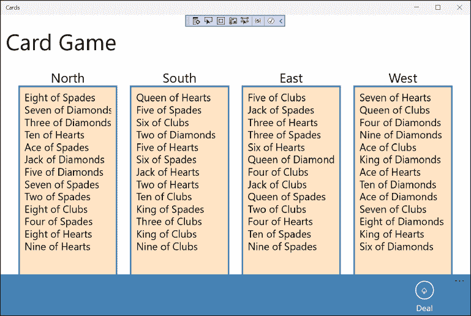

17. 返回到 Visual Studio 2022 并停止调试。

### 总结

在本章中，你学习了如何使用一些常用的集合类来存储和访问数据。特别，你学习了如何使用泛型集合类来创建类型安全的集合。你还学习了如何创建 lambda 表达式来在集合中搜索特定项目。

*   如果你想继续下一章节，请保持 Visual Studio 2022 运行并转到 第 19 章，“枚举集合](#ch19.xhtml_ch19)”。

*   如果你现在想退出 Visual Studio 2022，在“文件（File）”菜单上选择“退出（Exit）”。如果你看到保存对话框，选择“是（Yes）”并保存项目。

### 快速参考

| 目标 | 执行操作 |
| :--- | :--- |
| 创建新集合 | 使用集合类的构造函数。例如:点击此处查看代码图像 
```cs
List<PlayingCard> cards = new List<PlayingCard>();
``` |
| 向集合添加项 | 为列表、哈希集合和字典型集合使用（视情况使用）`Add` 或 `Insert` 方法。为 `Queue<T>` 集合使用 `Enqueue` 方法。为 `Stack<T>` 集合使用 `Push` 方法。例如:点击此处查看代码图像 
```cs
HashSet<string> employees = new HashSet<string>(); employees.Add("John");
...
LinkedList<int> data = new LinkedList<int>(); data.AddFirst(101);
...
Stack<int> numbers = new Stack<int>(); numbers.Push(99);
``` |
| 从集合中移除项 | 为列表、哈希集合和字典型集合使用 `Remove` 方法。为 `Queue<T>` 集合使用 `Dequeue` 方法。为 `Stack<T>` 集合使用 `Pop` 方法。例如:点击此处查看代码图像 
```cs
HashSet<string> employees = new HashSet<string>(); employees.Remove("John");
...
LinkedList<int> data = new LinkedList<int>(); data.Remove(101);
...
Stack<int> numbers = new Stack<int>();
...
int item = numbers.Pop();
``` |
| 查找集合中的元素数量 | 使用 `Count` 属性。例如:点击此处查看代码图像 
```cs
List<PlayingCard> cards = new List<PlayingCard>();
...
int noOfCards = cards.Count;
``` |
| 在集合中定位项 | 对于字典型集合，使用数组表示法。对于列表，使用 `Find` 方法。例如:点击此处查看代码图像 
```cs
Dictionary<string, int> ages = new Dictionary<string, int>();
ages.Add("John", 47);
int johnsAge = ages["John"];
...
List<Person> personnel = new List<Person>();
Person match = personnel.Find(p => p.ID == 3);
``` |
| 遍历集合的元素 | 使用 `for` 语句或 `foreach` 语句。例如:点击此处查看代码图像 
```cs
LinkedList<int> numbers = new LinkedList<int>();
...
for (LinkedListNode<int> node = numbers.First; node is not null; node = node.Next)
{
   int number = node.Value;
   Console.WriteLine(number);
}
...
foreach (int number in numbers)
{
   Console.WriteLine(number);
}
``` |

## 第 19 章

## 枚举集合

**完成本章后，你将能够：**

*   手动定义一个用于遍历集合的枚举器。
*   通过创建迭代器自动实现枚举器。
*   提供以不同顺序遍历集合元素的迭代器。

第 10 章，“使用数组](#ch10.xhtml_ch10)”和第 18 章，“使用集合](#ch18.xhtml_ch18)”展示了如何使用数组和集合类持有数据。第 10 章](#ch10.xhtml_ch10)还详细介绍了 `foreach` 语句，可以使用它来遍历集合中的元素。现在是时候深入了解该语句的运作原理了。这在你定义集合类时很重要，本章描述了如何让集合可枚举。

### 遍历集合中的元素

第 10 章展示了一个使用 `foreach` 语句列出数组项的示例。

```cs
int[] pins = { 9, 3, 7, 2 };
foreach (int pin in pins)
{
    Console.WriteLine(pin);
}
```

`foreach` 构造提供了一种优雅的机制，极大简化了你需要编写的代码，但它只能在特定情况下使用：你只能使用 `foreach` 遍历可枚举集合。什么是可枚举集合？简单的答案是它是实现了 `System.Collections.IEnumerable` 接口的集合。


将枚举器（enumerator）想象成指向列表中元素的指针。初始时，指针指向第一个元素*之前*。你调用 `MoveNext` 方法将指针移动到列表中的下一个（即第一个）项；如果还有另一个项，`MoveNext` 方法返回 `true`，如果没有，则返回 `false`。你使用 `Current` 属性来访问当前指针指向的项，并使用 `Reset` 方法将指针返回到列表第一个项*之前*。通过使用集合的 `GetEnumerator` 方法创建枚举器，反复调用 `MoveNext` 方法，并使用枚举器检索 `Current` 属性的值，你就可以逐个项目地在集合元素中向前移动。这正是 `foreach` 语句所的工作。因此，如果你想创建自己的可枚举集合类，就必须在你的集合类中实现 `IEnumerable` 接口，并提供一个由集合类方法的 `GetEnumerator` 方法返回的 `IEnumerator` 接口实现。

 **重要**

乍看之下，很容易混淆 `IEnumerable` 和 `IEnumerator` 接口，因为它们的名称非常相似。请务必确保不要将它们混淆。

你可能已经注意到 `IEnumerator` 接口的 `Current` 属性表现出非类型安全的行为，因为它返回的是一个对象而不是特定类型。然而，你应该高兴地知道，Microsoft .NET 类库还提供了泛型的 `IEnumerator<T>` 接口，它的 `Current` 属性返回的是 `T`。同样，还有一个 `IEnumerable<T>` 接口，它包含一个返回 `Enumerator<T>` 对象的 `GetEnumerator` 方法。这两个接口都定义在 `System.Collections.Generic` 命名空间中。如果你正在为 .NET 2.0 或更高版本构建应用程序，那么在 string 你定义可枚举集合时，应该使用这些泛型接口而不是非泛型版本。

## 手动实现枚举器

在接下来的练习中，你将定义实现泛型 `IEnumerator<T>` 接口的类，并为第 17 章中演示的二叉树类“介绍泛型”创建一个枚举器。

第 17 章阐明了遍历二叉树并显示其内容是多么简单。因此，你可能会认为，定义一个按相同顺序检索二叉树中每个元素的枚举器是一件易事的事情。遗憾的是，你错了。主要问题是，在定义枚举器时，你必须记住自己在结构中的位置，以便后续对 `MoveNext` 方法的调用能够相应更新位置。递归算法（如遍历二叉树时使用的算法）并不有利于以便简单的方式在方法调用之间维护状态信息。出于这个原因，你将首先将二叉树中的数据预处理为更易处理的数据结构（队列），并改为枚举该数据结构。当然，这种技巧对于遍历二叉树元素的用户来说是隐藏的！

### 创建 TreeEnumerator 类

1. 启动 Microsoft Visual Studio 2022（如果它尚未运行）。
2. 打开 **BinaryTree** 解决方案，它位于你**文档**文件夹中的 `\Microsoft Press\VCSBS\Chapter 19\BinaryTree` 文件夹中。该解决方案包含你在第 17 章中创建的 BinaryTree 项目的可运行副本。你将向此项目添加一个新类，在其中实现 `BinaryTree` 类的枚举器。
3. 在解决方案资源管理器中，选择 **BinaryTree** 项目。然后，打开**项目**菜单并选择**添加类**以打开“添加新项 - BinaryTree”对话框。
4. 在中间面板中，选择**类**模板，在**名称**框中输入 `TreeEnumerator.cs`，然后选择**添加**。
   `TreeEnumerator` 类将为 `Tree<TItem>` 对象生成一个枚举器。为了确保该类是类型安全的，你必须提供一个类型参数并实现 `IEnumerator<T>` 接口。此外，该类型参数必须是该类所枚举的 `Tree<TItem>` 对象的有效类型，因此它必须限制为实现 `IComparable<TItem>` 接口。（`BinaryTree` 类要求树中的项提供一种用于排序比较的方法。）
5. 在显示 TreeEnumerator.cs 文件的代码和文本编辑器中，修改 `TreeEnumerator` 类的定义以满足这些要求，如下例中的粗体所示：
   点击此处查看代码图像
   ```
   class TreeEnumerator<TItem> : IEnumerator<TItem> where TItem : IComparable<TItem>
   {
   }
   ```
    **注意**
   Visual Studio 将显示一些警告和错误消息，因为 `IEnumerator` 接口要求你实现尚未添加的某些方法和属性。你稍后会定义这些项目，所以可以忽略这些消息。
6. 将以下代码中粗体所示的三个私有变量添加到 `TreeEnumerator<TItem>` 类中：
   点击此处查看代码图像
   ```
   class TreeEnumerator<TItem> : IEnumerator<TItem> where TItem : IComparable<TItem>
   {
       private Tree<TItem> currentData = null;
       private TItem currentItem;
       private Queue<TItem> enumData = null;
   }
   ```
   `currentData` 变量将用于持有被枚举树的引用，`currentItem` 变量将持有 `Current` 属性返回的值。你将从树中提取的值填充 `enumData` 队列，`MoveNext` 方法将依次从该队列中返回项。
    **注意**
   `default` 关键字将在本节稍后的“使用类型参数定义的变量”边文中解释。
7. 为 `TreeEnumerator<TItem>` 类添加一个接受 `Tree<TItem>` 参数 `data` 的构造函数。在构造函数体中，添加粗体所示的语句初始化 `currentData` 变量为 `data`：
   点击此处查看代码图像
   ```
   class TreeEnumerator<TItem> : IEnumerator<TItem> where TItem : IComparable<TItem>
   {
       ...
       public TreeEnumerator(Tree<TItem> data)
       {
          this.currentData = data;
       }
   }
   ```
8. 将以下粗体所示的私有方法 `populate` 添加到 `TreeEnumerator<TItem>` 类中，紧跟构造函数之后：
   点击此处查看代码图像
   ```
   class TreeEnumerator<TItem> : IEnumerator<TItem> where TItem : IComparable<TItem>
   {
       ...
       public TreeEnumerator(Tree<TItem> data)
       {
          this.currentData = data;
       }

       private void populate(Queue<TItem> enumQueue, Tree<TItem> tree)
        {
            if (tree.LeftTree is not null)
            {
                populate(enumQueue, tree.LeftTree);
            }

             enumQueue.Enqueue(tree.NodeData);

             if (tree.RightTree is not null)
             {
                 populate(enumQueue, tree.RightTree);
             }
         }
   }
   ```
   该方法遍历二叉树，将其包含的内容添加到队列中。使用的算法与第 17 章描述的 `Tree<TItem>` 类中的 `WalkTree` 方法相似。主要区别在于，而不是将 `NodeData` 值附加到字符串，该方法将这些值存储在队列中。


### 9. 回到 `TreeEnumerator<TItem>` 类的定义。

在类声明中，将鼠标悬停在文本 `IEnumerator<TItem>` 上。在弹出的下拉菜单中（带有灯泡图标），选择 `Implement all members explicitly`（显式实现所有成员）。这将为 `IEnumerator<TItem>` 接口和 `IEnumerator` 接口中的方法生成存根，并将它们添加到类的末尾。它还会为 `IDisposable` 接口生成 `Dispose` 方法。

 **注意**

`IEnumerator<TItem>` 接口继承自 `IEnumerator` 和 `IDisposable` 接口，这就是为什么它们的方法也会出现的原因。事实上，属于 `IEnumerator<TItem>` 接口的唯一项是泛型属性 `Current`。`MoveNext` 和 `Reset` 方法属于非泛型的 `IEnumerator` 接口。参阅第 14 章，“使用垃圾收集和资源管理”描述了 `IDisposable` 接口。

### 10. 检查生成的代码。

属性和方法的体包含一个默认实现，该实现仅抛出一个 `NotImplementedException` 异常。你将在后续步骤中替换这些代码。

### 11. 更新 `MoveNext` 方法的体，并将 `throw new NotImplementedException()` 语句替换为此处加粗的代码：

点击此处查看代码图像

```
bool IEnumerator.MoveNext()
{
     if (this.enumData is null)
     {
            this.enumData = new Queue<TItem>();
            populate(this.enumData, this.currentData);
     }

     if (this.enumData.Count > 0)
     {
            this.currentItem = this.enumData.Dequeue();
            return true;
     }

     return false;
}
```

枚举器 `MoveNext` 方法的作用有两个：当它第一次被调用时，它初始化枚举器使用的数据，并移动到要返回的第一条数据。（在第一次调用 `MoveNext` 之前，`Current` 属性返回的值是未定义的，并且会导致异常。）在这种情况下，初始化过程包括实例化队列，然后调用 `populate` 方法用从树中提取的数据填充队列。

后续对 `MoveNext` 方法的调用将移动通过数据项，直到没有更多数据为止，如本示例所示，不断出队直到队列为空。请记住，`MoveNext` 实际上并不返回数据项；那是 `Current` 属性的作用。`MoveNext` 所做的只是更新枚举器内部的状态（即将 `currentItem` 变量的值设置为从队列中提取的数据项），以供 `Current` 属性使用，如果存在下一个值则返回 `true`，否则返回 `false`。

### 12. 修改泛型属性 `Current` 的 `get` 访问器的定义，并将表达式体成员替换为此处加粗的代码：

点击此处查看代码图像

```
TItem IEnumerator<TItem>.Current
{
     get
     {
        if (this.enumData is null)
        {
          throw new InvalidOperationException("Use MoveNext before calling Current");
     }
     return this.currentItem;
    }
}
```

 **重要**

请确保将代码添加到 `Current` 属性的正确实现中。保留非泛型版本 `System.Collections.IEnumerator.Current` 的其默认实现，它会抛出一个 `NotImplementedException` 异常。

`Current` 属性检查 `enumData` 变量以确保已调用了 `MoveNext`。（在第一次调用 `MoveNext` 之前，该变量将为 `null`）。如果不是如此，该属性将抛出 `InvalidOperationException`。这是 .NET 用于表示当前状态下无法执行操作的常规机制。如果已经调用了 `MoveNext`，它将已更新 `currentItem` 变量，因此 `Current` 属性只需要返回此变量中的值即可。

### 13. 找到 `IDisposable.Dispose` 方法。

按照后续代码中加粗所示，将 `throw new NotImplementedException();` 语句注释掉。枚举器没有使用任何需要显式释放的资源，因此此方法不需要执行任何事情。但是，它必须存在。有关 `Dispose` 方法的更多信息，请参阅第 14 章。

点击此处查看代码图像

```
void IDisposable.Dispose()
{
    // throw new NotImplementedException();
}
```

### 14. 生成解决方案并对报告的错误进行纠正。

## 实现 IEnumerable 接口

在接下来的练习中，你将修改二叉树类来实现 `IEnumerable<T>` 接口。`GetEnumerator` 方法将返回一个 `TreeEnumerator<TItem>` 对象。

#### 在 Tree<TItem> 类中实现 IEnumerable<TItem> 接口

1. 在解决方案管理器中，双击 `Tree.cs` 文件以在代码和文本编辑器中显示 `Tree<TItem>` 类。

2. 修改 `Tree<TItem>` 类的定义，使其实现 `IEnumerable<TItem>` 接口，如下述代码加粗所示：

点击此处查看代码图像

```
public class Tree<TItem> : IEnumerable<TItem> where TItem : IComparable<TItem>
```

注意，约束始终放在类定义的末尾。

 **注意**

与 `TreeEnumerator` 类一样，你会收到一些错误消息和警告，因为 `IEnumerable` 接口期望某些你尚未定义的方法和属性。你可以暂时忽略这些消息。

3. 在类定义中将鼠标悬停在 `IEnumerable<TItem>` 接口上。在弹出的下拉菜单中，选择 `Implement all members explicitly`（显式实现所有成员）。这将生成 `IEnumerable<TItem>.GetEnumerator` 和 `IEnumerable.GetEnumerator` 方法的实现并将添加到类中。（实现非泛型的 `IEnumerable` 方法是因为泛型 `IEnumerable<TItem>` 接口继承自 `IEnumerable`。）

4. 在类末尾找到泛型 `IEnumerable<TItem>.GetEnumerator` 方法。修改 `GetEnumerator()` 方法体，替换现有的 `throw` 语句，如下例加粗所示：

点击此处查看代码图像

```
IEnumerator<TItem> IEnumerable<TItem>.GetEnumerator()
{
    return new TreeEnumerator<TItem>(this);
}
```

`GetEnumerator` 方法的作用是构造用于迭代集合的枚举器对象。在这种情况下，你需要做的是使用树中的数据构建一个新的 `TreeEnumerator<TItem>` 对象。

 **注意**

确保保留非泛型 `GetEnumerator` 方法的其默认实现。

5. 生成解决方案。对报告的任何错误进行纠正，并在必要时重新生成解决方案。

## 测试枚举器

你现在将通过使用 `foreach` 语句遍历二叉树并显示其内容来测试修改后的 `Tree<TItem>` 类。

1. 在解决方案管理器中，右键点击 **BinaryTree** 解决方案，指向**添加**然后选择**新建项目**。

2. 选择**控制台应用程序**模板，将项目命名为 **EnumeratorTest**，并将位置设置为**文档**文件夹中的 **\Microsoft Press\VCSBS\Chapter 19\BinaryTree**。然后选择 **.NET 6.0 框架**并选择**创建**。

3. 在解决方案管理器中右键点击 **EnumeratorTest** 项目，并选择**设为启动项目**。


4. 在 `Project` 菜单上，选择 `Add Project Reference`。

5. 在 `Reference Manager` – `EnumeratorTest` 对话框的左窗格中，展开 `Projects` 节点并选择 `Solution`。在中间窗格中，选择 `BinaryTree` 项目。然后选择 `OK`。

`BinaryTree` 程序集将出现在解决方案资源管理器中 `EnumeratorTest` 项目的依赖列表中，位于 `Dependencies` 节点下的 `Projects` 文件夹中。

6. 在显示 `Program` 类的代码和文本编辑器窗口中，向文件顶部添加以下 `using` 指令：

```
using BinaryTree;
```

7. 将下方代码中**加粗**显示的语句添加到 `Main` 方法中，以替换该方法中的现有代码。这些语句创建并填充了一个整数类型的二叉树：

点击此处查看代码图像

```
static void Main(string[] args)
{
      Tree<int> tree1 = new Tree<int>(10);
      tree1.Insert(5);
      tree1.Insert(11);
      tree1.Insert(5);
      tree1.Insert(-12);
      tree1.Insert(15);
      tree1.Insert(0);
      tree1.Insert(14);
      tree1.Insert(-8);
      tree1.Insert(10);
}
```

8. 按照下方**加粗**所示添加一个 `foreach` 语句，用于枚举树的内容并显示结果：

点击此处查看代码图像

```
static void Main(string[] args)
{
     ...
     foreach (int item in tree1)
     {
        Console.WriteLine(item);
     }
}
```

9. 在 `Debug` 菜单上，选择 `Start Without Debugging`。

程序运行并按以下顺序显示值：

点击此处查看代码图像

```
-12, -8, 0, 5, 5, 10, 10, 11, 14, 15
```

10. 按 `Enter` 返回 Visual Studio 2022。

### 使用迭代器实现枚举器

如你所见，使集合可枚举的过程可能会变得复杂，并且容易出错。为了方便起见，C# 提供了迭代器，可以自动化处理此过程很大一部分。

`iterator`（迭代器）产生有序值序列的块块。迭代器实际上并不是可枚举类的一个成员；相反，它指定了枚举器在返回其值时应该使用的序列。换句话之，迭代器只是对枚举序列的描述，C# 编译器可以使用该描述来创建自己的枚举器。这个概念需要稍微思考才能正确理解，因此请考虑以下这个简单的示例。

#### 一个简单的迭代器

下方的 `BasicCollection<T>` 类说明了实现迭代器的原理。该类使用 `List<T>` 对象来存储数据，并提供 `FillList` 方法来填充此列表。同时注意，`BasicCollection<T>` 类实现了 `IEnumerable<T>` 接口。`GetEnumerator` 方法是通过使用迭代器实现的：

点击此处查看代码图像

```
using System;
using System.Collections.Generic;
using System.Collections;
class BasicCollection<T> : IEnumerable<T>
{
     private List<T> data = new List<T>();
     public void FillList(params T [] items)
     {
        foreach (var datum in items)
        {
          data.Add(datum);
        }
     }

     IEnumerator<T> IEnumerable<T>.GetEnumerator()
     {
         foreach (var datum in data)
         {
            yield return datum;
         }
     }

     IEnumerator IEnumerable.GetEnumerator()
     {
        // 此示例中未实现
        throw new NotImplementedException();
     }
}
```

`GetEnumerator` 方法看起来非常直接，但值得仔细检查。首先要说明的是，它似乎并没有返回 `IEnumerator<T>` 类型。相反，它遍历 `data` 数组中的项，依次返回每个项。关键点是使用了 `yield` 关键字。该关键字指示了每次迭代时应该返回的值。如果有帮助，你可以将 `yield` 语句认为是对方法的调用临时暂停，并将值传回调用者。当调用者需要下一个值时，`GetEnumerator` 方法从它离开的地方继续执行，循环并产生下一个值。最终，数据被耗尽，循环结束，`GetEnumerator` 方法终止。此时，迭代完成。

请记住，从通常意义上说，这并不是一个普通方法。`GetEnumerator` 方法中的代码定义了一个 `iterator`（迭代器）。编译器使用这段代码来生成一个 `IEnumerator<T>` 类的实现，其中包含一个 `Current` 方法和一个 `MoveNext` 方法。该实现与 `GetEnumerator` 方法指定的功能完全匹配。你实际上无法看到这些生成的代码（除非你反编译包含编译代码的程序集），但这是付出的出的代价。你可以按照通常的方式调用生成的迭代器，如下方的代码所示，该代码显示了诗歌“Jabberwyy”的第一行：

点击此处查看代码图像 *注：此处原文链接 ID 可能在示例中重复，但根据翻译逻辑，此处应对应 BasicTree 示例*

```
BasicCollection<string> bc = new BasicCollection<string>();
bc.FillList("Twas", "brillig", "and", "the", "slithy", "toves");

foreach (string word in bc)
{
    Console.WriteLine(word);
}
```

这段代码按以下顺序输出 `bc` 对象的内容：

点击此处查看代码图像

```
Twas, brillig, and, the, slithy, toves
```

如果你想提供替代迭代机制来呈现数据，可以实现实现 `IEnumerable` 的属性。例如，下方的 `BasicCollection<T>` 类的 `Reverse` 属性反向发射数据：

点击此处查看代码图像

```
class BasicCollection<T> : IEnumerable<T>
{
     ...
     public IEnumerable<T> Reverse
     {
        get
        {
           for (int i = data.Count - 1; i >= 0; i--)
           {
              yield return data[i];
           }
        }
     }
}
```

你可以如下所示调用此属性：

点击此处查看代码图像

```
BasicCollection<string> bc = new BasicCollection<string>();
bc.FillList("Twas", "brillig", "and", "the", "slithy", "toves");

foreach (string word in bc.Reverse)
{
    Console.WriteLine(word);
}
```

这段代码按反序输出 `bc` 对象的内容：

点击此处查看代码图像

```
toves, slithy, the, and, brillig, Twas
```

#### 使用迭代器为 Tree<TItem> 类定义枚举器

在下一个练习中，你将使用迭代器为 `Tree<TItem>` 类实现枚举器。与之前的练习不同，之前的练习需要通过 `MoveNext` 方法将树中的数据预处理为队列，在这里，你可以定义一个使用更自然的递归机制遍历树的迭代器，类似于第 17 章中讨论的 `WalkTree` 方法。

为 Tree<TItem> 类添加枚举器

1.  使用 Visual Studio 2022，打开位于你的**文档**文件夹下 `\Microsoft Press\VCSBS\Chapter 19\IteratorBinaryTree` 的 `BinaryTree` 解决方案。该解决方案包含了你在第 17 章中创建的 BinaryTree 项目的副本。

2.  在代码和文本编辑器中打开 `Tree.cs` 文件。然后修改 `Tree<TItem>` 类的定义，使其实现 `IEnumerable<TItem>` 接口，如下方的**加粗**所示：


点击此处查看代码图像

```c
public class Tree<TItem> : IEnumerable<TItem> where TItem : IComparable<TItem>
{
     ...
}
```

3.  将鼠标悬停在类定义中的 `IEnumerable<TItem>` 接口上。在出现的下拉上下文菜单中，选择“显式实现所有成员”（Implement all members explicitly），以将 `IEnumerable<TItem>.GetEnumerator` 和 `IEnumerable.GetEnumerator` 方法添加到类的末尾。

4.  找到泛型方法 `IEnumerable<TItem>.GetEnumerator`。按照下方代码中**加粗**显示的内容，替换 `GetEnumerator` 方法的内容：

点击此处查看代码图像

```c
IEnumerator<TItem> IEnumerable<TItem>.GetEnumerator()
{
     if (this.LeftTree is not null)
     {
        foreach (TItem item in this.LeftTree)
        {
           yield return item;
        }
     }

     yield return this.NodeData;

     if (this.RightTree is not null)
     {
        foreach (TItem item in this.RightTree)
        {
           yield return item;
        }
     }
}
```

初看之下可能并不明显，但这段代码遵循了你在第 17 章中用于列出二叉树内容的相同递归算法。如果 `LeftTree` 不为空，第一个 `foreach` 语句将隐式地对其调用 `GetEnumerator` 方法（即你正在定义的那个）。此过程一直持续，直到找到没有左子树的节点。此时，`NodeData` 属性中的值会被产生并并相同的方式检查右子树。当右子树耗尽时，过程将回溯到父节点，输出父节点的 `NodeData` 属性并检查父节点的右子树。这种操作将持续持续直到整个树被枚举完毕且所有节点都已输出。

#### 测试新的枚举器

1.  在解决方案管理器（Solution Explorer）中，右键点击 `BinaryTree` 解决方案，指向“添加”（Add），然后选择“现有项目”（Existing Project）。

2.  在“添加现有项目”对话框中，移动到文件夹 `\Microsoft Press\VCSBS\Chapter 19\BinaryTree\EnumeratorTest`，选择 `EnumeratorTest` 项目文件，然后选择“打开”（Open）。

这是你为了测试在本章稍早手动编写的枚举器而创建的项目。

3.  在解决方案管理器中，右键点击 `EnumeratorTest` 项目，然后选择“设启动项目”（Set As StartUp Project）。

4.  在解决方案管理器中，展开 `EnumeratorTest` 项目的 `Dependencies` 文件夹，然后展开 `Projects` 文件夹。右键点击 `BinaryTree` 引用并选择“删除”（Remove）。

5.  在“项目”（Project）菜单上，选择“添加项目引用”（Add Project Reference）。

6.  在引用管理器（Reference Manager – NumeratorTest）对话框的左窗格中，展开 `Projects` 节点并选择 `Solution`。在中间格中，选择 `BinaryTree` 项目。然后点击“确定”。

 **注意**

这三个步骤确保了 EnumeratorTest 项目引用了正确版本的 `BinaryTree` 程序集。它应该使用通过迭代器实现枚举器的程序集，而不是在本章之前一组练习中创建的版本。

7.  在代码和文本编辑器窗口中显示 NumeratorTest 项目的 `Program.cs` 文件。

8.  检查 `Program.cs` 文件中的 `Main` 方法。回想测试稍早的枚举器时的经历，该方法实例化了一个 `Tree<int>` 对象，向其填充了一些数据，然后使用 `foreach` 语句显示其内容。

9.  生成解决方案并在必要时修正任何错误。

10. 在“调试”（Debug）菜单上，选择“转非调试启动”（Start Without Debugging）。

程序运行并显示的值的顺序与之前相同。

点击此处查看代码图像

```
-12, -8, 0, 5, 5, 10, 10, 11, 14, 15
```

11. 按 `Enter` 键返回 Visual Studio 2022。

### 总结

在本章中，你学习了如何在集合类中实现 `IEnumerable<T>` 和 `IEnumerator<T>` 接口，以便应用程序能够遍历集合中的项。你还学习了如何使用迭代器来实现枚举器。

*   如果你想继续下一章，请保持 Visual Studio 2022 运行并转到第 20 章，“解耦应用程序逻辑和处理事件](#ch20.xhtml_ch20)”。

*   如果你现在想退出 Visual Studio 2022，在“文件”（File）菜单上选择“退出”（Exit）。如果你看到保存对话框，选择“是”并保存项目。

### 快速参考

| 目标 | 执行操作 |
| :--- | :--- |
| 使集合类可枚举，使其支持 `foreach` 结构 | 实现 `IEnumerable` 接口并提供一个返回 `IEnumerator` 对象的 `GetEnumerator` 方法。例如：点击此处查看代码图像 <pre>
public class Tree<TItem> : IEnumerable<TItem>
{
    ...
    IEnumerator<TItem> GetEnumerator()
    {
        ...
    }
}
</pre> |
| 不使用迭代器实现枚举器 | 定义实现 `IEnumerator` 的类，并提供 `Current` 属性和 `MoveNext` 方法。例如：点击此处查看代码图像 <pre>
public class TreeEnumerator<TItem> : IEnumerator<TItem>
{
    ...
    TItem Current
    {
        get
        {
            ...
        }
    }

    bool MoveNext()
    {
        ...
    }
}
</pre> |
| 使用迭代器定义枚举器 | 实现枚举器以指示返回哪些项以及按什么顺序。例如：点击此处查看代码图像 <pre>
IEnumerator<TItem> GetEnumerator()
{
     for (...)
     {
         yield return ...
     }
}
</pre> |


这种风格程序的经典示例是通用 平台 (UWP) 表单，你在涉及图形化应用程序的练习中一直在使用这些表单。表单显示如按钮和文本框之类的控件。当你点击按钮或在文本框中输入文本时，你期望表单能够立即响应——这意味着应用程序必须暂时停止正在的工作以处理你的输入。这种操作风格不仅适用于图形用户界面 (GUI)，也适用于任何必须紧急执行操作的应用程序——例如，当核电站的反应堆温度过高时将其关闭。

为了处理这种类型的处理，运行时环境必须提供两点：一种指示紧急情况发生的方法，以及一种指定在紧急事件发生时应该运行代码的方法。事件（Events）与委托（delegates）相结合，提供了你可以借此实现遵循这种方法的系统的基础设施。

### 理解委托 (delegates)

`delegate` 是对方法的引用。委托之所以被称为这个名字，是因为它们在被调用时会将处理过程“委托”给被引的方法。`delegate` 是一个非常简单的概念，但其影响极其强大。让我来解释一下。

通常情况下，当你编写调用方法的语句时，你指定了方法的名称（可能还有所属该方法的对象或结构）。从代码中可以清楚地看到你正在运行哪一个方法以及何时运行它。看下面这个简单的示例，它调用了 `Processor` 对象的 `performCalculation` 方法（该方法的功能或 `Processor` 类的定义对于本文讨论并不重要）：

```
Processor p = new Processor();
p.performCalculation();
```

你可以像给 `int` 变量赋值 `int` 值一样，给 `delegate` 赋值一个指向方法的引用。接接的示例创建了一个名为 `performCalculationDelegate` 的委托，它引用了 `Processor` 对象的 `performCalculation` 方法。我刻意省略了声明委托语句的某些元素，因为理解这个概念比担心语法更重要。（稍后你会看到完整的语法。）

点击此处查看代码图片

```
Processor p = new Processor();
delegate ... performCalculationDelegate ...;
performCalculationDelegate = p.performCalculation;
```

请记住，将方法引用赋值给委托的语句在该处并没有运行该方法；方法名后没有括号，你也没有指定任何参数（如果该方法接收参数的话）。这仅仅是一个赋值语句。

在委托中存储了对 `Processor` 对象 `performCalculation` 方法的引用后，应用程序随后可以通过委托调用该方法，如下：

```
performCalculationDelegate();
```

这看起来像是一个普通方法调用。如果你不知道其他情况，看起来就像你实际上在运行一个名为 `performCalculationDelegate` 的方法。然而，公共语言运行时 (CLR) 知道这是一个委托，因此它检索委托所引用的方法并运行该方法。以后，你可以更改委托所引用的方法，因此调用委托的语句在每次执行时可能会运行不同的方法。此外，一个委托可以同时引用多个方法（将其想象为方法引用的集合）。当你调用委托时，它所引用的所有方法都将运行。

 注意

如果你熟悉 C++，委托上类似于函数指针。但是，与函数指针不同，委托是完全类型安全的。你可以让委托仅引用与该委托签名匹配的方法，而且你不能调用一个未引用有效方法的委托。

### .NET 类库中的委托示例

Microsoft .NET 类库在其许多类型中广泛地使用了委托。两个示例位于第 18 章 中的“使用集合]”：`List<T>` 类的 `Find` 方法和 `Exists` 方法。正如你可能记得的，这些方法搜索 `List<T>` 集合，要么返回一个匹配的项，要么测试匹配项是否存在。当 `List<T>` 类的设计者实现它时，他们完全不知道在你的应用程序代码中什么才算是一个匹配，因此他们让你通过以以谓词（predicate）的形式提供自己的代码来定义它。谓词实际上只是一个恰好返回布尔值的委托。

下面的代码应该帮助你记住如何使用 `Find` 方法（已加粗显示）：

点击此处查看代码图片

```
struct Person
{
    public int ID { get; set; }
    public string Name { get; set; }
    public int Age { get; set; }
}
...
List<Person> personnel = new List<Person>()
{
    new Person() { ID = 1, Name = "John", Age = 53 },
    new Person() { ID = 2, Name = "Sid", Age = 28 },
    new Person() { ID = 3, Name = "Fred", Age = 34 },
    new Person() { ID = 4, Name = "Paul", Age = 22 }
};
...
// 查找列表中 ID 为 3 的成员
Person match = personnel.Find(p => p.ID == 3);
```

`List<T>` 类暴露的其它使用委托执行操作的方法示例还有 `Average`、`Max`、`Min`、`Count` 和 `Sum`。这些方法接受一个 `Func` 委托作为参数。`Func` 委托引用一个返回值的方法。在下面的示例中，`Average` 方法用于计算集合的平均年龄（`Func` 委托返回集合中每个项的年龄），`Max` 方法用于确定 ID 最大的项，`Count` 方法计算有多少项的 Age 值在 `30` 到 `39` 之间。

点击此处查看代码图片

```
double averageAge = personnel.Average(p => p.Age);
Console.WriteLine($"Average age is {averageAge}");
...
int id = personnel.Max(p => p.ID);
Console.WriteLine($"Person with highest ID is {id}");
...
int thirties = personnel.Count(p => p.Age >= 30 && p.Age <= 39);
Console.WriteLine($"Number of personnel in thirties is {thirties}");
```

这段代码产生以下输出：

点击此处查看代码图片

```
Average age is 34.25
Person with highest ID is 4
Number of personnel in thirties is 1
```

在本书的剩余部分，你将遇到这些以及其他委托类型的示例。你也可以定义自己的委托。充分理解何时以及如何使用的最佳方法是看到它们运行，因此我们将通过一个示例。

#### 自动化工厂场景

假设你正在为一个自动化工厂编写控制系统。工厂包含许多不同的机器，每种机器在工厂产品的生产过程中执行不同的任务——成型折叠、焊接、焊接等。每台机器都是由专业供应商制造并安装的。所有机器都由计算机控制，每个供应商都提供了一组你可以用来控制其机器的函数。你的任务是将机器的不同系统集成到一个单个控制程序中。你决定关注的一个方面是提供一种关闭所有机器的方法——如果需要，要快关闭！

每台机器都有自己独特的计算机控制流程（以及函数）用于安全地关机，总结如下：

点击此处查看代码图片


```
StopFolding(); // 折叠成型机
FinishWelding(); // 焊接机
PaintOff(); // 喷漆机
```

### 在不委托的情况下实现工厂控制系统

在控制程序中实现关闭功能的一种简单方法如下：

点击此处查看代码

```cpp
class Controller
{
    // 表示不同机器的字段
    private FoldingMachine folder;
    private WeldingMachine welder;
    private PaintingMachine painter;
    ...
    public void ShutDown()
    {
        folder.StopFolding();
        welder.FinishWelding();
        painter.PaintOff();
    }
    ...
}
```

虽然这种方法行得通，但它的可扩展性和灵活性都不够。如果工厂购买了新机器，你必须修改这段代码，因为 `Controller` 类与管理机器的代码之间是**紧密耦合**的。

### 使用委托实现工厂

虽然每个方法的名称不同，但它们都具有相同的“形状”：它们都不接受参数，也不返回结果。（稍后我们会考虑如果情况不是这样会发生什么，所以请耐心等待。）每个方法的通用格式如下：

```cpp
void methodName();
```

这就是委托大显身场的地方。你可以使用匹配此形状的委托来引用任何机器的关闭方法。你可以像这样声明委托：

点击此处查看代码

```cpp
delegate void stopMachineryDelegate();
```

注意以下几点：

*   你使用了 `delegate` 关键字。
*   你指定了返回类型（此例中为 `void`）、委托名称（`stopMachineryDelegate`）以及任何参数（在这种情况下没有参数）。

声明委托后，你可以创建它的实例并使用 `+=` 复合赋值运算符使其指向匹配的方法。你在控制类的构造函数中执行此操作，如下：

点击此处查看代码

```cpp
class Controller
{
    delegate void stopMachineryDelegate(); // 委托类型
    private stopMachineryDelegate stopMachinery; // 委托实例
    ...
    public Controller()
    {
        this.stopMachinery += folder.StopFolding;
    }
    ...
}
```

习惯这种语法需要一些研究时间。你是在将方法*添加*到委托中——记住，此时你并没有实际调用该方法。`+` 运算符被重载，在与委托一起使用时具有这种新含义。（你将在第 22 章中学习更多关于运算符重载”的知识。）注意，你只需要指定方法名，而不需要包含任何括号或参数。

在未初始化的委托上使用 `+=` 运算符是安全的。它会自动初始化。或者，你可以使用 `new` 关键字显式使用单个特定方法初始化委托，如下：

点击此处查看代码

```cpp
this.stopMachinery = new stopMachineryDelegate(folder.StopFolding);
```

你可以通过调用委托来调用该方法，如下：

```cpp
public void ShutDown()
{
    this.stopMachinery();
    ...
}
```

调用委托的语法与调用方法的方法相同。如果委托引用的方法接受任何参数，你应该在此时的括号之间指定它们。

 **注意**

如果你尝试调用一个未初始化且未引用任何方法的委托，你将得到 `NullReferenceException` 异常。

使用委托的一个重要优势是它可以同时引用多个方法。你只需要使用 `+=` 运算符将方法添加到委托中，如下所示：

点击此处查看代码

```cpp
public Controller()
{
    this.stopMachinery += folder.StopFolding;
    this.stopMachinery += welder.FinishWelding;
    this.stopMachinery += painter.PaintOff;
}
```

在 `Controller` 类的 `Shutdown` 方法中调用 `this.stopMachinery()` 会自动顺序调用每个方法。`Shutdown` 方法不需要知道有多少台机器或者方法名称是什么。

你可以通过 `–` 复合赋值运算符从委托中移除方法，如下所示：

点击此处查看代码

```cpp
this.stopMachinery – folder.StopFolding;
```

当前的方案在 `Controller` 构造函数中将机器方法添加到委托中。为了使 `Controller` 类完全独立于各种机器，你需要将 `stopMachineryDelegate` 类型设置为公共，并提供一种让 `Controller` 之外的类向委托添加方法的方法。你有几种选择：

*   将 `stopMachinery` 委托变量设置为公共：

    点击此处查看代码

    ```cpp
    public stopMachineryDelegate stopMachinery;
    ```

*   保持 `stopMachinery` 委托变量为私有，但创建一个 `read`/`write` 属性来提供访问权限：

    点击此处查看代码

    ```cpp
    private stopMachineryDelegate stopMachinery;
    public stopMachineryDelegate StopMachinery
    {
        get => this.stopMachinery;
        set => this.stopMachinery = value;
    }
    ```

*   通过实现独立的 `Add` 和 `Remove` 方法提供完全封装。`Add` 方法接受方法作为参数并将其添加到委托中，而 `Remove` 方法则从委托中移除指定的方法。（注意，你将方法作为参数指定。）

    点击此处查看代码

    ```cpp
    public void Add(stopMachineryDelegate stopMethod) => this.stopMachinery += stopMethod;

    public void Remove(stopMachineryDelegate stopMethod) => this.stopMachinery – stopMethod;
    ```

面向对象的纯主义者可能会选择选择 `Add`/`Remove` 方案。然而，其他方案也是可行的且经常使用，这就是我们展示它们的原因。

无论你选择哪种技术，都应该从 `Controller` 构造函数中移除将方法添加到委托的代码。然后你可以这样实例化 `Controller` 和代表其他机器的对象：

点击此处查看代码

```cpp
Controller control = new Controller();
FoldingMachine folder = new FoldingMachine();
WeldingMachine welder = new WeldingMachine();
PaintingMachine painter = new PaintingMachine();
...
control.Add(folder.StopFolding);
control.Add(welder.FinishWelding);
control.Add(painter.PaintOff);
...
control.ShutDown();
```

#### 声明和使用委托

在后续练习中，你将完成一个属于 Wide World Importers 系统的应用程序，这是一家进口建筑材料和工具的公司。你将处理的应用程序让客户能够浏览 Wide World Importers 目前库存中的商品并对这些商品下单。该应用程序包含一个显示可用商品的表单，以及一个列出客户已选项目的面板。当客户想要下单时，她可以选择表单上的结账按钮。订单将得到处理，面板将清空。

目前，当客户下单时，会发生以下操作：

*   要求客户付款。
*   检查订单中的物品，如果任何物品受限制（如电动工具），则对订单进行审计和跟踪。
*   生成用于出货的货单。


审计和发货过程的逻辑独立于结账逻辑，尽管这些过程发生的顺序并不重要。此外，这些元素中的任何一个在未来都可能被修改，而且随着业务情况或监管要求的变更，结账操作可能需要额外的处理。因此，将支付和结账逻辑与审计及发货过程解耦是便于维护和升级的理想。

你将首先检查应用程序，看看它目前未能实现这一目标。然后，你将修改应用程序的结构，消除结账逻辑与审计发货逻辑之间的依赖。

### 检查 Wide World Importers 应用程序

1. 启动 Microsoft Visual Studio 2022（如果尚未运行）。
2. 打开 `Delegates` 解决方案，它位于 `Documents` 文件夹下的 `\Microsoft Press\VCSBS\Chapter 20\Delegates` 文件夹中。
3. 在 `Debug` 菜单上，选择 `Start Debugging`。
   项目将生成并运行。将出现一个表单，显示可用项目，以及一个显示订单详情的面板（初始时为空）。应用程序在可以水平滚动的 `GridView` 控件中显示项目。
4. 选择一个或多个项目，然后选择 `Add` 将其加入购物篮。确保至少选择一个受年龄限制的项目。
   当你添加一个项目时，它会出现在右侧的“订单详情”（Order Details）面板中。如果你多次添加同一个项目，数量每次都会增加。（此版本的应用程序尚未实现从篮中移除项目的功能。）应用程序使用的货币取决于你的区域设置。我位于英国，因此图中显示的数值是英镑。然而，如果你在美国，你将看到以美元计算的数值。
   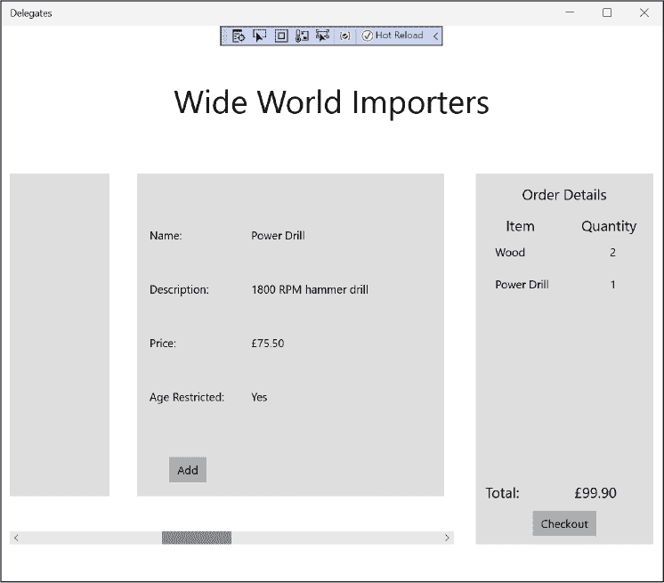
5. 在“订单详情”面板中，选择 `Checkout`。
   出现一条消息指示订单已提交。订单被赋予一个唯一的 ID，该 ID 将与订单金额一起显示。
   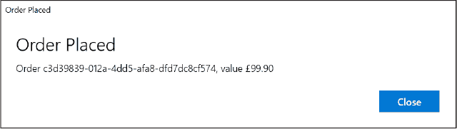
6. 选择 `Close` 关闭消息。然后返回 Visual Studio 2022 环境并停止调试。
7. 在解决方案资源管理器（Solution Explorer）中，展开 `Delegates` 项目节点，然后打开 `Package.appxmanifest` 文件。
   程序包清单编辑器将出现。
8. 在程序包清单编辑器中，选择 `Packaging` 选项卡。
   注意 Package Name（包名称）字段中的值。它的格式是一个全局唯一标识符（GUID）。
9. 使用文件资源管理器浏览到 `%USERPROFILE%\AppData\Local\Packages\*yyy*\LocalState`，其中 `yyy` 是一个以你在上一步中注意的 GUID 开头的标识符值。这是 Wide World Importers 应用程序的本地文件夹。你应该看到两个文件：
   * `audit-*nnnnnn*.xml`（其中 `nnnnnn` 是之前显示的订单 ID）此文件由应用程序的审计组件生成。
   * `dispatch-*nnnnnn*.txt`（同样，其中 `nnnnnn` 是之前显示的订单 ID）此文件是由发货组件生成的发货单。
    **注意**
   如果没有 `audit-*nnnnnn*.xml` 文件，则说明你在提交订单时没有选择任何受年龄限制的项目。在这种情况下，请切回应用程序并创建一个包含一个或多个受年龄限制的项目的新订单。
10. 在 Visual Studio 中打开 `audit-*nnnnnn*.xml` 文件。该文件包含订单中受年龄限制的项目列表，以及订单号和日期。该文件为 XML 格式，看起来如下所示：
    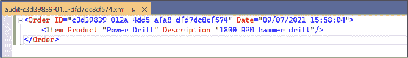
11. 检查列表，然后在 Visual Studio 中关闭该文件。
12. 在记事本中打开 `dispatch-*nnnnnn*.txt` 文件。该文件包含订单的摘要，列出了订单 ID 和金额。这是一个普通的文本文件，看起来如下：
    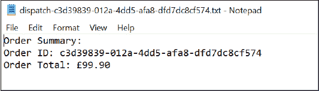
13. 关闭记事本，返回 Visual Studio 2022 并停止调试。
14. 在 Visual Studio 中，注意该解决方案由以下项目组成：
   * `Delegates`：此项目包含应用程序本身。`MainPage.xaml` 定义定义用户界面，应用程序逻辑包含在 `MainPage.xaml.cs` 文件中。
   * `AuditService`：此项目包含实现审计过程的组件。它封装为类库，并包含一个名为 `Auditor` 的类。该类暴露了一个公共方法 `AuditOrder`，它用于检查订单，如果订单包含任何受年龄限制的项目，则生成 `audit-*nnnnnn*.xml` 文件。
   * `DeliveryService`：此项目包含执行发货逻辑的组件，封装为类库。发货功能包含在 `Shipper` 类中，它提供了一个名为 `ShipOrder` 的公共方法，用于处理发货过程并生成发货单。
      **注意**
     欢迎检查 `Auditor` 类中的代码。
   * `DataTypes`：此项目包含其他项目使用的数据类型。`Product` 类定义了显示的项目详情，产品数据位于 `ProductsDataSource` 类中。`Order` 和 `OrderItem` 类实现了订单的结构；每个订单包含一个或多个订单项。
15. 在 `Delegates` 项目中，在代码和文本窗口中显示 `MainPage.xaml.cs` 文件，并检查私有字段和 `MainPage` 构造函数。该文件的关键元素如下：
    点击此处查看代码图像
    ```csharp
    ...
    private Auditor auditor = null;
    private Shipper shipper = null;

    public MainPage()
    {
        ...
        this.auditor = new Auditor();
        this.shipper = new Shipper();
    }
    ```
    `auditor` 和 `shipper` 字段包含 `Auditor` 和 `Shipper` 类的引用，构造函数实例化这些对象。
16. 定位 `CheckoutButtonClicked` 方法。当用户选择结账按钮提交订单时，将运行此方法。前几行如下：
    点击此处查看代码图像
    ```csharp
    private void CheckoutButtonClicked(object sender, RoutedEventArgs e)
    {
        try
        {
            // 执行结账处理
            if (this.requestPayment())
            {
                this.auditor.AuditOrder(this.order);
                this.shipper.ShipOrder(this.order);
            }
            ...
        }
        ...
    }
    ```
    该方法实现了结账处理。它向客户请求付款，然后调用 `auditor` 对象的 `AuditOrder` 方法，紧接着调用 `shipper` 对象的 `ShipOrder` 方法。未来需要的任何额外业务逻辑都可以添加在此处。
    该方法中的剩余代码（`if` 语句之后）负责管理用户界面的：向用户显示消息框并清除“订单详情”面板。


为了简单起见，此应用程序中的 `requestPayment` 方法目前仅返回 `true` 以表示已收款。在现实世界中，此方法将执行完整的支付处理和验证。

尽管应用程序按照预期运行，但 `Auditor` 和 `Shipper` 组件被紧密集成到结账处理中。如果这些组件发生变化，则需要更新应用程序。同样，如果你需要在结账过程中引入额外的逻辑（可能通过使用其他组件来实现），你需要修改应用程序的这部分。

在下一个练习中，你将看到如何将结账操作的业务处理与应用程序解耦。结账处理仍然需要调用 `Auditor` 和 `Shipper` 组件，但它必须具有足够的扩展性，以便轻松引入其他组件。你将通过创建一个名为 `CheckoutController` 的组件来实现这一目标。`CheckoutController` 组件将实现结账过程的业务逻辑，并暴露一个委托，允许应用程序指定哪些组件和方法应该包含在此过程中。`CheckoutController` 组件将使用该委托调用这些方法。

### 创建 CheckoutController 组件

1. 在解决方案管理器（Solution Explorer）中，右键点击 `Delegates` 解决方案，指向**添加**（Add），然后选择**新建项目**（New Project）。

    **注意**

   确保你选择的是 `Delegates` 解决方案而不是 `Delegates` 项目。

2. 在“添加新项目”对话框中，将模板选择器设置为 **C#**、**Windows** 和 **UWP**。选择**类库（通用 Windows）**模板，然后选择**下一步**（Next）。

   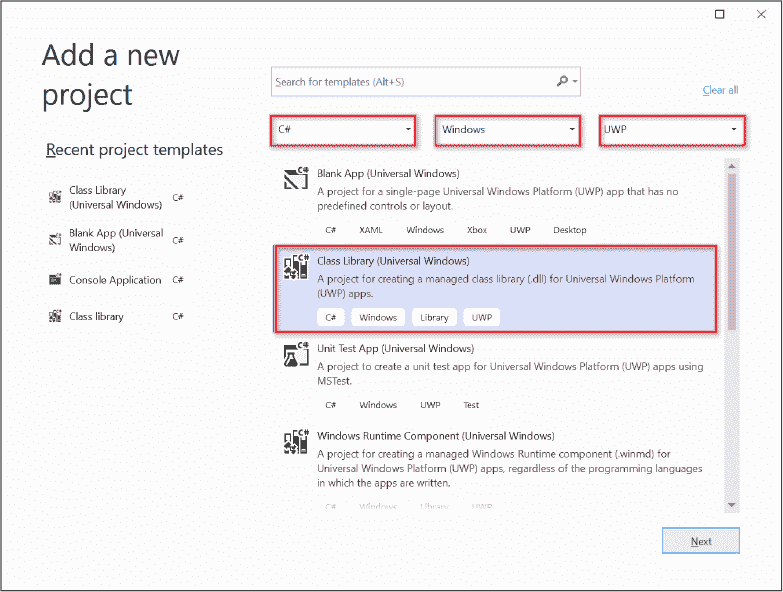

3. 在“配置新项目”对话框中，在**项目名称**（Project name）框中输入 `CheckoutService`。将**位置**（Location）设置为你的**文档**文件夹下的 `\*Microsoft Press\VCSBS\Chapter 20\Delegates` 文件夹，然后选择**创建**（Create）。

4. 在“新建通用 Windows 平台项目”对话框中，接受**目标版本**（Target version）和**最低版本**（Minimum version）的默认值，然后选择**确定**（OK）。

5. 在解决方案管理器中，展开 `CheckoutService` 项目，右键点击 `Class1.cs` 文件，然后选择**重命名**（Rename）。将文件名更改 `CheckoutController.cs` 并按**回车**（Enter）。在出现提示时，允许 Visual Studio 将 `Class1` 的所有引用重命名为 `CheckoutController`。

6. 右键点击 `CheckoutService` 项目中的**引用**（References）节点，然后选择**添加引用**（Add Reference）。

7. 在引用管理器 – CheckoutService 对话框的左窗格中，选择**解决方案**（Solution）。在中间窗格中选择 `DataTypes` 项目。然后选择**确定**（OK）。

   `CheckoutController` 类将使用 `DataTypes` 项目中定义的 `Order` 类。

8. 在显示 `CheckoutController.cs` 文件的代码和文本编辑器中，向文件顶部的列表添加以下 `using` 指令：

   ```
   using DataTypes;
   ```

9. 在 `CheckoutController` 类中添加一个名为 `CheckoutDelegate` 的公共委托类型，如下所示加粗部分所示：

   点击此处查看代码图像

   ```
   public class CheckoutController
   {
       public delegate void CheckoutDelegate(Order order);
   }
   ```

   你可以使用此委托类型来引用带有 `Order` 参数且不返回结果的方法。这恰好符合 `Auditor` 和 `Shipper` 类中 `AuditOrder` 和 `ShipOrder` 方法的形状。

10. 基于此委托类型添加一个名为 `CheckoutProcessing` 的公共委托，如下所示：

    点击此处查看代码图像

    ```
    public class CheckoutController
    {
       public delegate void CheckoutDelegate(Order order);
       public CheckoutDelegate CheckoutProcessing = null;
    }
    ```

11. 在代码和文本编辑器中显示 `Delegates` 项目的 `MainPage.xaml.cs` 文件，并找到 `requestPayment` 方法（位于文件末尾）。从 `MainPage` 类中剪切此方法。

12. 返回 `CheckoutController.cs` 文件，并将 `requestPayment` 方法粘贴到 `CheckoutController` 类中，如下所示加粗部分所示：

    点击此处查看代码图像

    ```
    public class CheckoutController
    {
        public delegate void CheckoutDelegate(Order order);
        public CheckoutDelegate CheckoutProcessing = null;

        private bool requestPayment()
        {
            // 支付处理在此处
            // 此示例中未实现支付逻辑
            // 简单返回 true 表示已收款 
            return true;
        }
    }
    ```

13. 向 `CheckoutController` 类中添加此处加粗所示的 `StartCheckoutProcessing` 方法：

    点击此处查看代码图像

    ```cpp
    public class CheckoutController
    {
        public delegate void CheckoutDelegate(Order order);
        public CheckoutDelegate CheckoutProcessing = null;

        private bool requestPayment()
        {
          ...
        }

        public void StartCheckoutProcessing(Order order)
        {
            // 执行结账处理
            if (this.requestPayment())
            {
                if (this.CheckoutProcessing != null)
                {
                    this.CheckoutProcessing(order);
                }
            }
        }
    }
    ```

    此方法提供了以前由 `MainPage` 类中的 `ButtonClicked` 方法实现的功能。它请求支付并检查 `CheckoutProcessing` 委托。如果此委托不为空（引用了一个或多个方法），则调用该委托。此委托引用的任何方法都会在此运行。

14. 在解决方案管理器中，在 `Delegates` 项目中右键点击**引用**（References）节点，然后选择**添加引用**（Add Reference）。

15. 在引用管理器 – Delegates 对话框的左窗格中，选择**解决方案**（Solution）。在中间窗格中，选择 `CheckoutService` 项目。（同样选中其他项目。）然后**确定**（OK）。

16. 返回 `Delegates` 项目的 `MainPage.xaml.cs` 文件，并在文件顶部的列表添加以下 `using` 指令：

    ```
    using CheckoutService;
    ```

17. 在 `MainPage` 类中添加一个类型为 `CheckoutController` 的私有变量 `checkoutController`，并将其初始化为 `null`，如下所示加粗部分：

    点击此处查看代码图像

    ```
    public ... class MainPage : ...
    {
        ...
        private Auditor auditor = null;
        private Shipper shipper = null;
        private CheckoutController checkoutController = null;
        ...
    }
    ```

18. 定位到 `MainPage` 构造函数。在创建 `Auditor` 和 `Shipper` 组件的语句之后，实例化 `CheckoutController` 组件，如下加粗所示：

    点击此处查看代码图像

    ```
    public MainPage()
    {
        ...
        this.auditor = new Auditor();
        this.shipper = new Shipper();
        this.checkoutController = new CheckoutController();
    }
    ```

19. 在你输入的语句之后，向构造函数中添加以下加粗所示的语句：

    点击此处查看代码图像


```sharp
public MainPage()
{
    ...
    this.checkoutController = new CheckoutController();
    this.checkoutController.CheckoutProcessing += this.auditor.AuditOrder;
    this.checkoutController.CheckoutProcessing += this.shipper.ShipOrder;
}
```

此代码将 `Auditor` 和 `Shipper` 对象的 `AuditOrder` 和 `ShipOrder` 方法引用添加到 `CheckoutController` 对象的 `CheckoutProcessing` 委托中。

20. 找到 `CheckoutButtonClicked` 方法。在 `try` 块中，将执行结账处理的代码（`if` 语句块）替换为此处显示的**粗体**语句：

点击此处查看代码图片

```sharp
private void CheckoutButtonClicked(object sender, RoutedEventArgs e)
{
    try
    {
        // 执行结账处理
        this.checkoutController.StartCheckoutProcessing(this.order);

        // 显示订单摘要
        ...
    }
    ...
}
```

你现在已经将结账逻辑与该结账过程使用的组件解耦了。`MainPage` 类中的业务逻辑指定了 `CheckoutController` 应该使用哪些组件。

### 测试应用程序

1. 在 **Debug**（调试）菜单上，选择 **Start Debugging**（开始调试）以编译并运行应用程序。
2. 当 Wide World Importers 表单出现时，选择一些项目（至少包含一个年龄限制物品），然后选择 **Checkout**（结账）。
3. 当出现 Order Placed（订单已提交）消息时，记下订单号，然后选择 **Close**（关闭）。
4. 切换到文件资源管理器并移动到 `%USERPROFILE%\AppData\Local\Packages\*yyy*\ LocalState` 文件夹，其中 `yyy` 是你之前记录的应用程序 GUID 开头的标识符值。
5. 验证是否创建了新的 `audit-nnnnnn.xml` 文件和 `dispatch-nnnnnn.txt` 文件，其中 `nnnnnn` 是标识新订单的数字。检查这些文件并验证它们是否包含订单详情。
6. 返回 Visual Studio 2022 并停止调试。

### Lambda 表达式和委托

到目前所看到的所有向委托添加方法的示例都使用了方法名。例如，在前面描述的自动化工厂场景中，你如下所示将 `folder` 对象的 `StopFolding` 方法添加到 `stopMachinery` 委托中：

点击此处查看代码图片

```csharp
this.stopMachinery += folder.StopFolding;
```

如果有一个与委托签名匹配的方便方法，这种方法非常有用。但如果 `StopFolding` 方法实际上具有以下签名呢：

点击此处查看代码图片

```sharp
void StopFolding(int shutDownTime); // 在指定的秒数内关机
```

此签名现在与 `FinishWelding` 和 `PaintOff` 方法的签名不同，因此你不能使用同一个委托来处理所有三个方法。你该怎么办？解决这个问题的一种方法是创建另一个调用 `StopFolding` 的方法，但它本身不接受参数，如下：

点击此处查看代码图片

```csharp
void FinishFolding()
{
   folder.StopFolding(0); // 立即关机
}
```

然后你可以使用之前相同的语法，将 `FinishFolding` 方法添加到 `stopMachinery` 委托中以替换 `StopFolding` 方法：

点击此处查看代码图片

```csharp
this.stopMachinery += folder.FinishFolding;
```

当调用 `stopMachinery` 委托时，它会调用 `FinishFolding`，继而调用 `StopFolding` 方法并传递参数 `0`。

 **注意**

`FinishFolding` 方法是适配器（adapter）的一个经典示例——一个转换（或适配）另一个方法以使其具有不同签名的方法。这种模式非常常见，是 Erich Gamma、Richard Helm、Ralph Johnson 和 John Vlissides 编写的图书《Design Patterns: Elements of Reusable Object-Oriented Software》（Addison-Wesley Professional, 1994）一书中记录的模式集之一。

在很多情况下，像这样的适配器方法非常短很小，很容易在方法海洋中丢失它们，特别是在一个大类中。此外，除了为了适配 `StopFolding` 方法供委托使用外，该方法不太可能被调用。C# 为此类情况提供了 Lambda 表达式。Lambda 表达式在第 18 章 中进行过描述，在本章的早期有更多它们的示例。在工厂场景中，你可以使用以下 Lambda 表达式：

点击此处查看代码图片

```csharp
this.stopMachinery += (() => folder.StopFolding(0));
```

当你调用 `stopMachinery` 委托时，它运行由 Lambda 表达式定义的代码，该代码反过来使用适当参数调用 `StopFolding` 方法。

### 使用事件启用通知

你现在已经看到了如何声明委托类型、调用委托以及创建委托实例。然而，这只是故事的一半。虽然你可以通过委托间接调用委托，但你仍然需要显式调用委托。

在许多情况下，当重要情况发生时自动运行委托是非常有用的。例如，在自动化工厂场景中，如果系统检测到设备过热，可能需要调用委托来停止机器。.NET 库提供了**事件**（events），你可以使用它们来定义并捕获重大操作并安排调用委托来处理这种情况。许多类暴露事件。放在表单上的许多控件以及 `Windows` 类本身，在用户选择按钮或在框中输入内容时使用事件运行代码。你也可以声明自己的事件。

### 声明事件

你在旨在作为事件源的类中声明事件。**事件源**（event source）通常是一个监控环境并在重要情况发生时引发事件的类。在自动化工厂中，事件源可以是监控每个机器温度的类。如果机器超过了热辐射边界（即过热），温度监控类就会引发“机器过热”事件。

事件维护了一个要在调用的方法列表。这些方法有时被称为订阅者（subscribers）。回到工厂示例，这些方法应该准备好处理“机器过热”事件并采取必要的纠正措施：关闭机器。

声明事件与声明字段类似。然而，由于事件旨在与委托配合，事件的类型必须是委托，并且必须在声明前加上 `event` 关键字。使用以下语法声明事件：

点击此处查看代码图片

```csharp
event delegateTypeName eventName
```

作为一个示例，这是自动化工厂场景中的 `StopMachineryDelegate` 委托。它被移动到了名为 `TemperatureMonitor` 的类中，该类提供了监控设备温度的各种电子探头的接口。（将其放在这里比放在 `Controller` 类更符合逻辑。）

点击此处查看代码图片

```csharp
class TemperatureMonitor
{
    public delegate void StopMachineryDelegate();
    ...
}
```

你可以这样定义 `MachineOverheating` 事件，它将调用 `stopMachineryDelegate`：

点击此处查看代码图片


```
class TemperatureMonitor
{
    public delegate void StopMachineryDelegate();
    public event StopMachineryDelegate MachineOverheating;
    ...
}
```

`TemperatureMonitor` 类中的逻辑（此处省略）会在需要时抛出 `MachineOverheating` 事件。（你将在接下来的章节中看到如何抛出事件。）此外，你是将方法添加到事件中（这一过程被称为“`订阅`”事件），而不是将它们添加到事件所基于的委托中。接下，你将查看事件的这一方面。

### 订阅事件

与委托一样，事件也带有一个现成可用的 `+=` 运算符，你通过使用该运算符来订阅事件。在自动化工厂的示例中，控制每台机器的软件可以安排在 `MachineOverheating` 事件触发时调用关机方法，如下所示：

点击此处查看代码图像

```
class TemperatureMonitor
{
    public delegate void StopMachineryDelegate();
    public event StopMachineryDelegate MachineOverheating;
    ...
}
...
TemperatureMonitor tempMonitor = new TemperatureMonitor();
...
tempMonitor.MachineOverheating += (() => { folder.StopFolding(0); });
tempMonitor.MachineOverheating += welder.FinishWelding;
tempMonitor.MachineOverheating += painter.PaintOff;
```

注意，这种语法与将方法添加到委托的语法相同。你甚至可以使用 Lambda 表达式进行订阅。当 `tempMonitor.MachineOverheating` 事件运行时，它将调用所有订阅方法并关闭机器。

## 取消订阅事件

既然知道你使用 `+=` 运算符将委托附加到事件，你可能猜到你会使用 `-=` 运算符将委托从事件中分离。调用 `-=` 运算符会将该方法从事件的内部委托集合中移除。此操作通常被称为从事件中“`取消订阅`”。

## 抛出事件

你可以通过像调用方法一样调用事件来抛出一个事件。当你抛出一个事件时，所有附加的委托都会按顺序调用。例如，这里是 `TemperatureMonitor` 类，它包含一个私有的 `Notify` 方法，该方法会抛出 `MachineOverheating` 事件：

点击此处查看代码图像

```
class TemperatureMonitor
{
    public delegate void StopMachineryDelegate();
    public event StopMachineryDelegate MachineOverheating;
    ...
    private void Notify()
    {
        if (this.MachineOverheating is not null)
        {
            this.MachineOverheating();
        }
    }
    ...
}
```

这是一个常用的写法。`null` 检查是必要的，因为事件字段是隐式的 `null`，只有当方法使用 `+=` 运算符订阅它时，才会变为非空。如果你尝试抛出一个 `null` 事件，将得到 `NullReferenceException` 异常。如果定义事件的委托需要任何参数，则在抛出事件时必须提供相应的参数。你将在以后看到这的一些示例。

 **重要**

事件有一个非常实用的内置安全功能。公共事件（如 `MachineOverheating`）只能由定义它的类（`TemperatureMonitor` 类）中的方法抛出。任何在类外部抛出该事件的尝试都会导致编译错误。

## 理解用户界面事件

如所述，用于构建 GUI 的 .NET 类和控件广泛使用了事件。例如，`Button` 类派自 `ButtonBase` 类，继承了一个类型为 `RoutedEventHandler` 的公共事件 `Click`。`RoutedEventHandler` 委托期望两个参数：导致事件抛出的对象的引用，以及一个包含事件额外信息的 `RoutedEventArgs` 对象：

点击此处查看代码图像

```c
public delegate void RoutedEventHandler(Object sender, RoutedEventArgs e);
```

`Button` 类如下所示：

点击此处查看代码图像

```c
public class ButtonBase:
...
{
    public event RoutedEventHandler Click;
    ...
}

public class Button: ButtonBase
{
    ...
}
```

当你在屏幕上选择按钮时，`Button` 类会自动抛出 `Click` 事件。这种安排可以方便为选定的方法创建委托，并将该委托附加到所需的事件。

以下示例显示了一个 UWP 表单的代码，该表单包含一个名为 `okay` 的按钮，以及将 `okay` 按钮的 `Click` 事件连接到 `okayClick` 方法的代码：

点击此处查看代码图像

```c
partial class MainPage :
    global::Windows.UI.Xaml.Controls.Page,
    global::Windows.UI.Xaml.Markup.IComponentConnector,
    global::Windows.UI.Xaml.Markup.IComponentConnector2
{
    ...
    public void Connect(int connectionId, object target)
    {
        switch(connectionId)
        {
            case 1:
            {
                this.okay = (global::Windows.UI.Xaml.Controls.Button)(target);
                ...
                ((global::Windows.UI.Xaml.Controls.Button)this.okay).Click += this.okayClick;
                ...
            }
            break;
        default:
            break;
        }
        this.contentLoaded = true;
    }
    ...
}
```

这段代码通常对你是隐藏的。当你使用 Studio 2022 的设计窗口并将 okay 按钮的 `Click` 属性设置为 `okayClick` 时（在扩展应用程序语言 (XAML) 描述中），Visual Studio 2022 会为你生成这段代码。你只需要在你可以访问的代码部分即事件处理方法 `okayClick` 中编写应用程序逻辑，在这种情况下是 `MainPage.xaml.cs` 文件：

点击此处查看代码图像

```c
public sealed partial class MainPage : Page
{
    ...
    private void okayClick(object sender, RoutedEventArgs e)
    {
        // 处理 Click 事件的代码
    }
}
```

各种 GUI 控件生成的事件始终遵循相同的模式。事件是签名具有 `void` 返回类型且有两个参数的委托类型。第一个参数总是事件的 `sender`（源），第二个参数始终是一个 `EventArgs` 参数（或派自 `EventArgs` 的类）。

通过 `sender` 参数，你可以为多个事件重用同一个方法。委托方法可以检查 `sender` 参数并做出相应响应。例如，你可以使用同一个方法订阅两个按钮的 `Click` 事件。（你将同一个方法添加到两个不同的事件。）当事件抛出时，方法中的代码可以检查 `sender` 参数以确定选中了哪个按钮。

### 使用事件

在之前的练习中，你修改了 Wide World Importers ，将审计和运输逻辑与结算过程解耦。你构建的 `CheckoutController` 类通过委托调用 `Auditing` 和 `Shipping` 组件，它对这些组件或其运行的方法无所知；这是创建 `CheckoutController` 对象的应用程序的责任。但是，组件能够在完成处理后提醒应用程序，可能是非常有用的，以便应用程序执行任何必要的清理工作。


这初听起来可能有点奇怪。理理，当应用程序调用 `CheckoutController` 对象中的委托时，该委托所引用的方法会运行，并且只有在这些方法完成后，应用程序才会继续执行下一个语句。但事实并不总是如此！第 24 章“通过执行异步操作提高响应时间”证明了方法是可以异步运行的，当你调用一个方法时，它在执行到下一语句之前可能尚未完成。这在 UWP 应用中尤为如此，因为长时间的操作在后台线程上执行，以保持用户界面的响应。

在 Wide World Importers 应用程序中，在 `CheckoutButtonClicked` 方法中，调用委托的代码之后是一个显示对话框的语句，其中的消息指示订单已提交：

点击此处查看代码图像

```
private void CheckoutButtonClicked(object sender, RoutedEventArgs e)
{
    try
    {
        // 执行结账处理
        this.checkoutController.StartCheckoutProcessing(this.order);

        // 显示订单摘要
        MessageDialog dlg = new MessageDialog(...);
        _ = dlg.ShowAsync();
        ...
    }
    ...
}
```

事实上，无法保证委托方法所执行的处理在对话框出现时已经完成，因此该消息实际上可能是误导性的。这正是事件（event）非常有价值的地方。`Auditor` 和 `Shipper` 组件都可以发布一个应用程序订阅的事件。只有当这些组件完成其处理时，它们才会触发此事件。当应用程序接收到此事件时，它可以显示该消息，并确信该消息现在是准确的。

在接下来的练习中，你将修改 `Auditor` 和 `Shipper` 类，以便在它们完成处理时引发一个事件。应用程序将订阅每个组件的事件，并在事件发生时显示适当的消息。

### 为 CheckoutController 类添加一个事件

1. 回到 Visual Studio 2022 并显示委托（Delegates）解决方案。

2. 在 `AuditService` 项目中，在代码和文本编辑器窗口中打开 `Auditor.cs` 文件。

3. 在 `Auditor` 类中添加一个名为 `AuditingCompleteDelegate` 的公共委托。该委托应该指定一个接收名为 `message` 的字符串参数并返回 `void` 的方法。以下示例中**加粗的代码显示了此委托的定义：

点击此处查看代码图像

```
public class Auditor
{
    public delegate void AuditingCompleteDelegate(string message);
    ...
}
```

4. 在 `Auditor` 类中，`AuditingCompleteDelegate` 委托之后添加一个名为 `AuditProcessingComplete` 的公共事件。该事件应该如如下代码中加粗部分所示，基于 `AuditingCompleteDelegate` 委托：

点击此处查看代码图像

```
public class Auditor
{
    public delegate void AuditingCompleteDelegate(string message);
    public event AuditingCompleteDelegate AuditProcessingComplete;
    ...
}
```

5. 找到 `AuditOrder` 方法。这是通过 `CheckoutController` 对象中的委托运行的方法。它调用了另一个名为 `doAuditing` 的私有方法来实际执行审计操作。该方法如下：

点击此处查看代码图像

```
public void AuditOrder(Order order)
{
    this.doAuditing(order);
}
```

6. 滚动到 `doAuditing` 方法。该方法中的代码封装在 `try`/`catch` 块中；它使用 .NET 类库的 XML API 生成正在审计订单的 XML 表示，并将其保存到文件中。（其工作原理的详细细节超出了本书的范围。）

7. 在 `catch` 块之后，添加一个 `finally` 块来引发 `AuditProcessingComplete` 事件，如下所示加粗部分所示：

点击此处查看代码图像

```
private async void doAuditing(Order order)
{
    List<OrderItem> ageRestrictedItems = findAgeRestrictedItems(order);
    if (ageRestrictedItems.Count > 0)
    {
        try
        {
            ...
        }
        catch (Exception ex)
        {
            ...
        }
        finally
        {
            if (this.AuditProcessingComplete is not null)
            {
                this.AuditProcessingComplete($"Audit record written for Order {order.OrderID}");
            }
        }
    }
}
```

8. 在 `DeliveryService` 项目中，在代码和文本编辑器窗口中打开 `Shipper.cs` 文件。

9. 在 `Shipper` 类中添加一个名为 `ShippingCompleteDelegate` 的公共委托。该委托应该指定一个接收名为 `message` 的字符串参数并返回 `void` 的方法。以下示例中**加粗的代码显示了此委托的定义：

点击此处查看代码图像

```
public class Shipper
{
    public delegate void ShippingCompleteDelegate(string message);
    ...
}
```

10. 在 `Shipper` 类中添加一个名为 `ShipProcessingComplete` 的公共事件，如如下代码加粗部分所示，基于 `ShippingCompleteDelegate` 委托：

点击此处查看代码图像

```
public class Shipper
{
    public delegate void ShippingCompleteDelegate(string message);
    public event ShippingCompleteDelegate ShipProcessingComplete;
    ...
}
```

11. 找到 `doShipping` 方法，这是执行运输逻辑的方法。在该方法中，`catch` 块之后添加一个 `finally` 块来引发 `ShipProcessingComplete` 事件，如下加粗所示：

点击此处查看代码图像

```
private async void doShipping(Order order)
{
    try
    {
        ...
    }
    catch (Exception ex)
    {
        ...
    }
    finally
    {
        if (this.ShipProcessingComplete is not null)
        {
            this.ShipProcessingComplete($"Dispatch note generated for Order {order.OrderID}");
        }
    }
}
```

12. 在 `Delegates` 项目中，在设计视图中显示 `MainPage.xaml` 文件的布局。然后， XAML 格中滚动到第一组 `RowDefinition` 项目。XAML 代码如下：

点击此处查看代码图像

```
<Grid Background="{StaticResource ApplicationPageBackgroundThemeBrush}">
    <Grid Margin="12,0,12,0" Loaded="MainPageLoaded">
        <Grid.RowDefinitions>
            <RowDefinition Height="*"/>
            <RowDefinition Height="2*"/>
            <RowDefinition Height="*"/>
            <RowDefinition Height="10*"/>
            <RowDefinition Height="*"/>
        </Grid.RowDefinitions>
        ...
    </Grid>
</Grid>
```

13. 将最后一个 `RowDefinition` 项目的 `Height` 属性更改为 `2*`，如下代码加粗所示：

点击此处查看代码图像

```
<Grid.RowDefinitions>
   ...
   <RowDefinition Height="10*"/>
   <RowDefinition Height="2*"/>
</Grid.RowDefinitions>
```


此布局的更改为表单底部留出了一些空间。你将使用此空间显示 `Auditor` 和 `Shipper` 组件引发事件时接收到的消息。第 25 章“为通用 平台应用实现用户界面”提供了更多关于使用 `Grid` 控件布局用户界面的细节。

14. 滚动到 XAML 窗底部，并在倒数第二个 `</Grid>` 标签之前添加以下**粗体**显示的 `ScrollViewer` 和 `TextBlock` 元素：

    点击此处查看代码

```
 ...
     </Grid>
     <ScrollViewer Grid.Row="4" VerticalScrollBarVisibility="Visible">
       <TextBlock x:Name="messageBar" FontSize="18" />
     </ScrollViewer>
   </Grid>
  </Grid>
</Page>
```

此标记在屏幕底部区域添加了一个名为 `messageBar` 的 `TextBlock` 控件。你将使用此控件显示来自 `Auditor` 和 `Shipper` 对象的消息。同样，你将在第 25 章中学习更多关于网格布局的知识。

15. 在代码和文本编辑器窗口中显示 `MainPage.xaml.cs` 文件。然后找到 `CheckoutButtonClicked` 方法并删除显示订单摘要的代码。删除代码后，`try` 块应该如下所示：

    点击此处查看代码

```
private void CheckoutButtonClicked(object sender, RoutedEventArgs e)
{
    try
    {
        // Perform the checkout processing
        this.checkoutController.StartCheckoutProcessing(this.order);
        // Deleted code was here

        // 清空订单详情，以便户可以重新开始新订单
        this.order = new Order 
        {
            Date = DateTime.Now, 
            Items = new List<OrderItem>(),
            OrderID = Guid.NewGuid(), 
            TotalValue = 0 
        };
        this.orderDetails.DataContext = null;
        this.orderValue.Text = $"{order.TotalValue:C}";
        this.listViewHeader.Visibility = Visibility.Collapsed;
        this.checkout.IsEnabled = false;
    }
    catch (Exception ex)
    {
        ...
    }
}
```

16. 在 `MainPage` 类中添加一个名为 `displayMessage` 的私有方法。该方法应接受一个名为 `message` 的字符串参数并返回 `void`。在该方法的体内，添加一条语句将 `message` 参数的值附加到 `messageBar` `TextBlock` 控件的 `Text` 属性上，并跟一个换行符，如此处**粗体**所示：

    点击此处查看代码

```
private void displayMessage(string message)
{
    this.messageBar.Text += $"{message}{Environment.NewLine}";
}
```

此代码使消息出现在表单底部的消息区域。

17. 找到 `MainPage` 类的构造函数，并添加此处**粗体**所示的代码：

    点击此处查看代码

```
public MainPage()
{
    ...
    this.auditor = new Auditor();
    this.shipper = new Shipper();
    this.checkoutController = new CheckoutController();
    this.checkoutController.CheckoutProcessing += this.auditor.AuditOrder;
    this.checkoutController.CheckoutProcessing += this.shipper.ShipOrder;
    this.auditor.AuditProcessingComplete += this.displayMessage;
    this.shipper.ShipProcessingComplete += this.displayMessage;
}
```

这些语句订阅了 `Auditor` 和 `Shipper` 对象暴露的事件。当事件引发时，会运行 `displayMessage` 方法。注意同一个方法处理两个事件。

18. 在**调试**菜单上，选择**启动调试**以生成并运行应用程序。

19. 当 Wide World Importers 表单出现时，选择一些项目（包含一个年龄限制项目），然后选择**结**。

20. 验证“审核记录写入”出现在表单底部，随后是“派遣单已生成”消息。

    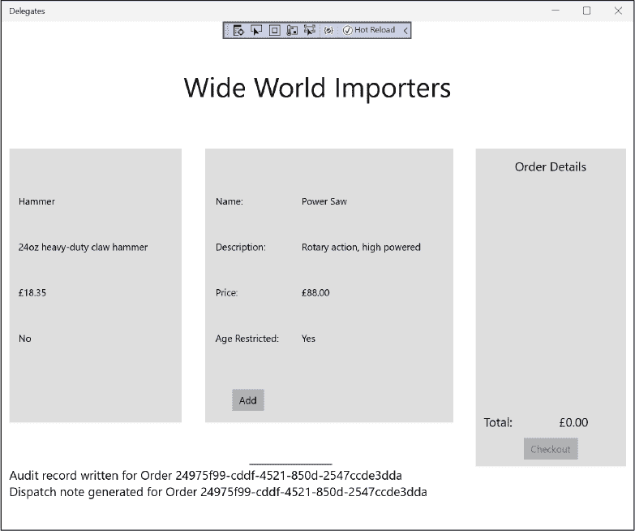

21. 下其他订单，并注意每次选择**结账**时出现的新消息。当消息区域填满时，你可能需要向下滚动查看它们。

22. 完成后，返回 Visual Studio 2022 并停止调试。

### 总结

在本章中，你学习了如何使用委托来引用方法并调用这些方法。你还了解了如何使用委托定义可以运行的 Lambda 表达式。最后，你学习了如何定义和使用事件来触发方法的执行。

* 如果你想继续学习下一章，请保持 Visual Studio 2022 运行并转到第 25 章。


| 触发事件 | 使用与方法调用相同的语法。你必须提供与事件引用的委托所期望参数类型匹配的参数。不要忘记检查事件是否为空。例如：点击此处查看代码图像 |

```csharp
class MyClass
{
    public event myDelegate MyEvent;
    ...
    private void RaiseEvent()
    {
        if (this.MyEvent is not null)
        {
            this.MyEvent();
        }
    }
    ...
}
```

# 第 21 章

## 使用查询表达式查询内存数据

**完成本章后，你将能够：**

*   定义语言集成查询 (LINQ) 查询以检查枚举集合的内容。
*   使用 LINQ 扩展方法和查询运算符。
*   解释 LINQ 如何延迟查询的评估，以及你如何强制执行执行并缓存 LINQ 查询的结果。

你现在已经接触了 C# 语言的大部分功能。然而，到目前为止，我略带过了该语言的一个重要方面，而这个方面可能会被许多应用程序使用：C# 为查询数据提供的支持。

你已经可以看到定义结构和类来对数据建模，并且可以使用集合和数组在内存中临时存储数据。然而，如何执行一些常见任务，例如在集合中搜索符合特定标准集的项？例如，如果你有一个 `Customer` 对象的集合，你如何找到所有位于纽约的客户，或者哪个城镇拥有聘用你服务的客户最多？你可以编写自己的代码来遍历集合并检查每个对象中的字段，但这类任务发生得如此频繁，以至于 C# 的设计者决定在语言中包含这些功能，以尽可能地减少你需要编写的代码量。在本章中，你将学习如何使用这些高级 C# 语言特性来查询和操作数据。

### 什么是 LINQ？

最简单的应用程序外，所有应用程序都需要处理数据。从历史上看，大多数应用程序都有自己的逻辑来执行这些操作。然而，这种策略会导致应用程序代码与其处理的数据结构变得紧密耦合。如果数据结构发生变化，你可能需要对处理数据的代码进行大量修改。

Microsoft .NET Framework 的设计者对这个问题进行了深思熟虑。他们决定通过提供从应用程序代码本身抽象查询数据机制的功能，来让应用程序开发人员的工作变得轻松。这些功能统称为语言集成查询，或 LINQ。

LINQ 的创建者客观审视了关系型数据库管理系统（如 Microsoft SQL Server）如何将查询数据库的语言与数据库中数据的内部格式分开。访问 SQL Server 数据库的开发人员向数据库管理系统发送结构化查询语言 (SQL) 语句。SQL 为开发者检索的数据提供了高级描述，但没有指示数据库管理系统应该如何检索它。这些细节由数据库管理系统本身控制。因此，调用 SQL 语句的应用程序并不关心数据库管理系统如何物理存储或检索数据。数据库管理系统使用的格式可以更改（例如，发布了新版本），而无需应用程序开发人员修改应用程序使用的 SQL 语句。

LINQ 提供了与 SQL 非常相似的语法和语义，具有许多相同的优点。你可以更改所查询数据的底层结构，而无需更改执行查询的代码。尽管 LINQ 看起来与 SQL 相似，但它灵活得多，并且处理更广泛的逻辑数据结构。例如，LINQ 可以处理层次化的数据，例如 XML 文档中的数据。然而，本章重点关注如何以关系的方式使用 LINQ。

### 在 C# 应用程序中使用 LINQ

解释如何使用支持 LINQ 的 C# 特性的最简单方法，可能是基于以下客户和地址信息处理一些简单的示例：

**客户信息**

| CustomerID | FirstName | LastName | CompanyName |
| --- | --- | --- | --- |
| 1 | Kim | Abercrombie | Alpine Ski House |
| 2 | Jeff | Hay | Coho Winery |
| 3 | Charlie | Herb | Alpine Ski House |
| 4 | Chris | Preston | Trey Research |
| 5 | Dave | Barnett | Wingtip Toys |
| 6 | Ann | Beebe | Coho Winery |
| 7 | John | Kane | Wingtip Toys |
| 8 | David | Simpson | Trey Research |
| 9 | Greg | Chapman | Wingtip Toys |
| 10 | Tim | Litton | Wide World Importers |

**地址信息**

| CompanyName | City | Country |
| --- | --- | --- |
| Alpine Ski House | Berne | Switzerland |
| Coho Winery | San Francisco | United States |
| Trey Research | New York | United States |
| Wingtip Toys | London | United Kingdom |
| Wide World Importers | Tetbury | United Kingdom |

LINQ 要求数据存储在实现了 `IEnumerable` 或 `IEnumerable<T>` 接口的数据结构中，如第 19 章 中“枚举集合”所述。你使用什么结构（数组、`HashSet<T>`、`Queue<T>` 或任何其他集合类型，甚至是你自己定义的）并不重要，只要它是可枚举的。然而，为了保持简单，本章中的示例假设代码所示所示 `customers` 和 `addresses` 数组。

 **注意** 在实际应用程序中，你将通过文件或数据库填充这些数组。点击此处查看代码图像

```csharp
var customers = new[] {
    new { CustomerID = 1, FirstName = "Kim", LastName = "Abercrombie", CompanyName = "Alpine Ski House" },
    new { CustomerID = 2, FirstName = "Jeff", LastName = "Hay", CompanyName = "Coho Winery" },
    new { CustomerID = 3, FirstName = "Charlie", LastName = "Herb", CompanyName = "Alpine Ski House" },
    new { CustomerID = 4, FirstName = "Chris", LastName = "Preston", CompanyName = "Trey Research" },
    new { CustomerID = 5, FirstName = "Dave", LastName = "Barnett", CompanyName = "Wingtip Toys" },
    new { CustomerID = 6, FirstName = "Ann", LastName = "Beebe", CompanyName = "Coho Winery" },
    new { CustomerID = 7, FirstName = "John", LastName = "Kane", CompanyName = "Wingtip Toys" },
    new { CustomerID = 8, FirstName = "David", LastName = "Simpson", CompanyName = "Trey Research" },
    new { CustomerID = 9, FirstName = "Greg", LastName = "Chapman", CompanyName = "Wingtip Toys" },
    new { CustomerID = 10, FirstName = "Tim", LastName = "Litton", CompanyName = "Wide World Importers" }
};

var addresses = new[] {
    new { CompanyName = "Alpine Ski House", City = "Berne", Country = "Switzerland" },
    new { CompanyName = "Coho Winery", City = "San Francisco", Country = "United States" },
    new { CompanyName = "Trey Research", City = "New York", Country = "United States" },
    new { CompanyName = "Wingtip Toys", City = "London", Country = "United Kingdom" },
    new { CompanyName = "Wide World Importers", City = "Tetbury", Country = "United Kingdom" }
};
```


接下来的“选择数据”、“过滤数据”、“排序、分组和聚合数据”以及“连接数据”章节将向你展示使用 LINQ 方法查询数据的基本能力和语法。虽然这种语法有时会变得有些复杂，但当你到达“使用查询操作符”章节时，你会发现你实际上并不需要记住它的工作原理。然而，你至少看一眼这些章节对你是有有用的，这样你就能充分理解 C# 提供的查询操作符是如何执行其任务的。

## 选择数据

假设你想显示一个列表，其中包含 `customers` 数组中每个客户的第一个名字。你可以通过以下代码完成此任务：

点击此处查看代码图像

```
IEnumerable<string> customerFirstNames =
    customers.Select(cust => cust.FirstName);
foreach (string name in customerFirstNames)
{
    Console.WriteLine(name);
}
```

 **注意**

本节所示示例的代码可以在 `LINQSamples` 解决方案中找到，它位于你“文档”文件夹中的 `\Microsoft Press\VCSBS\Chapter 21\LINQSamples` 文件夹下。

尽管这段代码非常短，但它做了很多工作，并且需要某种解释——从使用 `customers` 数组的 `Select` 方法开始。

使用 `Select` 方法，你可以从数组中检索特定数据——在本例中，即数组每个项的 `FirstName` 字段的值。它是如何工作的？`Select` 方法的参数实际上另一个方法，它接收 `customers` 数组中的行并返回从该行选定的数据。

你可以定义自己的自定义方法来执行此任务，但最简单的机制是使用 lambda 表达式来定义匿名方法，如前面的示例所示。在此处，你必须理解三三个重要的点：

*   变量 `cust` 是传递给方法的参数。你可以将 `cust` 视为 `customers` 数组中每一行的别名。编译器根据你对 `customers` 数组调用 `Select` 方法这一事实推导出此。你可以使用任何合法的 C# 标识符来代替 `cust`。
*   `Select` 方法此时并没有实际检索数据；它只是返回一个可枚举对象，当你以后遍历该对象时，它将获取由 `Select` 方法标识的数据。我们将在本章稍后的“LINQ 和延迟计算”章节中重新回到 LINQ 的这一方面。
*   `Select` 方法实际上不是 `Array` 类型的方法；它是 `Enumerable` 类的扩展方法。`Enumerable` 类位于 `System.Linq` 命名空间，并为实现泛型 `IEnumerable<T>` 接口的对象提供了大量的静态方法。

前面的示例使用 `customers` 数组的 `Select` 方法生成了一个名为 `customerFirstNames` 的 `IEnumerable<string>` 对象。（它的类型是 `IEnumerable<string>`，是因为 `Select` 方法返回一个客户第一个名字的可枚举集合，这些名字是字符串。）`foreach` 语句遍历这个字符串集合，按以下顺序打印每个客户的第一个名字：

```
Kim
Jeff
Charlie
Chris
Dave
Ann
John
David
Greg
Tim
```

你现在可以显示每个客户的第一个名字了。然而，获取每个客户的姓名要稍微复杂一些。如果你检查 Microsoft Visual Studio 2022 提供的文档中 `System.Linq` 命名空间下的 `Enumerable.Select` 方法定义，你会发现它像这样：

点击此处查看代码图像

```
public static IEnumerable<TResult> Select<TSource, TResult> (
         this IEnumerable<TSource> source,
         Func<TSource, TResult> selector
)
```

这实际上表示 `Select` 是一个泛型方法，它接受两个名为 `TSource` 和 `TResult` 的类型参数，以及两个名为 `source` 和 `selector` 的普通参数。`TSource` 是你正在生成可枚举结果集的集合类型（在本例中为 `customer` 对象），而 `TResult` 是可枚举结果集中数据的类型（在本例中为 `string` 对象）。记住 `Select` 是一个扩展方法，因此 `source` 参数实际上是对被扩展类型的引用（在示例中，是一个实现了 `IEnumerable` 接口的 `customer` 对象的泛型集合）。`selector` 参数指定了一个标识要检索字段的泛型方法。（记住 `Func` 是 .NET Framework 中泛型委托类型的名称，你可以用它来封装返回结果的泛型方法。）由 `selector` 参数引的方法接收一个 `TSource`（在本例中为 `customer`）参数并产生一个 `TResult`（在本例中为 `string`）对象。`Select` 方法返回的是 `TResult`（再次为 `string`）对象的可枚举集合。

 **注意**

第 12 章，“处理继承#ch12.xhtml_ch12)”解释了扩展方法的工作原理以及扩展方法的第一个参数的作用。

需要理解的重要点是，`Select` 方法返回基于单一类型的可枚举集合。如果你希望枚举器返回多个项目（例如姓名），你至少有两个选择：

*   你可以在 `Select` 方法中将姓名合并为单个字符串，如下：

    点击此处查看代码图像

    ```c
    IEnumerable<string> customerNames =
        customers.Select(cust => $"{cust.FirstName} {cust.LastName}");
    ```

*   你可以定义一个封装姓名的新类型并使用 `Select` 方法构造该类型的实例，如下：

    点击此处查看代码图像

    ```csharp
    class FullName
    {
        public string FirstName{ get; set; }
        public string LastName{ get; set; }
    }
    ...
    IEnumerable<FullName> customerFullNames =
        customers.Select(cust => new FullName
        {
            FirstName = cust.FirstName,
            LastName = cust.LastName
        });
    ```

第二种方案可能是更好的，但如果这是应用程序对 `Names` 类型的唯一使用，你可能倾向于使用如下代码中的匿名类型，而不是为单一操作定义新类型：

点击此处查看代码图像

```csharp
var customerFullNames =
customers.Select(cust => new 
{
    FirstName = cust.FirstName,
    LastName = cust.LastName 
});
```

注意这里使用 `var` 关键字来定义可枚举集合的类型。集合对象的类型是匿的，因此你不知道集合中对象的特定类型。

## 过滤数据

通过 `Select` 方法，你可以指定或*投影*你想包含在枚举集合中的字段。然而，你可能还希望限制枚举集合包含的行。例如，假设你想只列出 `addresses` 数组中位于美国的公司名称。为了实现这一点，你可以使用 `Where` 方法，如下：

点击此处查看代码图像

```csharp
IEnumerable<string> usCompanies = addresses
    .Where(addr => String.Equals(addr.Country,"United States"))
    .Select(usComp => usComp.CompanyName);
foreach (string name in usCompanies)
{
    Console.WriteLine(name);
}
```


在语法上，`Where` 方法与 `Select` 类似。它期望一个参数，该参数定义了一个根据你指定的标准过滤数据的方法。此示例使用了另一个 lambda 表达式。变量 `addr` 是 `addresses` 数组中行的别名，而 lambda 表达式返回所有 `Country` 字段匹配字符串 `United States` 的行。`Where` 方法返回一个可枚举的行集合，包含原始集合中的每个字段。随后，对这些行应用 `Select` 方法，从该可枚举集合中仅投影 `CompanyName` 字段，以返回另一个包含 `string` 对象的可枚举集合。（变量 `usComp` 是由 `Where` 方法返回的可枚举集合中每行的类型的别名。）因此，此完整表达式结果的类型为 `IEnumerable<string>`。理解这一系列操作至关重要——首先应用 `Where` 方法来过滤行，然后应用 `Select` 方法来指定字段。遍历此集合的 `foreach` 语句显示了以下公司：

```
Coho Winery
Trey Research
```

### 数据的排序、分组和聚合

如果你熟悉 SQL，那么你就会知道它允许你执行除简单投影和过滤之外的各种关系操作。例如，你可以指定按特定顺序返回数据，根据一个或多个键字段对返回的行进行分组，并根据每组中的行计算汇总值。LINQ 提供了相同的功能。

要按特定顺序检索数据，可以使用 `OrderBy` 方法。与 `Select` 和 `Where` 方法一样，`OrderBy` 期望一个方法作为其参数。该方法识别你想要用于对数据数据的表达式。例如，你可以按升序显示 `addresses` 数组中每家公司的名称，如下：

点击此处查看代码图像

```
IEnumerable<string> companyNames = addresses
    .OrderBy(addr => addr.CompanyName)
    .Select(comp => comp.CompanyName);

foreach (string name in companyNames)
{
    Console.WriteLine(name);
}
```

这段代码按字母顺序显示 `addresses` 表中的公司。

```
Alpine Ski House
Coho Winery
Trey Research
Wide World Importers
Wingtip Toys
```

如果你想按降序枚举数据，可以使用 `OrderByDescending` 方法。如果你想按多个键值进行排序，可以在 `OrderBy` 或 `OrderByDescending` 之后使用 `ThenBy` 或 `ThenByDescending` 方法。

要根据一个或多个字段中的共同值对数据分组，可以使用 `GroupBy` 方法。下面的示例了如何按国家对 `addresses` 数组中的公司分组：

点击此处查看代码图像

```
var companiesGroupedByCountry = addresses
    .GroupBy(addrs => addrs.Country);

foreach (var companiesPerCountry in companiesGroupedByCountry)
{
    Console.WriteLine(
        $"Country: {companiesPerCountry.Key}\t{companiesPerCountry.Count()} companies");

    foreach (var companies in companiesPerCountry)
    {
        Console.WriteLine($"\t{companies.CompanyName}");
    }
}
```

现在，你应该能看出这种模式。`GroupBy` 方法期望一个方法来指定分组数据的字段。然而，`GroupBy` 方法与你目前为止看到的其他方法之间存在一些细微的。

主要感兴趣的点是，你不需要使用 `Select` 方法将字段投影到结果中。`GroupBy` 返回的可枚举集合包含源集合中的所有字段，但行是根据 `GroupBy` 方法指定的字段被排列成一组可枚举集合。换句话说，`GroupBy` 方法的结果是一个可枚举的组集合，每个组都是一个可枚举的行集合。

在上面的示例中，可枚举集合 `companiesGroupedByCountry` 是一个国家集合。该集合中的项本身是可枚举集合，依次包含每个国家的公司。显示每个国家公司的代码使用 `foreach` 循环遍历 `companiesGroupedByCountry` 集合，逐个产生并显示每个国家，然后使用嵌套的 `foreach` 循环遍历每个国家的公司集合。

注意在外部 `foreach` 循环中，你可以使用每个项的 `Key` 字段访问你正在进行分组的值。你还可以使用 `Count`、`Max`、`Min` 等许多方法为每个组计算汇总数据。代码示例生成的输出看起来如下：

点击此处查看代码图像

```
Country: Switzerland    1 companies
        Alpine Ski House
Country: United States  2 companies
        Coho Winery
        Trey Research
Country: United Kingdom 2 companies
        Wingtip Toys
        Wide World Importers
```

你可以直接对 `Select` 方法的结果使用许多汇总方法，如 `Count`、`Max` 和 `Min`。例如，如果你想知道 `addresses` 数组中有多少家公司，可以使用如下这样的代码块：

点击此处查看代码图像

```
int numberOfCompanies = addresses
        .Select(addr => addr.CompanyName).Count();
Console.WriteLine($"Number of companies: {numberOfCompanies}");
```

注意，这些方法的结果是一个标量值而不是可枚举集合。上述代码的输出如下：

```
Number of companies: 5
```

我在此给出一个警告。这些汇总方法不区分底层集合中重复值的行。这意味着严格来说，先前的示例显示了 `addresses` 数组中有多少行包含 `CompanyName` 字段的值。如果你想找出此表中提到了多少个国家，你可能会尝试这样做：

点击此处查看代码图像

```
int numberOfCountries = addresses
    .Select(addr => addr.Country).Count();
Console.WriteLine($"Number of countries: {numberOfCountries}");
```

输出看起来如下：

```
Number of countries: 5
```

事实上，`addresses` 数组包含了三个不同的国家；只是 United States 和 United Kingdom 都出现了两次。可以使用 `Distinct` 方法从计算中消除重复，如下：

点击此处查看代码图像

```
int numberOfDistinctCountries = addresses
    .Select(addr => addr.Country).Distinct().Count();
Console.WriteLine($"Number of distinct countries: {numberOfDistinctCountries}");
```

`Console.WriteLine` 语句现在输出了预期的结果：

```
Number of countries: 3
```

### 数据连接

就像 SQL 一样，LINQ 允许你在一个或多个公共键字段上连接多个数据集。下面的示例显示了如何显示每个客户的名字和姓，以及客户所在的国家名称：

点击此处查看代码图像

```
var companiesAndCustomers = customers
  .Select(c => new { c.FirstName, c.LastName, c.CompanyName })
  .Join(addresses, custs => custs.CompanyName, addrs => addrs.CompanyName,
(custs, addrs) => new {custs.FirstName, custs.LastName, addrs.Country });

foreach (var row in companiesAndCustomers)
{
    Console.WriteLine(row);
}
```


客户的姓和名存储在 `customers` 数组中，但客户所属每家公司的国家存储在 `addresses` 数组中。`customers` 数组与 `addresses` 数组之间的公共键是公司名称（`CompanyName`）。`Select` 方法指定了 `customers` 数组中感兴趣的字段（`FirstName` 和 `LastName`）以及包含公共键的字段（`CompanyName`）。

你使用 `Join` 方法将 `Select` 方法确定的数据与另一个枚举集合进行连接。`Join` 方法的参数如下：

*   要进行连接的枚举集合
*   用于从 `Select` 方法确定的数据中识别公共键字段的方法
*   用于识别要对所选数据进行连接的公共键字段的方法
*   用于指定 `Join` 方法返回的可枚举结果集中所需的列的方法

在例示例中，`Join` 方法将包含 `customers` 数组中 `FirstName`、`LastName` 和 `CompanyName` 字段的枚举集合与 `addresses` 数组中的行进行连接。当 `customers` 数组中 `CompanyName` 字段的值与 `addresses` 数组中 `CompanyName` 字段的值匹配时，这两组数据就会连接。结果集包含来自 `customers` 数组的 `FirstName` 和 `LastName` 字段以及来自 `addresses` 数组的 `Country` 字段。输出 `companiesAndCustomers` 集合数据的代码显示了以下信息：

点击此处查看代码图像

```
{ FirstName = Kim, LastName = Abercrombie, Country = Switzerland }
{ FirstName = Jeff, LastName = Hay, Country = United States }
{ FirstName = Charlie, LastName = Herb, Country = Switzerland }
{ FirstName = Chris, LastName = Preston, Country = United States }
{ FirstName = Dave, LastName = Barnett, Country = United Kingdom }
{ FirstName = Ann, LastName = Beebe, Country = United States }
{ FirstName = John, LastName = Kane, Country = United Kingdom }
{ FirstName = David, LastName = Simpson, Country = United States }
{ FirstName = Greg, LastName = Chapman, Country = United Kingdom }
{ FirstName = Tim, LastName = Litton, Country = United Kingdom }
```

 **注意**

内存中的集合与关系型数据库中的表不同，它们所包含的数据不受相同数据完整性约束的。在关系型数据库中，假设每个客户都有一个对应的公司，且每家公司都有自己唯一的地址是可以接受的。集合并不强制相同级别的数据完整性，这意味着你可以很容易让一个客户引用一个在 `addresses` 数组中不存在的公司，你甚至可能让同一家公司在 `addresses` 数组中出现多次。在这种情况下，你获得的结果可能是准确的但出乎意料的。当你完全理解要连接的数据之间的关系时，`Join` 操作的效果最好。

### 使用查询运算符

前面的章节向你展示了许多使用 `System.Linq` 命名空间中定义的 `Enumerable` 类扩展方法对内存数据进行查询的可用功能。该语法使用了若干项高级 C# 语言特性，生成的代码有时可能难以理解和维护。为了减轻你的负担，C# 的设计者在语言中添加了查询运算符，你可以使用更类似于 SQL 的语法来利用 LINQ 特性。

正如你在本章早期的示例所示，你可以像如下一样获取每个客户的姓：

点击此处查看代码图像

```
IEnumerable<string> customerFirstNames = customers
    .Select(cust => cust.FirstName);
```

你可以通过 `from` 和 `select` 查询运算符来重述此语句，如下：

点击此处查看代码图像

```
 var customerFirstNames = from cust in customers
                         select cust.FirstName;
```

在编译时，C# 编译器会将此表达式解析为相应的 `Select` 方法。`from` 运算符为源集合定义了一个别名，而 `select` 运算符指定了使用该别名检索的字段。结果是客户 First 名字的枚举集合。如果你熟悉 SQL，请注意 `from` 运算符出现在 `select` 运算符之前。

继续同样的思路，为了获取每个客户的姓和名，你可以使用以下语句。（你可能想参考之前基于 `Select` 扩展方法的相同语句示例。）

点击此处查看代码图像

```
var customerNames = from cust in customers
                    select new { cust.FirstName, cust.LastName };
```

你使用 `where` 运算符来过滤数据。下面的示例显示了如何从 `addresses` 数组返回位于美国的公司名称：

点击此处查看代码图像

```
var usCompanies = from a in addresses
                  where String.Equals(a.Country,"United States")
                  select a.CompanyName;
```

要对数据进行排序，你使用 `orderby` 运算符，如下：

点击此处查看代码图像

```
var companyNames = from a in addresses
                   orderby a.CompanyName
                   select a.CompanyName;
```

你可以通过以下方式使用 `group` 运算符对数据进行分组：

点击此处查看代码图像

```
var companiesGroupedByCountry = from a in addresses
                                group a by a.Country;
```

注意，与之前的示例一样，你没有提供 `select` 运算符。你可以使用之前的代码遍历结果：

点击此处查看代码图像

```
foreach (var companiesPerCountry in companiesGroupedByCountry)
{
    Console.WriteLine(
        $"Country: {companiesPerCountry.Key}\t{companiesPerCountry.Count()} companies");
    foreach (var companies in companiesPerCountry)
    {
        Console.WriteLine($"\t{companies.CompanyName}");
    }
}
```

你可以如下对枚举集合返回的结果调用汇总函数（如 `Count`）：

点击此处查看代码图像

```
int numberOfCompanies = (from a in addresses
                         select a.CompanyName).Count();
```

注意你要将表达式括在内。如果你想忽略重复值，使用 `Distinct` 方法：

点击此处查看代码图像

```
int numberOfCountries = (from a in addresses
                         select a.Country).Distinct().Count();
```

 **提示**

很多情况下，你可能只想统计集合中的行数，而不是所有行中某个字段的值数。在这种情况下，你可以直接在原始集合上调用 `Count` 方法，如下：

点击此处查看代码图像

```
int numberOfCompanies = addresses.Count();
```

你可以使用 `join` 运算符跨公共键连接两个集合。下面的示例显示了跨每个集合的 `CompanyName` 列返回客户和地址的查询，这次使用 `join` 运算符进行了重述。你使用 `on` 子句配合 `equals` 运算符指定两个集合之间的关联方式。


LINQ 目前仅支持等值连接（基于等等的连接）。如果你是一个习惯于 SQL 的数据库开发者，你可能熟悉基于其他运算符的连接，例如 `>` 和 `<`，但 LINQ 并不提供这些功能。

点击此处查看代码图像

```
var countriesAndCustomers = from a in addresses
                            join c in customers
                            on a.CompanyName equals c.CompanyName
                            select new { c.FirstName, c.LastName, a.Country };
```

 **注意**

与 SQL 不同，LINQ 表达式中 `on` 子句的表达式顺序是重要的。你必须将要从中连接的项（引用 `from` 子句中集合中的数据）放在 `equals` 运算符的左侧，将要与之连接的项（引用 `join` 子句中集合中的数据）放在右侧。

LINQ 还提供了许多其他方法用于汇总信息以及连接、分组和搜索数据。本节仅涵盖了最常用的功能。例如，LINQ 提供了 `Intersect` 和 `Union` 方法，你可以用它们执行集合范围的操作。它还提供了如 `Any` 和 `All` 等方法，你可以用它们来判断集合中至少有一个项目或每个项目是否匹配指定的谓词。你可以使用 `Take` 和 `Skip` 方法对可枚举集合中的值进行分区。更多信息请参阅 Visual Studio 2022 附带文档中的 LINQ 章节。

#### 在 Tree<TItem> 对象中查询数据

在本章中之前看到的示例展示了如何查询数组中的数据。你可以对任何实现泛型 `IEnumerable<T>` 接口的集合类使用相同的技术。在下面的练习中，你将定义一个新的类来为公司员工建模。你创建一个包含 `Employee` 对象集合的 `BinaryTree` 对象，然后使用 LINQ 查询这些信息。你最初将直接调用 LINQ 扩展方法，然后将修改代码以使用查询操作符。

#### 使用扩展方法从 BinaryTree 检索数据

1. 启动 Visual Studio 2022（如果它尚未运行）。
2. 打开 `QueryBinaryTree` 解决方案，它位于 `Documents` 文件夹中的 `\Microsoft Press\VCSBS\ 第 21 章\QueryBinaryTree` 文件夹中。
   解决方案中的项目包含 `Program.cs` 文件，它定义了带有你在之前的练习中过的 `Main` 和 `doWork` 方法的 `Program` 类。解决方案还包含你在之前的章节中见过的 `BinaryTree` 项目的副本。
3. 在解决方案资源管理器中，右键点击 `QueryBinaryTree` 项目，指向**添加**（Add），然后选择**类**（Class）。
4. 在“添加新项 - Query BinaryTree”对话框中，在`Name` 框中输入 `Employee.cs`，然后选择**添加**（Add）。
5. 将以下代码中**加粗**显示的自动属性添加到 `Employee` 类中：
   点击此处查看代码图像

```
class Employee
{
    public string FirstName { get; set; }
    public string LastName { get; set; }
    public string Department { get; set; }
    public int Id { get; set; }
}
```

6. 将后续代码中**加粗**显示的 `ToString` 方法添加到 `Employee` 类中。.NET Framework 中的类型在将对象转换为字符串表示时会使用此方法，例如在使用 `Console.WriteLine` 语句显示它时。
   点击此处查看代码图像

```
class Employee
{
    ...
    public override string ToString() =>
        $"Id: {this.Id}, Name: {this.FirstName} {this.LastName}, Dept: {this.Department}";
}
```

7. 修改 `Employee` 类的定义以实现 `IComparable<Employee>` 接口，如下：
   点击此处查看代码图像

```
class Employee : IComparable<Employee>
{
}
```
   这一步是必要的，因为 `BinaryTree` 类指定了它的元素必须是“可比较的”。

8. 悬停在类定义中的 `IComparable<Employee>` 接口上，选择出现的灯泡图标，然后在上下文菜单上选择**显式实现所有成员**（Implement all members explicitly）。
   这将生成 `CompareTo` 方法的默认实现。记住，当 `BinaryTree` 类在将元素插入树时需要比较元素时会调用此方法。
9. 将 `CompareTo` 方法的主体替换为如下**加粗**所示的代码。此 `CompareTo` 方法的实现根据 `Id` 字段的值比较 `Employee` 对象。
   点击此处查看代码图像

```
int IComparable<Employee>.CompareTo(Employee other)
{
       if (other is null)
       {
           return 1;
       }

       if (this.Id > other.Id)
       {
           return 1;
       }

       if (this.Id < other.Id)
       {
           return -1;
       }
       return 0;
}
```
    **注意**
   关于 `IComparable<T>` 接口的描述，请参考第 19 章。

10. 在代码编辑器窗口中显示 `QueryBinaryTree` 项目的 `Program.cs` 文件。然后在该文件顶部添加以下 `using` 指令：

```
using System.Linq;
using BinaryTree;
```

11. 在 `Program` 类的 `doWork` 方法中，删除 `// TODO:` 注释并添加以下**加粗**语句以构造填充 `BinaryTree` 类的实例：
    点击此处查看代码图像

```
static void doWork()
{
    Tree<Employee> empTree = new Tree<Employee>(
        new Employee { Id = 1, FirstName = "Kim", LastName = "Abercrombie", Department = "IT" }
    );

    empTree.Insert(
        new Employee { Id = 2, FirstName = "Jeff", LastName = "Hay", Department = "Marketing" }
    );

    empTree.Insert(
        new Employee { Id = 4, FirstName = "Charlie", LastName = "Herb", Department = "IT" }
    );

    empTree.Insert(
        new Employee { Id = 6, FirstName = "Chris", LastName = "Preston", Department = "Sales" }
    );

    empTree.Insert(
        new Employee { Id = 3, FirstName = "Dave", LastName = "Barnett", Department = "Sales" }
    );

    empTree.Insert(
        new Employee { Id = 5, FirstName = "Tim", LastName = "Litton", Department = "Marketing" }
    );
}
```

12. 在 `doWork` 方法末尾添加以下**加粗**语句。此代码调用 `Select` 方法来列出二叉树中找到的部门。
    点击此处查看代码图像

```
static void doWork()
{
    ...
    Console.WriteLine("List of departments");
    var depts = empTree.Select(d => d.Department);

    foreach (var dept in depts)
    {
        Console.WriteLine($"Department: {dept}");
    }
}
```

13. 在**调试**（Debug）菜单上选择**无调试启动**（Start Without Debugging）。
    应用程序应该输出以下部门列表：

```
List of departments
Department: IT
Department: Marketing
Department: Sales
Department: IT
Department: Marketing
Department: Sales
```


每个部门出现两次，是因为每个部门有两个员工。部门的顺序由 `Employee` 类的 `CompareTo` 方法决定，该方法使用每个员工的 `Id` 属性对数据进行排序。第一个部门对应 `Id` 值为 `1` 的员工，第二个部门对应 `Id` 值为 `2` 的员工，以此此类推。

14. 按 `Enter` 返回 Visual Studio 2022。

15. 在 `Program` 类的 `doWork` 方法中，创建部门枚举集合的语句，如例例中**粗体**部分所示：

    点击此处查看代码图像

```
var depts = empTree.Select(d => d.Department).Distinct();
```

`Distinct` 方法从枚举集合中移除重复行。

16. 在 `Debug` 菜单上，选择 `Start Without Debugging`（不调试启动）。然后验证应用程序现在每个部门只显示一次，如下所示：

```
List of departments
Department: IT
Department: Marketing
Department: Sales
```

17. 按 `Enter` 返回 Visual Studio 2022。

18. 将下所示的**粗体**语句添加到 `doWork` 方法的末尾。此代码块使用 `Where` 方法过滤员工并仅返回 IT 部门的员工。`Select` 方法返回整行而不是投影特定的列。

    点击此处查看代码图像

```
static void doWork()
{
    ...
    Console.WriteLine();
    Console.WriteLine("Employees in the IT department");
    var ITEmployees =
        empTree.Where(e => String.Equals(e.Department, "IT"))
        .Select(emp => emp);

    foreach (var emp in ITEmployees)
    {
        Console.WriteLine(emp);
    }
}
```

19. 在上一步代码之后，将下所示的**粗体**代码添加到 `doWork` 方法的末尾。此代码使用 `GroupBy` 方法按部门对二叉树中找到员工进行分组。外层 `foreach` 语句遍历每个组，显示部门名称。内部 `foreach` 语句显示每个部门中员工的名称。

    点击此处查看代码图像

```
static void doWork()
{
    ...
    Console.WriteLine("");
    Console.WriteLine("All employees grouped by department");
    var employeesByDept = empTree.GroupBy(e => e.Department);

    foreach (var dept in employeesByDept)
    {
        Console.WriteLine($"Department: {dept.Key}");
        foreach (var emp in dept)
        {
            Console.WriteLine($"\t{emp.FirstName} {emp.LastName}");
        }
    }
}
```

20. 在 `Debug` 菜单上，选择 `Start Without Debugging`（不调试启动）。验证应用程序的输出如下：

    点击此处查看代码图像

```
List of departments
Department: IT
Department: Marketing
Department: Sales

Employees in the IT department
Id: 1, Name: Kim Abercrombie, Dept: IT
Id: 4, Name: Charlie Herb, Dept: IT

All employees grouped by department
Department: IT
        Kim Abercrombie
        Charlie Herb
Department: Marketing
        Jeff Hay
        Tim Litton
Department: Sales
        Dave Barnett
        Chris Preston
```

21. 按 `Enter` 返回 Visual Studio 2022。

### 使用查询运算符从 BinaryTree 检索数据

1. 在 `doWork` 方法中，注释掉生成部门枚举集合的语句，并用下所示的**粗体**等效语句替换它，使用 `from` 和 `select` 查询运算符：

    点击此处查看代码图像

```
// var depts = empTree.Select(d => d.Department).Distinct();
var depts = (from d in empTree
             select d.Department).Distinct();
```

2. 注释生成 IT 部门员工枚举集合的语句，并用下所示的**粗体**代码替换它：

    点击此处查看代码图像

```
// var ITEmployees =
//    empTree.Where(e => String.Equals(e.Department, "IT"))
//    .Select(emp => emp);
var ITEmployees = from e in empTree
                  where String.Equals(e.Department, "IT")
                  select e;
```

3. 注释生成按部门分组员工枚举集合的语句，并用下方代码所示的**粗体**语句替换它：

    点击此处查看代码图像

```
// var employeesByDept = empTree.GroupBy(e => e.Department);
var employeesByDept = from e in empTree
                      group e by e.Department;
```

4. 在 `Debug` 菜单上，选择 `Start Without Debugging`（不调试启动）。然后验证程序显示的结果与之前相同。

    点击此处查看代码图像

```
List of departments
Department: IT
Department: Marketing
Department: Sales

Employees in the IT department
Id: 1, Name: Kim Abercrombie, Dept: IT
Id: 4, Name: Charlie Herb, Dept: IT

All employees grouped by department
Department: IT
        Kim Abercrombie
        Charlie Herb
Department: Marketing
        Jeff Hay
        Tim Litton
Department: Sales
        Dave Barnett
        Chris Preston
```

5. 按 `Enter` 返回 Visual Studio 2022。

### LINQ 与延迟执行

当使用 LINQ 定义枚举集合时（无论是使用 LINQ 方法还是查询运算符），请记住，应用程序在执行 LINQ 时并没有实际构建集合，而是在遍历它时才进行枚举。这意味着在执行 LINQ 查询和检索数据之间，原始集合可能会发生。然而，你将始终获取到最新数据。例如，之前的查询定义了美国公司的枚举集合：

    点击此处查看代码图像

```
var usCompanies = from a in addresses
                  where String.Equals(a.Country, "United States")
                  select a.CompanyName;
```

在遍历 `usCompanies` 集合之前，`addresses` 数组中的数据尚未被检索，`Where` 过滤器指定的条件也没有被评估：

    点击此处查看代码图像

```
foreach (string name in usCompanies)
{
    Console.WriteLine(name);
}
```

如果你在定义 `usCompanies` 集合和遍历集合之间修改了 `addresses` 数组中的数据（例如添加了一个新的美国公司），你将看到这些新数据。这种策略被称为延迟执行。

你可以在定义 LINQ 查询时强制执行，并生成一个静态的缓存集合。该集合是原始数据的副本，如果数据发生变化，它也不会改变。LINQ 提供了 `ToList` 方法来构建包含缓存副本的静态 `List` 对象。你可以这样使用：

    点击此处查看代码图像

```
var usCompanies = from a in addresses.ToList()
                  where String.Equals(a.Country, "United States")
                  select a.CompanyName;
```


在此情况下，公司列表在你创建查询时就已经固定了。如果你向 `addresses` 数组中添加了更多美国公司，那么在遍历 `usCompanies` 集合时你将无法看到它们。LINQ 还提供了 `ToArray` 方法，它可以将缓存的集合存储为数组。

在本章的最后一个练习中，你将比较使用 LINQ 查询的**延迟执行**与生成**缓存集合**的效果。

### 要检查 LINQ 查询的延迟执行和缓存执行的影响

1.  返回 Visual Studio 2022，显示 `QueryBinaryTree` 项目，然后编辑 `Program.cs` 文件。

2.  注释掉 `doWork` 方法中的内容，但保留构建 `empTree` 二叉树的语句，如下所示：

    点击此处查看代码图像

    ```
    static void doWork()
    {
        Tree<Employee> empTree = new Tree<Employee>(
            new Employee { Id = 1, FirstName = "Kim", LastName = "Abercrombie", Department = "IT"
        });

        ...
        empTree.Insert(
            new Employee { Id = 5, FirstName = "Tim", LastName = "Litton", Department = "Marketing"
        });

        /* 注释方法的其余部分
             ...
             */
    }
    ```

     **提示**

    你可以通过在“代码和文本编辑器”窗口中选择整个代码块，然后选择工具栏上的“注释所选行”按钮来注释掉代码块。

3.  在创建并填充 `empTree` 二叉树的代码之后，向 `doWork` 方法中添加以下**加粗**所示的语句：

    点击此处查看代码图像

    ```
    static void doWork()
    {
        ...
        Console.WriteLine("All employees");
        var allEmployees = from e in empTree
                           select e;

        foreach (var emp in allEmployees)
        {
            Console.WriteLine(emp);
        }
        ...
    }
    ```

    此代码生成了一个名为 `allEmployees` 的员工枚举集合，然后遍历该集合，显示每个员工的详细信息。

4.  在上一步中输入的语句之后，立即添加以下代码：

    点击此处查看代码图像

    ```
    static void doWork()
    {
        ...
        empTree.Insert(new Employee
        {
            Id = 7,
            FirstName = "David",
            LastName = "Simpson",
            Department = "IT"
        });

        Console.WriteLine();
             Console.WriteLine("Employee added");

        Console.WriteLine("All employees");
        foreach (var emp in allEmployees)
        {
            Console.WriteLine(emp);
        }
        ...
    }
    ```

    这些语句向 `empTree` 树添加了一个新员工，然后再次遍历 `allEmployees` 集合。

5.  在**调试** 菜单上，选择**转调试调试启动**。然后验证应用程序的输出是否如下：

    点击此处查看代码图像

    ```
    All employees
    Id: 1, Name: Kim Abercrombie, Dept: IT
    Id: 2, Name: Jeff Hay, Dept: Marketing
    Id: 3, Name: Dave Barnett, Dept: Sales
    Id: 4, Name: Charlie Herb, Dept: IT
    Id: 5, Name: Tim Litton, Dept: Marketing
    Id: 6, Name: Chris Preston, Dept: Sales
    Employee added
    All employees
    Id: 1, Name: Kim Abercrombie, Dept: IT
    Id: 2, Name: Jeff Hay, Dept: Marketing
    Id: 3, Name: Dave Barnett, Dept: Sales
    Id: 4, Name: Charlie Herb, Dept: IT
    Id: 5, Name: Tim Litton, Dept: Marketing
    Id: 6, Name: Chris Preston, Dept: Sales
    Id: 7, Name: David Simpson, Dept: IT
    ```

    注意，当应用程序第二次遍历 `allEmployees` 集合时，显示的列表包含了 David Simpson，尽管该员工是在 `allEmployees` 集合定义之后才添加的。

6.  按 **Enter** 返回 Visual Studio 2022。

7.  在 `doWork` 方法中，更改生成 `allEmployees` 集合的语句，以便立即识别并缓存数据，如下所示加粗所示：

    点击此处查看代码图像

    ```c
    var allEmployees = from e in empTree.ToList<Employee>()
                       select e;
    ```

    LINQ 提供了 `ToList` 和 `ToArray` 方法的泛型和非泛型版本。如果可能，最好使用这些方法的泛型版本以确保结果的类型安全。`select` 运算符返回的数据是一个 `Employee` 对象，此步中显示的代码将 `allEmployees` 生成为泛型 `List<Employee>` 集合。

8.  在**调试** 菜单上，选择**转调试调试启动**。然后验证应用程序的输出是否如下：

    点击此处查看代码图像

    ```
    All employees
    Id: 1, Name: Kim Abercrombie, Dept: IT
    Id: 2, Name: Jeff Hay, Dept: Marketing
    Id: 3, Name: Dave Barnett, Dept: Sales
    Id: 4, Name: Charlie Herb, Dept: IT
    Id: 5, Name: Tim Litton, Dept: Marketing
    Id: 6, Name: Chris Preston, Dept: Sales
    Employee added
    All employees
    Id: 1, Name: Kim Abercrombie, Dept: IT
    Id: 2, Name: Jeff Hay, Dept: Marketing
    Id: 3, Name: Dave Barnett, Dept: Sales
    Id: 4, Name: Charlie Herb, Dept: IT
    Id: 5, Name: Tim Litton, Dept: Marketing
    Id: 6, Name: Chris Preston, Dept: Sales
    Id: 7, Name: David Simpson, Dept: IT
    ```

    注意当应用程序第二次遍历 `allEmployees` 集合时，显示的列表包含了 David Simpson，尽管该员工是在 `allEmployees` 集合定义之后添加的。

9.  按 **Enter** 返回 Visual Studio 2022。

### 总结

在本章中，你学习了 LINQ 如何使用 `IEnumerable<T>` 接口和扩展方法提供查询数据的机制。你还看到了这些功能如何支持 C# 查询表达式。

* 如果你想继续下一章，请保持 Visual Studio 2022 运行并转到第 22 章。
* 如果你现在退出 Visual Studio 2022，请在文件菜单中选择退出。

### 快速参考

| 操作 | 方法 |
| :--- | :--- |
| 从枚举集合中投影指定字段 | 使用 `Select` 方法并指定要投影的 Lambda 表达式。例如：点击此处查看代码图像 <br><br>```cvar customerFirstNames = customers.Select(cust => cust.FirstName);``` <br><br> 或者使用 `from` 和 `select` 查询运算符。例如：点击此处查看代码图像 <br><br>```cvar customerFirstNames = from cust in customers select cust.FirstName;``` |
| 从枚举集合中过滤行 | 使用 `Where` 方法并指定行应匹配标准的 Lambda 表达式。例如：点击此处查看代码图像 <br><br>```cvar usCompanies = addresses.Where(addr => String.Equals(addr.Country,"United States")).Select(usComp => usComp.CompanyName);``` <br><br> 或者使用 `where` 查询运算符。例如：点击此处查看代码图像 <br><br>```cvar usCompanies = addresses.Where(addr => String.Equals(addr.Country,"United States")).Select(usComp => usComp.CompanyName);``` |
| 按特定顺序遍历数据 | 使用 `OrderBy` 方法并指定用于排序行的字段 Lambda 表达式。例如：点击此处查看代码图像 <br><br>```cvar companyNames = addresses.OrderBy(addr => addr.CompanyName).Select(comp => comp.CompanyName);``` |


或者，使用 `orderby` 查询操作符。例如：点击此处查看代码图片

```cs
var companyNames =
    from a in addresses
             orderby a.CompanyName
             select a.CompanyName;
```

| 根据字段中的值对数据进行分组 | 使用 `GroupBy` 方法并指定 lambda 表达式，以识别用于分组行的字段。例如：点击此处查看代码图片 |

```cs
var companiesGroupedByCountry = 
    addresses.GroupBy(addrs => addrs.Country);
```

或者，使用 `group by` 查询操作符。例如：点击此处查看代码图片

```cs
var companiesGroupedByCountry =
    from a in addresses
    group a by a.Country;
```

#### 连接存储在两个不同集合中的数据 | 使用 `Join` 方法，指定要连接的集合、连接标准以及结果的字段。例如：点击此处查看代码图片 |

```cs
var countriesAndCustomers = customers
    .Select(c => new { c.FirstName, c.LastName,
c.CompanyName })
    .Join(addresses, custs => custs.CompanyName,
       addrs => addrs.CompanyName,
       (custs, addrs) => new {custs.FirstName,
        custs.LastName, addrs.Country });
```

或者，使用 `join` 查询操作符。例如：点击此处查看代码图片

```cs
var countriesAndCustomers =
    from a in addresses
    join c in customers
    on a.CompanyName equals c.CompanyName
    select new { c.FirstName, c.LastName, a.Country
};
```

| 强制立即生成 LINQ 查询的结果 | 使用 `ToList` 或 `ToArray` 方法生成包含结果的列表或数组。例如：点击此处查看代码图片 |

```cs
var allEmployees =
    from e in empTree.ToList<Employee>()
    select e;
```

## 第 22 章

## 运算符重载

**完成本章后，你将能够：**

* 解释运算符重载的工作原理。
* 为你自己的类型编写递增和递减运算符。
* 理解结构体（struct）和类中运算符的细微差别。
* 解释为何需要成对实现某些运算符。
* 在结构体中重载运算符，并实现自定义等性运算符。
* 为你自己的类型实现隐式和显式转换运算符。

全书中的示例充分利用了标准运算符符号（如 `+` 和 `–`）对类型（如 `int` 和 `double`）执行标准操作（如加法和减法）。许多内置类型为每个运算符都带有自己的预定义行为。你也可以在自己的结构体和类中定义运算符的行为，这就是本章的主题。

### 理解运算符

在深入研究运算符如何工作以及你如何对它们进行重载之前，回顾一下运算符的一些基本方面是值得的。以下列表总结了这些方面：

* 你使用运算符将操作数组合成表达式。每个运算符都有自己的语义，该语义取决于它所处理的类型。例如，当你与数值类型配合加法运算符（`+`）时，它意味着*相加*；当你与字符串配合时，它意味着*拼接*。
* 每个运算符都有*优先级*。例如，乘法运算符（`*`）的优先级高于 `+` 运算符。这意味着表达式 `a + b * c` 与 `a + (b * c)` 是相同的。
* 每个运算符都有*结合性*，它定义了求值是从左到右计算还是从右到左计算。例如，等号运算符（`=`）是右结合的（它从右到左求值），因此 `a = b = c` 等同于 `a = (b = c)`。
* *一元运算符*是仅包含一个操作数的运算符。例如，递增运算符（`++`）就是一元运算符。
* *二元运算符*是包含两个操作数的运算符。例如，`*` 运算符就是二元运算符。

#### 运算符限制

本书展示了许多在定义自定义类型时如何重载方法的示例。在 C# 中，你也可以为自己的类型重载许多现有的运算符符号，尽管语法略有不同。当你这样做时，你实现的运算符将自动遵循一个定义良好的框架，该框架遵循以下规则：

* 你不能更改运算符的优先级或结合性。优先级和结合性基于运算符符号（例如 `+`），而不是基于运算符符号所使用的类型（例如 `int`）。因此，无论 `a`、`b` 和 `c` 的类型如何，表达式 `a + b * c` 始终等于 `a + (b * c)`。
* 你不能更改运算符的元数（操作数的数量）。例如，`*`（乘法符号）是一个二元运算符。如果你为自己的类型声明 `*` 运算符，它必须是二元运算符。
* 你不能发明新的运算符符号。例如，`*`（乘法符号）是一个二元运算符。如果你为自己的类型声明 `*` 运算符，它必须是二元运算符。
* 你不能更改应用于内置类型时运算符的含义。例如，`1 + 2` 具有预定义的含义，你不允许重写它。
* 你不能重载某些运算符符号。例如，你不能重载点（`.`）运算符，它表示类访问。

#### 重载运算符

要定义你自己的运算符，必须重载一个选定的运算符。你使用类似于方法的语法、返回类型和参数，但方法的名称是 `operator` 关键字加上你要声明的运算符符号。例如，以下代码显示了一个名为 `Hour` 的用户定义结构体，它定义了一个二元 `+` 运算符来相两个 `Hour` 实例。

点击此处查看代码图片

```cs
struct Hour
{
    public Hour(int initialValue) => this.value = initialValue;

    public static Hour operator +(Hour lhs, Hour rhs) => new Hour(lhs.value + rhs.value);
    ...
    private int value;
}
```

注意：

* 运算符是公共的。所有运算符必须公共。
* 运算符是静态的。所有运算符必须静态。运算符不是多态的，不能使用 `virtual`、`abstract`、`override` 或 `sealed` 修饰符。
* 二元运算符（如示例所示的 `+` 运算符）有两个显式参数，而一元运算符有一个显式参数。（C++ 程序员应该注意，运算符没有隐藏的 `this` 参数。）

当你声明高度样式化的功能（如运算符）时，采用参数的命名约定是有用的。例如，开发者通常在二元运算符中使用 `lhs` 和 `rhs`（分别是左侧和右侧的缩写）。

当你对两个 `Hour` 类型的表达式使用 `+` 运算符时，C# 编译器会自动将你的代码转换为对 `operator +` 方法的调用。C# 编译器将此代码

点击此处查看代码图片

```cs
Hour Example(Hour a, Hour b) => a + b;
```

转换为此：

点击此处查看代码图片

```cs
Hour Example(Hour a, Hour b) => Hour.operator +(a,b); // 伪代码
```


然而，请注意，这种语法是伪代码，并不是有效的 C#。你只能在标准的中置表示法（符号位于两个操作数之间）中使用二进制运算符。

在声明运算符时，你必须遵循的最后一个规则是：至少有一个参数的类型是包含它的类型。在前面的 `Hour` 类的 `operator +` 示例中，参数 `a` 或 `b` 之一必须是 `Hour` 对象。在这个示例中，两个参数都是 `Hour` 对象。但是，假设例如你想要定义 `operator +` 的额外实现，将一个整数（小时数）加到 `Hour` 对象上。在这种情况下，第一个参数可以是 `Hour`，而第二个参数可以是整数。这一规则使得编译器在尝试解析运算符调用时更容易知道该去何处查找，它也确保了你无法更改内置运算符的含义。

## 创建对称运算符

在前面的节中，你已经看到如何声明一个二二的 `+` 运算符来将两个 `Hour` 类型的实例相加。`Hour` 结构体还有一个构造函数，可以从 `int` 创建一个 `Hour`。这意味着你可以相加一个 `Hour` 和一个 `int`；你只需要先使用 `Hour` 构造函数将 `int` 转换为 `Hour`，如下例：

```
Hour a = ...;
int b = ...;
Hour later = a + new Hour;
```

这无疑是有效代码，但它不如直接相加一个 `Hour` 和 `int` 那么清晰简洁，例如：

```
Hour a = ...;
int b = ...;
Hour later = a + b;
```

为了使表达式 `a + b` 有效，你必须指定将一个 `Hour`（左边的 `a`）和一个 `int`（右边的 `b`）相加的意思。换说，你必须声明一个二进制 `+` 运算符，其第一个参数是 `Hour`，第二个参数是 `int`。下面的代码显示了推荐的方法：

点击此处查看代码图像

```
struct Hour
{
    public Hour(int initialValue) => this.value = initialValue;
    ...
    public static Hour operator +(Hour lhs, Hour rhs) => new Hour(lhs.value + rhs.value);

    public static Hour operator +(Hour lhs, int rhs) => lhs + new Hour(rhs);
    ...
    private int value;
}
```

注意，运算符的所有第二个版本所做的只是从其 `int` 参数构造一个 `Hour`，然后调用第一个版本。通过这样，运算符背后的真实逻辑保持在一个地方。重点在于，额外的 `operator +` 只是让现有功能更容易使用。此外，注意你不应该提供此运算符的许多不同版本，每个版本都有不同的第二个参数类型；相反，只需满足常见且有意义的情况，如果需要异常情况，让类的用户采取任何额外的步骤即可。

这个 `operator +` 声明了如何将 `Hour` 作为左操作数、`int` 作为右操作数相加。它并没有声明如何将 `int` 作为左操作数、`Hour` 作为右操作数相加：

点击此处查看代码图像

```
int a = ...;
Hour b = ...;
Hour later = a + b; // 编译时错误
```

这是不符合直觉的。如果你能写表达式 `a + b`，你预计自己也能写 `b + a`。因此，你应该为 `operator +` 提供另一个重载：

点击此处查看代码图像

```
struct Hour
{
    public Hour(int initialValue) => this.value = initialValue;
    ...
    public static Hour operator +(Hour lhs, int rhs) => lhs + new Hour(rhs);

    public static Hour operator +(int lhs, Hour rhs) => new Hour(lhs) + rhs;
    ...
    private int value;
}
```

 **注意**

C++ 程序员应该注意，你必须自己提供重载。编译器不会为你编写重载，也不会静默地交换两个操作数的顺序来寻找匹配的运算符。

## 理解复合赋值的求值

复合赋值运算符（例如 `+=`）始终根据其相关的简单运算符（例如 `+`）求值。换句话说，语句

```
a += b;
```

会自动按如下方式求值：

```
a = a + b;
```

通常情况下，表达式 `a @= b`（其中 `@` 代表任何有效的运算符）始终被求值为 `a = a @ b`。如果你重载了相应的简单运算符，当你使用其相关的复合赋值运算符时，会自动调用重载后的版本，如下例所示：

点击此处查看代码图像

```
Hour a = ...;
int b = ...;
a += a; // 等于 a = a + a
a += b; // 等于 a = a + b
```

第一个复合赋值表达式（`a += a`）是有效的，因为 `a` 是 `Hour` 类型，且 `Hour` 类型声明了一个二进制运算符 `operator +`，其两个参数都是 `Hour`。同样，第二个复合赋值表达式（`a += b`）也是有效的，因为 `a` 是 `Hour` 类型。

### 声明增减运算符

在 C# 中，你可以声明自己的增（`++`）和减（`--`）运算符。声明这些运算符时遵循通常规则：它们必须是公共的、必须是静态的，并且必须是单元的（接受单个参数）。这里是 `Hour` 结构的增运算符：

点击此处查看代码图像

```
struct Hour
{
    ...
    public static Hour ++(Hour arg)
    {
        arg.value++;
        return arg;
    }
    ...

    private int value;
}
```

增减运算符的独特之处在于它们可以以前缀和后缀的形式使用。C# 巧妙地使用同一个运算符来处理前缀和后缀。后缀表达式的结果是表达式执行*之前*的值。换说，编译器实际上将代码

```
Hour now = new Hour(9);
Hour postfix = now++;
```

转换为：

点击此处查看代码图像

```
Hour now = new Hour(9);
Hour postfix = now;
now = Hour.operator ++(now); // 伪代码，无效 C#
```

前缀表达式的结果是运算符的返回值，因此 C# 编译器实际上将代码

```
Hour now = new Hour(9);
Hour prefix = ++now;
```

转换为：

点击此处查看代码图像

```
Hour now = new Hour(9);
now = Hour.operator ++(now); // 伪代码，无效 C#
Hour prefix = now;
```

这种等效性意味着增减运算符的返回类型与参数类型相同。

## 结构体和类的运算符比较

`Hour` 结构中的增运算符实现之所以有效，是因为 `Hour` 是结构体。如果你将 `Hour` 改为类但保持增运算符的实现不变，后缀翻译将给出正确答案。如果你记得类是引用类型，并且回顾之前解释的编译器翻译，你可以在下面的示例中看到为什么 `Hour` 运算符不再按预期工作：

点击此处查看代码图像

```
Hour now = new Hour(9);
Hour postfix = now;
now = Hour.operator ++(now); // 伪代码，无效 C#
```


如果 `Hour` 是一个类，赋值语句 `postfix = now` 会让变量 `postfix` 指向与 `now` 的对象。更新 `now` 会自动更新 `postfix`！如果 `Hour` 是一个结构体，赋值语句会在 `postfix` 中创建 `now` 的副本，对 `now` 的任何更改都不会改变 `postfix`，这正是你所需要的。

当 `Hour` 为类时，递增运算符的正确实现如下：

点击此处查看代码图片

```
class Hour
{
    public Hour(int initialValue) => this.value = initialValue;
    ...
    public static Hour operator ++(Hour arg) => new Hour(arg.value + 1);
    ...
    private int value;
}
```

注意，`operator` `++` 现在根据原始对象中的数据创建一个新对象。新对象中的数据增加了，但原始对象中的数据保持不变。虽然这种方法可行，但编译器对递增运算符的翻译会导致每次使用时都创建一个新对象。这在内存使用和垃圾回收开销方面可能是昂贵的。因此，建议在定义类型时限制运算符重载。此建议适用于所有运算符，而不只是递增运算符。

### 定义运算符对

某些运算符自然地成对出现。例如，如果你可以使用 `!=` 运算符比较两个 `Hour` 值，那么你可能认为也能使用 `==` 运算符比较两个 `Hour` 值。C# 编译器通过强制执行这一非常合理的预期：即如果你定义了 `operator` `==` 或 `operator !=` 之一，就必须两者都定义。这种“非此即一或两者全有”的规则也适用于 `<` 和 `>` 运算符以及 `<=` 和 `>=` 运算符。C# 编译器不会为你编写任何这些运算符伙伴。无论它们看起来多么显而易见，你必须自己显式地编写所有它们。以下是 `Hour` 结构的 `==` 和 `!=` 运算符：

点击此处查看代码图片

```
struct Hour
{
    public Hour(int initialValue) => this.value = initialValue;
    ...
    public static bool operator ==(Hour lhs, Hour rhs) => lhs.value == rhs.value;
    public static bool operator !=(Hour lhs, Hour rhs) => lhs.value != rhs.value;
    ...
    private int value;
}
```

这些运算符的返回类型实际上不需要是布尔值（Boolean）。然而，你应该有一个非常充分的理由使用其他类型，否则这些运算符可能会变得非常难以理解。

### 实现运算符

复数有两个元素：实部和虚部。通常，复数表示为 (`x +` `i``y)` 的形式，其中 `x` 是实部，`iy` 是虚部。`x` 和 `y` 的值是普通整数，`i` 代表 –1 的平方根（这就是为什么 `iy` 是虚部的）。

尽管复数感觉相当晦涩且具有理论性，但它们在电子学、应用数学、物理以及工程的许多方面都有广泛用途。如果你想了解更多关于复数如何以及为什么用的信息，维基百科提供了一个有用且信息的文章；搜索“Complex number（复数）”。

 **注意**

Microsoft .NET 4.0 及更高版本在 `System.Numerics` 命名空间中包含名为 `Complex` 的结构体，它实现了复数，因此你不再真正需要定义该类型的自定义版本。然而，查看如何实现该类型的某些常用运算符仍然具有启发意义。

在接下来的练习中，你将开发一个模拟复数的类型。你将复数实现为一对整数，代表实部和虚部元素的系数 `x` 和 `y`。你还将实现使用复数进行简单算术运算所需的运算符。下表总结了如何对一对复数 `(a + b` `i`)` 和 `(c + d` `i`)` 执行四种基本的算术运算：

| 运算 | 计算方法 |
| --- | --- |
| `(a + b` `i`) + (c + d` `i`)` | `((a + c) + (b + d)` `i`)` |
| `(a + b` `i`) - (c + d` `i`)` | `((a - c) + (b - d)` `i`)` |
| `(a + b` `i`) * (c + d` `i`)` | `(( a * c - b * d) + (b * c + a * d)` `i`)` |
| `(a + b` `i`) / (c + d` `i`)` | `((( a * c + b * d) / ( c * c + d * d)) + (( b * c - a * d) / ( c * c + d * d))` `i`)` |

### 创建 Complex 结构体并实现算术运算符

1.  Visual Studio 2022，如果它尚未运行。
2. 打开 `ComplexNumbers` 解决方案。
3. 在解决方案管理器（Solution Explorer）中，选择 `ComplexNumbers` 项目。
4. 在**项目（Project）**菜单上，选择**添加（Add）**。
5. 在新建项 – Complex 中，在**名称（Name）**框中输入 `Complex.cs`。然后选择**添加（Add）**。这会在编辑器中打开 `Complex.cs` 文件。
6. 为 `Complex` 结构体添加自动属性 `Real` 和 `Imaginary`：
```csharp
struct Complex
{
    public int Real { get; set; }
    public int Imaginary { get; set; }
}
```
这些属性将保存复数的实部和虚部。
7. 为 `Complex` 结构体添加此处构造函数：
```csharp
struct Complex
{
   ...
   public Complex (int real, int imaginary)
   {
       this.Real = real;
       this.Imaginary = imaginary;
   }
}
```
此构造函数接收两个 `int` 参数并使用它们填充 `Real` 和 `Imaginary` 属性。
8. 如下所示重写 `ToString` 方法：
```csharp
struct Complex
{
   ...
   public override string ToString() => $"({this.Real} + {this.Imaginary}i)";
}
```
该方法以 `(x + yi)` 的形式返回复数的字符串。
9. 按照后续代码为 `Complex` 结构体添加重载的 `+` 运算符：
```csharp
struct Complex
{
   ...
   public static Complex operator +(Complex lhs, Complex rhs) =>
       new Complex(lhs.Real + rhs.Real, lhs.Imaginary + rhs.Imaginary);
}
```
这是二进制加法运算符。它通过执行表中所示的计算将两个 `Complex` 对象相加。运算符返回一个包含计算结果的新 `Complex` 对象。
10. 为 `Complex` 结构体添加重载的 `-` 运算符：
```csharp
struct Complex
{
   ...
   public static Complex operator -(Complex lhs, Complex rhs) =>
       new Complex(lhs.Real - rhs.Real, lhs.Imaginary - rhs.Imaginary);
}
```
该运算符的形式与重载的 `+` 运算符相同。
11. 通过向 `Complex` 结构体添加粗体所示的代码来实现 `*` 运算符和 `/` 运算符。


```cs
struct Complex
{
    ...
    public static Complex operator *(Complex lhs, Complex rhs) =>
        new Complex(lhs.Real * rhs.Real - lhs.Imaginary * rhs.Imaginary,
            lhs.Imaginary * rhs.Real + lhs.Real * rhs.Imaginary);

    public static Complex operator /(Complex lhs, Complex rhs)
    {
        int realElement = (lhs.Real * rhs.Real + lhs.Imaginary * rhs.Imaginary) /
            (rhs.Real * rhs.Real + rhs.Imaginary * rhs.Imaginary);

        int imaginaryElement = (lhs.Imaginary * rhs.Real - lhs.Real * rhs.Imaginary) /
            (rhs.Real * rhs.Real + rhs.Imaginary * rhs.Imaginary);

        return new Complex(realElement, imaginaryElement);
    }
}
```

这些运算符的形式与之前的两个运算符相同，尽管计算过程要稍微复杂一些。（`/` 运算符的计算被拆分为两个步骤，以避免代码行过长。）

12. 在代码和文本编辑器窗口中显示 `Program.cs` 文件。然后，在 `Program` 类的 `doWork` 方法中添加如下**粗体**所示语句，并删除 `// TODO:` 注释：

点击此处查看代码图像

```cs
static void doWork()
{
    Complex first = new Complex(10, 4);
    Complex second = new Complex(5, 2);
    Console.WriteLine($"first is {first}");
    Console.WriteLine($"second is {second}");

    Complex temp = first + second;
    Console.WriteLine($"Add: result is {temp}");

    temp = first - second;
    Console.WriteLine($"Subtract: result is {temp}");

    temp = first * second;
    Console.WriteLine($"Multiply: result is {temp}");

    temp = first / second;
    Console.WriteLine($"Divide: result is {temp}");
}
```

这段代码创建了两个 `Complex` 对象，代表复值 `(10 + 4i)` 和 `(5 + 2i)`。代码显示了它们，然后测试了你刚刚定义的每个运算符，并在每种情况下显示结果。

13. 在**调试**菜单上，选择**转若调试启动**。

验证应用程序是否显示了后续图像所示的结果：

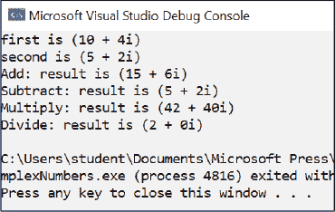

14. 关闭应用程序，返回 Visual Studio 2022 编程环境。

你现在已经创建了一个模拟复数并支持基本算术运算的类型。

### 重写等性运算符

类等性运算符的默认实现查看该类在内存中的地址。如果两个类实例具有相同的地址，则它们被认为是相等的——即它们引用同一个对象。如果你想根据类中字段的内容来测试等性，可以重写 `==` 和 `!=` 运算符。

对于结构体（struct），`==` 和 `!=` 运算符会检查检查字段的内容。如果两个结构体实例的字段具有相同的值，则它们被认为是相等的。这是引用类型（如类）与值类型之间的根本区别之一。

`struct` 的 `==` 和 `!=` 运算符的默认实现使用一种名为**反射**（reflection）的通用技术来发现字段，以便比较其内容。虽然此过程适用于任何结构体，并且该实现已经在 .NET 的各个迭代中得到了改进，但它可能会很慢——尤其是当你正在集合中比较数以万个结构体时。因此，你可能想要提供自己的自定义的、优化的 `==` 和 `!=` 运算符版本。

在两种情况下（结构体和类），如果你定义了 `operator ==` 和 `operator !=`，你还应该重写继承自 `System.Object` 的 `Equals` 和 `GetHashCode` 方法（如果你正在创建一个结构，则继承自 `System.ValueType`）。`Equals` 方法应该表现出与 `operator ==` 相同的行为。（你应该根据其中定义另一个）。`GetHashCode` 方法被 Microsoft .NET 库中的其他类使用。例如，当用对象作为哈希表的键时，会在对象上调用 `GetHashCode` 方法以帮助计算哈希值。（更多信息，请参阅 Visual Studio 2022 提供的 .NET 参考文档。）此方法只需要返回一个区分性的整数值。然而，不要从你所有对象的 `GetHashCode` 方法中返回相同的整数，因为这将使哈希算法的有效性失效。

最后，如果你正在创建一个记录类型（record type），不要重写 `operator ==` 和 `operator !=` 的默认实现。记录自动实现值等性；这是使用记录的主要原因之一。当你的类型模拟数据并应该实现值等性时，考虑定义记录而不是结构体。

在下一个练习中，你将扩展 `Complex struct` 并提供等性运算符 `==` 和 `!=`。

### 实现等性运算符

1. 在 Visual Studio 2022 中，在代码和文本编辑器窗口中显示 `Complex.cs` 文件。

2. 在 `Complex` 结构体中添加 `==` 和 `!=` 运算符，如下例示例中的**粗体**所示：

点击此处查看代码图像

```cs
struct Complex
{
    ...
    public static bool operator ==(Complex lhs, Complex rhs) => lhs.Equals(rhs);

    public static bool operator !=(Complex lhs, Complex rhs) => !lhs.Equals(rhs);
}
```

注意这两个运算符都使用了 `Equals` 方法。该方法将类实例与指定的另一个实例进行比较。如果它们具有相等的值，返回 `true`，否则返回 `false`。

3. 在 `Complex` 结构体中重写 `Equals` 方法，添加如下**粗体**所示的代码：

点击此处查看代码图像

```cs
struct Complex
{
    ...
    public override bool Equals(Object obj)
    {
        if (obj is Complex)
        {
            Complex compare = (Complex)obj;
            return (this.Real == compare.Real) &&
                (this.Imaginary == compare.Imaginary);
        }
        else
        {
            return false;
        }
    }
}
```

`Equals` 方法接收 `Object` 作为参数。此代码验证参数的类型实际上是 `Complex`。如果是，比较当前实例和传入参数的 `Real` 和 `Imaginary` 属性。如果它们相同，方法返回 `true`；否则返回 `false`。如果传入的参数不是 `Complex` 对象，方法返回 `false`。

4. 在**生成**菜单上，选择**重新生成解决方案**。

错误列表显示以下警告消息：

点击此处查看代码图像

```
'ComplexNumbers.Complex' 覆盖了 Object.Equals(object o) 但未重写 Object.GetHashCode()
'ComplexNumbers.Complex' 定义了 operator == 或 operator != 但未重写 Object.GetHashCode()
```

如果你定义了 `!=` 和 `==` 运算符，你还应该重写继承自 `System.Object` 的 `GetHashCode` 方法。

 **注意**

如果错误列表可见，请在视图菜单上选择错误列表。

5. 为 `Complex` 结构体重写 `GetHashCode` 方法，添加如下**粗体**所示的代码。此实现简单地调用继承自 `Object` 类的方法，但如果你愿意，也可以提供自己的机制来为对象生成哈希码。


点击此处查看代码图像

```
Struct Complex
{
    ...
    public override int GetHashCode()
    {
        return base.GetHashCode();
    }
}
```

6. 在`生成`（Build）菜单上，选择`重新生成解决方案`（Rebuild Solution）。

验证解决方案现在可以生成且没有报告任何警告。

7. 在“代码和文本编辑器”窗口中显示 `Program.cs` 文件。然后，将以下**粗体**所示的代码添加到 `doWork` 方法的末尾：

点击此处查看代码图像

```c
static void doWork()
{
    ...
    if (temp == first)
    {
        Console.WriteLine("Comparison: temp == first");
    }
    else
    {
        Console.WriteLine("Comparison: temp != first");
    }

    if (temp == temp)
    {
        Console.WriteLine("Comparison: temp == temp");
    }
    else
    {
        Console.WriteLine("Comparison: temp != temp");
    }
}
```

 **注意**

表达式 `temp == temp` 生成了警告信息“对同一变量进行比较；你是否是想比较其他内容？”。在这种情况下，你可以忽略此警告，因为这种比较是有意的；它是为了验证 `==` 运算符是否按预期工作。

8. 在`调试`（Debug）菜单上，选择`不调试启动`（Start Without Debugging）。然后验证显示的最后两条消息是否是这些：

```
Comparison: temp != first
Comparison: temp == temp
```

9. 关闭应用程序并返回 Visual Studio 2022。

### 理解转换操作符

有时，你需要将一种类型的表达式转换为另一种类型。例如，以下方法声明时带有一个 `double` 参数：

点击此处查看代码图像

```c
class Example
{
    public static void MyDoubleMethod(double parameter)
    {
        ...
    }
}
```

你可能会合理地预期，当代码调用 `MyDoubleMethod` 时，只有类型为 `double`的值可以作为参数，但事实并非如此。C# 编译器也允许使用其他类型的参数调用 `MyDoubleMethod`，但前提是该参数的值可以转换为 `double`。例如，如果你提供了一个 `int` 参数，编译器会生成代码，在调用方法时将参数的值转换为 `double`。

#### 提供内置转换

内置类型具有一些内置转换。例如，如前所述，`int` 可以隐式转换为 `double`。隐式转换不需要特殊的语法，并且永远不会抛出异常。

点击此处查看代码图像

```c
Example.MyDoubleMethod(42); // 隐式 int 到 double 转换
```

隐式转换有时被称为*拓宽转换*（widening conversion），因为结果比原始值*更宽*——它包含的信息至少与原始值一样多，且没有任何丢失。在 `int` 和 `double` 的情况下，`double` 的范围大于 `int`，并且所有的 `int` 值都有等效的 `double` 值。然而，反之则不然，`double` 值不能隐式转换为 `int`：

点击此处查看代码图像

```c
class Example
{
    public static void MyIntMethod(int parameter)
    {
        ...
    }
}
...
Example.MyIntMethod(42.0); // 编译错误
```

当将 `double` 转换为 `int` 时，你面临丢失信息的风险，因此转换不会自动执行。（考虑一下如果 `MyIntMethod` 的参数是 42.5 会发生什么？它应该如何转换？）`double` 可以转换为 `int`，但这种转换需要显式的表示（即强制类型转换）：

点击此处查看代码图像

```c
Example.MyIntMethod((int)42.0);
```

显式转换有时被称为*窄转换*（narrowing conversion），因为结果比原始值*更窄*（也就是说，它可以包含的信息更少），并且如果结果值出了目标类型的范围，可能会抛出 `OverflowException` 异常。在 C# 中，你可以为自己的用户定义类型创建转换操作符，以控制将值转换为其他类型是否合理，并且你还可以指定这些转换是隐式的还是显式的。

#### 实现用户定义的转换操作符

声明用户定义转换操作符的语法与声明重载运算符的语法相似，但存在一些重要的区别。这里有一个转换操作符，允许将 `Hour` 对象隐式转换为 `int`：

点击此处查看代码图像

```c
struct Hour
{
    ...
    public static implicit operator int (Hour from)
    {
        return from.value;
    }

    private int value;
}
```

转换操作符必须是 `public` 的，并且必须是 `static` 的。你正在转换的类型类型声明为参数（在本例中为 `Hour`），而你要转换的目标类型声明在 `operator` 关键字之后（在本例中为 `int`）。在 `operator` 关键字之前不需要指定类型。当你定义转换操作符时，必须指定它们是隐式的还是显式的。你通过使用 `implicit` 和 `explicit` 关键字来实现这一点。`Hour` 到 `int` 的转换操作符是隐式的，这意味着 C# 编译器不需要强制类型转换即可使用它。

点击此处查看代码图像

```c
class Example
{
    public static void MyOtherMethod(int parameter) { ... }
    public static void Main()
    {
        Hour lunch = new Hour(12);
        Example.MyOtherMethod(lunch);
    }
}
```

如果转换操作符声明为 `explicit`，上面的示例将无法编译，因为显式转换操作符需要强制类型转换。

点击此处查看代码图像

```c
Example.MyOtherMethod((int)lunch); // 显式 Hour 到 int 转换
```何时将转换操作符声明为显式或隐式？如果转换总是安全的、没有丢失信息的风险且不会抛出异常，则可以定义为隐式转换。从 `Hour` 转换为 `int` 总是安全的——每个 `Hour` 都有对应的 `int` 值——因此将其设为隐式是合理的。将 `string` 转换为 `Hour` 的操作符应该是显式的，因为并不是所有字符串代表有效的 `Hours`。（字符串 `7` 是的，但你如何将字符串 `Hello, World` 转换为 `Hour`？）

#### 重新考虑对称运算符

转换操作符为解决提供对称运算符的问题提供了另一种方法。例如，与其之前为 `Hour` 结构体提供三个版本的 `operator +`（`Hour + Hour`、`Hour + int` 和 `int + Hour`），现在你可以提供一个版本的 `operator +`（接受两个 `Hour` 参数）和一个隐式的 `int` 到 `Hour` 转换，如下：

点击此处查看代码图像

```c
struct Hour
{
    public Hour(int initialValue) => this.value = initialValue;

    public static Hour operator +(Hour lhs, Hour rhs) => new Hour(lhs.value + rhs.value);

    public static implicit operator Hour (int from) => new Hour (from);
    ...
    private int value;
}
```

如果你将一个 `Hour` 与一个 `int` 相加（无论顺序如何），C# 编译器会自动将 `int` 转换为 `Hour`，然后使用两个 `Hour` 参数调用 `operator +`，如下所示：

点击此处查看代码图像


```cs
void Example(Hour a, int b)
{
    Hour eg1 = a + b; // b converted to an Hour
    Hour eg2 = b + a; // b converted to an Hour
}
```

### 编写转换运算符

在本章的最后一个练习中，你将为 `Complex` 结构体添加转换运算符。你将首先编写一对转换运算符，用于在 `int` 类型和 `Complex` 类型之间进行转换。将 `int` 转换为 `Complex` 对象始终是一个安全过程，且永远不会丢失信息（因为 `int` 实际上只是一个不包含虚部元素的复数）。你将将其实现为一个**隐式（implicit）**转换运算符。然而，反过来则并非如此——要将 `Complex` 对象转换为 `int`，你必须舍弃虚部。因此，你将把此转换运算符实现为**显式（explicit）**。

#### 实现转换运算符

1. 返回 Visual Studio 2022，并在代码和文本编辑器窗口中显示 `Complex.cs` 文件。

2. 将后续代码中**加粗显示**的构造函数添加到 `Complex` 结构体中，紧接在现有构造函数之后、`ToString` 方法之前。这个新构造函数接收单个 `int` 参数，并用它来初始化 `Real` 属性。`Imaginary` 属性设置为 0。

   点击此处查看代码图像

   ```cs
   struct Complex
   {
                       ...
        public Complex(int real)
        {
            this.Real = real;
            this.Imaginary = 0;
        }
        ...
   }
   ```

3. 将以下**加粗显示**的隐式转换运算符添加到 `Complex` 结构体中：

   点击此处查看代码图像

   ```cs
   struct Complex
   {
        ...
        public static implicit operator Complex(int from) => new Complex(from);
        ...
    }
   ```

   该运算符通过返回一个使用你在上一步中创建的构造函数构建的 `Complex` 结构体新实例，将 `int` 转换为 `Complex` 对象。

4. 将以下**加粗显示**的显式转换运算符添加到 `Complex` 结构体中：

   点击此处查看代码图像

   ```cs
   struct Complex
   {
        ...
        public static explicit operator int(Complex from) => from.Real;
        ...
    }
   ```

   该运算符接收一个 `Complex` 对象并返回 `Real` 属性的值。此转换舍弃了复数的虚部。

5. 在代码和文本编辑器窗口中显示 `Program.cs` 文件。然后将以下**加粗显示**的代码添加到 `doWork` 方法的末尾：

   点击此处查看代码图像

   ```cs
   static void doWork()
   {
        ...
        Console.WriteLine($"Current value of temp is {temp}");

        if (temp == 2)
        {
            Console.WriteLine("Comparison after conversion: temp == 2");
        }
        else
        {
           Console.WriteLine("Comparison after conversion: temp != 2");
        }

        temp += 2;
        Console.WriteLine($"Value after adding 2: temp = {temp}");
   }
   ```

   这些语句测试了将 `int` 转换为 `Complex` 对象的隐式运算符。`if` 语句比较 `Complex` 对象和 `int`。编译器生成的代码先将 `int` 转换为 `Complex` 对象，然后调用 `Complex` 结构体的 `==` 运算符。给 `temp` 变量加 2 的语句将 `int` 值 `2` 转换为 `Complex` 对象，然后使用 `Complex` 结构体的 `+` 运算符。

6. 将以下**加粗显示**的语句添加到 `doWork` 方法的末尾：

   点击此处查看代码图像

   ```cs
   static void doWork()
   {
        ...
        int tempInt = temp;
        Console.WriteLine($"Int value after conversion: tempInt == {tempInt}");
   }
   ```

   第一条语句尝试将 `Complex` 对象赋值给 `int` 变量。第二条语句显示结果。

7. 在**生成（Build）**菜单上，选择**重新生成解决方案（Rebuild Solution）**。

解决方案生成失败，编译器在错误列表窗口中报告以下错误：

   点击此处查看代码图像

   ```
   Cannot implicitly convert type 'ComplexNumbers.Complex' to 'int'. An explicit conversion
   exists (are you missing a cast?)
   ```

   从 `Complex` 对象转换为 `int` 的运算符是显式转换运算符，因此你必须指定强制转换。

8. 修改尝试将 `Complex` 值存储在 `int` 变量中的语句，使用强制转换，如下：

   ```cs
   int tempInt = (int)temp;
   ```

9. 在**调试（Debug）**菜单上，选择**不调试启动（Start Without Debugging）**。然后验证解决方案是否成功生成，并且显示的最后四个消息看起来如下：

   点击此处查看代码图像

   ```
   Current value of temp is 2
   Comparison after conversion: temp == 2
   Comparison after conversion: temp != 2
   Value after adding 2: temp = 4
   Int value after conversion: tempInt == 4
   ```

10. 关闭应用程序，返回 Visual Studio 2022。

### 总结

在本章中，你学习了如何重载运算符并为类提供特定功能。你实现了多个运算符，并创建了比较实例的运算符。最后，你学习了如何创建隐式和显式转换运算符。

* 如果你想继续下一章，请保持 Visual Studio 2022 运行并转到第 23 章“使用任务提高吞吐量”。
* 如果你现在退出 Visual Studio 2022，在文件菜单上选择退出。如果出现保存对话框，选择是并保存项目。

### 快速参考

| 目标 | 操作方法 |
| :--- | :--- |
| 实现运算符 | 编写 `public` 和 `static` 关键字，随后是返回类型，然后是 `operator` 关键字，接着是声明的运算符符号，最后是括号中的适当参数。在方法体中实现运算符的逻辑。例如：点击此处查看代码图像 <br> ```cs\nstruct Complex\n{\n    ...\n    public static bool operator==(Complex lhs, Complex rhs)\n    {\n        ... // 实现 == 运算符的逻辑\n    }\n    ...\n}\n``` |
| 定义转换运算符 | 编写 `public` 和 `static` 关键字，随后是 `implicit` 或 `explicit` 关键字，然后是 `operator` 关键字，接着是数据转换的目标类型，最后是将数据源类型作为单个参数放在括号中。例如：点击此处查看代码图像 <br> ```cs\nstruct Complex\n{\n    ...\n    public static implicit operator Complex(int from)\n    {\n        ... // 从 int 转换的代码\n    }\n...\n}\n``` |


到目前，你已经在 C# 语言的语法和语义方面打下了坚实的基础。现在是时候研究如何利用这些知识充分利用 Windows 11 提供的特性，构建可以在从桌面 PC 到智能手机等设备上无缝运行的应用程序了。你可以使用通用 Windows Platform（UWP）应用程序框架来构建在不同环境中运行的应用程序。UWP 应用可以检测并适应其运行的硬件。它们可以通过触控屏幕或语音命令接收输入，并且 UWP 应用可以设计为能够感知其运行设备的位置和取向。你还可以构建云连接的应用程序；这些应用程序并不绑定于特定的计算机，而是可以在用户在另一台设备上登录时跟随用户移动。简而言之，Visual Studio 2022 提供了开发高移动性、高图形化、高连接性应用程序的工具，这些程序可以在几乎任何地方运行。

第四部分向你介绍了构建 UWP 应用程序的要求。你将看到作为 .NET 一开发的异步编程模型示例。你还将学习如何构建连接云端的 UWP 应用程序，以自然且易于导航的检索并展示复杂信息。

# 第 23 章：使用任务提高吞吐量

**完成本章后，你将能够：**

* 描述在应用程序中实现并行操作的优势。
* 解释并行化与可用处理器核心数之间的关系。
* 使用 `Task` 类和 `Parallel` 类在应用程序中创建并运行并行操作。
* 取消耗时任务并处理并行操作抛出的异常。

在本书的大部分内容中，你学习了如何使用 C# 编写单线程方式运行的程序。我所说的`单线程`是指在任何一个时刻，程序只执行单条指令。然而，这并不总是应用程序采取最高效的方法。如果你有适当的计算资源，通过将应用程序拆分为可以并发运行的并行路径，某些应用程序可能会运行得。

本章关注如何通过最大化利用可用计算能力来提高应用程序的吞吐量。具体而言，你将学习如何使用 `Task` 对象为计算密集型应用程序应用有效的多任务处理。

### 为什么要通过并行处理执行多任务？

你可能想在应用程序中执行多任务的主要原因有两个：

* **为了提高响应能力**：耗时操作可能涉及不需要处理器时间的任务。常见示例包括 I/O 密集型操作，如从本地磁盘读取或写入数据，或跨网络发送和接收数据。在这两种情况下，如果程序可以做一些更有用的事情（例如响应用户输入），那么让程序空耗 CPU 周期等待操作完成是没有意义的。大多数移动设备用户认为这种形式的响应是理所当然的，他们不希望平板电脑在收发邮件时直接停止。第 24 章“通过执行异步操作提高响应时间”将更详细讨论这一主题。

* **为了提高可扩展性**：如果某个操作是 CPU 密集型的，你可以通过有效利用可用计算资源并使用这些资源缩短执行该操作所需的时间来提高可扩展性。开发者可以确定哪些操作包含可以并行的任务，并安排这些元素并发运行。随着更多计算资源的加入，可以并行运行更多任务实例。直到不久之前，这种模型仅适用于具有多个 CPU 或可以将处理分散到不同网络连接计算机的科学和工程系统。然而，大多数现代计算设备现在都包含了支持真正多任务的强大 CPU，并且许多操作系统提供了可以让你轻松实现任务并行化的原语。

### 多核处理器的兴

在 21 世纪初，一台性能尚面的个人电脑的价格在 800 美元到 1500 美元之间。今天，在经历了 20 年的价格通胀后，一台性能尚面的个人电脑价格仍然差不多。

今天典型计算机的规格可能包括运行速度在 3 GHz 到 5 GHz 之间的处理器、超过 1000 GB 的硬盘存储（为了速度，可能使用固态技术）、8 GB 到 16 GB 的内存、高速高分辨率图形处理、快速网络接口以及一个可刻录 DVD 光驱。相比之下，17 年前典型机器的处理器速度在 500 MHz 到 1 GHz 之间，80 GB 已经是大硬盘，Windows 在 256 MB 或更少的内存下运行得相当良好，可刻录 CD 光驱价格远超 100 美元，可刻录 DVD 光驱稀有且极其昂贵。这就是技术进步的乐趣：越来越快、越来越强大的硬件，价格越来越廉。

这并不是一个新趋势。1965 年，英特尔创始人戈登·E·摩尔写了一篇名为《在集成电路上挤入更多组件》的论文，讨论了组件的不断微型化如何允许在硅片上嵌入更多晶体管，以及随着技术变得普及且生产成本下降，经济学将决定在 1975 年之前在单个芯片上挤入多达 65,000 个组件。摩尔的观察导致了经常被称为`摩尔定律`的格言，该定律指出集成电路上廉价放置的晶体管数量将呈指数级增长，大约每两年翻倍。（实际上，摩尔最初比这更乐观，假设晶体管数量可能每年翻倍，但他后修改了自己的计算方法。）

将晶体管封装在一起的能力导致了在它们之间更快传递数据的能力。这意味着预计芯片制造商将以近乎无情的速度生产更快、更强大的微处理器，使软件开发者能够编写越发且运行得越快的软件。

关于电子组件微型化的摩尔定律在半个世纪后仍然成立。然而，物理学已开始干预。当无论晶体管多么小或多么密集，都无法以更快的速度传输信号时，限制就出现了。对于软件开发者来说，这种限制最明显的结果是处理器的速度提升已经放缓了。十五年前，快速处理器的运行速度是 3 GHz。今天，快速处理器的运行速度是 5 GHz。这仍然是速度的巨大提升，但还没有达到摩尔定律的规模。


处理器组件之间传输数据的速度限制，迫使芯片公司寻找替代机制，以增加处理器能够执行的工作量。结果是，大多数现代处理器现在都有两个或多个 `processor cores`（处理器内核）。实际上，芯片制造商在同一块芯片上放置了多个处理器，并添加了必要的逻辑使它们能够相互通信和协调。四核（四个内核）和八核处理器现在已很常见，甚至还有 16 核、32 核和 64 核芯片。此外，双核和四核处理器的价格现在足够低，它们已成为笔记本电脑、平板电脑和智能手机的预期配置。因此，虽然处理器的速度已经停止提升，但你现在可以期待在单个芯片上获得更多的内核。

这对于 C# 开发者意味着什么？在多核处理器出现之前，你只需要通过在更快的处理器上运行单线程应用程序来提高速度。有了多核处理器后，情况不再如此。单线程应用程序在时钟频率相同的单核、双核或四核处理器上的运行速度是相同的。区别在于，在双核处理器上，对于你的应用程序而言，其中一个处理器内核将处于空置状态；而在四核处理器上，三个内核将仅仅在空转，等待工作。为了充分利用多核处理器，你必须编写应用程序以利用多任务处理能力。

### 使用 Microsoft .NET 实现多任务处理

`Multitasking`（多任务处理）是同时完成多件事的能力。它是那种容易描述但直到最近才难以实现的概念之一。

在理想情况下，运行在多核处理器上的应用程序执行的并发任务数量等于可用处理器内核的数量，使每个内核保持繁忙。然而，要实现并发，你必须考虑许多问题，包括：

- 如何将应用程序分为一组并发操作？
- 如何安排一组操作在多个处理器上并发执行？
- 如何确保你尝试执行的并发操作不超过可用处理器的数量？
- 如果操作被阻塞（例如等待 I/O 完成），你如何检测这一点并安排处理器运行其他操作而不是闲置？
- 如何确定一个或多个并发操作何时完成？

对于应用程序开发者来说，第一个问题是设计问题。其余问题取决于基础设施。Microsoft 在 `System.Threading.Tasks` 命名空间提供了 `Task` 类和一组相关类型来帮助解决这些问题。

 **Important**

关于应用程序设计的一点是基础性的。如果应用程序在设计时没有考虑多任务处理，那么无论向它投入多少个处理器内核都不重要；它的运行速度都不会比在单核机器上快。

#### 、线程和线程池 (ThreadPool)

`Task` 类是并发操作的抽象。你创建一个 `Task` 对象来运行一段代码。你可以实例化多个 `Task` 对象，并在有足够的处理器或内核的情况下并行运行它们。

 **Note**

从现在起，我将使用 `processor`（处理器）一词来指代单核处理器或多核处理器上的单个处理器内核。

在内部，Windows Runtime (WinRT) 使用 `Thread` 对象和 `ThreadPool` 类实现任务并调度其执行。多线程和线程池自 .NET 1.0 版本起就作为 .NET 的一部分可用。如果你正在构建传统的桌面应用程序，可以直接在代码中使用位于 `System.Threading` 命名空间中的 `Thread` 类。然而，`Thread` 类不支持通用 Windows 平台 (UWP) 应用。相反，你应该使用 `Task` 类。

`Task` 类为线程提供了一个强大的抽象，通过它你可以轻松区分应用程序的并行程度（任务）和并行的单元（线程）。在单处理器计算机上，这些项通常是相同的。但在具有多个处理器或多核处理器的计算机上，它们是不同的。

如果你直接基于线程设计程序，你会发现你的应用程序扩展性可能不太好。程序将使用你显式创建的线程数量，操作系统只会调度相应数量的线程。如果线程数量远大于可用处理器数量，可能会导致过载和响应时间缓慢。如果线程数量少于处理器数量，则可能导致效率低下和吞吐量差。

WinRT 优化了实现一组并发任务所需的线程数量，并根据可用处理器的数量对其进行高效调度。它实现了一种队列机制，将工作负载分配到分配线程池（通过使用 `ThreadPool` 对象实现）的一组线程上。当程序创建一个 `Task` 对象时，任务被添加到全局队列中。当某个线程可用时，该任务从全局队列中移除并由该线程执行。`ThreadPool` 类实现了许多优化，并使用工作窃取算法（work-stealing algorithm）来确保线程被高效调度。

处理你的任务而创建的线程数并不一定与处理器数量相同。根据负载的性质，一个或多个处理器可能正忙于为其他应用程序和服务执行高优先级工作。因此，你的应用程序的最佳线程数可能少于机器的处理器数量。或者，应用程序中的一个或多个线程可能正在等待长时间的内存访问、I/O 或网络操作完成，从而留出相应的处理器。在这种情况下，最佳线程数可能超过处理器数量。WinRT 遵循一种迭代策略，称为爬山算法（hill-climbing algorithm），用于为当前负载动态确定理想的线程数。

重要的点是，你在代码中需要做的只是将应用程序划分（或分区）为可以并行运行的任务。WinRT 负责根据你计算机的处理器架构和负载创建相应的线程，将你的任务与这些线程关联，并安排它们高效运行。

 **Note**

将工作划分为过多的任务没有关系，因为 WinRT 会尝试仅运行实际所需的并发线程。事实上，我们鼓励你对工作进行过度分区（overpartition），因为这有助于在你将应用程序移动到具有更多处理器的计算机时确保其可扩展性。

#### 创建、运行和控制任务

你可以使用 `Task` 构造函数创建 `Task` 对象。该构造函数是重载的，但所有版本都要求你提供一个 `Action` 委托作为参数。第 20 章，“解耦应用程序逻辑和处理事件](#ch20.xhtml_ch20)”说明了 `Action` 委托引用的是一个不返回值的方法。`Task` 对象在被调度运行时会调用该委托。以下示例创建了一个 `Task` 对象，使用委托运行名为 `doWork` 的方法：

点击此处查看代码图像


```
Task task = new Task(doWork);
...
private void doWork()
{
    // The task runs this code when it is started
    ...
}
```

 **提示**

默认的 `Action` 类型引用一个不带参数的方法。`Task` 构造函数的其他重载接受一个 `Action<object>` 参数，该参数代表一个引用接受单个 `object` 参数方法的委托。通过这些重载，你可以将数据传递到任务运行的方法中。以下代码展示了一个示例：

点击此处查看代码图像

```
Action<object> action;
action = doWorkWithObject;
object parameterData = ...;
Task task = new Task(action, parameterData);
...
private void doWorkWithObject(object o)
{
    ...
}
```

在创建了 `Task` 对象后，你可以使用 `Start` 方法来运行它，如下所示：

```
Task task = new Task(...);
task.Start();
```

`Start` 方法是重载的，你可以可选地指定 `TaskCreationOptions` 对象来提供有关如何调度和运行任务的提示。

 **更多信息**

有关 `TaskCreationOptions` 枚举的更多信息，请参阅 Visual Studio 提供的 .NET 类库说明文档。

创建和运行任务是一个非常常见的过程，`Task` 类提供了静态的 `Run` 方法，你可以通过它组合这些操作。`Run` 方法接受一个 `Action` 委托来指定要执行的操作（类似于 `Task` 构造函数），但它会立即运行任务。它返回一个 `Task` 对象的引用。你可以这样使用它：

点击此处查看代码图像

```
Task task = Task.Run(() => doWork());
```

当任务运行的方法完成时，任务即结束，用于运行任务的线程可以被回收以执行另一个任务。

当一个任务完成时，你可以通过创建一个“接续任务”（continuation*）来安排立即调度另一个任务。要做到这一点，你调用 `Task` 对象的 `ContinueWith` 方法。当 `Task` 对象执行的操作完成时，调度器会自动创建一个新的 `Task` 对象来运行由 `ContinueWith` 方法指定的操作。接续指定的方法期望一个 `Task` 参数，调度器会将已完成任务的引用传递给该方法。`ContinueWith` 返回的值是新 `Task` 对象的引用。下面的代码示例创建了一个运行 `doWork` 方法的 `Task` 对象，并指定了一个接续任务，该接续会在第一个任务完成后在新任务中运行 `doMoreWork` 方法：

点击此处查看代码图像

```
Task task = new Task(doWork);
task.Start();
Task newTask = task.ContinueWith(doMoreWork);
...
private void doWork()
{
    // The task runs this code when it is started
    ...
}
...
private void doMoreWork(Task task)
{
    // The continuation runs this code when doWork completes
    ...
}
```

`ContinueWith` 方法有许多重载，你可以提供指定额外项目的参数，包括一个 `TaskContinuationOptions` 值。`TaskContinuationOptions` 类型是一个枚举，包含了 `TaskCreationOptions` 枚举值的超集。可用的额外值包括：

*   `NotOnCanceled` 和 `OnlyOnCanceled`：`NotOnCanceled` 选项指定接续任务仅在上一个操作完成且未取消时才运行。`OnlyOnCanceled` 选项指定接续任务仅在上操作被取消时才运行。本章后面的“取消任务和处理异常”部分描述了如何取消任务。

*   `NotOnFaulted` 和 `OnlyOnFaulted`：`NotOnFaulted` 选项表示接续任务仅在上操作完成且未抛出未处理异常时才运行。`OnlyOnFaulted` 选项导致接续任务仅在上操作抛出未处理异常时运行。“取消任务和处理异常”部分提供了关于如何在任务中管理异常的更多信息。

*   `NotOnRanToCompletion` 和 `OnlyOnRanToCompletion`：`NotOnRanToCompletion` 选项指定接续任务在上操作未成功完成后才运行；它必须被取消或抛出异常。`OnlyOnRanToCompletion` 导致接续任务仅在上操作成功完成后才运行。

下面的代码示例展示了如何为任务添加接续任务，该任务仅在初始操作没有抛出未处理异常时才运行：

点击此处查看代码图像

```
Task task2 = ...
task2.Start();
...
task2.Wait(); // 在此点等待直到 task2 完成
```

调用并行操作应用程序的一个常见需求是同步任务。`Task` 类提供了 `Wait` 方法，它实现了一种简单的任务协调机制。使用该方法，你可以挂起当前线程的执行，直到指定的任务完成，如下：

点击此处查看代码图像

```
Task task2 = ...
task2.Start();
...
task2.Wait(); // 在此点等待直到 task2 完成
```

你可以通过 `Task` 类的静态 `WaitAll` 和 `WaitAny` 方法来等待一组任务。这两个方法都接受一个包含一组 `Task` 对象的 `params` 数组。`WaitAll` 方法等待所有任务完成，而 `WaitAny` 则等待到至少有一个任务完成。你可以这样使用它们：

```
Task.WaitAll(task, task2); // 等待 task 和 task2 完成
Task.WaitAny(task, task2); // 等待 task 或 task2 完成
```


为了保持本次练习中应用程序的操作简单，它在页面上显示了按钮。在生产环境的 UWP 应用中，此类按钮应该位于命令栏（command bar）上。

*   名为 `duration` 的 `TextBlock` 控件：应用程序在此标签中显示生成和渲染图表数据所需的时间。

### 4. 在解决方案管理器（Solution Explorer）中，展开 `MainPage.xaml` 文件，然后双击 `MainPage.xaml.cs` 以在代码和文本编辑器中显示表单的代码。

该表单使用名为 `graphBitmap` 的 `WriteableBitmap` 对象（定义在 `Windows.UI.Xaml.Media.Imaging` 命名空间中）来渲染图表。`plotButton_Click` 方法中的代码创建此对象，但类实例变量 `pixelWidth` 和 `pixelHeight` 分别指定了 `WriteableBitmap` 对象的水平和垂直分辨率：

点击此处查看代码图像

```assembly
public partial class MainPage : Window
{
    // 如果可用内存不足，请减小 pixelWidth 和 pixelHeight
    private int pixelWidth = 10000;
    private int pixelHeight = 5000;
    ...
}
```

 **注意**

此应用程序是在一台具有 8 GB 内存的桌面计算机上开发和测试的。（它在在 4 GB 的机器上也测试过）。如果你的计算机可用内存少于此，你可能需要减小 `pixelWidth` 和 `pixelHeight` 变量中的值；否则，应用程序可能会产生 `OutOfMemoryException` 异常，导致应用程序在没有警告的情况下终止。

如果你有一台更大的机器，不要尝试增加这些值；UWP 模型对应用程序可以使用的内存有限制——目前即使在桌面计算机上也只有 2 GB 左右。如果你超过了此值，你的应用程序可能会在没有警告的情况下终止。这种限制的在于，运行 UWP 程序的许多设备内存受限，不应允许单个应用程序消耗所有可用内存资源，从而损害其他应用程序。

### 5. 检查 `plotButton_Click` 方法的代码：

点击此处查看代码图像

```csharp
private void plotButton_Click(object sender, RoutedEventArgs e)
{
    ...
    Random rand = new Random();
    redValue = (byte)rand.Next(0xFF);
    greenValue = (byte)rand.Next(0xFF);
    blueValue = (byte)rand.Next(0xFF);

    int dataSize = bytesPerPixel * pixelWidth * pixelHeight;
    byte data[] = new byte[dataSize];

    Stopwatch watch = Stopwatch.StartNew();
    generateGraphData(data);
    duration.Text = $"Duration (ms): {watch.ElapsedMilliseconds}";
    WriteableBitmap graphBitmap = new WriteableBitmap(pixelWidth, pixelHeight);
    using (Stream pixelStream = graphBitmap.PixelBuffer.AsStream())
    {
        pixelStream.Seek(0, SeekOrigin.Begin);
        pixelStream.Write(data, 0, data.Length);
        graphBitmap.Invalidate();
        graphImage.Source = graphBitmap;
    }
    ...
}
```

此方法在用户选择 `plotButton` 按钮时运行。你将在稍后的练习中多次选择此按钮，这将让你看到每当此方法为绘制的红、绿、蓝点的强度生成一组随机值时，图表都会绘制一个新版本。（每次你选择此按钮时，图表的颜色都会不同。）

接下来两行实例化了一个将存储图表数据的字节数组。该数组的大小取决于 `WriteableBitmap` 对象的分辨率，由 `pixelWidth` 和 `pixelHeight` 字段决定。此大小必须根据渲染每个像素所需的内存量进行缩放。`WriteableBitmap` 类每个像素使用 4 个字节，指定每个像素的相对红、绿、蓝强度和 Alpha 混合值（alpha blending value）（Alpha 混合值决定了像素的透明度和亮度。）

`watch` 变量是一个 `System.Diagnostics.Stopwatch` 对象。`StopWatch` 类型对于计时操作非常有用。`StopWatch` 类型的静态方法 `StartNew` 创建 `StopWatch` 对象的的新实例并开始运行。你可以通过检查 `ElapsedMilliseconds` 属性来查询 `StopWatch` 对象的运行时间。

`generateGraphData` 方法在 `data` 数组中填充供 `WriteableBitmap` 对象显示的图表数据。你将在下一步中检查此方法。

当 `generateGraphData` 方法完成后，经过的时间（毫秒）将显示在持续 `TextBox` 控件中。

最后一段代码块创建了 `graphBitMap` `WriteableBitMap` 对象。`data` 数组持有的信息被复制到此对象中进行渲染。简单的技术是创建一个内存流，用于填充 `WriteableBitmap` 对象的 `PixelBuffer` 属性。然后你可以使用该流的 `Write` 方法将数据数组的内容拷贝到缓冲区。`WriteableBitmap` 类的 `Invalidate` 方法请求操作系统使用缓冲区中的信息重新绘制位图。`Image` 控件的 `Source` 属性指定了 `Image` 控件应该显示的数据。

### 6. 检查 `generateGraphData` 方法的代码：

点击此处查看代码图像

```csharp
private void generateGraphData(byte[] data)
{
    double a = pixelWidth / 2;
    double b = a * a;
    double c = pixelHeight / 2;
    for (double x = 0; x < a; x ++)
    {
        double s = x * x;
        double p = Math.Sqrt(b - s);
        for (double i = -p; i < p; i += 3)
        {
            double r = Math.Sqrt(s + i) / a;
            double q = (r - 1) * Math.Sin(24 * r);
            double y = i / 3 + (q * c);
            plotXY(data, (int)(-x + (pixelWidth / 2)), (int)(y + (pixelHeight / 2)));
            plotXY(data, (int)(x + (pixelWidth / 2)), (int)(y + (pixelHeight / 2)));
        }
    }
}
```

此方法执行一系列计算以绘制图点。（实际计算并不重要，它只是生成一个看起来好看的图表。）当它计算每个点时，会调用 `plotXY` 方法设置 `data` 数组中对应这些点的字节。图表相对于 x 轴对称，因此每次计算都会调用两次 `plotXY` 方法：一次针对 坐标的正值，一次针对负值。

### 7. 检查 `plotXY` 方法：

点击此处查看代码图像

```csharp
private void plotXY(byte[] data, int x, int y)
{
    int pixelIndex = (x + y * pixelWidth) * bytesPerPixel;
    data[pixelIndex] = blueValue;
    data[pixelIndex + 1] = greenValue;
    data[pixelIndex + 2] = redValue;
    data[pixelIndex + 3] = 0xBF;
}
```


## 8. 在 Visual Studio 工具栏中，确保平台已设置为 `x64`。然后，在 `Debug` 菜单中，选择 `Start` `Debugging` 以编译并运行应用程序。

 **重要**

如果平台设置为 `x86`，由于缺少内存资源，该程序在运行时可能会崩溃。`x64` 应用程序比 `x86` 应用程序可以访问得多的内存，而此应用程序使用了大量内存！

## 9. 当 Graph Demo 窗口出现时，选择 `Plot Graph`，然后等待。

请耐心等待。应用程序通常需要几秒钟来生成并显示图表，在此期间应用程序将处于无响应状态。（第 24 章 解释了为什么会这样，以及你如何避免这种行为。）

接下来的图片显示了图表。注意 `Duration (ms)` 标签中的值。在这种情况下，应用程序花费了 1,213 毫秒 (ms) 来生成数据。（这不包括实际渲染图表的时间，可能还需要几秒钟。）

 **注意**

该应用程序运行在频率为 3.10 GHz 的多核处理器计算机上。如果你使用核心数不同的较慢或较快的处理器，你的耗时可能会有所不同。

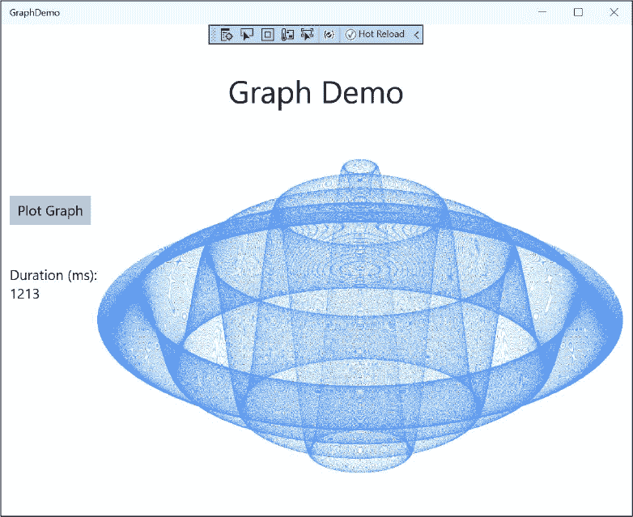

## 10. 再次选择 `Plot Graph` 并注意重绘图表所需。重复此操作几次以获得平均值。

 **注意**

你可能会偶尔发现图表出现的时间更长。如果你运行接近计算机的内存容量，且 Windows 必须在内存和磁盘之间进行数据分页，那么这种情况往往会发生。如果你遇到这个问题，请丢弃该时间，并在计算平均值时不将其包含在。

## 11. 返回 Visual Studio 并停止调试。

你现在有了一个应用程序性能的基准数字。在下一个练习中，你将使用 Visual Studio 中的 `Performance Profiler` 工具来检查程序运行时的 CPU 使用情况。

### 使用 Performance Profiler 运行程序

1. 在 Visual Studio 中，在 `Debug` 菜单上，选择 `Performance Profiler`：


2. 在 `Analysis Target` 窗口中，选择 `Change Target`，并选择 `Startup` `Project`。

3. 在窗口的 `Available Tools` 部分，选择 `CPU Usage`。然后选择 `Start` 使用 `Performance Profiler` 运行应用程序。


4. 当 Graph Demo 应用程序启动时，选择 `Plot Graph`。

5. 等待几秒，然后再次选择 `Plot Graph`。

6. 重复步骤 4 次，每次选择之间等待几秒。

7. 关闭应用程序并返回 Visual Studio。

`Performance Profiler` 会生成一份显示 CPU 如何使用的报告。报告顶部的图表应该显示出几个平顶峰值。这些峰值将对应于你每次选择 `Plot Graph` 的时间。

8. 悬停在其中一个峰值上以查看该点的 CPU 使用率。在接下来的图片中，最大 CPU 使用率 25%。在我的情况下，应用程序运行在四核机器上，但看起来应用程序似乎只使用了一个处理器：


9. 不保存并关闭报告。

从 `Performance Profiler` 显示的 CPU 使用情况可以明显看出，应用程序没有充分利用可用的处理资源。在双核机器上，它仅使用了略多于一半的 CPU 功率，在四核机器上，它仅使用了略多于分之一的 CPU。这是因为应用程序是单线程的，而在 Windows 应用程序中，单线程只能使用多核处理器上的单个核心。为了将负载分散到所有可用核心上，你必须将应用程序拆分为任务，并安排每个任务由单独的线程执行——每个线程运行在不同的核心上。这就是你接下来将要做的。

### 修改 GraphDemo 应用程序以使用 Task 对象

1. 返回 Visual Studio 2022，如果 `MainPage.xaml.cs` 文件未打开，请在代码和文本编辑器窗口中显示它。

2. 检查 `generateGraphData` 方法。该方法的目的是填充 `data` 数组中的项。它通过使用基于 `x` 循环控制变量的外层 `for` 循环来遍历数组，该变量在此处加粗显示：

点击此处查看代码图像

```cpp
private void generateGraphData(byte[] data)
{
    double a = pixelWidth / 2;
    double b = a * a;
    double c = pixelHeight / 2;
    for (double x = 0; x < a; x ++)
    {
        double s = x * x;
        double p = Math.Sqrt(b - s);
        for (double i = 0; i < p; i++)
        {
            double r = i * i;
            double q = Math.Sqrt(b - r);
            double y = i / 3;
            data[(int)(x + q)] = (byte)(y + c);
        }
    }
}
```
*(注：此处提供的原文代码块内容似乎与描述的逻辑不符，但根据指令要求保留原始代码块不翻译)*

3. 修改 `generateGraphData` 方法定义以接收两个额外的 `int` 参数，命名为 `partitionStart` 和 `partitionEnd`，如下加粗所示：

点击此处查看代码图像

```cpp
private void generateGraphData(byte[] data, int partitionStart, int partitionEnd)
{
    ...
}
```

4. 在 `generateGraphData` 方法中，修改外层 `for` 循环以便在 `partitionStart` 和 `partitionEnd` 的值之间迭代，如下加粗所示：

点击此处查看代码图像

```cpp
private void generateGraphData(byte[] data, int partitionStart, int partitionEnd)
{
    ...
    for (int x = partitionStart; x < partitionEnd; x++)
    {
        ...
    }
}
```

5. 在代码和文本编辑器中，在文件顶部的列表中添加以下 `using` 指令：

```sharp
using System.Threading.Tasks;
```

6. 在 `plotButton_Click` 方法中，注释掉调用 `generateGraphData` 方法的语句，并添加如下加粗所示的语句。此新语句创建了一个 `Task` 对象并开始运行：

点击此处查看代码图像

```csharp
...
Stopwatch watch = Stopwatch.StartNew();
// generateGraphData(data);
Task first = Task.Run(() => generateGraphData(data, 0, pixelWidth / 4));
...
```

任务运行 Lambda 表达式指定的代码。`partitionStart` 和 `partitionEnd` 参数的值指示 `Task` 对象计算图表前半部分的数据。（完整图表的数据由为 0 到 `pixelWidth` / 2 之间的值绘制的点组成。）

7. 添加另一个语句，在另一个线程上创建并运行第二个 `Task` 对象，如下加粗代码所示：

点击此处查看代码图像


```
... 
Task first = Task.Run(() => generateGraphData(data, 0, pixelWidth / 4)); 
Task second = Task.Run(() => generateGraphData(data, pixelWidth / 4, pixelWidth / 2)); 
...
```

此 `Task` 对象调用了 `generateGraphData` 方法，并计算 `pixelWidth` / 4 到 `pixelWidth` / 2 之间数值的数据。

8. 添加如下**粗体**所示的语句，在继续执行之前等待两个 `Task` 对象完成其工作：

点击此处查看代码图像

```
...
Task second = Task.Run(() => generateGraphData(data, pixelWidth / 4, pixelWidth / 2)); 
Task.WaitAll(first, second);
...
```

9. 在 `Debug` 菜单上，选择 `Start Without Debugging`（不调试启动）来编译并运行应用程序。

10. 在 Graph Demo 窗口中，选择 `Plot Graph`（绘制图表）并注意操作的持续时间。

11. 重复此步骤几次以获得平均值。你应该会看到应用程序的运行速度比以前快得多。在我的计算机上，典型时间降到了 654 毫秒——时间减少了大约 45 百比。

在大多数情况下，执行计算所需的时间将减少近一半。然而，应用程序仍然具有一些单线程元素，例如在数据生成后实际显示图表的逻辑。这就是为什么总时间仍然是应用程序以前版本时间的一半以上。

12. 停止应用程序并返回 Visual Studio。

13. 在 `Debug` 菜单上，选择 `Relaunch Performance Profiler`（重新启动性能分析器）。性能分析器将开始使用你之前指定的性能设置。

14. 4. 多次选择 `Plot Graph`，并在每次选择之间等待几秒。注意，由于性能分析器的影响，性能将略有下降。

15. 关闭应用并等待性能分析器生成报告。

在 CPU 使用图中，你应该能看到应用程序比之前消耗了更多的 CPU 资源。在我的四核机器上，每当我选择 `Plot Graph` 时，CPU 使用率都会达到约 50% 的峰值。这是因为两个任务分别在不同的核心上运行，但剩余的两个核心处于空闲状态。如果你有一台双核机器，你可能会在每次生成图表时看到处理器使用率短暂超过 90%。


 注意

如果你有一台四核计算机，可以通过添加另外两个 `Task` 对象并在 `plotButton_Click` 方法中将工作分为四份来增加 CPU 使用率并进一步缩短时间，如下所示**粗体**所示：

点击此处查看代码图像

```
...
Task first = Task.Run(() => generateGraphData(data, 0, pixelWidth / 8));
Task second = Task.Run(() => generateGraphData(data, pixelWidth / 8,
pixelWidth / 4));
Task third = Task.Run(() => generateGraphData(data, pixelWidth / 4,
pixelWidth * 3 / 8));
Task fourth = Task.Run(() => generateGraphData(data, pixelWidth * 3 / 8,
pixelWidth / 2));
Task.WaitAll(first, second, third, fourth);
...
```

如果你只有一个双核处理器，你仍然可以尝试这种修改，并且应该会注意到时间上有微小的益处效果。这主要因为 CLR 使用的算法优化了每个任务线程的调度方式。

### 使用 Parallel 类抽象任务

使用 `Task` 类可以让你完全控制应用程序创建的任务数量。然而，你必须修改应用程序的设计以适应 `Task` 对象的使用。你还必须添加代码来同步操作；应用程序只有在所有任务都完成后才能渲染图表。在复杂的应用程序中，任务的同步处理可能会变成一个复杂且容易出错的过程。

通过 `Parallel` 类，你可以并行化一些常见的编程构造结构，而无需重新设计应用程序。在内部，`Parallel` 类会创建它自己的 `Task` 对象，并在它们完成时自动同步这些任务。

`Parallel` 类位于 `System.Threading.Tasks` 命名空间，并提供了一小组静态方法，你可以使用这些方法来指示代码尽可能并行并行运行。这些方法如下：

* `Parallel.For`: 你可以使用此方法代替 C# 的 `for` 语句。它定义了一个循环，在该循环中的迭代可以通过任务并行运行。该方法有许多重载，但对于每个重载来说，通用原理是相同的：你指定一个起始值、一个结束值，以及一个接受整数参数的方法的引用。该方法会在起始值和指定的结束值减 1 之间的每个值上执行，参数将用一个指定当前值的整数填充。例如，考虑以下按顺序执行每次迭代的简单 `for` 循环：

点击此处查看代码图像

```
for (int x = 0; x < 100; x++)
{
    // 执行处理
}
```

根据循环体中执行的处理操作，你可能可以将此循环替换为可以并行执行迭代的 `Parallel.For` 构造结构，如下所示：

点击此处查看代码图像

```
Parallel.For(0, 100, performLoopProcessing);
...
private void performLoopProcessing(int x)
{
    // 执行处理
}
```

通过 `Parallel.For` 方法的重载，你可以提供每个线程私有的本地数据，为由 `For` 方法运行的任务指定各种选项，并创建一个 `ParallelLoopState` 对象，该对象可用于将状态信息传递给循环的其他并发迭代。（使用 `ParallelLoopState` 对象的描述将在本章稍后的“取消任务和处理异常”部分介绍。）

* `Parallel.ForEach<T>`: 你可以使用此方法代替 C# 的 `foreach` 语句。与 `For` 方法一样，`ForEach` 定义了一个迭代可以并行运行的循环。你指定一个实现 `IEnumerable<T>` 泛型接口的集合，以及一个接受单个 `T` 类型参数方法的引用。该方法会在集合中的每个项上执行，并将该项作为参数传递给该方法。存在一些重载，可以通过它们提供私有的本地线程数据并为由 `ForEach` 方法运行的任务指定选项。

* `Parallel.Invoke`: 你可以使用此方法将一组无参数的方法调用作为并行任务执行。你指定一组不接受参数且没有返回委托方法调用（或 Lambda 表达式）。每个方法调用都可以在单独的线程上运行，且顺序不限。例如，以下代码执行了一系列方法调用：

```
doWork();
doMoreWork();
doYetMoreWork();
```

你可以用以下代码替换这些语句，通过使用一系列任务来调用这些方法：

```
Parallel.Invoke(
    doWork,
    doMoreWork,
    doYetMoreWork
);
```


`Parallel` 类决定了适用于计算机环境和工作负载的并行度。例如，如果你使用 `Parallel.For` 来实现一个执行 1,000 次迭代的循环，`Parallel` 类并不一定会创建 1,000 个并发任务（除非你有一个拥有 1,000 个核心的极其强大的处理器）。相反，`Parallel` 类会创建它认为的最优任务数量，从而在可用资源与保持处理器忙碌的需求之间取得平衡。单个任务可能会执行多次迭代，且任务之间将相互协调以确定每个任务将执行哪些迭代。这的一个重要结果是，你无法保证迭代执行的顺序，因此你必须确保迭代之间不存在依赖；否则，你可能会遇到意外的结果，正如你在本章后面看到的那样。

在下一个练习中，你将回到 `GraphDemo` 程序的原始版本，并使用 `Parallel` 类并发执行操作。

### 使用 Parallel 类将 GraphDemo 中的操作并行化

1. 使用 Visual Studio 2022，打开 `GraphDemo` 解决方案，它位于 `Documents` 文件夹下的 `\Microsoft Press\VCSBS\Chapter 23\Parallel GraphDemo` 文件夹中。
   这是原始 `GraphDemo` 程序的副本。它尚未使用任务。

2. 在解决方案资源管理器中，在 `GraphDemo` 项目下，展开 `MainPage.xaml` 节点，然后双击 `MainPage.xaml.cs` 以在代码和文本编辑器窗口中显示表单的代码。

3. 在文件顶部的列表中添加以下 `using` 指令：

```
using System.Threading.Tasks;
```

4. 找到 `generateGraphData` 方法。它看起来如下：

   点击此处查看代码图像

```go
private void generateGraphData(byte[] data)
{
    double a = pixelWidth / 2;
    double b = a * a;
    double c = pixelHeight / 2;
    for (double x = 0; x < a; x++)
    {
        double s = x * x;
        double p = Math.Sqrt(b - s);
        for (double i = -p; i < p; i += 3)
        {
            double r = Math.Sqrt(s + i * i) / a;
            double q = (r - 1) * Math.Sin(24 * r);
            double y = i / 3 + (q * c);
            plotXY(data, (int)(-x + (pixelWidth / 2)), (int)(y + (pixelHeight / 2)));
            plotXY(data, (int)(x + (pixelWidth / 2)), (int)(y + (pixelHeight / 2)));
        }
    }
}
```

   遍历变量 `x` 值的外部 `for` 循环是并行化的理想候选者。你可能也考虑基于变量 `i` 的内部循环。然而，如果你有像代码中这样的嵌套循环，良好的做法是先并行化外部循环，然后测试应用程序的性能是否足够。如果不够，再逐层处理嵌套循环，从外部循环开始向内部循环进行并行化，并在修改每个循环后测试性能。你会发现，在许多情况下，并行化外层循环对性能的影响最大，而修改内部循环的影响则微乎其微。

5. 剪切局部变量定义以及 `for` 循环体中的代码，并创建一个名为 `calculateData` 的新私有 `void` 方法并包含这些代码。`calculateData` 方法应该接收一个名为 `x` 的 `int` 参数和一个名为 `data` 的字节数组。此外，将声明局部变量 `a`、`b` 和 `c` 的语句从 `generateGraphData` 方法移动到 `calculateData` 方法的开头。以下代码显示了删除了这些代码的 `generateGraphData` 方法以及添加的 `calculateData` 方法（请尝试编译此代码）：

   点击此处查看代码图像

```go
private void generateGraphData(byte[] data)
{
    for (double x = 0; x < a; x++)
    {
    }
}
private void calculateData(int x, byte[] data)
{
    double a = pixelWidth / 2;
    double b = a * a;
    double c = pixelHeight / 2;
    double s = x * x;
    double p = Math.Sqrt(b - s);
    for (double i = -p; i < p; i += 3)
    {
        double r = Math.Sqrt(s + i * i) / a;
        double q = (r - 1) * Math.Sin(24 * r);
        double y = i / 3 + (q * c);
        plotXY(data, (int)(-x + (pixelWidth / 2)), (int)(y + (pixelHeight / 2)));
        plotXY(data, (int)(x + (pixelWidth / 2)), (int)(y + (pixelHeight / 2)));
    }
}
```

6. 在 `generateGraphData` 方法中，将 `for` 循环替换为如下加粗显示的语句：

   点击此处查看代码图像

```go
private void generateGraphData(byte[] data)
{
    Parallel.For(0, pixelWidth / 2, x => calculateData(x, data));
}
```

7. 在 **调试** 菜单上，选择**开始调试**以生成并运行应用程序。

8. 在 Graph Demo 窗口中，选择**绘制图形**。当图表出现在 Graph Demo 窗口中时，记录所需的时间。重复此操作几次以平均值。

9. 关闭 GraphDemo 应用程序并返回 Visual Studio。

10. 在 **调试** 菜单上，选择**重新启动性能分析器**。应用程序再次启动，并使用性能分析器跟踪 CPU 使用情况。

11. 多次选择**绘制图形**，每次选择之间等待几秒钟。

12. 关闭应用程序并返回 Visual Studio。

13. 在 CPU 使用图表中，检查 CPU 使用情况。在每次选择“绘制图形”时，它都应该达到 100% 的峰值。这是因为 `Parallel.For` 结构会自动利用所有可用的处理器。因此，在双核机器上，它将使用两个处理器核心；在四核机器上，它将使用四个处理器核心；以此此类推。你不需要以任何方式修改代码即可在处理器架构之间进行扩展。

#### 何时不要使用 Parallel 类

尽管看起来如此，尽管微软 .NET 开发团队付出了巨大努力，`Parallel` 类并不是魔法。你不能在不经过仔细考虑的情况下直接使用它，并期望你的应用程序突然运行得更快并产生相同的结果。`Parallel` 类的目的是并行化代码中 CPU 密集型的独立区域。


如果你没有在运行 CPU 密集型代码，并行化处理可能不会提高性能。在这种情况下，创建任务、在单独线程上运行该任务以及等待任务完成的开销，可能大于直接运行该方法的成本。每次调用方法时，额外的开销可能只占有几毫秒，但你应该记住方法运行的次数。如果方法调用位于嵌套循环中并执行了数千次，所有这些细微的开销将会累积起来。通用规则是，仅在值得的情况下才使用 `Parallel.Invoke`。你应该将 `Parallel.Invoke` 留给计算密集型型操作；否则，创建和管理任务的开销实际上会减慢应用程序。

使用 `Parallel` 类的另一个关键考虑因素是并行操作应该是独立的。例如，如果你尝试使用 `Parallel.For` 对一个迭代之间存在相互依赖的循环进行并行处理，结果将是不可预测的。要理解我的意思，请查看下面的代码。（你可以在 `ParallelLoop` 解决方案中找到此示例，它位于文档文件夹中的 `\Microsoft Press\VCSBS\Chapter 23\ParallelLoop` 文件夹下。）

点击此处查看代码图像

```
using System;
using System.Threading;
using System.Threading.Tasks;
namespace ParallelLoop
{
    class Program
    {
        private static int accumulator = 0;

        static void Main(string[] args)
        {
            for (int i = 0; i < 100; i++)
            {
                AddToAccumulator(i);
            }
            Console.WriteLine($"Accumulator is {accumulator}");
        }

        private static void AddToAccumulator(int data)
        {
            if ((accumulator % 2) == 0)
            {
                accumulator += data;
            }
            else
            {
                accumulator -= data;
            }
        }
    }
}
```

此程序遍历从 0 到 99 的值，并依次对每个值调用 `AddToAccumulator` 方法。`AddToAccumulator` 方法检查 `accumulator` 变量的当前值。如果是偶数，它将参数的值加到 `accumulator` 变量中；否则，减去参数的值。程序结束时，将显示结果。如果你运行此程序，输出值应为 -100。

为了增加此简单应用程序的并行程度，你可能会忍不住将 `Main` 方法中的 `for` 循环替换为 `Parallel.For`，如下所示（**粗体**）：

点击此处查看代码图像

```
static void Main(string[] args)
{
    Parallel.For (0, 100, AddToAccumulator);
    Console.WriteLine($"Accumulator is {accumulator}");
}
```

然而，无法保证为运行各种 `AddToAccumulator` 方法调用而创建的任务将按任何特定顺序执行。（该代码也不是线程安全的，因为运行任务的多个线程可能会尝试并发地 concurren 地修改 `accumulator` 变量.）由 `AddToAccumulator` 方法计算出的值取决于顺序的维持，因此这种修改的结果是，应用程序现在每次运行时可能会生成不同的值。在这种简单的情况下，你可能实际上并看不计算出的值有任何差异，因为 `AddToAccumulator` 方法运行非常快，且 .NET 可能会选择使用同一线程顺序执行每次调用。但是，如果你对 `AddToAccumulator` 方法进行如下所示的**粗体**更改，你将得到不同的结果：

点击此处查看代码图像

```
private static void AddToAccumulator(int data)
{
    if ((accumulator % 2) == 0)
    {
        accumulator += data;
        Thread.Sleep(10); // 等待 10 毫秒
    }
    else
    {
                            accumulator -= data;
    }
}
```

`Thread.Sleep` 方法仅仅是让当前线程等待指定的时间。这种修改模拟了在线程上执行额外的处理。它还会影响 `Parallel` 类调度任务的方式，现在任务运行在不同的线程上，导致了计算不同值的不同序列。如果你运行该程序几次，每次都会得到一个不同的结果。

通用规则是，只有当你能够保证循环的每次迭代都是独立的，并且对代码进行了彻底测试时，才使用 `Parallel.For` 和 `Parallel.ForEach`。类似的考虑也适用于 `Parallel.Invoke`：仅当方法调用是独立的且应用程序不依赖于它们按特定顺序运行时，才使用此结构进行方法调用。

### 取消任务和处理异常

执行长时间运行的应用程序的一个常见需求是在必要时停止这些操作。然而，你不应该简单地中止任务，因为这可能会导致应用程序中的数据处于不确定状态。相反，`Task` 类实现了一种协作取消策略。*协作取消*（Cooperative cancellation）允许任务选择一个方便的时间点停止处理，并在必要时撤销其在取消之前已执行的任何工作。

#### 协作取消的机制

协作取消基于取消令牌（cancellation token）的概念。*取消令牌*是一个表示请求取消一个或多个任务的结构。

任务运行的方法应该包含一个 `System.Threading.CancellationToken` 参数。想要取消任务的应用程序会将该参数的 `CancellationRequested` 属性设置为 `true`。任务运行的方法可以在处理期间的各种查询此属性。如果该属性在任何时候设置为 `true`，它知道应用程序请求取消任务。此外，方法知道它已经做了哪些工作，因此可以在需要时撤销任何更改然后结束。或者，方法也可以简单地忽略请求并继续运行。

  你应该频繁检查任务的取消令牌，但频率不要高到影响任务性能。如果可能，你的目标应该是至少每 10 毫秒检查一次取消，但频率不超过每毫秒一次。

应用程序通过创建 `System.Threading.CancellationTokenSource` 对象并查询其 `Token` 属性来获取 `CancellationToken`。应用程序可以将此 `CancellationToken` 对象作为参数传递给它创建并运行的任务的方法。如果应用程序需要取消任务，它可以调用 `CancellationTokenSource` 对象的 `Cancel` 方法。这将传递给所有任务的 `CancellationToken` 的 `CancellationRequested` 属性设置为 `true`。

下面的代码示例了如何创建取消令牌并使用它取消任务。`initiateTasks` 方法实例化 `cancellationTokenSource` 变量，并获取通过该变量提供的 `CancellationToken` 对象引用。代码随后创建并运行执行 `doWork` 方法的任务。随后，代码调用取消令牌源的 `Cancel` 方法，设置取消令牌。`doWork` 方法查询取消令牌的 `CancellationRequested` 属性。如果该属性被设置，方法将终止；否则，它将继续运行。


```csharp
public class MyApplication
{
    ...
    // 创建并管理任务的方法
    private void initiateTasks()
    {
        // 创建取消令牌源并获取取消令牌
        CancellationTokenSource cancellationTokenSource = new CancellationTokenSource();
        CancellationToken cancellationToken = cancellationTokenSource.Token;
        // 创建任务并启动运行 doWork 方法
        Task myTask = Task.Run(() => doWork(cancellationToken));
        ...
        if (...)
        {
            // 取消任务
            cancellationTokenSource.Cancel();
        }
        ...
   }

   // 任务运行的方法
   private void doWork(CancellationToken token)
   {
       ...
       // 如果应用程序设置了取消令牌，则完成处理
       if (token.IsCancellationRequested)
       {
            // 清理并结束
           ...
           return;
       }
       // 如果任务未取消，则继续正常运行
       ...
   }
}
```

这种方法不仅对取消处理提供了高程度的控制，而且可以扩展到任意数量的任务。你可以启动多个任务，并将同一个 `CancellationToken` 对象传递给每个任务。如果你在 `CancellationTokenSource` 对象上调用 `Cancel` 方法，每个任务都会检查 `IsCancellationRequested` 属性是否已设置并据此进行。

你还可以使用 `Register` 方法向取消令牌注册一个回调方法（以 `Action` 委托的形式）。当应用程序调用相应 `CancellationTokenSource` 对象的 `Cancel` 方法时，该回调函数就会运行。然而，你无法保证该方法的执行执行时机。它可能在任务执行自身的取消处理之前或之后执行，甚至在处理过程中执行。

点击此处查看代码图像

```csharp
...
cancellationToken.Register(doAdditionalWork);
...
private void doAdditionalWork()
{
    // 执行额外的取消处理
}
```

在下一个练习中，你将为 `GraphDemo` 添加取消功能。

### 为 GraphDemo 添加取消功能

1. 使用 Visual Studio 2022 打开 `GraphDemo` 解决方案，它位于你 `Documents` 文件夹下的 `\Microsoft Press\VCSBS\Chapter 23\GraphDemo With Cancellation` 文件夹中。

   这是上一个练习中 `GraphDemo` 程序的完整副本，它使用任务来提高处理吞吐量。用户界面还包含一个“取消”按钮，用户可以选择它来停止计算图表数据的任务。此按钮运行 `cancelButton_Click` 方法。此外，增加了 `pixelWidth` 和 `pixelHeight` 变量的大小，以便以更高的分辨率绘制图表，并了生成图表数据的时间。（如果你的计算机可用内存小于 8 GB，则可能需要减小这些变量的值。）

    **重要**

   由于内存需求增加，在尝试运行此应用程序之前，请确保你已在 Visual Studio 工具栏中选择了 x64 平台。

2. 在“解决方案管理器”中，在 `GraphDemo` 项目下，双击 `MainPage.xaml` 以在设计视图窗口中显示表单。注意表单左侧出现的“取消”按钮。

3. 在代码和文本编辑器窗口中打开 `MainPage.xaml.cs` 文件，并找到 `cancelButton_Click` 方法。该方法在用户选择“取消”时运行。目前它是空的。

4. 在文件顶部的列表中添加以下 `using` 指令：

   ```csharp
   using System.Threading;
   ```

   协作取消用到的类型位于此命名空间。

5. 在 `MainPage` 类中添加一个名为 `tokenSource` 的 `CancellationTokenSource` 字段并将其初始化为 `null`，如下粗体代码所示：

   点击此处查看代码图像

   ```csharp
   public sealed partial class MainPage : Page
   {
       ...
       private byte redValue, greenValue, blueValue;
       private CancellationTokenSource tokenSource = null;
       ...
   }
   ```

6. 找到 `generateGraphData` 方法并在方法定义中添加一个名为 `token` 的 `CancellationToken` 参数，如下粗体代码所示：

   点击此处查看代码图像

   ```csharp
   private void generateGraphData(byte[] data, int partitionStart, int partitionEnd, CancellationToken token)
   {
        ...
   }
   ```

7. 在 `generateGraphData` 方法的内部 `for` 循环的开始处，添加以下粗体代码以检查是否已请求取消。如果是，则从方法返回；否则，继续计算值并绘制图表。

   点击此处查看代码图像

   ```csharp
   private void generateGraphData(byte[] data, int partitionStart, int partitionEnd,
   CancellationToken token)
   {
       double a = pixelWidth / 2;
       double b = a * a;
       double c = pixelHeight / 2;
       for (double x = partitionStart; x < partitionEnd; x ++)
       {
           double s = x * x;
           double p = Math.Sqrt(b - s);
           // 检查取消的逻辑
       }
   }
   ```

8. 在 `plotButton_Click` 方法中，添加以下粗体语句，实例化 `tokenSource` 变量并将 `CancellationToken` 对象获取到变量 `token` 中：

   点击此处查看代码图像

   ```csharp
   private void plotButton_Click(object sender, RoutedEventArgs e)
   {
       Random rand = new Random();
       redValue = (byte)rand.Next(0xFF);
       greenValue = (byte)rand.Next(0xFF);
       blueValue = (byte)rand.Next(0xFF);

       tokenSource = new CancellationTokenSource();
       CancellationToken token = tokenSource.Token;
       ...
   }
   ```

9. 修改 `plotButton_Click` 方法中创建并运行两个任务的语句，并将 `token` 变量作为最后一个参数传递给 `generateGraphData` 方法，如下粗体所示：

   点击此处查看代码图像

   ```csharp
   ...
   Task first = Task.Run(() => generateGraphData(data, 0, pixelWidth / 4, token));
   Task second = Task.Run(() => generateGraphData(data, pixelWidth / 4,
   pixelWidth / 2, token));
   ...
   ```

10. 编辑 `plotButton_Click` 方法的定义并添加 `async` 修饰符，如下所示：

    点击此处查看代码图像

    ```csharp
    private async void plotButton_Click(object sender, RoutedEventArgs e)
    {
       ...
    }
    ```

11. 在 `plotButton_Click` 方法体中，注释掉等待任务完成的 `Task.WaitAll` 语句，并使用以下粗体语句用 `await` 运算符替换它：

    点击此处查看代码图像

    ```csharp
    ...
    // Task.WaitAll(first, second);
    await first;
    await second;

    duration.Text = …;
    ...
    ```


这两个步骤的更改是必要的，因为 Windows 用户界面具有单线程的特性。在正常情况下，当用户界面组件（如按钮）的事件处理器开始运行时，其他用户界面组件的事件处理器会被阻塞，直到第一个事件处理器执行完毕（即使该事件处理器使用了任务）。在本示例中，使用 `Task.WaitAll` 方法等待任务完成将导致“取消”按钮失效，因为“取消”按钮的事件处理器在“绘制图表”按钮的处理器完成之前将不会运行，在这种情况下，尝试取消操作是没有意义的。事实上，如所述，当你选择“绘制图表”按钮时，在图形出现且 `plotButton_Click` 方法完成之前，用户界面将完全无响应状态。

`await` 运算符是为了处理此类情况而设计的。你只能在标记为 `async` 的方法中使用此操作符。它的目的是释放当前线程并在后台等待任务完成。当该任务完成时，控制将返回到方法并继续执行下一条语句。在本示例中，两个 `await` 语句只是允许每个任务在后台完成。在第二个任务完成后，方法将继续执行，并在 `duration` `TextBlock` 中显示这些任务完成所花费的时间。请注意，等待已经完成的任务并不是错误；`await` 运算符将直接返回并将控制传递给后续语句。

 **更多信息**

第 24 章 详细讨论了 `async` 修修饰符和 `await` 运算符。

### 12. 找到 `cancelButton_Click` 方法。然后向此方法添加此处加粗所示的代码：

点击此处查看代码图像

```
private void cancelButton_Click(object sender, RoutedEventArgs e)
{
    if (tokenSource is not null)
    {
        tokenSource.Cancel();
    }
}
```

这段代码检查 `tokenSource` 变量是否已经实例化。如果是，代码将调用该变量的 `Cancel` 方法。

### 13. 在**调试（Debug）** 菜单上，选择**不调试调试启动（Start Without Debugging）**来生成并运行应用程序。

### 14. 在 GraphDemo 窗口中，选择**绘制图表（Plot Graph）**，并验证图形是否如之前一样出现。注意生成图形花费了更长时间。这是因为 `generateGraphData` 方法执行的迭代次数在增加。

### 15. 再次选择**绘制图表（Plot Graph）**，然后快速选择**取消（Cancel）**。

如果你动作很快，在图形数据生成之前选择取消，此操作将导致任务运行的方法返回。由于数据是不完整的，因此图形会出现空洞，如下图所示。空洞的大小取决于你选择取消的速度快慢。


### 16. 关闭 GraphDemo 应用程序并返回 Visual Studio。

你可以通过检查 `Task` 对象的 `Status` 属性来确定任务是已完成还是已取消。`Status` 属性包含来自 `System.Threading.Tasks.TaskStatus` 枚举的值。以下列表描述了你可能经常遇到的一些状态值（还有其他值）：

* `Created`：这是任务的初始状态。它已创建但尚未被调度运行。
* `WaitingToRun`：任务已调度但尚未开始运行。
* `Running`：任务当前正由线程执行。
* `RanToCompletion`：任务成功完成，没有任何未处理的异常。
* `Canceled`：任务在开始运行之前被取消，或者它确认了取消并在未抛出异常的情况下完成了。
* `Faulted`：任务由于异常而终止。

在下一次练习中，你将报告每个任务的状态，这样你就可以看到它们何时完成或被取消。

### 显示每个任务的状态

1. 在 Visual Studio 中，在设计视图（Design View）窗口中显示 `MainPage.xaml` 文件。

2. 在 XAML 格中，在 `MainPage` 表单定义的最终结束标记 `</Grid>` 之前添加以下标记，如下所示代码中加粗部分所示：

点击此处查看代码图像

```
     <Image x:Name="graphImage" Grid.Column="1" Stretch="Fill" />
            </Grid>
            <TextBlock x:Name="messages" Grid.Row="4" FontSize="18"
HorizontalAlignment="Left"/>
        </Grid>
</Page>
```

此标记在表单底部添加了一个名为 `messages` 的 `TextBlock` 控件。

3. 在代码和文本编辑器中显示 `MainPage.xaml.cs` 文件并找到 `plotButton_Click` 方法。

4. 向此方法添加此处加粗所示的代码。这些语句将生成一个包含每个任务在运行结束后状态的字符串，并在表单底部的 `messages` `TextBlock` 控件中显示此字符串。

点击此处查看代码图像

```
private async void plotButton_Click(object sender, RoutedEventArgs e)
{
    ...
    await first;
    await second;

    duration.Text = $"Duration (ms): {watch.ElapsedMilliseconds}";
    string message = $"Status of tasks is {first.Status}, {second.Status}";
    messages.Text = message;
    ...
}
```

5. 在**调试（Debug）**菜单上，选择**不调试调试启动（Start Without Debugging）**。

6. 在 GraphDemo 窗口中，选择**绘制图表（Plot Graph）**，但不要选择取消。验证消息显示任务状态为 `RanToCompletion`（两次）。

7. 在 GraphDemo 窗口中，再次选择**绘制图表（Plot Graph）**，然后快速选择**取消（Cancel）**。

令人惊讶的是，出现的消息仍然报告任务状态为 `RanToCompletion`，尽管图形出现了空洞。这是因为尽管你通过使用取消令牌向每个任务发送了取消请求，但它们运行的方法只是返回了。.NET 运行时不知道任务是实际上被取消了还是允许运行完成的，它只是忽略了取消请求。


8. 关闭 GraphDemo 应用程序并返回 Visual Studio。

那么，如何指示任务是已取消而不是允许运行完成的？答案在作为任务运行方法参数传递的 `CancellationToken` 对象中。

`CancellationToken` 类提供了一个名为 `ThrowIfCancellationRequested` 的方法。该方法测试取消令牌的 `IsCancellationRequested` 属性。如果为 `true`，它将抛出一个 `OperationCanceledException` 异常并中止任务运行的方法。

启动线程的应用程序应该准备好捕获并处理此异常，但这导致了另一个困境：如果任务通过抛出异常而终止，它实际上会恢复到 `Faulted` 状态。即使异常是 `OperationCanceledException` 异常也是如此。任务只有在不抛出异常的情况下被取消，才会进入 `Canceled` 状态。那么，任务如何在不被视为异常的情况下抛出 `OperationCanceledException` 异常呢？


这一次，答案在于任务本身。为了让任务识别出 `OperationCanceledException` 异常是由受控取消任务的结果，而非仅仅由其他情况引起的异常，任务必须知道操作实际上已经被取消。只有当它可以检查取消令牌（cancellation token）时，才能做到这一点。你将此令牌作为参数传递给任务运行的方法，但任务实际上并没有检查这些参数中的任何一个。相反，你在创建和运行任务时指定了取消令牌。后续代码展示了一个基于 `GraphDemo` 程序的示例。注意 `token` 参数是如何被传递给 `generateGraphData` 方法的（像之前一样），同时也作为一个独立的参数传递给 `Run` 方法的。

点击此处查看代码图像

```
tokenSource = new CancellationTokenSource();
CancellationToken token = tokenSource.Token;
...
Task first = Task.Run(() => generateGraphData(data, 0, pixelWidth / 4, token), token);
```

现在，当任务运行的方法抛出 `OperationCanceledException` 异常时，任务背后的基础设施会检查 `CancellationToken`。如果它指示任务已取消，基础设施将将任务的状态设置为 `Canceled`。如果你正在使用 `await` 运算符来等待任务完成，你还需要准备好捕获并处理 `OperationCanceledException` 异常。这就是你将在下一个练习中要做的内容。

### 确认取消并处理 OperationCanceledException 异常

1. 在 Visual Studio 中，返回到显示 `MainPage.xaml.cs` 文件的代码和文本编辑器窗口。然后，在 `plotButton_Click` 方法中，修改创建和运行任务的语句，并将 `CancellationToken` 对象作为 `Run` 方法的第二个参数（同时也作为 `generateGraphData` 方法的参数），如下代码中加粗部分所示：

    点击此处查看代码图像

    ```
    private async void plotButton_Click(object sender, RoutedEventArgs e)
    {
        ...
        tokenSource = new CancellationTokenSource();
        CancellationToken token = tokenSource.Token;
        ...
        Task first = Task.Run(() => generateGraphData(data, 0, pixelWidth / 4, token), token);
        Task second = Task.Run(() => generateGraphData(data, pixelWidth / 4,
    pixelWidth / 2, token), token);
        ...
    }
    ```

2. 在运行任务、等待它们完成并显示已用时间的语句周围添加一个 `try` 块。然后添加一个处理 `OperationCanceledException` 异常的 `catch` 块。在这个异常处理器中，在 `duration` `TextBlock` 控件中显示由异常对象的 `Message` 属性报告的异常原因。以下加粗的代码突出了你应该做的更改：

    点击此处查看代码图像

    ```
    private async void plotButton_Click(object sender, RoutedEventArgs e)
    {
        ...
        try
        {
            await first;
            await second;
            duration.Text = $"Duration (ms): {watch.ElapsedMilliseconds}";
        }
        catch (OperationCanceledException oce)
        {
            duration.Text = oce.Message;
        }
        string message = $"Status of tasks is {first.Status, {second.Status}";
        ...
    }
    ```

3. 在 `generateGraphData` 方法中，注释掉检查 `CancellationToken` 对象 `IsCancellationRequested` 属性的 `if` 语句，并添加一条调用 `ThrowIfCancellationRequested` 方法的语句，如下加粗所示：

    点击此处查看代码图像

    ```
    private void generateGraphData(byte[] data, int partitionStart, int partitionEnd, CancellationToken token)
    {
       ...
        for (int x = partitionStart; x < partitionEnd; x++);
        {
            ...
            for (double i = -p; i < p; i += 3)
                           {
                //if (token.IsCancellationRequested)
                //{
                //    return;
                //
                token.ThrowIfCancellationRequested();
                ...
            }
         }
         ...
    }
    ```

4. 在**调试**（Debug）菜单上，选择**不调试调试**（Start Without Debugging）。

5. 在 Graph Demo 窗口中，选择**绘制图形**（Plot Graph），等待图表出现，并验证两个任务的状态都报告为 `RanToCompletion` 且图表已生成。

6. 再次选择**绘制图形**（Plot Graph），然后迅速选择**取消**（Cancel）。

    如果你足够快，一个或两个任务的状态应该报告为 `Canceled`，`duration` `TextBox` 控件应该显示文本 `The operation was canceled`，并且图表应该带有空洞显示。如果你不够快，请重复此步骤再次尝试。在下面的图中，其中一个任务实际上完成了，而另一个被取消了。如果你速度足够快，你应该能看到两个任务都被取消了。

    

7. 关闭 GraphDemo 程序并返回 Visual Studio。

#### 使用 AggregateException 类处理任务异常

你从书中一直了解到，异常处理是任何应用程序中的重要元素。到目前为止你遇到的异常处理结构都是直观的，如果你使用得当，确定哪个部分代码产生的异常是很容易。

当你开始将工作划分为多个任务时，跟踪和处理异常变成了一个更复杂的问题。之前的练习展示了如何捕获取消任务时抛出的 `OperationCanceledException` 异常。然而，可能会发生许多其他异常，不同的任务可能会各自产生异常。因此，你需要一种方法来捕获和处理多个异常。

如果你正在使用任务的等待方法来等待多个任务完成（使用实例 `Wait` 方法或静态的 `Task.WaitAll` 和 `Task.WaitAny` 方法），这些任务运行的方法抛出的任何异常都会汇接到名为 `AggregateException` 的异常中。`AggregateException` 异常是集合的包装。集合中的每个异常都可能由不同的任务抛出。在应用程序中，你可以捕获 `AggregateException` 异常，然后遍历此集合并进行任何处理。

为了帮助你，`AggregateException` 类提供了 `Handle` 方法。`Handle` 方法接收一个 `Func<Exception, bool>` 委托，该委托引用一个以 `Exception` 对象为参数并返回布尔值的方法。当你调用 `Handle` 时，引用方法会对 `AggregateException` 对象中的每个异常运行一次。引用方法可以检查异常并采取适当行动。如果引用方法处理了异常，它应该返回 `true`。否则，它应该返回 `false`。当 `Handle` 方法完成后，任何未处理的异常都将被打包成一个新的 `AggregateException` 异常，并且该异常会被抛出。随后的外部异常处理器随后就可以捕获并处理该异常。


接下来的代码段显示了一个可以与 `AggregateException` 异常处理程序注册的方法示例。如果该方法检测到 `DivideByZeroException` 异常，它将简单显示消息 `Division by zero occurred`；如果发生 `IndexOutOfRangeException` 异常，则将显示消息 `Array index out of bounds`。任何其他异常将保持不处理状态。

点击此处查看代码图像

```c
private bool handleException(Exception e)
{
    if (e is DivideByZeroException)
    {
        displayErrorMessage("Division by zero occurred");
        return true;
    }
    if (e is IndexOutOfRangeException)
    {
        displayErrorMessage("Array index out of bounds");
        return true;
    }
    return false;
}
```

当你使用 `Task` 等待方法之一时，你可以捕获 `AggregateException` 异常并注册 `handleException` 方法，如下：

点击此处查看代码图像

```c
try
{
    Task first = Task.Run(...);
    Task second = Task.Run(...);
    Task.WaitAll(first, second);
}
catch (AggregateException ae)
{
    ae.Handle(handleException);
}
```

如果任何一个任务生成了 `DivideByZeroException` 或 `IndexOutOfRangeException` 异常，`handleException` 方法将显示适当的消息并确认该异常已处理。任何其他异常都将被归类为未处理，并将按照通常的方式从 `AggregateException` 异常处理程序向外传播。

有一个你应该注意的额外复杂性：当你取消一个任务时，你已经看到 CLR 会抛出 `OperationCanceledException` 异常，如果你正在使用 `await` 操作符来等待任务，那么这就是被报告的异常。然而，如果你正在使用 `Task` 等待方法之一，此异常会被转换为 `TaskCanceledException` 异常。这是你应该准备在 `AggregateException` 异常处理程序中处理的异常类型。

### 针对已取消和已故障的任务使用延续任务

如果你必须在任务被取消或抛出未处理的异常时执行额外工作，可以使用带有适当的 `TaskContinuationOptions` 值的 `ContinueWith` 方法。例如，下面的代码创建了一个运行 `doWork` 方法的任务。如果任务被取消，`ContinueWith` 方法将指定创建另一个任务并运行 `doCancellationWork` 方法。该方法可以执行一些简单的日志或清理工作。如果任务未取消，则不运行延续任务。

点击此处查看代码图像

```csharp
Task task = new Task(doWork);
task.ContinueWith(doCancellationWork, TaskContinuationOptions.OnlyOnCanceled);
task.Start();
...
private void doWork()
{
    // 任务在启动时运行此代码
    ...
}
...
private void doCancellationWork(Task task)
{
    // 任务在 doWork 完成时运行此代码
    ...
}
```

同样，你可以指定值 `TaskContinuationOptions.OnlyOnFaulted`，以指定一个在由任务运行的原始方法抛出未处理异常时运行的延续任务。

### 总结

在本章中，你学习了为什么编写可以在多个处理器和处理器核心上扩展的应用程序非常重要。你看到了如何使用 `Task` 类来并行运行操作，以及如何同步并发操作并等待它们完成。你学习了如何使用 `Parallel` 类对某些常见的编程结构进行并行化，还看到了何时对代码进行并行化是不合适的。你在图形用户界面中结合使用任务和线程来提高响应能力和吞吐量，并看到了如何以一种简洁且受控的方式取消任务。

*   如果你想继续阅读下一章，请保持 Visual Studio 2022 运行并转到第 24 章。
*   如果你现在想退出 Visual Studio 2022，在“文件”菜单中选择“退出”。如果你看到“保存”对话框，选择“是”并保存项目。

### 快速参考

| 目标 | 执行操作 |
| --- | --- |
| 创建并运行任务 | 使用 `Task` 类的静态 `Run` 方法在单步中创建并运行任务。例如：点击此处查看代码图像 

```csharp
Task task = Task.Run(() => doWork());
...
private void doWork()
{
    // 任务在启动时运行此代码
    ...
}
```

或者，创建一个引用要运行方法的新新 `Task` 对象，并调用 `Start` 方法。例如：

```csharp
Task task = new Task(doWork);
task.Start();
``` |
| 等待任务完成 | 调用 `Task` 对象的 `Wait` 方法。例如： 

```csharp
Task task = ...;
...
task.Wait();
```

或者，使用 `await` 操作符（仅限在 `async` 方法中）。例如：

```csharp
await task;
``` |
| 等待多个任务完成 | 调用 `Task` 类的静态 `WaitAll` 方法，并指定要等待的任务。例如：点击此处查看代码图像 

```csharp
Task task1 = ...;
Task task2 = ...;
Task task3 = ...;
Task task4 = ...;
Task.WaitAll(task1, task2, task3, task4);
``` |
| 在任务完成后运行一个方法 | 调用任务的 `ContinueWith` 方法并指定该方法作为延续。例如：点击此处查看代码图像 

```csharp
Task task = new Task(doWork);
task.ContinueWith(doMoreWork, TaskContinuationOptions.NotOnFaulted);
``` |
| 使用并行任务执行迭代和语句序列 | 使用 `Parallel.For` 和 `Parallel.ForEach` 方法通过任务执行迭代。例如：点击此处查看代码图像 

```csharp
Parallel.For(0, 100, performLoopProcessing);
...
private void performLoopProcessing(int x)
{
}
```

或者，使用 `Parallel.Invoke` 方法通过单独的任务执行并发调用。例如：

```csharp
Parallel.Invoke(
    doWork,
    doMoreWork,
    doYetMoreWork
);
``` |
| 处理一个或多个任务抛出的异常 | 捕获 `AggregateException` 异常。使用 `Handle` 方法指定一个可以处理 `AggregateException` 中异常的方法。如果异常处理方法处理了异常，则返回 `true`；否则返回 `false`。例如：点击此处查看代码图像 

```csharp
try
{
    Task task = Task.Run(...);
    task.Wait();
    ...
}
catch (AggregateException ae)
{
    ae.Handle(handleException);
}
...
private bool handleException(Exception e)
{
    if (e is TaskCanceledException)
    {
        ...
        return true;
    }
    else
    {
        return false;
    }
}
``` |
| 在任务中启用取消 | 通过创建 `CancellationTokenSource` 对象并在任务运行的方法中使用 `CancellationToken` 参数来实现协作取消。在任务方法中，调用 `CancellationToken` 参数的 `ThrowIfCancellationRequested` 方法以抛出 `OperationCanceledException` 异常并终止任务。例如：点击此处查看代码图像 

```csharp
private void generateGraphData(..., CancellationToken
token)
{
    ...
    token.ThrowIfCancellationRequested();
    ...
}
``` |

## 第 24 章 通过执行异步操作提高响应时间

**完成本章后，你将能够：**

*   定义并使用异步方法，以提高执行耗时操作和 I/O 密集型应用程序的交互式响应时间。
*   解释如何通过并行化缩短执行复杂 LINQ 查询所需的时间。
*   使用并发集合类在并行任务之间安全地共享数据。


# 第 23 章：使用任务提高吞吐量

第 23 章“使用任务提高吞吐量”演示了如何使用 `Task` 类执行并行操作并提高计算密集型应用程序的吞吐量。然而，尽管最大化应用程序可用可用可以使其运行得更快，但响应能力同样重要。请记住，Windows 用户界面是通过单执行线程运行的，但当用户点击表单上的按钮时，他们期望应用程序能够响应——即使应用程序当前正在执行大型且复杂的计算。此外，某些任务即使不是计算密集型的，可能需要很长时间才能运行——例如，I/O 密集型任务正在等待从远程网站接收网络信息——在等待可能不确定何时会发生的事件时阻塞用户交互，显然不是良好的设计实践。这两个问题的解决方案是相同的：异步执行任务，并让用户界面线程空闲处理用户交互。

响应时间问题不仅限于用户界面。例如，第 21 章“使用查询表达式查询内存数据”展示了你如何通过使用语言集成查询（LINQ）以声明式的方式访问内存中的数据。典型的 LINQ 查询会生成一个枚举结果集，你可以串行遍历该集合以检索数据。如果用于生成结果集的数据源很大，运行 LINQ 查询可能需要很长时间。许多面临查询优化问题的数据库管理系统通过使用算法来解决此问题，这些算法将识别查询数据的过程分解为一系列任务。然后它们并行运行这些任务，并在任务完成后合并结果以生成完整的结果集。.NET 的设计者决定为 LINQ 提供类似的功能，其结果就是并行 LINQ (PLINQ)。你将在本章的后半部分学习 PLINQ。

## 实现异步方法

*异步*方法是一种不会阻塞其开始运行的当前线程的方法。当应用程序调用异步方法时，一个隐含的契约期望该方法很快地将控制权返回给调用环境，并在单独的线程上执行其工作。“很快”的定义并不是一个数学定义的量，但预期是：如果一个异步方法执行的操作可能会导致调用者出现明显的延迟，它应该通过使用后台线程来执行，从而允许调用者在当前线程上继续运行。这个过程听起来很复杂，而且在 .NET 的早期版本中确实如此。然而，C# 现在提供了 `async` 方法修饰符和 `await` 运算符，它们将许多此类复杂性抽象给了编译器——意味着（大多数情况下）你不再需要担心多线程的错综复杂。

### 定义异步方法：问题

你已经看到了如何使用 `Task` 对象实现并发操作。简单回顾一下，当你使用 `Task` 类型的 `Start` 或 `Run` 方法启动任务时，通用语言运行时 (CLR) 会使用它自己的调度算法将任务分配给一个线程，并在资源充足时在操作系统方便的时间运行该线程。这种方法使你的代码能够了需要识别和管理计算机工作负载的要求。如果你需要在任务完成时执行某项操作，你有以下选择：

*   你可以使用 `Task` 类型暴露的 `Wait` 方法手动等待任务完成。
*   你可以定义一个延续（continuation）。*延续*简单地指定在任务完成时要执行的操作。.NET 运行时会在任务结束时自动执行延续。

然而，尽管 `Task` 类型提供了操作的便捷泛化，但你仍然必须编写笨拙的代码来解决开发者遇到的一些问题。例如，假设你定义了以下方法，它以串行方式执行操作：

```
private void slowMethod()
{
    Task task = new Task(doFirstRunningOperation);
    task.ContinueWith(doSecondRunningOperation);
    task.ContinueWith(doThirdRunningOperation);
    task.Start();
    message.Text = "Processing Completed";
}

private void doFirstRunningOperation()
{
     ...
}

private void doSecondRunningOperation()
{
     ...
}

private void doThirdRunningOperation()
{
     ...
}
```

如果你从用户界面部分（例如按钮的 `Click` 事件处理程序）调用 `slowMethod`，则用户界面将在该方法完成之前处于无响应状态。你可以通过使用 `Task` 操作运行 `doFirstRunningOperation` 方法来让 `slowMethod` 方法更具响应性，如下：

```
private void slowMethod()
{
    Task task = new Task(doFirstRunningOperation);
    task.ContinueWith(doSecondRunningOperation);
    task.ContinueWith(doThirdRunningOperation);
    task.Start();
    message.Text = "Processing Completed"; // 消息什么时候出现？
}

private void doFirstRunningOperation()
{
     ...
}

private void doSecondRunningOperation(Task t)
{
      ...
}

private void doThirdRunningOperation(Task t)
{
      ...
}
```

第二点的问题在于，虽然 `Start` 方法启动了 `Task` 操作，但它不会等待操作完成，因此消息在处理执行期间出现，而不是在完成后出现。

这是一个有些微不足道的例子，但通用原理很重要，并且至少有两种解决方案。第一种是在显示消息之前等待 `Task` 操作完成，如下：

```
private void slowMethod()
{
    Task task = new Task(doFirstRunningOperation);
    task.ContinueWith(doSecondRunningOperation);
    task.ContinueWith(doThirdRunningOperation);
    task.Start();
    task.Wait();
    message.Text = "Processing Completed";
}
```

然而，对 `Wait` 方法的调用现在阻塞了执行 `slowMethod` 方法的线程，并消除了最初使用 `Task` 操作的目的。

 **重要**

通常来说，你*永远不要*在用户界面线程中直接调用 `Wait` 方法。


更好的解决方案是定义一个显示消息的延续任务（continuation），并安排它在 `doThirdLongRunningOperation` 方法完成后运行，在这种情况下，你可以移除对 `Wait` 方法的调用。你可能会像下面代码中**粗体所示**那样，将此延续任务实现为一个委托（请记住，延续任务会接收一个 `Task` 对象作为参数；这正是委托参数 `t` 的作用所在）：

点击此处查看代码图片

```c
private void slowMethod()
{
    Task task = new Task(doFirstLongRunningOperation);
    task.ContinueWith(doSecondLongRunningOperation);
    task.ContinueWith(doThirdLongRunningOperation);
    task.ContinueWith((t) => message.Text = "Processing Complete");
    task.Start();
}
```

但遗幸的是，这种方法暴露了另一个问题。如果你尝试在调试模式下运行这段代码，你会发现最后一个延续任务会产生一个 `System.Exception` 异常，其信息相当晦涩：`The application called an interface that was marshaled for a different thread`（应用程序调用了为不同线程封的接口）。问题在于，只有用户界面线程可以操作用户界面控件，而现在你正尝试从另一个线程（即运行 `Task` 操作的线程）写入 `TextBox` 控件。

你可以通过 `Dispatcher` 对象来解决这个问题。`Dispatcher` 对象是用户界面基础设施的一个组件，你可以通过调用它的 `RunAsync` 方法向它发送请求，以便用户界面线程上执行工作。该方法接收一个 `Action` 委托，指定要运行的代码。`Dispatcher` 对象和 `RunAsync` 方法的细节超出了本书的范围，但下面的示例展示了你如何使用它们从延续任务中显示 `slowMethod` 方法所需的的消息：

点击此处查看代码图片

```csharp
private void slowMethod()
{
    Task task = new Task(doFirstLongRunningOperation);
    task.ContinueWith(doSecondLongRunningOperation);
    task.ContinueWith(doThirdLongRunningOperation); 
    task.ContinueWith((t) => this.Dispatcher.RunAsync( 
        CoreDispatcherPriority.Normal, 
        () => message.Text = "Processing Complete"));
    task.Start();
}
```

这种方法虽然可行，但它很杂乱且难以维护。你现在有一个委托（延续任务）指定了另一个委托（由 `RunAsync` 运行的代码）。

 **更多信息**

你可以在微软网站上找到关于 `Dispatcher` 对象和 `RunAsync` 方法的更多信息，地址为*[`msdn.microsoft.com/library/windows.ui.core.coredispatcher.runasync`](https://msdn.microsoft.com/library/windows.ui.core.coredispatcher.runasync)*。

## 定义异步方法：解决方案

C# 中 `async` 和 `await` 关键字的目的是允许你定义并调用可以异步运行的方法。这意味着你不需要担心指定延续任务，也不需要调度代码在 `Dispatcher` 对象上运行，以确保数据在正确的线程上进行操作。简单来说：

*   `async` 修饰符表示该方法包含可以异步运行的功能。
*   `await` 算符指定了应该执行这些异步功能的点。

下面的代码示例展示了如何使用 `async` 修饰符和 `await` 算符将 `slowMethod` 实现为异步方法：

点击此处查看代码图片

```csharp
private async void slowMethod()
{
    await doFirstLongRunningOperation();
    await doSecondLongRunningOperation();
    await doThirdLongRunningOperation();
    message.Text = "Processing Complete";
}
```

该方法现在看起来与原始版本非常相似，这就是 `async` 和 `await` 的威力所在。事实上，这种魔法无非是 C# 编译器对你的代码进行的重构练习。当 C# 编译器在 `async` 方法中遇到 `await` 算符时，它实际上将该算符后的操作数重新格式化为在与 `async` 方法相同的线程上运行的任务。剩余的代码被转换为一个在任务完成后运行的延续任务，同样在相同的线程上运行。现在，由于运行 `async` 方法的线程是运行用户界面的线程，它可以可以直接访问窗口中的控件，这意味着它可以直接更新它们，而无需通过 `Dispatcher` 对象进行路由。

尽管这种方法乍看起来非常简单，但请记住以下几点以避免一些可能的误解：

*   `async` 修饰符并不表示方法在单独线程上异步运行。它只是表示方法中的代码可以被拆分为一个或多个延续任务。当这些延续任务运行时，它们在原始方法调用的相同线程上执行。
*   `await` 算符指定了 C# 编译器可以将代码拆分为延续任务的点。`await` 算符本身期望其操作数是一个等待对象（awaitable object）。*可等待对象*是一个提供 `GetAwaiter` 方法的类型，该方法返回的对象反过来提供了运行代码和等待其完成的方法。C# 编译器将你的代码转换为使用这些方法创建适当延续任务的语句。

 **重要**

你只能在标记为 `async` 的方法中使用 `await` 算符。在 `async` 方法之外，`await` 关键字被视为普通的标识符。

 **注意**

在 C# 7.1 之前，MainMain 方法不能被标记为 `async`。这一限制已经消失。如果你运行的是 .NET 6.0 或更高版本，可以将 Main 标记为 `async`，并使用 `await` 算符运行异步方法。Main 方法只有在异步方法完成后才会终止。

在 `await` 算符的当前实现中，它期望指定的操作数是一个 `Task` 对象。这意味着你必须对 `doFirstLongRunningOperation`、`doSecondLongRunningOperation` 和 `doThirdLongRunningOperation` 方法进行修改。具体来说，每个方法现在必须创建并运行一个 `Task` 并返回该 `Task`。下面的示例显示了修改后的 `doFirstLongRunningOperation` 方法

点击此处查看代码图片

```csharp
private Task doFirstLongRunningOperation()
{
    Task t = Task.Run(() => { 此方法的原代码在此处 */ });
    return t;
}
```

还需要考虑是否有机会将执行的工作拆分为一系列并行操作。如果是，你可以将工作分为一组 `Task` 操作，如 第 23 章 所示。然而，你应该将这些 `Task` 对象中的哪一个作为方法的返回结果呢？

点击此处查看代码图片

```csharp
private Task doFirstLongRunningOperation()
{
    Task first = Task.Run(() => { 第一个操作的代码 */ });
    Task second = Task.Run(() => { 第二个操作的代码 */ });
    return ...; // 你返回 first 还是 second？
}
```

如果方法返回 `first`，`slowMethod` 中的 `await` 算符将只等待该 `Task` 操作完成，而不等待第二个。如果方法返回 `second`，逻辑也是类似的。


```sharp
private async Task doFirstLongRunningOperation()
{
    Task first = Task.Run(() => { /* code for first operation */ });
    Task second = Task.Run(() => { /* code for second operation */ });
    await first; 
    await second;
}
```

请记住，当编译器遇到 `await` 操作符时，它会生成代码来等待参数指定的项完成，并带有一个执行后续语句的续变操作（continuation）。你可以将 `async` 方法返回的值视为运行该续变操作的 `Task` 操作的引用。（这个描述并不完全准确，但对于本章的目的来说，它是一个足够好的模型。）因此，`doFirstLongRunningOperation` 方法创建并启动了并行运行的任务 `first` 和 `second`，编译器将 `await` 语句重新格式化为等待 `first` 完成的代码，随后是等待 `second` 完成的续变操作，而 `async` 修饰符会导致编译器返回此续变操作的引用。注意，由于编译器现在决定了方法的返回值，你不再需要自己指定返回值。（事实上，在这种情况下，如果你尝试返回一个值，你的代码将无法编译。）

 **注意**

如果你在 `async` 方法中没有包含 `await` 语句，该方法仅仅是指向执行方法体代码的 `Task` 操作的引用。结果是当你调用该方法时，它实际上并没有异步运行。在这种情况下，编译器会向你警告：“此 async 方法缺少 await 操作符并将将同步运行。”

 **提示**

你可以使用 `async` 修饰符来为委托添加前缀，从而能够使用 `await` 操作符创建包含异步处理的委托。

在接下来的练习中，你将修改来自第 23 章的 `GraphDemo` 应用，使用异步方法生成图表数据。

### 要修改 GraphDemo 应用以使用异步方法

1. 使用 Microsoft Visual Studio 2022 打开 `GraphDemo` 解决方案，它位于你 `Documents` 文件夹下的 `\Microsoft Press\VCSBS\Chapter 24\GraphDemo` 文件夹。

2. 在解决方案资源管理器中，展开 `MainPage.xaml` 节点，并在代码和文本编辑器窗口中打开 `MainPage.xaml.cs` 文件。

3. 在 `MainPage` 类中，找到 `plotButton_Click` 方法。该方法中的代码看起来如下：

   点击此处查看代码图像

   ```sharp
   private void plotButton_Click(object sender, RoutedEventArgs e)
   {
       try
       {
            Random rand = new Random();
            redValue = (byte)rand.Next(0xFF);
            greenValue = (byte)rand.Next(0xFF);
            blueValue = (byte)rand.Next(0xFF);
            tokenSource = new CancellationTokenSource();
            CancellationToken token = tokenSource.Token;

            int dataSize = bytesPerPixel * pixelWidth * pixelHeight;
            byte[] data = new byte[dataSize];

            Stopwatch watch = Stopwatch.StartNew();

            try
            {
                generateGraphData(data, 0, pixelWidth / 2, token);
                duration.Text = $"Duration (ms): {watch.ElapsedMilliseconds}";
            }
            catch (OperationCanceledException oce)
            {
                duration.Text = oce.Message;
            }
            duration.Text = $"Duration (ms): {watch.ElapsedMilliseconds}";

            WriteableBitmap graphBitmap = new WriteableBitmap(pixelWidth, pixelHeight);

            using (Stream pixelStream = graphBitmap.PixelBuffer.AsStream())
            {
                pixelStream.Seek(0, SeekOrigin.Begin);
                pixelStream.Write(data, 0, data.Length);
                graphBitmap.Invalidate();
                graphImage.Source = graphBitmap;
            }
       }
       catch (Exception ex)
       {
            MessageDialog msg = new MessageDialog("Exception", ex.Message);
            msg.ShowAsync();
       }
   }
   ```

   这是上一章节应用程序的简化版本。它直接从用户界面线程调用 `generateGraphData` 方法，并且没有使用 `Task` 对象并行生成图表数据。

    **注意**

   如果你在第 23 章的练习中为了节省内存而减小了 `pixelWidth` 和 `pixelHeight` 字段的大小，请在继续下一步之前在此版本中再次执行此操作。

4. 在 Visual Studio 工具栏中，确保平台设置为 **x64**。然后，在**调试**（Debug）菜单上，选择**转到调试**（Start Without Debugging）。

5. 在 GraphDemo 窗口中，选择**绘制图表**（Plot Graph）。在数据生成期间，选择**取消**（Cancel）。

   注意，在图表正在生成和显示时，用户界面完全没有响应。这是因为 `plotButton_Click` 方法同步执行了所有工作，包括图表数据的生成。

6. 关闭 GraphDemo 应用并返回 Visual Studio。

7. 在显示 `MainPage` 类的代码和文本编辑器中，在 `generateGraphData` 方法上方添加名为 `generateDataAsync` 的新方法。该方法应该具有与 `generateData` 方法相同的参数，但应该返回 `Task` 而不是 `void`。该方法应该标记为 `async`，并且看起来如下：

   点击此处查看代码图像

   ```sharp
   private async Task generateDataAsync(byte[] data, int partitionStart, int partitionEnd, CancellationToken token)
   {
   }
   ```

    **注意**

   建议使用 `Async` 后缀命名异步方法。

8. 在 `generateDataAsync` 方法中添加所示的语句。

   点击此处查看代码图像

   ```sharp
   private async Task generateDataAsync(byte[] data, int partitionStart, int partitionEnd, CancellationToken token)
   {
       Task task = Task.Run(() => 
                generateData(data, partitionStart, partitionEnd, token));
       await task;
   }
   ```

此代码创建了一个 `Task` 对象，它运行 `generateData` 方法并使用 `await` 操作符等待该 `Task` 完成。由 `await` 操作符生成的 `Task` 对象是该方法的返回值。

9. 返回 `plotButton_Click` 方法并修改该方法的定义以包含 `async` 修饰符，如下代码中的粗体所示：

   点击此处查看代码图像

   ```sharp
   private async void plotButton_Click(object sender, RoutedEventArgs e)
   {
     ...
   }
   ```

10. 在 `plotButton_Click` 方法的内部 `try` 块中，修改生成图表数据的语句以异步调用 `generateDataAsync` 方法，如下所示：

    点击此处查看代码图像

    ```sharp
    try
    {
        await generateDataAsync(data, 0, pixelWidth / 2, token);
        duration.Text = $"Duration (ms): {watch.ElapsedMilliseconds}";
    }
    ...
    ```

11. 在**调试**（Debug）菜单上，选择**转到调试**（Start Without Debugging）。

12. 在 GraphDemo 窗口中，选择**绘制图表**（Plot Graph），并验证应用程序正确生成了图表。

13. 再次选择**绘制图表**（Plot Graph）。然后，在数据生成期间，选择**取消**（Cancel）。

    这一次，用户界面应该是响应的。应该只生成图表的一部分。

    


14. 关闭 GraphDemo 并返回 Visual Studio。

## 定义返回结果的异步方法

到目前为止，你所看到的所有示例都使用 `Task` 对象来执行不返回值的工作。然而，你也会使用任务来运行计算结果的方法。为了实现这一点，你使用泛型 `Task<TResult>` 类，其中类型参数 `TResult` 指定了返回结果的类型。

你创建和启动 `Task<TResult>` 对象的方式与创建普通的 `Task` 对象非常相似。主要的区别在于，你执行的代码应该返回一个值。例如，在后续代码示例中显示的名为 `calculateValue` 方法会生成一个整数结果。要使用任务调用此方法，你需要创建并运行一个 `Task<int>` 对象。你通过查询 `Task<int>` 对象的 `Result` 属性来获取方法返回的值。如果任务尚未完成方法执行且结果不可不可，`Result` 属性将阻塞调用者。这意味着你不需要自己手动执行任何同步操作，并且你知道当 `Result` 属性返回值时，任务已经完成了它的工作。

点击此处此处查看代码图片

```
Task<int> calculateValueTask = Task.Run(() => calculateValue(...));
...
int calculatedData = calculateValueTask.Result; // 阻塞直到 calculateValueTask 完成
...
private int calculateValue(...)
{
    int someValue;
    // 执行计算并填充 someValue
    ...
    return someValue;
}
```

泛型 `Task<TResult>` 类型也是定义返回结果的异步方法的机制。在之前的示例中，你看到过通过返回 `Task` 来实现异步 `void` 方法。如果一个异步方法实际上生成了结果，它应该返回一个 `Task<TResult>` 对象。接下来的示例展示了这一点，它创建了 `calculateValue` 方法的异步版本：

点击此处此处查看代码图片

```csharp
private async Task<int> calculateValueAsync(...)
{
    // 使用 Task 调用 calculateValue
    Task<int> generateResultTask = Task.Run(() => calculateValue(...));
    await generateResultTask;
    return generateResultTask.Result;
}
```

这个方法看起来有点令人困惑，因为返回类型指定为 `Task<int>`，但 `return` 语句实际上返回的是一个 `int`。记住，当你定义一个 `async` 方法时，编译器会对你的代码进行某些重构，它本质上返回一个指向 `Task` 的引用，用于运行语句 `return generateResultTask.Result;` 的延续。此延续返回的表达式类型是 `int`，因此方法的返回类型是 `Task<int>`。

要调用返回结果的异步方法，请像这样使用 `await` 运算符：

点击此处此处查看代码图片

```c
int result = await calculateValueAsync(...);
```

`await` 运算符从 `calculateValueAsync` 方法返回的 `Task` 对象中提取值，在这种情况下，它将其赋值给变量 `result`。

## 异步方法的陷阱

`async` 和 `await` 运算符已知会让程序员感到困惑。理解以下点很重要：

* 将方法标记为 `async` 并不意味着它是异步运行的。这意味着该方法可以包含可能异步运行的语句。
* `await` 运算符表示该方法应该由单独的任务运行，并且调用代码将挂起直到方法调用完成。调用代码使用的线程会被释放并可以重用。如果该线程是用户界面线程，这将非常重要，因为它能让用户界面保持响应。
* 使用 `await` 运算符与使用任务的 `Wait` 方法是不同的。`Wait` 方法始终阻塞当前线程，并在任务完成之前不允许其被重用。
* 默认情况下，在 `await` 运算符之后，恢复执行的代码会尝试获取用于异步方法调用的原始线程。如果该线程正忙，代码将被阻塞。你可以使用 `ConfigureAwait(false)` 方法来指定操作可以在任何可用线程上恢复，并减少阻塞的概率。这对于可能需要处理成千上万并发请求的 Web 应用程序和服务特别有用。
* 如果 `await` 运算符之后运行的代码必须在原始线程上执行，则你不应该使用 `ConfigureAwait(false)`。在之前讨论的示例中，对每个等待的操作添加 `ConfigureAwait(false)` 将导致编译器生成的延续极可能在不同的线程上运行。这包含了尝试设置 `message` 的 `Text` 属性的延续，从而导致显示以下消息：`应用程序调用了一个为` `不同` `线程` 封的接口`。点击此处此处查看代码图片

```csharp
private async void slowMethod()
{
    await doFirstLongRunningOperation().ConfigureAwait(false);
    await doSecondLongRunningOperation().ConfigureAwait(false);
    await doThirdLongRunningOperation().ConfigureAwait(false);
    message.Text = "Processing Complete"; 
}
```

* 随意使用返回结果并在用户界面线程上运行的异步方法会导致死锁，导致应用程序假死。考虑以下示例：

点击此处此处查看代码图片

```csharp
private async void myMethod()
{
    var data = generateResult();
    ...
    message.Text = $"result: {data.Result}";
}

private async Task<string> generateResult()
{
    string result;
    ...
    result = ...
    return result;
}
```

在这段代码中，`generateResult` 方法返回一个字符串值。然而，`myMethod` 方法在尝试访问 `data.Result` 属性之前并没有真正启动运行 `generateResult` 方法的任务。`data` 对象是任务的引用，如果任务尚未运行导致结果可用，那么访问此属性将阻塞当前线程直到 `generateResult` 方法完成。此外，运行 `generateResult` 方法的任务会在方法完成后尝试恢复到调用它的线程（用户界面线程），但该线程现在被阻塞了。结果是 `myMethod` 方法必须 `generateResult` 方法完成才能完成，而 `generateResult` 方法又必须 `myMethod` 方法完成才能完成。解决这个问题的方法是等待运行 `generateResult` 方法的任务。你可以这样操作：

点击此处此处查看代码图片

```csharp
private async void myMethod()
{
    var data = generateResult();
    ...
    message.Text = $"result: {await data}";
}
```

## 异步方法与 Windows Runtime API

Windows 8 及后续版本的设计者希望应用程序尽可能响应，因此当他们实现 Windows Runtime (WinRT) 时，他们决定任何可能耗时超过 50 毫秒的操作应仅通过异步 API 可用。你可能已经在书中注意到一两处这种方法的的实例。例如，要向用户显示消息，你可以使用 `MessageDialog` 对象。然而，当你显示此消息时，你必须使用 `ShowAsync` 方法，如下：

点击此处此处查看代码图片

```csharp
using Windows.UI.Popups;
...
MessageDialog dlg = new MessageDialog("Message to user");
await dlg.ShowAsync();
```


`MessageDialog` 对象用于显示消息并等待用户选择作为该对话框一部分出现的“关闭（Close）”按钮。任何形式的用户交互都可能花费不确定的时间——用户在选择“关闭”之前可能已经去吃午饭了——在对话框显示期间，不阻塞应用程序或阻止其执行其他操作（例如响应事件）通常是非常重要的。`MessageDialog` 类没有提供 `ShowAsync` 方法的同步版本，但如果你需要同步显示对话框，可以简单地在不使用 `await`运算符的情况下调用 `dlg.ShowAsync()`。

异步处理的另一个常见示例涉及 `FileOpenPicker` 类，你已经在第 5 章中的“使用复合赋值语句和迭代语句””中看到过它。`FileOpenPicker` 类会显示一个用户可以从中选择的文件列表。与 `MessageDialog` 类一样，用户可能会花费大量时间浏览和选择文件，因此此操作不应阻塞应用程序。下面的示例展示了如何使用 `FileOpenPicker` 类显示用户“文档”文件夹中的文件，并在用户从该列表中选择单个文件时进行等待：

点击此处查看代码图像

```
using Windows.Storage;
using Windows.Storage.Pickers;
...
FileOpenPicker fp = new FileOpenPicker();
fp.SuggestedStartLocation = PickerLocationId.DocumentsLibrary;
fp.ViewMode = PickerViewMode.List;
fp.FileTypeFilter.Add("*");
StorageFile file = await fp.PickSingleFileAsync();
```

关键语句是调用 `PickSingleFileAsync` 方法的行行。该方法显示文件列表，并允许用户在文件系统中进行导航并选择文件。（`FileOpenPicker` 类还提供了 `PickMultipleFilesAsync` 方法，用户可以通过该方法选择多个文件。）该方法返回的值是 `Task<StorageFile>`，`await` 运算符从该结果中提取 `StorageFile` 对象。`StorageFile` 类是对存储在硬盘上的文件的抽象，通过使用该类，你可以打开文件并对其进行读取或写入。

 **注意**

严格来说，`PickSingleFileAsync` 方法返回一个类型为 `IAsyncOperation<StorageFile>` 的对象。WinRT 使用它自己的异步操作抽象，并将 .NET `Task` 对象映射到此抽象上；`Task` 类实现了 `IAsyncOperation` 接口。如果你使用 C# 进行编程，你的代码不受此转换的影响，你可以简单地使用 `Task` 对象，而无需担心它们是如何被映射到 WinRT 异步操作的。

文件输入/输出（I/O）是另一个潜在的缓慢操作来源。`StorageFile` 类实现了几个异步方法，通过这些方法可以执行此类操作而不影响应用程序的响应速度。例如，在第 5 章中，在用户使用 `FileOpenPicker` 对象选择文件后，代码将以异步方式打开该文件进行读取：

点击此处查看代码图像

```
StorageFile file = await fp.PickSingleFileAsync();
...
var fileStream = await file.OpenAsync(FileAccessMode.Read);
```

最后一个直接适用于你在本章和上一章中看到的练习的示例涉及向流写入数据。你可能注意到，尽管报告生成图表数据的时间只有几秒，但图表实际出现可能需要长一倍的时间。这是因为数据写入位图的方式导致的。位图将缓冲区中持有的数据作为 `WriteableBitmap` 对象的一部分进行渲染，而 `AsStream` 扩展方法为该缓冲区提供了 `Stream` 接口。通过此流使用 `Write` 方法将数据写入缓冲区，如下所示：

点击此处查看代码图像

```
...
Stream pixelStream = graphBitmap.PixelBuffer.AsStream();
pixelStream.Seek(0, SeekOrigin.Begin);
pixelStream.Write(data, 0, data.Length);
...
```

除非你减少了 `pixelWidth` 和 `pixelHeight` 字段的值以节省内存，否则写入缓冲区的数据量略高于 570 MB (15,000 * 10,000 * 4 字节)，因此此 `Write` 操作可能需要几秒钟。为了提高响应时间，你可以使用 `WriteAsync` 方法异步地执行此操作：

点击此处查看代码图像

```
await pixelStream.WriteAsync(data, 0, data.Length);
```

总结来说，当你为 Windows 构建应用程序时，你应该尽可能利用异步性。

### 任务、内存分配与效率

仅仅因为一个方法被标记为 `async`，并不意味着它将始终异步执行。考虑以下方法：

点击此处查看代码图像

```c
public async Task<int> FindValueAsync(string key)
{
    bool foundLocally = GetCachedValue(key, out int result);
    if (foundLocally)
        return result;

    result = await RetrieveValue(key); // 可能需要很长时间
    AddItemToCache(key, result);
    return result;
}
```

此方法的目的是根据字符串键（key）查找关联的整数。例如，你可能根据名称查找客户 ID。`FindValueAsync` 方法实现了缓存模式（有关此模式的详细讨论请参见 [`docs.microsoft.com/en-us/architecture/patterns/cache-aside`](https://docs.microsoft.com/en-us/architecture/patterns/cache-aside)），该模式在执行可能耗时的计算或查找操作时将其结果缓存本地。缓存模式使用了以下辅助方法（未显示这些方法的实现）：

- `GetCachedValue`：该方法检查缓存中是否存在指定键的项目，并通过 `out` 参数传递该项目。如果在缓存中找到数据，方法的返回值为 `true`，否则返回 `false`。
- `RetrieveValue`：当缓存中未找到项目时运行。它执行查找数据所需的计算或查询并返回结果。此方法运行可能需要大量时间，因此以异步方式执行。
- `AddItemToCache`：将指定的项目添加到本地缓存中，以防再次被请求。这将避免应用程序再次执行昂贵的 `RetrieveValue` 操作。

在理想情况下，缓存将涵盖应用程序生命周期内请求的大部分数据，调用 `RetrieveValue` 的次数应该非常少。

现在考虑代码每次调用 `FindValueAsync` 方法时发生了什么。在大多数情况下，工作将同步执行（在缓存中找到数据）。数据是一个整数，但它被封装在 `Task<int>` 对象中返回。创建并填充此对象，以及在方法返回时从该对象中提取数据，在处理能力和内存分配方面比简单地返回 `int` 需要更多的精力。C# 通过提供 `ValueTask` 泛型类型来应对这种情况。你使用它来指定 `async` 方法的返回类型，但返回值作为值类型在栈上进行封存，而不是堆上的引用：

点击此处查看代码图像


```cs
public async ValueTask<int> FindValueAsync(string key)
{
    bool foundLocally = GetCachedValue(key, out int result);
    if (foundLocally)
        return result;

    result = await RetrieveValue(key); // 可能需要很长时间
    AddItemToLocalCache(key, result);
    return result;
}
```

这并不意味着你应该始终使用 `ValueTask` 而不是 `Task`。如果一个异步方法实际上执行了 `await` 操作，那么由于我这里没有时间或空间来详述的原因，使用 `ValueTask` 可能会显著降低代码的效率。因此，通常情况下，只有当对 `async` 方法的绝大多数调用都可能以同步方式执行时，才考虑返回 `ValueTask` 对象；否则，请坚持使用 `Task` 类型。

 **注意**

若要使用 `ValueType` 类型，你必须使用 NuGet 程序包管理器向你的项目添加 `System.Threading.Tasks.Extensions` 程序包。

## 使用 PLINQ 将声明式数据访问并行化

数据访问是另一个对响应时间非常重要的领域，特别是当你正在构建必须搜索长长数据结构的应用程序时。在前面的章节中，你已经看到 `LINQ` 从可枚举数据结构中检索数据是多么强大，但所展示的示例本质上都是单线程的。并行 LINQ (PLINQ) 为 `LINQ` 提供了一组基于 `Task` 对象的扩展，可以帮助你提高性能并将某些查询操作并行化。

PLINQ 的工作原理是将数据集划分为若干分区，然后使用任务并行地为每个分区检索符合查询指定标准的数据。当任务完成后，为每个分区检索到的结果将组合为一个单一的可枚举结果集。对于涉及包含大量元素的数据集，或者用于匹配数据所指定标准涉及复杂且计算密集型操作的场景，PLINQ 是理想的选择。

PLINQ 的一个重要目标是尽可能保持非侵入性。要将 `LINQ` 查询转换为 PLINQ 查询，你可以使用 `AsParallel` 扩展方法。`AsParallel` 方法返回一个 `ParallelQuery` 对象，它的行为与原始枚举对象类似，不同之处在于提供了许多 `LINQ` 算符（如 `join` 和 `where`）的并行实现。这些 `LINQ` 算符的实现基于任务，并使用各种算法尝试在尽可能的情况下并行运行你的 `LINQ` 查询部分。然而，在并行计算的世界中一如既往，`AsParallel` 方法并不是魔术。你无法保证你的代码一定会变快；这完全取决于你的 `LINQ` 查询的性质，以及它们所执行的任务是否适合并行化。

为了理解 PLINQ 如何工作以及在哪些情况下有用，查看一些示例会有帮助。接下来的章节中的练习展示了两个简单的场景。

### 使用 PLINQ 在遍历集合时提高性能

第一个场景是简单的。考虑一个 `LINQ` 查询，它遍历集合并根据基于处理器密集型的计算从集合中检索元素。只要计算是相互独立的，这种形式的查询就可以从并行执行中受益。集合中的元素可以被划分为若干分区；具体数量取决于计算机的当前负载和可用 CPU 的数量。每个分区中的元素可以由单独的线程处理。当所有分区都处理完毕，就可以合并结果。任何支持通过索引访问元素的集合（例如数组或实现 `IList<T>` 接口的集合）都可以以此方式进行管理。

#### 对简单集合上的 LINQ 查询进行并行化

1. 使用 Visual Studio 2022，打开 PLINQ 解决方案，它位于你 `Documents` 文件夹下的 `\Microsoft Press\VCSBS\Chapter 24\PLINQ` 文件夹中。

2. 在解决方案管理器中，双击 PLINQ 项目中的 `Program.cs` 以在代码和文本编辑器中显示该文件。

   这是一个控制台应用程序。已经为你创建了应用程序框架结构。`Program` 类包含了名为 `Test1` 和 `Test2` 的方法，它们说明了两个常见场景。`Main` 方法依次调用这些测试方法。

   两个测试方法具有相同的通用结构：它们创建一个 `LINQ` 查询（你将在本组练习的稍后添加此操作的代码），运行它，并显示所需时间。每个方法的代码几乎与实际创建和运行查询的语句是完全分离的。

3. 在文件顶部的列表中添加以下 `using` 指令：

   ```
   using System.Linq;
   ```

   `LINQ` 使用的算符是在此命名空间中作为扩展方法实现的。

4. 检查 `Test1` 方法。该方法创建了一个大型整数数组，并用一组 0 到 200 之间的随机数填充它。随机数生成器已种子，因此你每次运行应用程序时都应该得到相同的结果。

5. 在该方法中第一个 `// TO DO:` 注释之后，添加此处加粗显示的 `LINQ` 查询：

   点击此处查看代码图像

   ```cs
   // TO DO: 创建一个 LINQ 查询来检索所有大于 100 的数字 
   var over100 = from n in numbers
                 where TestIfTrue(n > 100)
                 select n;
   ```

   此 `LINQ` 查询检索 `numbers` 数组中所有大于 100 的项。`n > 100` 本身的计算密集程度不足以展示并行化的优势，因此代码调用了一个名为 `TestIfTrue` 的方法，通过执行 `SpinWait` 操作来降低速度。`SpinWait` 方法使处理器持续执行一段时间“无操作”指令，使处理器忙碌但不执行任何工作。这被称为自旋（spinning）。`TestIfTrue` 方法如下：

   点击此处查看代码图像

   ```cs
   public static bool TestIfTrue(bool expr)
   {
       Thread.SpinWait(100);
       return expr;
   }
   ```

6. 在 `Test1` 方法的第二个 `// TO DO:` 注释之后，添加此处加粗的代码：

   点击此处查看代码图像

   ```cs
   // TO DO: 运行 LINQ 查询，并将结果保存在 List<int> 对象中
   List<int> numbersOver100 = new List<int>(over100);
   ```

   记住 `LINQ` 查询使用延迟执行，所以在检索结果之前它们不会运行。此语句创建一个 `List<int>` 对象并用运行 `over100` 查询的结果填充它。

7. 在 `Test1` 方法的第三个 `// TO DO:` 注释之后，添加以下加粗语句：

   点击此处查看代码图像

   ```cs
   // TO DO: 显示结果
   Console.WriteLine($"There are {numbersOver100.Count} numbers over 100");
   ```

8. 在 **调试** 菜单上，选择 **不调试启动**。注意运行 `Test 1` 所需以及数组中大于 100 的项的数量。

9. 运行应用程序几次并计算时间的平均值。验证大于 100 的项数每次都是相同的。（应用程序每次运行时都会使用相同的随机数种子，以确保测试的可重复性。）完成后返回 Visual Studio。


 `警告`


当你以这种方式连接两个数据源时，它们必须都是 `IEnumerable` 对象或 `ParallelQuery` 对象。这意味着如果你为其中一个源指定了 `AsParallel` 方法，也也应该为另一个源指定 `AsParallel`。如果你没有这样做，你的代码将无法运行；它会报错并停止。

13. 多次运行应用程序。注意 `Test2` 所花费的时间应该显著少于以前。在我的系统上，时间从平均 440 ms 降到 250 ms。PLINQ 可以使用多个线程，通过并行获取连接的每个部分的数据来优化连接操作。

14. 关闭应用程序并返回 Visual Studio。

这两个简单的练习向你展示了 `AsParallel` 扩展方法和 PLINQ 的强大之处。请注意，PLINQ 是一项不断进的技术，其内部实现很可能会随着时间的推移而改变。此外，你在查询中执行的数据量和处理量也会影响 PLINQ 的用处。对于少量数据，PLINQ 实际上可能会产生巨大的开销。因此，你不应该将这些练习视为你应该始终遵循的固定规则。相反，它们说明了这样一点：你应该在自己的环境中使用你自己的数据，仔细地衡量和评估使用 PLINQ 可能带来的性能或其他收益。

### 取消 PLINQ 查询

与普通的 LINQ 查询不同，你可以取消 PLINQ 查询。要做到这一点，你需要从 `CancellationTokenSource` 对象指定一个 `CancellationToken` 对象，并使用 `ParallelQuery` 的 `WithCancellation` 扩展方法。

点击此处查看图像

```
CancellationToken tok = ...;
...
var orderInfoQuery =
from c in 
    CustomersInMemory.Customers.AsParallel().WithCancellation(tok)
    join o in OrdersInMemory.Orders.AsParallel()
    on ...
```

你在查询中只需指定一次 `WithCancellation`。取消适用于查询中的所有源。如果用于生成 `CancellationToken` 的 `CancellationTokenSource` 对象被取消，查询将抛出 `OperationCanceledException` 异常并停止。

### 同步对数据的并发访问

PLINQ 并不总是应用程序最合适的技术。如果你手动创建任务，你需要确保这些任务能够正确地协调它们的活动。.NET 类库提供了了一些方法，让你等待任务完成，你可以使用这些方法在非常粗粒度的层上协调任务。但请考虑如果两个任务尝试访问并修改相同的数据会发生什么。如果两个任务同时运行，它们的重叠操作可能会损坏数据。这种情况可能导致难以修复的错误，主要是因为它们具有不可预测性。

`Task` 类提供了一个强大的框架，你可以通过它设计并构建利用多个 CPU 核心来并行执行任务的应用程序。然而，在构建执行并发操作的解决方案时，你需要非常小心，特别是当这些操作共享数据访问时。你对于并行操作如何被调度，甚至对于操作系统为使用任务构建的应用程序可能提供的并行程度，几乎没有控制权。这些决定被留给运行时考虑，并取决于运行你应用程序的计算机的工作负载和硬件能力。

这种程度的抽象是微软开发团队的一个有意设计决策，它让你在构建需要并发任务的应用程序时，不需要理解底层的线程和调度细节。但这种抽象是需要代价的。尽管一切看起来都像魔法一样运行，但你必须努力理解你的代码是如何运行的；否则，你可能会得到表现出不可预测（且错误）行为的应用程序，如下例所示。（此示例可以在本章代码文件夹中的 ParallelTest 项目中找到。）

点击此处查看图像

```
using System;
using System.Threading;
class Program
{
    private const int NUMELEMENTS = 10;
    static void Main(string[] args)
    {
        SerialTest();
    }

    static void SerialTest()
    {
        int[] data = new int[NUMELEMENTS];
        int j = 0;
        for (int i = 0; i < NUMELEMENTS; i++)
        {
            j = i;
            doAdditionalProcessing();
            data[i] = j;
            doMoreAdditionalProcessing();
        }

        for (int i = 0; i < NUMELEMENTS; i++)
        {
            Console.WriteLine($"Element {i} has value {data[i]}");
        }
    }

    static void doAdditionalProcessing()
    {
        Thread.Sleep(10);
    }
    static void doMoreAdditionalProcessing()
    {
        Thread.Sleep(10);
    }
}
```

`SerialTest` 方法用一种（相当冗长的）方式为整数数组填充一组值，然后遍历此列表，打印数组中每个项的索引以及对应项的值。`doAdditionalProcessing` 和 `doMoreAdditionalProcessing` 方法只是模拟了耗时操作的性能，作为处理过程的一部分，这可能会导致运行时放弃处理器的控制权。程序方法的输出显示在此：

点击此处查看图像

```
Element 0 has value 0
Element 1 has value 1
Element 2 has value 2
Element 3 has value 3
Element 4 has value 4
Element 5 has value 5
Element 6 has value 6
Element 7 has value 7
Element 8 has value 8
Element 9 has value 9
```

现在考虑下面的 `ParallelTest` 方法。该方法与 `SerialTest` 方法相同，但它使用 `Parallel.For` 结构通过运行并发任务来填充 `data` 数组。每个任务执行的器表达式代码与 `SerialTest` 方法中的初始 `for` 循环相同。

点击此处查看图像

```
using System.Threading.Tasks;
...
static void ParallelTest()
{
    int[] data = new int[NUMELEMENTS];
    int j = 0;
    Parallel.For (0, NUMELEMENTS, (i) =>
    {
        j = i;
        doAdditionalProcessing();
        data[i] = j;
        doMoreAdditionalProcessing();
    });

    for (int i = 0; i < NUMELEMENTS; i++)
    {
        Console.WriteLine($"Element {i} has value {data[i]}");
    }
}
```

意图是让 `ParallelTest` 方法执行与 `SerialTest` 方法相同的操作，只是使用并发任务并（如果运气好）运行更快。问题是它并不总是按预期工作。`ParallelTest` 方法的一些示例输出显示在此：

点击此处查看图像

```
Element 0 has value 2
Element 1 has value 1
Element 2 has value 6
Element 3 has value 1
Element 4 has value 8
Element 5 has value 9
Element 6 has value 8
Element 7 has value 9
Element 8 has value 8
Element 9 has value 9
```

`data` 数组中每个项的赋值并不总是与使用 `SerialTest` 方法生成的值相同。此外，进一步运行 `ParallelTest` 方法可能会产生不同的结果集。

如果你检查 `Parallel.For` 结构中的逻辑，你应该能看到问题所在。Lambda 表达式包含了以下语句：

点击此处查看图像

```
j = i;
doAdditionalProcessing();
data[i] = j;
doMoreAdditionalProcessing();
```


这段代码看起来足够无害。它将变量 `i` 的当前值（标识循环运行哪个迭代的索引变量）复制到变量 `j` 中，随后将 `j` 的值存储在数据数组由 `i` 索引的元素中。如果 `i` 为 `5`，则 `j` 被赋值为 `5`，随后 `j` 的值被存储在 `data[5]` 中。但在给 `j` 赋值和将其读取之间，代码执行了更多工作：调用了 `doAdditionalProcessing` 方法。如果该方法的执行时间很长，运行时可能会挂起线程并调度另一个任务。正在运行 `Parallel.For` 结构另一个迭代的并发任务可能会运行并为 `j` 分配一个新值。因此，当原始任务恢复时，它赋值给 `data[5]` 的 `j` 值并不是它之前存储的值，导致了数据损坏。更麻烦的是，有时这段代码可能会按预期运行并产生正确的结果，而其他时候可能不会；这完全取决于计算机的繁忙程度以及各种任务的调度情况。因此，这类 bug 在测试期间可能处于潜伏状态，然后突然在生产环境中出现。

变量 `j` 被所有并发任务共享。如果一个任务在 `j` 中存储了一个值并在后将其读取，它必须确保在此期间没有其他任务修改过 `j`。这需要对所有可以访问该变量的并发任务进行同步访问。你可以实现同步访问的一种方法是锁定数据。

### 锁定数据

C# 语言通过 `lock` 关键字提供了锁定语义，你可以用它来保证资源的独占访问。你可以这样使用 `lock` 关键字：

点击此处查看代码图像

```csharp
object myLockObject = new object();
...
lock (myLockObject)
{
    // 对共享资源进行独占访问的代码
    ...
}
```

`lock` 语句尝试在指定的对象上获取互斥锁（你实际上可以使用任何引用类型，而不仅仅是 `object`），如果该对象当前被另一个线程锁定，它将阻塞执行。当线程获取锁时，`lock` 语句后的块代码开始运行。在该块结束时，锁会被释放。如果另一个线程被阻塞等待锁，它就可以获取锁并继续其处理。

### 用于协调任务的同步原语

`lock` 关键字对于许多简单场景都是很好的，但在某些情况下，你可能有更复杂的需求。`System.Threading` 命名空间包含了一些额外的同步原语，你可以使用它们来处理这些情况。这些同步原语是为任务设计的类；它们暴露了锁定机制，可以在任务持有锁时限制对资源的访问。

这些原语支持多种锁定技术，你可以利用它们来实现不同风格的并发访问，从简单的独占锁（单个任务拥有资源的唯一访问权限）到信号量（多个任务可以同时访问资源，但是受控的），再到读/写锁（允许不同任务共享资源的只读访问，同时保证对需要修改资源的线程具有独占访问权限）。以下章节总结了其中一些原语。如需更多信息和示例，请参阅 Visual Studio 2022 提供的文档。

 **注意**

.NET Framework 从最初发布以来就包含了一套相当不错的同步原语。以下列表仅描述了 `System.Threading` 命名空间中包含的较新原语。新原语与之前提供的原语之间存在一些重叠。在存在重叠功能的情况下，你应该使用较新的替代方案，因为它们是为具有多个 CPU 的计算机进行了设计和优化。

关于构建多线程应用程序的所有可能的同步机制理论的详细讨论超出了本书的范围。关于多线程和同步的一般理论的更多信息，请参见 Visual Studio 2022 提供的文档中的“Synchronizing Data for Multithreading”主题。

#### ManualResetEventSlim

`ManualResetEventSlim` 类提供了一个或多个任务等待事件的功能。`ManualResetEventSlim` 对象可以处于两种状态之一：`signaled`（`true`）和 `unsignaled`（`false`）。任务创建一个 `ManualResetEventSlim` 对象并指定其初始状态。其他任务可以通过调用 `Wait` 方法等待 `ManualResetEventSlim` 对象被信号。如果 `ManualResetEventSlim` 对象处于 `unsignaled` 状态，`Wait` 方法将阻塞任务。另一个任务可以通过调用 `Set` 方法将 `ManualResetEventSlim` 对象的状态更改为 `signaled`。此操作将释放所有等待 `ManualResetEventSlim` 对象的任务，它们可以恢复运行。`Reset` 方法将 `ManualResetEventSlim` 对象的状态改回 `unsignaled`。

#### SemaphoreSlim

你可以使用 `SemaphoreSlim` 类来控制对资源池的访问。`SemaphoreSlim` 对象有一个初始值（非负整数）和一个可选的最大值。通常，`SemaphoreSlim` 对象的初始值是资源池中资源的数量。访问池中资源的任务首先调用 `Wait` 方法。该方法尝试减小 `SemaphoreSlim` 对象的值。如果结果非零，则允许线程继续并从池中获取一个资源。当任务完成后，任务应该调用 `Release` 方法。此操作会增加 `Semaphore` 的值。

如果任务调用 `Wait` 方法，且减小 `SemaphoreSlim` 对象值的结果将导致负值，则任务将等待另一个任务调用 `Release`。

`SemaphoreSlim` 类还提供了 `CurrentCount` 属性，你可以用它来判断 `Wait` 操作可能成功还是会导致阻塞。

#### CountdownEvent

你可以将 `CountdownEvent` 类理解为信号量的反向和手动重置事件的交叉体。当任务创建一个 `CountdownEvent` 对象时，它指定了一个初始值（非负整数）。一个或多个任务可以调用 `CountdownEvent` 对象的 `Wait` 方法，如果其值不零，则任务会被阻塞。`Wait` 不会减小 `CountdownEvent` 对象的值；相反，其他任务可以调用 `Signal` 方法来减少该值。当 `CountdownEvent` 对象的值达到 0 时，所有被阻塞的任务将收到信号并恢复运行。

任务可以使用 `Reset` 方法将 `CountdownEvent` 对象的值设置回构造函数中指定的值，并且任务可以通过调用 `AddCount` 方法来增加此值。你可以通过检查 `CurrentCount` 属性来判断调用 `Wait` 是否可能会阻塞。

#### ReaderWriterLockSlim

`ReaderWriterLockSlim` 类是一种高级的同步原语，它支持单个写入者和多个读取者。其核心思想是修改（写入）资源需要独占访问，但读取资源不需要。多个读取者可以同时访问同一资源，但不能与写入者同时访问。


想要读取资源的任务会调用 `ReaderWriterLockSlim` 对象的 `EnterReadLock` 方法。此操作会在该对象上获取读锁。当任务完成对资源的操作后，它会调用 `ExitReadLock` 方法来释放读锁。多个任务可以同时读取同一个资源，且每个任务都获取它自己的读锁。

当任务修改资源时，它可以调用同一个 `ReaderWriterLockSlim` 对象的 `EnterWriteLock` 方法来获取写锁。如果当前有一个或多个任务持有该对象的读锁，则 `EnterWriteLock` 方法将阻塞，直到所有读锁都被释放。在任务获取写锁后，它就可以修改资源并调用 `ExitWriteLock` 方法来释放锁。

`ReaderWriterLockSlim` 对象只有一个写锁。如果另一个任务尝试获取写锁，它将被阻塞，直到第一个任务释放该写锁。为了确保写入任务不会被无限阻塞，一旦任务请求了写锁，其他任务随后进行的所有 `EnterReadLock` 调用都将被阻塞，直到写锁被获取并释放为止。

## Barrier

使用 `Barrier` 类，你可以在应用程序的特定点临时停止一组任务的执行，并仅在所有任务都到达该点后继续执行。它对于同步需要相互协作执行一系列并发操作的任务非常有用。

当任务创建一个 `Barrier` 对象时，它指定了该集合中将进行同步的任务数量。你可以将此值认为在 `Barrier` 类内部维护的任务计数器。稍后可以通过调用 `AddParticipant` 或 `RemoveParticipant` 方法来修改此值。当任务到达同步点时，它会调用 `Barrier` 对象的 `SignalAndWait` 方法，该方法会减少 `Barrier` 对象内部的线程计数器。如果该计数器大于 `0`，则任务会被阻塞。只有当计数器达到 `0` 时，所有等待在 `Barrier` 对象上的任务才会被释放，此时它们才能继续运行。

`Barrier` 类提供了 `ParticipantCount` 属性，它指定了其所同步的任务数量；以及 `ParticipantsRemaining` 属性，它指示在屏障触发且被阻塞的任务继续运行之前，还有多少个任务需要调用 `SignalAndWait`。

你还可以在 `Barrier` 构造函数中指定一个委托。该委托可以引用一个在所有任务到达屏障时运行的方法。`Barrier` 对象将作为参数传递给该方法。在此方法完成之前，屏障不会触发，任务也不会被释放。

### 取消同步

`ManualResetEventSlim`、`SemaphoreSlim`、`CountdownEvent` 和 `Barrier` 类都支持遵循第 23 章中描述的取消模型。这些类的 `wait` 操作都可以接受一个可选的 `CancellationToken` 参数，该参数从 `CancellationTokenSource` 对象获取。如果你调用 `CancellationTokenSource` 对象的 `Cancel` 方法，每个引用从该源生成的 `CancellationToken` 的 `wait` 操作都将抛出 `OperationCanceledException` 异常（取决于 `wait` 操作的上下文，可能被封装在 `AggregateException` 异常中）。

下面的代码了如何调用 `SemaphoreSlim` 对象的 `Wait` 方法并指定取消令牌。如果 `wait` 操作被取消，将执行 `OperationCanceledException` `catch` 处理程序。

点击此处查看代码

```
CancellationTokenSource = new CancellationTokenSource();
CancellationToken = cancellationTokenSource.Token;
...
// 等待信号量
SemaphoreSlim semaphoreSlim = new SemaphoreSlim(3);
try
{
    semaphoreSlim.Wait(cancellationToken);
}
catch (OperationCanceledException)
{
    // 处理取消
}
```

## System.Concurrent 命名空间类

多线程应用程序的一个常见需求是存储和检索数据。标准集合类默认不是线程安全的，尽管 .NET 库在 `System.Concurrent` 中包含了一组线程安全的集合。以下列表总结了这些类型：

*   `ConcurrentBag<T>` 这是一个用于存放无序项目的通用类。它包含了 `Add`、`TryTake` 和 `TryPeek` 方法，你可以并行地使用这些方法。
*   `ConcurrentDictionary<TKey, TValue>` 此类实现了第 18 章中描述的 `Dictionary<TKey, TValue>` 类的线程安全版本。它提供了 `TryAdd`、`ContainsKey`、`TryGetValue`、`TryRemove` 和 `TryUpdate` 方法。
*   `ConcurrentQueue<T>` 这是第 18 章中描述的 `Queue<T>` 类的线程安全版本。它包含了 `Enqueue`、`TryDequeue` 和 `TryPeek`。
*   `ConcurrentStack<T>` 这是第 18 章中描述的 `Stack<T>` 类的线程安全实现。它提供了 `Push`、`TryPop` 和 `TryPeek` 等方法。

注意：在集合类的方法中添加安全性会带来额外的运行时开销，因此这些类的速度没有普通集合类快。在决定是否对一组访问共享集合的操作进行并行处理时，请记住这一点。

### 使用并发集合和锁实现线程数据访问

在接下来的练习中，你将实现一个使用几何近似法计算 pi 的应用程序。最初，你将以单线程方式进行计算；然后你将修改代码使用并行任务执行计算。在此过程中，你会发现一些数据同步问题，你将通过并发集合类和锁来解决这些问题，以确保任务正确协调活动。

你将实现的 pi 计算算法基于简单的数学和统计采样。如果你画一个半径为 *r* 的圆，并画一个边切于圆的正方形，正方形的边长为 *2 * r*，如下图所示：

你可以这样计算正方形的面积 *S*：

S = (2 * r) * (2 * r)

或者

S = 4 * r * r

圆的面积 *C* 的计算方式如下：

C = pi * r * r

通过重新排列这些公式，你可以看到：

r * r = C / pi

以及

r * r = S / 4

结合这些方程，我们得到：

pi = 4 * C / S


诀窍在于确定圆形 `C` 面积相对于正方形 `S` 面积的比例值。这正是统计采样大显用场。你可以生成一组位于正方形内的随机点，并统计这些点中有多少个也落在圆内。如果你生成了足够大且随机的样本，落在圆内的点数与落在正方形内（且在圆内）的点数之比，就接近于这两个形状面积的比例 `C / S`。你所做的就是统计它们。

如何判断一个点是否位于圆内？为了帮助视觉化解决方案，请在格纸上画出一个正方形，使正方形的中心位于原点 `(0,0)`。然后你可以生成位于（–`r` 到 `+r`，`+r`）范围内的值对（或坐标）。你可以通过应用毕股哥定理来确定这些坐标到原点的距离 `d`，从而判断任何坐标 `(x, y)` 是否位于圆内。你可以将 `d` 计算为 `((x * x) + (y * y))` 的平方根。如果 `d` 小于或等于圆半径 `r`，则坐标 `(x, y)` 指定了圆内的一个点，如下图所示：


你可以通过生成仅位于图表右上象限的坐标来进一步简化问题，这样你只需要生成 0 到 `r` 之间的随机数对。这就是你将在练习中采用的方法。

 **注意** 

接下来的练习旨在在具有多核处理器的计算机上运行。如果你只有一个单核 CPU，你将无法观察到相同的效果。此外，你不应该在练习之间启动任何额外的程序或服务，因为这些可能会影响你看到的结果。

### 使用单线程计算 pi

1. 启动 Visual Studio 2022（如果它尚未运行）。

2. 打开 `CalculatePI` 解决方案，它位于你 `Documents` 文件夹中的 `\Microsoft Press\VCSBS\Chapter 24\CalculatePI` 文件夹中。

3. 在解决方案资源管理器中，在 `CalculatePI` 项目中双击 `Program.cs` 以在代码和文本编辑器窗口中显示文件。这是一个控制台应用程序。已经为你创建了应用程序的骨架结构。

4. 滚动到文件底部并检查 `Main` 方法。它看起来如下：

   点击此处查看代码图像

   ```
   static void Main(string[] args)
   {
       double pi = SerialPI();
       Console.WriteLine($"Geometric approximation of PI calculated serially: {pi}");

       Console.WriteLine();

       // pi = ParallelPI();
       // Console.WriteLine($"Geometric approximation of PI calculated in parallel: {pi}");
   }
   ```

   此代码调用了 `SerialPI` 方法。注释掉的代码显示了如果你实现并行版本时将如何调用 `ParallelPI()`。

5. 检查 `SerialPI` 方法。

   点击此处查看代码图像

   ```c
   static double SerialPI()
   {
       List<double> pointsList = new List<double>();
       Random random = new Random(SEED);
       Stopwatch timer = new Stopwatch();
       timer.Start();
       try
       {
           for (int points = 0; points < NUMPOINTS; points++)
           {
               int xCoord = random.Next(RADIUS);
               int yCoord = random.Next(RADIUS);
               double distanceOrigin = Math.Sqrt(xCoord * xCoord + yCoord * yCoord);
               if (distanceOrigin <= RADIUS)
               {
                   pointsList.Add(distanceOrigin);
               }
               doAdditionalProcessing();
           }
       }
       finally
       {
           long milliseconds = timer.ElapsedMilliseconds;
           Console.WriteLine($"SerialPI complete: {milliseconds} ms");
           Console.WriteLine($"Points in circle: {pointsList.Count}");
       }
       return 4.0 * pointsList.Count / NUMPOINTS;
   }
   ```

6. 在 `try` 块中删除 `return` 语句。（提供该语句仅是为了确保代码编译。）然后向 `try` 块添加所示的 `for` 块和语句：

   点击此处查看代码图像

   ```c
   try
   {
       for (int points = 0; points < NUMPOINTS; points++)
       {
           int xCoord = random.Next(RADIUS);
           int yCoord = random.Next(RADIUS);
           double distanceOrigin = Math.Sqrt(xCoord * xCoord + yCoord * yCoord);
           if (distanceOrigin <= RADIUS)
           {
               pointsList.Add(distanceOrigin);
           }
           doAdditionalProcessing();
       }
   }
   ```


### 7. 在 `SerialPI` 方法中，在 `try` 块内、`for` 块之后，添加如下例所示**加粗**的 `foreach` 语句：

点击此处查看代码图片

```c
try
{
    for (int points = 0; points < NUMPOINTS; points++)
    {
        ...
    }

    foreach (double datum in pointsList)
    {
        if (datum <= RADIUS)
        {
            numPointsInCircle++;
        }
    }
}
```

这段代码遍历 `pointsList` 集合并逐个检查每个值。如果该值小于等于圆的半径，则增加 `numPointsInCircle` 变量的值。在该循环结束时，`numPointsInCircle` 应包含发现落在圆边界内的坐标总数。

### 8. 在 `foreach` 语句之后，在 `try` 块中添加如下所示**加粗**的语句：

点击此处查看代码图片

```csharp
try
{
    for (int points = 0; points < NUMPOINTS; points++)
    {
        ...
    }

    foreach (double datum in pointsList)
    {
        ...
    }
    double pi = 4.0 * numPointsInCircle / NUMPOINTS;
    return pi;
}
```

第一条语句根据前面描述的公式，基于圆内点数与总点数的比率来计算 `pi`。该值作为方法的的结果返回。

### 9. 在**调试（Debug）**菜单上，选择**不调试调试启动（Start Without Debugging）**。

程序运行并显示其对 `pi` 的近似值，如下图像所示。（在我的电脑上花费了超过 44 秒，所以请准备好等待。）计算结果所需的时间也会显示出来。


 **注意**

除了计时之外，除非你更改了 `NUMPOINTS`、`RADIUS` 或 `SEED` 常量，否则你的结果应该与所示的 3.1414888 一致。

### 10. 关闭控制台窗口返回 Visual Studio。

在 `SerialPI` 方法中，`for` 循环中生成点并计算它们到原点距离的代码是一个明显的可以并行化的区域。这就是你将在下一个练习中要做的操作。

### 使用并行任务计算 pi

1.  在解决方案资源管理器（Solution Explorer）中，双击 **Program.cs**，如果该文件尚未打开，则在代码和文本编辑器窗口中显示它。

2.  找到 `ParallelPI` 方法。它包含了与你在向 `try` 块中添加计算 `pi` 代码之前的 `SerialPI` 方法初始版本相同的代码。

3.  在 `try` 块中，删除注释并移除 `return` 语句。然后将此处所示**加粗**的 `Parallel.For` 语句添加到到 `try` 块中：

    点击此处查看代码图片

    ```csharp
    try
    {
        Parallel.For (0, NUMPOINTS, (x) =>
        {
            int xCoord = random.Next(RADIUS);
            int yCoord = random.Next(RADIUS);
            double distanceFromOrigin = Math.Sqrt(xCoord * xCoord + yCoord * yCoord);
            pointsList.Add(distanceFromOrigin);
            doAdditionalProcessing();
        });
    }
    ```

    此结构是 `SerialPI` 方法中 `for` 循环代码的并行对应。原始 `for` 循环体被封装在一个 Lambda 表达式中。记住循环的每次迭代都是通过任务执行的，而任务可以并行运行。并行程度取决于计算机上可处理器核心数量和其他资源。

4.  在 `Parallel.For` 语句之后，将如下所示**加粗**的后续添加到 `try` 块中。这段代码与 `SerialPI` 方法中对应的语句相同。

    点击此处查看代码图片

    ```csharp
    try
    {
        Parallel.For (...
        {
            ...
        });

        foreach (double datum in pointsList)
        {
            if (datum <= RADIUS)
            {
                numPointsInCircle++;
            }
        }

        double pi = 4.0 * numPointsInCircle / NUMPOINTS;
        return pi;
    }
    ```

5.  在 `Program.cs` 文件末尾附近的 `Main` 方法中，取消调用 `ParallelPI` 方法的代码以及显示结果的 `Console.WriteLine` 语句的注释。

6.  在**调试（Debug）**菜单上，选择**不调试调试启动**。

    程序运行。接下来的图像显示了典型的输出。（你的计时可能不同；我使用的是四核处理器。）

    

    `ParallelPI` 方法运行比 `SerialPI` 方法快得多。然而，尽管 `ParallelPI` 方法计算的值似乎有些不准确，但由于随机生成器与 `SerialPI` 方法使用的值相同，因此它应该产生相同的随机数。在大多数（但并非所有）运行中，你会发现圆内的项少于预期数量。

     **注意**

    如果 `pointsList` 集合实际上包含了预期的项，请再次运行应用程序。

7.  关闭控制台窗口返回 Visual Studio。

并行计算出了什么问题？一个好的起点是查看 `pointsList` 集合中的项。该集合是一个 `List<double>` 对象。然而，该类型不是线程安全的。`Parallel.For` 语句中的代码是由并发线程执行的，因此考虑到添加到集合的项，`Add` 调用很可能会相互干扰导致损坏。解决方案是使用 `System.Collections.Concurrent` 命名空间中的集合，因为这些集合是线程安全的。该命名空间中的泛型 `ConcurrentBag<T>` 类可能是本示例中最合适的集合。

### 使用安全的集合

1.  在解决方案资源管理器中，双击 **Program.cs**，如果该文件尚未打开，则在代码和文本编辑器窗口中显示它。

2.  在文件顶部列表中以下 `using` 指令：

    点击此处查看代码图片

    ```csharp
    using System.Collections.Concurrent;
    ```

3.  找到 `ParallelPI` 方法。在此方法的开始处，将实例化 `List<double>` 集合的语句替换为创建 `ConcurrentBag<double>` 集合的代码，如下例所示（**加粗**部分）：

    点击此处查看代码图片

    ```csharp
    static double ParallelPI()
    {
      ConcurrentBag<double> pointsList = new ConcurrentBag<double>();
      Random random = ...;
      ...
    }
    ```

    注意你不能为此类指定默认容量，因此构造函数不接受参数。


你不需要更改此方法中的任何其他代码；你通过 `Add` 方法向 `ConcurrentBag<T>` 集合添加项，这与你向 `List<T>` 集合添加项的机制是相同的。

### 4. 在**调试**（Debug）菜单上，选择“不调试启动”（Start Without Debugging）。

程序运行并通过 `SerialPI` 和 `ParallelPI` 方法显示 pi 的近似值。下图显示了典型的输出：


这次，`ParallelPI` 方法中的 `pointsList` 集合包含了正确的点数，但圆内的点数 9997111 看起来非常高。它应该与 `SerialPI` 方法报告的数字相同。

还要注意，`ParallelPI` 方法所需的时间与上一个练习相比有所增加。这是因为 `ConcurrentBag<T>` 类中的方法必须锁定和解锁数据以保证线程安全，这个过程增加了调用这些方法的开销。在考虑是否对某个操作进行并行处理时，请记住这一点。

### 5. 关闭控制台窗口并返回 Visual Studio。

你现在 `pointsList` 集合中拥有正确的点数，但这些每个点记录的值现在是可疑的。`Parallel.For` 结构中的代码调用了 `Random` 对象的 `Next` 方法，但与泛型 `List<T>` 类的方法一样，该方法不是线程安全的。遗憾的是，`Random` 类没有并发版本，因此你必须诉助于替代技术来对 `Next` 方法的调用进行序列化。由于每次调用都非常短，使用一个简单的 `lock` 来保护对该方法的调用是合理的。

字体 使用锁来序列化方法调用

1. 在解决方案管理器（Solution Explorer）中，双击 **Program.cs** 以在代码和文本编辑器窗口中显示该文件（如果尚未打开）。

2. 找到 `ParallelPI` 方法。然后修改 `Parallel.For` 语句中 lambda 表达式中的代码，使用 `lock` 语句保护对 `random.Next` 的调用。将 `pointsList` 集合指定为锁的主体，如下粗体所示：

点击此处查看代码图像

```csharp
static double ParallelPI()
{
    ...
    Parallel.For(0, NUMPOINTS, (x) =>
    {
        int xCoord;
        int yCoord;

        lock(pointsList)
        {
            xCoord = random.Next(RADIUS);
            yCoord = random.Next(RADIUS);
        }

        double distanceFromOrigin = Math.Sqrt(xCoord * xCoord + yCoord * yCoord);
        pointsList.Add(distanceFromOrigin);
        doAdditionalProcessing();
    });
    ...
}
```

注意 `xCoord` 和 `yCoord` 变量定义在 `lock` 语句之外。你这样做是因为 `lock` 语句定义了自己的作用域，任何在指定 `lock` 语句作用域的块内定义的变量在在该结构退出时都会消失。

3. 在**调试**（Debug）菜单上，选择**不调试启动**（Start Without Debugging）。

这次，`SerialPI` 和 `ParallelPI` 方法计算出的 pi 值是相同的。唯一的区别是 `ParallelPI` 方法运行得快得多。


4. 关闭控制台窗口并返回 Visual Studio。

### 总结

在本章中，你学习了如何使用 `async` 修饰符和 `await` 标识符来定义异步方法。异步方法基于任务（tasks），而 `await` 操作符指定了可以使用任务来执行异步处理的点。

你还学习了一点关于 PLINQ 的知识，以及如何使用 `AsParallel` 扩展方法对某些 LINQ 查询进行并行处理。然而，PLINQ 本身是一个大课题，本章仅向你展示了如何入门。有关更多信息，请参阅 Visual Studio 提供的文档中的“并行 LINQ (PLINQ)”主题。

本章还向你展示了如何使用为任务提供的同步原语来同步并发任务中的数据访问。你了解了如何使用并发集合类以线程安全的方式来维护数据集合。

*   如果你想继续下一章，请保持 Visual Studio 2022 运行并转到第 25 章，“为通用 Windows 平台应用实现用户界面](#ch25.xhtml_ch25)。”
*   如果你现在想退出 Visual Studio 2022，在文件菜单上，选择“退出”。如果你看到保存对话框，请选择“是”并保存项目。

### 快速参考

| 操作 | 执行此操作 |
| --- | :--- |
| 实现异步方法 | 使用 `async` 修饰符定义方法，并更改方法的类型以返回 `Task` 对象（或 `void`）。在方法体中，使用 `await` 操作符指定可以执行异步处理的点。例如：点击此处查看代码图像 |
```csharp
private async Task<int> calculateValue(...)
{
    ...
    Task<int> generateResultTask = Task.Run(() => calculateValue());
    ...
    await generateResultTask;
    return generateResultTask.Result;
}
``` |
| 并行 LINQ 查询 | 在数据源上指定 `AsParallel` 扩展方法。例如：点击此处查看代码图像 |
```csharp
var over100 = from n in numbers.AsParallel()
              where n > 100
              select n;
``` |
| 为 PLINQ 查询启用取消 | 使用 `ParallelQuery` 的 `WithCancellation` 方法并取消令牌。例如：点击此处查看代码图像 |
```csharp
CancellationToken tok = ...;
...
var orderInfoQuery = from c in CustomersInMemory.Customers
    AsParallel().WithCancellation(tok)
   join o in OrdersInMemory.Orders.AsParallel()
   on ...
``` |
| 同步一个或多个任务实现数据的排他访问 | 使用 `lock` 语句保证数据的排他访问。例如：点击此处查看代码图像 |
```csharp
object myLockObject = new object();
...
lock (myLockObject)
{
    // 需要访问共享资源的代码
    ...
}
``` |
| 同步线程并等待事件 | 使用 `ManualResetEventSlim` 对象同步不确定数量的线程。使用 `CountdownEvent` 对象等待事件被信号指定的次数。使用 `Barrier` 对象协调指定数量的线程并在操作特定点进行同步。 |
| 同步访问共享资源池 | 使用 `SemaphoreSlim` 对象。在构造函数中指定池中的项数量。在访问共享池中的资源之前调用 `Wait` 方法。完成操作后调用 `Release` 方法。例如：点击此处查看代码图像 |
```csharp
SemaphoreSlim semaphore = new SemaphoreSlim(3);
...
semaphore.Wait();
// 访问池中的资源
...
semaphore.Release();
``` |


```
ReaderWriterLockSlim readerWriterLock = new
ReaderWriterLockSlim();

Task readerTask = Task.Factory.StartNew(() =>
    {
        readerWriterLock.EnterReadLock();
        // Read shared resource
        readerWriterLock.ExitReadLock();
    });

Task writerTask = Task.Factory.StartNew(() =>
    {
        readerWriterLock.EnterWriteLock();
        // Write to shared resource
        readerWriterLock.ExitWriteLock();
    });
```

| 取消阻塞等待操作 | 从 `CancellationTokenSource` 对象创建取消令牌，并将此令牌作为 `wait` 操作的参数。要取消 `wait` 操作，请调用 `CancellationTokenSource` 对象的 `Cancel` 方法。例如：点击查看代码图片 |

```
CancellationTokenSource = new
CancellationTokenSource();
CancellationToken =
cancellationTokenSource.Token;
...
// 保护 3 个资源池的信号量
SemaphoreSlim = new SemaphoreSlim(3);
...
// 等待信号量，如果另一个线程对
// cancellationTokenSource 调用了 Cancel
// 则抛出 OperationCanceledException
semaphore.Wait(cancellationToken);
```

# 第 25 章

## 为通用 Windows 平台应用实现用户界面

**完成本章后，你将能够：**

* 描述典型的通用 Windows 平台 (UWP)应用的特性。
* 使用“空白应用”（Blank App）模板作为通用 Windows 平台应用的基础。
* 为通用 Windows 平台应用实现可扩展的用户界面，使其能够适应不同的设备形态和设备方向。
* 为通用 Windows 平台应用创建并应用样式。

Windows 提供了一个用于构建和运行高度交互应用程序的平台，这些应用程序具有持续连接的、触摸驱动的用户界面，并支持嵌入式设备传感器。该平台被称为 Windows Runtime (WinRT)。WinRT 为底层的 Windows 操作系统提供了编程接口，使你能够构建可以访问并控制 Windows 资源的应用程序。

你可以使用 `Visual Studio` 构建 WinRT 程序，这些程序可以适应各种设备形态，从手持平板电脑到带有大高分辨率屏幕的桌面级 PC。使用 Windows 11 和 `Visual Studio 2022`，你还可以将这些应用程序作为 Microsoft Store 应用发布到 Microsoft Store。

不同的设备提供了一系列功能和图形界面 (GUI) 布局选项。微软开发了通用 Windows 平台 (UWP)，它运行在 WinRT 之上，作为一个抽象层，使你能够构建可以在各种硬件上运行的 GUI 应用，而无需修改代码。在整本书中，你一直在构建和运行 UWP 应用；大多数差异都隐藏在用户可以在设备上设置的配置选项中。

使用 UWP，你可以构建运行在广泛 Windows 设备上的应用程序，而无需维护单独代码库。除了许多平板电脑、笔记本电脑和桌面电脑外，UWP 也可以适用于 Xbox。

 **注意**

UWP 定义了一组核心特性和功能。UWP 将设备分为不同的设备族：桌面设备族、移动设备族、Xbox 设备族等。每个设备族定义了实现这些 API 的 API 集和设备。此外，UWP 设备族还定义了跨所有设备族可用的核心特性和功能。每个设备族可用的库包含了条件方法，允许应用程序测试其当前运行在哪个设备族上。

本章的目的是简要描述支持 UWP 的概念，并帮助你开始使用 `Visual Studio 2022` 构建在此环境中运行的应用程序。在本章中，你将学习 `Visual Studio 2022` 中用于构建 UWP 应用的一些特性和工具，并将构建一个符合 Windows 11 视觉和体验的应用程序。你将重点学习如何实现能够缩放并适应不同设备分辨率和形态的用户界面 (UI)，以及如何应用样式以赋予应用程序独特的视觉和体验。后续章节将关注应用程序的功能和其他特性。

你可能还记得第 1 章 中的“欢迎来到 C#”，Windows 支持多种构建 GUI 应用的平台，从 Windows Forms 和 WPF 到 MAUI 以及 WinUI 3.0。WinUI 3.0 可以运行基于 WinRT 的 UWP 代码，但也可以使用 Win32 API 构建原生 Windows 应用程序。预计 WinUI 3.0 将成为在 Windows 上构建 GUI 应用的首选 API，尽管它目前（在写作时）尚未完全可用。然而，花费学习 UWP 的时间不是白费的，因为你从 UWP 中中学到的几乎所有内容都可以应用于 WinUI 3.0。下图显示了 WinUI 3.0 如何与 UWP（以及 WinRT）以及 Win32 API 关联：


 **注意**

书中没有足够的空间提供关于构建 UWP 应用的详尽论述。相反，这些最后的章节重点关注构建使用 Windows UI 的交互式应用程序的基本原理。有关编写 UWP 应用的详细信息，请访问微软网站上的“什么是通用 Windows 平台 (UWP) 应用？”页面，网址为 [`docs.microsoft.com/windows/uwp/get-started/universal-application-platform-guide`](https://docs.microsoft.com/windows/uwp/get-started/universal-application-platform-guide)。

### 通用 Windows 平台应用的特性

许多现代手持设备和平板使得使用户通过触摸与应用程序交互成为可能。你应该根据这种用户体验 (UX) 风格设计你的 UWP 应用。

Windows 11 包含大量的基于触摸的控件，这些控件也适用于鼠标和键盘。你不需要在应用程序中区分触摸和鼠标功能；只需为触摸设计应用程序，当用户更倾向于或使用不支持触摸的设备时，他们仍然可以使用鼠标和键盘操作。

GUI 响应手势并提供反馈的方式可以极大增强应用程序的专业感。`Visual Studio 2022` 自带的 UWP 应用模板包含了一个动画库，你可以在应用程序中使用它来标准化这种反馈，并与微软提供的操作系统和软件无缝融合。

 **注意**

手势是指用户执行的手动触摸定向操作。例如，用户可以用手指点击某个项目，应用程序对该手势的响应通常与预期它响应鼠标点击或单击的方式相同。然而，手势比使用鼠标捕捉到的简单操作更具表现力。例如，旋转手势涉及用户将两个手指放在屏幕上，并用它们划出圆弧；在典型的 Windows 11 应用中，此手势应该根据用户手指移动的方向旋转选中的界面对象。其他手势还包括张开/捏合以放大或缩小项目以显示更多或更少的细节、长按以显示有关项目的额外信息（类似于鼠标右键），以及滑动以选择项目并在屏幕上拖动。


UWP 旨在在具有不同屏幕尺寸和分辨率的设备上运行。因此，当你实现 UWP 应用时，你需要构建软件，使其能够适应其运行的环境——自动根据设备的屏幕尺寸和方向进行缩放。这种方法让你的软件能够触及日益广阔的市场。此外，许多现代设备可以通过内置的传感器和加速度计检测其朝向，以及用户更改该朝向的速度。UWP 应用可以随着用户倾斜或旋转设备来调整其布局，使用户能够以其最舒适的模式进行工作。

你还应该理解，移动性是许多现代应用程序的关键需求。通过 UWP 应用，用户可以随地移动，其数据可以通过云端迁移到他们在特定时刻正在运行你应用程序的任何设备上。

UWP 应用的生命周期与传统的桌面应用程序有所不同。你应该设计可以在平板电脑等设备上运行的应用程序，当用户切换焦点到另一个应用程序时挂起执行，并在焦点返回时恢复运行。这种方法有助于节省受限设备上的资源和电池电量。如果 Windows 确定需要释放内存等系统资源，实际上可能会决定关闭一个挂起的应用程序。当应用程序下次运行时，它应该能够从上次离开的地方继续。这意味着你需要准备好在代码中管理应用程序状态信息，将其保存到硬盘，并在适当的时机恢复它。

 **注意**

你可以在微软网站上的“启动、恢复和后台任务”页面找到更多关于如何管理 UWP 应用生命周期的信息，网址为 `[`docs.microsoft.com/windows/uwp/launch-resume/`](https://docs.microsoft.com/windows/uwp/launch-resume/)`。

当你构建一个新的 UWP 应用时，可以使用使用 `Visual Studio 2022` 提供的工具对其进行打包，并将其上传到 Windows 商店（Windows Store）。其他用户随后可以连接到商店、下载并安装你的应用程序。你可以对你的应用程序收费，也可以免费提供。这种分发和部署机制取决于你的应用程序是值得信任的，并且符合微软指定的安全策略。

当你将应用程序上传到 Windows 商店时，它将经过多次检查，以验证其不包含恶意代码并符合 UWP 应用的安全要求。这些安全限制规定了你的应用程序访问安装地计算机上资源的方式。例如，默认情况下，UWP 应用无法直接写入文件系统，无法无法来自网络的传入请求——这两种行为是病毒和其他恶意软件常见的特征。

如果你的应用程序需要执行受限操作，你可以在位于 `Package.appxmanifest` 文件的应用程序清单数据中将其指定为功能（capabilities）。这些信息记录在你的应用程序的元数据中，并指示微软执行额外测试，以验证你的应用程序使用这些功能的方式。`Package.appxmanifest` 文件是一个 XML 文档，但你可以在 `Visual Studio` 中通过 `Manifest Designer`（清单设计器）对其进行编辑。下面的图片显示了一个示例。在这里，使用 `Capabilities` 选项来指定应用程序可以执行的受限操作。


在例示例中，应用程序声明它需要：

*   从互联网接收传入数据，但不能作为服务器，且没有本地网络访问权限。
*   访问 `GPS` 信息，该信息提供设备的位置信息。
*   读取和写入用户 `Pictures`（图片）文件夹中的文件。

用户会被告知这些需求，并且在所有情况下都可以在安装应用程序后禁用这些设置。应用程序必须检测何时发生了这种情况，并准备好回退到替代解决方案或禁用需要这些功能的功能。

 **注意**

你可以在微软网站上的“App capability declarations（应用程序功能声明）”页面找到更多关于 UWP 应用支持的功能的信息，网址为 `[`docs.microsoft.com/windows/uwp/packaging/app-capability-declarations`](https://docs.microsoft.com/windows/uwp/packaging/app-capability-declarations)]`。

理论足够了；让我们开始构建一个 UWP 应用吧。

### 使用“空白应用”模板构建通用 Windows 应用程序

构建 UWP 应用的最简单方法是使用 `Windows 11` 上 `Visual Studio 2022` 包含的 UWP 应用模板。在较早章节中实现的许多基于 GUI 的应用程序都使用了 `Blank App`（空白应用）模板，这是一个很好的开始点。

在接下来的练习中，你将为一家名为 `Adventure Works` 的虚构公司的简单应用程序设计用户界面。这家公司制造和供应自行车及设备。该应用程序将允许用户输入和修改有关公司客户的详细信息。

#### 创建 Adventure Works Customers 应用程序

1.  如果 `Visual Studio 2022` 尚未运行，请启动它并选择 **Create a new project**（新建项目）。如果 `Visual Studio 2022` 已打开，在 **File**（文件）菜单中指向 **New**（新建），然后选择 **Project**（项目）。
2.  在 `Create a new project` 对话框中，将 `Language`（语言）下拉列表设置为 `C#`，`Platform`（平台）下拉列表设置为 `Windows`，`Project Type`（项目类型）下拉列表设置为 `UWP`。然后选择 `Blank App (Universal Windows)`（空白应用（通用 Windows））模板，并选择 **Next**（下一步）。

    

3.  在 Configure your new project（配置新项目）对话框中，在 `Project name`（项目名称）字段中输入 `Customers`。在 `Location`（位置）字段中输入 `\Microsoft Press\VCS\25`（位于你的 `Documents` 文件夹下）。然后选择 **Create**（创建）。
4.  在 `New Windows Project` 对话框中，接受 `Target Version` 和 `Minimum Version` 下拉框中的默认值，然后选择 **OK**。

新应用程序已创建，并显示 `Overview`（概述）页面。该页面包含了用于创建、配置和部署 UWP 应用的信息链接。

    

5.  在 `Solution Explorer`（解决方案管理器）中，双击 `MainPage.xaml`。

    显示 `Design View`（设计视图）。你可以从 `Toolbox` 中拖入控件来添加应用程序所需的各种控件，如第 1 章所示。然而，对于本次练习，专注于定义表单布局的 XAML 标记更有启发性。如果你检查这些标记，它们看起来应该是这样的：

    点击此处查看代码图像

    ```
    <Page
        x:Class="Customers.MainPage"
        xmlns="http://schemas.microsoft.com/winfx/2006/xaml/presentation"
        xmlns:x="http://schemas.microsoft.com/winfx/2006/xaml"
        xmlns:local="using:Customers"
        xmlns:d="http://schemas.microsoft.com/expression/blend/2008"
        xmlns:mc="http://schemas.openxmlformats.org/markup-compatibility/2006"
        mc:Ignorable="d"
        Background="{ThemeResource ApplicationPageBackgroundThemeBrush}">

        <Grid>

        </Grid>
    </Page>
    ```

表单以 XAML `<Page>` 标签开始，并闭合 `</Page>` 标签结束。这些标签之间的所有内容定义了页面的内容。


`<Page>` 标签的属性包含若干形式为 `xmlns:id = "…"` 的声明。这些是 XAML 命名空间声明，它们的工作方式与 C# 的 `using` 指令类似，都是将项引入作用范围。你可以添加到页面中的许多控件和其他项目都定义在这些 XAML 命名空间中，你可以忽略大部分此类声明。然而，有一个看起来相当奇特的声明是你应该注意的：

点击此处查看代码图像

```
xmlns:local="using:Customers"
```

此声明将 C# `Customers` 命名空间中的项引入作用范围。你可以在 XAML 代码中通过为它们加上 `local` 前缀来引用此命名空间中的类和其他类型。`Customers` 命名空间是为应用程序中的代码生成的命名空间。

### 6. 在解决方案管理器中，展开 `MainPage.xaml`，然后双击 `MainPage.xaml.cs` 以在代码和文本编辑器窗口中显示它。

回想本书早些练习中的，这就是包含表单应用逻辑和事件处理程序的 C# 文件。它看起来像这样（为了节省空间，省略了文件顶部的 `using` 指令）：

点击此处查看代码图像

```
// The Blank Page item template is documented at  http://go.microsoft.com/fwlink/?LinkId=
402352&clcid=0x409
namespace Customers
{
    /// <summary>
    /// 一个可以单独使用或在 Frame 内部导航的空页面。
    /// </summary>
    public sealed partial class MainPage : Page
    {
        public MainPage()
        {
            this.InitializeComponent();
        }
    }
}
```

此文件定义了 `Customers` 命名空间中的类型。页面由名为 `MainPage` 的类实现，该类继承自 `Page` 类。`Page` 类实现了 UWP 应用中 XAML 页面的默认功能，因此你只需要在 `MainPage` 类中编写定义特定于你的应用程序的逻辑的代码即可。

### 7. 回到设计视图窗口中的 `MainPage.xaml` 文件。如果你查看该页面的 XAML 标记，你应该会注意到 `<Page>` 标签包含了以下属性：

点击此处查看代码图像

```
x:Class="Customers.MainPage"
```

此属性将定义页面布局的 XAML 标记与提供页面背后逻辑的 `MainPage` 类连接起来。

这就是简单 UWP 应用的基础管道工作。当然，让一个图形化应用程序产生价值的是它向用户展示信息的方式。这并不像听起来那么简单。设计吸引人且易于使用的 GUI 需要并非开发人员都具备的专业技能。（我知道，因为我自己就缺乏这些技能。）然而，许多拥有这些技能的图形艺术家并不是程序员，因此尽管他们可能设计出极佳的用户界面，但他们可能无法实现使其变得实用的所需的逻辑。幸运的是，Visual Studio 2022 让你能够将用户界面设计与业务逻辑分离，这样图形艺术家和开发者就可以合作构建出一个既酷炫又运行良好的应用程序。开发者只需要专注于应用程序的基础布局，并让图形艺术家提供样式即可。

### 实现可扩展的用户界面

为 UWP 应用布局用户界面的在于在于如何让它缩放并适应用户可能运行应用程序的设备的各种形状因子。在以下练习中，你将研究如何实现这种缩放。

#### 为 Customers 应用程序布局页面

1. 打开设计视图窗口顶部工具栏左侧的下拉列表框。

下拉列表框允许你选择设计表面的分辨率和形状因子。还有一对按钮允许你为支持旋转的设备选择方向（竖屏或横屏）（许多平板电脑和其他手持设备支持旋转，但桌面电脑、Xbox、Surface Hub、IoT 设备和 HoloLens 设备不支持）。其意图让你能够选择不同的选项，快速查看用户界面在不同设备上的显示。


 **注意**

默认布局适用于带有 13.5 英寸屏幕的横屏模式 Surface Book。该形状因子不支持竖屏模式。

2. 在下拉列表框中，选择 `8" Tablet (1280 x 800)`。这是支持旋转的平板设备形状因子。横屏和竖屏模式均可用。

3. 选择 `13.3" Desktop`。这是你为 Customers 应用程序将使用的形状因子。该形状因子默认为横屏模式。

 **注意**

你可能会发现设计视图窗口中的页面布局看起来太小或太大。你可以使用设计视图窗口左下角的 Zoom 下拉列表框放大或缩小。

4. 查看 MainPage 页面的 XAML 标记。该页面包含单个 `Grid`：

```
<Grid>
</Grid>
```

理解 `Grid` 控件如何工作对于构建可扩展且灵活的界面至关重要。`Page` 元素只能包含一个项目。如果你愿意，可以将 `Grid` 控件替换为 `Button`，如下。

 **注意**

不要输入以下代码。它仅用于说明目的。

点击此处查看代码图像

```
<Page
    x:Class="Customers.MainPage"
   ... >
   <Button Content="Click Me"/>
</Page>
```

然而，生成的应用程序可能并不实用；一个包含按钮而不显示其他内容的表单不太可能获得最佳应用程序奖。如果你尝试向页面添加第二个控件（例如 `TextBox` 控件），代码将无法编译，并会出现所示错误。


`Grid` 控件的目的是方便向页面添加多个项目。`Grid` 控件是容器控件示例；它可以包含多个控件，并指定这些控件在网格中的位置。其他容器控件也是可用的。例如，`StackPanel` 控件会自动将其包含的控件垂直排列，每个控件放置在其前一个控件的下方。在此应用程序中，你将使用 `Grid` 来存放用户输入和查看数据所需的控件。

5. 向页面添加一个 `TextBlock` 控件，可以通过从工具箱的**常用 XAML 控件**选项卡拖入，也可以在 XAML 格中打开 `<Grid>` 标签后的空白行直接输入文本 `<TextBlock />`，如下：

点击此处查看代码图像

```
<Grid>
    <TextBlock />
</Grid>
```

 **提示**

如果未显示工具箱，请从视图菜单中选择工具箱，它应该出现在左侧的工具栏中。选择常用 XAML 控件以显示工具箱的内容。此外，请注意你可以直接在页面的 XAML 窗口中输入控件的代码，不需要从工具箱拖入控件。此 `TextBlock` 将为页面提供标题。


### 6. 使用下表中的值设置 `TextBlock` 控件的属性：

| 属性 | 值 |
| --- | --- |
| `HorizontalAlignment` | `Left` |
| `Margin` | `400,90,0,0` |
| `TextWrapping` | `Wrap` |
| `Text` | `Adventure Works Customers` |
| `VerticalAlignment` | `Top` |
| `FontSize` | `50` |

你可以通过属性窗口或在 XAML 窗口中输入等效的 XAML 标记来设置这些属性，如下所示**粗体**所示：

点击此处查看代码图像

```xml
<TextBlock HorizontalAlignment="Left" Margin="400,90,0,0" TextWrapping="Wrap"
 Text="Adventure Works Customers" VerticalAlignment="Top" FontSize="50"/>
```

生成的文本应该出现在设计视图窗口中。

当你从工具箱拖动控件时，会出现连接器，它们指定控件相对于容器边缘的距离。在前一个示例中，`TextBlock` 控件的连接器标记为 `400`（距离左边缘）和 `90`（距离顶部）。在运行时，如果调整了 `Grid` 控件的大小，`TextBlock` 将移动以保持这些距离右侧和底部边缘的距离。你可以通过设置 `HorizontalAlignment` 和 `VerticalAlignment` 属性来指定控件锚定的边缘或边缘。再次在本示例中，`TextBlock` 的 `HorizontalAlignment` 属性设置为 `Left`，`VerticalAlignment` 属性设置为 `Top`，这就是为什么控件锚定网格的左侧和顶部边缘。`Margin` 属性包含四个值，指定控件相对于容器边缘的左、上、右、下距离。如果控件的某侧没有锚定边缘，你可以将相应的 `Margin` 属性值设置为 `0`。

### 7. 在页面上添加四个 `TextBlock` 控件。这些控件将作为标签，帮助用户识别显示。使用下表的值设置这些控件的属性：

| 控件 | 属性 | 值 |
| --- | --- | --- |
| 第一个标签 | `HorizontalAlignment` | `Left` |
| `Margin` | `330,90,0,0` |
| `TextWrapping` | `Wrap` |
| `Text` | `ID` |
| `VerticalAlignment` | `Top` |
| `FontSize` | `20` |
| 第二个标签 | `HorizontalAlignment` | `Left` |
| `Margin` | `460,90,0,0` |
| `TextWrapping` | `Wrap` |
| `Text` | `Title` |
| `VerticalAlignment` | `Top` |
| `FontSize` | `20` |
| 第三个标签 | `HorizontalAlignment` | `Left` |
| `Margin` | `620,90,0,0` |
| `TextWrapping` | `Wrap` |
| `Text` | `First Name` |
| `VerticalAlignment` | `Top` |
| `FontSize` | `20` |
| 第四个标签 | `HorizontalAlignment` | `Left` |
| `Margin` | `975,90,0,0` |
| `TextWrapping` | `Wrap` |
| `Text` | `Last Name` |
| `VerticalAlignment` | `Top` |
| `FontSize` | `20` |

与之前一样，你可以从工具箱拖动控件并使用属性窗口设置它们的属性，或者可以在 XAML 格中现有的 `TextBlock` 控件之后、`</Grid>` 标签之前输入以下 XAML 标记：

点击此处查看代码图像

```xml
<TextBlock HorizontalAlignment="Left" Margin="330,90,0,0" TextWrapping="Wrap"
Text="ID" VerticalAlignment="Top" FontSize="20"/>
<TextBlock HorizontalAlignment="Left" Margin="460,90,0,0" TextWrapping="Wrap"
Text="Title" VerticalAlignment="Top" FontSize="20"/>
<TextBlock HorizontalAlignment="Left" Margin="620,90,0,0" TextWrapping="Wrap"
Text="First Name" VerticalAlignment="Top" FontSize="20"/>
<TextBlock HorizontalAlignment="Left" Margin="975,90,0,0" TextWrapping="Wrap"
Text="Last Name" VerticalAlignment="Top" FontSize="20"/>
```

### 8. 在 `TextBlock` 控件下方添加 `TextBox` 控件以显示 `ID`、`First Name` 和 `Last Name`。

控件不需要 `Name` 属性，但如果你想在 C# 代码中引用该控件，它是非常有用的。注意 `Name` 属性带有前缀 `x:`。这是对 XAML 标记顶部 `Page` 属性指定的 XML 命名空间 [`schemas.microsoft.com/winfx/2006/xaml`](http://schemas.microsoft.com/winfx/2006/xaml) 的引用。

以下代码显示了这些控件的等效 XAML：

```xml
<TextBox x:Name="id" HorizontalAlignment="Left" Margin="300,240,0,0" TextWrapping="Wrap"
Text="" VerticalAlignment="Top" FontSize="20" IsReadOnly="True"/>
<TextBox x:Name="firstName" HorizontalAlignment="Left" Margin="550,240,0,0" TextWrapping="Wrap"
Text="" VerticalAlignment="Top" Width="300" FontSize="20"/>
<TextBox x:Name="lastName" HorizontalAlignment="Left" Margin="875,240,0,0"
TextWrapping="Wrap" Text="" VerticalAlignment="Top" FontSize="20"/>
```

 **注意**

不需要理解为什么 `Name` 属性是这样定义的，但为了了解更多信息，可以阅读 [`docs.microsoft.com/dotnet/desktop/xaml-services/xname-directive`](https://docs.microsoft.com/dotnet/desktop/xaml-services/xname-directive) 中的“x:Name Directive”文章。

`Width` 属性指定控件的宽度，`TextWrapping` 属性指示当用户向控件输入超过其宽度的时会发生什么。在这种情况下，所有 `TextBox` 控件将文本换行到相同宽度的另一行（控件将垂直扩展）。另一种值 `NoWrap` 会导致文本在用户输入时水平滚动。

## 9. 在表单上添加 `ComboBox` 控件，将其放置在 `Title` `TextBlock` 控件下方，位于 `id` 和 `firstName` `TextBox` 控件之间。设置该控件的属性如下：

| 属性 | 值 |
| --- | --- |
| `x:Name` | `title` |
| `HorizontalAlignment` | `Left` |
| `Margin` | `420,240,0,0` |
| `VerticalAlignment` | `Top` |
| `Width` | `100` |
| `FontSize` | `20` |

该控件的等效 XAML 标记如下：


点击此处查看代码图像

```
<ComboBox x:Name="title" HorizontalAlignment="Left" Margin="420,240,0,0"
VerticalAlignment="Top" Width="100" FontSize="20"/>
```

你使用 `ComboBox` 控件来显示一组值，用户可以从中进行选择。

10. 在 XAML 格中，替换 `ComboBox` 控件的定义并添加四个 `ComboBoxItem` 控件，如下加粗所示：

点击此处查看代码图像

```
<ComboBox x:Name="title" HorizontalAlignment="Left" Margin="420,240,0,0"
  VerticalAlignment="Top" Width="75" FontSize="20">
        <ComboBoxItem Content="Mr"/>
        <ComboBoxItem Content="Mrs"/>
        <ComboBoxItem Content="Ms"/>
        <ComboBoxItem Content="Miss"/>
</ComboBox>
```

当应用程序运行时，`ComboxBoxItem` 元素将显示在下拉列表中，用户可以选择其中一个。

这段代码中有一个重要的语法点需要注意：`ComboBox` 标记被拆分为一个起始标签 `<ComboBox>` 和一个结束标签 `</ComboBox>`。你将 `ComboBoxItem` 控件放置在这些起始和结束标签之间。

 **注意**

`ComboBox` 控件可以显示简单元素，例如显示文本的 `ComboBoxItem` 控件组，也可以包含更复杂的元素，例如按钮、复选框和单选按钮。如果你正在添加简单的 `ComboBoxItem` 控件，手动输入 XAML 标记可能更简单；但如果你正在添加更复杂的控件，属性窗口中的对象集合编辑器（Object Collection Editor）可能会非常有用。然而，你应该避免在组合框中过度设计；最好的应用程序是那些提供最直观 UI 的程序，在组合框中嵌入复杂的控件可能会让用户困惑。

11. 向表单添加两个 `TextBox` 控件和两个 `TextBlock` 控件。在 `TextBox` 控件中，用户将能够输入客户的电子邮件和电话。`TextBlock` 控件为文本框提供标签。使用下表中的值来设置控件的属性：

| 控件 | 属性 | 值 |
| --- | --- | --- |
| 第一个 `TextBlock` | `HorizontalAlignment` | `Left` |
| `Margin` | | `300,390,0,0` |
| `TextWrapping` | | `Wrap` |
| `Text` | | `Email` |
| `VerticalAlignment` | | `Top` |
| `FontSize` | | `20` |
| 第一个 `TextBox` | `x:Name` | `email` |
| `HorizontalAlignment` | | `Left` |
| `Margin` | | `450,390,0,0` |
| `TextWrapping` | | `Wrap` |
| `Text` | | `Leave Empty` |
| `VerticalAlignment` | | `Top` |
| `Width` | | `400` |
| `FontSize` | | `20` |
| 第二个 `TextBlock` | `HorizontalAlignment` | `Left` |
| `Margin` | | `300,540,0,0` |
| `TextWrapping` | | `Wrap` |
| `Text` | | `Phone` |
| `VerticalAlignment` | | `Top` |
| `FontSize` | | `20` |
| 第二个 `TextBox` | `x:Name` | `phone` |
| `HorizontalAlignment` | | `Left` |
| `Margin` | | `450,540,0,0` |
| `TextWrapping` | | `Wrap` |
| `Text` | | `Leave Empty` |
| `VerticalAlignment` | | `Top` |
| `Width` | | `200` |
| `FontSize` | | `20` |

这些控件的 XAML 标记应该如下：

```
<TextBlock HorizontalAlignment="Left" Margin="300,390,0,0" TextWrapping="Wrap"
Text="Email" VerticalAlignment="Top" FontSize="20"/>
<TextBox x:Name="email" HorizontalAlignment="Left" Margin="450,390,0,0"
TextWrapping="Wrap" Text="" VerticalAlignment="Top" Width="400" FontSize="20"/>
<TextBlock HorizontalAlignment="Left" Margin="300,540,0,0" TextWrapping="Wrap"
Text="Phone" VerticalAlignment="Top" FontSize="20"/>
<TextBox x:Name="phone" HorizontalAlignment="Left" Margin="450,540,0,0"
TextWrapping="Wrap" Text="" VerticalAlignment="Top" Width="200" FontSize="20"/>
```

设计视图窗口中的完成表单应该如图像所示。


该图仅显示了粗略的近似，但标题行的高度是下方间距行的两倍。正文行是间距行的 10 倍，底部边距的高度是间距高度的两倍。

为了固定每个区域中的元素，你可以定义一个具有四行的网格（Grid），并在每行中放置适当的项目。然而，表单的主体可以使用另一个更复杂的网格来描述，如下图所示：


再次，每行的高度都是以相对方式指定的，每列的宽度也是如此。此外，你可以清楚地看到用于 Email 和 Phone 的 `TextBox` 元素并不完全符合这种网格模式。如果你非常吹毛求疵，可能会选择在表单主体内部定义更深层次的网格以使这些项目适应。然而，你应该记住这个网格的目的是定义元素的相对位置和间距。因此，元素超出网格布局中单元格的边界是可以接受的。

在下一个练习中，你将修改 Customers 应用程序的布局，使用这种网格格式来定位控件。

### 修改布局以适应不同的表单因子和方向

1. 在 Customers 应用程序的 XAML 格中，在现有的 `Grid` 控件内部添加另一个 `Grid` 控件，位于第一个 `TextBlock` 控件之前。为这个新的 `Grid` 控件设置相对于父 `Grid` 控件左右边缘的 `10` 像素边距，以及顶部底部的 `20` 像素边距，如下所示代码中的粗体部分所示：

   点击此处查看代码图像

   ```
   <Grid>
       <Grid Margin="10,20,10,20">
       </Grid>
       <TextBlock HorizontalAlignment="Left" TextWrapping="Wrap"
    Text="Adventure Works Customers" ... />
       ...
    </Grid>
   ```

    注意

   你可以将行和列定义为现有 `Grid` 控件的一部分，但为了与其他 UWP 应用程序保持一致的视觉效果，你应该在页面的左侧和顶部留出一些空白。

2. 为新的 `Grid` 控件添加粗体所示的 `<Grid.RowDefinitions>` 部分：

   点击此处查看代码图像

   ```
   <Grid Margin="10,20,10,20">
      <Grid.RowDefinitions>
         <RowDefinition Height="2*"/>
         <RowDefinition Height="*"/>
         <RowDefinition Height="10*"/>
         <RowDefinition Height="2*"/>
       </Grid.RowDefinitions>
    </Grid>
   ```

   `<Grid.RowDefinitions>` 部分定义了网格的行。在这个例中，你定义了四行。你可以以像素的绝对值指定行的大小，也可以使用 `*` 运算符表示这些大小是相对的，并让 Windows 在应用程序运行时根据表单因子和屏幕分辨率自行计算行的大小。此示例中使用的值对应于之前图表所示 Customers 表单的标题、正文、间距和底部边距的相对行大小。

3. 将包含 `Adventure Works Customers` 文本的 `TextBlock` 控件移动到 `Grid` 控件中，紧接在 `</Grid.RowDefinitions>` 标签之后，但在 `</Grid>` 标签之前。

4.为 `TextBlock` 控件添加一个 `Grid.Row` 属性并将值设为 `0`。

   点击此处查看代码图像

   ```
   <Grid Margin="10,20,10,20">
       <Grid.RowDefinitions>
          ...
        </Grid.RowDefinitions>
        <TextBlock Grid.Row="0" ... Text="Adventure Works Customers" ... />
        ...
    </Grid>
   ```

   这表示 `TextBlock` 元素应该放置在 `Grid` 控件的第一行内。（`Grid` 控件从 `0` 开始对行和列编号。）

    注意

   `Grid.Row` 属性是附加属性（attached property）的一个示例。附加`property` 是控件从其放置的容器控件接收的属性。在网格之外，`TextBlock` 控件没有 `Row` 属性，因为那将毫无意义。但在置于网格内时，`Row` 属性被附加到 `TextBlock` 控件上，`TextBlock` 控件可以为其赋值。`Grid` 控件随后将使用此值来决定在哪里显示 `TextBlock` 控件。附加属性很容易识别，因为它们具有 `ContainerType.PropertyName` 的形式。

5. 移除 `TextBlock` 控件的 `Margin` 属性并将 `HorizontalAlignment` 和 `VerticalAlignment` 属性设置为 `Center`。这将导致 `TextBlock` 在行中居中。`Grid` 和 `TextBlock` 控件的 XAML 标记应该如下所示（对 `TextBlock` 的更改已用粗体标记）：

   点击此处查看代码图像

   ```
   <Grid Margin="10,20,10,20">
        <Grid.RowDefinitions>
        ...
        <TextBlock Grid.Row="0" HorizontalAlignment="Center" VerticalAlignment="Center" Text="Adventure Works Customers"/>
        ...
    </Grid>
   ```

6. 在 `TextBlock` 控件之后添加另一个嵌套 `Grid` 控件。这个 `Grid` 控件将用于布局表单正文中的控件。它应该出现在外部 `Grid` 的第三行（大小为 `10*` 的行），因此将 `Grid.Row` 属性设置为 `2`，如下代码中的粗体部分所示：

   点击此处查看代码图像

   ```
   <Grid Margin="10,20,10,20">
       <Grid.RowDefinitions>
          <RowDefinition Height="2*"/>
          <RowDefinition Height="*"/>
          <RowDefinition Height="10*"/>
          <RowDefinition Height="2*"/>
       </Grid.RowDefinitions>
       <TextBlock Grid.Row="0" ... />
       <Grid Row="2">
       </Grid>
       ...
    </Grid>
   ```

7. 为新的 `Grid` 控件添加以下 `<Grid.RowDefinitions>` 和 `<Grid.ColumnDefinitions>` 部分：

   点击此处查看代码图像

   ```
   <Grid Row="2">
       <Grid.RowDefinitions>
           <RowDefinition Height="*"/>
           <RowDefinition Height="*"/>
           <RowDefinition Height="2*"/>
           <RowDefinition Height="*"/>
           <RowDefinition Height="2*"/>
           <RowDefinition Height="*"/>
           <RowDefinition Height="4*"/>
       </Grid.RowDefinitions>
       <Grid.ColumnDefinitions>
           <ColumnDefinition Width="*"/>
           <ColumnDefinition Width="*"/>
           <ColumnDefinition Width="20"/>
           <ColumnDefinition Width="*"/>
           <ColumnDefinition Width="20"/>
           <ColumnDefinition Width="2*"/>
           <ColumnDefinition Width="20"/>
           <ColumnDefinition Width="2*"/>
           <ColumnDefinition Width="*"/>
       </Grid.ColumnDefinitions>
   </Grid>
   ```

   这些行和列定义了之前显示表单主体结构的每行和每列的高度和宽度。在每个放置控件的列之间有一个 20 像素的小间隙。

8. 将显示 `ID`、`Title`、`First` `Name` 和 `Last` `Name` 标签的 `TextBlock` 控件移动到嵌套 `Grid` 控件内部，紧接在 `<Grid.ColumnDefinitions>` 标签之后。

9. 将每个 `TextBlock` 控件的 `Grid.Row` 属性设置为 `0`（这些标签将出现在网格的第一行）。然后，将 `ID` 标签的 `Grid.Column` 属性设置为 `1`，`Title` 标签的 `Grid.Column` 属性设置为 `3`，`First` `Name` 标签的 `Grid.Column` 属性设置为 `5`，并将 `Last` `Name` 标签的 `Grid.Column` 属性设置为 `7`。


### 10. 从每个 `TextBlock` 控件中删除 `Margin` 属性，并将 `HorizontalAlignment` 和 `VerticalAlignment` 属性设置为 `Center`。这些控件的 XAML 标记应该如下所示（更改部分已**加粗**显示）：

点击此处查看代码图片

```xml
<Grid Grid.Row="2">
   <Grid.RowDefinitions>
          ...
       </Grid.RowDefinitions>
       <Grid.ColumnDefinitions>
          ...
       </Grid.ColumnDefinitions>
       <TextBlock Grid.Row="0" Grid.Column="1" HorizontalAlignment="Center"
    TextWrapping="Wrap" Text="ID" VerticalAlignment="Center" FontSize="20"/>
      <TextBlock Grid.Row="0" Grid.Column="3" HorizontalAlignment="Center"
    TextWrapping="Wrap" Text="Title" VerticalAlignment="Center" FontSize="20"/>
      <TextBlock Grid.Row="0" Grid.Column="5" HorizontalAlignment="Center"
    TextWrapping="Wrap" Text="First Name" VerticalAlignment="Center" FontSize="20"/>
      <TextBlock Grid.Row="0" Grid.Column="7" HorizontalAlignment="Center"
    TextWrapping="Wrap" Text="Last Name" VerticalAlignment="Center" FontSize="20"/>
</Grid>
```

### 11. 将 `id`、`firstName` 和 `lastName` `TextBox` 控件以及 `title` `ComboBox` 控件移动到嵌套的 `Grid` 控件内部，紧邻 `Last Name` `TextBlock` 控件。将这些控件放在 `Grid` 控件的第 1 行。将 `id` 控件放在第 1 列，`title` 控件放在第 3 列，`firstName` 控件放在第 5 列，`lastName` 控件放在第 7 列。

### 12. 删除这些控件的 `Margin`，并将 `VerticalAlignment` 属性设置为 `Center`。删除 `Width` 属性并将 `HorizontalAlignment` 属性设置为 `Stretch`。这会导致控件在显示时占据整个单元格，并且控件会随着单元格大小的变化而收缩或放大。

这些控件完成后的 XAML 标记如下所示，更改部分已**加粗**显示：

点击此处查看代码图片

```xml
<Grid Grid.Row="2">
<Grid.RowDefinitions>
...
</Grid.RowDefinitions>
<Grid.ColumnDefinitions>
...
</Grid.ColumnDefinitions>
...
   <TextBlock Grid.Row="0" Grid.Column="7" ... Text="Last Name" .../>
       <TextBox Grid.Row="1" Grid.Column="1" x:Name="id" HorizontalAlignment="Stretch"
    TextWrapping="Wrap" Text="" VerticalAlignment="Center" FontSize="20" IsReadOnly="True"/>
       <TextBox Grid.Row="1" Grid.Column="5" x:Name="firstName" HorizontalAlignment="Stretch"
    TextWrapping="Wrap" Text="" VerticalAlignment="Center" FontSize="20"/>
       <TextBox Grid.Row="1" Grid.Column="7" x:Name="lastName" HorizontalAlignment="Stretch"
    TextWrapping="Wrap" Text="" VerticalAlignment="Center" FontSize="20"/>
       <ComboBox Grid.Row="1" Grid.Column="3" x:Name="title" HorizontalAlignment="Stretch"
       VerticalAlignment="Center" FontSize="20">
         <ComboBoxItem Content="Mr"/>
         <ComboBoxItem Content="Mrs"/>
         <ComboBoxItem Content="Ms"/>
         <ComboBoxItem Content="Miss"/>
       </ComboBox>
</Grid>
```

### 13. 将 `Email` 标签的 `TextBlock` 控件和 `email` `TextBox` 控件移动到嵌套的 `Grid` 控件中，紧邻 `title` `ComboBox` 控件的结束标签。将这些控件放在 `Grid` 控件的第 3 行。将 `Email` 标签放在第 1 列，`email` `TextBox` 控件放在第 3 列。此外，将 `email` `TextBox` 控件的 `Grid.ColumnSpan` 属性设置为 `5`；这样列就可以跨越五列扩展到 `Width` 属性指定的数值，如之前的图所示。

### 14. 将 `Email` 标签控件的 `HorizontalAlignment` 属性设置为 `Center`，但将 `email` `TextBox` 控件的 `HorizontalAlignment` 属性保持为 `Left`。该控件应相对于其跨越的第一列左对齐，而不是在所有列中居中显示。

### 15. 将 `Email` 标签和 `email` `TextBox` 控件的 `VerticalAlignment` 属性设置为 `Center`。然后删除这两个控件的 `Margin` 属性。

下面的 XAML 标记显示了这些控件完成后的定义：

点击此处查看代码图片

```xml
<Grid Grid.Row="2">
    <Grid.RowDefinitions>
            ...
        </Grid.RowDefinitions>
        <Grid.ColumnDefinitions>
            ...
       </Grid.ColumnDefinitions>
        ...
        <ComboBox Grid.Row="1" Grid.Column="3" x:Name="title" ...>
            ...
        </ComboBox>
        <TextBlock Grid.Row="3" Grid.Column="1" HorizontalAlignment="Center"
    TextWrapping="Wrap" Text="Email" VerticalAlignment="Center"/>
        <TextBox Grid.Row="3" Grid.Column="3" Grid.ColumnSpan="5" HorizontalAlignment="Left"
    ="email" VerticalAlignment="Center" FontSize="20"/>
</Grid>
```

### 16. 将 `Email` 标签的 `TextBlock` 控件和 `email` `TextBox` 控件移动到嵌套的 `Grid` 控件中，紧邻 `title` `ComboBox` 控件的结束标签。将这些控件放在 `Grid` 控件的第 3 行。将 `Email` 标签放在第 1 列，`email` `TextBox` 控件放在第 3 列。此外，将 `email` `TextBox` 控件的 `Grid.ColumnSpan` 属性设置为 `5`；这样列就可以跨越五列扩展到 `Width` 属性指定的数值，如之前的图所示。

### 17. 将 `Email` 标签控件的 `HorizontalAlignment` 属性设置为 `Center`，但将 `email` `TextBox` 控件的 `HorizontalAlignment` 属性保持为 `Left`。该控件应相对于其跨越的第一列左对齐，而不是在所有列中居中显示。

### 18. 将 `Email` 标签和 `email` `TextBox` 控件的 `VerticalAlignment` 属性设置为 `Center`。然后删除这两个控件的 `Margin` 属性。

下面的 XAML 标记显示了这些控件完成后的定义：

点击此处查看代码图片

```xml
<Grid Grid.Row="2">
    <Grid.RowDefinitions>
            ...
        </Grid.RowDefinitions>
        <Grid.ColumnDefinitions>
            ...
       </Grid.ColumnDefinitions>
        ...
        <ComboBox Grid.Row="1" Grid.Column="3" x:Name="title" ...>
            ...
        </ComboBox>
        <TextBlock Grid.Row="3" Grid.Column="1" HorizontalAlignment="Center"
    TextWrapping="Wrap" Text="Email" VerticalAlignment="Center"/>
        <TextBox Grid.Row="3" Grid.Column="3" Grid.ColumnSpan="5" HorizontalAlignment="Left"
    ="email" VerticalAlignment="Center" FontSize="20"/>
</Grid>
```


Customers 应用程序的用户界面可以根据不同的分辨率和形状进行缩放，但如果你缩小视图宽度，它的效果仍然不理想，而且在手机或其他窄设备上显示效果可能也不好。仔细考虑，在这些情况下，问题的解决方案与其说是缩放控件，倒不如说是以不同的方式重新布局它们。例如，如果在窄视图中，让 Customers 表单看起来像下图所示，将会更合逻辑。


你可以通过几种方式实现这种效果：

*   **通过为每个设备族创建多个版本的 `MainPage.xaml` 文件**：这些 XAML 文件中的每一个都可以链接到相同的底层代码（`MainPage.xaml.cs`），以便它们运行相同的代码。例如，若要为智能手机创建一个 XAML 文件，向项目中添加一个名为 `DeviceFamily-Mobile` 的文件夹（此名称非常重要），然后使用“添加新项”菜单命令向该文件夹添加一个名为 `MainPage.xaml` 的新 XAML 视图。在该页面文件夹中按照它们在智能手机上应显示的样式布局控件。该 XAML 视图将自动链接到现有的 `MainPage.xaml.cs` 文件。在运行时，UWP 将根据运行应用程序的设备类型选择合适的视图。

*   **使用 Visual State Manager 在运行时修改页面布局**：所有 UWP 应用程序都实现了一个跟踪应用程序视觉状态的 `Visual State Manager`。它可以检测窗口高宽的变化，你可以添加 XAML 标记根据窗口的大小对控件进行定位。这些标记可以移动控件或显示和隐藏控件。

*   **使用 Visual State Manager 根据窗口的高度和宽度在视图之间切换**：这种方法是这里描述的前两种方案的混合，但它是最不混乱的（你不需要编写许多复杂的代码来计算每个控件的最佳位置），也是最灵活的（如果在同一设备上缩小了窗口，它同样有效）。

你将在接下来的练习中使用第三种方法。第一步是为应该在窄视图中出现的客户数据定义一种布局。

### 为窄视图定义布局

1.  在 Customers 应用程序的 XAML 格中，为第一个嵌套的 `Grid` 控件添加此处所示的 `x:Name` 和 `Visibility` 属性：

点击此处查看代码图像

    ```
    <Grid>
        <Grid x:Name="customersTabularView" Margin="10,20,10,20" Visibility="Collapsed">
        ...
        </Grid>
    </Grid>
    ```

    此 `Grid` 控件将保存表单的默认视图。你将在本系列练习的其他 XAML 标记中引用此 `Grid` 控件——因此需要给它命名。`Visibility` 属性指定控件是显示（`Visible`）还是隐藏（`Collapsed`）。默认值为 `Visible`，但在目前，在你定义另一个以列格式显示数据的控件之前，你会先隐藏此 `Grid` 控件。

2.  在 `customersTabularView` `Grid` 控件的结束标签 `</Grid>` 之后，添加另一个 `Grid` 控件。将 `x:Name` 属性设置为 `customersColumnarView`，将 `Margin` 属性设置为 `10,20,10,20`，并将 `Visibility` 属性设置为 `Visible`。

     **提示**

    你可以在设计视图窗口的 XAML 格中展开和收叠元素，通过选择 XAML 标记左边缘出现的 `+` 和 `–` 号，使结构更易于读。

    点击此处查看代码图像

    ```
    <Grid>
        <Grid x:Name="customersTabularView" Margin="10,20,10,20" Visibility="Collapsed">
        ...
        </Grid>
        <Grid x:Name="customersColumnarView" Margin="10,20,10,20" Visibility="Visible">
        </Grid>
    </Grid>
    ```

    此 `Grid` 控件将保存表单的“窄”视图。此网格中的字段将按照前面的描述以列的方式布局。

3.  在 `customersColumnarView Grid` 控件中，添加以下行定义：

    点击此处查看代码图像

    ```
    <Grid x:Name="customersColumnarView" Margin="10,20,10,20" Visibility="Visible">
        <Grid.RowDefinitions>
            <RowDefinition Height="*"/>
            <RowDefinition Height="10*"/>
        </Grid.RowDefinitions>
    </Grid>
    ```

    你将使用第一行显示标题，并使用第二行（较大的行）显示用户输入数据的控件。

4.  紧接行定义，添加此处所示的 `TextBlock` 控件。该控件在 `Grid` 控件的第一行中显示截断的标题 `Customers`。将 `FontSize` 设置为 `30`。

    点击此处查看代码图像

    ```
    <Grid x:Name="customersColumnarView" Margin="10,20,10,20" Visibility="Visible">
        <Grid.RowDefinitions>
        ...
        </Grid.RowDefinitions>
        <TextBlock Grid.Row="0" HorizontalAlignment="Center" TextWrapping="Wrap" Text="Customers" VerticalAlignment="Center" FontSize="30"/>
    </Grid>
    ```

5.  在 `customersColumnarView` `Grid` 控件的第 1 行添加另一个 `Grid` 控件，紧接包含 `Customers` 标题的 `TextBlock` 控件。此 `Grid` 控件将分列显示标签和数据输入控件，因此在此 `Grid` 控件中添加以下行列定义：

    点击此处查看代码图像

    ```
    <TextBlock Grid.Row="0" ... />
    <Grid Grid.Row="1">
        <Grid.ColumnDefinitions>
            <ColumnDefinition/>
            <ColumnDefinition/>
        </Grid.ColumnDefinitions>
        <Grid.RowDefinitions>
            <RowDefinition/>
            <RowDefinition/>
            <RowDefinition/>
            <RowDefinition/>
            <RowDefinition/>
        </Grid.RowDefinitions>
    </Grid>
    ```

     **注意**

    如果一组中的行或列具有相同的高度或宽度，则不需要指定它们的大小。

6.  从 `customersTabularView` `Grid` 控件中拷贝 `ID`、`Title`、`First Name` 和 `Last Name` `TextBlock` 控件的 XAML 标记到新的 `Grid` 控件中，放在你刚刚添加的行定义之后。将 `ID` 控件放在第 0 行，`Title` 控件放在第 1 行，`First Name` 控件放在第 2 行，`Last Name` 控件放在第 3 行。所有控件放在第 0 列。

    点击此处查看代码图像

    ```
    <Grid.RowDefinitions>
    ...
    </Grid.RowDefinitions>
    <TextBlock Grid.Row="0" Grid.Column="0" HorizontalAlignment="Center" TextWrapping="Wrap" Text="ID" VerticalAlignment="Center" FontSize="20"/>
    <TextBlock Grid.Row="1" Grid.Column="0" HorizontalAlignment="Center" TextWrapping="Wrap" Text="Title" VerticalAlignment="Center" FontSize="20"/>
    <TextBlock Grid.Row="2" Grid.Column="0" HorizontalAlignment="Center" TextWrapping="Wrap" Text="First Name" VerticalAlignment="Center" FontSize="20"/>
    <TextBlock Grid.Row="3" Grid.Column="0" HorizontalAlignment="Center" TextWrapping="Wrap" Text="Last Name" VerticalAlignment="Center" FontSize="20"/>
    ```


### 7. 复制基础控件
从 `customersTabularView` `Grid` 控件中复制 `id`、`title`、`firstName` 和 `lastName` 的 `TextBox` 和 `ComboBox` 控件的 XAML 标记到新的 `Grid` 控件中，紧随 `TextBox` 控件之后。将 `id` 控件放在第 0 行，`title` 控件放在第 1 行，`firstName` 控件放在第 2 行，`lastName` 控件放在第 3 行。将四个控件放在第 1 列。此外，通过字母 `c`（代表 column）为控件重命名。此最终更改是为了避免与 `customersTabularView` `Grid` 控件中现有控件的名称冲突。

点击此处查看代码

```
<TextBlock Grid.Row="3" Grid.Column="0" HorizontalAlignment="Center"
TextWrapping="Wrap" Text="Last Name" .../>
<TextBox Grid.Row="0" Grid.Column="1" x:Name="cId" HorizontalAlignment="Stretch"
TextWrapping="Wrap" Text="" VerticalAlignment="Center" FontSize="20" IsReadOnly="True"/>
<TextBox Grid.Row="2" Grid.Column="1" x:Name="cFirstName" HorizontalAlignment="Stretch"
TextWrapping="Wrap" Text="" VerticalAlignment="Center" FontSize="20"/>
<TextBox Grid.Row="3" Grid.Column="1" x:Name="cLastName" HorizontalAlignment="Stretch"
TextWrapping="Wrap" Text="" VerticalAlignment="Center" FontSize="20"/>
<ComboBox Grid.Row="1" Grid.Column="1" x:Name="cTitle" HorizontalAlignment="Stretch"
VerticalAlignment="Center" FontSize="20">
    <ComboBoxItem Content="Mr"/>
    <ComboBoxItem Content="Mrs"/>
    <ComboBoxItem Content="Ms"/>
    <ComboBoxItem Content="Miss"/>
</ComboBox>
```

## 8. 复制联系方式控件
从 `customersTabularView` `Grid` 控件中复制电子邮件地址和电话号码的 `TextBlock` 和 `TextBox` 控件到新的 `Grid` 控件中，并将它们放在 `cTitle` `ComboBox` 控件之后。将 `TextBlock` 控件放在第 0 列的第 4 和 5 行，将 `TextBox` 控件放在第 1 列的第 4 和 5 行。将 `email` `TextBox` 控件的名称更改为 `cEmail`，`phone` `TextBox` 控件的名称更改为 `cPhone`。删除 `cEmail` 和 `cPhone` 控件的 `Width` 属性，并将 `HorizontalAlignment` 属性设置为 `Stretch`。

点击此处查看代码

```
<ComboBox ...>
...
</ComboBox>
<TextBlock Grid.Row="4" Grid.Column="0" HorizontalAlignment="Center" TextWrapping="Wrap"
Text="Email" VerticalAlignment="Center" FontSize="20"/>
<TextBox Grid.Row="4" Grid.Column="1" x:Name="cEmail" HorizontalAlignment="Stretch"
TextWrapping="Wrap" Text="" VerticalAlignment="Center" FontSize="20"/>
<TextBlock Grid.Row="5" Grid.Column="0" HorizontalAlignment="Center" TextWrapping="Wrap"
Text="Phone" VerticalAlignment="Center" FontSize="20"/>
<TextBox Grid.Row="5" Grid.Column="1" x:Name="cPhone" HorizontalAlignment="Stretch"
TextWrapping="Wrap" Text="" VerticalAlignment="Center" FontSize="20"/>
```

设计视图（Design View）窗口应该显示如下的列布局：


### 9. 配置表格视图
返回 `customersTabularView` `Grid` 控件的 XAML 标记，并将 `Visibility` 属性设置为 `Visible`，如下：

点击此处查看代码

```
<Grid x:Name="customersTabularView" Margin="10,20,10,20" Visibility="Visible">
```

### 10. 配置列视图
在 `customersColumnarView` `Grid` 控件的 XAML 标记中，将 `Visibility` 属性设置为 `Collapsed`，如下：

点击此处查看代码

```
<Grid x:Name="customersColumnarView" Margin="10,20,10,20" Visibility="Collapsed">
```

设计视图窗口应该显示 Customers 表单原始的表格布局。这是应用程序将使用的默认视图。

## 数据绑定概述
你现在已经定义了出现在窄视图中的布局。你可能会担心，本质上你做的只是复制了许多控件并以不同的方式布置了它们。如果你运行表单并在视图之间切换，一个视图中的数据将如何传输到另一个视图呢？例如，当你在应用程序全屏运行时输入了客户详情，然后切换到窄视图，新显示的控件将不会包含你刚刚输入的数据。UWP 应用通过使用 `data binding`（数据绑定）来解决这个问题。这是一种你可以将同一份数据关联到多个控件的技术。随着数据的变化，所有控件都会显示更新后的信息。


此代码指定了触发器被触发时发生的操作。在示例中，操作是通过使用 `Setter` 元素定义的。`Setter` 元素指定了要设置的属性以及该属性应设置的值。对于此视图，`Setter` 命令更改了指定属性的值：将 `customersTabularView` `Grid` 控件设为可见，并将 `customersColumnarView` `Grid` 控件折叠（变为不可见）。

4. 在 `TabularLayout` 视觉状态定义之后，添加以下标记，该标记定义了切换到列视图的等功能：

点击此处查看代码图像

```
<VisualStateManager.VisualStateGroups>
    <VisualStateGroup>
        <VisualState x:Name="TabularLayout">
                ...
            </VisualState>
            <VisualState x:Name="ColumnarLayout">
                <VisualState.StateTriggers>
                    <AdaptiveTrigger MinWindowWidth="0"/>
                </VisualState.StateTriggers>
                <VisualState.Setters>
                    <Setter Target="customersTabularView.Visibility" Value="Collapsed"/>
                    <Setter Target="customersColumnarView.Visibility" Value="Visible"/>
                </VisualState.Setters>
            </VisualState>
    </VisualStateGroup>
</VisualStateManager.VisualStateGroups>
```

当窗口宽度降至 660 像素时，应用切换到 `ColumnarLayout` 状态；`customersTabularView` `Grid` 控件被折叠，`customersColumnarView` `Grid` 控件变为可见。

5. 在 `Debug` 菜单上，选择 `Start Debugging`。应用启动并全屏显示 Customers 表单。数据使用网格布局显示。

6. 调整 Customers 应用窗口的大小以窄视图显示表单。当窗口宽度降至 660 像素时，显示将切换到列布局。

7. 调整 Customers 应用窗口的大小使其大于 660 像素（或将其最大化为全屏）。Customers 表单将恢复为网格布局。

8. 返回 Visual Studio 并停止调试。

###为 UI 应用样式

现在你已经解决了应用基本布局的机制，下一步是应用一些样式使 UI 看起来更吸引人。

UWP 应用中的控件具有多种属性，你可以使用这些属性来更改元素的特征，如字体、颜色、大小和其他属性。你可以为每个控件单独设置这些属性，但如果你的应用包含许多控件，这种方法可能会变得繁琐且重复。此外，最好的应用程序会在整个 UI 上应用一致的样式，如果你在添加或更改控件时必须反复设置相同的属性和值，那么维护一致性将很困难。你必须执行相同操作次数越多，至少出错一次的可能性就越大！

对于 UWP 应用，你可以定义可重用的样式。你可以通过创建资源字典将它们实现为应用范围资源，以便应用中所有页面的所有控件可以使用。你还可以在该页面的 XAML 标记中定义仅适用于单个页面的本地资源。

在接接的练习中，你将为 Customers 应用定义一些简单样式，并将这些样式应用于 Customers 表单的控件上。

为 Customers 表单定义样式

1. 在解决方案资源管理器中，右键点击 `Customers` 项目，指向 `Add`，然后选择 `New Item`。

2. 在“Add New Item – Customers”对话框的左侧窗格中，选择 `Visual C#`。在中间窗格中，选择 `Resource Dictionary`。在 Name 框中输入 `AppStyles.xaml`，然后选择 `Add`。


AppStyles.xaml 文件出现在代码和文本编辑器窗口中。资源字典是一个包含应用可以使用的资源的 XAML 文件。AppStyles.xaml 文件如下所示：

点击此处查看代码图像

```
<ResourceDictionary
    xmlns="http://schemas.microsoft.com/winfx/2006/xaml/presentation"
    xmlns:x="http://schemas.microsoft.com/winfx/2006/xaml">
</ResourceDictionary>
```

样式是资源的一种示例，但你也可以添加其他项目。事实上，你将添加的第一个资源实际上不是样式，而是一个 `ImageBrush` 资源，它将用于绘制 Customers 表单上最外层 `Grid` 控件的背景。

3. 在解决方案资源管理器中，右键点击 `Customers` 项目，指向 `Add`，然后选择 `New Folder`。然后将新文件夹重命名为 `Images`。

4. 右键点击 `Images` 文件夹，指向 `Add`，然后选择 `Existing Item`。

5. 在“Add Existing Item – Customers”对话框中，浏览到你 `Documents` 文件夹中的 `\Microsoft Press\VCSBS\Chapter 25\Resources` 文件夹，选择 `wood.jpg`，然后选择 `Add`。

wood.jpg 文件被添加到 Customers 项目的 Images 文件夹中。该文件包含一张雅致的木质背景图像，你将其用于 Customers 表单。

6. 在显示 AppStyles.xaml 文件的代码和文本编辑器窗口中，添加下方所示的 XAML 标记：

点击此处查看代码图像

```
<ResourceDictionary
    xmlns="http://schemas.microsoft.com/winfx/2006/xaml/presentation"
    xmlns:x="http://schemas.microsoft.com/winfx/2006/xaml">

    <ImageBrush x:Key="WoodBrush" ImageSource="Images/wood.jpg"/>
</ResourceDictionary>
```

此标记创建了一个基于 wood.jpg 文件的 `WoodBrush` 资源。你可以使用此图像设置控件的背景，它将显示 wood.jpg 文件。

7. 在 `ImageBrush` 资源下方，向 AppStyles.xaml 文件添加以下样式：

点击此处查看代码图像

```
<ResourceDictionary>

    <ImageBrush x:Key="WoodBrush" ImageSource="Images/wood.jpg"/>
    <Style x:Key="PageStyle" TargetType="Page">
        <Setter Property="Background" Value="{StaticResource WoodBrush}"/>
    </Style>
</ResourceDictionary>
```

此标记显示了如何定义样式。Style 元素应该有一个名称（以便在其他地方引用），并指定可以应用于该样式的控件类型。你将在 Page 上使用此样式。

样式由一个或多个 `Setter` 元素组成。在示例中，`Background` 属性被设置为 `WoodBrush` `ImageBrush` 资源。然而，语法有点奇怪。在值中，你可以引用属性的适当系统定义值（例如，如果你想将背景设置为纯红色，则引用 `Red`），或者指定其他处定义的资源。要引用其他处定义的资源，使用 `StaticResource` 关键字并将整个表达式放在大括号中。

在使用此样式之前，你必须通过在 App.xaml 文件中添加 AppStyles.xaml 引用来更新应用的全局资源字典。

8. 在解决方案资源管理器中，双击 `App.xaml` 将其显示在代码和文本编辑器中。App.xaml 文件如下所示：

```
<Application
    x:Class="Customers.App"
    xmlns="http://schemas.microsoft.com/winfx/2006/xaml/presentation"
    xmlns:x="http://schemas.microsoft.com/winfx/2006/xaml"
    xmlns:local="using:Customers">

</Application>
```


目前，`App.xaml` 文件仅定义了应用程序对象并引入了几个命名空间。全局资源字典是空的。

### 9. 在 `App.xaml` 文件中添加此处加粗的代码：

点击此处查看代码图片

```xml
<Application
    x:Class="Customers.App"
    xmlns="http://schemas.microsoft.com/winfx/2006/xaml/presentation"
    xmlns:x="http://schemas.microsoft.com/winfx/2006/xaml"
    xmlns:local="using:Customers" >

    <Application.Resources>
        <ResourceDictionary>
            <ResourceDictionary.MergedDictionaries>
                <ResourceDictionary Source="AppStyles.xaml"/>
            </ResourceDictionary.MergedDictionaries>
        </ResourceDictionary>
    </Application.Resources>
</Application>
```

此标记标记将 `AppStyles.xaml` 文件中定义的资源添加到全局资源字典的可用资源列表中这些资源现在可以在整个应用程序中使用。

### 10. 切换到显示 Customers 表单 UI 的 `MainPage.xaml` 文件。在 XAML 格中，检查 `Page` 控件的标记：

点击此处查看代码图片

```xml
<Page
    x:Class="Customers.MainPage"
    xmlns="http://schemas.microsoft.com/winfx/2006/xaml/presentation"
    xmlns:x="http://schemas.microsoft.com/winfx/2006/xaml"
    xmlns:local="using:Customers"
    xmlns:d="http://schemas.microsoft.com/expression/blend/2008"
    xmlns:mc="http://schemas.openxmlformats.org/markup-compatibility/2006"
    mc:Ignorable="d"
    Background="{ThemeResource ApplicationPageBackgroundThemeBrush}">
```

### 11. 在此控件的 XAML 标记中，将 `Background` 属性替换为引用 `PageStyle` 样式的 `Style` 属性，如下代码代码加粗所示：

点击此处查看代码图片

```xml
<Page
    x:Class="Customers.MainPage"
    xmlns="http://schemas.microsoft.com/winfx/2006/xaml/presentation"
    xmlns:x="http://schemas.microsoft.com/winfx/2006/xaml"
    xmlns:local="using:Customers"
    xmlns:d="http://schemas.microsoft.com/expression/blend/2008"
    xmlns:mc="http://schemas.openxmlformats.org/markup-compatibility/2006"
    mc:Ignorable="d"    
    Style="{StaticResource PageStyle}">
```

### 12. 在生成（Build）菜单上，选择重新生成解决方案（Rebuild Solution）。

设计视图窗口中 `Grid` 控件的背景应该切换并显示木质面板，如下：


 **注意**

理想情况下，你应该确保应用到页面或控件的任何背景图像在设备形状因子和方向发生时保持其美观性。在 30 英显示器上看起来酷的图像在平板电脑上可能会扭曲和压缩。可能需要为不同的视图和方向提供备用背景，并使用视觉状态管理器（Visual State Manager）修改控件的 `Background` 属性以便在视觉状态更改时进行切换。

### 13. 返回代码和文本编辑器窗口中的 `AppStyles.xaml`，并在 `PageStyle` 样式之后添加以下 `FontStyle` 样式：

点击此处查看代码图片

```xml
<Style Key="PageStyle" TargetType="Page">
    ...
</Style>
<Style Key="FontStyle" TargetType="TextBlock">
    <Setter Property="FontFamily" Value="Segoe Print"/>
</Style>
```

此样式应用于 `TextBlock` 元素并将字体设置为 Segoe Print。

在此阶段，为每个 `TextBlock` 控件引用 `FontStyle` 样式是可能的，但这样做相比直接在标记中设置 `FontFamily` 没有任何优势。样式的真正威力当你组合多个属性时，正如接下来的几步中所示。

### 14. 在 `AppStyles.xaml` 中添加此处加粗的 `HeaderStyle` 样式：

点击此处查看代码图片

```xml
<Style Key="FontStyle" TargetType="TextBlock">
    ...
</Style>
<Style Key="HeaderStyle" TargetType="TextBlock" BasedOn="FontStyle">
    <Setter Property="HorizontalAlignment" Value="Center"/>
    <Setter Property="TextWrapping" Value="Wrap"/>
    <Setter Property="VerticalAlignment" Value="Center"/>
    <Setter Property="Foreground" Value="SteelBlue"/>
</Style>
```

这种组合样式设置了 `TextBlock` 的 `HorizontalAlignment`、`TextWrapping`、`VerticalAlignment` 和 `Foreground` 属性并引用了 `FontStyle`。

### 15. 在 `AppStyles.xaml` 中添加以下样式：

点击此处查看代码图片

```xml
<Style Key="HeaderStyle" TargetType="TextBlock" BasedOn="FontStyle">
    ...
</Style>
<Style Key="TabularHeaderStyle" TargetType="TextBlock" BasedOn="HeaderStyle">
    <Setter Property="FontSize" Value="40"/>
</Style>
<Style Key="ColumnarHeaderStyle" TargetType="TextBlock" BasedOn="HeaderStyle">
    <Setter Property="FontSize" Value="30"/>
</Style>
```

注意这些样式的字体比目前标题使用的字体小，因为 Segoe Print 字体更大。

### 16. 回到 `MainPage.xaml` 并找到 `customersTabularView` `Grid` 控件中 `Adventure Works Customers` 标签的 `TextBlock` 标记：

点击此处查看代码图片

```xml
<TextBlock Grid.Row="0" HorizontalAlignment="Center" TextWrapping="Wrap"
Text="Adventure Works Customers" VerticalAlignment="Center" FontSize="50"/>
```

### 17. 修改此控件的属性以引用 `TabularHeaderStyle` 样式，如下方的加粗所示：

点击此处查看代码图片

```xml
<TextBlock Grid.Row="0" Style="{StaticResource TabularHeaderStyle}"
Text="Adventure Works Customers"/>
```

设计视图中显示的标题应该更改颜色、大小和字体。

### 18. 找到 `customersColumnarView` `Grid` 控件中 `Customers` 标签的 `TextBlock` 控件标记：

点击此处查看代码图片

```xml
<TextBlock Grid.Row="0" HorizontalAlignment="Center" TextWrapping="Wrap"
Text="Customers" VerticalAlignment="Center" FontSize="30"/>
```

修改此控件的标记以引用 `ColumnarHeaderStyle` 样式，如下加粗所示：

点击此处查看代码图片

```xml
<TextBlock Grid.Row="0" Style="{StaticResource ColumnarHeaderStyle}"
Text="Customers"/>
```


请注意，你不会在设计视图窗口中看到此更改，因为 `customersColumnarView` `Grid` 控件默认是折叠的。但是，当你稍后在此练习运行应用程序时，你将看到此更改的效果。

19. 返回代码和文本编辑器窗口中的 `AppStyles.xaml` 文件。按照在本例中**加粗**所示的额外属性 `Setter` 元素，修改 `HeaderStyle` 样式：

点击此处查看代码图像

```xml
<Style x:Key="HeaderStyle" TargetType="TextBlock" BasedOn="{StaticResource FontStyle}">
    <Setter Property="HorizontalAlignment" Value="Center"/>
    <Setter Property="TextWrapping" Value="Wrap"/>
    <Setter Property="VerticalAlignment" Value="Center"/>
    <Setter Property="Foreground" Value="SteelBlue"/>
    <Setter Property="RenderTransformOrigin" Value="0.5,0.5"/>
    <Setter Property="RenderTransform">
        <Setter.Value>
            <CompositeTransform Rotation="-5"/>
        </Setter.Value>
    </Setter>
</Style>
```

这些元素通过变换将标题头中显示的文字绕其中点旋转 5 度。

 **注意**

此示例展示了一个简单的变换。使用 `RenderTransform` 属性，你可以对项目执行许多其他变换，并且可以组合多个变换。例如，你可以在 x 轴和 y 轴上移动项目、倾斜项目（使其倾斜）以及缩放元素。

你还应该注意到，`RenderTransform` 属性的值本身是另一个属性/值对（属性是 `Rotation`，值是 `–5`）。在这种情况下，你通过使用 `<Setter.Value>` 标记指定值。

20. 重新生成解决方案。

21. 切换到 `MainPage.xaml` 文件。在设计视图窗口中，标题现在应该以一个俏皮的角度显示。（你可能需要先重新生成应用程序才能应用更新后的样式。）

22. 在 `AppStyles.xaml` 文件中，添加以下样式：

点击此处查看代码图像

```xml
<Style x:Key="LabelStyle" TargetType="TextBlock" BasedOn="{StaticResource FontStyle}">
    <Setter Property="FontSize" Value="20"/>
    <Setter Property="HorizontalAlignment" Value="Center"/>
    <Setter Property="TextWrapping" Value="Wrap"/>
    <Setter Property="VerticalAlignment" Value="Center"/>
    <Setter Property="Foreground" Value="AntiqueWhite"/>
</Style>
```

你把此样式应用到 `TextBlock` 控件，这些控件为用户输入客户信息的各种 `TextBox` 和 `ComboBox` 控件提供标签。该样式引用了与标题相同的字体，但将其他属性设置为更适合标签的值。

23. 回到 `MainPage.xaml` 文件。在 `XAML` 格中，修改 `customersTabularView` 和 `customersColumnarView` `Grid` 控件中每个标签的 `TextBlock` 控件的标记。如此处**加粗**所示，移除 `HorizontalAlignment`、`TextWrapping`、`VerticalAlignment` 和 `FontSize` 属性，并引用 `LabelStyle` 样式：

点击此处查看代码图像

```xml
<Grid x:Name="customersTabularView" Margin="10,20,10,20" Visibility="Visible">
    ...
    <Grid Grid.Row="2">
        ...
        <TextBlock Grid.Row="0" Grid.Column="1" Style="{StaticResource LabelStyle}" Text="ID"/>
        <TextBlock Grid.Row="0" Grid.Column="3" Style="{StaticResource LabelStyle}" Text="Title"/>
        <TextBlock Grid.Row="0" Grid.Column="5" Style="{StaticResource LabelStyle}" Text="First Name"/>
        <TextBlock Grid.Row="0" Grid.Column="7" Style="{StaticResource LabelStyle}" Text="Last Name"/>
        ...
        <TextBlock Grid.Row="3" Grid.Column="1" Style="{StaticResource LabelStyle}" Text="Email"/>
        ...
        <TextBlock Grid.Row="5" Grid.Column="1" Style="{StaticResource LabelStyle}" Text="Phone"/>
        ...
    </Grid>
</Grid>
<Grid x:Name="customersColumnarView" Margin="10,20,10,20" Visibility="Collapsed">
    ...
    <Grid Grid.Row="1">
        ...
        <TextBlock Grid.Row="0" Grid.Column="0" Style="{StaticResource LabelStyle}" Text="ID"/>
        <TextBlock Grid.Row="1" Grid.Column="0" Style="{StaticResource LabelStyle}" Text="Title"/>
        <TextBlock Grid.Row="2" Grid.Column="0" Style="{StaticResource LabelStyle}" Text="First Name"/>
        <TextBlock Grid.Row="3" Grid.Column="0" Style="{StaticResource LabelStyle}" Text="Last Name"/>
        ...
        <TextBlock Grid.Row="4" Grid.Column="0" Style="{StaticResource LabelStyle}" Text="Email"/>
        ...
        <TextBlock Grid.Row="5" Grid.Column="0" Style="{StaticResource LabelStyle}" Text="Phone"/>
        ...
    </Grid>
</Grid>
```

表单上的标签应变为 Segoe Print 字体，并以 30 像素的字体大小以白色显示：


24. 在**调试**菜单上，选择**启动调试**。

客户表单应该出现，并且其样式与在设计视图窗口中显示的相同。注意，如果你在字段中输入任何文本，它们将使用 `TextBox` 的默认字体。

 **注意**

虽然 Segoe Print 字体非常适合标签和标题，但不建议将其作为数据输入字段的字体，因为某些字符很难与其他字符区分。例如，小写字母 `l` 与数字 `1` 非常相似，而大写字母 `O` 几乎无法与数字 `0` 区分。因此，坚持使用 `TextBox` 控件的默认字体是有意义的。

25. 调整窗口变窄，并验证样式已应用到 `customersColumnarView` 网格中的控件。表单看起来应该像下面的图像：

 **注意**

如果你在宽视图的表单中输入了任何文本，这些文本目前没有传输到窄视图。你将在下一章看到其中的原因并修复它。

26. 返回 Visual Studio 并停止调试。

你可以看到，通过使用样式，你可以轻松实现各种非常酷的效果。此外，仔细使用样式使得你的代码比在单个控件上设置属性更具可维护性。例如，如果你想更改客户应用程序中标签和标题使用的字体，只需要对 `FontStyle` 样式进行单一更改即可。


你可以使用 Microsoft Blend for Visual Studio 2022 来定义集成到应用程序中的复杂样式。专业图形艺术家经常使用 Blend 开发自定义样式，并以 XAML 标记的形式将这些样式提供给构建应用程序的开发者。开发者只需要在用户界面元素上添加适当的 `Style` 标签来引用相应的样式即可。

### 总结

在本章中，你学习了如何使用 `Grid` 控件来实现一个可以缩放到不同设备构形状因子和方向的用户界面。你还学习了如何使用视觉状态管理器（Visual State Manager）在用户更改显示应用程序的窗口大小时，调整控件的布局。最后，你学习了如何创建自定义样式并将其应用到表单上的控件上。现在你已经定义了用户界面，下一个挑战是为应用程序添加功能，使用户能够显示和更新数据，这将是你最后几个章节中完成的工作。

*   如果你想继续阅读下一章，请保持 Visual Studio 2022 运行，并转到第 26 章。
*   如果你现在想退出 Visual Studio 2022，请在“文件”菜单中选择“退出”。如果你看到“保存”对话框，选择“是”并保存项目。

### 快速参考

| 操作 | 执行此操作 |
| :--- | :--- |
| 创建新的 UWP 应用程序 | 使用 Visual Studio 2022 中的 UWP 模板之一，例如“空白应用”模板。 |
| 实现可以缩放到不同设备构形状因子和方向的用户界面 | 使用 `Grid` 控件。将 `Grid` 控件划分为行和列，并将控件放在这些行和列中，而不是指定相对于 `Grid` 边缘的绝对位置。 |
| 实现可以适应不同显示宽度的用户界面 | 为每个视图创建不同的布局，以适当的方式显示控件。使用视觉状态管理器在视觉状态更改时选择要显示的布局。 |
| 创建自定义样式 | 为应用程序添加资源字典。在此字典中使用 `<Style>` 元素定义样式，并指定每个样式更改的属性。例如：点击此处查看代码图像 |

```xml
<Style x:Key="PageStyle" TargetType="Page">
    <Setter Property="Background" 
Value="{StaticResource WoodBrush}"/>
</Style>
```

| 将自定义样式应用到控件 | 设置控件的 `Style` 属性并通过名称引用样式。例如：点击此处查看代码图像 |

```xml
<Grid Style="{StaticResource PageStyle}">
```

## 第 26 章

## 在通用 Windows 应用程序中显示和搜索数据

**完成本章后，你将能够：**

*   解释如何使用模型-视图-视图模型（MVVM）模式来实现通用 Windows 应用程序的逻辑。
*   使用数据绑定在视图中显示和修改数据。
*   创建一个 `ViewModel`，视图可以通过它与模型进行交互。

第 25 章，“为通用 Windows 应用程序实现用户界面” 演示了如何设计一个可以适应运行你应用程序的用户可能采用的不同设备构形状因子、方向和视图的用户界面 (UI)。在该章中开发的示例应用程序是一个简单的程序，用于显示和编辑客户详细信息。

在本章中，你将看到如何在 UI 中显示数据，并学习 Windows 11 中你可以用于在应用程序搜索数据的功能。在执行这些任务时，你还将学习构建通用 Windows 应用程序 (UWP) 的最佳方法。本章涵盖了大量内容。特别是，你将查看如何使用数据绑定将 UI 与其显示的数据连接起来，以及如何创建 `ViewModel` 以将用户界面逻辑与应用程序的数据模型和业务逻辑分离来。

### 实现模型-视图-视图模型模式

一个结构良好的图形应用程序会将 UI 设计与应用程序使用的数据以及构成应用程序功能的业务逻辑隔离开。这种分离有助于消除各个组件之间的依赖，允许在不需要更改业务逻辑或底层数据模型的情况下，以不同的形式呈现数据。这种方法还为具有相应专长技能的人员设计和实现不同元素扫清了道路。例如，图形艺术家可以专注于设计具有吸引力且直观的 UI，数据库专家可以专注于实现一套用于存储和访问数据的优化数据结构，而 C# 开发者可以将其精力投入实现应用程序的业务逻辑。这一共同目标是许多开发方法的目标——而不仅仅是为了 UWP 应用程序——在过去的几年里，已经开发出许多技术来帮助以这种方式构建应用程序。

可以说，最流行的方法是遵循模型-视图-视图模型 (MVVM) 设计模式。在这种设计模式中，模型提供应用程序使用的数据，而视图代表数据在 UI 中显示的方式。`ViewModel` 包含了连接两者的逻辑，将用户输入转换为在模型上执行业务操作的命令，并按照视图预期的方式格式化来自模型的数据。

下面的图显示了 MVVM 模式元素之间的简化关系。请注意，应用程序可能会提供相同数据的多个视图。例如，在 UWP 应用程序中，你可能实现不同的视图状态，通过不同的屏幕布局呈现信息。`ViewModel` 的工作之一是确保来自同一模型的数据可以被不同的视图显示和操作。在 UWP 应用程序中，视图可以使用数据绑定连接到 `ViewModel` 提供的数据。此外，视图可以通过调用 `ViewModel` 实现的命令请求更新模型数据或执行任务。


### 使用数据绑定显示数据

在为客户应用程序实现 `ViewModel` 之前，进一步了解数据绑定以及你如何使用它来显示数据将会有帮助。使用数据绑定，你可以将控件的属性链接到对象的属性；那么，如果对象的指定属性值发生变化，链接到对象的控件属性也会发生变化。

此外，数据绑定可以是双向的。如果使用数据绑定的控件属性值发生变化，修改将传播到链接的对象。下面的练习提供了如何使用数据绑定显示数据的简要介绍。它基于第 25 章 中的客户应用程序。

#### 使用数据绑定显示客户信息

1.  启动 Visual Studio 2022（如果它尚未运行）。
2.  打开 **Customers** 解决方案，它位于“文档”文件夹中的 `\Microsoft Press\VCSBS\Chapter 26\DataBinding` 文件夹。这是在第 25 章中开发的客户应用程序版本，但 UI 布局进行了微调；控件显示在蓝色背景上，这使其更容易识别。

     **注意**


蓝色背景是通过使用一个 `Rectangle` 控件创建的，它与显示标题和数据的 `TextBlock` 以及 `TextBox` 控件占据相同的行和列。该矩形使用 `LinearGradientBrush` 进行填充，该画笔将矩形的颜色从顶部的中蓝色渐变到底部的深蓝色。在 `customersTabularView` `Grid` 控件中显示的 `Rectangle` 控件的 XAML 标记所示。（`customersColumnarView` `Grid` 控件的 XAML 标记包含一个类似的 `Rectangle` 控件，跨越了该布局所使用的行和列。）

点击此处查看代码图像

```
<Rectangle Grid.Row="0" Grid.RowSpan="6" Grid.Column="1" Grid.ColumnSpan="7" ...>
    <Rectangle.Fill>
        <LinearGradientBrush EndPoint="0.5,1" StartPoint="0.5,0">
                <GradientStop Color="#FF0E3895"/>
                <GradientStop Color="#FF141415" Offset="0.929"/>
        </LinearGradientBrush>
    </Rectangle.Fill>
</Rectangle>
```

3.  在解决方案管理器中，右键点击 `Customers` 项目，指向 `Add`（添加），然后选择 `Class`（类）。

4.  在“添加新项 – Customers”对话框中，确保已选择 `Class` 模板。在 `Name` 框中，输入 `Customer.cs`。然后选择 `Add`（添加）。

你将使用此类来实现 `Customer` 数据类型，然后实现数据绑定以在 UI 中显示 `Customer` 对象的细节。

5.  在显示 `Customer.cs` 文件的代码和文本编辑器中，将 `Customer` 类设为 public（公共），并添加此处**加粗**所示的私有字段和公共属性：

点击此处查看代码图像

```go
public class Customer
{
    private int _customerID;
    public int CustomerID
    {
        get => this._customerID; 
        set 
        { 
            this._customerID = value; 
        }
    }

    private string _title;
    public string Title
    {
        get => this._title; 
        set 
        { 
            this._title = value; 
        }
    }

    private string _firstName;
    public string FirstName
    {
        get => this._firstName; 
        set 
        { 
            this._firstName = value; 
        }
    }

    private string _lastName;
    public string LastName
    {
        get => this._lastName; 
        set 
        { 
            this._lastName = value; 
        }
    }

    private string _emailAddress;
    public string EmailAddress
    {
        get => this._emailAddress; 
        set 
        { 
            this._emailAddress = value; 
        }
    }

    private string _phone;
    public string Phone
    {
        get => this._phone; 
        set 
        { 
            this._phone = value; 
        }
    }
}
```

你可能会奇怪为什么这个类没有简单地定义自动属性，或者为什么属性 set 访问器没有实现为表达式体成员（expression-bodied members），考虑到它们所做的仅仅是为私有字段赋值。这两个问题的答案都是，你将在稍后的练习中为这些属性添加代码。

6.  在解决方案管理器中，在 `Customers` 项目中，双击 `MainPage.xaml` 文件，在设计视图（Design View）窗口中显示应用程序的用户界面。

7.  在 `XAML` 格中，找到 `id` `TextBox` 控件的标记。修改设置该控件 `Text` 属性的 XAML 标记，如下处**加粗**所示：

点击此处查看代码图像

```xml
<TextBox Grid.Row="1" Grid.Column="1" x:Name="id" ...
Text="{Binding CustomerID}" .../>
```

语法 `Text="{Binding Path}"` 指定了 `Text` 属性的值将在运行时由 `Path` 表达式的值提供。在这种情况下，`Path` 被设置为 `CustomerID`，因此 `CustomerID` 表达式中持有的值将由此控件显示。然而，你需要提供更多信息来指示 `CustomerID` 实际上是 `Customer` 对象的属性。为了做到这一点，你需要设置控件的 `DataContext` 属性，你稍后会执行。

8.  为表单上的每个其他文本控件添加以下绑定表达式。对 `customersTabularView` 和 `customersColumnarView` `Grid` 控件中的 `TextBox` 控件应用数据绑定，如下述代码中**加粗**所示。（`ComboBox` 控件需要稍微不同的处理方式，你将在本章稍后的“与 ComboBox 控件一起使用数据绑定”部分解决这个问题。）

点击此处查看代码图像

```xml
<Grid x:Name="customersTabularView" ...>
    ...
    <TextBox Grid.Row="1" Grid.Column="5" x:Name="firstName" ...
Text="{Binding FirstName}" .../>
    <TextBox Grid.Row="1" Grid.Column="7" x:Name="lastName" ...
Text="{Binding LastName}" .../>
    <TextBox Grid.Row="3" Grid.Column="5" x:Name="email" ...
Text="{Binding EmailAddress}" .../>
    <TextBox Grid.Row="3" Grid.Column="7" x:Name="phone" ...
Text="{Binding Phone}" .../>
</Grid>
<Grid x:Name="customersColumnarView" Margin="10,20,10,20"
Visibility="Collapsed">
    <TextBox Grid.Row="0" Grid.Column="1" x:Name="cId" ...
Text="{Binding CustomerID}" .../>
    <TextBox Grid.Row="2" Grid.Column="1" x:Name="cFirstName" ...
Text="{Binding FirstName}" .../>
    <TextBox Grid.Row="3" Grid.Column="1" x:Name="cLastName" ...
Text="{Binding LastName}" .../>
    <TextBox Grid.Row="4" Grid.Column="1" x:Name="cEmail" ...
Text="{Binding EmailAddress}" .../>
    <TextBox Grid.Row="5" Grid.Column="1" x:Name="cPhone" ...
Text="{Binding Phone}" .../>
</Grid>
```

注意同一个绑定表达式可以用于多个控件。例如，`{Binding CustomerID}` 被 `id` 和 `cId` 控件引用，这使得两个控件显示相同的数据。

9.  在解决方案管理器中，展开 `MainPage.xaml` 文件，然后双击 `MainPage.xaml.cs` 文件，在代码编辑器窗口中显示 MainPage.xaml 表单的代码。

10. 向 `MainPage` 构造函数添加此处**加粗**所示的语句：

点击此处查看代码图像

```csharp
public MainPage()
{
    this.InitializeComponent();
    Customer customer = new Customer
    {
        CustomerID = 1,
        Title = "Mr",
        FirstName = "John",
        LastName = "Sharp",
        EmailAddress = "john@contoso.com",
        Phone = "111-1111"
    };
}
```

此代码创建了 `Customer` 类的新实例并填充了示例数据。

11. 在创建新 `Customer` 代码之后，添加此处**加粗**所示的语句：

点击此处查看代码图像

```csharp
Customer customer = new Customer
{
    ...
};
this.DataContext = customer;
```

此语句指定了 MainPage 表单上的控件应该绑定的对象。在每个控件中，XAML 标记 `Text="{Binding Path}"` 都将针对此对象进行解析。例如，`id` `TextBox` 和 `cId TextBox` 控件都指定了 `Text="{Binding CustomerID}"`，因此它们将显示表单绑定的 `Customer` 对象中 `CustomerID` 属性的值。


在本示例中，你设置了表单的 `DataContext` 属性，因此相同的数据绑定会自动应用于表单上的所有控件。如果你需要将特定控件绑定到不同的对象，也可以为单个控件设置 `DataContext` 属性。

12. 在 `Debug` 菜单上，选择 `Start Debugging` 以生成并运行应用程序。

验证表单是否占据全屏，并显示了客户 John Sharp 的详细信息，如下图所示：


13. 调整应用程序窗口的大小以在窄视图显示。验证它显示的是相同的数据，如图所示：


窄视图中显示的控件与全屏视图显示的控件绑定到相同的数据。

14. 在窄视图中，将电子邮件地址更改为 `john@treyresearch.com`。

15. 扩展应用程序窗口到宽视图。注意此视图中显示的电子邮件地址没有发生变化。

16. 返回 Visual Studio 并停止调试。

17. 在 Visual Studio 中，在代码编辑器窗口中显示 `Customer` 类的代码，并在 `EmailAddress` 属性的 `set` 访问器设置断点。

18. 在 `Debug` 菜单上，选择 `Start Debugging` 以生成并运行应用程序。

19. 当调试器首次到达断点时，按 `F5` 继续运行。

20. 当 Customers 应用程序的 UI 出现时，调整应用程序窗口显示窄视图并将电子邮件地址更改为 `john@treyresearch.com`。

21. 将应用程序扩展回宽视图。

当 `TextBox` 控件失去焦点时，调试器没有到达 `EmailAddress` 属性的 `set` 访问器。更新的值没有写回 `Customer` 对象。

22. 返回 Visual Studio 并停止调试。

23.  `Customer` 类中 `EmailAddress` 属性的 `set` 访问器断点。

## 使用数据绑定修改数据

在上练习中，你看到了如何使用数据绑定轻松地显示对象中的数据。然而，数据绑定默认是单向操作，你对显示数据所做的任何更改都不会写回数据源。在练习中，当你更改窄视图中显示的电子邮件地址时看到了这一点；当你切换回宽视图时，数据没有变化。

你可以通过修改控件 XAML 标记中 `Binding` 规范的 `Mode` 参数来实现双向数据绑定。`Mode` 参数指示数据绑定是单向还是双向。这就是你接下来要做的。

### 实现双向数据绑定以修改客户信息

1. 在设计视图中显示 `MainPage.xaml` 文件，并修改每个 `TextBox` 控件的 XAML 标记，如下代码中的**粗体**所示：

点击此处查看代码

```xml
<Grid x:Name="customersTabular">
    ...
    <TextBox Grid.Row="1" Grid.Column="1" x:Name="id" Text="{Binding CustomerID, Mode=TwoWay}"/>
    ...
    <TextBox Grid.Row="1" Grid.Column="5" x:Name="firstName" Text="{Binding FirstName, Mode=TwoWay}"/>
    ...
    <TextBox Grid.Row="1" Grid.Column="7" x:Name="lastName" Text="{Binding LastName, Mode=TwoWay}"/>
    ...
    <TextBox Grid.Row="3" Grid.Column="3" Grid.Span="5" x:Name="email" Text="{Binding EmailAddress, Mode=TwoWay}"/>
    ...
    <TextBox Grid.Row="5" Grid.Column="3" Grid.Span="3" x:Name="phone" Text="{Binding Phone, Mode=TwoWay}"/>
</Grid>
<Grid x:Name="customersColumnView" Margin="10,20">
    ...
    <TextBox Grid.Row="0" Grid.Column="1" x:Name="cId" Text="{Binding CustomerID, Mode=TwoWay}"/>
    ...
    <TextBox Grid.Row="2" Grid.Column="1" x:Name="cFirstName" Text="{Binding FirstName, Mode=TwoWay}"/>
    ...
    <TextBox Grid.Row="3" Grid.Column="1" x:Name="cLastName" Text="{Binding LastName, Mode=TwoWay}"/>
    ...
    <TextBox Grid.Row="4" Grid.Column="1" x:Name="cEmail" Text="{Binding EmailAddress, Mode=TwoWay}"/>
    ...
    <TextBox Grid.Row="5" Grid.Column="1" x:Name="cPhone" Text="{Binding Phone, Mode=TwoWay}"/>
</Grid>
```

`Binding` 规范的 `Mode` 参数指示数据绑定是单向（默认）还是双向。将 `Mode` 设置为 `TwoWay` 会导致用户做的任何更改传回控件所绑定的对象。

2. 在 `Debug` 菜单上，选择 `Start Debugging` 以生成并运行应用程序。

3. 在宽视图下，将电子邮件地址更改为 `john@treyresearch.com`，然后调整窗口以窄视图显示应用程序。

尽管数据绑定更改为双向模式，但窄视图中显示的电子邮件地址还没有更新；它是 `john@contoso.com`。

4. 返回 Visual Studio 并停止调试。

显然，某些地方没有正常工作！现在的问题不是数据没有更新，而是视图没有显示数据的最新版本。（如果你重新在 `Customer` 类 `EmailAddress` 属性的 `set` 访问器中设置断点并在调试器中运行应用程序，你会发现每当更改电子邮件地址的值并将焦点移出 `TextBox` 控件时，调试器都会到达断点。）尽管外观如此，数据绑定过程并不是魔法，数据绑定不知道它所绑定的数据何时发生了更改。对象需要通过发送 `PropertyChanged` 事件来通知数据绑定任何修改。该事件属于 `INotifyPropertyChanged` 接口，所有支持双向绑定的对象都实现此接口。你将在下一个练习中实现此接口。

### 在 Customer 类中实现 INotify 接口

1. 在 Visual Studio 中，在代码编辑器窗口中显示 `Customer.cs` 文件。

2. 在文件顶部添加以下 `using` 指令：

点击此处查看代码

```csharp
using System.ComponentModel;
```

`INotifyPropertyChanged` 接口在此命名空间中。

3. 修改 `Customer` 类的定义，指定它实现了 `INotifyPropertyChanged` 接口，如下**粗体**所示：

点击此处查看代码

```csharp
public class Customer : INotifyPropertyChanged
{
    ...
}
```

4. 在 `Customer` 类末尾 `Phone` 属性之后，添加如下代码中**粗体**所示的 `PropertyChanged` 事件：

点击此处查看代码

```csharp
public class Customer : INotifyPropertyChanged
{
    ...
    private string _phone;
    public string Phone 
    {
        get => this._phone; 
        set { this._phone = value; }
    }

    public event PropertyChangedEventHandler PropertyChanged;
}
```

此事件是 `INotifyPropertyChanged` 接口定义的唯一项。实现此接口的所有对象必须提供此事件，并且当它们想要向外部通知属性值的更改时，应该引发此事件。

5. 在 `PropertyChanged` 事件之后，向 `Customer` 类添加此处**粗体**所示的 `OnPropertyChanged` 方法：

点击此处查看代码


```csharp
class Customer : INotifyPropertyChanged
{
    ...
    public event PropertyChangedEventHandler PropertyChanged;
    protected virtual void OnPropertyChanged(string propertyName)
    {
        if (PropertyChanged is not null)
        {
            PropertyChanged(this,
                new PropertyChangedEventArgs(propertyName));
        }
    }
}
```

`OnPropertyChanged` 方法会触发 `PropertyChanged` 事件。用于 `PropertyChanged` 事件的 `PropertyChangedEventArgs` 参数应该指定发生更改的属性名称。此值作为参数传递给 `OnPropertyChanged` 方法。

 **注意**

你可以使用 `null` 条件运算符（`?.`）和 `Invoke` 方法将 `OnPropertyChanged` 方法中的代码简化为单条语句，如下：

点击此处查看代码图像

```csharp
PropertyChanged?.Invoke(this,new PropertyChangedEventArgs(propertyName));
```

然而，我个人更倾向于可读性而非简洁的代码，因为更好的可读性使应用程序更更加维护。

6. 修改 `Customer` 类中每个属性的 `set` 访问器，每当它们包含的值被修改时都调用 `OnPropertyChanged` 方法，如下所示加粗所示：

点击此处查看代码图像

```csharp
public class Customer : INotifyPropertyChanged
{
    private int _customerID;
    public int CustomerID
    {
        get => this._customerID;
        set
        {
            this._customerID = value;
            this.OnPropertyChanged(nameof(CustomerID));
        }
    }

    private string _title;
    public string Title
    {
        get => this._title;
        set
        {
            this._title = value;
            this.OnPropertyChanged(nameof(Title));
        }
    }

    private string _firstName;
    public string FirstName
    {
        get => this._firstName;
        set
        {
            this._firstName = value;
            this.OnPropertyChanged(nameof(FirstName));
        }
    }

    private string _lastName;
    public string LastName
    {
        get => this._lastName;
        set
        {
            this._lastName = value;
            this.OnPropertyChanged(nameof(LastName));
        }
    }

    private string _emailAddress;
    public string EmailAddress
    {
        get => this._emailAddress;
        set
        {
            this._emailAddress = value;
            this.OnPropertyChanged(nameof(EmailAddress));
        }
    }
    private string _phone;
    public string Phone
    {
        get => this._phone; 
        set
        {
            this._phone = value;
            this.OnPropertyChanged(nameof(Phone));
        }
    }
    ...
}
```

7. 在 **调试** 菜单上，选择 **开始调试** 以重新生成并运行应用程序。

8. 当 Customers 表单出现时，将电子邮件地址更改为 `john@treyresearch.com`，电话号码更改为 `222-2222`。

9. 调整窗口大小以在窄视图显示应用程序，并验证电子邮件和电话号码已更改。

10. 将名字更改为 **James**，扩展窗口以显示宽视图，并验证名字已更改。

11. 返回 Visual Studio 并停止调试。

#### 与 ComboBox 控件使用数据绑定

在 `TextBox` 或 `TextBlock` 等控件上使用数据绑定相对简单直接。另一方面，`ComboBox` 控件需要更多的关注。问题在于 `ComboBox` 控件实际上显示了两个项的内容：

*   下拉列表中的值列表，用户可以从中选择一个项
*   当前选中项的值

如果你实现实现数据绑定以在 `ComboBox` 控件的下拉列表中显示项目列表，则用户选择的值必须是该列表的成员。在 Customers 应用程序中，你可以通过设置 `SelectedValue` 属性为 `title` `ComboBox` 控件的选定值配置数据绑定，如下：

点击此处查看代码图像

```xml
<ComboBox ... x:Name="title" ... SelectedValue="{Binding Title}" ... />
```

然而，请记住，下拉列表的值列表是硬编码在 XAML 标记中的，如下：

点击此处查看代码图像

```xml
<ComboBox ... x:Name="title" ... >
    <ComboBoxItem Content="Mr"/>
    <ComboBoxItem Content="Mrs"/>
    <ComboBoxItem Content="Ms"/>
    <ComboBoxItem Content="Miss"/>
</ComboBox>
```

此标记在控件创建之前不会应用，因此数据绑定指定的值在列表中未找到，因为在构建数据绑定时列表尚不存在。结果是该值没有被显示。如果你感兴趣，可以尝试这样做——如上所示为 `SelectedValue` 属性配置绑定并运行应用程序。尽管客户拥有 Mr. 的头衔，但 `title` `ComboBox` 在初始显示时将是空的。

这个问题有几种解决方案，但最简单的方法是创建一个包含值列表的数据源，然后指定 `ComboBox` 应该使用此列表作为它的值集。此外，你需要在应用 `ComboBox` 控件的数据绑定之前这样做。

为 `title` `ComboBox` 控件实现数据绑定

1. 在 Visual Studio 中，在代码窗口显示 `MainPage.xaml.cs` 文件。

2. 在 `MainPage` 构造函数中添加所示加粗代码：

点击此处查看代码图像

```csharp
public MainPage()
{
    this.InitializeComponent();

    List<string> titles = new List<string>
    {
        "Mr", "Mrs", "Ms", "Miss"
    };
    this.title.ItemsSource = titles;
    this.cTitle.ItemsSource = titles;

    Customer customer = new Customer
    {
        ...
    };
    this.DataContext = customer;
}
```

此代码创建包含客户可能拥有的头衔字符串列表。代码将 `title` 和 `cTitle` 控件的 `ItemsSource` 属性引用此列表。（记住每个视图有一个 `ComboBox` 控件。）

在商业应用程序中，你可能会从数据库或其他数据源检索 `ComboBox` 控件显示的值列表，而不是像示例所示使用硬编码列表。此代码的位置很重要。它必须在设置 `MainPage` 表单 `DataContext` 属性的语句之前运行，因为该语句是表单控件发生数据绑定的地方。

3. 在设计视图中显示 `MainPage.xaml` 文件。

4. 如此处加粗修改 `title` 和 `cTitle ComboBox` 控件的 XAML 标记：

点击此处查看代码图像

```xml
<Grid x:Name="customersTabularView" ...>
    ...
    <ComboBox Grid.Row="1" Grid.Column="3" x:Name="title" ...
    SelectedValue="{Binding Title, Mode=TwoWay}">
    </ComboBox>
    ...
</Grid>
<Grid x:Name="customersColumnarView" ...>
    ...
    <ComboBox Grid.Row="1" Grid.Column="1" x:Name="cTitle" ...
    SelectedValue="{Binding Title, Mode=TwoWay}">
    </ComboBox>
    ...
</Grid>
```


注意，每个控件的 `ComboBoxItem` 元素列表已被移除，且 `SelectedValue` 已配置为与 `Customer` 对象中的 `Title` 字段进行数据绑定。

5. 在`Debug`调试）菜单上，选择`Start Debugging`开始调试）来生成并运行应用程序。

6. 验证客户抬头（title）的值是否显示正确（应该是 `Mr`）。选择 `ComboBox` 控件的下拉箭头，验证它是否包含 `Mr`、`Mrs`、`Ms` 和 `Miss` 值。

7. 调整窗口大小以在窄视图显示应用，并执行相同的检查。注意，你可以更改标题，当切换回宽视图时，将显示新标题。

8. 返回 Visual Studio 并停止调试。

### 创建 ViewModel

你现在已经了解了如何配置数据绑定以将数据源连接到用户界面中的控件，但你一直使用的数据源非常简单，只包含单个客户。在现实世界中，数据源可能会复杂得多，由不同类型的对象集合组成。

记住，在 MVVM 术语中，数据源通常由模型（model）提供，而 UI（视图，view）仅通过 `ViewModel` 对象间接与模型通信。这种方法的合理性在于，模型与显示模型提供的数据视图应该是独立的；如果修改了用户界面，你不必更改模型；反之，如果底层模型发生变化，你也不需要强制调整 UI。

`ViewModel` 提供了视图和模型之间的连接，并实现了应用程序的业务逻辑。再次，这种业务逻辑应该独立于视图和模型。`ViewModel` 通过实现一组命令（commands）将业务逻辑暴露给视图。UI 可以根据用户在应用程序中的导航方式触发这些命令。

在接下来的练习中，你将通过实现一个包含 `Customer` 对象列表的模型来扩展 Customers 应用，并创建一个 `ViewModel`，提供一些命令，用户可以通过这些命令在视图中切换客户。

#### 要为管理客户信息创建一个 ViewModel

1. 打开 `Customers` 解决方案，它位于你 `Documents` 文件夹下的 `\ Press Press\VCSBS\Chapter 26\ViewModel` 文件夹。该项目包含了上一组练习中 Customers 应用的完成版本；如果你愿意，也可以继续使用你自己的项目版本。

2. 在解决方案资源管理器（Solution Explorer）中，右键点击 `Customers` 项目，指向 `Add`，然后选择 `Class`。

3. 在“Add New Items – Customers”对话框中，在 `Name` 框中输入 `ViewModel.cs`，然后选择 `Add`。

你将使用此类来提供一个包含 `Customer` 对象集合的基础基础 `ViewModel`。用户界面将绑定到此 `ViewModel` 暴露的数据。

4. 在显示 `ViewModel.cs` 文件的代码和文本编辑器中，将类标记为 `public`，并将后续示例中以**加粗**显示的代码添加到 `ViewModel` 类中：

   点击此处查看代码图像

```cs
public class ViewModel
{
    private List<Customer> customers;

    public ViewModel()
    {
        this.customers = new List<Customer>
        {
            new Customer
            {
                CustomerID = 1,
                Title = "Mr",
                FirstName="John",
                LastName="Sharp",
                EmailAddress="john@contoso.com",
                Phone="111-1111"
            },
            new Customer
            {
                CustomerID = 2,
                Title = "Mrs",
                FirstName="Diana",
                LastName="Sharp",
                EmailAddress="diana@contoso.com",
                Phone="111-1112"
            },
            new Customer
            {
                CustomerID = 3,
                Title = "Ms",
                FirstName="Francesca",
                LastName="Sharp",
                EmailAddress="frankie@contoso.com",
                Phone="111-1113"
            }
        };
    }
}
```

`ViewModel` 类使用 `List<Customer>` 对象作为其模型，构造函数向此列表填充了一些示例数据。严格来说，这些数据应该存储在单独的 `Model` 类中，但为了本次练习的目的，我们将凑用这些示例数据。

5. 将后续代码中以**加粗**显示的私有变量 `currentCustomer` 添加到 `ViewModel` 类中，并在构造函数初始化该变量为零：

   点击此处查看代码图像

```cs
class ViewModel
{
    private List<Customer> customers;
    private int currentCustomer;

    public ViewModel()
    {
        this.currentCustomer = 0;
        this.customers = new List<Customer>
        {
            ...
        }
    }
}
```

`ViewModel` 类将使用此变量来跟踪视图当前显示哪个 `Customer` 对象。

6. 将此处此处**加粗**显示的 `Current` 属性在构造函数之后添加到 `ViewModel` 类中：

   点击此处查看代码图像

```cs
class ViewModel
{
    ...
    public ViewModel()
    {
        ...
    }

    public Customer Current
    {
        get => this.customers.Count > 0 ? this.customers[currentCustomer] : null; 
    }
}
```

`Current` 属性提供了对模型中当前 `Customer` 对象的访问。如果没有客户，它将返回 null 对象。

 注意

提供受控的数据访问是一种良好的做法；只有 `ViewModel` 能够修改模型。然而，这种限制并不会阻止视图能够更新由视图呈现的数据；它只是无法切换模型并使其引用不同的数据源。

7. 在代码和文本编辑器中打开 `MainPage.xaml.cs` 文件。

8. 在 `MainPage` 构造函数中，删除创建 `Customer` 对象的代码，并替换为创建 `ViewModel` 类实例的语句。将设置 `MainPage` 对象 `DataContext` 属性的语句更改为引用新的 `ViewModel` 对象，如下**加粗**所示：

   点击此处查看代码图像

```cs
public MainPage()
{
    ...
    this.cTitle.ItemsSource = titles;
    ViewModel = new ViewModel();
    this.DataContext = viewModel;
}
```

9. 在设计视图中打开 `MainPage.xaml` 文件。

10. 在 XAML 窗格中，修改 `TextBox` 和 `ComboBox` 控件的数据绑定，通过 ViewModel 呈现的 `Current` 对象引用属性，如后续代码中**加粗**所示：

   点击此处查看代码图像


```xml
<Grid x:Name="customersTabularView" ...>
    ...
    <TextBox Grid.Row="1" Grid.Column="1" x:Name="id" ...
    Text="{Binding Current.CustomerID, Mode=TwoWay}" .../>
    <TextBox Grid.Row="1" Grid.Column="5" x:Name="firstName" ...
    Text="{Binding Current.FirstName, Mode=TwoWay }" .../>
    <TextBox Grid.Row="1" Grid.Column="7" x:Name="lastName" ...
    Text="{Binding Current.LastName, Mode=TwoWay }" .../>
    <ComboBox Grid.Row="1" Grid.Column="3" x:Name="title" ...
    SelectedValue="{Binding Current.Title, Mode=TwoWay}">
    </ComboBox>
    ...
    <TextBox Grid.Row="3" Grid.Column="3" ... x:Name="email" ...
    Text="{Binding Current.EmailAddress, Mode=TwoWay }" .../>
    ...
    <TextBox Grid.Row="5" Grid.Column="3" ... x:Name="phone" ...
    Text="{Binding Current.Phone, Mode=TwoWay }" .../>
</Grid>
<Grid x:Name="customersColumnarView" Margin="20,10,20,110" ...>
    ...
    <TextBox Grid.Row="0" Grid.Column="1" x:Name="cId" ...
    Text="{Binding Current.CustomerID, Mode=TwoWay }" .../>
    <TextBox Grid.Row="2" Grid.Column="1" x:Name="cFirstName" ...
    Text="{Binding Current.FirstName, Mode=TwoWay }" .../>
    <TextBox Grid.Row="3" Grid.Column="1" x:Name="cLastName" ...
    Text="{Binding Current.LastName, Mode=TwoWay }" .../>
    <ComboBox Grid.Row="1" Grid.Column="1" x:Name="cTitle" ...
    SelectedValue="{Binding Current.Title, Mode=TwoWay}">
    </ComboBox>
    ...
    <TextBox Grid.Row="4" Grid.Column="1" x:Name="cEmail" ...
    Text="{Binding Current.EmailAddress, Mode=TwoWay }" .../>
    ...
    <TextBox Grid.Row="5" Grid.Column="1" x:Name="cPhone" ...
    Text="{Binding Current.Phone, Mode=TwoWay }" .../>
</Grid>
```

11. 在 `Debug` 菜单上，选择 `Start Debugging` 以生成并运行应用程序。

12. 验证应用程序是否显示了 John Sharp（客户列表中的第一个客户）的详细信息。更改客户详情并在视图之间切换，以证明数据绑定仍在正常工作。

13. 返回 Visual Studio 并停止调试。

ViewModel 通过 `Current` 属性访问客户信息，但目前它没有提供一种在客户之间进行导航的方法。你可以实现增加和递减 `currentCustomer` 变量的方法，以便 `Current` 属性能够获取不同的客户，但你应该以一种不会将视图与 ViewModel 耦合的方式来操作。

最被广泛接受的技术是使用命令模式（Command pattern）。在这种模式中，ViewModel 以命令的形式暴露方法，视图可以调用这些方法。技巧在于避免在视图的代码中显式地通过名称引用这些方法。为了实现这一点，XAML 允许你声明式地将命令绑定到 UI 控件触发的操作，正如你将在下一节的练习中看到的那样。

### 向 ViewModel 中添加命令

将控件的操作绑定到命令的 XAML 标记要求 ViewModel 暴露的命令实现 `ICommand` 接口。该接口定义了以下项目：

*   `CanExecute`: 此方法返回一个布尔值，指示命令是否可以运行。使用此方法，ViewModel 可以根据上下文启用或禁用命令。例如，一个从列表中获取下一个客户的命令应该在有下一个客户可以获取时才能运行；如果没有更多客户，则该命令应被禁用。

*   `Execute`: 此方法在命令被调用时运行。

*   `CanExecuteChanged`: 当 ViewModel 状态发生变化时触发此事件。在这种情况下，之前可以运行的命令现在可能会被禁用，反之亦然。例如，如果 UI 调用了一个从列表中获取下一个客户的命令，且该客户是最后一个客户，那么后续对 `CanExecute` 的调用应返回 `false`。在这种情况下，应该触发 `CanExecuteChanged` 事件以指示命令已禁用。

在下一个练习中，你将创建一个实现 `ICommand` 接口的泛型类。

### 实现 `Command` 类

1. 在 Visual Studio 中，右键点击 `Customers` 项目，指向 `Add`，然后选择 `Class`。

2. 在“添加新建项 – Customers”对话框中，选择 `Class` 模板。在 `Name` 框中输入 `Command.cs`，然后选择 `Add`。

3. 在显示 `Command.cs` 文件的代码和文本编辑器中，向文件顶部的列表添加以下 `using` 指令：

   点击此处查看代码图像

```
using System.Windows.Input;
```

`ICommand` 接口定义在此命名空间中。

4. 将 `Command` 类设为公共，并指定它实现了 `ICommand` 接口，如下所示：

   点击此处查看代码图像

```csharp
public class Command : ICommand
```

5. 在 `Command` 类中添加以下私有字段：

   点击此处查看代码图像

```csharp
public class Command : ICommand
{
    private Action methodToExecute = null;
    private Func<bool> methodToDetectExecute = null;
}
```

`Action` 和 `Func` 类型在 20 章 中简要描述。`Action` 类型是一种委托，用于引用不接受参数且不返回值的方法。`Func<T>` 类型也是一种不接受参数但返回指定类型 T 值的委托。

6. 为 `Command` 类添加一个构造函数。该构造函数应接受两个参数：一个 `Action` 对象和一个 `Func<bool>` 对象。将这些参数赋值给 `methodToExecute` 和 `methodToDetectExecute` 字段，如下：

   点击此处查看代码图像

```csharp
public class Command : ICommand
{
    ...
    public Command(Action methodToExecute, Func<bool> methodToDetectExecute)
    {
        this.methodToExecute = methodToExecute;
        this.methodToDetectExecute = methodToDetectExecute;
    }
}
```

ViewModel 将为每个命令创建该类的实例。ViewModel 在调用构造函数时将提供运行命令以及检测命令是否应该启的方法。

7. 使用由 `methodToExecute` 和 `methodToDetectExecute` 字段引用的方法实现 `Command` 类的 `Execute` 和 `CanExecute` 方法，如下：

   点击此处查看代码图像

```csharp
public class Command : ICommand
{
    ...
    public Command(Action methodToExecute, Func<bool> methodToDetectExecute)
    {
        ...
    }

    public void Execute(object parameter)
    {
        this.methodToExecute();
    }

    public bool CanExecute(object parameter)
    {
        if (this.methodToDetectExecute is null)
        {
            return true;
        }
        else
        {
            return this.methodToDetectExecute();
        }
    }
}
```


请注意，如果 `ViewModel` 为构造函数的 `methodToDetectCanExecute` 参数提供了 `null` 引用，默认操作是假设该命令是可以运行的，并且 `CanExecute` 方法返回 `true`。

### 8. 向 `Command` 类中添加公共的 `CanExecuteChanged` 事件：

点击此处查看代码图片

```assembly
public Command : ICommand
{
    ...
    public bool CanExecute(object parameter)
    {
        ...
    }

    public event EventHandler CanExecuteChanged;
}
```

当将命令绑定到控件时，该控件会自动订阅此事件。当 `ViewModel` 的状态发生更新且 `CanExecute` 方法返回的值发生变化时，`Command` 对象应该引发此 `CanExecuteChanged` 事件。最简单的策略是使用计时器每秒大约触发一次 `CanExecuteChanged` 事件。然后，控件可以调用 `CanExecute` 来判断命令是否仍可以执行，并根据结果采取步骤启用或禁用自身。

### 9. 在文件顶部的列表旁边添加所示的 `using` 指令：

点击此处查看代码图片

```assembly
using Windows.UI.Xaml;
```

### 10. 在 `Command` 类的构造函数之前添加加粗所示的以下字段：

点击此处查看代码图片

```assembly
public class Command : ICommand
{
    ...
    private Func<bool> methodToDetectCanExecute = null;
    private DispatcherTimer canExecuteChangedEventTimer = null;

    public Command(Action methodToExecute, Func<bool> methodToDetectCanExecute)
    {
        ...
    }
}
```

定义在 `Windows.UI.Xaml` 命名空间中的 `DispatcherTimer` 类实现了指定间隔引发事件的计时器。你将使用 `canExecuteChangedEventTimer` 字段以每秒一次的间隔触发 `CanExecuteChanged` 事件。

### 11. 将以下代码中加粗所示的 `canExecuteChangedEventTimer_Tick` 方法添加到 `Command` 类的末尾：

点击此处查看代码图片

```assembly
public class Command : ICommand
{
    ...
    public event EventHandler CanExecuteChanged;

    void canExecuteChangedEventTimer_Tick(object sender, object e)
    {
        if (this.CanExecuteChanged is not null)
        {
            this.CanExecuteChanged(this, EventArgs.Empty);
        }
    }
}
```

如果至少有一个控件绑定到该命令，此方法简单地引发 `CanExecuteChanged` 事件。严格来说，此方法在引发事件之前还应该检查对象的状态是否发生了变化。然而，你将计时器间隔设置为一个很长时间（从处理的角度而言），以尽可能地减少由于不检查状态变化带来的任何低效率。

### 12. 在 `Command` 构造函数中，添加加粗所示的以下语句：

点击此处查看代码图片

```assembly
public class Command : ICommand
{
    ...
    public Command(Action methodToExecute, Func<bool> methodToDetectCanExecute)
    {
        this.methodToExecute = methodToExecute;
        this.methodToDetectCanExecute = methodToDetectCanExecute;

        this.canExecuteChangedEventTimer = new DispatcherTimer();
        this.canExecuteChangedEventTimer.Tick +=
            canExecuteChangedEventTimer_Tick;
        this.canExecuteChangedEventTimer.Interval = new TimeSpan(0, 0, 1);
        this.canExecuteChangedEventTimer.Start();
    }
    ...
}
```

此代码初始化 `DispatcherTimer` 对象，并在启动计时器之前将计时器事件的间隔设置为一秒。

### 13. 在**生成（Build）**菜单上，选择**生成解决方案（Build Solution）**，并确保你的应用程序无错误地生成。

你现在可以使用 `Command` 类为 `ViewModel` 类添加命令了。在下一个练习中，你将定义命令以使用户能够在视图中的客户之间进行移动。

## 向 ViewModel 类中添加 NextCustomer 和 PreviousCustomer 命令

1. 在 Visual Studio 中，在代码和文本编辑器窗口打开 `ViewModel.cs` 文件。

2. 在文件顶部添加以下 `using` 指令，并修改 `ViewModel` 类定义以实现 `INotifyPropertyChanged` 接口：

点击此处查看代码图片

```assembly
...
using System.ComponentModel;

namespace Customers
{
    public class ViewModel : INotifyPropertyChanged
    {
        ...
    }
}
```

3. 在 `ViewModel` 类的末尾添加 `PropertyChanged` 事件和 `OnPropertyChanged` 方法。这是你在 `Customer` 类中包含的相同代码。

点击此处查看代码图片

```assembly
public class ViewModel : INotifyPropertyChanged
{
    ...
    public event PropertyChangedEventHandler PropertyChanged;
    protected virtual void OnPropertyChanged(string propertyName)
    {
        if (PropertyChanged != null)
        {
            PropertyChanged(this, new PropertyChangedEventArgs(propertyName));
        }
    }
}
```

请记住，视图通过它包含的各种控件中的 `Current` 属性引用数据。当 `ViewModel` 类移动到不同的客户时，它必须引发 `PropertyChanged` 事件以通知视图数据已更改。

4. 紧接构造函数向 `ViewModel` 类添加以下字段和属性：

点击此处查看代码图片

```assembly
public class ViewModel : INotifyPropertyChanged
{
    ...
    public ViewModel()
    {
        ...
    }

    private bool _isAtStart;
    public bool IsAtStart
    {
        get => this._isAtStart;
        set
        {
            this._isAtStart = value;
            this.OnPropertyChanged(nameof(IsAtStart));
        }
    }

    private bool _isAtEnd;
    public bool IsAtEnd
    {
        get => this._isAtEnd;
        set
        {
            this._isAtEnd = value;
            this.OnPropertyChanged(nameof(IsAtEnd));
        }
    }
    ...
}
```

你将使用这两个属性来跟踪 `ViewModel` 的状态。当 `ViewModel` 中的 `currentCustomer` 字段位于客户集合的开头时，`IsAtStart` 属性将设置为 `true`；当 `ViewModel` 位于客户集合的末尾时，`IsAtEnd` 属性将设置为 `true`。

5. 修改构造函数以设置 `IsAtStart` 和 `IsAtEnd` 属性，如下处加粗所示：

点击此处查看代码图片

```assembly
public ViewModel()
{
    this.currentCustomer = 0;
    this.IsAtStart = true;
    this.IsAtEnd = false;
    this.customers = new List<Customer>
    {
        ...
    };
}
```

6. 在 `Current` 属性之后，向 `ViewModel` 类添加加粗所示的 `Next` 和 `Previous` 私有方法：

点击此处查看代码图片


```sharp
public class ViewModel : INotifyPropertyChanged
{
    ...
    public Customer Current
    {
        ...
    }

    private void Next()
    {
        if (this.customers.Count - 1 > this.currentCustomer)
        {
            this.currentCustomer++;
            this.OnPropertyChanged(nameof(Current));
            this.IsAtStart = false;
            this.IsAtEnd = (this.customers.Count - 1 == this.currentCustomer);
        }
    }

    private void Previous()
    {
        if (this.currentCustomer > 0)
        {
            this.currentCustomer--;
            this.OnPropertyChanged(nameof(Current));
            this.IsAtEnd = false;
            this.IsAtStart = (this.currentCustomer == 0);
        }
    }
    ...
}
```

 **注意**

`Count` 属性返回集合中的项目数量，但请记住集合中的项目是从 `0` 到 `Count - 1` 编号的。

这些方法更新 `currentcurrent` 变量以指向客户列表中的下一个（或上一个）客户。注意，这些方法维护了 `IsAtStart` 和 `IsAtEnd` 属性的值，并通过引发 `Current` 属性的 `PropertyChanged` 事件来指示当前客户已更改。这些方法是私有的，因为它们不应允许从 `ViewModel` 类外部访问。外部类将通过命令运行这些方法，你将在后续步骤中添加这些命令。

### 7. 在 `ViewModel` 类中添加 `NextCustomer` 和 `PreviousCustomer` 自动属性，如下文加粗所示：

点击此处查看代码图像

```sharp
public class ViewModel : INotifyPropertyChanged
{
    private List<Customer> customers;
    private int currentCustomer;
    public Command NextCustomer { get; private set; }
    public Command PreviousCustomer { get; private set; }
    ...
}
```

视图（View）将绑定到这些 `Command` 对象，以便用户可以在客户之间进行导航。

### 8. 在 `ViewModel` 构造函数中，将 `NextCustomer` 和 `PreviousCustomer` 属性设置为指向新的 `Command` 对象，如下：

点击此处查看代码图像

```csharp
public ViewModel()
{
    this.currentCustomer = 0;
    this.IsAtStart = true;
    this.IsAtEnd = false;
    this.NextCustomer = new Command(this.Next, () =>
        this.customers.Count > 1 && !this.IsAtEnd);
    this.PreviousCustomer = new Command(this.Previous, () =>
        this.customers.Count > 0 && !this.IsAtStart);
    this.customers = new List<Customer>
    {
        ...
    };
}
```

`NextCustomer` `Command` 对象指定 `Next` 方法为在调用 `Execute` 方法时时要执行的操作。Lambda 表达式 `() => { return this.customers.Count > 1 && !this.IsAtEnd; }` 被指定为运行 `CanExecute` 方法时调用的函数。

只要客户列表包含一个以上的客户，且 ViewModel 未位于该列表中的最后一个客户，此表达式就会返回 `true`。`PreviousCustomer` `Command` 对象遵循相同的模式：它调用 `Previous` 方法从列表中检索上一个客户。`CanExecute` 方法引用了表达式 `() => { return this.customers.Count > 0 && !this.IsAtStart; }`，只要客户列表至少包含一个客户，且 ViewModel 未位于该列表中的第一个客户，该表达式就会返回 `true`。

### 9. 在**生成（Build）** 菜单上，选择**生成解决方案（Build Solution）** 并验证你的应用仍然无错误地生成。

现在你已经向 `ViewModel` 添加了 `NextCustomer` 和 `PreviousCustomer` 命令，你可以将这些命令绑定到视图中的按钮上。当用户选择按钮时，相应的命令将运行。

Microsoft 发布了在 UWP 应用的视图中添加按钮的指南。通常建议将调用命令的按钮放置在命令栏（command bar）上。UWP 应用提供了两个命令栏：一个在表单顶部，另一个在底部。用于导航应用程序或数据的按钮通常放置在顶部命令栏上；你将在下一个练习中采用这种方法。

 **注意**

你可以在此处找到实现命令栏的 Microsoft 指南：*[`docs.microsoft.com/windows/apps/design/controls/command-bar`](https://docs.microsoft.com/windows/apps/design/controls/command-bar)*。

### 为 Customers 表单添加上一个和下一个按钮

1. 在设计视图 窗口中打开 `MainPage.xaml` 文件。

2. 滚动到 **XAML** 格的底部并添加如下加粗所示的标记，紧接在最后一个 `</Grid>` 标签之后但 `</Page>` 结束标签之前：

点击此处查看代码图像

```xml
...
   </Grid>
    <Page.TopAppBar>
        <CommandBar>
            <AppBarButton x:Name="previousCustomer" Icon="Previous"
                Label="Previous" Command="{Binding Path=PreviousCustomer}"/>
            <AppBarButton x:Name="nextCustomer" Icon="Next"
                Label="Next" Command="{Binding Path=NextCustomer}"/>
        </CommandBar>
    </Page.TopAppBar>
</Page>
```

在此 XAML 片段中有几点需要注意：

- 默认情况下，命令栏出现在屏幕顶部并显示它包含的图标。按钮的标签仅在用户选择命令栏右侧的省略号按钮时显示。然而，如果你正在设计一个适用于多个国家或文化的应用程序，你不应该为标签提供硬编码值。相反，应将标签文本存储在特定文化的资源文件中并动态绑定标签属性。

- `CommandBar` 控件只能包含特定的控件（实现 `IBarElement` 接口的控件）。这包括 `AppBarButton`、`AppBarToggleButton` 和 `AppBarSeparator` 控件。这些控件专为用于 `CommandBar` 设计。如果你尝试将按钮等控件添加到命令栏，将收到错误消息 `指定的值无法赋值给集合`。

- UWP 应用模板包含多种库存图标（如示例所示的 Previous 和 Next），你可以将其显示在 `AppBarButton` 控件上。你也可以定义自己的图标和位图。

- 每个按钮都有 `Command` 属性，这是你可以绑定到实现 `ICommand` 接口对象的属性。在应用程序中，你将按钮绑定到 `ViewModel` 类中的 `PreviousCustomer` 和 `NextCustomer` 命令。当用户在运行时选择这些按钮之一时，相应的命令将运行。

3. 在**调试（Debug）** 菜单上，选择**启动调试（Start Debugging）**。Customers 表单应该出现并显示 John Sharp 的详情。命令栏应显示在表单顶部并包含图中右上角的 Next 和 Previous 按钮：


注意 Previous 按钮不可用。这是因为 `ViewModel` 的 `IsAtStart` 属性为 `true`，且 Previous 按钮引用的 Command 对象的 `CanExecute` 方法指示命令无法运行。

4. 选择命令栏上的省略号按钮。按钮标签将会。。标签将一直显示到你选择命令栏上的某个按钮为止。

5. 在命令栏上，选择**Next（下一个）**。


客户 2 Diana Sharp 的详细信息应当出现，在短暂的延迟（最长达一秒）后，“上一个”按钮将变为可用。`IsAtStart` 属性不再为 `true`，因此命令的 `CanExecute` 方法返回 `true`。然而，在命令中的计时器过期并触发 `CanExecuteChanged` 事件之前，按钮不会收到状态更改的通知，而这一过程可能需要一秒的时间才会发生。

 **注意**

如果你需要对命令的状态变化做出更时的响应，可以安排 `Command` 类中的计时器更频繁地过期。但是，请避免过度缩短时间；频繁地触发 `CanExecuteChanged` 事件可能会影响 UI 的性能。

6. 在命令栏上，再次选择**下一步**。

7. 客户 3 Francesca Sharp 的详细信息应当出现，在最长达一秒的短暂延迟后，“下一步”按钮将不再可用。这一次，ViewModel 的 `IsAtEnd` 属性为 `true`，因此用于下一步按钮的 `Command` 对象的 `CanExecute` 方法返回 `false`，该命令被禁用。

8. 调整窗口大小以在窄视图中显示应用程序，并验证应用程序继续正常运行。“下一步”和“上一个”按钮应该能够在客户列表中向前向后移动。

9. 返回 Visual Studio 并停止调试。

### 总结

在本章中，你学习了如何使用数据绑定在表单上显示数据。你了解了如何为表单设置数据上下文，以及如何通过实现 `INotifyPropertyChanged` 接口创建支持数据绑定的数据源。你还学习了如何使用 Model-View-ViewModel（MVVM）模式创建 UWP 应用，并了解了如何创建一个 ViewModel，使视图可以通过命令与数据源进行交互。

### 快速参考

| 目标 | 执行此操作 |
| :--- | :--- |
| 将控件的属性绑定到对象的属性 | 在控件的 XAML 标记中使用数据绑定表达式。例如：点击此处查看代码图像 \n```n<TextBox ... Text="{Binding FirstName}" .../>\n``` | |
| 允许对象通知绑定以数据值的更改 | 在定义对象的类中实现 `INotifyPropertyChanged` 接口，并在每次属性值更改时引发 `PropertyChanged` 事件。例如：点击此处查看代码图像 \n```nclass Customer : INotifyPropertyChanged\n{\n  ...\n  public event PropertyChangedEventHandler\n    PropertyChanged;\n  protected virtual void OnPropertyChanged(\n    string propertyName)\n  {\n    if (PropertyChanged is not null)\n    {\n      PropertyChanged(this,\n        new PropertyChangedEventArgs(propertyName));\n    }\n  }\n}\n``` | |
| 允许使用数据绑定的控件更新其绑定的属性值 | 将数据绑定配置为双向。例如：点击此处查看代码图像 \n```n<TextBox ... Text="{Binding FirstName, Mode=TwoWay}" .../>\n``` | |
| 将用户选择 `Button` 控件时运行的业务逻辑与包含该控件的用户界面分离 | 使用提供了通过 `ICommand` 接口实现的命令的 ViewModel，并将 `Button` 控件绑定到这些命令之一。例如：点击此处查看代码图像 \n```n<Button x:Name="nextCustomer" ... Command="{Binding Path=NextCustomer}"/>\n``` | |

## 第 27 章

## 从通用 Windows 平台应用访问远程数据库

**完成本章后，你将能够：**

* 通过创建一个表象状态传输 (REST) Web 服务来从数据库中检索数据，该服务通过实体模型提供数据库的远程访问。
* 从 UWP 应用连接到 REST Web 服务。
* 使用 REST Web 服务从远程数据库获取数据。
* 使用 REST Web 服务在远程数据库中插入、更新和删除数据。

第 26 章、“在通用 Windows 平台应用中显示和搜索数据”展示了如何实现 Model-View-ViewModel (MVVM) 模式。它还解释了如何通过 `ViewModel` 类将应用程序的业务逻辑与用户界面 (UI) 分离，该类提供对模型中数据的访问，并实现了 UI 用于调用应用程序逻辑的命令。第 26 章 还阐述了如何使用数据绑定显示 ViewModel 呈现的数据，以及 UI 如何更新这些数据。所有这些产生了一个功能完备的通用 Windows 平台 (UWP) 应用在本章中，你将转向 MVVM 模式中的*模型（model）*部分。特别是，你将看到如何实现一个 UWP 应用可以用于检索和更新远程数据库数据的模型。

### 从数据库中检索数据

到目前为止，你使用的数据仅限于嵌入在应用程序 ViewModel 中的简单集合。在现实世界中，应用程序显示和维护的数据更有可能存储在关系型数据库等数据源中。

UWP 应用无法通过 Microsoft 提供的技术直接访问关系型数据库（尽管有一些第三方解决方案）。这听起来像是一个严厉的限制，但这是有理由的。主要由于消除了 UWP 应用可能对外部资源的依赖，使应用程序成为一个独立的项目，可以从商店下载，而无需用户在计算机上安装和配置数据库管理系统。此外，许多 Windows11 设备资源有限，没有足够的内存或磁盘空间运行本地数据库管理系统。然而，许多业务应用程序仍然需要访问数据库。为了这种场景，你可以使用*Web 服务*。

Web 服务可以实现多种功能，但一种常见的场景是提供一个接口，让应用程序连接到远程数据源以检索和更新数据。Web 服务可以位于任何地方——从运行应用程序的计算机到位于不同大陆的 Web 服务器。只要你能连接到该 Web 服务，就可以用它提供对信息库的访问。

Microsoft Visual Studio 提供了模板和工具，让你快速轻松构建 Web 服务。最简单的策略是基于使用 Entity Framework 生成的实体模型构建 Web 服务，如图所示。Entity Framework 是一项强大的技术，通过它可以连接到关系型数据库。它可以减少为应用程序添加数据访问功能所需的代码量。


在本章中，你将继续之前在前两个章节中开发的名为 Customers 的 UWP 应用，该应用属于一家名为 Adventure Works 的虚拟公司。首先，你将设置一个 AdventureWorks 数据库，其中包含了 AdventureWorks 客户的详细信息。为了让场景更加真实，本章的练习将向如何使用 Microsoft Azure SQL Database 在云端创建数据库，以及如何将 Web 服务部署到 Azure。这种架构在许多应用程序中非常常见，包括电子商务应用程序、移动银行服务甚至视频流系统。

 **注意**

本章的练习要求你拥有 Azure 账户和订阅。如果你还没有 Azure 账户，可以在 `[`azure.microsoft.com/pricing/free-trial/`](https://azure.microsoft.com/pricing/free-trial/)` 注册免费体验账户。此外，Azure 要求你有一个可以关联 Azure 账户的有效 Microsoft 账户。你可以在 `[`signup.live.com/`](https://signup.live.com/)` 注册 Microsoft 账户。

### 创建 Azure SQL 数据库服务器并安装 AdventureWorks 示例数据库

1. 使用浏览器连接到 Azure 门户 `[`portal.azure.com`](https://portal.azure.com)`，并使用你的 Microsoft 账户登录。
2. 在门户顶部的工具栏中，选择`创建资源`。

   

3. 在“创建资源”页面上，在“搜索服务和服务市场”框中，输入 `SQL Database`，并在出现的下拉列表中选择 `SQL Database`。

   

4. 在 SQL Database 页面上，选择`创建`。
5. 在创建 SQL 数据库页面的“基本信息”选项卡上，执行以下任务：
    * 保持`订阅`框设置为你的 Azure 订阅名称。
    * 在`资源组`框下，选择`新建`，并输入 `awgroup`。
    * 在`数据库名称`框中，输入 `AdventureWorks`。
    * 在`服务器`框下，选择`新建`。然后，在“新服务器”面板中，为你的服务器输入唯一名称。可以使用你的公司名称甚至你自己的名字；我使用了 `csharpstepbystep2022`。（如果你输入的名称已被他人使用，你将收到警告，此时请输入另一个名称。）为管理员登录输入名称和密码（请记住这些信息；我使用了 `JohnSharp`，但我不会告诉你我的密码），选择离你最近的位置，然后选择`确定`返回 SQL Database 窗格。
    * 对于`是否要使用 SQL 弹性体系池`，选择`否`。
    * 对于定价层级，选择`配置数据库`。在配置页面上，在`服务层级`下拉框中，选择`Basic`（这是最便宜的选项），然后选择`应用`。

       **重要**

      不要选择 Basic 以外的任何定价层级，不要启用 SQL 弹性体系池，除非你想在月底收到一笔可能巨的账单。有关 SQL Database 定价的信息，请参阅 `[`azure.microsoft.com/pricing/details/sql-database/`](https://azure.microsoft.com/pricing/details/sql-database/)`。

    * 在`备份存储冗余性`下，选择`地理冗余备份存储`（这是默认选项）。
6. 在页面底部，选择`下一步：网络`。

   
7. 在创建 SQL 数据库页面的“网络”选项卡上，接受默认设置并选择`下一步：安全性`。
8. 在创建 SQL 数据库页面的“安全性”选项卡上，接受默认设置并选择`下一步：其他设置`。
9. 在创建 SQL 数据库页面的“其他设置”选项卡上，在`使用现有数据`下，选择`示例`。这将创建 AdventureWorksLT 数据库，其中包含示例客户和其他数据数据。然后选择`查看并创建`。
10. 在最后的创建 SQL 数据库页面上，选择`创建`。等待数据库服务器被创建且数据库被部署。
11. 部署完成后，选择`转到资源`。

   
12. 在 AdventureWorks 数据库页面上，在页面顶部工具栏中，选择`设置服务器防火墙`。

   
13. 在防火墙设置页面上，选择`添加客户端 IP`，并选择`允许 Azure 服务和服务资源访问此服务器`。这些设置允许你从计算机访问数据库，并允许你创建的任何 Web 服务连接到数据库。

   
14. 选择`保存`。确认出现“已成功更新服务器规则”的消息，并选择`确定`。

    **注意**

   这些步骤至关重要。如果没有这些步骤，你将无法从计算机上运行的应用程序连接数据库。如果你需要对一组计算机开放访问权限，也可以创建跨越 IP 地址范围的防火墙。

示例 AdventureWorks 数据库包含 `SalesLT` 架构下的一个名为 `Customer` 表。该表包含 Customers UWP 应用显示的数据以及其他数据。使用 Entity Framework 时，你可以选择忽略某些列，但如果你忽略的列不允许空且没有默认值，你将无法创建新客户。在 `Customer` 表中，这种限制适用于 `Name`、`PasswordHash` 和 `PasswordSalt` 列（用于加密密码），以及 `rowguid` 和 `ModifiedDate` 列（引用此表的应用程序使用）。为了避免麻烦并让你专注于应用程序的功能，在下一个练习中，我们将删除这些列。

### 从 AdventureWorks 数据库中删除所需的列

1. 在 Azure 门户中，选择左上角的导航菜单，选择`所有资源`，然后选择 AdventureWorks 数据库。

   
2. 在 AdventureWorks SQL Database 窗格上方的工具栏中，选择`连接方式`，然后选择`Visual Studio`。

   
3. 在“在 Visual Studio 中打开”页面上，选择`在 Visual Studio 中打开`。

   
4. 如果提示，选择`打开 Microsoft Visual Studio 协议程序选择器`。

   

   Visual Studio 将启动并提示你连接数据库。
5. 在“连接”对话框中，输入之前指定的管理员密码，然后选择`连接`。

   

   Visual Studio 连接到数据库，数据库将出现在 Visual Studio IDE 左侧的 SQL Server 资源管理器窗口中。


6. 在 SQL Server 对象资源管理器窗格中，展开 `AdventureWorks` 数据库，展开 `Tables`，展开 `SalesLT.Customer`，然后展开 `Columns`。

列出了表中的列。必须移除应用程序未使用且不允许空值的列。

7. 选择 `NameStyle` 列，按 `Ctrl` 键，然后选择 `PasswordHash`、`PasswordSalt`、`rowguid` 和 `ModifiedDate` 列。

8. 右键点击所选列中的任意列，然后选择 `Delete`。


Visual Studio 会分析这些列。在“预览数据库更新”对话框中，它将列出如果删除这些列可能会发生的警告和其他问题。


9. 在“预览数据库更新”对话框中，选择 `Update Database`。

10. 列移除后，关闭 SQL Server 对象资源管理器窗格，但保持 Visual Studio 2022 打开状态。

## 创建实体模型

现在你已经在云端创建了 AdventureWorks 数据库，可以使用 Entity Framework 创建一个实体模型，应用程序可以使用该模型来查询和更新此数据库中的信息。如果你以前处理过数据库，可能对 ADO.NET 等技术很熟悉，它提供了一个类库，你可以用它连接到数据库并运行 SQL 命令。ADO.NET 很有用，但需要对 SQL 有相当的理解，而且如果你不小心，它可能会强制你围绕执行 SQL 命令所需的逻辑来构建代码结构，而不是关注应用程序的业务操作。Entity Framework 提供了一层抽象，减少了应用程序对 SQL 的依赖。

从本质上说，Entity Framework 在关系型数据库和你的应用程序之间实现了一个映射层。它生成一个实体模型，该模型由对象集合组成，应用程序可以像使用其他集合一样使用它们。集合通常对应于数据库中的一张表，表中的每一行都对应集合中的一个项。你通过遍历集合中的项（通常使用语言集成查询 LINQ）来执行查询。在后台，实体模型会将你的查询转换为获取数据的 SQL `SELECT` 命令以获取数据。你可以修改集合中的数据，然后安排实体模型生成并执行相应的 SQL `INSERT`、`UPDATE` 和 `DELETE` 命令，以在数据库中执行等效操作。简而言之，Entity Framework 是连接数据库以及检索和管理数据的极佳工具，且不需要你在代码中嵌入 SQL 命令。

在接接的练习中，你将创建一个 Web API 项目，并将该项目用于为 AdventureWorks 数据库中 Customer 表的实体模型提供访问。

### 创建 AdventureWorks Web API 项目

1. 在 Visual Studio 中，打开 `Customers` 解决方案，它位于 `Documents` 文件夹下的 `\Microsoft Press\VCSBS\Chapter 27\Web Service` 文件夹。

该项目包含第 26 章中 Customers 应用程序的修改版本。ViewModel 实现了额外的命令，允许用户导航到客户集合中的第一个或最后一个客户，命令栏包含调用这些命令的 First 和 Last 按钮。ViewModel 中构造函数创建的示例数据已被移除。

2. 在解决方案管理器中，右键点击 `Customers` 解决方案（不是 Customers 项目），指向到 `Add`，然后选择 `New Project`。

3. 在“添加新项目”对话框中，在 `language` 下拉列表中选择 `C#`，在 `platform` 下拉框中选择 `Windows`，在 `project` `type` 下拉框中选择 `Web`，向下滚动选择 `ASP.NET Core Web API` 模板，然后选择 `Next`。

 **注意**

确保你没有意外选择 ASP.NET Core Web App 模板。


4. 在“配置你的新项目”对话框中，将 `Project name` 设置为 `AdventureWorksService`。接受默认位置，然后选择 `Next`。

5. 在“其他信息”对话框中，选择 `.NET 6.0` 框架。其余选项保持默认值，然后选择 `Create`。

Visual Studio 创建了新项目并将其添加到 Customers 解决方案中。

6. 默认的 Web API 项目包含此应用程序不需要的示例代码。在解决方案管理器中，选择 `WeatherForecast.cs` 文件并将其删除。然后展开 `Controllers` 文件夹，选择 `WeatherForecastController.cs` 文件并将其删除。

7. 在 `Build` 菜单上，选择 `Rebuild Solution`。此过程将确保项目对你刚刚删除的项的任何缓存引用都被移除。

如所述，你无法从 UWP 应用程序直接访问关系型数据库。相反，你创建了一个 Web API 项目（这不是 UWP 应用程序），它将托管你在应用程序中创建的实体模型。Web API 模板允许你构建可以托管在 Azure 上的 Web 服务，以便客户端能够快速连接。该 Web 服务将为 Customers UWP 应用程序提供模型的远程访问。Visual Studio 提供了额外的向导和工具，让你快速创建 Web 服务代码。

### 创建 Customers 实体模型

1. 在解决方案管理器中，右键点击 `AdventureWorksService` 项目，指向 `Add`，然后选择 `New folder`。将新文件夹命名为 `Models`。

2. 在解决方案管理器中，右键点击 `Models` 文件夹，指向 `Add`，然后选择 `Class`。

3. 在“添加新项 – AdventureWorksService”对话框中，在 `Name` 框输入 `CustomerModel.cs`，然后选择 `Add`。

4. 在显示 CustomerModel.cs 文件的代码窗口中，删除顶部的 `using` 指令，并将其替换为所示内容：

点击查看代码

```csharp
using System.ComponentModel.DataAnnotations;
using System.ComponentModel.DataAnnotations.Schema;
```

5. 使用所示的 `Table` 属性标记 `CustomerModel` 类：

点击查看代码

```csharp
[Table("Customer", Schema = "SalesLT")]
public class CustomerModel
{
}

```你使用属性为类和其他对象附加元数据。`Table` 属性用于 Entity Framework 将类与数据库中的指定表和架构关联——在本例中，是 SalesLT 架构下的 Customer 表。当应用程序生成并运行时，Entity Framework 使用此信息生成相应的 `SELECT`、`INSERT`、`UPDATE` 和 `DELETE` 语句。

 **注意**

要获取 Entity Framework 使用的属性的详细说明，请阅读位于“Code First Data Annotations”*[`docs.microsoft.com/ef/ef6/modeling/code-first/data-annotations`](https://docs.microsoft.com/ef/ef6/modeling/code-first/data-annotations)]*。


6. 向 `CustomerModel` 类添加下图中**粗体**所示的自动属性。`Key` 属性指定 `CustomerID` 列为数据库表中的主键。

点击此处查看代码图像

```
[Table("Customer", Schema = "SalesLT")]
public class CustomerModel
{
    [Key]
    public int CustomerID { get; set; }
    public string Title { get; set; }
    public string FirstName { get; set; }
    public string LastName { get; set; }
    public string EmailAddress { get; set; }
    public string Phone { get; set; }
}
```

7. 在解决方案管理器（Solution Explorer）中，右键点击 `AdventureWorksService` 项目，然后选择 `Manage NuGet Packages`。

8. 在 NuGet 包管理器窗口中，在 `Browse`（浏览）选项卡上的 `Search`（搜索）框中，输入 `Microsoft.EntityFrameworkCore`。选择 `Microsoft.EntityFrameworkCore` 包，然后选择 `Install`（安装）将该包添加到项目中。

 **重要**

确保你安装了 6.0.0 或更高版本。在编写期间，Entity Framework 的 .NET 6 版本仅作为预发布包可用。如有必要，勾选 `Include prerelease`（包含预发布）框，并安装该包的最新预发布版本。


9. 在预览更改（Preview Changes）对话框中，选择 `OK` 包安装。在许可证接受（License Acceptance）对话框中，选择 `I Accept`（我接受）。

10. 返回 NuGet 包管理器中的 `Browse` 选项卡，选择 `Microsoft.EntityFrameworkCore.SqlServer` 包，然后选择 `Install` 将该包添加到项目中。

11. 在预览更改（Preview Changes）对话框中，选择 `OK`确认包安装。在许可证接受（License Acceptance）对话框中，选择 `I Accept`。

12. 在解决方案管理器中，右键点击 `Models` 文件夹，指向 `Add`（添加），然后选择 `Class`（类）。将类命名为 `CustomerContext.cs`。

13. 在代码和文本编辑器中，将 `CustomerContext.cs` 文件顶部的 `using` 指令替换为此处所示的指令：

点击此处查看代码图像

```
using Microsoft.EntityFrameworkCore;
```

14. 修改 `CustomerContext` 类的定义，以继承自 `DbContext` 类。

点击此处查看代码图像

```
public class CustomerContext : DbContext
{
}
```

`DbContext` 类是 Entity Framework 的一部分。该类提供了必要的管道支持和其他代码片段，用于从 C# 类映射到数据库中的表。

15. 向 `CustomerContext` 类添加下方代码所示的构造函数和 `Customers` 自动属性：

点击此处查看代码图像

```
public class CustomerContext : DbContext
{
    public CustomerContext(DbContextOptions<CustomerContext> options)
        : base(options)
    {
    }

    public DbSet<CustomerModel> Customers { get; set; }
}
```

构造函数简单地调用基类 `DbContext` 中的构造函数，以便在创建 `CustomerContext` 类的新实例时设置所需的架构。`Customers` 属性提供了应用程序代码中的 `Customers` 对象集与数据库中 Customer 表行之间的映射。

 **注意**

欲了解更多信息，请访问 [`docs.microsoft.com/ef/ef6/modeling/code-first/dbsets`](https://docs.microsoft.com/ef/ef6/modeling/code-first/dbsets) 中的“Defining DbSets”。

16. 在解决方案管理器中，选择 AdventureWorks 项目的 `Startup.cs` 文件以便代码和文本编辑器中打开它。

17. 在文件顶部的列表中添加以下 `using` 指令：

点击此处查看代码图像

```
using Microsoft.EntityFrameworkCore;
```

18. 找到 `ConfigureServices` 方法。该方法在 Web 服务启动时运行。你使用此方法来设置 Web 服务运行所需的各项项目，包括创建用于连接数据库的 `DbContext` 对象。

19. 在 `ConfigureServices` 方法中添加下方代码**粗体**所示的语句。该语句创建了一个 `DbContext` 以连接到 AdventureWorks 数据库。连接详细信息将存储在配置文件中，可以使用键 `AdventureWorksDB` 进行访问。

点击此处查看代码图像

```
public void ConfigureServices(IServiceCollection services)
{
    services.AddDbContext<CustomerContext>(optionsBuilder =>
        optionsBuilder.UseSqlServer(Configuration.GetConnectionString("AdventureWorksDB")));

    services.AddControllers();
    services.AddSwaggerGen(c =>
    {
        c.SwaggerDoc("v1", new OpenApiInfo { Title = "AdventureWorksService", Version = "v1" });
    });
}
```

 **注意**

通过 `ConfigureServices` 方法设置的 `Swagger` 生成器部署了一个实用的测试框架，你可以用它来验证功能。

20. 在解决方案管理器中，选择 `appsettings.json` 文件以便在编辑器中打开。

21. 向文件中添加下方代码**粗体**所示的连接字符串。该字符串包含了连接到 AdventureWorks 数据库所需的参数。在此字符串中，将服务器名称 `csharpbystep2022` 替换为你创建数据库时设置的服务器。将 `JohnSharp` 替换为你的用户名，将 `YourPassword` 替换为你的密码。

点击此处查看代码图像

```
{
  "ConnectionStrings": {
    "AdventureWorksDB": "Server=tcp:csharpbystep2022.database.windows.net,1433;Initial Catalog=AdventureWorks;Persist Security Info=False;User ID=JohnSharp;Password=YourPassword;MultipleActiveResultSets=False;Encrypt=True;TrustServerCertificate=False;Connection Timeout=30;"
  },
  "Logging": {
    "LogLevel": {
      "Default": "Information",
      "Microsoft": "Warning",
      "Microsoft.Hosting.Lifetime": "Information"
    }
  },
  "AllowedHosts": "*"
}
```

 **注意**

在现实世界中，你不应该以这种方式保存密码。相反，你应该通过以加密格式存储来保护密码。

22. 在 **Build** 菜单上选择 `Rebuild Solution`。解决方案应该在没有错误的情况下生成。

### 创建和使用 REST Web 服务

你已经创建了一个用于检索和维护客户信息的实体模型。下一步是实现 Web 服务，以便 UWP 应用程序访问该实体模型。

使用 Visual Studio 2022，你可以基于 Entity Framework 生成的实体模型在 ASP.NET Core Web API 项目中创建 Web 服务。Web 服务使用实体模型从数据库中检索数据并更新数据库。

Web 服务使用一个多个控制器向互联网暴露操作。控制器与 Web 服务中的一个地址关联，并通过该地址访问资源。ASP.NET Core Web API 项目创建实现 REST 模型的 Web 服务控制器。REST 使用导航方案在网络上表示业务对象和服务，并使用 HTTP 协议传输访问这些对象和服务的请求。


访问资源的客户端应用程序会以 URL 的形式提交请求，Web 服务对该请求进行解析和处理。例如，Adventure Works 可能会使用类似于下面的方案发布客户信息，将每个客户的详细信息作为单个资源公开：

`http://Adventure-Works.com/DataService/Customers/1`

访问此 URL 会导致 Web 服务检索客户 1 的数据。这些数据可以以多种格式返回，但为了可移植性，最常见的格式包括 XML 和 JavaScript 对象表示 (JSON)。由执行上述查询的 REST Web 服务请求生成的典型 JSON 响应如下：

```json
{
    "CustomerID":1,
    "Title":"Mr",
    "FirstName":"Orlando",
    "LastName":"Gee",
    "EmailAddress":"orlando0@adventure-works.com",
    "Phone":"245-555-0173"
}
```

REST 模型依赖于访问数据的应用程序在请求的范围内发送适当的 HTTP 动词来访问数据。例如，之前显示的简单请求应该向 Web 服务发送 HTTP `GET` 请求。HTTP 还支持其他动词，如 `POST`、`PUT` 和 `DELETE`，你可以分别使用它们来创建、修改和删除资源。编写生成适当 HTTP 请求并解析 REST Web 服务返回的响应的代码似乎相当复杂。幸运的是，ASP.NET Core Web API 提供了可以帮助你处理许多复杂性的库。

在接下来的练习中，你将为 AdventureWorks 实体模型实现 REST Web 服务操作。此 Web 服务将允许客户端应用程序查询和维护客户信息。

### 创建 AdventureWorks REST Web 服务操作

1. 在 Visual Studio 中，在 `AdventureWorksService` 项目中，右键点击 `Controllers` 文件夹，指向 `添加`，然后选择 `控制器`。
   

2. 在“添加新骨架项”对话框中，在左侧窗格中选择 `API`。在中间窗格中选择 `使用 Entity Framework 的带操作 API 控制器` 模板。然后选择 `添加`。
   

3. 在“添加 API 控制器”对话框中，在 `Model` `class` 下拉列表中，选择 `CustomerModel (AdventureWorksService.Models)`。在 `Data` `context` 类下拉列表中，选择 `CustomerContext (AdventureWorksService.Models)`。将 `控制器名称` 为 `CustomersController`，然后选择 `添加`。
   

在使用 ASP.NET Web API 模板创建的 Web 服务中，所有传入的 Web 请求都由一个或多个控制器类处理，每个控制器类都暴露方法，映射到控制器暴露的每个资源的不同类型的 REST 请求。由骨架向导生成的 `CustomersController` 类如下：

```csharp
[Route("api/[controller]")]
[ApiController]
public class CustomersController : ControllerBase
{
    private readonly CustomerContext _context;

    public CustomersController(CustomerContext context)
    {
        _context = context;
    }

    // GET: api/Customers
    [HttpGet]
    public async Task<ActionResult<IEnumerable<CustomerModel>>> GetCustomers()
    {
        return await _context.Customers.ToListAsync();
    }

    // GET: api/Customers/5
    [HttpGet("{id}")]
    public async Task<ActionResult<CustomerModel>> GetCustomer(int id)
    {
        var customerModel = await _context.Customers.FindAsync(id);
         if (customerModel == null)
        {
            return NotFound();
        }
        return customerModel;
    }

    // PUT: api/Customers/5
    [HttpPut("{id}")]
    public async Task<IActionResult> PutCustomer(int id, CustomerModel customerModel)
    {
        if (id != customerModel.CustomerID)
        {
            return BadRequest();
        }

        _context.Entry(customerModel).State = EntityState.Modified;

        try
        {
            await _context.SaveChangesAsync();
        }
        catch (DbUpdateConcurrencyException)
        {
            if (!CustomerExists(id))
            {
                return NotFound();
            }
            else
            {
                throw;
            }
        }

        return NoContent();
    }

    // POST: api/Customers
    [HttpPost]
    public async Task<ActionResult<CustomerModel>> PostCustomer(CustomerModel customerModel)
    {
        _context.Customers.Add(customerModel);
        await _context.SaveChangesAsync();

        return CreatedAtAction(nameof(GetCustomer), new { id = customerModel.CustomerID }, customerModel);
    }

    // DELETE: api/Customers/5
    [HttpDelete("{id}")]
    public async Task<IActionResult> DeleteCustomer(int id)
    {
        var customerModel = await _context.Customers.FindAsync(id);
        if (customerModel == null)
        {
            return NotFound();
        }

        _context.Customers.Remove(customerModel);
        await _context.SaveChangesAsync();

        return NoContent();
    }

    private bool CustomerExists(int id)
    {
        return _context.Customers.Any(e => e.CustomerID == id);
    }
}
```

`GetCustomers` 方法处理检索所有客户的请求。它通过返回 `Customers` 集合 (`DbSet`) 来满足这些请求。在后台，Entity Framework 从数据库中获取所有客户并使用这些信息填充集合。如果应用程序向此 Web 服务的 `api/Customers` URL 发送 HTTP `GET` 请求，将调用此方法。

`GetCustomer` 方法（不要与 `GetCustomers` 混淆）接收一个整数参数。该参数指定特定客户的 `CustomerID`，方法使用 Entity Framework 查找该客户的详细信息。当应用程序向 `api/Customers/n` URL 发送 HTTP `GET` 请求时，*n* 是客户 ID。

`PutCustomer` 方法在应用程序向 Web 服务发送 HTTP `PUT` 请求时运行。请求指定了客户 ID 和客户详细信息，方法中的代码使用 Entity Framework 更新指定的客户。

`PostCustomer` 方法响应 HTTP `POST` 请求，并将客户详细信息作为参数。此方法向数据库添加新客户（详细信息在前面的代码示例中未显示）。

最后，`DeleteCustomer` 方法处理 HTTP `DELETE` 请求并删除指定客户 ID 的客户。

注意，所有这些方法都是异步的。通过互联网连接 Web 服务以及从数据库检索数据可能需要几秒钟，我们不希望在处理发生期间占用 Web 服务的线程。


 **注意**

Web API 模板生成的代码乐观地假设它始终能够连接到数据库。然而，在分布式系统中，由于数据库和 Web 服务位于不同的服务器上，情况并不总是如此的。网络容易出现瞬态错误和超时；连接尝试可能会因为临时故障而失败，但在短时间后重试时可能会成功。将临时故障作为错误报告给客户端可能会让用户感到困扰。如果可能，只要重试次数在不过度的范围内，静默地重试失败的操作可能会更好。（你不希望在数据库真的不可用时 Web 服务发生冻结。）有关此策略的详细信息，请参阅[云服务基础：数据访问层：临时故障处理](http://social.technet.microsoft.com/wiki/contents/articles/18665.cloud-service-fundamentals-data-access-layer-transient-fault-handling.aspx)](http://social.technet.microsoft.com/wiki/contents/articles/18665.cloud-service-fundamentals-data-access-layer-transient-fault-handling.aspx)。

ASP.NET Web API 模板会自动生成代码，将请求定向到控制器类中的相应方法。如果你需要管理其他资源（例如产品或订单），可以添加更多的控制器类。

你也可以使用与 `CustomersController` 类所示的模式手动创建控制器类——你不需要使用 Entity Framework 在数据库中获取和存储数据。ASP.NET Core Web API 模板在 `ValuesController.cs` 文件中包含一个示例控制器，你可以复制并用你自己的代码对其扩展。

4. 在解决方案管理器中，右键点击 `AdventureWorksService` 项目，指向`调试`（Debug），并选择`启动新实例`（Start New Instance）。

此操作将启动托管 Web 服务的 `IISExpress` Web 服务器。

5. 如果出现“信任 ASP.NET Core SSL 证书”对话框，请选择`是`（Yes），允许 Visual Studio 安装证书。`IISExpress` 使用此证书来支持 SSL 连接的本地测试。

打开调试控制台窗口，显示诊断信息。你的浏览器也应该打开并显示一个与图片类似的页面。这是 Swagger 测试页面。它显示了 Web 服务提供的操作，并允许你对其进行测试。


6. 选择 `/api/Customers` 操作的 `GET` 按钮。（记住，此操作会检索每个客户的详情。）选择`尝试执行`（Try it out），然后选择`执行`（Execute）查看结果。该操作应返回一个包含客户信息的 JSON 数组的响应体。你可以滚动查看结果。


7. 在 Swagger 页面上，向下滚动到 `/api/Customers/{id}` 操作的 `GET` 按钮。此操作返回单个客户的详情。选择 `GET`，然后选择`尝试执行`（Try it out）。在**参数**（Parameters）部分，指定 `id` 为 `55`，然后选择`执行`（Execute）。应该显示 Eric Lang 的详细信息。


8. `POST`、`PUT` 和 `DELETE` 按钮允许你对 Web 服务进行插入、更新和删除操作测试。请随时尝试它们。

9. 完成后，关闭 浏览器，关闭调试控制台窗口，返回 Visual Studio。

目前，尽管 Web API 功能完善，但它并不是可扩展性最好的服务。例如，如果你的数据库包含成千上万个客户，你真的想让 `GET` 操作检索所有人吗？这可能会花费时间并消耗大量资源。在这种情况下，大多数现代应用程序将每次分批检索可能 100 行数据。如果用户需要，仍然可以获取并浏览每一行，但如果他们真的对前几十行感兴趣，那么检索每个客户就是浪费。

此外，Web API 允许用户使用客户 ID 搜索客户，但在许多情况下，能够通过其他属性（例如按名称甚至是电子邮件地址）检索客户会更有用。在接下来的练习中，你将修改 Web API 以满足这些需求。

### 获取分块的客户

1. 在 `CustomersController.cs` 文件中，找到 `GetCustomers` 方法。

2. 修改此方法的签名以接收两个参数：`offset`（偏移量）和 `count`（计数）。该方法将从数据库中的 `offset` 行开始检索 `count` 个客户。

点击此处查看代码图像

```cs
[HttpGet]
public async Task<ActionResult<IEnumerable<CustomerModel>>> GetCustomers(
    int offset, int count)
{
    ...
}
```

3. 修改方法体中的代码，如下文加粗部分所示：

点击此处查看代码图像

```cs
[HttpGet]
public async Task<ActionResult<IEnumerable<CustomerModel>>> GetCustomers(
    int offset, int count)
{
    if (offset < 0 || count < 0) 
    {
        return BadRequest();
    }

    return await _context.Customers.
        OrderBy(r => r.CustomerID).
        Skip(offset).
        Take(count).ToListAsync();
}
```

### 实现增强搜索

1. 在 `CustomersController` 类中创建另一个名为 `FindCustomers` 的方法。该方法应返回客户列表并接收一组定义搜索基的参数。该方法将返回所有符合这些标准的客户。搜索基准的默认值为 `%`。该字符是 SQL 通配符。如果用户省略了任何参数，它们将被视为`匹配任何值`。

点击此处查看代码图像

```cs
// GET: api/Customes/find
[HttpGet("find")]
public async Task<ActionResult<IEnumerable<CustomerModel>>> FindCustomers(
    string title = "%", string firstName = "%", string lastName = "%", 
    string email = "%", string phone = "%")
{
}
```

注意该函数具有 `HttpGet` 特性，相对 URI 为 `"find"`。用户通过在 Web 服务中使用 *api/Customers/find* 地址调用此函数。

2. 在 `FindCustomers` 方法体中添加以下加粗代码：


```csharp
public async Task<ActionResult<IEnumerable<CustomerModel>>> FindCustomers(
    string title = "%", string firstName = "%", string lastName = "%", 
    string email = "%", string phone = "%")
{
    var query = from c in _context.Customers
                 where EF.Functions.Like(c.Title, title) &&
                          EF.Functions.Like(c.FirstName, firstName) &&
                          EF.Functions.Like(c.LastName, lastName) &&
                          EF.Functions.Like(c.EmailAddress, email) &&
                          EF.Functions.Like(c.Phone, phone)
                 select c;
    return await query.ToListAsync();
}
```

此代码运行了一个 LINQ 查询，它使用了 Entity Framework 库提供的静态 `Like` 函数，用于查找所有与参数传递的标准的行。`Like` 函数是 Entity Framework 库中静态 `EF` 类的一部分。

### 测试

3. 在 `Build`（生成）菜单上，选择 `Rebuild Solution`（重新生成解决方案）。验证 Web 服务重新生成时没有出现任何错误或警告。

4. 在解决方案资源管理器（Solution Explorer）中，右键点击 `AdventureWorksService` 项目，指向 `Debug`（调试），然后选择 `Start New Instance`（启动新实例）。

5. 当 Swagger 页面出现时，选择 `/api/Customers` 操作的 `GET` 按钮，然后选择 `Try it out`（尝试执行）。

6. 将 `offset` 参数设置为 `10`，将 `count` 参数设置为 `5`。然后选择 `Execute`（执行）。该操作应返回五个客户。

7. 向下滚动 Swagger 页面，为 `/api/Customers/find` 操作选择 `GET`，然后选择 `Try it out`。

8. 在 `firstName` 字段中输入 `O%`，在 `lastName` 字段中输入 `%a%`，其他字段保持其默认值（`%`），并选择 `Execute`。此搜索应返回所有名字以 `O` 开头且姓中某处包含 `a` 的客户。查询应返回三个客户，ID 分别为 348、452 和 29511。

9. 尝试一些你自己的其他搜索。完成后，关闭 浏览器，关闭调试控制台（Debug Console）窗口，返回 Visual Studio。

该 Web API 目前正在你的计算机上使用 IISExpress 运行。为了让其他用户可以使用，你应该将其部署到 Azure。你可以通过 Visual Studio 2022 提供的发布（Publish）向导来实现此，如下述练习所示。

### 将 Web 服务部署到云端

1. 在解决方案资源管理器中，右键点击 `AdventureWorksService` 项目，然后选择 `Publish`（发布）。

2. 在发布向导中，在 Target（目标）页面上，选择 `Azure`，然后选择 `Next`（下一步）。

   ![发布向导中的 Target 页面。用户指定了 Azure。(graphics/f0746-01.jpg)3. 在 Specific target（特定目标）页面上，选择 `Azure App Service (Windows)`。然后选择 `Next`。   

4. 在 App Service 页面上，如果出现提示，请登录你的 Azure 账户。然后选择你的 Azure 订阅。在 `App Service instances` 框上方，选择加号图标（`+`）创建一个新的 Azure App Service。

   ![发布向导中的 App Service 页面。用户已登录 Azure 并准备创建一个新的 App Service 实例。(graphics/f0747-02.jpg)

5. 在 App Service (Windows) 对话框中，接受默认的应用名称，选择你的订阅，并将资源组设置为 `awgroup`（你之前使用 Azure 门户创建了此资源组）。然后接受默认的托管计划名称，并选择 `Create`（创建）。

   ![创建一个新的 App Service 来托管 Web 服务。(graphics/f0748-01.jpg)

   App Service 为你的 Web 服务提供托管环境。在后台阶段，微软在 Web 服务器上托管了你的 API 应用程序。

6. 回到发布向导，验证 `App Service instances` 框中是否列出了你新创建的 App Service 实例，然后选择 `Next`。

   ![发布向导中的 App Service 页面。App Service 已创建。(graphics/f0749-01.jpg)

7. 在 API Management 页面上，选择 `Skip this step`（跳过此步骤），然后选择 `Finish`（完成）。

   ![发布向导中的 API Management 页面。(graphics/f0749-02.jpg)

8. 等待向导完成。然后，在 Visual Studio 的 Publish 页面上，选择 `Publish`（发布）。

   ![Visual Studio 中的 Publish 页面。用户选择了 Publish 以部署 Web 服务。(graphics/f0750-01.jpg)

   当 Web 服务部署完成后，你的 Web 浏览器将启动并极可能显示与下图类似的错误页面。发生此错误的原因是 Web 服务的默认地址没有可用资源；你通过 `api/Customers` URI 访问所有数据。

   ![Web 服务默认页面显示的错误信息。(graphics/f0750-02.jpg)

9. 在浏览器的地址栏中，附加文本 `/api/Customers/5`，然后按 `Enter`。这将向 Web 服务发送 `GET` 请求，以检索客户 ID 为 5 的客户数据。

   ![Web 服务检索的客户 5 详情。(graphics/f0751-01.jpg)

10. 在浏览器的地址栏中，将 URI 修改为 `/api/Customers?offset=20&count=15` 并按 `Enter`。这将向带有 `offset` 和 `count` 参数的方法发送 `GET` 请求。结果应从第 20 个客户开始的 5 行数据。

11. 关闭浏览器并返回 Visual Studio。

### 更新 UWP 以使用 Web 服务

这段旅程的下一个阶段是从 Customers UWP 应用连接 Web 服务，然后使用该服务获取数据。在此之前，你将更新项目中的 UI。向 Web 服务发送请求可能是长时间操作，你需要确保用户在操作期间知情。此外，通过网络发送请求本质上是容易出错的操作；网络经常失败或超时，还会发生其他错误。因此，你还将为添加显示错误消息的能力。

#### 让 UI 支持长时间操作和错误报告

1. 在解决方案资源管理器中，展开 **Customers** 项目，并在代码编辑器窗口中打开 `ViewModel.cs` 文件。

2. 在 `ViewModel` 类中，构造函数之后添加以下字段和属性：

```csharp
private bool _isBusy;
public bool IsBusy
{
    get => this._isBusy;
    set 
    {
        this._isBusy = value;
        this.OnPropertyChanged(nameof(IsBusy));
    }
}

private string _lastError = null;
public string LastError
{
    get => this._lastError;
    private set
    {
        this._lastError = value;
        this.OnPropertyChanged(nameof(LastError));
    }
}
```

3. 在 `ViewModel` 类的开头添加此处加粗显示的属性（未加粗的字段应该已经存在）。应用程序将使用这些属性来指示 UI 当前显示哪个记录。

```csharp
private List<Customer> customers;
public int CustomerListCount { get => customers is null ? 0 : customers.Count; }
private int currentCustomer;
public int CurrentCustomerIndex { get => currentCustomer + 1; }
```

4. 更新 `Next`、`Previous`、`First` 和 `Last` 方法的代码，以便在用户进行间导航时指示当前记录已更改，如此处加粗所示。


点击此处查看代码图像

```sharp
private void Next()
{
    if (this.customers.Count - 1 > this.currentCustomer)
    {
        this.currentCustomer++;
        this.OnPropertyChanged(nameof(Current));
        this.OnPropertyChanged(nameof(CurrentCustomerIndex));
         ...
    }
}

private void Previous()
{
    if (this.currentCustomer > 0)
    {
        this.currentCustomer--;
        this.OnPropertyChanged(nameof(Current));
        this.OnPropertyChanged(nameof(CurrentCustomerIndex));
        ...
    }
}

private void First()
{
    this.currentCustomer = 0;
    this.OnPropertyChanged(nameof(Current));
    this.OnPropertyChanged(nameof(CurrentCustomerIndex));
    ...
}

private void Last()
{
    this.currentCustomer = this.customers.Count - 1;
    this.OnPropertyChanged(nameof(Current));
    this.OnPropertyChanged(nameof(CurrentCustomerIndex));
    ...
}
```

5. 在设计视图（Design View）窗口中打开 `MainPage.xaml` 文件。

6. 在顶层 `Grid` 控件旁边添加所示的 `ProgressRing` 控件：

点击此处查看代码图像

```xml
<Page
    ...
    Style="{StaticResource PageStyle}">
    <Grid>
        <ProgressRing HorizontalAlignment="Center" VerticalAlignment="Center" 
            Foreground="AntiqueWhite" Height="100" Width="100" 
            IsActive="{Binding IsBusy}" Canvas.ZIndex="1"/>
        <Grid x:Name="customersTabularView" Margin="10,20,10,20" Visibility="Visible">
        ...
```

`ProgressRing` 控件显示旋转的活动环，你可能在应用程序忙碌时看到它。该控件告诉用户正在进行活动——换句话说，应用程序没有假死。只有当 `ViewModel` 的 `IsBusy` 属性为 `true` 时，该控件处于激活状态。将 `Canvas.ZIndex` 属性设置为 `1` 可确保进度环在激活时显示在页面所有其他控件之前。

7. 在 `customersTabularView` `Grid` 控件的末尾、显示客户电话号码的控件之后添加所示的 `TextBlock` 控件。该控件将显示 `ViewModel` 中 `LastError` 属性保存的消息。

点击此处查看代码图像

```xml
...
<Grid x:Name="customersTabularView" Margin="40,54,0,0" Visibility="Visible">
    ...
    <Grid Grid.Row="2">
        ...
        <TextBox Grid.Row="5" Grid.Column="3" Grid.ColumnSpan="3" x:Name="phone" .../>
        <TextBlock Grid.Row="6" Grid.Column="1" Grid.ColumnSpan="7" 
            Style="{StaticResource ErrorMessageStyle}" Text="{Binding LastError}"/>
    </Grid>
</Grid>
...
```

8. 找到 `customersColumnarView` `Grid` 控件。在 `customersColumnarView` `Grid` 控件内部嵌套的 `Grid` 控件中添加第六个 `RowDefinition` 控件，如下：

点击此处查看代码图像

```xml
...
<Grid x:Name="customersColumnarView" Margin="10,20,10,20" Visibility="Collapsed">
    ...
    <Grid Grid.Row="1">
        ...
        <Grid.RowDefinitions>
            <RowDefinition/>
            <RowDefinition/>
            <RowDefinition/>
            <RowDefinition/>
            <RowDefinition/>
            <RowDefinition/>
            <RowDefinition/>
        </Grid.RowDefinitions>
        ...
```

9. 在嵌套 `Grid` 控件的末尾，添加 `TextBlock` 控件以显示 `ViewModel` 类中 `LastError` 属性的消息：

点击此处查看代码图像

```xml
 ...
    <TextBox Grid.Row="5" Grid.Column="1" x:Name="cPhone" .../>
    <TextBlock Grid.Row="6" Grid.Column="0" Grid.ColumnSpan="2" 
        Style="{StaticResource ErrorMessageStyle}" Text="{Binding LastError}"/>
</Grid>
```

10. 在解决方案管理器（Solution Explorer）中，打开 `AppStyles.xaml` 文件。

11. 在资源字典的末尾添加以下样式。错误消息 `TextBlock` 控件使用此样式：

点击此处查看代码图像

```xml
<Style x:Key="ErrorMessageStyle" TargetType="TextBlock">
    <Setter Property="HorizontalAlignment" Value="Left"/>
    <Setter Property="TextWrapping" Value="Wrap"/>
    <Setter Property="VerticalAlignment" Value="Top"/>
    <Setter Property="FontSize" Value="20"/>
    <Setter Property="Foreground" Value="White"/>
</Style>
```
12. 在页面末尾、`</Page>` 结束元素之前添加以下 `Page.BottomAppBar` 控件。该控件在页面底部显示命令栏，并指示当前的记录。`TextBlock` 的 `Run` 元素允许你在同一个控件中显示多个文本项。

点击此处查看代码图像

```xml
<Page.BottomAppBar>
    <CommandBar>
        <AppBarElementContainer VerticalAlignment="Center">
            <TextBlock>
                <Run Text="{Binding CurrentIndex}"/>
                <Run Text=" of "
                <Run Text="{Binding CustomerCount}"/>
            </TextBlock>
        </AppBarElementContainer>
    


现在可以更新 `ViewModel` 类来调用服务获取数据。

要从 AdventureWorks Web 服务获取数据

1. 在解决方案管理器中，右键点击 **Customers** 项目并选择**管理 NuGet 包**。

2. 在 NuGet 窗口中，在**浏览**选项卡中输入 `System.Text.Json`。

3. 选择 `System.Text.Json` 包（确保版本为 6.0.0 或更高）并点击**安装**。然后在预览更改对话框中点击确定。

`System.Text.Json` 包包含将 JSON 文本序列化并转换为应用程序对象的工具。

4. 在代码和文本编辑器中打开 `ViewModel.cs` 文件。

5. 在文件顶部的列表中添加以下 `using` 指令：

点击此处查看代码图像

```csharp
using System.Net.Http;
using System.Text.Json;
```

6. 在 `ViewModel` 类中，在构造函数上方添加以下私有字段。在初始化 `ServerUrl` 变量的语句中，将字符串 [`https://yourwebservice.azure.net/`](https://yourwebservice.azure.net/) 替换为您在练习中部署的 Web 服务 URL。（在我的示例中，URL 为 [`https://adventureworksservice20210729160556.azurewebsites.net/`](https://adventureworksservice20210729160556.azurewebsites.net/)）


点击此处查看代码图像

```csharp
public class ViewModel: INotifyPropertyChanged
{
    ...
    public Command LastCustomer { get; private set; }

    private const string ServerUrl = "https://yourwebservice.azure.net/";
    private int offset = 0;
    private int count = 0;
    private HttpClient client = null;
    private JsonSerializerOptions options = new()
    {
        PropertyNameCaseInsensitive = true
    };

    public ViewModel()
    {
        ...
    }
    ...
}
```

7. 在构造函数的末尾添加以下代码：


```cs
public ViewModel()
{
    …
    this.client = new HttpClient();
    this.client.BaseAddress = new Uri(ServerUrl);
    this.client.DefaultRequestHeaders.Accept.Add(
        new MediaTypeWithQualityHeaderValue("application/json"));
}
```

这些语句创建并初始化了一个新的 `HttpClient` 对象。应用程序使用 `HttpClient` 对象类型向 Web 服务发送 HTTP 请求，并获取 Web 服务返回的任何响应。你在 `BaseAddress` 属性中指定 Web 服务的地址，并通过设置 `DefaultRequestHeaders` 属性来指示发送和接收的数据类型。在此应用程序中，你将发送和接收格式为 JSON 字符串的消息。

### 8. 将此处所示的 `GetDataAsync` 方法添加到 `ViewModel` 类中，位于构造函数之后：

点击此处查看代码图片

```cs
public async Task GetDataAsync(int offset, int count)
{
}
```

这是一个异步方法，它将向 Web 服务中的 `GET` 操作发送请求，该操作接收 `offset` 和 `count` 参数。该方法的目的是检索一组客户，并将它们添加到 `Customers` 列表中。

### 9. 在 `GetDataAsync` 方法中，实现使用 Web 服务检索客户信息的逻辑，如下：

点击此处查看代码图片

```cs
public async Task GetDataAsync(int offset, int count)
{
    this.offset = offset;
    this.count = count;
    try
    {
        this.IsBusy = true;
        var response = await this.client.GetAsync($"api/customers?offset={offset}&count={count}");
        if (response.IsSuccessStatusCode)
        {
            var customersJsonString = await response.Content.ReadAsStringAsync();
            var customersData = 
                JsonSerializer.Deserialize<List<Customer>>(customersJsonString, options);
            if (this.customers is null)
            {
                this.customers = customersData;
                this.First();
            }
            else
            {
                this.customers.AddRange(customersData);
            }
        }
        else
        {
            this.LastError = response.ReasonPhrase;
        }
    }
    catch (Exception e)
    {
        this.LastError = e.Message;
    }
    finally
    {
        this.OnPropertyChanged(nameof(CustomerListCount));
        this.IsBusy = false;
    }
}
```

此代码中的关键点如下：

*   `ViewModel` 类的状态被设置为 `Busy`。此操作将导致页面显示 `ProgressRing` 控件。
*   客户端对象的 `GetAsync` 方法向 Web 服务发送 HTTP `GET` 请求。请求被发送到 `api/customers` 端点。请求的 `offset` 和 `count` 参数使用提供给 `GetDataAsync` 方法的值进行填充。
*   如果客户端对象的 `GetAsync` 方法执行成功，Web 服务返回的数据将从 JSON 字符串反序列化为 `Customer` 对象的集合。
*   如果 `customers` 集合当前为 `null`，则将其赋值为此 `customersData`。
*   如果发生错误，`LastError` 将赋值为 `e.Message`。
*   在 `finally` 块中，调用了 `OnPropertyChanged(nameof(CustomerListCount))`，并将 `IsBusy` 设置为 `false`。

### 10. 打开 `MainPage.cs` 文件。

### 11. 将 `BatchSize` 常量添加到 `MainPage` 类中。

点击此处查看代码图片

```cs
public sealed partial class MainPage
{
    internal int BatchSize = 100;
}
```

### 12. 在 `MainPage` 构造函数中，通过调用 `GetDataAsync` 初始化 `ViewModel`。将 `offset` 设置为 `0`：

点击此处查看代码图片

```cs
public MainPage()
{
    ...
    ViewModel viewModel = new ViewModel();
    viewModel.GetDataAsync(0, BatchSize);
    this.DataContext = viewModel;
}
```

### 13. 在 **Debug** 菜单上，选择 **Debugging** 来运行应用程序。当应用程序启动时，在检索数据期间你应该看到 `ProgressRing` 控件。

### 14. 选择顶栏中的按钮在客户之间移动。


### 15. 当你完成数据浏览后，打开 `ViewModel.cs`。

#### 1. 将 `MoreCustomers` 和 `Reset` 命令添加到 `ViewModel` 类的列表中：

点击此处查看代码图片

```cs
public class ViewModel : INotifyPropertyChanged
{
    ...
    public Command LastCustomer { get; private set; }
    public Command MoreCustomers { get; private set; }
    public Command Reset { get; private set; }
    ...
}
```

#### 2. 将此处所示的 `More` 方法添加到 `ViewModel` 类中，位于 `Last` 方法之后。该方法使用 `GetDataAsync` 方法从当前块末尾获取下的 `count` 条记录。代码更新了 `ViewModel` 对象的状态，以确保导航按钮继续运行：

```cs
private async Task More()
{
    await this.GetDataAsync(this.offset + this.count, this.count);
    this.currentCustomer = this.customers.Count > offset ? offset : this.customers.Count - 1;
    this.OnPropertyChanged(nameof(Current));
    this.IsAtStart = (this.currentCustomer == 0);
    this.IsAtEnd = (this.customers.Count == 0 || this.customers.Count - 1 == this.currentCustomer);
}
```

#### 3. 在 `ViewModel` 构造函数中，初始化 `MoreCustomers` 命令以运行 `More` 方法。只有当有可用的数据的 `HttpClient` 对象时才启用该命令：

```cs
public ViewModel()
{
    ...
    this.LastCustomer = new Command(this.Last, ...);
    this.MoreCustomers = new Command(async () => await this.More(),
        () => this.client is not null);
    ...
}
```

#### 4. 同样，初始化 `Reset` 命令以丢弃 `Customers` 集合中的现有数据并重新检索第一批客户。


```cs
public ViewModel()
{
    ...
    this.MoreCustomers = new Command(...);
    this.Reset = new Command(async () => {
                    this.customers = null;
                    await this.GetDataAsync(0, MainPage.BatchSize);
                 }, () => this.client is not null);
    ...
}
```

6. 在设计视图窗口中打开 `MainPage.xaml` 文件。string 在 `TopAppBar` 控件的末尾添加以下 `AppBarSeparator` 和 `AppBarButton` 控件。用户可以点击或轻按按钮来获取下一块客户，或将页面重置为原始状态。`AppBarSeparator` 将应用栏中的控件分组在一起。

    点击此处查看代码图片

```xml
<Page.TopAppBar>
    <CommandBar>
        ...
        <AppBarButton x:Name="lastCustomer" .../>
        <AppBarSeparator/>
        <AppBarButton x:Name="more" Icon="More"  Label="More" 
            Command="{Binding Path=MoreCustomers}"/>
        <AppBarButton x:Name="reset" Icon="Rotate"  Label="Reset" 
            Command="{Binding Path=Reset}"/>
    </CommandBar>
</Page.TopAppBar>
```

7. 在调试模式下生成并运行应用程序。

顶部应用栏现在应该包含“更多”（More）和“重置”（Reset）按钮。每当你选择“更多”，就会检索额外的 100 行数据。如果你选择“重置”，现有的客户列表将被丢弃，并重新检索前 100 行。请注意，底部应用栏中的计数会更新，指示每次选择“更多”时检索了多少行。

    

8. 返回 Visual Studio 并停止调试。

### 在 Customers 应用中搜索数据

Customers 应用允许你浏览客户记录，但有时你可能需要在定位特定客户或一组客户时需要更精细的功能。许多应用程序实现了通过表单查询（QBF）功能来满足这一需求。使用 QBF，你可以在页面上的字段中输入搜索条件，然后选择“查找”按钮来查找所有匹配的行。AdventureWorks Web 服务通过你之前创建的 `api/customers/find` 端点支持 QBF。在本节中，你将检查如何在 Customers 应用中实现 QBF。

最初，该应用程序用于浏览数据。我将其称为 `browse` 模式。然而，QBF 要求将程序处于另一种模式，为了方便起见，我称为 `search` 模式。在这种模式下，页面数据被清空，用户需要输入指示搜索条件的数值。例如，用户可以在页面上的 `FirstName` 字段中输入 O%。当用户完成搜索条件的输入后，应用程序可以调用 Web 服务的 `api/customers/find` 端点来检索匹配的客户列表，然后用户可以浏览这些客户。

为了支持搜索，你需要添加指示页面处于浏览模式还是搜索模式的属性。在浏览模式下，用户可以使用 `Next`（下一个）、`Previous`（上一个）、`First`（第一个）、`Last`（最后一个）、`More`（更多）和 `Reset`（重置）按钮遍历客户集合。用户还可以请求进入搜索模式。在搜索模式下，页面会被清空。用户随后可以输入用于查找匹配客户的数据，并选择“查找”按钮实际查找数据。此时，应用程序将返回浏览模式，允许用户检查数据。在下面的练习中，你将实现浏览和搜索模式，并添加允许用户搜索数据的按钮。

#### 在 ViewModel 中实现浏览和搜索模式

1. 在 Customers 项目中，在代码和文本编辑器窗口中打开 `ViewModel` 类。

2. 在 `ViewModel` 类顶部的列表中添加以下加粗显示的 `Command` 对象。这些命令将允许用户进入搜索模式、运行查询并返回浏览模式，或直接取消搜索模式：

    点击此处查看代码图片

```cs
public int CurrentCustomerIndex { get => currentCustomer + 1; }
public Command SearchCustomers { get; private set; }
public Command RunQuery { get; private set; }
public Command CancelSearch { get; private set; }
public Command NextCustomer { get; private set; }
```

3. 在 `More` 方法之后，添加接下来所示枚举和字段。该枚举指定了 ViewModel 支持的模式，`EditMode` 字段将指示当前模式：

    点击此处查看代码图片

```cs
private enum EditMode { Browsing, Searching };
private EditMode editMode;
```

4. 在 `EditMode` 字段之后，添加以下 `IsBrowsing` 和 `IsSearching` 属性。这些属性用于获取和设置 ViewModel 的模式：

    点击此处查看代码图片

```cs
public bool IsBrowsing
{
    get => this.editMode == EditMode.Browsing;
    private set
    {
        if (value)
        {
            this.editMode = EditMode.Browsing;
        }
        this.OnPropertyChanged(nameof(IsBrowsing));
    }
}
public bool IsSearching
{
    get => this.editMode == EditMode.Searching;
    private set
    {
        if (value)
        {
            this.editMode = EditMode.Searching;
        }
        this.OnPropertyChanged(nameof(IsSearching));
    }
}
```

5. 在 `IsSearching` 属性之后，添加以下 `CanBrowse` 和 `CanSearch` 属性。这些属性检查 ViewModel 的模式以及 `Customers` 集合是否存在：

    点击此处查看代码图片

```cs
private bool CanBrowse
{
    get => this.IsBrowsing &&
           this.client is not null;
}

private bool CanSearch
{
    get => this.IsSearching;
}
```

6. 在 `ViewModel` 构造函数，初始化 `SearchCustomers`、`RunQuery` 和 `CancelSearch` 命令。`Search`、`View` 和 `Cancel` 是你将创建的方法。注意，这些命令仅在 ViewModel 处于相应模式时才可用。

    点击此处查看代码图片

```cs
public ViewModel()
{
    ...
    this.IsAtEnd = false;
    this.SearchCustomers = new Command(this.Search,
        () => this.CanBrowse);
    this.RunQuery = new Command(this.View,
        () => this.CanSearch);
    this.CancelSearch = new Command(this.Cancel,
        () => this.CanSearch);
    this.NextCustomer = new Command(this.Next, 
        () => this.customers is not null && this.customers.Count > 1 && !this.IsAtEnd);
    ...
}
```

7. 更新 `NextCustomer`、`PreviousCustomer`、`FirstCustomer`、`LastCustomer`、`MoreCustomers` 和 `Reset` 命令，使它们仅在 ViewModel 处于浏览模式时被启用。


```
    this.NextCustomer = new Command(this.Next, 
        () => this.CanBrowse && 
        this.customers is not null && this.customers.Count > 1 && !this.IsAtEnd);
    this.PreviousCustomer = new Command(this.Previous, 
       () => this.CanBrowse && 
        this.customers is not null && this.customers.Count > 0 && !this.IsAtStart);
    this.FirstCustomer = new Command(this.First,
        () => this.CanBrowse && 
        this.customers is not null && this.customers.Count > 0 && !this.IsAtStart);
    this.LastCustomer = new Command(this.Last,
        () => this.CanBrowse && 
        this.customers is not null && this.customers.Count > 0 && !this.IsAtEnd);
    this.MoreCustomers = new Command(async () => await this.More(),
        () => this.CanBrowse && this.client is not null);
    this.Reset = new Command(async () => {
            this.customers = null;
            await this.GetDataAsync(0, MainPage.BatchSize);
        }, () => this.CanBrowse && this.client is not null);
```

#### 8. 创建接下来所示的 `FindCustomersAsync` 方法。将此方法添加到 `ViewModel` 类中，位于构造函数之后：

点击此处查看代码图片

```javascript
    public async Task FindCustomersAsync(Customer pattern)
    {
        try
        {
            this.IsBusy = true;
            var response = await this.client.GetAsync(
              $"api/customers/find?title={pattern.Title ?? "%"}" +
              $"&firstName={pattern.FirstName ?? "%"}&lastName={pattern.LastName ?? "%"}" +
              $"&email={pattern.EmailAddress ?? "%"}&phone={pattern.Phone ?? "%"}");

            if (response.IsSuccessStatusCode)
            {
                var customersJsonString = await response.Content.ReadAsStringAsync();
                customers = JsonSerializer.Deserialize<List<Customer>>(customersJsonString,
    options);
                this.First();
            }
            else
            {
                this.LastError = response.ReasonPhrase;
            }
        }
        catch (Exception e)
        {
            this.LastError = e.Message;
        }
        finally
        {
            this.OnPropertyChanged(nameof(CustomerListCount));
            this.IsBusy = false;
        }
    }
```

此方法与你之前实现的 `GetDataAsync` 方法相似。主要区别如下：

- 此方法接受一个 `Customer` 对象作为参数。该对象将包含用户提供的搜索标准。
- 代码调用 `HttpClient` 对象的 `GetAsync` 方法向 Web 服务的 `/api/customers/find` 端点发送请求。传递给请求的参数从 `Customer` 对象中获取。如果任何字段为 `null`，则发送通配符 `%`。

#### 9. 在 `FindCustomerAsync` 方法之后，按如下定义 `Search` 方法：

点击此处查看代码图片

```javascript
    public void Search()
    {
        Customer pattern = new Customer
        {
            Title = this.SearchTitle,
            FirstName = this.SearchFirstName,
            LastName = this.SearchLastName,
            Email = this.SearchEmail,
            Phone = this.SearchPhone
        };
        _ = FindCustomersAsync(pattern);
    }
```
```javascript
    public void Search()
    {
        Customer pattern = new Customer
        {
            Title = this.SearchTitle,
            FirstName = this.SearchFirstName,
            LastName = this.SearchLastName,
            Email = this.SearchEmail,
            Phone = this.SearchPhone
        };
        _ = FindCustomersAsync(pattern);
    }
```

`Search` 方法根据在 UI 中输入的值创建一个新的 `Customer` 对象，然后调用 `FindCustomersAsync` 执行搜索。

#### 10. 在 `Search` 方法之后，按如下定义 `View` 方法：

点击此处查看代码图片

```javascript
    public void View()
    {
        if (this.SelectedCustomer != null)
        {
            // 显示客户详情的逻辑
        }
    }
```
`View` 方法为选定的客户打开一个详情窗口。

#### 11. 在 `View` 方法之后，按如下定义 `Cancel` 方法：

点击此处查看代码图片

```javascript
    public void Cancel()
    {
        this.customers = null;
        this.OnPropertyChanged(nameof(CustomerListCount));
    }
```
`Cancel` 方法清除客户列表并重置 UI。


除了赋予用户查询和显示数据的能力外，许多应用程序允许用户插入、更新和删除信息。ASP.NET web API 通过使用 HTTP `PUT`、`POST` 和 `DELETE` 请求实现了一个支持这些操作的模型。按照惯例，`PUT` 请求修改网络服务中的现有资源，而 `POST` 请求创建资源的新实例。`DELETE` 请求则删除资源。ASP.NET web API 模板中由“添加新骨架项”（Add New Scaffolded Item）向导生成的代码遵循这些惯例。

许多现代应用程序并不提供删除某些类型数据的功能。例如，在客户（Customers）应用程序中，你可能希望确保留有所有与 Adventure Works 组织进行过业务的客户记录，这可能是审计之必需的。此外，即使客户很长时间没有活动，该客户也有可能在未来的某个时间点下单。事实上，业务应用程序从不删除数据正变得越来越普遍，只需执行更新操作，以某种方式将数据标记为已删除并防止其显示。这主要是因为需要保留完整的数据记录，通常是为了满足监管要求。

遗憾的是，时间和空间不允许我们详细讨论如何在如何在客户应用程序中实现插入和编辑功能。可以说，你需要在 ViewModel 中实现额外的模式（添加和编辑），并创建调用网络服务中相关方法的命令。然而，本书提供的示例代码包含了一个允许用户创建和更新客户的完整工作版本应用程序。请查看位于你文档（Documents）文件夹下的 `\Microsoft Press\VCSBS\Chapter 27\Web Service\Customers with Insert and Update Features` 文件夹。

### 总结

在本章中，你学习了如何使用 Entity Framework 创建实体模型，并可以使用该模型连接到 SQL Server 数据库。数据库可以运行在本地，也可以在云端。你还看到了如何创建一个 REST 网络服务，UWP 应用程序可以通过该实体模型来查询和更新数据库中的数据。最后，你学习了如何将调用网络服务的代码集成到 ViewModel 中。

你现在已经完成了书中的所有练习。我希望你已经熟练掌握了 C# 语言，并理解如何使用 Visual Studio 2022 为 Windows 11 构建专业的应用程序。然而，故事还没有结束。你已经越过了第一道关卡，但最优秀的 C# 程序员是从持续实践中学习的——而这种经验只有通过构建 C# 应用程序才能获得。在此过程中，你将发现使用 C# 语言的新方法，以及 Visual Studio 2022 中许多我在这书中没有空间介绍的特性。

请注意，C# 是一个不断演变的语言：

- 2001 年，当我编写这本书的第一版时，C# 引入了用于构建使用 Microsoft .NET Framework 1.0 的应用程序所需的语法和语义。
- 2003 年，Visual Studio 和 .NET Framework 1.1 增加了一些增强功能。
- 2005 年，C# 2.0 问世，支持泛型和 .NET Framework 2.0。
- C# 3.0 增加了许多功能，例如匿名类型、lambda 表达式，以及最重要的 LINQ。
- C# 4.0 进一步扩展了语言，支持命名参数、可选参数、逆变和协变接口，以及与动态（dynamic）语言的集成。
- C# 5.0 通过通过 `async` 关键字和 `await` 运算符对异步处理的全支持。
- C# 6.0 对语言进行了进一步的微调，例如表达式体方法、字符串插值、`nameof` 运算符、异常过滤器等。
- C# 7 和 C# 8 包含了许多额外功能，例如元组、方法中的本地函数、属性和其他场景中对表达式体成员的支持、`switch` 语句中的模式匹配、以新方式处理和抛出异常、定义数字字面量的增强语法，以及对定义和使用 `out` 变量方式的通用清理。
- 最新的版本 C# 9 和 C# 10 提高了门槛，增加了许多你可以使用的语法特性，以使代码更加简洁、易读，并添加了记录（Record）类型。

在 C# 编程语言演变同时，Windows 操作系统自本书的第一版以来发生了巨大变化。可以说，从 Windows 8 开始引发的变化是这一时期内最激进的。熟悉早期 Windows 版本的开发者现在面临着令人兴奋的新挑战，即为 Windows 11 提供的现代、以触摸为中心的移动平台构建应用程序。此外，现代业务应用程序正在扩展到组织边界之外云端，要求你实现高扩展性的解决方案，这些解决方案可能需要支持数千甚至数百万并发用户。Visual Studio 2022 结合 Azure 和 C#，无疑将帮助你应对这些挑战具有不可或缺的作用。

### 快速参考

| 操作 | 执行此操作 |
| :--- | :--- |
| 使用 Entity Framework 创建实体模型 | 向你的项目添加一个新类，并为数据库表中的每一列定义属性。使用 `Table` 特性标记该类，并使用 `Key` 特性标识作为主键的列。创建一个 `DbContext` 类，该应用程序可以使用该类来连接模型到数据库。 |
| 创建一个通过实体模型提供数据库远程访问的 REST 网络服务 | 使用 ASP.NET Core Web 应用程序模板创建 Azure API 。运行“添加骨架”向导并选择“带有操作的 API 控制器，使用 Entity Framework”。指定实体模型中的相应实体类作为模型类，并将实体模型的数据上下文类作为数据上下文类。 |
| 将 REST 网络服务作为 Azure 应用部署到云端 | 在 Visual Studio 中连接到你的 Azure 订阅。然后使用发布向导将你的网络服务发布为 Azure App Service。指定一个支持你的网络服务预期处理流量的服务计划。 |
| 在 UWP 应用程序中消费作为 Azure 应用发布的 REST 网络服务 | 在 UWP 应用程序中创建一个 `HttpClient` 对象。将 `HttpClient` 对象连接到网络服务的 URL。例如：```sharp
const string ServerUrl = "https://yourwebservice.azurewebsites.net/";
HttpClient client = null;
client = new HttpClient();
client.BaseAddress = new Uri(ServerUrl);
``` |
| 在 UWP 应用中从 REST 网络服务检索数据 | 调用连接 REST 网络服务的 `HttpClient` 对象的 `GET` 方法。例如：```sharp
var serializedData = await client.GetAsync("api/customers/5");
``` 数据以 JSON 字符串返回，你可以将其反序列化为对象：```sharp
var customer = JsonSerializer.Deserialize<Customer>(serializedData);
``` |
| 从 UWP 应用向 REST 网络服务添加新数据项 | 使用连接 REST 网络服务的 `HttpClient` 对象的 `POST` 方法。将数据序列化为 JSON 字符串，并将此字符串以及 REST 网络服务中的相应 URI 作为参数传递给该方法。返回值是操作是否成功的状态码。 |


```cs
var serializedData = JsonSerializer.Serialize(myData);
StringContent content = new 
    StringContent(serializedData, Encoding.UTF8, "text/json");
var response = await client.PostAsync("api/customers", content);
if (response.IsSuccessStatusCode)
{
    // Post was successful
}
else
{
    // Handle the failure
}
```

# 从 UWP 应用更新 REST Web 服务中的现有项

使用连接到 REST Web 服务的 `HttpClient` 对象的 `PUT` 方法。将修改数据的键和数据作为参数传递。例如：点击此处查看代码

```cs
var serializedData = JsonSerializer.Serialize(myData);
string path = $"api/customers/{key}";
var response = await client.PutAsync(path, serializedData);
```

# 索引

### 符号

- `&=` 复合赋值运算符，398
- `?` 修饰符
- `using` 配合枚举变量，232
- `using` 配合结构体变量，240
- `+=` 运算符，用于字符串，134
- `==` 和 `!=` 运算符，以及结构体，547
- `+`（加法）运算符，60, 133
- `&`（与/AND）运算符，397–398
- `*`（星号）文件名后，Visual Studio 2022，19
- `@`（at 符号），配合 Circle 对象使用，206
- `\`（反斜杠），129
- `{}`（大括号）匹配，17
- `terminology`（术语），68
- `--`（递减）运算符，69, 134, 542
- `/`（除法）运算符，59
- `$`（美元符号）符号，用于字符串使用，60
- `"`（双引号），129
- `[.]` 省略号字符，41
- `=`（等号）赋值运算符，49, 112–113
- `==`（等于）运算符，112–113
- `//`（正斜杠），用于注释，24, 39
- `>`（大于）运算符，113
- `>=`（大于等于）运算符，113
- `++`（递增）一元运算符，69–70, 134
- `=>`（lambda）运算符，459
- `<`（小于）运算符，113
- `<=`（小于等于）运算符，113
- `<<`（左移）运算符，397–398
- `&&`（逻辑与）运算符，113–114
- `*`（乘法）运算符，59
- `~`（非/NOT）运算符，397
- `!`（非/NOT）运算符，112, 114, 215
- `!=`（不等于）运算符，112–113
- `|`（或/OR）运算符，397
- `||`（逻辑或/OR）运算符，113–114
- `()`（括号）匹配，17, `terminology`（术语），68, 包裹，524
- `+`（加号），在书中的含义，xx
- `;`（分号），用于 `do` 语句，142
- `‘`（单引号），129
- `–`（减法）运算符，59
- `[]`（方括号）术语，68, 用于数组，252
- `~`（波浪号），用于析结化器，341
- `// TODO`: 注释，190, 208, 307–308, 617
- `^`（异或/XOR）运算符，398

### A

- `abstract` 参见 类
- `abstracting` 并使用，331–335 方法，329–330
- `abstract` 关键字，访问性，184–186
- `Action` 类型，用于任务，563
- `Action<T>` 和 `Func<T ...>` 委托，486
- `adapter` 方法，500
- `AddToCache` 方法，Cache 模式，613
- `addition` 运算符 ($+$)，60, 133
- `ADO.NET`，728
- `Adventure` Customers，645–649 参见 应用
    - `Customer` 表，723
    - 安装，719–724
    - 移除列，728
    - 设置，719–724
    - `AdventureWorks` API，729
    - 运算，736–744
    - `NuGet` 管理，731
    - `AggregateException` 类，任务，594–596
    - 聚合数据，519–521
    - `App.config` 资源管理器，14
    - `application` 逻辑，85
    - 构建，44
    - 在调试模式下运行，476–476
    - 无调试运行，44
    - `App.xaml` 文件，资源管理器，38–39, 677
    - `App.xaml` 源文件，资源管理器窗，676, 679–682
- `ArgumentException` 类，279
- `argumentList` 在方法调用中，参数传递，215 参见 命名参数和参数
- `arithmetic operators`
    - 赋值运算符，68–69
    - 结合性，68–69
    - 与赋值运算符结合，134
    - 控制优先级，67–68
    - 求值表达式，68
    - 检查，61–67
    - 实现，544–547
    - 数值类型和无限值，61
    - 余数，60
    - 字符串插值，60


类型和类型, 59–61

数组参数, 使用, 278–279

array elements（数组元素）访问, 255–256, 275

遍历, 275

array instances（数组实例）, 创建, 252–253

array variables, 声明, 252, 275

arrays. *另参见* parameter arrays（参数数组）

访问元素, 255–256

与集合比较, 462–466

包含值类型, 272–275

复制, 259–260

创建实例, 275

查找元素数量, 275

foreach 语句, 256–257

隐式类型类型, 254–255

vs. 索引器, 395, 401–403

初始化元素, 275

jagged（交错数组）, 261–271, 276

multidimensional（多维数组）, 260–271, 276

命名, 252

Main 方法中的参数, 258

方法的参数或返回值, 257–259

作为参数传递, 256–257

填充和使用, 253–254

属性和索引器, 402

作为引用类型, 259

从方法返回, 258

System.Array 类, 469

结合使用方括号 (`[]`), 252

使用实现卡牌游戏, 262–271

vs. 变量, 251

*The Art of Computer Programming（计算机程序设计）*, 420

作为运算符, 225

ASP.NET Core SSL 证书, 741

ASP.NET Core web API 项目在其中创建 web 服务, 735, 738

ASP.NET web API, 740–741, 767–768

赋值运算符. *另参见* compound operators（复合赋值运算符）

和结合性, 68–69

与算术运算符结合, 134

等号 (`=`), 49

结合性和赋值运算符, 68–69

运算符的, 538

用于评估表达式, 68

程序集和命名空间, 23

Visual Studio 2022 文件名后的星号 (`*`), 19

async 关键字, 603

async 修饰符, 与委托使用, 606

异步性与可扩展性, 600

异步释放, 359–360. *另参见* Dispose 方法; exception-safe disposal（异常安全的释放）

异步方法. *另参见* PLINQ (Parallel LINQ); threads（线程）

`ConfigureAwait(false)`, 610

定义和调用, 603

定义返回值, 609

效率, 613–614

IAsyncResult 设计模式, 614

实现, 639

内存分配, 5

命名, 607

陷阱, 610–611

问题, 600–603

解决方案, 603–608

tasks（任务）, 613–614

以及 Windows Runtime API, 611–613

异步操作, 概述, 599–600

at 符号 (`@`), 与 Circle 对象使用, 206

audit-*nnnnnn*.xml 文件, 打开, 492

Auditor 类, 506

AuditOrder 方法, 494

AuditService 项目, 493

自动化工厂场景, 487–490

自动属性. *另参见* properties（属性）

创建, 394

定义, 386–387

生成, 381–383

以及不可变性, 385–387

await 关键字, 603

await 运算符, 异步操作, 360, 587, 604–605, 609

Azure 账户, 注册, 719

Azure API, REST 服务, 740–741

Azure 数据库, 创建, 719–724

防火墙设置, 723

反斜杠 (`\`), 129

BankAccount 类, 374

Barrier 类, 627

基类, 调用, 292. *另参见* constructors（构造函数）

Basic<T> 类, 478

二进制符号, 指定为, 410

位运算符, 538

二叉树类, 构建, 423–426

二叉树与泛型方法, 434–436

大于表达式, 421

理论上, 420–423

显示, 397

操作, 397–398

存储, 396

BinaryTree, 检索数据, 525–529

绑定控件和对象的属性, 716

BitArray 类, 446

位变量, 使用, 398–399

Black.Hole 方法, 282

Blank App 模板, Adventure Customers 应用, 645–649

阻塞等待操作, 取消, 640

Boolean 表达式

创建, 132


- `do` 语句, 142–143
- `while` 和 `for` 语句, 142
- 以及 `while` 循环, 139
- 以及 `while` 语句, 135

## 布尔运算符
- `加法类别`, 115
- `赋值类别`, 115
- `条件 AND 类别`, 115
- `条件逻辑运算符`, 113
- `条件 OR 类别`, 115
- `相等和关系运算符`, 112–113
- `相等类别`, 115
- `乘法类别`, 115
- `运算符优先级和结合性`, 114–115
- `模式匹配`, 115
- `初级类别`, 114
- `关系类别`, 115
- `短路逻辑`, 114
- `一元类别`, 114

## 布尔值
- `否定`, 112, 114
- `true`, 399

## 布尔变量
- `catchErrors`, 158
- `声明`, 111–112, 132
- `装箱与拆箱`, 222–223
- `装箱值`, 230
- `大括号` ({})), 术语, 68

## break
- 以及 `continue` 语句, 143
- 以及 `switch` 语句, 126
- `断点`, 使用 Visual Studio 调试器插入, 94
- `浏览和搜索模式`, `ViewModel`, 762–766
- `生成解决方案`, 选取, 18
- `内置转换`, 提供, 551
- `Button` 类, 503
- `Button` 控件. *另另* 更多按钮
- `列出事件名称用于, 40
- `分离业务逻辑`, 716
- `Button` 元素, 41
- `按钮`, 在 UWP 的视图中添加, 713
- `byte` 关键字, 类型和结构, 237

### C
#### C#
- `大小写敏感`, 14, 46
- `as` 自由格式语言, 46
- `历史`, xxv–xxvi
- `C#` 代码, 编译, 18
- `C#` 程序. *查看* 程序
- `缓存旁模式`, 613–614
- `缓存和延迟评估`, `LINQ` 查询, 531–532
- `calculateClick` 方法, 79, 81, 163–164, 171
- `CalculateFactorial` 函数, 99
- `CalculateInterest` 方法, 381
- `Calculator` 类, 352, 356
- `camelCase` 命名法, 48, 185
- `CanBrowse` 属性, 763
- `Cancel` 方法, 添加, 765
- `canceled` 任务, 使用延续, 596. *另另* 取消
- `cancellation` 功能, 添加到 `Graph`, 584–589
- `cancellation of` 任务, 确定, 588–589, 592–594
- `cancellation token` 令牌, 582–584
- `cancelling Parallel.For` 和 `Parallel.ForEach`, 589
- `CanExecute` 方法, `ViewModel`, 706–708
- `CanExecuteChanged` 方法, `ViewModel`, 706
- `CanSearch` 属性, 763
- `Card Game` 应用, 263, 271
- `implementing` 使用集合, 462–466
- `implementing` 使用数组, 262–271
- `cascading if` 语句, 118–123
- `case` , 使用 `switch` 语句, 125–126
- `casting data safely`, 224–226
- `casting objects safely`, 230
- `catch` 块, 506
- `catch` handlers, 使用, 154–157
- `catchall`处理器, 使用, 173
- `catchErrors` 布尔变量, 158
- `catching exceptions`, 50, 155, 157–158, 173–174, 177. *另另* try/catch 语句块
- `char` 数据类型, 50
- `character pairs, 匹配, 17
- `characters, 从字符串读取`, 126–129
- `checked expressions, 写入`, 166–168. *另另* 表达式
- `checked statements, 写入`, 166
- `CheckoutButtonClicked` 方法, 494, 498
- `CheckoutController` 类, 添加到, 505–510
- `CheckoutController` 组件, 创建, 495–499
- `circle` 区域, 629–630
- `modifying Square`, 334–335
- `using interfaces`, 322–328
- `Circle` 类, 182–198, 382–383
- `Circle` 对象, 使用 `@` , 206
- `Class` 图标, IntelliSense, 17
- `class` 关键字, 使用, 182–184
- `class` 库, 拆分为, 23
- `class` 赋值, 293–295
- `class` 基类, 314
- `class` 拷贝, 205–211
- `creating hierarchy of`, 300–305
- `class` 定义, 204
- `defining and using`, 182–184
- `and encapsulation`, 182
- `fields in`, 185
- `locating methods in`, 56
- `vs. objects`, 183
- `as reference types`, 206
- `vs. structures`, 238–240


## 类与结构
比较行为的，246–247

## 分类
- 理解，181–182

## CLI (命令行接口)
- 3

## Click 属性
- 41

## 克隆方法
- 与数组配合，260
- 与类配合，207–208

## 云
- 部署 Web 服务到，746–751
- 的重要性，xxvii

## CLR (公共语言运行时)
- 336, 600

## 代码
- 避免代码重复，329
- 注释掉代码块，531
- 尝试，154–165

# 代码与文本编辑器窗口
- 打开，54
- 与图形化应用程序配合，24–36
- Visual Studio 2022，13
- 使用代码示例，xxx–xxxv

## 集合类
*另请* 并发集合类; 线程安全集合
- 在方法中添加线程安全性，629
- 定义，311–312
- `Dictionary<TKey, TValue>`, 453–454
- `HashSet<T>`, 455–457
- `LinkedList<T>`, 449–450
- `List<T>`, 447–449
- 使可枚举，482
- 概览，445–446
- `PriorityQueue<TElement, TPriority>`, 451–452
- `SortedList<TKey, TValue>`, 454–455
- `Stack<T>`, 452–453
- 使用集合初始化器，457–458
*另请* 枚举
- 向其中添加项，467
- 与数组比较，462–466
- 创建，467
- 查找元素数量，467
- 遍历元素，467
- 在其中中定位项，467
- 在内存中，522
- 从中移除项，467
- 使用来实现游戏，462–466

## COM (组件模型)
- 100

## ComboBox 控件
- 与数据绑定，699–701
- 数据绑定，704–705
- UWP 应用，655–656

## Command
- 资源，713
- 实现 `Command` 类，706–709
- 命令行接口 (CLI)，3

## Commands
- dir，5, 7
- `dotnet run`6
- 运行，6
- 注释代码，24. *另请* 正斜杠 (//); // 注释
- 注释代码块，531
- 公共语言运行时 (CLR)，336, 600
- `compareClick` 方法，120
- `CompareTo` 方法，312, 526
- 编译 C# 代码，18
- `Complex` 结构，`System.Numerics` 命名空间，544–547
- 使用复合赋值运算符，133–134, 398, 541. *另请* 运算符
- 计算机内存。*另请* 内存分配
- 装箱 (boxing)，222
- 组织，219–220
- 栈和堆，220–221
- `System.Object` 类，221
- 解箱 (unboxing)，222–223

## 并发类
*另请* 集合类
- 添加线程安全性，629–638
- 与锁，629–638
- 类型，628
- 并发操作，要小心，622
- 条件逻辑运算符，113
- `ConfigureAwait(false)`，异步方法，610

## Console
- 模板，Visual Studio 2022，12–13
- 使用 .NET CLI 创建，44
- 在 Visual Studio 2022 中创建，10–14
- 解释，3
- 实例方法，194–196
- 与 UWP (通用 Windows 平台) 应用，96
- `Console` 类，16, 277–278
- `WriteLine` 方法，87
- 数据管理，521
- 参数，277–282
- `Console.Write()` 语句，94

## Const
- 字段，204
- `const` 关键字，199
- 构造函数。*另请* base 构造函数; 构造函数
- 调用，204
- 定义并调用，204
- 解构对象，196
- 默认值，186
- 定义，384
- 重载，187–189
- 概览，186–187

## 部分类 (Partial classes)
- 188
- 写入，188–194

## 续体 (Continuations)
- 与任务使用，565, 596, 601–603
- `continue` 和 `break` 语句，143
- Visual Studio 调试器中的 Continue，93
- `ContinueWith` 方法，564–566

## 逆变接口 (Contravariant interfaces)
- 定义，441–444

## Controller
- 添加到 REST 服务，736–737
- 创建 `controller` 类，740–741

## 控件
- 在表单上拖放，33
- 用于数据绑定，716
- 使用数据绑定，716


## 结构体变量，245–248

## 值类型变量，205–211, 229

## `Count` 函数，调用，524

## `Count` 属性，712

## `CountdownEvent` 类, 626

## 协变接口，定义，440–441, 443–444

## CPU 使用率，为 `Task` 对象增加，576

## CPU 密集型代码和 `Parallel` 类，580

## `.cs` 后缀，5

## Ctrl 键。*查看快捷键*

## 大花括号 (`{}`)，匹配，17

## `Current` 属性，704

## `Customer` 类，`INotifyPropertyChanged` 接口，696–699

### 客户信息
- 显示，689–694
- 使用双向数据绑定修改，694–699
- 用于 `ViewModel`，702–705

### 客户
- 显示，759–761
- 获取数据块，744–745
- 客户和地址，`LINQ` 示例，514–516

### Customers 应用
- 扩展，768
- 可扩展的用户界面，649–659
- 在其中搜索数据，761–767
- 创建 `Customers` 实体模型，730–734

### Customers 表单
- 为其定义样式，675–685
- 下一个和上一个按钮，713–715
- `CustomersController` 类，Scaffold 向导，738–739

### D
#### 数据
- 聚合，519–521
- 安全转换，224–226
- 通过 `REST` Web 服务删除，767–768
- 按序枚举，519, 534
- 过滤，518–519, 523
- 分组，519–521, 523, 534
- 通过 `REST` Web 服务插入，767–768
- 连接，521–522, 535
- 锁定，625
- 排序，519–521, 523
- 获取，519, 717–719
- 搜索和排序，437
- 为 `LINQ` 选择，516–518
- 在 `LINQ` 中存储，515
- 并发访问，621–624
- 通过 `REST` Web 服务更新，767–768
- 数据访问。*查看 PLINQ (Parallel LINQ)*

#### 数据绑定
- `ComboBox` 控件，704–705
- 控件和对象，716
- 启用，716
- 为 `ComboBox` 控件实现，700–701
- 概述，688
- `TextBox` 控件，704–705
- 用于修改数据，694–699
- 使用 `ComboBox` 控件，699–701
- 用于显示 `Customer` 信息，689–694
- `UWP` 应用，672
- “数据一致性原理”，768
- 数据隐私和引用类型，207–208
- 数据类型。*查看基本数据类型*

#### 数据库
- 从中删除列，724–728
- 从中获取数据，717–719

#### `DataTypes` 项目，493

#### `Date` 结构体，243, 246
- `dateCompare` 方法，120
- 比较日期，123
#### `DbContext` 类，`Entity Framework`，732–733
- 定义 `DbSets`，733
- `DealCardFromPack` 方法，464

#### `Debug` 菜单。*另见 Visual Studio 调试器*
- 算术运算符，547
- 自动属性，387
- 计算 pi，634–635
- 取消功能，587
#### `Card Game` 应用，263, 271
- 使用集合玩游戏，466
- 处理未处理异常，174
- 检查表达式，167–168
#### `CheckoutController` 类，509
- `CheckoutController` 组件，499
- 类析构函数，352–353
- `Complex` 结构体，547
- 控制台应用，18
- 构造函数和对象，92
- 转换运算符，555
- `Customers` 应用，658–659
- `do` 语句，50
- 数据绑定，693–695, 701
- 延迟执行，532–533
- `IDisposable` 接口，355
- `if` 语句，119
- Windows 中的索引器，405, 409
- 继承自 `DrawingShape` 类，335
- `INotifyPropertyChanged` 接口，696–699
- `InsertIntoTree` 方法，436
- 实例方法，196
- 用于序列化方法调锁，638


- 原始数据类型值，52–53, 58
- 异常传播，164
- 属性，379
- ref 参数，218
- 从 BinaryTree 中检索数据，527–530
- Square 和 Circle 类，328
- 静态 using 语句，202
- 结构类型，244
- 结构与类，247
- Customers 表单样式，684
- switch 表达式，131
- 表格布局和 Grid 控制，666
- 任务取消，593
- 任务状态，590
- 线程安全的集合，637
- 抛出异常，170–172
- `Tree<TItem>` 类，432
- try/catch 语句块，159
- 未处理的异常，155, 159
- 用户界面，35
- `Utils.Sum` 方法，285
- 值参数和引用参数，209
- 验证对象的释放，359
- 客户信息的 ViewModel，705
- 视觉状态管理器（Visual State Manager）与布局，674
- while 语句，136
- 调试模式，在其中运行应用程序，44
- 调试工具栏
- 开启命令，148
- 显示，91–92, 109
- 在 Visual Studio 2022 中调试，19, 41–42
- decimal 数据类型，50
- decimal 关键字、类型和结构，237
- 决策语句
- 布尔运算符，112–115
- 布尔变量，111–112
- if 语句，116–123
- 带模式匹配的 switch 表达式，129–131
- switch 语句，124–129
- 解构器，实现，196–197。*另参见* 构造函数
- 递减 (`--`) 运算符，69, 134, 542
- 递减与递增，134
- 变量递减，69–70
- default 关键字，配合 `TreeEnumerator` 类使用，472
- 延迟执行和缓存的 LINQ 查询，531–532
- Delegate 图标，IntelliSense，17
- delegate 类型，声明，511
- 自动化工厂场景，487–490
- CheckoutController 组件，495–499
- 创建实例，511
- 声明与使用，490
- `Func<T, ...>` 和 `Action<T, ...>`,486
- 对比函数指针，485
- 调用，511
- lambda 表达式，499–500
- 在 .NET 类中，485–486
- 目的，483
- 理解，484–485
- 使用 `async` 修饰符，606
- Wide World Importers ，491–495
- Delegates 项目，493–494
- DELETE 按钮，UWP 应用，744
- DELETE 请求，768
- `Delete` 方法，740
- 通过 REST Web 服务删除，767–768
- 数据库中不需要的列，727
- DeliveryService 项目，493
- `Dequeue` 方法，416
- 派生类。*另参见* 类
- 从基类创建，310
- 其中的方法，295
- 设计模式：可重用面向对象软件元素，500
- 设计视图窗口
- 在其中显示表单，41
- Visual Studio 2022，27–36, 672
- 缩放，54
- 析构函数对比 终结器，342
- 启用开发者模式，xxx
- 开发者模式，使用图形化应用程序，26
- `Dictionary<TKey, TValue>` 集合类，446, 453–454
- 运行 `dir` 命令，5,7](#ch01.xhtml_page_7)
- `Dispatcher` 对象，603–604
- 打开 `dispatch-nnnnnn.txt` 文件，493
- 调用释放方法，346–347
- `Dispose` 方法。*另参见*
- 从终结器调用，349–350
- 目的，348
- 线程安全，357–358
- 派生类方法，194
- `Distinct` 方法，524
- 除法，66
- 除法运算符，59
- 动态链接库（DLLs），5。*另参见* [SystemRuntime.dll]
- `do` 语句，使用，142–150
- `doAdditional` 方法，623, 633
- 布局窗口，506
- `doLongRunning` 方法，605
- 美元符号（$），使用，63
- `doMoreAdditional` 方法，623
- `dotnet` 命令，运行，5,7](#ch01.xhtml_page_7)
- `double` 数据类型，50
- `double` 关键字，类型和结构，237
- 双引号（""），129
- `double` 变量，初始化，195
- `doWork` 方法，244, 526
- `DoWorkData` 方法，101
- 绘制窗口，打开，328, 380
- `DrawingShape` 抽象类，331–335
- 代码中的重复，避免，329
- 动态链接库（DLLs），5。*另参见* [SystemRuntime.dll]

### E

- 省略号字符（.），41
- else 语句，116, 123
- 封装
- 通过方法实现，366–367
- 目的，182
- Entity Framework
- `DbContext` 类，732
- 映射层，728
- SQL SELECT 命令，728
- 使用，770
- 与关系型数据库使用，718
- 版本可用，731


## 实体模型，创建，728–734, 770

## 枚举图标, IntelliSense, 17

## 可枚举类，`System.Linq` 命名空间, 522–523

### 可枚举集合
- 从过滤行，534
- 从投影字段，534
- 枚举集合，469–470。 *另请* 集合

### 枚举变量
- 赋值值，249
- 声明，249
- 可空版本，232

### 枚举
- 选择字面量值，233
- 选择底层类型，233–236
- 创建和使用，234–236
- 声明，231, 249
- 使用，232

### 枚举器。 *另请* IEnumerable 接口
- 添加到 `Tree<TItem>` 类，480–481
- 为 `Tree<TItem>` 类定义，479–480
- 实现，470–474, 477–482
- 作为指针，470
- 测试，476–477, 481

## 等于方法，548
- 等号 (`=`) 赋值运算符，49, 112
- 等于 (`==`) 运算符，112–113
- 等等和关系运算符，112–113
- 等等运算符，重写，547–550
- 等值连接，`LINQ` 中的支持，524

## 错误列表窗口，显示，19, 548
- 错误，发生情况，154
- 错误和异常，概述，153

## 事件图标, IntelliSense, 17
- `EventArgs` 参数，504
- 事件
- 添加到 `CheckoutController` 类，505–510
- 声明，501, 511
- 触发，502–503, 512
- 订阅，502, 511
- 取消订阅，502, 512
- 用户接口，503–504
- 使用，504–510
- 用于启用通知，500–503

## 示例类
- 定义类范围，83
- 和 `IDisposable` 接口，350
- 使用枚举，232

## 异常族，157
- 异常处理，Visual Studio 调试器，169
- 异常。 *另请* OperationCanceledException
- 捕获，154–155, 157–158, 177
- 过滤，158–163
- 传播，163–164
- 由任务引发，598
- 抛出，170–175, 177
- 异常安全释放。 *另请* 异步释放

## 使用终结器的类，351–353
- `finally` 块，346–347
- 实现 `IDisposable` 接口，353–355, 362
- 防止对象被释放，356–358
- 验证对象释放，358–359

## `Execute` 方法，ViewModel，706–708
## `Exists` 方法，485
- 显式转换，551–552
- 表达式体方法，定义，76–77, 109. *另请* 检查表达式
- 捕获，172–173
- 比较值，132
- 评估关联性，68–69

## 可扩展应用程序标记语言 (XAML)。 *查看* XAML (Extensible Application Markup)
- 扩展方法。 *另请* 方法
- 创建，305–309
- 为类型定义，310
- 图标，17
- 和 `LINQ`，517
- 与 `Tree` 使用，525–529

## `Extract` 方法向导，97. *另请* 方法
- 因子，计算，98–100
- 场景。 *查看* 自动
- 失败操作，重试，740
- 穿透，126
- 故障任务，使用延续，596. *另请* 任务

## `FFT` (傅里叶变换)，633
- 字段名称和属性，169
- 字段。 *另请* 共享字段
- 隐藏使用，366–367
- 从可枚举投影，534
- 使用 `Select` 方法投影，518
- 和变量，83–84

## 文件 I/O，612. *另请* I/O 操作
## `FileOpenPicker` 类，612
## `FileProcessor` 类，341–342

### 文件
- 创建，5
- 打开，137
- 过滤数据，523

### 终结器
- 从 `Dispose` 方法调用，349–350
- 与析构函数，342
- 建议，345
- 与类使用，351–353
- 终结器，写入，340–342, 361

### `finally` 块
- 使用，175–177, 506
- 与异常安全释放使用，346–347


从 `BinaryTree` 中检索数据，528

与数组配合，256–257, 469

与迭代器配合，479

与 `List<T>` 集合配合，447

术语形式，在应用程序中使用，28

`FormatException` 类型，155, 157, 160

窗。*另参见* Windows Forms 应用

在设计视图中显示，41

拖动控件，33

Fortran 的更新，xxv

正斜杠 (`//`)，用于注释，24, 39. *另参见* 代码注释

傅里叶变换 (FFT)，633

`Frame` 对象，创建，39

自由格式语言，作为 C# 的，46

`Func<T, ...>` 和 `Action<T, ...>` 委托类型，486

函数指针对比 委托，485

函数 vs 方法，4

### G

Gamma, Erich，500

垃圾回收。*另参见* 对象

强制，361

...的函数，344–345

使用，343–344, 351

`GC` 类，357

生成方法存根 wizards，使用，86–89, 109. *另参见* 方法

`generateGraphData` 方法，569, 573–574, 578–579, 585, 593

`generateGraphDataAsync` 方法，607–608

#### 泛型类

二叉树，420–423

`Tree<TItem>`,426–433

#### 泛型接口与变型

逆变接口，441–443

协变接口，440–441

概述，438–440

泛型方法。*另参见* 方法

创建，433–434, 444

`InsertIntoTree`,434–436

泛型类型，使用，444

#### 泛型

以及约束，419

对比 泛化类，419

对象类型相关的问题，413–416

解决方案，417–418

用于构建树类，423, 426

UWP 应用中的手势，643

get 访问器，实现，406–407

get 和 set 关键字，与属性配合，368

`GetCacheValue` 辅助方法，缓存旁模式，613

`GetCustomers` 方法，739–740

`GetDataAsync` 方法，756–757, 765

`GetEnumerator` 方法，470, 478

`GetHashCode` 方法，重写，548

全局唯一标识符 (GUID)，492

`Grade` 类，385

`Grade` 结构体，388–389

`Graph` 单线程应用，566–571

异步方法，606–608

取消功能，584–589

修改以使用 `Task` 对象，573–576

#### 图形应用程序

添加代码，40–43

创建，24–36

.NET MAUI (多平台界面)，43

UWP (通用 Windows Platform) 应用，37–39

Windows Forms 应用，43

WinUI，42

WPF (Windows Presentation Foundation)，43

图形用户界面 (GUI)，3

大于 (>) 运算符，113

大于等于 (>=) 运算符，113

#### Grid 控件

用于实现网格布局，659–667

与 Visual State Manager 配合，669–670

`Grid.Row` 属性，添加到 TextBlock 控件，662

`GroupBy` 方法，520, 528

分组数据，519–521, 523

GUI (图形用户界面)，3

GUID (全局唯一标识符)，492

### H

硬盘空间需求，xxix

`HashSet<T>` 集合类，455–457

Haskell 语言，458

`HeaderStyle`,添加，679

堆和栈，219–221

“Hello”应用程序，3–6

使用 .NET .NET 工具，6–9

`Hello` 消息，14–21

`HelloUWP` 命名空间，38–39

`Hello2.csproj` 文件，8

`Helm`, Richard，500

十六进制表示，指定值，410

爬坡算法，Windows Runtime (WinRT)，563

`Horse` 类，329

### I

`Hour` 结构体，539–540, 542–543

`HTTP DELETE` 请求，处理，740

`HTTP POST` 请求，响应，740

`HTTP PUT` 请求，发送，740

`HttpClient` 对象，创建并初始化，756

### I

`IAsyncOperation` 接口，612

`IAsyncResult` 设计模式，614–615

`IColor` 接口，定义，320–322

`ICommand` 接口，ViewModel，706

`IComparable<T>` 接口，471–472, 475, 480

IDE (交互开发环境)，3

REST 服务中的幂等性，768

标识符，使用，45–46

`IDisposable` 接口

实现，353–355

以及 using 语句，347–350

`IDraw` 接口，定义，320–322

`IEnumerable` 接口。*另参见* 枚举器

vs. IEnumerator，470

实现，470, 475–477


### `IEnumerator<TItem>` 接口, 473

### `if` 语句
- 意外赋值, 117
- 嵌套, 118–123
- 使用, 116–123, 132, 136
- 写入, 119–123

### 不变属性
- 创建, 382

### 不变类型
- 创建和实例化, 394

### 隐式转换, 551

### 隐式类型局部变量
- 声明, 70–71. *另参见* 变量

### 重要事项说明, xxviii

### 递增运算符
- 声明, 542
- 递增与递减, 134
- 变量的递增, 69–70, 72

### 索引器
- 索引访问器, 400–401
- 与数组, 395, 401–403
- 二进制值, 396–398
- 调用, 407–409
- 为类创建索引器, 410
- 为结构体创建索引器, 410
- 在接口中定义, 410
- 特性, 400
- 实现, 411
- 在接口中, 403–404
- 概述, 395
- 属性与数组, 402
- 解决问题, 398–400
- 在 Windows 中使用, 404–410
- 写入, 406–407

### 不不等号 (`!=`) 运算符, 112–113

### 无穷值, 61

### 继承
- 分配类, 293–295
- 调用基类构造函数, 292–293
- 调用基类构造器, 310
- 声明方法, 295–296
- 声明重写方法, 297–298, 310
- 声明虚方法, 296–297, 310
- 扩展方法, 305–310
- 类的层次结构, 301–305
- 与接口, 330
- 概述, 289–290
- 保护访问, 300–305
- `System.Object` 类, 292
- 使用, 290–292
- 虚方法与多态, 298–299
- 初始化变量, 211
- `INotifyPropertyChanged` 接口, `Customer` 类, 696–699
- `InsertIntoTree` 方法, 测试, 436
- 写入, 434–436
- 实例方法, 写入与调用, 194–196
- `int`, 值的最小值, 165
- `int` 数据类型, 50
- `int` 关键字, 类型与结构, 237
- `int` 类型, 396
- `int` 变量类型, 49. *另参见* long integers
- `Int32` 方法, .NET 库, 59
- `IntBits` 结构体, 399–400
- 整数算术, 检查与未检查, 165–168, 177
- 整数值, 以二进制或十六进制显示, 410

### `Intel`, 560

### `IntelliSense`, 15–17, 195

### 交互式开发环境 (IDE), 3

### 接口图标, IntelliSense, 17

### 接口索引器, 实现, 411. *另参见* indexers

### 接口属性. *另参见* properties
- 声明, 375–381
- 实现, 393

### 接口. *另参见* classes
- 声明, 338
- 在接口中声明属性, 393
- 定义, 312–313, 318, 320–328
- 显式实现, 316–317
- 扩展, 318
- 使用处理版本控制, 318–319
- 匈牙利表示, 313

### `IDraw` 与 `IColor`, 320–322
- 实现, 313–314, 338
- 索引器中, 403–404
- 与接口, 330
- 继承, 314
- 概述, 211–212
- 解决问题, 314
- 引用类, 322–328

### `InvalidOperationException`, 72

### `I/O`
- 等待完成, 600. *另参见* file
- 使用, 224
- 在模式匹配中使用, 115

### `IsAlready` 方法, 464

### `IsSearching` 属性, 763

### `IWrapper<T>` 接口, 440
- 迭代器, 使用, 477–481

### `IWrapper<T>` 接口, 439

### J
- 锯齿数组, 创建, 261–271, 276
- Johnson, Ralph, 500
- 连接运算符, 使用, 524
- 合并数据, 521–522

### K
- 快捷键
- 快速查找对话, 55
- Visual Studio 调试器, 91–92
- 在设计视图中缩放, 54
- 关键字, 识别, 46–47
- Knuth, Donald E., 420

### L
- lambda 表达式
匿名方法, 461
- 主体, 459–460
- 与委托, 499–500
- 形式, 460–461
- lambda (=>) 运算符, 459

- (语言集成查询 (LINQ), 599. *另参见* PLINQ (并行 LINQ)


# 索引概述

-   **聚合数据**, 519–521
-   **注释代码块**, 531
-   **数据存储**, 515
-   **以及延迟求值**, 530–533
-   **等连接 (equi-joins)**, 524
-   **on 子句中的表达式**, 524
-   **过滤数据**, 518–519
-   **分组数据**, 519–521
-   **连接数据**, 521–522
-   **排序数据**, 519–521
-   **概述**, 513–514
-   **查询操作符**, 522–524
-   **在 `Tree<TItem>` 对象中查询数据**, 525–530
-   **选择数据**, 516–518
-   **汇总信息**, 524
-   **在 C# 中使用**, 514–516

# 语言特性

-   **大方法**, 97–100
-   **布局，使用 Visual State Manager 适配器**, 667–674
-   **左移 (`<<`) 运算符**, 397–398
-   **Length 属性，与数组一起使用**, 256
-   **小于 (`<`) 运算符**, 113
-   **小于或等于 (`<=`) 运算符**, 113
-   **实现轻量级结构**, 388–392
-   **`LinkedList<T>` 集合类**, 446, 449–450
-   **LINQ (语言集成查询)**, 599。*参见* PLINQ (并行 LINQ)

# LINQ 详情

-   **聚合数据**, 519–521
-   **注释代码块**, 531
-   **数据存储**, 515
-   **以及延迟求值**, 530–533
-   **等连接**, 524
-   **on 子句中的表达式**, 524
-   **过滤数据**, 518–519
-   **分组数据**, 519–521
-   **连接数据**, 521–522
-   **排序数据**, 519–521
-   **概述**, 513–514
-   **查询操作符**, 522–524
-   **在 `Tree<TItem>` 对象中查询数据**, 525–530
-   **选择数据**, 516–518
-   **汇总信息**, 524
-   **在 C# 中使用**, 514–516

# LINQ 查询

-   **强制结果**, 535
-   **并行化**, 639
-   **并行处理集合**, 616–618
-   **并行连接集合**, 619–621
-   **`List<T>` 集合类**, 446–449, 485
-   **字面量值**, 49
-   **定义局部作用域**, 83
-   **局部变量**.*参见* 未赋值的局部变量
-   **锁定数据**, 625

# 锁 (Locks)

-   **线程安全与 `Dispose` 方法**, 357–358
-   **用于序列化方法调用**, 638
-   **逻辑与 (`&&`) 运算符**, 113–114
-   **逻辑或 (`||`) 运算符**, 113–114
-   **`long` 数据类型**, 50
-   **长整数**, 50。*参见* `int` 变量类型
-   **`long` 关键字、类型和结构**, 237
-   **循环，嵌套**, 135

# M

### `Main` 方法
-   **包含数组参数**, 258
-   **以及异步方法**, 604
-   **调用 `doWork` 方法**, 189
-   **使用**, 9
-   **`MainPage` 类**, 509
-   **`MainPage` 构造函数**, 704
-   **显示并激活 `MainPage` 表单**, 39
-   **显示 `MainPage.xaml.cs**, 37
-   **`Mammal` 类**, 291–299
-   **`ManualResetSlim` 类**, 626
-   **`Math` 类**, 183, 197, 199
-   **执行 `MathOperators` 应用**, 63–66
-   **`MathOperators` 应用**, 61–62
-   **内存分配与效率**, 613–614。*参见* 计算机内存
-   **使用锁序列化方法调用**, 638
-   **查看方法定义**, 105
-   **`Method` 图标 IntelliSense**, 17
-   **方法签名**, 295
-   **`methodName`, 74, 78
-   **方法**.*参见* 抽象类; 扩展方法; 提取方法向导; 生成方法向导; 泛型方法; 重写方法; 语句; 摘要方法; 虚方法; Visual Studio 调试器
-   **接受参数**, 288
-   **调用语法**, 77–80
-   **调用**, 109
-   **作为构造函数**, 186–187
-   **声明**, 74–75, 109, 295–296
-   **在派生类中**, 295
-   **以及封装**, 366–367
-   **解释**, 73
-   **表达式体方法**, 76–77
-   **查找**, 458–460
-   **对比函数**, 4
-   **在类中定位**, 56
-   **嵌套**, 97–100
-   **带有可选参数**, 104–108
-   **重载**, 84
-   **重写 vs. 隐藏**, 297
-   **传递参数给**, 215
-   **用属性替换**, 376–380
-   **返回值与 void**, 74
-   **从数组返回**, 258
-   **从返回数据**, 75
-   **从返回值**, 80–82, 109
-   **指定调用语法**, 77–80
-   **为任务指定**, 597
-   **进入和跳出**, 109
-   **语法**, 74
-   **元组**, 80–82
-   **变量中的变量**, 185
-   **写入**, 85–89


任务（tasks）、线程（threads）与 `ThreadPool`, 562–563

Microsoft Press，联系， xxxv

Microsoft Windows 平台，重要性， xxvi

`Min` 方法，配合参数数组使用, 279–280

模型（models）与视图（views）之间的通信, 702

模型-视图-视图 (MVVM) 模式，实现, 687–688

Moore, Gordon E., 560

摩尔定律 (Moore’s Law), 560–561

更多（More）按钮，添加, 759–761. 另另参见 按钮控件

更多信息（More Info）项目，解释, xxviii

`MoveNext` 方法, 473–474

多核处理器，兴起, 560–561

多维数组，使用, 260–271

乘法 (`*`) 运算符, 59

`multiplyValues` 方法, 66

多任务与并行处理, 559–560

使用 Microsoft .NET 的多任务. 另另参见 任务

概述, 561

任务（tasks）、线程（threads）与 `ThreadPool`, 562–563

MVVM (模型-视图-视图) 模式，实现, 687–688

`MyFileUtil`应用程序, 259

### N

命名参数与参数, 100–108. 另另参见 参数

`nameof` 运算符, 699

命名空间图标，IntelliSense, 17

命名空间 (namespaces)

以及程序集 (assemblies), 23

使用, 21–22

`NaN` (非数字) 值, 61

收缩转换, 551

嵌套循环，创建, 135

嵌套方法，创建, 109

嵌套 (nesting)

if 语句, 118–123

方法, 97–100

.NET 类库

集合类型, 446

异常类, 170

.NET CLI (命令行界面)

构建并运行项目, 6–9

创建控制台应用程序, 44

.NET Framework, 11, 23, 625

.NET 库

及其特征, 336

`Int32` 方法, 59

.NET MAUI (多平台应用用户界面), 43

`new` 关键字, 337

上一个（Previous）与上一个（Next）按钮, 713–715

`NextCustomer`, ViewModel, 710–715

`NOT` (`~`) 运算符, 397

`NOT` (`!`) 运算符, 112, 114, 215

不等于 (`!=`) 运算符, 112–113

非数字 (`NaN`) 值, 61

记事本 (Notepad)，访问, 4

注释 (Notes)，解释, xxviii

通知，通过事件启用, 500–503

NuGet 程序包管理器, `AdventureService`, 731

空值与可空类型, 211–215, 229

可空类型的属性, 214–215

null 合并运算符 (null-coalescing operator), 213

null 条件运算符 (null-conditional operator), 212–214

`NullReferenceException` 异常, 489

数字生成器, `System.Random` 类, 252

数值类型与无限值, 61

数值值的指定, 49–50. 另另参见 值

### O

对象初始化器 (object initializers)，使用, 386–387

`object` 关键字, 221, 237

对象类型与泛型, 413–416, 438

`ObjectComparer` 对象, 442. 另另参见 垃圾收集

绑定数据值, 716

绑定控件的属性, 716

安全转换, 230

与类 (vs. classes), 183

创建, 189–194, 201, 339

创建引用, 343

解构 (deconstructing), 196–197

启用绑定, 716

垃圾收集 (garbage collector), 343–345

使用属性初始化, 383–387, 394

使用泛型类型实例化, 444

生命周期管理, 343

防止被释放, 356–358

建议, 345

验证释放, 358–359

写入析构函数 (finalizers), 340–342

OK 按钮的代码, 40–42

`ok` 方法，添加到 `MainPage` 类, 41

打开文件, 137

`OperationCanceled` 异常, 592–594. 另另参见 异常

定义运算符对, 543–544

运算符优先级与结合性, 114–115. 另另参见 转换; 对称

结合性, 538

在结构体和类中比较, 542–543

复合赋值, 541

约束, 538

实现, 544–547, 556

递增与递减, 542

以及索引器, 538

重载, 539–540

优先级, 537

语义, 537

对称, 540–541

理解, 537–538

可选参数，使用, 100–108

`optMethod` 方法, 103

OR (`|`) 运算符, 397

OR (`||`) 运算符, 113–114

`OrderByDescending` 方法, 519

数据排序, 519–521, 523

out 和 ref 参数，使用, 215–218

out 参数

创建, 216–218

传递参数到, 229


溢出检查，Visual Studio 2022, 165

`OverflowException`, 发生, 169, 551

重载运算符, 539–540

重载

### 方法, 84

以及参数数组, 277–278

`override` 关键字, 337

`override` 方法，声明, 297–298, 310. *另请* 方法

### P

#### `Parallel` 类

避免使用, 580–581

用于抽象任务, 576–580

并行 LINQ (PLINQ)。 *另请* 异步方法 ; LINQ (语言集成查询)

取消查询, 621

以及声明式数据访问, 616

性能与集合, 616–621

并行处理与多任务处理, 559–560

并行任务。 *另请* 任务

计算 pi, 634–636

循环迭代, 597

语句序列, 597

`Parallel.For` 和 `Parallel.ForEach`，取消, 589

#### 并行性

使用 `Task` 类实现, 566–576

增加, 580

#### 并行化

声明式数据访问, 616–621

LINQ 查询, 639

`ParallelPI` 方法, 636

`ParallelTest` 方法, 623–624

参数数组。 *另请* 数组

数组参数, 278–279

以及 `Console.WriteLine` 方法, 282

vs. 可选参数, 286–288

以及重载, 277–278

使用, 277

方法声明中的 `parameterList`, 74

#### 参数

的包含类型的, 539

以及命名参数, 100–109

为参数命名, 539

按名称指定, 102

`Parameters` 解决方案，打开, 208

#### `params` 数组

声明, 279–281

使用, 283–285

写入, 283–284

`params object[]`，使用, 281–282

#### 括号 `(())`

匹配, 17

术语, 68

在其中包裹表达式, 524

部分类, 188. *另请* 类

`Pass.Reference` 方法, 211

密码，保护, 734

## 模式匹配

结合属性, 380–381

结合 `switch` 表达式, 129–131

使用, 115

性能与 PLINQ, 616–621

`Performance Profiler` 单线程应用, 571–573

`Person` 类, 272

`Person` 对象的数组, 272

`Person` 结构体, 437, 458–459, 485

`Phone` 应用, 405

计算 pi, 629–636

`PI` 字段, `Math` 类, 197

`MultipleFileAsync` 方法, 612

`SingleFileAsync` 方法, 612

`pixel` (`px`) 后缀, 32

`PlayingCard` 类, 264

PLINQ (并行 LINQ)。 *另请* 异步方法 ; LINQ (语言集成查询)

取消查询, 621

以及声明式数据访问, 616

性能与集合, 616–621

PLINQ 查询, 621

在其中启用取消, 639

`plotButton_Click` 方法, 567, 574, 586, 606

`plotXY` 方法, 569

加号 (`+`) 在书中的含义, ix

`Point` 类, 191–192, 200

作为指针枚举器, 470

以及内存管理, 437–438

`Span<T>` 类型, 437–438

以及不安全代码, 227–228

`pointsList` 集合, 636–637

`Polygon` 类, 386

多态与虚拟方法, 298–299

`POST` 按钮, 744

`POST` 请求, 768

`PostCustomer` 方法, 740

运算符优先级, 67–68, 72, 537–538

谓词，查找, 458–460

前缀和后缀, 70

上一个和下一个按钮，视图 Model, 713–715

`PreviousCustomer` 命令，ViewModel, 710–715

#### 原始数据类型

显示值, 51–58

概览, 50, 205

未赋值的局部变量, 51

在代码中使用, 53–58

#### `PriorityQueue<TElement, TPriority>` 集合类, 446, 451–452

`private` 和 `static` 关键字，写入, 201

`private` 字段，实例方法, 194

`private` 关键字, 337

处理器要求, ix

`Program` 类, 189

`Program.cs`, 解决方案资源管理器, 8–9, 14, 209–210

编程语言的更新, v

`programs`

使用 Visual Studio 2022, 14–21

写入, 3–9

项目文件，示例, 5

项目

添加, 495

使用 .NET CLI 构建和运行, 6–9


- 表达式体成员，369
- 字段名，369
- 访问 getters 和 setters，367–368
- 实现，376
- 修改 set 访问器，697
- 概述，367–370
- 使用模式匹配，380–381
- 以及公共字段，381
- 只读，371
- 可读写，370, 393
- 用方法替换，376–380
- 限制，373
- 模拟赋值 (`=`) 运算符，538
- 在解决方案管理器中，14
- 以及类型，378
- 使用，370, 374, 376–380
- 使用初始化对象，383–387, 394
- 只写，371–372, 393
- 控件的属性，绑定到对象的属性，716
- 保护级访问，300–305
- protected 关键字，337
- public 和 private 关键字，使用，184–186, 300
- 公共构造函数，使用，186–187
- 公共字段和属性，381
- public 关键字，337
- PUT 按钮，744
- PUT 请求，768
- PutCustomer 方法，740
- px (像素) 后缀，32
- 勾哥拉斯定理，使用，195

### Q

- QBF (表单查询)，761–762
- 查询运算符
- 使用，522–524
- 与 BinaryTree 使用，529–530
- 在 `Tree<T>` 对象中查询数据，525–530
- `Queue` 类，413–417
- `Queue<T>` 集合类，446, 450
- 快速查找对话框，显示，55
- 快速监对话框，访问，161

### R

- radius，声明为 private 字段，184–185
- RAM 需求，xx
- 读访问，共享，640
- `ReaderWriterLock` 类，626–627
- `ReadLine` 方法，87
- 只读属性，371. *另见* properties
- 读写属性，声明，370, 393
- record 类型，定义和使用，390–392
- 带属性的 records，实现轻量级结构，388–392. *另见* properties
- `ref` 和 `out` 参数，使用，215–218
- `ref` 参数- 创建，216
- 传递参数，229
- 使用，208, 211, 217
- 引用类型变量，拷贝，229
- 引用类型
- 数组作为，259
- 类作为，206
- 拷贝，207–208
- 引用变量，初始化，211
- References，解决方案管理器，14
- 反射和等值运算符，547
- 关系和等值运算符，112–113
- 关系型数据库
- 中的表，522
- 以及 Web 服务，718
- 取余数运算符，60
- remainderValues 方法，66
- `RenderTransform` 属性，681
- requestPayment 方法，494
- 资源管理
- 释放方法，346
- `Dispose` 方法和析构函数，349–350
- 异常安全的释放，346–347
- 概述，345
- `using` 语句和 `IDisposable` 接口，347–348
- 资源，释放，361
- 响应时间，问题，599
- 响应性，改进，559
- REST Web 服务。*另见* UWP apps; web services
- 访问 URL，735
- 添加控制器，736–737
- 向其中添加数据项，770
- 创建和消费，770
- 创建和使用，735–744
- 数据管理，767–768
- 删除数据，767–768
- 以及实体模型，770
- HTTP 协议，735
- 等性，768
- 发布到 Azure 应用，744
- PUT，768
- 远程访问，770
- 获取数据，735
- 句中的，78
- `RetrieveOrder` 方法，使用类，311
- `RetrieveValue` 方法，Cache-Aside 模式，613
- 添加，195
- 以及 switch 语句，74
- 方法返回类型，74
- 行，过滤枚举，534
- run 命令，使用，6
- Run To 语句，147
- 运行语句，151

### S

- Save As 命令，使用，6
- sbyte 关键字，类型和结构，237
- Scaffold 向导，Customers 类，738
- 可扩展性，改进，560
- 范围
- 应用，82
- 类作用域，83–84
- 局部作用域，83
- 方法重载，84
- 以及变量，82
- 编写方法，85–89


# 和排序数据，437

### Select 方法
以及汇汇总方法，520–521

配合 LINQ 使用，516–518

### 语义，定义，46

### SemaphoreSlim 类，626

### 分号 (`;`)，在 do 语句中使用，142

### SerialPI 方法，631–633, 636

### SerialTest 方法，623–624

### 服务器防火墙，AdventureWorks 数据库的设置，722

### set 访问器，配合属性使用，379, 697

### set 和 get 关键字，配合属性使用，368

### 共享字段，创建，198–199。*另参阅* 字段

### short 关键字，类型和结构，237

### 短路逻辑，114

### Show Steps，在 do 语句中使用，147

### `ShowAsync()` 方法，41

### showStepsClick 方法，145

### 单引号 (`‘`)），129

### .sln 后缀，52

### slowMethod 方法，601, 604

### 解决方案管理器窗格，Visual Studio 2022，13–14

### 解决方案 ‘TestHello,’，解决方案管理器，13

### 解决方案，加载，52

### `SortedList<TKey, TValue>` 集合类，446, 454–455

### 排序和搜索数据，437

### `Span<T>` 类型，437–438

### SQL（结构化查询语言），514

### SQL SELECT 命令，Entity Framework，728

### 正方形，计算面积，629–630

### Square 和 Circle 类
#### 访问成员，340
#### 修改，334–335
#### 测试，326–328
#### 配合接口使用，322–326

### 中方括号 (`[]`)
#### 术语，68
#### 配合数组使用，252
#### 栈和堆，使用，219–221

### `Stack<T>` 集合类，446, 452–453

### 语句作用域，理解，142

### 语句。*另参阅* 方法
#### 关联不同的值，132
#### break，143
#### continue，143
#### do，142–150
#### 执行，151
#### for，140–142
#### 块分组，117–118
#### 概述，45–46
#### 运行，151
#### while，135–140
#### 静态类，理解，199
#### 静态字段，声明和访问，204
#### 使用 static 关键字，用于定义方法，208
#### 静态成员，写入，200–202
#### 静态方法和数据概述，197–198
#### 共享字段，198
#### 静态类，199
#### 静态字段，199
#### 使用 static 语句，200–202
#### 静态方法，调用，200–202
#### 静态属性，声明，371
#### 使用 static 语句，200–202
#### Step Into，在 do 语句中使用，148–150
#### 逐过程执行方法。*查看* Visual Studio Debugger
#### 显示步骤，147

### `StopWatch` 类型，568

### string 数据类型，50
#### 字符串插值，60, 72
#### string 关键字，类型和类，237
#### string 类型，206
#### 字符串，读取字符，126–129

### Struct 图标，IntelliSense，17
### struct 关键字，使用，237, 240
### structs，`==` 和 `!=` 运算符，547

### 结构类型
#### 创建和使用，242–245
#### 声明，249

### 结构变量
#### 拷贝，245–247
#### 声明，240, 249
#### 初始化为值，249
#### 可空版本，240

### 结构化查询语言 (SQL)，514

### 结构
#### 对比类，238–240
#### 声明，237–240
#### 处理大型结构，248
#### 初始化，240–245
#### 运算符，238
#### 类型，236–237
#### 使用，238
#### 样式应用于，674–685
#### 减法 (`-`),59
#### subtractValues，66
#### 同步，取消，627–628
#### 同步机制，协调任务，625–627
#### 同步共享资源池的访问，640
#### 并发访问数据，621–624
#### 线程等待事件，640


`System.Numerics` 命名空间，`Complex` 结构， 544–547

`System.Object` 类, 221, 292

`System.Random` 类, 252

`SystemRuntime.dll` 程序集， 23。 *另参阅* DLLs（动态链接库）

`System.Threading` 命名空间， 625

### T

- 表格布局，使用 `Grid` 控件实现， 659–667
- `TabularHeaderStyle` 样式， 680
- `Task` 类
    - 特性， 562
    - 用于实现并行性， 566–576, 622
    - 任务异常，使用 `AggregateException` 类处理， 594–596
- `Task List` 窗口，使用， 208
- `Task` 对象
    - 增加 CPU 使用， 576
    - 在 `GraphDemo` 应用中使用， 573–576
- `Task` 类型，使用， 601
- `Task<TResult>` 类， 609
- `TaskContinuationOptions` 类型， 565
- `TaskCreationOptions` 枚举， 564–565
- 任务。 *另参阅* 已取消的任务; 协作式取消; 故障任务; 使用 Microsoft .NET 进行多任务; 并行任务
- 使用 `Parallel` 类进行抽象， 576–580
- 取消令牌， 582–584
- 确认取消， 588–589
- 控制， 563–565
- 协作式取消， 582–594
- 创建， 563–565
- 创建并运行， 597
- 创建延续任务， 564
- 显示状态的， 590–592
- 启用取消， 598
- 处理异常， 598
- 内存分配与效率， 613–614
- 运行， 563–565
- 调度， 564
- 指定方法用于， 597
- 用于协调的同步原语， 625–627
- 为了线程安全的访问进行同步， 640
- 线程与 `ThreadPool`， 562–563
- 等待完成， 597
- `TemperatureMonitor` 类， 502
- `Hello, Solution`， 14, 22
- 文本查看器，创建， 136
- `TextBlock` 控件
    - `Grid.Row` 属性， 662
    - `vs. TextBox` 控件， 30, 32, 34
    - 使用 `Visual Manager`， 671
- `TextBox` 控件
    - 数据绑定， 704–705
    - 使用， 601
    - 使用 `Visual Manager`， 671
- `UWP` 应用， 651–657
- 线程安全
    - 在类中添加， 629
    - 和 `Dispose` 方法， 357–358
    - 线程。 *另参阅* 异步方法
    - 和垃圾回收， 344–345
    - 等待事件， 640
    - 同步， 640
    - 和 `ThreadPool`， 562–563
    - 用于计算 pi， 631–634
    - 线程安全集合， 636。 *另参阅* 集合类
- `Thread.Sleep` 方法， 582
- `throw` 和 `switch` 语句， 126
- 抛出异常，使用， 174–175
- 波浪号 (~)，与终结函数一起， 341
- `Time` 结构， 238–241
- `Tips`，解释， xxviii
- `ComboBox` 控件，实现数据绑定， 700–701
- // TODO: 注， 190, 208, 307–308, 617, 619–620。 *另参阅* 代码注释
- `Toolbox`，显示与隐藏， 31
- `ToString` 方法， 243–244, 268, 296, 312, 390, 525
- `Tree<TItem>` 类
    - 向其中添加枚举器， 480–481
    - 创建， 426–430
- `IEnumerable<TItem>` 接口， 475–476
    - 测试， 430–433
    - 使用迭代器配合， 479–481
- `Tree<TItem>` 对象，查询数据， 525–530
- `TreeEnumerator` 类，创建， 470–474


更新 `ViewModel`，766–767

windows 输入，28

用户定义的转换运算符，552

用户界面事件，503–504

`ushort` 关键字、类型和结构体，237

### `using` 指令
解释，22–23

`IDisposable` 接口，347–348

`static` 关键字在，200–202

线程安全和 `Dispose` 方法，358

`ViewModel`，708

`Util` 类，279

`Utils.Sum` 方法，测试，285

### UWP (通用 Windows 平台)
设备家族，642

WinUI 3.0 和 Win32 API，642

UWP 应用程序。*另请* AdventureWorks 客户应用; REST Web 服务; Web 服务

适配布局，667–674

在视图中添加按钮，713

向 `ViewModel` 添加命令，706–715

添加“更多”按钮，759–761

AdventureWorks REST Web 服务操作，736–744

AdventureWorks Web API 项目，729–730

为 UI 应用样式，674–685

Azure SQL 数据库服务器，719–724

使用空白应用构建，645–649

支持的功能，645

连接到，719–723

对比控制台应用，96

创建，44, 686

创建实体模型，728–734

创建 `ViewModel`，702–706

自定义样式，686

Customers 实体模型，730–734

数据绑定，672, 688–694, 699–701

将服务部署到云，746–751

显示客户，759

显示数据，688–694

增强搜索，745–746

检查，37–39

特征，xxvi, 643–645

表单因子和方向向，661–665

手势，643

实现增强搜索，745–746

生命周期，643–644

Model-View-ViewModel 模型，687–688

`nameof` 运算符，699

概述，641–642

`Package.appxmanifest` 文件，644

打包，644

在页面中，28

部分类，188

移除不需要的列，724–728

REST 服务，735–751

受限操作，644

检索客户块，744–745

从数据库检索数据，717–728

在调试模式下运行，36

可扩展用户界面，649–659, 686

搜索数据，761–767

在...中创建结构，388

使用 `Grid` 的表格布局，659–667

测试，666–667

更新到 Web 服务，752–761

上传到 Windows Store，644

用户界面，686

`Visual State`，667–674

`Windows Runtime`，336

### 值类型
值参数，使用 208–201, 208–211

值类型变量，拷贝，205–211, 229

值类型，解释，205

值。*另请查看*

赋值给变量，132, 216

装箱和拆箱，230

更改变量的值，133–134

比较表达式，132

确定等性，132

从方法返回，80–82, 109

在变量中，48, 72

### `ValueTask` 泛型，614
`var` 关键字和方法，74

使用 `LINQ`，518

变量。*另请查看* 隐式类型变量

增加数量，151

对比数组，251

赋值给值，72, 132, 216

`camelCase` 命名法，48

更改值，72, 133–134

声明，48–49, 72, 206

和字段，83–84

识别为指针，227

递增和递减，69–70, 72

初始化，211

在方法中，185

命名，48, 369

和作用域，82

指定数值值，49–50

从...减去数量，151

使用类型参数定义的变量，初始化，475

### `Variant` 类型，71

车辆解决方案，打开，301

显卡要求，xxx

`View` 方法，创建，765

### `ViewModel`
向其添加命令，706–715

浏览和搜索模式，762–766

`Command` 类，706–709

控制，702–705

上一个和后一个按钮，713–715

NextCustomer 命令，710–715

PreviousCustomer 命令，710–715

XAML 标记，706

### views
在视图中添加按钮，713

和模型，702


虚方法。另见 方法

声明，296–297, 310

以及多态性，298–299

视觉状态管理器（Visual State Manager），用于适配布局，667–674

## Visual Studio 2022

文件名后的星号 (`*`)，19

生成并运行控制台应用，18–21

代码和文本编辑器窗口，13

项目配置对话框，11–12

控制台应用模板，12–13

控制台应用，10–14

控制台应用，44

设计视图窗口，27

错误列表窗口，19

图形化应用，25–28

Microsoft IntelliSense，15–17

溢出检查，165

概述，9–14

解决方案资源格，13–14, 20–21

开始调试命令，19

用户界面，29–36

UWP 应用，44

编写程序，14–21

Visual Studio Community 2022 要求，xxix

Visual Studio 调试器。另见 调试菜单; 方法

## Visual Studio Debugger

修改代码，94–96

断点，94

计算阶乘，98–100

继续按钮，93

嵌套方法，97–100

重构代码，96–97

逐步执行方法，89–93

Visual Studio 调试器，用于异常处理，169

Vlissides, John，500

### W

Wait 方法，配合任务使用，594, 602

等待操作，取消，640

监听变量，`System.Diagnostics.Stopwatch` 对象，568

Web 服务。另见 REST Web 服务; UWP 应用

构建，718

在 ASP.NET Core Web API 项目中创建，735

DELETE 请求，768

部署到云端，746–751

POST 请求，768

以及关系数据库，718

更新 UWP 应用，752–761

更新 UWP 应用，752–761

`Where` 方法，使用 `LINQ`，518–519

`where` 运算符，过滤数据，523

while 循环，138–139

将 while 改写 for 循环，141

变量 if，135

while 语句，140

写入，135–140

Wide World 应用，491–495

宽转换，551

Windows 10 要求，10, xxix

Windows 应用，使用索引器，404–410

Windows Forms 应用，43。另见 窗

Windows Presentation Foundation (WPF) 应用，43

Windows Runtime API，异步方法，611–613

Windows Runtime (WinRT) 兼容性，336–337

爬山算法，563

迭代策略，563

概述，641

任务和调度，562

WinUI 3 图形应用，42

WPF (Windows Presentation Foundation) 图形应用，43

WrappedInt 对象，211

Wrapper 结构体，402–403

写访问，变为独占，640

`WriteLine` 函数，4

`WriteLine` 方法，16–17

只写属性，371–372, 378, 383, 393。另见 属性

## 写入

以及调用实例方法，194–196

checked 表达式，166–168

checked 语句，166

构造函数，188–194

转换运算符，553–555

以及创建对象，189–194

do 语句，142–150

终结器，140, 361

if 语句，119–123

索引器，404–410

InsertIntoTree，43

方法，85–89

params 数组，283–284

for 循环，140–142

静态成员，200–202

try 块，592–593

try/catch 语句，159–163

while 循环，135–140

### X

XAML (可扩展标记语言)，28–29, 31, 96

XAML 标记

上一页和下一页按钮，714

UWP 应用，647–648, 650, 652, 654–657, 662–665, 668–673, 675–676, 678–681, 685

ViewModel，706

XML 表示法，映射字符到，126–129

XOR (^) 运算符，398


许多标题包含了编程代码或配置示例。为了优化这些元素的显示效果，请在单栏横屏模式下查看电子书，并将字体大小调整为最小设置。

除了以重流文本格式展示代码和配置外，我们还包含了代码的图像，这些图像模拟了纸质书籍中的呈现效果；因此，当重流格式可能会影响代码列表的显示效果时，您将看到“点击此处查看代码图像”的链接。点击链接即可查看高保真代码图像。要返回之前查看的页面，请点击设备或应用程序上的“返回”按钮。


![![图片![图片![图片![图片![图片![图片![图片![图片![图片![图片![图片![图片![图片![图片![图片![图片![图片![图片![图片![图片![图片![图片![图片![图片![图片![图片![图片![图片![图片![图片![图片![图片![图片![图片![图片![图片![图片![图片![图片![图片![图片![图片![图片![图片![图片![图片![图片![图片![图片![图片![图片![图片![图片![图片![图片![图片![图片![图片![图片![图片![图片![图片![图片![图片![图片![图片![图片![图片![图片![图片![图片![图片![图片![图片![图片![图片![图片![图片![图片![图片![图片![图片![图片![图片![图片![图片![图片![图片![图片![图片![图片![图片![图片![图片![图片![图片![图片![图片![图片![图片![图片![图片![图片![图片![图片![图片![图片![图片![图片![图片![图片![图片![图片![图片![图片![图片![图片![图片![图片![图片![图片![图片![图片![图片![图片![图片![图片![图片![图片![图片![图片![图片![图片![图片![图片![图片![图片![图片![图片![图片![图片![图片![图片![图片![图片![图片![图片![图片![图片![图片![图片![图片![图片![图片![图片![图片![图片![图片![图片![图片![图片![图片![图片![图片![图片![图片![图片![图片![图片![图片![图片![图片![图片![图片![图片![图片![图片![图片![图片![图片![图片![图片![图片![图片![图片![图片![图片![图片![图片![图片![图片![图片![图片![图片![图片![图片![图片![图片![图片![图片![图片![图片![图片![图片![图片![图片![图片![图片![图片![图片![图片![图片![图片![图片![图片![图片![图片![图片![图片![图片![图片![图片![图片![图片![图片![图片![图片![图片![图片![图片![图片![图片![图片![图片![图片![图片![图片![图片![图片![图片![图片![图片![图片![图片![图片![图片![图片![图片![图片![图片![图片![图片![图片![图片![图片![图片![图片![图片![图片![图片![图片![图片![图片![图片![图片![图片![图片![图片![图片![图片![图片![图片![图片![图片![图片![图片![图片![图片![图片![图片![图片![图片![图片![图片![图片![图片![图片![图片![图片![图片![图片![图片![图片![图片![图片![图片![图片![图片![图片![图片![图片![图片![图片![图片![图片![图片![图片![图片![图片![图片![图片![图片![图片![图片![图片![图片![图片![图片![图片![图片![图片![图片![图片![图片![图片![图片![图片![图片![图片![图片![图片![图片![图片![图片![图片![图片![图片![图片![图片![图片![图片![图片![图片![图片![图片![图片![图片![图片![图片![图片![图片![图片![图片![图片![图片![图片![图片![图片![图片![图片![图片![图片![图片![图片![图片![图片![图片![图片![图片![图片![图片![图片![图片![图片![图片![图片![图片![图片![图片![图片![图片![图片![图片![图片![图片![图片![图片![图片![图片![图片![图片![图片![图片![图片![图片![图片![图片![图片![图片![图片![图片![图片![图片![图片![图片![图片![图片![图片![图片![图片![图片![图片![图片![图片![图片![图片![图片![图片![图片![图片![图片![图片![图片![图片![图片![图片![图片![图片![图片![图片![图片![图片![图片![图片![图片![图片![图片![图片![图片![图片![图片![图片![图片![图片![图片![图片![图片![图片![图片![图片![图片![图片![图片![图片![图片![图片![图片![图片![图片![图片![图片![图片![图片![图片![图片![图片![图片![图片![图片![图片![图片![图片![图片![图片![图片![图片![图片![图片![图片![图片![图片![图片![图片![图片![图片![图片![图片![图片![图片![图片![图片![图片![图片![图片![图片![图片![图片![图片![图片![图片![图片![图片![图片![图片![图片![图片![图片![图片![图片![图片![图片![图片![图片![图片![图片![图片![图片![图片![图片![图片![图片![图片![图片![图片![图片![图片![图片![图片![图片![图片![图片![图片![图片![图片![图片![图片![图片![图片![图片![图片![图片![图片![图片![图片![图片![图片![图片![图片![图片![图片![图片![图片![图片![图片![图片![图片![图片![图片![图片![图片![图片![图片![图片![图片![图片![图片![图片![图片![图片![图片![图片![图片![图片![图片![图片![图片![图片![图片![图片![图片![图片![图片![图片![图片![图片![图片![图片![图片![图片![图片![图片![图片![图片![图片![图片![图片![图片![图片![图片![图片![图片![图片![图片![图片![图片![图片![图片![图片![图片![图片![图片![图片![图片![图片![图片![图片![图片![图片![图片![图片![图片![图片![图片![图片![图片![图片![图片![图片![图片![图片![图片![图片![图片![图片![图片![图片![图片![图片![图片![图片![图片![图片![图片![图片![图片![图片![图片![图片![图片![图片![图片![图片![图片![图片![图片![图片![图片![图片![图片![图片![图片![图片![图片![图片![图片![图片![图片![图片![图片![图片![图片![图片![图片![图片![图片![图片![图片![图片![图片![图片![图片![图片![图片![图片![图片![图片![图片![图片![图片![图片![图片![图片![图片![图片![图片![图片![图片![图片![图片![图片![图片![图片![图片![图片![图片![图片![图片![图片![图片![图片![图片![图片![图片![图片![图片![图片![图片![图片![图片![图片![图片![图片![图片![图片![图片![图片![图片![图片![图片![图片![图片![图片![图片![图片![图片![图片![图片![图片![图片![图片![图片![图片![图片![图片![图片![图片![图片![图片![图片![图片![图片![图片![图片![图片![图片![图片![图片![图片![图片![图片![图片![图片![图片![图片![图片![图片![图片![图片![图片![图片![图片![图片![图片![图片![图片![图片![图片![图片![图片![图片![图片![图片![图片![图片![图片![图片![图片![图片![图片![图片![图片![图片![图片![图片![图片![图片![图片![图片![图片![图片![图片![图片![图片![图片![图片![图片![图片![图片![图片![图片![图片![图片![图片![图片![图片![图片![图片![图片![图片![图片![图片![图片![图片![图片![图片![图片![图片![图片![图片![图片![图片![图片![图片![图片![图片![图片![图片![图片![图片![图片![图片![图片![图片![图片![图片![图片![图片![图片![图片![图片![图片![图片![图片![图片![图片![图片![图片![图片![图片![图片![图片![图片![图片![图片![图片![图片![图片![图片]]
