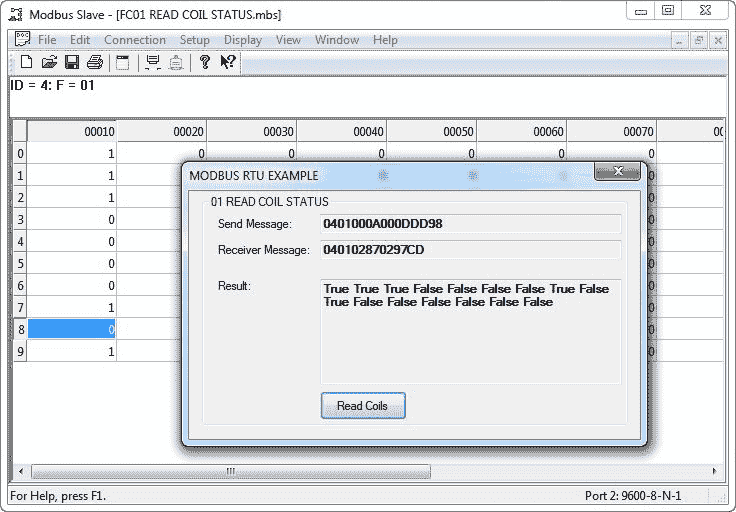
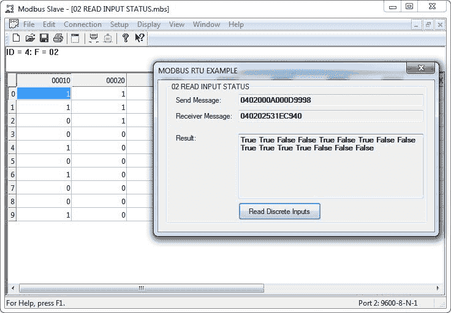
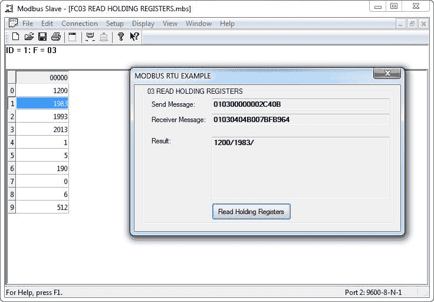
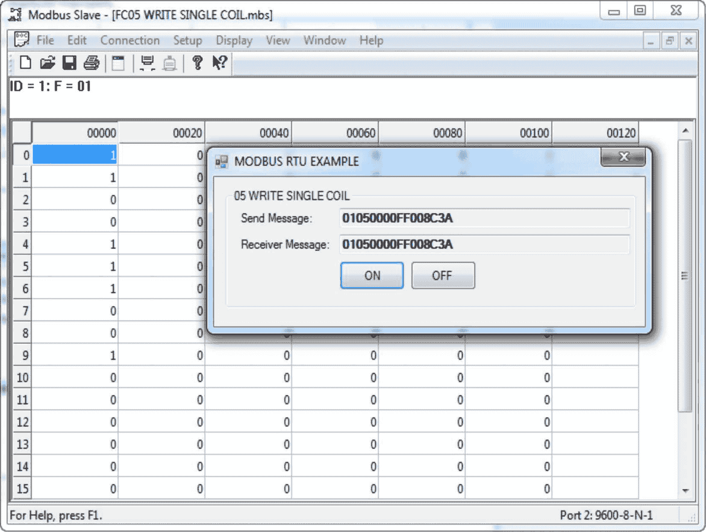
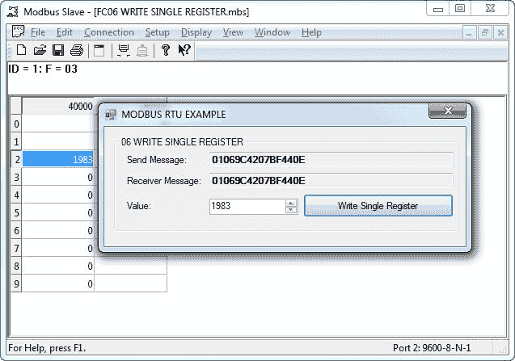
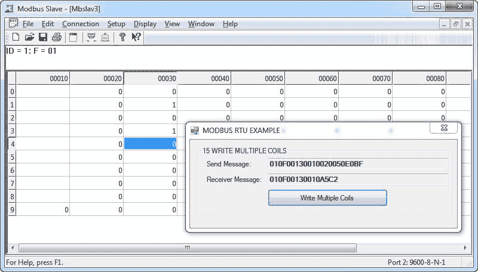
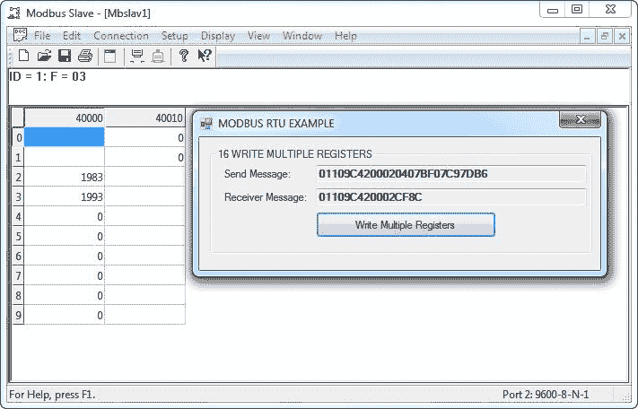
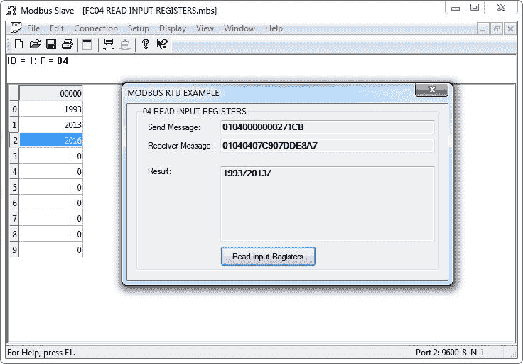
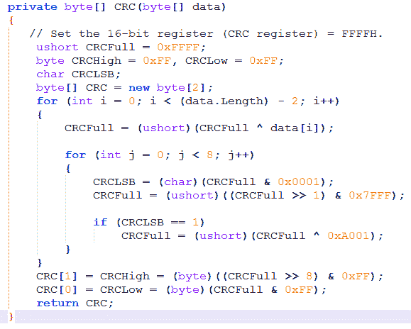

# Modbus TCP／RTU (C#)：C# Modbus 编程

在最后一本书中可以下载所有项目。

# 第一部分：MODBUS TCP

## 1. FC01 读取线圈状态

功能 `01` (`01hex`) 读取线圈（Read Coils）用于读取从站中离散线圈的开启/关闭状态。

### 请求
请求消息指定了要读取的起始线圈和线圈数量。
从从站设备地址 `4` 读取 `10...22`（线圈 `11` 到 `23`）的请求示例：

| 字段名称 | TCP/IP (十六进制) |
| :--- | :--- |
| 事务标识符高位 | `00` |
| 事务标识符低位 | `01` |
| 协议标识符高位 | `00` |
| 协议标识符低位 | `00` |
| 消息长度高位 | `00` |
| 消息长度低位(后接 6 字节) | `06` |
| 单元标识符 | `04` |
| 功能码 | `01` |
| 起始地址高位 | `00` |
| 起始地址低位 | `0A` |
| 线圈数量高位 | `00` |
| 线圈数量低位 | `0D` |
| 总字节数 | `12` |

### 响应
线圈状态响应消息封装为数据字段中的每位一个线圈。状态指示为：`1` 表示值开启 (ON)，`0` 表示值关闭 (OFF)。第一个数据字节的 `LSB`（最低位）包含请求中指定的线圈。其他线圈向该字节的高位延伸，并在随后的字节中从低位到高位排列。如果返回的线圈数量不是 8 的倍数，最后一个数据字节中的剩余位将用零填充（向字节的高位填充）。字节计数字段指定了数据完整字节的数量。

该请求的响应示例：

| 字段名称 | RTU (十六进制) |
| :--- | :--- |
| 事务标识符高位 | `00` |
| 事务标识符低位 | `01` |
| 协议标识符高位 | `00` |
| 协议标识符低位 | `00` |
| 消息长度高位 | `00` |
| 消息长度低位(后接 5 字节) | `05` |
| 单元标识符 | `04` |
| 功能码 | `01` |
| 字节计数 | `02` |
| 数据 (线圈 `7...10`) | |
| 数据 (线圈 `27...20`) | |
| 总字节数 | `11` |

## 2. FC02 读取输入状态

功能 `02` (`02hex`) 读取离散输入（Read Discrete Inputs）用于读取从站中离散输入的开启/关闭状态。

### 请求
请求消息指定了要读取的起始输入和输入数量。
从从站设备地址 `4` 读取 `10...22`（输入 `10011` 到 `10023`）的请求示例：

| 字段名称 | RTU (十六进制) |
| :--- | :--- |
| 事务标识符高位 | `00` |
| 事务标识符低位 | `02` |
| 协议标识符高位 | `00` |
| 协议标识符低位 | `00` |
| 消息长度高位 | `00` |
| 消息长度低位(后接 6 字节) | `06` |
| 单元标识符 | `04` |
| 功能码 | `02` |
| 起始地址高位 | `00` |
| 起始地址低位 | `0A` |
| 线圈数量高位 | `00` |
| 线圈数量低位 | `0D` |
| 总字节数 | `12` |

### 响应
输入状态响应消息封装为数据字段中的每位一个输入。状态指示为：`1` 是值开启 (ON)，`0` 是值关闭 (OFF)。第一个数据字节的 `LSB` 包含请求中的输入。其他输入向该字节的高位延伸，并在随后的字节中从低位到高位排列。如果返回的输入数量不是 8 的倍数，最后一个数据字节中的剩余位将用零填充（向字节的高位填充）。字节计数字段指定了数据完整字节的数量。

该请求的响应示例：

| 字段名称 | RTU (十六进制) |
| :--- | :--- |
| 事务标识符高位 | `00` |
| 事务标识符低位 | `01` |
| 协议标识符高位 | `00` |
| 协议标识符低位 | `00` |
| 消息长度高位 | `00` |
| 消息长度低位(后接 5 字节) | `05` |
| 单元标识符 | `04` |
| 功能码 | `02` |
| 字节计数 | `02` |
| 数据 (输入 `17...10`) | `53` |
| 数据 (输入 `27...20`) | `1E` |
| 总字节数 | `11` |

### 3. FC03 读取保持器寄存器

功能 `03` (`03hex`) 读取保持器寄存器（Read Holding Registers）用于读取从站中保持器寄存器的二进制内容。

### 请求
请求消息指定了要读取的起始寄存器和寄存器数量。
从设备地址 `1` 读取 `0...1`（寄存器 `4001` 到 `4002`）的请求示例：

| 字段名称 | TCP (十六进制) |
| :--- | :--- |
| 事务标识符高位 | `00` |
| 事务标识符低位 | `03` |
| 协议标识符高位 | `00` |
| 协议标识符低位 | `00` |
| 消息长度高位 | `00` |
| 消息长度低位(后接 6 字节) | `06` |
| 单元标识符 | `01` |
| 功能码 | `03` |
| 起始地址高位 | `00` |
| 起始地址低位 | `00` |
| 寄存器数量高位 | `00` |
| 寄存器数量低位 | `02` |
| 总字节数 | `12` |

### 响应
响应消息中的寄存器数据封装为每个寄存器两个字节，二进制内容在每个字节内右对齐。对于每个寄存器，第一个字节包含高位，第二个字节包含低位。

该请求的响应示例：

| 字段名称 | TCP (十六进制) |
| :--- | :--- |
| 事务标识符高位 | `00` |
| 事务标识符低位 | `03` |
| 协议标识符高位 | `00` |
| 协议标识符低位 | `00` |
| 消息长度高位 | `00` |
| 消息长度低位(后接 7 字节) | `07` |
| 单元标识符 | `01` |
| 功能码 | `03` |
| 字节计数 | `04` |
| 数据高位 1 | `04` |
| 数据低位 1 | `B0` |
| 数据高位 2 | `07` |
| 数据低位 2 | `BF` |
| 事务标识符高位 | `00` |
| 事务标识符低位 | `03` |
| 总字节数 | `13` |

## 4. FC04 读取输入寄存器

响应消息中的寄存器数据以每个寄存器两个字节的形式打包，二进制内容在每个字节内右对齐。对于每个寄存器，第一个字节包含高位，第二个字节包含低位。

请求的响应示例：

| 字段名称 | TCP (hex) |
| :--- | :--- |
| 事务标识符高位 | 00 |
| 事务标识符低位 | 04 |
| 协议标识符高位 | 00 |
| 协议标识符低位 | 00 |
| 消息长度高位 | 00 |
| 消息长度低位(后跟 7 字节) | 07 |
| 单元标识符 | 01 |
| 功能码 | 04 |
| 字节计数 | 04 |
| 数据高位 1 | 07 |
| 数据低位 1 | C9 |
| 数据高位 2 | 07 |
| 数据低位 2 | DD |
| 总字节数 | 13 |

## 5. FC05 写单个线圈

功能码 `05` (`05hex`) 写单个线圈

将单个线圈写入开启 (ON) 或关闭 (OFF)。

### 请求

请求消息指定了要写入的线圈引用。线圈地址从零开始计数，线圈 1 的地址为 0。

请求的开启/关闭状态由请求数据字段中的一个常数指定。十六进制值 `FF 00` 请求线圈开启。十六进制值 `00 00` 请求线圈关闭。所有其他值均为非法值，且不会影响线圈。

以下是一个在从站设备 1 中将线圈 0 开启的请求示例：

| 字段名称 | TCP (hex) |
| :--- | :--- |
| 事务标识符高位 | 00 |
| 事务标识符低位 | 05 |
| 协议标识符高位 | 00 |
| 协议标识符低位 | 00 |
| 消息长度高位 | 00 |
| 消息长度低位(后跟 6 字节) | 06 |
| 单元标识符 | 01 |
| 功能码 | 05 |
| 起始高位 | 00 |
| 起始低位 | 00 |
| 写入数据高位 | FF |
| 写入数据低位 | 00 |
| 总字节数 | 12 |

### 响应

正常响应是请求的回显，在线圈状态写入后返回。

请求的响应示例：

| 字段名称 | TCP (hex) |
| :--- | :--- |
| 事务标识符高位 | 00 |
| 事务标识符低位 | 05 |
| 协议标识符高位 | 00 |
| 协议标识符低位 | 00 |
| 消息长度高位 | 00 |
| 消息长度低位(后跟 6 字节) | 06 |
| 单元标识符 | 01 |
| 功能码 | 05 |
| 起始高位 | 00 |
| 起始低位 | 00 |
| 写入数据高位 (FF 开启线圈，=00 关闭线圈 (回显)) | FF |
| 写入数据低位 | 00 |
| 总字节数 | 12 |

## 6. FC06 写单个寄存器

功能码 `06` (`06hex`) 写单个寄存器

向单个保持寄存器写入一个值。

### 请求

请求消息指定了要写入的寄存器引用。寄存器地址从零开始计数，寄存器 1 的地址为 0。

请求的写入值在请求数据字段中指定。以下是在从站设备 1 中向寄存器 `4002` 写入十六进制 `07 BF` 的请求示例。

| 字段名称 | TCP (hex) |
| :--- | :--- |
| 事务标识符高位 | 00 |
| 事务标识符低位 | 06 |
| 协议标识符高位 | 00 |
| 协议标识符低位 | 00 |
| 消息长度高位 | 00 |
| 消息长度低位(后跟 6 字节) | 06 |
| 单元标识符 | 01 |
| 功能码 | 06 |
| 起始高位 | 9C |
| 起始低位 | 42 |
| 写入数据高位 | 07 |
| 写入数据低位 | BF |
| 总字节数 | 12 |

### 响应

正常响应是请求的回显，在寄存器内容写入后返回。

| 字段名称 | TCP (hex) |
| :--- | :--- |
| 事务标识符高位 | 00 |
| 事务标识符低位 | 06 |
| 协议标识符高位 | 00 |
| 协议标识符低位 | 00 |
| 消息长度高位 | 00 |
| 消息长度低位(后跟 6 字节) | 06 |
| 单元标识符 | 01 |
| 功能码 | 06 |
| 起始高位 | 9C |
| 起始低位 | 42 |
| 写入数据高位 | 07 |
| 写入数据低位 | BF |
| 总字节数 | 12 |

## 7. 15 写多个线圈

功能码 `15` (`0Fhex`) 写多个线圈

将线圈中的每个线圈写入开启或关闭。

### 请求

请求消息指定了要写入的线圈引用。线圈地址从零开始计数，线圈 1 的地址为 0。

请求的开启/关闭状态由请求数据字段的内容指定。位位置上的逻辑 `1` 请求对应的线圈开启。逻辑 `0` 请求其关闭。

以下是在从站设备 1 中写入从线圈 `20`（地址为 `19`或十六进制 `13`）开始的连续十个线圈的请求示例。

请求数据内容为两个字节：十六进制 `00 50`（二进制 `00000000 00001010`）。二进制位按以下方式对应线圈：

位：`0 0 0 0 0 0 0 0 0 0 0 1 0 1`
线圈：`27 26 25 24 23 22 21 20 - - - - - 29 28`

十六进制 `00 50` 字节中的 `00` 字节对应线圈 `27`，`50` 字节对应线圈 `28`。

| 字段名称 | TCP (hex) |
| :--- | :--- |
| 事务标识符高位 | 00 |
| 事务标识符低位 | 0F |
| 协议标识符高位 | 00 |
| 协议标识符低位 | 00 |
| 消息长度高位 | 00 |
| 消息长度低位(后跟 9 字节) | 09 |
| 单元标识符 | 01 |
| 功能码 | 0F |
| 起始高位 | 00 |
| 起始低位 | 13 |
| 线圈数量高位 | 00 |
| 线圈数量低位 | 10 |
| 字节计数 | 02 |
| 写入数据高位 | 00 |
| 写入数据低位 | 50 |

### 响应

正常响应返回从站地址、功能码、起始地址和线圈数量。以下是上述请求的响应。

| 字段名称 | TCP (hex) |
| :--- | :--- |
| 事务标识符高位 | 00 |
| 事务标识符低位 | 0F |
| 协议标识符高位 | 00 |
| 协议标识符低位 | 00 |
| 消息长度高位 | 00 |
| 消息长度低位(后跟 6 字节) | 06 |
| 单元标识符 | 01 |
| 功能码 | 0F |
| 起始高位 | 00 |
| 起始低位 | 13 |
| 线圈数量高位 | 00 |
| 线圈数量低位 | 10 |
| 总字节数 | 15 |

## 8. 16 写多个寄存器

功能码 `16` (`10hex`) 写多个寄存器

向一组保持寄存器写入值。

### 请求

请求消息指定了要写入的寄存器引用。寄存器地址从零开始计数，寄存器 1 的地址为 0。

请求的写入值在请求数据字段中指定。数据每个寄存器两个字节。

以下是在从站设备 1 中从 `4002` 开始写入十六进制 `07 BF` 和 `07 C9` 的两个寄存器的请求示例。

| 字段名称 | TCP (hex) |
| :--- | :--- |
| 事务标识符高位 | 00 |
| 事务标识符低位 | 10 |
| 协议标识符高位 | 00 |
| 协议标识符低位 | 00 |
| 消息长度高位 | 00 |
| 消息长度低位(后跟 11 字节) | 0B |
| 单元标识符 | 01 |
| 功能码 | 10 |
| 起始高位 | 9C |
| 起始低位 | 42 |
| 寄存器数量高位 | 00 |
| 寄存器数量低位 | 02 |
| 字节计数 | 04 |
| 写入数据 1 高位 | 07 |
| 写入数据 1 低位 | BF |
| 写入数据 2 高位 | 07 |
| 写入数据 2 低位 | C9 |
| 总字节数 | 17 |

### 响应

正常响应返回从站地址、功能码、起始地址和寄存器数量。以下是上述请求的响应。

| 字段名称 | TCP (hex) |
| :--- | :--- |
| 事务标识符高位 | 00 |
| 事务标识符低位 | 10 |
| 协议标识符高位 | 00 |
| 协议标识符低位 | 00 |
| 消息长度高位 | 00 |
| 消息长度低位(后跟 6 字节) | 06 |
| 单元标识符 | 01 |
| 功能码 | 10 |
| 起始高位 | 9C |
| 起始低位 | 42 |
| 寄存器数量高位 | 00 |
| 寄存器数量低位 | 02 |
| 总字节数 | 12 |

# 第 2 节：MODBUS RTU

## 目录

1. 1.FC01 读取线圈状态
2. 2.FC02 读取输入状态
3. 3.FC03 读取保持寄存器
4. 4.FC04 读取输入寄存器
5. 5.FC05 写入单个线圈
6. 6.FC06 写入单个寄存器
7. 7.FC15 写入多个线圈
8. 8.FC16 写入多个寄存器
9. 9.循环冗余校验计算

## 示例项目

## 1. FC01 读取线圈状态

### 功能 01 (01hex) 读取线圈

读取从站中的离散线圈状态。

### 请求
请求消息指定了要读取的起始线圈和数量。
从从站地址 4 读取 0...22（线圈 1 到 23）的请求示例：

| 字段名称 | RTU (十六进制) |
| :--- | :--- |
| 头部 | 无 |
| 从站地址 | 04 |
| 功能 | 01 |
| 起始地址高 | 00 |
| 起始地址低 | 0A |
| 线圈数量高 | 00 |
| 线圈数量低 | 0D |
| 校验低 | DD |
| 校验高 | 98 |
| 尾部 | 无 |
| 总字节数 | 8 |

### 响应
线圈状态响应消息数据字段中的每个位封装为一个线圈。状态表示为：1 为开启，0 为关闭。第一个数据字节的低位包含请求中的线圈。其他线圈从该字节的高位向后续字节字节。如果返回的线圈数量不是 8 的倍数，最后一个数据字节的剩余位将补零（向高位）。字节计数字段指定数据的完整字节数。

请求的响应示例：

| 字段名称 | RTU (十六进制) |
| :--- | :--- |
| 头部 | 无 |
| 从站地址 | 04 |
| 功能 | 01 |
| 字节计数 | 02 |
| 数据 (线圈 7...10) | 87 |
| 数据 (线圈 27...20) | 02 |
| 校验低 | 97 |
| 校验高 | CD |
| 尾部 | 无 |
| 总字节数 | 7 |

## 2. FC02 读取输入状态

#### 功能 02 (02hex) 读取离量

读取从站中的离散输入状态。

### 请求
请求消息指定了要读取的起始输入和数量。
从从站地址 4 读取 10...22（输入 11 到 23）的请求示例：

| 字段名称 | RTU (十六进制) |
| :--- | :--- |
| 头部 | 无 |
| 从站地址 | 04 |
| 功能 | 02 |
| 起始地址高 | 00 |
| 起始地址低 | 0A |
| 输入数量高 | 00 |
| 输入数量低 | 0D |
| 校验低 | 99 |
| 校验高 | 98 |
| 尾部 | 无 |
| 总字节数 | 8 |

### 响应
输入状态响应消息数据字段中的每个位封装为一个输入。状态表示为：1 为开启，0 为关闭。第一个数据字节的低位包含请求中的输入。其他输入从该字节的高位向后续字节字节。如果返回的输入数量不是 8 的倍数，最后一个数据字节的剩余位将补零（向高位）。字节计数字段指定数据的完整字节数。

请求的响应示例：

| 字段名称 | RTU (十六进制) |
| :--- | :--- |
| 头部 | 无 |
| 从站地址 | 04 |
| 功能 | 02 |
| 字节计数 | 02 |
| 数据 (输入 17...10) | 53 |
| 数据 (输入 27...20) | 1E |
| 校验低 | 99 |
| 校验高 | 40 |
| 尾部 | 无 |
| 总字节数 | 7 |

## 3. FC03 读取保持寄存器

### 功能 03 (03hex) 读取保持寄存器

读取从站中保持寄存器的二进制内容。

### 请求
请求消息指定了起始寄存器和寄存器数量。
从从站设备 1 读取 0...1（寄存器 4001 到 4002）的请求示例：

| 字段名称 | RTU (十六进制) |
| :--- | :--- |
| 头部 | 无 |
| 从站地址 | 01 |
| 功能 | 03 |
| 起始地址高 | 00 |
| 起始地址低 | 00 |
| 寄存器数量高 | 00 |
| 寄存器数量低 | 02 |
| 校验低 | C4 |
| 校验高 | 0B |
| 尾部 | 无 |
| 总字节数 | 8 |

### 响应
响应消息中的寄存器数据每个寄存器封装为两个字节，二进制内容在每个字节中右对齐。对于每个寄存器，第一个字节包含高位，第二个字节包含低位。

请求的响应示例：

| 字段名称 | RTU (十六进制) |
| :--- | :--- |
| 头部 | 无 |
| 从站地址 | 01 |
| 功能 | 03 |
| 字节计数 | 04 |
| 数据高 | 04 |
| 数据低 | 07 |
| 校验低 | B9 |
| 校验高 | 64 |
| 尾部 | 无 |
|

## 4. FC04 读取输入寄存器

### 功能 04 (04hex) 读取输入寄存器

读取从站中输入寄存器的二进制内容。

### 请求
请求消息指定了起始寄存器和寄存器数量。
从从站设备 1 读取 0...1（寄存器 3001 到 3002）的请求示例：

| 字段名称 | RTU (十六进制) |
| :--- | :--- |
| 头部 | 无 |
| 从站地址 | 01 |
| 功能 | 04 |
| 起始地址高 | 00 |
| 起始地址低 | 00 |
| 寄存器数量高 | 00 |
| 寄存器数量低 | 02 |
| 校验低 | 71 |
| 校验高 | CB |
| 尾部 | 无 |
| 总字节数 | 8 |

### 响应
响应消息中的寄存器数据每个寄存器封装为两个字节，二进制内容在每个字节中右对齐。

请求的响应示例：

| 字段名称 | RTU (十六进制) |
| :--- | :--- |
| 头部 | 无 |
| 从站地址 | 01 |
| 功能 | 04 |
| 字节计数 | 04 |
| 数据高 | 07 |
| 数据低 | C9 |
| 校验低 | E8 |
| 校验高 | A7 |
| 尾部 | 无 |
| 总字节数 | 9

## 5. FC05 写入单个线圈

![images/00007.jpeg)

### 功能 05 (05hex) 写入单个线圈

将单个线圈开启或关闭。

### 请求
请求消息指定了要写入的线圈。线圈从零开始编号，线圈 1 地址为 0。
请求的开启/关闭状态由请求数据字段中的常量指定。`FF 00` 十进制请求开启线圈。`00 00` 请求将其关闭。其他值都是非法的且不会影响线圈。

向从站设备 1 写入线圈 0 的请求示例：

| 字段名称 | RTU (十六进制) |
| :--- | :--- |
| 头部 | 无 |
| 从站地址 | 01 |
| 功能 | 05 |
| 线圈地址高 | 00 |
| 线圈地址低 | 00 |
| 写入数据高 | FF |
| 写入数据低 | 00 |
| 校验低 | 8C |
| 校验高 | 3A |
| 尾部 | 无 |
| 总字节数 | 8 |

### 响应
正常响应是请求的回显，在写入线圈状态后返回。

请求的响应示例：

| 字段名称 | RTU (十六进制) |
| :--- | :--- |
| 头部 | 无 |
| 从站地址 | 01 |
| 功能 | 05 |
| 线圈地址高 | 00 |
| 线圈地址低 | 00 |
| 写入数据高 | FF |
| 写入数据低 | 00 |
| 校验低 | 8C |
| 校验高 | 3A |
| 尾部 | 无 |
| 总字节数 | 8

## 6. FC06 写入单个寄存器

请求消息指定了要写入的寄存器引用。寄存器地址从零开始计数，寄存器 1 的地址为 0。

请求的写入值在请求数据字段中指定。以下是一个向从站 1 的寄存器 `40002` 写入十六进制 `07 BF` 的请求示例。

| 字段名称 | RTU (十六进制) |
| :--- | :--- |
| 头部 | 无 |
| 从站地址 | 01 |
| 功能 | 06 |
| 寄存器地址高位 | 9C |
| 寄存器地址低位 | 42 |
| 写入数据高位 | 07 |
| 写入数据低位 | BF |
| 校验低位 | 44 |
| 校验高位 | 0E |
| 尾部 | 无 |
| 总字节 | 8 |

### 响应

正常响应是请求的回，在寄存器内容写入后返回。

| 字段名称 | RTU (十六进制) |
| :--- | :--- |
| 头部 | 无 |
| 从站地址 | 01 |
| 功能 | 06 |
| 线圈地址高位 | 9C |
| 线圈地址低位 | 42 |
| 写入数据高位 | 07 |
| 写入数据低位 | BF |
| 校验低位 | 44 |
| 校验高位 | 0E |
| 尾部 | 无 |
| 总字节 | 8 |

## 7. FC15 写入多个线圈

### 功能 15 (0Fhex) 写入多个线圈

将线圈序列中的每个线圈开启或关闭。

### 请求

请求消息指定了要写入的线圈引用。线圈地址从零开始计数，线圈 1 的地址为 0。

请求的开启/关闭 状态由请求数据字段的内容指定。字段中位位置的逻辑 1 请求相应的线圈开启。逻辑 0 请求其关闭。

以下是一个向从站 1 写入从线圈 20（地址为 19，或十六进制 13）开始的十个线圈的请求示例。

请求数据内容包含两个字节：十六进制 `00 50`（二进制 `0000 0000 0000 1010`）。二进制位按如下方式对应线圈：

位: 0 0 0 0 0 0 0 0 0 0 0 0 1 0 1 0
线圈: 27 26 25 24 23 22 21 20 - - - - - - 29 28

传输的第一个字节（十六进制 `00`）对应线圈 `27 ... 20`，其中最低有效位对应该组中最低的线圈（`20`）。

接下来的传输字节（十六进制 `50`）对应线圈 `29` 和 `28`，，其中最低有效位对应该组中最低的线圈（`28`）。最后一个数据字节中未使用的位应填充零。

| 字段名称 | RTU (十六进制) |
| :--- | :--- |
| 头部 | 无 |
| 从站地址 | 01 |
| 功能 | 0F |
| 线圈地址高位 | 00 |
| 线圈地址低位 | 13 |
| 线圈数量高位 | 00 |
| 线圈数量低位 | 10 |
| 字节计数 | 02 |
| 写入数据高位 | 00 |
| 写入数据低位 | 50 |
| 校验低位 | E0 |
| 校验高位 | BF |
| 尾部 | 无 |
| 总字节 | 11 |

### 响应

正常响应返回从站地址、功能码、起始地址和写入的线圈数量。以下是上述请求的响应示例：

| 字段名称 | RTU (十六进制) |
| :--- | :--- |
| 头部 | 无 |
| 从站地址 | 01 |
| 功能 | 0F |
| 线圈地址高位 | 00 |
| 线圈地址低位 | 13 |
| 线圈数量高位 | 00 |
| 线圈数量低位 | 10 |
| 校验低位 | A5 |
| 校验高位 | C2 |
| 尾部 | 无 |
| 总字节 | 8 |

## 8. FC16 写入多个寄存器

### 功能 16 (10hex) 写入多个寄存器

将值写入一组保持寄存器中。

### 请求

请求消息指定了要写入的寄存器引用。寄存器地址从零开始计数，寄存器 1 的地址为 0。

请求的写入值在请求数据字段中指定。数据每个寄存器打包两个字节。

以下是一个向从站 1 写入从 `40002` 开始的十六进制 `07 BF` 和 `07 C9` 的两个寄存器的请求示例：

| 字段名称 | RTU (十六进制) |
| :--- | :--- |
| 头部 | 无 |
| 从站地址 | 01 |
| 功能 | 10 |
| 起始地址高位 | 9C |
| 起始地址低位 | 42 |
| 寄存器数量高位 | 00 |
| 寄存器数量低位 | 02 |
| 字节计数 | 04 |
| 数据高位 | 07 |
| 数据低位 | BF |
| 数据高位 | 07 |
| 数据低位 | C9 |
| 校验低位 | 7D |
| 校验高位 | B6 |
| 尾部 | 无 |
| 总字节 | 13 |

### 响应

正常响应返回从站地址、功能码、起始地址和写入的寄存器数量。以下是上述请求的响应：

| 字段名称 | RTU (十六进制) |
| :--- | :--- |
| 头部 | 无 |
| 从站地址 | 01 |
| 功能 | 10 |
| 起始地址高位 | 9C |
| 起始地址低位 | 42 |
| 寄存器数量高位 | 00 |
| 寄存器数量低位 | 02 |
| 校验低位 | CF |
| 校验高位 | 8C |
| 尾部 | 无 |
| 总字节 | 8 |

## 9. 循环冗余校验计算

CRC 校验：从地址开始到内容结束。

步骤 1：使 16 位寄存器（`CRC register`）= `FFFFH`

步骤 2：第一个 8 位消息与低 16 位 `CRC register` 进行异或。将结果存储在 `CRC register` 中。

步骤 3：`CRC register` 右移一位，高位填充“0”。

步骤 4：检查右移的值。如果是 0，则填充步骤 3 获得的新值并存入 `CRC register`；否则，将 `A001H` 与 `CRC register` 进行异或并将结果存入 `CRC register`。

步骤 5：重复步骤 3 – 4 并完成所有 8 位的操作。

步骤 6：重复步骤 2 – 5 以获取下一个 8 位消息，直到所有消息的操作完成。最终在 `CRC register` 中获得的值即为 CRC 校验。CRC 校验必须交替放置在消息校验中。

示例 C#

在此下载所有内容：

| 示例项目 TCP:[`goo.gl/rjLPyz`](https://goo.gl/rjLPyz)示例项目 RTU:[`goo.gl/SuR1DD`](https://goo.gl/SuR1DD) |

