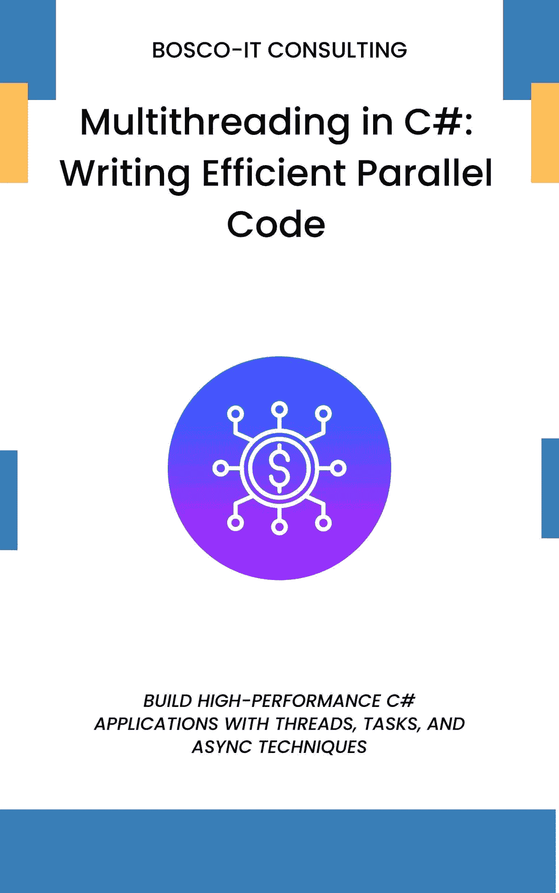

# C# 多线程：编写高效并行代码：使用线程、任务和异步技术构建高性能 C# 应用指南





# 前言

## 释放 C# 多线程的威力

在当今多核处理器和高性能计算的世界，编写高效并行代码的能力已不再是一种奢侈，而是一项必需品。“C# 多线程：编写高效的并行代码”是你帮助你在 C# 编程语言中掌握这项关键技能的全面指南。

### 为什么多线程至关重要

多线程是现代软件开发的骨柱，它让应用程序能够充分利用现代硬件的潜力。通过利用多个线程，你的 `C#` 应用程序可以更快地执行复杂计算，更地响应用户交互，并高效地管理系统资源。无论你是在开发桌面应用程序、Web 服务还是企业级系统，深入理解多线程对于创建高性能、可扩展的软件都是至关重要的。

### 你将学到什么

本书旨在带你探索 `C#` 多线程的错奥之处。从线程和并行性的基本概念，到异步编程和并行 LINQ 查询等高级技术，我们涵盖了 `C#` 多线程能力的整个频谱。

关键主题包括：

*   线程创建和管理的基础
*   确保线程安全的同步技术
*   高效使用线程池以优化性能
*   使用 `async` 和 `await` 进行基于任务的异步编程
*   `Parallel.For` 和 `PLINQ` 等并行编程结构
*   针对多线程应用程序的设计模式
*   并发代码的调试和性能分析技术

### 本书将如何让你

当你完成“`C#` 多线程”这本书时，你将获得：

1.  深度理解多线程概念及其在 `C#` 中的实际应用
2.  具备编写高效并行代码的能力，充分利用现代硬件的优势
3.  避免常见陷阱并解决线程相关问题的技术
4.  能够使用多线程设计并实现可扩展、响应迅速应用程序的能力
5.  通过实际示例和真实场景获得实战经验

### 本书结构

本书分为 12 个详细的章节，每一章都在前章的基础上构建，创建一个连贯的学习体验。我们从多线程的基础开始，逐渐过渡到更高级的主题。附录提供了额外的资源，包括一份实用的备查表、常见错误解决方案以及并发术语表。

### 谁应该阅读这本书

本书非常适合想要提升编程水平并创建高性能应用程序的中级到高级 `C#` 开发者。虽然我们假设读者对 `C#` 有一定的了解，但我们尽一切努力清晰地解释概念，使内容对于野心勃勃的初学者来说也易于理解。

### 致谢

我对充满活力的 `C#` 社区表示感谢，他们持续的创新和共享共享本书的形成具有无法估量的价值。特别感谢我的技术评审员和编辑，他们的见解极大地提高了内容的质量和清晰度。

### 结语

多线程是开发者工具箱中的一种强大工具，掌握它可以显著增强你作为 `C#` 程序员的能力。本书旨在揭示并发编程的复杂性，并赋予你自信地编写高效并行代码的知识。

当你开启 `C#` 多线程世界的旅程时，请记住实践和实验是关键。你在这里学习的概念将为你的软件开发职业开启新的可能性。

让我们深入其中，释放 `C#` 应用程序中多线程的全方位潜力！

BOSCO-IT CONSULTING

# 目录

| 章节 | 标题 |
| --- | --- |
| 1 | 多线程与并行性简介 |
| 2 | 在 `C#` 中使用线程 |
| 3 | 线程同步与安全 |
| 4 | 线程池与 `ThreadPool` 类 |
| 5 | `Task` 和 `Task<T>`简介 |
| 6 | 使用 `async` 和 `await` 编写异步代码 |
| 7 | 使用 `Parallel.For` 和 `Parallel.ForEach` |
| 8 | `PLINQ` |
| 9 | 线程之间的协调与通信 |
| 10 | 多线程应用程序的调试与性能分析 |
| 11 | 多线程设计模式 |
| 12 | ASP.NET 和 UI 中的多线程 |
| App | `C#` 多线程备查表 |
| App | 常见线程错误及修复 |
| App | 示例项目与基准工具 |
| App | 并发术语表 |

# 第 1 章：多线程与并行性简介

## 计算的演进：从单核到多核处理器

在计算早期，处理器的设计是单核心的，一次只能执行一条指令。随着技术的进步，对更快、更高效计算的需求呈指数级增长。这导致了多核处理器的发展，它改变了我们处理软件开发的方式，并为并发编程开启了新的可能性。

### 单核时代

当计算机出现时，它们是围绕单核处理器构建的。这些处理器一次只能执行一条指令，遵循顺序计算方法。随着对处理能力的需求增加，制造商专注于通过提高时钟频率来提升性能。然而，这种策略最终遇到了物理限制，例如散热和功耗。

考虑以下类比：想象一个中有一个厨师的厨房，他正在准备一道复杂的菜肴。无论这个厨师多熟练，完成菜肴所需所有任务的速度都是有限的。这类似于单核处理器的局限性。

### 多核革命

为了克服单核处理器的局限性，工程师开发了多核处理器。这些处理器在单个芯片上包含多个处理单元（核心），允许指令的并行执行。这一突破使计算机能够同时处理多个任务，显著提高了整体性能和效率。

回到我们的厨房类比，多核处理器就像是多个厨师在同一个厨房里共同工作。每个厨师都可以专注于准备菜的不同方面，从而更快、更高效地烹饪。

### 对软件开发的影响

从单核到多核的转变对软件开发产生了深远影响。程序员现在必须考虑如何设计能够利用多个核心来提高性能的应用程序。这导致了并发编程技术的兴起，包括多线程和并行。

## 理解并发与并行

在深入研究多线程和并行性之前，理解并发和并行的概念以及它们之间的区别是非常关重要的。

### 并发：杂耍多个任务

并发是指系统同时处理多个任务或进程的能力。在并发系统中，多个任务可以随时间推移取得进展，即使它们并非在同一时刻执行。并发是为了高效管理和协调多个任务。

为了说明并发，想象一个杂技演员在空中抛耍多个球。杂技演员并不是同时碰到所有的球，但通过通过快速切换，他们设法让所有球都保持运动状态。


在软件术语中，并发（Concurrency）允许程序通过在任务之间快速切换来管理多个任务。即使在单核处理器上，也可以通过时间片等技术实现这一点。

## 并行：真正的同时执行

另一方面，并行（Parallelism）涉及多个任务或进程的实际同时执行。在并行系统中，程序的不同部分可以在不同的处理单元上同时执行。

继续使用我们的杂耍类比，并行好比有多个接球员，每个人同时处理他们自己的一组球。这允许在多个领域上实现真正的同步进展。

在计算中，并行需要硬件支持，形式为多个处理单元（核心或处理器），以实现真正的真正的同时执行。

## 并发与并行的关系

虽然并发和并行是相关的概念，但它们并不是一回事。并发是关于在一段时间内处理多个任务，而并行是关于一次性完成多件事。所有的并行系统都是并发的，但并不是所有的并发系统都是行的。

在 `C#` 中，我们可以同时利用并发和并行来提高应用程序的性能和响应能力。该语言提供了各种工具和抽象，来有效处理这两个概念。

## 线程简介

并发编程的核心是线程（Threads）的概念。线程是进程中执行的最小单元。理解线程对于掌握 C# 中的多线程和并行至关重要。

### 什么是线程？

线程可以被认为是一个轻量级进程。它代表程序内部一个独立的执行路径。每个线程都有自己的栈和局部变量，但与同一进程中的其他线程共享内存空间。

在 C# 中，`System.Threading.Thread` 类代表一个线程。这是一个创建并启动新线程的简单示例：

```csharp
using System;
using System.Threading;
class Program {
    static void Main()
    {
        Thread thread = new Thread(ThreadMethod);
        thread.Start();
        Console.WriteLine("Main thread continues execution.");
    }
    static void ThreadMethod()
    {
        Console.WriteLine("New thread is executing.");
    }
}
```

在这个示例中，我们创建了一个执行 `ThreadMethod` 的新线程。主线程独立于新线程继续其执行。

### 线程状态和生命周期

C# 中的线程在整个生命周期中处于各种状态。理解这些状态对于有效的线程管理至关重要：

1. `Unstarted`：线程已创建但尚未启动。
2. `Running`：线程正在积极执行。
3. `WaitSleepJoin`：线程被阻塞，正在等待资源或另一个线程完成。
4. `Suspended`：线程已挂起，可以恢复。
5. `Stopped`：线程已完成执行或已中止。

这里有一个演示其中一些状态的示例：

```csharp
using System;
using System.Threading;
class Program {
    static void Main()
    {
        Thread thread = new Thread(ThreadMethod);
        Console.WriteLine($"Thread State: {thread.ThreadState}"); // Unstarted
        thread.Start();
        Console.WriteLine($"Thread State: {thread.ThreadState}"); // Running
        Thread.Sleep(1000); // 给线程留时间完成
        Console.WriteLine($"Thread State: {thread.ThreadState}"); // Stopped
    }
    static void ThreadMethod()
    {
        Console.WriteLine("Thread is running.");
    }
}
```

### 线程优先级

C# 允许你使用 `Thread.Priority` 属性设置线程的优先级。线程优先级对于管理系统资源非常有用，但谨慎使用它们非常重要，因为可能会导致线程饥饿等问题。

```csharp
using System;
using System.Threading;
class Program {
    static void Main()
    {
        Thread highPriorityThread = new Thread(ThreadMethod);
        highPriorityThread.Priority = ThreadPriority.Highest;
        highPriorityThread.Start("High Priority");
        Thread lowPriorityThread = new Thread(ThreadMethod);
        lowPriorityThread.Priority = ThreadPriority.Lowest;
        lowPriorityThread.Start("Low Priority");
    }
    static void ThreadMethod(object name)
    {
        for (int i = 0; i < 5; i++)
        {
            Console.WriteLine($"{name} Thread: {i}");
            Thread.Sleep(100);
        }
    }
}
```

在这个示例中，我们创建了两个不同优先级的线程。高优先级线程可能获得更多的 CPU 时间，但具体行为取决于系统和其他因素。

## 多线程在现代应用中的重要性

多线程已成为现代应用开发不可或缺的方面，提供了许多益处，可以显著提高软件系统的性能、响应能力和效率。

### 通过并行提高性能

多线程的主要优势之一是能够利用多核处理器的并行处理能力。通过将复杂任务分解为可以并发执行的较小子任务，多线程应用程序可以实现显著的性能提升。

考虑需要处理大型数据集的场景。使用单线程方法，你将顺序处理数据，这可能非常耗时。然而，通过多线程，你可以将数据集分成块，并在不同的核心上同时处理它们，从而极地缩短整体处理时间。

这是一个演示此概念的简单示例：

```csharp
using System;
using System.Diagnostics;
using System.Threading.Tasks;
class Program {
    static void Main()
    {
        const int arraySize = 100000000;
        int[] numbers = new int[arraySize];
        // ... (代码省略以保持逻辑)
    }
}
```
*(注：由于原文示例代码块不完整，此处根据翻译逻辑保持其结构说明)*

该示例演示了并行处理如何显著缩短汇总大型数组的时间。

### 用户界面响应能力的增强

多线程在具有图形用户界面（GUI）的应用中特别有价值。通过将耗时操作转移到后台线程，主 UI 线程可以保持响应，防止应用程序假死或无响应。

这是一个使用 Windows Forms 演示这一概念的示例：

```csharp
using System;
using System.Threading;
using System.Windows.Forms;
public class MainForm : Form {
    private Button startButton;
    private ProgressBar progressBar;
    public MainForm()
    {
        InitializeComponents();
    }
    private void InitializeComponents()
    {
        startButton = new Button
        {
            Text = "开始长时间操作",
            Location = new System.Drawing.Point(10, 10)
        };
        startButton.Click += StartButton_Click;
        progressBar = new ProgressBar
        {
            Location = new System.Drawing.Point(10, 40),
            Width = 200
        };
        Controls.Add(startButton);
        Controls.Add(progressBar);
    }
    private void StartButton_Click(object sender, EventArgs e)
    {
        startButton.Enabled = false;
    }
}
```


```csharp
progressBar.Value = 0;

Thread workerThread = new Thread(PerformLongOperation);

workerThread.Start();

}

private void PerformLongOperation()
{
    for (int i = 0; i <= 100; i++)
    {
        Thread.Sleep(50); // Simulate a time-consuming operation
        UpdateProgressBar(i);
    }
    MessageBox.Show("Operation completed!");
    EnableStartButton();
}

private void UpdateProgressBar(int value)
{
    if (InvokeRequired)
    {
        Invoke(new Action<int>(UpdateProgressBar), value);
    }
    else
    {
        progressBar.Value = value;
    }
}

private void EnableStartButton()
{
    if (InvokeRequired)
    {
        Invoke(new Action(EnableStartButton));
    }
    else
    {
        startButton.Enabled = true;
    }
}
```

在这个示例中，耗时操作在单独的线程上执行，这允许 UI 保持响应并实时更新进度条。

### 高效资源利用

多线程允许更高效地利用系统资源。当一个线程等待 I/O 操作完成时，其他线程可以继续执行，从而利用本会空置的 CPU。

考虑一种应用程序需要从互联网下载多个文件的场景：

```csharp
using System;
using System.Net.Http;
using System.Threading.Tasks;

class Program
{
    static async Task Main()
    {
        string[] urls = new string[]
        {
            "https://example.com/file1.txt",
            "https://example.com/file2.txt",
            "https://example.com/file3.txt"
        };
        using (HttpClient client = new HttpClient())
        {
            Task[] downloadTasks = new Task[urls.Length];
            for (int i = 0; i < urls.Length; i++)
            {
                downloadTasks[i] = DownloadFileAsync(client, urls[i], i + 1);
            }
            await Task.WhenAll(downloadTasks);
        }
        Console.WriteLine("All downloads completed.");
    }

    static async Task DownloadFileAsync(HttpClient client, string url, int fileNumber)
    {
        Console.WriteLine($"Starting download of file {fileNumber}");
        string content = await client.GetStringAsync(url);
        Console.WriteLine($"Finished downloading file {fileNumber} (Size: {content.Length} bytes)");
    }
}
```

在这个示例中，多个文件被并发下载，有效地利用了网络资源并减少了完成操作所需的总时间。

## 多线程编程中的挑战与考虑

虽然多线程提供了许多优势，但它也引入了复杂性和潜在的陷阱，开发者必须注意并仔细处理这些问题。

### 竞态条件

竞态条件发生在多个线程并发访问共享数据，且最终结果取决于它们执行的时机或顺序。这会导致不可预测和错误的结果。

考虑以下示例：

```csharp
using System;
using System.Threading;

class BankAccount 
{
    private int balance;
    public BankAccount(int initialBalance)
    {
        balance = initialBalance;
    }
    public void Deposit(int amount)
    {
        balance += amount;
    }
    public void Withdraw(int amount)
    {
        if (balance >= amount)
        {
            // Simulate some processing time
            Thread.Sleep(1);
            balance -= amount;
        }
    }
    public int GetBalance()
    {
        return balance;
    }
}

class Program 
{
    static void Main()
    {
        BankAccount account = new BankAccount(1000);
        Thread depositThread = new Thread(() =>
        {
            for (int i = 0; i < 100; i++)
            {
                account.Deposit(10);
            }
        });
        Thread withdrawThread = new Thread(() =>
        {
            for (int i = 0; i < 100; i++)
            {
                account.Withdraw(10);
            }
        });
        depositThread.Start();
        withdrawThread.Start();
        depositThread.Join();
        withdrawThread.Join();
        Console.WriteLine($"Final balance: {account.GetBalance()}");
    }
}
```

在这个示例中，由于存款和取款操作之间的竞态条件，最终余额并不总是预期的 1000。

### 死锁

死锁发生在两个或多个线程无法继续执行，因为每个线程都在等待另一个线程释放资源。这导致了循环依赖，阻止了任何线程的进展。

这是一个说明潜在死锁情况的示例：

```csharp
using System;
using System.Threading;

class Program 
{
    static object resource1 = new object();
    static object resource2 = new object();
    static void Main()
    {
        Thread thread1 = new Thread(DoWork1);
        Thread thread2 = new Thread(DoWork2);
        thread1.Start();
        thread2.Start();
        thread1.Join();
        thread2.Join();
    }
    static void DoWork1()
    {
        lock (resource1)
        {
            Console.WriteLine("Thread 1 acquired resource 1");
            Thread.Sleep(1000);
            lock (resource2)
            {
                Console.WriteLine("Thread 1 acquired resource 2");
            }
        }
    }
    static void DoWork2()
    {
        lock (resource2)
        {
            Console.WriteLine("Thread 2 acquired resource 2");
            Thread.Sleep(1000);
            lock (resource1)
            {
                Console.WriteLine("Thread 2 acquired resource 1");
            }
        }
    }
}
```

在这个示例中，如果 Thread 1 同时获取 `resource1` 且 Thread 2 获取了 `resource2`，则存在死锁风险，因为每个线程都会无限等待另一个资源。

### 线程安全

在多线程应用中，确保线程安全至关重要。线程安全是指代码在多个线程并发访问时能够正确运行的属性。

以下是使用 `lock` 使之前的 `BankAccount` 类线程安全的示例：

```csharp
using System;
using System.Threading;

class ThreadSafeBankAccount 
{
    private int balance;
    private object lockObject = new object();
    public ThreadSafeBankAccount(int initialBalance)
    {
        balance = initialBalance;
    }
    public void Deposit(int amount)
    {
        lock (lockObject)
        {
            balance += amount;
        }
    }
    public void Withdraw(int amount)
    {
        lock (lockObject)
        {
            if (balance >= amount)
            {
                // Simulate some processing time
                Thread.Sleep(1);
                balance -= amount;
            }
        }
    }
    public int GetBalance()
    {
        lock (lockObject)
        {
            return balance;
        }
    }
}
```

通过使用 `lock` 语句，我们确保一次只有一个线程可以访问代码的关键区域，从而防止竞态条件。

### 性能开销

虽然多线程可以提高性能，但它也会由于线程创建、上下文切换和同步引入开销。在某些情况下，过度使用线程实际上会降低性能。

必须仔细考虑并行的粒度，并使用性能分析工具来测量多线程对应用程序的实际性能影响。

## 结论


在本章中，我们将深入探讨 C# 中的多线程世界，探索其基本概念、最佳实践和高级技术。我们将从基础开始，逐渐过渡到更复杂的场景，并在过程中提供实际示例以加深您的理解。

## 理解线程

在我们深入研究 C# 中线程操作的复杂性之前，理解线程什么是以及它们在程序上下文中如何运作至关重要。

### 什么是线程？

线程是进程中执行的最小单元。它代表了程序代码的一条独立执行路径，并拥有自己的栈（stack）和局部变量。单个进程内的多个线程共享相同的内存空间，允许线程之间进行高效的通信和数据共享。

在 C# 中，`System.Threading` 命名空间提供了 `Thread` 类，它封装了线程的概念，并提供了控制其生命周期和行为的方法。

### 主线程

当你运行 C# 控制台应用程序或 Windows Forms 应用程序时，操作系统会创建一个名为主线程（main thread）的默认线程。该线程负责执行 `Main()` 方法，该方法是程序的入口点。

```csharp
class Program { static void Main(string[] args)
{
    Console.WriteLine("This is running on the main thread.");
}
}
```

在这个简单的示例中，所有代码都在主线程上执行。然而，正如我们很快看到的，我们可以创建额外的线程来与主线程并发执行任务。

### 线程状态

C# 中的线程在整个生命周期内可以存在于各种状态。理解这些状态对于有效的线程管理至关重要：

1. **Unstarted（未启动）**：线程已创建但尚未开始执行。
2. **Running（运行中）**：线程正在积极执行其分配的任务。
3. **WaitSleepJoin（等待/睡眠/加入）**：线程被阻塞，等待资源或另一个线程完成。
4. **Suspended（挂起）**：线程的执行被临时停止。
5. **Stopped（停止）**：线程已完成执行或已终止。

随着本章的进展，我们将探索如何操作这些状态来控制线程的行为。

## 创建和启动线程

现在我们对线程概念有了坚实的基础，让我们探索如何在 C# 中创建和启动线程。

### 创建线程

要创建一个新线程，我们需要实例化 `Thread` 类，并向它传递一个 `ThreadStart` 委托，该委托指向我们希望线程执行的方法：

```csharp
using System;
using System.Threading;
class Program { static void Main(string[] args)
{
    Thread workerThread = new Thread(new ThreadStart(DoWork));
    workerThread.Start();
    Console.WriteLine("Main thread continues execution...");
} static void DoWork()
{
    Console.WriteLine("Worker thread is executing...");
    Thread.Sleep(2000); // 模拟一些工作 
    Console.WriteLine("Worker thread completed.");
}
}
```

在这个示例中，我们创建了一个新线程将将执行 `DoWork` 方法。`Thread.Sleep(2000)` 调用通过暂停线程 2 秒来模拟正在进行的工作。

### 参数化线程启动

有时，我们需要向线程执行的方法传递参数。我们可以使用 `ParameterizedThreadStart` 委托来实现这一点：

```csharp
using System;
using System.Threading;
class Program { static void Main(string[] args)
{
    Thread workerThread = new Thread(new ParameterizedThreadStart(DoWork));
    workerThread.Start("Hello from the main thread!");
    Console.WriteLine("Main thread continues execution...");
} static void DoWork(object message)
{
    Console.WriteLine($"Worker thread received: {message}");
    Thread.Sleep(2000); // 模拟一些工作 
    Console.WriteLine("Worker thread completed.");
}
}
```

在这里，我们从主线程向工作线程传递了一个字符串 `message`。

### 使用 Lambda 表达式

C# 允许我们使用 Lambda 表达式来创建更简洁的线程定义：

```csharp
Thread workerThread = new Thread(() =>
{
    Console.WriteLine("Worker thread is executing...");
    Thread.Sleep(2000);
    Console.WriteLine("Worker thread completed.");
});
workerThread.Start();
```

这种方法对于短的、一次性的线程操作特别有用。

## 线程同步

当我们开始处理多个线程时，很快就会遇到线程需要协调其动作或访问共享资源的场景。这就是线程同步发挥用场的地方。

### 同步的性

考虑以下示例：

```csharp
class BankAccount { 
    private int balance = 0; 
    public void Deposit(int amount)
    {
        balance += amount;
    } 
    public void Withdraw(int amount)
    { 
        if (balance >= amount)
        {
            balance -= amount;
        }
    } 
    public int GetBalance()
    { 
        return balance; 
    }
} 
class Program { 
    static void Main(string[] args)
    {
        BankAccount account = new BankAccount();
        Thread depositThread = new Thread(() =>
        { 
            for (int i = 0; i < 1000; i++)
            {
                account.Deposit(100);
            }
        });
        Thread withdrawThread = new Thread(() =>
        { 
            for (int i = 0; i < 1000; i++)
            {
                account.Withdraw(100);
            }
        });
        depositThread.Start();
        withdrawThread.Start();
        depositThread.Join();
        withdrawThread.Join();
        Console.WriteLine($"Final balance: {account.GetBalance()}");
    }
}
```

在这个场景中，我们有两个线程并发地向账户存款和取款。如果没有适当的同步，最终余额将是不正确的。

### 使用 lock 关键字

C# 提供了 `lock` 关键字来创建临界区，确保只有一个线程执行受保护的代码：

```csharp
class BankAccount { 
    private int balance = 0; 
    private object lockObject = new object();
    public void Deposit(int amount)
    {
        lock (lockObject)
        {
            balance += amount;
        }
    } 
    public void Withdraw(int amount)
    { 
        lock (lockObject)
        {
            if (balance >= amount)
            {
                balance -= amount;
            }
        }
    } 
    public int GetBalance()
    { 
        lock (lockObject)
        {
            return balance;
        }
    }
}
```

通过使用 `lock`，对 `balance` 变量的操作是安全的。

### Monitor 类

`lock` 关键字实际上是 `Monitor` 类的语法糖。为了获得更细粒度的控制，我们可以直接使用 `Monitor`：

```csharp
public void Deposit(int amount)
{
    Monitor.Enter(lockObject);
    try {
        balance += amount;
    }
    finally {
        Monitor.Exit(lockObject);
    }
}
```

`Monitor` 类提供了如 `TryEnter` 和 `Wait` 等额外方法，为线程同步提供了更大的活性。

### Interlocked 类

对于数值类型的原子操作，`Interlocked` 类提供了一系列线程安全且高度优化的方法：

```csharp
class BankAccount { 
    private int balance = 0; 
    public void Deposit(int amount)
    {
        Interlocked.Add(ref balance, amount);
    } 
    public void Withdraw(int amount)
    {
        Interlocked.Add(ref balance, -amount);
    } 
    public int GetBalance()
    { 
        return Interlocked.Read(ref balance); 
    }
}
```

`Interlocked` 类对于需要线程安全的方式执行算术运算的场景特别有用。

## 高级线程概念

当我们熟悉了基础线程操作后，是时候探索一些可以增强我们多线程能力的高级概念了。

### 线程池

创建和销毁线程是非常消耗资源的。线程池通过维护一个可供多个任务重用的工作线程池提供了解决方案：

```csharp
using System;
using System.Threading;
class Program { static void Main(string[] args)
{ 
    for (int i = 0; i < 10; i++)
    {
        ThreadPool.QueueUserWorkItem(WorkerMethod, i);
    }
    Console.WriteLine("Main thread continues execution...");
    Thread.Sleep(3000); // 等待工作线程完成 
} static void WorkerMethod(object state)
{
    Console.WriteLine($"Worker thread {state} is executing...");
    Thread.Sleep(1000); // 模拟一些工作 
    Console.WriteLine($"Worker thread {state} completed.");
}
}
```


线程池会根据系统能力自动管理活动线程的数量，为处理多个并发操作提供高效的方法。

### 任务并行库 (TPL)

任务并行库（Task Parallel Library）是在 .NET Framework 4.0 中引入的，为处理线程提供了更高层次抽象。它提供了 `Task` 类，该类表示一个异步操作：

```csharp
using System;
using System.Threading.Tasks;
class Program {
    static void Main(string[] args)
    {
        Task task = Task.Run(() =>
        {
            Console.WriteLine("Task is executing...");
            Thread.Sleep(2000);
            Console.WriteLine("Task completed.");
        });
        Console.WriteLine("Main thread continues execution...");
        task.Wait(); // 等待任务完成
    }
}
```

TPL 还为并行编程提供了强大的结构，例如 `Parallel.For` 和 `Parallel.ForEach`：

```csharp
using System;
using System.Threading.Tasks;
class Program {
    static void Main(string[] args)
    {
        int[] numbers = { 1, 2, 3, 4, 5, 6, 7, 8, 9, 10 };
        Parallel.ForEach(numbers, number =>
        {
            Console.WriteLine($"Processing {number} on thread {Thread.CurrentThread.ManagedThreadId}");
            Thread.Sleep(100); // 模拟一些工作
        });
        Console.WriteLine("Parallel processing completed.");
    }
}
```

此示例演示了我们如何使用 TPL 轻松地对集合操作并行化。

### Async 和 Await

C# 5.0 引入了 `async` 和 `await` 关键字，它们提供了一种编写异步代码的强大方法，这些代码看起来和行为都像同步代码：

```csharp
using System;
using System.Threading.Tasks;
class Program {
    static async Task Main(string[] args)
    {
        Console.WriteLine("Starting asynchronous operation...");
        await DoAsyncWork();
        Console.WriteLine("Asynchronous operation completed.");
    }
    static async Task DoAsyncWork()
    {
        await Task.Delay(2000); // 模拟异步工作
        Console.WriteLine("Async work done!");
    }
}
```

`async` 和 `await` 关键字允许我们编写非阻塞代码，从而提高应用程序的响应能力，特别是在涉及 I/O 操作或长时间计算的场景中。

## 最佳实践与常见陷阱

在我们结束对 C# 多线程的探索时，讨论一些最佳实践和常见陷阱至关重要，以确保我们有效地使用线程并避免潜在问题。

### 最佳实践

1. 使用尽可能高层的抽象：在诉助于手动线程管理之前，先从 `任务并行库` 或 `async/await`。
2. 最小化共享状态：线程之间共享的数据越少，遇到的同步问题就越少。
3. 保持临界区简短：长时间运行的临界区会导致性能瓶颈。
4. 使用线程安全的集合：在多线程场景下处理集合时，使用 `ConcurrentDictionary<TKey, TValue>` 等线程安全的替代方案代替普通集合。
5. 优先使用不可变对象：不可变对象本质上是线程安全的，可以简化你的多线程代码。
6. 使用取消令牌：在启动长时间操作时，提供一种使用 `CancellationToken` 取消它们的机制。

### 常见陷阱

1. 死锁：当两个或多个线程等待对方释放资源时发生。避免嵌套锁，并始终在所有线程中以相同的顺序获取锁。
2. 竞态条件：当程序的行为取决于事件的相对计时时发生。使用适当的同步机制防止竞态条件。
3. 过度同步：过度使用锁会导致性能下降。在适当的情况下使用细粒度锁或考虑无锁算法。
4. 线程饥饿：当线程无法获取执行所需的资源时发生。确保资源的公平分配，并避免长时间持有锁。
5. 忽略工作线程中的异常：始终处理工作线程中的异常，因为未处理的异常会导致应用程序崩溃。
6. 假设线程亲和性：不要假设某特定代码将始终在同一个线程上运行。设计你的代码使其与线程无关。

## 结论

C# 中的多线程是一项强大的工具，允许开发者创建响应迅速、高效的应用程序，充分利用现代多核处理器的优势。从基础的线程创建和同步到任务并行库和 `async/await` 等高级概念，C# 为处理线程提供了丰富的工具集。

当你继续探索和处理线程时，请记住，能力越大，责任越大。始终努力编写整洁、可维护的多线程代码，并留意潜在的陷阱。通过实践和对最佳实践的关注，你将能够释放线程的全部潜力，创建健壮、高性能的应用程序。

在下一章中，我们将深入研究 C# 中的高级内存管理技术，探索如何优化应用程序的内存使用和性能。在此之前，祝编码愉快！

# 第 3 章：线程同步与安全

### ❧

## 线程同步简介

在多线程编程领域，线程同步是每个 C# 开发者必须掌握的关键概念。当我们深入研究并发编程的复杂性时，会发现，虽然多个线程可以显著增强应用程序的性能和响应能力，但它们也引入了一系列新挑战。其中首要的是协调不同线程的行为，以确保数据完整性并防止竞态条件。

线程同步是协调多个线程执行的过程，以维护共享资源的一致性并避免导致预测行为的冲突。如果没有适当同步，线程可能会相互干扰，导致数据损坏、死锁或其他难以诊断的错误。

在本章中，我们将探索 C# 提供的各种同步技术，理解它们对性能和正确性的影响，并学习如何在实际场景中有效应用它们。我们将从基础概念开始逐渐过渡到高级同步原语和模式。

## 同步的需求

为了真正理解线程同步的重要性，让我们考虑一个说明未同步多线程代码潜在陷阱的简单场景：

```csharp
public class BankAccount {
    private int balance;
    public void Deposit(int amount)
    {
        balance += amount;
    }
    public void Withdraw(int amount)
    {
        if (balance >= amount)
        {
            balance -= amount;
        }
    }
    public int GetBalance()
    {
        return balance;
    }
}
```

从表面上看，这个 `BankAccount` 类看起来简单且正确。然而，当多个线程并发访问这个共享资源时，可能会遇到导致数据不一致的竞态条件。例如：

```csharp
BankAccount account = new BankAccount();
Thread t1 = new Thread(() => account.Deposit(100));
Thread t2 = new Thread(() => account.Withdraw(50));

t1.Start();
t2.Start();

t1.Join();
t2.Join();

Console.WriteLine($"Final balance: {account.GetBalance()}");
```

在这个示例中，我们可能期望最终余额为 50，但由于缺乏同步，结果可能是不可预测的。存款和取款操作不是原子的，线程可能会以导致错误结果的方式进行交错执行。

这个简单的示例强调了在多线程应用程序中进行适当线程同步的关键需求。随着本章的进展，我们将探索解决这些问题的各种技术，并确保 C# 程序的线程安全。

## 基础同步技术

### lock 语句


C# 中最基本的同步机制之一是 `lock` 语句。它提供了一种简单的方法，确保同一时刻只有一个线程可以执行一段代码。让我们来修改 `BankAccount` 类以使用 `lock` 语句：

```csharp
public class BankAccount
{
    private int balance;
    private readonly object lockObject = new object();

    public void Deposit(int amount)
    {
        lock (lockObject)
        {
            balance += amount;
        }
    }

    public void Withdraw(int amount)
    {
        lock (lockObject)
        {
            if (balance >= amount)
            {
                balance -= amount;
            }
        }
    }

    public int GetBalance()
    {
        lock (lockObject)
        {
            return balance;
        }
    }
}
```

在修订后的版本中，我们引入了一个私有的 `lockObject` 并用 `lock` 语句包裹了我们的临界区域。这确保了在任何给定时刻只有一个线程可以修改或读取 `balance`，从而防止竞态条件的发生。

`lock` 语句是 C# 中 `Monitor` 类的语法糖。当线程进入 `lock` 块时，它会尝试获取指定对象的排他性锁。如果锁已被另一个线程持有，当前线程将阻塞，直到锁可用为止。

虽然 `lock` 使用起来简单，但意识到其局限性是非常重要的：

1. 如果使用不当，它很容易导致死锁。
2. 如果被锁区域过大或访问过于频繁，它可能会影响性能。
3. 它不区分读取者和写入者，这在某些场景下会限制并发性。

### Interlocked 类

对于数值类型的简单原子操作，C# 提供了 `Interlocked` 类。该类提供了执行线程安全操作的方法，而不需要显式的锁定。让我们看看如何使用 `Interlocked` 来简化我们的 `BankAccount` 类：

```csharp
public class BankAccount
{
    private int balance;

    public void Deposit(int amount)
    {
        Interlocked.Add(ref balance, amount);
    }

    public void Withdraw(int amount)
    {
        Interlocked.Add(ref balance, -amount);
    }

    public int GetBalance()
    {
        return Interlocked.Read(ref balance);
    }
}
```

`Interlocked` 类提供的原子操作在简单场景下通常比效率比使用 `lock` 更高。然而，它局限于某些操作类型，并且无法为更复杂的同步需求提供 `lock` 那样的灵活性。

### volatile 关键字

C# 中的 `volatile` 关键字用于指示某个字段可能会被多个线程并发修改。它确保对字段的所有读取和写入操作都被视为易变的，防止某些编译器和处理器的优化，这些优化可能会在多线程场景下导致意外行为。

```csharp
public class Flag
{
    private volatile bool isSet;

    public void Set()
    {
        isSet = true;
    }

    public void Clear()
    {
        isSet = false;
    }

    public bool IsSet()
    {
        return isSet;
    }
}
```

虽然 `volatile` 在某些场景下很有用，但需要注意的是它本身并不提供同步功能。它仅仅确保对字段的读写操作不会以可能导致多线程代码问题的方式进行重排序或优化。

## 高级同步原语

当我们超越基础同步技术之后，C# 提供了一系列丰富的高级同步原语，这些原语可以对线程协调提供更细粒度的控制，并能够构建更高效、可扩展的多线程应用程序。

### Monitor 类

`Monitor` 类是 `lock` 语句背后的底层机制，但直接使用它时提供了更大的灵活性。它提供了进入和退出临界区域的方法，以及等待和脉冲（pulse）的方法。

```csharp
public class BankAccount
{
    private int balance;
    private readonly object lockObject = new object();

    public void Deposit(int amount)
    {
        Monitor.Enter(lockObject);
        try
        {
            balance += amount;
        }
        finally
        {
            Monitor.Exit(lockObject);
        }
    }

    public bool Withdraw(int amount)
    {
        Monitor.Enter(lockObject);
        try
        {
            if (balance >= amount)
            {
                balance -= amount;
                return true;
            }
            return false;
        }
        finally
        {
            Monitor.Exit(lockObject);
        }
    }

    public int GetBalance()
    {
        Monitor.Enter(lockObject);
        try
        {
            return balance;
        }
        finally
        {
            Monitor.Exit(lockObject);
        }
    }
}
```

`Monitor` 类还提供了 `Wait`、`Pulse` 和 `PulseAll` 方法，用于更复杂的线程协调场景。这些方法允许线程临时释放锁并等待另一个线程的信号，然后再重新获取锁并继续执行。

### ReaderWriterLockSlim

当你有一个多个线程可以并发读取共享数据，但写入需要排他访问的场景时，`ReaderWriterLockSlim` 类可以比简单的 `lock` 提供更好的性能。

```csharp
public class ThreadSafeList<T>
{
    private List<T> items = new List<T>();
    private ReaderWriterLockSlim rwLock = new ReaderWriterLockSlim();

    public void Add(T item)
    {
        rwLock.EnterWriteLock();
        try
        {
            items.Add(item);
        }
        finally
        {
            rwLock.ExitWriteLock();
        }
    }

    public bool Contains(T item)
    {
        rwLock.EnterReadLock();
        try
        {
            return items.Contains(item);
        }
        finally
        {
            rwLock.ExitReadLock();
        }
    }
}
```

`ReaderWriterLockSlim` 允许多个线程同时获取读锁，但确保同一时间只有一个线程持有写锁，且在持有写锁时无法获取读锁。

### Semaphore 和 SemaphoreSlim

信号量（Semaphore）是维护可用资源计数的同步原语。它们用于控制对资源池的访问。

```csharp
public class ConnectionPool
{
    private SemaphoreSlim semaphore;
    private List<SqlConnection> connections;

    public ConnectionPool(int maxConnections)
    {
        semaphore = new SemaphoreSlim(maxConnections, maxConnections);
        connections = new List<SqlConnection>(maxConnections);
        for (int i = 0; i < maxConnections; i++)
        {
            connections.Add(new SqlConnection("connection_string_here"));
        }
    }

    public async Task<SqlConnection> GetConnectionAsync()
    {
        await semaphore.WaitAsync();
        return connections[semaphore.CurrentCount];
    }

    public void ReleaseConnection(SqlConnection connection)
    {
        semaphore.Release();
    }
}
```

在这个示例中，`SemaphoreSlim` 确保任何时刻使用的连接数都不会超过 `maxConnections`。当所有连接都用完时，请求连接的线程将等待直到连接可用。


```csharp
resources = new List<Resource>(maxResources); for (int i = 0; i < maxResources; i++)

{

resources.Add(new Resource());

}

} public async Task<Resource> GetResourceAsync()

{

await semaphore.WaitAsync(); return resources[semaphore.CurrentCount];

} public void ReleaseResource(Resource resource)

{

semaphore.Release();

}

}
```

这种模式允许对有限资源进行高效的异步管理，而不会阻塞线程。

### 用于异步临界区的 AsyncLock

虽然 `C#` 没有提供内置的异步锁，但我们可以使用 `SemaphoreSlim` 实现一个：
```csharp
public class AsyncLock { private SemaphoreSlim semaphore = new SemaphoreSlim(1, 1); public async Task<IDisposable> LockAsync()

{

await semaphore.WaitAsync(); return new Releaser(semaphore);

} private class Releaser : IDisposable { private SemaphoreSlim semaphore; public Releaser(SemaphoreSlim semaphore)

{ this.semaphore = semaphore;

} public void Dispose()

{

semaphore.Release();

}

}

}
```

用法：
```csharp
private AsyncLock asyncLock = new AsyncLock(); public async Task DoWorkAsync()

{ using (await asyncLock.LockAsync())

{ // 临界区 await SomeAsyncOperation();

}

}
```

这种模式允许在等待锁时不阻塞线程的情况下，实现异步临界区。

## 最佳实践与常见陷阱

在我们结束对 `C#` 中线程同步与安全的探索时，突出一些需要避免的最佳实践和常见陷阱至关重要：

1. **最小化锁持续时间**：尽可能让临界区保持简短，以减少竞争并提高性能。
2. **避免嵌套锁**：嵌套锁可能导致死锁。如果必须使用嵌套锁，请务必在所有线程中以相同的顺序获取它们。
3. **使用高级别的同步结构**：在可能的情况下，使用并发集合或高级别的同步原语，而不是低级锁。
4. **注意线程亲和性**：某些 `.NET` 组件（特别是 UI 框架中的组件）具有线程亲和性。在与这些组件交互时，确保你处于正确的线程。
5. **对于 I/O 密集型操作优先使用 async/await**：对于 I/O 密集型操作，使用异步编程模式而不是阻塞线程。
6. **使用 Interlocked 进行简单的原子操作**：对于数值类型的简单操作，`Interlocked` 比 `locks` 更高效。
7. **谨慎使用 volatile**：`volatile` 关键字经常被误解和误用。它本身不提供同步，应该谨慎使用。
8. **考虑使用不可变对象**：不可变对象本质上是线程安全的，可以简化多线程代码。
9. **使用线程安全的懒性初始化**：当在多线程环境下需要懒性初始化时，请使用 `Lazy<T>` 或 `LazyInitializer`，而不是自己实现双重检查锁定。
10. **注意伪共享**：确保被不同线程频繁访问的字段不在同一缓存行上，以避免伪共享，伪共享会降低性能。

通过遵循这些实践并理解 `C#` 中可用的同步工具，你可以编写出健壮、高效且正确的多线程应用程序。请记住，线程同步是一个复杂的课题，掌握它需要实践，并根据应用程序的特定需求和约束进行仔细考虑。

随着你继续在 `C#` 中开发多线程应用程序，请始终努力平衡正确性需求与性能考虑。适当的线程同步对于确保你并发代码的完整性和可靠性至关重要，但过度同步可能会导致性能瓶颈。凭借本章涵盖的知识和技术，你完全有能力应对多线程编程的挑战，并在你的 `C#` 应用程序中充分利用现代多核处理器的力量。

# 第 4 章：线程池与 ThreadPool 类

### ❧

## 线程池简介

在不断演变的现代软件开发版图中，效率和性能是至关重要的。随着应用程序复杂性和规模的增长，开发者不断寻找优化资源利用和增强系统性能的方法。线程池运而生，这是一项彻底改变了我们处理 `C#` 并发程序的强大技术。

线程池是一种资源管理模式，涉及维护一个工作线程池来并发执行任务。与其为每个任务创建和销毁线程（这会消耗大量资源），线程池重用固定数量的线程在一段时间内执行多个任务。这种方法显著减少了与线程创建和销毁相关的开销，从而提高了应用程序的性能和可扩展性。

在 `.NET` 框架中，`ThreadPool` 类是线程池的内置实现。它提供了一种简单高效的方式来异步执行任务，而无需手动管理线程。`ThreadPool` 类设计用于处理大量的短生命周期任务，使其成为需要并发执行许多小型操作的场景的理想选择。

随着我们深入本章内容，我们将探索 `C#` 中线程池和 `ThreadPool` 类的错综细节。我们将检查线程池在底层是如何运作的、它的优缺点和局限性，以及如何在应用程序中有效利用 `ThreadPool` 类。在本章结束时，你将对线程池有全面的理解，并具备了使用 `ThreadPool` 类实现高效并发编程解决方案的知识。

## 理解线程池的概念

为了真正体会线程池的力量，理解其底层概念及其在现代软件开发中的意义至关重要。让我们拆解使线程池成为如此宝贵技术的关键组成部分和原理。

### 问题：线程创建的开销

在传统的多线程场景中，为每个任务创建一个新线程可能是一项昂贵的操作。当创建线程时，操作系统需要为线程分配内存、初始化线程上下文并执行其他设置操作。同样，当线程完成任务并不再需要时，系统必须清理并释放与该线程相关的资源。

这种线程的创建和销毁会导致巨大的开销，特别是在需要处理大量并发任务的应用程序中。用于线程管理的时间和资源会迅速变成瓶颈，阻碍应用程序的整体性能。

### 解决方案：线程池

线程池通过维护一个预先创建好的工作线程池来解决这个问题。当需要执行任务时，系统不再创建新线程，而是将任务分配给池中的可用线程。一旦任务完成，线程返回池中，准备好处理另一个任务。

这种方法具有几个关键优势：

1. **减少开销**：通过重用现有线程，线程池消除了频繁创建和销毁线程的需求，显著减少了相关开销。
2. **提高性能**：由于有就绪线程，任务执行速度更快，因为没有创建线程的延迟。
3. **更好的资源管理**：线程池允许对并发数量进行更好的控制，防止资源耗尽并提高系统稳定性。
4. **可扩展性**：线程池可以根据系统负载动态调整线程数量，确保在不同工作负载下都有最佳性能。

### 线程池的工作原理

线程池的基本工作流如下：


1. **初始化**：当应用程序启动时，会创建并初始化一个工作线程池。这些线程处于挂起状态，等待任务分配。
2. **任务提交**：当需要异步执行任务时，该任务会被提交到线程池中。
3. **任务分配**：线程池管理器将任务分配给池中可用的线程。如果所有线程都忙碌，任务可能会进入队列，直到某个线程变为可用状态。
4. **任务执行**：被分配的线程会被唤醒并执行任务。
5. **线程返回**：任务完成后，线程返回到池中，准备好处理另一个任务。
6. **池化管理**：线程池管理器持续监控线程池的性能，并可能根据当前的工作负载和系统资源调整线程数量。

## 线程池 vs 手动创建线程

为了说明线程池的优势，让我们来看一个比较手动创建线程与线程池的简单示例：

```csharp
using System;
using System.Diagnostics;
using System.Threading;
class Program {
    static void Main()
    {
        const int TaskCount = 1000; // 手动创建线程
        Stopwatch manualSw = Stopwatch.StartNew();
        for (int i = 0; i < TaskCount; i++)
        {
            Thread thread = new Thread(DoWork);
            thread.Start();
            thread.Join();
        }
        manualSw.Stop();
        Console.WriteLine($"Manual thread creation took: {manualSw.ElapsedMilliseconds}ms");

        // 线程池
        Stopwatch poolSw = Stopwatch.StartNew();
        for (int i = 0; i < TaskCount; i++)
        {
            ThreadPool.QueueUserWorkItem(state => DoWork());
        }
        ThreadPool.GetMaxThreads(out int workerThreads, out int completionPortThreads);
        ThreadPool.SetMaxThreads(workerThreads, completionPortThreads);
        poolSw.Stop();
        Console.WriteLine($"Thread pooling took: {poolSw.ElapsedMilliseconds}ms");
    }
    static void DoWork()
    {
        // 模拟一些工作
        Thread.Sleep(1);
    }
}
```

在这个示例中，我们正在比较使用手动创建线程与线程池执行 1000 个小任务所需的时间。结果通常显示，线程池的速度要快得多，通常快一个数量级或更多。

在任务更复杂且并发操作数量更高的真实场景中，这种性能差异会变得更加显。。线程池在管理和复用线程方面的效率，使其成为在 C# 中开发高性能、可扩展应用程序的宝贵工具。

## C# 中的 ThreadPool 类

`ThreadPool` 类是 `.NET Framework` 的一个核心组件，它提供了线程池的内置实现。它提供了一种简单且高效的方式来异步执行任务，而无需手动管理线程。让我们来探索 C# 中 `ThreadPool` 类的关键特征和用法。

### ThreadPool 基础

`ThreadPool` 类是 `System.Threading` 命名空间的一部分，被设计用作静态类使用。它管理一个工作线程池，这些线程可以用于执行任务、定时器回调和异步 I/O 操作。`ThreadPool` 会自动创建和管理线程，并根据当前的工作负载和可用系统资源调整池的大小。

`ThreadPool` 的主要特性：

1. **自动线程管理**：`ThreadPool` 处理线程的创建、销毁和调度，将开发者从手动线程管理中解放出来。
2. **高效的资源利用**：它复用线程，减少了与线程创建和销毁相关的开销。
3. **负载均衡**：`ThreadPool` 自动将任务分发到可用线程，确保系统资源的最优利用。
4. **可扩展性**：它能够高效地处理大量的短生命周期任务，使其成为高并发场景的理想选择。

### 使用 ThreadPool 类

向 `ThreadPool` 队列工作的主要方法是 `QueueUserWorkItem` 方法。该方法允许你提交一个任务（以委托的形式），让池中的线程来执行。这是一个基础示例：

```csharp
using System;
using System.Threading;
class Program {
    static void Main()
    {
        Console.WriteLine($"Main thread: {Thread.CurrentThread.ManagedThreadId}");
        // 将任务队列到 ThreadPool
        ThreadPool.QueueUserWorkItem(state => DoWork("Task 1"));
        ThreadPool.QueueUserWorkItem(state => DoWork("Task 2"));
        ThreadPool.QueueUserWorkItem(state => DoWork("Task 3"));
        // 保持主线程存运行以查看结果
        Thread.Sleep(1000);
    }
    static void DoWork(string taskName)
    {
        Console.WriteLine($"{taskName} started on thread: {Thread.CurrentThread.ManagedThreadId}");
        Thread.Sleep(100); // 模拟一些工作
        Console.WriteLine($"{taskName} completed on thread: {Thread.CurrentThread.ManagedThreadId}");
    }
}
```

在这个示例中，我们使用 `QueueUserWorkItem` 向 `ThreadPool` 队列了三个任务。每个任务都由池中的线程执行，如果有多个可用线程，可能会并行执行。

### ThreadPool 配置

虽然 `ThreadPool` 设计为自管理，但在某些情况下你可能希望配置它的行为。`ThreadPool` 类提供了获取和设置最小及最大线程数的方法：

```csharp
// 获取当前的 ThreadPool 设置
ThreadPool.GetMinThreads(out int workerThreads, out int completionPortThreads);
Console.WriteLine($"Min worker threads: {workerThreads}, Min completion port threads: {completionPortThreads}");

ThreadPool.GetMaxThreads(out workerThreads, out completionPortThreads);
Console.WriteLine($"Max worker threads: {workerThreads}, Max completion port threads: {completionPortThreads}");

// 设置新的 ThreadPool 设置
ThreadPool.SetMinThreads(4, 4);
ThreadPool.SetMaxThreads(16, 16);
```

需要注意的是，修改这些设置应谨慎，因为它们会影响应用程序的性能和资源利用。

### ThreadPool 与 并行任务库 (TPL)

虽然 `ThreadPool` 提供了一种处理线程池的低级方式，但在 `.NET Framework 4.0` 中引入的并行任务库 (TPL) 为异步和并行操作提供了更高级的抽象。`TPL` 在底层使用 `ThreadPool`，但提供了更灵活且功能丰富的 API。

这是一个比较 `ThreadPool` 和 TPL 用法的示例：

```csharp
using System;
using System.Threading;
using System.Threading.Tasks;
class Program {
    static void Main()
    {
        // 使用 ThreadPool
        ThreadPool.QueueUserWorkItem(state => Console.WriteLine("Task executed using ThreadPool"));
        // 使用 TPL
        Task.Run(() => Console.WriteLine("Task executed using TPL"));
        // 保持主线程运行
        Thread.Sleep(100);
    }
}
```

虽然两种方法可以实现类似的结果，但 `TPL` 提供了附加功能，如延续、取消支持以及更好的异常处理。在现代 C# 开发中，通常建议使用 `TPL` 来处理大多数异步和并行场景。

## 高级 ThreadPool 概念与最佳实践

当我们深入研究 C# 中的线程池时，理解一些高级概念和最佳实践至关重要，这可以帮助你充分利用 `ThreadPool` 类。这些见解将使你能够编写更高效、可扩展且健壮的并发应用程序。

### 线程池注入

线程池注入是一种技术，使用 `ThreadPool` 执行长时间操作的部分，而不是在整个操作期间占用线程。这种方法可以显著提高应用程序的响应能力和扩展性。

考虑以下示例：

```csharp
using System;
using System.Threading;
class Program {
    static void Main()
    {
        Console.WriteLine("正在开始长时间操作...");
        PerformLongRunningOperation();
        Console.WriteLine("长时间操作已完成。"); // 保持主线程运行
        Thread.Sleep(2000);
    }
    static void PerformLongRunningOperation()
    {
        // 模拟耗时操作
        ThreadPool.QueueUserWorkItem(state => {
            Console.WriteLine("后台任务执行中...");
            Thread.Sleep(1500);
            Console.WriteLine("后台任务执行完成。");
        });
    }
}
```


```csharp
{ // Simulate initial setup
Thread.Sleep(100); // Inject ThreadPool for parallel processing
for (int i = 0; i < 10; i++)
{
    int taskId = i;
    ThreadPool.QueueUserWorkItem(state =>
    {
        Console.WriteLine($"Processing task {taskId} on thread {Thread.CurrentThread.ManagedThreadId}"); // Simulate some work
        Thread.Sleep(200);
    });
} // Simulate final cleanup
Thread.Sleep(100);
}
```

在这个示例中，我们有一个包含多个任务并行处理的的耗时操作。我们没有为每个任务创建独立的线程，而是引入了 `ThreadPool` 来处理操作的并行部分。这种方法使我们能够在高效利用系统资源的同时，保持对整体操作流的控制。

### 在 ThreadPool 任务中处理异常

在使用 `ThreadPool` 时，妥善处理异常非常重要，以防止它们被静默吞掉。`ThreadPool` 任务中未处理的异常可能会导致微妙的错误，并使调试变得困难。以下是在 `ThreadPool` 任务中处理异常的示例：

```csharp
using System;
using System.Threading;
class Program
{
    static void Main()
    {
        ThreadPool.QueueUserWorkItem(state =>
        {
            try
            {
                PerformTask();
            }
            catch (Exception ex)
            {
                Console.WriteLine($"Exception caught: {ex.Message}"); // Log the exception or perform other error handling
            }
        }); // Keep the main thread alive
        Thread.Sleep(1000);
    }
    static void PerformTask()
    {
        throw new InvalidOperationException("Something went wrong!");
    }
}
```

在这个示例中，我们将任务执行封装在 `try-catch` 块中以捕获并处理可能发生的任何异常。这种方法确保了异常不会丢失，并允许进行的错误处理和记录。

### 避免线程池饥饿

线程池饥饿发生在池中所有线程都被耗时任务占用时，导致新任务无法执行。这种情况会导致应用程序的响应能力下降和性能问题。为了避免线程池饥饿，请考虑以下最佳实践：

1. 使用异步编程：利用 `async/await` 模式在等待 I/O 操作时释放线程。
2. 实现超时机制：为耗时操作添加超时设置，防止它们无限期占用线程。
3. 为耗时任务考虑自定义线程：对于已知是耗时的操作，可以考虑创建专用线程而不是使用 `ThreadPool`。
4. 监控并调整线程池设置：使用性能计数器和分析工具监控 `ThreadPool` 的使用情况，并在必要调整设置。

以下是一个演示其中一些实践的示例：

```csharp
using System;
using System.Threading;
using System.Threading.Tasks;
class Program
{
    static async Task Main()
    {
        Console.WriteLine("Starting tasks..."); // Use Task.Run for short-lived operations
        Task shortTask = Task.Run(() => PerformShortTask()); // Use a dedicated thread for long-running operations
        Thread longRunningThread = new Thread(PerformLongRunningTask);

        longRunningThread.Start(); // Use async/await for I/O-bound operations
        await PerformAsyncOperation(); // Wait for the short task to complete
        await shortTask; // Wait for the long-running thread to complete (with timeout)
        if (!longRunningThread.Join(TimeSpan.FromSeconds(5)))
        {
            Console.WriteLine("Long-running task timed out!");
        }

        Console.WriteLine("All tasks completed.");
    }
    static void PerformShortTask()
    {
        Console.WriteLine("Performing short task...");
    }
    static void PerformLongRunningTask()
    {
        Console.WriteLine("Performing long-running task...");
        Thread.Sleep(2000);
    }
    static async Task PerformAsyncOperation()
    {
        Console.WriteLine("Performing async operation...");
        await Task.Delay(500);
    }
}
```


从核心上讲，任务（Task）代表了一个异步操作。它是一个封装工作单元的轻级对象，可以与其他操作并发执行。与传统的线程模型相比，任务提供了更高层次的抽象，为开发者了一种更直观、更易管理的并行处理方法。

### 5.1.1 任务的概念

想象你正在应用程序中编排一场复杂的任务交响乐。这首交响乐中的每个乐器都是一个任务——一个需要执行的离散工作单元。某些任务可能简单且短暂，就像小提琴上快速的拨弦音（pizzicato）。另一些任务可能更复杂、更耗时，类似于长长的大提琴独奏。

C# 中的任务允许你组合这些各种操作，以和谐且高效的方式协调它们的执行。它们抽象了线程管理的许多低级细节，为处理异步工作提供了更对开发者友好的接口。

### 5.1.2 任务 vs 线程

虽然任务和线程是相关的概念，但它们在几个关键方面存在差异：

1.  **抽象级别**：任务运行在更高级别的抽象层上。它们代表工作单元，而线程是代表实际操作系统级线程的低级构造。
2.  **资源管理**：任务由 `Task Scheduler`（任务调度器）管理，它高效地将其分配到线程池中。与为每个操作创建一个新线程相比，这实现了更好的资源利用。
3.  **可组合性**：任务本质上更具组合性。可以使用丰富的 API 轻松地组合、链式和协调。
4.  **返回值**：与线程不同，任务可以自然地返回，使得它们更适合需要产生结果的操作。

让我们通过一个简单的示例来说说明这一点：

```csharp
// 使用线程
Thread thread = new Thread(() =>
{
    Console.WriteLine("Work done on a thread");
});
thread.Start();

// 使用任务
Task task = Task.Run(() =>
{
    Console.WriteLine("Work done on a task");
});
```

在这个比较中，任务版本不仅更加简洁，而且受益于 `Task Scheduler` 的优化。

## 5.2 创建和启动任务

现在我们已经理解了任务的概念，让我们来探索如何在 C# 中创建和启动它们。

### 5.2.1 任务构造函数

创建任务最基本的方法是使用其构造函数：

```csharp
Task task = new Task(() =>
{
    Console.WriteLine("Task is running");
});
// 启动任务
task.Start();
```

这种方法让你对任务何时开始执行进行细粒度的控制。然而，重要的是，任务不会自动启动——你需要显式地调用 `Start()` 方法。

### 5.2.2 Task.Run 方法

对于想要一次性创建并启动任务的场景，`Task.Run` 方法是你的助手：

```csharp
Task task = Task.Run(() =>
{
    Console.WriteLine("Task is running immediately");
});
```

这种方法在你想要快速将工作卸载到后台线程时特别有用。

### 5.2.3 任务工厂 (Task Factory)

`Task.Factory` 提供了另一种创建任务的方法，提供了额外的自定义选项：

```csharp
Task task = Task.Factory.StartNew(() =>
{
    Console.WriteLine("Task created with factory");
}, TaskCreationOptions.LongRunning);
```

当你需要指定任务创建选项或想使用自定义任务调度器时，这种方法是有益的。

## 5.3 使用 Task<T>

虽然 `Task` 代表一个不返回值的值的异步操作，但 `Task<T>` 用于产生结果的操作。`Task<T>` 中的 `T` 代表任务最终将产生的结果类型。

### 5.3.1 创建 Task<T>

创建 `Task<T>` 与创建普通的 `Task` 类似，但带有一个返回值：

```csharp
Task<int> task = Task.Run(() =>
{ 
    // 模拟一些工作
    Thread.Sleep(2000); 
    return 42;
});
int result = task.Result; // 这将阻塞直到任务完成
Console.WriteLine($"The answer is: {result}");
```

在这个示例中，我们创建了一个返回整数的任务。`Result` 属性允许我们在任务完成后检索到该值。

### 5.3.2 处理 Task<T> 结果

虽然使用 `task.Result` 简单直接，但它有一个显著的缺点：它会阻塞调用线程直到任务完成。对于真正的异步编程，我们可以结合 `async` 方法使用 `await` 关键字：

```csharp
async Task ProcessDataAsync()
{
    Task<int> task = Task.Run(() =>
    { 
        // 模拟数据处理
        Thread.Sleep(2000); 
        return 42;
    });
    int result = await task;
    Console.WriteLine($"Processed data: {result}");
}
```

这种方法允许调用线程在等待任务完成时保持响应。。

## 5.4 任务延续 (Task Continuations)

任务最强大的功能之一是将它们链式组合，创建一个操作序列。这是通过延续来实现的。

### 5.4.1 基础延续

延续任务是一个被安排在另一个任务完成后运行的任务。这里有一个简单的示例：

```csharp
Task<int> task = Task.Run(() => 42);

Task continuation = task.ContinueWith(antecedent =>
{ 
    int result = antecedent.Result;
    Console.WriteLine($"The result is: {result}");
});
```

在这种情况下，延续将在原始任务完成后运行。

### 5.4.2 条件延续

你还可以创建在特定条件下执行的延续：

```csharp
Task<int> task = Task.Run(() => 42);

Task successContinuation = task.ContinueWith(antecedent =>
{
    Console.WriteLine("Task completed");
}, TaskCreationOptions.OnlyRanCompletion);

Task failureContinuation = task.ContinueWith(antecedent =>
{
    Console.WriteLine("Task failed");
}, TaskCreationOptions.OnlyFaulted);
```

这允许处理任务的结果。

## 5.5 任务中的异常处理

在处理异步操作时，适当异常处理至关重要。任务提供了处理执行期间异常的机制。

### 5.5.1 捕获异常

当任务内部发生异常时，它会被捕获并存储在任务对象中。你可以访问它：

```csharp
Task task = Task.Run(() =>
{
    throw new InvalidOperationException("Something went wrong");
});

try 
{
    task.Wait(); // 对于 Task<T> 使用 .Result
} 
catch (AggregateException ae)
{ 
    foreach (var e in ae.InnerExceptions)
    {
        Console.WriteLine($"Exception: {e.Message}");
    }
}
```

`AggregateException` 用于封装任务执行期间可能发生的一个或多个异常。

### 5.5.2 使用 async/await 处理异常

当使用 `async/await` 时，异常处理变得更加自然，类似于同步代码：

```csharp
async Task ProcessDataAsync()
{ 
    try 
    {
        await Task.Run(() =>
        {
            throw new InvalidOperationException("Processing failed");
        });
    }
    catch (InvalidOperationException e)
    {
        Console.WriteLine($"Caught exception: {e.Message}");
    }
}
```

这种方法允许你直接捕获异常，而无需处理 `AggregateException`。

## 5.6 任务协调

在复杂场景下，你通常需要协调多个任务。C# 提供了几种方法来实现。

### 5.6.1 Task.WhenAll

`Task.WhenAll` 允许你等待多个任务完成：

```csharp
Task<int> task1 = Task.Run(() => 10);
Task<int> task2 = Task.Run(() => 20);
Task<int> task3 = Task.Run(() => 30);

int[] results = await Task.WhenAll(task1, task2, task3);
Console.WriteLine($"Sum of results: {results.Sum()}");
```

这特别适用于需要聚合多个并行操作结果的情况。

### 5.6.2 Task.WhenAny

`Task.WhenAny` 在提供的任何一个任务完成时就会完成：

```csharp
Task<string> task1 = Task.Run(() =>
{
    Thread.Sleep(2000); 
    return "Task 1 completed";
});

Task<string> task2 = Task.Run(() =>
{
    Thread.Sleep(1000); 
    return "Task 2 completed";
});

Task<string> completedTask = await Task.WhenAny(task1, task2);
Console.WriteLine(await completedTask);
```


`Console.WriteLine(await completedTask);` 这在当你希望任何操作完成后立即继续的场景中非常有用，例如实现超时。

## 5.7 高级任务特性

当你对任务（tasks）越来越熟悉时，你会发现一些可以帮助特定场景的高级特性。

### 5.7.1 任务取消

任务通过使用 `CancellationToken` 支持协作式取消：`CancellationTokenSource cts = new CancellationTokenSource();`

```csharp
Task task = Task.Run(() =>
{
    for (int i = 0; i < 100; i++)
    {
        if (cts.Token.IsCancellationRequested)
        {
            Console.WriteLine("Task was canceled");
            cts.Token.ThrowIfCancellationRequested();
        }
        Thread.Sleep(100);
        Console.WriteLine($"Iteration {i}");
    }
}, cts.Token); // 模拟在 2 秒后取消任务
await Task.Delay(2000);
cts.Cancel();
try
{
    await task;
}
catch (OperationCanceledException)
{
    Console.WriteLine("Caught cancellation");
}
```

这种模式允许你优雅地取消长时间运行的操作。

### 5.7.2 Task.Delay

`Task.Delay` 是一个在异步代码中引入延迟的有用方法：

```csharp
async Task DelayedGreetingAsync(string name)
{
    await Task.Delay(2000); // 等待 2 秒
    Console.WriteLine($"Hello, {name}!");
}
```

这比在异步方法中使用 `Thread.Sleep` own，因为它不会阻塞线程。

## 5.8 最佳实践与常见陷阱

在我们结束对任务的探索之前，让我们讨论一些需要避免的最佳实践和常见陷阱。

### 最佳实践：

1. 使用 `async/await` 异步代码：这使得你的代码更具可读性和可维护性。
2. 在异步方法中避免阻塞调用：使用异步替代方案代替 `Thread.Sleep` 或 `Task.Result` 等方法。
3. 妥善处理异常：始终要有适当的异常处理，特别是对于长时间运行的任务。
4. 在适当的情况下使用 `Task.ConfigureAwait(false)`：这可以帮助避免某些场景下的死锁，特别是在库代码中。

### 常见陷阱：

1. 死锁：在混合同步和异步代码时要小心，特别是在 UI 应用程序。
2. 发射后不管的任务（Fire-and-forget tasks）：避免创建没有适当处理或等待的任务，因为异常可能会被静默吞掉。
3. 过度使用 `Task.Run`：虽然方便，但过度使用 `Task.Run` 可能导致线程池使用效率低下。
4. 忽略取消：始终设计长时间运行的任务为可取消的，以提高响应能力资源管理。

## 结论

任务和 `Task<T>` 是 C# 异步编程的基础构建块。它们提供了一种强大、灵活且高效的方式来处理并发操作，提高了应用程序的整体性能和响应能力。

当你继续使用任务时，你将发现更多利用它们能力的方法。请记住，掌握异步编程的关键在于实践和持续学习。尝试不同的场景，挑战自己将同步代码重构为异步模式，并始终努力编写清洁、高效且可维护的异步代码。

在下一章节中，我们将深入探讨高级异步模式，并探索任务如何融入 .NET 异步编程模型的更广泛生态系统中。在此之前，祝编码愉快！

# 第 6 章：使用 async 和 await 编写异步代码

### ❧

在多线程和并发编程领域，C# 引入了强大的关键字，简化了编写异步代码的流程：`async` 和 `await`。这些关键字在 C# 5.0 中引入，彻底改变了开发者处理异步编程的方式，使其更加直观且更不容易出错。在本章中，我们将深入研究使用 `async` 和 `await` 的异步编程世界，探索它们的工作原理、其优势，以及在你的多线程应用程序中实现它们的最佳实践。

## 理解异步编程

在深入研究 `async` 和 `await` 的细节之前，理解异步编程的概念以及为什么它在多线程背景下是至关重要的。

异步编程是一种编程范式，允许程序在等待长时间运行的操作完成的同时继续执行其他任务。这在应用程序需要执行 I/O 密集型操作的场景特别有用，例如从文件读取、发送网络请求或查询数据库。通过利用异步编程，我们可以防止应用程序阻塞主线程，确保用户界面的响应能力并高效利用系统资源。

在多线程的背景下，异步编程是对并发执行概念的补充。虽然多线程允许多个线程同时运行，但异步编程使单个线程能够高效地管理可能涉及等待期的的操作。

## C# 中异步编程的演变

为了体会 `async` 和 `await` 的意义，让我们简要回顾异步编程在 C# 中的演变：

1. **基于回调的异步模式 (APM)**：这是 .NET 中用于异步编程的最早的模式之一。它涉及带有“Begin”和“End”前缀的方法，并需要手动管理回调。

```csharp
public class LegacyFileReader { 
    public IAsyncResult BeginReadFile(string path, AsyncCallback callback, object state)
    { // 实现 } 
    public string EndReadFile(IAsyncResult asyncResult)
    { // 实现 }
} 
// 使用 
LegacyFileReader reader = new LegacyFileReader();
reader.BeginReadFile("path/to/file.txt", ar =>
{ 
    string content = reader.EndReadFile(ar);
    Console.WriteLine(content);
}, null);
```

2. **基于事件的异步模式 (EAP)**：这种模式使用事件来信号异步操作的完成。它是对 APM 的改进，但仍然需要复杂的结构。

```csharp
public class EventBasedFileReader { 
    public event EventHandler<FileCompletedEventArgs> ReadCompleted; 
    public void ReadFileAsync(string path)
    { // 实现 }
} 
// 使用 
EventBasedFileReader reader = new EventBasedFileReader();
reader.ReadCompleted += (sender, e) =>
{
    Console.WriteLine(e.Content);
};
reader.ReadFileAsync("path/to/file.txt");
```

3. **基于任务的异步模式 (TAP)**：这种模式随 .NET 4.0 引入，利用 `Task` 和 `Task<T>` 类表示异步操作。它是一个巨大的改进，但仍显式的任务管理。

```csharp
public class TaskBasedFileReader { 
    public Task<string> ReadFileAsync(string path)
    { 
        return Task.Run(() =>
        { 
            // 模拟文件读取操作
            Thread.Sleep(1000); 
            return "File content";
        });
    }
} 
// 使用 
TaskBasedFileReader reader = new TaskBasedFileReader();
Task<string> readTask = reader.ReadFileAsync("path/to/file.txt");
readTask.ContinueWith(t =>
{
    Console.WriteLine(t.Result);
});
```

4. **async/await 模式**：这是目前 C# 异步编程的最先进技术。它基于 TAP 模式，但提供了更直观、更易读的语法。

```csharp
public class ModernFileReader { 
    public async Task<string> ReadFileAsync(string path)
    { 
        // 模拟文件读取操作
        await Task.Delay(1000); 
        return "File content";
    }
} 
// 使用 
ModernFileReader reader = new ModernFileReader();
string content = await reader.ReadFileAsync("path/to/file.txt");
Console.WriteLine(content);
``` 正如所见，`async/await` 模式显著简化了代码结构，使其几乎像同步代码一样简单。

## async 和 await 的魔法

现在我们已经看到了演变，让我们探索 async 和 await 是如何施展魔法的。

### async 关键字


`async` 关键字用于将方法声明为异步。它告诉编译器该方法包含异步操作，并可能使用 `await` 关键字。一个 `async` 方法可以返回 `void`、`Task` 或 `Task<T>`，其中 `T` 是任务将产出的值的类型。

```csharp
public async Task<int> CalculateAsync()
{ // 此处为异步操作 
}
```

需要注意的是，`async` 关键字本身并不会让方法自动异步运行。它仅仅允许在方法内部使用 `await`，并改变了方法的编译方式。

## await 关键字

`await` 关键字用在 `async` 方法内部，用于指定方法应该在何处暂停其执行，并等待异步操作完成。当遇到 `await` 关键字时，该方法会被挂起，并将控制权返回给调用者。一旦等待的任务完成，执行执行将从 `await` 语句之后的断点继续恢复。

```csharp
public async Task<int> CalculateAsync()
{ 
    int result = await SomeAsyncOperation(); 
    return result * 2;
}
```

在此示例中，`SomeAsyncOperation()` 返回一个 `Task<int>`。`await` 关键字会挂起 `CalculateAsync` 方法，直到 `SomeAsyncOperation` 完成，然后获取结果并继续执行。

## 异步状态机

在后台，C# 编译器会将异步方法转换为状态机。这种转换使得异步方法的无缝挂起和恢复成为可能。让我们来看这种工作原理的简化示例：

```csharp
public async Task<int> ComputeValueAsync()
{
    Console.WriteLine("Starting computation"); 
    int partialResult = await ComputePartialResultAsync();
    Console.WriteLine("Partial result computed"); 
    int finalResult = await FinalizeComputationAsync(partialResult);
    Console.WriteLine("Computation complete"); 
    return finalResult;
}
```

编译器将此方法转换为在概念上类似于以下的内容：

```csharp
public Task<int> ComputeValueAsync()
{ 
    var stateMachine = new ComputeValueAsyncStateMachine();
    stateMachine.Builder = AsyncTaskMethodBuilder<int>.Create();
    stateMachine.State = -1;
    stateMachine.AsyncMethod = this;
    stateMachine.Builder.Start(ref stateMachine); 
    return stateMachine.Builder.Task;
} 

private struct ComputeValueAsyncStateMachine : IAsyncStateMachine 
{ 
    public AsyncTaskMethodBuilder<int> Builder; 
    public int State; 
    public AsyncExample AsyncMethod; 
    private int partialResult; 
    private int finalResult; 
    private TaskAwaiter<int> awaiter; 

    public void MoveNext()
    { 
        int num = this.State; 
        int result; 
        try {
            TaskAwaiter<int> awaiter; 
            if (num != 0)
            { 
                if (num != 1)
                {
                    Console.WriteLine("Starting computation");
                    awaiter = this.AsyncMethod.ComputePartialResultAsync().GetAwaiter(); 
                    if (!awaiter.IsCompleted)
                    { 
                        this.State = 0; 
                        this.awaiter = awaiter; 
                        this.Builder.AwaitUnsafeOnCompleted(ref awaiter, ref this); 
                        return;
                    }
                } 
            } else {
                awaiter = this.awaiter; 
                this.awaiter = new TaskAwaiter<int>(); 
                this.State = -1;
            } 
            this.partialResult = awaiter.GetResult();
            Console.WriteLine("Partial result computed");
            awaiter = this.AsyncMethod.FinalizeComputationAsync(this.partialResult).GetAwaiter(); 
            if (!awaiter.IsCompleted)
            { 
                this.State = 1; 
                this.awaiter = awaiter; 
                this.Builder.AwaitUnsafeOnCompleted(ref awaiter, ref this); 
                return;
            }
            } else {
            awaiter = this.awaiter; 
            this.awaiter = new TaskAwaiter<int>(); 
            this.State = -1;
            } 
            this.finalResult = awaiter.GetResult();
            Console.WriteLine("Computation complete");
            result = this.finalResult;
        } catch (Exception exception)
        { 
            this.State = -2; 
            this.Builder.SetException(exception); 
            return;
        } 
        this.State = -2; 
        this.Builder.SetResult(result);
    } 

    void IAsyncStateMachine.SetStateMachine(IAsyncStateMachine stateMachine)
    { 
        this.Builder.SetStateMachine(stateMachine);
    }
}
```

这段转换后的代码演示了编译器如何创建一个状态机来管理异步方法的执行。状态机记录了方法停止的地方，并在等待的任务完成后从该点开始恢复执行。

## 在多线程中使用 async 和 await 的用处

在处理多线程应用程序时，`async` 和 `await` 关键字提供了许多用处：

1. **简化代码**：与传统的基于回调或基于任务的方法相比，使用 `async` 和 `await` 编写的异步代码要易读和理解得多。
2. **提高响应能力**：通过允许调用线程在等待异步操作完成的同时继续执行，`async` 和 `await` 有助于保持应用程序的响应性，特别是在 UI 应用中。
3. **高效的资源利用**：在等待异步操作时不会阻塞线程，从而提高了资源利用率。
4. **异常处理**：异步代码中的异常可以像同步代码一样使用 `try-catch` 块处理。
5. **组合性**：异步方法可以轻松组合成复杂的工作流。

## 使用 async 和 await 的最佳实践

虽然 `async` 和 `await` 简化了编程，但有一些最佳实践需要遵循：

1. **全链路异步 (Async All the Way)**：从开始到结束都使用异步。一旦开始异步，整个调用链都应该是异步的。
2. **在适当处使用 ConfigureAwait(false)`**：在库代码中，不需要返回原始上下文时，使用 `ConfigureAwait(false)`。
3. **避免 `async void`**：除了事件处理程序外，优先返回 `Task` 或 `Task<T>` 而不是 `void`。
4. **并发操作使用 `Task.WhenAll`**：当你需要运行多个异步操作时，使用 `Task.WhenAll`。
5. **正确处理异常**：记住异步方法中的异常会被捕获的任务中。确保妥善处理这些异常。

## async 和 await 的进阶场景

### 异步流

C# 8.0 引入了异步流，允许你异步地迭代集合。这在处理大型数据集或流数据时特别有用。

```csharp
public async IAsyncEnumerable<int> GenerateNumbersAsync()
{ 
    for (int i = 0; i < 10; i++)
    {
        await Task.Delay(100); // 模拟一些异步工作
        yield return i;
    }
} 

public async Task ConsumeNumbersAsync()
{ 
    await foreach (var number in GenerateNumbersAsync())
    {
        Console.WriteLine(number);
    }
}
```

### 取消支持

异步方法可以使用 `CancellationToken` 支持取消，允许你优雅地终止长时间运行。

```csharp
public async Task LongRunningOperationAsync(CancellationToken cancellationToken)
{ 
    for (int i = 0; i < 100; i++)
    {
        cancellationToken.ThrowIfCancellationRequested();
        await Task.Delay(100, cancellationToken);
        Console.WriteLine($"Step {i} completed");
    }
} 

public async Task CallLongRunningOperationAsync()
{ 
    using (var cts = new CancellationTokenSource(TimeSpan.FromSeconds(5)))
    { 
        try {
            await LongRunningOperationAsync(cts.Token);
        } catch (OperationCanceledException) {
            // 处理取消
        }
    }
}
```


```csharp
} catch (OperationCanceledException)
{
    Console.WriteLine("Operation was canceled");
}
}
```

### 用于性能优化的 ValueTask

在异步操作大多数情况下同步完成的场景下，你可以使用 `ValueTask<T>` 代替 `Task<T>` 来减少分配并提高性能。

```csharp
public ValueTask<int> GetValueAsync()
{ 
    if (IsCached)
    {
        return new ValueTask<int>(cachedValue);
    }
    return new ValueTask<int>(FetchValueAsync());
}
```

## 结论

`async` 和 `await` 的引入显著简化了 C# 中的异步编程，使其更易用且更不容易出错。这些关键字为编写高效、响应迅速且可扩展的多线程应用程序提供了强大的工具。通过允许开发者编写看起来和行为上非常像同步代码的异步代码，`async` 和 `await` 改变了我们处理并发编程的方式。

正如我们在本章中所探索的样，`async` 和 `await` 提供了许多益处，从提高代码可读性到更好的资源利用。然而，理解其底层机制并遵循最佳实践对于充分利用它们的威力至关重要。

在下一章中，我们将深入探讨更高级的多线程概念，在已通过 `async` 和 `await` 建立的基础上继续进行。我们将探索如何将这些异步编程技术与其他多线程结构相结合，以创建更复杂、高效的并发应用程序。

记住，掌握带有 `async` 和 `await` 的异步编程是一场旅程。当你继续接触这些概念时，你将会发现新的模式和技术，它们将帮助你编写出更好、更高效的多线程代码。继续实验，不要犹豫重构你的同步代码，以利用异步编程可以提供的任何好处。

# 第 7 章：使用 Parallel.For 和 Parallel.ForEach

### ❧

在不断演变的现代软件开发版图中，利用多个处理器核心的能力已变得越来越至关重要。当我们深入研究 C# 的多线程领域时，我们遇到了两个简化循环并行过程的强大工具：`Parallel.For` 和 `Parallel.ForEach`。这些构造体是任务并行库（TPL）的一部分，提供了一种优雅且高效的方法将工作负载分布到多个线程上，可能会为你的应用程序带来显著的性能提升。

## 理解并行循环

在深入探讨 `Parallel.For` 和 `Parallel.ForEach` 的细节之前，让我们花一点时间理解并行循环的概念。在传统的顺序编程中，循环一个接一个地执行迭代，以线性方式处理元素。虽然这种方法很直观，但它未能充分利用现代多核处理器的潜力。

另一方面，并行循环将循环的工作负载分布到多个线程上，允许多个迭代并发执行。这种并行性可以带来实质性的性能提升，特别是在处理计算密集型任务或大型数据集时。

考虑以下情景：你有一个包含 1,000,000 个整数的集合，你需要对每个整数进行复杂的计算。在顺序循环中，你的处理器将一个接一个地对这些这些计算，可能会花费大量时间。然而，通过并行循环，工作可以分给多个线程，每个线程同时处理某部分数据。

## 引入 Parallel.For

`Parallel.For` 方法是传统 `for` 循环的并行实现。它允许你指定一个值范围以及针对该范围内的每个值要执行的操作。然后 TPL 会处理工作在多个线程之间的分布，抽象掉线程管理的复杂性。

让我们来看一个基础示例：
```csharp
using System; 
using System.Threading.Tasks; 
class ParallelForExample 
{ 
    static void Main()
    {
        Console.WriteLine("Starting Parallel.For example...");
        Parallel.For(0, 10, i =>
        {
            Console.WriteLine($"Iteration {i} on thread {Task.CurrentId}");
        });
        Console.WriteLine("Parallel.For completed.");
    }
}
```

在这个示例中，我们正在使用 `Parallel.For` 从 0 迭代到 9（第二个参数是不包含的）。对于每次迭代，我们打印迭代次数和执行它的线程的 ID。当你运行这段代码时，你会发现迭代并不一定按顺序执行，并且不同的线程 ID 参与了循环的处理。

### Parallel.For 参数

`Parallel.For` 方法有多个重载，但最常用的三个参数：

1. `fromInclusive`: 起始索引（包含）
2. `toExclusive`: 结束索引（不包含）
3. `body`: 一个 `Action<int>` 委托，代表每次迭代要执行的工作

### 在 Parallel.For 中处理异常

在处理并行循环时，正确处理异常至关重要。与顺序循环中异常会立即停止执行不同，在并行循环中，多个异常可能在不同的线程上同时发生。

如何在 `Parallel.For` 循环中处理异常的示例：
```csharp
try 
{
    Parallel.For(0, 100, (int i) =>
    { 
        if (i == 50)
        {
            throw new Exception($"Error at iteration {i}");
        }
        Console.WriteLine($"Processing item {i}");
    });
} catch (AggregateException ae)
{ 
    foreach (var e in ae.InnerExceptions)
    {
        Console.WriteLine($"Exception: {e.Message}");
    }
}
```

在这个示例中，我们当 `i` 等于 50 时故意抛出一个异常。`Parallel.For` 方法会将执行期间抛出的异常封装在 `AggregateException` 中，我们可以进行捕获。

## 探索 Parallel.ForEach

虽然 `Parallel.For` 非常适用于数值范围，但 `Parallel.ForEach` 设计用于集合。它允许你对任何 `IEnumerable<T>` 集合的操作进行并行化。

这是一个基础示例：
```csharp
using System; 
using System.Collections.Generic; 
using System.Threading.Tasks; 
class ParallelForEachExample 
{ 
    static void Main()
    {
        List<string> items = new List<string> { "Apple", "Banana", "Cherry", "Date", "Elderberry" };
        Console.WriteLine("Starting Parallel.ForEach example...");
        Parallel.ForEach(items, item =>
        {
            Console.WriteLine($"Processing {item} on thread {Task.CurrentId}");
        });
        Console.WriteLine("Parallel.ForEach completed.");
    }
}
```

在这个示例中，我们正在并行处理一个字符串列表。列表中的每个项目可能由不同的线程处理，如 `Task.CurrentId` 所示。

### Parallel.ForEach 参数

基础 `Parallel.ForEach` 方法接受两个参数：

1. `source`: 代表要处理集合的 `IEnumerable<TSource>`
2. `body`: 代表每个项目要执行工作的 `Action<TSource>` 委托

### 在 Parallel.ForEach 中处理状态

有时你需要在并行处理集合期间维护某些状态。`Parallel.ForEach` 提供了重载，允许你为每个任务初始化、使用和完成本地状态。

这是一个示例：
```csharp
List<int> numbers = Enumerable.Range(1, 1000000).ToList(); 
long total = 0;

Parallel.ForEach(numbers,
    () => 0L, // 初始化本地状态
    (number, loop, localTotal) =>
    {
        localTotal += number; // 使用本地状态
        return localTotal;
    },
    (localTotal) => Interlocked.Add(ref total, localTotal) // 结束本地状态
);

Console.WriteLine($"Total: {total}");
```
在这个示例中，我们正在计算一个大型数字列表的和。每个任务都维护自己的本地总和，最后将其添加到全局总和。这种方法避免了频繁锁定的需要并可以带来更好的性能。

## 性能考量


虽然 `Parallel.For` 和 `Parallel.ForEach` 在许多场景下可以显著提高性能，但理解并行并不总是有益的。有几个因素需要考虑：

1. **工作负载大小**：对于较小的工作负载，创建和管理多个线程的开销可能会超过并行带来的益处。根据经验法则，当你有大量独立操作需要执行时，请考虑使用并行循环。
2. **任务复杂度**：如果循环的每次迭代执行的是非常简单的操作，那么并行化的开销可能并不划值。当每次迭代都涉及大量工作时，并行循环的优势最为显著。
3. **数据依赖关系**：如果循环的迭代依赖于之前迭代的结果，则并行化可能不可行，或者需要对你的算法进行重大重构。
4. **共享资源访问**：如果你的循环迭代需要访问共享资源，你将需要实现适当的同步，这会减少并行带来的收益。

以下是一个示例，了如何衡量顺序循环和并行循环之间的性能差异：

```csharp
using System;
using System.Diagnostics;
using System.Threading.Tasks;

class PerformanceComparisonExample {
    static void Main() {
        const int iterations = 100000000;

        Stopwatch sw = new Stopwatch(); // 顺序循环
        sw.Start();
        double sequentialResult = 0;
        for (int i = 0; i < iterations; i++) {
            sequentialResult += Math.Sqrt(i);
        }
        sw.Stop();
        Console.WriteLine($"Sequential loop time: {sw.ElapsedMilliseconds}ms"); // 并行循环
        sw.Restart();
        double parallelResult = 0;
        object lockObject = new object();

        Parallel.For(0, iterations, i => {
            double localResult = Math.Sqrt(i);
            lock (lockObject) {
                parallelResult += localResult;
            }
        });
        sw.Stop();
        Console.WriteLine($"Parallel loop time: {sw.ElapsedMilliseconds}ms");
        Console.WriteLine($"Sequential result: {sequentialResult}");
        Console.WriteLine($"Parallel result: {parallelResult}");
    }
}
```

此示例使用顺序循环和并行循环计算从 0 到 99,999,999 的数字的平方根和。然后比较它们的执行时间。注意，在并行版本中，我们使用 `lock` 来确保对共享变量 `parallelResult` 进行线程安全的更新。

## 高级功能

`Parallel.For` 和 `Parallel.ForEach` 都为更复杂的场景提供了高级级功能：

### 取消

你可以使用 `CancellationToken` 取消并行循环操作：

```csharp
CancellationTokenSource cts = new CancellationTokenSource();
try {
    Parallel.For(0, 1000000, new ParallelOptions { CancellationToken = cts.Token }, i => {
        if (i == 500000) {
            cts.Cancel();
        }
        // 执行一些工作
    });
} catch (OperationCanceledException) {
    Console.WriteLine("Operation was canceled");
}
```

### 控制并行度

你可以使用 `MaxDegreeOfParallelism` 属性控制并发任务的最大数量：

```csharp
Parallel.ForEach(items, new ParallelOptions { MaxDegreeOfParallelism = Environment.ProcessorCount }, item => {
    // 处理项目
});
```

### 中断和停止循环

`ParallelLoopState` 参数允许你中断或停止并行循环：

```csharp
Parallel.For(0, 1000, (int i, ParallelLoopState state) => {
    if (i == 500) {
        state.Break(); // 这将停止处理 500 之后的任何迭代
    }
    // 处理 i
});
```

## 最佳实践与常见陷阱

在使用 `Parallel.For` 和 `Parallel.ForEach` 时，请记住这些最佳实践：

1. **衡量性能**：始终将你的并行代码与其对应的顺序版本进行性能对比。并行化并不总是能带来更好的性能。
2. **避免共享状态**：尽可能，设计你的并行循环以避免共享状态。如果共享状态是必要的，请使用适当的同步机制。
3. **处理异常**：记住在不同的迭代中可能会同时发生多个异常。使用适当的异常处理技术。
4. **考虑任务粒度**：如果你的循环包含大量非常小的任务，请考虑对它们进行批处理以减少开销。
5. **注意线程安全**：确保你在并行循环中使用的任何方法或对象都是线程安全的。

需要避免的常见陷阱包括：

1. **过度并行**：不要并行化一切。某些任务保持顺序执行更好。
2. **忽略数据依赖关系**：确保你的并行迭代是真正的独立。
3. **忽略异常处理**：适当的异常处理在并行编程中至关重要。
4. **过度同步**：过度同步会抵消并行带来的优势。

## 结论

`Parallel.For` 和 `Parallel.ForEach` 是 C# 多线程工具箱中强大的工具。它们为并行循环提供了高层抽象，允许开发者轻松利用多核处理器的能力。通过将工作负载分布到多个线程上，这些结构可以显著提高计算密集型任务的性能。

然而，重要的是并行并不是解决所有性能问题的魔术方案。必须仔细考虑任务的性质、工作负载的大小以及潜在的共享资源冲突。当使用适当时，`Parallel.For` 和 `Parallel.ForEach` 可以产生更高效、更可扩展的代码。


2. **并行化**：通过在数据源上调用 `AsParallel()` 方法，你指示 `PLINQ` 并行化查询执行。

3. **分区**：`PLINQ` 将输入数据划分为多个分区，每个分区都可以独立地处理。

4. **线程分配**：查询操作被分发到多个线程，通常为每个可用的处理器核心分配一个线程。

5. **并行执行**：每个分区在不同的线程上并发处理。

6. **结果合并**：将所有分区的结果合并以生成最终输出。

这里有一个简单的示例来说明这个过程：
```csharp
var numbers = Enumerable.Range(1, 1000000); var evenSquares = numbers.AsParallel()
.Where(n => n % 2 == 0)
.Select(n => n * n)
.ToList(); 
```
在这段代码中，`PLINQ` 将自动将数字范围划分为分区，并行应用 `Where` 和 `Select` 操作，然后合并结果。

### 何时使用 PLINQ

虽然 `PLINQ` 可以提供显著的性能改进，但它并不总是所有场景下的最佳选择。`PLINQ` 在以下情况下最有益：

1. **大型数据集**：当处理包含数千或数百万元素的集合时，`PLINQ` 可以提供实质性的加速。
2. **计算密集型操作**：如果你的查询涉及每个元素进行复杂的计算或耗时的操作，`PLINQ` 可以有效分分配这些工作负载。
3. **独立操作**：当每个元素都可以独立于其他元素处理，没有共享状态或排序要求时，`PLINQ` 的效果最佳。
4. **多核系统**：`PLINQ` 的优势在具有多个核心或处理器的系统上最为明显。

然而，需要注意的是，`PLINQ` 可能不适用于：

- 小数据集或简单操作，在这种情况下并行化的开销大于其带来的收益。
- 需要维护元素特定顺序的查询。
- 具有显著 I/O 瓶颈的操作，因为并行化在这种情况下可能无法提高性能。

## PLINQ 查询操作符与执行

### 并行查询操作符

`PLINQ` 支持大多数标准的 `LINQ` 查询操作符，允许你并行化广泛的查询操作。一些关键操作符包括：

- `Where`：根据谓词过滤元素。
- `Select`：使用投影函数转换每个元素。
- `GroupBy`：根据键选择器对元素分组。
- `OrderBy` 和 `OrderByDescending`：按升序或降序对元素排序。
- `Join`：根据匹配的键合并两个序列中的元素。
- `Aggregate`：在序列上执行自定义聚合操作。

这是一个在并行查询中结合多个操作符的示例：
```csharp
var result = sourceData.AsParallel()
.Where(item => item.Value > 100)
.GroupBy(item => item.Category)
.Select(group => new {
    Category = group.Key,
    Average = group.Average(item => item.Value)
})
.OrderByDescending(g => g.Average)
.ToList();
```
该查询过滤项目、按类别分组、计算平均值并排序结果，所有操作均并行完成。

### 执行模式

`PLINQ` 提供了两种主要的执行模式：

1. **完全并行化**：默认情况下，`PLINQ` 尝试并行化整个查询。这种模式适用于大多数不在乎顺序的场景。
2. **部分并行化**：在某些情况下，`PLINQ` 可能会顺序执行查询的部分以维持顺序或优化性能。

你可以使用 `AsOrdered()` 和 `AsUnordered()` 等方法控制执行模式：
```csharp
var orderedResult = sourceData.AsParallel().AsOrdered()
.Where(x => x > 10)
.Select(x => x * 2)
.ToList();
```
`AsOrdered()` 方法确保输出与输入相同的顺序，但可能会以牺牲性能为代价。

### 取消与异常处理

`PLINQ` 提供了机制来取消长时间运行的查询并处理并行执行期间发生的异常。

要支持取消，你可以使用 `CancellationToken`：
```csharp
var cts = new CancellationTokenSource(); 
try {
    var query = sourceData.AsParallel()
    .WithCancellation(cts.Token)
    .Where(x => SomeExpensiveOperation(x)); // ... 查询的其余部分
} catch (OperationCanceledException) {
    Console.WriteLine("Query was canceled.");
}
```

对于异常处理，`PLINQ` 将来自所有并行操作的异常聚合到一个 `AggregateException` 中：
```csharp
try {
    var query = sourceData.AsParallel()
    .Where(x => SomeOperationThatMightThrow(x))
    .ToList();
} catch (AggregateException ae) {
    foreach (var innerException in ae.InnerExceptions) {
        Console.WriteLine($"Error: {innerException.Message}");
    }
}
```

## 优化 PLINQ 性能

### 分区策略

有效的分区对于 `PLINQ` 性能至关重要。`PLINQ` 根据数据源不同的分区策略：

1. **范围分区**：用于支持索引的源，如数组或列表。
2. **分块分区**：用于链表或其他非索引集合。
3. **哈希分区**：用于无序源或涉及分组的情况。

你可以使用 `WithDegreeOfParallelism()` 方法影响分区：
```csharp
var result = sourceData.AsParallel()
.WithDegreeOfParallelism(4)
.Where(x => x.IsValid)
.ToList();
```
这限制查询最多使用 4 个线程，对于控制资源使用非常有用。

### 合并选项

`PLINQ` 提供了不同的合并选项来控制并行操作的结果合并：

- `NotBuffered`：结果可用时返回（大多数操作的默认值）。
- `AutoBuffered`：`PLINQ` 根据查询和数据决定是否缓冲。
- `FullyBuffered`：收集所有结果。

你可以通过 `MergeOptions()` 设置合并选项：
```csharp
var result = sourceData.AsParallel()
.MergeOptions(ParallelMergeOptions.FullyBuffered)

Where(x => x.IsValid)
.ToList();
```

### 性能考虑因素

为了充分利用 `PLINQ`，请考虑以下建议：

1. **测量性能**：始终将你的并行查询与顺序查询进行基准测试，以确保获得了收益。
2. **负载均衡**：尽量确保每个并行操作的时间相等，以避免瓶颈。
3. **最小化线程同步**：避免频繁频繁同步的操作，这会抵消并行化的优势。
4. **使用适当的数据结构**：选择支持高效分区和并行访问的数据结构。
5. **考虑内存使用**：由于缓冲和中间结果，`PLINQ` 可能比顺序使用更多内存。
6. **优化单个操作**：确保查询中的操作（例如谓词、选择器）尽可能高效。

## 高级 PLINQ 技术

### 自定义分区器

虽然 `PLINQ` 内置的分区策略适用于许多场景，但你可以根据特殊需求创建自定义分区器：
```csharp
public class CustomPartitioner<T> : Partitioner<T>
{
    private readonly IEnumerable<T> _source;
    public CustomPartitioner(IEnumerable<T> source)
    {
        _source = source;
    }
    public override IList<IEnumerator<T>> GetPartitions(int partitionCount)
    { 
        // 在此处实现自定义分区逻辑 
    }
}
// 使用
var customPartitioner = new CustomPartitioner<MyData>(sourceData);
var result = customPartitioner.AsParallel()
.Where(x => x.IsValid)
.ToList();
```
自定义分区器对于具有独特特征的数据源或当你需要对工作分配进行精细粒控制时特别有用。

### 并行聚合

`PLINQ` 提供了强大的聚合能力，可以通过并行化来提高性能：
```csharp
var sum = numbers.AsParallel()
.Aggregate(
    seed: 0,
    func: (partialSum, item) => partialSum + item,
    resultSelector: finalSum => finalSum
);
```


对于大型数据集和计算密集型操作，这种并行聚合可以比顺序聚合快得多。

### 与任务并行库 (TPL) 集成

PLINQ 可以与任务并行库（TPL）中的其他并行编程结构无缝集成：`var query = sourceData.AsParallel()
  .Where(x => x.IsValid)
  .Select(x => ProcessItem(x)); var task = Task.Factory.StartNew(() =>

{
  foreach (var item in query)
  {
    // 当项目可用时处理每个项目
  }
});

`await task;` 这种方法允许你将 PLINQ 的高级查询抽象与 TPL 任务提供的细粒度控制结合起来。

## PLINQ 实际场景

### 数据分析与处理

PLINQ 在涉及大规模数据分析的场景中表现出色。考虑一个处理数百万交易的财务应用程序：`var transactionAnalysis = transactions.AsParallel()
  .Where(t => t.Date >= startDate && t.Date <= endDate)
  .GroupBy(t => t.Category)
  .Select(g => new {
  Category = g.Key,
  TotalAmount = g.Sum(t => t.Amount),
  AverageAmount = g.Average(t => t.Amount),
  TransactionCount = g.Count()
  })
  .OrderByDescending(result => result.TotalAmount)
  .ToList();` 该查询可以高效地处理大量交易，并行进行分组和分析，可能将处理时间从几小时缩短几分钟。

### 图像处理

PLINQ 可以显著加快图像处理任务。这里有一个在大图像上应用过滤器的示例：`var pixels = image.GetPixels(); var processedPixels = pixels.AsParallel()
  .Select(pixel => ApplyFilter(pixel))
  .ToArray();`

`image.SetPixels(processedPixels);` 通过并行处理像素，PLINQ 可以大幅减少复杂图像操作所需的时间，特别是对于高分辨率图像。

### 文本分析与自然语言处理

PLINQ 在文本分析场景中也很有价值，例如处理大型文本语料库：`var wordFrequencies = textCorpus.AsParallel()
  .SelectMany(document => document.Split(' '))
  .GroupBy(word => word.ToLower())
  .Select(g => new {
  Word = g.Key,
  Frequency = g.Count()
  })
  .OrderByDescending(result => result.Frequency)
  .Take(100)
  .ToList();` 该查询可以高效地处理大量文本，统计词汇频率并识别最常见的词，所有操作均并行完成。

## 结论

PLINQ 是 C# 开发者工具箱中的强大工具，它提供了一种简单的方法来并行化数据处理任务，并利用现代多核处理器的全部潜力。通过自动处理并行执行的复杂性，PLINQ 允许开发者专注于清晰、简洁地表达他们的查询，同时仍能获得并行带来的性能收益。

在整个章节中，我们探索了 PLINQ 的基础知识、其查询操作符、执行模式和优化技术。我们看到了 PLINQ 如何应用于各种现实场景，从财务数据分析到图像处理和文本分析。

然而，至关重要的是，并行并不是万灵药。PLINQ 的有效性取决于多种因素，包括数据的性质、操作的复杂性以及硬件特性。始终衡量并比较并行查询与其顺序对应项的性能，以确保你获得了实际收益。

随着你继续使用 PLINQ，你将更深入地理解何时以及如何最有效地应用它。通过练习，你将能够编写出高效、可扩展的查询，处理不断增长的数据集和复杂的计算，使你的应用程序在面临增长的数据挑战时保持高效。

记住，掌握 PLINQ 的关键不仅在于理解它的语法和功能，还在于培养对并行思维的直觉。通过考虑你的数据如何被分区和并发处理，你将完全有能力充分利用 PLINQ 的潜力，创建高性能、数据密集型应用程序，并扩展以满足现代计算环境的需求。

# 第 9 章：线程间的协调与通信

### ❧

在多线程编程领域，线程之间的协调与通信是至关重要的方面，它们决定了应用程序的效率和可靠性。当我们深入研究 C# 中线程管理的复杂性，我们将探索各种实现并发执行路径之间无缝交互的机制和技术。本章将为你提供编排复杂线程交互所需的知识和工具，确保你的多线程应用程序运行流畅且高效。

## 9.1 线程协调的重要性

线程协调是有效多线程编程的基石。如果没有适当的协调，线程可能会相互干扰，导致竞态条件、死锁和其他同步问题。让我们来看看为什么协调如此关重要：

### 9.1.1 避免竞态条件

当多个线程同时访问共享资源时会发生竞态条件，可能会导致意外的错误结果。考虑以下示例：`csharp
public class BankAccount {
  private decimal balance;
  public void Deposit(decimal amount)
  {
    balance += amount;
  }
  public void Withdraw(decimal amount)
  {
    if (balance >= amount)
    {
      balance -= amount;
    }
  }
}
```

如果两个线程尝试同时存款或取款，由于缺乏适当的同步，最终余额可能是错误的。这就是线程协调发挥作用的地方，确保此类操作是以原子方式执行的。

### 9.1.2 防止死锁

死锁发生在两个或多个线程无法继续执行，因为每个线程都在等待另一个释放资源。如果没有适当的协调，死锁可能会让你的应用程序停滞。考虑这个经典示例：`csharp
object resource1 = new object();
object resource2 = new object();

Thread t1 = new Thread(() =>
{
  lock (resource1)
  {
    Thread.Sleep(1000);
    lock (resource2)
    { // 执行某些操作 }
  }
});

Thread t2 = new Thread(() =>
{
  lock (resource2)
  {
    Thread.Sleep(1000);
    lock (resource1)
    { // 执行某些操作 }
  }
});

t1.Start();
t2.Start();
```

在这种情况下，两个线程都可能无限期地等待另一个释放它们所需的资源。适当的协调技术可以帮助避免此类情况。

### 9.1.3 确保正确的执行顺序

在许多场景中，某些操作必须跨多个线程按特定顺序执行。如果没有协调，无法保证执行序列。例如：`csharp
bool dataReady = false;
string sharedData = string.Empty;

Thread producer = new Thread(() =>
{
  sharedData = "重要数据";
  dataReady = true;
});

Thread consumer = new Thread(() =>
{
  while (!dataReady) { }
  Console.WriteLine(sharedData);
});

producer.Start();
consumer.Start();
```

在这个示例中，我们需要确保消费者线程在生产者准备好数据之前访问它。协调机制可以保证执行顺序。

## 9.2 C# 中的同步原语

C# 提供了几种促进线程协调的同步原语。让我们探索一些最常用的：

### 9.2.1 Monitor 和 Lock

`Monitor` 类和 `lock` 语句是 C# 中基本的同步工具。它们提供了一种创建临界区的方法，确保一次只有一个线程可以执行特定的代码块。

```csharp
public class ThreadSafeCounter {
  private int count = 0;
  private object lockObject = new object();
  public void Increment()
  {
    lock (lockObject)
    {
      count++;
    }
  }
  public int GetCount()
  {
    lock (lockObject)
    {
      return count;
    }
  }
}
```


在本示例中，`lock` 语句确保 `count` 变量一次只有一个线程可以访问和修改，从而防止竞态条件。

### 9.2.2 Mutex（互斥锁）

`Mutex`（互斥锁）是一种同步原语，可以跨多个进程使用。当你需要协调不同应用程序之间对共享资源的访问时，它特别有用。

```csharp
using System.Threading;
class Program {
  static Mutex mutex = new Mutex(false, "GlobalMutex");
  static void Main()
  {
    if (mutex.WaitOne(TimeSpan.FromSeconds(3), false))
    {
      try
      {
        Console.WriteLine("Mutex acquired, performing critical operation");
        Thread.Sleep(5000); // Simulating work
      }
      finally
      {
        mutex.ReleaseMutex();
      }
    }
    else
    {
      Console.WriteLine("Failed to acquire mutex");
    }
  }
}
```

在此示例中，`Mutex` 确保同一时间只有一个应用程序实例可以执行关键操作。

### 9.2.3 Semaphore（信号量）和 SemaphoreSlim

信号量（Semaphores）是控制多个线程访问共享资源的同步原语。它们维护一个可用资源的计数，并根据该计数允许或阻塞线程。

```csharp
class BoundedBuffer {
  private Queue<int> buffer = new Queue<int>();
  private SemaphoreSlim emptySlots;
  private SemaphoreSlim fullSlots;
  private object lockObject = new object();
  public BoundedBuffer(int capacity)
  {
    emptySlots = new SemaphoreSlim(capacity, capacity);
    fullSlots = new SemaphoreSlim(0, capacity);
  }
  public void Produce(int item)
  {
    emptySlots.Wait();
    lock (lockObject)
    {
      buffer.Enqueue(item);
    }
    fullSlots.Release();
  }
  public int Consume()
  {
    fullSlots.Wait();
    int item;
    lock (lockObject)
    {
      item = buffer.Dequeue();
    }
    emptySlots.Release();
    return item;
  }
}
```

此边界缓冲区实现使用 `SemaphoreSlim` 在生产者和消费者线程之间进行协调，确保缓冲区不会溢出或欠空。

## 9.3 高级同步技术

虽然基础同步原语至关重要，但 C# 还提供了更高级的线程协调技术：

### 9.3.1 ReaderWriter Locks（读写锁）

读写锁允许多个线程同时读取资源，同时确保写入操作的排他性访问。当你有一个频繁被读取但较少更新的资源时，这种方法特别有用。

```csharp
using System.Threading;
public class ThreadSafeCache<TKey, TValue>
{
  private Dictionary<TKey, TValue> cache = new Dictionary<TKey, TValue>();
  private ReaderWriterLockSlim cacheLock = new ReaderWriterLockSlim();
  public TValue GetOrAdd(TKey key, Func<TKey, TValue> valueFactory)
  {
    cacheLock.EnterUpgradeableReadLock();
    try
    {
      if (cache.TryGetValue(key, out TValue value))
      {
        return value;
      }
      cacheLock.EnterWriteLock();
      try
      {
        if (!cache.TryGetValue(key, out value))
        {
          value = valueFactory(key);
          cache[key] = value;
        }
        return value;
      }
      finally
      {
        cacheLock.ExitWriteLock();
      }
    }
    finally
    {
      cacheLock.ExitUpgradeableReadLock();
    }
  }
}
```

此线程安全缓存实现使用 `ReaderWriterLockSlim` 允许并发读取，同时确保写入操作的排他性访问。

### 9.3.2 Interlocked Operations（原子性操作）

`Interlocked` 类为多个线程共享的变量提供了原子性操作。对于简单操作，这些操作通常比使用锁（locks）更高效。

```csharp
public class AtomicCounter {
  private long count;
  public long Increment()
  {
    return Interlocked.Increment(ref count);
  }
  public long Decrement()
  {
    return Interlocked.Decrement(ref count);
  }
  public long GetCount()
  {
    return Interlocked.Read(ref count);
  }
}
```

此原子计数器实现使用 `Interlocked` 操作来确保线程安全的加减，而不需要显式的锁。

### 9.3.3 SpinWait（自旋等待）和 SpinLock（自旋锁）

对于预期竞争少且持续时间的场景，基于自旋（spin-based）的同步比传统的锁更高效。

```csharp
public class SpinLockExample {
  private SpinLock spinLock = new SpinLock();
  public void PerformOperation()
  {
    bool lockTaken = false;
    try
    {
      spinLock.Enter(ref lockTaken); // Perform thread-safe operation
    }
    finally
    {
      if (lockTaken) spinLock.Exit();
    }
  }
}
```

`SpinLock` 为低竞争和短临界区的场景提供了传统锁的轻量级替代方案。

## 9.4 线程间通信

线程之间的有效通信对于协调它们的活动至关重要。C# 提供了几种线程间通信机制：

### 9.4.1 事件等待与信号

`AutoResetEvent`、`ManualResetEvent` 及其轻量级对应版本提供了线程发送信号的方法。

```csharp
class ProducerConsumer {
  private Queue<int> buffer = new Queue<int>();
  private AutoResetEvent dataAvailable = new AutoResetEvent(false);
  private AutoResetEvent spaceAvailable = new AutoResetEvent(true);
  private int MaxItems = 5;
  public void Produce(int item)
  {
    spaceAvailable.WaitOne();
    lock (buffer)
    {
      buffer.Enqueue(item);
      if (buffer.Count > 0)
      {
        dataAvailable.Set();
      }
    }
  }
  public int Consume()
  {
    dataAvailable.WaitOne();
    int item;
    lock (buffer)
    {
      item = buffer.Dequeue();
      spaceAvailable.Set();
    }
    return item;
  }
}
```

此实现使用 `AutoResetEvent` 在生产者和消费者线程之间进行协调，并在数据可用或空间可用时信号。

### 9.4.2 Task Continuation（任务延续）

任务延续（Task continuations）提供了一种方式，在任务完成后指定要执行额外的工作。这是协调异步操作的强大机制。

```csharp
public async Task<int> PerformComplexCalculation()
{
  var task1 = Task.Run(() => CalculatePart1());
  var task2 = Task.Run(() => CalculatePart2());
  var results = await Task.WhenAll(task1, task2);
  return await Task.Run(() => CombineResults(results[0], results[1]));
}
private int CalculatePart1() { /* ... */ }
private int CalculatePart2() { /* ... */ }
private int CombineResults(int result1, int result2) { /* ... */ }
```

在此示例中，两个计算并行执行，然后在最后的步骤中合并结果。任务延续确保合并完成后。

### 9.4.3 BlockingCollection 和生产者消费者模式

`BlockingCollection<T>` 类提供了用于生产者消费者模式的线程安全集合。

```csharp
class ProducerConsumer {
  public BlockingCollection<int> buffer = new BlockingCollection<int>(new ConcurrentQueue<int>(), 10);
  public void Produce(int item)
  {
    buffer.Add(item);
    Console.WriteLine($"Produced: {item}");
  }
  public int Consume()
  {
    int item = buffer.Take();
    Console.WriteLine($"Consumed: {item}");
    return item;
  }
  public void CompleteAdding()
  {
    buffer.CompleteAdding();
  }
}
class Program {
  static void Main()
  {
    var pc = new ProducerConsumer();
    Task producer = Task.Run(() =>
    {
      for (int i = 0; i < 20; i++)
      {
        pc.Produce(i);
        Thread.Sleep(100);
      }
      pc.CompleteAdding();
    });
    Task consumer = Task.Run(() =>
    {
      foreach (var item in pc.buffer.GetConsumingEnumerable())
      {
        Thread.Sleep(200);
      }
    });
    Task.WaitAll(producer, consumer);
  }
}
```

此实现使用 `BlockingCollection<T>` 创建了一个自动处理生产者和消费者线程同步的边界缓冲区。

## 9.5 线程协调的最佳实践

在应用程序中实现线程协调时，请考虑以下最佳实践：

1. 最小化共享状态：共享状态越少，需要的同步点就越少，从而降低代码复杂度。

2. 使用适当的同步原语：根据场景选择合适的工具。对于简单场景，`lock` 可能足够；对于更复杂的场景，考虑使用 `ReaderWriterLockSlim` 或 `SemaphoreSlim`。

3. 避免嵌套锁：嵌套锁可能导致死锁。如果必须使用嵌套锁，请确保所有线程都按照相同的顺序获取它们。


4. 使用更高级别的抽象：尽可能使用如 `Task` 和 `async/await` 等高级别的抽象，而不是直接管理线程和同步原语。

5. 注意性能：同步会引入开销。使用如 `Visual Studio Concurrency Visualizer` 等工具来识别并优化瓶颈。

6. 考虑无锁算法：对于性能至关重要的部分，在适当的情况下考虑使用无锁算法和数据结构。

7. 彻底测试：并发错误以难以重现和调试著称。使用压力测试和并发分析器等工具来识别潜在问题。

## 9.6 结论

线程之间有效的协调和通信是任何开发多线程应用程序的 C# 开发者的必备技能。通过掌握 C# 提供的各种同步原语和通信机制，你可以创建出健壮、高效且可扩展的多线程应用程序。

请记住，虽然这些工具非常强大，但应该谨慎使用。始终努力寻求满足你要求的的最简单解决方案，并准备好随着应用程序需求的演变进行重构和优化。

当你继续探索 C# 多线程编程的世界时，你会发现本章讨论的原则和技术为应对更复杂的并发挑战奠定了基础。继续实践、实验和学习，你将走向成为 C# 线程协调与通信大师的道路。

# 第 10 章：多线程应用程序的调试与性能分析

### ❧

在多线程编程领域，调试和性能分析带来了独特的挑战，甚至可以考验经验最丰富的开发人员。随着应用程序复杂性和规模的增长，并发执行的复杂性可能会导致难以识别和解决的细微 bug 和性能瓶颈。本章将深入探讨 C# 多线程应用程序调试和性能分析的艺术与科学，为你提供正面应对这些挑战所需的知识和工具。

## 10.1 理解多线程调试的挑战

调试多线程应用程序是一项艰巨的任务，与调试单线程代码相比，它需要不同的思维和方法。线程执行的非确定性引入了复杂性，使得重现和隔离问题变得特别具有挑战性。

### 10.1.1 非确定性行为

多线程调试中的主要挑战之一是并发执行的非确定性行为。与操作顺序预测的单线程应用程序不同，多线程程序即使在相同的输入下，多次运行也可能表现出不同的行为。这种不可预测性源于以下因素：

*   线程调度：操作系统的线程调度器决定了哪些线程运行以及何时运行，导致执行顺序各异。
*   竞态条件：当多个线程在没有适当同步的情况下访问共享资源时，结果可能取决于线程执行的精确时机。
*   死锁和活锁：这些情况可能会随机发生，使得它们难以一致地重现。

考虑下面的示例，它说明了非确定性行为：

```csharp
public class Counter { 
    private int count = 0; 
    public void Increment() 
    {
        count++;
    } 
    public int GetCount() 
    { 
        return count; 
    }
} 

// 使用 
Counter counter = new Counter();

Task task1 = Task.Run(() => { 
    for (int i = 0; i < 1000; i++) 
    {
        counter.Increment();
    }
});

Task task2 = Task.Run(() => { 
    for (int i = 0; i < 1000; i++) 
    {
        counter.Increment();
    }
});

Task.WaitAll(task1, task2);
Console.WriteLine($"Final count: {counter.GetCount()}");
```

在这个示例中，两个任务并发地增加共享计数器。由于缺乏适当的同步，最终计数在不同的执行之间可能会有所不同，使得调试与计数器值相关的问题变得困难。

### 10.1.2 依赖依赖的 bug

依赖时间的 bug 是多线程应用程序中常见的一类问题。当程序的正确性取决于线程执行的精确时机或顺序时，就会发生此类 bug。此类 bug 可能极其难以捉摸，因为它们可能只在难以一致重现的特定条件下才会显现。

依赖时间的 bug 示例包括：

*   数据竞态：当多个线程在没有适当同步的情况下并发访问共享数据时，导致数据不一致或损坏。
*   顺序违反：当线程之间假设的操作顺序被违反时，会导致意外行为。
*   原子性违背：当本应该原子化执行的一系列操作被另一个线程中断时。

为了说明依赖时间的 bug，请考虑以下代码段：

```csharp
public class BankAccount { 
    private decimal balance; 
    public void Deposit(decimal amount) 
    { 
        decimal newBalance = balance + amount; // 模拟一些处理时间 
        Thread.Sleep(10);
        balance = newBalance;
    } 
    public bool Withdraw(decimal amount) 
    { 
        if (balance >= amount) 
        { 
            decimal newBalance = balance - amount; // 模拟一些处理时间 
            Thread.Sleep(10);
            balance = newBalance; 
            return true;
        } 
        return false;
    } 
    public decimal GetBalance() 
    { 
        return balance; 
    }
} 

// 使用 
BankAccount account = new BankAccount();
account.Deposit(1000);
Task depositTask = Task.Run(() => account.Deposit(500));
Task withdrawTask = Task.Run(() => account.Withdraw(750));
Task.WaitAll(depositTask, withdrawTask);
Console.WriteLine($"Final balance: {account.GetBalance()}");
```

在这个示例中，存款和取款操作之间存在竞态。取决于线程执行的时机，最终余额可能是错误的，因为这些操作没有被正确同步。

### 10.1.3 调试中的海森堡效应

调试行为本身有时会改变多线程应用程序的行为，这种现象被称为海森堡效应或探针效应。这是因为调试工具和技术（如设置断点或日志）可能会引入影响线程调度和执行的时间变化。

海森堡效应可以通过以下几种方式表现：

1. 掩盖 bug：调试操作带来的开销可能会导致依赖时间的 bug 消失，使其难以识别。
2. 引入新 bug：相反，调试引入的时间变化可能会导致在程序正常运行时不存在的问题出现。
3. 改变线程交互：调试代码或断点的存在可能会改变线程交互，从而隐藏或暴露不同的竞态条件。

为了减轻海森堡效应，开发者通常采用以下技术：

*   使用非侵入式日志机制
*   利用异步调试功能
*   使用用于多线程调试的专用工具

## 10.2 多线程应用程序的关键调试技术

为了有效调试多线程应用程序，开发者必须结合使用针对并发执行独特挑战而定制的技术和工具。本节将探讨有助于帮助发现和解决 C# 多线程问题的关键调试技术。

### 10.2.1 日志与跟踪

日志和跟踪是理解多线程应用程序行为的基础技术。通过在代码中策略性地放置日志语句，开发者可以获得事件序列、线程交互以及共享资源状态的洞察。

在多线程上下文中实现日志记录时，请考虑以下最佳实践：


1. 使用线程安全的日志机制来避免日志输出中的竞态条件。
2. 在日志消息中包含线程特定信息，例如线程 ID 或名称。
3. 实现不同的日志级别（例如 `DEBUG`、`INFO`、`WARN`、`ERROR`）以控制输出的详细程度。
4. 考虑使用异步日志以对性能的影响至最低。

以下是一个使用 `log4net` 库实现线程安全日志的示例：

```csharp
using log4net;
using log4net.Config;
public class ThreadSafeLogger
{
    private static readonly ILog log = LogManager.GetLogger(typeof(ThreadSafeLogger));
    static ThreadSafeLogger()
    {
        XmlConfigurator.Configure();
    }
    public static void LogInfo(string message)
    {
        log.Info($"Thread {Thread.CurrentThread.ManagedThreadId}: {message}");
    }
    public static void LogError(string message, Exception ex)
    {
        log.Error($"Thread {Thread.CurrentThread.ManagedThreadId}: {message}", ex);
    }
}
// Usage
ThreadSafeLogger.LogInfo("Starting operation");
try
{
    // Perform some operation
}
catch (Exception ex)
{
    ThreadSafeLogger.LogError("Operation failed", ex);
}
```

### 10.2.2 使用 Visual Studio 进行调试

Visual Studio 提供了专门为多线程应用程序设计的强大调试功能。这些工具可以帮助开发者处理并发执行的复杂性，并更有效地识别问题。

Visual Studio 多线程调试的关键功能包括：

1. **线程窗口 (Threads Window)**：显示应用程序中所有活动线程，允许开发者在线程之间切换并检查它们的调用栈。
2. **并行堆窗口 (Parallel Stacks Window)**：提供所有线程调用栈的可视化，更容易理解线程关系并识别潜在的死锁。
3. **并行监视窗口 (Parallel Watch Window)**：允许开发者同时检查多个线程变量的值。
4. **冻结和恢复线程 (Freeze and Thaw Threads)**：允许开发者暂停特定线程同时允许其他线程执行，有助于隔离特定线程中的问题。
5. **条件断点 (Conditional Breakpoints)**：允许设置仅在特定条件下触发的断点，适用于捕获竞态条件或其他与其他时间相关的问题。

要有效使用这些功能，请遵循以下步骤：

1. 在怀疑问题可能发生的代码位置设置策略性的断点。
2. 在调试模式下运行应用程序。
3. 当命命中断点时，使用`线程窗口`检查所有线程的状态。
4. 利用`并行堆窗口` 可视化线程交互并识别潜在的死锁。
5. 使用`并行监视窗口`监控跨线程的变量。
6. 使用条件断点捕获特定场景，例如当共享资源达到特定状态时。

### 10.2.3 死锁的检测与解决

死锁是多线程应用程序中常见且特别棘手的问题。当两个或多个线程无法继续执行，因为每个线程都在等待另一个释放资源时，就会发生死锁。检测和解决死锁需要系统的方法和专用工具。

要检测死锁：

1. 使用 Visual Studio 中的`并行堆窗口` 可视化线程交互并识别循环依赖。
2. 使用诸如 `Concurrency Visualizer` 等工具分析线程行为和资源使用。
3. 在代码中实现超时机制以检测潜在的死锁。

以下是一个实现超时机制以检测潜在死锁的示例：

```csharp
public class ResourceManager
{
    private readonly object resource1 = new object();
    private readonly object resource2 = new object();
    public void Operation1()
    {
        bool lockTaken = false;
        try
        {
            if (Monitor.TryEnter(resource1, TimeSpan.FromSeconds(5)))
            {
                lockTaken = true; // 使用 resource1
                Thread.Sleep(1000); // 模拟工作
                if (Monitor.TryEnter(resource2, TimeSpan.FromSeconds(5)))
                {
                    try
                    {
                        // 使用两个资源
                    }
                    finally
                    {
                        Monitor.Exit(resource2);
                    }
                }
                else
                {
                    Console.WriteLine("Potential deadlock detected in Operation1");
                }
            }
            else
            {
                Console.WriteLine("Timeout acquiring resource1 in Operation1");
            }
        }
        finally
        {
            if (lockTaken)
            {
                Monitor.Exit(resource1);
            }
        }
    }
    public void Operation2()
    {
        // 类似的实现，但先获取 resource2，后获取 resource1
    }
}
```

要解决死锁：

1. 识别参与死锁的资源。
2. 分析跨线程的资源获取顺序。
3. 在所有线程中实现获取多个资源的统一顺序。
4. 考虑使用更高级的同步原语，例如 `SemaphoreSlim` 或 `ReaderWriterLockSlim`，它们内置了超时功能。
5. 使用 `lock` 语句配合 `try/finally` 块，以确保即使发生异常资源也能始终被释放。

### 10.2.4 竞态条件分析

竞态条件发生在程序行为取决于事件的相对顺序的情况下，特别是当多个线程在没有适当同步的情况下访问共享资源时。分析和解决竞态条件需要静态分析、动态测试和细致代码审查的结合。

识别和解决竞态条件的技术包括：

1. **代码审查 (Code Review)**：仔细检查访问共享资源的代码区域，寻找潜在的同步问题。
2. **静态分析工具**：利用工具识别潜在问题。
3. **动态测试**：使用工具分析线程行为。
4. **压力测试**：对应用程序施加高负载以增加竞态条件出现的概率。
5. **线程分析器**：使用工具动态检测数据竞态。

以下是一个使用 `Interlocked` 类解决简单竞态条件的示例：

```csharp
public class ThreadSafeCounter
{
    private int count;
    public void Increment()
    {
        Interlocked.Increment(ref count);
    }
    public void Decrement()
    {
        Interlocked.Decrement(ref count);
    }
    public int GetCount()
    {
        return Interlocked.ExchangeExchange
    


}


```


在此示例中，`Interlocked` 类提供了原子操作，防止多个线程同时修改 `count` 变量时产生竞态条件。

## 10.3 多线程应用程序的分析

分析是识别性能瓶颈和优化多线程应用程序的关键技术。它涉及测量程序执行的各个方面，如 CPU 使用、内存分配和线程同步，以获取应用程序行为和性能特征的洞察。

### 10.3.1 CPU 分析

CPU 分析有助于识别代码中消耗处理时间最多的部分。在多线程应用程序中，CPU 分析可以揭示：

* 可能受益优化的热点
* 线程间工作负载的不平衡
* 在同步操作上花费了过多的时间

在 Visual Studio 中执行 CPU 分析：

1. 在 Visual Studio 中打开项目。
2. 转到 `分析 > 性能分析器`。
3. 选择 `CPU 使用` 并启动分析会话。
4. 在典型负载条件下运行应用程序。
5. 停止分析会话并分析结果。

`CPU 使用` 工具将显示您的程序在消耗时间，从而让您识别可以优化区域。

### 10.3.2 内存分析

内存分析对于识别内存泄漏、过度分配以及影响性能的内存问题至关重要。在多线程应用程序中，内存分析可以帮助检测：

* 可能被不复制的线程本地内存分配


- 引起线程间竞争的共享数据结构
- 多线程场景下资源管理不当导致的内存泄漏

在 Visual Studio 中执行内存分析：

1. 在 Visual Studio 中打开你的项目。
2. 转到 `分析 (Analyze)` > `性能分析器 (Performance Profiler)`。
3. 选择“内存使用 (Memory Usage)”并启动分析会话。
4. 运行应用程序并执行典型操作。
5. 在不同点拍摄快照以比较随时间变化的内存使用。
6. 分析结果以识别内存分配模式和潜在问题。

### 10.3.3 并发可视化

Visual Studio 中的 `Concurrency Visualizer` 是一个分析多线程应用程序行为的强大工具。它对线程如何交互、同步瓶颈何处发生以及应用程序利用可用核心的效率提供了详细的见解。

`Concurrency Visualizer` 的主要功能包括：

1. `利用率视图 (Utilization View)`：显示应用程序随时间使用可用 CPU 核心的效率。
2. `线程视图 (Threads View)`：显示单个线程的活动，包括它们何时运行、阻塞或进行同步。
3. `核心视图 (Cores View)`：阐明线程如何分布在 CPU 核心上。
4. `通道 (Channels)`：提供对同步操作和 I/O 活动的见解。

使用 `Concurrency Visualizer`：

1. 在 Visual Studio 中打开你的项目。
2. 转到 `分析 (Analyze)` > `性能分析器 (Performance Profiler)`。
3. 选择“并发可视化 (Concurrency Visualizer)”并启动分析会话。
4. 在典型负载条件下运行你的应用程序。
5. 停止分析会话并分析结果。

`Concurrency Visualizer` 将提供关于线程行为、同步模式和多线程应用程序中潜在瓶颈的丰富信息。

### 10.3.4 自定义分析与插桩

虽然内置的分析工具非常强大，但有时需要自定义分析和插桩以对多线程应用程序的特定方面获得更深入的理解。自定义分析可能：

1. 使用高精度计时器进行手动计时测量
2. 使用自定义性能计数器跟踪特定于应用程序指标
3. 对关键代码路径进行插桩以收集详细的执行数据

这是一个使用 `Stopwatch` 类实现简单自定义分析器的示例：

```csharp
public class CustomProfiler
{
    private static readonly ConcurrentDictionary<string, List<long>> measurements = new ConcurrentDictionary<string, List<long>>();

    public static void MeasureOperation(string operationName, Action operation)
    {
        Stopwatch stopwatch = Stopwatch.StartNew();
        operation();
        stopwatch.Stop();

        measurements.AddOrUpdate(
            operationName,
            new List<long> { stopwatch.ElapsedMilliseconds },
            (key, existingList) =>
            {
                existingList.Add(stopwatch.ElapsedMilliseconds);
                return existingList;
            });
    }

    public static void PrintResults()
    {
        foreach (var kvp in measurements)
        {
            Console.WriteLine($"Operation: {kvp.Key}");
            Console.WriteLine($" Count: {kvp.Value.Count}");
            Console.WriteLine($" Average: {kvp.Value.Average():F2} ms");
            Console.WriteLine($" Min: {kvp.Value.Min()} ms");
            Console.WriteLine($" Max: {kvp.Value.Max()} ms");
        }
    }
}

// 使用
CustomProfiler.MeasureOperation("CriticalOperation", () =>
{
    // 执行要被测的操作
    Thread.Sleep(100); // 模拟工作
});

// 所有测量完成后
CustomProfiler.PrintResults();
```

此自定义分析器允许你测量跨线程的特定操作的执行时间，并对结果提供基础的统计分析。

## 10.4 多线程应用程序调试和分析的最佳实践

为了有效地调试和分析多线程应用程序，请考虑以下最佳实践：

1. **可调试设计 (Design for Debuggability)**：构建你的代码使其更容易调试，例如为线程使用有意义的名称并实现全面的日志。
2. **使用线程安全的日志**：确保你的日志机制是线程安全的，以避免在调试期间引入新问题。
3. **利用异步感知调试**：在处理异步代码时，利用 Visual Studio 中的异步感知调试功能。
4. **采用防御性编程**：使用输入验证、错误处理和断言等技术尽早发现问题并使调试更容易。
5. **隔离线程问题**：将线程逻辑封装在专用的类或模块中，以简化并发操作的调试和分析。
6. **使用高级并发构造**：可能的情况下，优先使用 `Task` 和 `Parallel` 类等高级构造，而不是原始线程，因为它们通常更容易调试和分析。
7. **尽早且频繁地分析**：将分析集成到你的开发过程中以尽早发现性能问题。
8. **模拟生产环境**：在分析时，尝试模拟类似生产的环境，包括真实的数据量和并发水平。
9. **结合多种分析技术**：结合 CPU、内存和并发分析，以获得应用程序性能的全面视图。
10. **文档化线程设计**：维护你的应用程序线程架构的清晰文档，以协助调试和分析工作。

## 结论

在 C# 中调试和分析多线程应用程序面临着独特的挑战，需要专门的技术和工具。通过理解并发执行的复杂性，利用强大的调试功能并采用有效的分析策略，开发者可以成功应对多线程编程的复杂性。

本章概述的技术和最佳实践为解决多线程应用程序中遇到的最常见问题提供了坚实的基础。当你在自己的项目中应用这些方法时，请记住，调试和分析是一个迭代过程，需要耐心、坚持和系统化的方法。


## 11.2.1 实现生产者-消费者模式 (ProducerConsumer Pattern)

让我们来看看使用 C# 的 `BlockingCollection<T>` 类实现生产者-消费者模式的简单示例：

```csharp
using System;
using System.Collections.Concurrent;
using System.Threading;
using System.Threading.Tasks;

public class ProducerConsumerExample 
{
    private BlockingCollection<int> _queue = new BlockingCollection<int>(boundedCapacity: 10);
    public void Run()
    {
        Task producerTask = Task.Run(() => Producer());
        Task consumerTask = Task.Run(() => Consumer());
        Task.WaitAll(producerTask, consumerTask);
    }

    private void Producer()
    {
        for (int i = 0; i < 100; i++)
        {
            _queue.Add(i);
            Console.WriteLine($"Produced: {i}");
            Thread.Sleep(10); // 模拟一些工作
        }
        _queue.CompleteAdding();
    }

    private void Consumer()
    {
        foreach (var item in _queue.GetConsumingEnumerable())
        {
            Console.WriteLine($"Consumed: {item}");
            Thread.Sleep(50); // 模拟一些工作
        }
    }
}
```

在这个示例中，`Producer` 方法生成数字并将其添加到 `BlockingCollection` 中，而 `Consumer` 方法处理这些数字。`BlockingCollection` 自动处理生产者和消费者线程之间的同步，确保对共享队列的安全访问。

### 11.2.2 优势与注意事项

生产者-消费者模式具有多个优势：

1. **解耦**：它将数据的生产和消费分离，使得代码更加模块化且更容易维护。
2. **负载均衡**：通过使用队列，它可以处理生产者和消费者速度不同的场景。
3. **可扩展性**：多个生产者和消费者可以并发工作，提高系统的吞吐量。

然而，开发者应该注意潜在的问题：

1. **死锁**：如果实现不当，生产者或消费者可能会无限阻塞。
2. **内存占用**：如果生产者快于消费者，无界队列会导致过度的内存消耗。
3. **开销**：同步机制会引入一些开销，对于非常小的工作项，这种开销可能是巨大的。

## 11.3 读写锁模式 (ReaderWriter Lock Pattern)

读写锁模式旨在解决一个常见的并发问题：允许多个线程同时读取共享数据，同时确保写入者具有排他性访问。当读操作比写操作更频繁时，这种模式特别有用。

### 11.3.1 实现读写锁模式

C# 提供了 `ReaderWriterLockSlim` 类，它能够高效地实现这种模式：

```csharp
using System;
using System.Threading;

public class ReaderWriterLockExample 
{
    private ReaderWriterLockSlim _lock = new ReaderWriterLockSlim();
    private int _sharedData = 0;

    public void Read()
    {
        try 
        {
            _lock.EnterReadLock();
            Console.WriteLine($"Read: {_sharedData}");
            Thread.Sleep(100); // 模拟一些工作
        } 
        finally 
        {
            _lock.ExitReadLock();
        }
    }

    public void Write(int newValue)
    {
        try 
        {
            _lock.EnterWriteLock();
            _sharedData = newValue;
            Console.WriteLine($"Write: {_sharedData}");
            Thread.Sleep(200); // 模拟一些工作
        } 
        finally 
        {
            _lock.ExitWriteLock();
        }
    }
}
```

在此实现中，多个线程可以并发调用 `Read` 方法，但同一时间只有一个线程可以执行 `Write` 方法。当一个线程正在写入时，在写入操作完成之前，其他线程都无法读取或写入。

### 11.3.2 优势与注意事项

读写锁模式具有多个优势：

1. **提高并发性**：它允许多个读者同时访问共享数据，增加了读密集型负载的吞吐量。
2. **数据完整性**：它确保写入操作独占，防止数据损坏。
3. **公平性**：如 `ReaderWriterLockSlim` 等现代实现提供了管理写入公平性的选项，以防止写入者饥饿。

然而，有一些需要注意的考虑：

1. **复杂性**：实现自定义的读写锁可能非常复杂且容易出错。
2. **开销**：对于非常短的操作，锁的开销可能会超过其收益。
3. **死锁风险**：不当使用读写锁可能导致死锁，特别是当将读锁升级为写锁时。

## 11.4 流水线模式 (Pipeline Pattern)

流水线模式，也称为生产者-过滤器-消费者模式，是一种强大的多线程设计模式，允许你将复杂操作分解为一系列可以并发执行的阶段。这种模式对于处理大量数据或对输入流上执行一系列操作时特别有用。

### 11.4.1 实现流水线模式

这里是一个使用 C# 的 `System.Threading.Channels` 实现简单流水线的示例：

```csharp
using System;
using System.Threading.Channels;
using System.Threading.Tasks;

public class PipelineExample 
{
    public async Task RunPipeline()
    {
        var sourceChannel = Channel.CreateUnbounded<int>();
        var squaredChannel = Channel.CreateUnbounded<int>();
        var resultChannel = Channel.CreateUnbounded<int>();

        // 阶段 1：生成数字
        _ = Task.Run(async () =>
        {
            for (int i = 0; i < 100; i++)
            {
                await sourceChannel.Writer.WriteAsync(i);
            }
            sourceChannel.Writer.Complete();
        });

        // 阶段 2：平方数字
        _ = Task.Run(async () =>
        {
            await foreach (var number in sourceChannel.Reader.ReadAllAsync())
            {
                await squaredChannel.Writer.WriteAsync(number * number);
            }
            squaredChannel.Writer.Complete();
        });

        // 阶段 3：对平方数字加 1
        _ = Task.Run(async () =>
        {
            await foreach (var number in squaredChannel.Reader.ReadAllAsync())
            {
                await resultChannel.Writer.WriteAsync(number + 1);
            }
            resultChannel.Writer.Complete();
        });

        // 消费结果
        await foreach (var result in resultChannel.Reader.ReadAllAsync())
        {
            Console.WriteLine($"Result: {result}");
        }
    }
}
```

在这个示例中，我们创建了一个具有三个阶段的流水线：

1. 生成 0 到 99 的数字
2. 每个数字求平方
3. 每个数字加 1

每个阶段都在自己的任务中运行并通过通道通信。这允许在数据流过流水线时进行并发处理。

### 11.4.2 优势与注意事项

流水线模式具有多个优势：

1. **提高吞吐量**：通过跨阶段并发处理数据，可以显著提高吞吐量。
2. **模块化**：流水线的每个阶段都可以独立开发和测试，提高了代码的可维护性。
3. **可扩展性**：可以轻松添加、删除或修改阶段而不影响流水线的其他部分。
4. **负载均衡**：阶段之间的通道作为缓冲区，有助于平衡不同的速度。

然而，有一些需要注意的考虑：

1. **复杂性**：设计和实现高效的流水线比简单的顺序过程要复杂。
2. **内存占用**：如果没有适当管理，数据会在阶段之间的缓冲区中积累，导致内存占用增加。
3. **错误处理**：流水线阶段之间的错误处理和传播需要仔细考虑。

## 11.5 任务并行模式 (Task Parallel Pattern)

任务并行模式是 C# 中结构化并发操作的高级方法。它利用任务并行库 (TPL) 来简化并发执行多个任务并管理它们的结果。

### 11.5.1 实现任务并行模式

这是一个演示如何使用任务并行模式对集合进行并行处理的示例：

```csharp
using System;
using System.Collections.Generic;
using System.Linq;
using System.Threading.Tasks;

public class TaskParallelExample 
{
    public async Task ProcessDataParallel(IEnumerable<int> data)
    {
        var tasks = data.Select(async item =>
        {
            await Task.Delay(100); // 模拟一些异步工作
            return item * 2;
        });

        var results = await Task.WhenAll(tasks);
        foreach (var result in results)
        {
            Console.WriteLine($"Processed: {result}");
        }
    }
}
```


```csharp
public void ProcessDataParallelSync(IEnumerable<int> data)
{
    Parallel.ForEach(data, item =>
    {
        Task.Delay(100).Wait(); // Simulate some work
        Console.WriteLine($"Processed: {item * 2}");
    });
}
```

在这个示例中，我们演示了两种并行处理的方法：

1. `ProcessDataParallel`: 使用 `async/await` 结合 `Task.WhenAll` 来并发且异步处理项目。
2. `ProcessDataParallelSync`: 使用 `Parallel.ForEach` 进行同步并行处理。

### 11.5.2 优势与考虑因素

`Task Parallel` 模式提供了许多优势：

1. **简单性**：它为并发编程提供了高层抽象，减少了直接管理线程的复杂性。
2. **可扩展性**：`TPL` 自动处理线程的创建和管理，根据可用系统资源进行扩展。
3. **可组合性**：`Tasks` 可以使用 `WhenAll`、`WhenAny` 和 `ContinueWith` 等方法轻松地组合和组合。
4. **异常处理**：`TPL` 内置了机制，用于传播和聚合多个任务的异常。

然而，还有一些需要注意的因素：

1. **开销**：对于非常小的工作项，创建和调度任务的开销可能会超过并行带来的益处。
2. **过度并行化的风险**：选择适当的并行程度非常重要，以避免过载系统资源。
3. **共享状态**：当 `tasks` 访问共享状态时，必须采用适当的同步机制来确保线程安全。

## 11.6 Actor 模型模式

`Actor Model`（Actor 模型）是一种用于设计并发系统的概念模型，其中 `actors` 是计算的基本单元。每个 `actor` 都是一个独立的实体，可以处理消息、做出本地决策、创建更多的 actor 并并向其他 actor 发送消息。虽然 `C#` 并没有对 `Actor Model` 的内置支持，但我们可以实现该模式的简化版本。

### 11.6.1 实现一个简单的 Actor 模型

以下是在 C# 中实现 `Actor Model` 模式的基础示例代码：

```csharp
using System;
using System.Collections.Concurrent;
using System.Threading;
using System.Threading.Tasks;

public abstract class Actor
{
    private BlockingCollection<object> _mailbox = new BlockingCollection<object>();
    private Task _processingTask;
    private CancellationTokenSource _cts = new CancellationTokenSource();

    protected Actor()
    {
        _processingTask = Task.Run(ProcessMessages);
    }

    public void Send(object message)
    {
        _mailbox.Add(message);
    }

    public void Stop()
    {
        _cts.Cancel();
        _mailbox.CompleteAdding();
        _processingTask.Wait();
    }

    private async Task ProcessMessages()
    {
        while (!_cts.Token.IsCancellationRequested)
        {
            try
            {
                var message = _mailbox.Take(_cts.Token);
                await OnReceive(message);
            }
            catch (OperationCanceledException)
            {
                break;
            }
        }
    }

    protected abstract Task OnReceive(object message);
}

public class GreeterActor : Actor
{
    protected override async Task OnReceive(object message)
    {
        if (message is string name)
        {
            await Task.Delay(100); // Simulate some work
            Console.WriteLine($"Hello, {name}!");
        }
    }
}

public class ActorSystemExample
{
    public void Run()
    {
        var greeter = new GreeterActor();
        greeter.Send("Alice");
        greeter.Send("Bob");
        greeter.Send("Charlie");
        Thread.Sleep(1000); // Give some time for processing
        greeter.Stop();
    }
}
```

在此实现中，每个 `actor` 都有自己的消息队列（`mailbox`）并按顺序处理消息。`Actor` 基类处理消息接收和处理的核心功能，而像 `GreeterActor` 这样的派生类实现了处理消息的具体行为。

### 11.6.2 优势与考虑因素

`Actor Model` 模式提供了许多优势：

1. **封装**：`Actors` 封装了状态和行为，减少了对显式锁机制的需求。
2. **可扩展性**：该模型天然支持分布式系统并并跨多台机器扩展。
3. **容错性**：`Actors` 可以设计为优雅地处理故障，由监控者（supervisors）管理子 `actors` 的生命周期。
4. **消息驱动**：异步消息传递的方法促进了组件之间的松耦合。

然而，还有一些需要注意的因素：

1. **学习曲线**：`Actor Model` 代表了一种种不同的范式，开发者可能需要时间来完全理解并有效利用利用它。
2. **开销**：对于简单的场景，消息传递和 actor 管理的开销可能是不必要的。
3. **调试复杂度**：由于其异步性质，调试基于 actor 的系统可能具有挑战性。
4. **原生支持有限**：`C#` 没有对 `Actor Model` 的内置支持，需要自定义实现或使用第三方库。

## 11.7 结论

多线程设计模式为管理 `C#` 应用程序中的并发提供了强大的工具。从基础的 `ProducerConsumer`（生产者-消费者）模式到更高级的 `Actor Model`，这些模式为常见的并发编程挑战提供了解决方案。通过理解和应用这些模式，开发者可以创建更高效、可扩展且易于维护的多线程应用程序。

正如我们所看到的，每个模式都有其优势和理想用场景。`ProducerConsumer` 模式擅于解耦数据生产与消费，而 `ReaderWriter Lock`（读写锁）模式优化了对共享资源的并发访问。`Pipeline`（流水线）模式能够高效地处理数据流，而 `Task Parallel` 模式简化了多个并发操作的执行。最后，`Actor Model` 为构建高并发和分布式系统提供了一个稳健的框架。

在为应用程序选择模式时，请考虑并发负载的性质、所需的抽象级别以及系统特定的性能和可扩展性要求。请记住，这些模式并不是互斥的——复杂的应用程序可能从结合多种模式中受益。


当我们开启 C# 多线程编程之旅的旅程时，我们将探索基础概念、最佳实践和高级技术，这些技术将赋予你创建健壮、高效且可扩展应用程序的能力。从线程创建和管理的基础，到同步的复杂性，以及任务并行库（Task Parallel Library）提供的优雅抽象，本章将为你提供在 ASP.NET 和 UI 上下文中掌握多线程所需的所需的知识和工具。

## 理解 C# 中的线程

在深入研究 ASP.NET 和 UI 应用中的多线程细节之前，在 C# 线程基础方面建立稳固的基础是非常关重要的。在最基础的层面，线程是程序内部一个独立的执行路径。在单线程应用程序中，指令是顺序执行的，一个接一个。然而，在多线程环境中，多个线程可以并发执行（可能在不同的 CPU 核心上），从而允许任务的并行处理。

在 C# 中，`System.Threading` 命名空间提供了处理线程的主要类和接口。最基础的是 `Thread` 类，它代表一个执行线程。让我们来看一个简单的示例来说明线程的创建和使用：

```csharp
using System;
using System.Threading;
class Program {
    static void Main()
    {
        Console.WriteLine("Main thread started.");
        // 创建新线程
        Thread workerThread = new Thread(WorkerMethod);
        // 启动线程
        workerThread.Start();
        // 主线程继续执行
        for (int i = 0; i < 5; i++)
        {
            Console.WriteLine($"Main thread: {i}");
            Thread.Sleep(100);
        }
        // 等待工作线程完成
        workerThread.Join();
        Console.WriteLine("Main thread completed.");
    }
    static void WorkerMethod()
    {
        for (int i = 0; i < 5; i++)
        {
            Console.WriteLine($"Worker thread: {i}");
            Thread.Sleep(100);
        }
    }
}
```

在这个示例中，我们创建了一个执行 `WorkerMethod` 的新线程。主线程与工作线程并发继续执行，展示了多线程的基本原理。

虽然 `Thread` 类提供了对线程创建和管理的低级控制，但现代 C# 开发通常利用更高级的抽象，如任务并行库（TPL），以实现更高效、更易管理的并发编程。

### 线程生命周期和状态

理解线程的生命周期和状态对于有效的多线程至关重要。C# 中的线程在整个生命周期内可以处于以下几种状态：

1. Unstarted（未启动）：线程已创建但尚未开始执行。
2. Running（运行中）：线程正在积极执行其分配的任务。
3. WaitSleepJoin（等待/睡眠/加入）：线程处于阻塞状态，正在等待资源、睡眠或等待另一个线程完成。
4. Suspended（挂起）：线程的执行已挂起（注意：此状态在现代 .NET 中已基本过时）。
5. Stopped（已停止）：线程已完成执行或已中止。

需要注意的是，线程状态并不总是由程序员直接控制，可能会根据各种因素（包括系统调度和资源可用性）发生变化。

### 线程优先级

C# 允许你设置线程的优先级，这会影响操作系统调度线程执行的方式。线程优先级由 `ThreadPriority` 枚举表示，包括 `Lowest`（最低）、`BelowNormal`（低于正常）、`Normal`（普通）、`AboveNormal`（高于正常）和 `Highest`（最高）等值。虽然将所有重要线程设置为高优先级可能很有吸引力，但除非有特定且充分的理由，通常建议使用默认的 `Normal` 优先级。

```csharp
Thread highPriorityThread = new Thread(() => { // 高优先级任务 });
highPriorityThread.Priority = ThreadPriority.Highest;
highPriorityThread.Start();
```

### 线程同步基础

在处理多个访问共享资源的线程时，同步对于防止竞态条件和确保数据完整性至关重要。C# 提供了几种同步原语：

1. `lock` 关键字：提供了一种同步代码块访问的简单方法。
```csharp
private static object lockObject = new object();
public static void SynchronizedMethod()
{
    lock (lockObject)
    {
        // 同步代码块
    }
}
```
2. `Monitor` 类：对同步提供了细粒度的控制。
```csharp
private static object lockObject = new object();
public static void MonitorExample()
{
    Monitor.Enter(lockObject);
    try {
        // 同步代码
    }
    finally {
        Monitor.Exit(lockObject);
    }
}
```
3. `Mutex`：允许跨进程的同步。
4. `Semaphore` 和 `SemaphoreSlim`：控制对有限数量资源的访问。
5. `ReaderWriterLockSlim`：为读写操作提供单独锁，允许多个同时读取，但提供排斥写访问。

理解这些同步机制对于开发线程安全的应用程序以及避免死锁和竞态条件等常见陷阱至关重要。

## ASP.NET 中的多线程

ASP.NET 根据其本质设计用于处理多个并发请求。每个传入的 HTTP 请求通常在自己的线程上进行处理，允许 Web 服务器同时处理多个用户。然而，在 ASP.NET 中有效利用多线程不仅限于这一基础模型，还可以显著提高 Web 应用程序的性能和扩展性。

### 请求处理与线程池

在 ASP.NET 中，`CLR`（公共语言运行时）维护了一个工作线程池来处理传入的请求。该线程池是可重用线程的集合，可以根据需要分配执行任务。当新请求到达时，ASP.NET 会从池中检索可用线程来处理请求，而不是为每个传入的请求创建一个新线程。这种方法显著减少了与线程创建和销毁相关的开销。线程池根据当前负载和系统资源自动管理活动线程。开发者可以配置线程池的某些方面，例如最小和最大线程数，但在大多数情况下，默认设置提供了最佳性能。

### ASP.NET 中的异步编程

虽然线程池高效地管理并发请求，长时间运行的操作仍可能占用线程，在高负载下可能导致线程饥饿。这就是异步编程大显用场的地方。通过利用 C# 5.0 引入的 `async` 和 `await` 关键字，开发者可以编写非阻塞代码，在等待 I/O 密集密集型操作完成时释放线程来处理其他请求。

这是一个异步 ASP.NET Core 控制器操作示例：

```csharp
[ApiController]
[Route("[controller]")]
public class WeatherForecastController : ControllerBase {
    private readonly IWeatherService _weatherService;
    public WeatherForecastController(IWeatherService weatherService)
    {
        _weatherService = weatherService;
    }

    [HttpGet]
    public async Task<ActionResult<WeatherForecast>> Get(string city)
    {
        try {
            var forecast = await _weatherService.GetForecastAsync(city);
            return Ok(forecast);
        }
        catch (Exception ex)
        {
            return StatusCode(500, $"发生了错误: {ex.Message}");
        }
    }
}
```

在这个示例中，假设 `GetForecastAsync` 方法是一个 I/O 密集型操作（例如调用外部天气 API）。通过使用 `async` 和 `await`，我们允许在等待 API 响应时将线程返回池中，从而提高应用程序的整体吞吐量。

### ASP.NET 中的任务并行库


任务并行库 (`TPL`) 为处理异步和并行操作提供了一个更高层次的抽象。在 ASP.NET 中，`TPL` 对于需要并发执行多个独立操作的场景特别有用用。

考虑一个需要从多个微服务聚合数据的情景：`[ApiController]`

```csharp
[Route("[controller]")] public class DashboardController : ControllerBase {
    private readonly IUserService _userService;
    private readonly IOrderService _orderService;
    private readonly IProductService _productService;
    public DashboardController(IUserService userService, IOrderService orderService, IProductService productService)
    {
        _userService = userService;
        _orderService = orderService;
        _productService = productService;
    }

    [HttpGet] public async Task<ActionResult<DashboardData>> GetDashboardData()
    {
        try
        {
            var userDataTask = _userService.GetUserStatsAsync();
            var orderDataTask = _orderService.GetOrderStatsAsync();
            var productDataTask = _productService.GetProductStatsAsync();

            await Task.WhenAll(userDataTask, orderDataTask, productDataTask);
            var dashboardData = new DashboardData
            {
                UserStats = await userDataTask,
                OrderStats = await orderDataTask,
                ProductStats = await productDataTask
            };
            return Ok(dashboardData);
        }
        catch (Exception ex)
        {
            return StatusCode(500, $"An error occurred: {ex.Message}");
        }
    }
}
```

在这个示例中，我们正在使用 `Task.WhenAll` 并发从三个不同的服务获取数据。与顺序获取数据相比，这种方法可以显著缩短整体响应时间。

## ASP.NET 中的后台处理

对于不需要在响应客户端之前完成的长时间运行或资源密集型任务，ASP.NET Core 提供了 `IHostedService` 接口和 `BackgroundService` 类。这些工具允许你运行独立于请求处理流水线的后台任务。

这是一个定期处理数据的后台服务的示例：

```csharp
public class DataProcessingService : BackgroundService {
    private readonly ILogger<DataProcessingService> _logger;
    private readonly IServiceProvider _serviceProvider;
    public DataProcessingService(ILogger<DataProcessingService> logger, IServiceProvider serviceProvider)
    {
        _logger = logger;
        _serviceProvider = serviceProvider;
    }
    protected override async Task ExecuteAsync(CancellationToken stoppingToken)
    {
        while (!stoppingToken.IsCancellationRequested)
        {
            _logger.LogInformation("Data processing service running at: {time}", DateTimeOffset.Now);
            using (var scope = _serviceProvider.CreateScope())
            {
                var dataProcessor = scope.ServiceProvider.GetRequiredService<IDataProcessor>();
                await dataProcessor.ProcessDataAsync();
            }
            await Task.Delay(TimeSpan.FromHours(1), stoppingToken);
        }
    }
}
```

要使用此后台服务，你需要在 `Program.cs` 或 `Startup.cs` 中注册它：

```csharp
services.AddHostedService<DataProcessingService>();
```

## ASP.NET 中的线程安全

虽然 ASP.NET 的请求处理模型在请求之间提供了某种级别的隔离，但在处理共享资源或静态数据时，确保线程安全仍然至关重要。这包括：

1. 使用 `ConcurrentDictionary<TKey, TValue>` 等线程安全的集合处理共享数据结构。
2. 为访问共享资源实现适当的同步机制。
3. 尽可能避免可变的静态状态。
4. 利用依赖注入管理对象的生命周期和作用域。

## UI 应用程序中的多线程

用户界面（UI）应用程序在多线程方面面临着独特的挑战和机遇。UI 应用中多线程的主要目标是在执行可能的长时间操作的同时保持界面的响应性。这在 Windows Forms、`WPF`（Windows Presentation Foundation）和其他桌面应用程序框架中尤为重要，因为这些框架的 UI 通常是单线程的。

### UI 线程与后台工作

在大多数 UI 框架中，有一个专门的线程负责处理用户界面操作，通常称为 UI 线程或主线程。所有与 UI 相关的操作（如更新控件或响应用户输入）都必须在此线程上执行。在 UI 线程上执行长时间操作可能会导致界面无响应，产生糟糕的用户体验。

为了解决这个问题，开发者经常使用后台线程来执行耗时任务，然后用结果更新 UI。位于 `System.ComponentModel` 命名空间中的 `BackgroundWorker` 类提供了实现这种模式的简单方法：

```csharp
public partial class MainForm : Form {
    private BackgroundWorker _worker;
    public MainForm()
    {
        InitializeComponent();
        InitializeBackgroundWorker();
    }
    private void InitializeBackgroundWorker()
    {
        _worker = new BackgroundWorker();
        _worker.DoWork += Worker_DoWork;
        _worker.RunWorkerCompleted += Worker_RunWorkerCompleted;
        _worker.WorkerReportsProgress = true;
        _worker.ProgressChanged += Worker_ProgressChanged;
    }
    private void startButton_Click(object sender, EventArgs e)
    {
        if (!_worker.IsBusy)
        {
            _worker.RunWorkerAsync();
            startButton.Enabled = false;
        }
    }
    private void Worker_DoWork(object sender, DoWorkEventArgs e)
    {
        // 模拟一个耗时的操作
        for (int i = 0; i <= 100; i++)
        {
            // 模拟进度
            _worker.ReportProgress(i);
        }
    }
    private void Worker_ProgressChanged(object sender, ProgressChangedEventArgs e)
    {
        // 更新进度
    }
    private void Worker_RunWorkerCompleted(object sender, RunWorkerCompletedEventArgs e)
    {
        // 完成
    }
}
```

### UI 应用程序中的任务异步模式 (TAP)

现代 UI 应用程序通常通过 `async` 和 `await` 利用任务异步模式。这种方法提供了一种更直观的方式编写异步代码，同时确保 UI 更新在正确的线程上进行。

这是一个使用 `WPF` 的示例：

```csharp
public partial class MainWindow : Window {
    public MainWindow()
    {
        InitializeComponent();
    }
    private async void startButton_Click(object sender, RoutedEventArgs e)
    {
        startButton.IsEnabled = false;
        progressBar.Value = 0;
        try
        {
            await PerformLongTaskAsync();
            MessageBox.Show("操作完成!");
        }
        catch (Exception ex)
        {
            MessageBox.Show($"发生错误：{ex.Message}");
        }
        finally
        {
            startButton.IsEnabled = true;
        }
    }
    private async Task PerformLongRunningAsync()
    {
        for (int i = 0; i <= 100; i++)
        {
            await Task.Delay(100); // 模拟工作
            progressBar.Value = i;
        }
    }
}
```

在这个 WPF 示例中，`async` 事件处理程序允许我们使用 `await` 执行异步操作而不阻塞 UI 线程。`PerformLongRunningAsync` 方法模拟了一个长时间的任务，并在执行过程中更新进度条。因为 `WPF` 会自动将 UI 更新切换回 UI 线程，我们不需要显式地使用 `Dispatcher.Invoke` 或类似的方法。

### 同步上下文与 UI 线程调度

Windows Forms 和 `WPF` 都提供一个捕捉 UI 线程上下文的 `SynchronizationContext`。当你在 UI 应用程序中使用 `async/await` 时，框架会自动确保 `await` 之后的操作在原始上下文（通常是 UI 线程）中执行，除非你显式退出这种行为。

然而，有时你可能需要显式地将执行调度回 UI 线程。在 Windows Forms 中，你可以使用 `Control.Invoke` 或 `Control.BeginInvoke` 方法：

```csharp
await Task.Run(() => {
    // 执行后台工作
    this.Invoke((MethodInvoker)delegate {
        // 更新 UI
        label.Text = "工作完成!";
    });
});
```


在 `WPF` 中，你可以使用 `Dispatcher` 对象：

```csharp
await Task.Run(() =>
{
    // Perform background work
    Dispatcher.Invoke(() =>
    {
        // Update UI text
        textBlock.Text = "Work completed!";
    });
});
```

### 取消与进度报告

在处理耗时操作时，通常希望提供取消操作和报告进度的能力。`CancellationTokenSource` 和 `IProgress<T>` 接口对于这些目的非常有用：

```csharp
public partial class MainWindow : Window
{
    private CancellationTokenSource _cts;

    private async void startButton_Click(object sender, RoutedEventArgs e)
    {
        startButton.IsEnabled = false;
        cancelButton.IsEnabled = true;
        progressBar.Value = 0;
        _cts = new CancellationTokenSource();
        var progress = new Progress<int>(value => progressBar.Value = value);
        try
        {
            await PerformLongRunningTaskAsync(_cts.Token, progress);
            MessageBox.Show("Operation completed successfully!");
        }
        catch (OperationCanceledException)
        {
            MessageBox.Show("Operation was canceled.");
        }
        catch (Exception ex)
        {
            MessageBox.Show($"An error occurred: {ex.Message}");
        }
        finally
        {
            startButton.IsEnabled = true;
            cancelButton.IsEnabled = false;
        }
    }

    private void cancelButton_Click(object sender, RoutedEventArgs e)
    {
        _cts?.Cancel();
    }

    private async Task PerformLongRunningTaskAsync(CancellationToken cancellationToken, IProgress<int> progress)
    {
        for (int i = 0; i <= 100; i++)
        {
            cancellationToken.ThrowIfCancellationRequested();
            await Task.Delay(100, cancellationToken);
            progress.Report(i);
        }
    }
}
```

此示例演示了如何在 `WPF` 应用中实现取消和进度报告。`CancellationToken` 允许操作被取消，而 `IProgress<T>` 接口提供了一种线程安全的方式将进度报告回 UI。

字体 UI 应用中的并行处理

对于可以从并行处理中受益的 CPU 密集型操作，可以在 UI 应用中利用 `Task Parallel Library` (TPL)。然而，确保并行操作不会干扰 UI 的响应性至关重要。

以下是一个使用 `Parallel.ForEach` 处理大型数据集的示例：

```csharp
private async void processButton_Click(object sender, RoutedEventArgs e)
{
    processButton.IsEnabled = false;
    var data = await LoadLargeDatasetAsync();
    var results = await Task.Run(() =>
    {
        var localResults = new ConcurrentBag<ProcessedItem>();
        Parallel.ForEach(data, item =>
        {
            var processedItem = ProcessItem(item);
            localResults.Add(processedItem);
        });
        return localResults;
    });
    UpdateUIWithResults(results);
    processButton.IsEnabled = true;
}

private ProcessedItem ProcessItem(DataItem item)
{
    // CPU-intensive processing logic
}

private void UpdateUIWithResults(IEnumerable<ProcessedItem> results)
{
    // Update UI with processed results
}
```

在此示例中，我们异步加载了一个大型数据集，然后使用 `Task.Run` 将并行处理卸载到后台线程。使用 `Parallel.ForEach` 方法并行处理项目，并将结果收集在线程安全的 `ConcurrentBag<T>` 中。最后，使用处理后的结果更新 UI。

## 最佳实践与常见陷阱

在我们结束对 `ASP.NET` 和 UI 应用中多线程的探索时，突出强调一些需要注意的最佳实践和常见陷阱至关重要：

1. **避免过早优化**：并不是每个操作都需要多线程。在实现复杂的多线程解决方案之前，请使用性能分析工具来识别真正的瓶颈。
2. **使用 async/await 处理 I/O 密集型操作**：对于主要等待 I/O 的操作（例如，数据库查询、Web 服务调用），优于使用 `async/await` 而非手动创建新线程。
3. **留意共享状态**：当多个线程访问共享数据时，确保适当的同步以避免竞态条件和数据损坏。
4. **避免阻塞 UI 线程**：在 UI 应用中，始终将耗时或 CPU 密集型操作卸载到后台线程，以保持响应性。
5. **使用更高级别的抽象**：在可能的情况下，优先使用 `Task Parallel Library` (TPL) 和其他高级结构，而不是手动管理线程。
6. **谨慎处理线程优先级**：更改线程优先级会导致意外行为，应该少用，并在经过仔细考虑后进行。
7. **处理异步代码中的异常**：确保异步方法中的异常被正确捕获和处理，以防止未处理的异常导致崩溃。
8. **使用线程安全的集合**：在处理可能被多个线程访问的集合时，使用线程安全的版本，如 `ConcurrentDictionary<TKey, TValue>` 或 `ConcurrentQueue<T>`。
9. **注意死锁**：在使用 `locks` 时，要小心获取锁的顺序以避免死锁。在适当的情况下，考虑使用更高级别的同步原语或无锁算法。
10. **取消支持**：在耗时操作中实现取消支持，以便在需要时优雅终止。
11. **测试与调试**：多线程代码可能难以测试和调试。使用如 Visual Studio 中的 `Concurrency Visualizer` 等工具。
12. **性能监控**：定期监控线程性能。

通过遵循这些最佳实践并对常见陷阱保持警惕，你可以创建出、高效且可扩展的应用程序。

# 附录 A：C# 多线程速查表

在快速发展的软件开发的世界中，掌握多线程对于创建高效、响应且可扩展的应用程序至关重要。本附录将为你提供核心多线程元素的简洁概述。

## 1. Thread（线程）基础

### 创建与启动线程

// 方法 1：使用 `Thread` 类
```csharp
Thread thread = new Thread(ThreadMethod);
thread.Start();
```

// 方法 2：使用 `ThreadStart` 委托
```csharp
Thread thread = new Thread(new ThreadStart(ThreadMethod));
thread.Start();
```

// 方法 3：使用 `ParameterizedThreadStart` 委托
```csharp
Thread thread = new Thread(new ParameterizedThreadStart(ThreadMethodWithParameter));
thread.Start(parameter);
```

// 方法 4：使用 Lambda 表达式
```csharp
Thread thread = new Thread(() => Console.WriteLine("Hello from thread!"));
thread.Start();
```

### 线程属性与方法

// 获取当前线程
```csharp
Thread currentThread = Thread.CurrentThread;
```

// 设置线程名称
```csharp
thread.Name = "MyThread";
```

// 获取线程 ID
```csharp
int threadId = thread.ManagedThreadId;
```

// 设置线程优先级
```csharp
thread.Priority = ThreadPriority.Highest;
```

// 检查线程是否存活
```csharp
bool isAlive = thread.IsAlive;
```

// 检查是否为后台线程
```csharp
bool isBackground = thread.IsBackground;
```

// 将线程设置为后台线程
```csharp
thread.IsBackground = true;
```

// 线程（等待其完成）
```csharp
thread.Join();
```

// 带超时的 Join
```csharp
bool joined = thread.Join(TimeSpan.FromSeconds(5));
```

// 终止线程（不建议）
```csharp
thread.Abort();
```

// 挂起线程（已废用）
```csharp
thread.Suspend();
```

// 恢复挂起的线程（已废用）
```csharp
thread.Resume();
```

## 2. 线程同步

### Lock 语句


```csharp
private readonly object _lock = new object(); 
public void ThreadSafeMethod()
{ 
    lock (_lock) 
    { 
        // 临界区 
    }
}
```

### Monitor 类

```csharp
private readonly object _lock = new object(); 
public void ThreadSafeMethod()
{
    Monitor.Enter(_lock); 
    try { 
        // 临界区 
    } 
    finally {
        Monitor.Exit(_lock);
    }
} 

// 带超时的等待 
if (Monitor.TryEnter(_lock, TimeSpan.FromSeconds(5)))
{ 
    try { 
        // 临界区 
    } 
    finally {
        Monitor.Exit(_lock);
    }
}
```

### Interlocked 类

```csharp
private long _counter = 0; 
// 原子递增 
Interlocked.Increment(ref _counter); 
// 原子递减 
Interlocked.Decrement(ref _counter); 
// 原子相加 
Interlocked.Add(ref _counter, 5); 
// 原子交换 
long oldValue = Interlocked.Exchange(ref _counter, 10); 
// 比较并交换 
long comparand = 5; 
long newValue = 10; 
long original = Interlocked.CompareExchange(ref _counter, newValue, comparand);
```

### Mutex（互斥量）

```csharp
private static Mutex _mutex = new Mutex(); 
public void ThreadSafeMethod()
{
    _mutex.WaitOne(); 
    try { 
        // 临界区 
    } 
    finally {
        _mutex.ReleaseMutex();
    }
} 

// 命名互斥量（用于进程间同步） 
using (Mutex namedMutex = new Mutex(false, "Global\\MyNamedMutex"))
{
    namedMutex.WaitOne(); 
    try { 
        // 临界区 
    } 
    finally {
        namedMutex.ReleaseMutex();
    }
}
```

### Semaphore 和 SemaphoreSlim（信号量）

```csharp
private static Semaphore _semaphore = new Semaphore(initialCount: 3, maximumCount: 3); 
public void ThreadSafeMethod()
{
    _semaphore.WaitOne(); 
    try { 
        // 临界区 
    } 
    finally {
        _semaphore.Release();
    }
} 

// SemaphoreSlim（轻量级替代方案） 
private static SemaphoreSlim _semaphoreSlim = new SemaphoreSlim(initialCount: 3, maximumCount: 3); 
public async Task ThreadSafeMethodAsync()
{
    await _semaphoreSlim.WaitAsync(); 
    try { 
        // 临界区 
    } 
    finally {
        _semaphoreSlim.Release();
    }
}
```

### ReaderWriterLockSlim（读写写锁）

```csharp
private static ReaderWriterLockSlim _rwLock = new ReaderWriterLockSlim(); 
public void ReadMethod()
{
    _rwLock.EnterReadLock(); 
    try { 
        // 只读操作 
    } 
    finally {
        _rwLock.ExitReadLock();
    }
} 

public void WriteMethod()
{
    _rwLock.EnterWriteLock(); 
    try { 
        // 写操作 
    } 
    finally {
        _rwLock.ExitWriteLock();
    }
} 

public void UpgradeableReadMethod()
{
    _rwLock.EnterUpgradeableReadLock(); 
    try { 
        // 读操作   
        if (ShouldWrite())
        {
            _rwLock.EnterWriteLock(); 
            try { 
                // 写操作 
            } 
            finally {
                _rwLock.ExitWriteLock();
            }
        }
    } finally {
        _rwLock.ExitUpgradeableReadLock();
    }
}
```

## 3. 线程信号量

### AutoResetEvent（自动重位事件）和 ManualResetEvent（手动重位事件）

```csharp
private static AutoResetEvent _autoEvent = new AutoResetEvent(false); 
private static ManualResetEvent _manualEvent = new ManualResetEvent(false); 
public void SignalingThread()
{ 
    // 执行一些工作 
    _autoEvent.Set(); // 通知一个等待的线程 
    _manualEvent.Set(); // 通知所有等待的线程 
} 

public void WaitingThread()
{
    _autoEvent.WaitOne(); // 等待信号 
    _manualEvent.WaitOne(); // 等待信号 
} 

// 重置手动重位事件 
_manualEvent.Reset();
```

### CountdownEvent（计数事件）

```csharp
private static CountdownEvent _countdown = new CountdownEvent(3); 
public void WorkerThread()
{ 
    // 执行一些工作 
    _countdown.Signal();
} 

public void CoordinatorThread()
{
    _countdown.Wait(); // 等待所有工作线程发送信号 
    Console.WriteLine("All workers completed");
}
```

### Barrier（屏障）

```csharp
private static Barrier _barrier = new Barrier(participantCount: 3); 
public void WorkerThread()
{ 
    for (int i = 0; i < 3; i++)
    { 
        // 执行一些工作 
        _barrier.SignalAndWait(); // 等待所有线程到达此处 
        Console.WriteLine($"All threads completed phase {i}");
    }
}
```

## 4. 任务并行库 (TPL)

### 创建并启动任务

```csharp
// 方法 1：使用 Task.Run
Task task1 = Task.Run(() => Console.WriteLine("Hello from Task 1"));

// 方法 2：使用 Task 构造函数
Task task2 = new Task(() => Console.WriteLine("Hello from Task 2")); 
task2.Start();

// 方法 3：使用 Task.Factory.StartNew
Task task3 = Task.Factory.StartNew(() => Console.WriteLine("Hello from Task 3"));

// 创建带有返回值的任务
Task<int> task4 = Task.Run(() =>
{ 
    // 计算
    return 42;
});

// 访问结果
int result = task4.Result; // 阻塞直到任务完成
```

### Task Continuation（任务延续）

```csharp
Task<int> task = Task.Run(() => 42);
Task continuationTask = task.ContinueWith(antecedent =>
{
    int result = antecedent.Result;
    Console.WriteLine($"The result is: {result}");
});

// 条件延续
Task successTask = task.ContinueWith(antecedent =>
{
    Console.WriteLine("Task completed successfully");
}, TaskContinuationOptions.OnlyOnCompletion);

// 失败时延续
Task faultedTask = task.ContinueWith(antecedent =>
{
    Console.WriteLine("Task faulted");
}, TaskContinuationOptions.OnlyOnFaulted);
```

### Task Waiting 和 Cancellation（等待与取消）

```csharp
// 等待单个任务
task.Wait();

// 等待多个任务
Task.WaitAll(task1, task2, task3);

// 等待任意任务完成
Task.WaitAny(task1, task2, task3);

// 取消
CancellationTokenSource cts = new CancellationTokenSource();
CancellationToken token = cts.Token;
Task cancelableTask = Task.Run(() =>
{
    while (!token.IsCancellationRequested)
    {
        // 工作
    }
}, token);

// 取消任务
cts.Cancel();
```

### Parallel.For 和 Parallel.ForEach

```csharp
// Parallel.For
Parallel.For(0, 10, i =>
{
    Console.WriteLine(i);
});

// Parallel.ForEach
List<int> items = Enumerable.Range(0, 10).ToList();
Parallel.ForEach(items, item =>
{
    Console.WriteLine(item);
});

// 使用 ParallelOptions
ParallelOptions options = new ParallelOptions
{
    MaxDegreeOfParallelism = Environment.ProcessorCount
};
Parallel.For(0, 10, options, i =>
{
    Console.WriteLine(i);
});
```

## 5. Async/Await 模式

### Async 方法

```csharp
public async Task<int> AsyncMethod()
{
    await Task.Delay(1000); // 模拟异步工作
    return 42;
}

publicpublic async Task AsyncVoidMethod()
{
    await Task.Delay(1000);
    Console.WriteLine("Async void completed");
}

// 使用
int result = await AsyncMethod();
await AsyncVoidMethod();
```

### Async 方法中的异常处理

```csharp
public async Task ExceptionExample()
{
    try {
        await ThrowExceptionAsync();
    } catch (Exception ex) {
        Console.WriteLine($"Caught exception: {ex.Message}");
    }
}

private async Task ThrowExceptionAsync()
{
    await Task.Delay(1000);
    throw new Exception("Async exception");
}
```

### Async Lambda 表达式

```csharp
Func<Task> asyncLambda = async () =>
{
    await Task.Delay(1000);
    Console.WriteLine("Async lambda completed");
};

await asyncLambda();
```

### 异步流 (C# 8.0+)

```csharp
public async IAsyncEnumerable<int> GenerateNumbersAsync()
{ 
    for (int i = 0; i < 10; i++)
    {
        await Task.Delay(100);
        yield return i;
    }
} 

// 使用
await foreach (var number in GenerateNumbersAsync())
{
    Console.WriteLine(number);
}
```

## 6. 线程安全集合

### ConcurrentDictionary（并发字典）

```csharp
ConcurrentDictionary<int, string> dict = new ConcurrentDictionary<int, string>(); 

// 添加或更新
dict.AddOrUpdate(1, "One", (key, oldValue) => "Updated One"); 

// 获取或添加
string value = dict.GetOrAdd(2, "Two"); 

// 尝试移除
if (dict.TryRemove(1, out string removedValue))
{
    Console.WriteLine($"Removed: {removedValue}");
} 

// 线程安全的枚举
foreach (var kvp in dict)
{
    Console.WriteLine($"{kvp.Key}: {kvp.Value}");
}
```

### ConcurrentQueue（并发队列）

```csharp
ConcurrentQueue<int> queue = new ConcurrentQueue<int>(); 

// 入队
queue.Enqueue(1);
queue.Enqueue(2); 

// 尝试出队
if (queue.TryDequeue(out int dequeuedItem))
{
    Console.WriteLine($"Dequeued: {dequeuedItem}");
} 

// 尝试取顶
if (queue.TryPeek(out int peekedItem))
{
    Console.WriteLine($"Peeked: {peekedItem}");
}
```

### ConcurrentBag（并发袋）

```csharp
ConcurrentBag<string> bag = new ConcurrentBag<string>(); 

// 添加项
bag.Add("Item 1");
bag.Add("Item 2"); 

// 尝试取出
if (bag.TryTake(out string takenItem))
{
    Console.WriteLine($"Taken: {takenItem}");
} 

// 尝试查看元素
if (bag.TryPeek(out string peekedItem))
{
    Console.WriteLine($"Peeked: {peekedItem}");
}
```


### BlockingCollection (阻塞集合)

```csharp
BlockingCollection<int> blockingCollection = new BlockingCollection<int>(boundedCapacity: 100); // 生产者
Task.Run(() =>
{
    for (int i = 0; i < 10; i++)
    {
        blockingCollection.Add(i);
    }
    blockingCollection.CompleteAdding();
}); // 消费者
foreach (var item in blockingCollection.GetConsumingEnumerable())
{
    Console.WriteLine($"Consumed: {item}");
}
```

## 7. 线程池 (Thread Pool)

### QueueUserWorkItem

```csharp
ThreadPool.QueueUserWorkItem(state =>
{
    Console.WriteLine("Work item executed");
}); // 使用状态对象
ThreadPool.QueueUserWorkItem(state =>
{
    Console.WriteLine($"Work item executed with state: {state}");
}, "Custom State");
```

### 设置线程池参数

```csharp
int workerThreads, completionPortThreads; // 获取当前设置
ThreadPool.GetMinThreads(out workerThreads, out completionPortThreads);
Console.WriteLine($"Min worker threads: {workerThreads}, Min completion port threads: {completionPortThreads}"); // 设置新最小值
ThreadPool.SetMinThreads(4, 4); // 获取最大设置
ThreadPool.GetMaxThreads(out workerThreads, out completionPortThreads);
Console.WriteLine($"Max worker threads: {workerThreads}, Max completion port threads: {completionPortThreads}"); // 设置新值
ThreadPool.SetMaxThreads(16, 16);
```

## 结论 (Conclusion)

这份全面的备查表涵盖了 C# 多线程的核心要方面，为您提供了各种线程概念、同步机制和并行编程技术的快速参考。通过掌握这些工具和模式，您将能够胜任地开发出高效、可扩展且响应良好的应用程序，从而充分利用现代多核处理器的能力。

请记住，虽然多线程可以显著提高性能和响应速度，但它也引入了复杂性和潜在问题，例如竞态条件、死锁和线程安全问题。在处理多线程时务必保持谨慎，充分测试您的代码，并考虑复杂性与性能提升之间的权衡。

在继续在 C# 中进行多线程工作时，请查阅此备查表以刷新您对特定概念的记忆，或探索并行编程的新技术。通过实践和经验，您将更加熟练地编写健壮高效的多线程代码，释放现代硬件的全部潜力并创建高性能应用程序。

# 附录 B：常见线程错误与修复 (Appendix B: Common Threading Errors and Fixes)

### ❧

在多线程的世界里，即使是经验开发者也可能遇到各种陷阱和挑战。本附录作为 C# 常见线程错误的全面指南，并提供了克服这些问题的实际解决方案。通过理解这些问题及其补救，您将能够更好地编写出健壮、高效且无错误的多线程应用程序。

## 1. 竞态条件 (Race Conditions)

竞态条件是多线程编程中最隐蔽且最难调试的问题之一。当多个线程并发访问共享数据时就会发生这种情况，导致不可预测且往往是错误的结果。

### 症状：

程序行为在不同运行之间出现不一致或非预期的情况。

### 示例：

```csharp
public class BankAccount { 
    private int balance; 
    public void Deposit(int amount)
    {
        balance += amount;
    } 
    public void Withdraw(int amount)
    {
        balance -= amount;
    }
}
```

在此示例中，如果多个线程同时调用 `Deposit` 或 `Withdraw`，由于竞态条件，最终余额可能是错误的。

### 修复：

使用 `lock` 语句或 `Interlocked` 类等同步机制来确保操作的原子性：

```csharp
public class BankAccount { 
    private int balance; 
    private object lockObject = new object(); 
    public void Deposit(int amount)
    { 
        lock (lockObject)
        {
            balance += amount;
        }
    } 
    public void Withdraw(int amount)
    { 
        lock (lockObject)
        {
            balance -= amount;
        }
    }
}
```

或者，对于简单操作，您可以使用 `Interlocked` 类：

```csharp
public void Deposit(int amount)
{
    Interlocked.Add(ref balance, amount);
}
```

## 2. 死锁 (Deadlocks)

死锁发生在两个或多个线程等待对方释放资源时，导致停滞，没有任何线程可以继续。

### 症状：

程序似乎冻结或无限挂起。

### 示例：

```csharp
object lockA = new object(); 
object lockB = new object(); 

Thread thread1 = new Thread(() =>
{ 
    lock (lockA)
    {
        Thread.Sleep(1000); // 模拟一些工作 
        lock (lockB)
        {
            Console.WriteLine("Thread 1 acquired both locks");
        }
    }
});

Thread thread2 = new Thread(() =>
{ 
    lock (lockB)
    {
        Thread.Sleep(1000); // 模拟一些工作 
        lock (lockA)
        {
            Console.WriteLine("Thread 2 acquired both locks");
        }
    }
});

thread1.Start();
thread2.Start();
```

在这种场景下，`thread1` 获取了 `lockA` 并等待 `lockB`，而 `thread2` 获取了 `lockB` 并等待 `lockA`，导致了死锁。

### 修复：

为了防止死锁，请始终在所有线程中以一致的顺序获取锁：

```csharp
object lockA = new object(); 
object lockB = new object(); 

Thread thread1 = new Thread(() =>
{ 
    lock (lockA)
    {
        Thread.Sleep(1000); // 模拟一些工作 
        lock (lockB)
        {
            Console.WriteLine("Thread 1 acquired both locks");
        }
    }
});

// ... (省略部分以保持逻辑一致)
// 正确修复应：
// thread2 也应该先 lock lockA 再 lock lockB
```

注：此处修复示例逻辑应为：
```csharp
object lockA = new object();

Thread thread1 = new Thread(() =>
{ 
    lock (lockA)
    {
        Thread.Sleep(1000); // 模拟一些工作 
        lock (lockB)
        {
            Console.WriteLine("Thread 1 acquired both locks");
        }
    }
});

// ... (thread2  保持相同的顺序)
```

## 3. 线程饥饿 (Thread Starvation)

线程饥饿发生在一个或多个线程无法获得共享资源的定期访问，导致它们无法取得进展。

### 症状：

某些操作或线程在 CPU 时间或资源上出现“饥饿”。

### 示例：

```csharp
class ResourceManager { 
    private object lockObject = new object(); 
    public void LongRunningOperation()
    { 
        lock (lockObject)
        { 
            // 执行长时间操作 
            Thread.Sleep(5000); 
        }
    }

    public void ShortOperation()
    { 
        lock (lockObject)
        { 
            // 执行快速操作
            Console.WriteLine("Short operation completed");
        }
    }
}
```

在这种情况下，如果多个线程频繁调用 `LongRunningOperation`，调用 `ShortOperation` 的线程可能会饥饿而无法获取锁。

### 修复：

使用更粒度的锁、为某些操作设置优先级或实现公平锁机制：

```csharp
class ResourceManager { 
    private ReaderWriterLockSlim rwLock = new ReaderWriterLockSlim(LockRecursionPolicy.SupportsRecursion); 

    public void LongRunningOperation()
    { 
        rwLock.EnterWriteLock(); 
        try { 
            // 执行长时间操作 
            Thread.Sleep(5000); 
        } finally {
            rwLock.ExitWriteLock(); 
        }
    }

    public void ShortOperation()
    { 
        rwLock.EnterReadLock(); 
        try { 
            // 执行快速操作
            Console.WriteLine("Short operation completed"); 
        } finally {
            rwLock.ExitReadLock(); 
        }
    }
}
```

## 4. 线程泄漏 (Thread Leaks)

线程泄漏发生在线程被创建但没有被适当管理或释放，导致资源消耗和潜在的性能问题。

### 症状：

随着时间推移，内存占用增加或线程数量增长。

### 示例：

```csharp
class ThreadLeakExample { 
    public void PerformOperation()
    {
        Thread thread = new Thread(() =>
        { 
            while (true)
            { 
                // 执行某些操作 
                Thread.Sleep(1000); 
            }
        });

        thread.Start();
    }
}
```


在此示例中，每次调用 `PerformOperation` 都会创建一个无限运行的新线程，这可能导致线程泄漏。

### 修复：

使用线程池、实现适当的线程管理，或确保在不再需要时终止线程：

```csharp
class ThreadLeakFixed {
    private readonly CancellationTokenSource cts = new CancellationTokenSource();
    public void PerformOperation()
    {
        Task.Run(() =>
        {
            while (!cts.Token.IsCancellationRequested)
            {
                // 执行某些操作
                Thread.Sleep(1000);
            }
        }, cts.Token);
    }
    public void Cleanup()
    {
        cts.Cancel();
        cts.Dispose();
    }
}
```

这种方法使用了任务并行库 (`TPL`) 和 `CancellationTokenSource` 来正确管理线程的生命周期。

## 5. Async/Await 的错误用法

误用 `async/await` 会导致意外的行为、性能下降，甚至在某些场景下导致死锁。

### 症状：

UI 应用中出现意外的阻塞、响应能力降低或死锁。

### 示例：

```csharp
public async Task<int> PerformCalculationAsync()
{
    // 模拟 CPU 密集型操作
    int result = 0;
    for (int i = 0; i < 1000000; i++)
    {
        result += i;
    }
    return result;
}
public void Button_Click(object sender, EventArgs e)
{
    int result = PerformCalculationAsync().Result; // 潜在死锁
    Console.WriteLine($"Result: {result}");
}
```

在此示例中，在 `async` 方法上调用 `.Result` 可能会导致 UI 应用死锁。

### 修复：

一致地使用 `async/await` 并避免阻塞调用：

```csharp
public async Task<int> PerformCalculationAsync()
{
    return await Task.Run(() =>
    {
        int result = 0;
        for (int i = 0; i < 1000000; i++)
        {
            result += i;
        }
        return result;
    });
}
public async void Button_Click(object sender, EventArgs e)
{
    int result = await PerformCalculationAsync();
    Console.WriteLine($"Result: {result}");
}
```

这种方法确保了 CPU 密集型工作被卸载到后台线程并被正确等待。

## 6. 线程中不当的异常处理

如果不适当管理，工作线程中未处理的异常会导致整个应用程序崩溃。

### 症状：

当后台线程发生异常时，应用程序崩溃或意外终止。

### 示例：

```csharp
public void StartBackgroundWork()
{
    Thread workerThread = new Thread(() =>
    {
        // 模拟可能会抛出异常的一些工作
        throw new InvalidOperationException("Something went wrong!");
    });
    workerThread.Start();
}
```

在此示例中，工作线程中未处理的异常将导致应用程序崩溃。

### 修复：

在线程内部实现适当的异常处理，并使用带有延续的 `Task` 对象进行更好的错误管理：

```csharp
public void StartBackgroundWork()
{
    Task.Run(() =>
    {
        try
        {
            // 模拟可能会抛出异常的工作
            throw new InvalidOperationException("Something went wrong!");
        }
        catch (Exception ex)
        {
            Console.WriteLine($"An error occurred: {ex.Message}"); // 记录错误或执行其他错误处理任务
        }
    }).ContinueWith(task =>
    {
        if (task.IsFaulted)
        {
            Console.WriteLine($"Task failed with exception: {task.Exception}");
        }
    }, TaskContinuationOptions.OnlyOnFaulted);
}
```

这种方法确保了异常被捕获并妥善处理，防止应用程序崩溃。

## 7. 过度创建线程

创建过多线程会导致上下文切换增加、内存消耗增加以及整体性能下降。

### 症状：

随着操作数量的增加，CPU 使用率高、内存消耗增加或性能下降。

### 示例：

```csharp
public void ProcessItems(List<int> items)
{
    foreach (var item in items)
    {
        Thread thread = new Thread(() => ProcessItem(item));
        thread.Start();
    }
}
private void ProcessItem(int item)
{
    // 对项目执行某些操作
    Console.WriteLine($"Processed item: {item}");
}
```

这种方法为每个项目都创建一个新线程，对于大量项目来说效率很低。

### 修复：

使用线程池或任务并行库来高效管理线程的创建和复用：

```csharp
public void ProcessItems(List<int> items)
{
    Parallel.ForEach(items, item =>
    {
        ProcessItem(item);
    });
}
private void ProcessItem(int item)
{
    // 对项目执行某些操作
    Console.WriteLine($"Processed item: {item}");
}
```

这种方法使用 `Parallel.ForEach` 将工作高效地分发到托管线程池中，减少了过度创建线程的开销。

## 结论

多线程错误可能是细微且难以诊断的，但理解常见的陷阱及其解决方案对于开发健壮、高效且可扩展的应用程序至关重要。通过意识到这些常见的线程错误并应用适当的修复，你可以显著提高 C# 多线程代码的可靠性和性能。

请记住，在线程问题上，预防往往优于治疗。在设计时，始终要考虑竞态条件、死锁和资源管理。使用高级抽象如任务并行库和 `async/await` 可以提供更安全、更高效的方法处理并发。

# 附录 C：示例项目与基准工具

### ❧

在本附录中，我们将探索一系列示例项目和基准工具，帮助你测试多线程技能并衡量你获得的性能提升。这些资源旨在补充书中介绍的概念和技术，提供实战经验和见解。

## 示例项目

### 1. 并行图像处理

多线程常见且有效的应用之一是图像处理。此示例项目演示了如何利用并行对大量图像应用过滤器和转换。

```csharp
using System;
using System.Drawing;
using System.IO;
using System.Threading.Tasks;

public class ParallelImageProcessor
{
    public static void ProcessImages(string inputFolder, string outputFolder, Func<Bitmap, Bitmap> filter)
    {
        Directory.CreateDirectory(outputFolder);
        string[] imageFiles = Directory.GetFiles(inputFolder, "*.jpg");

        Parallel.ForEach(imageFiles, imagePath =>
        {
            using (Bitmap originalImage = new Bitmap(imagePath))
            {
                Bitmap processedImage = filter(originalImage);
                string outputPath = Path.Combine(outputFolder, Path.GetFileName(imagePath));

                processedImage.Save(outputPath);
            }
        });
    }

    public static Bitmap GrayscaleFilter(Bitmap input)
    {
        Bitmap output = new Bitmap(input.Width, input.Height);
        for (int y = 0; y < input.Height; y++)
        {
            for (int x = 0; x < input.Width; x++)
            {
                Color pixel = input.GetPixel(x, y);
                int grayScale = (int)((pixel.R * 0.3) + (pixel.G * 0.59) + (pixel.B * 0.11));

                Color grayColor = Color.FromArgb(grayScale, grayScale, grayScale);
                output.SetPixel(x, y, grayColor);
            }
        }
        return output;
    }
}
```


`ParallelImageProcessor.ProcessImages(inputFolder, outputFolder, ParallelImageProcessor.GrayscaleFilter)` 此项目展示了多线程如何显著加速批处理任务，特别是在处理读取和写入图像文件等 I/O 密集操作时。

### 2. 并发网络爬虫

网络爬虫是多线程可以提供显著性能优势的另一个领域。此示例项目演示了如何创建一个简单的并发网络爬虫，它可以同时获取并处理多个网页。

```csharp
using System;
using System.Collections.Concurrent;
using System.Net.Http;
using System.Threading;
using System.Threading.Tasks;

public class ConcurrentWebCrawler
{
    private readonly HttpClient _httpClient;
    private readonly ConcurrentQueue<string> _urlsToVisit;
    private readonly ConcurrentDictionary<string, bool> _visitedUrls;
    private readonly int _maxConcurrency;
    private readonly int _maxUrls;

    public ConcurrentWebCrawler(int maxConcurrency, int maxUrls)
    {
        _httpClient = new HttpClient();
        _urlsToVisit = new ConcurrentQueue<string>();
        _visitedUrls = new ConcurrentDictionary<string, bool>();
        _maxConcurrency = maxConcurrency;
        _maxUrls = maxUrls;
    }

    public async Task CrawlAsync(string startUrl)
    {
        _urlsToVisit.Enqueue(startUrl);
        var tasks = new List<Task>();
        for (int i = 0; i < _maxConcurrency; i++)
        {
            tasks.Add(CrawlWorkerAsync());
        }
        await Task.WhenAll(tasks);
    }

    private async Task CrawlWorkerAsync()
    {
        while (_urlsToVisit.TryDequeue(out string url) && _visitedUrls.Count < _maxUrls)
        {
            if (_visitedUrls.TryAdd(url, true))
            {
                try
                {
                    string content = await _httpClient.GetStringAsync(url);
                    Console.WriteLine($"Crawled: {url}");
                    // 处理内容（例如：提取链接、分析文本）
                    // 为了简单起见，我们只打印内容的长度
                    Console.WriteLine($"Content length: {content.Length}");
                    // 提取新的 URL 并将其添加到队列
                    ExtractUrls(content).ForEach(newUrl => _urlsToVisit.Enqueue(newUrl));
                }
                catch (Exception ex)
                {
                    Console.WriteLine($"Error crawling {url}: {ex.Message}");
                }
            }
        }
    }

    private List<string> ExtractUrls(string content)
    {
        //在此处实现 URL 提取逻辑
        // 为了简单起见，我们返回一个空列表
        return new List<string>();
    }
}
```

这个并发网络爬虫结合基于任务的异步编程和线程安全集合（`ConcurrentQueue` 和 `ConcurrentDictionary`）来管理爬取过程。`CrawlAsync` 方法初始化多个工作任务，并发从队列中处理 URL。

要使用此网络爬虫，你可以创建一个实例并这样开始爬取：

```csharp
var crawler = new ConcurrentWebCrawler(maxConcurrency: 5, maxUrls: 100);
await crawler.CrawlAsync("https://example.com");
```

此项目演示了如何使用多线程提高 I/O 密集操作的性能，例如发送 HTTP 请求和处理网页内容。

### 3. 并行排序算法

对大型数据集进行排序是许多应用程序中的常见任务，并行排序算法可以显著提高性能。此示例项目使用多线程实现了并行归并排序算法。

```csharp
using System;
using System.Threading.Tasks;

public class ParallelMergeSort
{
    public static void Sort<T>(T[] arr) where T : IComparable<T>
    {
        ParallelMergeSortRecursive(arr, 0, arr.Length - 1, Environment.ProcessorCount);
    }

    private static void ParallelMergeSortRecursive<T>(T[] arr, int left, int right, int depth) where T : IComparable<T>
    {
        if (left < right)
        {
            if (depth <= 0)
            {
                // 如果达到最大深度，使用顺序归并排序
                SequentialMergeSort(arr, left, right);
            }
            else
            {
                int mid = (left + right) / 2;
                // 并行递归地排序左、半部分
                Parallel.Invoke(
                    () => ParallelMergeSortRecursive(arr, left, mid, depth - 1),
                    () => ParallelMergeSortRecursive(arr, mid + 1, right, depth - 1)
                );
                // 合并已排序的局部
                Merge(arr, left, mid, right);
            }
        }
    }

    private static void SequentialMergeSort<T>(T[] arr, int left, int right) where T : IComparable<T>
    {
        if (left < right)
        {
            int mid = (left + right) / 2;
            SequentialMergeSort(arr, left, mid);
            SequentialMergeSort(arr, mid + 1, right);
            Merge(arr, left, mid, right);
        }
    }

    private static void Merge<T>(T[] arr, int left, int mid, int right) where T : IComparable<T>
    {
        int n1 = mid - left + 1;
        int n2 = right - mid;

        T[] leftArray = new T[n1];
        T[] rightArray = new T[n2];

        // ... (省略合并实现细节)
    }
}
```

这种并行归并排序使用 `Parallel.Invoke` 来递归地排序左右部分，这有助于平衡创建新任务的开销与并行带来的收益。要使用此并行算法，只需调用 `Sort` 方法：

## 基准测试工具

拥有可靠的基准测试工具至关重要。以下是 C# 中常用的工具和技术：

### 1. BenchmarkDotNet

BenchmarkNet 是一个强大的 .NET 基准测试库。它可以将方法转换为基准，跟踪性能并生成详细报告。这是一个使用 BenchmarkDotNet 比较顺序和并行实现的示例：

```csharp
using BenchmarkDotNet.Attributes;
using BenchmarkDotNet.Running;
using System.Linq;
using System.Threading.Tasks;

[MemoryDiagnoser]
public class SortingBenchmark
{
    private int[] _array;

    [Params(1000, 10000, 100000)]
    public int N;

    [GlobalSetup]
    public void Setup()
    {
        _array = Enumerable.Range(1, N).OrderBy(x => Guid.NewGuid()).ToArray();
    }

    [Benchmark(Baseline = true)]
    public void SequentialSort()
    {
        Array.Sort(_array);
    }

    [Benchmark]
    public void ParallelSort()
    {
        ParallelMergeSort.Sort(_array);
    }
}

public class Program
{
    public static void Main(string[] args)
    {
        var summary = BenchmarkRunner.Run<SortingBenchmark>();
    }
}
```

### 2. Stopwatch 类

对于快速简单的性能测量，可以使用 `System.Diagnostics.Stopwatch` 类。虽然它没有 BenchmarkDotNet 全面，但对于获取执行时间的大致想法有用：

```csharp
using System;
using System.Diagnostics;
using System.Linq;
using System.Threading.Tasks;

public class StopwatchBenchmark
{
    public static void MeasurePerformance(Action action, string description, int iterations = 1)
    {
        GC.Collect();
        GC.WaitForPendingFinalizers();
        GC.Collect();

        Stopwatch stopwatch = new Stopwatch();
        stopwatch.Start();
        for (int i = 0; i < iterations; i++)
        {
            action();
        }
        stopwatch.Stop();

        Console.WriteLine($"{description}: {stopwatch.ElapsedMilliseconds} ms");
    }
}

// 使用示例
int[] arr = Enumerable.Range(1, 1000000).OrderBy(x => Guid.NewGuid()).ToArray();
StopwatchBenchmark.MeasurePerformance(() => Array.Sort(arr), "Sequential Sort");
```


`StopwatchBenchmark.MeasurePerformance(() => ParallelMergeSort.Sort(arr), "Parallel Sort");` 这个简单的基准测试工具允许你测量不同方法的执行时间并比较它们的性能。

### 3. Visual Studio 分析工具

Visual Studio 提供了内置的分析工具，可以帮助你分析多线程应用程序的性能。这些工具包括：

*   CPU 使用率 (CPU Usage)：帮助识别代码中的热点，并显示 CPU 时间在不同方法和线程之间的分布情况。
*   内存使用 (Memory Usage)：允许你跟踪内存分配并识别潜在的内存泄漏。
*   并发可视化器 (Concurrency Visualizer)：提供多线程应用程序行为的可视化表示，显示线程交互和同步问题。

要使用这些工具，请在 Visual Studio 中打开你的项目，转到“调试 (Debug)”菜单，选择“性能分析器 (Performance Profiler)”。选择合适的分析工具并运行你的应用程序以收集性能数据。

### 4. 自定义日志和指标

对于更复杂的多线程场景，你可能希望实现自定义日志和指标，以跟踪应用程序性能特定方面。这里有一个简单的指标类示例，可用于衡量各种性能指标：

```sharp
using System;
using System.Collections.Concurrent;
using System.Diagnostics;
using System.Threading;

public class MultithreadingMetrics
{
    private static readonly ConcurrentDictionary<string, long> _counters = new ConcurrentDictionary<string, long>();
    private static readonly ConcurrentDictionary<string, Stopwatch> _timers = new ConcurrentDictionary<string, Stopwatch>();

    public static void IncrementCounter(string name)
    {
        _counters.AddOrUpdate(name, 1, (key, oldValue) => Interlocked.Increment(ref oldValue));
    }

    public static void StartTimer(string name)
    {
        _timers.GetOrAdd(name, _ => new Stopwatch()).Start();
    }

    public static void StopTimer(string name)
    {
        if (_timers.TryGetValue(name, out var stopwatch))
        {
            stopwatch.Stop();
        }
    }

    public static void ResetMetrics()
    {
        _counters.Clear();
        _timers.Clear();
    }

    public static void PrintMetrics()
    {
        Console.WriteLine("Counters:");
        foreach (var counter in _counters)
        {
            Console.WriteLine($"{counter.Key}: {counter.Value}");
        }
        Console.WriteLine("\nTimers:");
        foreach (var timer in _timers)
        {
            Console.WriteLine($"{timer.Key}: {timer.Value.ElapsedMilliseconds} ms");
        }
    }
}

// Usage example
MultithreadingMetrics.StartTimer("TotalExecutionTime");

Parallel.For(0, 1000, i =>
{
    MultithreadingMetrics.IncrementCounter("ItemsProcessed"); // Simulate some work
    Thread.Sleep(10);
});

MultithreadingMetrics.StopTimer("TotalExecutionTime");
MultithreadingMetrics.PrintMetrics();
```

此自定义指标类允许你跨线程跟踪计数器和计时器，从而对你的多线程应用程序的行为和性能提供见解。

## 结论

附录中提供的示例项目和基准测试工具为探索和测量 C# 中多线程应用程序的性能提供了坚实的基础。通过实验这些资源，你可以获得实现多线程技术并量化其益处的实践经验。

请记住，多线程的有效性取决于具体问题、硬件和实现细节。始终将你的多线程解决方案与其对应的顺序解决方案进行基准测试，以确保你实现了预期的性能提升。

在你继续开发多线程应用程序时，考虑将这些示例项目和基准测试工具相结合，创建反映真实用例的更复杂场景。这种实践方法将帮助你精炼多线程技能，并就何时以及如何在你的 C# 项目中应用并行做出明智的决策。

# 附录 D：并发术语表

在不断演变的现代软件开发领域中，并发已成为程序员寻求充分利用多核处理器和分布式系统潜能时不可或缺的概念。本术语表为开发者提供了一个全面的参考，提供了 C# 和 .NET 编程中与并发的关键术语的清晰定义和解释。无论你是资深专业人士，还是刚刚开始并行编程之旅，本指南都将帮助你驾驭并发和异步编程的复杂领域。

## A

### 异步编程 (Asynchronous Programming)

异步编程是一种允许操作独立于主程序流执行的范式。在 C# 中，这主要通过使用 `async` 和 `await` 关键字来实现，能够非阻塞代码执行并提高了应用程序的响应能力。

```csharp
public async Task<string> FetchDataAsync()
{
    using var client = new HttpClient();
    return await client.GetStringAsync("https://api.example.com/data");
}
```

### 原子操作 (Atomic Operation)

原子操作是一种不可分割且不可中断的操作，从其他线程的角度来看，它似乎是瞬间发生的。在 C# 中，对原始类型（如 `int` 和 `long`）的某些操作保证是原子的。

```csharp
// Interlocked.Increment 是一个原子操作
int counter = 0;
Interlocked.Increment(ref counter);
```

### 剧 模型 (Actor Model)

Actor 模型是并发计算的的概念模型，其中“actor”是计算的基本单元。每个 actor 都可以发送和接收消息、做出局部决策、创建更多 actor 并决定如何响应收到的下一个消息。虽然它不是 C# 的原生支持，但如 `Akka.NET` 等库实现了这种模型。

```csharp
public class GreetingActor : ReceiveActor
{
    public GreetingActor()
    {
        Receive<string>(message => Console.WriteLine($"Hello, {message}!"));
    }
}
```

## B

### 屏障 (Barrier)

一种同步原语，允许多个线程在计算的开始时同步。在 C# 中，这通过 `Barrier` 类实现。

```csharp
var barrier = new Barrier(3);
for (int i = 0; i < 3; i++)
{
    Task.Run(() =>
    {
        Console.WriteLine($"Thread {Thread.ManagedThreadId} before barrier");
        barrier.SignalAndWait();
        Console.WriteLine($"Thread {Thread.ManagedThreadId} after barrier");
    });
}
```

### 阻塞 (Blocking)

线程由于等待某些条件满足或资源可用而无法继续的情况。如果没有管理，阻塞会导致性能问题。

```csharp
// 这是一个阻塞调用
Thread.Sleep(1000);
```

## C

### 并发 (Concurrency)

程序不同部分以无序或部分顺序执行而不影响最终结果的能力。这一概念是多线程和并行编程的基础。

### 关键区域 (Critical Section)

程序中访问共享资源且不能被多个线程同时执行的部分。在 C# 中，关键区域通常使用 `lock` 语句或其他同步原语保护。

```csharp
private readonly object _lock = new object();
private int _sharedResource = 0;
public void UpdateSharedResource()
{
    lock (_lock)
    {
        _sharedResource++;
    }
}
```

### 续体 (Continuation)

在异步编程中，续体是在异步操作完成后执行的动作或计算。在 C# 中，这通常由 `await` 表达式后面的代码表示。

```csharp
await SomeAsyncOperation(); // 这是续体
Console.WriteLine("Operation completed");
```


```
{ // 执行某些操作 }

}

});
```### 数据竞态 (Data Race)

多个线程并发访问共享数据，且其中至少有一个访问是写操作的情况。数据竞态会导致不可预测的行为，并且是并发程序中常见的 Bug 来源。

```cs
int sharedCounter = 0; // 此代码可能会导致数据竞态 Parallel.For(0, 1000, _ => sharedCounter++);
```

## E

### 基于事件的异步模式 (EAP)

一种用于 .NET 异步操作的模式，通常出现在旧版 API。它涉及带有“Async” 后缀的方法以及相应的完成完成事件。

```csharp
WebClient client = new WebClient();

client.DownloadStringCompleted += (sender, e) =>

{ if (e.Error == null)

Console.WriteLine(e.Result);

};

client.DownloadStringAsync(new Uri("https://example.com"));
```

### 互斥锁 (Exclusive Locking)

一种同步机制，一次时间只有一个线程可以持有锁。C# 中的 `lock` 关键字提供了互斥锁。

```csharp
private readonly object _lock = new object(); public void ExclusiveOperation()

{ lock (_lock)

{ // 一时间只有一个线程可以执行此操作 }

}
}
```## F

### 任务 (Futures) 与 承诺 (Promises)

表示异步计算结果的概念。在 C# 中，这些通常由 `Task<T>` 类表示。

```csharp
Task<int> futureResult = Task.Run(() => ComputeExpensiveValue()); // ... 执行其他工作 ... int result = await futureResult;
```

### 分叉/合并 (Fork/Join)

一种并行编程模型，其中任务被分为更小的子任务（分叉），然后合并结果（合并）。C# 中的 `Parallel.ForEach` 和 `Task.WhenAll` 方法可以实现这种模式。

```csharp
var numbers = Enumerable.Range(1, 1000); var results = new ConcurrentBag<int>();

Parallel.ForEach(numbers, number =>

{ if (IsPrime(number))

results.Add(number);

});

Console.WriteLine($"Found {results.Count} prime numbers");
```

## I

### 线程互锁操作 (Interlocked Operations)

C# 中通过 `Interlocked` 类提供的原子操作，用于对共享变量执行线程安全的操作。

```csharp
private static long _counter = 0; public static void IncrementCounter()

{

Interlocked.Increment(ref _counter);

}
```

### 不变性 (Immutability)

对象在创建后其状态无法被修改的属性。不可变对象本质上是线程安全的，可以简化并发编程。

```csharp
public class ImmutablePerson { public string Name { get; } public int Age { get; } public ImmutablePerson(string name, int age)

{

Name = name;

Age = age;

}

}
```

## L

### 无锁编程 (LockFree Programming)

一种确保竞争共享资源的线程不会因互斥而无限期推迟执行的编程技术。这通常涉及使用原子操作和仔细的算法设计。

```csharp
public class LockFreeStack<T>

{ private Node _head; private class Node { public T Value; public Node Next; public Node(T value)

{

Value = value;

}

} public void Push(T item)

{ var newNode = new Node(item); do {

newNode.Next = _head;

} while (Interlocked.CompareExchange(ref _head, newNode, newNode.Next) != newNode.Next);

} public bool TryPop(out T result)

{

Node oldHead; do {

oldHead = _head; if (oldHead == null)

{

result = default; return false;

}

} while (Interlocked.CompareExchange(ref _head, oldHead.Next, oldHead) != oldHead);

result = oldHead.Value; return true;

}

}
```## M

### 监视器 (Monitor)

一种同步原语，允许线程同时拥有互斥和等待条件变为真的的能力。在 C# 中，`Monitor` 类提供了这些功能，而 `lock` 关键字是使用 `Monitor` 的语法糖。

```csharp
private readonly object _lock = new object(); private Queue<int> _queue = new Queue<int>(); public void Enqueue(int item)

{ lock (_lock)

{

_queue.Enqueue(item);

Monitor.Pulse(_lock);

}

} public int Dequeue()

{ lock (_lock)

{ while (_queue.Count == 0)

{

Monitor.Wait(_lock);

} return _queue.Dequeue();

}

}
```

### 互斥量 (Mutex)

一种可用于跨进程互斥的同步原语。与局限于单个进程的 `lock` 不同，`Mutex` 可用于进程间同步。

```csharp
using var mutex = new Mutex(false, "Global\\MyUniqueMutexName"); try { if (mutex.WaitOne(TimeSpan.FromSeconds(3), false))

{ // 执行某些需要独占访问的操作 } else {

Console.WriteLine("Failed to acquire mutex");

}

} finally {

mutex.ReleaseMutex();

}
```## P

### 并行编程 (Parallel Programming)

一种同时执行许多计算或执行操作的计算类型。在 C# 中，`Parallel` 类和 `PLINQ`（并行 LINQ）为并行编程提供了高级构造结构。

```csharp
Parallel.For(0, 1000, i =>

{

Console.WriteLine($"Processing item {i}");

}); var numbers = Enumerable.Range(1, 1000000); var evenNumbers = numbers.AsParallel()

.Where(n => n % 2 == 0)### 生产者-消费者模式 (Producer-Consumer Pattern)

一种设计模式，其中一个或多个生产者线程生成数据并放入队列，一个或多个消费者线程从队列中移除并处理数据。在 C# 中，可以使用 `BlockingCollection<T>` 实现。

```csharp
using System.Collections.Concurrent;

BlockingCollection<int> queue = new BlockingCollection<int>(100);

Task producer = Task.Run(() =>

for (int i = 0; i < 1000; i++)

{

queue.Add(i);

}

queue.CompleteAdding();

});

Task consumer = Task.Run(() =>

foreach (var item in queue.ConsumingEnumerable())

{

Console.WriteLine($"Consumed: {item}");

}

});

```

##### R

### 竞态条件 (Race Condition)

程序的行为取决于事件的相对时间，例如线程调度顺序。竞态条件会导致难以重现和调试的 Bug。

```cs
int sharedCounter = 0; // 此代码可能会导致竞态条件 Parallel.For(0, 1000, _ =>

{ int temp = sharedCounter;

temp++;

sharedCounter = temp;

});

### 读写锁 (ReaderWriter Lock)

一种允许多个线程同时读取共享数据，但确保一次只有一个线程可以写入共享数据的同步原语。在 C# 中，这通过 `ReaderWriterLockSlim` 实现。

```csharp
ReaderWriterLockSlim _lock = new ReaderWriterLockSlim(); Dictionary<string, int> _data = new Dictionary<string, int>(); public int Read(string key)

{

_lock.EnterReadLock(); try { return _data[key];

} finally {

_lock.ExitReadLock();

}

} public void Write(string key, int value)

{

_lock.EnterWriteLock(); try { _data[key] = value;

} finally {

_lock.ExitWriteLock();

}

}

### 信号量 (Semaphore)

一种控制多个线程访问共享资源的同步原语。它维护一组许可；线程想要进入临界区域时必须从信号量中获取许可。

```csharp
SemaphoreSlim _semaphore = new SemaphoreSlim(3); // 允许 3 个并发访问 public async Task AccessResourceAsync()

{

await _semaphore.WaitAsync(); try { // 访问资源 await Task.Delay(1000); // 模拟工作 } finally {

_semaphore.Release();

}

}

```### 自旋锁 (Spinlock)

一种导致尝试获取它的线程只需在循环中等待（自旋），同时反复检查锁是否可用。在 C# 中，这通过 `SpinLock` 结构体实现。

```csharp
private SpinLock _spinLock = new SpinLock(); public void CriticalSection()

{ bool lockTaken = false; try {

_spinLock.Enter(ref lockTaken); // 执行线程安全的操作 } finally { if (lockTaken) _spinLock.Exit();

}

}

### 线程 (Thread)


可以由调度器独立管理的最小程序化指令序列。在 C# 中，线程由 `Thread` 类表示。

```csharp
Thread thread = new Thread(() =>
{
    Console.WriteLine("Hello from another thread!");
});
thread.Start();
```

### 线程池 (Thread Pool)

一组可以并发执行多个任务的工作线程集合。.NET Framework 维护了一个线程池以减少应用程序线程的数量并提供高效的线程管理。

```csharp
ThreadPool.QueueUserWorkItem(_ =>
{
    Console.WriteLine("Work item executed on a thread pool thread");
});
```

### 线程安全 (ThreadSafe)

可以被多个线程并发执行而不会引起竞态条件或其他同步问题的代码。

```csharp
public class ThreadSafeCounter {
    private int _count;
    private readonly object _lock = new object();
    public void Increment()
    {
        lock (_lock)
        {
            _count++;
        }
    }
    public int GetCount()
    {
        lock (_lock)
        {
            return _count;
        }
    }
}
```

### V

### 易变 (Volatile)

C# 中的一个关键字，表示一个字段可能被多个线程并发修改。`volatile` 关键字可以防止某些编译器优化，这些优化可能会导致多线程场景下的代码错误。

```csharp
public class VolatileFlag {
    private volatile bool _stopRequested;
    public void RequestStop()
    {
        _stopRequested = true;
    }
    public void DoWork()
    {
        while (!_stopRequested)
        {
            // Perform some work
        }
    }
}
```

总之，本术语表提供了 C# 和 .NET 编程中关键并发术语的概述。理解这些概念对于开发高效、可扩展且健壮的并发应用程序至关重要。当你深入研究并发编程时，请记住实践和经验是掌握这些概念并并在现实场景中有效应用它们的必不可少的因素。

