# iPhone 高级编程指南：使用 MonoTouch 和 .NET/C#


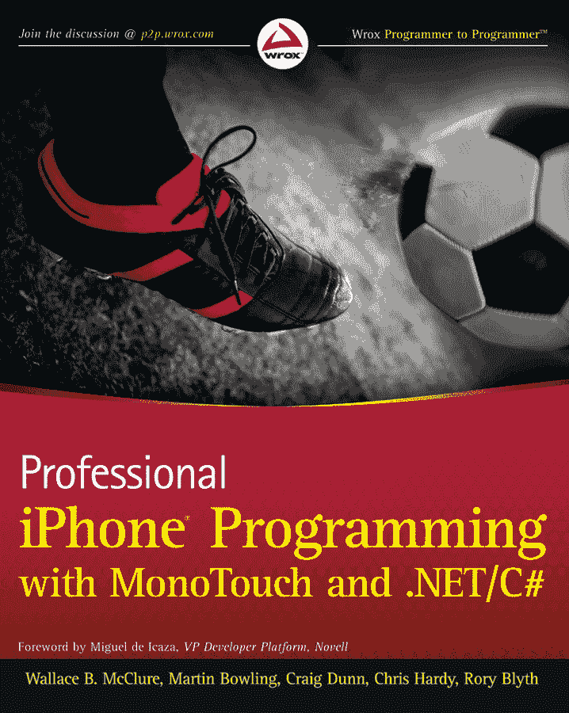


# 第 1 章：面向 C# 开发者的 MonoTouch 进行 iPhone 开发简介](#9780470908594c01.xhtml)

- 产品对比
- 移动开发
- Apple iPhone SDK 工具
- 本结

# 第 2 章：MonoTouch 简介](#9780470908594c02.xhtml)

- 开始开发之前
- MonoTouch 的组件
- 使用 MonoDevelop
- 使用 Interface Builder
- 使用 Interface Builder  Hello World
- 用代码编写 Hello World
- 调试
- 理解链接器
- 部署你的应用程序
- 本结

# 第 3 章：规划你的 App UI：探索屏幕控件](#9780470908594c03.xhtml)

- 创建 iPhone(y) UI 和应用交互模式
- UILabel
- UIButton
- UITextField
- UISwitch
- UISlider
- UIActivityIndicatorView
- UISegmentedControl
- UIPageControl
- 本结

# 第 4 章：数据控件](#9780470908594c04.xhtml)

- 窗口与视图
- 数据控制器
- 进度条
- 本结

# 第 5 章：在 iPhone 上处理数据](#9780470908594c05.xhtml)

- 使用 SQLite
- 处理远程数据
- 本结

# 第 6 章：显示表格](#9780470908594c06.xhtml)

- 在表格中显示数据
- 导航表格
- 编辑表格行
- 在表格中添加搜索框
- 本结

# 第 7 章：地图](#9780470908594c07.xhtml)

- 地图基础
- 使用 CoreLocation
- 使用 MapKit
- 本结

# 第 8 章：应用设置](#9780470908594c08.xhtml)

- 探索 Info.plist
- 探查设置 Bundle
- 本结

# 第 9 章：设备硬件编程](#9780470908594c09.xhtml)

- 响应加速度
- 确定设备方向
- 读取临近传感器
- 网络连接
- 考虑电池寿命
- 访问系统信息
- 移动开发
- 本结

# 第 10 章：多媒体编程](#9780470908594c10.xhtml)

- 图像
- 视频
- 音频
- 动画
- 本结

# 第 11 章：与其他应用通信](#9780470908594c11.xhtml)

- 集成 Apple 应用
- 第三方应用集成
- 接收其他应用的调用
- 集成通讯录
- 集成 iPod 集合
- 与 Objective-C 接口
- 本结

# 第 12 章：面向国际观众的本地化](#9780470908594c12.xhtml)

- 应用程序国际化
- 更改语言和地区设置
- 显示多种语言
- 真实世界中的 Localizable.strings
- 本结

# 第 13 章：编程 iPad](#9780470908594c13.xhtml)

- iPad 设备
- 什么是 iPad
- 新 iPad 功能
- 构建通用应用
- 本结

# 第 14 章：足够用的 Objective-C](#9780470908594c14.xhtml)

- 如何使用本章
- Objective-C 和 Cocoa 简述
- 学术 vs 实战方法
- 基础语法和概念
- 速查表
- 本结

# 第 15 章：App Store：提交与营销你的 App](#9780470908594c15.xhtml)

- 使用 Ad-Hoc 构建进行提交测试
- 准备提交
- 推广你的 App
- 本结


本出版物的任何部分均不得再复制、存储在检索系统中或以任何形式或通过任何手段（电子、机械、摄影、录音、扫描或其他）进行传输，除非根据 1976 年《美国版权法》第 `107` 节或 `108` 节的规定，且未经出版者的事先书面许可或通过向 Copyright Clearance Center 支付相应的单份费用获得授权（222 Rosewood Drive, Danvers, MA 01923, (978) 750-8400，传真 (978) 646-8600）。向出版者请求许可请咨询：Permissions Department, John Wiley & Sons, Inc., 111 River Street, Hoboken, NJ 07030, (201) 748-6011，传真 (201) 748-6008，或访问 [`www.wiley.com/go/permissions`](http://www.wiley.com/go/permissions)。

## 责任限制/免责声明
出版者和作者对本书内容的准确性或完整性不作任何陈述或保证，并特别辞弃所有保证，包括但不限于对特定用途的适用性的保证。销售或促销材料均可能创建或扩大任何保证。书中包含的建议和策略可能不适用于所有情况。本书的销售是基于以下理解：即出版者并未从事法律、会计或其他专业服务。如果需要专业协助，应寻求能力胜的专业人士的服务。出版者和作者均不对由此产生的损害承担责任。书中引用了某个机构或网站并仅将其作为引文和/或进一步信息的潜在来源，这并不意味着作者或出版者认可该机构或网站可能提供的信息或其可能做出的建议。此外，读者应当注意，本书中列出的互联网网站在本书编写期间到阅读期间之间可能已经发生变化或消失。

欲了解有关我们其他产品和服务的通用信息，请联系我们的美国客户服务部门，电话 (877) 762-2974；美国境外请拨 (317) 572-3993 或传真至 (317) 572-4002。

Wiley 还以多种电子格式出版其书籍。印刷版中出现的某些内容在电子书中可能不可用。

## 国会图书馆控制号
2010926847`

## 商标
Wiley、Wiley 标志、Wrox、Wrox 标志、Wrox Programmer to Programmer 以及相关的贸易外观是 John Wiley & Sons, Inc. 及其/关联公司在美国和其他国家的商标或注册商标，未经书面许可不得使用。iPhone 是 Apple, Inc. 的注册商标。所有其他商标均为其所有者的财产。Wiley Publishing, Inc. 与书中提到的任何产品或供应商无关。

## 关于作者


Wallace B. (Wally) McClure 于 1990 年毕业于佐治亚理工学院（Georgia Tech），获得电气工程学士学位。他在那里继续深造，于 1991 年获得了相同领域的硕士学位。从那时起，他一直为教育部、可口可乐、贝德尔国际、Magnatron 和光纤科技等公司提供咨询和开发服务。产品和服务包括涉及 `ASP`、`ADO`、`XML` 和 `SQL Server` 的工作，以及在 Microsoft `.NET Framework` 中的众多应用。Wally 编写过关于架构、`ADO.NET` 和 `SQL Server`、`AJAX` 以及使用 Mono/MonoTouch 进行 iPhone 编程的书。Wally 专门负责构建拥有大量用户和数据的应用程序。他是 Microsoft MVP 和 `ASPInsider`，也是 Scalable Development, Inc. 的合伙人。你可以在 [www.morewally.com](http://www.morewally.com) 阅读 Wally 的博客。Wally 已婚并有两个孩子。在不写软件时，他打高尔夫、锻炼并和家人待在一起。


Martin Bowling 是 27 Creative 的创始人/总裁，这是一家位于西弗吉尼亚州查尔斯顿的互联网营销和移动开发咨询公司。Martin 因其网络营销才华受到认可，为许多财富 500 公司和美国一些顶尖教育机构提供咨询。Martin 作为演讲者、研讨会负责人和顾问，在从社交媒体营销到应用开发的各种主题上非常受市场欢迎。他目前专注于几个将他的许多爱好结合在一起的项目，与领先的社交媒体营销和 SEO 公司 Search & Social 合作，建立一个为中小型企业提供可扩展的 SEO 和社交媒体营销的平台。他的项目 `Tweetcaching.com` 将移动开发、社交媒体和户外活动结合成一个伟大的项目，让地理藏宝者（Geocachers）在外出时能够轻松地与朋友家人分享他们的发现。Martin 继续寻找新方法，将社交媒体与移动开发相结合，以为用户提供丰富的体验，并为他合作的公司提供最大的投资回报率（ROI）。他与妻子住在西弗吉尼亚州查尔斯顿。他的黑色拉拉犬 Brewski 在他编写代码时一直陪伴他。Martin 喜爱美食和精酿啤酒。可以通过 [www.martinbowling.com](http://www.martinbowling.com) 联系他，他偶尔会在那里写博客。如需更深入地了解 Martin，可以在 Twitter 上关注 [`twitter.com/MartinBowling`](http://twitter.com/MartinBowling)。


Craig Dunn 自 2001 年以来一直在澳大利亚和加拿大使用 `.NET Framework` 进行开发。他最初从独立承包商开始，随后共同主持了流行的 `.Net Rocks` 播客，担任微软公共演讲员，加入微软的 `Channel9`，并在其他公司/会议上就从网上银行到仓库自动化系统的各种主题进行多次演讲。自 2009 年 8 月测试版以来一直参与 `MonoTouch`，在 [`conceptdev.blogspot.com`](http://conceptdev.blogspot.com) 发布教程，并与 Chris Hardy 合作为微软 2010 年 MIX 大会制作了 iPhone 会议日程应用程序。Craig 也是首批第 15 位 iPad 用户。


Alex York 毕业于英国曼彻斯特大学，在那里学习了计算机科学。从那时起他一直在开发软件解决方案——几乎完全使用 `C#` 和 `.NET Framework`。毕业后，Alex 在曼彻斯特的一家移动游戏公司工作，每天使用 `ASP.NET` 和 `WCF`。他于 2008 年搬到挪威，开始在 Bennett 工作，使用 `C#` 和 `ASP.NET` 为挪威知名品牌构建客户解决方案。在闲暇时间，他是使用 `MonoTouch` 进行 iPhone 开发的早期者，也是该社区的活跃成员。他目前在特龙赫姆的 Capgemini 担任技术顾问。

John Mandia 在伦敦长 way，自 1999 年从市场营销转行开发以来一直从事开发工作。期间，他曾任职于一家增值分销商 (VAR)、一家 `.com` 公司、一个门户网站、一家设计机构、一家咨询公司，目前在一家领先的全球投资银行工作。从 `.NET` 处于测试阶段起他就在使用它，在过去的多年里，他是一个名为 `Portal` 的开源项目的主要贡献者（2002–2005 年），该项目下载量超过 13 万次。他目前的兴趣之一是移动开发，自 `MonoTouch` 处于测试阶段起他一直在关注它，并建立了 `MonoTouch` 社区网站 [`monotouch.info`](http://monotouch.info) 和 Twitter 账号 `@monotouchinfo`，以帮助那些决定将他们的 `.NET` 技能应用于 iPhone/iPad 开发的人们。

Jim Zimmerman 是 `ASP.NET` MVP，也是佛罗里达州坦帕市 Thuzi 和 TeamZoneSports 的 CTO。他去年决定学习 `Objective-C`，目的是学习为他的四个孩子和他的公司创建 iPhone 应用。从那以后，他深信 `MonoTouch` 是正确的选择，它让他能够带上自己的 `C#` 技能，获得更快的开发体验。他期待着有一天可以至少有 90% 的相同代码运行在所有相关的移动设备上。

## 制作谢

### 执行编辑
Bob Elliott

### 高级项目编辑
Kevin Kent

### 开发编辑
Jeff Riley

### 技术编辑
Alex York
John Mandia
Jim Zimmerman

### 高级制作编辑
Debra Banninger

### 拷贝编辑
Kim Cofer

### 编辑总监
Robyn B. Siesky

### 编辑经理
Mary Beth Wakefield

### 营销经理
Ashley Zurcher

### 制作经理
Tim Tate

### 副总裁兼执行小组出版经理
Richard Swadley

### 副总裁兼执行发行经理
Barry Pruett

### 副发行
Jim Minatel

### 项目协调员，封面
Lynsey Stanford

### 排字员
Jeffrey Lytle, Happenstance Type-O-Rama

### 校对
Nancy Carrasco

### 索引员
Robert Swanson

### 封面设计师
Michael E. Trent

### 封面图片
©Marilyn Nieves/istockphoto

## 致谢

我一直对移动开发很感兴趣。直到 2009 年夏天，`Wrox` 和我才同意创建一个移动开发/iPhone 项目。该项目是 `Wrox Blox` 系列的一部分，也是这本书的第一个版本；它于 2009 年 11 月出版。在该项目发布两周后，副发行 Jim Minatel 对电子书的销量非常满意，并想知道是否出一本关于 `MonoTouch` 的更大的纸质书。由于我的日程安排，我需要寻找其他几个作者。我最初想到了 Craig Dunn、Chris Hardy 和 Martin Bowling。在写我的第一本书期间，我曾与他们每个人都谈过，所以与他们讨论合写纸质书是合理的。一个下午，我与 Novell 的 Joseph Hill 谈过，他也推荐了这些人。在对最初的选择进行某种水平衡量后，我与他们每个人都交流了，他们都接受了。我欣喜若狂。Rory Blyth 在我们写书不久后加入了我们的我们。感谢 Jim Minatel 让我开始编写关于 `MonoTouch` 的内容。感谢 Bob Elliott 让我们保持目标，并非常感谢 Kevin Kent 承担了让我们按时完成任务的脏活累活。

鉴于我的合作者位于不同的大陆和半球，我想感谢他们的出色工作。Craig 和 Chris 做得非常好，对细节非常关注，并且始终掌控着进展。

我想感谢我的家人。他们非常给力，让我专注于这本书同时也让我为客户工作。我欠他们一个巨大的“谢谢”。

最后，感谢你们购买这本书。我们希望你们喜欢这本书，就像我们喜欢编写它一样。
—Wallace B. McClure

特别感谢我出色的妻子 Mandi Rae。没有她，我不知道我会在哪里。感谢我的妈妈 CK、Sarah 以及所有多年来支持我的人。还要感谢 Brewski Firkin 在我写代码时陪伴我。
—Martin Bowling

感谢 Karl、Mike 和 Chris 提供的灵感，感谢妈妈提供的一切。给 Jack、Lilliana、Will、Sam 和 Marcus —— 永远尽你们全力。
—Craig Dunn

感谢我的妻子 Cara 忍受了漫长的夜晚，感谢我的父母 Hazel 和 Bob。
—Chris Hardy

## 前言

`MonoTouch` 是两个迷人且极其令人快乐世界的结合：`C#` 语言和 iPhone。我们设计 `MonoTouch` 是为了将这两个宇宙融合在一起，我们通过利用在设计和实现语言、API 和绑定方面的多年经验来实现。

我们对 iPhone 的热情非常容易解释：像其他人一样，我们被美的用户界面、深思的设计和强大的平台所吸引。这种组合令人难以抗。

我们对 `C#` 的热爱追溯到 2000 年微软发布这种新语言的时候。正如 `C#` 震撼了 Windows 世界，它也震撼了我们的世界。在 2000 年，我们已经在 GNOME 桌面和 Evolution 邮件客户端工作了几年，并积累了开发桌面应用的经验。我们在一个竞争激烈的领域开发软件，我们需要更少的开发者生产软件。一种方案是更努力、工作更长时间。相反，我们选择了提高编程水平。

当微软宣布 `C#` 和 `.NET Framework` 时，这种语言是一项立竿有效的改进。另一方面，`.NET` 语言确保了我们的手不会受限于单一语言，同时也确保了我们可以继续重用用 `C` 或 `C++` 编写的任何代码。`C#` 让我们世界变得更高效。

`Mono` 在过去几年里向所有可能的方向发展。它离开了最初的桌面舒适区，被应用于从嵌入式控制器、mp3 播放器到服务器、游戏以及工业控制。

`Mono` 在 iPhone 上的应用源于用户的需求。我们的 mono@novell.com 邮箱地址在 2008 年和 2009 年被大量将 `Mono` 引入 iPhone 的请求轰炸，到 2009 年夏天，我们已经有了一个在 9 月发布的完整技术栈方案。

这本书的作者是 `MonoTouch` 的早期测试人员之一：在 `MonoTouch` 发布的第一几天就在那里，他们与我们一起探索原始的 API 设计，他们帮助我们塑造了最终产品，并继续帮助我们为目标 iPhone 的开发者考虑最重要的事项。

你可能已经认识了其中的一些作者。Wally 以创纪录的速度推出了第一本关于 `MonoTouch` 的电子书，它帮助了数百名程序员在产品发布后的几个月内上手了 `MonoTouch`。

Chris 和 Rory 在 Windows/ASP.NET 世界都非常有名，是 `MonoTouch` 社区的活跃成员：在我们的 IRC 聊天室、Stackoverflow 以及我们的论坛上，他们回答了新开发者的问题，并帮助开发者做出更好的应用程序。


Chris 以一种只有曼彻斯特摇滚青年才能表现出的热情投入到 MonoTouch 中，并启动了 Scott Hanselman 的开源“Hanselminutes” MonoTouch iPhone 应用程序。

Rory 对世界有独特的视角；他深入接触过 `.NET` 和 `Objective-C` 的工作。他是 `.NET` 世界的名人，但他也是 Barnes and Noble iPhone 应用程序的幕后功臣，正是他将这些实战检验的知识带入了 MonoTouch 社区。在这段旅程中，你找不到更好的精神导师了。

你可能通过 Craig 那系列非常出色的博客认识过他，这些博客不仅帮助新学者上手 MonoTouch，而且成为我需要解决自己 iPhone 应用中的问题时经常求助的参考资料。Craig 提出了 iPhone 应用程序最实用的想法之一：会议应用程序。他利用自己的博客花了一段时间探索什么能让一个会议应用变得好用，并制作了两个开源会议应用：MonoSpace App 和 PDC App。

在 Mix 2010 大会召开时，Craig 和 Chris 制作了供 MIX 会议者使用的 `MIX2010` 应用。当你看到人们在每场会议开始前都在手机上使用该应用时，你就知道这是一个绝佳的主意了。

Martin 是 MonoTouch 自发布以来的早期采用者。他为社交网站 DailyBooth 启动了第一个 iPhone 应用，并且是各种开源 MonoTouch 项目的贡献者。

使用 `C#` 和 iPhone 开发应用程序是两者的完美结合。你既可以使用一种强类型、类型安全且带垃圾回收的语言，配合移动应用最前沿的 API；又可以使用为 `Objective-C` 的 iPhone 创建的最优库，以及为 `.NET` 的 `C#` 创建的最优库。

我把你们交给了 Wally、Martin、Craig、Chris 和 Rory 这些靠谱的人。

—Miguel de Icaza
开发者平台副总裁
Novell

# 引言

iPhone 是目前移动设备市场上最令人兴奋的智能手机。在 3 年时间里，它的安装量从 0 增长到了 8000 万台。伴随这一增长的是人们对编写在设备上原生运行的应用程序的兴趣日益增加。当 Apple 最初发布 iPhone 时，它并不具备在设备上运行自定义应用程序的能力。Apple 听取了开发者市场的意见，增加了在设备上运行原生应用的能力。最初，这些应用是用 `Objective-C` 编写的。随着时间的推移，创建了额外的框架，让不通 `Objective-C` 的开发者也能针对 iPhone。

自 2002 年 1 月发布 `.NET Framework` 以来，它的增长令人印象深刻。目前，`.NET Framework` 是今天最流行的开发框架。由于 `.NET Framework` 的流行，Ximian（后被 Novell 收购）宣布了 `Mono Project`。`Mono Project` 构建了一个可以在多个非 Windows 平台运行的 `.NET Framework` 实现。2009 年夏天，Novell 宣布了 MonoTouch。MonoTouch 让 `.NET` 开发者（主要是编写 `C#` 应用程序的开发者）能够创建在 iPhone 上原生运行的应用程序。

对于 `.NET` 开发者来说，能够编写在 iPhone 上原生运行的应用程序是非常奇妙且兴奋的事情，因为它为他们和他们的技能开启了 iPhone 之门。`.NET` 开发者不需要花费精力学习 `Objective-C`。我们对能够使用 `.NET/C#` 为 iPhone 编写原生应用感到非常兴奋。它为许多开发者开启了一个全新的世界。

## 本书读者读者

本书适用于对创建使用 `.NET/C#` 编写的原生 iPhone 应用感兴趣的 `.NET` 开发者。这些开发者希望利用现有的知识。虽然 `.NET` 开发者总是对学习感兴趣，但也意识到学习 `Objective-C` 和 iPhone 的细节可能会让人力不从心。对 MonoTouch 感兴趣的开发者会发现，MonoTouch 的成本可以通过使用他们已经熟悉的语言快速针对 iPhone 来轻松抵消。

本书专为想要针对 iPhone 的 `.NET` 开发者设计。它的目的是帮助你快速熟悉 iPhone，而不是真正教你 `.NET Framework` 或 `C#` 语言，我们假设你已经掌握了它们。

本书的第 1 至第 4 章包含了介绍性内容。你应该顺序阅读第 1 至第 4 章。这些章节介绍了 MonoTouch 产品、使用 MonoTouch 和 `MonoDevelop` 进行开发的基础知识，最后是介绍了如何通过屏幕和数据控件向用户展示数据，以及如何为 iPhone 开发用户界面。一旦你熟悉了这些概念，通常可以在不同章节之间移动，而不一定需要按顺序阅读。

## 本书涵盖内容

本书涵盖了使用 MonoTouch 进行 `.NET/C#` 开发。MonoTouch 针对 iPhone、iPod touch 和 iPad。除非特别说明，否则 iPhone 和 iPod touch 的内容是相同的。iPad 在第 13 章中进行了专门介绍。

## 本书结构

如我们之前指出的，本书基本上分为两个部分。第一部分包含第 1 至第 4 章。这部分是对 iPhone 开发体验和 `MonoDevelop` IDE 的介绍。这部分建议从头到尾阅读。一旦你觉得对第一部分熟悉了，就可以进入书的第二部分，该部分包含你可以根据需要选择的独立章节。

## 使用本书所需的工具

本书的读者需要几样工具才能有效使用。这些是：

*   一台 iPhone、iPod 或 iPad。
*   Apple Macintosh：你需要一台 Apple Macintosh 在你的 iPhone 设备上构建并部署应用。
*   Apple iPhone SDK：你需要下载并安装 Apple iPhone SDK。该工具仅运行在 Apple Macintosh 上。
*   Mono Framework：你需要在 Macintosh 上下载并安装 Mono Framework。可以从 `www.mono-project.com/` 下载。
*   MonoTouch：可以在 `http://monotouch.net/` 下载 MonoTouch。免费版 MonoTouch 允许开发者创建应用、构建应用并在模拟器中运行。要部署到设备，开发者必须购买专业版或企业版 MonoTouch。
*   MonoDevelop：可以在 `http://monodevelop.com/` 下载 `MonoDevelop` IDE。

注意，本书使用 MonoTouch 在 SDK 3.X 许可下开发部署到 App Store 和企业内部的应用。使用 MonoTouch 开发的 SDK 4 应用可以在企业内部部署。将 SDK 4 的 MonoTouch 应用部署到 App Store 可能受到 Apple 开发者计划协议的限制。

# 规范

为了帮助你从文本中获得最大的收益并跟踪进度，我们在书中使用了多种规范。

带有警告图标的框包含重要的、不容忽视的信息，与周围文本直接相关。

铅笔图标表示注释、提示、技巧以及当前讨论的补充。

对于文中的样式：

*   我们在引入新术语和重要词汇时会进行标记。
*   我们会显示按键组合，如 `Ctrl+A`。
*   我们在文中显示文件名、URL 和代码，例如：`persistence.properties`。
*   我们以两种不同的方式展示代码：

大多数代码示例使用等宽字体且不进行高亮。


我们使用粗体来强调在当前范围内特别重要的代码，或者显示与之前的代码片段相比的更改。

# 源代码

在学习本书中的示例时，您可以选择手动输入所有代码，也可以使用随书附带的源代码文件。本书中使用的所有源代码均可在 [www.wrox.com](http://www.wrox.com) 下载。访问该网站后，只需找到书名（使用搜索框或标题列表之一），然后点击书籍详情页上的“Download Code”链接即可获取该书的所有源代码。网站上包含的代码将通过以下图标标记：


示例通常会在标题中包含文件名。如果标题中没有包含文件名，或者代码只是一个代码片段，您可以在代码注释中找到文件名，例如：

```
Code snippet filename
```


由于许多书籍的标题相似，您可能会发现通过 ISBN 搜索最为方便；本书的 ISBN 是 978-0-470-63782-1。

一旦下载了代码，只需使用您喜欢的压缩工具对其进行解压即可。或者，您也可以访问 Wrox 代码下载主页 [[www.wrox.com/dynamic/books/download.aspx](http://www.wrox.com/dynamic/books/download.aspx)，查看本书以及所有其他 Wrox 书籍的可用代码。

# 勘误

我们尽一切努力确保文本或代码中没有错误。然而，没有人是完美的，错误在所难免。如果您在我们的某一书中发现错误（例如拼写错误或有问题的代码），我们将非常感谢您的反馈。通过提交勘误，您可以为其他读者节省数小时的困扰，同时，您也将帮助我们提供更高质量的信息。

要找到本书的勘误页面，请访问 [www.wrox.com](http://www.wrox.com) 并使用搜索框或标题列表找到书名。然后，在书籍详情页上点击“Book Errata”链接。在该页面上，您可以查看已提交给本书并由 Wrox 编辑发布的全部勘误。完整的书籍列表（包括指向每本书勘误页的链接）也可以在 [www.wrox.com/misc-pages/booklist.shtml](http://www.wrox.com/misc-pages/booklist.shtml) 获取。

如果您在“Book Errata”页面上没有发现“您的”错误，请访问 [www.wrox.com/contact/techsupport.shtml](http://www.wrox.com/contact/techsupport.shtml) 并填写那上的表格向我们发送您发现的错误。我们将检查这些信息，并在适当的情况下书籍的勘误页面发布消息，并在后续版本中修复问题。

# p2p.wrox.com

如需与作者和同行讨论，请加入 [p2p.wrox.com](http://p2p.wrox.com) P2P 论坛。论坛是一个基于 Web 的系统，您可以在其中发布与 Wrox 书籍及相关技术的消息，并与其他读者和其他技术用户互动。论坛提供了订阅功能，当论坛发布新帖子时，会将您感兴趣的主题通过电子邮件发送给您。Wrox 的作者、编辑、其他行业专家以及您的读者都活跃在论坛中。

在 [`p2p.wrox.com`](http://p2p.wrox.com)，您将发现许多不同的论坛，它们不仅在您阅读本书时对您有所帮助，在您开发自己的应用程序时也能帮助。要加入论坛，请遵循以下步骤：

1. 访问 [p2p.wrox.com](http://p2p.wrox.com) 并点击 `Register` 链接。
2. 阅读使用条款并点击 `Agree`。
3. 完成加入所需信息，以及您希望提供的任何可选信息，并点击 `Submit`。
4. 您将收到一封电子邮件，其中包含了如何验证账户并完成加入过程的信息。


您可以在不加入 P2P 的情况下阅读论坛消息，但为了发布自己的消息，您必须加入。

一旦加入，您就可以发布新消息并回复其他用户发布的消息。您可以随时在 Web 上阅读消息。如果您希望将特定论坛的新消息通过电子邮件发送给您，请点击论坛列表名称旁的 `Subscribe to this Forum` 图标。

关于如何使用 Wrox P2P 的更多信息，请务必阅读 P2P FAQ 以获取有关论坛软件如何工作的解答，以及针对 P2P 和 Wrox 书籍的常见问题。要阅读 FAQ，请点击任何 P2P 页面上的 `FAQ` 链接。

# 第 1 章：C# 开发者使用 MonoTouch 进行 iPhone 开发简介

## 本章内容

* iPhone 的历史及其心智占有率
* Mono 的简史及其与 .NET Framework 的关系
* MonoTouch 如何为 .NET 开发者开启 iPhone 大门
* 为什么 MonoTouch 对开发者如此有吸引力

过去几年里，智能手机的使用增长惊人，《今日美国》最近报道了智能手机如何成为人们生活中不可或缺的一部分。

尽管运行 `x86` 或 `x64` 处理器的 Windows 电脑主导了桌面电脑，且 `.NET Framework` 是 Windows 平台主要的开发环境，但并没有单一供应商或平台主导移动设备；基于 `Symbian`、`Blackberry`、`Windows Mobile`、`Android` 的设备可用。此外，设备可能运行相同的操作系统并以不同的形式呈现给用户。市场的碎片化对开发者来说是有问题的——他们如何将已经熟悉并使用的开发框架或工具应用到一个市场巨大且不断增长的设备中呢？

本章探讨了最大的开发者群体如何针对心智占有率最高的智能手机，以及手机的增长如何快于任何其他设备。

## 产品比较

本节简要查看了 `.NET Framework`、Mono 和 MonoTouch —— 这三个产品让最大的开发者群体能够针对目前市场上最令人兴奋的移动平台 iPhone。

### .NET Framework

在 20 世纪 90 年代末期，微软开始开发 `.NET Framework`。该框架的第一版本于 2002 年发布。微软继续引入了后续的 `.NET Framework` 版本，并在最近引入了 `.NET Framework 4`。`.NET Framework` 有多个版本，包括 32 位版本、64 位版本、针对 `XBOX` 游戏平台的版本，以及针对微软移动设备的版本（称为 Compact Framework (CF)）。关于 `.NET Framework` 的一些事实：

* 微软随框架一起发布了一个开发工具 `Visual Studio .NET`。该工具是 .NET 的集成开发环境。
* 它基于一个虚拟机，用于执行为该框架编写的软件。该虚拟机环境被称为 `Common Language Runtime (CLR)`，它负责安全、内存管理、程序执行和异常处理。
* 在 `.NET Framework` 中编写的应用最初从源代码（如 `Visual Basic` 或 `C#`）编译为中间语言，称为 `MSIL`。初始编译通过调用特定语言的命令行编译器 `Visual Studio` 或其他构建工具完成。当在执行应用程序时，通常会进行第二次编译。第二次编译获取中间语言并将其编译成可以在操作系统上运行的可执行代码。这种第二次编译被称为即时编译（JIT compilation）。
* 它是语言无关的，该框架支持多种语言。在 `Visual Studio` 中，微软发布了多种语言，包括 `Visual Basic`、`F#`、`C++` 和 `C#`。


-   它拥有一系列库，可以在各种语言中提供一致的功能。这些库被称为`基类库`（Base Class Libraries）。
-   微软已将 `.NET Framework` 的各个部分提交给不同的标准组织。其中包含 `C#` 语言、`通用语言基础`(Common Language Infrastructure）、`通用类型系统`（CTS）、`通用语言规范`(CLS）以及`虚拟执行系统`（VES）。
-   它是目前所有开发框架中开发者人数最多的框架。因此，相比任何其他开发框架，有更多开发者对 `.NET Framework` 熟悉。
-   `.NET Framework` 的一个缺点是不支持非微软平台。

# Mono

Mono 是一个开源项目，在非 Windows 操作系统上提供 `C#` 编译器和`通用语言运行时`(Common Language Runtime）。Mono 目前根据 `GPL` 版本 2、`LGPL` 版本 2、`MIT` 以及双重许可进行授权。Mono 运行在 Mac、Linux、`BSD` 以及其他操作系统上。

Mono 于 2001 年正式发布，是 Miguel de Icaza 的心血结晶。Mono `1.0` 版本于 2004 年发布，目前 Mono 处于 `2.6` 版本。Mono 持续由 Miguel de Icaza 领导，并在 Novell 的总体领导和支持下运行。

尽管有匹配 .NET Framework 功能的愿望，但由于微软在开发这些功能方面拥有更多资源和先发优势，这是无法实现的。同时，Mono 项目在许多 `.NET Framework` 功能上是等同的。

除了 Mono 之外还有一个名为 `MonoDevelop` 的开源 IDE，它最初是 `SharpDevelop` IDE 的移植版。`MonoDevelop` 起是一个允许在 Linux 上进行 Mono 开发的项目，但随着 `MonoDevelop` `2.2` 版本的发布，使用 Mono 进行开发的能力扩展到了 Mac、Windows 以及其他几个非 Linux 的 UNIX 平台。

尽管 `.NET Framework` 非常流行，但有两个问题使其不适合运行在 iPhone 上：

*   在某种程度上，苹果和微软是竞争对手，可能不太热衷于合作。
*   `.NET Framework` 从根本上是在运行时进行动态编译的。这就是 `.NET Framework` 的即时编译（just-in-time compilation）。这违反了苹果的许可和 iPhone OS 的运行原则。

鉴于运行在微软 .NET Framework 上的代码在运行时通过即时编译编译为机器码，人们预计为 Mono 编写的应用程序具有相同的行为，因此不适合运行在 iPhone 上。然而，Mono 拥有一项允许应用程序提前编译的技术，被称为 `AOT` 技术。

`.NET/Mono` 和 iPhone 的一个缺点是，.NET/Mono 开发者无法将他们的 .NET/Mono/C#` 知识应用于 iPhone 平台。如图图 1-1 所示，你可以看到 .NET/Mono 开发者无法针对 iPhone 的原因是它们是两个独立的实体。

图 1-1

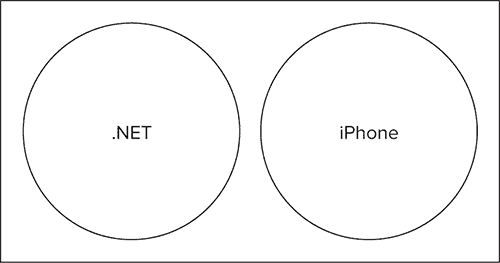

# MonoTouch

2009 年，Novell 发布并交付了 `MonoTouch`，它允许 .NET 开发者使用 `C#` 创建原生 iPhone 应用程序。通过 `MonoTouch`，应用程序被编译为运行在 iPhone 上的可执行代码。其意义不应被忽视：.NET/Mono 开发者可以通过 `MonoTouch` 针对 iPhone。如图图 1-2 所示。

图 1-2

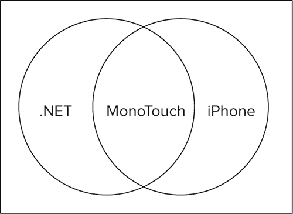

`MonoTouch` 如何实现这一点的？它是否某种方式允许 Windows Forms 应用程序翻译或重新编译并部署到 iPhone 上？`MonoTouch` 在 iPhone OS 存在的原生 iPhone 编程层之上提供了一个 .NET 层，被称为 `Cocoa Touch`。`Cocoa Touch` 基于 Mac OS X 中的 `Cocoa` 层，并可在 iPhone、iPod Touch 和 iPad 上使用。`MonoTouch` 不提供交叉编译 Windows Forms 应用程序的机制，但允许开发者构建在 iPhone 上原生运行的应用程序。

总的来说，`MonoTouch SDK` 暴露的应用程序编程接口 (API) 是 `.NET 2.0 Framework` 核心功能、`Silverlight 2.0 API` 以及 iPhone 上 API 的组合。`MonoTouch` 在 iPhone 基于 `Objective-C` 的原生 API 与 `C#` 开发者熟悉的基于 C 的 API 到 .NET 世界之间提供了一个桥梁（互操作）。

## MonoTouch 组件

`MonoTouch` 由以下四个组件组成：

*   `Monotouch.dll` 是一个 `C#` 程序集，提供了连接到 iPhone 原生 API 的绑定 API。
*   一个编译 `C#` 和`通用中间语言`(CIL) 代码的命令行工具。这些编译后的代码可以在模拟器或实际 iPhone 上运行。
*   `MonoDevelop` 的一个插件，允许 iPhone 开发以及使用 `Interface Builder` 创建图形化应用程序。
*   Mono 运行时商业许可，允许与开发的代码进行静态链接。

## 命名空间与类

`MonoTouch` 提供了一套用于构建 iPhone 应用程序的丰富命名空间和类。最常用的命名空间和类包括：

*   `MonoTouch.ObjCRuntime`: 提供连接到 iPhone 原生 API 的绑定 API。
*   `MonoTouch.Foundation`: 该命名空间提供与 `Objective-C` 通信所需的数据类型。大多数类型都是直接映射。某些类没有直接映射，而是映射到 .NET 类型。例如，“NSString` 映射到基本字符串类型，“NSArray` 映射到强类型数组。
*   `MonoTouch.UIKit`: 该命名空间为 `Cocoa Touch` 中的 UI 组件提供了直接映射。映射是通过为每个 UI 组件提供 .NET 类实现的，这是开发者可能会花费时间的命名空间。
*   `MonoTouch.OpenTK`: 该命名空间是 `OpenTK` API 的修改版本。`OpenTK` 是 `OpenGL` 的面向对象的绑定，`OpenGL` 是一个用于使用三维图形形的 API。`OpenTK` 是 `OpenGL`、`OpenAL` 和 `OpenCL` 的库。它用 `C#` 编写并运行在 Windows、Mac 和 Linux 上。iPhone 上的 `OpenTK` 实现已更新为使用 `CoreGraphics` 并仅暴露 iPhone 可用的功能。

此外，`MonoTouch` 还了一些对你重要的额外命名空间。这些是：

*   `MonoTouch.AddressBook`
*   `MonoTouch.CoreGraphics`
*   `MonoTouch.AddressBookUI`
*   `MonoTouch.AudioToolbox`
*   `MonoTouch.MapKit`
*   `MonoTouch.MediaPlayer`
*   `MonoTouch.AVFoundation`
*   `MonoTouch.MediaPlayer`
*   `MonoTouch.CoreAnimation`
*   `MonoTouch.SystemConfiguration`

这些命名空间在其功能上通而易懂，并且是 iPhone 特有的。

# MonoDevelop

`MonoDevelop` 是一个用于 Mono 开发的免费 IDE，是 `SharpDevelop` IDE 的早期分支。最初 `MonoDevelop` 只运行在 Linux 上，但从 `2.2` 版本开始，`MonoDevelop` 开始在 Mac 上运行。Mac 上的 `MonoDevelop` 允许 iPhone 项目的创建和管理，以及到模拟器和设备上的调试和部署。


毫无疑问，自 2001 年推出初代 iPod 以来，Apple 已经改变了移动设备市场。虽然 iPod 不是第一个播放 mp3 文件的设备，但它是第一个播放 mp3 文件、易于使用，并提供易于购买音频文件的市场的产品。iPod 确实导致了 mp3 设备市场的爆发式增长。

2007 年 1 月，Apple 在正式发布第一代 iPhone 时彻底颠覆了智能手机的格局。iPhone 被设计为一种提供网页浏览、电子邮件和多媒体功能的智能手机。第一代 iPhone 连接到无线网络，应用程序通过 `Safari` 的移动版本向用户交付。

为 iPhone 编写基于 Web 的应用程序非常简单。`Safari` 浏览器是一个很好的工具——它在将 Web 应用程序缩放到适合 iPhone 大小的屏幕运行方面做得出色。它在运行高度依赖 `JavaScript` 的应用程序方面也很好。升级 iPhone Web 应用程序也只需向 Web 服务器部署应用程序的新版本即可。许多应用程序都采用了这种方法。


遗憾的是，Web 应用程序并不所有的所有的——需要某些后台处理、访问本地资源、在无网络连接时也必须工作以及其他某些类型的应用程序在这种模式下运行得并不良好。

因此，问题变成了：如何编写一个适合 iPhone 的应用程序呢？

第一代 iPhone 不支持用户在设备上加载应用程序。对于某些用户来说，这是不可接受的，他们开始对 iPhone 进行“越狱”（jailbreaking），越狱是指用户在设备上运行 Apple 未批准的软件的过程。

越狱存在几个问题：

* **技术问题**：越狱需要 iPhone 所有者执行操作，而许多 iPhone 用户在技术上并不精长完成此操作。
* **合法性**：在本文期间，越狱的合法性尚不明确。尚不清楚越狱在《数字千年版权法》中处于什么位置。电子前沿基金（Electronic Frontier Foundation）已请求美国版权局承认 `DMCA` 的某项例外，允许 iPhone 所有者越狱其设备。Apple 回应辩称，越狱 iPhone 是侵犯版权的行为。
* **未知性**：它带来了一系列未知因素。越狱后的 iPhone 能顺利升级到新的 iPhone 操作系统（OS）版本吗？越狱 iPhone 会使其面临安全问题吗？

2008 年，Apple 推出了第二代 iPhone，称为 iPhone 3G。随着这一代产品和新的 iPhone OS 版本，Apple 发布了多项增强功能，包括在设备上原生运行应用程序的能力。此外，Apple 还构建了一个生态系统，用户可以在其 iPhone 设备上查找并安装应用程序，这就是 `App Store`。

这些原生应用程序是相比 Web 应用程序的巨大改进，后者在设备上的功能受到限制。从根本上说，它们必须通过 Web 加载，无法访问所有设备功能。原生应用程序通常对设备功能支持更好，例如加速度计、文件系统、摄像头、跨域 Web 服务以及其他 `HTML` 和 `JavaScript` 之外的功能。此外，原生应用程序加载不需要无线网络，而 Web 应用程序加载依赖无线网络。

2009 年，Apple 推出了 iPhone 3GS 和第 3 版 iPhone 操作系统。iPhone 3GS 是 iPhone 3G 的改进版，支持比 iPhone 3G 更快的数据传输、改进的摄像头、更新的 CPU 以及语音控制。

2010 年，Apple 发布并发了 iPad。iPad 平板设备，屏幕比 iPhone 大。同样重要的是，它配备了 iPhone 操作系统，这与 iPhone 有本质上的不同。

随着每一款新 iPhone 的发布，Apple 都推出了新款 iPod touch。iPod touch 可以被看作是一个去掉了电话、摄像头和 3G 数据服务支持的 iPhone；然而，iPod touch 确实支持使用 `WiFi` 的无线网络。

自三年前上市以来，Apple 已售出超过 6000 万台 iPhone。估计 iPad 在上市的第一年将售出数百万，这可能会导致 iPad 成为 2010 年最受欢迎的平板电脑。

遗憾的是，对于开发者来说，在设备上运行时必须考虑三个问题：

* iPhone 操作系统不允许任何形式的解释型或动态编译的软件代码。
* Apple 对 `SDK` 的许可以及使用 iPhone 进行开发不允许应用程序具有解释型或动态编译的代码。
* Apple 对 iPhone 应用程序有广泛的验证流程。应用程序的某些自动化测试将检查动态编译和解释型代码。

这些问题和许可规定是开发者需要了解的，并在某种程度上限制了开发者在编写运行在 iPhone 上的应用程序时的选择。

## 移动开发

使用 `MonoTouch` 在 iPhone 上构建应用程序时，开发者需要了解以下几点：

* iPhone 有一个启动计时器。如果应用程序启动时间超过 20 秒，iPhone OS 会将其杀掉。
* 当应用程序运行时，iPhone OS 会杀掉任何无响应超过 20 秒的应用程序。为了解决这个问题，你需要执行某种类型的异步操作。
* 处理 `FinishedLaunching()` 事件花费的时间会计入启动计时器。因此，你不希望在 `FinishedLaunching()` 事件中进行任何长期的同步处理。
* iPhone 模拟器适合初始测试；然而，它对于所有测试来说并不一定准确。仅仅因为在模拟器中运行良好，并不意味着它在 iPhone 上以相同的方式运行。最终测试应该在 iPhone 上完成。
* 使用 `.NET`，可执行文件很小。每个应用程序共享 `.NET Framework`，因此应用程序没有自己的框架的副本。`MonoTouch` 未内置在 iPhone 中，其应用程序必须拥有框架的副本；`MonoTouch` 被编译到你的应用程序中。结果是 `MonoTouch` 应用程序在磁盘上比类似的 `Objective-C` 应用程序大。

尽管 `MonoTouch` 是一个商业许可的产品，但它仍然处于持续开发中，`MonoTouch` 可能不支持特定的命名空间或程序集。对于这种情况，你有两种选择：

* 等待 `MonoTouch` 产品实现该程序集。
* 将必要的代码或程序集引入到你的项目中。如果应用程序需要使用 `System.Web.*` 命名空间中的代码，这非常常见。

除了为 iPhone 构建应用程序的技术问题外，开发者应该注意的某些设计问题还包括：

* 不要为桌面环境设计应用程序，然后认为可以将其缩小到 iPhone 或任何移动设备。iPhone 不具备桌面电脑的显示器、硬件或存储空间。iPhone 和移动设备应用程序非常适合简单、有限的功能，但它们不应该做桌面应用程序能做的所有事情。


- iPhone 模拟器是一个很好的工具，但不要将测试局限于 iPhone 模拟器。模拟器仅仅只是一个模拟器。iPhone 模拟器关联了键盘和鼠标。要真正测试复杂的设计，必须在实体 iPhone 上进行测试。

# Apple iPhone SDK 工具

当 iPhone 最初发货时，你无法直接在设备上运行第三方原生应用——直到 2008 年 3 月 6 日，Apple 发布了 SDK 的第一个测试版。iPhone SDK 允许第三方编写应用程序并在设备上原生运行。从那时日期起，iPhone SDK 持续不断推出更新的测试版和正式版。最初，iPhone SDK 同时支持 iPhone 和 iPod Touch。随着 iPhone SDK 3.2 版本测试版的发布，Apple 增加了对 iPad 平板设备的支持。

## 工具

Apple SDK 包含许多对 MonoTouch 开发者至重要的工具。这些工具包括：

*   `Xcode`：一套用于 Apple 环境下开发的工具套件，主工具是 IDE。虽然 MonoTouch 不直接使用 `Xcode` IDE，但它可以帮助你创建一个简单的应用并部署到设备。你还可以用它来验证关联设备上的证书和配置信息是否工作正常。
*   `Interface Builder`：`Interface Builder` (`IB`) 允许图形化创建用户界面。`MonoDevelop` IDE 与 `IB` 集成，并将 `IB` 中创建的界面转换为 `MonoTouch` 可调用的用户界面。
*   `Simulator`：允许模拟 iPhone、ipod Touch 和 iPad。注意，模拟器不运行 ARM 代码。它运行的是 x86 代码。
*   目标设备所需的库：包括用于 `Cocoa Touch`、音频、视频、网络、`SQLite`、线程、电源管理以及通用 `OS X Kernel` 的库。

## 许可

SDK 免费下载。遗憾的是，要为 iPhone 发布软件，开发者必须加入 iPhone 开发计划。在本文编写时，加入费用为每年 99 美元。加入费用因国家而异。向设备分发应用的能力取决于拥有必要的开发证书。一旦开发者加入 iPhone 开发计划，就可以通过 Apple 网站获取这些证书。

## 总结

本章查看了市场中的以下项目：

*   iPhone、其许可协议及其操作系统
*   `.NET Framework` 和 `Mono`
*   `MonoTouch`，它允许 `.NET` 开发者针对 iPhone 进行开发
*   `MonoDevelop`，允许开发者拥有一个良好的 IDE 来使用 `MonoTouch` 编写代码

现在你应该已经熟悉使用 `.NET/C#` 为 iPhone 构建原生应用所需的工具。下一章将探索使用 `MonoDevelop` 构建 `MonoTouch` 应用的细节。第 3 章和第 4 章描述了如何处理用于用户输入以及以标准形式因子向用户展示数据的用户控件。书中的其他章节将探索 iPhone 的特定部分，例如地图、加速度和 iPad。

# 第 2 章：MonoTouch 简介

## 本章内容概要

*   开始使用 `MonoTouch`
*   在 `MonoTouch` 中配合 `MonoDevelop`
*   `MonoTouch` 与 `Interface Builder`
*   调试与部署

什么是 `MonoTouch`？如果你买了这本书，你可能至少有一些基本概念，但本章完全是为了提供关于这个问题的核心答案，以便你拥有一个坚实的基础，去尝试并将你的开发技能应用到 iPhone 应用开发中。

简单来说，`MonoTouch`是一组工具，允许开发者利用现有的 `.NET Framework` 知识在 Mac 上构建 iPhone 和 iPod Touch 应用。`MonoTouch` 应用程序接口 (`API`) 提供了核心 `.NET 3.5 Framework` 特性与 iPhone SDK 提供的核心 API 的组合。为了实现这一点，`.NET Framework` 被编译为 ARM 代码以便在 iPhone 设备上运行，而 iPhone 原生 API（即用 `Objective-C` 和 `C` 编写的 API）则通过 `C#` 与原生 API 之间的互操作进行暴露。这允许开发者以他们熟悉的方式以及根据他们对 `C#` 的知识感到舒适的方式对这些外部 API 进行编码。

## 在开始开发之前

我从一开始就打算做一个假设，这个假设是你拥有一台 Intel  Mac。这背后的原因是 Apple iPhone SDK 仅支持此类类型的机器进行开发。由于 `MonoTouch` 使用了 iPhone SDK，你还需要遵守 Apple 施加的开发限制。要让你的第一个 `MonoTouch` 应用运行起来，你需要完成几件事：

1.  确保你的 Intel Mac 运行至少 10.5.7 版本系统。
2.  下载并安装 `Mono` 框架：[www.go-mono.com/mono-downloads/download.html](http://www.go-mono.com/mono-downloads/download.html)。
3.  下载并安装 `MonoTouch`：[`monotouch.net/`](http://monotouch.net/)。
4.  下载并安装 `MonoDevelop`：[`monodevelop.com/Download`](http://monodevelop.com/Download)。
5.  下载并安装 iPhone SDK：[www.apple.com/downloads/macosx/development_tools/iphonesdk.html](http://www.apple.com/downloads/macosx/development_tools/iphonesdk.html)。


安装顺序很重要，因为 `MonoTouch` 和 `MonoDevelop` 依赖于 `Mono` 框架。确保按照上述编号列表列出的顺序安装这些项目。

现在你已经安装了所有组件，可以深入研究 `MonoTouch` 了。首先，我们希望你看一眼 MonoTouch 包含的内容。

## MonoTouch 的组件

MonoTouch 的四个组件如下：

*   `monotouch.dll`：一个 C# 程序集，提供了一个连接到 iPhone 原生 API 的绑定 API。（绑定的 API 完整列表可以在本章稍后的 表 2-2 中找到。）
*   `mtouch`：一个命令行 SDK，将被编译为 `C#` 和公共中间语言 (`CIL`) 代码。这些编译后的代码可以在模拟器或实际 iPhone 上运行。
*   `MonoDevelop` 的插件，允许进行 iPhone 开发，允许 `MonoDevelop` 使用命令行工具 `mtouch` 并允许与 `Interface Builder` 和 iPhone 模拟器集成。它还允许部署到设备，并为向 App Store 分发和临时发布进行构建。
*   `Mono` 运行时的商业许可，允许将 `Mono` 运行时与开发并在 App Store 销售的代码进行静态链接。

## 什么是 Mono？

`MonoTouch` 的核心是 `Mono`。`Mono`（在西班牙语中是猴子）是 `.NET Framework` 的开源实现。它由 Novell 创建，旨在实现跨平台的 `.NET Framework`。这意味着该框架可以在许多不同的平台上运行，如 Apple OS X、Linux、任天堂 Wii、索尼 PlayStation 3 以及包括 Windows 在内的许多平台。由于 `Mono` 是开源的，这使得任何人都可以根据自己的需求使用和修改框架，如果你想针对限制性较大的平台，这将非常有用。考虑到这一点，`MonoTouch` 使用修改过的 `Mono` 框架进行开发，然后在应用程序代码（以及框架）上运行链接器，以减小应用程序中整体代码的。链接器的概念将在本章稍后的“理解链接器”部分中进一步解释。

## MonoTouch 的命名空间和类


本节进一步讨论了 MonoTouch 中包含的核心命名空间和类。MonoTouch 使用的是 Silverlight .NET 程序集的超集，这意味着在 MonoTouch 中，Silverlight .NET 程序集的基础上添加了额外的功能。表 2-1 显示了可用的 .NET 程序集列表。

### 表 2-1： MonoTouch 中可用的 .NET 程序集

| 程序集 | API 兼容性 |
| --- | --- |
| `Mono.CompilerServices.SymbolWriter.dll` | 供编译器编写者使用 |
| `Mono.Data.Sqlite.dll` | 用于 SQLite 的 ADO.NET 提供程序；由于 iPhone OS SQLite 版本存在某些限制 |
| `Mono.Data.Tds.dll` | TDS 协议支持；用于 `System.Data` 内的 `System.Data.SqlClient` 支持 |
| `Mono.Security.dll` | 加密 API |
| `mscorlib.dll` | Silverlight |
| `System.dll` | Silverlight，以及以下命名空间的类型：`System.Collections.Specialized`, `System.ComponentModel`, `System.ComponentModel.Design`, `System.Diagnostics`, `System.IO.Compression`, `System.Net`, `System.Net.Cache`, `System.Net.Net.Mail`, `System.Net.Mime`, `System.Net.NetworkInformation`, `System.Net.Security`, `System.Net.Sockets`, `System.Security.Authentication`, `System.Security.Cryptography`, `System.Timers` |
| `System.Core.dll` | Silverlight |
| `System.Data.dll` | .NET 3.5，包含 `System.CodeDom` 等功能，支持 XML 配置，已移除了 `OleDb` 和 `Odbc` |
| `System.Json.dll` | Silverlight |
| `System.ServiceModel.dll` | Silverlight 中存在的 WCF 栈 |
| `System.Transactions.dll` | .NET 3.5；`System.Data` 支持的一部分 |
| `System.Web.Services.dll` | 来自 .NET 3.5 配置的基础 Web 服务，移除了服务器端功能 |
| `System.Xml.dll` | .NET 3.5 |
| `System.Xml.Linq.dll` | .NET 3.5 |
| `System.Linq` | .NET 3.5 |
| 取自 [www.MonoTouch.Net/Documentation/Assemblies](http://www.MonoTouch.Net/Documentation/Assemblies) |

MonoTouch 产品随着每次发布都在成长，因此在本文编写之后，可能包含了额外的功能。检查表格的源文件以获取任何额外的更改和更新是值得的。

除了 .NET 程序集外，MonoTouch 还提供了 `monotouch.dll` 程序集，它包含了针对 Objective-C 和基于 C 的 API 绑定 API。该程序集中的核心命名空间如下：

* `MonoTouch.ObjCRuntime`: 该命名空间提供了 .NET/C# 世界与 iPhone 的 Objective-C 世界之间的互操作/桥接。这将在第 11 章中进一步讨论。
* `MonoTouch.Foundation`: 该命名空间提供了与 iPhone 的 Objective-C 世界通信所需的数据类型支持。大多数类型都是直接映射的。例如，`NSObject` Objective-C 基类映射到 C# 中的 `MonoTouch.Foundation.NSObject` 类。某些类没有直接映射到其 Objective-C 类名（例如 `NSArray`）。相反，如果数组包含一个 `UIViewControllers` 集合，则 `NSArray` 会映射到强类型数组，如 `UIViewController[]`。
* `MonoTouch.UIKit`: 该命名空间提供了 Cocoa Touch 内部 UIKit 组件的直接绑定。这种绑定通过为每个可用的 UIKit 组件提供 .NET 类来实现。这是开发者花费大部分时间进行操作的命名空间。


对于 .NET 开发者来说，Cocoa Touch 是一个用于构建在 iPhone 上运行程序的抽象层或 API。Cocoa 是用于构建在 Mac OS X 操作系统上运行程序的 API。Cocoa Touch 可以被认为是是针对触摸的 iPhone 操作系统优化的 Cocoa。在第 14 章中阅读更多关于 Cocoa 的信息。

* `OpenTK`: 该命名空间是 `OpenTK` API 的修改版本。`OpenTK` 是针对 `OpenGL`（开放图形库）的面向对象的绑定。`OpenGL` 是用于三维图形的 API。`OpenTK` 是执行 `OpenGL`、`OpenAL` 和 `OpenCL` 的库。它用 C# 编写并运行在 Windows、Mac OS X 和 Linux 上。iPhone 上的 `OpenTK` 实现已更新为使用 `Core Graphics` 并仅暴露 iPhone 上可用的功能。

`monotouch.dll` 中从 Objective-C 绑定的其他命名空间列在表 2-2 中。你会发现除了 `MonoTouch.CoreData`，它本应该从 Objective-C 的 `CoreData` 类绑定。之所以排除它是因为它与 Objective-C 的处理方式以及用于处理持久化存储的工具具有紧密耦合。相反，可以使用 `Mono.Data.Sqlite` 作为替代方案。

### 表 2-2： 从 Objective-C 绑定的 .NET 程序集

| 命名空间 | 描述 |
| --- | --- |
| `MonoTouch.AddressBook` | 提供访问 iPhone 通讯录 |
| `MonoTouch.AddressBookUI` | 用于访问 iPhone 通讯录的用户界面组件 |
| `MonoTouch.AudioToolbox` | 底层音频 |
| `MonoTouch.AVFoundation` | 通用音频和视频 |
| `MonoTouch.CoreAnimation` | 提供制作动画的能力 |
| `MonoTouch.CoreFoundation` | 底层 C 的绑定 |
| `MonoTouch.CoreGraphics` | 对 Quartz 2D 图形的绑定 |
| `MonoTouch.CoreLocation` | 提供位置功能 |
| `MonoTouch.GameKit` | 允许 P2P 等游戏功能 |
| `MonoTouch.MapKit` | 提供丰富的地图功能 |
| `MonoTouch.MediaPlayer` | 提供音频和视频能力 |
| `MonoTouch.MessageUI` | 用于应用内发送邮件的用户界面组件 |
| `MonoTouch.OpenGLES` | 提供将 GL 嵌入应用程序的能力 |
| `MonoTouch.StoreKit` | 处理支付的 API |
| `MonoTouch.SystemConfiguration` | 提供网络可达性 |

使用 MonoDevelop

MonoDevelop 是一个开源集成开发环境 (IDE)，在本书中我们将使用该工具。MonoDevelop 是一个跨平台 IDE，这意味着它可以运行在 Linux、Mac 和 Windows 上。该 IDE 与仅供 Windows 用户使用的 Visual Studio 有许多相似之处。这种情况，在进入代码之前了解 MonoDevelop 是值得的。

当你首次启动 MonoDevelop 时，你会看到一个与打开 Visual Studio 时非常类似的界面。请参考图 2-1](#9780470908594c02.xhtml_figure2-1)的主屏幕截图。该屏幕非常好用，因为它列出了你所有的最近项目，对于切换项目非常方便。

要创建一个新的 MonoTouch 项目，可以通过屏幕顶部菜单栏点击 `File ⇒ New ⇒ Solution`，或者直接在主屏幕上点击 `Start a New Solution` 按钮。这将带你进入图 2-2](#9780470908594c02.xhtml_figure2-2)所示的 `New Solution` 文件对话框。

图 2-1

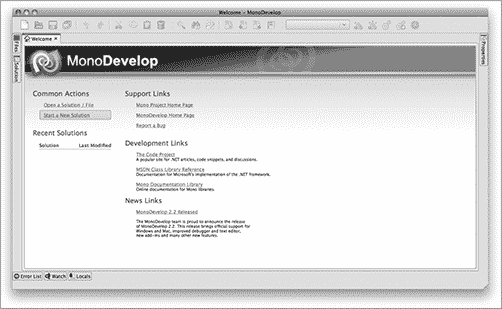

图 2-2

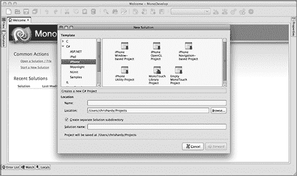

表 2-3 列出了你可以创建的不同项目类型。

| 项目类型 | 描述 |
| --- | --- |
| iPhone Window-based Project | 创建一个窗口供你开始在其上加载视图和其他模板代码。 |


| 项目类型 | 描述 |
| --- | --- |
| iPhone OpenGL Project | 创建用于旋转正方形的 OpenGL 模板代码。 |
| iPhone Navigation-based Project | 创建一个默认带有导航视图（navigation view）的项目。 |
| iPhone Utility Project | 该工具项目是一个基于两个视图的简单项目，你可以翻转视图显示“关于”信息。 |
| MonoTouch Library Project | 用于封装库代码以供 MonoTouch 使用的项目。 |
| Empty MonoTouch Project | 一个完全空的 MonoTouch 项目。 |

在本示例中，你只需选择 iPhone 窗口项目（Window-based project），因为这是 MonoTouch 项目最常见的布局。为项目命名并点击 `Forward`。

你看到的下一个屏幕是项目特性（Project Features）屏幕，如图 2-3 所示所示你不需要使用这些特性中的任何一个，因为它们更多适用于其他类型的 Mono 项目（例如桌面应用程序），因此你可以跳过此屏幕直接点击 `OK`。

图 2-3

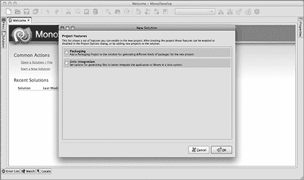

深入观察 MonoTouch 项目布局，你会发现一些不同之处。图 2-4 显示了默认 Windows 窗口项目的项目结构。你的解决方案文件包含一个项目——一个 MonoTouch 项目。任何额外使用的库项目也需要是 MonoTouch 项目。

图 2-4

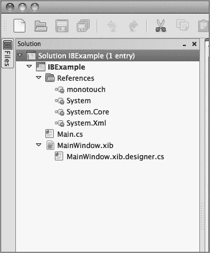

*   `References` 文件夹是一个熟悉的景象；但请注意 `monotouch.dll` 会自动作为引用包含进来。
*   名为 `Main.cs` 的 `.cs` 文件是 MonoTouch 使用的默认启动模板，其中包含 `Main` 方法。`Main` 方法是 iPhone 程序的起点，它同时也启动应用程序的事件循环，用于处理 iPhone 与应用程序之间的交互。
*   名为 `MainWindow.xib` 的 XIB 文件（基于 XML 的 Interface Builder 文件）是包含应用程序用户界面的文件。该文件通常通过 Interface Builder 修改。Interface Builder 具有一些有趣的概念，将在接下来的章节中探讨。
*   `MainWindow.xib.designer.cs` 文件包含了用户界面中视图（views）、控件（controls）、输出（outlets）和动作（actions）的定义。（视图、输出和将在在本章稍后介绍。）每当通过 Interface Builder 更新用户界面时，该文件都会更新。不应手动更新。

现在你已经掌握了 MonoDevelop 和 MonoTouch 项目的基础知识，可以深入学习 Interface Builder 并开始创建一个“Hello World”应用程序了。

## 使用 Interface Builder

iPhone SDK  Interface Builder 工具。该工具常用于 Mac OS X 开发和 iPhone 应用程序开发。Interface Builder 为开发者提供了一个拖放界面，用于在屏幕上布局控件。使用 Interface Builder 是一种让人爱又恨的事，特别是对于那些来自 Visual Studio 背景的人来说；它与 Visual Studio 内部的设计器有许多相似之处，但它的工作方式以及设置控件的方法非常不同。


使用 Interface Builder 是完全可选的，所有控件都可以直接通过代码使用，但它是创建布局的一个非常有用的工具。

Interface Builder 直接集成在 MonoDevelop 中，双击任何 `.xib` 文件会自动为你打开 Interface Builder 并加载选定的 `.xib` 文件。

当你打开 Interface Builder 时，你会看到几个不同的窗口，如图 2-5 所示。

*   **Library（库）**：此窗口包含 `Objects`（对象）、`Classes`（类）和 `Media`（媒体）标签页。这些包含了你可以点击并拖到视图上的控件。
*   **View（视图）**：此窗口是你点击并拖入不同控件的视图。这允许你以所见即所得（WYSIWYG）的方式布局用户界面。
*   **Connections（连接）**：此标签页用于设置控件之间的连接并允许通过程序进行修改。如你所示，这是三个其他标签之一。另外三个标签是 `Attributes`（属性）、`Size`（尺寸）和 `Identity`（标识），它们都用于修改控件的细节。总之，此窗口被称为 `Inspector`（检查器）。
*   第四个窗口在图 2-5 中名为 `Untitled`（无标题），它是 Interface Builder 的菜单。它提供了视图上所有控件的层级视图。

    图 2-5

    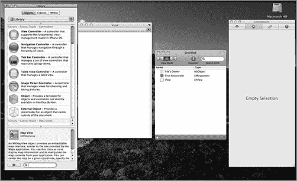

接下来的几节将讨论在使用 Interface Builder 和仅通过代码使用控件时，你可以使用哪些类型的控件。

## 使用库控件

Library 窗口包含许多在 Interface Builder 中可用的控件。这些控件在代码中也可用；括号代表控件的类。

*   **Controllers（控制器）**：控制器是控制某些活动的控制器族。
*   **Data Views（数据视图）**：数据视图通常向用户展示某种类型的信息。
    *   `UITableView`：以表格形式呈现数据。用户可以滚动查看。
    *   `UITableViewCell`：表格单元格允许自定义外观、属性和行为。
    *   `UIImageView`：图像视图显示图像或动画。
    *   `UIWebView`：网页视图显示显示网页内容。
    *   `MKMapView`：地图视图显示显示地图内容。
    *   `UITextView`：文本视图显示多行可编辑文本。
    *   `UIScrollView`：滚动视图为无法完全适应单个窗口的内容提供了显示方式。
    *   `UIPickerView`：选择器视图显示旋转轮。对于新接触 MonoTouch 的 .NET 开发者来说，该控件的概念类似于下拉列表。
    *   `UIDatePicker`：日期选择器是一组用于选择日期和时间的旋转轮。
*   **Inputs & Values（输入与值）**：一组为用户输入设计的 UI 控件。这些包括：
    *   `UISegmentedControl`：分段控件可以被视为按钮，按钮的不同部分作为独立的控件运行。
    *   `UILabel`：显示文本的标签。
    *   `UIButton`：圆角按钮控件实现触摸事件。触摸事件类似于 .NET 中的“点击”事件。这等同于 .NET 中的按钮。
    *   `UITextField`：文本字段允许用户通过虚拟键盘添加文本或数据。
    *   `UISwitch`：开关控件允许用户切换用户界面中的值。概念上，该控件类似于复选框。
    *   `UISlider`：滑块允许用户从值范围中输入单个值。
    *   `UIProgressView`：进度视图允许显示运行任务的进度。
    *   `UIActivityIndicatorView`：活动指示器视图提供任务正在运行的反馈。


# UI 控制

- **页码控制 (`UIPageControl`)**: 页码控件向用户提供应用程序中还有页面的信息。
- **窗口、视图与栏 (Windows, Views, & Bars)**: 这些是 Interface Builder 和代码中提供的窗口、视图和栏。

- **窗口 (`UIWindow`)**: 窗口包含多个视图，并且是第一个在屏幕上显示的界面。由于所有视图都在窗口中，因此你只能有一个窗口实例。
- **视图 (`UIView`)**: 视图控件是用于放置控件和处理事件的矩形区域。
- **搜索栏 (`UISearchBar`)**: 搜索栏是一个带有圆角和搜索图标的文本字段。其 UI 外观旨在告诉用户该字段将用于搜索。
- **搜索栏和搜索显示控制器 (`UISearchDisplayController`)**: 搜索栏和搜索显示控制器包含搜索栏、书签按钮、取消按钮以及显示搜索结果的表格视图（Table View）。
- **导航栏 (`UINavigationBar`)**: 导航栏是一种支持以层级方式导航内容的 UI 控制。
- **导航项目 (`UINavigationItem`)**: 导航项目控件包含在导航栏内的导航项目的信息。
- **工具栏 (`UIToolbar`)**: 工具栏控件在屏幕底部显示一个工具栏。它支持工具栏内的工具栏项。
- **栏按钮项 (`UIBarButtonItem`)**: 栏按钮项代表工具栏控件或导航栏中的项。
- **弹性空间栏按钮 (`UIBarButtonItem`)**: 弹性空间栏按钮代表工具栏内的空间大小。
- **标签栏 (`UITabBar`)**: 标签栏控件允许在屏幕底部显示标签栏。标签栏控件允许选择标签栏项。
- **标签栏项 (`UITabBarItem`)**: 标签栏项是标签栏控件中的一个项。

# 设置输出 (Setting Outlets)

为了能够使用你拖放到 Interface Builder 视图上的控件，你需要为每个控件创建一个输出（outlet）。在 MonoTouch 中，输出是在你分配给控件的类上的实例变量，而这些变量是在你在 Interface Builder 中定义的。该实例变量让你能够通过程序访问访问该控件。为了演示这一点，你将使用一个基于窗口的 iPhone 项目，并在 Interface Builder 中打开 `MainWindow.xib` 文件。


大多数情况下，你可能希望直接在窗口上使用控件，而是使用一个作为窗口子视图添加的视图来连接你的控件。这是因为在实际应用程序中，你只会使用窗口来添加视图，而不是显示控件。

1. 首先，从对象库（Library Objects）选项卡拖一个圆角矩形按钮（Rounded Rect Button）到你的窗口上。你可以通过双击按钮中间并输入文本来设置按钮的文本。你应该得到看起来像图 2-6 这样的效果。

图 2-6

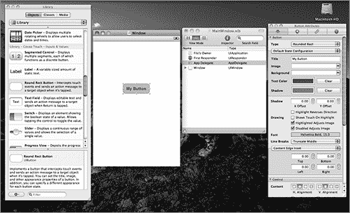

2. 即使按钮控件位于你的窗口上，如果不为它创建一个输出，你也无法在代码中使用该控件。在库中，选择 `Classes` 选项卡，然后选择 `AppDelegate`（这是你希望访问新创建的按钮的类）。

3. 现在库窗口的底部有一个四个选项卡的列表：继承（Inheritance）、定义（Definitions）、输出（Outlets）和动作（Actions）。现在，你想选择 `Outlets` 选项卡并点击 `+` 按钮添加新输出。将输出命名为 `myButton` 并按回车键保存。你可以选择性地输入类型，也可以将此类型留为“id”。你应该得到得到看起来像图 2-7 这样的效果。

图 2-7

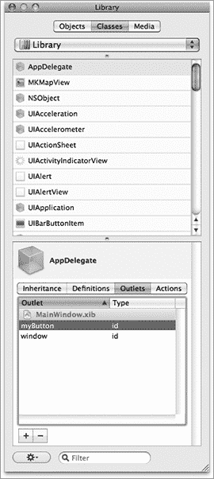

4. 你可能已经注意到你还没有告诉输出需要与哪个按钮关联。要做到这一点，你使用检查器（Inspector，图 2-8 中最右侧的窗口）从 `AppDelegate` 类输出到窗口上的实际按钮创建连接。首先，从主 Interface Builder 窗口中选择 `AppDelegate`（左侧第三个窗口）。然后，选择检查器中的 `Connections` 选项卡（带有白色箭头的蓝色图标的选项卡）。你的输出在这里显示；然后你需要从检查器的输出点击并拖动（以创建连接）到窗口上的实际按钮。图 2-8 显示了这一操作。

图 2-8

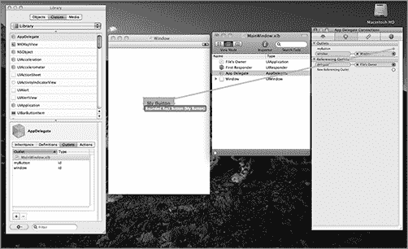

现在你已经创建了这个连接，输出已设置好，并可以在代码中使用。请参见后文的“使用 Interface Builder 实现 Hello World”部分。

# 设置动作 (Setting Up Actions)

动作（action）是在特定事件发生时触发的消息。在 .NET 中，这与事件非常相似。MonoTouch 通过这种方式暴露这些动作。你可以在下一节了解更多。

1. 就像你创建输出一样，创建一个新动作并给它一个名称。

2. 再次，像创建输出一样，通过库创建新动作，选择 `Actions` 选项卡并点击 `+` 按钮添加新动作。你应该将此动作命名为 `buttonPressed`。

3. 你应该会在 `AppDelegate` 的 `Connections` 选项卡看到一个名为 `Received Actions` 的部分，它包含了新动作。将此新动作拖动到按钮。这时你应该看到按钮的可用动作列表。请参见图 2-9 的示例。

图 2-9

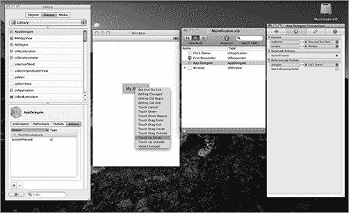

你可能想要与按钮关联的动作是 `TouchUpInside` 方法。这意味着用户触摸并松开了按钮。

这就是在 Interface Builder 中关联动作的所有需要的工作。

# 使用 Interface Builder 实现 Hello World

现在你已经对输出和动作有了良好的理解，本节将展示你现在如何在 MonoTouch 中使用这些输出和动作来执行某些操作，例如在点击按钮时更改按钮文本。如果你还没有跟进输出和动作章节，我建议你现在这样做，因为本节解释了如何使用它们。

一旦你保存了创建的 `MainWindow.xib` 文件，打开 `MainWindow.xib.designer.cs` 文件查看自动生成的内容。你的设计文件应该看起来像列表 2-1。

```csharp
// 列表 2-1: MonoTouch 生成的 AppDelegate 设计文件
[MonoTouch.Foundation.Register("AppDelegate")]
public partial class AppDelegate {
    private MonoTouch.UIKit.Window __mt_window;
    private MonoTouch.UIKit.UIButton __mt_myButton;

    #pragma warning disable 0169
    [MonoTouch.Foundation.Export("buttonPressed:")]
    partial void buttonPressed(MonoTouch.UIKit.UIButton sender);

    [MonoTouch.Foundation.Connect("window")]
    private MonoTouch.UIKit.UIWindow window {
        get {
            this.__mt_window = ((MonoTouch.UIKit.UIWindow)(this.GetNativeField("window")));
            return this.__mt_window;
        }
        set {
```


```csharp
            this.__mt_window = value;

            this.SetNativeField("window", value);
        }

    }

    [MonoTouch.Foundation.Connect("myButton")]

    private MonoTouch.UIKit.UIButton myButton {
        get {
            this.__mt_myButton =
                ((MonoTouch.UIKit.UIButton)(this.GetNativeField("myButton")));
            return this.__mt_myButton;
        }
        set {
            this.__mt_myButton = value;
            this.SetNativeField("myButton", value);
        }
    }
}
```

从这个设计文件中你可以看到它创建了一个部分类（partial class），与 `Main.cs` 文件中的 `AppDelegate` 类配合使用。你还可以看到有一个名为 `buttonPressed` 的部分方法，它代表你创建的操作。你还有一个实例变量 `myButton`，它代表你为按钮创建的输出控件（outlet）。


你不应该编辑这个设计文件，因为该文件每次在 Interface Builder 中编辑 `.xib` 时都会自动生成。

如果你转到包含另一个部分 `AppDelegate` 类 `Main.cs` 文件，你就可以开始针对 `myButton` 变量编写代码。由于你知道它的类型是 `UIButton`，你可以获得完整的 IntelliSense 智能提示。因为你是通过 Interface Builder 添加的按钮，所以你不需要添加任何额外的代码来初始化按钮——这是自动完成的。

为了获取按钮被点击的事实，你需要创建一个部分方法 `buttonPressed`并通过运行一些你自己的代码来处理该操作。在本示例中，只需使用 `SetTitle` 方法将按钮文本更改为“Clicked”，在该方法中传递按钮的标题以及它应该显示的控件状态——在本示例中直接使用 `Normal` 即可。最终你的 `Main.cs` 看起来应该像 Listing 2-2。


Listing 2-2: 使用 Interface Builder 控件

```csharp
// MainWindow.xib 文件中引用了 AppDelegate 类。

public partial class AppDelegate : UIApplicationDelegate
{
    public override bool FinishedLaunching (UIApplication app,
                                          NSDictionary options)
    {
        // 如果你定义了一个视图，请将其添加到这里：
        // window.AddSubview (navigationController.View);
        window.MakeKeyAndVisible ();
        return true;
    }

    partial void buttonPressed (UIButton sender)
    {
        myButton.SetTitle("Clicked", UIState.Normal);
    }

    // iPhoneOS 3.0 中需要此方法
    public override void OnActivated (UIApplication application)
    {
    }
}
```

要运行代码，你只需点击 MonoDevelop 中的齿轮图标（如 Figure 2-10 所示）。键盘快捷键粉丝可以使用 `Alt+Cmd+Enter` 执行相同的操作。这将编译你的应用程序，自动打开 iPhone 模拟器，在模拟器上安装你的应用程序，并启动你的程序。

Figure 2-10


如果一切顺利，你应该看到一个看起来像 Figure 2-11 的样的屏幕。当你点击按钮时，文本应该变为 Clicked，应用程序最终看起来会像 Figure 2-12。

Figure 2-11
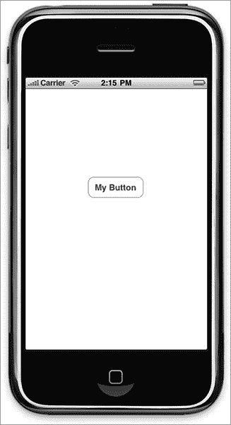

Figure 2-12
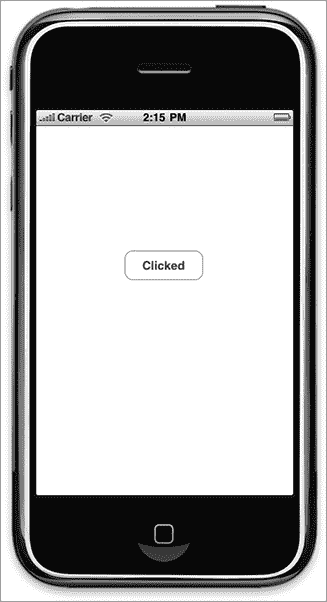

## 代码中的 Hello World

由于使用 Interface Builder 开发完全是可选的，本节展示了如何使用代码构建与前一节相同的应用程序。首先，再次创建一个基于 iPhone 的项目。这会自动创建 `MainWindow.xib` 和设计文件，但你将不会使用它们。相反，你将在你的 `FinishedLaunching` 方法中编写所有代码。


如果 `FinishedLaunching` 方法在 10 秒内没有返回，iPhone OS 将杀死你的应用程序。管理此情况的最佳方法是创建一个主窗口的子视图（subview），并将要执行的任务添加到此视图中，而不是直接在 `FinishedLaunching` 方法中。因为这是一个简单的示例，这并不重要。

首先，创建一个显示在屏幕上的新按钮。要做到这一点，你只需通过调用 `UIButton` 类上的静态方法 `FromType` 来创建一个按钮的新实例。使用 `UIButtonType` 枚举中的 `RoundedRect` 按钮类型，以便它与上一个示例中使用的按钮匹配。

由于按钮是通过编程创建的，它在 `UIWindow` 中的位置也必须通过编程来设置。要做到这一点，你需要设置按钮的 `Frame`。你可以创建一个新的 `System.Drawing.RectangleF` 矩形并将其传递给按钮的 `frame` 属性。为了让示例更贴合，你还想使用 `SetTitle` 方法将按钮的初始文本设置为 My Button。

如果你决定立即运行代码，实际上根本看不到按钮的显示。这是因为你需要将其添加到窗口。你可以简单地通过在你的窗口上调用 `AddSubview` 并传递你创建的按钮来实现。编程添加按钮的代码看起来应该像 Listing 2-3，并且应该位于 `FinishedLaunching` 方法中。


Listing 2-3: 编程添加按钮

```csharp
var button = UIButton.FromType(UIButtonType.RoundedRect);
var frame = new System.Drawing.RectangleF(35f, 30f, 250f, 40f);
button.Frame = frame;
button.SetTitle("My Button", UIState.Normal);
window.AddSubview(button);
```

当你现在运行程序时，按钮会出现，但当有人点击按钮时，什么都不会发生。这就是你需要处理 `TouchUpInside` 事件的地方。幸运的是，你不需要深入就能让它工作；你可以像在 .NET 中那样处理事件。按钮实例暴露了你之前在使用 Interface Builder 时看到的所有事件。当你添加 `TouchUpInside` 事件时，你的代码看起来应该像 Listing 2-4。显然，这取决于你如何实现事件，但无论你采用哪种方式都应该得到相同的结果。此示例使用 lambda 创建匿名委托。

Listing 2-4: 给按钮添加触摸事件

```csharp
var button = UIButton.FromType(UIButtonType.RoundedRect);
var frame = new System.Drawing.RectangleF(35f, 30f, 250f, 40f);
button.Frame = frame;
button.SetTitle("My Button", UIState.Normal);
button.TouchUpInside += (sender, e) => {
    button.SetTitle("Clicked", UIState.Normal);
};
window.AddSubview(button);
```

对比之下，注意使用 Interface Builder 需要编写的代码是少少的。然而，你可以看到使用代码创建新对象比让 `.xib` 文件为你这样做要明确得多。

## 调试

MonoTouch 支持在 iPhone 模拟器中调试以及在设备上调试。正如你预期的那样，调试体验与通过 Visual Studio 调试非常，并支持调试断点、捕获点、检查、监视、立即/表达式评估器、调用栈和逐步调试。

### 在模拟器上

你可能注意到在 MonoDevelop 中“运行”齿轮旁边有一个类似的图标；但这个图标上面覆盖了一个绿色的虫子图标（参见 Figure 2-13）。这就是你用于调试模式运行应用程序的图标。如果你想使用键盘执行此操作，可以按下 `Cmd+Enter`。


你通过 `MonoDevelop` 设置断点的方法与在 `Visual Studio` 中相同——只需点击想要调试的行左侧即可。当你的应用程序运行时，它会命中断点并用黄色高亮该行。然后，你可以像在调试中预期的那样，将鼠标悬停在变量上以检查单个属性。你可以在图 2-14 中看到这一点。

图 2-14

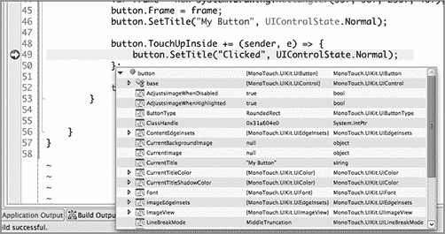

在设备上

在设备上调试与在模拟器上调试相似。当你在 `MonoDevelop` 中选择 `Debug|iPhone` 配置配置文件（如图 2-15 所示）时，将只剩下一个可点击的调试图标。当你点击它时，应用程序将以调试模式编译并上传到连接的设备上。它会弹出一个调试窗口（如图 2-16 所示），显示设备应该指向的 IP 地址和端口。这是因为你将通过 Wi-Fi 调试设备，所以你需要确保设备与你的机器处于同一个网络中。

图 2-15

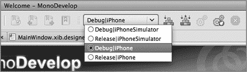

图 2-16

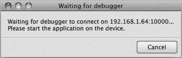

启调试功能的应用程序在配置中启用了额外的设置。你可以通过点击 `Settings` 然后你的应用程序名称来查看这些设置。你应该看到一个类似于图 2-17 的屏幕。你想要确保电脑上调试窗口弹出的 IP 地址与设备调试设置中显示的 IP 地址相匹配。

图 2-17

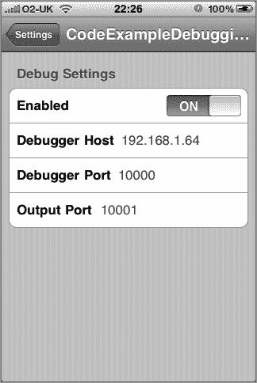

当应用程序处于调试模式时，设备可能会振动。这是 `MonoTouch` 通知你存在问题的一种，问题取决于你收到多少振动：

*   振动一次：应用程序无法连接到等待设备连接的机器。
*   振动两次：应用程序无法解析配置的主机地址。
*   振动三次：标准输出流（`stdout` 和 `stderr`）无法设置。


要在设备上启用调试，你需要拥有完整版本的 `MonoTouch` 并安装正确的证书。请参见本章稍后的“部署你的应用程序”以获取更多信息。

## 理解链接器

由于你无法在 iPhone 上重用库，每当你将一个版本的 `MonoTouch` 应用程序放入设备或 App Store 时，你也就安装了 `Mono` 框架。你可能认为为每个应用程序在设备上准备相同的 `Mono` 框架是一种浪费，如果是那样的话那确实是浪费。`MonoTouch` 实际上使用链接器工具来遍历 `Mono` 框架程序集，并移除应用程序中未使用的代码。这意味着每个应用程序都使用其独特且精简的 `Mono` 框架版本，因此当新版本的 `MonoTouch` 出版时，你不需要升级每个使用 `MonoTouch` 的应用程序来支持最新版本，无需测试可能出现的任何回归问题。每个应用程序都将继续运行它自己的框架版本。

链接器还有助于减小应用程序的尺寸，这很重要，尤其是在移动设备上。如果你的应用程序小于 20 兆字节，Apple 允许你通过 Edge/3G 下载；如果应用程序超过此限制，你需要连接到 WiFi 才能下载应用程序。因为如果你没有在应用程序中使用 `Mono` 框架的整个基类库和核心组件，那么你不会用未使用的代码占用应用程序的空间。

链接器已集成到 `MonoTouch` 和 `MonoDevelop` 中，因此不需要额外工作即可启用。默认情况下，`MonoDevelop` 设置 iPhone 模拟器配置文件（`Debug|iPhone Simulator` 和 `Release|iPhone Simulator`）不使用链接器，而在设备配置文件（`Debug|iPhone` 和 `Release|iPhone`）上，它选择“仅链接 SDK 程序集”配置。这意味着链接器会遍历 SDK 并移除未使用的代码，但它不会链接你创建的程序集。另一种配置是“链接所有程序集”，它会遍历 SDK 和你创建的程序集。如果涉及 Web 服务、反射或序列化的代码在你的代码中没有被静态调用，这通常会导致问题。你可能希望对可能被移除的成员使用 `[Preserve]` 属性。

## 部署你的应用程序

你已经完成了 Hello World 应用程序，现在是时候通过将应用程序部署到 iPhone 向世界展示这个应用程序有多棒（或 `MonoTouch` 有多酷）了。按照步骤允许应用程序进入设备：

1. 你需要成为 Apple iPhone 开发者计划的成员。在写作期间，该计划的费用为每年 99 美元。注册位置在本节末尾的列表中找到。
2. 请求并安装从 Apple 获得的开发者证书。该证书应该出现在开发用 Mac 的`钥匙串访问`（Keychain Access）中，其路径为 `/Applications/Utilities/Keychain Access`。
3. 请求并安装从 Apple 获得的部署证书。该证书应该出现在开发用 Mac 的`安全工具`（security utility）中。
4. iPhone 必须经过适当配置。这意味着 iPhone 已被允许运行不是从 App Store 下载的调试或测试应用程序。幸运的是，Apple 通过其开发者网站提供了一个向导工具来帮助 iPhone 的设置和配置。
5. 一旦开发系统设置，必须配置 `MonoDevelop` 项目将应用程序部署到 iPhone。这通过设置项目选项来实现。要进入此屏幕，右键点击 iPhone 项目并选择选项。当项目窗口打开时，选择 iPhone 签名（iPhone Bundle Signing）。默认，它使用找到的第一个开发者证书。参见图 2-18。

图 2-18

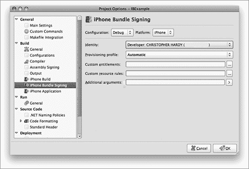

Apple 为 Mac 开发者提供了多个设置密钥和部署的优质资源。要访问这些资源，你需要是 iPhone 开发者计划的成员（要查看最后两个资源需要登录）：

*   iPhone 开发者网站：`http://developer.apple.com/iphone/program`
*   iPhone 开发者计划的配置网站：`http://developer.apple.com/iphone/manage/overview/index.action`
*   一份详尽描述证书过程的 Apple PDF 文档：`http://developer.apple.com/iphone/download.action?path=/iphone/iphone_developer_program_user_guide/iphone_developer_program_user_guide__standard_program_v2.5__final.pdf`


本章向你展示了如何配置 MonoTouch 和 MonoDevelop，并证明了使用 MonoTouch 非常直观，可以让你快速开始编写 iPhone 应用程序。MonoDevelop 与现有的 Apple 工具完美集成，其外观和操作体验与 Visual Studio 相似，让你能够快速上手开发工具。

# 第 3 章：规划你的应用 UI：探索屏幕控件

## 本章包含哪些？

* 创建 iPhone UI
* 探索 Interface Builder 中的输入（Input）与值（Value）对象

在本章中，你将学习如何创建应用程序的 UI，特别是 iPhone 上的 UI 与你之前可能创建的 UI 有何不同。你还将探索 Interface Builder 对象库中的输入与值对象。

图 3-1 显示了 Interface Builder 中的输入与值对象。我们将在本章稍后的部分讨论这些对象。不过，你首先需要熟悉 iPhone UI 的一般外观样式，以及它通常遵循的交互模式。

图 3-1

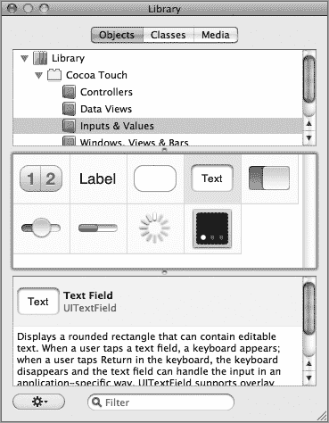

## 创建 iPhone UI 和应用交互模式

对于 iPhone 应用开发而言，最重要的方面之一就是用户界面。这是因为对大多数用户来说，界面就是应用程序。设计师和开发者花费大量时间来决定常见的界面元素应该长什么样，以及交互应该如何发生。棒的一点是，MonoTouch 团队移植了所有的 `CocoaTouch` 类，让你的应用看起来和用就像原生 `CocoaTouch` 应用一样。除了探索这些类之外，作者还敦促你查看 Apple 的《人机交互指南》（Human Interface Guidelines）；它为开发者提供了常见问题的交互模式描述。

Apple 在 iPhone SDK 文档中提供了适用于 iPhone OS 的《视图控制器编程指南》（View Controller Programming Guide）。该文档探索了用于用户交互的几种高级设计模式。Apple 创建了语义，用于描述应用程序中特定屏幕或一组屏幕的整体交互风格——几乎所有的应用程序都实现了根据这些词汇描述的设计。通过理解这些通用模式，你就可以根据用户需求来规划你的用户界面。

### 命令界面 (Command Interfaces)

命令界面是指向用户提供一个包含一个或多个按钮的工具栏，这些按钮代表用户可以执行的操作。命令界面通常不使用视图控制器，而是直接将按钮的操作连接到其他对象。你通过向应用程序中添加 `UIToolbar` 来实现命令界面。

如果满足以下情况，命令界面可能适用于你的应用：
* 你有一组非常小且数量有限的操作供用户执行。
* 你正在向用户展示一个可编辑视图（可能是绘图画布），并且你想提供一组工具或操作。
* 你有一个主屏幕，用户通过该屏幕执行应用程序的所有操作。

图 3-2 显示了命令界面的示例。

图 3-2

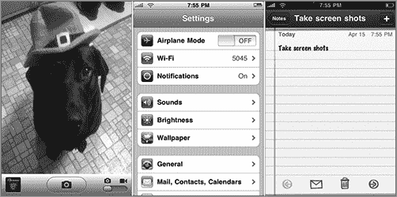

### 单选框界面 (Radio Interfaces)

单选框界面提供一组按钮，用户点击它们时会在视图之间切换。这些按钮显示在窗口底部的标签栏（tab bar）上，每次点击都会切换到一个不同的视图，而视图之间没有动画效果。这种界面非常适合显示非层级数据。你可以使用 `UITabBar` 来创建单选框界面。

如果满足以下情况，单选框界面可能适用于你的应用：
* 你有一组相关但不同的屏幕。如果你的屏幕本质上没有关联，你应该考虑构建多个应用程序，以遵循协作单任务的概念。
* 你的视图是同级关系。也就是说，它们不代表数据层级中的不同层次，而是对数据的不同视图，这些数据可能重叠。
* 你有一组密切相关的功能子集，可以按任何顺序访问。本质上，每个视图都需要一个独立的主视图控制器，因此功能划分时应该考虑架构设计。

图 3-3 显示了单选框界面的示例。

图 3-3

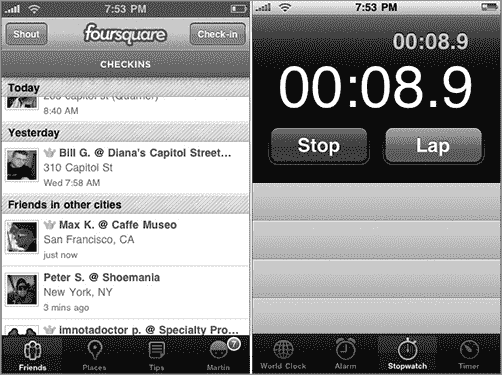

### 导航界面 (Navigation Interfaces)

导航界面显示对象的层级结构。用户点击控件以向更具体的细节移动。通常使用 `UINavigationController` 类来导航 `UIViewController` 实例的层级结构。视图之间的切换时，更具体的视图会从右侧滑入，而较不具体的视图则向左侧移出。沿层级向上移动则会让视图向反方向进入。

如果你有一组层级数据或功能，并允许用户进行遍历，那么导航界面可能适用于你的应用。如果你的数据符合任何树形数据结构，导航界面很可能是合适的，并且遵循 Apple 作为 `Cocoa Touch` 平台一部分所建立的标准。

图 3-4 显示了导航界面的示例。

图 3-4

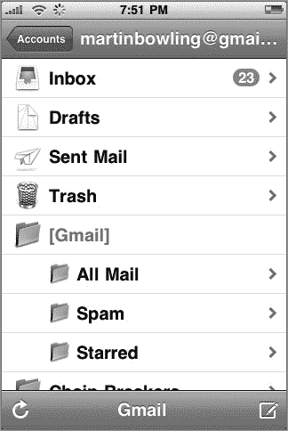

### 模态界面 (Modal Interfaces)

模态界面在视图上方显示一个辅助视图。这在呈现辅助屏幕（如编辑屏幕）时最有用。模态界面与导航界面的相似之处在于它们都会处理视图切换。导航界面通过水平切换 `UIViewController` 栈，而模态界面通过垂直切换将新视图置于栈之上。`UIAlertView` 是混合在多种类型界面中的模态界面极佳示例。

你需要：
* 多步骤的工作流。
* 某个屏幕视图的可编辑界面。
* 需要在保持当前视图上下文的情况下让用户参与次要功能。例如，如果你想触发相机拍摄照片或从通讯录中选择联系人，可以使用模态界面，并将结果数据提供给当前视图。

图 3-5 显示了模态界面的示例。

### 组合界面 (Combination Interfaces)

你应该始终记住，单选框、导航和模态界面并不是相互排斥的。事实上，各种类型的界面经常组合在一起，为用户提供一个展示多组层级数据的界面。如果你熟悉任何热门应用，就会发现组合界面的非常常见。导航和模态界面可以轻松组合，创建一个可以在多个层级数据集中进行导航的应用。你可以通过屏幕底部的标签栏识别模态-导航界面，它可以切换屏幕顶部的表格视图。

如果满足以下情况，组合界面可能适用于你的应用：
* 你有复杂的数据或功能，可以从不同用户界面的受益。
* 用户将使用不同的模式对同一数据集与你的程序交互。

图 3-5

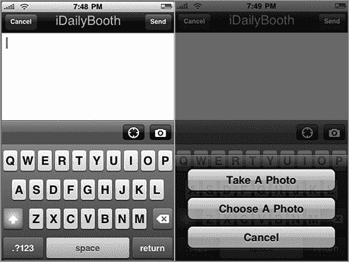

图 3-6 显示了组合界面的示例。

图 3-6

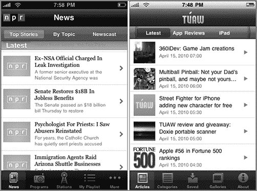


现在你已经对 iPhone 应用程序常用的交互模式有了初步了解，可以准备好熟悉 Interface Builder 中作为“输入与数值”（Input & Value）对象提供的可用控件了。本章将从库中最基础的控件开始：`UILabel`。`UILabel` 代表一个只读文本视图。`UILabel` 可以包含不同数量的文本，并根据边界框的大小和你设置的属性，对文本进行缩小、换行或截断。通过它的属性，你可以控制标签中文本的字体、颜色、对齐方式、高亮和阴影。请遵循以下步骤操作：

1. 打开 Interface Builder。
2. 导航到 Input & Value 对象，选择 `UILabel`。将其拖入你的窗口/视图中并放置。
3. 为此 `UILabel` 创建一个出口（outlet），以便你能够从代码中访问该对象。

你在 `UILabel` 中最频繁使用的成员有：

* `Text`：标签要显示的实际文本。
* `TextAlignment`：使用 `UITextAlignment` 枚举选择左、居中或右。
* `TextColor`：分配命名颜色（如 `UIColor.Blue`）、系统颜色（如 `UIColor.DarkTextColor`）或使用 `From` 方法使用任何其他颜色。
* `Font`：设置文本的字体类型和大小。
* `Lines`：用于渲染文本的最大行数。

图 3-7 显示了 Interface Builder 中的 `UILabel` 选项。

图 3-7

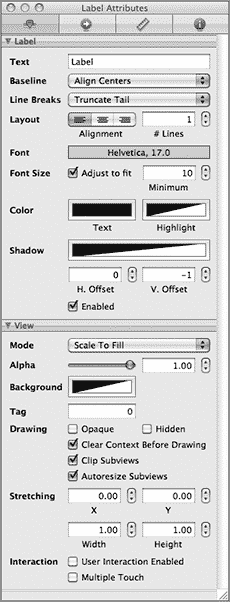

你不仅可以在 Interface Builder 内部设置这些属性，还可以在代码内部设置它们。`UILabel` 用于显示只读信息，不具备任何响应点击或触摸事件的事件。这是一个非常静态的控件，很可能被用其他控件的子视图来显示你的数据。以下是在代码中使用这些基本属性的示例：

```
// UILabel outlet is named Label
Label.Font = UIFont.FromName("Times New Roman", 17f);
Label.TextAlignment = UITextAlignment.Left;
Label.TextColor = UIColor.Red;
Label.Lines = 3;
Label.Text = "It's a UILabel from inside code with MonoTouch";
```

### UIButton

`UIButton` 是你用于收集用户触摸输入的控件。`UIButton` 的用例与网页上的按钮或 Windows Forms 应用程序中的按钮相似，你希望用户执行某种操作。`UIButton` 类可以通过显示属性或专门的绘制代码进行自定义。在讨论这些之前，你应该了解 Interface Builder 中的一些基本属性：

* `Title`：按钮上显示的实际文本。
* `Image`：显示在按钮上的图像。
* `Background`：用按钮背景的图像。
* `TextColor`：分配命名颜色（如 `UIColor.Blue`）、系统颜色（如 `UIColor.DarkTextColor`）或使用 `From` 方法使用任何其他颜色。
* `Shadow`：分配命名颜色（如 `UIColor.Blue`）、系统颜色（如 `UIColor.DarkTextColor`）或使用 `From` 方法使用任何其他颜色。

图 3-8 显示了 Interface Builder 中的 `UIButton` 选项。

图 3-8

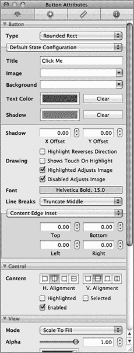

每个属性都可以为 `UIButton` 的不同状态进行设置；这些状态在 `UIControlState` 枚举中定义，可以选择常规（Normal）、选中（Selected）、高亮（Highlighted）或禁用（Disabled）。在 Interface Builder 中，你可以选择这些状态并相应设置属性；在代码中，将使用对应属性的 `SetXxx` 方法。

你可以创建几种类型的按钮：

* `UIButtonTypeCustom`：无按钮样式。相反，应该定义自定义的 `drawRect:` 方法。
* `UIButtonTypeRoundedRect`：带有圆角和居中标题的矩形按钮。用于所有通用按钮。
* `UIButtonTypeDetailDisclosure`：带有居中箭头（（>）的圆形按钮。用于显示关联对象或记录的详情。
* `UIButtonTypeInfoLight`：浅色圆形按钮，带有斜体小写字母“i”。用于翻转视图以显示设置或额外信息。
* `UIButtonTypeInfoDark`：深色圆形按钮，带有斜体小写字母“i”。用于翻转视图以显示设置或额外信息。
* `UIButtonTypeContactAdd`：带有圆角和居中标题的矩形按钮。用于显示联系人列表或添加新联系人的表单。

以下是设置某些 `UIButton` 属性并响应点击事件的示例，对于 `UIButton` 来说就是 `TouchUpInside` 事件：

```
// UIButton outlet is named button
UIImage bgImage = UIImage.FromFile("buttonBackground.png");
button.SetBackgroundImage(bgImage, UIState.Normal);
button.SetTitle("Click Me", UIState.Normal);
button.SetTitleColor(UIColor.White, UIState.Normal);
button.TouchUpInside += delegate(object sender, EventArgs e) {
    Label.Text = "Button Clicked!";
    Label.TextColor = UIColor.Brown;
};
```

### UITextField

`UITextField` 类提供了单行编辑功能，并对编辑安全数据（如密码或其他敏感项目提供了内置支持。当用户点击文本字段时，会出现键盘；当用户点击键盘上的 Return（返回）键时，键盘消失，文本字段可以以应用程序特定的方式处理输入。`UITextField` 还提供了一个清除文本控件，用户点击它可以擦除文本字段的内容。通过 `UITextField` 的属性，你可以控制文本的字体、样式、颜色和对齐方式。

以下是 `UITextField` 的一些属性：

* `Text`：文本框显示的实际文本。
* `Placeholder`：用户未输入实际文本时显示的文本。你可以将其用作视觉提示，告诉用户你期望什么数据。
* `TextAlignment`：使用 `UITextAlignment` 枚举选择左、居中或右。
* `TextColor`：分配命名颜色（如 `UIColor.Blue`）、系统颜色（如 `UIColor.DarkTextColor`）或使用 `From` 方法使用任何其他颜色。
* `SecureTextEntry`：决定是否使用掩码隐藏显示的文本。
* `AutocapitalizationType`：决定何时自动使用 Shift 键（例如，在开始输入和新句子时）。默认为 None（无）。
* `AutocorrectionType`：显示在输入期间是否启用了自动纠正。默认开启。
* `ReturnKeyType`：注意 `UITextView` 不支持与 `UITextField` 相同的完成编辑行为。
* `KeyboardType`：允许控件显示与你预期数据类型匹配的键盘，例如，纯文本、电子邮件地址或数字数据。

使用这些属性的代码所示：

```
// UITextField outlet is named TextField
TextField.Font = UIFont.FromName("Times New Roman", 17f);
TextField.TextAlignment = UITextAlignment.Left;
TextField.TextColor = UIColor.Black;
TextField.SecureTextEntry = false;
```

图 3-9 显示了 Interface Builder 中的 `UITextField` 选项。

图 3-9

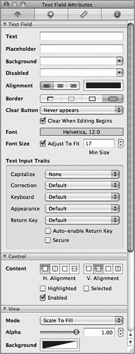


正如本章早期提到的，`UITextField` 在用户点击文本字段时会做出响应并出现键盘；当用户点击键盘上的 Return（返回）时，键盘会消失。然而，需要注意的是，如果 `UITextField` 出现在模态键盘视图的下方，除非你滚动视图将 `UITextField` 移动到可视区域，否则 `UITextField` 本身将被隐藏。尽管如此，通常的通认做法是不在 `UITableViews` 之外使用 `UITextField`。当你在 `UITableView` 内部使用 `UITextField` 时，`UITableView` 会完成所有的繁重工作，以确保 `UITextField` 在用户的可视范围内。

### UISwitch

`UISwitch` 是一个相当简单的控件，它显示一个元素并向用户显示给定值的布尔状态。点击控件可以切换状态。在不通过子类化并基于 `UISwitch` 创建你自己的控件的情况下，你只能在控件上显示 On（开启）或 Off（关闭）。`UISwitch` 的属性也非常少；你最可能用的是 `State` 属性，它告诉你代表的是 On 还是 Off。

图 3-10 显示了 Interface Builder 中的 `UISwitch` 选项。

图 3-10

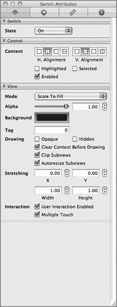

### UISlider

`UISlider` 显示一个水平条，称为轨道（track），它代表一个有限范围的值。当前值由指示器（或称滑块，thumb）的位置显示。用户通过沿轨道滑动滑块来选择值。你可以自定义轨道和滑块的外观：

* `MinValue`：控件将运行的最小值。
* `MaxValue`：控件将显示的最大值。
* `MinValueImage`：包含绘制在滑块一侧的代表最小值的图像。
* `MaxValueImage`：包含绘制在滑块另一侧的代表最大值的图像。

图 3-11 显示了 Interface Builder 中的 `UISlider` 选项。

以下显示了使用这些属性并为值更新时创建代理的代码：

```csharp
// UISlider outlet 命名为 slider
slider.MinValue = 0.0f;
slider.MaxValue = 10.0f;
slider.SetValue(10.0f, false);
slider.ValueChanged += delegate(object sender, EventArgs e) {
    Console.WriteLine("New Value: " + slider.Value);
};
```

### UIActivityIndicatorView

`UIActivityIndicatorView` 显示一个元素，为未知持续的任务或过程的进度提供用户反馈（若要显示已知持续时间的任务进度，请使用 `UIProgressView`）。只要任务或过程持续，活动指示器就会旋转。用户不与活动指示器交互。以下是 `UIActivityIndicatorView` 最频繁使用的属性列表。

* `HidesWhenStopped`：一个布尔值，决定控件在非动画状态时是否显示。
* `ActivityIndicatorViewStyle`：使用 `UIActivityIndicatorViewStyle` 枚举选择 Gray（灰色）、White（白色）或 WhiteLarge（大白色）。

图 3-11

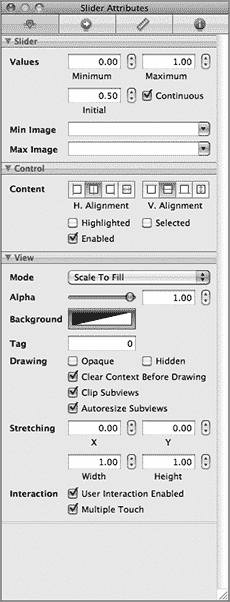

图 3-12 显示了 Interface Builder 中的 `UIActivityIndicatorView` 选项。

图 3-12

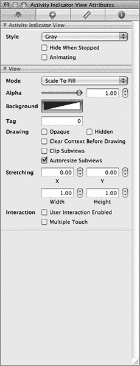

以下代码使用这些属性来启动和停止动画：

```csharp
// UIActivityIndicatorView outlet 命名为 activity
activity.ActivityIndicatorViewStyle = UIActivityIndicatorViewStyle.WhiteLarge;
activity.HidesWhenStopped = true;
activity.StartAnimating();
//执行一些操作
activity.StopAnimating();
```

### UISegmentedControl

`UISegmentedControl` 提供了一个紧凑、持久的按钮组，用于切换视图切换。根据移动端 HIG（人界面指南），分段控件应该通过切换视图或其他适当的 UI 更新来向用户提供反馈。反馈应该是即时的，避免动画效果。尽管如此，可以想象你也可以可以使用分段控件进行更复杂的视图管理。它显示一个由多个段组成的元素，每个段都充当一个独立的按钮。每个段可以显示文本或图像，但不能二者兼有。`UISegmentedControl` 确保每个段的宽度根据分段总数成比例，除非你设置了特定宽度。

* `NumberOfSegements`：这是代码内部的只读属性；但使用 Interface Builder 时你可以使用它来设置想要显示的分段数量。
* `ControlStyle`：使用 `UISegmentedControlStyle` 枚举选择 Plain（普通）、Bordered（带边框）或 Bar（条形）。

图 3-13 显示了 Interface Builder 中的 `UISegmentedControl` 选项。

图 3-13

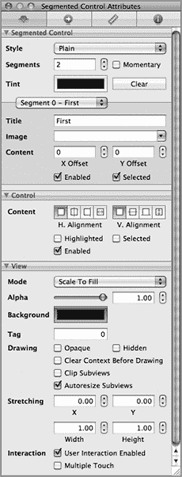

以下代码使用这些属性并使用代理来响应值的改变：

```csharp
// UISegmentedControl outlet 命名为 segmentedControl
segmentedControl.InsertSegment("First", 0, false);
segmentedControl.InsertSegment("Second", 1, false);
segmentedControl.InsertSegment("Third", 2, false);
segmentedControl.SelectedSegment = 0;
segmentedControl.ControlStyle = UISegmentedControlStyle.Plain;
segmentedControl.ValueChanged += delegate {
    if (segmentedControl.SelectedSegment == 0)
        Console.WriteLine("First Selected");
        //显示视图
    else if (segmentedControl.SelectedSegment == 1)
        Console.WriteLine("Second Selected");
        //显示视图
    else if (segmentedControl.SelectedSegment == 2)
        Console.WriteLine("Third Selected");
        //显示视图
};
```

### UIPageControl

`UIPageControl` 通过为每个打开的页面显示一个点来指示应用程序中打开的页面数量。对应于当前视图的点会被高亮。`UIPageControl` 通过在点击高亮点右侧或左侧时向代理发送事件来支持导航。该控件通常与 `UIScrollView` 配合使用（`UIScrollView` 将第 4 章介绍）。

图 3-14 显示了 Interface Builder 中的 `UIPageControl` 选项。

图 3-14

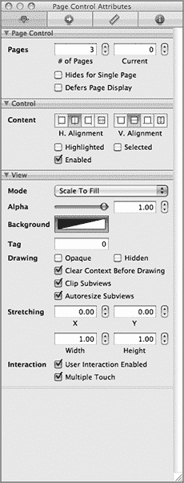

### Summary

本章介绍了建议的各种界面模式：

* 命令界面适用于有限的功能。
* 广播界面使用 `UITabBar` 提供对相关视图的访问。
* 导航界面使用 `UINavigationController` 提供你希望用户遍历的层次结构数据或功能。
* 模态界面使用 `UIViewController` 提供一组次要功能，用户可以在保持当前视图上下文的同时可选地参与这些功能。
* 组合界面适用于当你拥有复杂的数据或功能，且从使用不同的用户界面中获益时。

你还接触了 Interface Builder 对象库中的输入与值对象，这让你对创建用户界面时使用的一些控件有了很好的了解。

第 4 章

数据控件

本章内容：

* 理解窗口、视图和控制器
* 显示数据和编辑控件
* 使用工具栏
* 使用标签页导航


这些是剩余的类，你将在本章中学习：

*   控制器 (Controllers)
    *   `UIViewController`
    *   `UINavigationController`
    *   `UITabBarController`
    *   `UIToolBarController`
*   数据视图 (Data Views)
    *   `UIWebView`
    *   `UITextView`
    *   `UIScrollView`
    *   `UIPickerView`
    *   `UIDatePicker`
*   窗口、视图与栏 (Windows, Views & Bars)
    *   `UIWindow`
    *   `UIView`
    *   `UINavigationBar`
    *   `UINavigationItem`
    *   `UIToolbar`
    *   `UIBarButtonItem`
    *   `UITabBar`
    *   `UITabBarItem`

图 4-1 显示了这些类在 Interface Builder 中的外观，这样你就知道去哪里找到它们了。

图 4-1

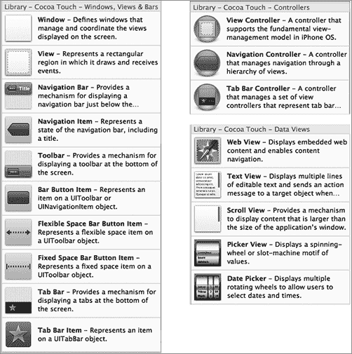

# 窗口与视图

窗口和视图是所有 iPhone OS 应用的基础。它们是布局系统的基础，负责捕获和处理用户输入。iPhone OS 中的 `UIWindow` 类相对简单，不需要大量的自定义，而 `UIView` 及其子类则成了你用户界面每个部分的基础。

## UIWindow

一个 iPhone OS 应用程序通常只有一个窗口 —— 它提供了显示用户界面其余部分的背景。与桌面操作系统中的窗口不同，`UIWindow` 类没有“外壳”（没有标题栏；调整大小柄；边框；最小化、最大化或关闭按钮），并且始终填充整个屏幕。唯一的装饰是窗口顶部的状态栏，你可以选择显示或隐藏它。

当你在 MonoDevelop 中创建一个新的应用程序解决方案时，它会自动将 `MainWindow.xib` 添加到项目中，其中包含一个名为 `window` 的 `UIWindow` 实例。它还添加了 `AppDelegate.FinishedLaunching` 方法，其中包含 `window.MakeKeyAndVisible()` 这一行，用于显示窗口。

可以直接在代码中创建窗口。列表 4-1 显示了最简单的 MonoTouch 应用，它不需要 Interface Builder 文件即可在屏幕上显示某些文本。书中的大多数示例都使用了 Interface Builder，但值得记住，你始终可以通过在代码中构建 `UIView` 对象来实现相同的效果。


列表 4-1: 在代码中创建 `UIWindow` (`Window01\AppController.cs`)

```csharp
using System;

using MonoTouch.Foundation;
using MonoTouch.UIKit;
namespace Window01
{

[Register("AppController")]
public class AppController : UIApplicationDelegate
{
   UIWindow window;

   public override void FinishedLaunching (UIApplication app)
   {
      window = new UIWindow (UIScreen.MainScreen.Bounds)
      {
         new UILabel(new System.Drawing.RectangleF (50,150,230,100))
         { Text = "Hello world" }
      };
      window.MakeKeyAndVisible();
   }
}
class HelloWorld
{
   static void Main (string[] args)
   { UIApplication.Main (args, null, "AppController"); }
}}
```

`UIWindow` 应该始终填充整个屏幕，因此使用 `UIScreen.MainScreen.Bounds` 来设置窗口大小。

## UIView

虽然不是完全等同，但 `UIView` 类与 ASP.NET、WinForms 和 WPF 中的用户控件（User Control）概念有一些相似的特征。

`UIView` 是 `UIKit` 框架中每个其他控件的基类 —— 它负责向屏幕渲染内容，并响应其边界内的触摸事件。`UIView` 还可以包含其他 `UIView` 实例 —— 称为子视图（sub-views） —— 并根据需要构建深层层次结构。父视图（或超视图）管理子视图的大小和位置，并可能响应未被子视图处理的事件。

在非常简单的应用程序中（例如书中的许多特定控件示例），`UIView`（或其子类）可以直接添加到窗口中进行显示和用户交互。大多数应用程序需要更复杂的视图处理，这由 `UIViewControllers` 完成，例如本章涵盖的 `UINavigationController` 和第 6 章涵盖的 `UITableViewController`。`UIViewControllers` 协调你应用程序中所有不同的视图：根据情况显示和隐藏它们，并在设备方向改变时调整它们的大小。

如前所述，应用程序应该只有一个 `UIWindow`；你添加到项目中的其余视图将是 `UIView`、`UIViewController` 或它们其中任一子类。`UIView` 上需要了解的关键成员有：

*   `Bounds`：视图在其所在坐标系中的位置和大小。
*   `Frame`：视图的位置和大小。
*   `UIView(frame)`：`UIView` 的构造函数。
*   `AddSubview`：将提供的 `UIView` 实例作为子视图添加。


## 数据视图

Interface Builder 数据视图库包含许多不同类型的视图，其中一些重要的类拥有自己的章节：`UITableView`（第 6 章）、`UIMapView`（第 8 章）以及第 10 章涵盖的 `UIImageView`。其余部分在本节讨论。

### UIWebView

`UIWebView` 控件允许你在应用程序中嵌入网络内容：基于网络的站点、应用程序中的 HTML 文件或动态生成的 HTML 字符串。它与 Windows Forms 中的 .NET WebBrowser 控件非常相似，基本上就像在应用程序内部有一个 Safari 实例。

 基于网络的内容

`UIWebView` 最明显的用途是在应用程序中显示网页。该控件的成员不多；主要的有：

*   `LoadRequest()`：此方法传递 URL（在 `NSUrlRequest` 对象中）从互联网加载该地址。在下面的示例中，通过按钮调用此方法。
*   `ScalesPageToFit`：此属性控制内容是自动缩放适应（允许缩放）还是强制始终保持“实际大小”。默认值为 false，这意味着网页不会为你缩小。熟悉 Mobile Safari 的用户会期望能够缩放网页，因此对于网络内容，你通常应该将其设置为 true，或者在 Interface Builder 中勾选 Scales To Fit 选项。
*   `LoadStarted`：每当浏览器加载新内容时都会触发此事件。下面的示例显示了网络活动动画，以提供某些正在处理的视觉反馈。
*   `LoadFinished`：当内容加载完成（整个页面及其所有内容，包括图像和脚本）时触发此事件。用于隐藏网络活动动画。
*   `LoadError`：当页面无法加载时触发此事件。下面的示例停止网络活动动画并向用户显示错误消息。

为了演示加载网页，本章下载中的一个示例 —— WebView01 在窗口上放置了三个控件：`UIWebView`、`UITextField` 和一个 `UIButton`。添加到 `FinishedLaunching()` 中的这段代码使其能够工作：

```csharp
GoButton.TouchUpInside += delegate

{
```


```cs
WebBrowser.LoadRequest(new NSUrlRequest(new NSUrl(UrlInput.Text)));
};

WebBrowser.LoadStarted += delegate
{
    UIApplication.SharedApplication.NetworkActivityIndicatorVisible = true;
};

WebBrowser.LoadFinished += delegate
{
    UIApplication.SharedApplication.NetworkActivityIndicatorVisible = false;
};

WebBrowser.LoadError += delegate(object sender, UIWebErrorArgs e)
{
    UIApplication.SharedApplication.NetworkActivityIndicatorVisible = false;
    using (var alert = new UIAlertView("WebView Error"
            e.Error.LocalizedDescription,null,"OK",null))
    { alert.Show(); }
};
```

### `WebView01\Main.cs`

结果如图 4-2 所示。尝试导航到一个无效的 URL（例如，`http://wrox.co`）或在没有网络连接的情况下进行测试，以触发 `LoadError` 委托。

图 4-2

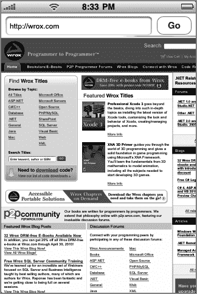

如果你仔细阅读 Apple 关于 `UIWebView` 的文档，你会发现像 `LoadStarted`、`LoadFinished` 和 `LoadError` 等事件实际上是另一个类——`UIWebViewDelegate` 中的方法。这展示了 MonoTouch 如何通过将委托方法暴露为对象本身的事件（在本例中为 `UIWebView`），让 .NET 开发者更熟悉地使用 Objective-C API。

虽然可以子类并使用 iPhone OS 提供的 Delegate 类，但在本书中，只要提供了相应的 MonoTouch 事件/委托，我们就会使用它们。

为了让这个示例程序运行得更像一个真实的网页浏览器，你可以使用更多的 `UIWebView` 成员来实现后退和后进行为，并保持地址栏与显示的网页同步。使用 Interface Builder，添加两个使用这些成员的 `UIButtons`（标记为 Back 和 Forward）：

*   `CanGoBack`：导航历史中是否存在可以显示的上一个地址。
*   `CanGoForward`：是否存在可以返回的之前访问过的地址。
*   `GoBack()`：显示导航历史中的上一个地址。
*   `GoForward()`：返回到一个之前访问过并已“后退”的地址。

Listing 4-2 显示了在 `FinishedLaunching` 中需要的代码，并在章节下载的 `WebView02` 中提供。带有后退/后进按钮的更新示例如图 4-3 所示。

图 4-3

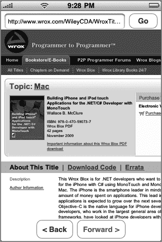

Listing 4-2: 微型网页浏览器 (`WebView02\Main.cs`)

```cs
GoButton.TouchUpInside += delegate
{
    WebBrowser.LoadRequest(new NSUrlRequest(new NSUrl(UrlInput.Text)));
};

WebBrowser.LoadStarted += delegate
{
    UIApplication.SharedApplication.NetworkActivityIndicatorVisible = true;
    if (!String.IsNullOrEmpty(WebBrowser.Request.Url.AbsoluteString))
        UrlInput.Text = WebBrowser.Request.Url.AbsoluteString;
};

WebBrowser.LoadFinished += delegate
{
    UIApplication.SharedApplication.NetworkActivityIndicatorVisible = false;
    UrlInput.Text = WebBrowser.Request.Url.AbsoluteString;
    BackButton.Enabled = WebBrowser.CanGoBack;
    ForwardButton.Enabled = WebBrowser.CanGoForward;
};

WebBrowser.LoadError += delegate(object sender, UIWebErrorArgs e)
{
    UIApplication.SharedApplication.NetworkActivityIndicatorVisible = false;
    BackButton.Enabled = WebBrowser.CanGoBack;
    ForwardButton.Enabled = WebBrowser.CanGoForward;
    using (var alert = new UIAlertView("WebView Error"
            e.Error.LocalizedDescription,null,"OK",null))
    { alert.Show(); }
};

BackButton.TouchUpInside += delegate
{
    WebBrowser.LoadRequest(new NSUrlRequest(new NSUrl(UrlInput.Text)));
};

WebBrowser.LoadStarted += delegate
{
    UIApplication.SharedApplication.NetworkActivityIndicatorVisible = true;
    if (!String.IsNullOrEmpty(WebBrowser.Request.Url.AbsoluteString))
        UrlInput.Text = WebBrowser.Request.Url.AbsoluteString;
};

WebBrowser.LoadFinished += delegate
{
    UIApplication.SharedApplication.NetworkActivityIndicatorVisible = false;
    UrlInput.Text = WebBrowser.Request.Url.AbsoluteString;
    BackButton.Enabled = WebBrowser.CanGoBack;
    ForwardButton.Enabled = WebBrowser.CanGoForward;
};

WebBrowser.LoadError += delegate(object sender, UIWebErrorArgs e)
{
    UIApplication.SharedApplication.NetworkActivityIndicatorVisible = false;
    BackButton.Enabled = WebBrowser.CanGoBack;
    ForwardButton.Enabled = WebBrowser.CanGoForward;
    using (var alert = new UIAlertView("WebView Error"
            e.Error.LocalizedDescription,null,"OK",null))
    { alert.Show(); }
};

BackButton.TouchUpInside += delegate
{
    WebBrowser.GoBack();
};

ForwardButton.TouchUpInside += delegate
{
    WebBrowser.GoForward();
};
```

### Local HTML

`UIWebView` 的另一个强大用法是显示 HTML。最简单的方法是将 HTML 文件添加到项目中（不要忘记设置 Build Action 为 `Content`）并将其加载到 `UIWebView` 中。


```cs
WebBrowser.LoadRequest(new NSUrlRequest(new NSUrl(UrlInput.Text)));
```

### `WebView03\Main.cs`

结果如图 4-2 所示。尝试导航到一个无效的 URL（例如，`http://wrox.co`）或在没有网络连接的情况下进行测试，以触发 `LoadError` 委托。

图 4-2


如果你仔细阅读 Apple 关于 `UIWebView` 的文档，你会发现像 `LoadStarted`、`LoadFinished` 和 `LoadError` 等事件实际上是另一个类——`UIWebViewDelegate` 中的方法。这展示了 MonoTouch 如何通过将委托方法暴露为对象本身的事件（在本例中为 `UIWebView`），让 .NET 开发者更熟悉地使用 Objective-C API。

虽然可以子类并使用 iPhone OS 提供的 Delegate 类，但在本书中，只要提供了相应的 MonoTouch 事件/委托，我们就会使用它们。

为了让这个示例程序运行得更像一个真实的网页浏览器，你可以使用更多的 `UIWebView` 成员来实现后退和后进行为，并保持地址栏与显示的网页同步。使用 Interface Builder，添加两个使用这些成员的 `UIButtons`（标记为 Back 和 Forward）：

*   `CanGoBack`：导航历史中是否存在可以显示的上一个地址。
*   `CanGoForward`：是否存在可以返回的之前访问过的地址。
*   `GoBack()`：显示导航历史中的上一个地址。
*   `GoForward()`：返回到一个之前访问过并已“后退”的地址。

Listing 4-2 显示了在 `FinishedLaunching` 中需要的代码，并在章节下载的 `WebView02` 中提供。带有后退/后进按钮的更新示例如图 4-3 所示。

图 4-3


Listing 4-2: 微型网页浏览器 (`WebView02\Main.cs`)

```cs
GoButton.TouchUpInside += delegate
{
    WebBrowser.LoadRequest(new NSUrlRequest(new NSUrl(UrlInput.Text)));
};

WebBrowser.LoadStarted += delegate
{
    UIApplication.SharedApplication.NetworkActivityIndicatorVisible = true;
    if (!String.IsNullOrEmpty(WebBrowser.Request.Url.AbsoluteString))
        UrlInput.Text = WebBrowser.Request.Url.AbsoluteString;
};

WebBrowser.LoadFinished += delegate
{
    UIApplication.SharedApplication.NetworkActivityIndicatorVisible = false;
    UrlInput.Text = WebBrowser.Request.Url.AbsoluteString;
    BackButton.Enabled = WebBrowser.CanGoBack;
    ForwardButton.Enabled = WebBrowser.CanGoForward;
};

WebBrowser.LoadError += delegate(object sender, UIWebErrorArgs e)
{
    UIApplication.SharedApplication.NetworkActivityIndicatorVisible = false;
    BackButton.Enabled = WebBrowser.CanGoBack;
    ForwardButton.Enabled = WebBrowser.CanGoForward;
    using (var alert = new UIAlertView("WebView Error"
            e.Error.LocalizedDescription,null,"OK",null))
    { alert.Show(); }
};

BackButton.TouchUpInside += delegate
{
    WebBrowser.LoadRequest(new NSUrlRequest(new NSUrl(UrlInput.Text)));
};

WebBrowser.LoadStarted += delegate
{
    UIApplication.SharedApplication.NetworkActivityIndicatorVisible = true;
    if (!String.IsNullOrEmpty(WebBrowser.Request.Url.AbsoluteString))
        UrlInput.Text = WebBrowser.Request.Url.AbsoluteString;
};

WebBrowser.LoadFinished += delegate
{
    UIApplication.SharedApplication.NetworkActivityIndicatorVisible = false;
    UrlInput.Text = WebBrowser.Request.Url.AbsoluteString;
    BackButton.Enabled = WebBrowser.CanGoBack;
    ForwardButton.Enabled = WebBrowser.CanGoForward;
};

WebBrowser.LoadError += delegate(object sender, UIWebErrorArgs e)
{
    UIApplication.SharedApplication.NetworkActivityIndicatorVisible = false;
    BackButton.Enabled = WebBrowser.CanGoBack;
    ForwardButton.Enabled = WebBrowser.CanGoForward;
    using (var alert = new UIAlertView("WebView Error"
            e.Error.LocalizedDescription,null,"OK",null))
    { alert.Show(); }
};

BackButton.TouchUpInside += delegate
{
    WebBrowser.GoBack();
};

ForwardButton.TouchUpInside += delegate
{
    WebBrowser.GoForward();
};
```


*   `UIWebViewnavigationType.navigationType`: 用户触发的导航类型，列在 表 4-1 中。

如果 `ShouldStartLoad` 返回 `true`，则允许请求的导航；如果返回 `false`，则取消导航。你的代码可以执行某些替代操作，例如显示另一个视图或向用户显示警报。


```csharp
WebBrowser.ShouldStartLoad = delegate (UIWebView webView, 
    NSUrlRequest request, UIWebViewNavigationType navigationType)
{
   if (navigationType == UIWebViewNavigationType.LinkClicked)
   {  // 在 Safari 中打开链接而不是在 UIWebView 中
       UIApplication.SharedApplication.OpenUrl(request.Url);
       return false;  // 已经处理
   }
   return true;  // 在 UIWebView 中显示其他所有内容
}
```

`WebView04\Main.cs`


注意，由于委托必须有一个返回值，因此它应该使用等号 (`=`) 赋值给 `ShouldStartLoad`，而不是使用 `+=` 附加。

委托的返回类型必须与它赋值的类型匹配（在本示例中，`WebBrowser.ShouldStartLoad` 是布尔值，与委托方法的返回类型匹配）。

你可以通过 `request` 参数查询目标位置，并通过 `navigationType` 参数查询请求的导航类型，以便进行不同的处理（例如，在 Safari 中打开链接，但允许表单提交在 UIWebView 中继续）。`navigationType` 的可能值见 表 4-1。

表 4-1: UIWebViewNavigationType

| 值 | 描述 |
| --- | --- |
| LinkClicked | 点击了链接。 |
| FormSubmitted | 提交了 HTML 表单。 |
| BackForward | 触发了 `GoBack()` 或 `GoForward()` 方法。 |
| Reload | 正在重新加载当前显示的内容。 |
| FormResubmitted | 表单被重新提交。 |
| Other | 发生了另一个导航操作。 |

## 其他内容

UIWebView 也可以用于显示其他内容。使用加载本地 HTML 文件的相同 C# 代码，你可以显示：

*   你的应用程序可能包含或从互联网下载的 PDF 文档
*   图像（你也可以使用 `UIImageView` 和 `UIScrollView` 显示，后文会介绍）

### UIScrollView

`UIScrollView` 允许你显示和导航比控件本身更大的内容（通常尺寸为整个设备屏幕）。它提供了对滑动移动内容和双指缩放缩放的内置支持（取决于 `UIScrollView` 的类型）。它还是需要滚动比其显示 `Frame` 更大内容的控件的基类，例如 `UITableView` 和 `UITextView`。

### 图像滚动

内置的照片 应用程序是 `UIScrollView` 接口最常用的示例。代码列表 4-3 显示了将大图像加载到 `UIScrollView` 并允许用户在其周围平移和缩放所需的代码。

*   `Bounces`: 如果为 `true`，滚动到图像边缘将会在停止前超出图像边缘产生“回弹”效果。
*   `BouncesZoom`: 如果为 `true`，当缩放到最小或最大尺寸时，内容在动画到正确尺寸之前临时超出限制。
*   `ContentSize`: 正在显示内容的真实大小。`UIScrollView` 需要知道此值，以便它可以计算滚动条的大小和位置。
*   `IndicatorStyle`: 使用 `UIScrollViewIndicatorStyle` 枚举来选择黑色或白色滚动条（或留为 `Default`）。
*   `MaximumZoomScale`: 应用于内容的最大缩放因子。接的示例允许将内容扩展到原始大小的四倍。
*   `MinimumZoomScale`: 应用于内容的最小缩放因子。接的示例允许缩小到原始大小的四分之一。
*   `ContentOffset`: 内容视图左上角相对于 `UIScrollView` 的当前位置，表示为 `System.Drawing.PointF`。
*   `ZoomScale`: 应用于内容的当前缩放比例（默认为 `1.0`）。代码列表 4-3 最初将图像显示为实际大小的 80%。

`MaximumZoomScale` 和 `MinimumZoomScale` 的默认值为 `1.0`，这意味着如果两个都不设置，缩放功能将实际上被禁用。


代码列表 4-3: 使用 UIScrollView 查看图像 (ScrollView01\Main.cs)

```csharp
UIImage image = UIImage.FromFile("GoldenGate.jpg");
UIImageView imageView = new UIImageView(image);
MyScrollView.AddSubview(imageView);
MyScrollView.ContentSize = imageView.Frame;
MyScrollView.MaximumZoomScale = 4f;
MyScrollView.MinimumZoomScale = 0.25f;
MyScrollView.Bounces = false;
MyScrollView.BouncesZoom = false;
MyScrollView.IndicatorStyle = UIScrollViewIndicatorStyle.White;
MyScrollView.ForZooming = delegate (UIScrollView sender)
{
   MyScrollView.ContentOffset = new System.Drawing.PointF(250, 20);
   MyScrollView.ZoomScale = 0.8f;
   return imageView;
};
```

图 4-6 显示了设备显示与 `UIScrollView` 被裁剪的关系。

### 分页

使用 UIScrollView 的分页提供了类似于 iPhone 主屏幕和天气应用程序的行为。不同于上一个示例中在图像周围自由滚动，`UIScrollView` 可以跳转到定义的“页”。此示例与 代码列表 4-4 的区别在于设置了 `PagingEnabled = true`（可以通过代码或 Interface Builder 完成）。图 4-7 显示了三者与 UIScrollView 的关系。

代码列表 4-4: 使用 UIScrollView 分页 (ScrollView02\Main.cs)

```csharp
RectangleF scrollFrame = MyScrollView.Frame;
scrollFrame.Width = scrollFrame.Width * 3;
MyScrollView.PagingEnabled = true;
MyScrollView.ContentSize = scrollFrame;
MyScrollView.HorizontalScrollIndicator = false;
RectangleF frame = MyScrollView.Frame;
frame.X = 0;
UITextView textView = new UITextView(frame);
textView.Editable = false;
textView.Text = "This is page one";
MyScrollView.AddSubview(textView);
frame.X = frame.Width + 1;
textView = new UITextView(frame);
textView.Editable = false;
textView.Text = "This is page two";
MyScrollView.AddSubview(textView);
frame.X = frame.Width * 2 + 1;
textView = new UITextView(frame);
textView.Editable = false;
textView.Text = "This is page three";
MyScrollView.AddSubview(textView);
```

### UITextView

`UITextView` 类类似于 WPF 程序员熟悉的 `TextBox` —— 它提供了可编辑（或只读）的可滚动多行文本显示。你可以为视图中的所有文本指定字体、样式、颜色和对齐方式；但是你无法对单个单词或字符进行样式设置。要显示样式化文本，你需要使用 `UIWebView`。遗憾的是，没有内置控件可以编辑样式化文本（即混合字体、颜色或大小的文本）。


要显示多行文本，你可以直接在 Interface Builder 中将 `UITextView` 拖到你的窗口或视图中，并在属性（Attributes）窗口中输入文本。你也可以在代码中创建 `UITextView`，并分别使用 `Add` 或 `AddSubview` 方法将其添加到窗口或视图中。代码下载项 TextView01 演示了以下属性。

某些属性在 Interface Builder 中通过简单的勾选框即可设置，例如：

*   检测电话号码（Detects Phone Numbers）：勾选后，`UITextView` 会自动将文本中的电话号码转换为超链接；如果视图不可编辑，点击时将启动拨号。识别的格式包括 `1-800-555-1234` 和 `555-1234`。
*   检测链接（Detects Links）：勾选后，文本中的任何 URL 都将显示为超链接，点击时将在 `Safari` 中打开。识别的格式包括 `http://wrox.com` 和 `www.wrox.com`。

以下属性可以通过 Interface Builder 或代码进行设置：

*   可编辑（Editable）：默认为 `true`，意味着文本是可编辑的，点击时会显示键盘。将其设置为 `false` 可使文本变为只读。
*   文本对齐（TextAlignment）：使用 `UITextAlignment` 枚举选择 `Left`（左对）、`Center`（居中）或 `Right`（右对）。
*   文本颜色（TextColor）：分配命名颜色（如 `UIColor.Blue`）、系统颜色（如 `UIColor.DarkTextColor`），或使用“From”方法使用任何其他颜色（`UIColor` 有许多方法如 `FromRGB` 和 `FromHSB` 用于根据红/绿/蓝或色调/饱和/亮度值创建特定颜色）。
*   滚动到顶部（ScrollsToTop）：启用“快捷方式”，点击状态栏（如果显示）会自动将 `UITextView` 滚动到内容顶部。如果你的文本视图是屏幕上的主控件，应将其设置为 `true`。
*   指示样式（IndicatorStyle）：由于 `UITextView` 继承自 `UIScrollView`，你可以使用 `UIScrollViewIndicatorStyle` 将滚动条颜色设置为 `Black`（黑色）或 `White`（白色），无论你选择何种背景颜色，它都清晰可见。

在代码中，你还可以修改：

*   字体（Font）：设置文本的字体类型和大小。

使用这些属性的代码显示此处：


```csharp
// UITextView outlet is named TextBox
TextBox.Font = UIFont.FromName("Times New Roman", 24f);
TextBox.TextAlignment = UITextextAlignment.Left;
TextBox.TextColor = UIColor.White;
TextBox.BackgroundColor = UIColor.DarkGray;
TextBox.ScrollsToTop = true;
TextBox.IndicatorStyle = UIScrollViewIndicatorStyle.White;
```

`TextView01\Main.cs`

图 4-8 显示了 Interface Builder 中的 `UITextView` 选项以及一个显示电话号码和链接的示例。请返回第 2 章回顾如何使用 Interface Builder 创建输出（outlets）。

图 4-8

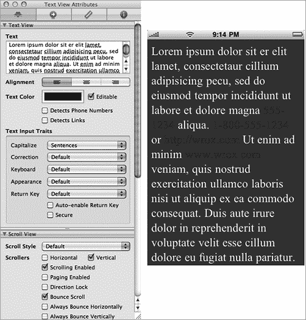

### 可编辑文本视图

要使 `UITextView` 可编辑，只需在 Interface Builder 中勾选 `Editable` 复选框，或设置 `Editable = true`。当视图首次显示时，它仅显示可滚动的内容——不会立即接受输入。点击视图将启用编辑，iPhone OS 会显示键盘（根据所选的 `KeyboardType`）准备开始输入。列表 4-5 显示了如何使用通知来响应键盘事件，并动态调整输入大小，以便其部分不被键盘遮挡。


列表 4-5: `TextView02\Main.cs`

```csharp
NSObject observer1, observer2; // for notifications

public override bool FinishedLaunching (UIApplication app, NSDictionary options)
{
    TextBox.Font = UIFont.FromName("Helvetica", 24f);
    TextBox.ScrollsToTop = true;
    DoneButton.Enabled = false; // set in notification
    DoneButton.TouchUpInside += delegate 
    {
        TextBox.ResignFirstResponder(); // similar to 'losing focus' in .NET
    };

    // usually created in ViewWillAppear
    // on a ViewController, rather than AppDelegate
    observer1 = NSNotificationCenter.DefaultCenter.AddObserver 
        (UIKeyboard.WillShowNotification, delegate (NSNotification n)
    {
        var kbdRect = UIKeyboard.BoundsFromNotification (n);
        var frame = TextBox.Frame;
        frame.Height -= kbdRect.Height;
        TextBox.Frame = frame;
        DoneButton.Enabled = true;
    });

    observer2 = NSNotificationCenter.DefaultCenter.AddObserver 
        (UIKeyboard.WillHideNotification, delegate (NSNotification n)
    {
        var kbdRect = UIKeyboard.BoundsFromNotification (n);
        var frame = TextBox.Frame;
        frame.Height += kbdRect.Height;
        TextBox.Frame = frame;
        DoneButton.Enabled = false;
    });

    return true;
}

public override void WillTerminate(UIApplication application)
{
    NSNotificationCenter.DefaultCenter.RemoveObserver(observer1);
    NSNotificationCenter.DefaultCenter.RemoveObserver(observer2);
}
```


当处于 `FirstResponder` 状态时，点击视图将启用编辑，iPhone OS 会显示键盘（根据所选的 `KeyboardType`）准备开始输入。等等，文字说：当 `UITextView` 可编辑时，它将变为 `FirstResponder` 并显示键盘。要隐藏键盘，必须调用 `ResignFirstResponder()`。

图 4-9 显示了读取模式下的 `UITextView``UITextView` 与 `TextField` 共享某些功能：

*   自动大写（AutocapitalizationType）：决定何时自动使用 Shift 键（例如句首）。默认为 `None`。
*   自动纠正（AutocorrectionType）：在打字时启用自动纠正。默认为 `correction`。
*   返回键类型（ReturnKeyType）：注意 `UITextView` 不支持 `TextField` 的行为。
*   键盘类型（KeyboardType）：允许根据预期的数据类型显示键盘，例如纯文本、电子邮件地址或数字数据。

图 4-9

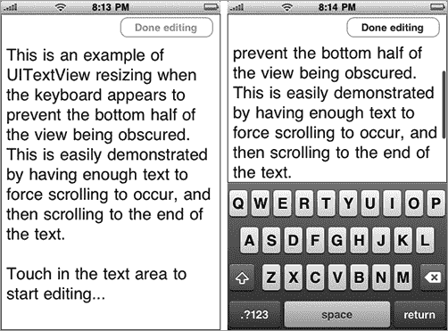

### UIPickerView

`UIPickerView` 类似于 Windows Forms 或 WPF 中的列表以及 ASP.NET 中的 `asp:DropDownList` 元素；iPhone OS 提供了独特的显示方式。它提供一组供用户滚动的固定选项，仅支持单项选择——即选择器中心显示的行。图 4-10 显示了 Safari 中的示例选择器，该网页使用 `<select>` 元素来捕用户输入。

图 4-10

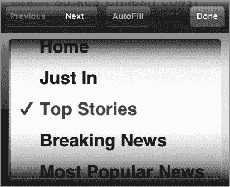

### 单组件选择器

`UIPickerView` 实例应该始终位于窗口边缘（通常是底部）并占据整个屏幕宽度。它只有两个重要的成员：

*   显示选择指示器（ShowsSelectionIndicator）：是否在控件的中心行上显示透明蓝色引导线。
*   模型（Model）：需要一个代理类，为选择器提供显示和响应用户选择所需的所有信息。模型必须包含或引用你用于选择器的数据。

模型（Model）必须是 `UIPickerViewModel` 的子类，并实现以下方法：

*   GetComponentCount：在控件中显示的轮盘数量。以下示例显示了单个轮盘，因此硬编码返回 `1`。
*   GetRowsInComponent：在轮盘中显示的数据项数量。
*   GetTitle：返回每行显示的文本。
*   Selected：当用户更改行时调用。


Listing 4-6 显示了本章节代码下载中 `PickerView01` 示例的代码。它要求使用 Interface Builder 在窗口上放置一个 `UIPickerView` 和一个 `UITextBox`。


Listing 4-6: `PickerView01\Main.cs`

```csharp
public override bool FinishedLaunching (UIApplication app, NSDictionary options)
{
    ListBox.Model = new ListBoxModel(this);
    ListBox.ShowSelectionIndicator = true;
    window.MakeKeyAndVisible();
    return true;
}

class ListBoxModel : UIPickerViewModel
{
    AppDelegate app;
    List<string> data;
    public ListBoxModel(AppDelegate appDelegate)
    {
        app = appDelegate;
        data = new List<string> {"Cirrus","Stratus","Cumulus","Fog"};
    }
    public override int GetComponentCount (UIPickerView picker)
    {
        return 1;
    }
    public override int GetRowsInComponent (UIPickerView picker, int component)
    {
        return data.Count;
    }
    public override string GetTitle (UIPickerView picker, int row, int component)
    {
        return data[row];
    }
    public override void Selected (UIPickerView picker, int row, int component)
    {
        app.DisplayText.Text = "You selected " + data[row];
    }
}
```

Figure 4-11 显示了前述单组件选择器和一个多组件选择器的示例（将在接下来的节中解释）。

### 多组件选择器

`UIPickers` 也可以显示多个组件，这些组件可以是相互独立的，也可以是相关的。

多组件选择器使用与之前相同的方法，不同之处在于返回值取决于传入的是哪个组件而改变。还有一个额外的方法 `GetComponentWidth` 用于设置每个组件的宽度。

Listing 4-7 显示了启用 Figure 4-11 中三轮示例所需的代码。

Figure 4-11

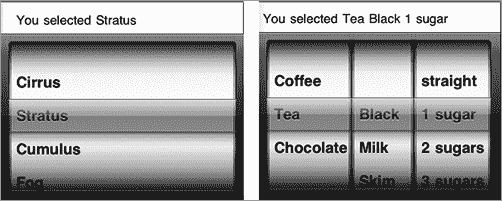

Listing 4-7: `PickerView02\Main.cs`

```csharp
class ListBoxModel : UIPickerViewModel
{
    AppDelegate app;
    List<List<string>> data;
    public ListBoxModel(AppDelegate appDelegate)
    {
        app = appDelegate;
        data = new List<List<string>>();
        data.Add(new List<string> {"Coffee","Tea","Chocolate"});
        data.Add(new List<string> {"Black","Milk","Skim","Soy"});
        data.Add(new List<string> {"straight","1 sugar","2 sugars","3 sugars"});
    }
    public override int GetComponentCount (UIPickerView picker)
    {
        return data.Count;
    }
    public override int GetRowsInComponent (UIPickerView picker, int component)
    {
        return data[component].Count;
    }
    public override string GetTitle (UIPickerView picker, int row, int component)
    {
        return data[component][row];
    }
    public override float GetComponentWidth (UIPickerView picker, int component)
    {
        switch (component)
        {
            case 0: return 10;
            case 1: return 80;
            default: return 100; // 3rd wheel
        }
    }
    public override void Selected (UIPickerView picker, int row, int component)
    {
        app.DisplayText.Text = "You selected " + data[0][picker.SelectedRowComponent(0)] + " " + data[1][picker.SelectedRowComponent(1)] + " " + data[2][picker.SelectedRowComponent(2)];
    }
}
```

如果你的组件是相互依赖的，你可能会在 `Selected` 方法中调用以下两个方法：

* `ReloadComponent`：如果一个组件中的选择影响了其他组件显示的内容，则对每个组件调用此方法。
* `Select`：强制选择某个组件中的特定行。如果你使用了 `ReloadComponent`，你可能还想将该组件的被选中行重置为第一项，或者你可以跟踪之前的选择。

Listing 4-8 显示了你如何在 `UIPickerView` 中实现双级层次结构，其中第二个组件中的不同选项取决于第一个组件中的选择，如 Figure 4-12 所示。


Listing 4-8: `PickerView03\Main.cs`

```csharp
class ListBoxModel : UIPickerViewModel
{
    AppDelegate app;
    List<string> data1;
    List<List<string>> data2;
    public ListBoxModel(AppDelegate appDelegate)
    {
        app = appDelegate;
        // 每个组件独立的数据
        data1 = new List<string> {"Coffee", "Tea"};
        data2 = new List<List<string>>();
        data2.Add(new List<string> {"Espresso","Latte","Cappuccino","Macchiato"});
        data2.Add(new List<string> {"Black","Green","Peppermint","Chai"});
    }
    public override int GetComponentCount (UIPickerView picker)
    {
        return 2;
    }
    public override int GetRowsInComponent (UIPickerView picker, int component)
    {
        if (component == 0)
            return data1.Count;
        else // 使用的数据取决于组件 0 的选择
            return data2[picker.SelectedRowComponent(0)].Count;
    }
    public override string GetTitle (UIPickerView picker, int row, int component)
    {
        if (component == 0)
            return data1[row];
        else // 使用的数据取决于组件 0 的选择
            return data2[picker.SelectedRowComponent(0)][row];
    }
    public override float GetComponentWidth (UIPickerView picker, int component)
    {
        switch (component)
        {
            case 0: return 10;
            case 1: return 80;
            default: return 100; // 3rd wheel
        }
    }
    public override void Selected (UIPickerView picker, int row, int component)
    {
        if (component == 0)
        {
            // 当第一个轮发生变化时，重载第二个
            picker.ReloadComponent(1);
        }
        else
        {
            // 当第二个轮发生变化时，选择第一行
            picker.Select(0, true);
        }
        app.DisplayText.Text = "You selected " + data1[picker.SelectedRowComponent(0)] + " " + data2[picker.SelectedRowComponent(0)][picker.SelectedRowComponent(1)];
    }
}
```

Figure 4-12


### UIDatePicker

`UIDatePicker` 控件是 `UIPickerView` 的一个特殊版本，但它的要简单得多，因为不需要 `Model` 类——数据源仅由日期和时间组成。iPhone OS 用户在内置的日历和时钟应用程序可以看到此视图。

Figure 4-13 显示了 `UIDatePicker` 的四种不同类型：时钟中的倒计时、日期视图、日历中使用的日期与时间视图，以及也用于时钟的时间视图。


* `Mode`: 表 4-2 中显示的 `UIDatePickerMode` 值之一。

#### 表 4-2： UIDatePickerMode 值

| 举举 | 描述 |
| --- | --- |
| `CountDownTimer` | 选择小时和分钟。适用于选择与一天时间不直接相关的 `TimeSpan`。 |
| `Date` | 显示月份、日期和年份（但不显示星期）。用于选择生日、节假日或其他具有年份的日期。 |
| `DateAndTime` | （默认值）显示星期、月份、日期、小时、分钟和 am/pm 选择。不显示年份。适用于选择预约和提醒事项。 |
| `Time` | 选择小时、分钟和 am/pm。用于设置闹钟或时间。 |

章节下载的示例 `DatePicker01` 展示了一个类似于“日历”应用程序的基本“预约选择器”，在该应用程序中，你使用同一个 `UIDatePicker` 选择开始和结束时间。在 Interface Builder 中，你需要在窗口上两个按钮、两个标签和一个日期选择器，并在 `FinishedLaunching` 中包含以下代码：


```csharp
DateSelection.MinuteInterval = 6; // default 5
DateSelection.MinimumDate = new DateTime (2010,05,01);
DateSelection.MaximumDate = new DateTime (2011,01,01);
DateSelection.Mode = UIDatePickerMode.DateAndTime;
FromDate.Text = DateTime.Now.ToString("ddd dd MMM yyyy h:mm tt");
ToDate.Text = DateTime.Now.AddHours(1).ToString("ddd dd MMM yyyy h:mm tt");

FromButton.TouchUpInside += delegate
{  // 编辑开始时间
  editingStart = true; 
  DateSelection.Date = DateTime.Parse(FromDate.Text);
};

ToButton.TouchUpInside += delegate
{  // 编辑结束时间
  editingStart = false; 
  DateSelection.SetDate(DateTime.Parse(ToDate.Text),false);
};

DateSelection.ValueChanged += delegate(object sender, EventArgs e)
{  // 更新显示
  var ctrl = (UIDatePicker)sender;
  var dateString = DateTime.Parse(ctrl.Date.ToString())
                  .ToString("ddd dd MMM yyyy h:mm tt");
  if (editingStart) FromDate.Text = dateString;
  else ToDate.Text = dateString;
};
```

`DatePicker01\Main.cs`

结果如图 4-14](#9780470908594c04.xhtml_figure4-14) 所示——触摸两个日期中的任意一个即可使用 `UIDatePicker` 编辑它们。

图 4-14

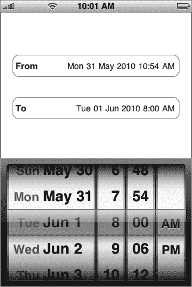

### 控制器与栏

除了章节开头提到的 `Window` 和 `View` 类外，`UIViewController` 及其子类构成了所有 iPhone OS 应用程序的基础。`UIViewController` 类本身用于显示单个全屏视图（以及子视图）。自定义子类是在你的应用程序中复用常用视图相关代码的好方法。

本节的另外两个类——`UITabBarController` 和 `INavigationController`——用于协调应用程序中的多个不同视图。标签页栏（tab bar）的作用与 WPF 或 Windows Forms 中的 `TabControl` 相同：允许用户在不同视图之间来回导航。导航控制器在本质上是分级的，允许用户在“返回”按钮的支持下进行“下钻”。它们都使用若干支持性类来提供其功能，分别为 `UITabBarItem` 以及 `UINavigation` 和 `INavigationItem`。

`UIToolbar` 略有不同——它设计用于使用 `UIBarButtonItem` 以及固定和灵活间距选项来显示适用于单个视图的选项。

### UIViewController

`UIViewController` 最常用的方法和属性是：

* `ViewDidLoad`: 在任何关联视图加载完成后后调用。该方法通常是你放置初始化代码（例如接线事件委托程序）的地方。它在对象的生命周期内被调用一次。
* `ViewWillAppear`: 执行与显示视图相关的任何额外任务。该方法在 `ViewDidLoad` 之后直接调用，然后在每次视图重新显示时再次调用。在你的实现中始终要调用 `base.ViewWillAppear()`。
* `ViewWillDisappear`: 视图即将隐藏的通知。你可以使用此方法来提交编辑更改，因为你不知道视图是否还会再次显示。在你的实现中始终要调用 `base.ViewWillDisappear()`。
* `Title`: 用于设置视图标题的属性。
* `View`: 返回控制器主视图的属性。

`UIViewController` 类本身用于显示单个全屏视图（以及子视图）。自定义子类是在你的应用程序中复用常用视图相关代码的好方法。

其他属性包括：

* `NavigationController`: 除非此控制器被推送到导航栈上，否则为 null。
* `INavigationItem`: 指向表示此控制器的 `INavigationItem`。
* `TabBarController`: 除非此控制器已添加到标签页栏，否则为 null。
* `TabBarItem`: 指向表示此控制器的 `UITabBarItem`。
* `ToolbarItems`: `UIBarButtonItem` 数组。

### UIToolbar

工具栏的一个例子是 Safari。为了演示 `UIToolbar` 的用法，你将在 `WebView` 示例中添加按钮——图 4-15](#9780470908594c04.xhtml_figure4-15) 显示了左侧的 Safari 和右侧的示例。

图 4-15

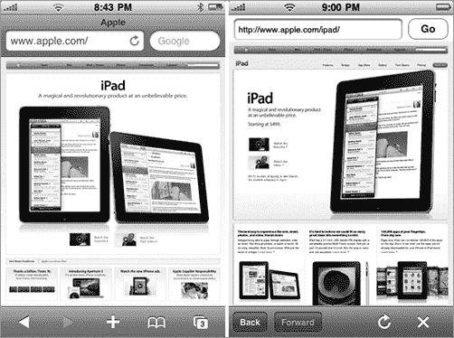

从 `WebView02` 示例代码开始，删除后和前进按钮，并将 `UIToolbar` 控件拖到窗口上。然后添加四个 `UIBarButtonItem` 和间距项以匹配图 4-16](#9780470908594c04.xhtml_figure4-16)。

图 4-16

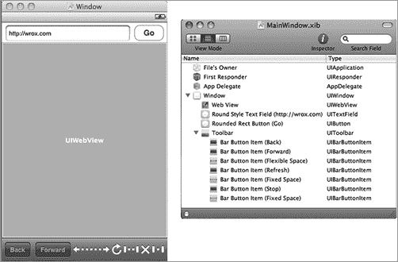

在 Interface Builder 中按以下方式更新项目：

* 后退和前进按钮可以连接到示例代码中的现有输出属性。这些按钮使用 `Bordered` 样式，并将它们的标题设为文本。
* 为刷新和停止按钮创建两个额外的输出属性。它们应更新为使用 `Plain` 样式，并且不再显示文本，而是选择一个内置的标识符（分别为 `Refresh` 和 `Stop`）。
* 使用 `Fixed`（固定）和 `Flexible`（灵活）间距控件将图标排列在你想要的位置。


[表 4-4] 显示了工具栏按钮可用的系统值——如果您的应用程序功能与这些选项描述的相似，您应该使用系统图标以遵循 Apple 的一致性用户界面。相反，你不应该对不等同于内置功能的功能使用系统图标——这会误导用户，应该用自定义图标或文本来表示。

### 表 4-4：UIBarButtonSystemItem 选项

| Value | 图像 | 描述 |
| --- | --- | --- |
| Add |  | 包含加号 (+) 的图标 |
| Edit | | | 本地化文本 |
| Done | | | 本地化文本 |
| Cancel | | | 本地化文本 |
| Save | | | 本地化文本 |
| Undo |  | 文本 “Undo” |
| Redo |  | 文本 “Redo” |
| Compose |  | 带有笔笔的记事本图标（用于 Mail 应用） |
| Reply |  | 向左的弯箭头图标（用于 Mail 应用） |
| Action |  | 方框内向右的弯箭头图标（用于照片应用） |
| Organize |  | 带有向下箭头的文件夹图标（用于 Mail 应用） |
| Trash |  | 垃圾桶（用于 Mail 应用） |
| Bookmarks |  | 打开的书本图标（用于 Safari） |
| Search |  | 放大镜图标 |
| Refresh |  | 圆形箭头图标（用于 Safari） |
| Stop |  | 包含 X 的图标 |
| Camera |  | 相机图标 |
| Play |  | 右右三角形图标（用于 iPod 应用） |
| Pause |  | 带有两条竖线的图标（用于 iPod 应用） |
| Rewind |  | 两个向左的三角形图标（用于 iPod 应用） |
| FastForward |  | 两个向右的三角形图标（用于 iPod 应用） |

必须在 `FinishedLaunching` 中添加以下代码以使按钮工作——注意，`UIBarButtonItems` 具有 `Clicked` 事件，而不是 `TouchUpInside`。这些方法是对 `UIWebView` 的 `Reload` 和 `StopLoading` 函数的简单调用，这些函数非常自而易懂。

```javascript
BackButton.Clicked += delegate
{
   WebBrowser.GoBack();
   UrlInput.Text = WebBrowser.Request.Url.AbsoluteString;
};

BackButton.Clicked += delegate
{
   WebBrowser.GoForward();
   UrlInput.Text = WebBrowser.Request.Url.AbsoluteString;
};

RefreshButton.Clicked += delegate
{
   WebBrowser.Reload();
};

StopButton.Clicked += delegate
{
   WebBrowser.StopLoading();
};
```

### `Toolbar01\Main.cs`

### `UITabBarController`

标签栏最明显的例子是 iPod 应用程序（如图 4-17 所示），它包含艺术家、专辑、视频等标签。

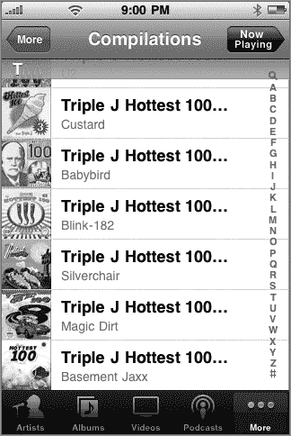

回想一下 `UIViewController` 的 `ViewWillAppear` 和 `ViewWillDisappear` 方法——每当用户触摸标签时，当前标签的 `ViewWillDisappear` 方法就会被调用，然后调用所选标签的 `ViewWillAppear` 方法。当用户在标签视图之间导航时，这两个方法会被调用，以便您的视图能够响应隐藏和显示。

##### 简单标签

第一个 `UITabBarController` 示例使用 Interface Builder 来构建标签及其内容。这是构建用户界面的简单方法，但需要小心，因为每个标签的 XIB 文件名输入到 Attributes（属性）中，因此您必须确保它们与文件匹配。另一个问题是 Interface Builder 目前在设计中不显示自定义图像。MonoDevelop 的解决方案以及代码中 `TabBar01` 的 Interface Builder `MainWindow.xib` 如图 4-18 所示。

创建此项目需要以下步骤：
* 作为 MonoDevelop 解决方案的一部分创建 `MainWindow.xib` 并在 Interface Builder 中打开。
* 将 `UITabBarController`（库中橙圈图标）拖到 `MainWindow.xib`（而不是拖到“window”设计表面上）。这会自动创建图 4-18 所示的标签栏和两个标签项。
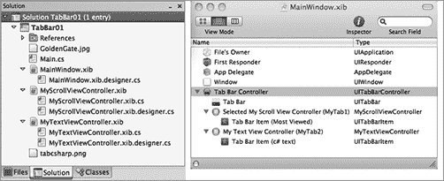
* 在 MonoDevelop 中添加两个带有 XIB 的视图定义：`MyScrollViewController` 和 `MyTextViewController`。
* 随后在 Interface Builder 中，将标签连接到每个标签的新 XIB 文件：
    * 点击一次标签，分别在 Attributes 和 Identity Inspectors 中设置 XIB 名称和类名，如图 4-19 所示。
    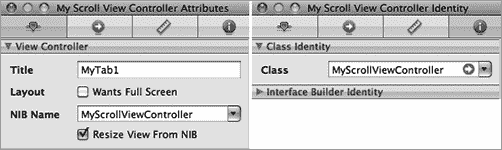
    * 双击标签以在 Attributes Inspector 中选择其 `Title`（标题）和 `Image`（图像）。图 4-20 显示了两个标签设置。第一个标签使用内置的 `Identifier`，它设置了特定的 `Image` 和 `Title`——完整列表见表 4-5。为 `UITabBarItems` 创建自定义图像是复杂的。图像应该是 PNG 格式且大小为 30x30 像素。它们不能包含任何颜色或灰度效果——您可以使用不同的透明度来创建阴影效果。
* 一旦标签“连接”到特定的 `ViewControllers`，就可以实现您喜欢的任何行为。此示例使用了前面章节中的 `UIScrollView` 和 `UITextView` 代码；图 4-21 显示了结果。
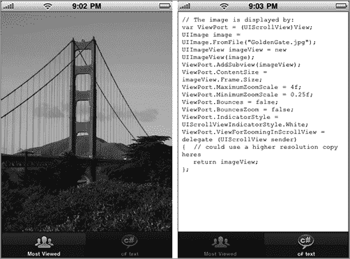

### 表 4-5：UITabBarSystemItem

| Value | 图像 | 描述 |
| --- | --- | --- |
| More |  | 省号图标（三个点），系统通常用于表示有隐藏标签。 |
| Favorites |  | 星形图标。 |
| Featured |  | 两个聚光灯，用于 App Store。 |
| Top Rated |  | 星形图标（与 Favorites 相同但文本不同）。 |
| Recents |  | 时钟图标，用于手机应用。 |
| Contacts |  | 头人肩图标，用于手机应用。 |
| History |  | 时钟图标（与 Recents 相同但文本不同）。 |
| Bookmarks |  | 打开的书本图标。 |
| Search |  | 放大镜图标，用于 App Store。 |
| Downloads |  | 圆形内的向下箭头，用于 iTunes。 |
| Most Recent |  | 方框内的加号。 |


| 最常访问 |  | 三个头部和肩膀图标。 |

## 可编辑的 TabBar

iPhone 屏幕足够宽，支持多达五个标签，正如 iPod 应用程序在图 4-22 中所示所示。当你向 `UITabController` 添加六个或更多标签时，它会自动添加一个“更多（More）”标签，并以列表形式呈现剩余的选项。它还可以（可选地）添加一个“编辑（Edit）”按钮，允许用户更改标签的顺序。

图 4-22

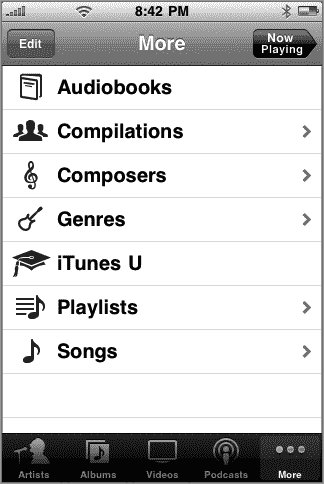

演示一个可编辑的标签栏需要多个控制器和相关的代码。为了保持示例简单，并引入另一个新概念，我们没有使用任何 Interface Builder 文件。由于缺乏定义用户界面的 `XIB` 文件，类的完整列表显示在列表 4-9 到 4-12 中。

列表 4-9 显示了应用程序的核心——它创建了 `UIWindow`、`UITabBarController` 和代理，将标签视图添加到窗口中并将其显示在屏幕上。同时也创建并分配了 `UITabBarControllerDelegate`（列表 4-11）。


列表 4-9: TabBar02\Main.cs

```csharp
public class Application
{
    static void Main (string[] args)
    {
        UIApplication.Main (args,"TabBar02", "AppDelegate");
    }
}

[Register ("TabBar02")]
public class TabBar02 : UIApplication {}

[Register ("AppDelegate")]
public partial class AppDelegate : UIApplicationDelegate
{
    UIWindow window;
    MyTabBarController tabBarController;
    public override bool FinishedLaunching (UIApplication app, NSDictionary options)
    {
        window = new UIWindow (UIScreen.MainScreen.Bounds);
        tabBarController = new MyTabBarController();
        tabBarController.Delegate = new MyTabBarControllerDelegate();
        window.AddSubview (tabBarController.View);
        window.MakeKeyAndVisible ();
        return true;
    }
    // 此方法在 iPhoneOS 3.0 中是要求的
    public override void OnActivated (UIApplication application)
    {}
}
```

列表 4-10 显示了 `UITabBarController` 如何设置六个视图。在这个示例中，它们都是显示不同照片的图像视图（为了清晰，所有六个的初始化已在列表中隐藏）。方法的后半部分尝试从 `NSUserDefaults`（在列表 4-10 中设置）提取自定义标签顺序，并在显示之前重新排列标签。关于如何使用 `NSUserDefaults` 存储设置的更多信息，请参考第 8 章。


列表 4-10: TabBar02\MyTabBarController.cs

```csharp
public class MyTabBarController : UITabBarController
{
MyImageViewController imgController1,imgController2,imgController3,
                      imgController4,imgController5,imgController6;
public MyTabBarController () : base() {}
public override void ViewDidLoad ()
{
    imgController1 = new MyImageViewController("GoldenGate.jpg");
    imgController1.Title = "Golden Gate";
    imgController1.TabBarItem = new UITabItem(UITabBarItem.Bookmarks, 0);
#region imgController 重复 5 次（显示重复的代码）
    // 源数组
    var tablist = new UIViewController[]
    {
        imgController1, imgController2, imgController3,
        imgController4, imgController5, imgController6
    };
    // this.ViewControllers = tablist; // 未经过自定义
    // 根据编辑后的偏好排序数组
    var tabOrder = new UIViewController[tablist.Length];
    var tabPrefs = NSUserDefaults.StandardUserDefaults.StringArrayForKey ("TabPreferences");
    if (tabPrefs == null)
    {
        tabOrder = tablist; // 未保存
    }
    else
    {
        for (int i = 0; i < tabPrefs.Length; i++)
        {
            int index = Convert.ToInt32(tabPrefs[i]);
            tabOrder[i] = tablist[index];
        }
    }
    this.SelectedIndex = 0;
    this.ViewControllers = tabOrder;
}
```

如果你希望禁用编辑标签顺序（移除“编辑”按钮），可以传递一个空数组：
`this.ViewControllers=new UIViewController[]{}`

或者，你可以通过以下方式为该数组填充内容，这样 `UIViewController` 在编辑模式下是可移动的。列表 4-11 显示了如何跟踪标签顺序，并将其存储到 `NSUserDefaults`。这只是持久化更改的一种方式。


列表 4-11: TabBar02\MyTabBarController.cs

```csharp
public class MyTabBarDelegate : UITabControllerDelegate
{
    public MyTabBarDelegate() : base() {}
    public override void CustomizingViewControllers
      (UITabController tabBarController,
      UIViewController[] viewControllers, bool changed)
    {
        if (changed)
        {
            var tabOrderList = new List<string>();
            foreach (var item in viewControllers)
            {
                tabOrderList.Add(item.TabBarItem.Tag.ToString());
            }
            NSArray array = NSArray.FromStrings(tabOrderList.ToArray())
            NSUserDefaults.StandardUserDefaults["TabPreferences"] = array;
        }
    }
}
```

列表 4-12 显示了用于每个标签的类。它与 `UIS` 示例非常相似，只是我们弃用了 `XIB` 并完全在 C# 代码中创建了视图。

## UINavigationController

`UINavigationController` 用于管理多个相关的视图（例如深入查看相关信息，可以在 iPod 应用程序的艺术家➪专辑➪歌曲导航中看到）。该控制器像在“栈”中一样跟踪视图——当你做出选择时，该视图会被“推（push）”到栈顶，但你始终可以将其弹出（pop）”并返回到之前的视图。

下载示例 `NavigationController01` 基于用于导航的 Mono 应用程序模板。当你创建解决方案时，它预填充了两个 `XIB` 文件：

*   `MainWindow.xib` 已经包含一个 `UINavigationController` 实例以及关联对象（`UINavigationBar` 和 `UINavigationItem`）


* `RootViewController.xib` 初始包含一个 `UITableViewController`。不过，它们将在第 6 章中介绍，因此本示例在普通的 `UIViewController` 上使用了一些 `UIButtons` 代替。

它还包含三个带有控制器的视图定义（`View1Controller`、`View2Controller` 和 `View3Controller`）。在这些控制器的视图上，我们需要一些标签来标识视图，以及一些按钮来通过 `MainWindow.xib` 中的 `UINavigationController` 在它们之间跳转。图 4-23 显示了最终的导航序列。

图 4-23

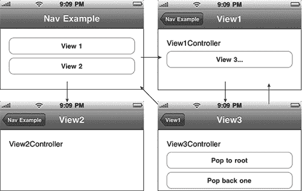

图 4-24 显示了自动创建的 `MainWindow.xib` 视图层次。要让导航控制器工作，你只需要在 `RootController.xib` 中添加两个按钮并对其进行连接。代码如列表 4-13 所示：每个按钮都会创建一个视图控制器并将其推入导航栈。

图 4-24

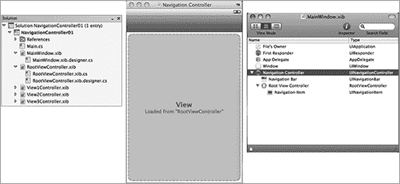

列表 4-13: `NavigationController01\RootViewController.xib.cs`

```csharp
public override void ViewDidLoad ()
{
    this.Title = "Nav Example"; // 显示在屏幕顶部，并有“返回”按钮
    View1Button.TouchUpInside += delegate
    {
        var vc1 = new View1Controller ();
        vc1.Title = "View1"; // 显示在屏幕顶部，并有“返回”按钮
        this.NavigationController.PushViewController(vc1, true);
    };
    View2Button.TouchUpInside += delegate
    {
        var vc2 = new View2Controller ();
        vc2.Title = "View2"; // 显示在屏幕顶部，并有“返回”按钮
        this.NavigationController.PushViewController(vc2, true);
    };
}
```

注意，当视图被推入栈中时，屏幕顶部的 `UINavigationBar` 会显示该视图的 `Title`，而作为返回按钮的 `UINavigationBarItem` 则显示上一个视图控制器的 `Title`。

以下列表显示了构成导航栈部分的两个视图控制器。列表 4-14 中的代码创建另一个视图控制器并将其推入导航栈。


列表 4-14: `NavigationController01\View1Controller.xib.cs`

```csharp
public override void ViewDidLoad ()
{
    View3Button.TouchUpInside += delegate
    {
        var vc3 = new View3Controller ();
        vc3.Title = "View3"; // 显示在屏幕顶部，并有“返回”按钮
        this.NavigationController.PushViewController(vc3, true);
    };
}
```

列表 4-15 展示了“返回首页”方法 `PopToRootViewController`。如果你的导航栈特别深，你可能希望为用户提供重新开始的选项，无需多次点击导航栏中的返回按钮。

如果你想模拟导航栏自动提供的“返回”按钮的行为，`PopViewControllerAnimated` 方法可以将用户带回之前显示的视图。


列表 4-15: `NavigationController01\View3Controller.xib.cs`

```csharp
public override void ViewDidLoad ()
{
    PopViewButton.TouchUpInside += delegate
    {  // 返回到“基础”视图
        this.NavigationController.PopToRootViewController(true);
    };
    PopOneButton.TouchUpInside += delegate
    {  // 弹出一个视图 - 行为与“返回”按钮相同
        this.NavigationController.PopViewControllerAnimated(true);
    };
}
```

导航控制器是一个特别强大的类，它让你能够轻松创建友好的信息层次结构。它们被广泛用于内置应用程序。`UINavigationController` 将第 6 章再次介绍，因为它经常与 `UITableView` 配合使用，其中表格行用于展示导航选项列表。

## 总结

本章介绍了一些基础构建块：

- `UIWindow`, `UIView`, `UIViewController`
- `UINavigationController`, `UITableView`, `UINavigationBar`
- `UITabBarController`, `-`

### 第 5 章

#### 在 iPhone 上处理数据

数据是应用程序的生命线。本章将介绍 SQLite 数据库以及存储数据的策略。

**本章内容包括：**

- 与 SQLite 引擎交互
- 使用 XML 存储数据

## 使用 SQLite

SQLite 是一个运行在 iPhone 上的嵌入式引擎，它是设备原生的。它与 SQL Server、Oracle 等客户端/服务器数据库不同。在客户端/服务器数据库中，查询或操作会被发送到数据库引擎，执行并将结果返回给客户端。对于这种数据库引擎，它运行与应用程序相同的进程中。SQLite 使用 SQL（结构化查询语言）与之交互。SQLite 的另一个优点是它是完全免费的。

本章的目的并不是介绍 SQL 语言、数据库、表、列、数据类型、外键、行或任何其他特性。读者应该理解这些概念。

## 使用 Mono.Data.Sqlite

SQLite 的数据提供程序包含在 `Mono.Data.Sqlite` 程序集中。该程序集支持 SQLite 版本 3。该程序适用于 ADO.NET 2.0，对于使用 MonoTouch 编写应用程序来说这不是问题。在本章中，我们使用连接字符串 `Data Source=filename.db3`。

## 设置数据库

让应用程序与 SQLite 工作的第一步是设置数据库。对于基于服务器的数据库，这由 DBA 一次性完成。对于 SQLite，数据库的创建必须在应用程序在设备上首次运行时完成，并且在运行该应用程序的每个设备上完成。由于应用程序必须在终端设备上运行，因此数据库设置过程必须在没有用户干预的情况下运行，并且在设备的时间限制内运行。查看创建数据库的代码：


```cs
string DatabaseName = "TwitterData.db3";

string documents = Environment.GetFolderPath(Environment.SpecialFolder.Personal);

string db = Path.Combine(documents, DatabaseName);

bool exists = File.Exists(db);

if (!exists)
{
    SqliteConnection.CreateFile(db);
}
```

### 位于下载的 `Sqlite/Main.cs` 文件

这段代码通过以下步骤创建一个数据库：

1. 确定一个包含 iPhone 个人文件夹名称的字符串。
2. 创建一个包含数据库完整路径加文件名的字符串。
3. 如果文件不存在，则通过调用 `SqliteConnection` 对象的 `CreateFile()` 静态方法来创建数据库。

## 设置表

现在你的数据库已经创建完成，下一步是设置表、索引、触发器以及其他所需的特定数据库对象。附录 5-1 显示了某些创建表、触发器和索引的代码：


附录 5-1: 创建表和其他对象

```cs
string DatabaseName = "TwitterData.db3";

string documents = Environment.GetFolderPath (Environment.SpecialFolder.Personal);

string db = Path.Combine (documents, DatabaseName);

var conn = new SqliteConnection("Data Source=" + db);

var commands = new[] {
    "DROP TABLE IF EXISTS TWITTERDATA",
    "DROP TRIGGER IF EXISTS TWITTERDATA_INSERT",
    "CREATE TABLE TWITTERDATA (STATUSID BIGINT PRIMARY KEY, " +
        "TWITTERID VARCHAR(20), STATUS VARCHAR(140), TWEETDATE DATETIME, " +
        "DATEENTERED DATETIME)",
    "CREATE TRIGGER TWITTERDATA_INSERT INSERT ON TWITTERDATA " +
    "BEGIN UPDATE TWITTERDATA SET DATEENTERED=DATE('now') " +
        "WHERE STATUSID=NEW.STATUSID; END;",
    "CREATE INDEX IDX_TWITTERID ON TWITTERDATA (TWITTERID)",
    "CREATE INDEX IDX_DATEENTERED ON TWITTERDATA (DATEENTERED)",
    "CREATE INDEX IDX_TWEETDATE ON TWITTERDATA (TWEETDATE)"
};

foreach (var cmd in commands)
    using (var sqlitecmd = conn.CreateCommand()) {
        sqlitecmd.CommandText = cmd;
        sqlitecmd.CommandType = CommandType.Text;
        conn.Open ();
        sqlitecmd.ExecuteNonQuery ();
        conn.Close();
    }
```

### 位于下载的 `Sqlite/Main.cs` 文件

这段代码创建了一组数据库对象。具体细节如下：

* 创建了一个 `SqliteConnection` 对象。
* 将一组 SQL 命令放置在一个字符串数组中。数组中的每个字符串都是一个数据库命令。
* 这些命令会先检查表是否存在（如果存在则删除），然后创建一个表，创建一个触发器，最后创建一组索引。
* 使用 `foreach` 迭代来遍历命令，并执行字符串数组中的每个命令。

你会注意到的一点是，在 SQLite 中没有用于创建文件的 GUI 工具。此外，开发者不应期望用户能够按照一系列命令来手动创建数据库、表和其他对象。

## 使用 SQL 语句

创建、修改和删除数据库对象是非常有趣的。然而，CRUD（创建、读取、更新、删除）是应用程序的灵魂。通过 SQL 进行查询、更新和删除数据的能力是应用程序的核心。

## 使用 Read/Select 读取数据

读取数据对于应用程序来说是一项重要操作。从数据库表中读取数据是执行频率占 95% 以上的操作。.NET Framework 为我们提供了读取器、连接以及一系列允许我们访问数据库表的对象。MonoTouch 为 iPhone 提供了这些 .NET 方法实现。附录 5-2 显示了一些展示如何从表中读取数据的代码：


附录 5-2: 从表中读取数据

```cs
string documents = Environment.GetFolderPath (Environment.SpecialFolder.Personal);
string db = Path.Combine (documents, DatabaseName);
string strSql = "select Max(TweetDate) as MaxTweetDate, Count(Status) from TwitterData";
string output = String.Empty;
var conn = new SqliteConnection("Data Source=" + db);
SqliteDataReader dr;
var cmd = new SqliteCommand(strSql, conn);
conn.Open();
dr = cmd.ExecuteReader();
if (dr.HasRows == true) {
    while(dr.Read()) {
        output = "Number of records: " + Convert.ToString(dr["StatusCount"]) +
        " Most post date: " + Convert.ToString(dr["MaxTweetDate"]);
    }
}
else {
    output="No records found.";
}
conn.Close();
Status.Text = output;
```

### 位于下载的 `Sqlite/Main.cs` 文件

如你所见，使用你熟悉的对象是可能的。你可以创建一个连接对象 `SqliteConnection`，然后创建一个读取器。通过读取器，你可以像在 .NET 中一样遍历记录。


在编写本书期间，`SqliteDataAdapter` 在调用 `Fill()` 时存在 bug。该 bug 已提交给 MonoTouch 的 bug 系统，但尚未确定修复时间。

## 使用 SQL 语句获取数据

既然你已经知道如何从表中读取数据，下一个明显的问题是“如何将数据放入表中？”你的第一步是获取数据。参考附录 5-3：

1. 调用 Twitter API 获取 XML 数据。
2. 使用 LINQ to XML 将数据转换为对象。有了这些对象，代码就可以很容易地处理数据。
3. 一旦创建了查询，下一步就是遍历结果。记住，LINQ 在需要数据时才会执行。
4. 下一步是保存数据。这是在自定义的 `SaveData` 方法中完成的。


附录 5-3: 从 Twitter 获取数据并保存到 SQLite

```cs
string url = "http://twitter.com/statuses/friends_timeline.xml";
HttpWebRequest request = (HttpWebRequest)HttpWebRequest.Create(url);
request.Method = "GET";
request.Credentials = new NetworkCredential(TwitterUserId, TwitterPassWord);
WebResponse response = request.GetResponse();
StreamReader reader = new StreamReader(response.GetResponseStream());
string responseString = reader.ReadToEnd();
reader.Close();
XDocument document = XDocument.Parse(responseString);
var query = from e in document.Root.Descendants()
    where e.Element("user") != null
    select new UserStatusSvc {
        StatusId = Convert.ToInt64(e.Element("id").Value),
        UserName = e.Element("user").Element("screen_name").Value,
        ProfileImage = e.Element("user").Element("profile_image_url").Value,
        Status = e.Element("text").Value,
        StatusDate = e.Value.ParseDateTime().ToString()
    };
foreach(UserStatusSvc uss in query) {
    SaveData(uss);
}
```


```csharp
string db = Path.Combine (documents, DatabaseName); 

var conn = new SqliteConnection("Data Source=" + db);

var sql = "SELECT COUNT(*) FROM TWITTERDATA WHERE STATUSID=" + us.StatusId;

var cmd = new SqliteCommand(sql, conn);

try{
    conn.Open();
    var Count = Convert.ToInt32(cmd.ExecuteScalar());
    if ( Count == 0 ) {
        var sqlStatusId = new SqliteParameter("@StatusId", us.StatusId);
        cmd.Parameters.Add(sqlStatusId);
        var sqlTwitterId = new SqliteParameter("@TwitterId", us.UserName);
        cmd.Parameters.Add(sqlTwitterId);
        var sqlStatus = new SqliteParameter("@Status", us.Status);
        cmd.Parameters.Add(sqlStatus);
        var sqlTweetDate = new SqliteParameter("@TweetDate", us.StatusDate);
        cmd.Parameters.Add(sqlTweetDate);
        sql = "insert into twitterdata (STATUSID, TWITTERID, STATUS, TWEETDATE) VALUES (" + "@StatusId, @TwitterId, @Status, @TweetDate)";
        cmd.CommandText = sql;
        cmd.ExecuteNonQuery();
    }
}
finally{
    if ( conn.State != ConnectionState.Closed ) {
        conn.Close();
    }
    conn.Dispose();
    cmd.Dispose();
}
```

在下载的 `Sqlite/Main.cs` 文件中可以找到。

现在你已经能够向表中插入数据了，处理其他操作也是类似的。可以通过 `SQLite` 的命令对象轻松地处理更新和删除操作。命令可以是直接的 SQL 语句，也可以是预处理语句。两者都可以。有一点警告：如果你选择使用简单的 SQL 语句，请不要让代码受到 SQL 注入攻击。

图 5-1 显示应用程序报告你的 `SQLite` 数据库中存在数据。

图 5-1


## 升级策略

对于 Web 应用程序，通常只需要管理一个数据库实例。而对于安装在 iPhone 上并使用 `SQLite` 的应用程序，数据库实例的数量与应用程序的安装数量相同。随着应用程序新版本的发布，很可能有一个新的数据库架构来支持该升级后应用程序中的新功能。有哪些策略可以集成到应用程序中，以处理已经在运行的数据库升级？

### 原地升级（Upgrading in Place）

对于现有应用程序数据库，一种策略是在表中跟踪应用程序的版本。通过跟踪数据库架构版本，应用程序可以在启动时检查版本。如果版本不是当前版本，可以通过对数据库执行一系列 `SQLite` 命令来完成架构升级。这种策略需要在应用程序每次启动时都进行检查。这种策略适用于复杂的数据库架构。

### 复制数据

原地升级方案要求每次启动应用程序时进行检查。另一个选项是在启动时检查，如果架构不是正确版本，则创建一个数据库实例并将必要的数据复制过去。然后你就可以假设架构是正确的。这种策略需要执行大量的命令，并可能移动大量数据。执行的命令越多、移动的数据越多，出错的机会就越大。

### 远程存储数据

对于 Web 应用程序，通常只需要管理一个数据库实例。而对于安装在 iPhone 上并使用 `SQLite` 的应用程序，数据库实例的数量与应用程序的安装数量相同。随着应用程序新版本的发布，很可能有一个新的数据库架构来支持该升级后应用程序中的新功能。


现在已经设置完毕，请查看列表 5-5。


### 列表 5-5: 调用 ASMX 服务

```csharp
public override bool FinishedLaunching(UIApplication app, NSDictionary options)
{
    Calculate.TouchUpInside += delegate(object sender, EventArgs e) {
        string TempC = TempInC.Text;
        www.w3schools.com.TempConvert tc = new www.w3schools.com.TempConvert();
        AsyncCallback ac = new AsyncCallback(FarenheitCallback);
        tc.BeginCelsiusToFahrenheit(TempC, ac, tc);
    };
    TempInC.EditingDidEndOnExit += delegate(object sender, EventArgs e) {
        TempInC.ResignFirstResponder();
    };
    window.MakeKeyAndVisible();
    return true;
}

private void FarenheitCallback(IAsyncResult iar)
{
    www.w3schools.com.TempConvert tc = (www.w3schools.com.TempConvert)iar.AsyncState;
    string faren = tc.EndCelsiusToFahrenheit(iar);
    InvokeOnMainThread(delegate {
        TempInF.Text = faren;
    });});
    Console.WriteLine("Temp: " + faren);
}
```

位于下载包的 `ConsumeASMXWebService/Main.cs` 文件中。

请注意列表 5-5 中的以下几点：

*   在 `FinishedLaunching` 方法中，创建了一个委托来处理 `Calculate` 按钮的点击。
*   在委托内部，创建了一个表示 Web 服务的类并执行了异步调用。异步 Web 服务的调用序列为 `Method(param1, param2, ..., paramN, callback, state)`。
*   第一组参数是传递给调用方法的参数。
*   下一个参数是方法完成后将被调用的方法。
*   最后一个参数是传递到回调中的对象。
*   设置事件 `EditingDidEndOnExit` 并调用 `ResignFirstResponder()` 会导致键盘在输入完成后被隐藏。
*   回调方法 `FarenheitCallback` 接受一个 `IAsyncResult` 参数。该参数用于获取之前传入的异步状态。
*   调用 `EndCelsiusToFahrenheit` 方法允许程序检索 Web 服务调用的结果。
*   最后一个问题是如何将值返回给用户界面，以便用户可以使用这些数据。这是通过 `InvokeOnMainThread` 方法实现的。必须使用 `InvokeOnMainThread` 的原因是 Web 服务的响应是在与主线程不同的线程中处理的。要写入用户界面，必须在主线程上编写命令。
*   最后一行结果会将调试信息发送到连接的计算机。

图 5-4 显示了对 Web 服务异步调用的输出。

图 5-4


## 使用 Windows 通信框架 (WCF)

本节探讨了基于 WCF 的 Web 服务。WCF 随 `.NET 3.5` 发布，是一种旨在构建面向服务的应用程序的 API。

Visual Studio 隐藏了基于 SOAP 的 Web 许多复杂性。这些代理允许开发者像使用本地库一样使用 Web 服务。遗憾的是，iPhone 不允许在运行时生成代码。这产生了一个问题，我们必须手动生成代理。

1.  手动生成代理。此工具随 Silverlight 3 提供，位于 `C:\Program Files\Microsoft\Silverlight\3.0\Tools\SUtil.exe`。
2.  将代理添加到项目中。
3.  向项目添加 `System.ServiceModel` 和 `System.Windows.Serialization` 引用。
4.  在 `Main.cs` 中使用生成的 `NumberServiceClient`。
5.  通过 HTTP 调用 `NumberServiceClient`。

列表 5-6 显示了 MonoTouch 代码：

```csharp

列表 5-6: 调用 Web 服务
Calculate.TouchUpInside += delegate(object sender, EventArgs e) {
    NumberServiceClient asc = new NumberServiceClient(new BasicBinding(), "http://example.com/service.svc");
    asc.AddNumbersCompleted += HandleNumbersCompleted;
    asc.AddAsync(3);
};

void HandleNumbersCompleted(object sender, AddNumbersCompleted e) {
    InvokeOnMainThread(delegate {
        lblOutput.Text = "Result: " + e.Result.ToString();
    });
}
```

## 使用基于 REST 的 Web 服务

REST 代表表现层状态转换，它是分布式系统（如万维网）的一种通用架构。REST 架构由客户端服务器组成。服务器处理来自客户端的请求。

基于 REST 的 Web 服务通常具有三个特征：

1.  资源的可寻性。部分数据可以通过 URL 访问。
2.  数据通过不同的 HTTP 动词传输。这些动词通常用于：
    *   `GET`：`GET` 操作将输入数据通过 URL 传输。这被认为是对数据的请求。
    *   `POST`：`POST` 操作将输入数据通过请求体传输。`POST` 用于添加/插入数据。
    *   `PUT`：`PUT` 操作将输入数据通过请求体传输。`PUT` 用于更新数据。
    *   `DELETE`：`DELETE` 操作将所有数据通过请求体传输。`DELETE` 用于删除数据。


尽管一些纯主义者可能会对此有异议，但使用不同的 HTTP 动词执行 REST 风格的操作可能有合理的理由。此外，某些操作系统和设备不支持所有的 HTTP 动词。这里的示例使用了 `GET` 和 `POST` 动词进行操作。

### 3. 数据可以以各种格式编码发送，例如文本、`XML` 以及任何其他有效数据类型。在官方范围内，这被称为 MIME 类型。

### 使用 JavaScript 对象表示 (JSON)

大多数开发者都熟悉可扩展标记语言（`XML`），它被用于数据交换。`JSON` 是一种类似的技术；它是一种基于 JavaScript 脚本语言的数据交换格式。`JSON` 格式使用了一系列大多数使用 C 系语言的程序员都熟悉的约定。`JSON` 构建在两个概念之上：

*   数据以一系列键值对的形式传输。这些值可以是单个值，也可以是一系列值（例如数组）。
*   数据存储在一种可以被看作序列的结构中。

由于这些概念被广泛接受，它们在几乎所有现代编程语言中都是通用的。因此，几乎所有的编程语言对 `JSON` 都有某种支持。在 `.NET` 中，微软通过 2007 年发布的 `ASP.NET 2` AJAX 库引入了对 `JSON` 的支持。现在得益于 `WCF`、流行的 `JSON.NET` 库以及其他各种库，程序员在 `.NET` 中拥有多种 `JSON` 选项。

以下是一个 `JSON` 数据包的示例：

```json
{
    "ld":{
        "UserName":"tiger",
        "PassWord":"scott",
        "AppKey":"blah"
    },
    "TwitterId":"wbm",
    "PageIndex":"1"
}
```

在此示例显示了三个参数：

*   `ld`: 该对象内部三个属性：
    *   `UserName`: `UserName` 属性的值为 `tiger`。
    *   `PassWord`: `PassWord` 属性的值为 `scott`。
    *   `AppKey`: `AppKey` 属性的值为 `blah`。
*   `TwitterId`: `TwitterId` 属性的值为 `wbm`。
*   `PageIndex`: `PageIndex` 属性的值为 `1`。

### 获取数据

本节介绍了如何使用 `Twitter Search API` 从 Twitter 获取数据。

##### 使用 LINQ to XML

语言集成查询（`LINQ`）是方法、操作、规则和类型的集合，允许在 `Visual Basic` 或 `C#` 等 `.NET` 语言中进行数据查询。`LINQ` 发布于 `.NET 3.5` 框架中，并且 `Mono` 项目中存在对多个数据提供者的 `LINQ` 支持。

`LINQ` to `XML` 是一技术，允许将 `XML` 文档转换为 `XElement` 对象，根据某些标准进行查询，并转换为对象集合。查询在本地执行引擎中执行。

列表 5-7 显示了从 Twitter 查询数据的简单示例：


列表 5-7: 从 Twitter 获取数据

```csharp
private Dictionary<int, TCController> controllers;
private String[] str;

public void SearchByTerm(string SearchTerm)
{
    string strUrl = "http://search.twitter.com/search.atom?q=";
    SearchTwitterResult sr = new SearchTwitterResult();
    if (controllers == null)
    {
        controllers = new Dictionary<int, TCController>();
    }
    List<SearchTwitterResult> strl = new List<SearchTwitterResult>();
    if ((String.IsNullOrEmpty(SearchTerm)))
    {
        strUrl += SearchTerm;
        XDocument xdoc = XDocument.Load(strUrl);
        Console.WriteLine("Document Loaded.");
        XNamespace atomNS = "http://www.w3.org/2005/Atom";
        XNamespace google = "http://base.google.com/ns/1.0";
        var query = (from tweet in xdoc.Descendants(atomNS + "entry")
                    where tweet != null
                    select new SearchTwitterResult
                    {
                        TwitterUri = tweet.Element(atomNS + "author").Element(atomNS + "uri").Value,
                        TwitterName = tweet.Element(atomNS + "author").Element(atomNS + "name").Value,
                        StatusDate = Convert.ToDateTime(tweet.Element(atomNS + "updated").Value),
                        Status = tweet.Element(atomNS + "title").Value
                    });
        Console.WriteLine("Query formed.");
        strl = query.ToList();
        Console.WriteLine("Query Completed.");
        Console.WriteLine("Records stored: " + strl.Count);
    }
    str = strl.ToArray();
}

public class SearchTwitterResult
{
    public string TwitterName { get; set; }
    public string TwitterUri { get; set; }
    public string Location { get; set; }
    public string Status { get; set; }
    public DateTime StatusDate { get; set; }
    public int StatusID { get; set; }
    public double? Latitude { get; set; }
    public double? Longitude { get; set; }
}
```


```c
void HandleGetDataTouchUpInside (object sender, EventArgs e)
{
    string Url = "http://www.twtmstr.com/WebServices/RemoteAPI.svc/GetUserTimeLine";
    string Body = "{\"ld\":{\"UserName\":\"userid1\",\"PassWord\":\"pwd1\",
        \"AppKey\":\"blah\"}, \"TwitterId\":\"wbm\", \"PageIndex\":\"1\"}";
    byte[] byteData = UTF8Encoding.UTF8.GetBytes(Body);
    try
    {
        // Create the web request
        HttpWebRequest request = WebRequest.Create(Url) as HttpWebRequest;
        request.ContentLength = Body.Length;
        // Set type to POST
        request.Method = "POST";
        request.ContentType = "text/json";
        // Write the parameters
        StreamWriter stOut = new StreamWriter(request.GetRequestStream(), 
            System.Text.Encoding.ASCII);
        stOut.Write(Body);
        stOut.Close(); 
        request.BeginGetResponse(new AsyncCallback(ProcessHttpResponse), request);
    }
    catch (WebException we)
    {
        Console.Error.WriteLine("Exception: " + we.Message);
    }
}
```

在下载包的 `RemoteData/Main.cs` 文件中。

以下是该代码的细节：

1. 设置了要调用的 URL。该 URL 指向一个基于 REST 的 WCF 服务。此方法将返回一组用户状态，并具有以下签名：

```csharp
[OperationContract]
UserStatusSvc[] GetUserTimeLine(LoginData ld, string TwitterId, int PageIndex);
```

2. 由于需要向应用程序提供用户 ID/密码信息，认为这是一个安全漏洞。因此，需要使用 `POST` 请求。
3. 设置了一个请求体（body）来传递信息。该请求体包含了传递给方法的内容。
4. 请求体是手动设置的。另一种处理此方法是使用可以序列化/反序列化 JSON 的库。
5. HTTP 请求被配置为 JSON MIME 类型。
6. HTTP 请求是异步发起的。设置了一个回调函数，以便当数据从 Web 服务返回时，会调用一个方法来处理返回的数据。
7. `ProcessHttpResponse` 方法接收从 Web 服务返回的结果。
8. 在 `ProcessHttpResponse` 回调方法中有两点需要注意：
    * JSON 序列化是通过兼容 ASP.NET 2 AJAX 的 Mono JavaScript 序列化器执行的。使用此序列化器时，属性名称匹配才能进行传输。也可以使用其他的 JSON 序列化器。
    * 在检索数据后关闭 `HttpWebResponse` 是重要的。


### 列表 5-9：异步处理来自 Web 服务的回调

```cs
private void ProcessHttpResponse(IAsyncResult iar)
{
    HttpWebRequest request = (HttpWebRequest)iar.AsyncState;
    HttpWebResponse response;
    response = (HttpWebResponse)request.EndGetResponse(iar);
    Console.Error.WriteLine("get response.");
    System.IO.StreamReader strm = new System.IO.StreamReader(
        response.GetResponseStream());
    string responseString = strm.ReadToEnd();
    responseString = responseString.Replace("{\"GetUserLineResult:", String.Empty);
    responseString = responseString.Substring(0, responseString.Length - 1);
    response.Close();
    Console.Error.WriteLine("response: " + responseString);
    JavaScriptSerializer ser = new JavaScriptSerializer();
    List<UserSvc> us = ser.Deserialize<List<UserSvc>>(responseString);
    Console.Error.WriteLine("Count: " + us.Count());
}
```

在 `RemoteData/Main.cs` 中。现在回调已经处理完毕，你获得了一组可以操作的对象。虽然这段代码只会向调试器输出已返回了一组对象，但也可以将数据保存为另一种格式（例如 `SQLite`），在 `UITableView` 中展示给用户，或以任何方式进行处理。

## 使用 POST 进行提交

现在你已经学习了如何从服务获取数据，你需要仔细查看如何向服务提交数据。在例示例中，你将查看如何使用 JSON 向服务提交数据。

首先关于该服务的一些背景：`TwtMstr` 是一个为使用 Twitter 作为社交媒体努力一部分的企业提供多种增强的服务。`TwtMstr` 暴露了基于 REST 的 Web 服务，允许第三方应用程序与其集成。`TwtMstr` 功能之一是可以调度在未来发布推文。

`列表 5-10` 显示了一些调度未来执行发帖的示例代码。该代码将调度一个小时后的帖子。


### 列表 5-10：异步提交数据

```cs
void HandleTouchUpInside (object sender, EventArgs e)
{
    string Url = "http://www.twtmstr.com/WebServices/RemoteAPI.svc/ScheduleMessage";
    string DateToPost = DateTime.Now.AddHours(1).ToString("MM/dd/yyyy");
    string TimeToPost = DateTime.Now.AddHours(1).ToString("HH:mm");
    string Body = "{\"ld\":{\"UserName\":\"xxxx\",\"PassWord\":\"yyyyy\",
        \"AppKey\":\"blah\"}, " +
        \"TwitterId\":\"zzzz\", \"ReplyStatus\":\"\",\"DateToPost\":\"" + DateToPost + "\", 
        \"TimeToPost\":\"" + TimeToPost + "\", \"Tweet\":\"" + TweetText + "\" }";
    byte[] byteData = UTF8Encoding.UTF8.GetBytes(Body);
    // Create the web request
    HttpWebRequest request = WebRequest.Create(Url) as HttpWebRequest;
    request.ContentLength = Body.Length;
    // Set type to POST
    request.Method = "POST";
    request.ContentType = "text/json";
    // Write the parameters
    StreamWriter stOut = new StreamWriter(request.GetRequestStream(), 
        System.Text.Encoding.ASCII);
    stOut.Write(Body);
    stOut.Close(); 
    request.BeginGetResponse(new AsyncCallback(ProcessHttpResponseAndForget), request);
}
```

在下载包的 `RemoteData/Main.cs` 中。注意代码中的以下内容：

* 你创建了调用该方法的 URL。该 URL 存储在 `Url` 变量中。
* 你创建了要发布的日期时间。在这个简单的示例中，日期和时间是分开传递给方法的。
* 你创建了方法的体。理想情况下，这应该通过序列化自定义对象来完成。在这里展示仅仅是为了显示内容。体被放入字节数组中。
* 创建了带有多个属性的 `HttpWebRequest`。什么是 `Method` 和 `ContentType`。`Method` 被设置为 `POST`，`ContentType` 被设置为 JSON 数据包。
* 最后，调用了 `BeginGetResponse()`。这导致 Web 请求异步异步进行。
* 当响应返回时，会调用 `ProcessHttpResponseAndForget()` 方法。该方法处理回调事件。
* `ProcessHttpResponseAndForget()` 方法如下代码所示，在完成后只是关闭了 Web 请求。

```cs
private void ProcessHttpResponseAndForget(IAsyncResult iar)
{
    HttpWebRequest request = (HttpWebRequest)iar.AsyncState;
    HttpWebResponse response;
    response = (HttpWebResponse)request.EndGetResponse(iar);
    Console.Error.WriteLine("get response.");
    System.IO.StreamReader strm = new System.IO.StreamReader(
        response.GetResponseStream());
    response.Close();
}
```

## 负责任地使用 Web 服务


现在你已经学习了如何在 MonoTouch 中以各种形式使用 Web 服务，让我们来看一些问题。Web 服务是极佳的工具，用于：

* 构建在 Internet 上运行的应用程序。由于它们运行在端口 `80`，因此通信被阻塞的概率非常小。
* 保持信息的集中化。
* 轻松地允许不同的系统进行通信。

同时，Web 服务也有其缺点。在无线网络上使用 Web 某些缺点包括：

* Web 服务往往很慢。通过文本格式（如 `JSON` 或 `XML`）发送信息可能比通过二进制/压缩协议发送相同信息要慢。
* 无线通信往往是不可靠的。
* 在众多网络（Internet 正是如此）上传输数据往往是不可靠的。

因此，记住以负责任的方式使用 Web 服务非常重要：

* 对于发送到 Web 服务和传回 iPhone 的数据量要保持高效。没有理由让 iPhone 或到 Web 服务的连接过载。
* iPhone 有 20 秒的限制来等待用户代码执行完毕。20 秒后，正在执行的代码将终止。因此，在调用 Web 服务时，使用异步调用或在另一个线程中调用是有意义的。

## 总结

本章查看了 iPhone 上的数据策略。通过使用这些技术，开发者可以构建在没有网络连接时运行的原生应用程序。你学习了如何：

* 在 iPhone 上的 `SQLite` 中设置本地数据库
* 在 iPhone 上的 `SQLite` 数据库上运行命令
* 在 iPhone 上使用基于 SOAP 的 Web 服务
* 在 iPhone 上使用基于 REST 的 Web 服务

当他们加入调用 Web 服务的能力时，iPhone 开发者及其应用程序就可以与中央数据存储集成。这允许应用程序的用户与其他用户进行交互。例如，iPhone 上的 Twitter 用户可以与其他 Twitter 用户进行交互，而无需永远访问 `Twitter.com` 网站。通过利用 iPhone 的功能，开发者可以创建出为用户提供更多功能的应用程序，并且在连接 Internet 及其数据源时具有更强的抗问题能力。

# 第 6 章：使用表格显示数据

## 本章包含什么？

* 在表格中显示信息
* 使用表格进行导航
* 利用 `UITableView` 的内置编辑功能
* 在表格中添加搜索栏

大多数程序员将“表格”可视化为一个网格：一组用于显示类似于电子表格的结构化信息的行和列。`C#/.NET` 开发者可能会考虑到他们专业领域（`WinForms`、`ASP.NET` 或 `WPF`）中的 `DataGrid` 或 `GridView` 控件。

iPhone 上的表格更像 ASP.NET 中的 `Repeater` 控件，具有几乎无限灵活的 `ItemTemplate`。两个关键类是 `UITableView` 和 `UITableViewCell`。它们都提供了实用的默认功能，并且可以通过 Interface Builder 或代码进行高度自定义，以产生几乎任何你可以想象的结构化内容显示。配合 `UINavigationController` 帮助管理多级导航，`UITableView` 成了你所熟悉的许多 iPhone OS UI 的基础。表格以及你在 iPhone OS 中如何使用和管理它们就是本章的核心。

表格贯穿整个 iPhone OS，从显而易见的地方如 iPod 专辑/艺术家/曲目和联系人列表到消息应用程序以及 `设置` 中值的显示/编辑。[图 6-1] 显示了各种不同的示例，突出了 `UITableView` 控件可以多么灵活和可定制。

[图 6-1]


创建这些用户界面所需的主要类是 `UITableView` 及其关联的 `UITableViewSource` 代理。在内置选项之外自定义显示时也会使用 `UITableViewCell`，而 `UISearchBar` 和搜索显示控制器提供了一种在表格中设置带有结果搜索功能的简单方法。`UITableView` 还可以与 `NavigationController` 结合，以便在具有内置“返回”功能的层级选项之间进行导航。

## 在表格中显示数据

表格的最简单形式是使用内置的单元格样式在屏幕上渲染数据列表。在 `MonoDevelop` 中创建一个新解决方案 `Tables01`，使用 Interface Builder 将 `UITableView` 拖到主窗口上，并为它创建一个名为 `Table` 的输出（outlet）。在 `Main.cs` 中添加 [列表 6-1] 中的代码来创建一个基础表格。代码的关键方面是：

* 创建一些要显示的数据，在这种情况下是一个名为 `colors` 的简单字符串数组。数据可以来自任何地方——硬编码列表、数据库查询或 Web 服务调用。
* 将 `UITableView.Source` 属性赋值为 `UITableViewSource` 实例。这是委托模式的关键——`UITableView` 实例向 `UITableViewSource` 索取渲染所需的信息，包括行数以及每个单元格显示的视图对象。
* 在 `UITableViewSource` 子类中实现两个需要的方法：
    * `RowsInSection`: 告诉表格需要多少行来整个数据集。
    * `GetCell`: 渲染用户界面时调用。在这里你每次都创建一个新的 `UITableViewCell` 并将数据赋值给 `TextLabel`。注意构造函数中传递了标识符 `"mycell"`——它在代码的其他地方没有使用，但在本章后面的表格中将变得非常重要。


[列表 6-1]: 基础表格 (Tables01\Main.cs)

```csharp
using System;
using System.Collections.Generic;
using System.Linq;
using MonoTouch.Foundation;
using MonoTouch.UIKit;

namespace Tables01
{

public class Application
{
   static void Main (string[] args)
   { UIApplication.Main (args);}
}

public partial class AppDelegate : UIApplicationDelegate
{
   // 此方法在 iPhoneOS 3.0 中是需要的
   public override void OnActivated (UIApplication application) {}

   private List<string> colors;

   public override bool FinishedLaunching
                               (UIApplication app, NSDictionary options)
   {
      colors = new List<string>
         {"Red","Orange","Yellow","Green","Blue","Indigo","Violet"};

      Table.Source = new MyTableViewSource (colors);

      window.MakeKeyAndVisible ();

      return true;

   }

   // 替换/结合 UITableViewDataSource 和 UITableViewDelegate
   private class MyTableViewSource : UITableViewSource 
   {
      private List<string> rows;

      public MyTableViewSource (List<string> list)
      { // 将数据存储在此类中
         rows = list;
      }

      public override int RowsInSection (UITableView tableview, int section)
      { // 告诉表格需要多少行来显示
         return rows.Count;
      }

      public override UITableViewCell GetCell 
                (UITableView tableView, NSIndexPath indexPath)
      { // 我们将在本章后面的部分学习 "mycell" 是干用的……
         UITableViewCell cell = new 
            UITableViewCell(UITableViewCellStyle.Default,"mycell");

         cell.TextLabel.Text = rows[indexPath.Row];

         return cell;
      }

   }

}

}
```


数据的“格式”（例如，你使用的底层类或集合类型）并不重要，因为你负责确定行数，并通过 `GetCell` 方法指示表格如何显示每一行。这段非常简单的代码的结果如 图 6-2 所示。

图 6-2


如果你正在转换 Objective-C 示例或正在阅读 Apple 的文档，你会发现对 `UITableView` 的 `Delegate` 和 `DataSource` 属性的引用。在 Objective-C 中，`UITableViewDelegate` 和 `UITableViewDataSource` 是协议，同一个类可以同时实现这两个协议，但在 C# 中，它们被暴露为抽象类，这意味着你必须为创建的每个表格都实现两个子类。

在 MonoTouch 中，为了方便 C# 开发者，这两个类的属性和方法已“合并”到 `UITableViewSource` 中。MonoTouch 允许你使用任一种方法：仅实现 `UITableViewSource` 或者同时实现 `UITableViewDelegate` 和 `UITableViewDataSource`。功能上没有区别——在本章中仅使用了 `UITableViewSource` 方法，因为它需要编写的代码更少。

## 选择单元格

`UITableView` 提供了许多默认功能，几乎不需要额外的代码——该示例通过继承默认字体和文本设置并支持平滑滚动，已经表现得像一个 iPhone OS 应用程序了。响应用户触摸单元格只需要几行代码——首先在 `UITableViewSource` 子类中创建此辅助方法来弹出消息：

```csharp
public void ShowAlert (string title, string message)
{
    using(var alert=new UIAlertView(title,message,null,"OK",null))
    {
        alert.Show();
    }
}
```

然后在 `UITableViewSource` 子类中实现 `RowSelected` 方法。`NSIndexPath` 对象包含了关于选择了哪一行的信息——`Row` 属性告诉你用于从行数组中检索值的索引：

```csharp
public override void RowSelected (UITableView tableView, NSIndexPath indexPath)
{
    ShowAlert("RowSelected","You selected "+rows[indexPath.Row]);
}
```


`NSIndexPath` 实例包含了用于识别 `UITableView` 中特定行的足够信息。在这些简单的示例中，只使用了 `Row` 属性，但在使用分组时（在本章稍后部分），也需要 `Section` 属性。

当表格单元格被触碰时，你可以执行许多操作：在单元格上添加勾选标记、打开一个新视图、导航到应用程序的其他地方，或你想到的任何其他操作。其中一些其他操作将在本章稍后部分介绍。

`UITableView` 提供了另一种类型的“行选择”——`DetailDisclosureButton`——这在电话（Phone）应用程序中最常见。这个用户界面元素具有特殊含义：它表示触摸单元格的主部分可以执行一个操作（例如拨打电话），而触摸蓝色圆圈箭头则执行不同的操作（例如打开详情）。要使用此功能，请在 `GetCell` 方法中设置单元格的 `Accessory` 属性。

```csharp
cell.Accessory=UITableViewCell.DetailDisclosureButton;
```

并在 `UITableViewSource` 子类中实现此方法：

```csharp
public override void AccessoryButtonTapped (UITableView tableView, NSIndexPath indexPath)
{
    app.ShowAlert("AccessoryButton","You tapped "+text[indexPath.Row]);
}
```

图 6-3 显示了 `RowSelected` 和 `AccessoryButtonTapped` 方法的运行——触摸行会调用 `RowSelected`，触摸 `DetailDisclosureButton` 会调用 `AccessoryButtonTapped`，因此你可以对行的两种操作做出响应。

图 6-3


除了特殊的 `DetailDisclosureButton` 之外，如 表 6-1 所示，`cell.Accessory` 还有两个可能的值，每种值在 iPhone 界面指南中都有特定的用途。

#### UITableViewCellAccess

| 类型 | 说明 |
| :--- | :--- |
| None | 默认值——不显示配件。该单元格要么是只读数据项，要么对触摸有响应。 |
| Checkmark | 用此指示表格中的单选或多选。请不要使用蓝色的选择状态，该状态仅作为单元格已被触摸的视觉指示。 |
| Disclosure | 简单的灰色 > 箭头，用于表示触摸此单元格会导致某种导航。 |
| DetailDisclosure | 带有小型白色 > 箭头的蓝色圆圈，表示触摸配件的行为与单元格其他部分不同。 |

### 更改单元格布局

如果你不能在每个单元格中包含一些额外的文本或图像，表格将非常单调。提供了四种预定义的布局（参见 表 6-2），它们被内置应用程序使用。

### UITableViewCellStyle

| 样式 | 说明 |
| :--- | :--- |
| Default | 显示单个黑色 `TextLabel` 以及左侧可选的图像。不支持 `DetailTextLabel`。该样式用于 iPod 应用程序。 |
| Subtitle | 显示两个左对齐的字段：`TextLabel` 使用较大的字体；`DetailTextLabel` 使用较小的字体。可以可选添加图像。该样式用于 iPod 应用程序。 |
| Value1 | `TextLabel` 比 `Default` 小，右对齐且蓝色。`DetailTextLabel` 左对齐且黑色。不支持图像。该样式用于联系人列表。 |
| Value2 | `TextLabel` 左对齐黑色文本。`DetailTextLabel` 右对齐蓝色文本。不支持图像。该样式用于设置应用程序。 |


在使用这些样式时，不要尝试设置不支持的属性（例如，Default 不支持 `DetailTextLabel`；Value1 不 `ImageView`），因为会导致空引用异常。

本章代码下载文件夹 `Tables02` 包含七张 PNG 图像（每个颜色一张），并且 `Color` 类添加了额外的 `Hex` 属性以演示不同的样式。在 `GetCell` 方法中更改每个 `UITableView` 的实例化以使用不同的样式：

```csharp
var cell = new UITableViewCell (UITableViewCellStyle.Subtitle, "mycell");
Color display = sectionColors[indexPath.Section][indexPath.Row];
cell.TextLabel.Text = display.Name;
cell.DetailTextLabel.Text = display.Hex;
cell.ImageView.Image = UIImage.FromFile(display.Name + ".png");
```

图 6-4 显示了使用上述代码的四种不同单元格样式选项，以及内置应用程序中每种样式的示例。

图 6-4


内置视图的视觉样式如字体字体大小颜色也可以在 `GetCell` 中更改：

```csharp
cell.DetailTextLabel.Font = UIFont.SystemFontOfSize(20); // 更大
cell.DetailTextLabel.TextColor = new UIColor(0,0,255,255); // 蓝色
```


短列表（如之前示例中的七种颜色）易于导航，且不太引起性能问题。然而，当你需要显示几十、数百或数千行数据时（例如 iPod 应用中的 `Songs` 列表），则需要更多的代码来确保你的应用程序具有响应性并符合 iPhone 人机界面指南。为了解决这些问题，你需要：

*   在你的表格中实现可重用的单元格对象
*   使用分组并可能使用索引来使你的表格更易导航

每当新行滚动到视图中时，都会调用 `GetCell` 方法，因此 Listing 6-1 所示的代码将为每个进入视野的行返回一个新的 `UITableViewCell` 对象。在默认布局和单元格大小下，表格在 iPhone 尺寸的屏幕上仅显示约 10 行，但如果不重用单元格对象，当你滚动一个长列表时，可能会创建数百（或数千）个对象——你的应用程序将会变慢并可能耗尽内存。

iPhone OS 为这个问题提供了一个巧妙的解决方案，类似于 .NET/WPF 开发者熟悉的 `VirtualizingStackPanel`。当一行移出屏幕时，该行的视图对象会被放入重用队列中，`UITableView` 提供了一个方法在创建新对象之前查找该队列中的对象。接下来的代码显示使用了这种方法的改进型 `GetCell` 方法：

```csharp
public override UITableViewCell GetCell (UITableView tableView, NSIndexPath indexPath)
{
    UITableViewCell cell = tableView.DequeueReusableCell("mycell");
    if (cell == null)
    {  // 无可重用对象，创建一个新对象
        cell = new UITableViewCell (UITableViewCellStyle.Value1, "mycell");
    }
    Element display = sectionElements[indexPath.Section][indexPath.Row];
    cell.TextLabel.Text = display.Symbol;
    return cell;
}
```

`DequeueReusableCell` 方法询问表格是否有任何可以重用的空闲 `UITableViewCell` 对象，如果没有，则返回 `null`。在这种情况下，你的代码将创建一个新的 `UITableViewCell` 对象并在方法结束时返回它（如果它滚动出屏幕，最终会回到队列）。

`"mycell"` 参数用于区分可以互换重用的单元格布局。因为此示例只有一个单元格布局，所以你向 `UITableViewCell` 构造函数和 `DequeueReusableCell` 传递相同的字符串。信息应用使用表格来显示每个对话，使用灰色和绿色的“气泡泡”单元格，它们需要不同的标识符，因为当你需要灰色单元格时，显然无法重用绿色的单元格。在这种情况下，你可能会先检查 `indexPath` 的内容以确定需要什么种类型的单元格，并可能使用 `"greycell"` 或 `"greencell"` 标识符从队列或实例化不同的 `UITableViewCell` 实现。你选择的实际字符串并不重要；重要的是不同的单元格布局具有不同的标识符。

为了演示 `DequeueReusableCell` 以及分组/索引，接下来的几个示例使用了一个 `Elements` 集合（此处太长，不再重新打印），该集合包含在本章的代码下载包中（文件夹 `Tables03`）。该集合的初始化如下：

```csharp
elements = new List<Element>{
    new Element{Name="hydrogen",Number="1",Symbol="H", Family="Hydrogen"},
    new Element{Name="helium", Number="2",Symbol="He",Family="Noble gas"},
    // 等等...
};
```

在大多数情况下，你在表格中呈现的数据将是类似于 `Elements` 列表这样的单一扁平结构。使用 `UITableView` 的分组功能需要你重构数据，以便你的 `UITableViewSource` 代理可以告诉表格显示多少组以及每个组中有多少项目。

Figure 6-5 显示了用于普通表格和分组表格的数据结构之间的。对于之前的示例，简单的数组足以显示表格，因为有一个“隐式”的单节，行索引足以标识每个单元格。当使用分组时，`UITableView` 使用 `Section` 和 `Row` 来标识每个单元格（`NSIndexPath` 的两个属性），因此二维数组类型的结构效果更好。

Figure 6-5


Listing 6-2 包含一个 `UITableViewSource` 实现的示例，它使用 LINQ 创建了一个符合 `Section-Row` 层级结构的 `SortedDictionary`，并使分组变得简单：

*   在 `MyTableViewSource` 的构造函数中，`Element` 对象列表被转换为两级层次结构：
    *   首先，它使用 `Distinct` LINQ 查询和 `Sort()` 方法提取每个组的准则，创建一个每个 `Element` 首字母数组。这创建了 `sectionTitles` 列表，用于填充索引并帮助将 `Elements` 分为组。
    *   然后它遍历 `Elements` 以创建一个 `SortedDictionary`，其中键是起始字母的整数位置，元素是要显示在该组中的 `Element` 集合。
    结果是两个可以通过节和行参数轻松引用的集合。
*   `NumberOfSections`：要显示的组数。
*   `TitleForHeader`：组的标题，在本例中是字母。
*   `RowsInSection`：指定组中的项目数量。
*   `RowSelected`：之前的示例通过检查 `indexPath` 来确定碰了哪个单元格。现在单元格分组了，你需要同时检查 `Section` 和 `Row` 值。
*   `GetCell`：类似于 `RowSelected` 方法，你需要 `Row` 和 `Section` 属性。

 分组数据 (Tables3.cs)

```csharp
private class MyTableViewSource : UITableViewSource
{
    private AppDelegate app;
    private List<string> sectionTitles;
    private SortedDictionary<int,List<Element>> sectionElements = new SortedDictionary<int,List<Element>>();

    public MyTableViewSource(AppDelegate appDelegate, List<Element> list)
    {
        sectionTitles = (from c in list select c.StartsWith).Distinct().ToList();
        sectionTitles.Sort();
        foreach (var c in list)
        {
            int sectionNum = sectionTitles.IndexOf(c.StartsWith);
            if (sectionElements.ContainsKey(sectionNum))
                sectionElements[sectionNum].Add(c);
            else
                sectionElements.Add(sectionNum, new List<Element>{c});
        }
        app = appDelegate;
    }

    public override int NumberOfSections(UITableView tableView)
    {
        // ie. 26 如果你使用英语字母表
        return sectionTitles.Count;
    }

    public override string TitleForHeader(UITableView tableView, int section)
    {
        // ie. "A", "B", "C" 等 如果你使用字母表
        // 但也可以是单词/标题
        return sectionTitles[section];
    }

    public override int RowsInSection(UITableView tableview, int section)
    {
        return sectionElements[section].Count;
    }

    public override void RowSelected(UITableView tableView, NSIndexPath indexPath)
    {
        Element display = sectionElements[indexPath.Section][indexPath.Row];
        app.ShowAlert("RowSelected", "You selected " + display.Name);
    }

    public override UITableViewCell GetCell(UITableView tableView, NSIndexPath indexPath)
    {
        UITableViewCell cell = tableView.DequeueReusableCell("mycell");
        if (cell == null)
        {
            cell = new UITableViewCell (UITableViewCellStyle.Value2, "mycell");
        }
        Element display = sectionElements[indexPath.Section][indexPath.Row];
        return cell;
    }
}
```


```csharp
cell.TextLabel.Text = display.Symbol;

cell.DetailTextLabel.Text = display.Name;

return cell;
}
}
```

## 添加索引

添加索引（表格右侧的字母列表，允许你直接跳转到表格的任何部分）非常简单，只需实现一个方法来描述每个部分应该显示哪些值：`SectionIndexTitles` 即可。你有责任确保此数组中的元素数量与你数据中的组数相同。

```csharp
public override string[] SectionIndexTitles (UITableView tableView)
{
  // 用于右侧的垂直索引：最好只包含一个字符
  // 例如，如果你使用字母表，则为 "A", "B", "C" 等
  return sectionTitles.ToArray();
}
```

在 iPhone 尺寸的设备上，索引留的垂直空间有限，因此请仔细选择你的索引策略——索引最常用于显示字母表（例如在联系人和 iPod 应用程序中）。如果项目太少，看起来会很稀疏且让用户感到陌生；如果项目过多，则会显得拥挤且无法使用。图 6-6 显示了带有索引和不索引的表格——有了索引，快速滚动到“Z”要容易得多。

图 6-6


要显示内置应用程序在索引中使用的搜索放大镜，请将 `"{search}"` 作为 `SectionIndexTitles` 数组的一个元素返回。这等于在 Objective-C 中使用常量 `UITableViewIndexSearch`。

# 分组表格样式

当你在 Interface Builder 中放置 `UITableView` 时，它默认使用如上一个示例所示的 `Plain`（普通）样式。还有另一种样式——`Grouped`（分组），它在分组的元素之间提供了更直观的联系。`Grouped` 样式可以用于长列表，但也常用于显示包含短列表的可能无关的信息的表格（例如在设置应用程序中）。

由于表格的样式是在初始化期间设置的，因此 `Style` 属性是只读的，无法在 `FinishedLaunching` 中更改。除非你在代码中创建 `UITableView`（这超出了本章范围），否则你应该在设计窗口时在 Interface Builder 中选择样式（如图 6-7 所示）。

图 6-7


`UITableView` 还允许在每个部分的末尾显示页脚。可以在 `Plain` 和 `Grouped` 样式中添加，尽管它在 `Grouped` 表格上看起来更好。你可以通过代理类中的另一个方法轻松地为表格添加页脚：`TitleForFooter`。

```csharp
public override string TitleForFooter (UITableView tableView, int section)
{  
  int count = sectionElements[section].Count;
  return String.Format("{0} elements start with {1}", 
                       count, sectionTitles[section]);
}
```

分组表格通常不用于字母分组，而是用于当你想显示较小的数据集，或者表格被用于显示表单时。iPhone 人机交互指南指出，你不应该在 `Grouped` 表格样式上使用索引（即实现 `SectionIndexTitles`）。

# 自定义单元格布局

除了图 6-4 所示的四种内置单元格布局外，还有许多其他示例（内置和第三方）具有更复杂的单元格布局的表格。这些布局可以通过在 Interface Builder 中创建自定义的 `UITableViewCell`然后在 `UITableViewSource.GetCell` 方法中动态加载它来设计。这需要仔细使用 Interface Builder，以确保你的 `XIB` 设置正确以便通过 MonoTouch 访问。

要构建具有自定义单元格的表格，请使用 MonoDevelop 创建名为 `Tables04` 的新 iPhone Window 项目，并在 `MainWindow.xib` 中添加一个全屏 `UITableView`（或在本章的代码下载中查找它）。在 MonoDevelop 内部右键点击项目，选择 `Add ⇒ New File`，选择 `View Interface Definition`，并命名为 `MyTableViewCell.xib`。

在 Interface Builder 中执行以下步骤，部分如图 6-8 所示：

1. 从 `XIB` 中删除默认的 `UIView`——需要更具体的视图类。
2. 从对象库将 `UITableViewCell` 拖入 `MyTableViewCell.xib`。打开它并从库中拖入四个 `UILabels`；放置它们。
   - 在 Identity Inspector（身份检查器）中将 Class 设置为 `UITableViewCell`。
   - 在 Attributes Inspector（属性检查器）中将 Identifier 设置为 `MyCell`。这是 `DequeueReusableCell()` 中引用的标识符。
   - 在 Connections Inspector（连接检查器）中连接好 outlets。
3. 对 File Owner 进行以下更改：
   - 在 Identity Inspector 中将 Class 设置为 `UITableView`。
   - 在 Connections Inspector 中添加一个名为 `Cell` 的 outlet。
   - 在 Connections Inspector 中“连线” `Cell`。

图 6-8


在 Interface Builder 中保存 `XIB` 并返回 MonoDevelop 后，`designer.cs` 文件包含部分定义：`UIViewController` 应有一个 `Cell` 属性，`UITableViewCell` 有四个标签。`designer.cs` 永远不应该被编辑；但注意 MonoTouch 为每个类添加了以下注释：
- `// Base type should be ViewController`
- `// Base type should be UITableViewCell`

这些生成的注释为如何完成类提供了指导。列表 6-3 显示了你需要完成部分类的代码，分别继承 `UIViewController` 和 `UITableViewCell`。你还需要为私定义的 outlets 添加公共属性以及从 `XIB` 加载 `UITableViewCell` 所需的构造函数（重要的是它们调用了基类构造函数）。

```csharp
public partial class UITableViewCell : UITableViewCell
{
  // 对于需要从 xib 而不是托管代码创建的控制器，
  // IntPtr 和 NSCoder 构造函数是必要的
  public UITableViewCell (IntPtr handle) : base(handle)
  {
    Initialize();
  }
  [Export("initWithCoder:")]
  public UITableViewCell (NSCoder coder) : base(coder)
  {
    Initialize();
  }

  void Initialize() {}

  public string ElementName
  {
    get {return Name.Text;}
    set {Name.Text = value;}
  }

  #region 其他属性：ElementSymbol, ElementNumber, ElementFamily
}
```

在 `Main.cs` 中只需进行少量更改即可完成实现。`AppDelegate` 需要一个通过 Interface Builder “创建”的 `UITableViewViewController` 字段：

```csharp
UITableViewViewController myTVC = new UITableViewViewController();
```

`GetCell` 方法使用该字段通过 `LoadNib()` 加载 `XIB`。在这种情况下，控制器并没有连接到表格，它仅为了从 `XIB` 加载其 `MyCell` 属性而存在。

```csharp
public override UITableViewCell GetCell (UITableView tableView, NSPath indexPath)
{
  UITableViewCell cell = tableView.DequeueReusableCell
```


```csharp
("MyCellIdentifier"); // 在 XIB 中设置

MyTableViewCell mycell = null;

if (cell == null)
{  // 没有可重用单元，加载新对象（来自 XIB 文件）
    NSBundle.MainBundle.LoadNib("MyTableViewCell", app.myTVC, null);
    mycell = app.myTVC.MyCell;
    app.myTVC.MyCell = null;
}
else
{
    mycell = (MyTableViewCell)cell;
}
// 现在我们有了一个单元格，设置显示属性
Element display = sectionElements[indexPath.Section][indexPath.Row];
mycell.ElementName   = display.Name;
mycell.ElementSymbol = display.Symbol;
mycell.ElementNumber = display.Number;
mycell.ElementFamily = display.Family;
return mycell;
```

带有自定义单元格的完成表格在图 6-9 所示。

图 6-9


## 使用表格导航

许多 iPhone iOS 应用使用表格来在层级数据结构中进行导航，例如 iPod 艺术家列表，它可以带你进入专辑列表，然后进入歌曲列表。本章之前的示例将 `UITableView` 作为窗口的唯一视图。要使用表格进行导航，你需要引入一个新类——`UINavigationController`——它管理一组 `UITableViews` 作为子视图，并根据需要显示或隐藏它们。图 6-10 展示了两个层级的表格导航，通向一个作为“详情视图”的静态表格。

图 6-10


## 使用 UINavigationController

此示例使用了一个小型列表以保持简单——本章之前示例中的七种颜色。你从三个颜色组的列表开始，深入颜色的子集，然后显示“颜色详情”视图。

要创建一个示例表格导航，在 MonoDevelop 中创建一个名为 `Tables05` 的新“iPhone 导航应用程序”（iPhone Navigation Application）（你可以在本章的下载中找到它）。

新解决方案已经包含了一些所需的类，如图 6-11 所示。

图 6-11


`MainWindow.xib` 已经包含一个 `UINavigationController`、`UINavigationBar`、一个名为 `RootViewController` 的类以及一个 `UINavigationItem`，如图 6-12 所示。这些类中的任何一个都不需要在 Interface Builder 中进行更改——如果你点击导航控制器，设计器会在窗口顶部显示导航栏，并显示带有“来自 'RootViewController'”消息的内容区域（如图 6-12


图 6-12 还显示如果你点击 App Delegate，在连接检查器（Connections Inspector）中已经定义了两个输出口：`window` 和 `navigationController`。这两个对象已经在 `FinishedLaunching` 中被引用，并允许窗口引用导航控制器——如果你现在启动/调试应用程序——它将显示一个空表格。

```csharp
public override bool FinishedLaunching (UIApplication app, NSDictionary options)
{
    window.AddSubview (navigationController.View);
    window.MakeKeyAndVisible ();
    return true;
}
```

要让第一个表格视图工作起来，你需要“完成”模板提供的 `RootViewController`。Interface Builder 中不需要编辑任何内容——`RootViewController.xib` 已经包含一个 `UITableView`——但你需要提供 `UITableViewSource` 的实现，以便它有数据可以显示。代码如列表 6-4 所示，看起来应该非常熟悉。唯一的新代码是 `Title = "Colors";`，它出现在屏幕顶部的导航栏中。


列表 6-4: Tables05\RootViewController.xib.cs

```csharp
partial class RootViewController : UITViewController // 需要构造函数来创建类
    public RootViewController (IntPtr handle) : base(handle) {}
    public override void ViewDidLoad()
    {
        base.ViewDidLoad();
        Title = "Colors"; // 出现在屏幕顶部的导航栏中
    }
    class DataSource : UITableViewSource
    {
        RootViewController controller;
        List<string> rows;
        public DataSource (RootViewController controller, List<string> data)
        {
            this.controller = controller;
            rows = data;
        }
        public override int RowsInSection (UITableView tableview, int section)
        {
            return rows.Count;
        }
        public override UITableViewCell GetCell (UITableView tableView, NSIndexPath indexPath)
        {
            string cellIdentifier = "Cell";
            var cell = tableView.DequeueReusableCell(cellIdentifier);
            if (cell == null)
            {
                cell = new UITableViewCell (UITableViewCellStyle.Default, cellIdentifier);
            }
            cell.TextLabel.Text = rows[indexPath.Row];
            return cell;
        }
    }
}
```

应用程序现在会显示一个颜色组的列表，但注意在 RowSelected 方法处有一个 //TODO 占位符。你需要创建下一层导航。

## 实现第二层导航

在 MonoDevelop 中选择添加新文件并选择带有控制器的接口定义（Interface Definition with Controller）来添加 `TableViewController`。然后双击在 Interface Builder 中打开它。

*   从 XIB 删除 `UIView`。
*   将 `UITableView` 拖入 XIB。
*   将 File's Owner 输出连接到 `UITableView`。注意 File's Owner 类型已经是 `TableViewController`。

关闭 Interface Builder 并在 MonoDevelop 中打开 `TableViewController.xib.cs`，以便完成由你的 Interface Builder XIB 文件生成的部分类。完整的类应该与列表 6-4 非常相似，只需将构造函数和 ViewDidLoad 方法替换为如列表 6-5 所示的内容。


列表 6-5: Tables05\TableViewController.xib.cs

```csharp
partial class TableViewController : UITableViewController // 构造函数：base 引用 XIB 文件名进行加载
    public TableViewController (IntPtr handle) : base(handle) {}
    public TableViewController (List<MyColor> data, string key) : base ("TableViewController", null)
    {
        // 找到与颜色组键值匹配的颜色
        colors = (from c in data 
                  where c.Group == key
                  select c).ToList();
        this.TableView.Source = new DataSource (this, groups);
    }
    private List<MyColor> colors;
    // TODO: 在创建第二层后插入列表 6-4 中的 DataSource（不带 RowSelected）
}
```


现在你已经有一个表格要显示了，请在 `RootViewController.xib.cs` 中实现此 `RowSelected` 方法，参考 Listing 6-4。当某行被选中时，你创建一个新的 `ColorsTableViewController` 实例，并它传递数据引用（`controller.colors`）和所选行的值（`rows[indexPath]`），以便它能够显示正确的数据集。它还会设置 `Title` 属性（该属性会显示在表格的导航区域），然后调用 `PushViewController`，告诉 `UINavigationController` 将该视图放在“栈顶端”并显示它。

```csharp
// for Listing 6-4 RootViewController.xib.cs

public override void RowSelected 
      (UITableView tableView, MonoTouch.Foundation.NSIndexPath indexPath)
{
    var colorsViewController = new ColorsTableViewController 
                              (controller.colors, rows[indexPath.Row]);
    colorsViewController.Title = rows[indexPath.Row];
    controller.NavigationController.PushViewController 
                                              (colorsViewController, true);
    tableView.DeselectRow(indexPath, true);
}
```


调用 `DeselectRow()` 是为了移除此表格中的蓝色选中指示器。如果没有调用 `DeselectRow()` 且用户返回此表格（使用导航控制器的返回功能），该行将仍然显示为已选中状态——这并不是 iPhone OS 应用程序的行为。

现在运行应用程序将显示一个两级层次结构，你可以通过触摸行和导航控制器提供的“返回”按钮轻松进行导航。

### 创建静态行内容

此示例的最后一步是另一种类型的表格——使用表格单元格的“详情视图”，用于层级结构的第三级。在 MonoDevelop 中创建另一个新文件（New File），选择带控制器的视图接口定义（View Interface Definition with Controller）来添加 ColorsTableViewController。然后双击在 Interface Builder 中打开它。这些将是本章涉及最复杂的 Interface Builder 步骤——图 6-13 显示了快照，后续是详细说明。目标是在单个 XIB 文件中创建一个表格及其将使用的单元格，并在 `GetCell` 方法中使用对你创建的输出（outputs）的硬编码引用进行连接。

图 6-13


要创建此表格及其单元格：

1. 从 XIB 中删除 `UIView`。
2. 从对象库（Objects Library）拖入一个 `UITableView` 到 XIB。
3. 点击表格并在属性检查器（Attributes Inspector）中将其样式更改为 `Grouped`（分组）。
4. 从对象库拖入三个 `UITableViewCells` 到 XIB。点击每个单元格并为它们命名（`CellGroup`、`CellHex` 和 `Cellname`）。
5. 打开所有三个单元格，并在每个单元格中拖入一个 `UILabel`。对每个标签应用一些格式（例如，斜体或灰色）以区分它们。
6. 在类库（Classes Library）中选择 `SingleColorTableViewController` 并添加以下输出：`CellGroup`、`CellHex`、`Cellname`、`LabelGroup`、`LabelHex`、`LabelName`。
7. 在 XIB 中选择 `File's Owner`，连接检查器（Connections Inspector）中连接单元格和标签输出。

此表格的代码在 Listing 6-6 所示。它与之前的 `UITableViewControllers` 结构相同；但有一个重要的区别：大多数 `UITableViewSource` 方法都是硬编码的以反映特定的单元格和数据布局。`NumberOfSections` 和 `RowsInSection` 都返回显示非常特定设计的数字。`GetCell` 更加不寻常——没有对象实例化，也没有 `DequeueReusableCell` 调用。相反，你通过输出直接从 XIB 引用标签和单元格。在之前的示例中，你使用 `UITableView` 来展示数据列表，其中每个单元格都使用相同的布局来显示行数据。而这段代码恰恰反之：每个单元格都可以有完全不同的布局——它们可以在 Interface Builder 中独立设计，并可以显示不同的数据。


Listing 6-6: Tables05\SingleColorTableViewController.xib.cs

```csharp
public partial class SingleColorTableViewController : UITableViewController
{
    public SingleColorTableViewController() : base()
    public SingleColorTableViewController(MyColor data)
              : base("SingleColorTableViewController", null)
    { // 从 XIB 加载，然后是 DataSource
        this.TableView.Source = new DataSource(this, data);
        this.TableView.Selection = false;
    }
    class DataSource : UITableViewSource
    {
        public DataSource (SingleColorTableViewController controller, MyColor data)
        {
            this.controller = controller;
            row = data;
        }
        SingleColorTableViewController controller;
        MyColor row;
        public override int NumberOfSections(UITableView tableView)
        {
            return 2; // 是的，硬编码为我们想要的布局
        }
        public override int RowsInSection(UITableView tableview, int section)
        { // 硬编码以拆分单元格
            if (section == 0)
                return 1;
            else
                return 2;
        }
        public override UITableViewCell GetCell (UITableView tableView, indexPath indexPath)
        { // 更加硬编码以正确布局
            if (indexPath.Section == 0)
            {
                controller.LabelName.Text = row.Name;
                return controller.CellName;
            }
            else // Section == 1
            if (indexPath.Row == 0)
            {
                controller.LabelHex.Text = row.Hex;
                return controller.CellHex;
            }
            else
            {
                controller.LabelGroup.Text = row.Group;
                return controller.CellGroup;
            }
        }
    }
}
```
（注：此处根据示例中代码逻辑补全了缺失的 `RowSelected` 方法实现部分，以保持翻译逻辑一致性）

**译文：**

现在你已经有一个表格要显示了，请在 `RootViewController.xib.cs` 中实现此 `RowSelected` 方法，参考 Listing 6-4。当某行被选中时，你创建一个新的 `ColorsTableViewController` 实例，并传递传递数据引用（`controller.colors`）和所选行的值（`rows[indexPath]`），以便它能够显示正确的数据集。它还会设置 `Title` 属性（该属性会显示在表格的导航区域），然后调用 `PushViewController`，告诉 `UINavigationController` 将该视图放在“栈顶端”并显示它。

```csharp
// for Listing 6-4 RootViewController.xib.cs

public override void RowSelected 
      (UITableView tableView, MonoTouch.Foundation.NSIndexPath indexPath)
{
    var colorsViewController = new ColorsTableViewController 
                              (controller.colors, rows[indexPath.Row]);
    colorsViewController.Title = rows[indexPath.Row];
    controller.NavigationController.PushViewController 
                                              (colorsViewController, true);
    tableView.DeselectRow(indexPath, true);
}
```


调用 `DeselectRow()` 是为了移除此表格中的蓝色选中指示器。如果没有调用 `DeselectRow()` 且用户返回此表格（使用导航控制器的返回功能），该行将仍然显示为已选中状态——这并不是 iPhone OS 应用程序的行为。

现在运行应用程序将显示一个两级层次结构，你可以通过触摸行和导航控制器提供的“返回”按钮轻松进行导航。

### 创建静态行内容

此示例的最后一步是另一种类型的表格——使用表格单元格的“详情视图”，用于层级结构的第三级。在 MonoDevelop 中创建另一个新文件（New File），选择带控制器的视图接口定义（View Interface Definition with Controller）来添加 ColorsTableViewController。然后双击在 Interface Builder 中打开它。这些将是本章涉及最复杂的 Interface Builder 步骤——图 6-13 显示了快照，后续是详细说明。目标是在单个 XIB 文件中创建一个表格及其将使用的单元格，并在 `GetCell` 方法中使用对你创建的输出（outputs）的硬编码引用进行连接。

图 6-13


要创建此表格及其单元格：

1. 从 XIB 中删除 `UIView`。
2. 从对象库（Objects Library）拖入一个 `UITableView` 到 XIB。
3. 点击表格并在属性检查器（Attributes Inspector）中将其样式更改为 `Grouped`（分组）。
4. 从对象库拖入三个 `UITableViewCells` 到 XIB。点击每个单元格并为它们命名（`CellGroup`、`CellHex` 和 `Cellname`）。
5. 打开所有三个单元格，并在每个单元格中拖入一个 `UILabel`。对每个标签应用一些格式（例如，斜体或灰色）以区分它们。
6. 在类库（Classes Library）中选择 `SingleColorTableViewController` 并添加以下输出：`CellGroup`、`CellHex`、`Cellname`、`LabelGroup`、`LabelHex`、`LabelName`。
7. 在 XIB 中选择 `File's Owner`，连接检查器（Connections Inspector）中连接单元格和标签输出。

此表格的代码在 Listing 6-6 所示。它与之前的 `UITableViewControllers` 结构相同；但有一个重要的区别：大多数 `UITableViewSource` 方法都是硬编码的以反映特定的单元格和数据布局。`NumberOfSections` 和 `RowsInSection` 都返回显示非常特定设计的数字。`GetCell` 更加不寻常——没有对象实例化，也没有 `DequeueReusableCell` 调用。相反，你通过输出直接从 XIB 引用标签和单元格。在之前的示例中，你使用 `UITableView` 来展示数据列表，其中每个单元格都使用相同的布局来显示行数据。而这段代码恰恰反之：每个单元格都可以有完全不同的布局——它们可以在 Interface Builder 中独立设计，并可以显示不同的数据。


Listing 6-6: Tables05\SingleColorTableViewController.xib.cs

```csharp
public partial class SingleColorTableViewController : UITableViewController
{
    public SingleColorTableViewController() : base()
    public SingleColorTableViewController(MyColor data)
              : base("SingleColorTableViewController", null)
    { // 从 XIB 加载，然后是 DataSource
        this.TableView.Source = new DataSource(this, data);
        this.TableView.Selection = false;
    }
    class DataSource : UITableViewSource
    {
        public DataSource (SingleColorTableViewController controller, MyColor data)
        {
            this.controller = controller;
            row = data;
        }
        SingleColorTableViewController controller;
        MyColor row;
        public override int NumberOfSections(UITableView tableView)
        {
            return 2; // 是的，硬编码为我们想要的布局
        }
        public override int RowsInSection(UITableView tableview, int section)
        { // 硬编码以拆分单元格
            if (section == 0)
                return 1;
            else
                return 2;
        }
        public override UITableViewCell GetCell (UITableView tableView, indexPath indexPath)
        { // 更加硬编码以正确布局
            if (indexPath.Section == 0)
            {
                controller.LabelName.Text = row.Name;
                return controller.CellName;
            }
            else // Section == 1
            if (indexPath.Row == 0)
            {
                controller.LabelHex.Text = row.Hex;
                return controller.CellHex;
            }
            else
            {
                controller.LabelGroup.Text = row.Group;
                return controller.CellGroup;
            }
        }
    }
}
```

### 编辑表格行

`UITableView` 的另一个功能是内置编辑功能：删除单元格、重新排序单元格以及提供一致的用户界面来添加新行。这些元素中的每一个都可以通过实现 `UITableViewSource` 委托类的方法来单独启用。

你将再次从此示例的 Colors 列表开始。Tables06 的代码在本章的下载包中。

### 添加滑动删除


最容易实现的编辑功能是滑动删除。表格上没有视觉指示器显示启用了任何编辑功能，但当用户跨越某行进行滑动时，就会出现一个 `Delete`（删除）按钮。点击该按钮会立即删除该行。`UITableViewSource` 子类使用以下三种方法来启用此功能：

*   `CanEditRow`：此方法在表格渲染时被调用，以便其响应“编辑输入”（如滑动）。`indexPath` 是一个参数，因此可以为每一行设置不同的响应。不过，在本示例中，它是硬编码的 `true`。表格中的每一行都将对滑动手势做出响应并显示 `Delete` 按钮。
*   `CommitEditingStyle`：在发生“编辑”操作时调用。因为在这个简单示例中只有 `Delete` 是有效的，因此代码仅展示了 `Delete` 是如何工作的。首先从底层数据结构中删除数据（在此例中调用了 `rows.RemoveAt`），然后在在表格上调用 `DeleteRows` 以从表格中移除相应的单元格。
*   `TitleForDeleteConfirmation`：按钮上文本的可选自定义。

```csharp
public override int RowsInSection (UITableView tableview, int section)
{
    return rows.Count;
}

public override bool CanEditRow (UITableView tableView,
                                MonoTouch.Foundation.NSIndexPath indexPath)
{
    return true;
}

// Override to support editing the table view.
public override void CommitEditingStyle (UITableView tableView,
    UITableViewCellEditingStyle editingStyle, NSIndexPath indexPath)
{
    rows.RemoveAt(indexPath.Row);
    tableView.DeleteRows (
      new NSIndexPath[] { indexPath }, UITableViewRowAnimation.Fade);
}

public override string TitleForDeleteConfirmation
                     (UITableView tableView, NSIndexPath indexPath)
{  // OPTIONAL: Defaults to Delete
    return "Trash this";
}
```

`DeleteRows` 接收一个 `indexPaths` 数组，因此它知道要将哪些视觉表示（单元格）从表格中动画淡出；它还接受一个参数来选择如何动画删除。动画选项列在 表 6-3 中，并适用于行插入，行插入将在本章节稍后介绍。

Table 6-3: UITableViewRowAnimation

| 动画 | 行为（插入和删除） |
| --- | --- |
| None | 无动画 |
| Fade | 单元格淡入或淡出 |
| Right | 从右侧滑入或向右侧滑出 |
| Left | 从左侧滑入或向左侧滑出 |
| Top | 从顶部向下滑动 |
| Bottom | 从底部向向上滑动 |

## 启用编辑“模式”

`UITableView` 还提供了一个更明显的编辑 UI，通过 `SetEditing` 方法启用。此模式在每行中使用一个红色的停止符号开关，这会导致 `Delete` 按钮出现。大多数应用程序都提供一个 `Edit` 按钮来显示这些开关，`UINavigationController` 可以方便地如如下代码所示添加按钮。`ViewDidLoad` 创建了两个外观略有不同的按钮，`Clicked` 切换 `Editing` 模式并显示相应的按钮。

```csharp
public override void ViewDidLoad ()
{
    // ... initialization code here ...
    editButton = new UIBarButtonItem
                  ("Edit", UIBarButtonItemStyle.Bordered, Clicked);
    doneButton = new UIBarButtonItem
                  ("Done", UIBarButtonItemStyle.Done, Clicked);
    NavigationItem.RightBarButtonItem = editButton;
    TableView.Source = new DataSource (this, colors);
}

void Clicked (object sender, EventArgs ea)
{
    if (TableView.Editing)
    {  // 切换关闭，显示编辑
        TableView.SetEditing (false, true);
        NavigationItem.RightBarButtonItem = editButton;
    }
    else
    {  // 切换开启，显示完成
        TableView.SetEditing (true, true);
        NavigationItem.RightBarButtonItem = doneButton;
    }
}
```

在调用 `SetEditing` 后，表格通常会同时显示删除和移动指示。`CanMoveRow` 会为每一行被调用，以确定它是否可以移动——如果你不想支持重排序（如 图 6-14 所示），请返回 `false`。

```csharp
class DataSource : UITableViewSource
{
    // ... other methods ...
    public override bool CanMoveRow (UITableView tableView, NSIndexPath indexPath)
    {
        return false; // （暂）不可移动
    }
}
```

## 重排序单元格

某些表格确实需要重排序（例如 `Stocks` 应用），这需要以下两个方法：

*   `CanMoveRow`：对每一行返回 `true`，导致移动指示器显示并使行可移动。
*   `MoveRow`：接收关于行旧位置位置的两个参数，便于更新底层数据。`UITableView` 不需要更新，因为它已经知道移动并在用户界面中反映了它（这与在 `CommitEditingStyle` 中调用表格的 `DeleteRows` 方法不同）。

```csharp
public override bool CanMoveRow (UITableView tableView, NSIndexPath indexPath)
{ // 所有行均可移动，始终返回 true
    return true;
}

public override void MoveRow (UITableView tableView, NSIndexPath sourceIndexPath, NSIndexPath destinationIndexPath)
{
    var tempRow = rows[sourceIndexPath.Row];
    rows.Remove(sourceIndexPath.Row); // 从此处删除
    int targetRowIndex = destinationIndexPath.Row;
    rows.Insert(targetRowIndex, tempRow); // 在此处插入
}
```

图 6-15 显示了正在移动的行。在模拟器中移动行可能有些困难——移动指示（三条横线）是为手指设计的，微小的鼠标指针很难捕捉。在设备上测试容易得多。

## 创建插入图标

`UITableView` 支持的最后一个编辑功能是添加新行。`Contacts` 应用使用绿色加 (+) 图标添加项目，因此你将在表格末尾放置类似的选项。实现 (+) 行需要修改 `UITableViewSource` 中的几乎所有方法，因为除了显示数据外，你必须跟踪新的非数据单元格。每个方法现在都包含一个 `if-else` 子句，检查它是为数据行还是为 (+) 行调用的。更改在此处描述，并在 列表 6-7 中所示：

*   `GetCell`：创建两种不同的单元格样式——用于数据的 `Subtitle` 和用于“添加新”行的 `Value2`。
*   `EditingForRow`：对所有数据行设置 `Delete` 样式，对最后一行设置 `Insert` 样式。
*   `RowSelected`：如果点击数据行，将显示警告。然而，如果点击 (+) 行，则会调用 `AddNewRows`。在实际应用程序中，这可能会打开一个数据输入视图，但在示例中你将插入一些硬编码的数据。
*   `CommitEditingStyle`：在触发编辑操作时调用——无论是点击 `Delete` 按钮还是 (+) 图标。方法参数包含在特定行上请求的操作。

```csharp
public override UITableViewCell GetCell (UITableView tableView, NSIndexPath indexPath)
{
    UITableViewCell cell = null;
    if (indexPath.Row < rows.Count)
    {  // 正常数据 
        cell = tableView.DequeueReusableCell ("Cell");
        if (cell == null)
        {
            cell = new UITableViewCell (UITableViewCellStyle.Subtitle, "Cell");
        }
        cell.TextLabel.Text = rows[indexPath.Row].Name;
        cell.DetailTextLabel.Text = rows[indexPath.Row].Hex;
    }
    return cell;
}
```


```csharp
{  // 使用 (+) 添加新单元格
    cell = tableView.DequeueReusableCell ("Cell2");
    if (cell == null)
    {
      cell = new UITableViewCell (UITableViewCellStyle.Value2, "Cell2");
    }
    cell.TextLabel.Text = "add new color";
  }
return cell;
}

public override UITableViewCellEditingStyle EditingStyleForRow(UITableView tableView, NSIndexPath indexPath)
{
   if (indexPath.Row < rows.Count)        // 数据行
     return UITableViewCellEditingStyle.Delete;
   else                               // (+) “添加新”行
     return UITableViewCellEditingStyle.Insert;
}

public override void RowSelected(UITableView tableView, NSIndexPath indexPath)
{
   if (indexPath.Row < rows.Count)
   {   // 触碰了一个数据行
     displayText = rows[indexPath.Row].Name;
     ShowAlert ("RowSelected","你选择了 "+displayText);
   }
   else
   {  // 触碰了“添加新”行
     AddNewRows(tableView, indexPath); // 或者显示数据输入视图
   }
   tableView.DeselectRow(indexPath,true);
}

public override void CommitEditingStyle (UITableView tableView, UITableViewCellEditingStyle editingStyle, NSIndexPath indexPath)
{
   if (editingStyle == UITableViewCellEditingStyle.Delete)
   {  // 触碰了这一行的删除按钮
     rows.RemoveAt(indexPath.Row);
     tableView.DeleteRows(new NSIndexPath[] {indexPath}, UITableViewRowAnimation.Fade);
   }
   else if (editingStyle == UITableViewCellEditingStyle.Insert)
   {  // 触碰了这一行的插入图标 (+)
     AddNewRows (tableView, indexPath);
   }
}
```

图 6-16 显示了一个表格，其中最后一个单元格通过插入（`+` 图标）渲染。在你的代码中，`RowSelected` 方法可能会显示一个新的数据输入视图，而不是像示例那样直接插入数据。

图 6-16


## 添加新行

`InsertRows` 方法允许你向表格添加多个行，并利用内置动画更新表格的外观。如果你正在创建一个可编辑的表格，例如联系人应用程序的用户界面（动画发生在图 6-17 所示的“视图”和“编辑联系人”之间），或者如果你的底层数据源正在从外部更新（例如新的电子邮件或推文出现在收件箱或 Twitter 客户端的顶部），你可能需要添加多个行。

图 6-17


下方所示 `AddNewRows` 方法演示了如何使用 `InsertRows`。该方法最重要的方面是：

*   在对表格和数据的修改周围调用 `BeginUpdates` 和 `EndUpdates`。
*   创建并传递 `NSIndexPath` 实例，以告知表格要插入哪些行。在这里，你从被触碰的行的索引开始向表格添加三行，因此数组包含了传入的 `indexPath` 以及另外两个偏移了 1 和 2 的额外 `NSIndexPaths`。
*   确保你向数据中添加的行数与传递给 `InsertRows` 的行数相同，这样当表格执行这些行出现的的动画时，它们已经存在于集合中，并供 `GetCell` 访问。在这种情况下，你使用 `rows.Add()` 将对象添加到集合的末尾，但如果你使用 `NSIndexPath` 数组指定了不同的位置，你还应该确保数据也精确地插入到那些位置中。
*   选择要使用的动画类型。

```csharp
void AddNewRows (UITableView tableView, NSIndexPath indexPath)
{
   tableView.BeginUpdates();               // 正在插入行的数据
   rows.Add(new MyColor{Name="Puce", Group="Other", Hex="#CC8899"});
   rows.Add(new MyColor{Name="Avocado", Group="Other", Hex="#98A148"});
   rows.Add(new MyColor{Name="Azure", Group="Other", Hex="#F0FFFF"});
   NSIndexPath indexPath1, i2indexPath2; // 插入行的位置
   indexPath1 = NSIndexPath.FromRowSection(indexPath.Row + 1, 0);
   indexPath2 = NSIndexPath.FromRowSection(indexPath.Row + 2, 0);
   controller.TableView.InsertRows(
             new NSIndexPath[] {indexPath, indexPath1, indexPath2},
             UITableViewRowAnimation.Fade);
   tableView.EndUpdates();
}
```

这个显示插入三个硬编码对象的示例并不十分真实。大多数应用程序会使用插入图标来显示新的数据输入视图，更新表格数据，并在导航回此视图时调用 `ReloadData`。当表格的大部分数据发生变化，或者你不想显示动画时，你也应该使用 `ReloadData` 而不是 `InsertRows`。

你在本章中实现的编辑命令确保了在用户与应用程序交互时，底层数据（在本例中为 `List<>`）会被修改。然而，你还需要记住要提供一种机制来保存这些更改。

## 在表格中添加搜索栏

许多内置应用程序的表格都包含一个搜索栏，以便在长列表（如邮件收件箱和所有标签）中导航。触碰搜索输入会让底层变灰并显示键盘。

搜索栏示例基于之前使用的 Elements 数据。图 6-18 显示了如何将控制器拖到你的表格上。确保选择搜索栏显示器类（而不是普通的搜索栏）。

图 6-18


注意，该对象应该拖到 `UITableView` 上（而不是视图的其他地方）；这样做会导致 Interface Builder 连接多个输出（outlets），包括 `UISearchDisplayController`。图 6-19 显示了 App Delegate、表格控制器和搜索显示器的所有自动生成的输出。你需要定义的唯一两个输出被圈出了：`MyTableView` 和 `MySearchDisplayController`。

图 6-19


## 启用搜索栏

将控件拖到表格视图后，你需要添加以下三项来启用搜索栏：

*   一个存储匹配搜索标准的标准的集合。该集合会在搜索标准更改时进行更新。
*   一个用于由搜索器创建的 `UITableView` 的 `UITableViewSource` 子类。该类负责显示结果行。
*   一个可以响应 `UISBarController` 事件的 `UISearchDisplayDelegate` 子类。你必须使用该类中的方法来响应搜索事件，例如更新结果集合以便 `UITableView` 显示它们。

首先，在 `AppDelegate` 中添加一个 `FilteredElements` 属性用于存储搜索结果。它将由搜索器填充，并由搜索器的表格视图显示。

```csharp
List<Element> FilteredElements { get; set; }
```


你随后必须实现一个 `UITableViewSource`，使用 `FilteredElements` 集合作为其数据源，如 Listing 6-8 所示。要访问该集合，你可以将 `AppDelegate` 传入该类并引用 `FilteredElements` 属性。


Listing 6-8: 支持搜索的 `UITableViewSource` (`Tables07\Main.cs`)

```csharp
class MySearchResultsSource : UITableViewSource
{
    AppDelegate _appd;

    public MySearchResultsSource (AppDelegate appd)
    {
      _appd = appd; // to access FilteredElements for display
    }

    public override int RowsInSection(UITableView tableview, int section)
    {
        return _appd.FilteredElements.Count;
    }

    public override UITableViewCell GetCell
      (UITableView tableView, NSIndexPath indexPath)
    {
      string kCellIdentifier = "mycell";
      UITableViewCell cell = tableView.DequeueReusableCell(kCellIdentifier);
      if (cell == null)
      {  // No re-usable cell found, create a new one
        cell = new UITableViewCell 
            (UITableViewCellStyle.Default, kCellIdentifier);
      }
      Element display = _appd.FilteredElements[indexPath.Row];
      cell.TextLabel.Text = display.Name;
      return cell;
    }

    public override void RowSelected
      (UITableView tableView, NSIndexPath indexPath)
    {
      Element display = _appd.FilteredElements[indexPath.Row];
      ShowAlert ("RowSelected", "You selected " + display.Name);
      tableView.DeselectRow(indexPath,true); 
    }

    public void ShowAlert (string title, string message)
    {
      using (var alert = new UIAlertView(title,message,null,"OK",null))
      { alert.Show(); }
    }
}
```

下一步是创建 `UISearchDisplayDelegate` 来响应搜索栏中的输入并设置 `FilteredElements` 属性，如 Listing 6-9 所示。你必须重写 `ShouldReloadForSearchString()` 方法对源数据（`Elements` 集合）执行实际搜索，并填充 `FilteredElements` 搜索结果。该方法必须返回 `true`，这将指示搜索控制器为 `UITableView` 调用 `ReloadData()`，从而获取更新后的 `FilteredElements` 集合并显示搜索结果。


Listing 6-9: 自定义 `UISearchDisplayDelegate` 类 (`Tables07\Main.cs`)

```csharp
class MySearchDisplayDelegate : UISearchDisplayDelegate
{
    AppDelegate _appd;

    public MySearchDisplayDelegate(AppDelegate appd)
    {
      _appd = appd;
    }

    public override bool ShouldReloadForSearchString
      (UISearchDisplayController controller, string forSearchString)
    {
    // updated the filtered list on the AppDelegate
      _appd.FilteredElements = _appd.Elements.Where(
          r => r.Name.ToLower().StartsWith(forSearchString.ToLower())
      ).ToList(); // sort the filtered list
      _appd.FilteredElements.Sort((e1, e2) =>
      {
        return e1.Name.CompareTo(e2.Name);
      });
      return true; // instructs the controller to call ReloadData()
    }
}
```

最后，在 `Launching` 中添加以下行来连接这些类：

`TableView.Source = myTableView...` 
`SearchBar.Delegate = mySearchDelegate...`


*   `Geocode`（地理编码）：将搜索字符串（例如地址、商家名称或地标名称）解析为地理位置（`latitude/longitude`）。
*   `Reverse geocode`（反地理编码）：为特定的 `latitude/longitude` 位置查找“人类可读”的地址。

iPhone SDK 提供了两个框架用于在你的应用程序中启用地图相关功能：

*   `MapKit`提供了一个用于显示地图图像的控件，允许你添加标记（大头）并对位置进行反地理编码。
*   `CoreLocation`使用设备支持的所有功能来确定用户的 `location`（位置）和 `heading`（方向，如果可能的话）。

两者结合使用，你可以为 iPhone 应用程序添加地图和基于位置的服务，而 `MonoTouch` 轻松访问它们提供的所有功能。

## 介绍 MapKit
`MapKit` 框架使用 Google Maps 图像和数据提供地理信息的视觉表示。用户可以访问与他们在网络地图应用中熟悉的道路、卫星和混合地图；而且你可以为给定的 `latitude/longitude` 位置查找最近的“真实”地址。地图可以使用与 iPhone OS 相同的拖拽和缩放手势进行导航，无需任何额外的编码。

`MapKit` 框架通过 `MonoTouch.MapKit` 命名空间在 `MonoTouch` 中暴露。

## 介绍 CoreLocation
`CoreLocation` 在多个 iPhone OS 设备上运行，使用多种技术确定位置，并使用较新设备的内置罗针提供设备指向的 `heading`。使用这些信息，你可以确定用户在哪里以及他们的设备朝哪个方向，并通过监控这些数据的变化来确定他们移动有多快以及旅行了多远。

`CoreLocation` 框架通过 `MonoTouch.CoreLocation` 命名空间在 `MonoTouch` 中暴露，处理两种类型的信息：

*   `Location`（位置）
*   `Heading`（方向）

### Location
设备的 `location` 用 `latitude`（纬度）和 `longitude`（经度）表示，通常由 `GPS` 设备确定。消费级 `GPS` 设备以前仅限于笨重的汽车导航系统，但现在小到可以放入手机中！

没有 `GPS` 能力的设备（例如第一代 iPhone 和 `iPod Touch` 系列）仍然可以通过手机基站三角测定和 Wi-Fi 网络查找来计算位置信息。这意味着很大比例的 iPhone OS 设备具有某种你可以编写代码的 `Location Services` 能力。

由于 `CoreLocation` 使用这些不同的技术来确定设备的位置，数据的可用性和准确性会有很大差异。具有 `GPS` 能力的设备在适当条件下（通常是视野开阔的室外）下）可以确定非常准确的 `latitude/longitude` 位置。当没有 `GPS` 可用且使用基站或无线网络信息时，数据的准确性要低得多。每个不同的数据源都提供不同程度的准确性：从几英尺到几公里不等。启用了位置服务的应用程序应该考虑它们接收到的数据的准确性，以确保不会提供误导性信息。`CoreLocation` 每次读取都会提供一个精度估值——以米为单位的位置信息的“误差范围”，这在你的代码中应该被考虑。

有时 `CoreLocation` 将无法提供数据——这可能是由于多个原因造成的：

*   无法获取 `GPS` 读取（用户在室内或在 `GPS` 信号范围之外）。
*   无法访问其他位置提供程序（例如手机基站或 Wi-Fi 网络信息）。
*   用户阻止了 `CoreLocation` 向你的应用程序提供数据。为了防止应用程序在用户不知情的情况下访问其位置，操作系统将在向你的应用程序发送数据之前请求他们的许可。在你的应用程序使用的前几次中，会显示图 7-2 中的警告；之后，操作系统会记住用户的偏好。

    图 7-2

    

*   用户禁用了 `Location Services`。出于隐私或省电考虑，可以在设置中关闭 `Location Services`。在代码中使用位置数据之前，你应该始终检查 `Location Services` 是否可用以及是否存在任何错误情况（包括用户拒绝访问）。使用 `CLLocationManager` 类的布尔属性 `LocationServicesEnabled` 来确定 `Location Services` 是否可用。如果它们被关闭且你的应用程序尝试访问位置数据，将显示图 7-3 中的消息，提示用户重新开启 `Location Services`。

    图 7-3

    

应用程序代码应该优雅地处理没有位置信息的情况。如果你的应用程序在没有 `Location Services` 的情况下无法运行，可以在 `Info.plist` 中添加一个条目，以防止它在设备上具备正确能力的情况下安装或运行。表 7-1 描述了你可以包含的以控制此行为的条目。请参考第 8 章有关如何配置 `Info.plist` 的详情。

表 7-1： Info.plist 中的 UIRequiredDeviceCapabilities

| 键 | 描述 |
| --- | --- |
| `location-services` | 在应用程序运行之前，设备必须支持 `Location Services` 且必须在设置中启用。 |
| `gps` | 在应用程序运行之前，设备必须支持 `GPS` 硬件。 |
| `magnometer` | 在应用程序运行之前，设备必须支持 `compass` 硬件。 |

## iPhone 编程指南

### Heading
只有较新的 iPhone OS 设备（例如 3GS）具有内置罗盘来提供方向信息。你应该使用 `CLLocationManager` 类的 `HeadingAvailable` 属性来确定是否可以访问方向数据，以确保应用程序在没有罗盘的设备上显示相关信息。


与真实设备测试相比，模拟器有很多限制。在模拟器中测试 `Location Services` 时，位置将始终为 `37.331689, –122.030731`，这是苹果位于库比蒂的总部。方向将始终返回 103.27 度。这意味着某些和位置功能（例如跟踪用户移动以测量速度或距离）只能在设备上测试。

### 使用 CoreLocation
主要的 `CoreLocation` 类如图 7-4 所示。

图 7-4


`CLLocationManager` 是负责与硬件交互的类，需要 `CLLocationManagerDelegate` 的子类来接收它的“事件”。iPhone SDK 中的代理类和方法的功能与 .NET 中的事件处理程序类似。代理子类实现某些方法，然后分配给负责与硬件交互的框架类。当数据从硬件可用时，会在你的子类上调用代理方法。

获取位置信息需要时间（可能是几秒），因此使用代理类允许你的 FinishedLaunching “启动代码”调用 `StartUpdatingLocation()` 然后继续运行，知道当数据可用时，你的代理方法将被调用以便你进行处理。


本章的第一个示例使用 `CLLocationManager` 配合自定义委托类来构建一个在屏幕上显示纬度、经度、朝向和最近地址的应用程序。`CoreLocation` 没有任何视觉类，因此要开始使用它，你需要使用 Interface Builder 创建一些按钮和标签。在 `MonoDevelop` 中创建一个名为 `Mapping01` 的新 `MonoTouch` iPhone ，并将控件拖到窗口中，如图 7-5 所示（确保将输出连接到正确的控件）。

图 7-5


### 在 `Main.cs` 中实现

一旦在 `Interface Builder` 中构建了 `MainWindow.xib`，你就需要将列表 7-1 中的代码添加到 `Main.cs` 中。

首先显示的是自定义子类 `MyLocationManagerDelegate`。它通过重写的 `UpdatedLocation` 和 `UpdatedHeading` 方法接收更新数据的通知，并使用 `UILabel` 控件显示数据。每个方法随后通过 `StopUpdatingLocation()` 和 `StopUpdatingHeading()` 方法告诉 `CLLocationManager` 不再发送任何通知。

`Failed` 方法通过对比 `CLError` 枚举检查 `NSError.Code` 来决定采取什么行动。如果值为 `Denied`，则你应该始终停止位置管理器尝试进一步更新；然而，其他错误可以忽略，因为操作系统会继续尝试获取读数。


列表 7-1: `CLLocationManagerDelegate` 子类 (`Mapping01\Main.cs`)

```csharp
private class MyLocationManagerDelegate: CLLocationManagerDelegate
{
    private AppDelegate app;

    public MyLocationManagerDelegate (AppDelegate appd):base() 
    {
        app = appd;
    }

    public override void UpdatedLocation (CLLocationManager locationMgr,
                          CLLocation newLocation, CLLocation oldLocation)
    {
        app.LocationLabel.Text = newLocation.Coordinate.Latitude
                              + "," + newLocation.Coordinate.Longitude;
        app.AccuracyLabel.Text = newLocation.HorizontalAccuracy.ToString();
        app.TimestampLabel.Text = newLocation.Timestamp.ToString();
        locationMgr.StopUpdatingLocation(); // 第一次后停止更新
        app.ActivityIndicator.StopAnimating();
        app.AddressButton.Hidden = false;
    }

    public override void UpdatedHeading (CLLocationManager locationMgr, CLHeading h)
    {
        app.HeadingLabel.Text = h.TrueHeading.ToString();
        locationMgr.StopUpdatingHeading();
        app.ActivityIndicator2.StopAnimating();
    }

    public override void Failed (CLLocationManager locationMgr, NSError e)
    {
        switch (e.Code)
        {
            case (int)CLError.LocationUnknown:
                app.LocationLabel.Text = "Failed to get location, still trying";
                break;
            case (int)CLError.Denied:
                locationMgr.StopUpdatingHeading ();
                app.ActivityIndicator.StopAnimating ();
                app.LocationLabel.Text = "Access to location denied. Stop trying.";
                break;
            case (int)CLError.Network:
                app.LocationLabel.Text = "Failed to get location, still trying";
                break;
            case (int)CLError.Failure:
                app.LocationLabel.Text = "Heading not determined (magnetic interference)";
                break;
        }
    }
}
```

如果不将委托分配给 `CLLocationManager` 并调用 `StartUpdatingLocation()` 和 `StartUpdatingHeading()` 方法，它将无法工作。列表 7-2 展示了如何操作——在 `TODO:` 注释所在的地方添加上述委托代码。


列表 7-2: 显示位置 (`Mapping01\Main.cs`)

```csharp
public partial class AppDelegate : UIApplicationDelegate
{
    public override void Activated (UIApplication application) {}
    CLLocationManager locationMgr;
    public override bool FinishedLaunching (UIApplication a, NSDictionary o)
    {
        locationMgr=new CLLocationManager();
        locationMgr.Delegate= new MyLocationDelegate(this);
        WhereButton.TouchUpInside += delegate 
        { 
            // 纬度,经度
            if (locationMgr.LocationServicesEnabled)
            {
                ActivityIndicator.Hidden = false;
                ActivityIndicator.StartAnimating();
                locationMgr.StartUpdatingLocation();
            }
            else ShowAlert ("Not Supported","LocationServicesEnabled==false");
        };
        HeadingButton.TouchUpInside += delegate 
        { 
            // 罗针方向
            if (locationMgr.HeadingAvailable) 
            {
                ActivityIndicator2.Hidden = false;
                ActivityIndicator2.StartAnimating();
                locationMgr.StartUpdatingHeading();
            }
            else ShowAlert ("Not Supported","HeadingAvailable==false");
        };
        window.MakeKeyAndVisible();
        return true;
    }

    private void ShowAlert (string title, string message)
    {
        using (var alert = new UIAlertView(title, message, "OK", null))
        { alert.Show(); }
    }
    //TODO: 在此处实现委托
}
```

`WhereButton.TouchUpInside` 委托首先检查位置服务是否开启，然后调用 `StartUpdatingLocation()`。`HeadingButton.TouchUpInside` 为罗盘执行类似的工作。两者都需要在 `AppDelegate` 级别声明 `CLLocationManager`。当设备计算出信息后，将调用委托类的 `Updated` 方法，然后将其显示在屏幕上。运行应用程序几秒后将显示位置和朝向（模拟器会显示为 Cupertino）。

在使用 `CoreLocation` 确定经纬度后，可以使用 `MapKit` 确定“真实”地址。所需的类如图 7-6 所示。图 7-6 

对 `Main.cs` 需要进行以下更改（同时确保在 `Interface Builder` 中有一个 `AddressLabel`）：首先，必须添加 `MapKit` 命名空间：

```csharp
using MapKit;
```

然后在 `AppDelegate` 类中定义实例变量：

```csharp
MKGeocoder geocoder;
```

在 `FinishedLaunching` 方法中添加以下代码：

```csharp
AddressButton.TouchUpInside += delegate 
{ 
    // 反向地理编码
    geocoder=new MKGeocoder(locationMgr.Coordinate);
    geocoder.Delegate= new MyGeocoderDelegate(this);
    geocoder.Start();
};
```

并在 `AppDelegate` 中声明此委托：

```csharp
private class MyGeocoderDelegate : MKGeocoderDelegate
{
    AppDelegate app;
    public MyGeocoderDelegate (AppDelegate appd)
    {
        app = appd;
    }
    public override void FoundWithPlacemark (MKGeocoder geocoder, MKPlacemark place)
    {
        app.AddressLabel.Text = place.SubThoroughfare + " " + place.Thoroughfare + " " + place.Locality + " " + place.AdministrativeArea + " " + place.Country;
    }
    public override void FailedWithError (MKGeocoder geocoder, NSError e)
    {
        app.AddressLabel.Text = "Geocode error: " + e.LocalizedDescription;
    }
}
```


当点击 `AddressButton` 时，它会调用 `MKReverseGeocoder` 的 `Start()` 方法，该方法会启动网络服务请求以对经纬度进行反地理编码。网络服务由框架管理，并使用 Google Maps 数据来确定地址。当网络服务返回时，它会调用 `FoundWithPlacemark` 代理方法，该方法会在屏幕上显示信息。

完成后的应用程序如图图 7-7 所示，显示了模拟器始终返回的硬编码位置信息。

图 7-7


# 跟踪设备移动

`CoreLocation` 不仅仅提供单一的位置读取——它可以配置为在设备移动时持续为应用程序提供位置更新流。你可以通过设置 `CLLocationManager` 的以下属性来影响这些更新的频率：

* `DistanceFilter`：设备在生成更新的位置事件之前必须移动的米数。默认值是通知所有事件。
* `HeadingFilter`：设备在生成更新的指南针读数之前需要旋转的度数。默认值是通知所有事件。
* `DesiredAccuracy`：你的应用程序所需的位置数据精确级别。如果你只是尝试确定用户所在的城市或国家，那么 `ThreeKilometers` 就足够了；如果你正尝试确定街道地址，则需要可用的 `Best` 精度。默认值是要求最佳可可用精度，否则使用以下枚举来选择值：

```cs
enum CLLocationAccuracy 
{
   Best = -1,
   NearestTenMeters = 10,
   HundredMeters = 100,
   Kilometer = 1000,
   ThreeKilometers = 3000
}
```


`MyLocationManagerDelegate` 和 `MyGeocoderDelegate` 实现为 `AppDelegate` 类内部的“嵌套类型”，这是有原因的。因为在 Interface Builder 中创建的按钮和标签具有 MonoTouch 在 `MainWindow.xib.designer.cs` 中自动生成的私有属性引用，定义在 `AppDelegate` 之外的类无法访问它们。嵌套类可以访问其包含类的私有属性（例如，`app.LocationLabel` 和 `app.Addresslabel`），这就是为什么 MonoTouch 中的代理子类通常声明在使用它们的类内部。

要查看其如何工作，请创建一个新的 MonoTouch iPhone 应用程序 `Mapping02`，并在 Interface Builder 中创建一个如图 7-8 所示的窗口。

图 7-8


与上一个示例一样，需要一个代理子类来处理记录期间的位置数据。在这种情况下，我们更改了 `UpdatedLocation` 方法，将每次读取的内容附加到 `UITextView` 中，这样它就会设备移动时在屏幕上持续更新。为了方便在 iPhone 设备有限的屏幕空间阅读，已进行了四舍五入处理。新的代理类如列表 7-3 所示。


列表 7-3: 使用 `CLLocationManagerDelegate` 跟踪位置 (Mapping02\Main.cs)

```cs
private class MyLocationManagerDelegate: CLLocationManagerDelegate
{
   private AppDelegate app;
   int updateCount = 0;
   public LocationManagerDelegate(AppDelegate appd):base() {
   {
      app = appd;
   }
   public override void UpdatedLocation (CLLocationManager locManager,
                                        CLLocation newLocation, CLLocation oldLocation)
   {
      var latLong = Math.Round(newLocation.Coordinate.Latitude,4)
             + "," + Math.Round(newLocation.Coordinate.Longitude,4);
      app.LocationLabel.Text = latLong;
      app.AccuracyLabel.Text = newLocation.HorizontalAccuracy.ToString();
      app.TimestampLabel.Text = newLocation.Timestamp.ToString();
      var dist = 0.0;
      if (oldLocation != null)
      {
         dist = Math.Round(newLocation.Distance(oldLocation),1);
      }
      var text = "Location: " + latLong + Environment.NewLine;
      text += "Accuracy: " + newLocation.HorizontalAccuracy + Environment.NewLine;
      text += dist + "m from reading" + Environment.NewLine;
      text += newLocation.Timestamp + Environment.NewLine;
      text += "__________" + Environment.NewLine;
      app.HistoryText.Text += text;
   }
   public override void UpdatedHeading (CLLocationManager locManager, CLHeading newHeading)
   {
      app.HeadingLabel.Text = newHeading.TrueHeading.ToString();
      app.AccuracyLabel.Text = Math.Round(newHeading.HeadingAccuracy,2).ToString();
   }
   public override void Failed (CLLocationManager locManager, NSError e)
   {
      switch (e.Code)
      {
         case (int)CLLocation.LocationUnknown:
            app.LocationLabel.Text = "Failed to get location, still trying";
            break;
         case (int)CLLocation.Denied:
            locationMgr.StopUpdatingHeading();
            app.ActivityIndicator.StopAnimating();
            app.LocationLabel.Text = "Access to location denied. Stop trying.";
            break;
         case (int)CLLocation.Network:
            app.LocationLabel.Text = "Failed to get location, still trying";
            break;
         case (int)CLLocation.HeadingFailure:
            app.LocationLabel.Text = "Heading could not be determined (magnetic interference)";
            break;
      }
   }
}
```

`AppDelegate` 类的代码如列表 7-4 所示，除了用于启动和停止位置更新的按钮处理器外，还有设置 `DesiredAccuracy`、`DistanceFilter` 和 `HeadingFilter` 属性的行。


列表 7-4: 启动和停止位置更新 (Mapping02\Main.cs)

```cs
public partial class AppDelegate : UIApplicationDelegate 
{ 
   public override void Activated (UIApplication application) {}
   CLLocationManager locationMgr;
   public override bool FinishedLaunching(UIApplication a, NSDictionary o)
   {
      button.TouchUpInside += (sender, e) =>
      {
         locationMgr.StartUpdatingLocation();
         if (locationMgr.HeadingAvailable)
         {
            locationMgr.StartUpdatingHeading();
         }
         button.Hidden = true; stopButton.Hidden = false;
      };
      button.TouchUpInside += (sender, e) =>
      {
         locationMgr.StopUpdatingLocation();
         locationMgr.StopUpdatingHeading();
         button.Hidden = false; stopButton.Hidden = true;
      };
      locationMgr = new CLLocationManager();
      locationMgr.DesiredAccuracy = 10;
      locationMgr.DistanceFilter = 10;
      locationMgr.HeadingFilter = 1;
      locationMgr.Delegate = new MyLocationManagerDelegate(this);
      window.MakeKeyAndVisible();
      return true;
   }
}
```


此示例强调了使用位置数据时的一个问题——读取值的准确性存在差异，以及应用程序应该如何解释这些值。请注意使用 `newLocation.Distancefrom(oldLocation)` 报告距离的代码，它计算并显示了当前位置与上次记录位置之间的距离（单位为米）。直观上，这似乎是跟踪用户移动距离的一种简单方法（例如，在应用程序运行期间他们步行或行驶了多远）。

然而，并没有那么简单！当在支持 GPS 的设备上测试此示例时，前几次读取结果可能像表 7-2 所示，即使设备处于完全静止状态。

### 表 7-2： Mapping02 示例输出

| 位置（舍五入） | 准确度 | 距离上次读取的距离（舍五入） |
| --- | --- | --- |
| –33.8898,151.249 | 2917 | 0 |
| –33.8909,151.251 | 2283 | 227.2 |
| –33.8907,151.2486 | 162 | 223.9 |
| –33.8911,151.2488 | 76 | 43.9 |
| –33.8911,151.2497 | 17 | 7.4 |

发生了什么？代码正在收到了多个准确度水平不同的通知，这影响了报告的位置。随着准确度的提高，位置（可能）会更接近设备的实际位置。尽管设备没有移动，报告的位置仍在移动。除非你的代码具有处理不同准确度的某种智能逻辑，否则在在这种情况下，它可能会告诉用户他已经旅行了 502.4 米，而实际上他一寸路都没动！

解决此问题的策略包括：

*   将距离和准确度过滤器设置为您所需的详细程度。
*   评估位置数据的准确性，以查看其是否符合您的要求：如果您需要高精度的位置，可能可以忽略不准确的读取值。
*   将位置数据与最近的历史报告进行比较，以确定它们是否在合理范围内（特别是对于经过的时间段）。
*   向用户传达误差范围（例如内置地图应用程序中在“当前位置”标记周围显示的蓝色不确定性“光晕”）。
*   检查位置报告上的 `Timestamp`：通常返回的第一个位置将是之前的 `CoreLocation` 请求的缓存。如果用户刚下飞机就打开了手机，而缓存的位置数据来自另一个城市或国家，这可能会导致明显的“错误”。

## 使用 MapKit

`MapKit` 框架由 `MKMapView` 视觉控件和若干个支持类组成，这些类用于操作和对地图显示进行标注。图 7-10 显示了最常用的 MapKit 类。

图 7-10


由于 `MapKit` 使用的数据（包括图像和反向地理编码服务）由 Google 提供，因此在应用程序中使用这些数据必须遵守某些条款。Apple 开发者网站包含以下信息：

**重要**：MapKit 框架使用 Google 服务提供地图数据。使用此类类及相关接口将受到 Google Maps/Google Earth API 服务条款的约束。您可以在 [`code.google.com/apis/maps/iphone/terms.html`](http://code.google.com/apis/maps/iphone/terms.html) 找到这些服务条款。

## 显示地图

`MKMapView` 控件提供了一个复杂的用户界面，无需额外编码即可在设备上呈现映射数据。一旦将 `MKMapView` 控件放置在 Interface Builder 的窗口中，您的应用程序立即具备了显示、和平和平放 Google Maps 图像以及显示设备当前位置的能力（当然是使用 `CoreLocation`）。

唯一的注意事项，由于地图图像是从互联网下载的，使用 `MKMapView` 需要网络连接（蜂窝数据或无线网络）。控件本身会缓存图像，因此当设备离线时，它将显示最近查看位置的地图数据，但无法下载新的地图数据。这对于 iPod Touch 上的应用程序特别有用，因为它们不太可能持续联网。

`MKMapView` 有许多控制用户如何与其交互的属性：

*   `UserInteractionEnabled`：设置为 `false` 时，地图不响应任何用户输入；它不能滚动或缩放，且大钉（包括当前用户位置）在触摸时不会显示弹出气泡。此属性覆盖了 `ZoomEnabled` 和 `ScrollEnabled`。
*   `ZoomEnabled`：设置为 `false` 时，用户无法通过双指缩放放大或缩小地图，尽管滚动和大钉弹出气泡仍然有效。
*   `ScrollEnabled`：设置为 `false` 时，用户无法在地图上滚动（即无法更改代码中设置的任何中心点）。缩放和大钉弹出气泡仍然工作。
*   `ShowsUserLocation`：这是一个简单的属性，如果可以确定位置，则会在地图上显示蓝点（以及“准确性光晕”）。地图将居中并缩放到该位置。可以通过 Interface Builder 设置，也可以在 `MKMapView` 实例上程序化设置。
*   `MapType`：这是一个枚举，定义了可用的地图图像类型；Internet 用户所熟悉的三个选项：
    *   `Standard`：道路地图
    *   `Satellite`：航空图像
    *   `Hybrid`：叠加了道路的航空图像

下面的 `MapKit` 示例演示了这些属性。创建一个 MonoTouch 应用 `Mapping03` 并使用 Interface Builder 将 `MKMapView` 和 `UISegmentedControl` 拖入窗口，如图 7-11 所示。

然后将列表 7-5 中的代码添加到 `Main.cs` 中，以连接地图类型并设置上述属性。


列表 7-5: 简单的地图显示 (Mapping03\Main.cs)

```csharp
public partial class AppDelegate : UIApplicationDelegate
{
  public override void OnActivated (UIApplication application) {}

  public override bool FinishedLaunching (UIApplication a, NSDictionary o) 
  {
      MapType.ValueChanged += delegate 
      {
        if (MapType.SelectedSegment == 0)
            Map.MapType = MKMapType.Standard;
        else if (MapType.SelectedSegment == 1)
            Map.MapType = MKMapType.Satellite;
        else if (MapType.SelectedSegment == 2)
            Map.MapType = MKMapType.Hybrid;
      };
      Map.ShowsUserLocation = true;
      Map.MapType = MonoTouch.MapType.Standard; // Hybrid | Satellite
      Map.Region = new MKCoordinateRegion(
        new CLLocation2D(37.331689, -122.030731),
        new MKCoordinateSpan(0.5,0.5));
      Map.ZoomEnabled = true; // false cannot zoom
      Map.ScrollEnabled = true; // false cannot scroll
      Map.UserInteractionEnabled = true; // false cannot even click on pin
      window.MakeKeyAndVisible();
      return true;
  }
}
```


在地图上添加大头标记需要创建 `MKAnnotations` 并将其添加到 `MKMapView` 中。当使用 Objective-C 的 `MapKit` 框架时，`MKAnnotation` 是一个协议（protocol）——这与 `C#` 中的接口类似，不同之处协议可以包含可选成员。在 MonoTouch 中，像 `MKAnnotation` 这样的协议被建模为抽象类，以便在应用程序中进行实现。对于 `MKAnnotation`，需要三个属性：`Coordinate`、`Title` 和 `Subtitle`。代码列表 7-6 中的子类添加了私有备份变量和一个用于设置这些变量的构造函数；然而其他的实现可能会有所不同。


Listing 7-6: `MKAnnotation` 子类 (`Mapping04\Main.cs`)

```csharp
public class MyAnnotation : MKAnnotation
{
    private CLLocationCoordinate2D coordinate;
    private string title, subtitle;
    public override CLLocationCoordinate2D Coordinate
    {
        get { return coordinate; }
    }
    public override string Title
    {
        get { return title; }
    }
    public override string Subtitle
    {
        get { return subtitle; }
    }
    public MyAnnotation(CLLocationCoordinate2D l, string t, string s)
    {
        coordinate = l;
        title = t;
        subtitle = s;
    }
}
```

要尝试 `MyAnnotation`，请创建一个新的 MonoTouch 应用程序 `Mapping04`（已为此用例进行了更新），使用 Interface Builder 在图 7-12 中绘制控件，并连接 `MKMapView` 和两个 `UIButtons` 的输出端（outlets）。

将代码列表 7-7 中的代码添加到 `Main.cs` 中，并在 `//TODO:` 注释指示的地方包含 `MyAnnotation` 类。代码的关键元素有：

*   硬编码了一个 `MyAnnotation` 对象列表以供应用程序使用。该列表可以是 Web 服务调用的结果、应用程序中自定义的数据集，或者你可以找到的任何其他位置数据源。
*   `AddButton.TouchUpInside` 调用 `Map.AddAnnotationObject()`，导致大头标记出现在地图上。
*   `CenterButton.TouchUpInside` 调用 `Map.SetCenterCoordinate()`，使地图移动到显示标记中心的位置。第二个参数会导致更改产生动画；如果设置为 `false`，地图将会在新位置重新绘制。
*   `Map.GetViewForAnnotation` 允许在标记出现在地图之前对其自定义标记和相关的气泡（callout）。注意该委托是使用等号赋值的，而不是像按钮委托那样使用加等号（+=）附加。这是一个重要的区别：`GetViewForAnnotation` 是 `MKMapView` 类的属性，而不是事件。
*   自定义了两个 `UserLocation` 属性，更改了触摸蓝色 `Current Location`（当前位置）标记时显示的文本。

图 7-12


Listing 7-7: 标记地图 (`Mapping04\Main.cs`)

```csharp
public partial class AppDelegate : UIApplicationDelegate
{
    // 此方法在 iPhoneOS 3.0 中是必须
    public override void OnActivated (UIApplication application) {}
    List<MyAnnotation> pins = new List<MyAnnotation>();
    public override bool FinishedLaunching (UIApplication a, NSDictionary o)
    {
        MapType.ValueChanged += delegate
{
            if (MapType.Segment == 0)
                Map.MapType = MKMapType.Standard;
            else if (MapType.Segment == 1)
                Map.MapType = MKMapType.Satellite;
            else if (MapType.Segment == 2)
                Map.MapType = MKMapType.Hybrid;
        };
        int pinCount = 0;
        // initialize Pins
        pins.Add(new MyAnnotation(CLLocationCoordinate2D(37.2, -22.4), "Annotation#1", "Red pin"));
        pins.Add(new MyAnnotation(CLLocationCoordinate2D(37.6, -22.2), "Annotation#2", "Red pin"));
        pins.Add(new MyAnnotation(CLLocationCoordinate2D(37.4, -22.0), "Annotation#3", "Red pin"));
        AddButton.TouchUpInside += delegate
{ // 添加一个标记
            if (pinCount < pins.Count)
                Map.AddAnnotationObject(pins[pinCount++]);
};
        CenterButton.TouchUpInside += delegate
{ // 导航到标记位置
            if (pinCount > 0)
                Map.SetCenterCoordinate(pins[pinCount-1].Coordinate, true);
};
        Map.GetViewForAnnotation = delegate (MKMapView mapView, NSObject annotation)
{
            if (annotation is MKUserLocation) return null; // line 1
            var mapAnnotation = (MyAnnotation)annotation; // line 2
            var pinView = new MKPinAnnotationView(mapAnnotation,"mypin"); // line 3
            pinView.AnimatesDrop = true;
            pinView.CanShowCallout = true;
            return pinView; // line 8
        };
        Map.Region = MKCoordinateRegion(CLLocationCoordinate2D(37.3169, -122.03211), MKCoordinateSpan(.05, .05));
        window.MakeKeyAndVisible();
        return true;
    }
}
```


在之前的代码中设置区域（Region）使用了 `MKCoordinateSpan` 结构体，这等于设置“缩放级别”。传递给 `MKCoordinateSpan` 的单位是经纬度——在赤道附近，1 度纬度或 1 度经度大约是 111 公里/70 英里。随着你靠近极点，经度会收敛，经度线之间的距离会缩小，而纬度之间的距离保持大致不变。你不需要为屏幕计算精确的纵宽高比，因为地图控件将自动尝试适应你请求的跨度（span），并将其匹配到最近的可用“实际”缩放级别。例如，列表 7-5 中的代码使用了 `MKCoordinateSpan(0.5,0.5)`；然而，在地图绘制后查询 `Map.Region.Span.LatitudeDelta` 和 `LongitudeDelta` 发现实际值为 `0.88447,0.87890`。这大约是 95 公里/61 英里的可视区域，与你在屏幕上看到的非常接近。

从另一个角度看，流行的基于 Web 的地图工具通常将它们的“最远缩放”显示视为级别 1，并每一个缩放级别将视口大小减半。表 7-3 显示了这些级别与你可以传递给 `MKCoordinateSpan` 的度之间的粗略对比——注意级别 13 是如何与前文描述的地图分辨率 `(0.5, 0.5)` 非常接近的。

表 7-3: 与 Web 地图缩放级别的粗略对比


图 7-14 显示了使用这些参数 (180, 180), (10, 10), (0.5, 0.5), (0.02, 0.02) 和 (0.00275, 0.00275) 的地图。

图 7-14


你可以使用上表来选择一个合适的缩放级别来显示单个点，或者如果你有一组位置，可以计算一个合适的 `Span`。将 `CenterButton.TouchUpInside` 委托替换为以下代码，以计算一个包含地图上放置的所有当前 `Annotations`（注释/标记）的合适 `Span`：


```csharp
// 针对一组位置进行居中

CenterButton.TouchUpInside += delegate
{  // 预期至少有一个 Annotation

    var userWasVisible = Map.ShowsUserLocation;

    Map.ShowsUserLocation = false; // 忽略蓝色光标点

    // 从尽可能最大的视口开始
    var tl = new CLLocationCoordinate2D (-90,180); // 左上
    var br = new CLLocationCoordinate2D (90,-180); // 右下
    foreach (var an in Map.Annotations)
    {  // 逐位缩小视口
        tl.Longitude = Math.Min(tl.Longitude, an.Coordinate.Longitude);
        tl.Latitude = Math.Max(tl.Latitude, an.Coordinate.Latitude);
        br.Longitude = Math.Max(br.Longitude, an.Coordinate.Longitude);
        br.Latitude = Math.Min(br.Latitude, an.Coordinate.Latitude);
    }

    var center = new CLLocationCoordinate2D
    {  // 将范围除以二得到中心点
      Latitude = tl.Latitude - (tl.Latitude - br.Latitude) * 0.5
    , Longitude = tl.Longitude + (br.Longitude - tl.Longitude) * 0.5
    };

    var span = new MKCoordinateSpan
    {  // 计算跨度，留出 20% 的边距，大钉不会位于边缘
      LatitudeDelta = Math.Abs(tl.Latitude - br.Latitude) * 1.2
    , LongitudeDelta = Math.Abs(br.Longitude - tl.Longitude) * 1.2
    };
    var region = new MKCoordinateRegion { Center = center, Span = span };
    region = Map.RegionThatFits(region); // 调整缩放级别
    Map.SetRegion(region, true); // 动画
    Map.ShowsUserLocation = userWasVisible;
};
```
`Mapping04a.cs`

这些数学原理非常浅俗易懂——最后你计算了一个中心点和一个由最外层 `Annotations` 边界定义的矩形（加上 20% 的缓冲区以防钉被遮挡）。`RegionThatFits` 方法获取这些信息并进行调整，返回一个适合地图视图的 `Region`，然后将其提供给 `SetRegion` 以动画形式改变视图。


用于寻找合适缩放级别和边界框的算法灵感来自该网站上的 Objective-C 示例：[`codisllc.com/blog/zoom-mapview-to-fit-annotations`](http://codisllc.com/blog/zoom-mapview-to_fit-annotations)


```csharp
get { return color; }
}

public MyAnnotation(CLLocationCoordinate2D l, string t, string s, MKPinAnnotationColor c)
{
    coordinate = l;
    title = t;
    subtitle = s;
    color = c;
}
}
```

然后用颜色值初始化示例大头——目前 `MKPinAnnotationColor` 枚举中仅支持三种颜色：紫色、绿色和红色。

```csharp
pins.Add(new MyAnnotation(new CLLocationCoordinate2D(37.2, -122.4), "Annotation #1", "Purple pin", MKPinAnnotationColor.Purple));
pins.Add(new MyAnnotation(new CLLocationCoordinate2D(37.6, -122.2), "Annotation #2", "Green pin", MKPinAnnotationColor.Green));
pins.Add(new MyAnnotation(new CLLocationCoordinate2D(37.4, -122.0), "Annotation #3", "Red pin", MKPinAnnotationColor.Red));
```

最后，在 `GetViewForAnnotation` 委托中设置颜色，现在代码应该会在地图上显示三个不同颜色的大头。

```csharp
pinView.PinColor = mapAnnotation.Color;
```

`Mapping05\Main.cs`

## 性能优化的注解

之前的示例仅向地图上添加了三个注解，因此不太可能引起内存压力或性能问题。然而，某些应用程序将使用几十甚至数百个注解，在这些情况下，如果在任何时刻只有一小部分显示在屏幕上，你就不希望创建那么多视图。

MapKit 通过仅在注释需要显示在屏幕上时调用 `Map.GetViewForAnnotation` 来解决这一问题。如果你的数据包含大量注解，你可以安全地将它们全部添加到 `MKMapView` 中 —— 它只会在需要时才尝试渲染它们（即当它们的 `Coordinate` 落在当前的 `MKMapRegion` 范围内）。随着地图的平移和缩放，某些注释会离开视线，而另一些则会进入视线——MapKit 还提供了一种重用 `MKPinAnnotationViews` 的机制（与第 6 章中 `UITableView` 重用单元格的方式非常；并且类似于 Windows Presentation Foundation 中的虚拟化列表控件）。

[Listing 7-9] 中更新的 `GetViewForAnnotation` 代码展示了其工作原理。


[Listing 7-9]: GetViewForAnnotation 中的可重用注解 (`Mapping05\Main.cs`)

```csharp
Map.GetViewForAnnotation = delegate (MKMapView mapView, NSObject annotation)
{
    if (annotation is MKUserLocation) return null; // 第 1 行
    MyAnnotation ma = annotation as MyAnnotation; // 第 2 行
    var pinView = mapView.DequeueReusableAnnotation("mypin"); // 第 3 行
    if (pinView == null) // 第 4 行
    { // 创建具有相同标识符的新对象，传入注释
        pinView = new MKPinAnnotationView(ma, "mypin"); // 第 5 行
    }
    else 
    { // 重用具有 'mypin' 标识符的 MKPinAnnotationView
        pinView.Annotation = annotation; // 第 7 行
    }
    pinView.AnimatesDrop = true; // 第 8 行
    pinView.CanShowCallout = true;
    pinView.PinColor = ma.Color;
    return pinView;
};
```

与之前的 `GetViewForAnnotation` 实现相比，变化如下：

* 第 3 行显示 `DequeueReusableAnnotation` 使用标识符 "mypin" 从 `MKMapViews` 的未使用对象队列中请求现有的 `MKPinAnnotationView`。
* 第 5 行显示如果返回空，则创建一个新对象（意味着没有可重用的对象）。将标识符 "mypin" 传递给新对象：这就是 `MKMapView` 区分不同类型视图的方式。
* 第 7 行显示要分配给重用对象的注释。
* 第 8、9 和 10 行在将视图返回地图显示之前，对视图设置了属性。

为了符合 Apple 的用户界面指南，大多数地图应用程序都使用标准的 `MKAnnotationView` 来放置标记，这意味着你可以使用单一重用标识符从队列中检索这些对象。如果你创建了 `AnnotationView` 自己的子类，你应该为每种类型的视图使用不同的重用字符串，否则你可能会得到意外的结果。代码将检查注释的某些属性以确定需要什么视图，然后在尝试创建对象之前使用正确的标识符调用 `DequeueReusableAnnotation`。

### 使用地理编码功能

地理编码功能并不是由任何内置框架直接提供的，但它是位置感知应用程序的一项实用功能。MonoTouch 的巨大优势之一是海量的现有 .NET 代码和示例，你可以将它们带到 iPhone OS。[Listing 7-9] 中简单的 `Geocoder` 类使用了许多熟悉的 .NET 库，如 `System.Xml`、`System.IO` 和 `System.Net`。要实现地理编码示例，创建一个新的 MonoTouch  Mapping06，并将 [Listing 7-10] 中的代码添加到新的 C# 文件 `Geocoder.cs` 中。


[Listing 7-10]: 使用 Google API 对地址地理编码 (`Mapping06\Geocoder.cs`)

```csharp
/// <summary>
/// 服务文档
/// http://google.com/apis/maps/documentation/geocoding/
/// </summary>
public class Geocoder
{
    /// <summary>
    /// 注册 Google Maps 密钥以通过
    /// http://google.com/apis/maps/signup.html
    /// </summary>
    public Geocoder(string key)
    {
        _GoogleMapsKey = key;
    }
    private string _GoogleMapsKey = "";
    private string xmlString = "";
    public bool LocateGoogle(string query, out CLLocation2D result)
    {
        string url = "http://google.com/maps/geo?q={0}&output=xml&key=" + _GoogleMapsKey;
        url = String.Format(url, query);
        XmlNode coords = null;
        result = new CLLocation2D(0,0);
        try
        {
            xmlString = GetUrl(url);
            XmlDocument xd = new XmlDocument();
            xd.LoadXml(xmlString);
            XmlNamespaceManager xnm = new XmlNamespaceManager(xd.NameTable);
            coords = xd.GetElementsByTagName("coordinates")[0];
        }
        catch { }
        string gl = "";
        if (coords != null)
        {
            string[] coordinateArray = coords.InnerText.Split(',');
            if (coordinateArray.Length >= 2)
            {
                result = new CLLocation2D(Convert.ToDouble(coordinateArray[1].ToString()), Convert.ToDouble(coordinateArray[0].ToString()));
                return true;
            }
        }
        return false;
    }
    private static string GetUrl(string url)
    {
        string result = string.Empty;
        System.Net.WebClient Client = new WebClient();
        using (Stream strm = Client.OpenRead(url))
        {
            StreamReader sr = new StreamReader(strm);
            result = sr.ReadToEnd();
        }
        return result;
    }
}
```

要构建用户界面，使用 Interface Builder 在 `MainWindow.xib` 中添加一个 `UISearchBar` 和 `MKMapView`（见 [图 7-17]），并创建必要的输出。

[图 7-17] 


就像 `CLLocationManagerDelegate` 一样，搜索栏需要一个代理子类来处理它生成的事件。Listing 7-11 并不是 `UISearchBarDelegate` 的完整实现，但它实现了启用地图搜索所需的行为。它使用自定义的 `Geocoder`（Listing 7-10）从 Google Web 服务检索纬度和经度，并使用来自 Listing 7-6 的 `MyAnnotation` 子类将位置添加到地图上。一旦 `Geocoder` 类返回了一个位置，你就可以将地图中心置于该位置，并添加一个标记来指示该点。


### Listing 7-11:  UISearchBarDelegate (Mapping06\Main.cs)

```csharp
public class MySearchBarDelegate : UISearchBarDelegate
{
    private AppDelegate app;

    private MyAnnotation lastResult;

    public MySearchBarDelegate (AppDelegate a)
    {
        app = a;
    }

    public override void SearchButtonClicked (UISearchBar searchBar)
    {
        var g = new Geocoder(GoogleMapsKey);
        CLLocationCoordinate2D location;
        if (g.LocateGoogle(searchBar.Text, out location))
        {
            if (lastResult != null)
                app.Map.RemoveAnnotation(lastResult);
            app.Map.SetCenterCoordinate(location,true);
            var pin = new MyAnnotation(
                              location,
                              searchBar.Text,
                              location.Latitude + "," + location.Longitude
                            );
            app.Map.AddAnnotationObject(pin);
            lastResult = pin;
        }
        else
        {
            using (var alert = new UIAlertView("Not found",
            "No match found for " + searchBar.Text, null, "OK", null))
            {
                alert.Show();
            }
        }
    }
}
```

将 Listing 7-12 输入到 `Main.cs` 中。注意，要使用此类你需要在 [`code.google.com/apis/maps/signup.html`](http://code.google.com/apis/maps/signup.html) 注册 Google Maps Key。当你收到 Key 后，将其粘贴到代码中的相应位置。


### Listing 7-12: 地理编码 (Mapping06\Main.cs)

```csharp
public partial class AppDelegate : UIApplicationDelegate 
{
    // 此方法在 iPhoneOS 3.0 中是要求的
    public override void OnActivated (UIApplication application) {}

    // http://code.google.com/apis/maps/signup.html
    public static string GoogleMapsKey = "YOU_MUST_OBTAIN_A_KEY_TO_PASTE_HERE";

    public override bool FinishedLaunching (UIApplication a, NSDictionary o)
    {
        MapType.ValueChanged += delegate
        {
            if (MapType.SelectedSegment == 0)
                Map.MapType = MKMapType.Standard;
            else if (MapType.SelectedSegment == 1)
                Map.MapType = MKMapType.Satellite;
            else if (MapType.SelectedSegment == 2)
                Map.MapType = MKMapType.Hybrid;
        };
        Map.MapType = MonoTouch.MapKit.MKMapType.Standard; // Hybrid | 卫星
        Map.Region = new MKCoordinateRegion(
                          new CLLocation2D(37.331689, -122.30731),
                          new MKCoordinateSpan(0.5,0.5));
        Map.GetViewForAnnotation = delegate 
            (MKMapView mapView, NSObject annotation)
        {
            if (annotation is MKUserLocation) return null;
            var mapAnnotation = (MyAnnotation)annotation;
            var pinView = mapView.DequeueReusableAnnotation ("search");
            if (pinView == null)
            {
                // 创建新视图
                pinView = new MKPinAnnotationView(mapAnnotation, "search");
            }
            else
            {
                // 复用视图，使用新注解
                annView.Annotation = annotation;
            }
            pinView.AnimatesDrop = true;
            pinView.PinColor = MKPinAnnotationColor.Red;
            pinView.CanShowCallout = true;
            return annView;
        };
        Search.Delegate = new MySearchBarDelegate(this);
        window.MakeKeyAndVisible ();
        return true;
    }
    // 来自 Listing 7-6 的 MKAnnotation
    // 来自 Listing 7-11 的 SearchBarDelegate...
}
```

Figure 7-18 显示了 Geocoder 的工作。它应该能够成功定位。图 7-18


在大多数情况下，你并不真正需要编辑此文件或操作这些值。MonoDevelop 在“iPhone 应用设置”（iPhone Application Settings）选项对话框中处理这些任务，见图 8-1，你可以通过右键点击 iPhone 项目并选择“选项”（Options）然后选择“iPhone 应用设置”来找到它。

图 8-1


以下章节介绍了你可能需要编辑的一些值及其功能。

### UIStatusBarHidden

这是一个 `Boolean` 值，当设置为 `true` 时，应用程序启动时将隐藏状态栏。另一种实现方法是在应用程序代理（application delegate）的 `FinishedLaunching` 事件下。在该方法中，你可以添加以下代码：

```objc
// Hide the StatusBar
UIApplication.SharedApplication.StatusBarHidden = true;
```

此操作会隐藏状态栏，但仅在应用程序完成启动后生效。因此，你的启动界面（splash screen）在大部分显示时间内都会带有状态栏。然而，如果你使用 `Info.plist` 设置，你的状态栏将始终隐藏。

### UIInterfaceOrientation

这是一个带有字符串值的键（key）。可用选项是 iPhone 的方向选项。如果你希望应用程序以横屏模式启动，则设置此键。此处的默认值为标准竖屏（portrait）。

如果你想以横屏启动应用程序，请使用 `UIInterfaceOrientationLandscapeLeft` 或 `UIInterfaceOrientationLandscapeRight`。

你也可以使用 `UIInterfaceOrientationPortraitUpsideDown` 倒置启动。

这些值是手机在整个应用程序运行期间可用的方向。

### UIRequiresPersistentWiFi

这是一个 `Boolean` 键，当设置为 `true` 时，应用程序启动时将运行 Wi-Fi 连接。如果你的应用程序在没有 Wi-Fi 时无法工作，请使用此项。这对于在没有 Wi-Fi 时向用户显示错误特别有帮助。


Apple 希望你在 Wi-Fi 不可用时通知用户（换句话说，如果你不这样做，他们会拒绝你的应用），而且由于此键会在启动时开启连接，它会为你处理好用户通知。

如果此值设置为 `false`（默认值），操作系统会在 30 分钟后关闭任何活动连接。

### UIPrerenderedIcon

当你将 57×57 的图标放入应用程序时，你会发现当它到达主屏幕（springboard）时，增加了一个光泽效果并且看起来很亮。嗯，有时你并不想要那样。如果你希望图标按照你设计的方式显示，而不带光泽和亮度，请将此 `Boolean` 键设置为 `true`，这将关闭渲染效果。

## 查看设置包（Settings Bundle）

用户已经习惯了他们所有的程序和网站提供一个偏好窗口，可以在其中设置应用程序特定的选项。iPhone OS 为用户提供了一个名为“设置”的专用应用程序，允许用户控制其 iPhone 以及安装在上面的单个应用的偏好。本节将向你展示如何为你的应用程序向“设置”应用添加设置，并如何从应用程序内部访问这些设置。

### 设置应用程序

“设置”应用程序允许用户进入并更改任何带有设置包（settings bundle）的应用程序偏好。设置包是构建在应用程序包中的一组文件，它告诉“设置”应用程序应用程序希望从用户那里收集哪些偏好。

图 8-2 显示了打开的“设置”应用程序，用户可以在其中为 iPhone 或特定应用程序设置偏好。

图 8-2


“设置”应用程序充当了 iPhone User Defaults 机制的通用用户界面。User Defaults 是应用程序偏好的一部分，用于存储和检索偏好，由 `NSUserDefaults` 类实现。你的应用程序使用 `NSUserDefaults` 通过键值对读取和存储偏好数据，就像你从 `NSDictionary` 访问键值数据一样。区别在于，`NSUserDefaults` 数据被持久化到文件系统中，而不是存储在内存中的对象实例中。

如果你在应用中使用设置包，你就可以免费获得来自“设置”应用程序的 UI。你只需要创建一个属性列表（property list）来定义应用程序可用的设置，“设置”应用程序就会为你创建界面。

然而，使用“设置”应用程序进行的操作是有限制的。用户在你的应用程序运行时可能需要更改的任何偏好都不应局限于“设置”应用程序，因为你的用户将被强制退出你的应用程序才能更改这些值。如果你构建了一个沉浸式应用程序，你通常希望从应用程序内部提供一个偏好视图，以便用户无需退出即可进行更改。这在游戏中尤为如此；然而，有时即使工具类和生产力应用也可能拥有用户可以在不离开应用程序的情况下更改的偏好。在章节的后后部分，你将学习如何在你的应用程序中直接从用户那里收集偏好并将它们存储在 iPhone 的 User Defaults 中。

### 将你的应用添加到设置应用程序

你想做的第一件事是实现一个设置包，这样当用户启动“设置”应用程序时，就能找到你的应用程序条目。一旦进入“设置”应用程序，如果用户选择了你的应用程序，他们将进入一个视图，该视图仅显示与你的应用程序相关的偏好。

### 使用设置包

“设置”应用程序根据设置包的内容来显示任何给定应用程序的偏好。每个设置包都必须有一个名为 `Root.plist` 的属性列表，它定义了根级别的偏好。该属性列表必须遵循精确的格式。当“设置”应用程序找到带有适当 `Root.plist` 的设置包时，它会为你的应用程序构建设置视图。如果你希望偏好包含任何子视图，你必须向包中添加额外的属性列表，并为每个子项在 `Root.plist` 中添加条目。这将在后面详细介绍。

### 将你的应用添加到设置应用程序（等等，此处文字是“向项目添加设置包”——此处遵循原文流）

### 向项目添加设置包

目前在 MonoDevelop 中，添加设置包是一个两步过程：

1. 首先，你必须创建 `Settings.bundle`。要执行此操作，你需要右点击 `Project ⇒ Add ⇒ New Folder`，然后将此文件夹命名为 `Settings.bundle`
2. 然后右点击 `Settings.bundle` 并选择 `Add ⇒ New File ⇒ XML ⇒ Empty File`，将其命名为 `Root.plist`。

图 8-3 显示了 iPhone 主屏幕上的新建 XML 文件对话框。

### 设置你的属性列表

双击 `Root.plist`，将打开属性列表编辑器。在这里，你可以编辑文件并确保它符合“设置”应用程序识别的正确格式。在深入介绍格式细节之前，回顾一下属性列表的基础知识会很好。所有的属性列表都有一个类型为 `Dictionary` 的根节点。这意味着该节点使用键/值对存储项，就像 `NSDictionary` 一样。`Dictionary` 节点的所有子项都需要一个键和一个值。


多种不同类型的节点可以放入属性列表（property list）。除了允许你存储子节点的 `Dictionary` 节点外，还有 `Array` 节点，它存储一个类似于 `NSArray` 的其他节点的有序列表。`Dictionary` 和 `Array` 类型是唯一可以包含其他节点的属性列表节点类型。此外，还有许多其他用于存储数据的节点类型。数据节点类型包括 `Boolean`、`Data`（Base64 编码数据，例如 `NSData`）、`Date`、`Number` 和 `String`。

根节点下的第一个项目必须是 `PreferenceSpecifiers`，它是一个数组。该数组节点设计用于包含一组字典节点，每个节点代表用户可以输入的单个偏好设置，或者用户可以进入层级的单个子视图。

在用属性列表编辑器编辑 `Root.plist` 之前，你必须在文本编辑器中打开此文件以设置好基础。接后的代码显示了创建一个有效的 `Root.plist` 所需的所有。设置好这些代码后，你就可以保存文件。如前所述，当双击 `Root.plist` 时，会打开属性列表编辑器，你的应用程序设置基础已准备就绪。

```xml
<?xml version="1.0" encoding="UTF-8"?>
<!DOCTYPE plist PUBLIC "-//Apple//DTD PLIST 1.0//EN" "http://www.apple.com/DTDs/PropertyList-1.0.dtd">
<plist version="1.0">
<dict>
    <key>Title</key>
    <string>AppSettings</string>
    <key>StringsTable</key>
    <string>Root</string>
    <key>PreferenceSpecifiers</key>
    <array>
        <dict>
            <key>Type</key>
            <string>PSGroupSpecifier</string>
            <key>Title</key>
            <string>Optional Title</string>
        </dict>
    </array>
</dict>
</plist>
```

图 8-4 显示了带有 `Root.plist` 基础的属性列表编辑器。

图 8-4


你现在需要为你的 `PreferenceSpecifiers` 节点添加一个子项。

1. 选中 `PreferenceSpecifiers` 节点并点击左上角的“添加子项”（Add Child）按钮。
2. 属性列表编辑器将为你创建一个名为 `Item 0` 的项目。你需要确保它的类型是 `Dictionary`。
3. 你需要告诉 Settings 应用这将是一个什么种类型的项目，因此你需要选中这个新创建的项目并再次点击“添加子项”按钮。该项目的键（key）为 `Type`，类型为 `String`，值（value）为 `PSGroupSpecifier`。

`PSGroupSpecifier` 用于指示一个新组的开始。该项目之后的每个项目都属于同一个组，直到找到下一个 `PSGroupSpecifier`。Settings 应用使用分组的 `UITableView` 来显示设置，`PSGroupSpecifier` 项目的 `Title` 键用作 `UITableView` 节头部文本。然而，`Title` 键是可选的，不是必须。


你需要确保你的 `PreferenceSpecifiers` 节点中的第一个项目始终是 `PSGroupSpecifier` 项目，因为每个有效的 `Root.plist` 都至少需要一个 `PSGroupSpecifier` 项目。

图 8-5 显示了带有你的 `PSGroupSpecifier` 项目基础的属性列表编辑器。

图 8-5


### 添加文本字段

现在你已经处理好了 `Root.plist` 的所有基础，可以开始添加一些字段来收集输入了。你可以从最简单且最常用的项目——文本字段开始。

1. 你需要为 `PreferenceSpecifiers` 节点添加另一个子项；然而，你不能简单地选择 `PreferenceSpecifiers` 节点并点击“添加子项”，因为会将新项目插入到你的 `PSGroupSpecifier` 项目之上，这会导致你的 `Root.plist` 无效，因为项目必须位于组内。为了解决这个问题，你需要确保 `PSGroupSpecifier` 项目处于关闭状态。你可以通过点击项目旁边的展开指示器（disclosure indicator）来实现。选中该项目，然后……

2. 属性列表编辑器将为你创建一个名为 `Item 0` 的项目。你需要确保它的类型是 `Dictionary`。
3. 你需要告诉 Settings 应用这将是一个什么种类型的项目，因此你需要选中这个新创建的项目并再次点击“添加子项”按钮。该项目的键（key）为 `Type`，类型为 `String`，值（value）为 `PSGroupSpecifier`。

`PSGroupSpecifier` 用于指示一个新组的开始。该项目之后的每个项目都属于同一个组，直到找到下一个 `PSGroupSpecifier`。Settings 应用使用分组的 `UITableView` 来显示设置，`PSGroupSpecifier` 项目的 `Title` 键用作 `UITableView` 节头部文本。然而，`Title` 键是可选的，不是必须。

图 8-6 显示了带有你的 `PSGroupSpecifier` 项目的属性列表编辑器。

图 8-6


要将此字段变为安全文本字段，你需要为该字段添加一个子节点。该节点的键（key）需要为 `IsSecure`。你需要将它的类型从 `String` 更改为 `Boolean`。注意，值不再是一个字符串，而是一个勾选框：`Checked` 表示 `true`，未勾选则表示 `false`。

图 8-9 显示了属性列表编辑器，其中包含一个 `PSTextFieldSpecifier`，它会在设置应用中创建一个标签为“Password”的安全文本字段。图 8-10 显示了视觉结果。

图 8-9


图 8-10


### 添加多值字段

`MultiValue` 字段允许你的用户从一组预定义的选项中进行选择。它呈现出一行带有披露指示器的界面，点击后可进入可用选项。

1. 你可以像处理其他元素一样，通过向 `PreferenceSpecifiers` 节点添加一个子行开始。点击新创建的最后一个项的披露按钮使其关闭，然后点击行末尾的加号按钮。新创建的子行需要一个键为 `Type` 且值为 `PSMultiValueSpecifier` 的属性。

2. 添加第二行，键为 `Title`，值为 `Service`。

3. 创建第三行，键为 `Key`，值为 `service`。

4. 现在你进入了实际建立要显示和存储的值的这一部分。这是通过两个不同的数组来实现的：一个数组包含显示给用户的值，另一个数组包含实际实际存储的值。这样做是为了你可以向用户提供非常友好的文本，而在后台，你存储的是可能不太便于显示的数字或内部 ID。很棒的一点是，如果你希望标题和值相同，只需要创建一个数组并复制粘贴即可！

向你当前的项中再添加另一个子项。此项需要一个键为 `Values` 且类型为 `Array`。在该项项下，你需要创建持有实际值的节点。对于此示例，所有节点都将是 `String`，并且它们的值将是 `Twitter`、`Facebook` 和 `Email`。由于你想向用户显示与你存储的相同的值，你可以复制此项、粘贴它，并将键名更改为 `Titles`。

5. `MultiValue` 字段必须有且只有一个值，因此你对该字段需要做的最后一件事是如果没有选择任何值，则设置一个默认值。为此，你需向 `PSMultiValueSpecifier` 项添加一个新的子项，并给它一个键为 `DefaultValue` 值为 `Twitter` 的属性。你在 `DefaultValue` 中提供的值必须是 `Values` 数组中的有效值（如果与 `Titles` 数组不同，则不能使用后者）。

图 8-12


图 8-13


图 8-11 显示了属性列表编辑器，其中包含一个 `PSMultiValueSpecifier`，它创建了一个用户可以选择的服务列表（`Twitter`、`Facebook`、`Email`）。图 8-12 和 8-13 显示了视觉结果。

图 8-11


### 添加切换开关

你需要从用户处获取下一个项是一个布尔值，表示应用是否与朋友共享。为了在偏好设置获取布尔值，你将通过向 `PreferenceSpecifiers` 数组添加另一个类型为 `PSToggleSwitchSpecifier` 的项来告诉设置应用使用 `UISwitch`。

1. 创建一个新的子项，并将其类型更改为字典（dictionary）。

2. 然后在新创建的项中添加一个子项。给该子行一个键为 `Type` 值为 `PSToggleSwitchSpecifier` 的属性。

3. 添加另一个子行，键为 `Title`，值为 `Share With Friends`。

4. 接下来，添加另一个子行，键为 `Key`，值为 `share`。

默认情况下，切换开关会将布尔值 `true` 或 `false` 保存到用户默认设置中。你可以通过指定可选的键 `on` 和 `off` 来覆盖此行为，并为开启和关闭位置分配不同的值。

5. 你可以允许用户在你指定的范围内选择一个值。对于此实例，让用户在 1 到 10 之间选择一个值。
```


## 6. 正如前面所述，你还可以对 `PSSliderSpecifier` 进行一种额外的自定义：为 `MinimumValue` 和 `MaximumValue` 提供图像。你需要另外两个子行：一个 `MinimumValueImage` 和另一个 `MaximumValueImage`。在它们的键（key）中放入图像名称。你需要将这些图像文件拷贝到与 `Root.plist` 相同的 `Settings.bundle` 目录。

图 8-16 显示了属性列表编辑器，其中一个 `PSGroupSpecifier` 为 `PSSliderSpecifier` 显示了标签“刷新率”（Refresh Rate），这允许用户选择他们想要刷新数据的频率。图 8-17 显示了视觉结果。

图 8-16


图 8-17


现在你已经设置好了所有的设置，请查看最终的 XML。

```xml
<?xml version="1.0" encoding="UTF-8"?>
<!DOCTYPE plist PUBLIC "-////Apple//DTD PLIST 1.0//EN" "http://www.apple.com/DTDs/
PropertyList-1.0.dtd">
<plist version="1.0">
<dict>
    <key>Title</key>
    <string>AppSettings</string>
    <key>StringsTable</key>
    <string>Root</string>
    <key>PreferenceSpecifiers</key>
    <array>
        <dict>
            <key>Type</key>
            <string>PSGroupSpecifier</string>
            <key>Title</key>
            <string>Optional Title</string>
        </dict>
        <dict>
            <key>Type</key>
            <string>PSTextFieldSpecifier</string>
            <key>Title</key>
            <string>Username</string>
            <key>Key</key>
            <string>username</string>
            <key>AutocapitalizationType</key>
            <string>None</string>
            <key>AutocorrectionType</key>
            <string>No</string>
        </dict>
        <dict>
            <key>Type</key>
            <string>PSTextFieldSpecifier</string>
            <key>Title</key>
            <string>Password</string>
            <key>Key</key>
            <string>password</string>
            <key>AutocapitalizationType</key>
            <string>None</string>
            <key>AutocorrectionType</key>
            <string>No</string>
            <key>Secure</key>
            <true/>
        </dict>
        <dict>
            <key>Type</key>
            <string>PSValueSpecifier</string>
            <key>Title</key>
            <string>Service</string>
            <key>Key</key>
            <string>service</string>
            <key>DefaultValue</key>
            <string>Twitter</string>
            <key>Values</key>
            <array>
                <string>Twitter</string>
                <string>Facebook</string>
                <string>Email</string>
            </array>
            <key>Titles</key>
            <array>
                <string>Twitter</string>
                <string>Facebook</string>
                <string>Email</string>
            </array>
        </dict>
        <dict>
            <key>Type</key>
            <string>PSToggleSwitchSpecifier</string>
            <key>Title</key>
            <string>Share With Friends</string>
            <key>Key</key>
            <string>share</string>
            <key>TrueValue</key>
            <string>Enabled</string>
            <key>FalseValue</key>
            <string>Disabled</string>
            <key>DefaultValue</key>
            <string>Enabled</string>
        </dict>
        <dict>
            <key>Type</key>
            <string>PSGroupSpecifier</string>
            <key>Title</key>
            <string>Refresh Rate</string>
        </dict>
        <dict>
            <key>Type</key>
            <string>PSSliderSpecifier</string>
            <key>Key</key>
            <string>refreshRate</string>
            <key>DefaultValue</key>
            <integer>6</integer>
            <key>MinimumValue</key>
            <integer>1</integer>
            <key>MaximumValue</key>
            <integer>10</integer>
        </dict>
    </array>
</dict>
</plist>
```

## 读取你的设置

现在你已经设置好了所有的指定符，用户可以通过 Settings 应用程序访问你的设置，你需要一种方法在自己的应用程序中访问这些设置。事实证明这非常简单。

1. 首先，你需要确保你有了对 `MonoTouch.Foundation` 的引用。你就像处理任何其他类一样处理它：
```
using MonoTouch.Foundation;
```
2. （可选）你将使用 `NSUserDefaults` 类来处理与已保存偏好的通信，因此你需要为该类创建一个引用：
```
var prefs = NSUserDefaults.StandardUserDefaults;
```
3. 拥有 `NSUserDefaults` 实例后，你可以进行一些非常简单的调用来获取所需键的值。你将读取在本章上一节中创建的设置；注意，对于你可能需要的每种变量类型都有对应的方法：`StringForKey`、`IntForKey`、`BooleanForKey`、`FloatForKey`、`DoubleForKey`、`DictionaryForKey` 和 `ArrayForKey`。你只需要使用与你预期的变量类型对应的方法：
```cs
string username = prefs.StringForKey("username");
string password = prefs.StringForKey("password");
string sharingService = prefs.StringForKey("service");
string shareEnabled = prefs.StringForKey("share");
int refreshRate = prefs.IntForKey("refreshRate");
```

## 更新你的设置

现在已经知道如何读取设置，但如果你需要在应用程序内部进行更改呢？

1. （可选）再次，你需要确保你有了对 `MonoTouch.Foundation` 的引用。这让你能够访问 `NSUserDefaults` 类，它为你处理了所有的复杂工作。像之前一样，你需要为该类创建一个引用：
```cs
var prefs = NSUserDefaults.StandardUserDefaults;
```
2. 拥有 `NSUserDefaults` 实例后，你只需要使用设置的键来设置值，并如所示调用 `Synchronize` 方法：
```cs
prefs["username"] = new NSString(username.ToString());
prefs["password"] = new NSString(password.ToString());
prefs["service"] = new NSString(sharingService.ToString());
prefs["share"] = new NSString(shareEnabled.ToString());
// ... 
prefs.Synchronize();
```

你可以将这些知识结合之前章节中中学到的关于屏幕控件的知识，创建一个应用内的设置视图，以便用户在应用程序运行时调整可能需要的设置。

## 总结

本章介绍了 `NSUserDefaults` 类和 `Settings.bundle`，以便允许用户轻松地更改应用程序的偏好。你还学习了在应用程序内部读取和更改这些设置是有多么简单。


*   程序可以测试通过任何连接（`WiFi`、`3G` 或 `EDGE`）的网络连接是否可用。如果连接不存在，在尝试上传信息时，与其显示错误消息，不如通知用户未连接到服务。

*   加速度计可以从数据源中提取随机数据。当设备被摇动时，应用程序可以通过从数据源读取随机数据来做出响应。

*   当用户将设备从竖屏模式切换到横屏模式时，应用程序可以更改向用户显示内容的方式。

大部分设备支持都来自 `MonoTouch.UIKit.UIDevice` 类。`UIDevice` 类暴露了 `CurrentDevice` 实例，该实例代表当前设备。`CurrentDevice` 是 `UIDevice` 类的一个静态只读成员。`UIDevice` 类允许开发者获取有关当前设备的信息，例如其唯一 ID（用于唯一标识 iPhone）、分配的名称、设备型号、操作系统名称、操作系统版本以及其物理设备特性。这些物理设备特性包括设备方向、电池状态和接近距离传感器。iPhone 的其他部分也提供了支持，例如允许程序测试地址是否可达的网络栈，以及让程序知道设备是否正在被摇动的加速度计。

### 响应加速度

加速度计是 iPhone 最引人的功能之一。`UrbanSpoon.com` iPhone 应用程序是 iPhone 的原始原生应用之一，它是利用加速度返回随机餐厅数据的绝佳示例。通过该程序，你只需要摇晃 iPhone，程序就会为你找到附近的一家好餐厅。加速度计通常与用户界面元素（如 `UIPicker`）配合使用，以随机检索数据。通过编写 iPhone 响应 `Acceleration` 事件，你可以在用户每次摇晃 iPhone 时刷新显示给用户的数据。

### 加速度计

通常而言，加速度计测量的是设备相对于自由落体的固有有加速度。iPhone 中的加速度计提供 `XYZ` 轴的变化，这允许程序检测设备的方向和移动。由于变化是在 `XYZ` 轴上提供的，因此可以以向量的形式计算加速度。

`MonoTouch` 框架通过 `MonoTouch.UIKit` 命名空间轻松访问加速度计，该命名空间暴露了 `UIAccelerometer.SharedAccelerometer` 成员。该类的实例作为 `UIAccelerometer` 类的一个静态只读成员被访问。

### 使用 XYZ 坐标系

理解数据如何从加速度计返回非常重要。可以使用多个坐标系。最终，Apple 实现了 `XYZ` 坐标系来提供加速度信息。图 9-1 显示了坐标系中的 iPhone。

图 9-1


假设用户位于 `Z-axis` 沿，如果 iPhone 向用户或远离用户移动，加速度将沿着 `Z-axis` 发生。如果 iPhone 向左或向右移动，加速度将沿着 `X-axis` 发生。如果 iPhone 向上或向下移动，加速度沿着 `Y-axis` 发生。可以确定每个轴上的加速度值。在已知每个轴上的值并在数学帮助下，可以计算出加速度的总幅度以及在任何时刻该加速度的方向。

### 使用加速度计进行编码

加速度计允许程序读取 iPhone 是否正在移动，并返回有关设备移动的数据。iPhone OS 和 `MonoTouch` 提供了一个软件解决方案来与 `Accelerometer` 集成并处理加速度事件。`SharedAccelerometer` 是一个共享的 C# 对象，提供对设备上加速度硬件的访问。列表 9-1 显示了如何处理加速度事件并将这些信息显示给用户。


列表 9-1: 读取加速度计

```csharp
// AppDelegate 在 MainWindow.xib 文件中被引用。

public partial class AppDelegate : UIApplicationDelegate
{
    // 当应用程序加载其 UI 并准备好运行时会调用此方法
    public override bool FinishedLaunching (UIApplication app, NSDictionary options)
    {
        // 如果你定义了视图，在这里添加它：
        // window.AddSubview (navigationController.View);
        window.MakeKeyAndVisible ();

        // 加速度在模拟器中不起作用。
        UIAccelerometer.SharedAccelerometer.UpdateInterval = 1 / 10;
        dataLabel.Text = String.Empty;
        UIAccelerometer.SharedAccelerometer.Acceleration += delegate(object sender, UIAccelerometerEventArgs e)
        {
            UIAccelerometer acc = e.Acceleration;
            double thresholdValue = 2.0;
            double Velocity = Math.Sqrt(Math.Pow(acc.X, 2) + Math.Pow(acc.Y, 2) + Math.Pow(acc.Z, 2));
            string strReturn = Environment.NewLine;
            if (Velocity > thresholdValue)
            {
                dataLabel.Text = "Velocity: " + Velocity.ToString() + strReturn +
                    "X: " + acc.X.ToString() + strReturn +
                    "Y: " + acc.Y.ToString() + strReturn +
                    "Z: " + acc.Z.ToString();
            }
        };
        return true;
    }
}
```


如前所述，加速度计可用于用户输入。UrbanSpoon App 拥有一个区域餐厅数据库，它利用加速度计对区域内的餐厅进行随机搜索。当摇晃 iPhone 时，会显示随机的餐厅类型。用户随后可以更改值并执行搜索。

Listing 9-2 显示了一个值正在旋转的 `UIPicker`。这些图像被加载并显示在 `UIImagePicker` 中。在此示例中，显示了九张图像，这些图像通过 `UIImages` 数组加载。


Listing 9-2: 使用加速度创建 UrbanSpoon UI 效果

```csharp
//缩短动画时长会让动画倾向于
//运行得更快。
imageViewPicker.AnimationDuration = .1;
imageViewPicker.Hidden = true;

//加载图像。
imageViewPicker.AnimationImages = new UIImage [] {
    UIImage.FromFile ("images/blur01.png"),
    UIImage.FromFile ("images/blur02.png"),
    UIImage.FromFile ("images/blur03.png"),
    UIImage.FromFile ("images/blur04.png"),
    UIImage.FromFile ("images/blur05.png"),
    UIImage.FromFile ("images/blur06.png"),
    UIImage.FromFile ("images/blur07.png"),
    UIImage.FromFile ("images/blur08.png"),
    UIImage.FromFile ("images/blur09.png")
};

UIAccelerometer.SharedAccelerometer.UpdateInterval = 1/10;

UIAccelerometer.SharedAccelerometer.Acceleration +=
    delegate(object sender, UIAccelerometerEventArgs e) {
    double Threshold = 1.5;
    double magnitude;
    UIAcceleration acc = e.Acceleration;
    magnitude = Math.Sqrt(Math.Pow(acc.X, 2) + Math.Pow(acc.Y, 2) + Math.Pow(acc.Z, 2));
    if ( magnitude >= Threshold ) {
        if ( PreviousRun == false ) {
            // 显示 imageViewPicker 并开始动画
            imageViewPicker.Hidden = false;
            imageViewPicker.StartAnimating ();
            PreviousRun = true;
        }
    }
    else{
        if (PreviousRun == true ){
            System.Threading.Thread.Sleep(150);
            // 隐藏 imageViewPicker 并停止动画
            imageViewPicker.Hidden = true;
            imageViewPicker.StopAnimating (); 
            // 获取一个随机值
            int n = r.Next(pickerChoices.Rows);
            // 让我们选择随机索引并将动画
            // 设置为 true，这样看起来看起来很“酷”
            pickerChoices.Select(n,true);
        }
        PreviousRun = false;
    }
};
```

### 在下载的 UrbanSpoon\Main.cs 中

代码中需要注意的几点包括：
- 使用了阈值来测量加速度的大小。通过设置该值，iPhone 的微小移动会被忽略。
- 有一个名为 `PreviousRun` 的布尔值。它用于确定加速度的最后状态。如果没有它，iPhone 的任何微小移动都会触发加速度事件，导致显示不同的值。
- 当前运行的线程会被睡眠几毫秒。通过让 UI 线程睡眠一小会儿，`UIPicker` 在用户停止 iPhone 后似乎仍在旋转。

Figure 9-2 显示了旋转的 `UIPicker`。

Figure 9-2


`UIPicker` 旋转示例是由 Martin Bowling 发起的。随后代码经过修改以提供对加速度计的支持。

### 确定设备方向

在编写桌面应用程序时，很少会出现屏幕旋转或以任何可感知的方式移动的情况。移动设备并非如此，它有多种方向。iPhone 的七种方向（六种方向加上未知）是：
- `Unknown`：设备方向未知。
- `Portrait`：设备处于竖屏模式。设备竖直，主 键位于底部。
- `PortraitUpsideDown`：设备处于竖屏模式。设备倒置握，主 键位于顶部。
- `LandscapeLeft`：设备处于横屏模式。设备竖直，主 键位于设备右侧。
- `LandscapeRight`：设备处于横屏模式。设备竖直，主 键位于设备左侧。
- `FaceUp`：设备屏幕朝上并与地面平行。
- `FaceDown`：设备屏幕朝下并与地面平行。

### 开始通知

获取有关设备方向信息的第一步是开启设备通知。你通过调用 `UIDevice.CurrentDevice.BeginGeneratingOrientationNotifications()` 来实现。

一旦进行了此调用，调用程序即可获取方向通知信息。

在开启此信息的同时，在不需要时关闭通知很重要。你可以通过调用 `UIDevice.CurrentDevice.EndGeneratingOrientationNotifications()` 完成。


设备通知在启动后并非立即可用，但在短暂延迟后可用。`BeginOrientationNotifications()` 与启动通知不是同步的。

### 确定静态方向

虽然不是最常见的场景，但有时开发者需要获取设备方向的情况。先学习静态情况，再学习动态情况更为简单。获取设备方向有两个步骤。第一步是确定方向通知是否开启。如果未开启方向，则返回 `Unknown` 值。参见 Listing 9-3。


Listing 9-3: 确定方向

```csharp
void HandleOrientationTouchUpInside (object sender, EventArgs e)
{
    if (UIDevice.CurrentDevice.GeneratesOrientationNotifications == true ) 
    {
        OrientationLabel.Text = UIDevice.CurrentDevice.
            GeneratesOrientationNotifications.ToString() + 
            ": " + UIDevice.CurrentDevice.Orientation.ToString();
    }
}
```

### 在下载的 DeviceSupport\Main.cs 中

一旦确定设备通知开启，即可获取当前的设备方向。在这种情况下，它会被显示给用户。

### 确定事件驱动方向

更有趣的情况是开启设备方向更改通知。一旦开启了方向更改通知，应用程序可以通过 `UIDeviceOrientationDidChangeNotification` 监控事件。参见 Listing 9-4。

```csharp
NSNotificationCenter.DefaultCenter.
    AddObserver ("UIDeviceOrientationDidChangeNotification", 
    delegate { 
        OrientationLabel.Text = UIDevice.CurrentDevice.Orientation.ToString(); 
    });
```

在下载的 DeviceSupport\Main.cs 文件中

在这个短代码示例中，每当设备方向发生时，标签上都会显示一条消息，以便向用户传达该变化。Figure 9-3 显示了事件驱动方向的输出。


此过程的下一步是实际上在应用程序中对此更改进行操作。当 iPhone 的方向发生变化时，应用程序可能需要相应。这是通过重写 `ShouldAutorotateToInterfaceOrientation` 方法并返回 `true` 来的。该方法在显示当前数据的视图控制器上重写。

```csharp
public override bool ShouldAutorotateToInterfaceOrientation (UIInterfaceOrientation toInterfaceOrientation)
{
    return(true);
}
```

这段代码需要放置在视图控制器中。这段代码指示视图控制器是否支持指定的方向。默认情况下，该方法对 `Portrait`（竖屏）方向返回 `true`。如果应用程序需要支持其他方向，则应该重写该方法。

### 读取距离传感器

用户将 iPhone 视为 iPod、Web 浏览器、应用设备，有时也是手机电话。对于软件开发者来说，电话可能是 iPhone 上最少被考虑的功能。iPhone 拥有一个距离传感器，它在 iPhone OS 中被用于在用户将 iPhone 举起在耳边拨打电话时停用屏幕和显示器。

当应用程序运行时，可能会出现需要执行相同类型操作的情况。iPhone 的距离传感器通过 `UIDevice` 类向开发者暴露。可以在距离传感器上设置通知，如列表 9-5 所示。


列表 9-5: 读取距离传感器

```csharp
UIDevice.CurrentDevice.ProximityMonitoringEnabled = true;

NSNotificationCenter.DefaultCenter.AddObserver ("UIDeviceProximityStateDidChangeNotification", delegate {
    ProximityLabel.Text = UIDevice.CurrentDevice.ProximityState.ToString();
});
```

位于下载包的 `DeviceSupport/Main.cs` 文件中

并不是所有的 iPhone 都支持距离传感器。要对其进行测试，以下代码将启用距离传感器。

```csharp
UIDevice.CurrentDevice.ProximityMonitoringEnabled = true;
if ( UIDevice.CurrentDevice.ProximityMonitoringEnabled == true ) {
    // 在此处放置代码。
    // 此段代码将测试距离传感器。
    // 如果代码检测到距离传感器，
    // 则执行 if 语句内的代码。
}
```

如果在启用距离传感器后，`ProximityState` 的值仍为 `false`，则说明该设备不支持距离传感器。图 9-4 显示了距离传感器在移离用户脸部后的裁剪输出。

图 9-4


`ProximityState` 返回一个 `Boolean` 值。如果值为 `true`，则设备靠近用户脸部。如果 `ProximityState` 的值为 `false`，则设备不在用户脸部附近。

### 网络

虽然与 iPhone 设备集成的大部分工作是通过 `UIDevice.CurrentDevice` 类完成的，但网络是通过 `NetworkReachability` 类完成的。该类检查连接性并返回一组标志。请参见列表 9-6。检查网络连接性的标志之间并不是互斥的。


列表 9-6: 确定与网站的连接

```csharp
void HandleNetworkingTouchUpInside (object sender, EventArgs e)
{
    NetworkReachability nr = new NetworkReachability("www.apple.com");
    NetworkReachabilityFlags flgs = new NetworkReachabilityFlags();
    nr.TryGetFlags(out flgs);
    NetworkingLabel.Text = String.Empty;
    if ( (flgs & NetworkReachabilityFlags.IsWWAN) == NetworkReachabilityFlags.IsWWAN )
    {
        NetworkingLabel.Text += "IsWWAN";
    }
    NetworkingLabel.Text += "Network Flag: " + flgs.ToString();
}
```

位于下载包的 `DeviceSupport/Main.cs` 文件中

可达性的标志有：

- `Automatic`: 连接正在发生。
- `ConnectionOnDemand`: 连接正在发生。
- `ConnectionTraffic`: 连接是。
- `ConnectionRequired`: 连接是。
- `InterventionRequired`: 连接是。
- `IsDirect`: 状态。
- `ISocal`: 状态。
- `IsWWAN`: 连接是。
- `Reachable`: 连接是。
- `Transient`: 连接。

测试连接可能会有些令人困惑。为了提供帮助，Miguel Icaza 在 `http://github.com/migueldeaza/itouch-samples/tree/master` 上放置了一些代码以供辅助。图 9-5 显示了通过 WiFi 连接的 `www.apple.com`。

图 9-5


### 考虑电池寿命

电池是移动设备的重要部分。与通常只离开电源短时间（1-2 小时）的笔记本电脑不同，移动设备可以离开电源几天。正如此，有几点需要注意：

- 应用程序不应在不对用户产生收益的情况下持续使用耗电功能。这些功能包括网络、方向或任何消耗额外电源的功能。一个很好的问题是：“用户或应用程序真的一直需要这些功能吗？还是只需要在这一点？”
- 应用程序了解特定时间点的电池状况是非常重要的。

### 确定静态电池

确定电池当前状态的一种方法是专门请求信息。这是通过两个步骤完成的。在此代码（列表 9-7）中，开启电池监控，一旦开启，就可以确定电池的电量和状态。

电池电量是一个从 0.0（完全放电）到 1.0（充满）之间的浮点数。

电池状态是 `BatteryState` 枚举中的四个值之一。这些值是：

- `Unknown`: 电池状态未知。这通常在 `UIDevice.CurrentDevice.BatteryMonitoringEnabled` 被设置为 `false` 时发生。`BatteryMonitoringEnabled` 的默认状态为 `false`。
- `Unplugged`: 当用户正在使用 iPhone 且未连接充电器时的状态。
- `Charging`: iPhone 连接到充电器时的电池状态。
- `Full`: iPhone 电量达到 100% 时的电池状态。


列表 9-7: 读取电池电量

```csharp
void HandleBatteryTouchUpInside (object sender, EventArgs e)
{
    try
    {
        UIDevice.CurrentDevice.BatteryMonitoringEnabled = true;
        BatteryLabel.Text = "Battery: " + UIDevice.CurrentDevice.BatteryLevel.ToString() + " " + "Battery Status: "  
    }
}
```


```csharp
UIDevice.CurrentDevice.BatteryState.ToString();
}
finally
{
    UIDevice.CurrentDevice.BatteryMonitoringEnabled = false;
}
}
```

位于下载包的 `DeviceSupport\Main.cs` 文件中

# 使用电池变化事件

就像处理 iPhone 的其他部分一样，某些事件是基于 iPhone 电池的变化的。当电池发生变化时，会触发一个事件。列表 9-8 显示了如何监听电池状态变化事件。

在此段代码中，挂钩了 `UIDeviceBatteryStateDidChangeEventNotification`，这样当电池状态发生变化时，开发者就可以收到更改通知。以下代码展示如何跟踪电池状态的变化。


列表 9-8: 处理电池变化通知

```csharp
NSNotificationCenter.DefaultCenter.AddObserver 
    ("UIDeviceBatteryStateDidChangeNotification",
    delegate {
        BatteryLabel.Text = UIDevice.CurrentDevice.BatteryLevel.ToString() + 
            ", " + UIDevice.CurrentDevice.BatteryState.ToString(); 
    });
```

位于下载包的 `DeviceSupport\Main.cs` 文件中

图 9-6 和 9-7 分别显示了 iPhone 在插入电源和拔掉电源时电池状态变化通知的输出。

图 9-6


图 9-7


# 访问系统信息

`UIDevice` 类提供了访问设备功能之外的当前设备信息。`UIDevice.CurrentDevice` 类暴露了一组属性，允许确定系统级信息。这些属性是：

*   `LocalizedModel`：本地化模型属性是一个本地化字符串，代表有关特定型号的信息。
*   `Model`：模型属性返回一个包含特定型号信息的字符串。
*   `Name`：名称属性返回设备名称的字符串。这是来自“通用 ⇒ 关于”设置中的值。
*   `SystemName`：系统名称是当前运行在 iPhone 上的操作系统名称。
*   `SystemVersion`：系统版本是当前运行在 iPhone 上的操作系统版本号。
*   `UniqueIdentifier`：唯一标识符是一个基于硬件值的唯一字符串。

列表 9-9 显示了如何获取系统信息：


列表 9-9: 读取系统信息

```csharp
string Output = String.Empty;
Output += "System Name: " + UIDevice.CurrentDevice.SystemName + Environment.NewLine;
Output += "System Version: " + UIDevice.CurrentDevice.SystemVersion + 
    Environment.NewLine;
Output += "Unique ID: " + UIDevice.CurrentDevice.UniqueIdentifier + 
    Environment.NewLine;
Output += "Localized Model: " + UIDevice.CurrentDevice.LocalizedModel + 
    Environment.NewLine;
Output += "Name: " + UIDevice.CurrentDevice.Name + Environment.NewLine;
SystemInformationText.Text = Output;
```

位于下载包的 `DeviceSupport\Main.cs` 文件中

图 9-8 显示了此代码在模拟器中运行的输出。

图 9-8


## 移动开发

在为 iPhone 开发开发时，有几点需要记住：

*   `UIDevice` 类具有许多功能。
*   `UIDevice.CurrentDevice` 用于访问设备属性。
*   监控电池状态涉及监听通知事件。

## 总结

`UIDevice` 类提供了访问设备功能之外的当前设备信息。`UIDevice.CurrentDevice` 类暴露了一组属性，允许确定系统级信息。


除了可以使用图像视图显示单个图像外，你还可以允许图像视图在一系列图像之间进行动画播放。要实现这一点，你需要传入一个 `UIImage` 对象的数组，并使用 `StartAnimating` 和 `StopAnimating` 方法来控制动画的开始与停止。你可以设置额外的属性来确定动画的长度和重复次数。当图像未进行动画处理时，它将显示默认图像。此默认图像就是你传递到构造函数的图像；如果你想让它出现在动画中，则需要重用 `UIImage` 数组中的该图像对象。列表 10-2 展示了如何创建一个 `UIImage` 对象的列表并启动 `UIImageView` 的动画播放。


#### 列表 10-2: 使用 UIImageView 用于动画

```csharp
public override bool FinishedLaunching (UIApplication app, NSDictionary options)
{
    var image = UIImage.FromFile("image.png");
    var image2 = UIImage.FromFile("image2.png");
    var image3 = UIImage.FromFile("image3.png");
    var imageViewRectangle = new RectangleF(0f, 20f, image.Size.Width, image.Size.Height);
    var imageView = new UIImageView(image);
    imageView.Frame = imageViewRectangle;
    imageView.AnimationImages = new [] {image, image2, image3};
    imageView.AnimationDuration = 4;
    imageView.AnimationRepeatCount = 2;
    imageView.StartAnimating();
    window.AddSubview(imageView);
    window.MakeKeyAndVisible();
    return true;
}
```

`UIImageView` 类还提供了一种通过 `Highlighted` 属性为设置图像显示高亮图像的方法。通常，你希望在用户触摸图像时提供一个高亮图像。要实现这一点，你可以创建自己的 `UIImageView` 类并重写 `TouchesBegan` 和 `TouchesEnded` 方法，分别将该属性设置为 `true` 和 `false`。你必须将 `UserInteractionEnabled` 属性设置为 `true`，以便它监听触摸事件。列表 10-3 展示了如何使用带有 `UIImageView` 基类的新的 `MyImageView` 创建的初始设置。


#### 列表 10-3: 重写默认 UIImageView 方法

```csharp
public override bool FinishedLaunching (UIApplication app, NSDictionary options)
{
    var image = UIImage.FromFile("image.png");
    var imageHighlighted = UIImage.FromFile("image2.png");
    var imageView = new MyImageView(image, imageHighlighted);
    imageView.Frame = new RectangleF(0f, 20f, image.Size.Width, image.Size.Height);
    imageView.UserInteractionEnabled = true;
    window.AddSubview(imageView);
    window.MakeKeyAndVisible();
    return true;
}

...

public class MyImageView : UIImageView
{
    public MyImageView(UIImage image, UIImage imageHighlighted) : base(image, imageHighlighted)
    {
    }
    public override void TouchesBegan (NSSet touches, UIEvent evt)
    {
        Console.WriteLine ("Touches began");
        this.Highlighted = true;
    }
    public override void TouchesEnded (NSSet touches, UIEvent evt)
    {
        Console.WriteLine ("Touches ended");
        this.Highlighted = false;
    }
}
```

### 选择图像

在许多应用程序中，上传图像的功能经常被用到。你想要的是允许用户上传他们相册中有的照片。`UIImagePickerController` 被用作模态视图；这意味着用户只有选择图像或取消选择器的选项。

当你创建 `UIImagePickerController` 时，你想要定义自己的代理（delegate），该代理将继承 `UIImageDelegate`。这使你能够重写类中的方法，并在需要重写这些方法的默认操作时进行操作。`UIImageDelegate` 提供了两个有用的重写方法和一个已弃用的方法：`Canceled` 和 `FinishedPickingMedia`。`Canceled` 方法返回调用该方法的选择器。`FinishedPickingMedia` 方法也返回调用该方法的选择器以及一个信息字典。该字典包含了有关所选图像的键值对，你之后用它处理该图像。`FinishedPickingImage` 方法已弃用；`FinishedPickingMedia` 接管了选择图像和视频的功能。列表 10-4 展示了如何使用 `UIImagePickerController` 和 `UIImageDelegate` 显示你相册中的所有照片。


#### 列表 10-4: 开始使用 UIImagePickerController

```csharp
public partial MainViewController : UIViewController
{
    public override void ViewDidLoad ()
    {
        base.ViewDidLoad (); 
        UIButton button = UIButton.FromType(UIButtonType.RoundedRect);
        button.Frame = new RectangleF(0f, 30f, 320, 40f);
        button.SetTitle("Select Image", UIState.Normal);
        button.TouchUpInside += delegate(object sender, EventArgs e) {
            UIImagePickerController picker = new UIImagePickerController();
            picker.Delegate = new MyImagePickerDelegate(this);
            this.PresentModalViewController(picker, true);
        };
        this.View.AddSubview(button);
    }
}

public class MyImagePickerDelegate : UIImagePickerControllerDelegate
{
    MainViewController _mvc;
    public MyImagePickerDelegate(MainViewController mvc)
    {
        _mvc = mvc;
    }
    public override void Canceled (UIImagePickerController picker)
    {
        _mvc.DismissModalViewControllerAnimated(true);
        Console.WriteLine ("Cancelled picking an image");
    }
    public override void FinishedPickingMedia (UIImagePickerController picker, NSDictionary info)
    {
        _mvc.DismissModalViewControllerAnimated(true);
        foreach (var key in info.Keys)
            Console.WriteLine(key + " = " + info[key]);
    }
}
```

列表 10-4 使用按钮显示图像选择器；然而，这可以连接到任何类型的控件上。你可能会注意到自定义图像选择器代理将当前视图控制器传递到代理构造函数。这样当图像选择器被取消或选择了图像时，你可以修改当前视图以反映这一点，例如从屏幕上移除图像选择器并显示所选图像。在事件触发后移除图像选择器，只需对传递的视图控制器使用 `DismissModalViewControllerAnimated` 方法即可。图 10-2 展示了默认 `UIImagePickerController` 的外观。

图 10-2


图像选择与模拟器

模拟器默认不包含任何图像。导致导致无法从图像选择器中选择图像。要添加图像，你可以使用内置的 Safari 选择图像并将其保存到模拟器。保存的图像随后就会出现在模拟器中。


一旦选取了图像，你就想要从 `info` 字典中获取信息，并处理对所选图像的操作。该字典使用了 `UIImagePickerControllerMediaType`、`UIImagePickerControllerOriginalImage`、`UIImagePickerControllerEditedImage`、`UIImagePickerControllerCropRect` 和 `UIImagePickerControllerMediaURL` 键。该字典并不包含列出的所有键，因此在使用它们之前，你需要检查它们是否存在。这些键的存在取决于图像是否经过编辑以及该图像实际上是否为视频。

目前，你将只会使用 `UIImagePickerControllerMediaType` 和 `UIImagePickerControllerOriginalImage` 键，因为当你从相册中选择图像时，提供的仅这些信息。在 `info` 字典上使用 `UIImagePickerControllerOriginalImage` 键会返回一个 `NSObject`。你需要将键创建为 Objective-C 风格的对象，由于你正在直接与 Objective-C 绑定交互，因此必须使用 `NSString` 而不仅仅是 `String`。由于你知道这是一个 `UIImage` 对象，可以将其转换为该类型。为了显示这张被选取的图像，Listing 10-5 还将新选取的图像放置在图像视图中。


Listing 10-5: 处理选取的图像

```csharp
public override void FinishedPickingMedia (UIImagePickerController picker, NSDictionary info)
{
    var originalImage = new NSString("UIImagePickerControllerOriginalImage");
    UIImage image = (UIImage) info[originalImage];
    UIImageView imageView = new UIImageView(new RectangleF(0f, 0f, 320f, 460f));
    imageView.Image = image;
    _mvc.View.AddSubview(imageView);
    _mvc.DismissModalViewControllerAnimated(true);
    Console.WriteLine ("Did finish picking media");
}
```

有时，你可能希望在提供图像选择器时限制用户获取图像的来源。三种不同的源类型在 `UIImagePickerControllerSourceType` 枚举中定义为 `SavedPhotosAlbum`、`PhotoLibrary` 和 `Camera`。

- `SavedPhotosAlbum` 是从外部源（如 `Safari` 或通过其他应用程序）保存的图像列表，并且不是从相机创建的。
- `PhotoLibrary` 包含所有用相机拍摄的照片以及所有可能同步到设备上的照片。
- `Camera` 源触发器表示图像源将是直接从相机拍摄的照片。


通过应用程序使用相机拍摄的图像不会持久存在其他照片库中，因此保存原始图像是一个好主意。

### 从相机创建图像

使用相机拍摄图像可以是根据需要从用户那里获取即时图像的一种极方法。由于 iPod Touch 设备不包含相机，因此你需要检查用户是否可以在应用程序内部使用相机功能。`UIImagePickerController` 提供了通过编程实现此功能的方法，因此你可以在发生这种情况时进行处理。


iPhone 模拟器不支持相机功能；因此，你需要在实际设备上进行任何摄像机的测试。

要通过编程方式检查此功能，你使用静态方法 `IsSourceTypeAvailable` 并传递你想要确定是否可用的源类型。在这个示例中，你传递了 `UIImagePickerControllerSourceType` 枚举中的 `Camera` 源类型。一旦你成功发现相机存在，只需将 `UIImagePickerController` 的源类型设置为 `Camera`。如果相机不存在，你只需显示错误消息。Listing 10-6 展示了验证相机存在并显示它的方法。


Listing 10-6: 从相机选取图像

```csharp
var cameraType = UIImagePickerControllerSourceType.Camera;
if(UIImagePickerController.IsSourceTypeAvailable(cameraType))
{
    UIImagePickerController picker = new UIImagePickerController();
    picker.SourceType = cameraType;
    picker.Delegate = new ImagePickerDelegate(this);
    this.PresentModalViewController(picker, true);
}
else
{
    using (var alert = new UIAlertView("Whoops", "No camera", null))
    {
        alert.Show();
    }
}
```


# 在使用相机时叠加视图

Listing 10-7

```cs
var cameraType = UIImagePickerControllerSourceType.Camera;

picker = new UIImagePickerController();

picker.SourceType = cameraType;

picker.ShowsCameraControls = false;

picker.CameraOverlayView = new MyOverlayView(this);

picker.Delegate = new MyImagePickerDelegate(this);

this.PresentModalViewController(picker, true);

...

public class MyOverlayView : UIView
{
   public MyOverlayView (MainViewController mvc)
   {
      this.Frame = new RectangleF(0f, 0f, 320f, 480f);
      UIButton button = UIButton.FromType(UIButtonType.RoundedRect);
      button.SetTitle("Take a Photo",UIControlState.Normal);
      button.Frame = new RectangleF(0f, 420f, 320f, 40f);
      button.TouchUpInside += delegate(object sender, EventArgs e) {
         mvc.picker.TakePicture();
         Console.WriteLine ("Took a picture!");
      };
      this.AddSubview(button);
   }
}
```

Listing 10-7 使用了一个继承自 `UIView` 基类的简单自定义视图。要将自定义视图设置为相机叠加层，你需要创建你的叠加视图的新实例，并将其传递给 `CameraOverlayView` 属性。在构造函数中，你传入了正在选择器控件内部使用的视图。这允许你调用当前控制器并使用 `TakePicture` 方法程序化地拍摄照片。这在 Listing 10-7 中的**粗体行**所示。Figure 10-6 显示了叠加后的按钮图像。

`UIImagePickerController` 还提供了 `CameraViewTransform` 属性。这允许你使用 `CGAffineTransform` 方法（如 `MakeScale` 和 `MakeRotate`）传递一个变换。你可能已经注意到移除相机控件后屏幕底部会留下一黑条。这是因为相机与屏幕的宽高比不同。你可以选择地使用以下片段中的代码通过 `CameraViewTransform` 属性缩放相机视图，使相机适应整个屏幕。然而，这可能会略微扭曲图像。`MakeScale` 方法的第一个参数是 x 坐标的缩放比例，第二个参数是 y 坐标的缩放比例。要让相机填充屏幕，你只需按 1.13 的比例缩放 y 坐标。

```cs
picker.CameraViewTransform = CGAffineTransform.MakeScale(1f, 1.13f);
```

Figure 10-6


使用此变换的结果如 Figure 10-7 所示。

Figure 10-7


## 保存图像到相册

要将图像保存到照片库，你首先想要实例化一个新的 `UIImage` 对象。在 `UIImage` 类上有一个名为 `SaveToPhotosAlbum` 的方法。相册有一个特殊的文件夹，专门用于从外部源（例如 Safari 或通过应用程序）保存的图像，而不是通过内置相机拍摄的。

`SaveToPhotosAlbum` 方法接收委托，允许它回传保存的图像，或者在尝试保存图像时发生错误返回一个 `NSError` 对象。你可以检查 `NSError` 是否返回空；如果是，你就知道图像已保存成功。Listing 10-8 显示了你如何将项目中的一个静态文件保存到相册。


确保图像包含在项目中，并将其生成操作设置为 `Content`。

Figure 10-8 显示了没有任何照片的选取器。在使用 Listing 10-8 中的代码保存照片后，你可以看到 Figure 10-9 显示了带有新增图像的相同选取器。

Figure 10-8


Figure 10-9


Listing 10-8 保存图像到相册

```cs
UIImage imageFile = UIImage.FromFile("image.png");

imageFile.SaveToPhotosAlbum(delegate (UIImage image, NSError error) {
   Console.WriteLine ("Saved to photo album");
});

## 视频

视频功能因设备而异。所有设备都允许播放视频，但只有 iPhone 3GS 设备允许录制视频。API 允许你检测设备情况，从而创建一个良好的体验。本节将讨论如何将视频集成到应用程序中以及如何使用某些设备录制视频。

### 播放视频

iOS 提供了一个简单的控制器在应用程序内播放视频。`MPovieController` 类位于 `MonoTouch.MediaPlayer` 命名空间，提供了播放、准备播放和停止电影的功能。Listing 10-9 显示了如何启动视频。第一行显示了实例化一个新的播放器，在构造函数中传入视频文件路径，第二行简单地调用 `Play` 方法，它会显示播放器并开始播放视频。

```cs
var player = new MPMovieController(NSUrl.FromFilename("video.mp4"));

player.Play();
```

Listing 10-9 从文件播放视频

如果你更愿意使用外部视频并渐进式下载而不是直接从设备播放，你可以使用 `NSUrl` 方法 `FromString` 代替 `FromFilename` 并传入视频的 URL 位置。当然，你需要将 URL 字符串替换为你自己的外部视频。

```cs
var videoUrl = NSUrl.FromString("http://example.com/video.mp4")

var player = new MPMovieController(videoUrl);

player.Play();
```


你使用 `NSNotificationCenter` 类中的 `DefaultCenter` 属性来添加观察者，这样当通知发生时，你的消息就会触发。你可以将观察者理解为在特定操作上添加事件的方法，使用字符串作为创建这些事件的方式，而不是你可能在 C# 中习惯的强类型事件。在这个示例中，你只需要使用通知 `MPMoviePlayerContentPreloadDidFinishNotification` 和 `MPMoviePlayerPlaybackDidFinishNotification`。另一个通知名为 `MPMoviePlayerScalingModeDidChangeNotification`。你可以添加两个 `NSObject` 类型的类变量，它们可以是你的 `preload`（预加载）和 `playback`（播放完成观察者。使用 `AddObserver` 方法，你为每个观察者传递一个动作方法，该方法会在通知被调用时运行。你可以使用 Lambda 表达式将此代码内联放置。当预加载通知触发时，你只想开始播放视频，因此你在你的 `MPMoviePlayerController` 上调用 `Play`；当播放完成通知触发时，你想要移除观察者并清理播放器实例。你可以使用活动指示器（activity indicator）来确保用户在应用程序启动时知道你正在预加载视频。Listing 10-10 显示了实现此操作的示例代码。再次，你需要确保更改第八行的 URL 以指向你选择的外部视频。


### Listing 10-10](#9780470908594c10.xhtml_listinganchor10-10): 使用电影播放器观察者

```csharp
MPMoviePlayerController moviePlayer;

NSObject didFinishPreload, didFinishPlayback;

public override void ViewDidLoad()
{
    base.ViewDidLoad ();
    var videoUrl = NSUrl.FromString("http://example.com/video.mp4");
    moviePlayer = new MPMoviePlayerController(videoUrl);
    activityIndicator.StartAnimating();
    var centre = NSNotificationCenter.DefaultCenter;
    var preloadFinish = "MPMoviePlayerContentPreloadDidFinishNotification";
    didFinishPreload = centre.AddObserver(preloadFinish,
        (notify) => {
            Console.WriteLine ("Start playing movie");
            activityIndicator.StopAnimating();
            moviePlayer.Play();
        });
    var playbackFinished = "MPMoviePlayerPlaybackDidFinishNotification";
    didFinishPlayback = centre.AddObserver(playbackFinished,
        (notify) => {
            Console.WriteLine ("Movie finished, Clean up");
            centre.RemoveObserver(didFinishPreload);
            centre.RemoveObserver(didFinishPlayback);
            activityIndicator.Hidden = true;
            moviePlayer.Dispose();
            moviePlayer = null;
        }); }}
```

## 定制视频播放器

电影播放器提供的功能相当有限，仅允许根据你的需要微调两个属性。这些属性是 `ScalingMode`（缩放模式）和 `MovieControlMode`（电影控制模式）。

缩放模式设置播放视频的宽高比例。可选选项有 `Fill`、`AspectFill`、`AspectFit` 和 `None`。

*   `Fill` 正如其名，用你的视频填充屏幕，使视频的两个边缘都适应屏幕，但宽高比例可能保持不变。
*   `AspectFill` 在填充屏幕时不会歪斜你的视频，但它会裁剪你的视频，使视频完全充满屏幕而不留任何间隙。
*   `AspectFit` 保持视频相同的宽高比例，并尽可能让视频的一条边适应屏幕，但如果视频不能完全拟合，它可能会暴露背景视图。
*   `None` 完全不尝试适应视频，并以其原始尺寸播放。

使用 `MPMovieScalingMode` 枚举，你可以将 `ScalingMode` 设置为列表中的任何选项。请参见图 10-10 到 10-13 获取每种缩放模式的示例。播放器的背景被设置为蓝色（在你查看的图表的打印版本中显示为浅灰色），这样你就可以看到视频尺寸与播放器尺寸之间的差异。注意，在这个例中，Aspect Fit 和 Fill 是相同的。这是因为视频的比例允许视频边缘适应屏幕，而不需要更改宽高比例。

Figure 10-10
 图 10-1
 图 10-2
 图 10-3
 图 10-4

你可以为视频播放器修改的另一个属性是 `MovieControlMode` 属性。使用 `MPovieControlMode` 枚举，你可以将控制模式设置为 `Default`（默认）、`Hidden`（隐藏）或 `VolumeOnly`（仅音量）。图 10-14 到 10-15 显示了这些模式。`Default`、`Hidden` 和 `VolumeOnly` 模式允许你控制控件的显示。`Hidden` 会隐藏所有控制控件，`VolumeOnly` 只保留音量控制。


为了允许用户从存储在设备上的视频列表中进行选择，你使用了在本章早些部分熟悉的 `UIImagePickerController`。由于 iPhone 的视频功能与相机功能非常相似，看到视频功能是 `UIImagePickerController` 类的一部分并不为意外。在代码列表 10-6 中，你使用了 `IsSourceTypeAvailable` 方法来判断设备是否具有相机。由于视频功能仅限于 iPhone 3GS 型，仅仅知道是否有相机是不够的。这时 `UIImagePickerController` 类上的静态方法 `AvailableMediaTypes` 就派上用场了。

`AvailableMediaTypes` 方法接受一个源类型，并返回设备可用的媒体类型数组。图像的媒体类型为 `public.image`，视频的类型为 `public.movie`。如果该方法返回 `public.movie` 类型，你可以将 `UIImagePickerController` 实例的 `MediaTypes` 属性设置为仅包含 `public.movie` 媒体类型。代码列表 10-12 展示了如何这样设置选择器。


代码列表 10-12: 使用图像选择器控制器选取视频

```objc
if (HasVideoSupport())
{
    UIImagePickerController picker = new UIImagePickerController();
    picker.SourceType = UIImagePickerControllerSourceType.PhotoLibrary;
    picker.MediaTypes = new []{"public.movie"};
    picker.Delegate = new MyImagePickerDelegate(this);
    this.PresentModalViewController(picker, true);
}
else
{
    using (var alert = new UIAlertView("Whoops", "No video support found", null, "Ok!", null))
    {
        alert.Show();
    }
}
...

bool HasVideoSupport()
{
    var cameraType = UIImagePickerControllerSourceType.Camera;
    var cameraSupport =
        UIImagePickerController.IsSourceTypeAvailable(cameraType);
    return (!cameraSupport) ? false :
        UIImagePickerController.AvailableMediaTypes(cameraType).Contains("public.movie");
}
```

当你显示选择器时，请注意你只看到视频，因为它们是你唯一可以选择的媒体类型。图 10-17 显示了如何显示一个仅限视频的选择器。

图 10-17


当选取视频时，它将使用与图像选择器相同的回调：`FinishedPickingMedia`。`NSDictionary` 被填充了两个键：`UIImagePickerControllerMediaURL` 和 `UIImagePickerControllerMediaType`。媒体 URL 包含一个 `NSUrl` 对象，指向所选视频的临时位置。这就是你可以处理视频的地方——可以通过将其移动到 Documents 目录或以其他方式使用。临时视频存储在应用程序的 `tmp` 目录中，并由操作系统在认为合适的时间进行清理。

### 录制视频

使用 iPhone 录制视频与使用 iPhone 拍摄照片非常相似。从上一个示例中，你只需要将源类型设置为相机而不是默认的照片库，就可以准备好录制视频而不是拍照了。当然，这前提是你已经使用 `AvailableMediaTypes` 方法检查了设备是否可以录制视频。请注意，相机控件会发生变化，以反映你正在录制视频而不是拍照。你可以选择性地通过将 `ShowsCameraControls` 设置为 `false` 来隐藏相机控件；然而，在写作期间，没有方法在不使用默认相机控件的情况下通过编程录制视频。代码列表 10-13 是设置 `UIImagePickerController` 以录制视频的示例。图 10-18 显示了视频录制屏幕。


代码列表 10-13: 录制视频

```objc
public override void ViewDidLoad ()
{
    base.ViewDidLoad ();
    UIButton button = UIButton.FromType(UIButtonType.RoundedRect);
    button.Frame = new RectangleF(0f, 30f, 320, 40f);
    button.SetTitle("Record Video", UIState.Normal);
    button.TouchUpInside += delegate (object sender, EventArgs e) {
        var cameraType = UIImagePickerControllerSourceType.Camera;
        if (HasVideoSupport())
        {
            UIImagePickerController picker = new UIImagePickerController();
            picker.SourceType = cameraType;
            picker.MediaTypes = new []{"public.movie"};
            picker.Delegate = new MyImagePickerDelegate(this);
            picker.PresentModalViewController(picker, true);
        }
        else
        {
            using (var alert = new UIAlertView("Whoops", "No video support found", null, "Ok!", null))
            {
                alert.Show();
            }
        }
    };
    this.View.AddSubview(button);
}

bool HasVideoSupport()
{
    var cameraType = UIImagePickerControllerSourceType.Camera;
    var cameraSupport =
        UIImagePickerController.IsSourceTypeAvailable(cameraType);
    return (!cameraSupport) ? false :
        UIImagePickerController.AvailableMediaTypes(cameraType).Contains("public.movie");
}
```

图 10-18


---

### 编辑视频

正如你通过 `UIImagePickerController` 允许编辑图像一样，你在录制或选取视频时也可以将 `AllowEditing` 属性设置为 `true`。这在你从图像选择器中选取时提供了一个剪辑视频的界面。与编辑图像不同，当编辑完成后，你只会得到一个临时剪辑或编辑过的视频，而不是原始视频。创建的视频最终会被设备自动清理，因此你想将视频保存到另一个地方。`UIImagePickerControllerMediaURL` 对象类型为 `NSUrl`，你需要将该对象转换为 `NSUrl` 以提取定位文件所需的 `Path` 属性。图 10-19 显示了图像选择器视频编辑器的界面。


然而，视频选择器不是推荐的视频编辑方式。对于编辑，最好使用专门的 `UIVideoEditorController` 类。视频编辑器控制器向你展示了一个与图像选择器器类似的编辑窗口。然而，请注意用户有两个选项可以选择：取消和保存。你在 `UIVideoEditorController` 类中暴露了三个不同的事件：


*   `UserCancelled`: 处理用户点击“取消”的情况。
*   `Saved`: 处理用户点击“保存”的情况。
*   `Failed`: 当发生意外错误时触发，例如视频格式不，无法编辑。

`Saved` 事件返回编辑后的视频文件路径，`Failed` 事件返回一个 `NSError` 对象，而 `UserCancelled` 事件不返回任何额外信息。如果你需要获取原始文件路径，可以始终将 `sender` 强制转换为 `UIVideoEditorController` 对象并使用 `VideoPath` 属性。


视频编辑器只能在竖屏模式下使用。

通过视频编辑器，你可以通过分别设置 `VideoQuality` 和 `VideoMaximumDuration`，将编辑后的视频设置为较低画质，并强制使编辑后的视频达到设定的最大长度。

创建一个视频编辑界面非常简单。你只需要实例化一个新的 `UIVideoEditorController`，将 `VideoPath` 属性设置为你想要编辑的视频路径，然后以模态视图的形式显示视频编辑器。由于你不知道运行应用程序的 iPhone 是否支持编辑视频，因此你想要使用视频编辑器的静态方法 `CanEditVideoAtPath`。传入视频路径，如果该视频可以编辑，则返回 `true`。代码列表 10-14 显示了创建一个专用视频编辑界面的示例，图 10-20 显示了 `UIVideoEditorController` 界面的界观。

图 10-20


代码列表 10-14: 使用专用的视频编辑界面

```
if(UIVideoEditorController.CanEditVideoAtPath(ChosenVideoPath))
{
    var videoEditor = new UIVideoEditorController();
    videoEditor.VideoPath = ChosenVideoPath;
    videoEditor.Saved += delegate(object sender, UIPathEventArgs e) {
        this.DismissModalViewControllerAnimated(true);
        // Handle edited video with e.Path
    };
    videoEditor.Failed += delegate(object sender, NSErrorEventArgs e) {
        this.DismissModalViewControllerAnimated(true);
        // Handle error here with e.Error
    };
    videoEditor.UserCancelled += delegate(object sender, EventArgs e) {
        this.DismissModalViewControllerAnimated(true);
        // Handle cancel
    };
    this.PresentModalViewController(videoEditor, true);
}
```

### 将视频保存到保存的照片册

在将图像保存到保存的相册时，你使用 `UIImage` 类上的静态方法来保存文件。由于对视频文件的所有引用都是使用路径而不是内存中的对象，`UIVideo` 静态类提供了你将视频保存到相册所需的方法。如你所知，视频功能仅限于某些设备，因此在将视频保存到相册之前，你需要检查设备是否真的可以将视频保存到其相册。静态方法 `IsCompatibleWithSavedPhotosAlbum` 提供了此功能，如果你传入一个可以保存到相册的视频路径，它将返回 `true`。

要将视频保存到相册，一旦你确认设备确实可以保存视频，你就可以使用 `UIVideo` 类上的 `SaveToPhotosAlbum` 静态方法。你传入想要保存的视频路径以及一个在视频保存后触发的回调。代码列表 10-15

代码列表 10-15: 将视频保存到相册

```
var videoPath = videoSavePath;
if(UIVideo.IsCompatibleWithSavedPhotosAlbum(videoPath))
{
    UIVideo.SaveToPhotosAlbum(videoPath, delegate (string path, 
    {
        // ... implementation details
    });
}
```
（注：代码列表 10-15 提供的源代码在输入中是碎片化的；已根据提供的逻辑进行了清理。）


| 方法 | 说明 |
| :--- | :--- |
| `PrepareToPlay()` | 准备播放的音频。如果没有显式调用此方法，则 `Play()` 方法会调用此方法。 |
| `Stop()` | 停止音频播放并要求再次调用 `PrepareToPlay()`。 |
| `UpdateMeters()` | 更新 `AveragePower` 和 `PeakPower` 的值。需要将 `MeteringEnabled` 设置为 true。 |

要播放一个简单的音轨，你可以通过静态方法 `FromUrl` 实例化一个新的 `AVAudioPlayer`。使用此方法时，你传递了想要播放的音频文件的位置，类似于你使用 `SystemSound` 类的方式。你可以选择性地使用 `FromData` 方法传递一个包含音频数据的 `NSData` 对象。一旦实例化该类，你就可以直接调用 `Play` 方法，该方法反过来会先调用 `PrepareToPlay` 方法开始播放音频。你使用 `FinishedPlaying` 代理在音频文件播放完成后清理音频播放器。Listing 10-17 展示了播放长音频文件的方法。


Listing 10-17: 播放较长的音频

```csharp
var audioFile = NSUrl.FromFilename("audio.caf");

var audioPlayer = AVAudioPlayer.FromUrl(audioFile);

audioPlayer.Play();

// ... 代码保持不变 ...
```

# 录制音频

为了在你的应用程序中使用录制功能，你需要使用 `AVAudioRecorder` 类。要创建一个新的音频录制器，你使用静态方法 `ToUrl`，它期望一个保存录制音频的路径、一个包含录制设置的 `NSDictionary` 以及一个 `NSError` 对象。

首先，你构造两个 `Object` 数组。第一个对象数组包含表示设置值的 `NSNumber` 对象，第二个数组表示设置的键。使用 `NSDictionary` 的静态方法 `FromObjectsAndKeys`，你传入这两个数组，从而填充设置 `NSDictionary`。

现在设置字典已经设置好，你需要为录制的音频文件设置一个位置。因为在进行 iPhone 备份时会保存 Documents 文件夹，所以在示例中我们将其保在那里。你可以使用 `Environment.GetFolderPath` 方法获取 Documents 文件夹，然后简单地使用 `Path.Combine` 方法将 Documents 文件夹与要保存的音频文件名拼接。

一旦设置好 `AVAudioRecorder`，你就可以调用 `Record` 开始录制，然后调用 `Stop` 停止录制；或者你可以使用 `RecordFor` 方法并传入你想要录制的秒数。你使用 `FinishedRecording` 事件来通知你录制何时完成，以便你清理所创建的 `AVAudioRecorder`。你还可以检查刚刚录制的音频文件是否存在，并创建一个按钮允许你播放录制的文件。Listing 10-18 展示了如何录制 5 秒钟的音频。


Listing 10-18: 在代码中录制音频

```csharp
// ... 代码保持不变 ...
```

# 动画

使用 iPhone 进行动画是一个大课题，并且可以很容易地实现视图。以下示例展示了如何创建动画。

## 创建基础动画

作为一个简单的动画示例，你要创建一个新的动画，让它从屏幕顶部移动到底部。为了执行这种基础动画，你需要熟悉以下概念：

- 键路径（Key path）：指向控制器的属性。你可以通过字符串路径而不是强类型属性来访问它。
- `CALayer`：层包含对象的属性，例如位置和透明度。
- `CABasicAnimation`：一个用于动画对象属性的类，例如标签的透明度或 Y 位置。

要开始，你需要根据特定的键路径创建一个 `CABasicAnimation` 对象。键路径是代表 `CALayer` 属性的字符串。键路径示例包括 `position.y`、`transform.translation.x` 和 `opacity`。以下是你可以动画的 `CALayer` 属性列表：

- `anchorPoint`
- `backgroundColor`
- `borderColor`
- `borderWidth`
- `bounds`
- `contents`
- `contentsRect`
- `cornerRadius`
- `doubleSided`
- `hidden`
- `masksToBounds`
- `opacity`
- `position`
- `sublayers`
- `sublayerTransform`
- `transform`
- `zPosition`

当你对层进行动画时，使用键路径以及 `From`、`To` 和 `By` 属性来设置动画。

因为你想让标签从屏幕顶部移动到底部，你首先应该创建标签并将其放在视图上。为了让标签从视图顶部移动到视图底部，你想要在 Y 轴上平移标签 420 像素（这位于 iPhone 的底部）。在创建 `CABasicAnimation` 对象时，使用静态方法 `FromKeyPath` 并传入 `transform.translation.y` 作为将使用的键路径。

所有动画都有明确的时间，所以你需要设置 `Duration` 属性。对于这个示例，它将是 3 秒。你可能不希望标签留在屏幕底部，因此你可以将 `AutoReverses` 属性设置为 `true`，这样当动画完成后，它会返回顶部。


# 动画

现在动画已经创建完成，你可以将其应用于你先创建的标签上。每个 `UIView` 对象都有一个 `Layer` 属性，它允许你动画化任何你想要的 `UIView` 对象。在本示例中，你将使用 `Layer` 属性上的 `AddAnimation` 方法，并传入你新创建的动画以及该动画的唯一键（key）。将动画添加到层将立即启动动画。

你可能想在动画开始或结束时触发一个事件。你可以通过创建自己的 `CAAnimationDelegate` 类并将其作为所创建动画的代理来实现。通过重写 `AnimationStarted` 和 `AnimationStopped` 方法，可以更新标签的文本以反映动画状态。

Listing 10-19 显示了标签简单动画的代码，标签从屏幕顶部移动到底部再回到顶部。


Listing 10-19: 简单动画

```csharp
public override void ViewDidLoad()
{
    base.ViewDidLoad();
    var label = new UILabel(new RectangleF(0f, 20f, 320f, 40f));
    label.TextAlignment = UITextAlignment.Center;
    label.Text = "Example Label";
    this.View.AddSubview(label);
    var animation = CABasicAnimation.FromKeyPath("transform.translation.y");
    animation.To = NSNumber.FromFloat(420f);
    animation.Duration = 3;
    animation.AutoReverses = true;
    animation.Delegate = new MyAnimationDelegate(label);
    label.Layer.AddAnimation(animation, "moveToBottomAndBack");
}

...

public class MyAnimationDelegate : CAAnimationDelegate
{
    public UILabel Label { get; set; }
    public MyAnimationDelegate(UILabel label)
    {
        Label = label;
    }
    public override void AnimationStarted(CAAnimation anim)
    {
        Console.WriteLine("Animation Started");
        Label.Text = "Animation Started";
    }
    public override void AnimationStopped(CAAnimation anim, bool finished)
    {
        Console.WriteLine("Animation stopped.");
        Label.Text = "Animation Stopped";
    }
}
```

## 使用 UIView 动画

使用基础动画类是为 `UIView` 属性提供简单动画的良好方法。然而，为每个想要修改的属性都创建一个独立的动画可能会非常繁琐。通过使用 `UIView` 类上的静态方法，你可以在一个动画中对一组控件和属性进行动画处理。

在 Listing 10-19 中，你演示了标签到屏幕底部并返回顶部的动画。在本示例中，你将让之前创建的标签旋转并淡出，同时显示一个之前隐藏的按钮。Listing 10-20 展示了如何在代码中实现此操作的示例。


Listing 10-20: 使用 UIView 的动画

```csharp
UILabel label;
UIButton hiddenButton;

public override void ViewDidLoad()
{
    base.ViewDidLoad();
    label = new UILabel(new RectangleF(0f, 20f, 320f, 40f));
    label.TextAlignment = UITextAlignment.Center;
    label.Text = "Example Label";
    this.View.AddSubview(label);
    hiddenButton = UIButton.FromType(UIButtonType.RoundedRect);
    hiddenButton.Frame = new RectangleF(0f, 60f, 320f, 40f);
    hiddenButton.SetTitle("Surprise!", ControlState.Normal);
    hiddenButton.Alpha = 0;
    this.View.AddSubview(hiddenButton);

    UIView.Animate(3, () => {
        label.Alpha = 0;
        hiddenButton.Alpha = 1;
    }, () => {
        label.Transform = CGAffineTransform.MakeRotation((float)Math.PI);
    });
}
```


你可能注意到，我们在这里使用的是 `NSUrl.FromString()` 而不是简单地 `new NSUrl()`。这是因为如果发生错误，使用构造函数会抛出异常，而 `FromString` 则会返回 `null`。

你可以通过使用 `UIWebView` 将网站直接包含在你的应用程序中，而无需关闭应用程序，从而实现类似的解决方案。这在本书的前面的第 4 章中介绍过。

## 打开电子邮件

打开电子邮件的操作与你期望通过 `mailto:` 协议运行的方式非常相似：

```csharp
var url = NSUrl.FromString("mailto:chris@example.com");
UIApplication.SharedApplication.OpenUrl(url)
```


哎。这段代码在模拟器上无法运行。模拟器没有内置邮件功能，因此你需要在设备上测试这段代码。你会发现，在拨打电话、发送短信以及与其他应用程序（包括第三方应用）进行交互时，情况也是一样的，因为这些应用程序可能没有安装在设备上。

`OpenUrl` 方法返回一个 `Boolean` 值，告诉你该方法是否成功运行。当方法没有成功运行时，你应该使用此信息来显示适当错误消息。

正如 `mailto:` 协议所示，你还可以传递这些其他命令：`bcc`、`cc`、`subject` 和 `body`。这些会填充标准邮件模板中的必要字段。通常用于 `mailto:` 协议的 `from` 命令会被 iPhone SDK 忽略，因此它无法工作。这里有一个使用额外命令的示例：

```csharp
var url = NSUrl.FromString("mailto:chris@example.com?cc=other@example.com&subject=Wrox&body=Monotouch");
UIApplication.SharedApplication.OpenUrl(url);
```

## 拨打电话

使用 `tel:` 协议，你可以通过下面的 `NSUrl` 示例使用 iPhone 的内置电话功能。此示例显示了号码中的连字符，这些连字符会根据需要自动去除。

```csharp
var url = NSUrl.FromString("tel:+1-408-867-5309");
UIApplication.SharedApplication.OpenUrl(url);
```

## 发送短信/SMS

`sms:` 协议允许你打开信息应用程序并为指定号码打开新消息。目前没有选项向新短信传递预定义的消息。第一个代码示例显示了如何直接在设备上打开短信列表：

```csharp
var url = NSUrl.FromString("sms:");
UIApplication.SharedApplication.OpenUrl(url);
```

下一个示例显示了如何使用传递的号码打开一条新短信：

```csharp
var url = NSUrl.FromString("sms:1-408-537-6309");
UIApplication.SharedApplication.OpenUrl(url);
```

## 在地图应用中打开位置

要从原生 iPhone 应用程序内部加载地图应用程序，你只需要使用指向 Google Maps 的普通网站链接即可。在创建 Google Maps URL 时，可以使用一些查询字符串参数，例如用于搜索查询的 `q`，以及分别用于源地址和目的地址的 `saddr` 和 `daddr`。此示例加载了英国曼彻的地图：

```csharp
var url = NSUrl.FromString("http://maps.google.com/maps?q=Manchester,UK");
UIApplication.SharedApplication.OpenUrl(url);
```


如果你在模拟器中运行此代码，由于模拟器没有 Google Maps 应用程序，地图将在 Safari 中加载。在设备上，链接将在 Google Maps 应用程序中加载。

在不关闭应用程序的情况下在自己的应用程序中包含网站的功能也可以 `MapKit` API 实现。你可以在第 7 章查看如何使用它。

## 打开 YouTube 视频

正如你之前在地图示例中看到的，你只需要使用普通 URL 打开地图应用程序；当你想要播放 YouTube 视频时，这个原理也是相同的。你可以使用以下示例代码中两个 YouTube URL 中的任意一个。你需要使用视频标识符来播放视频。代码片段中的两个变量——`youTubeUrl1` 和 `youTubeUrl2` 显示了可以打开 YouTube 视频的两种类型 URL 的示例。

```csharp
var videoId = "QHy0nBYwIKM";
var youTubeUrl1 = String.Format("http://youtube.com/watch?v={0}", videoId);
var youTubeUrl2 = String.Format("http://youtube.com/v/{0}", videoId);
var url = NSUrl.FromString(youTubeUrl2);
UIApplication.SharedApplication.OpenUrl(url);
```


就像上一节的 Google Maps 示例一样，在模拟器中，此示例中的链接会打开 Safari 并在其中播放视频，而在设备上它会打开 YouTube 应用程序。

## 打开 iTunes Store 和 App Store

要在应用程序中打开 iTunes Store 和 App Store，你可以使用与你在桌面端 iTunes 或 App Store 上使用的相同的 URL。

```csharp
// 这个 appStoreUrl 将打开 AppStore。
var appStoreString = "http://itunes.apple.com/gb/app/34247961?mt=8";
var appStoreUrl = NSUrl.FromString(appStoreString);

// 这个 iTunesUrl 将打开 iTunes Store。
var iTunesString = "http://itunes.apple.com/album/2751889";
var iTunesUrl = NSUrl.FromString(iTunesString);
UIApplication.SharedApplication.OpenUrl(iTunesUrl);
```

## 第三方应用程序集成

除了打开原生 Apple 应用程序，你还可以打开由第三方公司编写的应用程序。这些第三方应用程序需要暴露协议以允许这种交互（该方法将在下一节中解释）。因为应用程序可以自行选择实现协议的方式，所以它们也需要提供如何使用它们的文档。

寻找特定应用程序的网站以及如何实现其协议可能很难。幸运的是，名为 `www.handleurl.com` 的网站提供了很好的资源。这是一个社区驱动的网站，你可以在其中搜索想要交互的应用程序。以下示例显示了如何与来自 AppStore 的两个免费应用程序交互。

## 与 Google Earth 的简单集成

iPhone 版 Google Earth 是你可能熟悉的桌面版 Google Earth 程序。通过 `www.handleurl.com` 上的信息，你可以看到打开 Google Earth 应用程序需要使用 `comgoogleearth:` 协议。由于你无法依赖用户是否安装了该应用程序，是否有允许调用的版本，你可以使用 `CanOpenUrl` 方法进行判断。这个在 `UIApplication` 实例上的静态方法在你只想在确定应用程序存在时才才情境地显示打开链接时非常有用。以下代码显示了如何使用它：

```csharp
var application = UIApplication.SharedApplication;
var url = NSUrl.FromString("comgoogleearth:");

if(application.CanOpenUrl(url))
{
    // 显示打开 Google Earth 应用的按钮。
}
```

由于你已经在在本章前面学习了 Apple 应用程序协议，加载 Google Earth 的运行方式正如你预期的一样，你可以使用下面的示例调用它：

```csharp
var url = NSUrl.FromString("comgoogleearth:");
UIApplication.SharedApplication.OpenUrl(url);
```

## 进一步集成 Skype


与 Google Earth 应用不同，Skype 应用在你想在 iPhone 上打开该应用时，提供了几个不同的选项供选择。Skype 开发者区域列出了 Windows 版本的 Skype 处理的 URL 列表（完整列表请参见 [`bit.ly/skypeopenurl`](http://bit.ly/skypeopenurl)），但它没有提到任何关于 iPhone 上处理的 URL。通过一些尝试，该列表中可以在 iPhone 应用中完成正确操作的 URL 已所示在表 11-1 中。任何以 `skype:` 开头的 URL 无论如何都会打开该应用。

Table 11-1: Skype iPhone URL

| URL | 动作 |
| --- | --- |
| `skype:` | 打开 Skype 应用程序 |
| `skype:echo123?call` | 拨打用户 echo123 |
| `skype:echo123?chat` | 与用户 echo123 开始聊天 |

由于对于 Skype iPhone 应用支持何种 URL 结构没有官方说明，这可能会在任何时候在不经通知的情况下发生变化。可能会添加支持更多功能的额外 URL，因此最好不要过度依赖这些现有的内容。

## 从其他应用程序接收调用

让你的应用程序能够打开其他应用程序是非常有用的；然而，让你的应用程序能够被其他应用程序打开则可以创建许多其他有用的场景。

### 配置你的 Info.plist 文件

要允许其他应用打开你的应用程序，你需要更新你的 `Info.plist` 文件。plist 文件本质上是一个由键值对组成的 XML 文件，描述了有关你应用程序的信息。在第 8 章中会有更详细的介绍。MonoDevelop 在你构建和运行应用程序时会自动生成此文件，但如果你想添加自定义设置，则需要从头开始创建。要操作，右键点击你的项目，并如图 11-1 所示转到 Add ⇒ New File。

Figure 11-1


此时会出现 New File 模板对话框。选择 iPhone Application Manifest Template 图标（参见图 11-2）。你会发现它已经命名为 `Info.plist`。

Figure 11-2


双击 `Info.plist` 文件会弹出 Apple 的 Property List Editor（属性列表编辑器）。该程序有助于向 plist 文件中添加父节点和子 XML 节点。为了确保你的应用能正确响应来自其他应用程序的调用，你需要在 plist 文件中添加一个 URL 类型（URL types）的父节点。你还需要添加一个 URL 标识符字符串。当你调用它的 open URL schema 时，此值会被发送到应用程序——这在章节的后续部分会变得更加清晰。通常，你会使用反向域名来保持 URL 标识符值的唯一性（例如，`com.chrisntr.myapp`）。除了添加 URL 标识符，你还需要在 URL Schemes 中添加一个节点。URL Schemes 是另一个应用在访问你的应用时调用的协议，例如 `skype` 或 `comgoogleearth`。对于本示例，该 scheme 是 `myapp:`。由于 `myapp:` 可能不是一个非常唯一的 scheme，最好也使用你的 URL 标识符作为额外的 scheme 来使用，以防发生冲突。图 11-3 显示了你的 plist 文件应该是什么样子。

Figure 11-3


我经常觉得 Property List Editor 有点繁琐，很难让它完全按照我的意愿运行。幸运的是，plist 文件只是简单的 XML 文件——如果你在普通的文本编辑器中打开该文件，就可以很容易通过这种方式修改文件。Listing 11-1 是之前所示 `Info.plist` 文件的原始文本示例。


Listing 11-1: 原始 Info.plist 文件

```xml
<?xml version="1.0" encoding="UTF-8"?>
<!DOCTYPE plist PUBLIC "-//Apple//DTD PLIST 1.0//EN"
 "http://www.apple.com/DTDs/PropertyList-1.0.dtd">
<plist version="1.0">
<dict>
    <key>CFBundleURLTypes</key>
    <array>
        <dict>
            <key>CFBundleURLTypes</key>
            <dict>
                <key>CFBundleIdentifier</key>
                <string>com.chrisntr.myapp</string>
                <key>CFBundleURLSchemes</key>
                <array>
                    <string>myapp</string>
                </array>
            </dict>
        </dict>
    </array>
</dict>
</plist>
```

你可以在下载 的部分中找到这个 `Info.plist`。

### 实现 OpenURL Schema

如果你已经尝试过 `UIApplication` 对象，你可能已经注意到 `HandleURL` 是暴露的。在 SDK 的第二个版本中，该方法是处理传入请求推荐的方法。在 SDK 的最新版本中（编写时为版本 3.1），`HandleURL` 已被带有 `NSDictionary` 参数的 `FinishedLaunching` 方法所取代。该方法是 MonoDevelop 模板中的默认方法，因此你不需要更改任何代码即可添加此功能。

当一个应用程序调用你的应用时，`options` 字典包含两个键：`UIApplicationLaunchOptionsKey` 和 `UIApplicationLaunchSourceKey`。Listing 11-2 显示了如何提取用于调用你的应用的 URL 以及如何确定来源。

```cs
public override bool FinishedLaunching(UIApplication app, NSDictionary options) {
    if(options != null) {
        var urlOptionKey = new NSString("UIApplicationLaunchOptionsKey");
        var urlSourceKey = new NSString("UIApplicationLaunchSourceApplicationKey");
        var url = (NSUrl)options[urlOptionKey];
        var source = options[urlSourceKey].ToString();
        // 从 NSUrl 对象中获取信息。
        Console.WriteLine("Url = " + url.AbsoluteString);
        // 调用此应用的 URL 标识符。
        Console.WriteLine("Source = " + source);
    }
...
}
```

你收到的 URL 可以被解析，以实现对应用的深度链接（deep linking）。为了测试这是否有效以及你的应用是否按预期打开，你可以使用模拟器上的 Safari 作为调用 URL 的方法。这样做，你需要在 Safari 应用的地址栏中输入 URL，然后就会关闭 Safari 并打开你的应用程序。这适用于之前提到的所有 URL 和协议。

## 与通讯录集成


通讯录（Address Book）是 iPhone 现有功能的关键部分。用户手机中可能所有的联系人都存储在这里。在你的应用程序中访问这些信息可能非常有用。例如，你可能希望允许用户查看朋友列表，以便他们向你的应用程序发送链接。

要访问通讯录，你需要创建一个新的 `ABAddressBook` 对象。该对象类型暴露了几个不同的方法来从通讯录中收集数据。这些方法在 Listing 11-3 中以**粗体**显示。


Listing 11-3: 访问通讯录对象

```csharp
using MonoTouch.AddressBook;

...

ABAddressBook adBook = new ABAddressBook();

// Groups 可以定义联系人的一个区域
// 如果你从其他机器同步了联系人则使用。
ABGroup[] allGroups = adBook.GetGroups();
Console.WriteLine ("Group Count: " + allGroups.Count());

// 获取 ABPerson 对象的数组
ABPerson[] allPeople = adBook.GetPeople();
Console.WriteLine ("People Count: " + allPeople.Count());

// 获取名字或姓氏为 "Fred" 的人员
ABPerson[] allFreds = adBook.GetPeopleWithName("Fred");
Console.WriteLine ("Fred Count: " + allFreds.Count());

// 如果你已经知道 Id，可以获取单个个人
int personRecordId = 57;
ABPerson person = adBook.GetPerson(personRecordId);
```


当你开始进行 iPhone 开发时，iPhone 模拟器的通讯录将是空的。为了确保 Listing 11-3 中的代码可以运行，你想要添加一个名为“Fred”的人作为联系人。你可能没有某个特定人的 ID，所以你可能也想将这部分代码注释掉。

如果你查看创建的 person 对象，你会看到许多预期的属性，例如 `FirstName`、`LastName` 和 `Birthday`；然而，请注意没有 `TelephoneNo` 属性。这是因为电子邮件地址、电话号码和 URL 等属性的数据是以类型化的 `ABMultiValue` 对象形式提供的。你需要调用几个方法来根据需要提取这些信息。Listing 11-4 展示了当你已经有一个人员数组时，获取电话号码和电子邮件列表的示例。


Listing 11-4: 访问电话和邮箱信息

```csharp
foreach(var person in allPeople)
{
    var phones = person.GetPhones();
    if(phones.Count > 0)
    {
        foreach(var phone in phones)
        {
            Console.WriteLine("Phone Type " + phone.Label);
            Console.WriteLine("Phone Number " + phone.Value);
        }
    }
    var emails = person.GetEmails();
    if(emails.Count > 0)
    {
        foreach(var email in emails)
        {
            Console.WriteLine("E-mail Type " + email.Label);
            Console.WriteLine("E-mail Address " + email.Value);
        }
    }
}
```

在运行示例时你可能注意到，标签返回为“Mobile!”或“Home!”，除了自定义标签外，所有标签都会出现这种情况。这是因为标签可以本地化到设备的区域设置。要通过编程方式访问这些，请使用 `ABAddressBook` 上的静态方法 `LocalizedLabel`。通过传入从原始标签获取的标签，将返回本地化后的字符串。

通过编程访问通讯录在大多数情况下是有用的，但如果你只是想要用户期望的 iPhone 行为，在此基础上手动构建 UI 需要花费长时间。幸运的是，`Mono.AddressBook` 涵盖了这一点，并提供了几个视图控制器使这种交互变得更容易。提供此功能的四个类是 `ABPersonViewController`、`ABPeoplePickerNavigationController`、`ABNewPersonViewController` 和 `UnknownPersonViewController`。


除 `ABPeoplePickerNavigationController` 之外的所有视图都需要配合导航控制器使用；否则它们无法工作。

### ABPersonViewController

`ABPersonViewController` 是一个提供显示和编辑单个通讯录联系人能力的视图控制器。Figure 11-4 显示了默认人员的外观，而 Figure 11-5 显示了编辑视图。默认情况下未启用编辑，但你可以通过将 `AllowsEditing` 设置为 `true` 来启用它。`DisplayedPerson` 属性需要一个 `ABPerson` 变量并设置视图控制器显示此人员。Listing 11-5 显示了如何使用该视图控制器。确保你有一个名字为“Example”的人，以便示例运行。

Figure 11-4


Figure 11-5


Listing 11-5: 添加人员控制器

```csharp
var adBook = new ABAddressBook();
var personvc = new ABPersonViewController();
personvc.DisplayedPerson = adBook.GetPeopleWithName("Example")[0];
personvc.AllowsEditing = true;
navigationController.PushViewController(personvc, true);
```


通讯录对象仅用于填充人员，不需要使用视图控制器。确保你添加了一个名为“Example”的联系人以便示例运行。

### ABPeoplePickerNavigationController

要允许用户从所有联系人列表中选择特定人员，请使用 `ABPeoplePickerNavigationController`。选择器通常作为模态视图使用，而不是推送到导航控制器。当视图加载时，你将看到所有用户的列表，类似于电话应用程序中所示（参见 Figure 11-6）。在使用选择器处理联系人时，你有两种：

- 如果你想以自动方式处理选择器并进入人员控制器，请在 `SelectPerson` 事件回调中将事件参数 `Continue` 设置为 `true`。
- 默认情况下 `Continue` 设置为 `false`，一旦选择了人员，将由你处理操作。

`Person` 事件参数将填充所选人员。如果用户选择取消，将触发 `Cancelled` 事件。参见 Listing 11-6 有关如何实例化选择器控制器以及如何处理上述事件的示例。


Listing 11-6: 使用人员选择器导航控制器

```csharp
var ppvc = new ABPeoplePickerNavigationController();
ppvc.Cancelled += delegate(object sender, EventArgs e) {
    Console.WriteLine("Picker cancelled");
    navigationController.DismissModalViewControllerAnimated(true);
};
ppvc.SelectPerson += delegate(object sender, ABPeoplePickerSelectPersonEventArgs e) {
    // 注消以允许选择器显示人员视图控制器
    // e.Continue = true;
    Console.WriteLine("Selected " + e.Person.FirstName);
    if(!e.Continue)
        navigationController.DismissModalViewControllerAnimated(true);
};

navigationController.PresentModalViewController(ppvc, true);
```


在列表 11-6 中，你首先创建一个 `ABPeoplePickerNavigationController` 的新实例。这创建了你的视图控制器，随后你可以使用导航控制器来显示它（参见最后一行）。由于你想要处理取消事件或选择人员事件的发生方式，因此你在这些事件上创建了委托方法。取消事件简单地使用导航控制器并撤回你最初传递给它的视图控制器。它的效果就像选择器被关闭了。选择人员事件则会在关闭选择器之前尝试处理被选中的人员，因此你再次为该事件创建了一个委托方法来处理。

### ABNewPersonViewController

正如你从视图控制器的名称所预期的那样，如果你想让用户创建一个新人员并添加到通讯录，就会使用 `ABNewPersonViewController`。该视图控制器提供了你在“联系人”应用中看到的相同视图（参见图 11-7）。

由于使用新人员视图控制器唯一能做的就是添加新人员，因此只有一个名为 `NewPersonComplete` 的事件。在事件参数中，它通过 `Completed` 属性返回是否已添加了人员。如果 `Completed` 为 `true`，则 `Person` 属性将填充为刚刚添加到通讯录的人员。如何使用新人员视图控制器的示例可见列表 11-7。


列表 11-7: 使用新人员视图控制器

```csharp
var pvc = new ABNewPersonViewController();

pvc.NewPersonComplete += delegate(object sender, ABNewPersonCompleteEventArgs e) {
    if(e.Completed) 
        Console.WriteLine ("Added new person " + e.Person.ToString());
    else
        Console.WriteLine ("Cancelled View");

    navigationController.PopViewControllerAnimated(true);
};

navigationController.PushViewController(pvc, true);
```

图 11-6


图 11-7


### ABUnknownPersonViewController

当人员可能存在但你没有从通讯录中检索其信息时，使用 `ABUnknownPersonViewController`。例如，当你收到未知号码的电话时，会使用此未知人员视图控制器，你可能想用该号码创建一个新联系人，或将该号码添加到现有联系人中。你想创建一个新的 `ABPerson` 对象来填充你已知的关于人员的信息。如果你没有该人员的姓名，`AlternativeName` 属性将显示为名称占位符，但在创建新联系人或添加到现有联系人时，它不会被使用。如果你只有一个属性，则最好将其用作替代标题。列表 11-8 展示了如何实例化和使用未知人员视图控制器。


列表 11-8: 使用未知人员视图控制器

```csharp
var upvc = new ABUnknownPersonViewController();

// 创建一个新人员
upvc.DisplayedPerson = new ABPerson();

// 将电话号码设置为替代名称和
// 预定义的人员属性。
var phoneNumber = "0123456789";
upvc.AlternateName = phoneNumber;
var numberProperty = new ABMutableStringMultiValue();
numberProperty.Add(phoneNumber, ABLabel.Home);
upvc.DisplayedPerson.SetPhones(numberProperty);

// 允许操作并添加到通讯录
upvc.AllowsActions = true;
upvc.AllowsAddingToAddressBook = true;

// 处理人员创建事件回调
upvc.PersonCreated += delegate(object sender, ABPersonCreatedEventArgs e) {
    if(e.Person != null) {
        Console.WriteLine("Person Created");
        upvc.ModalViewController.DismissViewControllerAnimated(true);
        // 创建人员后可选地关闭视图控制器
    } else {
        Console.WriteLine("Cancelled");
        upvc.ModalViewController.DismissViewControllerAnimated(true);
    }
};
this.NavigationController.PushViewController(upvc, true);
```

在列表 11-8 中，你首先实例化了一个新的人员视图控制器。该视图控制器将用于显示可用的人员详细信息。要显示人员，你首先需要创建一个新的人员对象并设置值；此人员将是 `DisplayedPerson`。开始时，创建一个新的 `ABPerson` 对象并将其分配给该属性。在现实情况下，你可能已经有了关于人员的某些信息。为了显示一个人员，你需要先创建一个新的人员对象来设置值；此人员将是 `DisplayedPerson`。对于 `DisplayedPerson` 属性，由于你不知道该人员的姓名，你可以设置 `AlternativeName` 为已知号码。为了设置电话号码，你首先创建一个空的 `ABMutableStringMultiValue` 对象。这允许输入多个电话号码，并将电话号码添加到 `ABMutableStringMultiValue` 中，并将此对象传递给 `SetPhones` 方法。

将 `AllowsActions` 和 `AllowsAddingToAddressBook` 设置为 `true` 可以使图 11-8 视图控制器底部的按钮可见。默认情况下这些被设置为 `false`。由于创建人员会弹出一个模态视图控制器，当用户决定取消创建或完成创建并在处理完他们的选择后，你需要撤回模态视图控制器返回未知人员控制器。

图 11-8


### 处理属性的选择

在最后几个示例的大多数视图中，注意到某些属性（如电话号码或电子邮件地址）是可以选择的，但当选择它们时，什么都没有发生。这是因为你需要决定是否发生该属性的默认操作（例如选择电话号码会开始拨号）。在允许你处理此问题的视图控制器上，你可以看到 `PerformDefaultAction` 事件。该事件的参数包含一个名为 `ShouldDefaultAction` 的属性。要允许默认操作发生，你只需将属性设置为 `true`。与事件参数中的其他几个属性一起，被选中的属性也被传入。这意味着你可以选择让某些类型的属性执行其默认操作。这很有用，例如，如果你不想让应用程序在点击电话号码时退出，而是提供应用内功能。列表 11-9 展示了实现此点的示例。


列表 11-9: 处理默认操作

```csharp
// ABPersonViewController 示例
personvc.PerformDefaultAction += delegate(object sender, ABPersonViewDefaultActionEventArgs e) {
    // 仅允许电子邮件点击
    if(e.Property == ABPersonProperty.Email) {
        if (MFMailComposeViewController.CanSendMail) {
            var email = e.Person.GetEmails()[e.Identifier.Value];
            var mail = new MFMailComposeViewController();
            mail.SetToRecipients(new [] { email.Value });
            mail.Finished += delegate {
        }
    }
};
```


` 标签中似乎不完整（只有代码片段结尾），但根据你提供的文本内容，我将对给出的部分进行了完整的翻译：

[content]

```csharp
personvc.DismissModalViewControllerAnimated(true);
};

personvc.PresentModalViewController(mail, true);

}

else
    e.ShouldPerformDefaultAction = true;

};
```


请确保你的通讯录中有一个名为“Example”且带有电子邮箱地址的联系人，这样此示例才能正常工作。

Listing 11-9 显示了如何在点击人员视图控制器（person view controller）上的属性时创建一个默认操作。`ABPersonViewPerformDefaultActionEventArgs` 事件参数有一个名为 `Property` 的属性。该属性类型为 `ABPersonProperty`，因此你可以在处理默认操作之前检查其类型。在这个示例中，请注意它处理了点击电子邮件属性时的操作。通过使用 `MFMailComposeViewController` 上的 `CanSendMail` 方法，你可以检查设备是否可以发送电子邮件；如果是的话，你可以提供 `MFMailComposeViewController` 以允许用户在应用程序内部发送电子邮件。如果用户无法在应用程序内发送电子邮件，你希望将 `ShouldPerformDefaultAction` 设置为 `true`。这意味着设备将以它认为必要的方式处理该点击——对于电子邮件字段，这意味着应用程序将关闭并打开电子邮件应用程序。

## 与 iPod 音乐库集成

在应用程序中使用用户的 iPod 音乐是提供额外功能的一种极佳方式，特别是当你可能将其作为付费功能添加时。类似于通讯录（Address Book）允许你对其中存储的数据进行程序化编码的方式，iPod 音乐库提供了类似的能力，并提供了两种播放这些内容的不同方式。你还可以访问音乐播放器中通常期望的方法，例如 `Play`、`Pause`、`Stop`、`SkipToBeginning`、`SkipToPreviousItem`、`SkipToNextItem`、`BeginSeekingForward` 和 `BeginSeekingBackward`以及属性 `CurrentPlaybackTime`，你可以设置该属性使其跳过到当前曲目的时间点，或者读取该值以便使用此信息设置滑块的值，以指示当前曲目的进度。


iPod 集成仅允许播放音频内容，不会播放视频内容。

`MPMusicPlayerController` 有两个音乐播放器属性：`ApplicationMusicPlayer` 和 `iPodMusicPlayer`。

*   应用程序音乐播放器在你的应用程序内部是独立的。这意味着如果你退出程序，音乐也会停止。
*   然而，iPod 音乐播放器通过内置 iPod 功能开始播放，当你的应用程序退出时，音乐将继续播放。

Listing 11-10 和 11-11 显示了如何创建两种类型的音乐播放器并开始播放设备上所有歌曲队列。


由于模拟器没有 iPod 功能或未包含任何音乐，你将只能在设备上测试和开发具有 iPod 集成功能的应用程序。你需要安装完整版的 MonoTouch 并拥有来自 Apple 的正确证书才能做到这一点。你还需要设备上至少有一首歌。

### Listing 11-10: 创建应用程序音乐播放器

```csharp
var musicPlayer = MPMPlayerController.ApplicationMusicPlayer;
musicPlayer.SetQueue(MPMediaQuery.songsQuery);
musicPlayer.Play();
```

### Listing 11-11: 创建 iPod 音乐播放器

```csharp
var musicPlayer = MPMPlayerController.iPodMusicPlayer;
musicPlayer.SetQueue(MPMediaQuery.songsQuery);
musicPlayer.Play();
```

`NowPlayingItem` 属性提供了当前正在播放的项目的信息。你可以使用此属性在屏幕上显示信息。为了做到这一点，你使用 `ValueForProperty` 方法并传入一个 `MPMediaItemProperty` 属性：

```csharp
MusicPlayer.NowPlayingItem.ValueForProperty(MPMediaItemProperty.Title);
```

它返回一个 `NSObject`，因此你可能需要将其转换为适当类型，例如用于专辑标题的 `NSString` 或用于专辑封面的 `MPMediaItemArtwork`。要显示当前正在播放项目的封面，你需要创建一个 `UIImageView` 来放置封面。在这个示例中，我的 `UIImageView` 命名为 `albumArtworkView`。它可以在 Interface Builder 中创建，也可以在代码中创建。一旦图像视图就绪，你就可以从 `NowPlayingItem` 中的封面媒体项中提取图像，并将 `UIImageView` 的 `Image` 属性设置为新创建的封面。Listing 11-12 显示了代码中的专辑封面设置。


### Listing 11-12: 设置封面

```csharp
var albumArtwork = (MPMediaItem)MusicPlayer.NowPlayingItem.ValueForProperty(MPMediaItemProperty.Title);
if(albumArtwork != null)
{
    var size = new PointF(albumArtworkView.Frame.Width, albumArtworkView.Frame.Height);
    UIImage image = albumArtwork.ImageWithSize(size);
    albumArtworkView.Image = image;
}
else
{
    albumArtworkView.Image = UIImage.FromFile("emptyArtwork.png");
}
```

你可能会发现，当新歌曲开始播放时，UI 仍然显示旧信息且没有更新。为了解决这个问题，你可以使用通知在播放器状态改变（例如进入暂停状态）以及当新歌曲播放时向你提供反馈，以便你可以更新曲目。你可以将观察者（监听通知）声明为类变量；这使得它们更容易添加和删除，从而避免重复监听。

```csharp
NSObject NowPlayingItem, PlayStateChanged;
MPMusicPlayerController MusicPlayer;

public override void ViewDidLoad()
{
    base.ViewDidLoad();
}
```


希望你现在已经熟悉了如何使用通知，而 `MPMusicPlayerController` 使用通知的方法与其他通知的工作方式非常相似。你可能在之前的代码列表中注意到一个不同之处，即你需要显式地开始和结束通知，而其他通知在添加和移除观察者时会自动启动。第 27 行显示了调用了 `BeginGeneratingPlaybackNotifications`，第 39 行显示了调用了 `EndGeneratingPlaybackNotifications` 以停止调用观察者。

目前，你仍然只是在播放设备上的所有歌曲。这并不真正有用，因此你可能希望通过程序过滤来筛选正在播放的音乐。你应该注意，除了 `songsQuery` 之外，还有其他方便的预定义媒体查询可以使用。为了实现这一点，你将使用 `MPMediaPropertyPredicate` 过滤器创建你自己的 `MPMediaQuery`。由于并不是所有的媒体项目属性都可以作为过滤条件，你还应该检查你正在过滤的媒体项目实际上是否可以过滤。例如，你无法对 `artwork` 媒体项目属性进行过滤。Listing 11-14 显示了如何通过媒体项目属性过滤 iPod 音乐集合。


Listing 11-14: 创建媒体查询

```csharp
var musicPlayer = MPMPlayerController.iPodMusicPlayer;

var mediaQuery = new MPMediaQuery();  

if(MPMediaItem.CanFilterByProperty(MPMediaItemProperty.Artist))
{
   var artistFilter = MPMediaPropertyPredicate.PredicateWithValue
                        (new NSString("Mew"), MPMediaItemProperty.Artist);
   mediaQuery.AddFilterPredicate(artistFilter);
}

if(MPMediaItem.CanFilterByProperty(MPMediaItemProperty.AlbumTitle))
{
   var albumFilter = MPMediaPropertyPredicate.PredicateWithValue
                        (new NSString("Frengers"), MPMediaItemProperty.AlbumTitle);
   mediaQuery.AddFilterPredicate(albumFilter);
}

musicPlayer.SetQueue(mediaQuery);

musicPlayer.Play();
```

Listing 11-14 显示了你如何使用 `AddFilterPredicate` 方法来过滤你 iTunes 库中所有歌曲的 `MediaQuery`。你可能想将艺术家 "Mew" 和专辑名称 "Frengers" 更改为你 iTunes 集合中的艺术家和专辑。要过滤 `MediaQuery`，你首先通过提供想要过滤的值（在第一个谓词中示例使用了 "Mew"）和媒体的属性类型（在此情况下 `MPMediaItemProperty` 是 `Artist`）来创建一个 `MPMediaPropertyPredicate`。在为 `MPMediaPropertyPredicate` 填充内容后，你接着使用 `AddFilterPredicate` 将该谓词添加到 `MediaQuery` 中，并像以前那样继续使用 `MediaQuery`。这会让你获得过滤后的媒体项目列表。

正如你在通讯录功能中看到的那样，有一个非常有用的选择控件允许使用熟悉的界面轻松地选择人员。在 iPod 功能中，有一个媒体选择器，它允许为 iPod 音频选择提供默认的用户界面。Listing 11-15 显示了如何创建该选择器。


Listing 11-15: 使用 iPod 媒体选择器控制器

```csharp
using(MPMediaPickerController mediaPicker = new MPMediaPickerController())
{
   mediaPicker.AllowsPickingMultipleItems = true;
   mediaPicker.ItemsPicked += delegate(object sender, 
                                      ItemsPickedEventArgs e)
   {
      if(e.MediaItemCollection != null)
      {
         foreach(var item in e.MediaItemCollection.Items)
         {
            Console.WriteLine ("Title: " + 
                              item.ValueForProperty(MPMediaItemProperty.Title));
         }
      }
   }
}
```


# 创建 C# 接口

接下来，你需要创建一个 C# 接口，它被 `btouch` 用于自动生成 Objective-C 绑定。为了让 `btouch` 知道要绑定什么，你需要使用定义绑定的不同属性来装饰接口。你需要查看静态编译库中包含的头文件，以了解你如何将其翻译为 C#。Objective-C 中的头文件本质上是一种允许你针对静态库进行编码的方法，因此在尝试对其进行绑定时也非常有用。Listing 11-16 显示了 Flurry 1.4 SDK 中的 Flurry 头文件。


Listing 11-16: Flurry Objective-C 头文件

```objectivec
//
//  FlurryAPI.h

//  Flurry iPhone Analytics Agent

//
//  Copyright 2009 Flurry, Inc. All rights reserved.

//
#import <UIKit/UIKit.h>

@class CLLocationManager;

@class CLLocation;

@interface FlurryAPI : NSObject {

}

+ (void)startSession:(NSString *)apiKey;

+ (void)logEvent:(NSString *)eventName;

+ (void)logEvent:(NSString *)
    eventName withParameters:(NSDictionary *)parameters;

+ (void)logError:(NSString *)
    errorID message:(NSString *)message exception:(NSException *)exception;

+ (void)setUserID:(NSString *)userID;

+ (void)setEventLoggingEnabled:(BOOL)value;

+ (void)setServerURL:(NSString *)url;

+ (void)setSessionReportsOnCloseEnabled:(BOOL)sendSessionReportsOnClose;

@end
```

关于这个头文件有几点需要注意，以及在为其创建 C# 接口文件时需要考虑的事。这些这些：

* 使用了 `UIKit` 命名空间。
* `@class CLLocationManager` 和 `CLLocation` 并没有实际使用，所以你不需要它们。
* `FlurryAPI` 的基类是 `NSObject`。
* 所有方法都是静态的。


另一个需要注意的是方法名；如果方法没有参数，那么方法名看起来将像 `methodName.`。如果方法有一个参数，你只需在末尾附加一个分号，方法名为 `methodName:.`。最后，如果方法有多个参数，那么方法名将是 `methodName:secondParameter:.`。你需要将导出的 Objective-C 方法名修正为 C# 方法，所以记住这一点很好。

现在你已经查看了头文件，就可以去创建 C# 接口了。Listing 11-17 显示了我们将与 `btouch` 使用的完成接口文件。


Listing 11-17: Flurry C# 接口

```csharp
///
// Binding to the FlurryAPI Analytics SDK from Flurry
//
// MIT X11 licensed
//
// Copyright 2009 ChrisNTR
//
using System;
using MonoTouch.Foundation;
using MonoTouch.UIKit;

namespace MonoTouch.Binding
{
    [Static][BaseType (typeof (NSObject))]
    interface FlurryAPI
    {
        [Static][Export ("startSession:")]
        void StartSession(string apiKey);
        [Static][Export ("logEvent:")]
        void LogEvent(string eventName);
        [Static][Export ("logEvent:withParameters:")]
        void LogEvent(string eventName, NSDictionary parameters);
        [Static][Export ("logEvent:message:")]
        void LogEvent(string errorId, string message);
        [Static][Export ("setUserID:")]
        void SetUserId(string userId);
        [Static][Export ("setEventLoggingEnabled:")]
        void SetEventLoggingEnabled(bool enabled);
        [Static][Export ("setServerURL:")]
        void SetServerUrl(string url);
        [Static][Export ("setSessionReportsOnCloseEnabled:")]
        void SetSessionReportsOnCloseEnabled(bool enabled);
    }
}
```

你应该从接口文件中注意到几点。你看到的大部分内容在接续 Objective-C 头文件后应该是合理的。由于 Objective-C 没有命名空间，你可以看到添加了一个命名空间。由于 `Flurry API` 是一个完全的静态类，所有方法都装饰了 `[Static]` 属性，这样当 `btouch` 遍历接口以创建绑定时，它会将此类和对应的方法创建为静态。由于 API 同样具有 `NSObject` 基类型，你只需要添加 `[BaseType()]` 属性并传入 `NSObject` 类型。另一个唯一需要添加的属性是 `[Export ()]` 属性。延续本节之前提到的关于方法名的说明，你可以在 Listing 11-17 中看到是如何做的。

等等，抱歉，在上面的处理中漏掉了你文本的最后部分。我将根据你的规则提供整个文本的**完整且重新格式化的版本**。


# 面向国际观众的本地化

## 本章内容简介

* 定义国际化（Internationalization）和本地化（Localization）
* 显示翻译后的文本和图像
* 格式化日期、时间和数字
* 提取用于翻译的文本

本地化（Localization）和国际化（Internationalization）听起来很相似；但它们描述的是多语言软件开发过程中的不同阶段。

国际化指的是编写支持多种语言和显示格式的软件。这项任务通常由软件架构师和开发人员承担，并影响应用程序存储和表示用户界面及数据的方式。国际化代码的属性包括：

* 所有显示文本都与代码分开存储，以便于更新。
* 图像、视频、颜色和图标可以轻松更新。
* 列表的排序具有语言敏感性。
* 日期和时间格式（以及度量）以及时间计算考虑了当前用户的设置。
* 数字和货币格式（符号、逗号和点号）是灵活的且符合用户习惯。
* 测量值（温度、重量、距离）可以用不同的单位表示。
* 地址、电话号码和政府身份标识的正确输入和显示。

一旦应用程序完成本地化，就应该能够在许多不同的国家/语言中发布。

本地化是将文本翻译成目标语言、更新图像和其他文化引用的过程。这项任务通常由翻译人员和/或目标语言的母语者执行。本地化的重要方面包括：

* 将文本翻译成目标语言。
* 使用适当的文化引用（颜色、图像、写作风格）。
* 为本地化需求提供参数/指导，例如税率和适用性（假设应用程序的国际化过程已使其足够灵活，可以处理此类本地化业务规则）。

全球化（Globalization）是有时用来描述国际化和本地化的另一个术语。在 `.NET Framework` 中，`System.Globalization` 命名空间包含了创建多语言应用程序的类。

图 12-1 显示了一些具有不同语言和区域设置的内置应用程序。本章将向你展示如何为应用程序实现类似的结果，极大扩展你的 iPhone OS 应用程序的市场！

图 12-1


国际化和本地化术语通常分别缩写为 `i18n` 和 `L10n` —— 数字指的是每个单词第一个字母和最后一个字母之间的字符数。

## 应用程序的国际化

要对应用程序进行国际化，你必须能够：

* 检测用户想要查看的语言。
* 检测用户选择了哪些区域设置（也称为 `locale`，区域设置）。
* 根据这些设置显示所有文本、数字、日期、图像、颜色等。
* 以用户偏好的语言接受并验证用户输入。

iPhone OS 和 `.NET SDK` 提供了可以帮助你完成所有这些任务的框架，只要你的代码结构能够利用它们。本章重点关注 `MonoTouch` 暴露/支持的内置 iPhone 国际化和本地化功能，并在相关处提到 `.NET` `System.Globalization` 类。

## 更改语言和区域设置

你通过 `设置 ⇒ 通用 ⇒ 语言与区域 (Settings ⇒ General ⇒ International)`屏幕配置 iPhone 的语言和区域信息。

更改 iPhone 上的语言会导致操作系统显示主界面，所有文本都翻译为所选语言。支持该语言的应用程序也将以该语言显示内容。


选择语言并不意味着任何特定的区域/本地设置。

在你的 iPhone 上启用键盘允许输入不同的语言（及其相应的字符）。

更改 iPhone 上的区域格式会影响日期、数字和日历的格式。

在编写使用这些设置的代码之前，图 12-2 向你展示了如何在模拟器上更改它们（真实设备上存在更多不相关的选项）。在更改语言之前先设置区域格式会更简单，因为更改语言会导致操作系统重新加载主界面（这需要一两秒钟）。

图 12-2


在你将手机或模拟器更改为你读不懂的语言之前，记住这些选项的位置，否则将它们改回你的母语言可能会很困难。如果你忘记了，可以始终使用模拟器中的“重置内容和设置”菜单选项。

你在这些屏幕上的选择会影响 iPhone 原生类和 `.NET` 显示内容的方式，它们都使用相同的标准来识别语言和区域。标准由两部分组成：

* 语言代码：双字母 ISO 639-1 代码是识别语言的首选方法。常见示例包括英语的 `en`、日语的 `ja`、西班牙语的 `es`、法语的 `fr` 和德语的 `de`。
* 区域代码：双字符的 ISO 3166-1 代码，用于识别使用特定语言的区域或位置（例如，美国的 `US`、法国的 `FR` 和西班牙的 `ES`）。

这两个值组合起来构成了一个 `locale`。有时区域代码与语言代码相同，例如 `fr-FR` 表示法国的法语，`es-ES` 表示西班牙的西班牙语。相比之下，某些 iPhone 用户将使用 `fr-CA`（加拿法语）或 `es-US`（美国的西班牙语）。英语的常见区域代码包括 `en-US`、`en-GB`、`en-CA`、`en-AU` 和 `en-NZ`（分别代表美国、英国、加拿大、澳大利亚和新西兰）。

除了由语言和区域代码定义的本地之外，还有一些自定义标签，如 `zh-Hans`简体中文）和 `zh-Hant`繁体中文），它们未关联特定区域。


前文中本地标识符使用了 `.NET` 格式，用连字符 `-` 分隔语言和区域。iPhone OS 方法使用下划线 `_`。

两者遵循语言代码小写、区域代码大写的规范。

## 显示多种语言

在考虑其他语言的情况下构建应用程序的开发者经常会将文本硬编码到应用程序中——对于 iPhone，文本可能在常量或变量中，直接赋值给 `UIKit` 对象

```
var greeting = "Hello world";
MyLabel.Text = "First name:";
```

甚至嵌入在定义视图的 XIB 文件中。图像、音频和视频资源也存在类似的硬编码。这样的应用程序没有国际化，因此无法本地化（除非开发人员进入代码并将每个语言特定的部分替换为另一种语言的等效项）。

国际化过程需要将文本、图像等内容从代码中分离，以便为每个本地设置创建该内容的不同版本。一旦分离了内容，你只需要根据用户的语言和区域设置加载正确的值即可。

iPhone OS 通过这些功能促进国际化：


## 本地化概述

-   **特定语言的 (.lproj) 文件夹**：你可以将某些内容（如图像和 `.strings` 文件，稍后会详细介绍）放在这些文件夹中，当调用以下两个方法时，操作系统将知道去哪里查找这些内容。文件夹根据其内容的两个字母语言代码进行命名，例如 `en.lproj`、`fr.lproj` 和 `es.lproj`。
-   **.strings 文件**：一种特殊格式的文本文件，包含单个字符串片段的翻译。每个特定语言文件夹中的默认文件名为 `Localizable.strings`。
-   **LocalizedString() 方法**：从 `.strings` 文件加载本地化字符串。
-   **PathForResource() 方法**：解析到特定语言文件夹中本地化图像或其他文件类型的路径。

图 12-3 显示了特定语言的文件夹和 `.strings` 文件的结构。接下来的章节将描述它们的工作原理。

图 12-3


## .strings 文件格式

`.strings` 文件格式是一组允许包含注释的键值对。“标准”格式的示例显示在 列表 12-1 中——注意键和值都被引号括起来，并且行以分号结束。文件中允许使用 C 风格的注释，为翻译人员提供说明或解释，翻译人员应应编辑加粗的文本。Apple 建议使用 UTF-16 编码保存这些文件（尽管 UTF-8 编码也可以用）。

列表 12-1: `.strings` 标准文件格式

```c
/* comment to aid translation */

"text to translate (key)" = "translation (value)";

/* this text has a newline */

"text with escaped\nnewline" = "translation with escaped\nnewline";

/* this text has quotes */

"text with escaped \"quotes\"" = "translation with escaped \"quotes\"";

/* this text has greaterthan and lessthan */

"text with angles" = "this text has < angle brackets >";
```

`.strings` 文件也可以使用属性列表（`.plist`）格式，尽管它仍应具有相同的 `.strings` 文件扩展名。列表 12-2 以属性列表 XML 格式显示了相同的数据——注意这种格式下不同字符需要进行“转义”：允许引号和换行符，但大于/小于号必须进行 XML 实体编码。此类文件使用 UTF-8 编码保存（如 XML 中指定的）。

```xml
<?xml version="1.0" encoding="UTF-8"?>

<!DOCTYPE plist PUBLIC "-//Apple//DTD PLIST 1.0//EN" 

"http://www.apple.com/DTDs/PropertyList-1.0.dtd">

<plist version="1.0">
    <dict>
      <!-- comment to aid translation -->
      <key>text to translate (key)</key>
      <string>translation (value)</string>
      <!-- this text has a newline -->
      <key>text with escaped
newline</key>
      <string>translation with escaped
newline</string>
      <!-- this text has quotes -->
      <key>text with escaped "quotes"</key>
      <string>translation with escaped "quotes"</string>
      <!-- this text has greaterthan and lessthan -->
      <key>text with angles</key>
      <string>this text has &lt; angle brackets &gt; </string>
    </dict>
</plist>
```

大多数 Apple 提供的示例都使用标准格式，但这两种格式在 MonoTouch/MonoDevelop 中运行良好。在使用属性列表编辑器应用程序时，请记住另存为正确的文件类型（在此情况下为 XML）。


## 实现细节

Apple 的 SDK 参考文档特别指出：“在 iPhone OS 中，在查找本地化资源时，包接口不考虑方言或脚本信息；只考虑特定语言的。”这意味着你应该创建特定语言的文件夹（如 en、fr、ja）并将你的 `.strings` 文件放在其中。

## 本地化文件基础

-   **特定语言的 (.lproj) 文件夹**：你可以将某些内容（如图像和 `.strings` 文件，稍后会详细介绍）放在这些文件夹中，当调用以下两个方法时，操作系统将知道去哪里查找这些内容。文件夹根据其内容的两个字母语言代码进行命名，例如 `en.lproj`、`fr.lproj` 和 `es.lproj`。
-   **.strings 文件**：一种特殊格式的文本文件，包含单个字符串片段的翻译。每个特定语言文件夹中的默认文件名为 `Localizable.strings`。
-   **LocalizedString() 方法**：从 `.strings` 文件加载本地化字符串。
-   **PathForResource() 方法**：解析到特定语言文件夹中本地化图像或其他文件类型的路径。


操作系统将在 `More.strings` 而不是 `Localizable.strings` 中搜索 "Hello" 的翻译，如果没有找到任何内容，则将由 `HelloLabel` 显示 "Hi there"。这允许你创建多个较小的文件来帮助管理你的翻译内容。

当传递四个参数时，它们分别是：


* `key`：用于在默认 `.strings` 文件中查找翻译的字符串。
* `value`：如果在任何 `.strings` 文件中未找到翻译，则使用的回退值。当使用此重载版本时，`key` 永远不会显示给用户。此参数允许使用扩展 ASCII（包括带重音的字符，如 `é`）。
* `table`：允许你指定使用不同的 `.strings` 文件。你应该指定不带 `.strings` 扩展的文件名。
* `comment`：描述文本的注释，以帮助翻译人员。


注意 `LocalizedString` 的 `key` 和 `table` 参数是区分大小写的。你还应该尽可能使用 `comment` 参数为翻译人员提供上下文，以确保他们为你的应用程序选择最合适的单词或短语。

要为示例提供翻译，请创建特定语言的文件夹 `es.lproj` 和 `fr.lproj`，然后在每个文件夹中创建一个名为 `Localizable.strings` 的新文本文件（文件夹结构如图 12-3 所示所示）。按照表 12-1 所示为这些字符串提供翻译。

Table 12-1: 本地化字符串文件

| es.lproj/Localizable.strings | fr.lproj/Localizable.strings |
| --- | --- |
| "Hello" = "Hola"; "Goodbye" = "Adiós"; "OK" = "Si"; "Cancel" = "Cancelar"; "One" = "Uno"; "Two" = "Dos"; "Three" = "Tres"; | "Hello" = "Bonjour"; "Goodbye" = "Au revoir"; "OK" = "Oui"; "Cancel" = "Annuler"; "One" = "Un"; "Two" = "Deux"; "Three" = "Trois"; |

图 12-5 显示了应用程序以英语、西班牙语和法语运行。注意 "Bonjour" 是如何调整大小的——元素大小调整是软件国际化的重要部分，因为等效文本所需的空间差异很大。英语中的一个单词（如 "Hello"）可能会翻译成另一种语言中更长的单词（如法语中的 "Bonjour"），如果你将 `UILabel` 的大小设置为恰好适应英语文本，那么其他语言可能会被重新调整大小甚至被截断。没有解决这个问题的“魔术规则”；你需要意识到文本大小问题，并尝试设计你的视图布局以适应你打算支持的所有语言。

图 12-5


### 翻译按钮

翻译 `UIButtons` 可能与你预期的略有不同，因为设置按钮 `Title` 属性的常用方法无法如你预期那样工作——它只为按钮的一种可能的显示状态设置了文本值。如果你像这样本地化按钮的文本：


```
OkButton.TitleLabel.Text = 
    NSBundle.MainBundle.LocalizedString("OK","Affirmative");
```

翻译最初将显示，但在被触摸/启用/禁用或应用了任何其他状态更改时，它将恢复为英语（或任何基础语言）。

按钮有六种状态（由 `UIControlState` 枚举定义：`Normal`、`Disabled`、`Highlighted`、`Selected`、`Application` 和 `Reserved`），每个状态都可以有自己的文本。要正确本地化按钮，请使用 `SetTitle()` 方法，以便所有状态都能反映本地化文本：

```objc
OkButton.SetTitle(
    NSBundle.MainBundle.LocalizedString("OK","Affirmative button"), 
    UIControlState.Normal);

CancelButton.SetTitle(
    NSBundle.MainBundle.LocalizedString("Cancel","Negative button"), 
    UIControlState.Normal);
```

或者，你也可以显式为其他状态设置标题，可能对每个状态使用不同的文本（但要小心不要这样做让你的用户界面变得更加混乱）：

```objc
OkButton.SetTitle(
    NSBundle.MainBundle.LocalizedString(
      "OK","Affirmative button"), 
    UIControlState.Normal);

OkButton.SetTitle(
    NSBundle.MainBundle.LocalizedString(
      "OK (unavailable)","Affirmative button disabled"), 
    UIControlState.Normal);
```

`Localization01\Main.cs` 图 12-6 显示了带有标签和按钮的示例。

图 12-6 

### 显示图像

`Localization02` 中的第二个代码示例显示了如何处理图像。图像通常是通过路径加载的，因此要本地化图像，你需要使用 `PathResource` 获取路径。

在以下示例中，我们创建了三张图像（分别是英语、西班牙语和法语），并将它们放在相应的语言文件夹（`en.lproj`、`es.lproj`、`fr.lproj`）中，所有名称相同：`MyImage.jpg`。我们然后使用 `PathResource()` 方法为要显示的本地化图像提供路径：

```objc
var imageName = NSBundle.MainBundle.PathResource("MyImage","jpg");
UIImage image = UIImage.FromFile(imageName);
MyImage.Image = image;
```

`Localization02\Main.cs` 图 12-7 显示了结果。

图 12-7 

这种方法的缺点是，必须在每个特定语言目录中提供本地化图像——否则将产生 `ArgumentNullException`。`PathResource` 只根据语言设置确定路径；它并不验证图像是否存在。

如果特定图像只需要在你支持的少数语言中本地化，你可以考虑将图像路径作为本地化字符串；例如，将图像放置在 `en.lproj` 文件夹中并在 `Localizable.strings` 中引用其完整路径：

```
/* 通常不本地化的图像路径 */
"en.lproj/CommonImage.jpg" = "en.lproj/CommonImage.jpg";
```

然后在你的代码中像这样创建图像：

```objc
var imageName = NSBundle.MainBundle.LocalizedString("en.lproj/CommonImage.jpg", "Path to image that isn't usually localized");
UIImage image = UIImage.FromFileUncached(imageName);
MyImage.Image = image;
```


这意味着对于任何没有为该键分配值的语言，将自动显示英文图片。对于需要自定义图片的语言（例如此示例中的日语），请将本地化的 `CommonImage.jpg` 放置在 `ja.lproj` 文件夹中，并在 `ja.lproj/Localizable.strings` 中添加此键值对：

```strings
/* Path to image that isn't usually localized  */
"en.lproj/CommonImage.jpg" = "ja.lproj/CommonImage.jpg";
```


如果你在 `Localizable.strings` 文件包含了图像路径，请务必指示翻译人员如何处理这些路径，以免他们尝试将字符串作为短语进行翻译。如果你的翻译人员也负责翻译并提供更新后的图像，请务必提前就正确的尺寸、文件格式、字体、样式和颜色达成一致，以确保翻译后的图像无缝融入到你的应用程序中。

## 本地化应用图标和名称

本地化应用程序图标并不总是必要的——由于在 iPhone 上渲染时的尺寸限制，图标很少包含文本——尽管如此，你可能仍然希望根据用户的语言显示不同的图标。

只需将本地化的应用程序图标放置在相关的语言特定目录中并命名为 `icon.png` 即可。章节下载的 `Localization02` 示例已添加了本地化图标。

应用程序名称通常在 `MonoDevelop Project Properties` 或手动添加的 `Info.plist` 文件中设置（如第 8 章所述）。通过向语言特定目录添加一个特殊命名的 `InfoPlist.strings` 文件，可以本地化 `Info.plist` 文件中的条目。

表 12-2 显示了为提供本地化应用程序名称向项目中添加的两个额外文件。

### 表 12-2：](#9780470908594c12.xhtml_tableanchor12-2) 本地化字符串文件

| es.lproj/InfoPlist.strings | fr.lproj/InfoPlist.strings |
| --- | --- |
| `"CFBundleDisplayName" = "L10n-es";` | `"CFBundleDisplayName" = "L10n-fr";` |

图 12-8 显示了带有 `Plist` 和图标文件的目录结构，以及本地化图标和应用程序名称的最终结果。iPhone OS 会缓存图标图像，因此如果在测试过程中来回切换时不总是看到更新后的图像，请完全删除应用程序并重新安装。

图 12-8


## 显示“双字节”字符

“双字节字符集”（double byte character-set）一术通常用于指中文、日语和韩语等脚本，因为从历史上看，这些语言需要两个字节来存储大多数字符，而大多数西方语言只需要一个字节。随着 Unicode 及其各种编码（`UTF-8` 最常见）的广泛接受，“双字节”的区别已不再重要——iPhone 支持包括日语、韩语和中文在内的多种复杂脚本。

遗憾的是，`MonoDevelop`（版本 2.2）似乎不喜欢编辑包含某些字符的 `.strings` 文件。解决方案是使用 `Xcode` —— 图 12-9 显示了来自 代码下载中的 `ja.lproj/Localizable.strings` 文件以及在 iPhone 模拟器上生成的输出。

图 12-9


## 格式化日期、时间、数字和货币

另一个需要根据用户偏好进行自定义的重要事项是用于显示日期、时间和数字的格式。当数据根据其格式具有完全不同的含义时，这一点尤为关键；例如，显示为 `3/12` 的日期在美国意味着 3 月 12 日，但在许多其他国家则是 12 月 3 日。

由于 MonoTouch C# 代码通常会使用 `.NET Framework` 类来处理字符串和日期/时间，这些方法需要尊重用户设置的偏好。`System.Globalization` 中的 `CultureInfo` 类是 .NET 中 `NSLocale` 的“等效项”。`CurrentCulture` 和 `CurrentUICulture` 两个属性告诉我们 `.NET Framework` 在格式化输出时使用哪个区域。

代码下载中的第三个示例 `Localization03` 增加了更多显示标签以展示本地化格式的工作原理。首先使用两个标签显示正在使用的当前 `CultureInfo` 设置。这些值通常（但并非总是）与你之前学到的 `LocaleIdentifier` 相同——`.NET` 和 iPhone 支持的集合并不相同，这就是为什么它们有时会有差异（例如，在 iPhone 上可以选择 `es-US`，但 `.NET` 不支持它）。


```csharp
MonoCultureLabel.Text = System.Globalization.CultureInfo.CurrentCulture.ToString();
MonoUICultureLabel.Text = System.Globalization.CultureInfo.CurrentUICulture.ToString();
```

在验证 `.NET Framework` 确实反映了 iPhone 的设置后，以下代码显示了输出本地化日期的简单方法：

```csharp
DateLabel.Text = "LongDate" + DateTime.Now.ToLongDate();
DateLabel2.Text = "ShortDate" + DateTime.Now.ToShortDate();
DateLabel3.Text = "LongTime" + DateTime.Now.ToLongTimeString();
DateLabel4.Text = "ShortTime" + DateTime.Now.ToShortTimeString();
```

许多未国际化的应用程序使用自定义格式字符串来实现特定的输出（例如 `ToString("dd-MMM-yyyy")`，它会输出 `03-Mar-2010`）。使用感知区域设置的内置格式是所有用户都能理解的最佳方式。同样的考虑也适用于显示货币和数字。未国际化的代码可能会使用 `$" + someValue` 来显示价格，然而许多国家有不同的货币符号，且在某些地方，习惯将符号放在末尾（而不是前面）。小数点和千分位分隔符也随文化而异——有时点是逗号，分隔符是空格。这两行显示了显示货币和数字的语法：

```csharp
NumberLabel.Text = "Currency" + String.Format("{0:c}", 5432.11);
NumberLabel2.Text = "Thousands" + String.Format("{0:n}", 123456789.01);
```

这些示例的本地化输出所示在 图 12-10 中。


在显示不同货币时，记住你的代码负责进行任何转换以确保金额正确。

图 12-10


## 在现实应用中管理 Localizable.strings

在章节下载的示例应用程序中，只有少量 `LocalizedString` 调用，这使得更新 `Localizable.strings` 文件包含所有使用的键相对容易。

然而，在大型应用程序中，跟踪所有需要翻译的字符串将变得困难，因为 `LocalizedString` 调用分布在整个代码库中。每添加、删除或更改本地化字符串时，都需要记得更新 `.strings` 文件以反映代码中的更改。手动提取所有键和注释以创建发送出去翻译的基础 `.strings` 文件可能成为一项非常耗时的任务。

### genstrings

为了帮助 Objective-C 程序员从代码中提取所有本地化字符串，Apple 提供了一个名为 `genstrings` 的工具。开发者使用 `genstrings` 解析源代码以查找 `LocalizedString` 方法调用，提取参数并创建用于翻译的 `Localizable.strings` 文件（或多个文件）。


遗憾的是，`genstrings` 工具只能解析 C、Objective-C 和 Java 代码，因此它无法用于 MonoTouch。

# ngenstrings

本章节的下载包含一个名为 `ngenstrings` 项目，它的功能与 Apple 的工具相同，但适用于 MonoTouch 项目。它的工作方式略有不同——它不是解析源代码，而是解析由 `MonoDevelop` 编译的 `.NET` 程序集——但输出是相同的：`.strings` 文件，你可以对其进行翻译并将其包含在应用程序中。

`ngenstrings` 不仅能从你的代码中提取键和默认值，还能提取你在某些 `LocalizedString()` 方法重载中包含的任何注释。这有助于翻译人员理解每段文本的上下文（假设你的注释是良好的），并最终提高他们的翻译质量，从而提高你的本地化应用程序的质量。

## 使用 ngenstrings

在章节下载内容中找到 `ngenstrings.exe` 和 `lib.dll`，并将它们保存到 Mac 的文件夹中。然后，你可以按照以下步骤从你的国际化应用程序自动生成 `.strings` 文件：

1. 在 `Debug` 模式下为 iPhone 模拟器编译你的应用程序。（`Release` 模式也可以用，但步骤 3 中指定的文件夹会不同。）
2. 使用 `MonoDevelop` 右键菜单找到你的应用程序文件所在，如图 12-11 所示。该目录将包含一个 `/bin/` 文件夹；`.NET` 程序集位于 `/bin/iPhoneSimulator/Debug/`。

Figure 12-11


3. 将 `.NET` 程序集拷贝到你保存 `ngenstrings.exe` 的文件夹中。
4. 从工具（Utilities）文件夹打开 `MacOS Terminal` （图标如图 12-12


5. 在 `Terminal` 应用中导航到 `ngenstrings` 文件夹。
6. 使用 `Mono` 执行 `ngenstrings`，并将你的 `.NET` 程序集作为参数传递如下：

```
mono ngenstrings.exe <yourapplication>.exe
```

或者使用本章中的示例：

```
mono ngenstrings.exe Localization03.exe
```

`Terminal` 的输出将类似于图 12-13（每个字符串在处理时都会写入 `Terminal`），并且生成的 `Localizable.strings` 文件如图 12-14


Figure 12-14


然后你可以为你想要支持的每种语言向翻译人员提供 `.strings` 文件。当他们提供完成的翻译时，只需将文件放置在 `MonoDevelop` 项目中正确的 `.lproj` 文件夹内，并重新生成你的应用程序。


`.strings` 文件的内容按键（key）字母顺序排序，因此你可以使用文件比较工具轻松查看随时间的变化、新增和删除。

## ngenstrings 的局限性

`ngenstrings` 通过检查编译代码中对 `LocalizedString` 方法的调用来工作，然后从该方法中提取参数以构建 `.strings` 输出文件。

正如此，你应该始终将实际字符串嵌入到方法调用中，如下：

```
NSBundle.MainBundle.LocalizedString ("First name:","Label for firstname");
NSBundle.MainBundle.LocalizedString ("Greeting","Hi {0}","");
NSBundle.MainBundle.LocalizedString ("One","1","Nums","The number one");
```

你不应该向此方法传递变量，因为 `ngenstrings` 工具无法解析它们。以下可本地化字符串将无法被成功提取：

```
var key = "Firstname";
var product = "iPad";
NSBundle.MainBundle.LocalizedString(key,"Label for firstname");
NSBundle.MainBundle.LocalizedString("Product","The " + product,"");
```

Apple 的 `genstrings` 工具也有相同的局限性。


`ngenstrings` 是一个使用 `C#` 和 `Mono` 编写的开源工具。你可以自由修改下载提供的源代码，或从 http://github.com/conceptdev/ngenstrings 在线获取最新版本。

## 总结

`App Store` 在 70 多个国家可用，这意味着原生语言应用程序有巨大的市场。如果你从开始就花时间对代码进行国际化——使用 `.strings` 文件和具有文化意识的内容——将为你带来最大的成功机会。


[content]

*   手势识别现在是 `UIKit` 框架的一部分，使得在应用程序中轻松支持缩放、平移、点击、旋转和长按。
*   现在支持自定义输入视图。当视图成为第一响应者时（就像屏幕上键盘那样），自定义输入视图会从屏幕底部向上滑出。此前，文本字段和文本视图仅支持键盘作为输入视图，但在 iPad 上，你可以提供自己的自定义输入方法。
*   现在可以使用自定义输入辅助视图。输入辅助视图是附加在输入视图顶部的视图（例如在 Safari 网页表单中输入数据时附加在键盘上的“上一个”和“下一个”按钮）。当对象成为第一响应者时，它会随着输入视图一起滑入。这允许你在虚拟键盘顶部添加自定义工具栏。
*   对文本显示和输入有了新的支持：
    *   `Core Text` 框架中增加了复杂的文本显示和布局。
    *   `UIKit` 框架包含了支持自定义视图的增强、用于拼写检查的新类 `UITextChecker` 类，以及对编辑菜单中新自定义命令的支持。
*   可以检测外部显示器和投影仪，并可以在第二个屏幕上显示内容。
*   支持文件和文档。这对于生产力类应用是必要的。
*   `UIKit` 框架已增强，支持从应用程序中创建 PDF 内容。

# 什么是 iPad 应用程序？

iPhone OS 应用程序通过 `Info.plist` 配置中的 `UIDeviceFamily` 条目自标识为 iPad 应用程序。数字“1”表示支持 iPhone/iPod Touch，数字“2”表示支持 iPad，同时提供两者意味着应用程序运行在所有 iPhone OS 设备上。

```xml
<key>UIDeviceFamily</key>
<array>
���<string>1</string>
���<string>2</string>
</array>
```

当你在 `MonoTouch` 中创建 iPad 应用程序时，系统会自动为你创建此文件和条目。你可以通过项目选项选择支持 iPhone、iPad 或两者（如图 13-2 所示），`Info.plist` 条目会自动调整。除非另有说明，本章中的示例下载目标仅针对 iPad。

图 13-2


如果你在编写良好的现有 iPhone 应用程序（已具有灵活的用户界面布局）中更改此设置，它应该在不进行进一步更改的情况下以全 iPad 分辨率运行。此配置条目是 iPhone 和 iPad 应用程序之间最小的区别。

当然，你希望你的 iPad 应用程序针对设备进行优化——本章的其余部分将展示如何实现。

## 设备方向支持

iPad 人机交互指南的一个重要特性是，所有 iPad 应用程序必须在任何设备方向上运行。虽然某些 iPhone 应用程序已经支持竖屏和横屏（内置应用如 Mail 和 Safari 就是很好的例子），但它们也只支持三种视图：Portrait（竖屏）、LandscapeRight（右横）和 LandscapeLeft（左）。为了符合 Apple 的指南，iPad 应用程序预计在 `PortraitUpsideDown`（倒竖屏）位置也能工作。

当你的应用程序旋转时，你必须确保视图将适当调整大小，这取决于你如何构建用户界面可能是简单的可能是复杂的。在开发 iPhone 应用程序时，你通常可以直接创建并使用 `UIViewController` 对象；然而，要覆盖 iPad 应用程序的自动旋转行为，你始终需要创建一个子类，如列表 13-1 所示。


列表 13-1: 重写 `ShouldAutorotateToInterfaceOrientation` (`iPad01\MyViewController.cs`)

```csharp
[Register("MyViewController")]
public class MyViewController : UIViewController
{
   public MyViewController () {}

   public override bool ShouldAutorotateToInterfaceOrientation
      (UIInterfaceOrientation toInterfaceOrientation)
   {
      return true;
   }
}
```

要看到此效果，你需要在此 `UIViewController` 上放置一些控件并将其添加到窗口中。在每个控件上，你都需要设置 `AutizingMask` 属性，以指示当设备旋转时控件的形状和位置应如何变化。列表 13-2 包含两个自动调整大小的示例：

*   一个 `UITextView` 具有灵活的左、上、右、下边距。这意味着控件保持相同的 `Height` 和 `Width`，但位置相对于其在窗口中的原始位置比例变化。
*   一个 `UIScrollView` 具有灵活的 `Height` 和 `Width`，这意味着边距是“固定”的，无论方向如何，它们将保持“锚定”在窗口边缘。


列表 13-2: `FinishedLaunching` (`iPad01\Main.cs`)

```csharp
text = new UITextView();
text.Text = "Golden Gate,\nSan Francisco";
text.Font = UIFont.FromName("Helvetica", 36);
text.Frame = new Rectangle(200,40,400,100);
text.AutoresizingMask = UIViewAutoresizing.FlexibleLeft | UIViewAutoresizing.TopMargin | UIViewAutoresizing.RightMargin | UIViewAutoresizing.BottomMargin;
text.ScrollEnabled = false;
text.Editable = false;

image = UIImage.FromFile("GoldenGate.jpg");
imageView = new UIImageView(image);

customScrollView = new UIScrollView(window.Bounds);
customScrollView.AutoresizingMask = UIViewAutoresizing.FlexibleHeight | UIViewAutoresizing.FlexibleWidth;
customScrollView.AddSubview(imageView);
customScrollView.ContentSize = imageView.Frame.Size;
customScrollView.ViewForZooming = (UIScrollView sender)
{
   return imageView;
};

customViewController = new MyViewController();
customViewController.Add(customScrollView);
customViewController.Add(text);
window.AddSubview(customViewController.View);
```

图 13-3 显示图像旋转并居中以匹配设备方向。

图 13-3


你可以使用 `UIViewAutoresizing` 值的组合来创建所需的布局行为，如果没有提供足够的控制，你可以订阅方向更改事件通知并编写自定义代码手动调整类的大小。


你的 `FinishedLaunching` 代码不应在构建原始布局之前尝试确定设备方向。相反，为单个方向（在代码或 `MainWindow.xib` 文件中）构建用户界面——一旦应用程序加载完成，操作系统将通知你的应用设备方向，并在首次显示之前更改布局。

## 启动图像

现在你的应用程序支持所有可用方向，你应该确保你的启动图像同样适应屏幕。图像应该填充屏幕，并在顶部留出 20 像素用于状态栏。

提供此支持需要两个元素：首先，使用 `Info.plist` 文件告知操作系统你的应用程序支持哪些方向，然后向项目中添加特殊命名的图像以便每个方向显示。

你的 `Info.plist` 文件应包含以下键和值数组：

```xml
<key>UISupportedInterfaceOrientations</key>
<array>
���<string>UIInterfaceOrientationPortrait</string>
���<string>UIInterfaceOrientationLandscapeLeft</string>
���<string>UIInterfaceOrientationLandscapeRight</string>
</array>
```


```xml
<string>UIInterfaceOrientationPortraitUpsideDown</string>
</array>
```

并且你的 MonoDevelop 项目应该包含表 13-1 中描述的特殊命名的图像（将它们的 `Build Action` 设置为 `Content`）。

### 表 13-1: 针对特定方向的启动图像

| 键名 | 描述 |
| --- | --- |
| Default.png | iPhone OS 中在 iPad 发布前用于识别启动图的文件名。你不应该在 iPad 应用程序中使用此文件名，但如果你构建了运行在两种类型设备上的通用应用程序（Universal Application），请提供一个 320x460 像素的图像；此图像将用于 iPhone 和 iPod Touch。对于 iPad 应用程序，你应该至少提供两张图像：下文描述的 `Default-Portrait.png` 和 `Default-Landscape.png`。 |
| Default-Portrait.png | 当设备处于垂直方向（即 Home 键在顶部或底部）时显示的 768x1004 像素的图像，除非也提供了 `Default-PortraitUpsideDown.png`，在这种情况下，当 Home 键在顶部时将使用该图像。 |
| Default-PortraitUpsideDown.png | 当设备倒置时（即 Home 键在顶部）显示的 768x1004 像素的图像。此图像将取代已提供的 `Default-Portrait.png`，并用于 Home 键在顶部时使用。 |
| Default-Landscape.png | 当设备处于左右任一侧时显示的 1024x748 像素的图像。你可以根据 Home 键在设备的左侧还是右侧，选择提供这张单张图像，或创建以下两张图像。 |
| Default-LandscapeLeft.png | 覆盖 `Default-Landscape.png` 的 1024x748 像素的图像。 |
| Default-LandscapeRight.png | 覆盖 `Default-Landscape.png` 的 1024x748 像素的图像。 |

章节下载中的示例 iPad02 使用特定方向的名称来演示它们是如何运作的。图 13-4 显示了四种可能方向中使用了 `Default-Portrait.png` 和 `Default-Landscape.png` 图像的两种情况。

图 13-4


## 新 iPad 特性

除了第 3 和第 4 章涵盖的控件外，iPad 还支持一些新的用户界面控件，这些控件利用了更大的屏幕和“任意方向”的用户界面。图 13-5 显示了 iPad Mail 使用新的方向感知分视图控件（split view control）。在 iPhone 上，你必须在收件箱和消息之间来回；然而，iPad 允许你同时查看两者。在横屏模式下，收件箱和消息并排显示，而在竖屏模式下，收件箱在一个新的弹出视图控件（popover view control）中可用。

图 13-5


## 使用 UISplitViewController

分视图管理另外两个视图控制器，并根据设备的方向显示其中一个或两个。在横屏模式下，第一个视图的固定宽度为 320 像素（iPhone 屏幕的宽度），第二个视图占据显示器的其余。在竖屏模式下，宽 320 像素的视图默认隐藏，但可以通过弹出控件（popover control）访问。

要使用 `UISplitViewController` 类，你只需要告诉它使用哪些控制器；它会检测设备的方向并根据需要显示或隐藏第一个视图。列表 13-3 显示了设置分视图有多简单（在 Interface Builder 中将 `UISplitViewController` 拖到窗口上，并为其他控件创建了 outlet）。

另外两个视图控制器的唯一要求是它们支持任何方向，如列表 13-1 所示。


列表 13-3: 创建分视图 (iPad03\Main.cs)

```cs
public override void FinishedLaunching (UIApplication app, NSDictionary options)
{
    DetailViewController = new MyDetailViewController();
    MasterViewController = new MyMasterViewController(this);
    SplitViewController = new UISplitViewController();
    SplitViewController.ViewControllers = 
        new UIViewController[] {MasterViewController, DetailViewController};
    window.AddSubview(SplitViewController.View);
}
```

两个视图控制器的完整代码可以在章节下载的 iPad03 文件 `MyMasterViewController.cs` 和 `MyDetailViewController.cs` 中找到。它们都不包含新内容：详细视图控制器使用了列表 13-1 和列表 13-2 合并后的单个类，而主视图控制器包含第 6 章过的简单 `UITableView`。

示例在图 13-6 中所示，横屏模式下显示但在竖屏模式下隐藏。注意图 13-6  虽然尚未实现，但建议在竖屏模式下为工具栏提供一个按钮。

1. 首先，你必须在视图中添加工具栏以便放置按钮。
2. 其次，你必须分配一个 `UISplitDelegate` 来管理按钮的显示和隐藏。在你的 `FinishedLaunching` 方法中放置此行：`SplitViewController.Delegate = new MySplitDelegate(this);`。

列表 13-3 显示了如何实现代理。你不需要了解弹出控件的任何知识来使其工作。

```cs
class MySplitDelegate : UISplitViewControllerDelegate
{
    AppDelegate appd;
    public MySplitDelegate(AppDelegate app)
    {
        appd = app; // 传入以便访问工具栏
    }
    public override void WillHideViewController (UISplitViewController svc, UIViewController aViewController, UIBarButtonItem barButtonItem, UIPoverController pc)
    { // 当视图在 otherwise 隐藏时显示按钮
        appd.Toolbar.SetItems(new UIBarButtonItem[]{barButtonItem},false);
    }
    public override void WillShowViewController (UISplitViewController svc, UIViewController aViewController, UIBarButtonItem button)
    { // 当视图被显示时用空数组移除所有按钮
        // 你可以使用传入的那个从数组中移除
        appd.Toolbar.SetItems(new UIBarButtonItem[0],false);
    }
}
```


通过在分屏视图代理类中实现 `WillPresentViewController` 方法，你可以对弹出框（popover）进行更细控制。在列表 13-5 中，该方法被用于设置弹出框的高度为 140 像素。然而，在视图在弹出框中显示之前，你可以执行任何其他需要的操作。


Listing 13-5: `UISplitViewDelegate` (`iPad05\Main.cs`)

```csharp
class MySplitViewDelegate : UISplitViewControllerDelegate
{
    AppDelegate appd;
    public MySplitViewDelegate(AppDelegate app)
    {
        appd = app;
    }
    // ...WillHideViewController implementation...
    // ...WillShowViewController implementation...
    public override void WillPresentViewController (
      UISplitViewController svc, 
      UIPopoverController pc, 
      UIViewController aViewController)
    {
        // 设置大小，否则它默认为 320x1100; 
        pc.SetPopoverContentSize(new System.Drawing.SizeF(320,140),true);
    }
}
```

## 创建自定义 UIPopover

`UISplitViewController` 会自动为它的一个视图创建一个弹出框，但 `UIPopover` 控件在整个 iPad 内置应用中被用于各种其他目的（其中一些显示在图 13-8 中）：

*   通过在触摸对象时显示弹出框，来显示屏幕上某项项目的信息（类似于地图应用程序中的注释）
*   呈现针对特定对象可以执行的操作（类似于上下文相关菜单）
*   作为输入助手（例如联系人应用中的生日字段，它会在 `UIPopover` 中呈现一个 `UIDatePicker`）

Figure 13-8


章节下载示例 `iPad05` 为工具栏添加了一个按钮，用于显示自定义的弹出框。列表 13-5 显示了如何创建按钮、将其添加到工具栏，并分配一个显示弹出框的代理（稍后定义）。该代理将弹出框分配给 `AppDelegate` 类上的一个公共字段，该字段的声明如下：

```csharp
public UIPopoverController CustomPopover;
```

这样其他代码就可以引用它（例如，为了关闭它）。

列表 13-6 中的高亮代码工作原理如下：

*   创建一个你想要在弹出框中显示的 `UIViewController` 实例。此视图控制器可以简单到只有几个按钮（例如邮件的回复/转发弹出框），也可以包含复杂的 `UINavigationController` 层次结构（例如邮件收件箱）。
*   创建一个 `UIPopover` 实例，并为其传递要显示的视图控制器。
*   调用 `PresentFromBarButtonItem` 方法，传递按钮和方向，以便弹出框知道在何处绘制自己。通常你应该将方向留为 `Any`，让弹出框决定如何最佳渲染。


Listing 13-6: 创建弹出框 (`iPad05\Main.cs`)

```csharp
barButton = new UIBarButtonItem();
barButton.Title = "Popover";
barButton.Style = UIBarButtonItemStyle.Bordered;
barButton.Clicked += delegate(object sender, EventArgs e)
{
    MyCustomPopoverViewController content = 
        new MyCustomPopoverViewController(this);
    CustomPopover = new UIPopoverController(content);
    CustomPopover.PresentFromBarButtonItem (
        (UIBarButtonItem)sender, 
        UIPopoverArrowDirection.Any, true);
};
ToolbarItems = new UIBarButtonItem[]{barButton};
customToolbar.Items = ToolbarItems;
```

Listing 13-7 显示了弹出框视图的实现。在大多数方面，它是一个普通的视图控制器——在这种情况下包含三个按钮——额外设置了 `ContentSizeForInPopover` 属性来控制弹出框的大小。按钮引用 `AppDelegate` 上的 `CustomPopover` 字段来调用 `Dismiss()` 方法并隐藏弹出框。


Listing 13-7: `iPad05\MyCustomPopoverViewController.cs`

```csharp
[Register("CustomPopoverViewController")]
public partial class MyCustomPopoverViewController : UIViewController
{
    AppDelegate appd;
    public MyCustomPopoverViewController(AppDelegate app)
    {
        appd = app;
    }
    readonly UIButton button1 = UIButton.FromType(UIButtonType.Normal);
    readonly UIButton button2 = UIButton.FromType(UIButtonType.Normal);
    readonly UIButton button3 = UIButton.FromType(UIButtonType.Normal);
    public override void ViewDidLoad()
    {
        base.ViewDidLoad();
        button1.SetTitle("Button 1", ControlState.Normal);
        button2.SetTitle("Button 2", ControlState.Normal);
        button3.SetTitle("Button 3", ControlState.Normal);
        View.addSubview(button1);
        View.addSubview(button2);
        View.addSubview(button3);
        button1.TouchUpInside += (s, e) =>
        {
            CustomPopover.Dismiss();
        };
        button2.TouchUpInside += (s, e) =>
        {
            CustomPopover.Dismiss();
        };
        button3.TouchUpInside += (s, e) =>
        {
            CustomPopover.Dismiss();
        };
    }
    public override SizeF ContentSizeForInPopover()
    {
        return new SizeF(320, 140);
    }
}
```

注意，如果用户点击弹出框外部，它会自动关闭。图 13-9 显示了弹出框在屏幕上的样子。


Listing 13-8 为你的 `AppDelegate` 包含了两个新方法，用于 `UIViewController` 上的 `PresentModalViewController()` 和 `DismissModalViewController()` 方法，使用不同的过渡样式显示和隐藏模态视图。


### Listing 13-8: 显示模态视图 (iPad05\Main.cs)

```csharp
public void ShowModal(int buttonId)
{
    switch (buttonId)
    {
    case 1:
        modalView = new MyModalViewController(this, "PageSheet", 0);
        modalView.ModalTransitionStyle = UIModalTransitionStyle.CrossDissolve;
        modalView.ModalPresentationStyle = UIModalPresentationStyle.PageSheet;
        break;
    case 2:
        modalView = new MyModalViewController(this, "FormSheet", 0);
        modalView.ModalTransitionStyle = UIModalTransitionStyle.CoverVertical;
        modalView.ModalPresentationStyle = UIModalPresentationStyle.FormSheet;
        break;
    case 3:
        modalView = new MyModalViewController(this, "FullScreen", 500);
        modalView.ModalTransitionStyle = UIModalTransitionStyle.PartialCurl;
        modalView.ModalPresentationStyle = UIModalPresentationStyle.FullScreen;
        break;
    }
    this.SplitViewController.PresentModalViewController(modalView, true);
}

public void HideModal()
{
    this.SplitViewController.DismissModalViewControllerAnimated(true);
}
```

然后，在每个按钮的 `TouchUpInside` 委托（在 Listing 13-6）中添加以下行以测试每种模态样式：

`appd.ShowModal(1); // 或 2 或 3`

图 13-10 显示了生成的 `PageSheet`、`FormSheet` 和 `FullScreen` 模态呈现样式。

图 13-10


## 识别手势

触摸手势是 iPhone 和 iPad 用户界面的重要部分；然而，之前的版本的 iPhone OS 需要一些编程来响应手势。iPhone OS 3.2 引入了 表 13-4 所示的六种手势，以简化响应这些类型用户交互所需的代码。

### 表 13-4: UIGestureRecognizer 类型

| 类 | 手势 |
| --- | --- |
| `UITapGestureRecognizer` | 点击配置数量的次数 |
| `UIPinchGestureRecognizer` | 手指捏合或分开（用于缩放） |
| `UIPanGestureRecognizer` | 通过在屏幕上移动手指进行平移 |
| `UISwipeGestureRecognizer` | 向任何方向滑动 |
| `UIRotationGestureRecognizer` | 使用相反方向移动的手指进行旋转 |
| `UIRongPressGestureRecognizer` | 按住手指 |

Listing 13-9 显示了如何使用 `UITapGestureRecognizer` 来检测并响应双击。重要的行如下：

*   创建一个 `UITapGestureRecognizer` 实例来监视此类类型的手势。
*   将 `NumberOfTapsRequired` 属性设置为 `2` 以检测双击。你也可以选择响应“三击”或“四击”。
*   调用 `AddTarget()` 方法以通知识别器在检测到手势时调用哪种方法。通常，你将将其指定为该类，并创建一个新的 `Selector` 来指示是哪种方法。
*   使用 `AddGestureRecognizer()` 方法将手势识别器“注册”到你想要可以双击的 `UIView` 上。注意，`UIImageView` 也需要 `UserInteractionEnabled=true`。
*   声明处理双击的方法，并使用与传递给 `AddTarget()` 相同的 `Selector` 将其标记为 `export` 属性。C# 方法名并不重要，只要导出字符串和选择器字符串匹配即可。
*   在方法内部，你可以从 `UIGestureRecognizer` 发送者获取有关双击事件的详细信息，例如点击发生的位置。你必须传入你想要相对于哪个 `UIView` 的坐标 —— 在大多数情况下，这将检测事件的视图（在示例中是 `UIImageView`）。你的代码随后可以使用这些坐标来响应双击。


### Listing 13-9 双击手势 (iPad06\MyViewController)

```csharp
// 此处原文为示例代码且不完整，根据逻辑保持代码块不翻译
```


| 状态 | 手势说明 |
| --- | --- |
| Possible (可能) | 默认状态 ——尚未识别出手手势。 |
| Began (开始) | 表示手势已被识别。你应该在此状态下捕获手势所影响的属性的起始值。 |
| Changed (已更改) | 根据手势类型，消息包含更新后的手势数据（如位置、缩放、平移、速度）。这些数据不是以自上次消息的增量值发送，而是自手势开始（Began）以来的变化。 |
| Ended (结束) | 执行与手势相关的任何最终操作，例如在滑动手势结束（Ended）后执行页面动画。 |
| Recognized (已识别) | 对于多触控手势，与 Ended 同义（例如，由缩放产生但未由平移产生势）。 |
| Failed (失败) | 识别失败。此状态不发送任何操作消息。 |
| Cancelled (已取消) | 识别被取消。你的代码应该丢弃手势期间应用的所有属性更改（例如，将更新后的视觉对象捕捉回之前的尺寸/位置）。 |

Listing 13-11 中的平移手势代码略有不同：除了位置外，它还有 `Translation`（平移）和 `Velocity`（速度）属性。


#### Listing 13-11: 平移手势 (iPad06\MyViewController.cs)

```csharp
public Initialize ()
{
   // ... image setup code ...
   UIPanGestureRecognizer pan = new UIPanGestureRecognizer();
   pan.AddTarget(this, new MonoTouch.ObjCRuntime.Selector("PanSelector"));
   appd.Image.AddGestureRecognizer(pan);
}

[Export("PanSelector")]
public void Pan (UIGestureRecognizer sender)
{
   UIPanGestureRecognizer pan = (UIPanGestureRecognizer)sender;
   var locInView = sender.LocationInView(sender.View);
   System.Drawing.PointF translate = pan.Translation;
   switch (sender.State)
   {
       case UIGestureRecognizerState.Began:
         appd.Text.Text += "\n[Pinch] Began-store the start value";
         break;
       case UIGestureRecognizerState.Changed:
         appd.Text.Text += "\n[Pan] " + sender.State +
             "\t\tTranslate: " + translate.X + "," + translate.Y + 
             "\t\tVelocity: " + pan.Velocity + 
             "\t\tLocation: " + locInView.X + "," + locInView.Y;
         break;
       case UIGestureRecognizerState.Cancelled:
         // revert
         break;
       case UIGestureRecognizerState.Recognized:
         appd.Text.Text += "\n[Pinch] Recognized-now do pan content ";
         break;
   }
}
```

这些手势识别器的输出所示于 图 13-11。你的代码将对每个手势做出相应响应，而不是仅仅将变化的属性值发送到屏幕上。

## 构建通用应用 (Universal App)

通用应用可以同时运行在 iPad 和 iPhone 类设备上。通用应用的关键要素是：

*   在 `Info.plist` 文件中通知 App Store 和操作系统同时支持两个平台（使用 MonoDevelop 项目选项窗口选择“iPhone and iPad”，如图 13-2 所示）。
*   为每个平台指定支持的方向（注意 `Portrait`（竖屏）是默认设置）。
*   提供自动调整大小的视图，使其在两个平台上都能正常工作，或者在检查使用的是哪种设备后使用不同的布局。

图 13-11


你还应该从 表 13-1 中提供至少三个启动图像：

*   `Default.png`，将显示在 iPhone 和 iPod Touch 设备上。
*   `Default-Portrait.png` 和 `Default-Landscape.png`，将由 iPad 使用（取决于其方向）。

你还可以在 `Info.plist` 中设置应用程序图标。`CFBundleIconFiles` 键可以包含一个图标文件名数组，以便在 iPhone 和 iPad 上显示不同的图标。只需创建两个图标图像并将它们添加到 MonoDevelop 项目中：为 iPhone 准备一张 57×57 像素的图像，为 iPad 准备一张 72×72 像素的图像。然后在 `CFBundleIconFiles` 数组中添加两个文件名（如 Listing 13-12 所示）。iOS 系统将根据尺寸自动选择正确的图像。

#### Listing 13-12: iPhone 和 iPad 图标设置 (iPad07\Info.plist)

```xml
<key>CFBundleIconFiles</key>
<array>
  <string>Icon.png</string>
  <string>iPad.png</string>
</array>
```

使用 `AutoresizingMask` 和 `ShouldotateToInterface` 可以确保界面在每个设备上都正常工作。为了让 Listing 13-13 中的代码在 iPad 上运行，需要特定的视图控制器。

Listing 13-13: 通用启动 (iPad07\AppDelegate)

```csharp
public override bool FinishedLaunching (UIApplication app, NSDictionary options)
{
   tv = new UITableView();
   tv.Source = new TableViewController();
   navigationController = new UINavigationController(tv);
   navigationController.RootViewController(tv);
   window = new UIWindow(UIScreen.MainScreen.Bounds);
   window.AddSubview(navigationController.View);
   window.MakeKeyAndVisible();
   return true;
}
```


*   然后，通过比较 `MainScreen.Bounds` 属性来检测设备类型。`768x1024` 意味着设备是 iPad。
*   如果设备是 iPhone（或 iPod Touch），则会创建一个 `UINavigationController` 并将其添加到窗口中。随后将像普通的 iPhone 应用程序一样展示表格和图像。
*   如果设备是 iPad，代码会创建一个 `Toolbar` 并将其添加到 `DetailViewController` 中，然后在将拆分视图添加到窗口之前，先创建并分配 `DetailViewController` 和 `SplitViewController`。

### 代码列表 13-14: 优化的 FinishedLaunching (iPad08\AppDelegate.cs)

```csharp
public override bool FinishedLaunching (UIApplication app, NSDictionary options)
{
    window = new UIWindow (UIScreen.MainScreen.Bounds);
    // the table view is used regardless of which device is targetted
    tv = new UITableView ();
    tvs = new MyTableViewSource (this);
    tv.Source = tvs;
    TableViewController = new MyTableViewController (tv);
    TableViewController.Title = "My Photos";
    IsIPad = (UIScreen.MainScreen.Bounds == new RectangleF (0, 0, 768, 1024));
    if (!IsIPad)
    {
      // iPhone - use a navigation controller
      navigationController = new UINavigationController ();
      navigationController.PushViewController (TableViewController, false);
      navigationController.TopViewController.Title = "My Photos";
      window.AddSubview (navigationController.View);
    }
    else
    {
      // iPad - use a splitview, and add a toolbar to the image view controller
      Toolbar = new UIToolbar ();
      Toolbar.Frame = new RectangleF(0,0,UIScreen.MainScreen.Bounds.Width,40);
      DetailViewController = new MyDetailViewController (Toolbar);
      ViewPort = DetailViewController.ViewPort; // for RowSelected
      SplitViewController = new UISplitViewController ();
      SplitViewController.Delegate = new MySplitViewDelegate (this);
      SplitViewController.ViewControllers = new UIViewController[]
          { TableViewController, DetailViewController };
      window.AddSubview (SplitViewController.View);
    }
    window.MakeKeyAndVisible ();
    return true;
}
```

表格的 `RowSelected` 方法是另一个需要根据设备进行自定义的方法。在 iPhone 上，当选择某行时，你需要将一个新的图像视图推送到导航控制器栈中（有关使用表格进行导航的更多信息请参见第 4 和第 6 章）。对于 iPad，图像视图已经在拆分视图的另一部分创建了，因此你只需要在每次选择行时重置图像文件即可。

代码列表 13-15 展示了两种不同的方法。针对 iPad 的代码使用了 `AppDelegate` 上的公共字段 `ViewPort`，以便从此方法访问拆分视图的另一部分。

### 代码列表 13-15: RowSelected (iPad08\AppDelegate.cs)

```csharp
public override void RowSelected (UITableView tableView, NSIndexPath indexPath)
{
    if (!appd.IsIPad)
    {
      // iPhone, need to create and push new view controller
      var ivc = new MyDetailViewController (imagePath[indexPath.Row]);
      appd.navigationController.PushViewController (ivc, true);
    }
    else
    {
      // iPad, use a splitview, and add a toolbar to the image view controller
      DetailViewController.ViewPort.Image = UIImage.FromFile(imagePath[indexPath.Row]);
      appd.ViewPort = imagePath[indexPath.Row];
    }
}
```


理解 `Objective-C` 的能力将是非常有用的。本章的目标是为你提供一份 `Objective-C` 的参考和介绍，帮助你获得这种理解能力。

## 如何使用本章

你不需要从头到尾彻底 `Objective-C` 就能读懂并理解它。如果你对面向对象编程（OOP）概念和 `C`-风格语言表示熟悉（如果你正在使用 `MonoTouch`，你很可能已经熟悉这些），那么你需要投入的时间会少得惊人。尽管如此，在学习新事物时保持现实的态度也很重要。根据情况设定预期有助于你避免产生气馁。

从现实角度考虑，这里有几点需要注意，以及关于你如何最好利用这里信息的建议。

许多 `Objective-C` 教程和书籍都在反复赘述 `Objective-C` 有多简单。如果符合以下情况，这确实有些道理：

1. 你已经认识 `C`。不仅仅是某种类 `C` 的语言，而是 `C` 本身。
2. 你熟悉 `Smalltalk`（`Objective-C` 受 `Smalltalk` 影响，并具有 `Smalltalk` 风格的消息机制）。

对于来自 `C#` 的开发者来说，`Objective-C` 看起来确实有些奇怪。一些用于描述该语言的术语将是陌生的。`Objective-C` 运行时的方面、`Objective-C` 规范等，可能会让你暂时觉得像在重新学习编程。

如果你打算一辈子都用 `Objective-C` 工作，那么它与（比如）`C#` 的工作方式之间存在非常真实的差异，学习这些差异将令你获益。然而，语法、术语、运行时等，在大多数情况下在 `C#` 中都有对应的类比。就像西班牙语语者可以通过阅读葡萄牙语来应付一样，`C#` 开发者在稍加帮助下，也可以通过读懂 `Objective-C`。

如果你兴趣学习更多关于 `Objective-C` 而不仅仅是学会读它，你可以从头到尾读完本章。

如果你赶时间并试图满足某个截止日期，而且满足截止日期的一部分涉及理解 `Objective-C`，那么你的首选目标应该是本章末尾的“速查表”。在那里，你会找到按关键字、语法、概念等分类的“翻译表”。这些表格中的信息可能足以让你顺利过关。如果你需要更多信息，本章中的每个表都有对应的章节进行更详细的介绍。

最终，无论你选择哪条路线，不要被学习一种对你来说是全新的、可能与你习惯的不同的语言所吓倒。做好面对挑战的准备。但你是一个程序员，程序员的生计就是处理大多数人永远不会见过或无法理解的工具。你完全可以理解外来语法和规范。`C#` 对你来说也曾很陌生（如果不是 `C#`，就是你开始的其他任何语言）。

记住：你不需要学会编写 `Objective-C`；你只需要学会读懂它。配备有一本不错的短语本和多语言字典，你就能很好地在一个外国国家行走。如果你要搬到另一个国家，精通当地语言是值得的。但当你只是访问时，没有必要进一步。

因此，请把本章当作旅行指南一样。

## 简述 Objective-C 和 Cocoa

在学习阅读/理解 `Objective-C` 和 `Cocoa` 之前，了解它们是什么会有帮助。从名字可以清楚地看出 `Objective-C` 是 `C` 的面向对象版本。

为了明确一点，`Objective-C` 是 `C`，但在其之上构建了一个面向对象的层。那么你可能预期 `Objective-C` 的外观和行为与 `C` 本身非常相似。虽然这是一个合理的假设，但当你深入研究时，最初发现它们之间所有的不同之处会让你感到惊讶。

`C` 是一种简单但可能笨拙的语言。它可能感觉死板、古怪且固执；它可能是无情且不留情的。某人第一次接触 `C` 会让他领略 `C` 的简洁，但也会让他发现它像一个设计得对新生婴儿危险的房子。电源插触手可及，炉灶开着火，你偶尔还会遇到一把可以射自己脚的枪。它通过当你的训练教官且不留任何余地来教你编写良好的代码。

`Objective-C`（本章稍后会详细介绍）是强大的，而且对于大多数开发者来说，它是比直接用 `C` 编写应用程序更快、更容易的方法。你仍然可能射到自己的脚或偶尔烧到自己，但它的设计初衷之一就是通过更具包容性来实现生产力的提高。它带有 `C` 的潜在危险，某些 iPhone 的 API 是严格的 `C`（没有对应的 `Objective-C` 框架），但一个典型 iPhone 应用的大部分源码将 `C` 和 `Objective-C` 的结合，借用前者提供构建基础（基本数据类型如整数、`if/for` 块等），而后者则创建了一种更对开发者友好的方式来利用该基础。

与 `C` 甚至 `C#` 相比，`Objective-C` 在某些事情的实现方式上也要松散得多。在 `C#` 中，许多功能由编译器强制执行。在 `Objective-C` 中，许多事情并不是遵循硬性规则，而是通过约定完成的。构造函数是这种差异的极佳例子。在 `C#` 中，创建构造函数有一种单一正式的方法。在 `Objective-C` 中，根据约定，人们在初始化器中实现等的功能。不是通过调用构造函数过程来创建对象，而是在开发者的一点帮助下（`Objective-C` 的内存管理很简单，但不是自动的）创建一个对象，然后开发者显式地调用新创建对象上的一个方法——它的初始化器之一——来执行 `C#` 开发者通常会放在构造函数中的职责。

如此多通过约定完成这一事实，如果你习惯于一个由规则运行的世界，这就是 `Objective-C` 最棘手的方面之一。这种灵活性可以让你对代码拥有更多控制力，但也带来了很多责任。它让开发者负责那些在正式环境中由语法和编译器管理的事情。

至于 `Cocoa`，从它的名字来看并不清楚它是什么。你可能已经知道的一点是，在 `Objective-C` 的世界里无论走到哪里，你一定都会遇到 `Cocoa`。两者之间的联系很容易让你将其中一个混为一谈。

### 为什么这样？如果说 Objective-C 是语言，那么 Cocoa 是什么？

幸运的是，由于已经学习了 `C#`（或类似 Java 的类似语言），你熟悉语言（`C#`）与其框架（`.NET`）的分离。`C#` 外的人倾向于假设 `C#` 和 `.NET Framework` 是同一个东西。当然，`.NET Framework` 是为你的应用程序执行繁重工作的库集，而 `C#` 是你可以用来针对该框架编码的语言之一。

`Objective-C` 和 `Cocoa` 有着相似的关系。`Objective-C` 是语言，而 `Cocoa` 基本上是 `Objective-C` 开发者编写应用程序的框架。

`Cocoa` 之于 `Objective-C` 就像 `.NET Framework` 之于 `C#`。

在 `Objective-C` 的术语中，框架被称为 kits。当你探索各种 iPhone 框架（`UIKit`、`Game Kit`、`Map Kit`）时，你会很快学会并记住。

`Cocoa` 这个名字也被用作统术语，指代核心框架以及提供额外功能的框架。就像 `C#` 开发者可能会将 ASP.NET 项目简单地称为 .NET 项目一样，`Objective-C` 开发者可能会称为 `Cocoa` 而不是他们正在使用的特定 kit。


为了让情况变得稍微复杂，iPhone 上的 Cocoa 实际上被称为 `Cocoa Touch`。`Cocoa Touch` 是 `Cocoa` 的一个版本，专门针对 iPhone、iPod 以及最近的 iPad 的外形和功能而设计。大部分核心功能保持不变，但设计上的差异导致了依赖关系的转移，而且 Cocoa 各种工具包的桌面版本在 iPhone 上有对应的版本，但它们的名称完全不同（例如，`AppKit` 为桌面应用开发提供了大量核心支持，在 iPhone 上对应的版本被称为 `UIKit`）。

抛开这些差异，简单将 `Cocoa Touch` 称为 `Cocoa` 是完全可以的。对话的背景会清楚地表明讨论的不是 `Cocoa` 的桌面版本。

纯洁主义可能不喜欢以技术上不正确的方式使用某些术语，这引出了我们本章的下一节。

## 学术方法与务实方法

`MonoTouch` 是一个有趣的地方。

尽管 `Objective-C` 是构建在普通的 `C` 基础上的，但它的独特之处在于它是在消息传递的动态范式中实现的一层面向对象。通过 `Objective-C`，你基本上可以拿起电话，调用一个对象，对它说任何你想说的，它要么接听，要么不接。

另一方面，`C#` 起源时是一门静态类型语言。你不能在运行时拿起电话调用一个 `C#` 对象，告诉它你想说的任何话，然后期望它按预期方式运行。在大多数情况下，如果你能给一个 `C#` 对象拨打电话，你必须说：“按 1 下单，按 2 检查状态，按 3 取消订单，如果您想做任何其他操作，请拨打另一个对象。”功能是在编译时就已经固化了。

`Objective-C` 构建在 `C` 之上，并不是纯动态的。而多年来不断获取动态特性的 `C#` 也不再是纯静态的。每一者都是方法论的混合体，融合了一些这种和一些那种。

处于中间位置的是 `MonoTouch`。

你现在可以编写静态类型代码，这让你获得了编译时错误检查的优势。一些开发者认为这是一种障碍，而另一些人则喜欢在应用交付给客户之前捕获由于拼写错误导致的简单错误。

尽管 `MonoTouch` 并没有苹果原生的开发技术栈那样广为人知，但 `Objective-C` 开发者倾向于在论坛、演讲、给编辑的信以及任何你可能发现这两个世界重叠的地方与 `C#`/MonoTouch` 开发者发生冲突。

当争论中的情感和品牌忠诚被剥离后，通常什么都不剩。然而，在讨论技术栈及其实际技术细节的情况下，它们可以进一步精简。

最终，死忠的 `Objective-C` 开发者倾向于不喜欢用不属于基于消息的语言范的术语来讨论 `Objective-C`（`Smalltalk` 是 `Objective-C` 的灵感来源，也是其中一类语言）。这是完全合理的。`Objective-C` 的工作方式与 `C#` 的工作方式存在显著差异。

引起争议的一个常见差异是，当一个 `C#` 开发者说类似的话：“我有一个 `NSString` 对象，我正尝试调用它的 `intValue` 方法，但我得到了一个错误……”

在 `Objective-C` 中，人们并不“调用方法”。相反，是向对象“发送”“消息”。在运行时，如果该对象所属的类具有可以通过所发送的消息触达的方法实现，该对象实例将处理它并完成它的工作。如果一个对象（或“接收者”）不“响应”消息，意味着它没有相应的方法实现，那么该消息可能就会被忽略。

如果你习惯于 `C#` 等语言，并且如果那段对你来说没有太大意义，你并不孤单。开发者可能会对任何一种范式的优势进行争论，但开发者也以将自己的观点陈述为事实而闻名。

一个系统是否优于另一个系统最终并不重要。推测你是一个 `C#` 开发者，并且你想使用 `C#` 为 iPhone 编写应用。考虑到这一点，这里的目标不是教你用 `Objective-C` 代码，而是教你足够的知识，让你能够在脑海中解析 `Objective-C` 代码，并在阅读文档时将相关的术语“翻译”成你熟悉的术语。

因此，这里采用的方法是务实的，而非学术的。你有工作要完成。如果你选择出于此处未列举之外的原因继续学习这门语言，那么 `Objective-C` 背后的哲学和更深层的解释也是可用的。

在这种情况下，务实方法的一个方面是尝试在两种语言、它们的运行时和框架之间映射最接近的概念和术语。回到早前的例子，尽管发送消息与调用方法非常不同，但对于应用开发者来说，发送消息和调用方法基本上是同一件事。

## 基础语法和概念

正如之前讨论的，`Objective-C` 是一套构建在 `C` 之上的面向对象功能集。因此，`Objective-C` 应用中的大部分代码尽管看起来很不同，其实都是 `C`。

在这些情况下，`C#`、`Java`、`Python` 或任何其他语言已经让你熟悉了变量创建、流程控制和其他编码细节。`Objective-C` 中的 `if` 块将是易于识别。

`Objective-C` 最让你感到困惑的方面是：

*   初始化与构造函数
*   发送消息与调用方法

`MonoTouch` 的优点在于它很大程度上让你像往常一样编写 `C#`：

*   初始化是通过构造函数实现的。
*   你像往常一样调用方法，无需担心发送消息意味着什么（更多信息请见第 11 章）。
*   垃圾回收对你是隐藏的。

为了阅读 `Objective-C`，你仍然需要稍微了解它的含义以及如何解析它。

此时，代码是演示差异以及 `Objective-C` 概念如何映射到 `C#` 的简单方法。

列表 14-1 了一段 `Objective-C`。观察它，让自己困惑，并在脑中产生问题。这将帮助你快速学会将这段代码视为 `C#`。

```objc
// 创建并初始化我们的对象
NSString *aString = @"Hello, World";
UILabel *aLabel = [[UILabel alloc] init];

// 向"aLabel"发送带参数的“消息”
[aLabel setTextAlignment:UITextAlignmentLeft];

// 将字符串赋值给标签的 text 属性
aLabel.text = aString;

// 将格式化输出到控制台，包括我们赋值给标签的 text 属性的字符串
NSLog(@"The label's text: %@", aLabel.text);
```

正如示例代码通常的情况，这段代码并没有做什么，但它确实引入了一些 `Objective-C` 的特殊之处。

在我解释这里发生了什么之前，请看 列表 14-2 中 `C#`（使用 `MonoTouch`）的对应代码。

```csharp
// 使用构造函数创建我们的对象
string aString = "Hello, World";
UILabel aLabel = new UILabel();

// 赋值一个封装了 Objective-C“消息”的属性
aLabel.text = aString;
```


```csharp
aLabel.TextAlignment = UITextAlignment.Left;

// 给标签的 "text" 属性分配一个字符串值
aLabel.Text = aString;

// 向控制台打印格式化输出，包含
// 我们分配给标签 "text" 属性的字符串
Console.WriteLine("The label's text: {0}", aLabel.Text);
```

这些示例非常简单，并没有展示出 MonoTouch 的许多优势，但它们足够为你提供一个基础，让你据此对 Objective-C 进行心理解析。

## 初始化

来自列表 14-1 的这一行是 Objective-C 中的字符串初始化：

```objectivec
NSString *aString = @"Hello, World";
```

这是来自列表 14-2 的 C# 版本：

```csharp
string aString = "Hello, World";
```

数据类型 `NSString` 和 `string`（“string” 是 C# 中引用 `System.String` 的快捷方式）在功能上是等的。由于字符串在应用程序中使用频率很高，它们在对象构造方面都受到了特殊处理。

在 Objective-C 版本中，你声明变量的类型（`NSString`），然后给它分配字符串值。不需要手动分配内存，也不需要调用构造函数，就像 C# 一样。

在 Objective-C 中，字符串字面量始终采用 `@"字符串内容."` 的格式。`@` 符号表示这是一个编译器指令，所有的指令都以 `@` 符号开头。这些指令的目的是通知编译器必须为你完成一些工作。在这种情况下，这项工作是处理字符串字面量的便利快捷方式。`@` 符号并非专门用于此目的（正如你在向控制台输出字符串值的行的字符串格式化部分看到的那样），但在字符串字面量之外，单词前的 `@` 符号表示编译器必须介入并帮助。它主要用于为你处理繁琐的工作（没人想再次反复手动创建字符串对象）。

`*` 符号表示你正在创建的变量是指向存储对象的内存位置的指针。在功能上，你可以将其认为是 C# 中的普通对象。从未处理过指针的开发者往往会害怕它们，但由于你在阅读这段代码而不是编写它，不要让 `*` 吓到你。

在 C# 版本中，仅凭引号就充了快捷方式。C# 编译器“知道”在这里应该做什么。你不需要添加 `*`，因为你不需要告诉 C# 你的变量最终是存储对象的内存的引用。这是被所理解的。

下一行（在后续代码段中重复出现）带你直接进入构造函数和初始化器的区别。它还展示了“发送消息”与“调用方法”之间的语法差异。

```objectivec
UILabel *aLabel = [[UILabel alloc] init];
```

这样的代码在 Objective-C 中随处可见。

你声明变量及其类型，就像你在 C# 中做的那样。巨大不同之处在于赋值运算符（`=`）另一侧的代码。

你没有使用 `new` 来创建对象。内存分配和对象创建发生在你向 `UILabel` 类“发送” `alloc` “消息”时。在链条的某处，Objective-C 运行时为你的对象留出内存并返回指向该对象空间的指针。

由于 Objective-C 的语法（稍后会提到），这看起来令人困惑，但在收到新创建对象的指针后，你向它发送 `init` 消息。如前，`init` 是 Objective-C 的约定，用于执行你通常在 C# 构造函数中处理的职责。Objective-C 类可能有许多初始化器，它们根据每个可能包含的特殊集合而命名不同。在 C# 中，你会创建多个构造函数，每个构造函数包含不同的参数集以完成相同的工作。示例如所示。

如果你有一个如下定义的 C# 构造函数：

```csharp
public MyClass(string theString)
```

那么在 Objective-C 中它看起来像：

```objectivec
-(id)initWithString: (NSString *)theString;
```

对于 C# 中带有额外变量的构造函数，它看起来像：

```csharp
public MyClass(string theString, DateTime theDate)
```

在 Objective-C 中，它看起来像：

```objectivec
-(id)initWithStringAndDate: (NSString *)theString date:(NSDate *)theDate;
```

## 消息与方法

回到 Objective-C 语法中对你来说最陌生的部分，看看方括号（`[...]`）。

由于 Objective-C 是构建在 C 之上的，而且因为点符号（在 C# 中用于各种用途，包括访问对象的成员）已经用于 C 来访问结构体的值，因此需要做一些处理来告诉编译器你正在使用 Objective-C 对象，并且你需要它为你做某些操作。

方括号就是区分这些代码的。通用格式为 `[变量名 要发送的消息];`。

当编译器看到方括号时，它知道你正在使用 Objective-C 对象并且你需要它执行某些操作。


以下是对应的 C# 等效代码（尽管 MonoTouch 绑定将 `setTextAlignment:` 消息封装在一个属性中，但为了本示例，你将假装它是被绑定为一个方法的）。

```csharp
// 在 "aLabel" 对象上调用 SetTextAlignment 方法并传入一个参数
aLabel.SetTextAlignment(UITextAlignment.Left);
```

一个重要的区别是，在 Objective-C 中，紧跟参数之前的冒号是消息名称的一部分。如果一个 Objective-C 消息可以接受参数，那么在输入消息名称时，必须包含该冒号。Objective-C 的某些动态功能允许你在运行时选择要发送给接收者的消息。如果你利用这一动态功能的方法需要先通知运行时消息名称（通常以字符串值形式提供），如果该消息接收参数，你必须在末尾加上冒号。因此，冒号是方法签名的一部分。


如果没有这个冒号，Objective-C 运行时将不知道你正在调用的消息接收一个参数，结果通常是一个难以追踪的错误。这个规则很容易被忘记，所以请尽力将其刻在脑海中。

接下来，Objective-C 中为属性赋值和从属性值的语法与 C# 足够相似，无需解释。这是 Objective-C 中唯一使用点符号（dot-notation）的地方，因此很容易识别。唯一需要注意的是，涉及的操作是针对 Objective-C 对象还是 C 结构体（struct）。通常这不会产生太大问题，因为从上下文可以清楚看出是哪一个。例如，如果你访问标签的 text 属性，你显然是在处理一个 Objective-C 对象。C 结构体严格作为数据模型运行；它们没有方法。在示例代码中，`aLabel` 被发送了消息，所以你可以看到它不是一个结构体。在 Objective-C 2.0 中，增加了属性值的点符号表示，因此你现在不再写：

```objectivec
[label setText:aString];
```

而是可以直接写：

```objectivec
label.Text = aString;
```

另一个线索是，由于标签是常见的 UI 组件，而且大多数 iPhone 应用 UI 都是使用基于 Objective-C 的 `UIKit`  创建的，你可以推断出 `aLabel` 是一个 Objective-C 对象。

Objective-C 示例的最后一行显示了 C 和 Objective-C 可以混合使用的地方。`NSLog` 在括号内接收参数，因此它是一个普通的 C 函数。但由于它是专门为 Objective-C 编写的函数，它“知道”如何处理它所接收的 Objective-C 对象和值。作为一个正在学习阅读 Objective-C 的 MonoTouch 开发者，你不需要担心这是如何实现的。尽管如此，对 Objective-C 和 C 如何这样共存有一定的了解并无坏处。简单来说，Objective-C 运行时是用 C 编写的库。任何你可以用 Objective-C 语法完成的事情，你也可以通过直接针对 Objective-C 运行时库编码来实现。这既枯燥又麻烦，很少有应用开发者需要这样做，但这就是他们会做的方式。

## 内存管理

Objective-C 最可能让你最初困惑的最后一个方面是它的内存管理。

基于引用计数（reference-counting），Objective-C 的内存管理方法让开发者对对象何时创建和何时销毁拥有了大量的控制权和责任。在桌面端，Objective-C 支持垃圾回收（从 Objective-C 2.0 开始）。然而，这种功能在 iPhone 上是不可用的。这是 MonoTouch 为我们做的许多事情之一。虽然与其他非 GC 内存管理方法相比，引用计数非常简单，但它仍然要求开发者在用 Objective-C 编写 iPhone 应用时保持谨慎且极有条理。

如果你曾经用过某个 iPhone 应用几分钟后它就崩溃了，那很可能是因为开发者没有足够关注内存，导致泄漏引发了系统资源耗尽。这种情况会促使操作系统在接管所有资源并导致设备停止之前关闭应用程序，并且可能需要重启。这就是崩溃的原因。

作为一名 MonoTouch 开发者，你很幸运，因为你通常可以安全地忽略在你正在阅读的 Objective-C 源码中看到的任何引用计数。以下是涉及引用计数的消息列表：

*   `retain`
*   `release`
*   `autorelease`

当你看到这些消息时，在脑中翻译为 C# 时，尽管随意忽略它们。

从实现方面来说，引用计数并没有因为有了 MonoTouch 就消失，但因为 MonoTouch 为你处理了它，你可以跳过这三个消息并继续无忧地进行心理解析。

在某些情况下，你确实需要意识到特定的 Objective-C 代码块中是如何处理内存的，但目前，为这些负担几乎完全从你肩上卸下而感到高兴吧。

顺带提一下，由于 MonoTouch 的所做，你应用中的 Bug 数量以及用户可能遇到的崩溃次数会大大减少。即使是经验丰富的专家 Objective-C 开发者也经常会在内存管理方面出错。


| 特性 (Attributes) | N/A | 在 C# 中，特性（attributes）用于提供有关类的元数据。在 Objective-C 中，特性专门应用于属性（properties）。它们为编译器提供了有关如何生成属性的信息（例如它应该被视为值类型、引用类型等）。 |
| 分类 (Categories) | 扩展方法 | 使用上几乎相同。你可能还会遇到“分类方法”（category method）这一术语。Objective-C 中的“categories”词通常指的是一组“分类方法”。还要注意，惯例是将类别定义在遵循 `ExtendedType+CategoryName.h/.m` 命名规范的文件中。对于 `NSString`，你可能会看到 `NSString+JSONParsing.h/.m`。`+` 之后的是描述该分类方法用途的短名称。在这种情况下，你应该预期该类别为 `NSString` 添加用于解析 JSON 的方法。不过，这并不总是如此清晰，因为某些开发者比其他开发者更擅长描述性命名。 |
| “遵循…” (Conforms to…) | “实现接口…” (Implements interface…) | 在 C# 中，我们说一个类实现了一个接口。在 Objective-C 中，接口被称为协议（protocols），类被认为“遵循”（conform）一个协议。因此，如果一个 Objective-C 类“遵循 XYZ 协议”，基本上等同于说一个 C# 类“实现了 XYZ 接口”。 |
| 代理 (Delegates) | 事件 (Events) | 许多 Objective-C 类型都有名为“delegate”的属性，其中分配了一个协议（C# 中的接口）的实现。该实现可以存在于当前类中（`someObject.delegate = self`），也可以完全位于另一个对象中。从功能上讲，Objective-C 代理实现了在 C# 中应为事件的方法。在合理的情况下，MonoTouch 将某些 Objective-C 代理绑定为 C# 事件，这让 C# 开发者的体验感觉更加自然。 |
| 接口 (Interfaces) | 类定义 (Class definition) | 在 Objective-C 中，接口（参见 表 14-2 中的 `@interface`）指定了类名、父类、它实现的协议（C# 中的接口）、本地实例变量、方法定义和属性。它位于类的头文件中。在 C# 中，类定义和它的实现是同一个。 |
| 消息 (Messages) | 方法 (Methods) | 在任何讨论“消息”的地方，都可以安全地将它们视为 C# 方法。尽管存在差异，但为了阅读 Objective-C，你通常不需要考虑这些差异即可。 |
| 属性 (Properties) | 属性 (Properties) | 虽然 Objective-C 和 C# 之间的属性非常相似，但它们的目的可能完全不同。在 Objective-C 中，属性不仅为本地实例变量生成 getter 和 setter，还可以处理 Objective-C 的一些重复性性工作，例如引用计数。因为 C# 是垃圾回收的，而且因为 MonoTouch 为我们处理了引用计数，所以 Objective-C 属性实现的细节对 C# 开发者来说并不重要。需要记住的一点是，Objective-C 属性始终通过“self”（等同于 C# 的“this”）进行访问。这也是 Objective-C 使用点符号表示法（`self.propertyName = someVariable`）的唯一地方。 |
| 协议 (Protocols) | 接口 (Interfaces) | Objective-C 协议与 C# 接口非常相似，但有一个重要的例外：Objective-C 协议可以被部分实现。从 Objective-C 2.0 开始，开发者现在可以指定某个方法是要求的（参见 表 14-2 中的 `@optional` 和 `@required`）。然而，传统上，Objective-C 协议不需要完整实现。 |
| 接收者 (Receivers) | 对象实例 | 在 Objective-C 中，你“发送消息”，这些消息发送到“接收者”。在 C# 中，你是在“对象”上“调用方法”。 |
| 选择器 (Selectors) | 方法 (Methods) | 与消息一样，C# 开发者可以安全地将选择器视为方法。在处理 Objective-C 运行时，这种区别变得变得重要。有关更多信息，请参见第 11 章“创建 MonoTouch 绑定”。 |

### 编译器指令 (Compiler Directives)

正如在“基础语法和概念”部分讨论过的，以 `@` 符号开头的编译器指令告诉编译器有工作需要要做。

有时，编译器指令旨在替换代码，如果这些代码是由开发者编写的，无论编写的是哪个应用，它们或或少都是相同的。列出的第一个指令——针对字符串字面量的——就是一个很好的例子。字符串在应用开发中经常被使用，开发者不应该编写代码来手动实例化字符串（除非有特定原因，对于字符串来说，通常不是如此）。因此，`@""` 指令让开发者从编写那些重复代码中解放出来。

在其他情况下，编译器指令可以提供元数据。它们可以代表编写起来非常麻烦的代码，而编译器可以安全地为你这些代码。

无论它们执行什么函数，它们都是在编译时起作用的指令。表 14-2 包含了这些编译器指令。

#### 表 14-2： Objective-C 和 C# 中的编译器指令

  

### 数据类型 (Data Types)

在大多数情况下，Objective-C 类型的 C# 等价物可以通过名称或上下文推断出来。当你遇到没有对应项的 Objective-C 类型时，情况就会变得复杂。表 14-3 用于这些情况。

#### 表 14-3： Objective-C 和 C# 中的未知类型

| Objective-C | C# | 说明（如果需要） |
| --- | --- | --- |
| `BOOL` | `bool` | |
| `IBAction` | 无 | 用于 Interface Builder 将 UI 组件事件连接到 Objective-C 方法。 |
| `IBOutlet` | 无 | 用于 Interface Builder 将 UI 组件连接到本地实例变量。 |
| `id` | `var/object` | 随处可用的通用指针。 |
| `nil` | `null` | |
| `NO` | `false` | |
| `YES` | `true` | |

### 总结 (Summary)

Objective-C 对于阅读和学习各种 Objective-C 文章和书籍非常有帮助。虽然完全没有学习 Objective-C，但对于理解基于 Objective-C 的 iPhone SDK 以及 Apple 提供的文档是关键。这让你能够快速将 Objective-C 示例代码转换为 C#。

# App Store：提交和营销你的应用

## 本章内容

*   准备提交应用
*   提交你的应用
*   推广并从应用中盈利

在经历了大量的线框图、设计、开发和测试之后，你终于可以与世界分享你的应用了。本章将讨论有关 App Store 的一切。首先，它讨论了在提交之前需要经过的过程——包括使用 Ad-Hoc 构建进行最终测试以及提交前的检查列表。接下来它介绍了如何实际提交到 App Store，以及在应用进入 App Store 后该做什么。本章还触及了其他的变现策略，例如广告或应用内购买。


现在，大多数人手头并没有整套 iDevices。这时 Ad-Hoc（内部）构建就派上用场了。Ad-Hoc 构建允许你将应用发送给最多 100 个人，让他们在自己的设备上安装。如果可能，请尝试寻找各种设备来测试你的应用，至少要在 iPhone 和 iPod Touch 上进行测试；但如果你能联系到更多，尽量确保目前发布的每代 iDevices 至少都有一个。

当我尝试寻找用户来测试我的 Ad-Hoc 构建时，我第一个查看的地方是我的 Twitter 或 Facebook 朋友。如果你在这些服务上拥有相当规模的人脉，很有可能在这些人中找到几种类型的 iDevices。因此，我通常会发送信息请求志愿者帮助我进行测试。人们通常非常乐意帮助；他们喜欢在软件进入 App Store 之前就用上的那种感觉，这让他们觉得自己很特别。此外，去一些 iPhone 开发者论坛看看，我最喜欢的是 [`iphonedevsdk.com/forum/`](http://iphonedevsdk.com/forum/)。许多此类论坛都有专门板块，人们可以在那里请求或自愿成为 Ad-Hoc 测试员。如果你在寻找可以面对面交流并反馈的本地人员，可以尝试 Craigslist。另一个寻找本地测试员的极佳资源是 Tweetups。这些是通过 Twitter 组织的聚会。里面通常充满了精通技术的人士，他们非常愿意加入并帮助某个项目。

然而，在让别人测试你的应用之前，你需要他们的 `UDID`（唯一设备标识符）。每个 iPhone 或 iPod Touch 都有有一串字母和数字，对每个设备都是唯一的。`UDID` 的示例可能像这样：`7bkls09tqep3674lp0747hxzp4d9k301nf523jh7`。我确定你奇怪为什么安装程序需要 `UDID` —— 这是因为 Apple 要求只有经过 App Store 审核的应用才能安装在 iPhone/iPod Touch 上。通过提供 `UDID`，Apple 即可授权应用在特定设备上运行。这是 Apple 允许进行测试的方法，而无需批准你应用的每一个版本。

## 如何从测试者处获取 UDID

你可以通过两种方式轻松地从测试者那里获取 `UDID`。

最简单的方法让他们指向 Erica Sudan 的免费 Ad Hoc Helper 应用（[`appsto.re/adhochelper`](http://appsto.re/adhochelper)）。你的测试者可以安装此应用，一旦运行，就会弹出一个组合邮件对话框，邮件正文中包含他们的 `UDID`。给他们一个用于发送 `UDID` 的电子邮件地址，他们就完成了。

另一种获取 `UDID` 的方法是使用 iTunes。

1. 指示你的测试者打开 iTunes 并连接手机（查看图 15-1）。

Figure 15-1


2. 引导他们点击右侧面板中的 `Summary`（摘要）标签页。该标签页包含有关他们手机的信息，如名称、容量、软件版本、序列号和电话号码。

3. 当他们点击序列号时，就会显示其设备的 `UDID`（查看图 15-2）。

Figure 15-2


4. 他们现在可以通过选择 `Edit ⇒ Copy`（编辑 ⇒ 复制）将 `UDID` 复制到剪贴板（查看图 15-3）。

Figure 15-3


5. 现在他们可以将其粘贴到电子邮件中或使用联系表单将 `UDID` 给你。

## 创建 Ad-Hoc 配置文件 (Provisioning Profiles)

现在你已经从用户那里收集了 `UDID`，你需要登录 iPhone Dev Center ([`developer.apple.com/iphone`](http://developer.apple.com/iphone))。到达后，导航到 `Devices`（设备）并选择 `Add Device`（添加设备）。查看图 15-4）。

Figure 15-4


在 `Device Name`（设备名称）下添加测试者的姓名（这仅供你个人参考）。在 `Device ID`（设备 ID）下输入该用户的 `UDID`。如果你需要添加更多用户，点击加号；完成后点击提交（注：此处原文此处似乎漏掉了 If you need to add more users，已根据语境补全或按原文意译处理，此处原文为：Under `Device ID` input the `UDID` for that user. If you need to add [users]...）。 

*修正：原文此处为 "Under Device ID input the UDID for that user. If you need to add" 后面在原文似乎有截断，按逻辑翻译为：*
在 `Device ID` 下输入该用户的 `UDID`。如果你需要添加……（此处原文不完整）。

在 `Device Name` 下添加测试者的姓名（这仅供你个人参考）。在 `Device ID` 下输入该用户的 `UDID`。如果你需要添加……（注：原文在此处确实存在截断，翻译按逻辑尽可能还原）。

此处：在 Apple 开发者中心的操作。

完成后点击提交。

制作 Ad-Hoc 配置文件的最后一步是创建配置文件。在 iPhone 开发者中心导航到 `Provisioning ⇒ Distribution`，点击 `New`（新建），并选择 `AdHoc`。在 `Profile Name` 中输入你的应用名称。选择希望在此运行的所有设备，完成后点击“提交”。

## 构建应用的 Ad-Hoc 版本

你需要为应用创建一个与你创建的配置文件配合的特殊版本。

### 添加新的 Ad-Hoc 配置

在制作 Ad-Hoc 构建之前，你需要为分发添加一个新的发布配置。你必须对解决方案中的每个项目都执行此操作。

从菜单选择 `Project ⇒ Solution Options`，将弹出 `Solution Options` 对话框。选择 `Configurations` 面板并点击 `Add` 按钮。在 `New Configuration` 对话框中为配置命名，例如 `AdHoc`，并确保 `Platform` 字段设置为 `iPhone`。


为了节省对解决方案中每个项目执行此操作的时间，只需勾选 `Create configurations for all solution items`。

### 修改配置的签名选项

一种差异方法是通过选择 `File ⇒ New ⇒ File ⇒ iPhone ⇒ iPhone Entitlements` 为你的项目添加一个新的 `Entitlements.plist` 文件。然后，你需要打开 `Entitlements.plist` 并禁用 `get-tasks-allow` 权限。这会阻止调试器附加到你的应用程序，这是 Ad-Hoc 分发的要求的。

### 检查 Bundle 设置

在实际构建应用之前，你需要检查 Bundle 设置，以确保它们对于该应用是正确的。操作如下：

1. 选择 `iPhone Application` 面板。


2. 在此界面，您需要确保已设置了显示名称和版本号，并且包标识符（bundle identifier）与描述文件（provisioning profile）中的包标识符匹配。您还在此屏幕上指定了 `57x57` 的应用图标。

3. 现在，您需要切换到 iPhone 构建签名（Build Signing）面板，并将您上一步中创建的 `Entitlements.plist` 文件添加到代码签名选项中的“自定义权限”（Custom Entitlements）字段中。请确保仅对 `Ad-Hoc` 分发配置执行此操作。

# 构建项目

完成上述步骤后，你现在可以继续进行你的 `Ad-Hoc` 构建了。在 `MonoDevelop` 中启动构建过程之前，将你的活动构建配置切换到你之前设置的新描述文件（`AdHoc`）。

然后构建项目。你可以通过进入项目文件夹 `/bin`（默认位置）或你为 `Ad-Hoc` 配置指定的输出位置来找到构建包。这将显示在 `MonoDevelop` 的“输出（Output）”窗格中。你需要将 app 和你创建的 `Ad-Hoc` 描述文件一起发送给任何想要测试此应用的人。

# 打包你的 Ad-Hoc 构建

你已经准备好了 `Ad-Hoc` 构建；现在你需要实际将其交付给你的测试者。你的测试者将需要 app 和你的 `Ad-Hoc` 描述文件。你有两个选项：你可以为应用制作一个 `.ipa` 文件，由 `iTunes` 处理解压；或者你可以为应用制作一个 `.zip` 文件。


如果你的测试者使用的是 Windows 机器，那么包含一个 `.ipa` 文件是首选方法，因为 `iTunes` 会处理解压缩。

## .zip 方法

如果你选择了 `.zip` 方法，你需要向测试者发送以下内容：压缩在 `.zip` 文件中的 `YourApp.app`，以及名为 `YourApp_AdHoc_Provisioning_Profile.mobileprovision` 的文件。

我通常通过电子邮件将这两个文件发送给测试者。但请注意，某些电子邮件提供商可能不允许你发送 `AppName.zip`，因为它包含二进制文件。如果是这种情况，请将你的文件上传到 FTP 服务器并向测试者发送链接。安装 `Ad-Hoc` 构建与安装普通的 iPhone 应用非常相似。

1. 如果你在电子邮件中拥有 `.zip` 和 `.mobileprovision` 文件，请将它们保存到方便的位置，例如桌面。

2. 将 `.mobileprovision` 文件拖放到 `iTunes` 中的 `Library ⇒ Applications`。在 Mac 上，你只需将其拖到 dock 栏上的 `iTunes` 图标即可（图 15-5 在 Windows 中显示了这一操作）。

#图 15-5


3. 解压 `.zip` 文件。要执行此操作，右键点击 `.zip` 文件并选择“解压所有...”（参见图 15-6）。按照向导步骤操作并点击“下一步”接受默认设置。Windows Vista 用户：内置的“解压所有...”命令会损坏应用程序导致其无法安装。你应该尝试使用不同的 zip 程序（如 `WinZip` 或 `WinRar`）来解压 zip 文件。

#图 15-6


4. 找到 `.app` 文件夹（通常为 `AppName.app`）（参见图 15-7）。

#图 15-7


5. 将整个 `.app` 文件夹拖放到 `iTunes` 中的 `Library ⇒ Applications`。在 Mac 上，你只需将其拖到 dock 栏上的 `iTunes` 图标上（参考图 15-5）。

6. 验证应用程序是否显示在 `Library ⇒ Applications` 中。注意，它将没有正常的图标（参见图 15-8）。

#图 15-8


7. 在 `iTunes` 中，在“设备（Devices）”下选择你的设备，选择“应用程序（Application）”选项卡，并确保勾选了新应用程序（参见图 15-9）。

#图 15-9


# 检查 Bundle 设置

在实际构建应用程序之前，你需要检查 Bundle 设置，以确保它们对于此应用是正确的。要为此操作，请选择 iPhone 应用（iPhone Application）窗格。在这里，请确保你已经设置了显示名称（display name）和版本号，并且束标识符（bundle identifier）与配置文件（provisioning profile）中的束标识符匹配。你还需要在此屏幕上指定你的 57x57 应用图标。

# 构建项目

完成上述步骤后，你现在可以进行发布构建了。在 MonoDevelop 中开始构建过程之前，将你的活动构建配置切换到你之前设置的新配置文件（Distribution）。

然后构建项目。你可以通过进入项目文件夹 `/bin` 找到构建包。你只需要向 Apple 提交压缩在 `.zip` 文件中的应用程序即可。


再次强调一下，应用程序可能位于 `/bin` 文件夹以外的其他地方：它位于你决定存放的地方，显示在项目选项的输出（Output）窗格中。

# 提交前清单

以下清单涵盖了你在提交应用之前需要处理的基本步骤。

1. 完成所有 Ad-Hoc 测试。
2. 在 Xcode 应用中，这里是你需要确保更新应用中 `Info.plist` 文件的地方。幸运的是，MonoDevelop 会根据你在应用程序包（Application Bundle）和应用签名（Application Signing）窗格中填写的的信息为你处理好这一切。
3. 将束标识符（如果你尚未设置）设置为 `YourAppName`。该标识符不应包含空格或特殊字符——字母、数字和连字符是允许的。
4. 如果你想让应用在实际设备上的名称与在 MonoDevelop 中的名称不同，请同时更改束显示名称（Bundle Display Name）。
5. 更新束版本（bundle version）。如果这是你第一次提交此应用，版本号可能应该是 `1.0`。
6. 确保图标文件已设置（这应该是一个 57x57 的 `.png` 文件）。
7. 为你的应用编写 App Store 描述。应用上传页面显示描述应在 700 个字符以内，但该限制似乎并没有被强制执行。
8. 为你的应用选择一个数字 SKU。这不能留空，并且对于你的每个应用必须是一个唯一的数字。（我通常使用 `YYMM`，例如 `0902`，但你可以使用任何数字，只要它是数字即可。）
9. 整理你的截图。你至少需要一张主截图，最多还需要四张辅助截图。确保它们的尺寸正确（竖屏 320x480 或横屏 320x460）。
10. 准备你的 iTunes 艺术设计。这是一个 512x512 像素、72dpi 的 JPEG。它应该与你的图标艺术设计尽可能匹配——如果这两个图像不相似，应用有时会被拒绝。

# 通过 iTunes Connect 提交

现在你已经过完了提交前清单并处理了所有事项，你可以准备好通过 iTunes Connect 提交应用了。当你登录 `developer.apple.com/iphone` 时，右侧有一个指向 iTunes Connect 的链接。登录 iTunes Connect 后，点击“管理您的应用程序”（Manage Your Applications），然后“添加新应用程序”（Add New Application）。

应用信息页面要求提供应用名称、描述、版权信息、版本号、SKU、应用 URL、支持 URL 以及支持电子邮件地址（这些都是必填的）。你输入的 URL 翻译如下：

| iTunes Connect 的称法： | 在 iTunes 的 应用页面上的显示内容： |
| --- | --- |
| Application URL | 公司名称网站 (Company Name Web Site) |
| Support URL | 应用支持 (Appname Support) |

如果这是你第一次向 App Store 上传应用，并且你是以个人开发者身份注册的，系统会询问你想要设置公司名称（Company Name）。请仔细考虑——一旦设置，你无法在不拨打 Apple 并通过其电话支持热线的情况下更改。如果你设置了公司名称，你所有的应用都将显示它。

应用上传页面是你上传商品的地方：你的应用（编译后的二进制文件的 `.zip` 文件）、iTunes 艺术设计 JPG 以及你的主、辅助截图。在上传辅助截图时，你应该按照你希望它们在 App Store 中出现的反向顺序进行上传。例如，如果你有命名为 `ss1.jpg`、`ss2.jpg`、`ss3.jpg` 和 `ss4.jpg` 的截图，你输入 `ss1.jpg` 作为主截图，然后（一次一个）将 `ss4.jpg`、`ss3.jpg` 和 `ss2.jpg` 添加到辅助截图字段中。

你还需要在上传页面提供以下信息：

*   分级（Ratings）：你会被要求通过指示应用是否包含任何攻击性内容来为你的应用评分。
*   价格和可用性（Pricing and availability）：这是你设置应用的价格和发布日期的地方。在选择定价层级后，你将有机会审核此内容。页面应该显示指向定价层级的链接，但如果最初没有显示，只需将价格设置为任意值并让它刷新。此时链接应该会出现。Apple 提供的定价层级如下：
    *   免费（Free）
    *   Tier 1 — 0.99
    *   Tier 2 — 1.99
    *   Tier 3 — 2.99
    *   Tier 4 — 3.99
    *   Tier 5 — 4.99
    *   Tier 6 — 5.99
    *   依此类推。
*   发布日期（Release date）：默认为今天，但如果你喜欢，可以将其设置为未来。


然而，如果你是在提交更新，在收到更新已批准的消息之前，你不应该触动发布日期。如果你将应用的发布日期设置为未来，你的当前应用将从 App Store 中消失！

最后你到达摘要页面，你可以在提交之前审核所有的应用信息。检查一切无误，然后点击提交（Submit）。

现在你只需要等待。Apple 的审核过程可能是一个谜题；你的应用可能一周后、一个月后或永远不会通过。他们通常会发送电子邮件通知你的应用已准备就绪。（他们也会给你发邮件说“你的审核时间延长”，这意味着你的应用可能还需要几周。）

# 推广你的应用

现在你的应用已经进入 App Store，但你的工作只完成了一半。优秀的应用不会自我推销。在 App Store 中获得关注本身就是一项工作。本节介绍了一些帮助你的应用脱颖而出的方法。

# 支持你的应用推广

当你发布应用时，需要一些支持：

*   网站和博客
*   Twitter 账号
*   Facebook 粉丝页
*   YouTube 频道

接下来的章节将简要讨论如何以有效的方式设置这些支持，为你管理应用推广提供最佳平台。


使用来自 Atebites ([`bit.ly/SimFinger`](http://bit.ly/SimFinger)) 的强大 `SimFinger` 工具来创建一个展示你应用运行情况的录屏。你不仅可以将其发布在自己的网站上，还可以分发到视频分享网站。这可以增加你的曝光率，也有助于搜索引擎排名。

## 你的 Twitter 账户

与用户保持密切联系可能是获得好评和口碑推荐的关键。如今大众传播的首选武器似乎是 Twitter，因此请确保在你的网站显著位置显示你的 Twitter 账户。使用你的 `Twitter` 账户收集用户反馈、保持用户更新、举办活动，以及纯粹享受乐趣。你不希望你的 `Twitter` 账户仅仅是博客的动态源；你需要与用户互动并参与对话。如果你没有关于你自己、你的应用或未来计划的内容可以分享，请寻找可能与你的应用相关或符合你应用关注的细分领域的内容。通过提供这些内容，你可能会吸引新的粉丝，他们可能会转化为新客户。你应该尝试阅读并在可能的情况下回答任何与你的应用相关的推文。做这一点不仅要查看 `Twitter` 上的提及（mentions）标签页，还要利用 `Twitter` 搜索查找你的应用名称、你的名字、你的公司或任何与你的应用相关的内容。


你可能会遇到一些负面评论以及一些建设性的批评。如果发生这种情况，不要失去冷静；尝试缓解局势，并尽一切努力为批评者解决问题。这看起来可能有些过度，但一个不开心的客户可能会迅速变成几条推文、一篇博客文章、几个 YouTube 视频、糟糕的 App Store 评价，在你意识到之前，这些事情就会影响你的销售并最终影响你的品牌。

## 你的应用 Facebook 

除了 `Twitter`，`Facebook` 是另一个非常流行的社交平台，很多人不仅用它与朋友家人交流，还与其喜欢的品牌交流。为你的应用建立一个 `Facebook` 粉丝页。鼓励你的 `Twitter` 粉丝也成为粉丝。你会发现使用粉丝页就像使用你的 `Twitter` 账户一样。记住，这不仅仅是为了推销你的内容——利用这个平台与你的用户和潜在客户建立沟通渠道。

## YouTube 频道

继续应用的社交媒体必经之路，前往 `YouTube` 为你的应用建立一个官方的 `YouTube` 频道。用它来制作教程视频、功能演示以及未来版本的预览。你的 `YouTube` 频道可能不像 `Facebook` 和 `Twitter` 那样注重与用户进行双向交流，但它同样重要，因为可以作为你应用的活销售页。随着 Google 和其他搜索引擎适应于互联网用户消耗的视频量不断增加，它们已开始将视频作为其搜索结果页的一部分，因此拥有带有你应用名称和其他相关关键词的视频很可能在这些搜索查询中获得高排名。用户也很有可能去 `YouTube` 尝试寻找关于某功能如何运作的视频。为你的应用制作教程可以帮助减少支持邮件、推文、电话或论坛帖子。

## 关键应用推广技术

现在你已经回顾了为你的应用建立支持结构所需要的基础知识，本节将讨论一些特定的应用推广技术。

### 举办活动

在应用的每个版本中，你都将获得 50 个促销码（promo codes）。这将允许你给出的任何促销码的人在 App Store 上兑换你的应用的免费副本。因此，我建议的第一要务是保留五个促销码，并在 `Twitter` 上举办一个活动，这是一个简单的活动，用户只需关注你并转发一条推广该活动的推文。活动结束时，你将促销码颁给随机粉丝或随机转发者。网站 `twitRand` ([`twitrand.com`](http://twitrand.com)) 是选择粉丝或转发者的极佳且简单的方法。你也可以将其调整为获取更多 `Facebook` 粉丝的活动。

在送出所有 50 个促销码之前，你需要保留几个并将它们提交给应用评审网站：

* [`gizmodo.com`](http://gizmodo.com)
* [`arstechnica.com/apple/iphone/apps/`](http://arstechnica.com/apple/iphone/apps/)
* [`www.macworld.com/appguide/index.html`](http://www.macworld.com/appguide/index.html)
* [`toucharcade.com`](http://toucharcade.com)
* [`appsafari.com`](http://appsafari.com)
* [`148apps.com`](http://148apps.com)
* [`appadvice.com`](http://appadvice.com)
* [`appcraver.com`](http://appcraver.com)
* [`iphoneapplicationlist.com`](http://iphoneapplicationlist.com)
* [`iphonealley.com/reviews/apps/`](http://iphonealley.com/reviews/apps/)
* [`appleiphoneschool.com `](http://appleiphoneschool.com/%C2%A0)
* [`appvee.com `](http://appvee.com%C2%A0)
* [`apptism.com `](http://apptism.com)

### 启动公关活动

许多开发者忽略了围绕他们的应用开展良好的公关活动。有几个公关网站你可以在那里撰写新闻稿并一键将其分发到成百上千个网站。博客、杂志、报纸——它们都需要内容来尝试吸引读者访问他们的网站，所以让让他们报道关于你的应用变得容易。在你的公关稿中包含指向你网站的链接，以及指向媒体包的直接链接，在其中你可以准备好网络和打印的应用 Logo 和截图。

### 使用应用内广告

应用内广告也是推广应用的极佳方法。许多移动广告网络提供精确的受众定位，包括年龄、性别、地理、类别、运营商、设备和手机。定价模式包括按点击付费和按交互付费。转化跟踪和报告是标准功能。通过使用受众定位，你可以确保触达的是更有可能查看你应用的人。大多数供应商也允许选择按点击付费或按交互付费。


# 通过社交媒体网站进行营销

你不仅可以自己利用社交媒体推广你的 App，还可以利用它来众包你的 App 的营销和推广。在“关于”或设置视图中使用“告诉给朋友”（Tell-A-Friend）功能可能是最好的推销工具。当有人向朋友或家人推荐某个产品时，他们购买该物品的概率比看到广告或广告要高。我喜欢为用户提供几种分享这些信息的方式。首先，我实现了通过电子邮件和短信分享给朋友；这允许我利用他们的联系人立即分享他们新喜爱的 App。你为他们做得越方便，他们就越可能使用。接下来是社交媒体的巨头——是的，你猜对了——`Facebook` 和 `Twitter`。在 `App Store` 中包含几段预写的简介和指向你 App 的短链接，或者留出空间让他们写自己的内容。

## 总结

本章探讨了让你的 App 在终端用户手机上运行的最后一个流程。记住在多种真实设备上进行测试的重要性；这将帮助你避免任何技术性的拒绝。如果你的 App 在真实设备上的表现不正常，Apple 会迅速拒绝它。

推广是你的 App 的关键，确保使用社交媒体和评论网站来最大化你的曝光率。在你的 App 内部包含让用户联系的方式；他们告诉朋友越容易，他们就越可能这样做。免费 App 也可以变现；广告甚至赞助都是让免费 App 变现的好方法。

## 索引

### 符号
- `@`（at 符号），`Objective-C`
- `:`（冒号），`Objective-C`
- `-`（破折号），`locale`
- `+`（加号），`Contacts` 应用程序
- `[]`（方括号），`Objective-C`
- `_`（下划线），`locale`

### A
- `ABAddressBook`
- `ABMutableStringMultiValue`
- `ABNewPersonViewController`
- `ABPeoplePickerNavigationController`
- `ABPersonViewPerformDefaultActionEventArgs`
- `ABUnknownPersonViewController`
- `accelerometers`（加速度计）
- `Accessory`（配件）
- `AccessoryButtonTapped`
- `Action`（动作）
- `actions`, `MonoTouch`
- `Activity Indicator View`（活动指示视图）
- `ActivityIndicatorViewStyle`（活动指示器样式）
- `Ad Hoc Helper App`（Ad Hoc 辅助 App）
- `Add`（添加）
- `Add Child button`（添加子按钮）
- `AddAnimation`（添加动画）
- `Addbutton.TouchInside`
- `AddFilterPredicate`（添加过滤谓词）
- `AddNewRows`（添加新行）
- `AddNumberServiceClient`
- `Address Book`（通讯录）
- `AddressButton`（地址按钮）
- `AddressLabel`（地址标签）
- `AddSubview`（添加子视图）
- `AddTarget()`
- `Ad-Hoc builds`（Ad Hoc 构建）
- `packaging`（打包）
- `presubmission checklist`（提交前清单）
- `presubmission testing`（提交前测试）
- `provisioning files`（配置文件）
- `ADO.NET`
- `AllowEditing`（允许编辑）
- `AllowsActions`（允许动作）
- `AllowsAddingToAddressBook`（允许添加到通讯录）
- `AllowsEditing`（允许编辑）
- `AllowsImageEditing`（允许图像编辑）
- `AlternativeName`（别名）
- `animated`（动画的）
- `AnimatesDrop`（动画掉落）
- `animations`（动画）
- `UIImageView`（图像视图）
- `AnimationStarted`（动画开始）
- `AnimationStopped`（动画停止）
- `annotation`, `GetViewForAnnotation`（注解，获取注解的视图）
- `annotations`, `MapKit`
- `AOT Technology`（AOT 技术）
- `API`。参见应用程序编程接口
- `App ads`, `App Store promotion`（App 广告，App Store 推广）
- `App Store`
- `MonoTouch`
- `AppDelegate`
- `Dismiss()`（消失）
- `reverse geocode`（反向地理编码）
- `AppDelegate`（续）
- `Search Bar`（搜索栏）
- `Universal App`（通用应用）
- `Application`, `UIButton`（应用程序，按钮）
- `application programming interface (API)`（应用程序编程接口）
- `Cocoa Touch`
- `cryptographic`, `MonoTouch`（加密的）
- `MonoTouch`
- `ApplicationMusicPlayer`（音乐播放器）
- `applications`（应用程序）
- `battery life`（电池寿命）
- `integrating`（集成）
- `internationalization`（国际化）
- `Settings`（设置）
- `third-party`（第三方）
- `AppName.app`
- `ArgumentNullException`（参数空异常）
- `Array`（数组）
- `Array node`, `Property List Editor`（数组节点，属性列表编辑器）
- `arrowDirections`（箭头方向）
- `ASMX web services`（ASMX Web 服务）
- `AspectFill`（比例填充）
- `AspectFit`（比例自适应）
- `ASP.NET`
- `asynchronous calls`（异步调用）
- `ASMX web services`
- `data`（数据）
- `attributes`, `Objective-C`（属性）
- `Attributes Inspector`（属性检查器）
- `audio`（音频）
- `programming`（编程）
- `AutocapitalizationType`（自动大写字母类型）
- `AutocorrectionType`（自动纠正）
- `autorelease`（自动释放）
- `AutoresizingMask`（自动调整掩码）
- `AvailableMediaTypes`（可用媒体类型）
- `AVAudioPlayer`（音频播放器）
- `AVAudioRecorder`（音频录制器）
- `AveragePower(uint channel)`

### B
- `BackForward`（后后退）
- `Background`（背景）
- `Bar Button Item`（条按钮项）
- `BarStyle`（样式）
- `Base Class Libraries`（基类库）
- `battery life`, `applications`
- `BatteryState`（电池状态）
- `bcc`, `mailto:`
- `Began`, `UIGestureRecognizerStates`（开始，手势识别器状态）
- `BeginGeneratingPlaybackNotification`（开始生成播放通知）
- `BeginGenerationDeviceOrientation`（开始生成设备方向）
- `BeginUpdates`, `AddNewRows`（开始更新，添加新行）
- `blogs`, `App Store promotion`（博客，App Store 推广）
- `body`, `mailto:`（主体）
- `Bookmarks`, `UIBarButtonSystemItem`（书签，条按钮系统项）
- `BOOL`, `Objective-C`
- `bool`, `C#`
- `Bordered`, `UIStyle`（有框的，样式）
- `Bottom`, `UITableViewRowAnimation`（底部，表格行动画）
- `Bounces`, `UIScrollView`（弹性，滚动视图）
- `BouncesZoom`, `UIScrollView`（弹性缩放）
- `Bounds`, `UIView`（边界，视图）
- `Bowling`, `Martin`（保龄球，Martin）
- `btouch`, `Objective-C`
- `Build Action`（构建动作）
- `Content`（内容）

### C
- `C#`
- `data types`（数据类型）
- `Objective-C`
- `SharedAccelerometer`（共享加速度计）
- `UITableViewSource`（表格源）
- `CAAnimationDelegate`（动画代理）
- `CABasicAnimation`（基础动画）
- `CAF`。参见 Core Audio Format
- `CALayer`（图层）
- `CalloutControlTapped`（气泡控件点击）
- `Camera`（相机）
- `customization`（自定义）
- `UIButtonSystemItem`（条按钮系统项）
- `PickerController`（图像选择器）
- `CameraOverlayView`（相机叠加视图）
- `CameraTransform`（相机变换）
- `Cancel`, `UIButtonSystemItem`（取消）
- `Cancelled`, `GestureRecognizerStates`（已取消，手势识别器状态）
- `CanEditRow`（可编辑行）
- `canEditAtPath`（在路径编辑）
- `CanGoBack`（后退）
- `CanGoForward`（前进）
- `CanMoveRow`（移动行）
- `CanOpenUrl`, `Google Earth`（打开 URL，地球）
- `CanSendMail`（发送邮件）
- `CanShowCallout`（显示气泡）
- `case sensitivity`, `LocalizedString`（大小敏感，本地化字符串）
- `@catch()`
- `categories`, `Objective-C`（类别）
- `cc`, `mailto:`
- `cells`, `tables`（单元）
- `customization`（自定义）
- `reordering`（重排序）
- `CenterButton.TouchUpInside`
- `CF`。参见 Core Framework
- `CGAffineTransform`（变换）
- `Changed`, `GestureRecognizerStates`（已改变）
- `Charging`, `BatteryState`（充电，电池状态）
- `Checkmark`, `TableViewCellAccessory`（勾号，单元配件）
- `CLI`。参见 Common Language
- `@class`
- `CLocationManager`
- `classes`（类）
- `CLR`
- `CoreData`
- `CountDownTimer`（倒计时计时器）
- `CoverVertical`（垂直覆盖）
- `create, read, delete` (`CRUD`)（增删改查）
- `CrossDissolve`（交叉溶解）
- `CRUD`。参见 `create, read, delete`
- `cryptographic APIs`, `MonoTouch`（加密 API）
- `.cs`
- `CTS`。参见 Common Type System
- `currency`, `localization`（货币，本地化字符串）
- `CurrentContent`
- `CurrentLocale`（当前区域）
- `CurrentUICulture`（当前文化）
- `customPopover`（自定义弹出框）

### D
- `data`（数据）
- `asynchronous calls`（异步调用）
- `controls`（控件）
- `grouped`（分组的）
- `index`（索引）
- `remote`（远程）
- `retrieval`（检索）
- `tables`（表格）
- `types`（类型）
- `C#`
- `Objective-C`
- `Data Views library`（视图库）
- `DataSource`（数据源）
- `DataTable`（数据表）
- `Date`（日期）
- `dates`, `localization`（日期，本地化）
- `Date Picker`（日期选择器）
- `DateAndTime`（日期时间）
- `debugging`, `MonoTouch`（调试）
- `Debug|iPhone`
- `Debug|iPhone Simulator`
- `Default`（默认）
- `MovieControlMode`（电影控制模式）
- `UITableViewCellStyle`（表格单元格样式）
- `DefaultCenter`, `MoviePlayerController`（默认中心，播放控制器）
- `Default-LandscapeLeft.png`
- `Default-Landscape.png`
- `Default-LandscapeRight.png`
- `Default.png`
- `Default-Portrait.png`
- `Default-PortraitUpsideDown.png`
- `Delegate`, `UITableView`（代理，表格）
- `delegates`, `Objective-C`（代理）
- `DELETE`, `REST`
- `Delete`（删除）
- `EditingStyleRow`（编辑样式行）
- `SQLite`
- `DeleteRows`（删除行）
- `DequeueReusableAnnotation`（复用注解）
- `DequeueReusableCell`（复用单元格）
- `DeselectRow()`（取消选择行）
- `DesiredAccuracy`（期望精度）
- `DetailDisclosure`（详情披露）
- `DetailDisclosureButton`（详情披露按钮）
- `DetailTextLabel`（详情标签）
- `DetailViewController`（详情控制器）
- `device hardware`, `programming`（设备硬件，编程）
- `Dictionary node`（字典节点）
- `Digital Millennium Copyright Act (DMCA)`（数字千年版权法）
- `Disabled`, `UIButton`（已禁用）
- `Disclosure`, `TableViewCellAccessory`（披露，单元配件）
- `discrete gestures`（离散手势）
- `Dismiss()`, `AppDelegate`
- `DisplayedPerson`（显示的人）
- `DistanceFilter`（距离过滤器）
- `Distinct`, `LINQ`（去重）
- `DMCA`。参见 `Digital Millennium Copyright Act`
- `Done`（完成）
- `double byte characters`（双字节字符）
- `drawRect`
- `@dynamic`

### E
- `Edit`, `UIBarSystemItem`（编辑）
- `Edit button`, `UITabController`（编辑按钮，标签控制器）
- `Editable checkbox`, `UITextView`（可编辑复选框，文本视图）
- `EditingDidEndOnExit`（退出编辑）
- `EditingStyleRow`（编辑样式行）
- `e-mail`（电子邮件）
- `Empty MonoTouch Project`, `MonoTouch project template`（空 MonoTouch 项目，模板）
- `@end`
- `Ended`, `UIGestureRecognizerStates`（结束）
- `EndPointAddress`（端点地址）
- `EndUpdates`, `AddNewRows`（结束更新，添加新行）
- `Entitlements.plist`
- `Environment.GetFolderPath`
- `event`, `Objective-C`
- `events`, `C#`
- `event-based orientation`（基于事件的方向）
- `eXtensible Markup Language (XML)`（可扩展标记语言）
- `extension methods`, `C#`（扩展方法）

### F
- `Facebook`
- `FaceDown`（脸朝下）
- `FaceUp`（脸朝上）
- `Fade`（淡入）
- `Failed`, `UIGestureRecognizerStates`（失败）
- `false`, `C#`
- `FastForward`（快进）
- `File`, `Owner`（文件，所有者）
- `Fill`, `ScalingMode`（填充，缩放模式）
- `.Fill()`, `SQLiteDataAdapter`
- `FilteredElements`（过滤后的元素）
- `@finally`
- `FinishedLaunching`（启动完成）
- `ASMX web services`


# iPad
- `UINavigationController`
- `FinishedLoading`
- `FinishedPickingMedia`
- `FinishedPlaying`
- `Flexible Space Bar Button`
- `FlipHorizontal`
- `FlurryAPI`
- `FlurryLib`
- `FlurryLibWithLocation`
- `Font`
- `footers`
- `foreach`, `SQLite`
- `FormSheet`
- `FormSubmitted`
- `Frame`
- `FromFile`
- `FromObjectAndKeys`
- `FromString`
- `FromUrl`
- `Full`, `BatteryState`
- `FullScreen`
- `functional annotations`, `MapKit`

# G
- `games`
- `genstrings`
- `geocode`
- `gestures`
- `continuous`
- `discrete`
- `iPad`
- `GET`, `REST`
- `GetCell`
- `Accessory`
- `AddNewRows`
- `UITableViewCell`
- `UITableViewSource`
- `GetComponentCount`
- `GetRowsInComponent`
- `GetTitle`
- `GetViewForAnnotation`
- `Global Positioning System (GPS)`
- `globalization`
- `GoBack()`
- `GoForward()`
- `Google`
- `Google Earth`
- `GPS`. See `Global Positioning System`
- `Grouped`
- `Attributes Inspector`
- `tables`
- `grouped data`

# H
- `heading`
- `HeadingAvailble`
- `HeadingFilter`
- `Hidden`, `MovieControlMode`
- `hiddenButton`, `UIView`
- `HideWhenStopped`
- `Highlighted`
- `HTML`
- `HTTP`
- `HttpWebRequest`
- `Hybrid`, `MapType`

# I
- `IB`. See `Interface Builder`
- `IBAction`
- `IBOutlet`
- `Icaza`, `Miguel de`
- `id`
- `IDE`. See `Integrated Development Environment`
- `Image`
- `images`
- `editing`
- `Info.plist`
- `localization`
- `photo albums`
- `programming`
- `UITabBarItems`
- `Image View`, `IB Library`
- `@implementation`
- `index`, `data`
- `indexPath`
- `IndicatorStyle`
- `Info.plist`
- `configuration`
- `images`
- `UIDeviceFamily`
- `init`, `Objective-C`
- `initializers`, `Objective-C`
- `Inputs & Values`, `IB Library`
- `Insert`, `EditingStyleForRow`
- `insert icon`, `tables`
- `InsertRows`
- `Integrated Development Environment (IDE)`, `MonoDevelop`
- `@interface`
- `interfaces`. See also `user interface`
- `C#`
- `navigation`
- `Objective-C`
- `Interface Builder (IB)`
- `Data Views library`
- `MonoDevelop`
- `UITabBarController`
- `UITableView`
- `.xib`
- `internationalization`
- `InterventionRequired`
- `InvokeOnMainThread`
- `.ipa`
- `iPad`
- `gestures`
- `modal views`
- `orientation`
- `popover view`
- `programming`
- `startup images`
- `UIKit`
- `UIPopover`
- `UISplitViewController`
- `UITextChecker`
- `iPhone`
- `Bundle Signing`
- `Development Program`
- `Navigation-based Project`
- `OpenGL Project`
- `SDK`
- `3G`
- `Utility Project`
- `Window-based Project`
- `iPod music collections`
- `iPodMusicPlayer`
- `IsCompatibleWithSavedPhotosAlbum`
- `IsDirect`
- `IsFirstResponder`
- `IslocalAddress`
- `IsWWAN`
- `ItemsPicked`
- `ItemTemplate`
- `iTunes`
- `Connect`

# J
- `jailbreaking`
- `JavaScript`
- `JavaScript Object Notation (JSON)`
- `JSON`. See `JavaScript Object Notation`
- `just-in-time compilation`

# K
- `key`, `LocalizedString`
- `key path`, `animations`
- `key windows`
- `KeyboardType`
- `UISearchBar`
- `UITextField`
- `UITextView`

# L
- `Label`, `IB Library`
- `LandscapeLeft`
- `LandscapeRight`
- `Language`, `Settings`
- `languages`
- `codes`
- `displaying multiple`
- `translation`
- `Language Integrated Query (LINQ)`
- `Distinct`
- `UITableViewSource`
- `to XML`
- `latitude`
- `Layer`
- `Left`, `UITableViewRowAnimation`
- `libaries`
- `MonoTouch Library Project`
- `OpenGL`
- `libraries`
- `Base Class Libraries`
- `Data Views library`
- `iPhone SDK`
- `MonoTouch project template`
- `PhotoLibrary`
- `Library window`, `IB`
- `licenses`
- `iPhone SDK`
- `Mono runtime`
- `Lines`, `UILabel`
- `LinkClicked`
- `linker`, `MonoTouch`
- `LINQ`. See `Language Integrated Query`
- `LoadError`
- `LoadFinished`
- `LoadRequest()`
- `LoadStarted`
- `LocaleIdentifier`
- `locales`
- `Localizable.strings`
- `localization`
- `application icon`
- `application name`
- `currency`
- `dates`
- `numbers`
- `times`
- `LocalizedLabel`
- `LocalizedModel`
- `LocalizedString()`
- `LocalizedString`
- `Localized.strings`
- `LocationManagerDelegate`
- `longitude`
- `.lproj`

# M
- `mailto:`
- `Main`
- `Main Menu`, `IB`
- `Main.cs`
- `MainScreen.Bounds`
- `MainWindow.xib`
- `CoreLocation`
- `UINavigationController`
- `MainWindow.xib.designer.cs`
- `MakeScale`
- `Map View`
- `Map.AddAnnotationObject()`
- `Map.AddAnnotationObject().Map.GetViewForAnnotation`
- `Map.GetViewForAnnotation`
- `MapKit`
- `annotations`
- `geocode`
- `reverse geocode`
- `mapping`
- `zoom level`
- `Maps application`
- `Map.SetCenter()`
- `MapType`
- `MaximumDate`
- `MaxValue`
- `MaxValueImage`
- `MediaQuery`
- `memory management`, `Objective-C`
- `messages`, `Objective-C`
- `Messaging`
- `Method`
- `methodName`
- `methods`
- `MFMailViewController`
- `MinimumDate`
- `MinimumZoomScale`
- `MinuteInterval`
- `MinValue`
- `MinValueImage`
- `MKAnnotations`
- `MKCoordinateSpan`
- `MKMapKit`, `MonoTouch`
- `MKMapView`
- `CalloutAccessoryTapped`
- `GetViewForAnnotation`
- `MainWindow.xib`
- `MKAnnotations`
- `MKAnnotationView`
- `MapViewDelegate`
- `MKAnnotationView`
- `MKPinView`
- `MKReverseGeocoder`
- `MKUserLocation`
- `mobile development`
- `modal interfaces`
- `modal views`, `iPad`
- `ModalPresentationStyle`
- `TransitionStyle`
- `Mode`, `UIDatePicker`
- `Model`
- `Mono`
- `Mono.CompilerServices.SymbolWriter.dll`
- `Mono.Data.Sqlite`
- `Mono.Data.Sqlite.dll`
- `Mono.Data.Tds.dll`
- `MonoDevelop`
- `IB`
- `MonoTouch`
- `settings bundles`
- `UITableView`
- `Mono.Security.dll`
- `MonoTouch`
- `accelerometer`
- `actions`
- `classes`
- `components`
- `debugging`
- `introduction`
- `Library Project`
- `linker`
- `MKMapKit`
- `Mono`
- `namespaces`
- `outlets`
- `project templates`
- `Moonlight`
- `More tab`, `UITabController`
- `MoveRow`
- `MovieControlMode`
- `MPPickerController`
- `MPMediaProperty`
- `MPMediaPredicate`
- `MPMediaQuery`
- `MPMoviePlayerController`
- `MPMusicPlayerController`
- `mscorlib.dll`
- `MSIL`
- `mtouch`
- `multimedia`, `programming`
- `MultiValue`
- `MyAnnotation`
- `mycell`
- `MyDetailViewController.cs`
- `MyGeocoder`
- `MyLocationDelegate`
- `MasterViewController.cs`
- `MyScrollViewController`
- `MyTableViewSource`
- `MyTextViewController`

# N
- `Name`, `UIDevice`
- `namespaces`
- `navigation`
- `MonoTouch project template`
- `Navigation Bar`, `IB`
- `NavigationController:null`
- `NavigationController.PushViewController`
- `NavigationItem`
- `.NET Framework`
- `Objective-C`
- `networking`
- `New Configuration`, `MonoDevelop`
- `NewPersonComplete`
- `nil`, `Objective-C`
- `None`
- `ScalingMode`
- `UITableViewAccessory`
- `UITableViewRowAnimation`
- `Normal`, `UIButton`
- `NowPlayingItem`
- `NSArray`
- `NSBundle.MainPath`
- `NSDictionary`
- `NSError`
- `AVAudioRecorder`
- `SaveToPhotosAlbum`
- `UIVideoEditorController`
- `NSError.Code`
- `NSIndexPath`
- `NSLocale`
- `NSNotificationCenter`
- `NSObject`
- `AVAudioRecorder`
- `FlurryAPI`
- `iPod`
- `MonoTouch.Foundation`
- `NSString`
- `NSUrl`
- `MonoTouch.Foundation`
- `MPMoviePlayerController`
- `Safari`
- `SystemSound`
- `UIWebView`
- `NSUrlRequest`
- `NSUserDefaults`
- `null`, `C#`
- `NumberOfSections`
- `NumberOfSegments`
- `NumberOfTapsRequired`
- `numbers`, `localization`

# O
- `object instances`, `C#`
- `Objective-C`
- `btouch`
- `C#`
- `Cocoa`
- `Objective-C (continued)`
- `compiler directives`
- `CoreData`
- `event`
- `initializers`
- `memory management`
- `messages`
- `methods`
- `MonoTouch`
- `MonoTouch.Foundation`
- `MonoTouch.ObjCRuntime`
- `.NET Framework`
- `reference-counting`
- `Open Graphics Library (OpenGL)`
- `OpenGL`. See `Open Graphics Library`
- `OpenTK`
- `OpenUrl`
- `@optional`
- `Organize`, `UIBarSystemItem`
- `orientation`
- `event-based`
- `iPad`
- `static`
- `Other`, `UIWebViewNavigationType`
- `Owner`, `File`

# P
- `Page Control`, `IB Library`
- `PageSheet`
- `paging`, `UIScrollView`
- `PartialCurl`
- `Password`
- `password`
- `PathForResource()`
- `PathForResource`
- `Pause()`
- `Pause`, `UIBarSystemItem`
- `PeakPower(uint channel)`
- `PerformDefaultAction`
- `Person`, `ABPeoplePickerNavigationController`
- `photo albums`
- `PhotoLibrary`
- `Picker View`
- `Placeholder`
- `Plain`
- `Play`
- `Play()`
- `PlayAlertSound`
- `PlaySystemSound`
- `plist`
- `popover views`
- `iPad`
- `PresentFromRect`
- `Portrait`
- `PortraitUpsideDown`
- `Possible`, `UIGestureRecognizerStates`
- `POST`
- `PR campaign`, `App Store promotion`
- `PreferenceSpecifiers`
- `PreferredLanguages`
- `PrepareToPlay()`
- `PresentFromBarButtonItem`
- `PresentFromRect`
- `PreviousRun`
- `@private`
- `ProcessHttpResponseAndForget()`
- `Progress View`
- `Project Options`, `iPhone Bundle Signing`
- `ProjectApiKey.txt`
- `Prompt`, `UISearchBar`
- `Property`, `ABPersonViewPerformDefaultActionEventArgs`
- `@property`
- `Property List Editor`
- `MultiValue`
- `PSTextFieldSpecifier`
- `Save As`
- `@protected`
- `@protocol`
- `protocols`, `Objective-C`
- `proximity sensor`
- `ProximityState`
- `PSGroupSpecifier`
- `PSTextFieldSpecifier`
- `PSToggleSwitchSpecifier`
- `@public`
- `PushViewController`
- `PUT`, `REST`

# Q
- `Quartz 2D Graphics`

# R
- `R`


# 广播接口

### 可达的
- `README.txt`
- `receivers, Objective-C`
- `Recognized, UIGestureRecognizerStates`
- `rect, PresentFromRect`
- `Redo, UIBarButtonSystemItem`
- `reference-counting, Objective-C`

### 引用文件夹
- `Refresh, UIBarButtonSystemItem`

### 区域
- `region codes`
- `Region Format, Settings`
- `RegionDidChange`
- `RegionThatFits`
- `release, Objective-C reference counting`

### 发布
- `Release|iPhone`
- `Release|iPhone Simulator`
- `RELEASE_NOTES.txt`

### 重载
- `ReloadComponent`
- `ReloadData`
- `remote data`
- `Repeater`
- `Reply, UIBarButtonSystemItem`

### 表表现层状态转移 (REST)
-
- `@required`
- `Reserved`
- `ResignFirstResponder()`
- `REST. 见 REpresentational State Transfer`
- `retain`
- `ReturnKey`
- `ReturnKeyType`
- `returns`
- `reuseidentifer "mypin"`
- `reverse geocode`
- `Rewind`
- `Right, UITableViewRowAnimation`
- `Root.plist`
- `RootViewController.xib`
- `Round Rect Button`
- `Row`
- `rows, tables`
- `rows.Add(), AddNewRows`
- `RowSelected`
- `RowsInSection`
- `Runtime, Objective-C`

### S
- `Safari`
- `Satellite, MapType`
- `Save, UIBarButtonSystemItem`
- `Save As, Property List Editor`
- `Saved, UIVideoEditorController`
- `SaveData, SQLite`
- `SavedPhotosAlbum`
- `SaveToPhotosAlbum`
- `ScalesPageToFit`
- `ScalingMode`
- `Scroll View`
- `ScrollsToTop`
- `Search, UIBarButtonSystemItem`
- `Search Bar`
- `IB Library`
- `tables`
- `Search Bar and Search Display Controller, IB Library`
- `Search Display Controller`

### Section
- `SectionIndexTitles`
- `sectionTitles`
- `secure fields, Settings`
- `SecureTextEntry`
- `Segmented Control`
- `Selected`
- `Selector`
- `selectors, Objective-C`
- `SelectPerson`
- `SetDate()`
- `SetEditing`

### Settings
- `applications`
- `Language`
- `MonoTouch.Foundation`
- `Property List Editor`
- `reading`
- `Region Format`
- `secure fields`
- `sliders`
- `toggle switch`
- `updates`

### Shadow
- `SharedAccelerometer`
- `SharpDevelop`
- `ShouldAutorotateToInterfaceOrientation`
- `ShouldPerformDefaultAction`
- `ShouldReloadForSearchString()`
- `ShouldStartLoad`
- `ShowsCameraControls`
- `ShowsSelectionIndicator`
- `ShowUserLocation`
- `Silverlight`
- `SimFinger`
- `Simple Object Access Protocol (SOAP)`
- `Simulator`
- `Skype`
- `Slider, IB Library`
- `sliders, Settings`
- `sms:`
- `SOAP. See Simple Object Access Protocol`
- `social media sites, App Store promotion`
- `Sort()`
- `SortedDictionary`
- `SplitViewController`
- `SQLite`
- `MonoTouch`
- `SQL statements`
- `tables`
- `upgrades`
- `SQLiteConnection`
- `SQLiteDataAdapter`
- `Standard, MapType`
- `Start(), MKReverseGeocoder`
- `StartAnimation`
- `StartUpdatingLocation()`
- `StartUpdatingLocation.HeadingButton.TouchUpInside`
- `static battery state`
- `static orientation`
- `static row content, tables`
- `Stop(), AVAudioPlayer`
- `Stop, UIBarButtonSystemItem`
- `StopAnimating`
- `StopLoading`
- `StopUpdatingHeading()`
- `String, Dictionary node`
- `string, Objective-C`
- `@"string'`
- `.strings`
- `Style, FinishedLaunching()`
- `subject, mailto:`
- `Subtitle`
- `Sudan, Erica`
- `swipe, tables`
- `Switch, IB Library`
- `@synthesize`
- `system information`
- `System.Core.dll`
- `System.Data.dll`
- `System.dll`
- `System.Globalization`
- `System.Json.dll`
- `System.Linq`
- `SystemName`
- `System.ServiceModel.dll`
- `SystemSound`
- `System.String`
- `System.Transactions.dll`
- `SystemVersion`
- `System.Web`
- `System.Web.Services.dll`
- `System.Xml.dll`
- `System.Xml.Linq.dll`

### T
- `Tab Bar`
- `Tab Bar Item`
- `TabBarController:null`
- `TabBarItem`
- `table, LocalizedString`
- `tables`
- `AddNewRows`
- `cells`
- `customization`
- `reordering`
- `data`
- `delete`
- `editing mode`
- `Grouped`
- `insert icon`
- `navigation`
- `Plain`
- `rows`
- `Search Bar`
- `SQLite`
- `static row content`
- `swipe`
- `UINavigationController`
- `Table View`
- `Table View Cell`
- `TakePicture`
- `TDS Protocol`
- `tel:`
- `TelephoneNo`
- `Text`
- `UILabel`
- `UISearchBar`
- `UITextField`
- `text, Objective-C`
- `Text Field, IB Library`
- `text messages`
- `Text View, IB Library`
- `TextAlignment`
- `TextColor`
- `TextLabel`
- `third-party applications`
- `@throw`
- `Time, UIDatePicker`
- `times, localization`
- `Timestamp, CoreLocation`
- `Title`
- `PSGroupSpecifier`
- `UIButton`
- `UIViewController`
- `TitleForConfirmation`
- `TitleForFooter`
- `TitleForHeader`
- `//TODO`
- `toggle switch, Settings`
- `.ToList(), LINQ`
- `Toolbar`
- `ToolbarItems`
- `Top, UITableViewAnimation`
- `TouchUpInside`
- `TransientConnection`
- `translation, languages`
- `Translation, UIPanGestureRecognizer`
- `Trash, UIBarButtonSystemItem`
- `true, C#`
- `@try`
- `Twitter, App Store`

### U
- `UDID. See Unique Device Identifier`
- `UI. See user interface`
- `UIActivityIndicatorView`
- `UIAlertView`
- `UIApplication`
- `UIApplicationLaunchOptionsKey`
- `UIApplicationLaunchOptionsURL`
- `UIApplication.SharedApplication`
- `UIBarButtonItem`
- `UIBarItems, Clicked`
- `UIBarButtonItemStyle`
- `UIBarSystemItem`
- `UIButton`
- `UIButton.TouchDown`
- `UIControl`
- `UIControlState`
- `UIDatePicker`
- `UIDatePickerMode`
- `UIDevice`
- `UIDeviceBatteryStateDidChange`
- `UIDevice.CurrentDevice`
- `UIDeviceFamily`
- `UIDeviceOrientationDidChange`
- `UIGestureRecognizer`
- `UIGestureStates`
- `UIImage`
- `Acceleration`
- `UIImagePicker`
- `UIImagePickerController`
- `AllowEditing`
- `Camera`
- `CameraViewTransform`
- `UIImagePickerControllerCropRect`
- `UIImagePickerControllerEditedImage`
- `UIImagePickerControllerMediaType`
- `UIImagePickerControllerMediaURL`
- `UIImagePickerControllerOriginalImage`
- `UIImagePickerControllerSourceType`
- `UIImageView`
- `UIInterfaceOrientation`
- `UIKit`
- `UILabel`
- `UILongPressGestureRecognizer`
- `UINavigationBar`
- `UINavigationController`
- `UINavigationItem`
- `UIPageControl`
- `UIPanGestureRecognizer`
- `UIPicker`
- `UIPickerView`
- `UIPickerViewModel`
- `UIPinchGestureRecognizer`
- `UIPopover`
- `UIPrerenderedIcon`
- `UIProgressView`
- `UIRequiredDeviceCapabilities`
- `UIRequiresPersistentWiFi`
- `UIRotationGestureRecognizer`
- `UIScrollView`
- `UISearchBar`
- `UISearchBarController`
- `UISearchBarDelegate`
- `UISearchDisplayController`
- `UISearchDisplayDelegate`
- `UISegmentedControl`
- `UISlider`
- `UISplitViewController`
- `UISplitViewControllerDelegate`
- `UISStatusBarHidden`
- `UISwipeGestureRecognizer`
- `UISwitch`
- `UITabBar`
- `UITabBarController`
- `UITabBarItem`
- `UITabBarSystemItem`
- `UITableView`
- `UITableViewCell`
- `DetailDisclosureButton`
- `IB`
- `MonoDevelop`
- `Objective-C`
- `PSGroupSpecifier`
- `Row`
- `Search Bar`
- `Section`
- `SetEditing`
- `UITableViewSource`
- `UITableViewCell`
- `UITableViewAccessory`
- `UITableViewCellStyle`
- `UITableViewIndexSearch`
- `UITableViewRowAnimation`
- `UITableViewSource`
- `C#`
- `LINQ`
- `Search Bar`
- `UITableViewSource`
- `UITapGestureRecognizer`
- `UITextChecker`
- `UITextField`
- `UITextView`
- `UIToolbar`
- `UIVideo`
- `UIVideoEditorController`
- `UIView`
- `animations`
- `Layer`
- `UIView(frame)`
- `UIViewAutoresizing`
- `UIViewController`
- `MonoTouch.Foundation`
- `popover view`
- `UIWebView`
- `UIWebViewNavigationType, UIWebView`
- `UIWindow`
- `Undo, UIBarButtonSystemItem`
- `Unique Device Identifier (UDID)`
- `UniqueIdentifier`
- `Universal App`
- `Unknown`
- `BatteryState`
- `orientation`
- `Unplugged, BatteryState`
- `Update, SQLite`
- `UpdatedHeading`
- `UpdatedLocation`
- `UpdateInterval`
- `UpdateMeters()`
- `UrbanSpoon`
- `Url`
- `user interface`
- `combination interfaces`
- `command interface`
- `modal interfaces`
- `navigation interfaces`
- `radio interfaces`
- `UserCancelled`
- `UserInteractionEnabled`
- `UserLocation`
- `UTF-173`

### V
- `value, LocalizedString`
- `Value1, UITableViewCellStyle`
- `Value2`
- `GetCell`
- `UITableViewCellStyle`
- `ValueForProperty`
- `Values, Array`
- `var/object, C#`
- `Velocity, UIPanGestureRecognizer`
- `VES. See Virtual Execution System`
- `vibration, PlaySystemSound`
- `video`
- `editing`
- `photo albums`
- `picking`
- `player customization`
- `recording`
- `VideoMaximumDuration`
- `VideoPath`
- `VideoQuality`
- `View`
- `view, PresentFromRect`
- `View Interface Definition`
- `View window`
- `ViewDidLoad`
- `ViewPort`
- `ViewWillAppear`
- `ViewWillDisappear`
- `Virtual Execution System (VES)`
- `virtual machines, .NET Framework`
- `VirtualizingStackPanel`
- `Visual Basic`
- `Visual Studio`
- `Visual Studio .NET`
- `VolumeOnly`

### W
- `WCF. See Windows Communication Foundation`
- `web services, MonoTouch`
- `Web Services Description Language (WSDL)`
- `Web View`
- `WhereButton.TouchUpInside`
- `Window, IB Library`
- `Window`
- `window, UINavigationController`
- `Windows Communication Foundation (WCF)`
- `Windows, Views, & Bars, IB Library`
- `WSDL. See Web Services Description Language`

### X
- `XBOX`
- `Xcode`
- `XDocument.Load()`
- `XElement`
- `XIB. See XML-based Interface Builder`
- `.xib`
- `XML. See eXtensible Markup Language`
- `XML-based Interface Builder (XIB)`

### Y
- `XYZ coordinate system, Acceleration`
- `YES, Objective-C`
- `YouTube`

### Z
- `.zip`
- `zoom level, mapping`
- `ZoomEnabled`
- `ZoomScale`

